# SDD TotusTuus SoftCloud — documento único (v1 + v2)

Gerado em 2026-11-04 por `inventario/gera_sdd_unificado.py`. Não editar à mão: a fonte são os documentos da v2, as especificações da v1 e a estrutura em `inventario/sdd_partes.py`.

## Como ler

- O SDD está dividido em 20 partes, por assunto; a última é o plano de implementação. Cada parte começa com uma visão geral: resumo, diagramas dos fluxos e estados e regras principais.
- Depois da visão geral vem o texto integral de cada documento da v2 da parte e, logo abaixo de cada um, o texto integral das especificações da v1 que ele absorveu.
- No fim de cada parte estão as especificações da v1 que viraram fichas do kit-starter.
- Quando a v1 e a v2 divergem, vale a v2. Nenhum link aponta para fora deste arquivo.

## Glossário

| Termo | Significado |
|---|---|
| Plataforma | A empresa que opera o SaaS. Tenant reservado, com contas de plataforma ([03](#doc-03), seção 1) |
| Mantenedora | Cliente que contrata o SaaS; agrupa entidades |
| Entidade | Instituição (razão social). Tem um banco de identidade com o cadastro civil |
| Unidade | Campus, filial ou polo da entidade. Tem um banco próprio com os dados operacionais |
| Tenant | Nível de isolamento de dados: entidade e unidade. Toda consulta filtra pelo tenant do contexto |
| Banco master | Banco da plataforma: catálogo de entidades e unidades, contas de plataforma, CRM da plataforma, índice de pessoas |
| Conta global | Conta única da pessoa, por e-mail verificado, válida em todas as entidades ([06](#doc-06), seção 12) |
| Vínculo | Ligação da conta com uma entidade e uma unidade, com um papel (aluno, responsável, professor, colaborador, terceiro) |
| Contexto | Entidade e unidade ativas na sessão; o token leva só o contexto ativo |
| Papel | Conjunto de permissões com nível de 0 a 7 ([78](#doc-78)) |
| Permissão | Ação autorizada no formato `modulo.recurso.acao`; sem permissão explícita, a ação é negada (default-deny) |
| Step-up | Nova autenticação recente exigida antes de uma ação sensível |
| Break-glass | Credencial de emergência guardada offline em dois cofres ([06](#doc-06), seção 10) |
| Separação de funções | Quem cria um objeto financeiro, de compra ou de consentimento não o aprova ([78](#doc-78), seção 2.2) |
| Portal | Superfície do produto para um público: desenvolvedor, gestão, professor, aluno, responsáveis, terceiros |
| Área e módulo | Área agrupa módulos dentro de um portal ([31](#doc-31), seção 2) |
| Protocolo | Número de acompanhamento de requerimento ou solicitação, consultável por número e CPF |
| Matrícula condicional | Matrícula aceita com pendência e prazo; vencido o prazo, é cancelada por job ([46](#doc-46), M-04) |
| Diário | Registro de aula, chamada, conteúdo e notas da turma ([61](#doc-61)) |
| Sistema avaliativo | Escala, média, recuperação e regra de aprovação de uma turma ([59](#doc-59), seção 4) |
| Ledger | Registro financeiro em partidas dobradas de todo movimento ([20](#doc-20), seção 5) |
| Split | Divisão do pagamento entre recebedores no gateway ([34](#doc-34), seção 3) |
| NFS-e | Nota fiscal de serviço eletrônica ([34](#doc-34), seção 5) |
| DPO (encarregado) | Pessoa indicada para responder pela proteção de dados; a plataforma e cada entidade têm o seu |
| ROPA | Registro das operações de tratamento de dados pessoais |
| ANPD | Autoridade Nacional de Proteção de Dados |
| SLA | Prazo de atendimento com contagem pausada nos estados de espera ([32](#doc-32), seção 2.3) |
| DDL | Definição das tabelas do banco ([51](#doc-51)) |
| ADR | Registro de decisão de arquitetura ([02](#doc-02), seção 6) |
| SBOM e SLSA | Lista de componentes do build e procedência verificável do artefato ([05](#doc-05), [10](#doc-10)) |
| D-xx, L-xx, DP-xx | Decisão do autor, regra de licenciamento ou permissão aprovada, e decisão tomada por padrão ([80](#doc-80)) |
| [Declarado] e [Planejado] | Afirmação da v1 ainda não reproduzida; item ainda não implementado, com dono e critério de aceite ([00](#doc-00)) |
| [A], [V] e [P] | Norma consolidada; norma a verificar; ponto que depende de parecer ([26](#doc-26)) |

## Mapa por portal e módulo

Para cada portal: as áreas, os módulos e os documentos deste SDD que os especificam (da matriz do documento 31).

### Portal do Desenvolvedor (`desenvolvedor.`) — equipe da plataforma

| Área | Módulos | Onde está especificado |
|---|---|---|
| Plataforma e clientes | Clientes (tenants), licenciamento, assinaturas, faturamento de clientes, limites e consumo, domínios, provisionamento | [23](#doc-23) |
| Editor de portais | Páginas, rotas, layouts, blocos, publicação e rollback | [23](#doc-23), [31](#doc-31) |
| Comercial da plataforma | CRM da plataforma, leads, propostas, comissões | [22](#doc-22), [31](#doc-31) |
| Financeiro da plataforma | Contas a pagar e a receber da própria empresa | [31](#doc-31), [34](#doc-34) |
| Contábil da plataforma | Plano de contas, razão, fechamento da empresa, tributos e obrigações fiscais da empresa | [31](#doc-31), [22](#doc-22) |
| Operações internas | Patrimônio, frotas, suprimentos da empresa | [19](#doc-19), [80](#doc-80) |
| Pessoas da plataforma | Departamento pessoal, recursos humanos, medicina e segurança do trabalho da empresa | [39](#doc-39) |
| Suporte | Chamados dos clientes, base de conhecimento, SLA | [32](#doc-32), [31](#doc-31) |
| Segurança e operação | Acesso, MFA, auditoria, privacidade (DPO), TI, configurações do sistema, integrações globais, painel de bancos de dados | [05](#doc-05), [07](#doc-07), [10](#doc-10), [34](#doc-34) |

### Portal de Gestão (`gestao.`) — equipe administrativa da entidade

| Área | Módulos | Onde está especificado |
|---|---|---|
| Acadêmico | Administração escolar (estrutura acadêmica), pedagógico (coordenação e diário), calendário e eventos, séries e turmas (grade de horários), regras de aprovação (sistemas avaliativos, boletim e conselho de classe), ocorrências disciplinares, planos de aula e de ensino, estágio e TCC, prontuário e portfólio do aluno, livros digitais e arquivo morto, preceptoria, gestão pastoral, aulas online, agendamento de ambientes e equipamentos, formulários e pesquisas, relatórios acadêmicos e censo | [17](#doc-17), [55](#doc-55), [58](#doc-58), [69](#doc-69), [40](#doc-40), [44](#doc-44) |
| Secretaria | Matrículas, rematrículas, transferências, enturmação, ficha cadastral, protocolo de atendimento, emissão de documentos, processo seletivo e lista de espera | [46](#doc-46), [48](#doc-48) |
| Gestão de documentos | Documentos recebidos (validação), documentos administrativos (tramitação), documentos emitidos (modelos e emissão), serviços comuns (assinatura, protocolo e armazenamento) | [54](#doc-54) |
| Simulados | Banco de questões, geração de provas, correção, gabarito, ranking | [47](#doc-47), [31](#doc-31) |
| Biblioteca | Acervo, empréstimos, reservas, multas, biblioteca digital | [68](#doc-68), [31](#doc-31) |
| Financeiro da entidade | Mensalidades, títulos, cobrança, régua, conciliação, centros de custo, contas a pagar, cheques, caixa físico, fluxo de caixa e DRE, gateways e split | [17](#doc-17), [18](#doc-18), [20](#doc-20), [34](#doc-34), [71](#doc-71) |
| Contábil e fiscal da entidade | Plano de contas da entidade, tributos, retenções, obrigações, NFSe | [31](#doc-31), [34](#doc-34), [26](#doc-26) |
| Comercial e admissões | CRM do tenant (captação, pré-cadastro, inscrição) | [22](#doc-22) |
| Pessoas e RH | HCM, folha, ponto, férias, avaliação de desempenho, SST | [18](#doc-18), [39](#doc-39), [52](#doc-52) |
| Suprimentos e compras | Requisição, cotação, pedido, almoxarifado, merenda | [19](#doc-19) |
| Patrimônio e frotas | Bens, depreciação, veículos, manutenção, rotas | [19](#doc-19) |
| Contratos | Contratos de fornecedor, contratos de aluno, contratos de pessoal | [17](#doc-17), [33](#doc-33), [53](#doc-53) |
| Atendimento | SAC, helpdesk, chat, tickets | [32](#doc-32), [31](#doc-31) |
| Arquivos | Armazenamento de arquivos | [21](#doc-21) |
| Relatórios e gráficos | Painéis, gráficos salvos | [56](#doc-56), [69](#doc-69), [31](#doc-31) |
| Configuração e acesso | Unidades, usuários, vínculos, privacidade da entidade, configurações da entidade, campos personalizados, notificações, integrações educacionais oficiais, importação de dados, acesso físico e portaria, TI da entidade | [06](#doc-06), [32](#doc-32), [35](#doc-35), [36](#doc-36), [56](#doc-56), [57](#doc-57), [70](#doc-70), [72](#doc-72), [74](#doc-74) |
| Planejamento acadêmico, institucional e de desenvolvimento | Planejamento acadêmico, planejamento institucional, planejamento de desenvolvimento de pessoas | [37](#doc-37), [31](#doc-31) |
| Empenho | Empenho, liquidação e pagamento (só entidade pública) | [37](#doc-37), [31](#doc-31) |

### Portal do Professor (`portal-do-professor.`)

| Área | Módulos | Onde está especificado |
|---|---|---|
| Classe | Turmas e disciplinas do próprio docente, mural, materiais, tarefas | [81](#doc-81), [80](#doc-80) |
| Diário | Frequência, conteúdo, notas, plano de aula | [22](#doc-22) |
| Simulados | Elaboração de questões, agendamento, resultados da turma | [47](#doc-47), [31](#doc-31) |
| Biblioteca | Consulta de acervo, indicação de leitura | [68](#doc-68) |
| Protocolos e pedidos | Solicitação de material, reserva de laboratório, justificativa | [31](#doc-31), [44](#doc-44) |
| Documentos e pessoal | Declarações, contrato de trabalho, holerite, ponto | [39](#doc-39), [34](#doc-34) |
| Relatórios | Rendimento da turma, ficha individual | [69](#doc-69) |
| Agenda e comunicação | Horário e calendário das turmas, aulas online, notificações, meu perfil | [58](#doc-58), [60](#doc-60), [40](#doc-40), [57](#doc-57), [76](#doc-76) |
| Acompanhamento pedagógico | Ocorrências da turma, orientação de estágio e TCC, preceptoria, portfólio dos alunos, formulários e pesquisas, pastoral | [63](#doc-63), [65](#doc-65), [42](#doc-42), [66](#doc-66), [41](#doc-41), [43](#doc-43) |

### Portal do Aluno (`portal-do-aluno.`)

| Área | Módulos | Onde está especificado |
|---|---|---|
| Classe e diário | Disciplinas, materiais, entregas, boletim, presença | [61](#doc-61), [62](#doc-62), [81](#doc-81) |
| Simulados | Simulados agendados, realização de prova, gabarito e comentários | [47](#doc-47) |
| Biblioteca | Empréstimos, prazos, renovação, pesquisa de acervo | [68](#doc-68) |
| Protocolos online | Requerimento de segunda chamada, declaração de matrícula | [31](#doc-31) |
| Documentos | Boletim oficial, histórico, declarações | [21](#doc-21), [31](#doc-31) |
| Matrícula | Confirmação para o ano seguinte, eletivas, rematrícula | [46](#doc-46), [31](#doc-31) |
| Financeiro | Mensalidades, boleto, PIX, comprovantes | [34](#doc-34), [20](#doc-20) |
| Privacidade | Dados cadastrais, solicitações LGPD | [07](#doc-07) |
| Agenda e comunicação | Horário da turma, calendário e eventos, aulas online, notificações, meu perfil | [58](#doc-58), [60](#doc-60), [40](#doc-40), [57](#doc-57), [76](#doc-76) |
| Vida acadêmica | Ocorrências próprias, estágio e TCC, portfólio, preceptoria, formulários e pesquisas, pastoral | [63](#doc-63), [65](#doc-65), [66](#doc-66), [42](#doc-42), [41](#doc-41), [43](#doc-43) |

### Portal dos Pais e Responsáveis (`portal-dos-responsaveis.`)

| Área | Módulos | Onde está especificado |
|---|---|---|
| Acompanhamento | Notas, faltas, ocorrências, comunicados, entradas e saídas da portaria | [61](#doc-61), [62](#doc-62), [63](#doc-63), [35](#doc-35), [57](#doc-57) |
| Biblioteca e simulados | Empréstimos e desempenho dos filhos | [68](#doc-68), [47](#doc-47) |
| Protocolos da família | Mudança de turno, saída antecipada, documentos | [31](#doc-31) |
| Financeiro e matrícula | Faturas dos filhos, PIX, rematrícula online, assinatura do contrato | [26](#doc-26), [31](#doc-31) |
| Privacidade e menores | Consentimento de imagem, dados dos filhos | [07](#doc-07) |
| Agenda e comunicação | Horário e calendário dos dependentes, eventos e autorizações, notificações, meu perfil | [58](#doc-58), [60](#doc-60), [43](#doc-43), [57](#doc-57), [76](#doc-76) |

### Portal de Terceiros (`portal-de-terceiros.`)

| Área | Módulos | Onde está especificado |
|---|---|---|
| Faturamento de serviços | Emissão e envio de NF-e de serviço, acompanhamento de pagamento, extrato | [38](#doc-38), [34](#doc-34) |
| Pedidos e contratos | Pedidos de compra pendentes, contratos em vigor | [38](#doc-38), [33](#doc-33) |
| Documentos da empresa | Certidões, contrato social, alvarás, seguro | [38](#doc-38) |
| Prestação de serviço | Ordens de serviço, relatórios de execução, cronograma | [38](#doc-38) |
| Chamados | Abertura de chamado de manutenção, solicitação de acesso à unidade | [32](#doc-32), [35](#doc-35), [31](#doc-31) |
| Configurações e integrações | Dados da empresa, responsáveis técnicos, dados bancários, integrações via API | [38](#doc-38), [06](#doc-06) |
| Habilitação e acesso | Cadastro e habilitação do prestador, pessoas e papéis do prestador, tipo de prestador, meu perfil | [38](#doc-38), [76](#doc-76) |

## Índice

- [Parte 1 — Visão e escopo](#parte-1)
  - [00 — SDD v2 — TotusTuus SoftCloud](#doc-00)
    - [v1 `sdd-mestre-php8-mvc-saas.md`](#v1-sdd-mestre-php8-mvc-saas-md)
  - [01 — Visão e Escopo](#doc-01)
    - [v1 `01-vision-scope.md`](#v1-01-vision-scope-md)
  - [12 — Catálogo de Módulos](#doc-12)
  - [13 — Achados da v1](#doc-13)
- [Parte 2 — Arquitetura e tenancy](#parte-2)
  - [02 — Arquitetura de Solução](#doc-02)
    - [v1 `02-solution-architecture.md`](#v1-02-solution-architecture-md)
  - [03 — Domínio e Multi-Tenancy](#doc-03)
    - [v1 `03-domain-model.md`](#v1-03-domain-model-md)
    - [v1 `06-tenancy.md`](#v1-06-tenancy-md)
  - [04 — API REST](#doc-04)
    - [v1 `04-api-standards.md`](#v1-04-api-standards-md)
  - [14 — Integração entre Módulos](#doc-14)
  - [30 — Cache: Camadas, Chaves, Validade e Invalidação](#doc-30)
  - [v1 `spec_education_saas_architecture.md`](#v1-spec-education-saas-architecture-md)
- [Parte 3 — Identidade, acesso e permissões](#parte-3)
  - [06 — Identidade, Autenticação e Autorização](#doc-06)
    - [v1 `07-identity-auth.md`](#v1-07-identity-auth-md)
  - [78 — Permissões, papéis e níveis de acesso por portal](#doc-78)
  - [35 — Acesso Físico e Segurança: Portaria, Catracas, Câmeras, Portas e Biometria, por Portal](#doc-35)
  - [v1 `client-migration-module-spec-completo.md`](#v1-client-migration-module-spec-completo-md)
  - [v1 `spec_gestao_autenticacao_completo.md`](#v1-spec-gestao-autenticacao-completo-md)
  - [v1 `spec_gestao_cookies_sessions.md`](#v1-spec-gestao-cookies-sessions-md)
  - [v1 `spec_gestao_notificacoes.md`](#v1-spec-gestao-notificacoes-md)
  - [v1 `spec_gestao_notificacoes_revisada.md`](#v1-spec-gestao-notificacoes-revisada-md)
- [Parte 4 — Segurança, privacidade e auditoria](#parte-4)
  - [05 — Segurança](#doc-05)
    - [v1 `05-security-architecture.md`](#v1-05-security-architecture-md)
  - [07 — Privacidade e LGPD](#doc-07)
    - [v1 `08-privacy-lgpd.md`](#v1-08-privacy-lgpd-md)
  - [29 — Auditoria: Registro, Integridade, Acesso e Retenção](#doc-29)
  - [32 — Atendimento (Help Desk, SAC), Privacidade, LGPD e Encarregado, por Portal](#doc-32)
  - [v1 `spec-sub-sidebar-privacidade-lgpd.md`](#v1-spec-sub-sidebar-privacidade-lgpd-md)
  - [v1 `spec_gestao_auditoria_completo.md`](#v1-spec-gestao-auditoria-completo-md)
  - [v1 `spec_gestao_logger_completo.md`](#v1-spec-gestao-logger-completo-md)
  - [v1 `spec_gestao_privacy_global_completo.md`](#v1-spec-gestao-privacy-global-completo-md)
- [Parte 5 — Portais, navegação e interface](#parte-5)
  - [31 — Matriz de Portais, Fronteiras entre Módulos, Logs, Testes, Segurança e Auditoria](#doc-31)
  - [08 — Frontend e Design System](#doc-08)
    - [v1 `11-frontend-design-system-master-model.md`](#v1-11-frontend-design-system-master-model-md)
  - [09 — Internacionalização e Localização](#doc-09)
  - [75 — Análise por Escopo: Busca, Notificações, Perfil e Integrações](#doc-75)
  - [76 — Meu Perfil, por Portal](#doc-76)
  - [v1 `12-portals-navigation-sidebar-pages-spec.md`](#v1-12-portals-navigation-sidebar-pages-spec-md)
- [Parte 6 — Plataforma SaaS: clientes, domínios, licenças e CRM](#parte-6)
  - [23 — Domínios, Editor de portais, Autenticação, Provisionamento e Ciclo de Vida](#doc-23)
  - [77 — Licenciamento, planos, assinaturas e limites](#doc-77)
  - [22 — CRM: Dois Contextos, Canais de Captação e Papéis](#doc-22)
  - [v1 `spec_crm_funil_comercial.md`](#v1-spec-crm-funil-comercial-md)
  - [v1 `spec_gestao_marketing_redes_sociais.md`](#v1-spec-gestao-marketing-redes-sociais-md)
- [Parte 7 — Regras gerais dos módulos de gestão](#parte-7)
  - [17 — Regras de Validação dos Módulos Prioritários](#doc-17)
  - [18 — Regras de Validação: Cobrança, Notificações, Auditoria, RH e Contábil/Fiscal](#doc-18)
  - [19 — Regras de Validação: Demais Módulos do Catálogo](#doc-19)
- [Parte 8 — Acadêmico](#parte-8)
  - [55 — Verificação do Acadêmico: Cobertura, Lacunas e Ordem de Fechamento](#doc-55)
  - [59 — Estrutura Acadêmica, por Portal: Cursos, Disciplinas, Grades, Períodos e Sistemas Avaliativos](#doc-59)
  - [58 — Calendário Escolar e Eventos, por Portal](#doc-58)
  - [60 — Turmas, Enturmação e Grade de Horários, por Portal](#doc-60)
  - [61 — Diário Escolar, por Portal: Chamada, Faltas, Justificativas, Notas e Conteúdo](#doc-61)
  - [81 — Classe: Mural, Materiais e Tarefas, por Portal](#doc-81)
  - [62 — Boletim, Aprovação, Recuperação e Conselho de Classe, por Portal](#doc-62)
  - [63 — Ocorrências Disciplinares e de Convivência, por Portal](#doc-63)
  - [64 — Planos de Ensino e de Aula, por Portal](#doc-64)
  - [65 — Estágio e TCC, por Portal](#doc-65)
  - [66 — Prontuário e Portfólio do Aluno, por Portal](#doc-66)
  - [67 — Livros Digitais e Arquivo Morto, por Portal](#doc-67)
  - [68 — Biblioteca (Acervo, Empréstimos, Reservas, Multas e Salas de Leitura), por Portal](#doc-68)
  - [69 — Relatórios, Exportações Regulatórias e Censo, por Portal](#doc-69)
  - [40 — Aulas Online e Reuniões ao Vivo, por Portal](#doc-40)
  - [41 — Formulários e Pesquisas (motor compartilhado, estilo Google Forms e Microsoft Forms)](#doc-41)
  - [42 — Preceptoria e Autoavaliação, por Portal](#doc-42)
  - [43 — Gestão Pastoral, por Portal (eventos, missas e celebrações, ações sociais)](#doc-43)
  - [44 — Agendamento de Ambientes e Equipamentos, por Portal (Acadêmico)](#doc-44)
  - [47 — Simulados e Correção de Redação, por Portal](#doc-47)
  - [37 — Planejamento (Acadêmico, Institucional, de Desenvolvimento) e Empenho](#doc-37)
  - [v1 `global_meeting_spec_v2_complete.md`](#v1-global-meeting-spec-v2-complete-md)
  - [v1 `spec-gestao-preceptoria-autoavaliacao.md`](#v1-spec-gestao-preceptoria-autoavaliacao-md)
  - [v1 `spec_gestao_academica_completo.md`](#v1-spec-gestao-academica-completo-md)
  - [v1 `spec_gestao_biblioteca_academica.md`](#v1-spec-gestao-biblioteca-academica-md)
  - [v1 `spec_gestao_biblioteca_completo.md`](#v1-spec-gestao-biblioteca-completo-md)
  - [v1 `spec_gestao_simulados_ia.md`](#v1-spec-gestao-simulados-ia-md)
- [Parte 9 — Secretaria, matrícula e documentos](#parte-9)
  - [46 — Matrícula e Rematrícula, por Portal (Acadêmico)](#doc-46)
  - [48 — Gerador de Documentos, por Portal](#doc-48)
  - [54 — Gestão de Documentos: Três Contextos e Serviços Comuns](#doc-54)
  - [v1 `spec-builder-documentos-academicos.md`](#v1-spec-builder-documentos-academicos-md)
  - [v1 `spec_gestao_documentos_completo.md`](#v1-spec-gestao-documentos-completo-md)
- [Parte 10 — Financeiro, pagamentos e fiscal](#parte-10)
  - [20 — Pagamentos e Recebimentos: Segurança, Validação e Conformidade](#doc-20)
  - [34 — Pagamentos, Gateways, Split, Notas Fiscais, Bancos e Carteiras, por Portal](#doc-34)
  - [71 — Financeiro Completo, por Portal: Pagamentos, Cheques, Caixa, Fluxo, DRE e Conciliação](#doc-71)
  - [v1 `spec_gestao_billing_cobranca_mensalidades.md`](#v1-spec-gestao-billing-cobranca-mensalidades-md)
  - [v1 `spec_gestao_contabil_fiscal_completo.md`](#v1-spec-gestao-contabil-fiscal-completo-md)
  - [v1 `spec_gestao_financeiro_completo.md`](#v1-spec-gestao-financeiro-completo-md)
- [Parte 11 — Pessoas, departamento pessoal e SST](#parte-11)
  - [39 — Departamento Pessoal, Recursos Humanos e Medicina do Trabalho, por Portal](#doc-39)
  - [52 — Medicina e Segurança do Trabalho: PCMSO, PGR, LTCAT, CIPA e Ergonomia](#doc-52)
  - [v1 `spec_gestao_pessoas_completo.md`](#v1-spec-gestao-pessoas-completo-md)
  - [v1 `spec_gestao_rh_completo.md`](#v1-spec-gestao-rh-completo-md)
  - [v1 `spec_gestao_seguranca_medicina_trabalho_completo.md`](#v1-spec-gestao-seguranca-medicina-trabalho-completo-md)
- [Parte 12 — Suprimentos, patrimônio, frotas, contratos e terceiros](#parte-12)
  - [33 — Gestão de Contratos, por Portal](#doc-33)
  - [53 — Pacote para Parecer Jurídico: Contratos, Declarações, Boletins e Demais Documentos](#doc-53)
  - [38 — Portal de Terceiros: Prestadores de Serviço, por Tipo, com Acesso Restrito ao Próprio Escopo](#doc-38)
  - [v1 `spec_gestao_armazenamento_completo.md`](#v1-spec-gestao-armazenamento-completo-md)
  - [v1 `spec_gestao_contratos_completo.md`](#v1-spec-gestao-contratos-completo-md)
  - [v1 `spec_gestao_frotas_completo.md`](#v1-spec-gestao-frotas-completo-md)
  - [v1 `spec_gestao_suprimentos_v3_consolidado.md`](#v1-spec-gestao-suprimentos-v3-consolidado-md)
  - [v1 `spec_patrimonio_completo.md`](#v1-spec-patrimonio-completo-md)
- [Parte 13 — Atendimento e notificações](#parte-13)
  - [57 — Notificações, por Portal](#doc-57)
  - [v1 `SPEC-HELPDESK.md`](#v1-spec-helpdesk-md)
  - [v1 `SPEC-LAYOUT-TICKET.md`](#v1-spec-layout-ticket-md)
  - [v1 `spec_chat_rapido_sac.md`](#v1-spec-chat-rapido-sac-md)
  - [v1 `spec_gestao_sac_base_conhecimento.md`](#v1-spec-gestao-sac-base-conhecimento-md)
- [Parte 14 — Integrações e importação](#parte-14)
  - [16 — Integrações Externas: Plataforma (master) e Tenant](#doc-16)
  - [74 — Integrações Educacionais Oficiais, por Portal](#doc-74)
  - [70 — Importação de Dados e Carga Inicial, por Portal](#doc-70)
  - [v1 `spec_complementar_integracoes_governanca.md`](#v1-spec-complementar-integracoes-governanca-md)
- [Parte 15 — Inteligência artificial](#parte-15)
  - [27 — Inteligência Artificial por Módulo e por Portal](#doc-27)
  - [28 — Cobertura de IA em Todos os Módulos](#doc-28)
- [Parte 16 — Dados, validações, configurações e armazenamento](#parte-16)
  - [51 — DDL dos Módulos Novos e Pendentes](#doc-51)
  - [15 — Validações de Dados, Transações e Integrações](#doc-15)
  - [56 — Configurações e Relatórios: Cobertura e Lacunas](#doc-56)
  - [72 — Campos Personalizados, por Portal](#doc-72)
  - [21 — Busca Full-Text e Armazenamento de Arquivos (Storage + Metadados)](#doc-21)
  - [v1 `06-i18n-l10n.md`](#v1-06-i18n-l10n-md)
  - [v1 `chart-builder-spec-complete.md`](#v1-chart-builder-spec-complete-md)
  - [v1 `language_locale_selector_spec.md`](#v1-language-locale-selector-spec-md)
  - [v1 `spec-soft-delete-totustuus.md`](#v1-spec-soft-delete-totustuus-md)
  - [v1 `spec_object_storage_digital_assets.md`](#v1-spec-object-storage-digital-assets-md)
- [Parte 17 — Operação, qualidade, testes e TI](#parte-17)
  - [10 — Implantação e Operação](#doc-10)
    - [v1 `09-deployment-ops.md`](#v1-09-deployment-ops-md)
  - [11 — Governança, Qualidade e Processo de Entrega](#doc-11)
    - [v1 `10-governance-delivery.md`](#v1-10-governance-delivery-md)
  - [24 — Operação, Continuidade, Qualidade e Lacunas do Projeto](#doc-24)
  - [49 — Logs de Integração, de Job e de Fila, e Testes por Portal](#doc-49)
  - [36 — Tecnologia da Informação (TI), por Portal](#doc-36)
    - [v1 `sub_sidebar_itsm.php`](#v1-sub-sidebar-itsm-php)
  - [v1 `penetration-test-spec-v2.md`](#v1-penetration-test-spec-v2-md)
  - [v1 `slsa-build-spec.md`](#v1-slsa-build-spec-md)
  - [v1 `spec_gestao_ti_completa.md`](#v1-spec-gestao-ti-completa-md)
  - [v1 `TASKS_SPECS.md`](#v1-tasks-specs-md)
- [Parte 18 — Jurídico e regulatório](#parte-18)
  - [25 — Dossiê Jurídico e Análise das Lacunas](#doc-25)
  - [26 — SDD Jurídico-Regulatório](#doc-26)
  - [50 — Pacote para Parecer Jurídico e Conferência de Norma](#doc-50)
  - [73 — Resumo para o Jurídico: Perguntas dos Módulos Acadêmicos e Administrativos (docs 55 a 72)](#doc-73)
- [Parte 19 — Pendências, decisões e rastreabilidade](#parte-19)
  - [45 — Pendências Consolidadas, por Responsável](#doc-45)
  - [80 — Decisões tomadas por padrão (delegadas pelo autor)](#doc-80)
  - [79 — Rastreabilidade v1 → v2](#doc-79)
  - [v1 `spec_gestao_bancos.md`](#v1-spec-gestao-bancos-md)
  - [v1 `spec_gestao_bancos_completo.md`](#v1-spec-gestao-bancos-completo-md)
  - [v1 `teste`](#v1-teste)
- [Parte 20 — Plano de implementação](#parte-20)

---

<a id="parte-1"></a>

# Parte 1 — Visão e escopo

## Visão geral da parte 1

O TotusTuus SoftCloud é uma plataforma SaaS multi-tenant para escolas e instituições de ensino: mantenedoras, entidades e unidades. Ela tem seis portais e um site público, e uma API REST versionada ([01](#doc-01)).

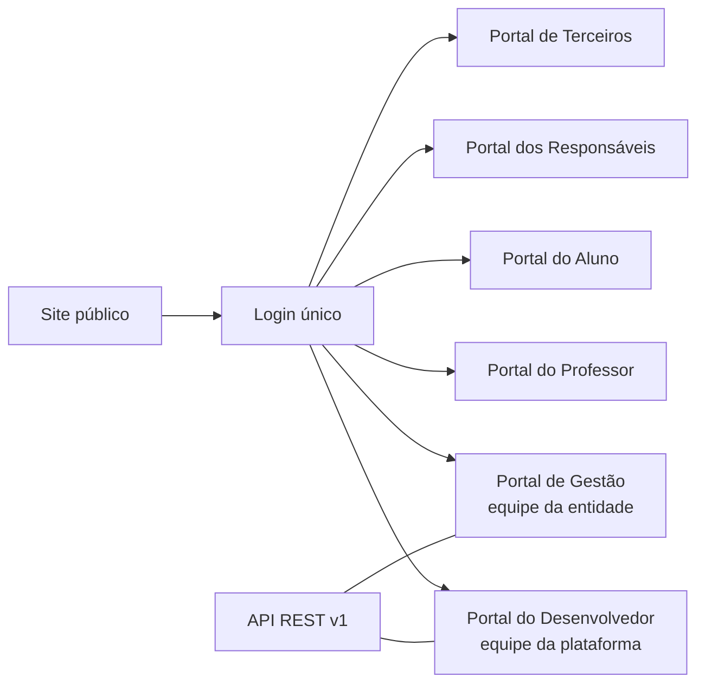

**Regras principais**
- Escopo: web responsiva, sem aplicativo nativo. Gateways de pagamento existem como integração; a ativação em produção depende de contrato ([01](#doc-01), seção 5).
- Os módulos e a situação de cada um estão no catálogo ([12](#doc-12)). Os defeitos da v1 que não podem se repetir estão nos achados ([13](#doc-13)).
- Quando a v1 e a v2 divergem, vale a v2 ([00](#doc-00)).

<a id="doc-00"></a>

## 00 — SDD v2 — TotusTuus SoftCloud

> **Versão:** 2.0.0 · **Data:** 02/11/2026 · **Status:** rascunho para revisão (aguarda aprovação do autor)
> **Substitui:** a coleção v1 (documentos `01` a `12`, `SPEC-*`, `spec_*`, `*_completo`). A v1 foi incorporada a esta pasta em `anexo-v1/`, sem alteração de conteúdo, para que a v2 seja autocontida. Índice do anexo na seção 5.
> **Método:** Elephant-Goldfish Model (EGM) — brief de conceito, rascunho com o contexto do projeto e revisão por leitores sem contexto (ver [11-governanca-qualidade.md](#doc-11)).

---

### 1. Como ler este SDD

Cada requisito e afirmação de estado usa uma das etiquetas abaixo. Afirmações sem etiqueta são requisitos.

| Etiqueta | Significado |
|---|---|
| **[Verificado]** | Confirmado diretamente em código ou configuração, com caminho citado. |
| **[Declarado]** | Afirmação de estado vinda da v1 ou de auditorias externas, ainda não reproduzida neste repositório. Não deve ser usada como prova de conformidade. |
| **[Planejado]** | Ainda não implementado. Tem dono e critério de aceite. |

Regra: nenhum item sai de **[Declarado]** para **[Verificado]** sem teste, comando reproduzível ou link para o artefato de evidência.

### 2. Conteúdo

| Doc | Assunto |
|---|---|
| [01-visao-escopo.md](#doc-01) | Produto, portais, escopo, fora de escopo, critérios de aceite |
| [02-arquitetura.md](#doc-02) | Arquitetura, camadas, ordem de middleware, ADRs, dependências |
| [03-dominio-tenancy.md](#doc-03) | Modelo de domínio, hierarquia multi-tenant, isolamento |
| [04-api.md](#doc-04) | Contratos REST, autenticação de API, erros, paginação, webhooks |
| [05-seguranca.md](#doc-05) | Modelo de ameaças, controles, critérios de aceite de segurança |
| [06-identidade-acesso.md](#doc-06) | Autenticação, MFA, sessões, RBAC, contas privilegiadas |
| [07-privacidade-lgpd.md](#doc-07) | Dados pessoais, bases legais, direitos do titular, incidentes |
| [08-frontend-design-system.md](#doc-08) | Frontend progressivo, CSP, design system, acessibilidade |
| [09-internacionalizacao.md](#doc-09) | i18n/l10n, locales, RTL |
| [10-implantacao-operacao.md](#doc-10) | Ambientes, pipeline, segredos, backup, observabilidade, go-live |
| [11-governanca-qualidade.md](#doc-11) | Processo de entrega, Definition of Done, gates, ADRs, revisão |
| [12-catalogo-modulos.md](#doc-12) | Catálogo dos módulos funcionais e status das especificações |
| [13-achados-v1.md](#doc-13) | Registro dos problemas encontrados na v1 e como a v2 os trata |
| [14-integracao-modulos.md](#doc-14) | Integração entre módulos: donos de dados, eventos, outbox, contratos síncronos |
| [15-validacoes.md](#doc-15) | Validações: ordem, tipos de campo, CRUD, transações, uploads, catálogo de plataforma |
| D-19 | Pessoa única entre unidades de uma entidade: cadastro civil no banco de identidade da entidade (opção a); o master guarda só conta, vínculos e índice de pessoas. Ver [14](#doc-14), seção 3. | **Adotada pela recomendação desta versão (02/11/2026). Mensagem anterior do autor, que colocava o cadastro civil no master, foi substituída. Confirmar.** |
| D-20 | Escopo do token: só o contexto ativo (entidade e unidade), nunca a lista de vínculos. Ver [06](#doc-06), seção 12.3. | **Aprovada pelo autor em 02/11/2026.** |
| D-21 | Conta global única por e-mail verificado em toda a plataforma, com vínculos. Ver [06](#doc-06), seção 12.6. | **Aprovada pelo autor em 02/11/2026.** |
| D-16 a D-18 | CRM: separação por banco (master para plataforma; banco de cada unidade para tenant, entidade + unidade); contas de canal oficiais da plataforma e do tenant; IA só com fonte cadastrada e opção de ticket sem IA. Ver [22](#doc-22), seção 9. | Decididas pelo autor em 02/11/2026. |
| [30-cache.md](#doc-30) | Cache: camadas, chaves com entidade e unidade, classes e validade, invalidação, o que nunca é cacheado |
| [31-matriz-portais-modulos.md](#doc-31) | Matriz de módulos por portal, fronteiras (biblioteca × documentos, protocolo × CRM, financeiro e contábil plataforma × entidade), matrícula, simulados, logs, testes, segurança e auditoria por portal |
| [32-atendimento-privacidade-por-portal.md](#doc-32) | Help desk e SAC (estados, SLA, portal do cliente), privacidade, consentimento, pedido de titular, ROPA, DPO, por portal |
| [33-contratos-por-portal.md](#doc-33) | Contratos: tipos e donos, ciclo de vida, alçadas, assinatura, obrigações, perfis e páginas por portal |
| [34-pagamentos-fiscal-bancos-por-portal.md](#doc-34) | Gateways, split, notas fiscais (NFS-e, fornecedor), bancos (módulo "Bancos" é ferramenta de banco de dados e sai do escopo), Open Finance, carteiras, por portal |
| [35-acesso-e-seguranca-fisica-por-portal.md](#doc-35) | Portaria, catracas, portas, visitantes, autorização de saída, biometria, câmeras (CFTV), por portal |
| [36-tecnologia-da-informacao-por-portal.md](#doc-36) | TI da plataforma (desenvolvedor) e TI da entidade (gestão): ativos, chamados, mudanças, licenças, monitoramento, por portal |
| [29-auditoria.md](#doc-29) | Auditoria: categorias, esquema do evento, integridade por cadeia de hash, acesso, mascaramento, retenção e alertas |
| [28-cobertura-ia-todos-os-modulos.md](#doc-28) | Posição de IA para todos os módulos do catálogo: Sim, Restrita ou Não, com limite e decisão humana |
| [27-inteligencia-artificial-e-portais.md](#doc-27) | IA por módulo e por portal: contratação por capacidade, gateway de IA, dados, limites por recurso, revisão humana, governança e testes. |
| [26-sdd-juridico-regulatorio.md](#doc-26) | SDD jurídico-regulatório: mapa de obrigações com grau de confiança, matriz de retenção, relação de consumo, consentimento por canal, educação, assinatura eletrônica, incidentes, acessibilidade, pagamentos, fiscal e SST. Não é parecer. |
| [25-dossie-juridico-e-lacunas.md](#doc-25) | Dossiê para o jurídico: análise das lacunas, 13 perguntas com norma a verificar e riscos. Não é parecer. |
| [24-operacao-continuidade-qualidade.md](#doc-24) | Continuidade (RPO e RTO por banco), SLO, suporte, releases, testes, vulnerabilidade, contratos e lacunas do projeto (G-01 a G-20) |
| [23-dominios-provisionamento-ciclo-de-vida.md](#doc-23) | Domínios (seis portais, autenticação e arquivos), sessão entre domínios, Editor de portais declarativo, provisionamento e saída de cliente. D-22 e D-23 aprovadas. D-24 superada por D-25. |
| D-25 | **Aprovada pelo autor em 02/11/2026: seis portais.** Desenvolvedor, gestão (SaaS), professor, aluno, responsáveis e terceiros. Módulos são seções dentro dos portais, não subdomínios. Autenticação e arquivos são serviços de infraestrutura. Ver [23](#doc-23), seção 1. | Aprovada. |
| D-26 | **Aprovada pelo autor em 02/11/2026.** Login único; depois seleção de entidade e unidade; atalho direto se houver um único vínculo. Portais em endereços próprios (`portal-do-aluno`, etc.). Ver [23](#doc-23), seção 1. D-24 superada por D-25. Proposta: a entidade vem do contexto do token (D-20); domínio próprio opcional por entidade aponta para um dos portais. | Aguarda decisão do autor. |
| [22-crm-canais-e-papeis.md](#doc-22) | CRM em dois contextos (plataforma e tenant), canais de captação, papéis do CRM e papéis departamentais |
| [21-busca-e-armazenamento.md](#doc-21) | Busca full-text e armazenamento de arquivos: layout, upload e download seguros, metadados corrigidos, quarentena, expurgo e índice com permissão |
| [20-pagamentos-seguranca.md](#doc-20) | Pagamentos e recebimentos: escopo PCI, ledger, webhooks, Pix, boleto, estornos, conciliação e antifraude |
| [19-regras-modulos-3.md](#doc-19) | Regras dos demais módulos do catálogo, duplicidades e lacunas |
| [18-regras-modulos-2.md](#doc-18) | Regras de Cobrança, Notificações, Auditoria, RH e Contábil/Fiscal |
| [17-regras-modulos.md](#doc-17) | Regras de validação, estados e defeitos dos módulos Financeiro, Pessoas, Acadêmico, SMT, Suprimentos e Contratos |
| [16-integracoes-externas.md](#doc-16) | Integrações externas de plataforma (master) e de tenant: catálogo, credenciais, ciclo de vida |

### 3. O que mudou em relação à v1

1. **Escopo de governança separado do produto.** A v1 misturava o produto com ferramentas de agentes de IA (`oh-my-opencode-slim`, `ag-kit`, `fable-method`, `mantis`) e instruções de instalação com `@latest`. A v2 mantém esses itens fora do SDD de produto. Ferramentas de desenvolvimento ficam em `11-governanca-qualidade.md`, com versão fixada.
2. **Sem dados pessoais nem identificadores operacionais.** A v1 listava e-mails reais de administradores e UUIDs da estrutura interna. A v2 remove esses dados; eles ficam no registro de seed privado.
3. **Referências verificáveis.** A v1 apontava para mais de 30 arquivos (`docs/security/…`, `docs/portais/…`, `.agents/skills/…`) que não estão nesta pasta. A v2 cita apenas caminhos que existem ou marca o item como externo.
4. **Afirmações de segurança com evidência.** Os números "0 críticos / 36 achados / 34 fixados" da v1 são **[Declarados]**. A v2 exige reprodução.
5. **Contradições corrigidas.** Ex.: "zero JavaScript inline" contra `onclick=` em [`sub_sidebar_itsm.php`](#v1-sub-sidebar-itsm-php); "sem bibliotecas externas de runtime" contra CDN do Font Awesome. Detalhes em [13-achados-v1.md](#doc-13).
6. **Riscos de design corrigidos.** Ex.: rotação periódica de senha, bloqueio de conta por identificador (permite negação de serviço), vinculação rígida de sessão a IP, cookies `SameSite=Strict` em fluxos de navegação de primeira parte.

### 4. Princípios

1. **Default-deny.** Rota sem regra explícita é negada.
2. **Isolamento de tenant em toda consulta.** Filtro por tenant é obrigatório no repositório de dados, não só no controller.
3. **Segredos fora do código e fora do host da aplicação em produção.**
4. **Dados pessoais mínimos.** Coletar só o necessário; apagar ou anonimizar ao fim da retenção.
5. **Mudança rastreável.** Toda decisão relevante vira ADR; todo requisito tem critério de aceite testável.
6. **Português como idioma principal**, inglês como idioma canônico de chaves de código e i18n.

### 5. Decisões do autor (02/11/2026)

| # | Decisão | Opções | Onde |
|---|---|---|---|
| Busca por CPF | Permitida só com finalidade declarada por tenant, relatório de impacto, MFA recente, limites contra enumeração e auditoria de cada consulta. Ver [21](#doc-21), seção 6.8. Prazo de retenção da auditoria: pendente (jurídico). | **Aprovada pelo autor em 02/11/2026.** |
| D-13 a D-15 | Busca e armazenamento: MySQL FULLTEXT inicialmente com interface isolada; um bucket por ambiente com prefixo por tenant; OCR nesta versão, com texto de bucket sensível fora do índice. Ver [21](#doc-21), seção 9. | Decididas pelo autor em 02/11/2026. |
| D-10 a D-12 | Pagamentos: fluxo de recursos (conta do tenant; gateway da plataforma condicionado a parecer), centavos inteiros, MFA configurável com piso e limite padrão de R$ 1.000,00. Ver [20](#doc-20), seção 19, e [06](#doc-06), seção 5. | Decidida pelo autor em 02/11/2026. |
| D-01 | Biblioteca de ícones. **Decidida: (a)**, self-host da licença Pro (ver [08](#doc-08)). | (a) self-host da licença Pro; (b) migrar para biblioteca open source; (c) manter CDN apenas com licença confirmada | [08](#doc-08) |
| D-02 | Cofre de segredos em produção. **Decidida: biblioteca própria** (`TotusTuus\Vault`), ver ADR-05. | (a) AWS KMS / Secrets Manager; (b) HashiCorp Vault; (c) provedor da nuvem contratada | [05](#doc-05), [10](#doc-10) |
| D-03 | Vínculo de sessão ao dispositivo. **Decidida: (b)**, token de dispositivo com revogação (ver [06](#doc-06), seção 7). | (a) só User-Agent + sinal de risco; (b) token de dispositivo (`DeviceTrust`) com revogação; (c) nenhum além de idle/absolute | [06](#doc-06) |
| D-04 | Recuperação de conta sem e-mail/SMS. **Decidida: e-mail verificado é obrigatório para cadastro e recuperação;** WhatsApp e Telegram ficam fora. | (a) códigos de recuperação de uso único; (b) passkey obrigatória para contas master; (c) suporte com verificação de identidade | [06](#doc-06) |

Cada opção tem trade-offs e condições de falha descritos no documento indicado. O SDD não escolhe por padrão.

### Decisões aprovadas em 03/11/2026 (documentos 31 a 36)

O autor aprovou as propostas adotadas nos documentos 31 a 36. Itens que pedem valor, nome ou parecer continuam pendentes e estão listados abaixo.

| Documento | Aprovado | Ainda pendente |
|---|---|---|
| [31](#doc-31) | Biblioteca separada de Documentos; protocolo como serviço de atendimento, fora do CRM comercial; financeiro e contábil da plataforma e da entidade em bancos separados; matrícula, simulados e auditoria com `portal` | Planejamento acadêmico, institucional e de desenvolvimento; empenho; permanência dos módulos financeiro, contábil, patrimônio, frotas, suprimentos e pessoas da plataforma; gabarito óptico; plano PRO |
| [32](#doc-32) | Ticket como tipo de protocolo; módulo único de atendimento; consentimento por finalidade; pedido de titular com estados e verificação de identidade; DPO com painel próprio, sem operar o módulo que audita | Valores padrão de SLA; regra de categoria sensível; nomes dos DPOs; retenção de tickets; consentimento de menor de 13 anos (jurídico) |
| [33](#doc-33) | Tipos de contrato com dono e portal de origem; aditivo segue o portal do contrato original; contrato com dado pessoal exige DPA antes da assinatura | Faixas de alçada; antecedência de alerta; provedor de assinatura eletrônica; cláusulas obrigatórias e forma de assinatura (jurídico) |
| [34](#doc-34) | Módulo Bancos removido do escopo; split mantido na opção (a), sem custódia; nota de fornecedor recebida e validada, não emitida; carteira digital como método do gateway, sem guardar token | Open Finance e débito automático (jurídico); NFS-e Nacional, cancelamento e guarda de XML (fiscal e jurídico); NFS-e da assinatura SaaS |
| [35](#doc-35) | Biometria opcional, com alternativa sem biometria; template cifrado no banco da unidade; câmeras fora de áreas íntimas e com aviso; liberação de emergência sem rede | Prazo de retenção de imagem; escopo de biometria e reconhecimento facial (jurídico e RIPD); geolocalização na presença; fabricantes de catraca e porta |
| [36](#doc-36) | TI da plataforma fora de qualquer portal de cliente; TI da entidade com ativo como vista do Patrimônio; chamados de TI no atendimento; mudança com aprovação de segundo papel; [`sub_sidebar_itsm.php`](#v1-sub-sidebar-itsm-php) removido | Comitê de mudança e quórum; prazo de aprovação de mudança emergencial; manter ou remover monitoramento de equipamento da entidade |
| [37](#doc-37) | Planejamento acadêmico, institucional e de desenvolvimento de pessoas; empenho para entidade pública. Análise, estados, regras, segregação, portais e estrutura de dados |
| [38](#doc-38) | Portal de terceiros: prestadores por tipo (jurídico, contabilidade, cartório, alimentação, transporte escolar, transportadora, TI, limpeza, vigilância, uniformes, clínica de ASO, consultoria), com acesso limitado ao contrato |
| [39](#doc-39) | Departamento pessoal, RH e medicina do trabalho: lacunas, separação de dado de saúde (RH sem CID), permissões corrigidas, por portal |
| [40](#doc-40) | Aulas online e reuniões ao vivo: aula sem especificação na v1, menores (consentimento e gravação), presença, convidado externo, infraestrutura de mídia, por portal |
| [41](#doc-41) | Formulários e pesquisas: motor compartilhado, anonimato com tabelas separadas, dado sensível, relatórios por grupo com mínimo |
| [42](#doc-42) | Preceptoria: avaliação e autoavaliação, tutoria, PDI, evidências; conflito de nome com a navegação da v1 |
| [43](#doc-43) | Gestão pastoral: eventos, missas e celebrações, escalas, intenções, ações sociais. Confissões só como horário público, sem registro de pessoa. Tradições configuráveis, com modo ecumênico |
| [44](#doc-44) | Agendamento de ambientes e equipamentos (acadêmico): conflito de horário, prioridade, grade como bloqueio fixo, equipamento como bem patrimonial |
| [45](#doc-45) | Pendências consolidadas por responsável: autor, jurídico, norma, documento, homologação e owner. Refeita por auditoria completa dos docs 00 a 76 em 03/11/2026 |
| [46](#doc-46) | Matrícula e rematrícula: estados, janela, condicional com prazo, não rematriculada, trancamento por nível, vaga com bloqueio de concorrência, por portal |
| [47](#doc-47) | Simulados e correção de redação: perfis, OCR com revisão, nota da IA só como sugestão confirmada pelo professor, ranking por opção da unidade |
| [48](#doc-48) | Gerador de documentos: editor de modelos, tipos, ciclo de emissão, validação pública sem dado pessoal, assinatura, por portal |
| [49](#doc-49) | Logs de integração e de job, testes por portal, teste de isolamento por par, acessibilidade |
| [51](#doc-51) | DDL dos módulos novos e pendentes: atendimento, LGPD, contrato, acesso físico, formulários, preceptoria, pastoral, agendamento, sala de aula, matrícula e TI |
| [52](#doc-52) | Medicina do trabalho: PCMSO, PGR, LTCAT, CIPA e ergonomia, com DDL e quem vê o quê |
| [50](#doc-50) | Pacote de 61 perguntas para jurídico e norma, com posição proposta por pergunta |
| [53](#doc-53) | Pacote para jurídico: contratos, declarações, certidões, acervo escolar, termos, autorizações, atas e dossiês. 28 perguntas (DC-01 a DC-28) |
| [54](#doc-54) | Gestão de documentos em três contextos: recebidos (validação), administrativos (tramitação) e emitidos (secretaria), com serviços comuns de assinatura, protocolo e armazenamento |
| [55](#doc-55) | Verificação do acadêmico contra o menu do iScholar: cobertura, 13 lacunas em ordem de dependência, 4 decisões de produto |
| [56](#doc-56) | Configurações e relatórios: menus do iScholar comparados com o SDD, lacunas por grupo |
| [57](#doc-57) | Notificações por portal: canais, preferências, targeting, templates, provedores e lacunas do módulo |
| [58](#doc-58) | Calendário escolar e eventos: período, dia não letivo, eventos, inscrição, capacidade, certificado, por portal |
| [59](#doc-59) | Estrutura acadêmica: tipos de curso, disciplinas, grades e PPC versionados, equivalências, períodos e sistemas avaliativos, por portal |
| [60](#doc-60) | Turmas, cadastro de salas, enturmação, grupos de horários e grade de horários: conflitos de professor, turma e ambiente, publicação e consultas, por portal |
| [61](#doc-61) | Diário escolar: aula, chamada por três formas, faltas, justificativas com prazo e aprovação, notas com versão, fechamento e reabertura, por portal |
| [62](#doc-62) | Boletim parcial e oficial, regra de aprovação, recuperação paralela, conselho de classe com pauta, decisão e ata, por portal |
| [63](#doc-63) | Ocorrências disciplinares e de convivência: tipos, gravidade, fluxo, medidas, contestação, sigilo e denúncia de violência, por portal. Separada de SST, portaria e saúde |
| [64](#doc-64) | Planos de ensino (disciplina, turma e período, com critérios que batem com o sistema avaliativo) e planos de aula (por aula ou semana), com revisão, IA com revisão humana e PPP fora do módulo, por portal |
| [65](#doc-65) | Estágio (obrigatório ou não, termo, horas, supervisão, avaliação) e TCC (orientação, estados, banca, versão final e repositório), por portal. Supervisor externo e membro de banca com conta no portal de terceiros |
| [66](#doc-66) | Prontuário como visão sobre os documentos (sem cópia), seção restrita de saúde e apoio, histórico após saída, portfólio com avaliação, compartilhamento e exportação, por portal |
| [67](#doc-67) | Livro de registro e livro de atas digitais com travamento, retificação e assinatura; arquivo morto com digitalização verificada por outra pessoa e eliminação só com termo, por portal |
| [68](#doc-68) | Biblioteca separada de documentos: acervo e exemplares, perfis e prazos configurados pela escola, empréstimo, reserva, multa, inventário, biblioteca digital, salas via recursos e empréstimo entre unidades, por portal |
| [69](#doc-69) | Relatórios: modelo comum (operacional, gerencial, regulatório), ciclo de geração e arquivo, catálogo por módulo, censo escolar com conferência e envio pela secretaria, formatos oficiais, por portal |
| [70](#doc-70) | Importação e carga inicial: ordem por dependência, simulação, lote desfazível, idempotência, histórico sem cobrança retroativa nem aviso em massa, por portal |
| [71](#doc-71) | Financeiro completo (CFG-04): contas a pagar com rateio e aprovação, cheques recebidos e emitidos, caixa físico com fechamento, fluxo de caixa, DRE por regime escolhido, conciliação e por portal. Receita de aluno fica em 18 e 20 |
| [72](#doc-72) | Campos personalizados (CFG-06): definidos por entidade ou por unidade, valores no banco da unidade, só acrescentam, com classificação de dado e fora de saúde, prontuário e ocorrência, por portal |
| [73](#doc-73) | Resumo para o jurídico: 20 perguntas dos módulos acadêmicos e administrativos (docs 55 a 72), com posição proposta e documento de origem para cada uma |
| [74](#doc-74) | Integrações educacionais oficiais: Educacenso (arquivo importado no INEP), SIGEP, SGP por API, sistema municipal (conflito em aberto) e Pé-de-Meia, com regra de canal oficial e de quem envia, por portal |
| [75](#doc-75) | Análise por escopo (plataforma, entidade, unidade, módulo, global): busca, notificações, perfil e integrações internas e externas, com lacunas e decisões pendentes |
| [76](#doc-76) | Meu perfil: uma tela em todos os portais, com dados, contato, endereço, segurança, preferências, consentimentos, histórico e pedido de titular. Regras de edição decididas em PER-04 e PER-05 |
| [77](#doc-77) | Licenciamento: planos com limite de alunos definido pelo desenvolvedor, situações da assinatura, carência e comportamento ao exceder o limite |
| [78](#doc-78) | Permissões completas: níveis de papel (0 a 7), escopos, papéis por portal, criação de entidade e unidade só pelo desenvolvedor, separação de funções |
| [79](#doc-79) | Rastreabilidade v1 → v2: para cada um dos 62 arquivos da v1 (em `anexo-v1/`), o destino na v2 e o que ainda não foi absorvido. Gerado por `inventario/gera_rastreabilidade.py` |
| [80](#doc-80) | Decisões tomadas por padrão, delegadas pelo autor em 04/11/2026 (melhor prática, mais segura, completa), com motivo e alternativa descartada |
| [81](#doc-81) | Classe: mural de avisos, materiais de apoio e tarefas com entrega, por portal, com estados, regras, permissões e DDL (especifica o DP-06) |
| Decisões de configuração (CFG-01 a CFG-04) | Agenda iScholar fora do escopo. Foto com consentimento por aluno. Relatório de acesso do responsável com link de uso único. Financeiro completo, com cheques, caixa e DRE | [56](#doc-56), seção 8 |
| Notificações (NOT-02, NOT-03, NOT-05, NOT-06) | Silêncio 21h às 7h. Segunda aprovação acima de 500. Remetentes de saúde: secretaria, enfermagem, médico e coordenação. Push por aplicativo Android e iOS | [57](#doc-57), seção 5 |
| Calendário e eventos escolares | Módulo próprio, nesta versão. Especificação pendente | [56](#doc-56), CFG-01 |

Correção aplicada: o módulo "Bancos" nos documentos [12](#doc-12) e [19](#doc-19) passa a ser ferramenta de banco de dados, fora do produto.

### Decisões de 03/11/2026, segunda rodada

| Decisão | Resposta | Documento |
|---|---|---|
| Módulo Bancos | Removido de produto. Painel de bancos de dados no portal do desenvolvedor, sem console SQL aberto | [34](#doc-34), seção 11 |
| Split | Mantido em (a). Lista de mudanças para (c) registrada | [34](#doc-34), seção 11 |
| Nota de fornecedor | Recebe e valida, sem emitir | [34](#doc-34), seção 5.3 |
| Portaria & Acesso | Mantido no portal do desenvolvedor, para acesso físico da própria empresa | [35](#doc-35), seção 11 |
| Biometria, reconhecimento facial e câmeras | Escopo aprovado. Retenção de imagem: 30 dias, padrão inicial | [35](#doc-35), seção 11 |
| Ticket como protocolo | Aprovado em parte: pedido com responsável e prazo recebe protocolo | [32](#doc-32), seção 7 |
| SLA padrão | Aprovado: 1 h a 10 dias úteis por prioridade, ajustável por entidade | [32](#doc-32), seção 7 |
| Faixas de alçada | Aprovadas como padrão inicial: até R$ 10.000; até R$ 100.000; acima | [33](#doc-33), seção 12 |
| DPO | Plataforma: empresa desenvolvedora. Entidade: designado pela entidade, podendo ser a empresa por contrato | [32](#doc-32), seção 7 |
| Planejamento e empenho | Analisados e implementados como módulos de tenant. Empenho só para entidade pública | [37](#doc-37) |

### Análises de 03/11/2026, terceiros e pessoal

- **Terceiros por tipo** ([38](#doc-38)): cada prestador tem contrato, pessoas com vínculo ligado ao contrato, serviços do pacote do tipo e unidades listadas. O acesso é a interseção de contrato vigente, serviço, unidade e papel. Teste de isolamento entre prestadores.
- **Pessoal, RH e SST** ([39](#doc-39)): análise mostrou lacunas em folha, rescisão, recrutamento, PCMSO, PGR, LTCAT e CIPA, e uma falha de privacidade na v1: RH e gestão podiam gerenciar SST e ver CID. Proposta: RH e gestão veem só o resultado do ASO.

### Decisões de 03/11/2026, terceiros e pessoal

| Tema | Decisão | Onde |
|---|---|---|
| RH e Pessoas (HCM-01) | Módulos separados, vínculo por referência à pessoa | [39](#doc-39), seção 11 |
| Permissão "SST — Gerenciar" (HCM-06) | Por papel e portal que precisa. Não é concedida a RH nem a gestão por cargo | [39](#doc-39), seção 11 |
| HCM da plataforma e dos clientes (HCM-10) | Dois usos do mesmo módulo, isolados: empresa desenvolvedora (master) e cada entidade | [39](#doc-39), seção 11 |
| Currículo de não contratado (HCM-09) | Incluído. Prazo a fixar pelo (jurídico) | [39](#doc-39), seção 11 |
| Tipos de prestador (TER-01) | Tipos personalizados a partir de modelo-base, só com serviços do catálogo, com aprovação e auditoria | [38](#doc-38), seção 11 |
| Rastro de localização do transporte (TER-02) | Incluído. Guarda só durante a viagem e prazo fixo depois. 30 dias depois da viagem, decidido em 03/11/2026. Parecer do (jurídico) pendente | [38](#doc-38), seção 11 |
| Acesso remoto de TI (TER-08) | Incluído. Só com chamado aberto, dentro de janela, sessão gravada | [38](#doc-38), seção 11 |
| Infraestrutura de aula online (LIV-05) | Mídia própria, com as melhores tecnologias. Operação a especificar em [10](#doc-10) | [40](#doc-40), seção 8 |
| Transcrição de aula com menor por IA (LIV-03) | Sim, pelo gateway de IA. Desligada por padrão, habilitada por unidade | [40](#doc-40), seção 5 |
| Presença em aula online (LIV-04) | 40 minutos de tempo conectado, configurável por entidade | [40](#doc-40), seção 6 |
| Convidado externo e diretor (LIV-06, LIV-07) | Entidade habilita externos com token de uso único. Diretor tem passe livre na unidade, com auditoria. Coordenador em aberto | [40](#doc-40), seção 7 |
| Visual da sala (LIV-08) | Template do portal, layout de reunião estilo Zoom. Especificado em [08](#doc-08), seção 9 | [40](#doc-40), seção 4.4 |
| Operação de mídia (LIV-11) | Gravação em fragmentos cifrados de 60 s, com índice de fragmentos, manifesto e verificação de checksum | [10](#doc-10), seção 10 |
| Coordenador em aula (LIV-07) | Pode observar aulas da unidade, com registro em auditoria | [40](#doc-40), seção 7 |
| Consentimento de menor (LIV-01) | Pedido por cláusula do contrato com a instituição. Texto com o jurídico | [40](#doc-40), seção 5 |


### 5. Anexo v1 (incorporado)

A coleção v1 está em anexo-v1/ (62 arquivos, sem alteração de conteúdo). Cada arquivo tem um status em [12-catalogo-modulos.md](#doc-12) (seções 2 a 4) e um destino na v2 em [79-rastreabilidade-v1-v2.md](#doc-79). O consolidado SDD-COMPLETO.md é gerado por `inventario/gera_sdd_completo.py`. Não é preciso consultar a pasta original fora deste repositório.

<a id="v1-sdd-mestre-php8-mvc-saas-md"></a>

### v1 — `sdd-mestre-php8-mvc-saas.md` (535 linhas)

> Situação na v2: Substituído por 00 e 02. Quando este texto diverge da v2, vale a v2.

> Esta especificação foi substituída por inteiro pelo documento indicado acima. O texto fica como histórico; para implementar, vale o documento da v2.

#### Visão do documento

Este documento define a Especificação de Design de Software (SDD) mestre para uma plataforma SaaS escalável, multi-entity, multi-unit e multi-user, construída em PHP 8 puro com arquitetura MVC, API RESTful, frontend progressivo com JavaScript `fetch`, design system com Tailwind 4.4 e estratégia de bibliotecas internas sem dependência de bibliotecas externas de runtime.[web:46][web:43][web:51]

O modelo de governança técnica deste projeto usa o `fable-method` como método principal de decisão, verificação e reporting; usa `oh-my-opencode-slim` como malha de agentes especialistas; usa `hallmark` para direção visual e prevenção de interfaces genéricas; usa `ag-kit` para workflows, memória e compressão de contexto; usa `agentic-awesome-skills` como catálogo complementar de skills; e integra `mantis` e skills dedicadas de segurança para auditoria contínua e validação das superfícies críticas do sistema.[attached_file:1][attached_file:2][attached_file:3][web:4][web:18]

#### Política de pré-instalação e bootstrap de skills

Antes de qualquer uso operacional do SDD, o ambiente de agentes deve verificar se as skills, plugins e configurações mínimas estão presentes. Se não estiverem, o processo deve interromper a execução funcional e primeiro instalar, configurar e validar o stack de agentes necessário.[web:44][web:46][web:51][web:55]

##### Regra obrigatória

Nenhum workflow do projeto pode assumir que `fable-method`, `oh-my-opencode-slim`, `ag-kit`, `hallmark`, `agentic-awesome-skills` ou integrações de segurança já estejam disponíveis. O processo deve sempre executar uma fase explícita de `agent environment bootstrap` antes da fase de planejamento, especificação ou implementação.[web:44][web:46][web:51]

##### Ordem de bootstrap

1. Verificar OpenCode CLI.
2. Instalar e configurar `oh-my-opencode-slim`.
3. Instalar `ag-kit` no projeto ou por setup compartilhado.
4. Instalar `fable-method` no host compatível.
5. Registrar `hallmark`, `agentic-awesome-skills`, `mantis` e skills proprietárias de segurança.
6. Validar autenticação, modelos, skills e agentes.
7. Somente então iniciar o loop do `fable-method`.

##### Checklist de verificação de ambiente

| Item | Verificação | Ação se ausente |
|---|---|---|
| OpenCode CLI | `opencode --version` responde | Instalar OpenCode CLI antes de prosseguir.[web:44][web:45] |
| oh-my-opencode-slim | Configuração presente e agentes respondem | Executar instalador e revalidar.[web:43][web:44][web:49] |
| AG Kit | `.agents/` ou setup equivalente presente | Rodar `npx @vudovn/ag-kit init`.[web:51][web:50] |
| fable-method | Plugin ou skills instalados | Instalar via plugin, script ou AGENTS.md.[web:46][web:47] |
| Model providers | `opencode auth login` concluído | Solicitar autenticação manual do usuário.[web:44][web:45] |
| Model registry | `opencode models --refresh` executado | Atualizar catálogo antes de uso.[web:43][web:44] |
| Agent health | `ping all agents` funciona | Corrigir config ou credenciais.[web:44][web:49][web:55] |
| Background subagents | flag experimental habilitada quando aplicável | Definir variável de ambiente apropriada.[web:43][web:55] |

#### Instalação e configuração das skills obrigatórias

##### 1. OpenCode CLI como pré-requisito

O `oh-my-opencode-slim` depende da presença do binário `opencode`, e a documentação de instalação recomenda verificar `opencode --version` antes de rodar o instalador.[web:44] Um guia de uso também destaca que mesmo quem usa OpenCode Desktop precisa do CLI instalado para que a instalação do plugin funcione corretamente.[web:45]

**Gate:** se `opencode --version` falhar, o processo deve parar e abrir uma tarefa de ambiente chamada `Install OpenCode CLI`.[web:44][web:45]

##### 2. Instalação do oh-my-opencode-slim

A instalação recomendada do `oh-my-opencode-slim` usa `bunx oh-my-opencode-slim@latest install`, com opções não interativas como `--no-tui --skills=yes` quando o projeto exigir padronização automática de setup.[web:43][web:44] A configuração gerada fica em `~/.config/opencode/oh-my-opencode-slim.json`, onde os modelos dos agentes devem ser revisados e ajustados ao stack disponível.[web:43][web:44]

Comandos de referência:

```bash
opencode --version
bunx oh-my-opencode-slim@latest install --no-tui --skills=yes
opencode auth login
opencode models --refresh
opencode
# dentro da sessão
ping all agents
```

Se o projeto usar a orquestração de background da linha V2, a documentação técnica também cita a necessidade de habilitar `OPENCODE_EXPERIMENTAL_BACKGROUND_SUBAGENTS=1` ou variável equivalente persistida no shell profile.[web:43][web:55]

##### 3. Instalação do AG Kit

O `ag-kit` pode ser inicializado no projeto com `npx @vudovn/ag-kit init`, o que injeta a pasta `.agents/` diretamente na base local do projeto.[web:51][web:50][web:54] Também existe opção de instalação global com `npm install -g @vudovn/ag-kit` seguida de `ag-kit init`, além de estratégia centralizada com symlink para reuso entre repositórios.[web:51]

Comandos de referência:

```bash
npx @vudovn/ag-kit init
# ou
npm install -g @vudovn/ag-kit
ag-kit init
```

**Gate:** se a pasta `.agents/` não existir após a execução, o ambiente deve ser considerado incompleto.[web:51][web:57]

##### 4. Instalação do fable-method

O `fable-method` pode ser instalado como plugin recomendado em Claude Code com `/plugin marketplace add Sahir619/fable-method` seguido de `/plugin install fable@fable-method`, ou como skills standalone por `git clone` mais `install.sh` no Linux/macOS e `install.ps1` no PowerShell do Windows.[web:46][web:47]

Comandos de referência para setup standalone:

```bash
git clone https://github.com/Sahir619/fable-method && bash fable-method/install.sh
```

No Windows PowerShell:

```powershell
git clone https://github.com/Sahir619/fable-method; .\fable-method\install.ps1
```

Quando o host não suportar instalação nativa de skills, o repositório também informa que `AGENTS.md` pode ser usado como método equivalente para qualquer agente ou harness compatível.[web:46][web:47]

##### 5. Registro do hallmark, agentic-awesome-skills e mantis

O `hallmark` entra como skill de direção visual e antítese de UI genérica.[web:18] O `agentic-awesome-skills` entra como catálogo amplo de skills reutilizáveis e deve ser conectado ao processo de seleção de capabilities por domínio.[web:4] O `mantis` e as skills proprietárias de segurança devem ser tratados como `security toolchain`, com localização, instalação e versionamento definidos pelo projeto em seu diretório de automação interna e validados no bootstrap antes do uso em auditorias.

Como nem todos esses componentes compartilham o mesmo método de instalação, o projeto deve manter um manifesto local chamado `docs/agent-stack/manifest.md` contendo:

- nome da skill ou plugin;
- origem;
- método de instalação;
- comando de atualização;
- versão/pino desejado;
- host compatível;
- critério de verificação pós-instalação.

#### Script lógico de bootstrap recomendado

O projeto deve manter um workflow ou script de verificação com a seguinte lógica operacional:

```text
START
  -> check opencode cli
  -> if missing: stop and request installation
  -> check oh-my-opencode-slim config
  -> if missing: install plugin and configure
  -> check provider auth
  -> if missing: require interactive auth
  -> refresh models
  -> check .agents folder
  -> if missing: initialize ag-kit
  -> check fable-method availability
  -> if missing: install via plugin/script/AGENTS.md
  -> check hallmark / mantis / security skills registry
  -> if missing: install or register according to local manifest
  -> run health checks
  -> if all green: allow SDD workflows
END
```

#### Política de configuração correta após instalação

Instalar não é suficiente; o ambiente precisa estar corretamente configurado antes de uso. O SDD passa a exigir as seguintes validações pós-instalação:

- `oh-my-opencode-slim` com preset escolhido e modelos compatíveis com orçamento e função de cada agente.[attached_file:2][web:43][web:52]
- autenticação de providers concluída por `opencode auth login`.[web:44][web:45]
- catálogo de modelos atualizado por `opencode models --refresh`.[web:43][web:44]
- agentes respondendo com `ping all agents`.[web:44][web:49][web:55]
- `ag-kit` presente no projeto e workflows reconhecidos.[web:51][web:54]
- `fable-method` acessível no host escolhido, seja por plugin, skills instaladas ou `AGENTS.md`.[web:46][web:47]
- skills de segurança registradas com owner técnico definido.


#### Code intelligence layer

O projeto deve incluir uma camada explícita de inteligência estrutural de código para apoiar review, análise de impacto e navegação assistida pelos agents. O `code-review-graph` entra aqui como ferramenta essencial para produzir um grafo local do repositório, manter atualizações incrementais e expor contexto mínimo via MCP para que os agents leiam somente o que importa em cada tarefa.[web:62][web:60][web:70]

##### Papel do code-review-graph

O `code-review-graph` deve ser tratado como dependência operacional do ecossistema de agents, não como utilitário opcional. Ele oferece visualização estrutural, blast-radius analysis, review context otimizado e ferramentas de busca/impacto que reduzem leitura inútil em codebases grandes.[web:62][web:66][web:70]

##### Regras de uso

- Antes de revisar código, os agents devem consultar o grafo para obter contexto mínimo.
- Antes de alterações relevantes, os agents devem obter o impacto provável da mudança.
- Antes de refatorações, os agents devem identificar dependências, callers, testes afetados e hotspots arquiteturais.
- Após mudanças, o grafo deve ser atualizado incrementalmente.
- Em revisões de PR e debugging, o grafo deve ser a primeira fonte de orientação estrutural.

##### Bootstrap obrigatório

Se o `code-review-graph` não estiver instalado, o pipeline de bootstrap deve instalá-lo e configurá-lo antes de habilitar qualquer workflow de review, refatoração ou análise estrutural.[web:58][web:62]

Comandos de referência:

```bash
pip install code-review-graph
code-review-graph install
code-review-graph build
code-review-graph status
```

Se o projeto usar suporte MCP, o SDD deve exigir a execução do instalador com a plataforma apropriada e a validação dos tools mínimos antes do uso pelos agents.[web:58][web:62]

##### Fluxo operacional com agents

1. Orchestrator define a tarefa.
2. `code-review-graph` fornece contexto mínimo e impacto.
3. Librarian ou Explorer consultam o grafo para localizar arquivos relevantes.
4. Oracle decide a estratégia.
5. Fixer altera apenas o necessário.
6. Fable-method verifica por observação.
7. Mantis audita qualquer superfície sensível antes do merge.

#### Objetivos do sistema

A plataforma deve servir como núcleo de um ecossistema educacional multi-tenant com capacidade de suportar múltiplas entidades, múltiplas unidades por entidade, múltiplos usuários por contexto e múltas camadas operacionais, incluindo Website, SaaS Admin e camada Developer.[attached_file:1][attached_file:2]

Os objetivos principais são:

- Permitir segregação forte de dados, configuração e branding por entidade.
- Permitir operação descentralizada por unidade, com controle contextual de usuários, permissões e fluxos.
- Expor API RESTful versionada para uso web, integrações e automações.
- Possibilitar frontends progressivos usando `fetch()` sobre contratos bem definidos.
- Garantir segurança, rastreabilidade, auditoria e escalabilidade horizontal desde a base da arquitetura.
- Padronizar internacionalização com inglês como idioma canônico e suporte a `en`, `pt-BR`, `es`, `fr`, `de`, `it`, `zh`, `ja`, `ru` e `ar`.[attached_file:2][attached_file:3]

#### Escopo funcional

##### Camadas do produto

###### 1. Website

Camada pública institucional e comercial, responsável por presença web, marketing, SEO, páginas públicas, onboarding, autenticação inicial, recuperação de acesso, central de ajuda e documentação pública do produto.

###### 2. SaaS Admin

Camada autenticada de operação do produto para superadministradores, administradores de entidade, gestores de unidade e usuários internos com funções específicas de negócio.

###### 3. Developer

Camada técnica voltada à administração avançada da plataforma, feature flags, API keys, webhooks, observabilidade, diagnósticos, jobs, integrações, trilhas de auditoria, inspeção de eventos e governança operacional do stack.

##### Requisitos macro de domínio

O sistema deve suportar:

- Multi-entity.
- Multi-unit.
- Multi-user.
- RBAC e políticas contextuais.
- Múltiplos idiomas e contextos regionais.
- Módulos independentes e composáveis.
- API-first com web progressivo.
- Auditoria de segurança e de negócio.
- Escalabilidade por decomposição modular e isolamento de contexto.

#### Princípios arquiteturais

##### Fundamentos

A arquitetura base deve seguir estes princípios:

- **PHP 8 puro**, sem framework full-stack externo.
- **MVC próprio**, com fronteira clara entre Controller, Service, Domain, Repository e View.
- **REST first**, com contratos JSON estáveis e versionados.
- **Frontend progressivo**, server-rendered como baseline e `fetch()` para experiências assíncronas.
- **Bibliotecas internas próprias**, com contratos bem definidos, testáveis e substituíveis.
- **Security by design**, com verificações explícitas em cada fase de entrega.
- **Scalability by partitioning**, ou seja, escalabilidade por particionamento de módulos, contexto, filas, storage e boundaries de tenancy.
- **Observability by default**, com logs estruturados, métricas, traces e trilhas de auditoria.

##### Estilo arquitetural

O sistema adota arquitetura modular monolítica no início, com boundaries rígidos entre domínios e contratos internos preparados para futura extração seletiva de serviços. Esse desenho reduz complexidade operacional precoce e ao mesmo tempo preserva evolução para cenários de alta escala.[attached_file:1][attached_file:2][attached_file:3]

##### Estratégia de escalabilidade

A escalabilidade do projeto deve ser pensada em cinco dimensões:

1. **Escalabilidade organizacional**: separação por domínio, equipe, módulo e ownership.
2. **Escalabilidade de dados**: chaves de segregação por entity e unit, particionamento lógico e preparação para sharding futuro.
3. **Escalabilidade de tráfego**: cache, filas, workers, leitura otimizada e desacoplamento de jobs intensivos.
4. **Escalabilidade de produto**: camadas Website, Admin e Developer desacopladas no nível de UX, ACL e endpoints.
5. **Escalabilidade de mudança**: bibliotecas internas, contratos versionados, testes e governança por verificação.

#### Governança por agentes e skills

##### Papel do fable-method

O `fable-method` deve atuar como skill governante do ciclo completo de criação do sistema, porque seu fluxo prescreve classificar o pedido, definir o que significa pronto, reunir evidências, decidir uma única recomendação, alterar o menor conjunto correto de artefatos, verificar por observação e reportar com honestidade.[attached_file:1][web:46]

No contexto deste projeto, ele será o gerente lógico do programa e deve controlar:

- Sequenciamento de fases do SDD.
- Critérios de aceite por documento e por módulo.
- Checklist de verificação antes de cada avanço.
- Reação a falhas, inconsistências e retrabalho.
- Encerramento de etapa somente após evidência observável.

##### Papel do oh-my-opencode-slim

O `oh-my-opencode-slim` deve ser usado como camada operacional de orquestração, delegando subtarefas a agentes como Orchestrator, Oracle, Librarian, Explorer, Designer, Fixer e, quando necessário, Council.[attached_file:2][web:43]

Distribuição recomendada:

| Agente | Responsabilidade |
|---|---|
| Orchestrator | Coordenar subtarefas, dependências, checkpoints e síntese final.[attached_file:2] |
| Oracle | Decisões arquiteturais, trade-offs, revisões críticas e debugging estratégico.[attached_file:2] |
| Librarian | Pesquisa externa, documentação, padrões, compliance, APIs e normas.[attached_file:2] |
| Explorer | Reconhecimento de codebase, inventário de módulos, dependências e superfícies.[attached_file:2] |
| Designer | UI/UX, design system, heurísticas visuais, layout e consistência.[attached_file:2] |
| Fixer | Implementações delimitadas, correções, testes e ajustes de baixo acoplamento.[attached_file:2] |
| Council | Revisões multiperspectiva para decisões caras e irreversíveis.[attached_file:2] |

##### Papel do hallmark

O `hallmark` deve orientar a camada visual do sistema, especialmente para impedir UI genérica, repetitiva ou com estética típica de “AI slop”, reforçando intencionalidade visual e design mais autoral.[web:18]

##### Papel do ag-kit

O `ag-kit` deve apoiar o programa com workflows como `/plan`, `/coordinate`, `/create`, `/verify` e `/test`, além de mecanismos de memória persistente e compressão de contexto para sessões longas de construção documental e implementação.[attached_file:3][web:51]

##### Papel do agentic-awesome-skills

O `agentic-awesome-skills` deve ser usado como catálogo complementar para selecionar skills especializadas de API, testes, documentação, auditoria, design, engenharia de dados, DevOps e workflows auxiliares necessários ao projeto.[web:4]

##### Papel do mantis e das skills de segurança

O `mantis`, junto com `totustuus-security-auditor` e `totustuus-security-auditor-v2`, deve compor a malha de segurança para secure review, threat modeling, surface analysis, hardening, auditoria de conformidade técnica e validação contínua de segurança ao longo do SDD e da implementação.[attached_file:1][attached_file:2]

#### Como o fable-method gerencia o loop de erro

##### Modelo de loop

O loop do `fable-method` não trata erro como exceção casual; ele trata erro como sinal de verificação falha, evidência incompleta, conflito de autoridade ou alteração acima do necessário. O método explicitamente define classificação inicial, verificação nomeada, coleta de evidência, decisão única, edição cirúrgica, verificação observável e relatório com caveats.[attached_file:1][web:46]

##### Fluxo do loop de erro neste projeto

1. **Classificar a falha**
   - erro de escopo;
   - erro de entendimento do requisito;
   - erro de implementação;
   - erro de teste;
   - erro de evidência insuficiente;
   - erro de autoridade conflitante, como documentação versus teste.

2. **Reafirmar o critério de done**
   - antes de corrigir, a skill deve reabrir o critério de aceite que falhou;
   - se o critério estiver mal definido, a etapa volta ao estado “plan-first”.

3. **Recolher evidência adicional limitada**
   - o método impõe busca limitada e evidência primária antes de mexer;
   - se não houver evidência suficiente, a entrega deve parar e escalar dúvida, em vez de “inventar” correção.[attached_file:1]

4. **Escolher uma única hipótese de correção**
   - evitar múltiplas correções especulativas em paralelo na mesma thread principal;
   - preferir a menor alteração correta possível.[attached_file:1]

5. **Executar correção cirúrgica**
   - alterar apenas os artefatos necessários;
   - preservar contratos estáveis e rastreabilidade.

6. **Verificar por observação**
   - rodar testes, checar comportamento, validar logs, revisar diffs, confirmar contexto de tenancy e autorização;
   - sem observação concreta, a correção não pode ser reportada como concluída.[attached_file:1]

7. **Aplicar limite de retries**
   - o método define limites rígidos para ciclos fracassados de verify; ao atingir o limite, ele interrompe a automação e devolve o problema com caveats claros.[attached_file:1]

#### Integração do mantis para auditoria de segurança

##### Objetivo

O `mantis` deve ser integrado ao SDD como mecanismo permanente de auditoria técnica, não como etapa isolada no final do projeto. Segurança deve existir como trilha paralela ao desenvolvimento do sistema.[attached_file:1][attached_file:2]

##### Pontos de integração

O SDD deve prever o `mantis` em quatro momentos:

1. **Durante arquitetura**
   - análise de superfícies de ataque;
   - threat modeling por módulo;
   - identificação de trust boundaries;
   - revisão de decisões críticas de autenticação, autorização, dados e integrações.

2. **Durante especificação**
   - revisão de requisitos de segurança por endpoint;
   - classificação de dados sensíveis;
   - matriz de controles por módulo;
   - exigências de logging e auditoria.

3. **Durante implementação**
   - secure review de controllers, services, auth, file handling, webhooks e admin tools;
   - validação de headers, sessões, tokens, input handling, rate limiting e segregação tenant-aware.

4. **Durante verificação e release**
   - auditoria de checklists de segurança;
   - análise de achados críticos, altos, médios e baixos;
   - bloqueio de release para achados críticos não mitigados.

##### Security gates no SDD

Propõe-se a seguinte política de gates:

| Gate | Momento | Aprovador técnico |
|---|---|---|
| SG-01 | Fechamento da arquitetura base | Oracle + Security Auditor |
| SG-02 | Fechamento do domínio Auth/ACL/Tenancy | Mantis + Security Auditor V2 |
| SG-03 | Antes da implementação de módulos sensíveis | Orchestrator + Mantis |
| SG-04 | Antes de homologação | Mantis + Fable Judge |
| SG-05 | Antes de release | Security Council |

#### Exemplo de fluxo entre Orchestrator e Designer

##### Cenário

Objetivo: criar a UI base do SaaS Admin para gestão de entidades, unidades e usuários, mantendo escalabilidade, consistência visual e baixa dívida de design.

##### Fluxo recomendado

1. **Orchestrator recebe a meta**
   - “Definir foundation UI do SaaS Admin para listas, formulários, dashboards, navegação contextual e estados vazios”.[attached_file:2]

2. **Orchestrator classifica a tarefa**
   - tarefa de produto webapp;
   - precisa design system, não só telas isoladas;
   - depende de regras de ACL, i18n e densidade informacional.

3. **Orchestrator aciona Designer**
   - entrega briefing contendo: público, camadas do sistema, módulos prioritários, padrão de densidade, acessibilidade, dark mode, RTL e necessidade anti-template.

4. **Designer usa hallmark + skills de webapp**
   - define design tokens;
   - estrutura side navigation, header, command surfaces, cards, tabelas, formulários, estados vazios e feedback patterns;
   - evita layout genérico repetitivo, usando linguagem visual consistente e funcional.[web:18]

5. **Designer retorna artefatos**
   - design principles;
   - token map;
   - component anatomy;
   - layout rules;
   - accessibility constraints;
   - guidelines para responsive e RTL.

6. **Orchestrator valida contra requisitos sistêmicos**
   - confere impacto em i18n;
   - confere aderência a módulos futuros;
   - confirma que a UI serve Website, Admin e Developer sem conflitar padrões essenciais.

7. **Oracle revisa trade-offs de arquitetura de front**
   - define limites entre renderização server-side e componentes assíncronos via `fetch`.

8. **Fixer implementa foundations delimitadas**
   - layout shell;
   - componentes base;
   - utilitários JS;
   - helpers de internacionalização visual.

9. **Mantis/Security revisa superfícies**
   - formulários, headers, upload widgets, feedback sensível, masking e ações privilegiadas.

10. **Fable-method verifica por observação**
    - renderização desktop/mobile;
    - consistência de tokens;
    - contraste;
    - comportamento em erro;
    - aderência a critérios de done.[attached_file:1]

#### Requisitos não funcionais focados em escalabilidade

##### Desempenho

- Tempo de resposta alvo para endpoints de leitura comuns: até 300 ms em p95 sob carga normal.
- Tempo de resposta alvo para endpoints autenticados críticos: até 500 ms em p95.
- Jobs pesados devem sair do request síncrono sempre que possível.
- Todas as listas grandes devem ser paginadas e filtráveis.
- Toda consulta multi-tenant deve usar predicados de segregação explícitos.

##### Escalabilidade horizontal

- Aplicação stateless sempre que possível no layer web.
- Sessões prontas para backend compartilhado.
- Filas desacopladas para tarefas assíncronas.
- Cache de leitura por contexto, entidade e idioma.
- Storage preparado para externalização futura.

##### Confiabilidade

- Logs estruturados por correlação.
- Retry policies delimitadas.
- Dead-letter queues para falhas assíncronas.
- Idempotência para endpoints de integração sensíveis.
- Health checks por camada.

##### Operabilidade

- Feature flags.
- Configuração por ambiente.
- Diagnostics mode restrito.
- Painéis de jobs, falhas, eventos e auditoria.
- Ferramentas de suporte a troubleshooting multi-tenant.

#### Modelo de domínio

##### Entidades principais

| Entidade | Descrição |
|---|---|
| Platform | Contexto global da solução SaaS. |
| Entity | Organização cliente com branding, regras e dados isolados. |
| Unit | Subdivisão operacional da entidade. |
| User | Identidade humana ou técnica autenticável. |
| Membership | Vínculo do usuário com entity/unit/contexto. |
| Role | Agrupamento de permissões. |
| Permission | Capacidade atômica autorizável. |
| Session | Sessão autenticada web. |
| ApiClient | Cliente técnico com credenciais e scopes. |
| AuditEvent | Registro imutável de ação relevante. |
| LocalePack | Recurso de idioma por domínio textual. |
| FeatureFlag | Controle de ativação progressiva. |
| WebhookEndpoint | Destino de eventos externos. |
| Job | Unidade assíncrona de processamento. |

#### Critérios de aceite adicionais do stack de skills

O SDD mestre só pode ser considerado operacional quando o ambiente de skills também estiver operacional. Isso exige:

- manifesto de stack mantido e versionado;
- bootstrap automatizado ou semiautomatizado documentado;
- health check de agentes executado com sucesso;
- fallback documentado para hosts alternativos;
- instruções de reinstalação e reset disponíveis.[web:44][web:49][web:51]

#### Artefatos derivados obrigatórios

Este SDD mestre deve originar, no mínimo:

- `docs/sdd/01-vision-scope.md`
- `docs/sdd/02-solution-architecture.md`
- `docs/sdd/03-domain-model.md`
- `docs/sdd/04-api-standards.md`
- `docs/sdd/05-security-architecture.md`
- `docs/sdd/06-i18n-l10n.md`
- `docs/sdd/07-design-system.md`
- `docs/sdd/08-observability-audit.md`
- `docs/sdd/09-test-strategy.md`
- `docs/sdd/10-delivery-governance.md`
- `docs/security/threat-model.md`
- `docs/security/control-matrix.md`
- `docs/security/findings-register.md`
- `docs/agent-stack/manifest.md`
- `docs/agent-stack/bootstrap.md`
- `docs/agent-stack/verification.md`

#### Encerramento operacional

O projeto deve ser conduzido como uma arquitetura modular governada por evidência, com escalabilidade planejada desde o modelo de domínio, dos contratos REST, da segregação tenant-aware, da observabilidade, da segurança e do próprio bootstrap do stack de agentes. O valor do conjunto de skills escolhido está justamente em combinar método explícito, orquestração multiagente, design intencional, workflows reusáveis, instalação verificável e auditoria contínua em vez de tratar cada entrega como geração isolada de código.[attached_file:1][attached_file:2][attached_file:3][web:4][web:18][web:44][web:46][web:51]

<a id="doc-01"></a>

## 01 — Visão e Escopo

> Parte do [SDD v2](#doc-00).

---

### 1. Visão

Plataforma SaaS multi-tenant para o ecossistema educacional: mantenedoras (grupos educacionais), instituições (entities) e unidades físicas (units), com usuários de cada nível. Entrega uma aplicação web responsiva e uma API REST versionada.

### 2. Superfícies do produto

| Superfície | Público | Conteúdo |
|---|---|---|
| **Site público** | Visitantes, contratantes | Institucional, SEO, onboarding, central de ajuda, SAC |
| **Portal administrativo SaaS** | Administradores de entidade e unidade | Gestão acadêmica, pessoas, financeiro e módulos funcionais |
| **Portal do desenvolvedor** | Equipe da plataforma (master) | Operação global, feature flags, chaves de API, webhooks, auditoria, jobs |
| **Portal do professor** | Docentes | Turmas, notas, frequência, materiais |
| **Portal do aluno** | Estudantes | Notas, agenda, documentos |
| **Portal dos pais e responsáveis** | Responsáveis legais | Acompanhamento, financeiro do aluno, comunicação |
| **Portal de terceiros** | Parceiros com acesso delegado | Acesso restrito por contrato e escopo |
| **API REST v1** | Integrações e clientes técnicos | Ver [04-api.md](#doc-04) |

Número de portais: **6** (developer, SaaS acadêmico, professor, aluno, pais/responsáveis, terceiros), mais o site público.

### 3. Objetivos

1. Isolamento forte de dados, configuração e marca entre tenants.
2. Operação descentralizada por unidade, com permissões no contexto da unidade.
3. API versionada para o frontend, integrações e automações.
4. Segurança, rastreabilidade e privacidade desde o início, não como etapa posterior.
5. Internacionalização com inglês canônico e dez locales (ver [09](#doc-09)).

### 4. Escopo desta versão

| Item | Situação |
|---|---|
| Site público, SaaS administrativo, portais, API v1 | **[Declarado]** na v1 como implementados em grande parte; percentuais por área não foram reproduzidos. |
| Módulos funcionais | Catálogo e status em [12-catalogo-modulos.md](#doc-12). |
| Autenticação, MFA, RBAC, sessões | Ver [06](#doc-06). |
| LGPD e direitos do titular | Ver [07](#doc-07). |

### 5. Fora de escopo

- Aplicativos nativos iOS e Android. Só web responsiva.
- Ativação de gateways de pagamento em produção. Adapters existem como integração; ativação depende de contrato e de revisão de segurança específica por provedor. A API expõe a criação de pagamento como contrato ([04](#doc-04)); o que fica fora é a ativação do provedor.
- Escolha de provedor de nuvem. Ver [10](#doc-10).
- Ferramentas de agentes de IA usadas pela equipe de desenvolvimento. Ficam em [11](#doc-11) como ferramentas de processo, não como requisito do produto.

### 6. Critérios de aceite de escopo

- [ ] Toda rota da aplicação aponta para um controller existente (verificação automatizada).
- [ ] Views renderizam sem aviso com dados vazios.
- [ ] Nenhum endpoint sem regra de autorização explícita (default-deny, ver [05](#doc-05)).
- [ ] Testes de isolamento de tenant passam em CI.
- [ ] Chaves de `en` e `pt-BR` completas; demais locales seguem o teste de paridade de [09](#doc-09).

### 7. Métricas

As métricas da v1 (número de controllers, rotas, models, testes) **[Declaradas]** serão recalculadas por script em CI e publicadas como saída do pipeline, não como texto fixo no SDD.

<a id="v1-01-vision-scope-md"></a>

### v1 — `01-vision-scope.md` (62 linhas)

> Situação na v2: Substituído por 01. Quando este texto diverge da v2, vale a v2.

> Esta especificação foi substituída por inteiro pelo documento indicado acima. O texto fica como histórico; para implementar, vale o documento da v2.

> **Documento derivado do SDD mestre** (`docs/sdd-mestre-php8-mvc-saas.md`)
> **Data:** 04/08/2026 · **Status:** vigente

---

#### 1. Visão do produto

Plataforma SaaS multi-tenant para ecossistema educacional (multi-entity, multi-unit, multi-user), em PHP 8 puro com MVC próprio, API RESTful versionada, frontend progressivo com `fetch()`, design system Tailwind 4.4 e bibliotecas internas sem dependência de runtime externa.

Três camadas de produto:
1. **Website** — institucional/comercial (SEO, onboarding, central de ajuda).
2. **SaaS Admin** — operação do produto (superadmin, admin entidade, gestor unidade, usuários de negócio).
3. **Developer** — administração técnica (feature flags, API keys, webhooks, observabilidade, auditoria, jobs).

#### 2. Objetivos estratégicos

- Segregação forte de dados/configuração/branding por entity.
- Operação descentralizada por unit com controle contextual.
- API REST versionada para web, integrações e automações.
- Segurança, rastreabilidade, auditoria e escalabilidade horizontal desde a base.
- i18n: inglês canônico + en, pt-BR, es, fr, de, it, zh, ja, ru, ar (100% chaves em 10 locales — verificado 04/08/2026).

#### 3. Escopo — status real (04/08/2026)

| Escopo | Status | Evidência |
|--------|:------:|-----------|
| Website (home, topbar portais, SAC, FAQ, i18n) | ✅ ~95% | `resources/views/web/pages/home.php` + rotas web 2.461 |
| SaaS Admin (52 controllers admin) | ✅ ~90% | `app/Http/Controllers/Admin/` |
| Developer layer | 🟡 ~55% | `DeveloperController.php` 262 linhas + 8 views |
| API REST v1 | ✅ | `routes/api.php` 380 rotas + Api*Middleware |
| Portais (teacher/student/parents/thirdparty) | ✅ ~90% | 4 controllers + 96 views |
| Autenticação + IAM | ✅ ~90% | 33 classes Security + auth views |
| LGPD/Privacidade | ✅ ~85% | Privacy + PrivacyCompliance + compliance 62 views |
| i18n 10 locales | ✅ 100% chaves | testes I18n* passando |

#### 4. Fora do escopo (não incluso nesta versão)

- Aplicativos nativos iOS/Android (mobile web responsivo apenas).
- Integrações de gateway de pagamento em produção (adapters prontos: Asaas, MercadoPago, Pix, Stripe, PagSeguro — ativar via config).
- Infraestrutura cloud específica (documentada em `docs/DEPLOYMENT_TASK_PLAN.md`).

#### 5. Critérios de aceite de escopo

- [ ] Todas as rotas referenciam controllers existentes (php -l + smoke).
- [ ] Views renderizam sem warning com dados vazios (`?? []`).
- [ ] Testes PHPUnit dos módulos escopados passam.
- [ ] Nenhum endpoint sem middleware de autorização (default-deny).

#### 6. Métricas do projeto (04/08/2026)

| Métrica | Valor |
|---------|:-----:|
| Controllers Admin | 52 (até 5.254 linhas cada) |
| Views app/pages | ~1.600+ em 50+ dirs |
| Rotas | ~3.370 |
| Services | 14 dirs / 22 arquivos Billing |
| Models | 74 |
| Testes | 142+ |
| Middleware | 20 |
| Security classes | 33 |

<a id="doc-12"></a>

## 12 — Catálogo de Módulos

> Parte do [SDD v2](#doc-00). Status baseado na presença de especificação na pasta do SDD; implementação não foi verificada nesta versão.

---

### 1. Como usar

Cada módulo tem uma especificação de origem (v1). A v2 não reescreve todas as especificações de uma vez. Ela define o catálogo, o status e o caminho de consolidação. Ao tocar em um módulo, a especificação é revisada com o template dos documentos 01 a 11 antes da implementação.

Legenda de status: **Especificado** (há documento), **Revisar** (documento antigo ou duplicado), **Planejado** (sem documento).

### 2. Módulos

| Módulo | Especificação de origem (v1) | Status v2 | Observação |
|---|---|---|---|
| Acadêmico | [`spec_gestao_academica_completo.md`](#v1-spec-gestao-academica-completo-md) | Especificado | Maior documento de módulo; quebrar por sub-domínio |
| Armazenamento | [`spec_gestao_armazenamento_completo.md`](#v1-spec-gestao-armazenamento-completo-md), [`spec_object_storage_digital_assets.md`](#v1-spec-object-storage-digital-assets-md) | Revisar | Dois documentos com escopo sobreposto |
| Auditoria | [`spec_gestao_auditoria_completo.md`](#v1-spec-gestao-auditoria-completo-md) | Especificado | Ligar a [05](#doc-05) e [07](#doc-07) |
| Autenticação | [`spec_gestao_autenticacao_completo.md`](#v1-spec-gestao-autenticacao-completo-md) | Revisar | Substituído em parte por [06](#doc-06); manter só o que é específico do módulo |
| Bancos (administração de banco de dados) | [`spec_gestao_bancos.md`](#v1-spec-gestao-bancos-md), [`spec_gestao_bancos_completo.md`](#v1-spec-gestao-bancos-completo-md) | Removido do escopo | Não é módulo de dados bancários: é ferramenta de banco de dados com console SQL. Fora do produto. Ver [34](#doc-34), seção 4 |
| Biblioteca acadêmica | [`spec_gestao_biblioteca_academica.md`](#v1-spec-gestao-biblioteca-academica-md), [`spec_gestao_biblioteca_completo.md`](#v1-spec-gestao-biblioteca-completo-md) | Revisar | Duplicado |
| Billing e cobrança | [`spec_gestao_billing_cobranca_mensalidades.md`](#v1-spec-gestao-billing-cobranca-mensalidades-md) | Especificado | Adapters de pagamento: revisão de segurança por provedor |
| Chat rápido e SAC | [`spec_chat_rapido_sac.md`](#v1-spec-chat-rapido-sac-md), [`SPEC-HELPDESK.md`](#v1-spec-helpdesk-md), [`spec_gestao_sac_base_conhecimento.md`](#v1-spec-gestao-sac-base-conhecimento-md) | Revisar | Três documentos de atendimento |
| Client migration | [`client-migration-module-spec-completo.md`](#v1-client-migration-module-spec-completo-md) | Especificado | Migração de dados entre tenants: exige revisão de isolamento |
| Contábil e fiscal | [`spec_gestao_contabil_fiscal_completo.md`](#v1-spec-gestao-contabil-fiscal-completo-md) | Especificado | Conformidade fiscal: **(jurídico/contábil)** |
| Contratos | [`spec_gestao_contratos_completo.md`](#v1-spec-gestao-contratos-completo-md) | Especificado | |
| Cookies e sessões | [`spec_gestao_cookies_sessions.md`](#v1-spec-gestao-cookies-sessions-md) | Revisar | Conteúdo coberto por [06](#doc-06) |
| CRM e funil comercial | [`spec_crm_funil_comercial.md`](#v1-spec-crm-funil-comercial-md) | Especificado | |
| Documentos | [`spec_gestao_documentos_completo.md`](#v1-spec-gestao-documentos-completo-md), [`spec-builder-documentos-academicos.md`](#v1-spec-builder-documentos-academicos-md) | Revisar | Duas especificações de documentos |
| Financeiro | [`spec_gestao_financeiro_completo.md`](#v1-spec-gestao-financeiro-completo-md) | Especificado | |
| Frotas | [`spec_gestao_frotas_completo.md`](#v1-spec-gestao-frotas-completo-md) | Especificado | Módulo de escopo diferente do produto educacional: confirmar se entra nesta versão |
| Governança de integrações | [`spec_complementar_integracoes_governanca.md`](#v1-spec-complementar-integracoes-governanca-md) | Especificado | Ligar a [04](#doc-04) seção 7 |
| Interface de biblioteca (UI) | [`spec_gestao_biblioteca_completo.md`](#v1-spec-gestao-biblioteca-completo-md) | Revisar | Título indica UI; separar da especificação de domínio |
| Layout de tickets | [`SPEC-LAYOUT-TICKET.md`](#v1-spec-layout-ticket-md) | Especificado | |
| Logger | [`spec_gestao_logger_completo.md`](#v1-spec-gestao-logger-completo-md) | Revisar | Ler [10](#doc-10) seção 7 antes; retirar dados de log da especificação |
| Marketing e redes sociais | [`spec_gestao_marketing_redes_sociais.md`](#v1-spec-gestao-marketing-redes-sociais-md) | Especificado | Consentimento ([07](#doc-07)) |
| Notificações | [`spec_gestao_notificacoes.md`](#v1-spec-gestao-notificacoes-md), [`spec_gestao_notificacoes_revisada.md`](#v1-spec-gestao-notificacoes-revisada-md) | Revisar | Manter a revisada e arquivar a outra |
| Pessoas (HCM) | [`spec_gestao_pessoas_completo.md`](#v1-spec-gestao-pessoas-completo-md) | Especificado | Dados de saúde e sensíveis: [07](#doc-07) seção 2 |
| Patrimônio | [`spec_patrimonio_completo.md`](#v1-spec-patrimonio-completo-md) | Especificado | |
| Preceptoria e autoavaliação | [`spec-gestao-preceptoria-autoavaliacao.md`](#v1-spec-gestao-preceptoria-autoavaliacao-md) e "Preceptoria PRO" da navegação | Especificação parcial, reclassificada | [42](#doc-42). Nome em conflito (seção 2) |
| Formulários e pesquisas (motor) | Sem especificação própria na v1. Editores de avaliação e questionários feitos à parte | Especificado em v2 | [41](#doc-41). Usado por preceptoria, RH, pastoral e atendimento |
| Gestão pastoral PRO | Lista de nomes na navegação da v1, sem especificação | Especificado em v2 | [43](#doc-43). Confissões só como horário público, sem registro de pessoa |
| Agendamento de ambientes e equipamentos | "Agendamento Espaços PRO" na navegação da v1, sem especificação | Especificado em v2 | [44](#doc-44) |
| Aulas online e reuniões ao vivo | [`global_meeting_spec_v2_complete.md`](#v1-global-meeting-spec-v2-complete-md) (v1, genérica) | Especificado em v2 | [40](#doc-40). Mídia em [10](#doc-10), seção 10 |
| Matrícula e rematrícula | [`spec_gestao_academica_completo.md`](#v1-spec-gestao-academica-completo-md), seção 4 | Especificado em v2 | [46](#doc-46). Fecha M-01 a M-09 |
| Simulados e correção de redação | [`spec_gestao_simulados_ia.md`](#v1-spec-gestao-simulados-ia-md) | Especificado em v2 | [47](#doc-47). Nota da IA é sugestão |
| Gerador de documentos | [`spec-builder-documentos-academicos.md`](#v1-spec-builder-documentos-academicos-md), [`spec_gestao_documentos_completo.md`](#v1-spec-gestao-documentos-completo-md) | Especificado em v2 | [48](#doc-48). Une as duas especificações da v1 |
| Logs, testes e acessibilidade | Sem especificação na v1 | Especificado em v2 | [49](#doc-49) |
| Privacidade global | [`spec_gestao_privacy_global_completo.md`](#v1-spec-gestao-privacy-global-completo-md), [`spec-sub-sidebar-privacidade-lgpd.md`](#v1-spec-sub-sidebar-privacidade-lgpd-md) | Revisar | Consolidar com [07](#doc-07) |
| Recursos humanos | [`spec_gestao_rh_completo.md`](#v1-spec-gestao-rh-completo-md) | Revisar | Sobrepõe-se a Pessoas (HCM); decidir fronteira |
| Segurança e medicina do trabalho | [`spec_gestao_seguranca_medicina_trabalho_completo.md`](#v1-spec-gestao-seguranca-medicina-trabalho-completo-md) | Especificado | Dado de saúde ocupacional: sensível |
| Simulados com IA | [`spec_gestao_simulados_ia.md`](#v1-spec-gestao-simulados-ia-md) | Especificado | Uso de IA: registrar provedor, dados enviados e retenção pelo provedor |
| Soft delete | [`spec-soft-delete-totustuus.md`](#v1-spec-soft-delete-totustuus-md) | Especificado | Regra transversal; referenciada em [03](#doc-03) |
| Suprimentos | [`spec_gestao_suprimentos_v3_consolidado.md`](#v1-spec-gestao-suprimentos-v3-consolidado-md) | Especificado | Versão "consolidado" pode ter absorvido v1 e v2 |
| TI e ITSM | [`spec_gestao_ti_completa.md`](#v1-spec-gestao-ti-completa-md), [`sub_sidebar_itsm.php`](#v1-sub-sidebar-itsm-php) | Revisar | O arquivo `.php` é código de view, não especificação. Mover para o repositório de código. |
| Build e SLSA | [`slsa-build-spec.md`](#v1-slsa-build-spec-md) | Especificado | Ligar a [10](#doc-10) |
| Penetration test | [`penetration-test-spec-v2.md`](#v1-penetration-test-spec-v2-md) | Especificado | Ligar a [05](#doc-05) seção 7 |
| Ensino (arquitetura SaaS educação) | [`spec_education_saas_architecture.md`](#v1-spec-education-saas-architecture-md) | Revisar | Parte de [02](#doc-02) e [03](#doc-03) |
| Idiomas e seletor de locale | [`language_locale_selector_spec.md`](#v1-language-locale-selector-spec-md), [`06-i18n-l10n.md`](#doc-06) | Revisar | Consolidar em [09](#doc-09) |
| Chart builder | [`chart-builder-spec-complete.md`](#v1-chart-builder-spec-complete-md) | Especificado | |
| Reunião global | [`global_meeting_spec_v2_complete.md`](#v1-global-meeting-spec-v2-complete-md) | Especificação genérica da v1, não aderente aos portais | Aula online e sessões com menores em [40](#doc-40) |
| Tarefas | [`TASKS_SPECS.md`](#v1-tasks-specs-md) | Revisar | Lista de tarefas, não especificação; converter em backlog |
| Tela de sidebar e navegação | [`12-portals-navigation-sidebar-pages-spec.md`](#doc-12) | Revisar | Parte de [08](#doc-08) |

### 3. Arquivos que não são especificações

| Arquivo | Problema | Destino |
|---|---|---|
| `teste.html` | Página de teste com CDN | Remover ou mover para repositório de código como exemplo fora do build |
| [`sub_sidebar_itsm.php`](#v1-sub-sidebar-itsm-php) | Código de view com `onclick=` | Repositório de código; ver ACH-01 em [13](#doc-13) |
| [`TASKS_SPECS.md`](#v1-tasks-specs-md) | Lista de tarefas | Backlog de [11](#doc-11) |

### 4. Documentos da v1 substituídos pela v2

| Documento da v1 | Substituto na v2 |
|---|---|
| [`01-vision-scope.md`](#doc-01) | [01](#doc-01) |
| [`02-solution-architecture.md`](#doc-02) | [02](#doc-02) |
| [`03-domain-model.md`](#doc-03) | [03](#doc-03) |
| [`04-api-standards.md`](#doc-04) | [04](#doc-04) |
| [`05-security-architecture.md`](#doc-05) | [05](#doc-05) |
| [`06-tenancy.md`](#doc-06) | [03](#doc-03) |
| [`06-i18n-l10n.md`](#doc-06) | [09](#doc-09) |
| [`07-identity-auth.md`](#doc-07) | [06](#doc-06) |
| [`08-privacy-lgpd.md`](#doc-08) | [07](#doc-07) |
| [`09-deployment-ops.md`](#doc-09) | [10](#doc-10) |
| [`10-governance-delivery.md`](#doc-10) | [11](#doc-11) |
| [`11-frontend-design-system-master-model.md`](#doc-11) | [08](#doc-08) |
| [`sdd-mestre-php8-mvc-saas.md`](#v1-sdd-mestre-php8-mvc-saas-md) | [00](#doc-00) e [02](#doc-02) |

<a id="doc-13"></a>

## 13 — Achados da v1

> Parte do [SDD v2](#doc-00). Registro dos problemas encontrados ao analisar a v1 (pasta `sdd.totustuussoftcloud/`, 37 mil linhas em cerca de 60 arquivos) e o código de referência em `totustuussoftcloud/`.

Severidade: **Alta** = risco de segurança ou de dado pessoal; **Média** = contradição que leva a implementação errada; **Baixa** = manutenção.

Evidência: **[Verificado]** = conferido com grep ou leitura neste ciclo. **[Declarado]** = afirmação da v1 não reproduzida.

| ID | Sev. | Achado | Evidência | Tratamento na v2 |
|---|---|---|---|---|
| ACH-01 | Alta | A v1 afirma "zero JavaScript inline" e CSP com nonce, mas há atributos `on*=` em 311 arquivos de `resources/` e `app/` (padrão `on(click\|submit\|change)=`). A CSP com nonce não funciona com eles. | **[Verificado]** por grep: `grep -rlE ' on(click\|submit\|change)=\"' resources app` retornou 311 arquivos. Contagem pelo padrão amplo `\bon\w+\s*=` ainda pendente. | ADR-07; critério de aceite em [08](#doc-08) |
| ACH-02 | Média | "Sem bibliotecas externas de runtime" contra Font Awesome por CDN e Tailwind "4.4". | **[Verificado]** em `teste.html` (CDN) | D-01 |
| ACH-03 | Alta | A v1 lista e-mails reais de administradores de plataforma e identificadores internos com UUID. O código também tem o e-mail de um administrador em `scripts/verify-portal-authorization.php` e `scratch/create_http_session.php`. | **[Verificado]** | Removido da v2; ver [03](#doc-03) seção 2 |
| ACH-04 | Média | Mais de 30 referências a caminhos inexistentes na pasta do SDD (`docs/security/…`, `docs/portais/…`, `.agents/skills/…`). Os caminhos são do repositório de código, não desta pasta. | **[Verificado]** pela ausência na pasta | Referências internas da v2 só apontam para arquivos desta pasta |
| ACH-05 | Alta | `JWT_SECRET` existe no `.env` da aplicação, enquanto a v1 diz "HS256 bloqueado". Pode ser resíduo ou caminho ativo. | **[Verificado]** existência; uso **não verificado** | Confirmar uso e remover (ver [05](#doc-05)) |
| ACH-06 | Alta | Pasta `scratch/` na raiz do código com 162 arquivos, incluindo script que cria sessão PHP real para a conta de desenvolvedor e imprime o ID de sessão. | **[Verificado]** | Fora do artefato e do repositório ou bloqueado por ambiente; [05](#doc-05) seção 3 |
| ACH-07 | Média | Política de senha exige "rotatividade" periódica. | **[Declarado]** na v1 (doc 07) | Removido; [06](#doc-06) seção 3 |
| ACH-08 | Média | Bloqueio por identificador (5 falhas/hora) permite negação de serviço contra qualquer conta conhecida. | **[Declarado]** na v1 (doc 04 e 07) | Atraso progressivo; [06](#doc-06) seção 6 |
| ACH-09 | Média | Vínculo de sessão a IP "estrito" quebra usuários com IP trocado (rede móvel, CGNAT). | **[Declarado]** | Sinal de risco; D-03 |
| ACH-10 | Baixa | `SameSite=Strict` em cookie de sessão impede a sessão em navegação vinda de link externo (e-mail, portal de terceiros). | Análise de design | `SameSite=Lax`; [06](#doc-06) seção 7 |
| ACH-11 | Alta | Prazo de comunicação de incidente de "72 h" para ANPD. O texto vigente da Resolução CD/ANPD nº 15/2024 fala em três dias úteis. | Análise documental | Corrigido em [07](#doc-07) seção 8; confirmar com jurídico |
| ACH-12 | Alta | Cofre de arquivo (`FileVault`) como provedor de produção. Classes de KMS e HashiCorp existem, mas a produção depende de ativação. | **[Verificado]** existência das classes; **[Declarado]** uso em produção | ADR-05 (D-02: biblioteca própria); go-live bloqueado até a chave-mestra sair do host |
| ACH-13 | Alta | Pipeline e instruções com `npx @vudovn/ag-kit init`, `bunx oh-my-opencode-slim@latest install` e `git clone` de ferramenta de terceiros. Executa código de rede sem versão fixada. | **[Declarado]** na v1 (sdd-mestre) | Removido do fluxo de produção; [05](#doc-05) seção 4 |
| ACH-14 | Média | [`sub_sidebar_itsm.php`](#v1-sub-sidebar-itsm-php) e `teste.html` ficam na pasta de especificações. | **[Verificado]** | Movidos ou removidos; [12](#doc-12) seção 3 |
| ACH-15 | Baixa | Marcadores de citação de ferramenta (`[web:46]`, `[attached_file:1]`) em 7 arquivos. | **[Verificado]** | Removidos |
| ACH-16 | Média | Documentos duplicados ou com escopo sobreposto: `06-i18n-l10n` e `06-tenancy` com mesmo número; `bancos` ×2; `notificacoes` ×2; `biblioteca` ×2 (academica/completo); `autenticacao` vs `07-identity-auth`; `privacy_global` vs `08-privacy-lgpd`; mais de 40 módulos sem índice. | **[Verificado]** por nome | [12](#doc-12) |
| ACH-17 | Baixa | Datas inconsistentes: documentos dizem "04/08/2026" e o arquivo mais recente é de outubro. Métricas (controllers, rotas, testes) sem fonte. | **[Verificado]** pela leitura | Métricas geradas por CI ([01](#doc-01) seção 7) |
| ACH-18 | Média | Política de "zero inline JS" e exceção por "bibliotecas internas" aparecem em documentos diferentes sem reconciliação. | **[Verificado]** pela leitura | Uma regra só em [08](#doc-08) |
| ACH-19 | Média | Arquivos de dados de execução (`uploads/`, `workspace/`, `storage/`, `node_modules/`, `vendor/`) estão na raiz do código. Sem garantia de exclusão do artefato. | **[Verificado]** presença; exclusão **não verificada** | Verificação no pipeline; [10](#doc-10) seção 4 |
| ACH-21 | Alta | Tabela de fila de eventos da v1 (`sys_event_queue`) usa `entityid` e não tem `tenant_id`, violando o isolamento de [03](#doc-03). | **[Verificado]** [`spec_complementar_integracoes_governanca.md`](#v1-spec-complementar-integracoes-governanca-md), seção 8.1 | Modelo corrigido em [14](#doc-14), seção 9 |
| ACH-22 | Média | Eventos da v1 sem módulo no nome (`employee.created`), com colisão possível entre módulos. | **[Verificado]** seção 4.1 da mesma spec | Nome `modulo.entidade.fato` em [14](#doc-14), seção 4 |
| ACH-23 | Alta | A v1 não separa integrações de plataforma e de tenant; não há regra de credencial por tenant. | **[Verificado]** por leitura; a spec de integrações cita "master" uma vez | Definido em [16](#doc-16) |
| ACH-24 | Alta | Não havia validação por transação, CRUD ou integração na v2; só regras genéricas. | Análise de cobertura da v2 | Padrão em [15](#doc-15); regras por módulo pendentes |
| ACH-25 | Alta | Nenhuma tabela de Financeiro e Acadêmico tem `tenant_id`; Pessoas e SMT usam `entityid`; Suprimentos isola por `entity_uuid`. | **[Verificado]** contagem de `tenant_id` nos DDL e nas queries | Correção T-01 em [17](#doc-17), seção 1 |
| ACH-26 | Média | Financeiro armazena `overdue` como estado, que depende de data. | **[Verificado]** [`spec_gestao_financeiro_completo.md`](#v1-spec-gestao-financeiro-completo-md), DDL de `financial_receivables` | Correção T-04 em [17](#doc-17), seção 2.3 |
| ACH-27 | Média | Acadêmico diz "CPF único por tenant", mas o DDL não tem tenant. | **[Verificado]** | Correção T-05 em [17](#doc-17) |
| ACH-28 | Média | Pessoas define contrato de experiência com texto contraditório: "máximo 90 dias (prorrogável 1× até 90 dias)". | **[Verificado]** [`spec_gestao_pessoas_completo.md`](#v1-spec-gestao-pessoas-completo-md), linha 238 | Pendente jurídico, LAC-03 em [17](#doc-17) |
| ACH-29 | Alta | Suprimentos e Contratos não têm DDL na v1. | **[Verificado]** zero `CREATE TABLE` | T-02 em [17](#doc-17) |
| ACH-30 | Alta | Régua de cobrança prevê bloqueio do portal aos 90 dias de atraso, sem ressalva para menor de idade e documento obrigatório. | **[Verificado]** [`spec_gestao_billing_cobranca_mensalidades.md`](#v1-spec-gestao-billing-cobranca-mensalidades-md), seção 11 | Bloqueio parcial e parecer jurídico em [18](#doc-18), seção 2.6 |
| ACH-31 | Alta | Régua prevê negativação aos 30 dias e mensagens por SMS e WhatsApp sem base legal documentada. | **[Verificado]** mesma seção | Parecer em [18](#doc-18), seção 2.6 (LAC-07) |
| ACH-32 | Média | Cobrança armazena `overdue` e `viewed` como estado. | **[Verificado]** DDL `billing_invoices` | T-04, [18](#doc-18), seção 2.3 |
| ACH-33 | Média | RH e Pessoas descrevem o mesmo colaborador sem fronteira definida. | **[Verificado]** pelos índices das duas specs | T-07, [18](#doc-18), seção 4.1 |
| ACH-34 | Média | Auditoria não define imutabilidade nem cadeia de integridade; prevê expurgo e edição de registro. | **[Verificado]** [`spec_gestao_auditoria_completo.md`](#v1-spec-gestao-auditoria-completo-md), seção 4 | [18](#doc-18), seção 4.2 |
| ACH-35 | Média | Quatro módulos da v1 descrevem o mesmo domínio: estoque em Armazenamento e Suprimentos; atendimento em três specs; Logger e Auditoria; Autenticação e 06. | **[Verificado]** pelo conteúdo | Seção 2 de [19](#doc-19) |
| ACH-36 | Média | Módulos com DDL sem `tenant_id`: CRM, Patrimônio, Frotas, Biblioteca e Armazenamento. | **[Verificado]** contagem nos DDL | T-01, [19](#doc-19), seção 1 |
| ACH-37 | Baixa | Privacidade global lista jurisdições fora do Brasil sem cliente que as justifique. | **[Verificado]** | LAC-15, [19](#doc-19), seção 4 |
| ACH-38 | Alta | A v1 não define o escopo PCI nem proíbe armazenar PAN ou CVV. Não há ledger de partidas dobradas, e cobrança usa `DECIMAL` sem regra de centavos. | **[Verificado]** ausência nas specs de cobrança e financeiro | [20](#doc-20), seções 3, 4 e 5 |
| ACH-39 | Alta | Webhook de pagamento sem regra de assinatura, deduplicação e consulta de confirmação na v1. | **[Verificado]** ausência em `04` e nas specs de cobrança | [20](#doc-20), seção 7 |
| ACH-40 | Alta | Modelo de armazenamento da v1 sem `tenant_id`, com `visibility = public` permitido e UUID gerado por `UUID()` (versão 1). | **[Verificado]** [`spec_object_storage_digital_assets.md`](#v1-spec-object-storage-digital-assets-md), seção 13 | Correções S-01 a S-10 em [21](#doc-21), seção 4.1 |
| ACH-41 | Média | Busca full-text citada em módulos (Biblioteca) sem motor, escopo de permissão nem regra para dado sensível. | **[Verificado]** por busca de termo nas specs | [21](#doc-21), seção 6 |
| ACH-20 | Média | `.rar` de backup de projeto e pastas de cópia estão na pasta de trabalho do repositório Git do usuário. | **[Verificado]** pelo `git status` | Mover para armazenamento de backup fora do repositório |

### Resumo

- **Alta:** ACH-01, 03, 05, 06, 11, 12, 13 — 7 itens.
- **Média:** ACH-02, 04, 07, 08, 09, 14, 16, 18, 19, 20 — 10 itens.
- **Baixa:** ACH-10, 15, 17 — 3 itens.

Nenhum item de severidade alta foi confirmado como explorado. A análise é de desenho e de configuração estática, não de teste dinâmico. Antes de tratar a v1 como "baixo risco", é preciso executar os testes de isolamento e uma varredura DAST.

---

<a id="parte-2"></a>

# Parte 2 — Arquitetura e tenancy

## Visão geral da parte 2

Monólito modular em PHP 8, com um banco master da plataforma, um banco de identidade por entidade e um banco por unidade ([02](#doc-02), ADR-08; [03](#doc-03)).

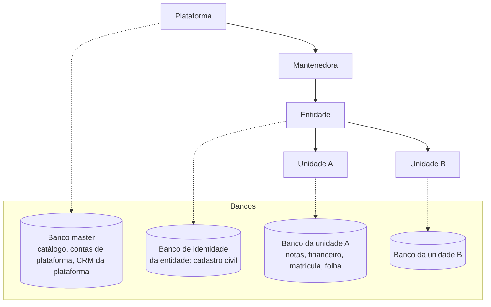

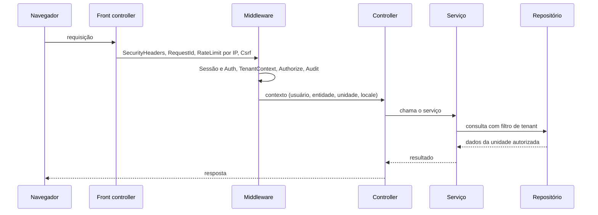

**Regras principais**
- Controller não executa SQL; serviço recebe o contexto e não lê `$_SESSION`; repositório filtra por tenant em toda consulta ([02](#doc-02), seção 2).
- A ordem da cadeia de middleware é fixa e só muda por ADR ([02](#doc-02), seção 3).
- A API é versionada, com autenticação por token, schema de entrada e idempotência ([04](#doc-04)).
- Os módulos se integram por eventos, sem acesso direto ao banco do outro ([14](#doc-14)). O cache tem chave por tenant ([30](#doc-30)).

<a id="doc-02"></a>

## 02 — Arquitetura de Solução

> Parte do [SDD v2](#doc-00).

---

### 1. Estilo

**Monólito modular** com fronteiras explícitas por domínio, preparado para extrair serviços só quando houver motivo medido (escala, equipe ou requisito de isolamento).

Stack declarada na v1: PHP 8.2+, MVC próprio, PDO com MySQL 8 ou MariaDB 10.6+, frontend com `fetch()`, CSS com Tailwind CSS.

### 2. Camadas

```
Navegador (HTML progressivo + fetch, cookies HttpOnly)
  └─ Front controller (public/index.php)
       └─ Roteador  →  cadeia de middleware  →  Controller
            └─ Serviços de domínio (app/Services/<dominio>)
                 └─ Repositórios / Models (app/Models, sempre com escopo de tenant)
                      └─ Acesso a dados (PDO, prepared statements)
```

Regras:

- Controller não executa SQL. Ele chama serviço.
- Serviço não lê `$_SERVER`, `$_COOKIE` nem `$_SESSION` diretamente. Recebe um `RequestContext` (usuário, tenant, unidade, locale).
- Repositório aplica filtro de tenant em toda consulta. Consulta sem filtro falha em teste.

### 3. Ordem da cadeia de middleware

Ordem obrigatória para rotas web. Qualquer alteração exige ADR.

1. `SecurityHeaders` — CSP com nonce, HSTS, X-Frame-Options, nosniff, COOP/CORP, Referrer-Policy, Permissions-Policy.
2. `RequestId` + `LogContext` — correlação de logs (sem PII).
3. `RateLimit` por IP — limite antes da autenticação, para conter tentativas de login e de API.
4. `Csrf` — token sincronizador + validação de `Origin`/`Sec-Fetch-Site`.
5. `SessionSecurity` (idle, absolute, token de dispositivo, D-03) e `Auth` — exige identidade válida (ou rota pública explícita).
6. `TenantContext` — resolve tenant, entidade e unidade; rejeita contexto que o usuário não possui.
7. `Authorize` — permissão `modulo.recurso.acao` (default-deny).
8. `RateLimit` por identificador e por tenant — aplicado pelos serviços de login e de API, depois da identidade (ver [05](#doc-05)).
9. `Audit` — registra ação sensível (sucesso e falha).

Rotas de API adicionam `ApiAuth` (Bearer), `HmacAuth` (webhooks/integrações), `ApiSchema` (validação e limite de payload) e `Idempotency` em operações não idempotentes.

### 4. Componentes

| Componente | Responsabilidade | Local declarado (v1) |
|---|---|---|
| Router | Mapeia método + caminho para controller | `app/Http/Router.php` |
| Middleware | Ver seção 3 | `app/Http/Middleware/` |
| Segurança | Senhas, JWT, MFA, CSRF, rate limit, cifragem | `app/Security/` |
| Tenant | Contexto de tenant por requisição | `app/Tenant/TenantManager.php` |
| Logs e auditoria | `SystemLogger`, `AuditLogService`, `AlertEngine`, `MetricsCollector` | `app/Services/` |
| Filas | Workers assíncronos | `scripts/` (ver [10](#doc-10)) |
| Armazenamento | Uploads fora do webroot, acesso por controller | `app/Services/Storage` (**[Planejado]** consolidar) |

### 5. Dependências

- **Runtime:** somente pacotes Composer com versão fixada em `composer.lock`. Sem `@latest`.
- **Frontend:** pacotes npm com `package-lock.json`. Build gera CSS e JS locais. Recurso externo só entra se a decisão D-01 o previr, com SRI e domínio da lista aprovada ([08](#doc-08)).
- **Verificação:** `composer audit` e `npm audit` em CI, com falha em severidade alta ou crítica sem exceção registrada.
- **Proibido em pipeline de produção:** `npx <pkg>`, `bunx <pkg>`, `curl | sh` e instaladores que baixam o último release. A v1 citava esses comandos; a v2 os remove do fluxo de deploy.

### 6. ADRs

Data: 02/11/2026. Autor: responsável técnico (a nomear, ver [11](#doc-11), seção 5). Status por ADR na última coluna.

| ADR | Decisão | Motivo | Status |
|---|---|---|---|
| ADR-01 | Monólito modular, não microsserviços | Menos superfície operacional; fronteiras preservam a extração futura | Aceita |
| ADR-02 | Namespaces PSR-4 `App\` e `TotusTuus\` | Bibliotecas internas testáveis e substituíveis | Aceita |
| ADR-03 | JWT só para clientes de API. Navegador usa sessão opaca no servidor | Revogação imediata e menos segredo exposto no cliente. A v1 usava JWT também no navegador com refresh rotativo | **Proposta (revisar)** |
| ADR-04 | Algoritmo de JWT fixo em RS256 (rejeitar HS256 e `none`) | Evita confusão de algoritmo | Aceita |
| ADR-05 | Biblioteca própria de cofre (`TotusTuus\Vault`), com a chave-mestra fora do host da aplicação em produção. `FileVault` só em desenvolvimento. | Segredo em arquivo no mesmo host anula a proteção. Biblioteca própria dá controle, mas exige revisão de criptografia (ver [05](#doc-05), seção 2) | **Aceita (D-02). Pendente: onde a chave-mestra fica** |
| ADR-06 | Inglês canônico + locales traduzidos | Ver [09](#doc-09) | Aceita |
| ADR-07 | Sem JavaScript inline e sem atributos `on*=` em HTML | Compatível com CSP estrita | Aceita |
| ADR-08 | Um banco master e um banco por unidade (entidade + unidade). Conexão escolhida pela unidade autorizada na requisição. | Isolamento físico de dados entre unidades e entre entidades. Custo: operação de muitos bancos e consolidação por evento | Aceita (D-16, 02/11/2026) |

### 7. Escalabilidade

- Camada web sem estado local. Sessão em banco ou Redis.
- Cache com chave por tenant (`tenant_id` obrigatório na chave).
- Uploads em armazenamento de objetos ou volume dedicado, fora do diretório público.
- Filas com idempotência por chave de evento; reprocessamento não gera efeito duplicado.

### 8. Riscos arquiteturais conhecidos

| Risco | Efeito | Tratamento |
|---|---|---|
| Controllers muito grandes (a v1 cita 5.254 linhas e 4.857 linhas) | Difícil revisar e testar | Extrair serviços; limite de tamanho em revisão de código (ver [11](#doc-11)) |
| Módulos recentes sem teste | Regressão silenciosa | Gate de cobertura para código novo |
| Cofre de arquivo em produção | Vazamento de segredo com acesso ao host | ADR-05 e D-02 |
| Acoplamento de view com estado de sessão | Vazamento entre usuários em cache | Cache de página com chave de usuário ou sem cache para páginas autenticadas |

<a id="v1-02-solution-architecture-md"></a>

### v1 — `02-solution-architecture.md` (92 linhas)

> Situação na v2: Substituído por 02. Quando este texto diverge da v2, vale a v2.

> Esta especificação foi substituída por inteiro pelo documento indicado acima. O texto fica como histórico; para implementar, vale o documento da v2.

> **Documento derivado do SDD mestre** · **Data:** 04/08/2026

---

#### 1. Estilo arquitetural

**Monólito modular** com boundaries rígidos entre domínios, preparado para extração seletiva de serviços. PHP 8 puro, MVC próprio (`App\Http\Controllers`, `App\Services`, `App\Models`, `App\View`), REST-first com contratos JSON versionados (`/api/v1/...`).

#### 2. Camadas

```
Browser (Tailwind 4.4 + fetch())
  └─ Router (app/Http/Router.php) → Middleware chain (20 middlewares)
       └─ Controllers (app/Http/Controllers/{Admin,Api,Teacher,Student,Parents,Thirdparty})
            └─ Services (app/Services/*  — 14 domínios)
                 └─ Models (app/Models/* — 74)
                      └─ Database (app/Database/Connection — PDO)
```

##### Middleware chain (ordem)

`SecurityHeaders → SessionSecurity → Csrf → Auth → Authorize → StrictAuthorize → RateLimit → Audit → ApiSecurity/ApiSchema (API)`

#### 3. Tenancy

- `TenantManager::current()` (app/Tenant/TenantManager.php) — contexto global por request.
- Predicados explícitos `tenant_id` em todas as queries multi-tenant.
- `Auth::findUserByIdentifier` tenant-strict (cross-tenant login bloqueado — FD-05).
- `StrictAuthorizeMiddleware` default-deny + validação BOLA/BFLA/BOPLA (config/security.php authorization).
- `TenantRateLimiter` para rate limit por tenant+user.

#### 4. Frontend progressivo & Design System Master

- **Página Modelo de Referência Oficial:** `https://localhost/totustuussoftcloud/developer/settings/billing/modules` (view: `resources/views/app/pages/developer/modules.php`).
- **Especificação Canônica Completa de Navegação e Páginas:** `docs/sdd/12-portals-navigation-sidebar-pages-spec.md`.
- **Arquitetura Multi-Portal (6 Portais):**
  - Portal do Desenvolvedor (`docs/portais/portal-do-desenvolvedor-completo.md`)
  - SAAS Acadêmico (`docs/portais/saas-academico-completo.md`)
  - Portal do Professor (`docs/portais/portal-do-professor-completo.md`)
  - Portal do Aluno (`docs/portais/portal-do-aluno-completo.md`)
  - Portal dos Pais e Responsáveis (`docs/portais/portal-dos-pais-responsaveis-completo.md`)
  - Portal de Terceiros (`docs/portais/portal-de-terceiros-completo.md`)
- **Skills Normativas Aplicadas:**
  - `totustuus-layout-design/SKILL.md`: Checklist obrigatória de 21 itens, 5-View TABs (`KPI`, `Data Table`, `Cards/Grid`, `Kanban`, `Analytics/Charts`), 7 formatos de exportação, 3 drawers operacionais, colunas fixas e zero inline JS.
  - `totustuus-security-auditor-v3/SKILL.md`: ASVS Level 2, OWASP Top 10:2025, Attack Surface Management (ASM), AppSec testing (SAST/DAST/SCA), DevSecOps, pentest estruturado, bug bounty/VDP, isolamento tenant-strict, proteção contra BOLA/BFLA, Argon2id (OWASP 2025) e CSP Nonce universal.
- **Design System:** Supabase Theme Dark Emerald com paleta 3-Layer Dark (`#14171c` canvas, `#1a1d24` outer box, `#242832` surface/cards, `#10b981` emerald accent).
- **Padrão de Ícones:** **FontAwesome Pro 7.2 Light (`fa-light`)** em toda a interface (ações, tabelas, dropdowns e drawers).
- **Navegação Segmentada Unificada:** Segmented Pill Tabs (`.ud-tab-segmented`, `.ud-tab-btn`, `.ud-tab-badge`) suportando 5 visões (KPIs, Data Table, Grid/Cards, Kanban Swimlanes com drag-and-drop nativo, Analytics/Charts).
- **Toolbar & Exportação:** Dropdown de 7 formatos (CSV, XLSX, PDF, JSON, XML, SQL, TXT) com ícones uniformes em `fa-light` e badges `.ext`.
- **Ações e Sincronização:** Seção `$this->start('actions')` no cabeçalho (com timestamp `Synced: HH:MM:SS`) e botão de recarregamento AJAX dedicado na toolbar (`[ 🔄 Sincronizar ]`).
- **Bimoeda & i18n:** Suporte bimoeda USD/BRL e matriz de 10 locales (`en`, `pt-br`, `es`, `fr`, `de`, `it`, `zh`, `ja`, `ru`, `ar`) com auto-tradução.
- **Drawers Seguros:** Padrão Supabase com backdrop blur, validação em tempo real e destravamento por palavra-chave para ações críticas (`DELETE`/`ARCHIVE`).
- **Comunicação Assíncrona:** Requisições via `fetch()` nativo com cookies HttpOnly (`credentials: 'include'`), sem tokens no JS (A-001/A-004), e Nonce CSP em todos os scripts.

#### 5. Segurança (resumo)

Ver `docs/security/control-matrix.md` e `docs/security/findings-register.md`. Destaques: Argon2id OWASP 2025, JWT RS256, CSP+Trusted Types, MFA forte, LGPD instrumentado, audit trail completo, CI com composer audit + gitleaks + ZAP nightly.

#### 6. Observabilidade

- `SystemLogger` (app/Services/SystemLogger.php) — logs estruturados por correlação.
- `AuditLogService` — trilha de auditoria de negócio.
- `AlertEngine` — alertas (brute force, privilege escalation, mass export).
- `MetricsCollector` — métricas de sistema.
- `app/Http/SseResponse.php` — streaming de eventos (SSE) para logger em tempo real.

#### 7. Escalabilidade

- App stateless no layer web; sessões prontas para backend compartilhado (driver database).
- Filas assíncronas: `scripts/async_event_worker.php`, `scripts/async_backup.php`.
- Cache por contexto/tenant (`app/Services/Cache/`, `app/Security/TenantCacheVault.php`).
- Storage externalizável (uploads fora do webroot; imagens via `AssetPathMapper`).

#### 8. Decisões arquiteturais chave (ADR resumido)

| ADR | Decisão | Motivo |
|-----|---------|--------|
| ADR-01 | Monólito modular vs microservices | Reduz complexidade inicial, preserva boundaries para extração |
| ADR-02 | PSR-4 App\ + TotusTuus\ vendor/custom | Bibliotecas internas testáveis e substituíveis |
| ADR-03 | JWT RS256 obrigatório (HS256 bloqueado) | Previne forgery de token simétrico |
| ADR-04 | Vault abstraction (File→KMS/HashiCorp) | Secrets fora do código e do .env |
| ADR-05 | i18n inglês canônico + 10 locales | Internacionalização desde a base |

#### 9. Riscos arquiteturais atuais

| Risco | Mitigação |
|-------|-----------|
| Controllers gigantes (Logger 5.254, Academic 4.857) | Refatoração incremental em services — Onda C (dívida técnica) |
| Migration/IntegrationHub recém-criados sem testes | Criar testes — Onda C |
| Vault file-backed em prod | Ativar KMS/HashiCorp provider (backlog F-02) |

<a id="doc-03"></a>

## 03 — Domínio e Multi-Tenancy

> Parte do [SDD v2](#doc-00).

---

### 1. Hierarquia

```
Plataforma (host)
 └─ Mantenedora (client)          — contratante do SaaS
     └─ Entidade (entity)         — instituição / razão social
         └─ Unidade (unit)        — campus, filial, polo
             └─ Usuários, papéis e vínculos
```

- A **plataforma** é um tenant reservado, identificado por código de seed. Seus administradores são **contas de plataforma** (ver [06](#doc-06), seção 10), não usuários comuns com flag.
- Cada nível herda configuração do nível superior e pode sobrescrevê-la onde a política permitir.

### 1.1 Bancos de dados

**Decisão do autor (02/11/2026, D-16):** um banco por unidade. A entidade não tem banco próprio de dados operacionais.

**Banco master (desenvolvedor):**

- Nome lógico: `totustuus.matriz.bd`. Único, da plataforma.
- Contém: catálogo de entidades e unidades, registro de bancos (seção abaixo), contas de plataforma, conexões de integração de plataforma, CRM da plataforma ([22](#doc-22)) e índice de pessoas (`person_id`, e-mail verificado).
- Não contém cadastro civil nem dado operacional de unidade. O cadastro civil fica no banco de identidade da entidade (D-19, [14](#doc-14), seção 3). Notas, financeiro, matrícula, folha e arquivos ficam no banco da unidade.

**Banco de unidade (um por entidade + unidade):**

- Nome lógico: `{entidade}.{unidade}.bd.{uuid}`. Exemplos:

| Entidade | Unidade | Número operacional | Nome lógico |
|---|---|---|---|
| Colégio Santo Antonio | Sede | 001 | `colegio-santo-antonio.sede.bd.{uuid}` |
| Colégio Santo Antonio | Mateus Leme | 002 | `colegio-santo-antonio.mateus-leme.bd.{uuid}` |
| Colégio Santo Agostinho | Sede | 003 | `colegio-santo-agostinho.sede.bd.{uuid}` |

- Nome físico no servidor: `tt_001`, `tt_002`, `tt_003`. O ponto do nome lógico não é usado no servidor, porque complica ferramentas, permissões e backup. O mapeamento fica no registro do master.
- Conteúdo: alunos, colaboradores, financeiro, acadêmico, CRM do tenant ([22](#doc-22)), metadados de arquivos ([21](#doc-21)), auditoria local e outbox de eventos ([14](#doc-14)).

**Registro de bancos (no master):**

| Campo | Regra |
|---|---|
| `uuid` | UUIDv4 gerado pela aplicação |
| `entity_uuid`, `unit_uuid` | Obrigatórios; único por par entidade e unidade |
| `logical_name` | Único |
| `physical_name` | Único no servidor, no formato `tt_<seq>` |
| `seq` | Sequencial de três dígitos, único |
| `host` | Servidor onde o banco está |
| `status` | `ativo`, `migrando`, `suspenso` |
| `schema_version` | Versão de esquema aplicada |

**Resolução de conexão:**

1. Usuário autentica no master, com conta global ([06](#doc-06), seção 12).
2. O master lista os vínculos ativos da conta (entidade, unidade e papel).
3. A requisição escolhe uma unidade. Sem unidade permitida, a resposta é `403`.
4. A conexão é aberta somente no banco dessa unidade.

**Consequências que dependem de decisão:**

- **Relatório consolidado da entidade** (todas as unidades): não é consulta entre bancos. É um modelo de leitura alimentado por eventos ([14](#doc-14)).
- **Pessoa única entre unidades** (D-06): bancos separados impedem unicidade direta. Ver D-19 em [14](#doc-14), seção 3.
- **Eventos entre unidades:** a outbox fica no banco da unidade emissora. A entrega ao consumidor de outra unidade passa por fila central, com destino por `unit_uuid`.
- **Migrações:** rodam em cada banco de unidade, com registro de versão por banco ([10](#doc-10), seção 5).
- **Operação:** o número de bancos cresce com as unidades. Limites de conexão, backup e monitoramento são por banco.

**Testes:**

- Usuário com acesso à unidade 001 não lê dado da unidade 002, mesmo com identificador exato.
- Consulta que tenta trocar o banco por parâmetro é recusada.
- Migração que falha em um banco não bloqueia os demais, e o banco fica em `migrando` até concluir.

### 2. Identificadores

- Chaves públicas são **UUIDv4** gerados com CSPRNG (`random_bytes(16)`), nunca sequenciais.
- Identificadores internos de seed (códigos de tenant, entidade, unidade da plataforma) são definidos em **registro privado de seed**, não no SDD. A v1 reproduzia esses valores e os e-mails dos administradores; a v2 os remove (ver [13-achados-v1.md](#doc-13), ACH-03).
- UUIDs nulos ou fixos só são permitidos em fixtures de teste, nunca em dados de produção.

### 3. Isolamento de tenant

Regras obrigatórias:

1. **Toda tabela multi-tenant tem `tenant_id` NOT NULL** e índice composto que começa por `tenant_id`.
2. **Toda consulta** aplica `tenant_id = :current` no repositório. Não existe consulta "global" sem uma classe de exceção nomeada e auditada.
3. **Chave de tenant vem do contexto autenticado**, nunca de cabeçalho ou parâmetro livre (`X-Tenant-ID` não é aceito como fonte de verdade). Na tela de entrada, o tenant informado por subdomínio ou formulário é validado contra a lista de hosts permitidos; host desconhecido retorna `404`.
4. **Conta global com vínculos.** A pessoa tem uma conta no master e recebe contexto de uma entidade e unidade só por vínculo ativo (ver [06](#doc-06), seção 12). Autenticar não concede acesso a nenhuma unidade.
5. **Cache, filas, uploads e logs** carregam `tenant_id` na chave ou no registro.
6. **Teste de isolamento obrigatório:** para cada endpoint de leitura e escrita, um teste com usuário de tenant B tentando acessar recurso de tenant A deve retornar `404` (não `403`, para não revelar existência).

### 4. Escopo de unidade

- `UserUnit` limita o usuário a unidades específicas. Acesso `full` cobre todas as unidades da entidade.
- Permissões de unidade são avaliadas junto com a permissão de módulo. Permissão de módulo sem vínculo de unidade não basta para dados daquela unidade.

### 5. Configuração por tenant

| Configuração | Escopo | Observação |
|---|---|---|
| Marca (logo, cores, nome) | Entidade | Validação de imagem (ver [05](#doc-05)) |
| Locale padrão e moeda | Entidade | Moeda USD/BRL é **[Declarado]**; outras moedas dependem de requisito |
| Política de senha e MFA | Mantenedora ou entidade | Não pode ser menos restritiva que a política da plataforma |
| Retenção de dados | Entidade | Mínimo e máximo definidos pela plataforma ([07](#doc-07)) |
| Limites de API | Tenant | Ver [04](#doc-04) |

### 6. Regras de negócio transversais

- Exclusão é **lógica** por padrão (`deleted_at`). Exclusão física só pelo processo de retenção ou pedido do titular.
- Toda alteração de vínculo (papel, unidade, permissão) gera registro de auditoria com antes e depois.
- Um usuário pode ter vínculos em mais de um tenant, mas cada sessão opera em um único tenant por vez.

### 7. Testes de tenancy (critério de aceite)

- [ ] Matriz de isolamento: todos os endpoints × dois tenants × papéis relevantes.
- [ ] Teste de regressão para cada incidente de cross-tenant registrado.
- [ ] Teste de enumeração de identificadores (UUIDs de outro tenant não retornam dados nem mensagens diferentes de "não encontrado").

<a id="v1-03-domain-model-md"></a>

### v1 — `03-domain-model.md` (55 linhas)

> Situação na v2: Substituído por 03. Quando este texto diverge da v2, vale a v2.

> Esta especificação foi substituída por inteiro pelo documento indicado acima. O texto fica como histórico; para implementar, vale o documento da v2.

> **Documento derivado do SDD mestre** · **Data:** 04/08/2026

---

#### 1. Entidades nucleares (implementadas — app/Models/, 74 models)

| Entidade | Model | Descrição | Status |
|----------|-------|-----------|:------:|
| Platform | — (contexto global) | Plataforma SaaS | ✅ conceito |
| Entity/Organization | `Organization.php`, `OrganizationProfile.php`, `OrganizationBranding.php`, `OrganizationAddress.php`, `OrganizationUnit.php`, `OrganizationDocument.php`, `OrganizationIntegration.php`, `OrganizationMetric.php`, `OrganizationAuditLog.php` | Cliente com branding/dados isolados | ✅ |
| Unit | `Unit.php` | Subdivisão operacional | ✅ |
| User | `User.php` + perfil (UserProfile*, UserPhone/Email/Address/Family/Identity/Document) | Identidade humana/tech | ✅ |
| Membership | `UserMembership.php`, `UserUnit.php` | Vínculo user/entity/unit | ✅ |
| Role/Permission | `Role.php`, `Permission.php` | RBAC | ✅ |
| Session | `UserSession.php`, `UserSessionEvent.php` | Sessão autenticada web | ✅ |
| ApiClient | (via OrganizationIntegration/ThirdPartyIntegration) | Cliente técnico | ✅ |
| AuditEvent | `AuditLog.php`, `SecurityLog.php`, `SecurityEvent.php`, `DbAudit.php`, `AccessLog.php`, `ErrorLog.php` | Registros imutáveis | ✅ |
| LocalePack | (I18n service + testes) | Recursos de idioma | ✅ |
| FeatureFlag | — | Controle de ativação | 🔲 pendente (Developer layer) |
| WebhookEndpoint | `WebhookDispatcher` (Billing) + HmacAuthMiddleware | Destino de eventos | ✅ (parcial) |
| Job | `MigrationExecutionJob.php`, async_event_worker | Unidade assíncrona | ✅ (parcial) |

#### 2. Entidades por domínio (amostra representativa)

| Domínio | Models |
|---------|--------|
| Auth/IAM | User*, Role, Permission, UserMembership, UserUnit, Invitation, DeviceTrust, SecurityEvent, SecurityLog, AccessLog, AccessRequest, IdentityAutomation(+Log) |
| Privacy/LGPD | PrivacyConsentEvent, UserConsent, UserCookieConsent(+Item), CookieCatalog, CookieCategory, ConsentBannerVersion, TenantPrivacySetting |
| Migração | MigrationProject, MigrationSourceTable/Column, MigrationTableMapping/ColumnMapping/ValueMap, MigrationImport, MigrationExecutionJob, MigrationValidationRun, MigrationAuditLog, MigrationTargetTableCache |
| Reuniões | Meeting, MeetingParticipant, MeetingRecording |
| Acadêmico | AcademicPeriod + tables em migrations (cursos, turmas, matrículas, grade, etc.) |
| Billing | tables `billing_*` (plans, subscriptions, invoices, payments, discounts, automations, nfse, gateway config) |
| Notificações | NotificationChannel + tables `notification_*` |

#### 3. Convenções de modelo

- **Soft delete**: coluna `deleted_at` + `SoftDeleteService`/`SoftDeleteRegistry` (app/Services/SoftDeleteService.php) — ver `docs/spec-soft-delete-totustuus.md`.
- **UUID**: chaves `uuid` (char 36 ou binary 16) em todas as entidades expostas via API.
- **Tenancy**: coluna `tenant_id` em todas as tabelas multi-tenant (renomeada de `entity_id` em 14/07 — migração `2026_07_14_000003_rename_entity_id_to_tenant_id.php`).
- **Timestamps**: `created_at`/`updated_at` em tudo; `deleted_at` onde aplicável.
- **Auditoria**: `*AuditLog` por domínio sensível (OrganizationAuditLog, UserAuditLog, MigrationAuditLog).

#### 4. Falhas de modelo conhecidas

| Item | Ação |
|------|------|
| FeatureFlag não implementado | Criar model + tabela (Onda C — Developer layer) |
| WebhookEndpoint genérico | Billing tem WebhookDispatcher; generalizar para Integration Hub (Onda B) |
| Autofilia (self-reference) em Organization/Unit | Verificar necessidade futura |

#### 5. Rastreabilidade

Cada model referenciado nos specs `docs/Nova pasta/spec_gestao_*_completo.md`. O mapeamento spec→tabela é validado em `tests/ClientMigrationSchemaTest.php` (para migração) e nos testes por módulo.

<a id="v1-06-tenancy-md"></a>

### v1 — `06-tenancy.md` (95 linhas)

> Situação na v2: Substituído por 03. Quando este texto diverge da v2, vale a v2.

> Esta especificação foi substituída por inteiro pelo documento indicado acima. O texto fica como histórico; para implementar, vale o documento da v2.

> **Documento derivado do SDD mestre** · **Data:** 04/08/2026

---

#### 1. Hierarquia de contexto e Modelo de 3 Níveis

O TotusTuus SoftCloud adota uma arquitetura hierárquica multi-camadas que desacopla a **Provedora do SaaS (Host/Tenant 0)** das **Redes e Colégios Contratantes (Tenants Clientes)**:

```
Platform Host (TotusTuus SoftCloud — Provedora / Tenant 0)
 ├── Client (Mantenedora / Grupo Educacional / Pessoa Jurídica Contratante)
 │    └── Entity (Instituição de Ensino / Colégio / Razão Social Escolar)
 │         └── Unit (Filial Física / Campus / Polo Educacional)
 │              └── Users / Memberships / Roles (Escopo Escolar Local)
 └── Master Super Admins (Usuários de Plataforma — is_master_user = 1)
      └── Vínculo formal com a Unidade Matriz da Desenvolvedora (UN-MATRIZ-DEV)
```

---

#### 2. Cadastro Oficial da Empresa Desenvolvedora (Tenant 0 / Host Matriz)

A empresa operadora da nuvem e desenvolvedora da plataforma é cadastrada formalmente no banco Master (`totustuusdb`) sob identificadores criptográficos permanentes:

| Nível Hierárquico | Código | Razão Social / Nome | Tipo / Papel | UUIDv4 Criptográfico (RFC 4122) |
| :--- | :--- | :--- | :--- | :--- |
| **Cliente Provedor** | `CLI-TOTUSTUUS` | **TotusTuus SoftCloud Tecnologia da Informação Ltda** | Provedora do SaaS / Mantenedora | `d6930191-8bf9-42c4-88f6-a75ed8ba9bc1` |
| **Entidade da Desenvolvedora** | `ENT-DEV-MATRIZ` | **TotusTuus SoftCloud - Engenharia & Plataforma** | `developer` (Plataforma Tecnológica) | `8b5892fd-0fa3-4cff-ba81-80dd7cda0f65` |
| **Unidade Matriz** | `UN-MATRIZ-DEV` | **Sede Matriz - TotusTuus SoftCloud** | `headquarters` (Sede Operacional) | `6d16eac3-0d76-4549-8d86-f04582ad7ed5` |
| **Tenant Master** | `TNT-TOTUSTUUS` | **TotusTuus SoftCloud** | Banco Master (`totustuusdb`) | `4965aa14-484d-4965-8dcb-bff3f18ae6f2` |

##### Vínculo dos Superadministradores da Plataforma
* **Usuários:** `admin@totustuussoftcloud.com`, `jefferson@totustuussoftcloud.com`, `dev@totustuussoftcloud.com`.
* **Identidade:** `is_master_user = 1`, `type = 'admin'`, role `ROLE_ADMIN`.
* **Membros e Unidade:** Vinculados à Unidade Matriz (`UN-MATRIZ-DEV`) e Tenant Master (`TNT-TOTUSTUUS`) via `user_memberships` (persona: `ADMIN`) e `user_units` (acesso: `full`).
* **Acesso Direto:** Redirecionamento nativo para o Portal do Desenvolvedor (`/developer/dashboard`) sem necessidade de seleção de tenant escolar.

---

#### 3. Segurança de Identificadores (Mitigação de IDOR / OWASP)

* **Proibição de UUIDs Previsíveis/Nil (CWE-330):** É estritamente proibido o uso de UUIDs estáticos ou sequenciais como `00000000-0000-0000-0000-000000000001` no banco de dados Master ou em tenants. Todos os UUIDs devem ser gerados com **128 bits de entropia criptográfica** através de `\App\Support\Uuid::v4()`.
* **Proteção contra Enumeração:** A adoção de UUIDv4 randômicos impede que invasores tentem forjar requisições de API (`X-Tenant-ID`) adivinhando o identificador do tenant master.

---

#### 4. Mecanismos de tenancy implementados

| Mecanismo | Implementação | Evidência |
|-----------|---------------|-----------|
| Contexto global | `TenantManager::current()` (singleton por request) | `app/Tenant/TenantManager.php` |
| Isolamento de dados | `tenant_id` (renomeado de `entity_id` em 14/07) em todas as tabelas multi-tenant | migrations `2026_07_14_*_rename_entity_id_to_tenant_id.php` |
| Scoping automático | Predicados explícitos em services/querys (não confiar em default global) | `app/Services/*` |
| Auth tenant-strict | `Auth::findUserByIdentifier` valida membership do tenant alvo; cross-tenant login bloqueado | FD-05 fix |
| Autorização por tenant | `StrictAuthorizeMiddleware` + checks BOLA/BFLA/BOPLA | config/security.php `authorization` |
| Rate limit por tenant | `TenantRateLimiter` (user 10/h, tenant 60/h, tenant 300/d) | config/security.php `rate_limiting` |
| Cache por tenant | `TenantCacheVault` | `app/Security/TenantCacheVault.php` |
| Branding por tenant | `OrganizationBranding` (logo, cores, favicon, portal domains) | `app/Models/OrganizationBranding.php` |
| Domínios custom | Portal domains mapeados por tenant (www → tenant) | `OrganizationBranding` + routes |
| i18n por tenant | locale por tenant + por user | `TenantLocale`/i18n service |
| Auditoria por tenant | Logs de entidade com `tenant_id` | `OrganizationAuditLog`, `AuditLog` |

---

#### 5. Configurações por tenant

| Config | Model/Service |
|--------|---------------|
| Segurança | `TenantPrivacySetting` (mfa_required, session_timeout, lockout, password_policy) |
| Billing | `BillingSettings` + gateway config por tenant |
| Notificações | `NotificationChannel` por tenant |
| Integrações | `OrganizationIntegration` + `ThirdPartyIntegration` (credentials cifradas) |
| Feature flags | 🔲 pendente (Developer layer — Onda C) |

---

#### 6. Regras de negócio tenancy

1. **Dados**: nenhuma query multi-tenant sem `tenant_id` do contexto (auditável).
2. **Auth**: usuário só acessa tenancy onde tem membership ativa.
3. **Admin**: superadmin (plataforma) tem visão cruzada limitada e auditada; admin de entity não cruza entities.
4. **Uploads**: assets referenciados por tenant; path contém tenant-id ofuscado via `AssetPathMapper`.
5. **Import/Export**: migração (MigrationController) opera estritamente dentro do tenant origem/destino.
6. **Provisionamento de Colégios**: cada nova escola contratada gera um banco isolado (`tt_tenant_{short_id}`) e seus usuários acadêmicos residem estritamente dentro do respectivo banco de dados da escola.

---

#### 7. Testes de tenancy

- `tests/` — cobertura BOLA/BFLA/BOPLA.
- `tests/DeveloperPortalE2eTest.php` — 46 testes cobrindo navegação, autenticação e rotas administrativas do developer portal.
- `tests/TenantProvisioningHierarchyTest.php` — validação da hierarquia completa Client > Entity > Unit > TenantDatabase.
- `tests/ApiCrossTenantTest.php` — cobre proteção contra acesso cross-tenant na API.

<a id="doc-04"></a>

## 04 — API REST

> Parte do [SDD v2](#doc-00). Controles de segurança detalhados em [05](#doc-05).

---

### 1. Base e versionamento

- Base: `/api/v1/`. Mudança incompatível exige `/api/v2/` com controller próprio.
- Mudanças aditivas (campos novos opcionais, endpoints novos) são permitidas em v1.
- Remoção ou renomeação de campo exige período de depreciação de pelo menos 6 meses, com cabeçalho `Deprecation` e `Sunset` (RFC 9745 e RFC 8594).
- Documentação gerada a partir de anotações do código e publicada em `/api/docs` (**[Planejado]**: a v1 cita `docs/api-docs.php`, mas o arquivo não é verificado nesta versão).

### 2. Formato

- JSON em UTF-8. `Content-Type: application/json; charset=utf-8`.
- Limite de corpo: **1 MB** para JSON. Uploads têm rota própria com limite por tipo.
- Datas em ISO 8601 com fuso (`2026-11-02T14:00:00-03:00`) ou UTC (`Z`).

#### Envelope

Sucesso:

```json
{ "success": true, "data": { }, "meta": { "request_id": "..." } }
```

Erro:

```json
{
  "success": false,
  "error": { "code": "validation_failed", "message": "Mensagem segura para exibir", "details": [ ] },
  "meta": { "request_id": "..." }
}
```

- `message` nunca contém SQL, stack trace, caminho de arquivo ou nome de tabela.
- `details` só aparece em `validation_failed`, com campo e regra.

### 3. Códigos HTTP

| Código | Uso |
|---|---|
| 200 / 201 / 204 | Sucesso (201 com `Location`) |
| 400 | Requisição malformada |
| 401 | Não autenticado |
| 403 | Autenticado, sem permissão |
| 404 | Não existe **ou** pertence a outro tenant (evita enumeração) |
| 409 | Conflito de estado ou idempotência |
| 413 | Payload acima do limite |
| 422 | Validação de domínio |
| 429 | Limite de taxa (com `Retry-After`) |
| 500 | Erro interno (sem detalhes ao cliente) |

Códigos de erro estáveis: `validation_failed`, `unauthorized`, `forbidden`, `not_found`, `rate_limited`, `conflict`, `payload_too_large`, `internal`.

Mapeamento: `validation_failed` com `422` (campo inválido) ou `400` (corpo malformado); `unauthorized` com `401`; `forbidden` com `403`; `not_found` com `404`; `rate_limited` com `429`; `conflict` com `409`; `payload_too_large` com `413`; `internal` com `500`. Campo de filtro ou ordenação fora da lista branca retorna `422` com `validation_failed`.

### 4. Autenticação de API

| Mecanismo | Uso | Regras |
|---|---|---|
| Sessão (cookie) | Frontend do próprio sistema | Cookie `HttpOnly`, `Secure`, `SameSite=Lax` (ver [06](#doc-06)). Requisições que mudam estado exigem CSRF. |
| Bearer JWT | Clientes técnicos registrados | Assinatura RS256; `exp` ≤ 15 min; `aud` e `iss` validados; `jti` consultado em lista de revogação; escopos explícitos. |
| HMAC (webhooks e integrações) | Entrega de eventos e chamadas de integração | Ver seção 7. |
| Chave de API | Integrações de baixo risco (somente leitura) | Armazenada como hash; exibida uma única vez; rotacionável; escopo e expiração obrigatórios. |

Nenhum token é aceito na query string. O endpoint de emissão de token e o grant OAuth2 para contas de serviço ainda não estão definidos: pendentes de ADR.

### 5. Autorização

1. `Auth` valida identidade.
2. `TenantContext` valida tenant e unidade.
3. `Authorize` exige permissão `modulo.recurso.acao`.
4. O serviço revalida o vínculo do recurso com o tenant (defesa em profundidade contra BOLA).
5. Campos sensíveis são filtrados por permissão de campo (BOPLA): o mesmo recurso pode ter visões diferentes.

### 6. Paginação, filtros e ordenação

- `?page=1&per_page=50`. `per_page` máximo **100**.
- Filtros no formato `filter[campo]=valor`. Campo fora de lista branca retorna `422`.
- Ordenação `sort=campo` ou `sort=-campo` somente em colunas da lista branca do recurso.
- Resposta paginada inclui `meta.page`, `meta.per_page` e `meta.total` (ou `meta.has_more` para listas grandes, sem contagem total).

### 7. Webhooks

Cabeçalhos de entrega:

- `X-Signature: sha256=<hex>` — HMAC-SHA256 do corpo bruto concatenado com timestamp (`{timestamp}.{corpo}`).
- `X-Timestamp` — epoch em segundos.
- `X-Nonce` — identificador único por entrega.
- `X-Event-Id` — idempotência no receptor.

Regras:

1. Receptor aceita timestamp com desvio de **até 300 s** e rejeita nonce já visto dentro dessa janela.
2. Comparação de assinatura com `hash_equals`.
3. Segredo por endpoint, com rotação que aceita dois segredos por até 24 h.
4. Entrega com retentativa exponencial e limite de tentativas; estado da entrega é consultável.
5. Endereço de destino só `https://`. Bloqueio de redes privadas e metadados de nuvem (anti-SSRF). Resolver o nome uma vez, conectar ao IP resolvido, validar esse IP contra redes privadas e não seguir redirecionamentos.

### 8. Idempotência

- Operações não idempotentes (criação de pagamento, envio de comunicação, matrícula) exigem `Idempotency-Key`.
- Chave armazenada com hash do método, caminho e corpo, por 24 h. Mesma chave com corpo diferente retorna `409`.

### 9. Limites de taxa

| Escopo | Limite inicial | Observação |
|---|---|---|
| API global por cliente | 60 req/min, rajada 10 | Valores de referência da v1; ajustar por medição |
| Login, MFA, recuperação | Atraso progressivo por identificador + limite por IP | Não bloquear conta inteira (ver [06](#doc-06)) |
| Operações pesadas (exportação) | 5/h por usuário | Fila assíncrona com link de download temporário |

### 10. Checklist de aceite de endpoint

- [ ] Autenticação declarada na rota (ou rota pública listada).
- [ ] Permissão granular definida e testada (permitido e negado).
- [ ] Escopo de tenant na consulta e teste de cross-tenant.
- [ ] Validação de entrada com schema; payload ≤ limite.
- [ ] Envelope de resposta e códigos de erro da seção 2 e 3.
- [ ] Limite de taxa aplicado.
- [ ] Idempotência quando aplicável.
- [ ] Teste automatizado para o caminho de sucesso e para os dois principais erros.
- [ ] Entrada em `docs` gerada a partir do código.

<a id="v1-04-api-standards-md"></a>

### v1 — `04-api-standards.md` (78 linhas)

> Situação na v2: Substituído por 04. Quando este texto diverge da v2, vale a v2.

> Esta especificação foi substituída por inteiro pelo documento indicado acima. O texto fica como histórico; para implementar, vale o documento da v2.

> **Documento derivado do SDD mestre** · **Data:** 04/08/2026

---

#### 1. Contratos

- **Base:** `/api/v1/...`
- **Formato:** JSON.
- **Resposta padrão:**
```json
{ "success": true, "data": { ... }, "message": "ok" }
{ "success": false, "error": "code", "message": "descrição" }
```
- **Status HTTP:** 200/201/204/400/401/403/404/409/422/429/500.
- **Idempotência:** endpoints sensíveis usam `IdempotencyMiddleware` (chave = método+path+body hash) — ver `app/Http/Middleware/IdempotencyMiddleware.php`.

#### 2. Autenticação de API

| Mecanismo | Uso | Evidência |
|-----------|-----|-----------|
| Cookies HttpOnly (sessão) | Frontend web — `credentials: 'include'` | `assets/js/api.js` |
| JWT RS256 Bearer | Clientes técnicos | `config/jwt.php` |
| HMAC (X-Signature + X-Nonce ±300s) | Webhooks/integrações SAC | `app/Http/Middleware/HmacAuthMiddleware.php` |
| API keys | Integrações (OrganizationIntegration) | routes/integrations.php |

#### 3. Autorização de API

- `ApiAuthMiddleware` → valida autenticação.
- `ApiSecurityMiddleware` → headers/rate limit.
- `ApiSchemaMiddleware` → valida payload (schema, max 1MB).
- `StrictAuthorizeMiddleware` global default-deny; permissões via `AuthorizeMiddleware` (`admin.<module>.<action>`).
- Tenant scoping obrigatório (BOLA check).

#### 4. Versionamento e evolução

- Versionado no path (`/api/v1/`). Nova versão quebra → `/api/v2/` com controller dedicado.
- Mudanças aditivas são seguras na v1.
- `docs/api-docs.php` + `docs/api-docs-json.php` geram documentação (ApiDocsController).

#### 5. Rate limiting

| Escopo | Limite | Evidência |
|--------|--------|-----------|
| API global | 60/min, burst 10 | config/security.php api |
| Login/MFA/forgot/reset | por identificador (5/h) + IP lockout | RateLimitMiddleware |
| CNPJ/tenant | 10/h user, 60/h tenant, 300/d tenant | TenantRateLimiter |
| JWT | 100/h | config/jwt.php |

#### 6. Padrões de erro

- Erros genéricos em prod (`config/security.php` errors: sem stack, sem SQL).
- Códigos de erro estáveis (`validation_failed`, `unauthorized`, `forbidden`, `not_found`, `rate_limited`, `conflict`, `internal`).
- Logs de erro via SystemLogger sem PII.

#### 7. Paginação e filtros

- Listas grandes paginadas (`page`, `per_page` máx 100) e filtráveis.
- Ordenação por whitelist de colunas (anti-SQLi).
- Ex.: rotas `GET /api/v1/<resource>?page=1&per_page=50&filter[...]`.

#### 8. Webhooks

- Assinatura HMAC obrigatória (X-Signature, X-Nonce dedup → replay protegido, FD-29/FD-30).
- Delivery status rastreado (WebhookDeliveryApiTest).
- Integração com Integration Hub (Onda B) para gerenciamento de endpoints.

#### 9. Checklist de aceite de endpoint

- [ ] Autenticação (quando requerida) no middleware da rota.
- [ ] Autorização granular por permissão.
- [ ] Tenant scope explícito na query.
- [ ] Rate limit aplicável configurado.
- [ ] Input validado (schema) + payload ≤ 1MB.
- [ ] Resposta no contrato `{success, data, message}`.
- [ ] Idempotência para ações não-idempotentes.
- [ ] Teste PHPUnit quando crítico.

<a id="doc-14"></a>

## 14 — Integração entre Módulos

> Parte do [SDD v2](#doc-00). Integrações com sistemas de terceiros ficam em [16](#doc-16). Validação de entrada em [15](#doc-15).
> **Status:** proposta. Itens marcados **[Decisão pendente]** precisam de aprovação do autor antes da implementação.

---

### 1. Princípios

1. **Dono exclusivo.** Cada dado tem um único módulo dono. Outro módulo nunca lê nem grava na tabela desse dono.
2. **Leitura por contrato.** Um módulo lê dados de outro por uma interface de serviço versionada, com tenant obrigatório. Nunca por SQL direto.
3. **Escrita derivada por evento.** Quando a mudança em um módulo precisa gerar efeito em outro, o módulo dono publica um evento. O consumidor decide o que fazer.
4. **Tenant em tudo.** Evento, chamada e consumo carregam `tenant_id` e `entity_id`. Consumidor sem contexto de tenant rejeita a mensagem.
5. **Idempotência e auditoria.** Entrega duplicada não gera efeito duplicado. Toda ação entre módulos gera registro com ator, origem e correlação.
6. **Mínimo de dados.** Evento carrega identificadores e o estado mínimo. Dado pessoal e dado de saúde não viajam no payload (ver seção 8).

### 2. Estilos de comunicação

| Estilo | Quando usar | Garantia | Limites |
|---|---|---|---|
| **Evento assíncrono** (outbox + fila) | Efeito derivado em outro módulo; escrita que pode ser processada depois | At-least-once com consumidor idempotente | Atraso de segundos a minutos |
| **Comando síncrono** (serviço interno) | Validação curta que bloqueia a operação, por exemplo "a unidade existe e está ativa" | Resposta imediata | Timeout de 2 s; não encadear mais de dois saltos |
| **Consulta de projeção** (read model) | Listagem ou painel que combina dados de vários módulos | Dado pode estar defasado em poucos segundos | Nunca usada como fonte para decisão de escrita |

**[Decidida D-05 — aprovada com a proposta (02/11/2026)]** Padrão: eventos assíncronos para toda escrita derivada, comando síncrono só para validação, projeção para painéis. Alternativa: chamadas síncronas diretas entre serviços. Ela é mais simples de depurar, mas acopla a disponibilidade de um módulo à de outro. Condição de falha da alternativa: queda do módulo chamado derruba a operação do módulo chamador.

### 3. Dono dos dados compartilhados

| Entidade | Módulo dono | Consumidores principais | Regra |
|---|---|---|---|
| Pessoa (identidade civil: nome, documento, contato) | Pessoas (HCM) | Acadêmico, RH, Financeiro, Portal do aluno | Um `person_id` por pessoa por tenant. Nenhum outro módulo copia nome ou documento. |
| Vínculo de aluno | Acadêmico | Financeiro, Portal do aluno, Portal dos pais | Referencia `person_id`. |
| Vínculo de colaborador | RH | SMT, Suprimentos, Financeiro (folha) | Referencia `person_id`. |
| Responsável legal | Pessoas (família) | Acadêmico, Financeiro, Portal dos pais | Vínculo com aluno guardado no Acadêmico, dados civis no Pessoas. |
| Entidade, unidade, usuário, papel | Identidade (ver [06](#doc-06)) | Todos | Só o módulo Identidade altera. |
| Centro de custo, cargo | Financeiro (centro de custo) e RH (cargo) | Suprimentos, RH | Código e nome são do dono; o consumidor guarda só o código. |
| Item de estoque e saldo | Suprimentos | SMT (EPI), Financeiro | Saldo só muda por movimento registrado. |
| Exame ocupacional e aptidão | SMT | RH | RH recebe só o status de aptidão, não o laudo. |
| Afastamento | RH | SMT, Financeiro (folha) | RH é o dono do afastamento; SMT referencia o CAT pelo ID. |
| Contrato e ata | Contratos | Suprimentos, Financeiro | Consumo de saldo é movimento no Contratos. |

**[Decidida D-06 — aprovada com a proposta (02/11/2026)]** Pessoa única: `person_id` único no Pessoas. Alternativa: cada módulo mantém a própria cópia de pessoa, com sincronização. A alternativa gera divergência de nome e documento entre módulos. Condição de falha da proposta: se o Pessoas ficar indisponível, nenhum módulo consegue criar vínculo novo. Mitigação: o Pessoas é consultado por comando de leitura, com cache por tenant de vida curta.

**[Decidida D-19 — pessoa única entre unidades, com cadastro civil no banco de identidade da entidade (opção a). Decisão proposta por esta versão em 02/11/2026 e adotada pelo autor. Substitui a decisão de manter o cadastro civil no master. Ver [06](#doc-06), seção 12.]**

O master guarda somente conta, vínculos e índice de pessoas (`person_id` e e-mail verificado), sem dado civil. Cada entidade tem um banco de identidade com o cadastro civil cifrado. As unidades da entidade guardam apenas o `person_id`.

Motivos: limita o impacto de incidente a uma entidade, mantém a entidade como controladora do dado do aluno e facilita exportação e exclusão na saída do cliente.

**Salvaguardas obrigatórias:**

- Cadastro civil cifrado com chave da entidade (envelope, ADR-05 em [02](#doc-02)).
- Acesso ao banco de identidade só com vínculo ativo na entidade ([06](#doc-06), seção 12.4).
- Auditoria de cada leitura do cadastro civil ([18](#doc-18), seção 4.2).
- Backup do banco de identidade separado e com teste de restauração.
- Relatório de impacto e aprovação do DPO antes da produção ([07](#doc-07)).
- Teste de isolamento entre entidades, inclusive pelo identificador exato.

### 4. Catálogo de eventos de domínio

Nome: `<modulo>.<entidade>.<fato-no-passado>`, em inglês, minúsculo, com hífen. Exemplo: `hcm.employee.created`.

| Evento | Produtor | Consumidores | Efeito derivado |
|---|---|---|---|
| `hcm.employee.created` | RH | SMT, Suprimentos | SMT agenda exame admissional. Suprimentos abre onboarding de itens. |
| `hcm.employee.terminated` | RH | SMT, Suprimentos | SMT encerra exames pendentes. Suprimentos abre devolução de ativos. |
| `hcm.employee.department-changed` | RH | Suprimentos, Financeiro | Atualiza centro de custo nas requisições abertas. |
| `hcm.absence.created` | RH | SMT | SMT registra restrição de função, se houver. |
| `smt.exam.scheduled` | SMT | Notificações | Aviso ao colaborador. |
| `smt.exam.performed` | SMT | RH | RH atualiza status de aptidão do colaborador. |
| `smt.cat.created` | SMT | RH, Financeiro | RH abre afastamento. Financeiro registra evento de folha. |
| `suprimentos.epi.stock-minimum-reached` | Suprimentos | Suprimentos (compra), SMT | Gera solicitação de compra. SMT é avisado da indisponibilidade. |
| `suprimentos.supplier.blocked` | Suprimentos | Suprimentos (compra), Contratos | Bloqueia emissão de pedido ao fornecedor. |
| `smt.training.expired` | SMT | Notificações, RH | Aviso e bloqueio de função, conforme regra. |
| `suprimentos.request.approved` | Suprimentos | Financeiro | Cria obrigação a pagar. |
| `academico.matricula.efetivada` | Acadêmico | Financeiro, Notificações, Biblioteca | Gera a cobrança da primeira parcela. Avisa o aluno. Libera o acesso à biblioteca. ([46](#doc-46)) |
| `diario.falta.registrada` | Diário | Notificações, Boletim | Aviso ao responsável a cada 5 faltas na disciplina. Atualiza a frequência do boletim. ([61](#doc-61)) |
| `boletim.resultado.fechado` | Boletim | Matrícula, Notificações | Define avanço ou rematrícula. Avisa o responsável. ([62](#doc-62)) |
| `ocorrencia.registrada` | Ocorrências | Notificações, Conselho | Aviso imediato se a gravidade for grave. Entra na pauta do conselho. ([63](#doc-63)) |
| `biblioteca.multa.gerada` | Biblioteca | Financeiro | Gera fatura de multa. ([68](#doc-68)) |
| `financeiro.titulo.pago` | Financeiro | Matrícula, Notificações | Libera o bloqueio parcial por inadimplência. Confirma o pagamento ao responsável. ([18](#doc-18)) |
| `calendario.dia.alterado` | Calendário | Turmas, Diário, Notificações | Recalcula o calendário da turma. Avisa os envolvidos. ([58](#doc-58)) |
| `relatorio.envio.gerado` | Relatórios | Auditoria | Registra a geração do arquivo do censo. ([69](#doc-69)) |

Eventos de módulos acadêmicos incluídos por decisão SRC-04, em 03/11/2026 ([75](#doc-75), seção 5).

Os nomes da v1 (`employee.created`, `exam.performed` etc.) eram em inglês sem módulo. A v2 acrescenta o módulo no nome para evitar colisão.

#### 4.1 Envelope obrigatório

```json
{
  "event_id": "0190c2f4-7a1e-7b3c-9d2a-5c8e1f0a6b21",
  "event_type": "hcm.employee.created",
  "schema_version": 1,
  "occurred_at": "2026-11-02T14:03:11-03:00",
  "tenant_id": "…",
  "entity_id": "…",
  "unit_id": "…",
  "producer": "hcm",
  "actor_id": "…",
  "correlation_id": "…",
  "aggregate": { "type": "employee", "id": "…", "version": 7 },
  "payload": { }
}
```

Regras:

- `event_id` é UUID v7 ou v4, gerado pelo produtor. Serve de chave de idempotência.
- `schema_version` é incrementado a cada mudança incompatível do payload. O consumidor aceita a versão que suporta e rejeita as demais para revisão.
- `aggregate.version` permite descartar evento antigo que chegou depois de um mais novo.
- `payload` tem somente identificadores e campos de estado. Ver seção 8.

### 5. Outbox e entrega

1. O produtor grava a mudança de negócio e o evento na mesma transação do banco (tabela `outbox`).
2. Um processo relay lê a `outbox` em ordem, publica na fila e marca o registro como enviado.
3. O consumidor recebe a mensagem, verifica se `event_id` já foi processado (tabela `processed_events` com chave única por consumidor e evento) e só então aplica o efeito.
4. Se o efeito e o registro de `processed_events` estiverem na mesma transação, a entrega duplicada não repete o efeito.

#### 5.1 Estados

Estados da fila de envio: `pending` → `queued` → `sent` → `processed`. Estados de exceção: `rejected` (falha definitiva) e `cancelled` (cancelado por regra de negócio).

| Transição | Condição |
|---|---|
| `pending` → `queued` | Relay leu o registro |
| `queued` → `sent` | Fila confirmou recebimento |
| `sent` → `processed` | Consumidor confirmou o efeito |
| `sent` → `rejected` | Consumidor recusou (schema não suportado, regra violada) ou esgotou tentativas |
| `pending` ou `queued` → `cancelled` | Regra de negócio invalidou o evento antes do envio |

#### 5.2 Retentativa

- Backoff: 1 min, 5 min, 30 min, 2 h, 12 h. Máximo de 5 tentativas.
- Após a última tentativa, o evento vai para `rejected` e gera alerta ao responsável pelo módulo consumidor.
- Reprocessamento manual é permitido por ação de administrador com permissão `integracao.fila.reprocessar`, registrada em auditoria.

#### 5.3 Ordem

- Eventos do mesmo agregado (mesmo `aggregate.type` e `aggregate.id`) são consumidos em ordem de `aggregate.version`.
- Evento com versão menor que a já processada é marcado como `processed` sem efeito, com registro de descarte.

### 6. Contratos síncronos

- Cada módulo publica uma interface de serviço versionada (`Hcm\Contracts\EmployeeReader v1`).
- Toda chamada recebe o `TenantContext`. Chamada sem contexto lança erro antes de executar.
- Timeout de 2 s. Falha de timeout não é retentada automaticamente, porque a escrita pode não ter ocorrido.
- Circuit breaker por par chamador-chamado: após 5 falhas em 30 s, a chamada falha rápido por 60 s.
- Resposta de leitura não expõe campo que a permissão do chamador não cobre (mesma regra de BOPLA em [04](#doc-04), seção 5).

### 7. Integrações obrigatórias da v1

A v1 ([`spec_complementar_integracoes_governanca.md`](#v1-spec-complementar-integracoes-governanca-md), seção 3) lista três integrações. A v2 define a forma de cada uma.

#### 7.1 RH ↔ SMT

- **Admissão:** `hcm.employee.created` gera agendamento de exame admissional no SMT.
- **Afastamento:** `hcm.absence.created` registra restrição quando o afastamento tem causa ocupacional.
- **Aptidão:** `smt.exam.performed` atualiza o status de aptidão no RH. O RH recebe status, não o laudo.
- **Evento eSocial** (S-2220, S-2230, S-2240): a montagem do XML é do SMT ou do RH, conforme a decisão de D-08 em [16](#doc-16). A transmissão passa pela integração externa do tenant.

#### 7.2 SMT ↔ Suprimentos

- **Estoque mínimo de EPI:** `suprimentos.epi.stock-minimum-reached` gera solicitação de compra.
- **Bloqueio de fornecedor:** `suprimentos.supplier.blocked` ocorre quando CA vence ou documento fica inválido. A regra de bloqueio pertence ao Suprimentos, que consulta o SMT por contrato de leitura para saber o CA vigente.
- **Contrato e ata:** consumo de saldo é movimento no Contratos, disparado pelo Suprimentos.
- **Evidência de reposição e devolução:** registrada no Suprimentos com referência ao CA do SMT, sem duplicar o cadastro do EPI.

#### 7.3 RH ↔ Suprimentos

- **Onboarding e offboarding:** `hcm.employee.created` e `hcm.employee.terminated` abrem solicitações de itens e de devolução.
- **Centro de custo e cargo:** `hcm.employee.department-changed` atualiza as requisições em aberto. Requisição já aprovada mantém o centro de custo original, com registro da mudança.
- **Ativos entregues:** histórico no Suprimentos, com `person_id` como referência.

### 8. Dados pessoais e de saúde nos eventos

- Payload de evento carrega identificadores, status e datas. Nome, documento, e-mail e telefone **não** vão no payload. O consumidor busca esses dados por contrato de leitura, com permissão.
- Dado de saúde (laudo, CID, resultado de exame) **nunca** vai no payload. Vai somente o status (`apto`, `inapto`, `apto-com-restricao`) e o ID do exame.
- Evento com dado sensível tem retenção de fila de 7 dias. Após o processamento, o payload é apagado e fica só o registro de metadados.
- Logs de fila mostram tipo, ID, estado e tenant. Nunca o payload completo.

### 9. Modelo de dados da fila (correção da v1)

A v1 (`sys_event_queue`, seção 8.1) usa `entityid` e não tem `tenant_id`. Isso viola [03](#doc-03), seção 3. A v2 corrige o modelo:

```sql
CREATE TABLE integration_outbox (
  id              BIGINT UNSIGNED AUTO_INCREMENT PRIMARY KEY,
  event_id        CHAR(36)     NOT NULL,
  tenant_id       CHAR(36)     NOT NULL,
  entity_id       CHAR(36)     NOT NULL,
  unit_id         CHAR(36)     NULL,
  event_type      VARCHAR(120) NOT NULL,
  schema_version  SMALLINT UNSIGNED NOT NULL DEFAULT 1,
  aggregate_type  VARCHAR(60)  NOT NULL,
  aggregate_id    CHAR(36)     NOT NULL,
  aggregate_version INT UNSIGNED NOT NULL,
  payload         JSON         NOT NULL,
  status          ENUM('pending','queued','sent','processed','rejected','cancelled') NOT NULL DEFAULT 'pending',
  attempts        TINYINT UNSIGNED NOT NULL DEFAULT 0,
  next_attempt_at DATETIME     NULL,
  last_error      VARCHAR(500) NULL,
  correlation_id  CHAR(36)     NOT NULL,
  actor_id        CHAR(36)     NULL,
  created_at      DATETIME(6)  NOT NULL DEFAULT CURRENT_TIMESTAMP(6),
  UNIQUE KEY uk_event (event_id),
  INDEX idx_tenant_status (tenant_id, status, next_attempt_at),
  INDEX idx_aggregate (tenant_id, aggregate_type, aggregate_id, aggregate_version)
) ENGINE=InnoDB DEFAULT CHARSET=utf8mb4;

CREATE TABLE integration_processed_events (
  consumer     VARCHAR(60) NOT NULL,
  event_id     CHAR(36)    NOT NULL,
  tenant_id    CHAR(36)    NOT NULL,
  processed_at DATETIME(6) NOT NULL DEFAULT CURRENT_TIMESTAMP(6),
  PRIMARY KEY (consumer, event_id)
) ENGINE=InnoDB DEFAULT CHARSET=utf8mb4;
```

Notas sobre o modelo:

- `payload` JSON é apagado após o processamento quando o evento tem dado sensível (seção 8). Nesse caso, a coluna é zerada por job, e o registro de metadados permanece.
- Os identificadores seguem UUID, conforme [03](#doc-03), seção 2. A v1 misturava `id`, `uuid` e `code`. A v2 usa UUID como identificador público e `id` interno numérico só para ordenação.

### 10. Observabilidade

- Métricas: profundidade da fila por tenant, idade do registro mais antigo em `pending`, taxa de `rejected`, latência de consumo.
- Alerta: `rejected` acima de 0 para evento de dado sensível; idade acima de 15 min para `pending`.
- Painel de integrações (API `GET /api/v1/integrations/queue`, da v1, seção 7.1) exige escopo de tenant e não mostra payload.

### 11. Testes obrigatórios

- Contrato: cada evento tem teste de payload com schema validado.
- Entrega duplicada: mesmo `event_id` processado duas vezes gera um efeito.
- Fora de ordem: versão 3 antes da versão 2 não sobrescreve estado.
- Falha de consumidor: retentativa e transição para `rejected` após 5 tentativas.
- Isolamento: evento de tenant A não é consumido por consumidor de tenant B.
- Dado sensível: payload de exame não contém laudo nem CID.

### 12. Critérios de aceite

- [ ] Todo evento do catálogo (seção 4) tem produtor, consumidores, schema e teste de contrato.
- [ ] Nenhum módulo lê tabela de outro módulo (verificação automatizada por lista de tabelas proibidas).
- [ ] Toda tabela de fila tem `tenant_id NOT NULL`.
- [ ] Nenhum payload de evento contém dado de saúde em texto.
- [ ] Reprocessamento manual é auditado.

<a id="doc-30"></a>

## 30 — Cache: Camadas, Chaves, Validade e Invalidação

> Parte do [SDD v2](#doc-00). Isolamento por entidade e unidade em [03](#doc-03). Sessão e vínculos em [06](#doc-06), seção 12. Filas em [14](#doc-14). Infraestrutura em [10](#doc-10).
> **Status:** especificação proposta. Os valores de validade são iniciais e devem ser medidos em homologação.

---

### 1. Princípio

Cache é uma cópia derivada, nunca uma fonte de verdade. Duas regras definem tudo o que vem depois:

1. **Nenhum dado de cache pode mostrar informação de outro contexto.** A chave sempre inclui o contexto que o dado pertence.
2. **Dado de decisão de segurança ou financeira não é cacheado** ou é lido com validade mínima e revalidado antes da ação.

---

### 2. Camadas

| Camada | Onde | O que guarda | Validade padrão |
|---|---|---|---|
| Cache de aplicação | Redis (ou equivalente), por ambiente | Leituras de catálogo, configuração, contadores | Ver seção 4 |
| Cache de consulta | Dentro do banco da unidade | Resultados agregados de relatório | Ver seção 4 |
| Cache de borda | CDN | Apenas arquivos públicos e recursos estáticos versionados | Até a próxima versão |
| Cache de navegador | Navegador | Recursos estáticos com versão no nome | Longa, por versão |

Não existe cache de navegador para HTML autenticado nem para resposta de API autenticada ([08](#doc-08), seção 2).

---

### 3. Chaves

Formato obrigatório:

```
{ambiente}:{entidade_uuid}:{unidade_uuid}:{classe}:{identificador}[:{escopo}]
```

| Componente | Regra |
|---|---|
| `ambiente` | `prod`, `hml`, `dev`. Chave de um ambiente não é lida por outro. |
| `entidade_uuid`, `unidade_uuid` | Obrigatórios para dado de unidade. Para dado de plataforma, usar `plataforma`. |
| `classe` | Ver seção 4 |
| `identificador` | Chave do objeto |
| `escopo` | Papel ou conta, quando a resposta depende de permissão. Ex.: `escopo=papel:coordenador`. |

Regras adicionais:

- Resposta que depende de permissão inclui o escopo na chave. Resposta sem escopo não depende de quem consulta.
- Chave sem entidade ou unidade é recusada pela biblioteca de cache. Não há exceção.
- Nenhum CPF, e-mail ou telefone aparece em chave. Usar hash HMAC.

---

### 4. Classes e validade

| Classe | Exemplo | Validade | Invalidação |
|---|---|---|---|
| Catálogo | Cursos, séries, locales, papéis padrão | 1 h | Por evento de alteração do catálogo |
| Configuração | Parâmetros do tenant, política de MFA | 5 min | Imediata ao alterar |
| Permissão | Vínculos e papéis da conta | 30 s | Imediata ao alterar vínculo ([06](#doc-06), seção 12.4) |
| Contador | Quantidade de vagas, saldo de quota | Não cacheado ou 5 s | Por transação |
| Relatório agregado | Painel de indicadores | 5 min | Por evento do módulo de origem |
| Busca | Índice e resultados recentes | Conforme [21](#doc-21) | Por evento de indexação |
| Arquivo público | Imagem institucional | Até a próxima versão | Por nova versão |
| Sessão | Token e sessão | **Não é cache.** Fica na tabela de sessão ou no armazenamento de sessão. | Por revogação |

#### 4.1 Nunca cacheado

- Dado de pagamento, saldo de conta, status de cobrança antes da ação de pagamento ([20](#doc-20)).
- Cadastro civil de pessoa ([14](#doc-14), seção 3), exceto a referência `person_id`.
- Resposta autenticada de API ou de tela.
- Resultado de consulta por CPF ([21](#doc-21), seção 6.8). Cada consulta é nova e auditada.
- Dado de saúde.
- Segredo, token e credencial ([05](#doc-05)).

---

### 5. Invalidação

- **Por evento:** a alteração publica evento no fluxo de [14](#doc-14). Consumidor de cache remove as chaves afetadas.
- **Por versão:** chave inclui uma versão do objeto. Alterar o objeto incrementa a versão. A chave antiga expira sozinha.
- **Por tempo:** validade mínima sempre. Nenhuma chave é permanente.
- **Limite de propagação:** invalidação chega em até 5 s. Para permissão, a regra da seção 4 (30 s) vale no pior caso, e a cópia do token é revalidada com `mv` ([06](#doc-06), seção 12.4).

---

### 6. Proteção

| Ameaça | Controle |
|---|---|
| Vazamento entre contextos | Chave com entidade e unidade. Teste de regressão. |
| Envenenamento de cache | Só o próprio serviço grava. Dado externo não entra no cache sem validação. |
| Estouro de cache (stampede) | Recomputação com trava por chave. Validade com variação aleatória de até 10%. |
| Dado sensível em memória | Redis com autenticação, TLS e rede privada. Sem persistência em disco para classes com dado pessoal. |
| Cache de erro | Erro não é cacheado, salvo erro de "não encontrado" com validade de 30 s. |
| Chave previsível | Chave de dado de unidade inclui o UUID da unidade. Acesso por identificador adivinhado é negado pela autorização. |

---

### 7. Operação

- Métricas: taxa de acerto por classe, memória por ambiente, latência, invalidações por minuto.
- Alerta: taxa de acerto abaixo de 60% em classe de catálogo; uso de memória acima de 80%.
- Limpeza: nenhum comando de limpeza total em produção sem aprovação registrada.
- Ambientes: cache de homologação nunca é o de produção. Teste de isolamento roda com cache ligado.

---

### 8. Testes obrigatórios

- Dado da unidade A não aparece na consulta da unidade B, mesmo com identificador igual.
- Dado com escopo de papel não aparece para papel sem permissão.
- Alteração de vínculo reflete em até 30 s, e a requisição com token antigo é revalidada.
- Consulta por CPF nunca retorna do cache.
- Dado de saúde não entra em nenhuma chave de cache (varredura).
- Stampede: 1.000 requisições simultâneas em chave expirada geram uma recomputação.

---

### 9. Lacunas

| # | Lacuna | Dono |
|---|---|---|
| CAC-01 | Dimensionamento do Redis por ambiente e entidade. **Decisão do autor (03/11/2026):** dimensionar em homologação antes de produção. | Operação |
| CAC-02 | Validades medidas em homologação. **Decisão do autor (03/11/2026):** medir em homologação; os valores da seção 4 são o ponto de partida. | Responsável técnico |
| CAC-03 | Escolha do provedor de CDN | Operação |

---

### 10. Critérios de aceite

- [ ] Toda chave segue o formato da seção 3, validado pela biblioteca.
- [ ] Classes da seção 4.1 não são cacheadas (teste automatizado).
- [ ] Invalidação por evento testada para catálogo, configuração e permissão.
- [ ] Testes da seção 8 passando em CI.
- [ ] CAC-01 e CAC-02 medidas e registradas em homologação antes de produção.

## Especificações da v1 desta parte absorvidas no kit-starter ou sem destino

<a id="v1-spec-education-saas-architecture-md"></a>

### v1 — `spec_education_saas_architecture.md` (729 linhas)

> Situação na v2: Absorvido integralmente no kit-starter. Destino: ficha do kit-starter: `kit-starter/transversal/arquitetura-da-plataforma.md`. Quando este texto diverge da v2, vale a v2.

#### O que a v2 muda nesta especificação

Estas regras prevalecem sobre o texto da v1 que vem a seguir.

- **Arquitetura, camadas, middleware e ADRs:** o [02](#doc-02) prevalece.
- **Tenant, unidade e bancos:** o [03](#doc-03) prevalece (banco por unidade, master da plataforma, banco de identidade da entidade).
- **Identidade:** o [06](#doc-06) prevalece (conta global, vínculos e contexto, seção 12).
- **Portais e módulos:** a matriz [31](#doc-31) prevalece; papéis no [78](#doc-78).
- **API:** o [04](#doc-04) prevalece.

#### Texto integral da v1

- Language Standard: Global English
- Architecture: Multi-entity | Multi-unit | Multi-user
- Stack: PHP 8 pure, fetch + API, no external libraries, Supabase template

---

#### 1. Purpose

This document defines the complete architecture specification for an education SaaS platform designed for multiple institutional clients, multiple internal units, and multiple user roles.

The goal is to provide a safe, scalable, maintainable, and enterprise-ready structure that avoids tenant leakage, permission confusion, and future refactoring problems.

---

#### 2. Platform Vision

The platform must support educational institutions of different sizes and models, including:

- Schools.
- Colleges.
- Universities.
- Training centers.
- EAD and online programs.
- After-school and prep courses.
- Hybrid institutions.

The platform must provide separate access experiences for internal management, students, parents or guardians, teachers, and third parties.

---

#### 3. Core Architecture Principles

##### 3.1 Global identity, contextual access

A user is a global identity. Access is never global by default. Access always depends on the active membership context.

##### 3.2 Multi-entity

Each customer institution is an entity. An entity is a tenant boundary.

##### 3.3 Multi-unit

Each entity may contain multiple units such as campuses, branches, schools, departments, or operational centers.

##### 3.4 Multi-user

Multiple users can belong to the same entity and unit, with different portal access and permissions.

##### 3.5 Portal separation

Each audience must have a dedicated portal and route structure.

##### 3.6 Security by default

The system must enforce least privilege, session isolation, strong authentication, auditability, and explicit access grants.

---

#### 4. Main Areas

##### 4.1 Management - Developer

This area is for platform administration and technical operations. It must be restricted to internal staff only.

Responsible for:

- Entity administration.
- Unit administration.
- User administration.
- Role and permission management.
- Subscription and feature configuration.
- Audit and security monitoring.
- System settings.
- Integrations.
- Logs and diagnostics.

##### 4.2 Management - Clients

This area is for the institution’s operational administrators.

Examples:

- School administration.
- College administration.
- University administration.
- Cursinho and EAD administration.

Responsible for:

- Institution users.
- Units.
- Staff.
- Students.
- Enrollments.
- Operational settings.
- Communication and workflows.

##### 4.3 Student Area

This area is for enrolled learners.

Responsible for:

- Dashboard.
- Profile.
- Enrollments.
- Classes.
- Attendance.
- Grades.
- Notifications.
- Documents.
- Requests.

##### 4.4 Guardians Area

This area is for parents, guardians, and responsible parties.

Responsible for:

- Student follow-up.
- Academic status.
- Financial or administrative notices, when allowed.
- Authorization and consent flows.
- Communication with the institution.

##### 4.5 Teacher Area

This area is for teachers, coordinators, and pedagogical staff.

Responsible for:

- Classes.
- Attendance.
- Grades.
- Planning.
- Communications.
- Materials.
- Reports.

##### 4.6 Third-Party Area

This area is for external partners such as accounting, legal, transport, and service providers.

Responsible for:

- Restricted documents.
- Requests.
- Deliverables.
- Contractual tasks.
- Controlled communication.

---

#### 5. Tenant Model

##### 5.1 Entity definition

An entity represents one client institution or one organizational tenant.

Examples:

- One school chain.
- One university group.
- One training company.
- One EAD provider.

##### 5.2 Unit definition

A unit is a substructure of an entity.

Examples:

- Campus.
- Branch.
- School.
- Building.
- Department.
- Administrative office.

##### 5.3 Tenant safety rules

- Every record that belongs to a tenant must be linked to an entity.
- Every record that belongs to a unit must also reference its parent entity.
- Cross-tenant access must never be decided in the frontend.
- Database queries must always filter by entity or by allowed global scope.

---

#### 6. Identity Model

##### 6.1 Global user

A user is a single identity in the platform. One user may have multiple memberships.

##### 6.2 Membership

Membership is the bridge between user, entity, unit, portal, and role.

Required membership fields:

- user_uuid.
- entity_uuid.
- unit_uuid.
- portal_code.
- role_code.
- status.
- is_default.
- starts_at.
- ends_at.

##### 6.3 Active context

At any time, the authenticated session must have one active membership context.

Active context must define:

- current entity.
- current unit.
- current portal.
- current role.
- current permissions.

##### 6.4 Context switching

If the user has more than one valid membership, the system must allow controlled switching through a dedicated endpoint and must log the change.

---

#### 7. Portal Structure

##### 7.1 Management - Developer portal

Route prefix: /dev

Access: internal platform staff only.

##### 7.2 Management - Clients portal

Route prefix: /admin

Access: institutional admins and authorized staff.

##### 7.3 Student portal

Route prefix: /student

Access: students only, with possible guardian-linked access to selected features.

##### 7.4 Guardians portal

Route prefix: /guardian

Access: parents, guardians, responsible parties.

##### 7.5 Teacher portal

Route prefix: /teacher

Access: teachers and pedagogical staff.

##### 7.6 Third-party portal

Route prefix: /partner

Access: external partners with limited scope.

---

#### 8. Functional Modules

##### 8.1 Authentication

- Login.
- Logout.
- Session refresh.
- Password reset.
- Invitation acceptance.
- MFA challenge.
- Recovery flows.

##### 8.2 Authorization

- Role-based access.
- Permission-based access.
- Portal-based access.
- Entity-based access.
- Unit-based access.
- Record-level restrictions.

##### 8.3 Identity governance

- Create user.
- Update user.
- Suspend user.
- Lock user.
- Restore user.
- Delete soft.
- Archive.
- Reassign memberships.

##### 8.4 Audit and security

- Audit logs.
- Failed login tracking.
- Security events.
- Session revocation.
- Device trust.
- Login history.

##### 8.5 Operational administration

- Users.
- Roles.
- Permissions.
- Units.
- Memberships.
- Invitations.
- Access requests.
- Notifications.
- Settings.

---

#### 9. Data Domains

##### 9.1 Platform domain

Contains global platform configuration, internal developer access, feature flags, subscriptions, and tenant administration.

##### 9.2 Academic domain

Contains students, guardians, teachers, classes, enrollments, attendance, grades, schedules, and materials.

##### 9.3 Institutional domain

Contains departments, administrative flows, staff, documents, internal tasks, and operational processes.

##### 9.4 Partner domain

Contains partner records, contracts, delivery flows, and restricted operational requests.

##### 9.5 Shared identity domain

Contains users, memberships, roles, permissions, sessions, audit logs, and security events.

---

#### 10. Database Architecture

##### 10.1 Required core tables

- users.
- entities.
- units.
- portals.
- roles.
- permissions.
- memberships.
- sessions.
- refresh_tokens.
- login_attempts.
- password_resets.
- mfa_factors.
- mfa_backup_codes.
- invitations.
- access_requests.
- audit_logs.
- security_events.
- device_trusts.
- feature_flags.
- settings.

##### 10.2 Core tenancy fields

Any tenant-owned table must include:

- entity_uuid.
- unit_uuid when applicable.
- created_at.
- updated_at.
- deleted_at when applicable.

##### 10.3 Relationship rules

- Users may exist without immediate membership only if invited or pending.
- Roles and permissions are global definitions.
- Memberships bind roles and permissions to a tenant context.
- Sessions must reference membership context.

---

#### 11. Security Architecture

##### 11.1 Password handling

- Use Argon2id.
- Never store plaintext.
- Never log passwords.
- Support rehash migration.

##### 11.2 Token strategy

- Short-lived access token.
- Rotating refresh token.
- Server-side revocation.
- Reuse detection.

##### 11.3 Session protection

- Bind session to context.
- Bind optional device fingerprint.
- Invalidate on logout.
- Invalidate on role or membership revocation.
- Support idle timeout and absolute timeout.

##### 11.4 Abuse protection

- Rate limiting.
- Temporary lockouts.
- Failed login tracking.
- Suspicious activity detection.

##### 11.5 MFA

- TOTP.
- Backup codes.
- Optional recovery-based second factor.

---

#### 12. API Architecture

##### 12.1 API principles

- JSON only.
- Versioned routes.
- Predictable response format.
- Clear HTTP status usage.
- Consistent error structure.

##### 12.2 Authentication endpoints

- POST /api/v1/auth/login
- POST /api/v1/auth/logout
- POST /api/v1/auth/refresh
- POST /api/v1/auth/forgot_password
- POST /api/v1/auth/reset_password
- POST /api/v1/auth/mfa/enroll
- POST /api/v1/auth/mfa/challenge
- GET /api/v1/auth/me
- GET /api/v1/auth/session
- POST /api/v1/auth/select_entity
- POST /api/v1/auth/select_unit
- POST /api/v1/auth/select_portal

##### 12.3 Administrative endpoints

- GET /api/v1/admin/users
- POST /api/v1/admin/users
- PUT /api/v1/admin/users/{uuid}
- GET /api/v1/admin/roles
- POST /api/v1/admin/roles
- GET /api/v1/admin/permissions
- POST /api/v1/admin/permissions
- GET /api/v1/admin/memberships
- POST /api/v1/admin/memberships
- GET /api/v1/admin/sessions
- POST /api/v1/admin/sessions/revoke
- GET /api/v1/admin/audit_logs
- GET /api/v1/admin/security_events

##### 12.4 Standard response format

Every response must include:

- success.
- message.
- data.
- errors.
- meta.
- request_id.

---

#### 13. Frontend Structure

##### 13.1 Portal frontends

Each portal must have its own route prefix, layout, navigation, permissions, and dashboard.

##### 13.2 Fetch integration

Frontend requests must use fetch with JSON bodies and standardized error handling.

##### 13.3 UI separation

Do not mix developer UI with client UI, student UI, guardian UI, teacher UI, or third-party UI.

##### 13.4 Shared components

Shared components may include:

- Input fields.
- Tables.
- Dialogs.
- Drawers.
- Tabs.
- Cards.
- Filters.
- Charts.
- Kanban boards.

---

#### 14. Page Structure

##### 14.1 Developer area pages

- dashboard.
- tenants.
- entities.
- units.
- users.
- memberships.
- roles.
- permissions.
- sessions.
- audit_logs.
- security_events.
- settings.
- feature_flags.
- integrations.

##### 14.2 Client management pages

- dashboard.
- students.
- guardians.
- teachers.
- staff.
- units.
- enrollments.
- classes.
- attendance.
- grades.
- communications.
- documents.
- requests.

##### 14.3 Student pages

- home_dashboard.
- profile.
- enrollments.
- schedule.
- attendance.
- grades.
- notifications.
- documents.
- requests.

##### 14.4 Guardian pages

- home_dashboard.
- linked_students.
- academic_followup.
- notifications.
- documents.
- requests.
- consent.

##### 14.5 Teacher pages

- home_dashboard.
- classes.
- attendance.
- grades.
- planning.
- materials.
- messages.
- reports.

##### 14.6 Third-party pages

- home_dashboard.
- requests.
- documents.
- tasks.
- communications.
- history.

---

#### 15. Naming Conventions

##### 15.1 PHP

- Classes in PascalCase.
- Methods in camelCase.
- Functions in camelCase or snake_case, but consistent.
- Files in snake_case.

##### 15.2 Database

- Tables in snake_case.
- Columns in snake_case.
- Foreign keys named with _uuid or _id consistently.

##### 15.3 Routes

- Route segments in lower-case snake_case.
- API version prefix required.

##### 15.4 UI names

- Pages and components in English.
- No mixed-language identifiers in code.

---

#### 16. Implementation Layers

##### 16.1 Presentation layer

Responsible for pages, forms, tables, drawers, charts, and user interaction.

##### 16.2 API layer

Responsible for request validation, response formatting, auth checks, and orchestration.

##### 16.3 Domain layer

Responsible for business rules, memberships, permissions, and workflows.

##### 16.4 Infrastructure layer

Responsible for database access, mail, logging, files, security primitives, and integrations.

---

#### 17. Governance Rules

##### 17.1 Internal governance

Internal staff must be able to review tenants, security events, sessions, and audit logs.

##### 17.2 Client governance

Clients must only see their own entity and allowed units.

##### 17.3 Educational governance

Student, guardian, teacher, and third-party access must always be constrained by context.

##### 17.4 Compliance governance

The platform must support retention, traceability, export, deletion, and privacy-safe handling of personal data.

---

#### 18. Non-Functional Requirements

- Secure by default.
- Maintainable code structure.
- High concurrent login performance.
- Easy tenant isolation.
- Extensible for new portals and roles.
- Compatible with multiple database backends.
- Easy to audit.
- Easy to automate.
- Clear separation between platform and client responsibilities.

---

#### 19. Acceptance Criteria

The architecture is complete when:

- Every user belongs to a clear identity model.
- Every access is contextual and explicit.
- Every portal is separated.
- Every entity is isolated.
- Every unit is traceable.
- Every session is bound to one context.
- Every security event is logged.
- Every endpoint is versioned.
- Every page has a single audience.
- Every query is tenant-safe.

---

#### 20. Recommended Build Order

##### Phase 1

- Core identity.
- Entity and unit model.
- Membership model.
- Authentication.
- Authorization.
- API base.
- Developer portal.

##### Phase 2

- Client management.
- Student portal.
- Guardian portal.
- Teacher portal.
- Third-party portal.
- Audit and security.

##### Phase 3

- Academic modules.
- Operational dashboards.
- Tables, drawers, and workflows.
- Notifications.
- Reports.

##### Phase 4

- Automation.
- Analytics.
- Hardening.
- Integrations.
- Advanced governance.

---

<a id="parte-3"></a>

# Parte 3 — Identidade, acesso e permissões

## Visão geral da parte 3

Cada pessoa tem uma conta global, ligada à entidade e à unidade por vínculos. O token leva só o contexto ativo, e o acesso é reavaliado a cada requisição ([06](#doc-06), seção 12).

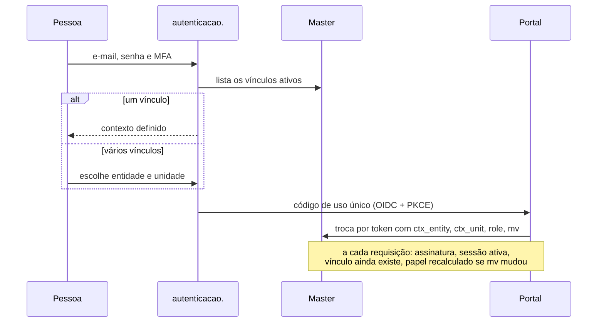

**Regras principais**
- Login só no domínio de autenticação; os portais recebem um código de uso único ([06](#doc-06); D-22).
- Permissões no formato `modulo.recurso.acao`, com default-deny. Os níveis vão de 0 (próprio) a 7 (desenvolvedor) ([78](#doc-78), seção 2.1).
- Separação de funções: quem cria não aprova o mesmo objeto financeiro, de compra ou de consentimento ([78](#doc-78), seção 2.2).
- Só `platform.developer` cria entidade e unidade (L-02, [78](#doc-78), seção 3).
- Acesso físico (portaria, catracas, biometria) é tratado no [35](#doc-35).

<a id="doc-06"></a>

## 06 — Identidade, Autenticação e Autorização

> Parte do [SDD v2](#doc-00). Controles gerais em [05](#doc-05).

---

### 1. Tipos de identidade

| Identidade | Credencial | Observação |
|---|---|---|
| Conta de pessoa (global) | E-mail verificado + senha + MFA conforme política | Uma conta por pessoa, no master. Pode ter vínculos com várias entidades e unidades (seção 12). |
| Vínculo (`UserMembership`) | Não é credencial | Liga a conta a uma entidade, unidade e papel. Fica no master. |
| Conta de plataforma | Senha + **passkey obrigatória** (ver seção 10) | Não é um usuário comum com flag. Papel `platform.*` separado. |
| Conta de serviço | Credencial de cliente (OAuth2 client credentials) ou chave de API | Dona de escopos mínimos; sem login interativo |
| Convidado | Token de convite de uso único | Expira em 72 h; aceite registra consentimento |
| Dispositivo confiável | Token de dispositivo (D-03) | Revogável por usuário e por administrador |

### 2. Autenticação de usuário

Fluxo:

1. Recebe e-mail e senha na tela de entrada única da plataforma. A conta é global (seção 12). Não há tenant escolhido antes do login.
2. Aplica atraso progressivo por identificador e limite por IP (ver seção 6). Não bloqueia a conta.
3. Verifica senha com Argon2id (pepper quando ativo, ver [05](#doc-05), seção 2).
4. Se MFA é exigida pela política, pede segundo fator.
5. Cria sessão opaca no servidor. Regenera o ID de sessão.
6. Grava evento de login (sucesso ou falha) em auditoria, sem a senha.

Mensagem de falha é sempre a mesma para identificador inexistente e senha errada.

### 3. Senhas

| Regra | Requisito | Base |
|---|---|---|
| Tamanho mínimo | 15 caracteres se a senha for o único fator; 8 se houver MFA | NIST SP 800-63B-4 (confirmar versão vigente antes do go-live) |
| Tamanho máximo | Pelo menos 64 caracteres aceitos | NIST SP 800-63B |
| Composição | Sem exigência de símbolos ou maiúsculas | NIST SP 800-63B |
| Rotação periódica | **Não exigida.** Trocar só com suspeita de comprometimento. | NIST SP 800-63B. A v1 exigia "rotatividade" (ACH-07) |
| Verificação de vazamento | Verificar contra lista de senhas vazadas (lista local ou API por prefixo de hash, sem enviar a senha) | NIST SP 800-63B |
| Armazenamento | Argon2id + pepper (ver [05](#doc-05)) | OWASP |
| Redefinição | Token de uso único, expira em 30 min, invalida sessões ativas | — |

### 4. Recuperação de conta

E-mail verificado é o único canal de cadastro e de recuperação (decisão D-04, 02/11/2026). Sem e-mail verificado, o cadastro não é concluído. WhatsApp e Telegram não são canais de recuperação nem de MFA.

Regras:

- Recuperação não revela se a conta existe.
- Ao concluir recuperação, todas as sessões e tokens anteriores são revogados.
- Recuperação de **conta de plataforma** exige passkey registrada e aprovação de dois responsáveis de segurança, registrada em auditoria (ver seção 10).
- Perda de MFA: recuperação por e-mail verificado, com espera de 24 h e notificação em todos os canais cadastrados. Durante a espera, a conta não aceita troca de MFA. Para contas de plataforma, vale a seção 10.
- Usuário sem e-mail verificado não tem conta ativa (D-04).

### 5. MFA

| Método | Uso |
|---|---|
| TOTP | Aceito para usuários de tenant |
| Passkey / WebAuthn | Aceito para todos; **obrigatório** para conta de plataforma |
| Certificado de cliente (PKI) | Aceito para integrações e cenários institucionais |
| Código por e-mail, SMS, WhatsApp ou Telegram | **Configurável pelo tenant (D-12, decidida pelo autor em 02/11/2026), com piso obrigatório.** Ver quadro abaixo. |

**Política de MFA configurável (D-12):**

| Ação | Métodos aceitos | Observação |
|---|---|---|
| Login comum de usuário de tenant | TOTP, passkey, certificado, e-mail, SMS, WhatsApp ou Telegram, conforme configuração do tenant | Pelo menos um método. Recomendado: TOTP ou passkey. |
| Aprovação de estorno, baixa manual ou pagamento acima do limite | TOTP, passkey ou certificado | Canais de mensagem não são aceitos. |
| Conta de plataforma | Passkey obrigatória | Sem alteração pelo tenant. |
| Alteração de método de MFA | Fator forte já cadastrado, ou espera de 24 h com notificação em todos os canais | Impede troca de método por quem só tem acesso ao canal. |
| Recuperação de conta | E-mail verificado (D-04) | Inalterado. |

Riscos aceitos pela configuração: troca de chip (SIM swap) e phishing em tempo real para SMS e WhatsApp; sequestro de conta de mensagem para Telegram e WhatsApp. Por isso esses canais não aprovam operação financeira. Cada tenant que habilitar esses canais assume o risco por escrito no cadastro de política.

Histórico: a versão anterior desta seção proibia SMS e e-mail como fator. A decisão D-12 do autor substitui essa proibição por configuração com piso. NIST SP 800-63B classifica SMS como método restrito; o piso desta seção mantém canais de mensagem fora de operações financeiras e de contas privilegiadas.

Step-up: exige MFA recente (até 5 min) para exportação de dados pessoais, alteração de papel, alteração de MFA, alteração de dados bancários e ações sobre o tenant.

### 6. Limites de tentativa

- Por identificador: atraso progressivo (1 s, 2 s, 4 s … até 60 s) após 5 falhas em 15 min.
- Por IP: limite de 20 tentativas por 15 min com resposta `429`.
- Por dispositivo: sinal de risco, sem bloqueio automático.
- CAPTCHA a partir da 10ª falha por IP. Provedor escolhido em ADR próprio.
- **Sem bloqueio total de conta por falha de senha.** Bloqueio por identificador permite negação de serviço contra qualquer conta conhecida (ACH-08). Conta de plataforma recebe o mesmo atraso progressivo, com alerta em tempo real ao canal de segurança. Não há bloqueio.

### 7. Sessão

| Controle | Valor |
|---|---|
| Idle | 30 min |
| Absoluta | 12 h (usuário); 4 h (conta de plataforma) |
| Sessões simultâneas | 3 por usuário; a mais antiga é encerrada |
| Vínculo | **Token de dispositivo (D-03, decidida):** cookie `__Host-` com ID aleatório de 256 bits, registrado em `DeviceTrust` e revogável pelo usuário e pelo administrador. A sessão só é aceita com token de dispositivo válido. Login em dispositivo novo exige MFA e notifica o usuário. Mudança de User-Agent ou de IP gera sinal de risco e step-up, sem bloqueio automático por IP (ACH-09). |
| Cookie | `__Host-` prefixo, `HttpOnly`, `Secure`, `SameSite=Lax` |
| Logout | Revoga a sessão atual; "sair de todos" revoga todas |
| Evento | Criação, rotação, término e revogação registrados em `UserSessionEvent` |

### 8. Tokens de API

- Access token JWT RS256, `exp` ≤ 15 min. Claims e regras na seção 12.
- Refresh token somente para clientes técnicos. Rotação a cada uso; reutilização de refresh revogado encerra a família de tokens. Endpoint de emissão e grant ainda não definidos: pendentes de ADR.
- Revogação por `jti` em lista com TTL igual ao `exp`.
- Navegador não recebe JWT (ADR-03, pendente de aceite).

### 9. Autorização (RBAC com contexto)

- Permissão: `modulo.recurso.acao`, por exemplo `academico.nota.lancar`.
- Papéis são coleções de permissões. Permissões não são atribuídas diretamente ao usuário sem papel, exceto por exceção registrada com prazo.
- Escopo: tenant (obrigatório), unidade (quando aplicável), recurso (relação com o recurso, como turma do professor).
- Negação explícita tem precedência sobre concessão.
- Toda concessão e revogação de papel gera auditoria com justificativa obrigatória para papéis administrativos.
- Revisão de acesso: trimestral para papéis administrativos e de plataforma; anual para os demais.

### 10. Contas de plataforma (break-glass)

- Máximo de 5 contas de plataforma ativas.
- Passkey obrigatória. Conta sem passkey é desativada ao primeiro login após a migração.
- Uso de conta de plataforma gera alerta em tempo real para o canal de segurança.
- Conta de emergência (break-glass): credencial guardada offline em dois cofres físicos sob controle de duas pessoas; uso exige ticket e revisão em 24 h.
- Nenhum acesso de plataforma a dados de tenant sem registro de motivo e sem auditoria marcada.

### 11. Testes de identidade (critério de aceite)

- [ ] Conta autenticada sem vínculo com a unidade pedida não acessa dado dessa unidade, mesmo com token válido.
- [ ] Troca de contexto para unidade sem vínculo é recusada e registrada.
- [ ] Remoção de vínculo passa a valer na próxima requisição, sem esperar a expiração do token.
- [ ] Mensagem de erro idêntica para usuário inexistente e senha errada (diferença média de tempo menor que 20 ms em 200 amostras, mesmo ambiente).
- [ ] Sessão expira em idle e em absoluta.
- [ ] Regeneração de ID após login e após elevação.
- [ ] Token revogado é rejeitado.
- [ ] Refresh reutilizado encerra a família.
- [ ] Step-up exigido nas ações da seção 5.
- [ ] Conta de plataforma não entra sem passkey.

### 12. Conta global, vínculos e contexto de acesso

**Decisão do autor (02/11/2026):** uma pessoa pode estar em várias entidades e unidades, e o token de autenticação permite o acesso a elas. Esta seção define como isso funciona sem ampliar o que um token pode fazer.

**Status: D-19, D-20 e D-21 aprovadas pelo autor em 02/11/2026.**

#### 12.1 Três camadas

| Camada | Onde fica | Conteúdo |
|---|---|---|
| Conta | Master (`totustuus.matriz.bd`) | E-mail verificado, senha (Argon2id), fatores de MFA, sessões, tokens revogados |
| Vínculos | Master | Quais entidades e unidades a conta pode acessar, com qual papel |
| Pessoa | Banco de identidade da entidade, com cadastro civil cifrado (D-19, [14](#doc-14), seção 3). O master guarda só `person_id` e e-mail verificado. O banco da unidade guarda só o `person_id`. | Nome, documento e contato civil (fora do master) |

Regra: o master guarda conta, vínculos e índice de pessoas. O cadastro civil fica no banco de identidade da entidade (D-19). Dados operacionais de unidade (notas, financeiro, matrícula) ficam no banco da unidade.

#### 12.2 Login

1. Usuário informa e-mail e senha. Se a conta existir, o sistema verifica MFA conforme a política do vínculo de maior exigência.
2. Após autenticar, o sistema lista os vínculos ativos da conta.
3. Se houver um único vínculo ativo (uma entidade e uma unidade), o contexto é esse e a pessoa vai direto para a página principal do portal. Se houver mais de um, a pessoa escolhe a entidade e depois a unidade (ver [23](#doc-23), seção 1).
4. Um token é emitido para o contexto escolhido.

Sem vínculo ativo, a conta autentica mas não recebe contexto. A resposta é a mesma de conta sem acesso, sem revelar outras entidades.

#### 12.3 Conteúdo do token

| Claim | Conteúdo |
|---|---|
| `sub` | UUID da conta |
| `sid` | Identificador da sessão |
| `ctx_entity` | UUID da entidade ativa |
| `ctx_unit` | UUID da unidade ativa |
| `role` | Papel naquela unidade |
| `mv` | Versão dos vínculos no momento da emissão |
| `exp` | Até 15 min |
| `aud`, `iss` | Validados |

**Proposta (D-20):** o token leva apenas o contexto ativo, nunca a lista de vínculos. Motivos: tamanho do token, exposição de outras entidades a quem recebe o token e risco de token antigo manter acesso depois de um vínculo ser removido.

#### 12.4 Como o acesso é decidido em cada requisição

1. Valida assinatura, expiração, `aud` e `jti` não revogado.
2. Confere se `sid` está ativa.
3. Confere se o vínculo (`sub`, `ctx_entity`, `ctx_unit`) ainda existe e está ativo. A consulta usa cache de curta validade (até 30 s) e é invalidada na remoção do vínculo.
4. Se `mv` do token é anterior à versão atual dos vínculos, o papel é recalculado a partir do master, e não do token.
5. Seleciona o banco da unidade ([03](#doc-03), seção 1.1).

Consequência: remover um vínculo tira o acesso na próxima requisição, mesmo com token ainda válido.

#### 12.5 Troca de contexto

- Endpoint próprio: troca para outra unidade da mesma conta. Exige vínculo ativo na unidade pedida.
- Emite novo token com o novo contexto. O token anterior é revogado.
- Troca para unidade sem vínculo: recusada e registrada em auditoria ([18](#doc-18), seção 4.2).
- Troca de entidade pode exigir MFA recente, conforme a política da entidade destino.

#### 12.6 E-mail único

A conta é única por e-mail verificado em toda a plataforma. A mesma pessoa em duas entidades usa a mesma conta e a mesma senha. Duas pessoas diferentes não podem usar o mesmo e-mail verificado.

**Proposta (D-21):** conta global única. Alternativa: conta por entidade, com o mesmo e-mail em contas diferentes. Condição de falha da alternativa: a pessoa precisa de uma senha por entidade, e a recuperação de conta fica duplicada.

#### 12.7 Substitui regras anteriores

- A regra "login restrito ao tenant do identificador" ([03](#doc-03), seção 3, item 4) é substituída por esta seção. O risco que ela evitava, usar credencial de um tenant para entrar em outro, continua coberto: a conta só recebe contexto por vínculo.
- A seção 2 passo 1 não escolhe tenant antes do login.

#### 12.8 Testes

- Conta com vínculo na entidade A e sem vínculo na entidade B: não recebe contexto de B, mesmo com token de A.
- Token com `ctx_unit` de unidade sem vínculo ativo: recusado.
- Remoção de vínculo: acesso cortado na próxima requisição.
- Troca de contexto registrada em auditoria.
- E-mail já verificado em outra conta: cadastro recusado.

<a id="v1-07-identity-auth-md"></a>

### v1 — `07-identity-auth.md` (75 linhas)

> Situação na v2: Substituído por 06. Quando este texto diverge da v2, vale a v2.

> Esta especificação foi substituída por inteiro pelo documento indicado acima. O texto fica como histórico; para implementar, vale o documento da v2.

> **Documento derivado do SDD mestre** · **Data:** 04/08/2026
> **Auditado:** 10-11/07/2026 (34/36 fixados) · **Detalhes:** `docs/security/audit-2026-07-10.md`

---

#### 1. Identidade

| Identidade | Modelo | Descrição |
|------------|--------|-----------|
| **Super Admin Global (Master)** | `User` (`is_master_user = 1`, `type = 'admin'`) | Gestores globais da software house vinculados à Sede Matriz (`UN-MATRIZ-DEV`), acesso nativo ao Portal do Desenvolvedor |
| Humano (staff/teacher/student/parents) | `User` + `UserProfile*` | nome, avatar, bios, fones, emails, endereço, família, documentos |
| Técnico (serviço) | `OrganizationIntegration`/`ThirdPartyIntegration` | client_id/secret cifrados |
| Invitado | `Invitation` | convite com token de aceite, expiração, role |
| Dispositivo | `DeviceTrust` | confiança de dispositivo para MFA step-up |

#### 2. Fluxo de autenticação

```
Login → RateLimit(5/h/identificador) → Argon2id verify + pepper → 
MFA (se exigido) → WebAuthn/TOTP/cert → Session com idle 30min/absolute 12h/max 3
→ Regeneração de session id → AuditLog de login (sucesso e falha)
```

- Passwords com política: comprimento, complexidade, breach-check contra dicionário local, rotatividade.
- Password reset: token single-use, expiração curta, invalidar tokens antigos, lockout por tentativas.
- Logout em todos os dispositivos (blacklist jti + invalidação de sessões).

#### 3. MFA (forte)

| Método | Status |
|--------|--------|
| TOTP (app autenticador) | ✅ |
| WebAuthn/passkey | ✅ (WebAuthnManager) |
| Certificado (PKI) | ✅ (CertificateAuth) |
| Email/SMS/Tele | ❌ **rejeitados** (design decision — anti-SIM-swap/phishing) |

- Rate limit por device (5/h), jitter, lockout progressivo.
- Step-up para ações sensíveis (admin ops, mudança de segurança, exports).

#### 4. Autorização (RBAC)

- `Role` ↔ `Permission` (sintaxe `admin.<module>.<action>` e `portal.<modulo>.<acao>`).
- `UserMembership` liga user→tenant com role(s).
- `UserUnit` restringe a unidade.
- `AuthorizeMiddleware` (permissão), `StrictAuthorizeMiddleware` (default-deny + BOLA/BFLA/BOPLA), `AdminMiddleware`, `PortalMiddleware`.
- Delegation: `IdentityAutomation` (aprovações automáticas), `AccessRequest` (solicitação de acesso).

#### 5. Controles de sessão

- Idle 30 min, absolute 12 h, máx 3 sessões concorrentes, bind IP+UA.
- Cookie Secure+HttpOnly+SameSite=Strict, rotação a cada 5 min.
- JWT: RS256, exp curto, refresh rotativo com rotação de jti, blacklist para revogação.
- `UserSessionEvent` — trilha de eventos de sessão (criação, rotação, término, revogação).

#### 6. Padrões a evitar (não-negócios)

- Senhas em texto plano/hash fraco (proibido — Argon2id obrigatório).
- Tokens no JS/localStorage (proibido — cookies HttpOnly).
- HS256 para JWT (proibido — RS256).
- MFA fraca por SMS/email (proibido).
- Cross-tenant login (bloqueado por design — FD-05).

#### 7. Testes de identidade (já existentes)

- Autenticação com tenants e privilégios cruzados, reset de senha, guest tokens, device trust, idempotência de login — ver `tests/` (GAP_ANALYSIS_2026-08-04.md).

#### 8. Lacunas

| Lacuna | Ação |
|--------|------|
| SSO SAML/OIDC como IdP | Onda C (só SP WebAuthn hoje) |
| FIDO2 discovery (passkeys em browsers) | Melhoria contínua |
| Registro de users por tenant (self-service) | Existe via convite; reforçar rate limit |

<a id="doc-78"></a>

## 78 — Permissões, papéis e níveis de acesso por portal

> Parte do [SDD v2](#doc-00). Estende [06](#doc-06), seção 9 (RBAC com contexto) e a seção 10 (contas de plataforma). Escopo de portais em [23](#doc-23) e [31](#doc-31).
> **Status:** aprovado pelo autor em 04/11/2026 (L-02, P-01, D-30 a D-33 e D-38 a D-43); D-44 e D-45 já estavam definidas nos documentos 31 e 22. Não há proposta em aberto neste documento.

---

### 1. Regras aprovadas pelo autor

| # | Regra | Origem |
|---|---|---|
| L-02 | Criar entidade e criar unidade é **exclusivo do papel `platform.developer`**. | Autor, 04/11/2026 |
| P-01 | O sistema de permissões é completo: papéis em níveis, com escopo, para todos os portais. | Autor, 04/11/2026 |

### 2. Modelo

- **Permissão:** `modulo.recurso.acao` (ex.: `academico.nota.lancar`), como em [06](#doc-06), seção 9.
- **Papel:** coleção de permissões, com **nível** e **escopo**.
- **Escopo:** `plataforma`, `entidade`, `unidade`, `turma` (para docentes), `proprio` (somente o próprio registro). Escopo mais estreito nunca amplia o papel.
- **Vínculo:** uma pessoa tem um ou mais vínculos (entidade, unidade, papel). Permissão efetiva é a união dos vínculos ativos, menos as negações.
- **Negação explícita** vence concessão ([06](#doc-06), seção 9).

#### 2.1 Níveis de papel (D-38, aprovada)

| Nível | Nome | O que faz | Exemplo |
|---|---|---|---|
| 0 | Próprio | Vê e atualiza só os próprios dados, quando permitido | Aluno, responsável, terceiro |
| 1 | Operador | Executa tarefas no escopo atribuído | Secretário, professor de turma |
| 2 | Coordenador | Gerencia tarefas de um conjunto de operadores e aprova o que é de nível 1 | Coordenador de turno |
| 3 | Gestor | Responde pela unidade inteira | Diretor de unidade |
| 4 | Administrador da entidade | Responde pela entidade: unidades, usuários e configurações, exceto criação de entidade ou unidade | Diretor geral |
| 5 | Operador da plataforma | Suporte, atendimento e operação, sem acesso a dado de entidade sem motivo registrado | Equipe de suporte |
| 6 | Gestor da plataforma | Operação da plataforma, planos e clientes, sem criar entidade ou unidade | Gerente de operação |
| 7 | Desenvolvedor | Criação de entidade e unidade (L-02), planos, limites, licenças e Editor de portais | `platform.developer` |

Regras de nível:
- Um papel só concede permissões do seu nível ou inferiores. Atribuir um papel de nível igual ou superior exige o aprovador de nível superior.
- Papéis de nível 3 e acima, e todos os da plataforma, exigem **justificativa** e **revisão trimestral** ([06](#doc-06), seção 9).
- Papéis de nível 0 a 2 têm revisão anual.

#### 2.2 Separação de funções (D-39, aprovada)

| Ação | Não pode ser feita pela mesma pessoa |
|---|---|
| Criar e aprovar mudança no Editor de portais: quem edita é `platform.builder` e quem aprova é `platform.developer` (D-33) | Sim ([23](#doc-23), seção 3) |
| Lançar nota e aprovar a nota | Sim |
| Cadastrar fornecedor e aprovar pagamento | Sim |
| Criar usuário e conceder papel de nível 3 ou acima | Sim |
| Criar plano e aplicar plano a entidade | Sim |

### 3. Criação de entidade e unidade (L-02)

| Ação | Papel exigido | Verificação |
|---|---|---|
| Criar entidade | `platform.developer` | Passkey e sessão curta ([06](#doc-06), seção 10) |
| Criar unidade | `platform.developer` | Idem |
| Editar dados de entidade ou unidade já criadas | Administrador da entidade (nível 4), exceto código e domínio, que são do desenvolvedor | Auditoria |
| Desativar ou encerrar entidade | `platform.developer`, por saída de cliente ([23](#doc-23), seção 5) | Confirmação digitando o nome |

Nenhum outro papel, inclusive de plataforma, cria ou remove entidade ou unidade. A regra vale também para API ([04](#doc-04)): o endpoint de criação exige o papel no servidor, não só na tela.

### 4. Papéis por portal

Papéis listados por portal, com o nível máximo previsto. Permissões detalhadas por módulo são definidas em cada ficha de módulo.

#### 4.1 Portal do Desenvolvedor (plataforma)

| Papel | Nível | Escopo | Pode |
|---|---|---|---|
| `platform.developer` | 7 | plataforma | Criar entidade e unidade; planos, limites, licenças, Editor de portais |
| `platform.manager` | 6 | plataforma | Clientes, assinaturas, faturamento de clientes, domínios; sem criar entidade ou unidade |
| `platform.operator` | 5 | plataforma | Suporte e atendimento; consulta de cliente com motivo registrado |
| `platform.builder` | 7 | plataforma | Editor de portais, com passkey e sessão curta (mantido de [06](#doc-06), seção 9) |
| `platform.auditor` | 2 | plataforma | Leitura de auditoria e relatórios de conformidade |
| `platform.sales.sdr` | 1 | plataforma (leads) | Pré-vendas: qualificar, agendar demonstração, registrar interação (SDD 22, seção 4.1) |
| `platform.sales.ae` | 1 | plataforma (carteira própria) | Vendedor: criar proposta e avançar o funil até negociação (SDD 22, seção 4.1) |
| `platform.sales.manager` | 2 | plataforma (equipe comercial) | Gerente comercial: atribuir leads, aprovar desconto na alçada, ver funil da equipe (SDD 22, seção 4.1) |
| `platform.chatbot.operator` | 1 | plataforma (fila de conversas) | Atender, transferir e registrar conversas dos canais (SDD 22, seção 4.1) |
| `platform.customer_success` | 1 | plataforma (clientes ativos) | Acompanhar implantação e uso, sem alterar cobrança (SDD 22, seção 4.1) |
| `platform.finance` | 1 | plataforma (financeiro da empresa) | Papel **Financeiro** do [22](#doc-22), seção 5, na empresa desenvolvedora: operar contas, despesas, pagamentos e conciliação (D-43) |
| `platform.finance.manager` | 2 | plataforma (financeiro da empresa) | Aprovar despesas e orçamento; segundo aprovador acima de R$ 10.000 (D-43, aprovada) |
| `platform.accounting` | 1 | plataforma (contábil da empresa) | Papel **Contábil** do [22](#doc-22), seção 5: lançar, fechar período, exportar; não fecha período com lançamento que criou sem revisão (D-45) |
| `platform.fiscal` | 1 | plataforma (fiscal da empresa) | Papel **Fiscal** do [22](#doc-22), seção 5: emitir e cancelar NFS-e, apurar tributos; cancelamento exige aprovação do contábil (D-45) |
| `platform.assets` | 1 | plataforma (patrimônio da empresa) | Cadastrar e movimentar bens; manutenção, inventário e seguro (DP-03, [80](#doc-80)) |
| `platform.assets.approver` | 2 | plataforma (patrimônio da empresa) | Aprovar transferência, descarte e manutenção acima do limite; não aprova o que registrou (DP-03) |
| `platform.fleet` | 1 | plataforma (frotas da empresa) | Veículos, motoristas, reservas, abastecimentos, viagens, multas e documentos (DP-03) |
| `platform.fleet.approver` | 2 | plataforma (frotas da empresa) | Aprovar reservas e ordens de manutenção; não aprova a própria reserva (DP-03) |
| `platform.purchasing` | 1 | plataforma (suprimentos da empresa) | Papel **Compras** do [22](#doc-22), seção 5: cotação, pedido, cadastro de fornecedor |
| `platform.warehouse` | 1 | plataforma (suprimentos da empresa) | Papel **Almoxarifado** do [22](#doc-22), seção 5: recebimento e movimento |
| `platform.purchasing.approver` | 2 | plataforma (suprimentos da empresa) | Papel **Aprovador de compras** do [22](#doc-22), seção 5: aprova requisição na alçada; não é o solicitante |
| `platform.people` | 1 | plataforma (HCM da empresa) | Pessoas (DP): cadastro funcional, férias, afastamentos, ponto com motivo, rescisão, benefícios ([39](#doc-39), HCM-01 e HCM-10) |
| `platform.payroll` | 1 | plataforma (HCM da empresa) | Papel **Folha** do [22](#doc-22), seção 5: processar a folha; folha fechada não muda |
| `platform.payroll.approver` | 2 | plataforma (HCM da empresa) | Aprovar a folha; quem processa não aprova ([39](#doc-39), seção 7) |
| `platform.hr` | 1 | plataforma (HCM da empresa) | Papel **RH** do [22](#doc-22), seção 5, no escopo do HCM-01: recrutamento, onboarding, avaliação, clima, treinamento |
| `platform.sst.doctor` | 1 | plataforma (SST da empresa) | Médico do trabalho: ASO completo, prontuário, CID ([39](#doc-39), HCM-06) |
| `platform.sst.technician` | 1 | plataforma (SST da empresa) | Técnico de SESMT: ocorrências, EPI, NR, PGR, CAT, sem diagnóstico ([39](#doc-39), HCM-06) |
| `platform.security` | 5 | plataforma (segurança) | Papel **Segurança** do [22](#doc-22), seção 5: investigar, bloquear conta, política de MFA, autorizar visualização de segredo de tenant com motivo; não concede permissão a si mesmo |
| `platform.dpo` | 5 | plataforma (privacidade) | Papel **Encarregado** do [22](#doc-22), seção 5: relatório de impacto, pedidos de titular, ROPA, incidentes, painel do DPO (LGPD-07); não opera o módulo que audita |
| `platform.ops` | 5 | plataforma (infraestrutura) | Papel **TI / Operação** do [22](#doc-22), seção 5: serviços, filas, backup, certificados, inventário de bancos, pedido de restauração e de acesso de emergência ([34](#doc-34), seção 4); sem acesso a dado pessoal de entidade |
| `platform.integration` | 6 | plataforma (integrações) | Configurar integrações de plataforma (`plataforma.integracao.*`, [16](#doc-16), seção 1); nunca vê segredo de tenant em texto claro |

Aprovação técnica: migração em lote, restauração de backup e escrita em acesso de emergência exigem aprovação de `platform.developer` como segundo papel, por pessoa diferente de quem pediu ([34](#doc-34), seção 4).

#### 4.2 Portal de Gestão (SaaS da entidade)

| Papel | Nível | Escopo | Pode |
|---|---|---|---|
| `entity.admin` | 4 | entidade | Unidades, usuários, papéis até nível 3, configurações da entidade |
| `unit.manager` | 3 | unidade | Gestão da unidade: acadêmico, financeiro, pessoas, suprimentos |
| `unit.coordinator` | 2 | unidade | Coordenação de turno ou área; aprova tarefas de nível 1 |
| `unit.secretary` | 1 | unidade | Matrícula, documentos, protocolos |
| `unit.finance` | 1 | unidade | Títulos, cobrança, conciliação |
| `unit.hr` | 1 | unidade | Pessoas, folha, ponto |
| `unit.librarian` | 1 | unidade | Acervo, empréstimos |
| `unit.support` | 1 | unidade | Atendimento, SAC, tickets |
| `unit.auditor` | 2 | unidade | Leitura de auditoria da unidade |
| `unit.accounting` | 1 | unidade | Papel **Contábil** do [22](#doc-22), seção 5: lançar, fechar período, exportar; não fecha período com lançamento que criou sem revisão |
| `unit.fiscal` | 1 | unidade | Papel **Fiscal** do [22](#doc-22), seção 5: emitir e cancelar NFS-e, apurar tributos e retenções; cancelamento exige aprovação do contábil |
| `unit.finance.approver` | 2 | unidade | Aprovar despesa, estorno e baixa manual na alçada; não aprova o que lançou ([17](#doc-17), seção 2.4) |
| `unit.commercial` | 1 | unidade | Papel **Comercial** do [22](#doc-22), seção 5, no CRM do tenant (seção 4.2): captação, pré-cadastro, proposta; não aprova desconto acima da alçada |
| `unit.purchasing` | 1 | unidade | Papel **Compras**: cotação, pedido, cadastro de fornecedor; não aprova a própria requisição nem recebe a própria compra |
| `unit.warehouse` | 1 | unidade | Papel **Almoxarifado**: recebimento e movimento; ajuste de estoque só com motivo e aprovação |
| `unit.purchasing.approver` | 2 | unidade | Papel **Aprovador de compras**: aprova requisição na alçada; não é o solicitante |
| `unit.assets` | 1 | unidade | Patrimônio da entidade: cadastro, movimentação, inventário ([19](#doc-19), seção 8) |
| `unit.assets.approver` | 2 | unidade | Aprovar transferência, baixa e manutenção acima do limite; não aprova o que registrou (DP-05) |
| `unit.fleet` | 1 | unidade | Frotas e rotas da entidade ([19](#doc-19), seção 9) |
| `unit.fleet.approver` | 2 | unidade | Aprovar reserva e ordem de manutenção de veículo; não aprova a própria (DP-05) |
| `unit.payroll` | 1 | unidade | Papel **Folha**: processar a folha; folha fechada não muda |
| `unit.payroll.approver` | 2 | unidade | Aprovar a folha; quem processa não aprova ([39](#doc-39), seção 7) |
| `unit.sst.doctor` | 1 | unidade | Médico do trabalho: ASO, prontuário ocupacional, CID ([39](#doc-39), seção 7; [52](#doc-52)) |
| `unit.sst.technician` | 1 | unidade | SESMT: CAT, EPI, NR, PGR, ocorrências; sem diagnóstico |
| `unit.legal` | 2 | entidade | Papel **Jurídico**: parecer, bloqueio legal; leitura de contratos, documentos e auditoria; não altera contrato assinado |
| `entity.dpo` | 2 | entidade | Papel **Encarregado (DPO)** da entidade ([32](#doc-32), seção 7): ROPA, pedidos de titular, incidentes, relatório de impacto; não opera o módulo que audita |
| `entity.security` | 3 | entidade | Papel **Segurança** da entidade: investigar, bloquear conta, política de MFA da entidade; não concede permissão a si mesmo |
| `unit.it.admin` | 2 | unidade | Administrador de TI da entidade ([36](#doc-36), seção 6): ativos, licenças, chamados e mudanças; não aprova a própria mudança |
| `unit.it.technician` | 1 | unidade | Técnico de TI: atender chamados e incidentes; não altera contrato nem exclui ativo |
| `unit.it.change_approver` | 2 | unidade | Comitê de mudança: aprova ou recusa; não executa a mudança que aprovou |
| `unit.preceptoria.manager` | 2 | unidade | Gestão de preceptoria ([42](#doc-42), seção 5): instrumentos, ciclos, programas, pesos, relatório agregado; não vê resposta individual nem anotação de tutoria |
| `unit.pastoral` | 1 | unidade | Equipe pastoral ([43](#doc-43), seção 5): agenda, escala, evento, campanha e beneficiário da campanha; não vê anotação de acompanhamento alheia |
| `unit.reception` | 1 | unidade | Portaria e acesso físico ([35](#doc-35), seção 4): entradas e saídas, visitantes, autorizações de retirada |

Os papéis acima vêm dos papéis nomeados no [22](#doc-22), seção 5, e nos documentos por portal; os códigos seguem a convenção desta seção (DP-05, [80](#doc-80)). A coordenação pedagógica usa `unit.coordinator`; a secretaria, `unit.secretary`.

#### 4.3 Portal do Professor

| Papel | Nível | Escopo | Pode |
|---|---|---|---|
| `teacher` | 1 | turma | Diário, materiais e avaliações **das próprias turmas**; nota só pelo docente da turma |
| `teacher.coordinator` | 2 | unidade | Aprova plano de aula e lançamentos de tarefa de nível 1 da unidade |

#### 4.4 Portal do Aluno

| Papel | Nível | Escopo | Pode |
|---|---|---|---|
| `student` | 0 | proprio | Ver e usar apenas os próprios dados: boletim, materiais, financeiro, protocolos |

#### 4.5 Portal dos Responsáveis

| Papel | Nível | Escopo | Pode |
|---|---|---|---|
| `guardian` | 0 | proprio (dependentes vinculados) | Ver e atuar pelos dependentes vinculados; dependente sem vínculo não aparece |

#### 4.6 Portal de Terceiros

| Papel | Nível | Escopo | Pode |
|---|---|---|---|
| `thirdparty` | 0 | proprio (contrato vinculado) | Ver contratos, entregas, faturas e solicitações da própria organização |
| `thirdparty.manager` | 1 | entidade (contrato) | Gestão de entregas e faturas do contrato vinculado |

### 5. Regras transversais (D-40, aprovada)

1. **Default-deny:** rota ou ação sem papel explícito é negada, como em [03](#doc-03).
2. **Escopo verificado no servidor:** o escopo `turma`, `unidade` ou `proprio` é conferido em cada consulta, não só na tela.
3. **Papel por portal:** papel de um portal não dá acesso a outro, mesmo com a mesma conta ([23](#doc-23), seção 2).
4. **Ações sensíveis com step-up:** exportação, alteração de papel e exclusão exigem autenticação recente ([06](#doc-06), seção 5).
5. **Revisão e expiração:** vínculo temporário tem data de fim. Vínculo vencido sai sozinho e gera auditoria.
6. **Auditoria:** toda concessão, revogação e mudança de papel gera registro com justificativa para níveis 3 e acima.

### 6. Decisões pendentes

| # | Decisão | Proposta | Alternativa |
|---|---|---|---|
| D-30 | Nomes e códigos dos papéis de gestão | Os códigos da seção 4. **Aprovada pelo autor em 04/11/2026.** | Nomes livres por entidade, mapeados para os níveis |
| D-31 | Papel de professor que também coordena | Dois papéis, um por portal. **Aprovada pelo autor em 04/11/2026.** | Um papel com acúmulo de escopo |
| D-32 | Papel do responsável com mais de um aluno | Escopo `proprio` com dependentes vinculados. **Aprovada pelo autor em 04/11/2026.** | Papel por aluno |
| D-33 | Papel que aprova a publicação no Editor de portais (diferente de quem editou) | `platform.developer` aprova o que o `platform.builder` edita. **Aprovada pelo autor em 04/11/2026.** | Papel de revisão separado, criado só para isso |
| D-38 | Níveis de papel | Oito níveis, de 0 (próprio) a 7 (desenvolvedor), com as regras da seção 2.1. **Aprovada pelo autor em 04/11/2026.** | Menos níveis, por exemplo 0, 1, 3, 4 e 7 |
| D-39 | Separação de funções | As cinco ações da seção 2.2. **Aprovada pelo autor em 04/11/2026.** | Lista definida por módulo |
| D-40 | Regras transversais | As seis regras da seção 5. **Aprovada pelo autor em 04/11/2026.** | Regras definidas por portal |
| D-41 | Códigos dos papéis comerciais da plataforma (SDD 22, seção 4.1) | Os cinco códigos `platform.sales.*`, `platform.chatbot.operator` e `platform.customer_success` da seção 4.1. **Aprovada pelo autor em 04/11/2026.** | Outros nomes, mantidos os níveis |
| D-42 | Cheques e caixa físico no financeiro da plataforma ([71](#doc-71), seções 5 e 6) | Não se aplicam à empresa desenvolvedora, até haver necessidade. **Aprovada pelo autor em 04/11/2026.** | Aplicam-se, como nas entidades |
| D-43 | Papéis do financeiro da plataforma | `platform.finance` (opera) e `platform.finance.manager` (aprova). **Aprovada pelo autor em 04/11/2026.** | Usar `platform.manager` para aprovar |
| D-44 | Tributos e obrigações fiscais da empresa desenvolvedora | **Já definido** na [31](#doc-31), seção 3.3 (aprovada em 03/11/2026). Confirmado pelo autor em 04/11/2026: módulo incluído na área Contábil da plataforma | — |
| D-45 | Papéis do contábil e do fiscal da plataforma | **Já definido** no [22](#doc-22), seção 5 (papéis Contábil e Fiscal, com segregação). Códigos: `platform.accounting` e `platform.fiscal` | — |

### 7. Critérios de aceite

- [ ] Somente `platform.developer` cria entidade e unidade, na tela e na API.
- [ ] Todo papel tem nível, escopo e lista de permissões.
- [ ] Papel de um portal não concede acesso a outro portal.
- [ ] Separação de funções aplicada nas ações da tabela 2.2.
- [ ] Revisão trimestral para níveis 3 e acima e para a plataforma; anual para os demais.
- [ ] Permissão validada no servidor, com teste de acesso negado por papel e por escopo.

<a id="doc-35"></a>

## 35 — Acesso Físico e Segurança: Portaria, Catracas, Câmeras, Portas e Biometria, por Portal

> Parte do [SDD v2](#doc-00). Matriz de portais em [31](#doc-31). Dado biométrico e de imagem em [07](#doc-07) e [26](#doc-26). Retenção e expurgo em [21](#doc-21). Auditoria em [29](#doc-29). Integração de hardware em [16](#doc-16).
> **Status:** aprovada pelo autor em 03/11/2026, com as propostas adotadas. Itens sem valor definido continuam pendentes, criada em 03/11/2026. A v1 cita o tema em navegação e em integração, sem especificação própria. Itens **[Decisão do autor]** e **(jurídico)** dependem de resposta ou parecer.

---

### 1. Resposta direta

> **Leitura (04/11/2026):** esta tabela registra o que existia no SDD antes deste documento ser escrito. Os itens marcados como **Não** ou **Parcial** são especificados nas seções seguintes deste documento, exceto o que estiver listado na seção de pendências.

| Pergunta | Veredito |
|---|---|
| O módulo de acesso físico está completo? | **Não.** Não há especificação. A v1 cita "Portaria & Acesso" (desenvolvedor), "Portaria Escolar" (gestão), "Entradas e Saídas" (aluno e responsáveis) e "Gestão de Integração: Catracas" (terceiros), sem regra, DDL, estados ou teste |
| Está organizado por portal? | **Não.** Os nomes se repetem com sentidos diferentes (ver seção 2) |
| Reconhecimento facial e biometria? | **Sem regra.** É dado sensível (LGPD, art. 11). Pendência jurídica |
| Câmeras (CFTV)? | **Sem regra.** A v1 não tem especificação de câmera nem de retenção de imagem |
| Portas eletrônicas? | **Sem regra.** Só aparece como item de navegação |

---

### 2. Confusão de nomes a resolver

| Nome na v1 | Onde está | O que é de fato | Ação |
|---|---|---|---|
| "Gestão de Acesso" | Portal do desenvolvedor, Segurança & Acesso | Usuários, papéis, MFA, sessões (acesso **lógico**) | Manter. É [06](#doc-06) |
| "Portaria & Acesso" | Portal do desenvolvedor | Catracas, visitantes, crachás, encomendas (acesso **físico**), da plataforma | **Decidido** em 03/11/2026: mantido, para a própria empresa, quando tiver instalações com controle |
| "Portaria Escolar" | Gestão (SAAS acadêmico) | Acesso físico da escola: catraca, reconhecimento facial, visitantes, autorização de saída de aluno | Manter. Este documento |
| "Entradas e Saídas" | Portal do aluno e dos responsáveis | Histórico do próprio acesso e notificação de entrada e saída | Manter. Só leitura do próprio dado |
| "Gestão de Auditoria" | Portal do desenvolvedor | Logs de sistema e de operação | É [29](#doc-29). Não é acesso físico |

**Regra:** "acesso" sem qualificação não aparece em documento. Usar "acesso lógico" ou "acesso físico".

---

### 3. Recursos do acesso físico

#### 3.1 Dispositivos

| Dispositivo | Função | Integração |
|---|---|---|
| Catraca | Registro de entrada e saída de pessoas | Driver do fabricante, por conector |
| Porta eletrônica | Liberação de porta com credencial | Driver do fabricante |
| Leitor de crachá (RFID ou código) | Identificação | Conector |
| Leitor biométrico ou facial | Identificação por biometria | Conector, **com regra da seção 5** |
| Câmera (CFTV) | Imagem do acesso e do ambiente | Stream ou gravador, **com regra da seção 6** |

Dispositivo é cadastrado por unidade. Um dispositivo não serve outra unidade, mesmo na mesma entidade.

#### 3.2 Visitantes

- Cadastro de visitante com documento, motivo, destino e autorização de quem recebe.
- Documento do visitante: só número mascarado no registro de acesso. Imagem do documento não é guardada, salvo regra específica **(jurídico)**.
- Visitante de menor de idade na escola: regra de autorização do responsável, não do visitante ([07](#doc-07), seção 3).
- Validade: acesso temporário, com data e horário de fim.

#### 3.3 Autorização de saída de aluno

Requisito da v1 (Portaria Escolar). Regra proposta:

- Saída de aluno menor só com autorização registrada do responsável, por canal verificado, com data e horário.
- Quem retira o aluno é identificado (nome e documento mascarado) e comparado com a lista autorizada.
- Saída sem autorização gera alerta imediato à coordenação e ao responsável.
- Autorização tem validade. Expirada, não vale.

#### 3.4 Registro de entrada e saída

| Campo | Regra |
|---|---|
| Pessoa | Vínculo (aluno, professor, colaborador, visitante). Visitante não tem vínculo permanente. |
| Dispositivo | Identificador do dispositivo e da unidade |
| Direção | Entrada ou saída |
| Momento | Data e hora UTC ([29](#doc-29), seção 2) |
| Método | Crachá, biometria, facial, manual |
| Resultado | Permitido, negado, manual |

Registro de entrada é dado de acesso. Retenção conforme seção 6.

---

### 4. Por portal

| Portal | Recurso | Escopo |
|---|---|---|
| Desenvolvedor | Acesso físico da própria plataforma, **se mantido** (seção 2) | Plataforma apenas |
| Gestão | Portaria completa: dispositivos, visitantes, autorização de saída, registros, câmeras, relatórios | Unidade, conforme permissão |
| Professor | Nenhum acesso físico próprio. Registro de entrada do próprio docente, se a unidade usa controle | Só o próprio registro |
| Aluno | Histórico de entradas e saídas, com horário. Notificação de atraso | Só o próprio histórico |
| Responsáveis | Entrada e saída dos dependentes em tempo real. Autorização de saída. Notificação | Só dependentes com vínculo ativo |
| Terceiros | Integração com fornecedor de catraca ou merenda (API). Sem acesso ao registro de pessoas | Só o contrato de integração ([16](#doc-16)) |

**Regra:** o responsável não vê o registro de outro aluno, nem imagem de câmera, nem de visitante.

---

### 5. Biometria e reconhecimento facial

**Problema:** biometria e reconhecimento facial são dado pessoal **sensível** (LGPD, art. 5º, II e art. 11). Em escola, envolvem principalmente menores.

**Proposta mínima, até parecer:**

1. Biometria é **opcional**. A unidade oferece crachá ou código como alternativa, sem penalizar quem recusa.
2. O consentimento é específico para biometria, por escrito, com finalidade e prazo. Revogável.
3. Template biométrico (não a imagem) é guardado cifrado, no banco da unidade, com chave do cofre ([05](#doc-05)). Nunca sai da unidade.
4. Não há reconhecimento facial contra base de terceiros nem compartilhamento com outra unidade.
5. Exclusão do template na saída da pessoa ou na revogação. Registro da exclusão sem o dado ([29](#doc-29)).
6. Relatório de impacto (RIPD) antes de ativar.

**(jurídico)** Base legal e exigências para menores. Lacuna LGPD-04 em [32](#doc-32).

**Decidido** em 03/11/2026: biometria entra no escopo como opcional, com RIPD antes de ativar.

---

### 6. Câmeras (CFTV) e imagem

**Problema:** câmera registra imagem de menores, de visitantes e de funcionários. A v1 não define nada sobre câmera.

**Proposta:**

| Regra | Detalhe |
|---|---|
| Finalidade | Segurança patrimonial e de pessoas. Sem finalidade pedagógica nem de avaliação de docente. |
| Local | Áreas comuns e acessos. **Não** em banheiro, vestiário, sala de descanso ou área de amamentação. |
| Aviso | Placa de aviso no local. Sinalização visível. |
| Acesso à imagem | Só a função de segurança da unidade, com motivo registrado. Visualização ao vivo e exportação são eventos auditados ([29](#doc-29)). |
| Retenção | Prazo curto e fixo de **30 dias**, decidido em 03/11/2026. Expurgo automático. Exportação de trecho fica em armazenamento com acesso restrito. |
| Reconhecimento facial em imagem | Mesma regra da seção 5. Desligado por padrão. |
| Terceiros | Câmera de terceiro não é acessada pelo portal de terceiros. |

**(jurídico)** Prazo de retenção de imagem e aviso exigido.

---

### 7. Portas e controle de acesso ao prédio

- Porta eletrônica tem regra de abertura por horário e por perfil, configurada na unidade.
- Liberação de emergência (incêndio) abre a porta sem depender da rede. Evento registrado depois.
- Falha de rede: a porta opera em modo local, com lista de credenciais sincronizada. Lista local expira.
- Alteração de regra de porta exige MFA e dupla aprovação, como outras configurações de segurança ([31](#doc-31), seção 4.3).

---

### 8. Relação com os outros módulos

| Módulo | Relação |
|---|---|
| Acadêmico | Presença por QR Code e geolocalização (v1, `spec_gestao_academica_completo`, seção 8.3). **Atenção:** geolocalização do aluno é dado pessoal sensível de localização. Precisa de consentimento e de regra de minimização ([07](#doc-07)). Não há regra na v2 |
| Pessoas | Ponto eletrônico pode usar o registro de acesso. Não é fonte única |
| Patrimônio | QR e RFID são de bem, não de pessoa. Não usar a mesma tabela de acesso |
| Segurança do trabalho | Controle de acesso a área de risco. Fora deste documento |

---

### 9. Pendências

| # | Pendência | Tipo |
|---|---|---|
| ACC-01 | Portaria & Acesso da plataforma: manter ou retirar (seção 2) | **Decidido** em 03/11/2026: mantido, para a própria empresa (seção 11) |
| ACC-02 | Biometria e reconhecimento facial: escopo (seção 5) | **Decidido** em 03/11/2026 (seção 11). Parecer de (jurídico) pendente |
| ACC-03 | Retenção de imagem de câmera (seção 6) | **Decidido** em 03/11/2026: 30 dias. Parecer de (jurídico) pendente |
| ACC-04 | RIPD de biometria e de câmera | Documento e DPO |
| ACC-05 | Geolocalização em presença por QR Code | **Decidido** em 03/11/2026: a escola configura. Pode usar geolocalização ou outro método |
| ACC-06 | DDL de dispositivo, registro de acesso, autorização de saída e visitante | **Escrito** em [51](#doc-51), seção 4. Revisão do owner pendente (DDL-01) |
| ACC-07 | Conectores de catraca e porta | **Decidido** em 03/11/2026: protocolo aberto primeiro, fabricantes depois, sob demanda |
| ACC-08 | Modo de falha da porta e lista local (seção 7) | **Escrito** em [51](#doc-51), seção 4. Revisão do owner pendente (DDL-01) |

---

### 10. Critérios de aceite

- [ ] Dispositivo só atua na unidade à qual está cadastrado (teste de isolamento).
- [ ] Autorização de saída de menor sem registro gera bloqueio e alerta (teste).
- [ ] Biometria desligada por padrão; alternativa sem biometria disponível (teste).
- [ ] Nenhuma imagem de câmera aparece em portal de responsável, aluno ou terceiro (teste).
- [ ] Acesso à imagem gera evento de auditoria com motivo.
- [ ] Liberação de emergência funciona sem rede e gera evento depois.
- [ ] Itens **[Decisão do autor]** e **(jurídico)** respondidos ou marcados como pendentes no [00](#doc-00).

### 11. Decisões de 03/11/2026

**ACC-01 (Portaria & Acesso da plataforma): mantido no portal do desenvolvedor.** Função: gerir o acesso físico e a portaria da própria empresa desenvolvedora, quando ela tiver instalações com controle (catraca, porta eletrônica, crachá, visitantes, câmeras, encomendas). Regras:

- Dados em banco master, separado de qualquer entidade.
- Acesso restrito à equipe de segurança da empresa. Nenhum cliente vê esse módulo.
- Sem instalação, o módulo fica desativado.

**ACC-02 (escopo de biometria, reconhecimento facial e câmeras): aprovado.** Regras da seção 5 e da seção 6 valem como escopo: biometria opcional, template cifrado, RIPD antes de ativar, sem reconhecimento facial contra base de terceiros, câmera sem áreas íntimas e com aviso.

**ACC-03 (prazo de retenção de imagem): 30 dias, padrão inicial.** Expurgo automático ao fim do prazo. Trecho exportado para investigação fica em armazenamento restrito, com prazo próprio e registro. **(jurídico)** confirmar antes de produção.

## Especificações da v1 desta parte absorvidas no kit-starter ou sem destino

<a id="v1-client-migration-module-spec-completo-md"></a>

### v1 — `client-migration-module-spec-completo.md` (1207 linhas)

> Situação na v2: Absorvido integralmente no kit-starter. Destino: ficha do kit-starter: `kit-starter/gestao/configuracao-e-acesso/importacao-de-dados.md`. Quando este texto diverge da v2, vale a v2.

#### O que a v2 muda nesta especificação

Estas regras prevalecem sobre o texto da v1 que vem a seguir.

- [70](#doc-70); migração de clientes ([19](#doc-19), seção 13).

#### Texto integral da v1

#### 1. Document Control

- Document Name: Client Migration Module Specification
- Product Context: Multi-tenant SaaS platform using Supabase-inspired admin UX patterns
- Target Stack: PHP, Fetch API, MariaDB, JSON-based migration intake
- Language Standard: Global English
- Primary Audience: Product owner, backend engineers, frontend engineers, database engineers, QA, DevOps, security reviewers
- Module Type: Admin-only operational module
- Status: Draft v1.0

#### 2. Purpose

This module enables an administrator to onboard a new client that is migrating from a legacy system into the platform.

The client provides a structured JSON migration package containing source schema metadata, table definitions, field definitions, relationships when available, and optionally sample records or transformation hints. The module presents a dual-schema mapping workspace where the platform schema appears in one column and the client legacy schema appears in a second column, allowing controlled mapping of tables, columns, keys, enums, reference values, and transformation rules.

The module must support semi-automated matching so that the system proposes likely mappings first, and the administrator performs a review and final approval pass before execution.

#### 3. Goals

- Standardize onboarding migrations for new clients.
- Reduce manual mapping effort by auto-suggesting table and field matches.
- Preserve data integrity during legacy-to-platform conversion.
- Provide a visual schema exploration experience similar to a schema visualizer.
- Support repeatable, auditable, and reversible migration planning.
- Minimize migration errors caused by naming mismatches, datatype mismatches, enum drift, and broken foreign-key relationships.
- Produce a clear migration execution plan before any production write occurs.

#### 4. Non-Goals

- This module is not intended to replace raw DBA tooling for unrestricted database administration.
- This module is not a generic ETL studio for arbitrary third-party destinations.
- This module is not a no-code workflow engine.
- This module should not allow direct execution against production targets without validation, review, and authorization gates.

#### 5. Business Context

A new client often comes from a different software vendor, internal legacy application, spreadsheets, or custom databases. Their data model rarely matches the platform model one-to-one. The migration module must bridge this gap by creating explicit mappings between:

- Source tables and target tables.
- Source columns and target columns.
- Source coded values and target normalized values.
- Source relationships and target foreign keys.
- Source identifiers and target UUID or internal ID strategy.

The module must support highly structured enterprise onboarding where traceability, reproducibility, and compliance are mandatory.

#### 6. Primary Users

##### 6.1 Platform Super Admin

Can create migration projects, upload JSON packages, review schema suggestions, approve execution, monitor jobs, and download audit artifacts.

##### 6.2 Migration Analyst

Can inspect mappings, adjust transforms, validate referential integrity issues, run dry runs, and submit for approval.

##### 6.3 Client Technical Contact

May provide the JSON package and optionally review non-sensitive mapping previews, but should not have unrestricted administrative permissions by default.

##### 6.4 Compliance / Audit Reviewer

Can read migration logs, validation reports, and execution evidence.

#### 7. Module Scope

The module includes:

- Migration project creation.
- JSON import and schema parsing.
- Source schema visualization.
- Target schema visualization.
- Automated mapping suggestions.
- Manual mapping review and override.
- Transformation rule management.
- Validation engine.
- Dry run engine.
- Execution orchestration.
- Logging, audit, rollback metadata, and reporting.

#### 8. High-Level Workflow

1. Admin creates a new migration project.
2. Admin selects tenant/client context.
3. Admin uploads or pastes the JSON migration package.
4. System validates JSON structure and required metadata.
5. System parses source schema, tables, fields, indexes, relationships, enums, and source constraints.
6. System loads the current target platform schema from MariaDB metadata.
7. System renders a dual-column schema workspace.
8. System generates automatic table match suggestions.
9. System generates automatic column match suggestions within each mapped table pair.
10. Admin reviews unmatched, low-confidence, and conflict items.
11. Admin defines transforms, defaults, lookups, enum remaps, and key strategies.
12. System runs validation.
13. System runs dry run against staging or isolated migration schema.
14. Admin reviews reports.
15. Authorized admin approves live execution.
16. System executes migration in controlled phases.
17. System stores complete audit trail and post-migration report.

#### 9. Functional Overview

The module should behave like a Supabase-style schema visualizer plus a guided migration planner.

Core UX idea:

- Left workspace: full target system schema.
- Right workspace: full client source schema.
- Connection layer: visual lines or link cards showing mapped table pairs.
- Within a selected table pair: side-by-side field mapping grid.
- Confidence badges: auto-match confidence shown as High, Medium, Low.
- Review queue: unresolved or risky items listed separately.

#### 10. UI Architecture

##### 10.1 Main Screens

- Migration Projects List
- Create Migration Project
- Migration Project Overview
- Schema Visualizer and Mapping Workspace
- Field Mapping Editor
- Transformation Rules Editor
- Validation Report Screen
- Dry Run Results Screen
- Execution Console
- Audit and Reports Screen

##### 10.2 Migration Project Overview

Sections:

- Client identity
- Migration package metadata
- Source system name and version
- Source database type
- Import timestamp
- Mapping completion percentage
- Validation status
- Dry run status
- Execution status
- Last updated by
- Risk summary

##### 10.3 Schema Visualizer Workspace

Layout recommendation:

- Left panel: target schema tree
- Center canvas: mapping graph / relationship lines
- Right panel: source schema tree
- Bottom panel: details inspector or mapping queue
- Top bar: search, filter, confidence filter, status filter, auto-match actions, save draft, validate, dry run, execute

##### 10.4 Table Mapping View

Each side shows:

- Table name
- Schema/group
- Row estimate if available
- Primary key
- Foreign keys count
- Columns count
- Last import timestamp for source
- Tags such as core, financial, academic, identity, medical, lookup, audit

Actions:

- Map table
- Ignore table
- Mark table as derived
- Mark table as archival only
- Split source table into multiple target tables
- Merge multiple source tables into one target table

##### 10.5 Field Mapping View

Each row in the mapping grid should support:

- Target field name
- Target datatype
- Required flag
- Unique flag
- FK target if applicable
- Source field suggestion
- Source datatype
- Transform type
- Default value
- Null handling
- Confidence score
- Validation notes
- Approval status

#### 11. JSON Migration Package Specification

##### 11.1 Supported Input Modes

- JSON file upload.
- JSON paste in text area.
- SQL file upload.
- XML file upload.
- CSV file upload.
- XLS or XLSX file upload.
- API submission from secure client endpoint.

##### 11.2 Top-Level JSON Structure

```json
{
  "meta": {
    "source_system": "Legacy ERP",
    "source_version": "4.2.1",
    "database_type": "mysql",
    "exported_at": "2026-07-10T09:00:00Z",
    "timezone": "UTC",
    "locale": "en-US"
  },
  "client": {
    "external_client_code": "ACME-001",
    "client_name": "Acme Health Group"
  },
  "schema": {
    "tables": []
  },
  "data": {
    "tables": []
  },
  "mapping_hints": {
    "table_aliases": [],
    "field_aliases": [],
    "enum_maps": []
  }
}
```

##### 11.3 Minimum Required Source Schema Elements

- Source table name
- Source column name
- Source datatype
- Nullable flag if available
- Primary key indication if available
- Foreign key reference if available
- Source row count estimate if available

##### 11.4 Recommended Optional Elements

- Column description
- Friendly label
- Sample values
- Enum values
- Index metadata
- Relationship cardinality
- Legacy code meanings
- Deprecated field markers
- Source timezone metadata
- Source encoding metadata


#### 11.5 Additional Accepted Source Formats

The migration module must also accept the following source formats in addition to JSON:

- SQL scripts.
- XML files.
- CSV files.
- XLS or XLSX spreadsheets.

Each format must be converted into the same internal migration package model before mapping, validation, and execution. The UI must keep the same dual-schema workspace regardless of source format.

##### 11.6 Format-Specific Parsing Rules

- SQL: Parse DDL and optionally DML to extract tables, columns, constraints, indexes, and seed rows when allowed.
- XML: Parse hierarchical nodes into tabular source entities using configurable XPath or node-path rules.
- CSV: Infer headers, delimiters, quoting, encoding, and data types from uploaded files.
- XLS/XLSX: Read worksheet names, header rows, merged cells where relevant, and detect table-like ranges.

##### 11.7 Normalization Pipeline

All supported file types must be normalized into:

- source tables.
- source columns.
- sample values.
- relationship hints.
- enum/value candidates.
- metadata tags.

This normalization step must happen before auto-matching.

##### 11.8 Format Validation

The import layer must validate each format before parsing completes:

- SQL files must be checked for supported dialect and dangerous statements.
- XML files must be checked for well-formed structure.
- CSV files must be checked for delimiter consistency and header integrity.
- XLS/XLSX files must be checked for readable sheets and non-empty headers.


#### 12.1 Upload Security and File Integrity

All uploads must be treated as untrusted input until proven otherwise.

Requirements:

- Validate file extension, MIME type, and declared format.
- Enforce size limits per file type and per migration project.
- Store uploaded files in a temporary quarantine area before parsing.
- Scan files for malware or suspicious payloads when the pipeline supports it.
- Reject executable content, embedded scripts, and active content where applicable.
- Compute and store a checksum or hash for each uploaded file.
- Log upload source, uploader identity, timestamp, and correlation ID.
- Prevent public access to raw uploaded files.

#### 12.2 Parsing Error Handling

The parser must fail safely and return structured error feedback.

Error handling rules:

- Stop parsing immediately when a fatal format error is detected.
- Capture file name, format, project ID, and a stable error code.
- Include line, column, sheet, node, or statement references when available.
- Distinguish between recoverable warnings and blocking parsing errors.
- Store parsing errors in the migration audit trail.
- Keep the original upload untouched for review and reprocessing.

Recommended parser error categories:

- INVALID_JSON
- INVALID_XML
- INVALID_CSV_HEADER
- INVALID_CSV_DELIMITER
- INVALID_XLS_STRUCTURE
- UNSUPPORTED_SQL_DIALECT
- SQL_SYNTAX_ERROR
- EMPTY_FILE
- UNREADABLE_FILE
- INCONSISTENT_ENCODING

#### 12.3 Corrupted File Handling

The system must detect and isolate corrupted files before they enter the mapping workflow.

Corruption signals include:

- Truncated file content.
- Hash mismatch.
- Broken archive structure.
- Unreadable workbook sheets.
- Invalid XML tree structure.
- Incomplete CSV rows due to file damage.
- Missing table or worksheet metadata expected for the declared format.

When corruption is detected:

- Mark the upload as corrupted.
- Block parsing and mapping.
- Preserve technical evidence for audit.
- Notify the admin with a clear remediation message.
- Allow the user to re-upload a corrected file.

#### 12.4 Upload Threat Model

The module must protect against common upload threats:

- Path traversal.
- Content spoofing.
- Zip bombs or decompression abuse.
- Oversized payload attacks.
- Formula injection in spreadsheets.
- XML entity expansion abuse.
- SQL payloads containing destructive statements when disallowed.
- XSS through file names, sheet names, or legacy labels rendered in the UI.

#### 28.4 Mapping Workspace Wireframe

Textual wireframe for the mapping screen:

```text
+----------------------------------------------------------------------------------+
| Client Migration Workspace                                                       |
| [Project Name] [Import Format] [Status] [Validate] [Dry Run] [Approve] [Execute] |
+----------------------------------------------------------------------------------+
| Search Target... | Search Source... | Auto-Match Tables | Auto-Match Fields      |
| Confidence Filter | Show Unmapped | Show Conflicts | Show Corrupted | Save Draft  |
+----------------------------------------------------------------------------------+
| TARGET SYSTEM SCHEMA                     |     LINKING / REVIEW CANVAS            |
|------------------------------------------|----------------------------------------|
| Table A                                  |  Target Table A  ===>  Source Table X  |
|  - id                                   |  Match confidence badge                 |
|  - name                                 |  Suggested fields list                  |
|  - status                               |  Conflict notes                         |
|                                          |                                        |
| Table B                                  |  Target Table B  ===>  Source Table Y  |
|  - id                                   |  Auto-match accepted / rejected         |
|  - client_id                             |  Required fields missing                |
|  - created_at                            |  Enum remap suggestions                 |
|                                          |                                        |
| Table C                                  |  Table split / merge actions            |
|  - id                                   |  Relationship warnings                  |
|  - parent_id                             |  Dry-run preview link                   |
+----------------------------------------------------------------------------------+
| SOURCE CLIENT SCHEMA                                                             |
|------------------------------------------|----------------------------------------|
| Legacy Table X                           | Mapping Details                         |
|  - legacy_id                             | Target Field: name                      |
|  - full_name                             | Source Field: fullname                  |
|  - state_code                            | Transform: trim -> normalize_case       |
|                                          | Confidence: 92%                         |
| Legacy Table Y                           | Validation Notes                        |
|  - ext_id                               | Required field resolved                  |
|  - description                          | No FK issues                             |
+----------------------------------------------------------------------------------+
| Issues Queue: Missing field | Bad type | Unmapped enum | Corrupted file | SQL risk |
+----------------------------------------------------------------------------------+
```

#### 12. Metadata Extraction from Target System

The system must inspect MariaDB metadata and build an internal representation of the current platform schema, including:

- Tables
- Columns
- Types
- PKs
- FKs
- Unique constraints
- Indexes
- Default values
- Nullability
- Enum-like lookup references
- Standard audit columns
- Tenant isolation columns such as tenant_id, company_id, organization_id, school_id, unit_id when applicable

Recommended metadata sources:

- `information_schema.tables`
- `information_schema.columns`
- `information_schema.key_column_usage`
- `information_schema.referential_constraints`
- `information_schema.statistics`

#### 13. Auto-Matching Strategy

The module should provide automated suggestions but never fully trust them without review.

##### 13.1 Table Auto-Match Inputs

- Exact normalized name match
- Singular/plural normalization
- Prefix and suffix stripping
- Alias dictionary match
- Description similarity
- Shared key patterns
- Shared business-domain tags
- Similar column composition
- Similar foreign-key neighborhood
- Historical mappings from prior projects

##### 13.2 Column Auto-Match Inputs

- Exact normalized field name
- Alias dictionary match
- Datatype compatibility
- Length compatibility
- Nullability compatibility
- Enum similarity
- Sample value similarity
- Position relevance
- Parent table confidence
- Relationship context

##### 13.3 Confidence Scoring

Suggested confidence bands:

- High: 0.90 to 1.00
- Medium: 0.70 to 0.89
- Low: 0.40 to 0.69
- Reject / No Suggestion: below 0.40

##### 13.4 Matching Heuristics

Normalize names before comparison:

- Lowercase all names
- Remove accents
- Replace spaces, dashes, and dots with underscore
- Convert camelCase to snake_case
- Remove common prefixes like `tb_`, `tbl_`, `cad_`, `sys_`, `legacy_`
- Remove common suffixes like `_tbl`, `_temp`, `_backup`
- Singularize/pluralize candidate names

##### 13.5 Alias Dictionary

The system must support an internal dictionary for common business synonyms, for example:

| Source Term | Target Term |
|---|---|
| customer | client |
| user | person |
| class | course_class |
| doctor | professional |
| invoice | billing_document |
| branch | unit |
| company | organization |
| tenant | tenant |
| status_code | status |

This dictionary must be configurable by admins and reusable across projects.

##### 13.6 Historical Learning

The module should store approved mappings as reusable suggestions for future migrations, with safeguards so that historical mappings boost confidence but never silently override current project review.

#### 14. Supported Mapping Types

- One source table to one target table
- One source table to many target tables
- Many source tables to one target table
- Source field to target field
- Source computed field to target field
- Constant value to target field
- Generated UUID to target field
- Lookup remap to target foreign key
- Enum remap to normalized enum or lookup table
- Ignored source field
- Derived target field

#### 15. Transformation Rules

Each field mapping may include zero or more transforms executed in order.

##### 15.1 Transform Categories

- Trim whitespace
- Normalize case
- Remove formatting characters
- Date parsing and timezone conversion
- Numeric casting
- Boolean normalization
- Enum remapping
- String concatenation
- String split
- Reference lookup
- UUID generation
- Hashing when explicitly authorized for secrets or credentials
- Default fallback assignment
- Custom PHP transform hook

##### 15.2 Example Transform Pipeline

```json
{
  "target_field": "document_number",
  "source_field": "cpf_raw",
  "transforms": [
    { "type": "trim" },
    { "type": "digits_only" },
    { "type": "validate_document_br" },
    { "type": "assign_if_valid" }
  ]
}
```

##### 15.3 Custom Rules Governance

Custom transform hooks must be versioned, auditable, tenant-scoped where applicable, and approved before execution in production.

#### 16. Data Integrity Rules

The module must validate:

- Required target fields are satisfied.
- Target unique constraints are not violated.
- Foreign keys resolve successfully.
- Datatype casts are safe.
- Date formats are valid.
- Enum and lookup values are mapped.
- Duplicate records are detected according to configurable matching rules.
- Circular dependency handling is defined.
- Parent-child load order is respected.

#### 17. Referential Migration Planning

The execution engine must compute dependency order across mapped tables.

Recommended load phases:

1. Foundational lookups and reference tables
2. Core identities and organizations
3. Parent entities
4. Child entities
5. Bridge / many-to-many tables
6. Audit or historical extensions
7. Post-load reconciliation and backfilling

Where circular references exist, the engine should support staged inserts followed by deferred foreign-key resolution.

#### 18. Duplicate Resolution

The module must support duplicate handling strategies per entity type:

- Strict insert only
- Upsert by external ID
- Upsert by natural key
- Fuzzy review queue
- Manual conflict resolution
- Skip duplicates and log

Example duplicate keys:

- Email
- National ID
- Legacy external ID
- Organization code
- Composite natural key

#### 19. Validation Engine

##### 19.1 Validation Layers

- JSON structure validation
- Source schema semantic validation
- Target compatibility validation
- Table mapping completeness validation
- Field mapping completeness validation
- Transformation validation
- Referential integrity simulation
- Duplicate detection validation
- Security validation
- Execution readiness validation

##### 19.2 Validation Severity

- Error: blocks progression
- Warning: allows progression with approval
- Info: advisory only

##### 19.3 Example Errors

- Required target field has no mapped source or default.
- FK target cannot be resolved.
- Target enum has unmapped legacy value.
- Transform output type does not match target column type.
- Source table marked mapped but all columns unresolved.

#### 20. Dry Run Requirements

The module must support dry run execution before live migration.

Dry run outputs:

- Insert count by table
- Update count by table
- Skipped rows by rule
- Transformation failures
- Duplicate conflicts
- FK failures
- Sample before/after preview
- Execution duration estimate
- Rollback feasibility note

Dry run should execute against a safe isolated target, never directly against live tenant data.

#### 21. Live Execution Controls

##### 21.1 Preconditions

- Migration project status = Approved for Execution
- Validation status = Passed or Passed with approved warnings
- Dry run status = Passed
- Authorized role confirmation
- Optional second approver for high-risk clients
- Backup snapshot confirmation

##### 21.2 Execution Safety Controls

- Transaction batching
- Checkpoints per phase
- Idempotency token for job execution
- Pause and resume support
- Failure isolation by table batch
- Post-batch commit logging
- Retry policy with capped attempts
- Rollback metadata generation

#### 22. Audit and Compliance

Every migration action must be auditable.

Required audit records:

- Project creation
- JSON upload
- Schema parse version
- Mapping changes
- Auto-match suggestions accepted or rejected
- Validation runs
- Dry run runs
- Approval events
- Execution start and end
- Errors and exceptions
- User identity and timestamp for each action

Compliance considerations:

- Sensitive fields must be masked in previews where required.
- PII access must be role-controlled.
- Logs must avoid storing secrets in plain text.
- Audit data retention must follow platform policy.
- Exported reports must be traceable and integrity-protected.

#### 23. Security Requirements

- Admin-only or explicitly permissioned access.
- CSRF protection for state-changing endpoints.
- Strict server-side authorization checks.
- File upload validation for JSON MIME and size.
- Malware scanning if file upload pipeline supports it.
- Rate limiting on import endpoints.
- Output encoding in UI to prevent XSS from legacy labels or sample values.
- Signed action logs for sensitive approvals where applicable.
- Secrets and credentials must never be migrated in raw reversible form unless a separate approved security process exists.

#### 24. Suggested Status Model

##### 24.1 Project Status

- Draft
- Imported
- Mapping In Progress
- Validation Failed
- Ready for Dry Run
- Dry Run Failed
- Ready for Approval
- Approved
- Executing
- Partially Completed
- Completed
- Completed With Warnings
- Cancelled

##### 24.2 Mapping Status

- Unmapped
- Suggested
- Reviewed
- Approved
- Ignored
- Blocked

#### 25. Recommended Database Design

Suggested core tables for the migration module:

##### 25.1 `migration_projects`

- id
- tenant_id or platform scope field
- client_id
- name
- source_system
- source_version
- source_db_type
- status
- risk_level
- created_by
- approved_by
- executed_by
- created_at
- updated_at
- executed_at

##### 25.2 `migration_imports`

- id
- migration_project_id
- file_name
- file_hash
- import_format
- raw_json_path or blob reference
- parsed_schema_version
- imported_by
- imported_at

##### 25.3 `migration_source_tables`

- id
- migration_project_id
- source_table_name
- normalized_name
- description
- row_estimate
- primary_key_json
- metadata_json

##### 25.4 `migration_source_columns`

- id
- source_table_id
- source_column_name
- normalized_name
- source_data_type
- length_value
- precision_value
- scale_value
- nullable_flag
- default_value
- sample_values_json
- metadata_json

##### 25.5 `migration_target_tables_cache`

Cache snapshot of current platform schema at project creation time.

##### 25.6 `migration_table_mappings`

- id
- migration_project_id
- target_table_name
- source_table_id
- mapping_type
- confidence_score
- suggestion_source
- status
- approved_by
- approved_at
- notes

##### 25.7 `migration_column_mappings`

- id
- table_mapping_id
- target_column_name
- source_column_id
- transform_pipeline_json
- default_value_json
- null_strategy
- confidence_score
- status
- validation_notes

##### 25.8 `migration_value_maps`

For enum and lookup remaps.

##### 25.9 `migration_validation_runs`

- id
- migration_project_id
- run_type
- status
- summary_json
- started_at
- finished_at
- triggered_by

##### 25.10 `migration_execution_jobs`

- id
- migration_project_id
- idempotency_key
- environment
- execution_mode
- status
- progress_json
- error_summary_json
- started_at
- finished_at

##### 25.11 `migration_audit_logs`

- id
- migration_project_id
- actor_user_id
- action_type
- entity_type
- entity_id
- before_json
- after_json
- ip_address
- user_agent
- created_at

#### 26. API Design Proposal

Base namespace recommendation:

`/api/admin/migrations`

##### 26.1 Project Endpoints

- `POST /api/admin/migrations/projects`
- `GET /api/admin/migrations/projects`
- `GET /api/admin/migrations/projects/{id}`
- `PATCH /api/admin/migrations/projects/{id}`

##### 26.2 Import Endpoints

- `POST /api/admin/migrations/projects/{id}/import-json`
- `POST /api/admin/migrations/projects/{id}/parse`
- `GET /api/admin/migrations/projects/{id}/source-schema`
- `GET /api/admin/migrations/projects/{id}/target-schema`

##### 26.3 Mapping Endpoints

- `POST /api/admin/migrations/projects/{id}/auto-match-tables`
- `POST /api/admin/migrations/projects/{id}/auto-match-columns`
- `GET /api/admin/migrations/projects/{id}/table-mappings`
- `PUT /api/admin/migrations/projects/{id}/table-mappings/{mappingId}`
- `GET /api/admin/migrations/projects/{id}/column-mappings`
- `PUT /api/admin/migrations/projects/{id}/column-mappings/{mappingId}`
- `POST /api/admin/migrations/projects/{id}/value-maps`

##### 26.4 Validation and Execution Endpoints

- `POST /api/admin/migrations/projects/{id}/validate`
- `POST /api/admin/migrations/projects/{id}/dry-run`
- `POST /api/admin/migrations/projects/{id}/approve`
- `POST /api/admin/migrations/projects/{id}/execute`
- `POST /api/admin/migrations/projects/{id}/pause`
- `POST /api/admin/migrations/projects/{id}/resume`
- `GET /api/admin/migrations/projects/{id}/jobs`
- `GET /api/admin/migrations/projects/{id}/reports`

#### 27. Frontend Behavior Proposal

##### 27.1 Technology Notes

- PHP-rendered admin shell or PHP API backend with modular frontend pages
- Fetch API for async actions
- MariaDB as operational database
- Optional canvas or SVG layer for schema relationship drawing
- Search-first UX for large schemas

##### 27.2 Key Frontend Components

- Schema tree panel
- Table card
- Relationship line layer
- Mapping drawer
- Field mapping grid
- Confidence badge
- Validation issue list
- Diff viewer for before/after mapping changes
- Dry run summary widgets
- Execution log stream panel

##### 27.3 UX Expectations

- Fast filter by table name, domain tag, mapped status, confidence, relationship count
- Side-by-side synchronized scrolling option
- Click a target table highlights suggested source candidates
- Click a source table highlights suggested target candidates
- Selecting a mapping opens field-level details
- Unmatched required target fields must be visually prioritized
- Warnings should be grouped by severity and entity

#### 28. Schema Visualizer Requirements

The visualizer should emulate the clarity of a schema exploration tool.

##### 28.1 Visual Node Contents

Each table node should show:

- Table name
- Key icon for PK fields
- Distinct style for nullable vs non-nullable fields
- Unique markers
- FK markers
- Field datatype labels
- Optional row count estimate

##### 28.2 Visual Relationships

- Target schema relationships visible in one mode
- Source schema relationships visible in another mode
- Mapping lines between source and target tables visible in mapping mode
- Toggle clutter reduction for dense schemas
- Auto layout plus manual pinning

##### 28.3 Filters

- Show mapped only
- Show unmapped only
- Show warnings only
- Show high-risk only
- Show core domain only
- Search by table or column

#### 29. Automation Opportunities

The module should maximize automation while preserving human approval.

##### 29.1 Recommended Automatic Features

- Auto-detect table names using normalization rules
- Auto-detect columns using names, types, and samples
- Auto-suggest enum remaps from observed legacy values
- Auto-detect common audit fields like created_at, updated_at, deleted_at
- Auto-classify identity fields such as email, phone, national ID, external ID
- Auto-detect lookup tables by low cardinality and repeated references
- Auto-propose migration order based on FK graph
- Auto-generate default transforms for formatting cleanup

##### 29.2 Admin Fine-Tuning Layer

Automation should produce a first draft. The admin then performs a “fine comb” review focused on:

- Low confidence mappings
- Required target fields still unresolved
- Sensitive fields
- Complex relation splits and merges
- Enum and code translations
- Duplicates and ambiguous identities

#### 30. Matching Engine Proposal

A lightweight scoring engine can be implemented first, with future expansion to ML-assisted ranking.

##### 30.1 Initial Deterministic Scoring Example

Score components:

- 35% name similarity
- 20% alias dictionary hit
- 15% datatype compatibility
- 10% nullability compatibility
- 10% sample value pattern similarity
- 10% relationship neighborhood similarity

##### 30.2 Future Enhancements

- Project-history-assisted ranking
- Embedding-based semantic label similarity
- Domain-specific model packs for education, healthcare, finance
- Explainable suggestion cards showing why a match was proposed

#### 31. Error Handling

The module must provide explicit error messages and actionable next steps.

Examples:

- Invalid JSON format: show row/character hint when possible.
- Unsupported datatype: show source field and recommended custom transform.
- FK resolution failure: show missing parent mapping.
- Duplicate conflict: show matching rule and conflicting keys.
- Permission error: show missing role or approval state.

#### 32. Performance Requirements

- Must support large schemas with at least hundreds of tables and thousands of columns in the workspace.
- UI rendering should use virtualization for large lists.
- Schema layout should support lazy expansion by domain or module.
- Auto-match operations should run asynchronously with job progress.
- Heavy validation and dry run operations should run in background jobs.

#### 33. Observability Requirements

- Structured logs for every import, mapping update, validation run, and execution phase
- Correlation ID per migration project and per execution job
- Metrics for parse time, match time, validation error counts, execution throughput, failure rates
- Admin-visible timeline of major actions

#### 34. Notifications

Recommended notification events:

- Import completed
- Validation completed
- Dry run completed
- Approval required
- Execution started
- Execution paused
- Execution completed
- Execution failed

Delivery channels may include:

- In-app notifications
- Email for high-risk approvals
- Webhook for external orchestration

#### 35. Permissions Matrix

| Action | Super Admin | Migration Analyst | Client Technical Contact | Auditor |
|---|---|---|---|---|
| Create project | Yes | Yes | No | No |
| Upload JSON | Yes | Yes | Limited optional | No |
| Edit mappings | Yes | Yes | No by default | No |
| Run validation | Yes | Yes | No | No |
| Run dry run | Yes | Yes | No | No |
| Approve execution | Yes | Optional by policy | No | No |
| Execute live migration | Yes | Optional by policy | No | No |
| View audit logs | Yes | Yes | No | Yes |
| Download reports | Yes | Yes | Limited optional | Yes |

#### 36. Suggested Project States and Gates

| Stage | Required Conditions | Output |
|---|---|---|
| Import | Valid JSON package | Parsed source schema |
| Mapping | Table and field pairings reviewed | Saved mapping draft |
| Validation | Required fields and relationships checked | Validation report |
| Dry Run | Validation passed | Dry run report |
| Approval | Risk and report review completed | Approval record |
| Execution | Authorized approval present | Execution log and result report |

#### 37. Example Admin Review Checklist

- Are all mandatory target tables mapped or intentionally ignored?
- Are all required target fields mapped or provided by defaults/generators?
- Are all FK relationships resolvable?
- Are enum/code translations complete?
- Are duplicate rules defined for identity-bearing entities?
- Are sensitive fields handled securely?
- Has dry run completed without blocking errors?
- Has rollback and backup readiness been confirmed?

#### 38. Recommended Implementation Phases

##### Phase 1

- Create migration project
- Import JSON
- Parse source schema
- Snapshot target schema
- Basic table and column auto-match
- Manual review UI

##### Phase 2

- Transform pipelines
- Validation engine
- Dry run engine
- Reports and audit logs

##### Phase 3

- Advanced visualizer
- Historical mapping reuse
- Multi-table merge/split support
- Background job orchestration
- Approval workflow

##### Phase 4

- Domain templates by industry
- Semantic matching improvements
- External orchestration hooks
- Migration playbook library

#### 39. Acceptance Criteria

##### 39.1 Import

- Admin can create a migration project and upload a valid JSON package.
- System parses the source schema and stores a normalized internal representation.
- System shows parse errors clearly when package structure is invalid.

##### 39.2 Visualization

- Admin can view full target schema and full source schema side by side.
- Admin can search, filter, and inspect tables and fields from both sides.
- Admin can create, edit, and remove table mappings and column mappings.

##### 39.3 Automation

- System proposes automatic table and field mappings with visible confidence scores.
- System clearly differentiates accepted, suggested, rejected, and unresolved mappings.
- Admin can override any automatic suggestion.

##### 39.4 Validation and Execution

- System blocks execution when blocking validation errors exist.
- System supports dry run before live execution.
- System logs all critical actions and produces a migration report.

#### 40. Open Technical Decisions

- Whether raw imported JSON is stored in database, object storage, or both.
- Whether transform hooks are purely configuration-driven or can execute approved PHP classes.
- Whether execution uses direct SQL batches, ORM-assisted writes, or a dedicated migration worker service.
- Whether the visualizer is built with SVG, Canvas, or DOM-based layout engine.
- Whether approval requires one or two authorized users based on risk level.

#### 41. Recommended Next Deliverables

- UI wireframe spec for the schema visualizer and mapping workspace
- Database DDL spec for migration module tables
- API contract spec with request/response examples
- JSON schema definition for client migration package
- Validation rules catalog
- Execution engine technical design

#### 42. Summary Statement

This module should be treated as a controlled migration orchestration system, not just an import screen. The best implementation is a guided admin workspace that combines schema visualization, automatic matching, manual review, validation, dry run simulation, and audited execution so new client onboarding becomes faster, safer, and repeatable.

<a id="v1-spec-gestao-autenticacao-completo-md"></a>

### v1 — `spec_gestao_autenticacao_completo.md` (1001 linhas)

> Situação na v2: Absorvido integralmente no kit-starter. Destino: ficha do kit-starter: `kit-starter/desenvolvedor/seguranca-e-operacao/acesso.md`. Quando este texto diverge da v2, vale a v2.

#### O que a v2 muda nesta especificação

Estas regras prevalecem sobre o texto da v1 que vem a seguir.

- **O [06](#doc-06) prevalece em tudo** que as especificações da v1 duplicam ([19](#doc-19), seção 2): tipos de identidade, autenticação, senhas, recuperação de conta, limites de tentativa, sessão, tokens de API, RBAC com contexto, contas de plataforma (break-glass) e conta global com vínculos (seção 12). A v1 fica só com o que é específico de tela.
- **Cookies e sessões** ficam no [06](#doc-06); a especificação de cookies da v1 é aproveitada só no que não contradiz o 06.
- **Conta global por e-mail verificado** (D-21) e **token só com o contexto ativo** (D-20) ([06](#doc-06), seção 12).
- **Login só no domínio de autenticação**, com OIDC e PKCE (D-22, [23](#doc-23), seção 2).
- **Papéis e níveis** conforme o [78](#doc-78); criação de entidade e unidade só por `platform.developer` (L-02).
- **Contas de plataforma:** no máximo 5 ativas, passkey obrigatória, alerta em tempo real a cada uso; break-glass com credencial offline em dois cofres ([06](#doc-06), seção 10).

#### Texto integral da v1

- Language Standard: Global English
- Architecture: Multi-entity | Multi-unit | Multi-user
- Stack: PHP 8 pure, fetch + API, no external libraries, Supabase template

---

#### 1. Document Purpose

This document defines the complete technical and functional specification for the authentication and access control module of the SaaS platform.

The module must support secure identity management, authentication, session control, authorization, auditability, and compliance-ready lifecycle management in a multi-entity, multi-unit, multi-user environment.

---

#### 2. System Scope

The authentication module is responsible for:

- User registration and invitation flows.
- Login and logout.
- Password recovery and password reset.
- Session management.
- Token issuance and validation.
- Multi-entity and multi-unit context resolution.
- Role-based and permission-based access control.
- Portal routing after authentication.
- Audit logs for all security-sensitive operations.
- Administrative controls for identity governance.

The module must not contain business-domain logic beyond identity, membership, and access control.

---

#### 3. Platform Standards

##### 3.1 Language standard

All namespaces, functions, classes, methods, variables, folders, routes, pages, table names, columns, and string identifiers must use English only.

Database names and route slugs must use snake_case, while PHP class names must use PascalCase.

##### 3.2 Technology constraints

Implementation must use:

- PHP 8.x.
- Native PHP extensions only.
- Fetch for all browser requests.
- API-first architecture.
- Supabase template conventions.
- No external libraries or Composer dependencies unless explicitly approved.

##### 3.3 Identifier standard

Every table should support:

- id: numeric internal primary key.
- uuid: global internal identifier.
- code: external/public identifier.

id must never be exposed in URLs or public-facing identifiers.

##### 3.4 Allowed PHP built-ins

The implementation may use:

- password_hash and password_verify.
- random_bytes.
- hash_hmac.
- hash_equals.
- openssl or sodium when available.
- PDO.
- session_* functions only if session-based support is explicitly enabled.

---

#### 4. Architectural Model

##### 4.1 Multi-entity

Each entity is isolated logically and operationally. A user can belong to more than one entity, but access must always be resolved through an active entity context.

##### 4.2 Multi-unit

Each entity may contain multiple units such as headquarters, branches, campuses, schools, or departments. A user may belong to one or more units, but unit access must always be explicit.

##### 4.3 Multi-user

The system must support many users per entity and unit. One identity may have different memberships, roles, and portal access across different contexts.

##### 4.4 Context-driven access

Every authenticated session must always know:

- Current entity.
- Current unit.
- Current portal.
- Current role.
- Current permission scope.
- Current membership reference.

##### 4.5 Identity separation

Identity data must be separated from business data. Authentication, authorization, membership, and audit must remain in the security layer.

##### 4.6 Session isolation

A session created in one entity or unit must not be valid in another entity or unit unless the active context is explicitly changed through a controlled endpoint and revalidated.

---

#### 5. User Portals

The system must support the following login destinations:

##### 5.1 Administrative portal

Used by:

- Super administrators.
- Entity administrators.
- Unit administrators.
- Managers.
- Support operators.
- Auditors.

##### 5.2 Teacher portal

Used by:

- Teachers.
- Coordinators.
- Academic assistants.
- Pedagogical staff.

##### 5.3 Student portal

Used by:

- Students.
- Apprentices.
- Enrolled learners.

##### 5.4 Parent portal

Used by:

- Parents.
- Guardians.
- Responsible parties.
- Authorized family contacts.

##### 5.5 Third-party portal

Used by:

- Suppliers.
- Transport companies.
- Legal offices.
- Notary offices.
- Service providers.
- Other external partners.

---

#### 6. Context Rules

##### 6.1 Membership as the source of truth

A membership defines where a user can operate. It must bind:

- user
- entity
- unit
- portal
- role

##### 6.2 Active session context

A session must bind to exactly one active context at a time:

- active entity.
- active unit.
- active portal.
- active role.
- active membership.

##### 6.3 Context switching

If a user has multiple valid memberships, the system must allow entity and unit switching through dedicated context-selection endpoints. Every switch must be audited.

##### 6.4 Default context resolution

If only one valid context exists, the system may auto-select it. If multiple valid contexts exist, the user must be prompted to choose.

##### 6.5 Selector precedence

Context resolution order must be:

1. Explicit request parameter.
2. Previously persisted last active context.
3. Default membership.
4. First valid membership by platform rule.

---

#### 7. Authentication Flows

##### 7.1 Login flow

1. User selects or is directed to a portal.
2. User submits credentials.
3. System validates identity, account status, portal eligibility, entity membership, unit membership, and MFA requirements.
4. System resolves valid contexts.
5. System issues session and tokens.
6. System logs the event.
7. System routes the user to the correct dashboard.

##### 7.2 Logout flow

1. User requests logout.
2. Session is revoked.
3. Refresh token is invalidated.
4. Audit entry is created.
5. Client clears state.

##### 7.3 Password recovery flow

1. User requests password recovery.
2. System rate-limits the request.
3. System creates a reset token.
4. Reset token is stored hashed.
5. Reset link is sent.
6. User sets a new password.
7. Old sessions are invalidated.

##### 7.4 MFA flow

1. User enrolls a factor.
2. System verifies initial proof.
3. System stores factor data securely.
4. On challenge, user submits code.
5. System validates and logs the result.

##### 7.5 Invite flow

1. Admin creates invitation.
2. Invitation is linked to entity, unit, portal, and role scope.
3. System sends invitation link.
4. User accepts invitation.
5. User sets password and optionally enrolls MFA.
6. Membership becomes active.

---

#### 8. Security Requirements

##### 8.1 Password policy

Passwords must:

- Have minimum length.
- Reject common passwords.
- Reject recent reuse.
- Be hashed with Argon2id.
- Never be logged or exposed in errors.

##### 8.2 Password hashing policy

The implementation must use password_hash with PASSWORD_ARGON2ID. The spec must allow environment-tuned cost parameters, but the chosen values must be documented in configuration.

##### 8.3 Session protection

The system must:

- Regenerate session after login.
- Invalidate sessions on logout.
- Revoke old tokens after refresh rotation.
- Prevent session fixation.
- Enforce idle and absolute timeout policies.

##### 8.4 Rate limiting

The system must throttle:

- Login attempts.
- Password reset requests.
- MFA attempts.
- Refresh token requests.
- Invitation resend requests.

##### 8.5 CSRF and cookies

If browser cookies are used for auth, they must be HttpOnly, Secure, and SameSite-restricted. State-changing endpoints must use CSRF protection.

##### 8.6 CORS policy

The API must only allow explicitly configured origins. Credentials may only be allowed when the origin is trusted and the request is authenticated by the chosen session model.

##### 8.7 Auditability

Every sensitive action must be logged:

- Login.
- Logout.
- Failed login.
- Password change.
- Password reset.
- MFA enrollment.
- Role change.
- Unit change.
- Entity change.
- Session revocation.
- Permission change.
- Context switch.

---

#### 9. Token and Session Model

##### 9.1 Access token

Use a short-lived access token with only safe claims. It must not expose sensitive personal data.

##### 9.2 Refresh token

Use a rotating refresh token with server-side revocation support. Store only hashed refresh tokens in the database.

##### 9.3 Session record

A session must include:

- user_uuid
- membership_uuid
- entity_uuid
- unit_uuid
- portal_code
- role_code
- device_fingerprint
- ip_address
- user_agent
- created_at
- last_seen_at
- expires_at
- revoked_at

##### 9.4 Token lifecycle

- Access token: short-lived.
- Refresh token: longer-lived, rotated on use.
- Reuse detection: mandatory.
- Revocation: mandatory.

##### 9.5 Token claims

Minimum safe claims:

- sub: user_uuid.
- mem: membership_uuid.
- ent: entity_uuid.
- unit: unit_uuid.
- por: portal_code.
- rol: role_code.
- iat: issued at.
- exp: expiry.
- jti: unique token id.

Sensitive claims must not be included.

##### 9.6 Refresh rotation policy

A refresh token must be single-use. When exchanged, the previous token must be invalidated and a new token issued. Reuse of a rotated token must revoke the entire session family.

---

#### 10. Authorization Model

##### 10.1 RBAC

Authorization must be role-based and permission-based. Deny-by-default is mandatory.

##### 10.2 Permission scope

Permissions may be scoped by:

- Portal.
- Module.
- Action.
- Entity.
- Unit.
- Record ownership.

##### 10.3 Sample permissions

- user_view
- user_create
- user_edit
- user_delete
- user_lock
- role_assign
- session_revoke
- audit_view
- login_force_mfa
- membership_manage

##### 10.4 Evaluation order

Authorization must be evaluated in this order:

1. User status.
2. Membership status.
3. Portal eligibility.
4. Entity scope.
5. Unit scope.
6. Role grants.
7. Permission grants.
8. Record-level constraint.

---

#### 11. MFA Requirements

##### 11.1 Supported methods

Initial supported methods:

- TOTP.
- Backup codes.
- Optional email OTP for recovery only, if policy allows.

##### 11.2 MFA enforcement

MFA is required for:

- Administrators.
- Sensitive actions.
- High-risk logins.
- New device logins.
- Suspicious IP or location changes.

##### 11.3 MFA recovery

MFA recovery must be auditable and stronger than normal login. Recovery must not weaken security controls.

##### 11.4 Backup codes

Backup codes must be generated securely, shown once, stored hashed, and marked as consumed when used.

---

#### 12. User Lifecycle

##### 12.1 Registration methods

- Manual creation.
- Invitation-based registration.
- Self-registration when allowed.
- External identity import.

##### 12.2 User profile

A user profile may contain:

- Personal data.
- Contact data.
- Document data.
- Authentication data.
- Portal eligibility.
- Entity memberships.
- Unit memberships.
- Device list.
- Session history.

##### 12.3 Status lifecycle

Supported statuses:

- Active.
- Pending.
- Invited.
- Suspended.
- Locked.
- Deleted.
- Archived.

##### 12.4 Membership lifecycle

Supported actions:

- Assign entity.
- Assign unit.
- Assign portal.
- Assign role.
- Revoke membership.
- Transfer membership.
- Clone access profile.

---

#### 13. Data Model

##### 13.1 Core tables

- users
- roles
- permissions
- user_roles
- role_permissions
- entities
- units
- memberships
- portals
- sessions
- refresh_tokens
- login_attempts
- password_resets
- mfa_factors
- mfa_backup_codes
- invitations
- access_requests
- audit_logs
- security_events
- device_trusts

##### 13.2 Mandatory fields pattern

Each table should generally include:

- id
- uuid
- code
- created_at
- updated_at
- deleted_at when applicable.

##### 13.3 Key relationships

- memberships links users to entities, units, portals, and roles.
- sessions reference active memberships.
- refresh_tokens reference sessions.
- audit_logs reference actor and target contexts.
- invitations create future memberships.

---

#### 14. Database Rules

##### 14.1 UUID strategy

UUID must be the global cross-context identifier for APIs, logs, and external references.

##### 14.2 Soft delete

Deleted rows must use deleted_at instead of physical deletion when the record must remain auditable.

##### 14.3 Indexing

Indexes must exist for:

- user_uuid.
- entity_uuid.
- unit_uuid.
- portal_code.
- role_code.
- session_token_hash.
- refresh_token_hash.
- created_at.
- status fields.

##### 14.4 Tenant safety

All entity-scoped and unit-scoped queries must include explicit scope filters. Cross-tenant access must never rely on client-side filtering.

---

#### 15. API Specification

##### 15.1 Public routes

- POST /api/v1/auth/login
- POST /api/v1/auth/logout
- POST /api/v1/auth/refresh
- POST /api/v1/auth/forgot_password
- POST /api/v1/auth/reset_password
- POST /api/v1/auth/mfa/enroll
- POST /api/v1/auth/mfa/challenge
- GET /api/v1/auth/session
- GET /api/v1/auth/me
- POST /api/v1/auth/select_entity
- POST /api/v1/auth/select_unit
- POST /api/v1/auth/select_portal

##### 15.2 Administrative routes

- GET /api/v1/admin/users
- POST /api/v1/admin/users
- PUT /api/v1/admin/users/{uuid}
- GET /api/v1/admin/sessions
- POST /api/v1/admin/sessions/revoke
- GET /api/v1/admin/audit_logs
- GET /api/v1/admin/security_events
- GET /api/v1/admin/memberships
- POST /api/v1/admin/roles
- POST /api/v1/admin/permissions

##### 15.3 Standard API response

All responses must include:

- success
- message
- data
- errors
- meta
- request_id

##### 15.4 Error handling

Use standard HTTP codes:

- 400 for validation failures.
- 401 for unauthenticated requests.
- 403 for forbidden requests.
- 404 for not found.
- 409 for conflicts.
- 422 for semantic validation failures.
- 429 for rate limits.
- 500 for unexpected errors.

##### 15.5 API headers

Requests and responses must support:

- Authorization.
- Content-Type.
- Accept.
- X-Request-Id.
- X-CSRF-Token when cookie session is enabled.

##### 15.6 API contracts

The spec must define request and response payloads for login, refresh, logout, forgot password, reset password, MFA challenge, entity selection, unit selection, and portal selection.

---

#### 16. Frontend Fetch Rules

##### 16.1 Request behavior

All frontend authentication requests must use fetch.

##### 16.2 Token storage

If tokens are returned to the browser, the access token must be kept in memory only. Refresh token handling must follow the selected security model and must not expose tokens in unsafe storage unless explicitly accepted by the security policy.

##### 16.3 Standard fetch flow

Each request must:

- Send required headers.
- Handle JSON serialization.
- Read JSON responses.
- React to 401 and 429 consistently.
- Refresh session when needed.

---

#### 17. UI Requirements

##### 17.1 Public pages

- login
- forgot_password
- reset_password
- mfa_challenge
- select_entity
- select_unit
- select_portal
- logout

##### 17.2 Administrative pages

- dashboard
- users
- users_create
- users_edit
- users_detail
- roles
- permissions
- memberships
- sessions
- devices
- login_attempts
- password_policies
- mfa_policies
- access_requests
- invitations
- audit_logs
- security_events
- settings

##### 17.3 Portal pages

- home_dashboard
- profile
- password_change
- session_history
- notifications
- help_center

---

#### 18. Controls Matrix

##### 18.1 Datatable controls

- Search.
- Filter.
- Sort.
- Pagination.
- Column visibility.
- CSV export.
- Bulk select.
- Bulk action.
- Row detail.
- Inline actions.

##### 18.2 Widget controls

- Refresh.
- Time range.
- Drilldown.
- Export.
- Pin.
- Hide.
- Compare.

##### 18.3 Chart controls

- Date range.
- Group by.
- Filter by portal.
- Filter by entity.
- Filter by unit.
- Download image.
- Download data.
- Toggle series.

##### 18.4 Drawer controls

- Open.
- Close.
- Save.
- Validate.
- Reset.
- Duplicate.
- Archive.

##### 18.5 Kanban controls

- Drag and drop.
- Assign user.
- Change state.
- Add note.
- Set priority.
- Resolve.
- Reopen.

---

#### 19. Dashboard Requirements

The dashboard must provide:

- Recent logins.
- Recent password changes.
- Active sessions.
- Pending invitations.
- Access requests.
- Locked accounts.
- MFA enrollment status.
- Audit events.
- Role assignments.
- Unit memberships.

It must also show:

- Total users.
- Active users.
- Suspended users.
- New registrations.
- Failed logins.
- Password reset requests.
- Active devices.
- Sessions by portal.
- Security alerts.
- Pending approvals.

Charts must include:

- Login volume by day.
- Failed login trend.
- Portal access distribution.
- Users by role.
- Users by unit.
- MFA adoption.
- Session activity over time.
- Access request status.

---

#### 20. Automation Requirements

##### 20.1 Authentication automations

- Automatic session expiry.
- Automatic token rotation.
- Automatic logout after inactivity.
- Automatic lock after brute-force threshold.
- Automatic password expiration warning.
- Automatic MFA challenge for risky events.
- Automatic role sync from membership changes.

##### 20.2 Operational automations

- Send email invitation.
- Send password reset email.
- Send approval request.
- Send security alert.
- Send login confirmation.
- Send suspicious login warning.
- Generate audit report.
- Generate access report.

##### 20.3 Governance automations

- Disable unused accounts.
- Flag stale accounts.
- Detect duplicate identities.
- Detect orphan memberships.
- Detect conflicting role assignments.
- Detect invalid portal access.

---

#### 21. Compliance and Privacy

The module must support:

- Least privilege.
- Access traceability.
- Data minimization.
- Session expiration.
- Identity lifecycle control.
- Export of security logs when needed.
- Privacy-safe handling of personal data.
- Retention and deletion policies.
- Data export on request where legally required.

---

#### 22. Non-Functional Requirements

- High performance under concurrent logins.
- Clear separation between auth and business modules.
- Secure by default.
- Maintainable code structure.
- Extensible for future MFA methods.
- Compatible with multi-database deployment.
- Ready for enterprise audit and security review.
- Compatible with Supabase template mapping.
- Compatible with pure PHP API delivery.

---

#### 23. Acceptance Criteria

The module is complete when:

- All portals authenticate correctly.
- Multi-entity and multi-unit selection works.
- Roles and permissions are enforced correctly.
- Sessions are isolated and revocable.
- Audit logs capture all security events.
- CRUD drawers are available for operational management.
- Widgets, charts, and Kanban boards are implemented.
- Security policies are enforced.
- Recovery and fallback flows work.
- All control pages are present and functional.
- API contracts are defined and implemented.
- Database schema is defined and implemented.
- Frontend fetch integration is defined.

---

#### 24. Implementation Priority

##### Phase 1

- Login.
- Logout.
- Session management.
- Password recovery.
- Entity and unit resolution.
- Role-based access.
- Core database schema.
- Core API contracts.

##### Phase 2

- MFA.
- Invitations.
- User management.
- Audit logs.
- Permissions management.
- Context switching.

##### Phase 3

- Widgets.
- Charts.
- CRUD drawers.
- Kanban boards.
- Automations.
- Admin dashboards.

##### Phase 4

- Advanced governance.
- Risk scoring.
- Device trust.
- Security analytics.
- Full operational hardening.

---

#### 25. Database Entities Appendix

##### 25.1 users

Stores identity and authentication profile.

##### 25.2 entities

Stores organization-level tenants.

##### 25.3 units

Stores units belonging to entities.

##### 25.4 memberships

Stores the access relationship between user, entity, unit, portal, and role.

##### 25.5 roles

Stores role definitions.

##### 25.6 permissions

Stores permission definitions.

##### 25.7 sessions

Stores active and revoked sessions.

##### 25.8 refresh_tokens

Stores hashed refresh token records.

##### 25.9 login_attempts

Stores failed and successful authentication attempts.

##### 25.10 password_resets

Stores password recovery flow records.

##### 25.11 mfa_factors

Stores MFA factor metadata.

##### 25.12 mfa_backup_codes

Stores hashed backup codes.

##### 25.13 audit_logs

Stores security and administrative events.

##### 25.14 device_trusts

Stores trusted device metadata.

---

#### 26. Final Definition

This specification is complete enough to serve as the master implementation document for the authentication module under the stated architecture and technology constraints.

<a id="v1-spec-gestao-cookies-sessions-md"></a>

### v1 — `spec_gestao_cookies_sessions.md` (474 linhas)

> Situação na v2: Absorvido integralmente no kit-starter. Destino: ficha do kit-starter: `kit-starter/desenvolvedor/seguranca-e-operacao/acesso.md`. Quando este texto diverge da v2, vale a v2.

#### O que a v2 muda nesta especificação

Estas regras prevalecem sobre o texto da v1 que vem a seguir.

- **O [06](#doc-06) prevalece em tudo** que as especificações da v1 duplicam ([19](#doc-19), seção 2): tipos de identidade, autenticação, senhas, recuperação de conta, limites de tentativa, sessão, tokens de API, RBAC com contexto, contas de plataforma (break-glass) e conta global com vínculos (seção 12). A v1 fica só com o que é específico de tela.
- **Cookies e sessões** ficam no [06](#doc-06); a especificação de cookies da v1 é aproveitada só no que não contradiz o 06.
- **Conta global por e-mail verificado** (D-21) e **token só com o contexto ativo** (D-20) ([06](#doc-06), seção 12).
- **Login só no domínio de autenticação**, com OIDC e PKCE (D-22, [23](#doc-23), seção 2).
- **Papéis e níveis** conforme o [78](#doc-78); criação de entidade e unidade só por `platform.developer` (L-02).
- **Contas de plataforma:** no máximo 5 ativas, passkey obrigatória, alerta em tempo real a cada uso; break-glass com credencial offline em dois cofres ([06](#doc-06), seção 10).

#### Texto integral da v1

- Language Standard: Global English
#### Visão geral
Este documento define a especificação funcional e técnica do módulo **Cookies e Sessions** para uma plataforma SaaS enterprise multi-entity e multi-unit. O objetivo é centralizar o gerenciamento de sessões autenticadas, políticas de cookies, auditoria de acesso, automações de expiração e controles de segurança, com interfaces completas para operação, governança e conformidade LGPD.

#### Objetivos do módulo
- Gerenciar sessões de usuários, dispositivos e tokens de acesso.
- Controlar políticas de cookies por domínio, ambiente, unidade e entidade.
- Permitir auditoria detalhada de login, logout, renovação, revogação e anomalias.
- Oferecer dashboards com métricas, gráficos e widgets operacionais.
- Disponibilizar CRUD completo com drawers para criação, edição, visualização e revisão.
- Suportar Kanban operacional para triagem e tratamento de sessões suspeitas.
- Automatizar ações de expiração, revogação, limpeza e notificação.
- Garantir conformidade com segurança, rastreabilidade e LGPD.

#### Escopo funcional
##### Entidades principais
- CookiePolicy.
- Session.
- SessionDevice.
- SessionEvent.
- SessionRule.
- SessionAutomation.
- ConsentRecord.
- SecurityIncident.

##### Perfis de uso
- Administrador global.
- Administrador de entidade.
- Administrador de unidade.
- Time de segurança.
- Auditor.
- Suporte técnico.
- Usuário final autenticado.

#### Requisitos de negócio
- O sistema deve permitir configuração de políticas de cookies por ambiente, domínio e unidade.
- O sistema deve registrar todas as sessões autenticadas com metadados de dispositivo, IP, geolocalização, user agent e contexto de login.
- O sistema deve permitir revogação manual e automática de sessões.
- O sistema deve permitir visualização de consentimentos de cookies e histórico de aceite.
- O sistema deve suportar políticas de retenção e expiração por tipo de sessão e tipo de cookie.
- O sistema deve registrar ações administrativas em trilha de auditoria imutável.
- O sistema deve permitir bloqueio de sessão por risco, geolocalização incomum, múltiplos logins ou alteração de fingerprint.
- O sistema deve suportar alertas e automações baseadas em regras.

#### Regras de segurança
- Cookies sensíveis devem ser marcados como HttpOnly, Secure e SameSite adequadamente.
- Sessões devem possuir identificador aleatório de alta entropia.
- O sistema deve suportar rotação de sessão após autenticação e elevação de privilégio.
- O sistema deve invalidar sessões após logout, expiração, risco detectado ou revogação administrativa.
- O sistema deve registrar tentativa de uso de sessão expirada ou revogada.
- O sistema deve permitir políticas distintas por ambiente: local, homologação, produção.
- O sistema deve suportar limitação de taxa para operações sensíveis.

#### Páginas do módulo
##### 1. Dashboard de sessões
###### Componentes
- KPIs de sessões ativas, expiradas, revogadas e suspeitas.
- Gráfico de linhas com evolução de sessões por período.
- Gráfico de pizza por tipo de dispositivo.
- Gráfico de barras por unidade, entidade ou domínio.
- Widget de alertas críticos.
- Widget de sessões em risco.
- Widget de consentimentos pendentes.
- Widget de automações executadas hoje.

###### Controles
- Filtro por período.
- Filtro por entidade.
- Filtro por unidade.
- Filtro por ambiente.
- Filtro por status.
- Filtro por tipo de dispositivo.
- Exportar CSV/PDF.
- Atualizar dados.
- Alternar visualização resumida/detalhada.

##### 2. Sessões
###### Datatable
Colunas:
- ID.
- Usuário.
- Entidade.
- Unidade.
- Status.
- IP.
- País.
- Dispositivo.
- Browser.
- Sistema operacional.
- Criada em.
- Última atividade.
- Expira em.
- Risco.
- Ações.

###### Ações de linha
- Visualizar.
- Editar atributos administrativos.
- Revogar sessão.
- Forçar logout.
- Marcar como suspeita.
- Reprocessar risco.
- Ver histórico.

###### Drawer de sessão
Campos:
- Usuário.
- E-mail.
- Token hash.
- Session ID.
- IP inicial.
- IP atual.
- User agent.
- Fingerprint.
- Localização.
- Status.
- Origem do login.
- MFA aplicado.
- Escopo.
- Última renovação.
- Expiração.
- Motivo de revogação.
- Observações.

##### 3. Políticas de cookies
###### Datatable
Colunas:
- Nome.
- Domínio.
- Ambiente.
- Categoria.
- Obrigatório.
- Duração.
- SameSite.
- Secure.
- HttpOnly.
- Ativo.
- Última revisão.
- Ações.

###### Drawer de política
Campos:
- Nome da política.
- Domínio alvo.
- Entidade.
- Unidade.
- Ambiente.
- Categoria do cookie.
- Descrição.
- Duração em dias.
- SameSite.
- Secure.
- HttpOnly.
- Consentimento obrigatório.
- Banner exibido.
- Texto legal.
- Versão.
- Vigência.
- Status.

##### 4. Consentimentos
###### Datatable
Colunas:
- Usuário.
- Política.
- Status.
- Aceite em.
- Revogado em.
- IP.
- Canal.
- Versão.
- Ações.

###### Drawer de consentimento
Campos:
- Identificador do usuário.
- Política relacionada.
- Status.
- Timestamp de aceite.
- Canal de aceite.
- Versão exibida.
- Registro de prova.
- IP.
- User agent.
- Observações.

##### 5. Regras e automações
###### Datatable
Colunas:
- Nome.
- Tipo.
- Condição.
- Ação.
- Severidade.
- Ativo.
- Agenda.
- Última execução.
- Próxima execução.
- Ações.

###### Drawer de automação
Campos:
- Nome.
- Descrição.
- Gatilho.
- Condição lógica.
- Ação executada.
- Escopo.
- Limite de execução.
- Janela de execução.
- Severidade.
- Notificar por.
- Ativo.

##### 6. Auditoria
###### Datatable
Colunas:
- Data/hora.
- Usuário.
- Ação.
- Recurso.
- Resultado.
- IP.
- Origem.
- Correlation ID.
- Ações.

###### Filtros
- Período.
- Usuário.
- Entidade.
- Unidade.
- Ação.
- Resultado.
- IP.
- Recurso.

#### Widgets obrigatórios
- Total de sessões ativas.
- Sessões expirando em breve.
- Sessões suspeitas.
- Cookies obrigatórios ativos.
- Consentimentos pendentes.
- Revogações hoje.
- Alertas de risco.
- Automações falhas.

#### Charts obrigatórios
- Linha: sessões ao longo do tempo.
- Barras: sessões por unidade.
- Pizza: distribuição por dispositivo.
- Área: volume de eventos de sessão.
- Heatmap: horários de maior atividade.
- Funil: login, consentimento, sessão ativa, renovação, logout.

#### Kanban operacional
##### Colunas
- Novas suspeitas.
- Em análise.
- Aguardando ação.
- Revogadas.
- Resolved.
- Ignoradas.

##### Cards
Cada card deve exibir:
- Usuário.
- Tipo de risco.
- Severidade.
- IP.
- Unidade.
- Data/hora.
- Última ação.
- Responsável.

##### Ações no card
- Abrir drawer.
- Mover coluna.
- Reatribuir.
- Marcar como resolvido.
- Revogar sessão.
- Abrir incidente.

#### Controles gerais
- Busca global.
- Filtros avançados.
- Ordenação por qualquer coluna.
- Paginação.
- Seleção múltipla.
- Ações em lote.
- Exportação.
- Importação de regras.
- Atualização automática.
- Toggle de colunas.
- Modo compacto e expandido.
- Painel lateral de contexto.

#### Ações em lote
- Revogar múltiplas sessões.
- Marcar múltiplos consentimentos como revisados.
- Ativar/desativar políticas.
- Executar automações manualmente.
- Exportar evidências.
- Enviar notificações.
- Encaminhar para análise.

#### Fluxos principais
##### Login e criação de sessão
1. Usuário autentica.
2. Sistema valida credenciais e MFA.
3. Sistema cria sessão com fingerprint e metadados.
4. Sistema registra eventos de auditoria.
5. Sistema aplica política de cookies e consentimento.

##### Revogação de sessão
1. Operador seleciona a sessão.
2. Sistema exibe motivo e impacto.
3. Operador confirma revogação.
4. Sistema invalida token.
5. Sistema registra evento e notifica responsáveis.

##### Tratamento de risco
1. Motor de regras identifica anomalia.
2. Sessão é sinalizada.
3. Card é movido para Kanban.
4. Operador analisa dados.
5. Ação final é aplicada e auditada.

#### Automações
- Revogar sessão inativa por X minutos.
- Encerrar sessão após alteração de IP suspeita.
- Notificar login em novo dispositivo.
- Exigir reautenticação em ação crítica.
- Expirar cookies fora da política.
- Bloquear sessão após múltiplas falhas.
- Abrir incidente ao detectar risco alto.
- Enviar resumo diário de sessões e consentimentos.

#### Integrações
- Serviço de autenticação.
- Serviço de auditoria.
- Serviço de notificações.
- Serviço de risco e antifraude.
- Serviço de consentimento LGPD.
- Webhooks para incidentes.
- Logs centralizados.

#### Requisitos de API
##### Endpoints principais
- GET /sessions
- GET /sessions/{id}
- POST /sessions/{id}/revoke
- POST /sessions/{id}/flag
- POST /sessions/{id}/refresh
- GET /cookie-policies
- POST /cookie-policies
- PUT /cookie-policies/{id}
- DELETE /cookie-policies/{id}
- GET /consents
- POST /consents/{id}/revoke
- GET /automations
- POST /automations/{id}/run
- GET /audit-logs

#### Modelo de dados mínimo
##### Session
- id.
- user_id.
- entity_id.
- unit_id.
- status.
- ip_address.
- user_agent.
- device_type.
- browser.
- os.
- fingerprint.
- risk_score.
- created_at.
- last_activity_at.
- expires_at.
- revoked_at.
- revoked_reason.

##### CookiePolicy
- id.
- name.
- domain.
- environment.
- category.
- same_site.
- secure.
- http_only.
- duration_days.
- consent_required.
- banner_enabled.
- version.
- active.

##### ConsentRecord
- id.
- user_id.
- policy_id.
- status.
- accepted_at.
- revoked_at.
- ip_address.
- user_agent.
- evidence_hash.

#### UX/UI
- Layout com sidebar, topbar e área principal.
- Cards com status por cor e ícone.
- Drawers laterais para edição sem sair da página.
- Tabelas responsivas com colunas configuráveis.
- Kanban com drag and drop.
- Gráficos com legenda e tooltip.
- Estados vazios, loading e erro bem definidos.
- Confirmação para ações destrutivas.

#### Validações
- Campos obrigatórios devem ser validados no frontend e backend.
- Duração de cookie deve respeitar limites mínimos e máximos.
- Regra de SameSite deve aceitar apenas valores válidos.
- Revogação exige motivo quando em produção.
- Ações em lote devem exigir confirmação explícita.

#### Logs e auditoria
- Registrar quem executou a ação.
- Registrar data/hora com timezone.
- Registrar origem da requisição.
- Registrar antes e depois quando aplicável.
- Registrar falhas, exceções e tentativas indevidas.

#### Permissões
- Visualizar sessões.
- Revogar sessões.
- Gerenciar políticas.
- Gerenciar consentimentos.
- Executar automações.
- Visualizar auditoria.
- Exportar dados.
- Configurar regras de risco.

#### Critérios de aceite
- O módulo deve exibir dashboards com widgets e gráficos funcionais.
- O módulo deve permitir CRUD completo de cookies, sessões e automações.
- O módulo deve permitir Kanban para tratamento operacional.
- O módulo deve executar automações agendadas e manuais.
- O módulo deve registrar auditoria completa de ações críticas.
- O módulo deve suportar filtros, busca, exportação e ações em lote.
- O módulo deve estar pronto para uso multi-entity e multi-unit.

#### Entregáveis esperados
- Página de dashboard.
- Página de sessões.
- Página de políticas de cookies.
- Página de consentimentos.
- Página de automações.
- Página de auditoria.
- Painel Kanban.
- Drawers de cadastro, edição e detalhe.
- Gráficos e widgets operacionais.
- API backend documentada.

#### Observações técnicas
- Recomenda-se UUID como chave primária.
- Recomenda-se indexação por status, usuário, entidade, unidade e expiração.
- Recomenda-se soft delete para políticas e regras.
- Recomenda-se cache para consultas de dashboard.
- Recomenda-se separação de sessão ativa e evento histórico.
- Recomenda-se versionamento de políticas e consentimentos.

<a id="v1-spec-gestao-notificacoes-md"></a>

### v1 — `spec_gestao_notificacoes.md` (378 linhas)

> Situação na v2: Absorvido integralmente no kit-starter. Destino: ficha do kit-starter: `kit-starter/gestao/configuracao-e-acesso/notificacoes.md`. Quando este texto diverge da v2, vale a v2.

#### O que a v2 muda nesta especificação

Estas regras prevalecem sobre o texto da v1 que vem a seguir.

- [57](#doc-57); estados e validações ([18](#doc-18), seção 3); consentimento por canal ([26](#doc-26), seção 5).

#### Texto integral da v1

- Language Standard: Global English
#### 1. Objetivo
A Gestão de Notificações centraliza a criação, segmentação, distribuição, acompanhamento e automação de notificações da plataforma multi-entity/multi-unit. O módulo deve suportar notificações operacionais, transacionais, informativas, críticas e automatizadas, com visão por entidade, unidade, canal, status e prioridade.

#### 2. Escopo
O módulo cobre:
- Criação e disparo de notificações manuais e automáticas.
- Gestão de filas, agendamentos, regras, canais e templates.
- Monitoramento de entrega, leitura, falhas e retry.
- Organização em board Kanban por estágio operacional.
- Dashboards com widgets e gráficos analíticos.
- CRUD completo em drawers para operação rápida.
- Controles de segurança, auditoria, LGPD e governança.

#### 3. Perfis de Acesso
- Super Admin.
- Admin da Entidade.
- Gestor da Unidade.
- Operador.
- Auditor/Compliance.
- Usuário Final.

#### 4. Regras Gerais
- Toda notificação deve possuir entidade, unidade, tipo, canal, prioridade, status e responsável.
- O sistema deve permitir escopo global, por entidade, por unidade e por público segmentado.
- Notificações críticas devem exigir confirmação de leitura quando aplicável.
- Notificações com falha devem entrar em fila de retry com política configurável.
- Toda alteração relevante deve ser registrada em auditoria.
- Campos sensíveis devem respeitar LGPD, mascaramento e retenção configurável.

#### 5. Entidades Principais
##### 5.1 Notification
Campos mínimos:
- id
- uuid
- entity_id
- unit_id
- title
- subject
- message
- type
- category
- priority
- channel
- target_audience
- sender_type
- sender_id
- status
- scheduled_at
- sent_at
- delivered_at
- read_at
- failed_at
- expires_at
- retry_count
- max_retries
- metadata
- created_by
- updated_by
- created_at
- updated_at
- deleted_at

##### 5.2 Notification Template
- id, uuid, entity_id, unit_id, name, code, channel, subject_template, body_template, variables_schema, active, created_at, updated_at.

##### 5.3 Notification Rule / Automation
- id, uuid, entity_id, unit_id, name, trigger_event, conditions, actions, cooldown, active, priority, created_at, updated_at.

##### 5.4 Notification Delivery Log
- id, notification_id, channel, provider, recipient, status, response_code, response_payload, attempt, sent_at, delivered_at, read_at, error_message.

##### 5.5 Notification Queue
- id, notification_id, scheduled_at, processed_at, locked_at, worker_id, status, retry_count.

#### 6. Páginas do Módulo
##### 6.1 Dashboard Geral
Objetivo: mostrar visão executiva das notificações.
Controles obrigatórios:
- Filtro por período.
- Filtro por entidade.
- Filtro por unidade.
- Filtro por canal.
- Filtro por prioridade.
- Filtro por status.
- Busca global.
- Exportação CSV/PDF.

Widgets obrigatórios:
- Total de notificações.
- Enviadas hoje.
- Pendentes na fila.
- Taxa de entrega.
- Taxa de leitura.
- Falhas últimas 24h.
- Retries em andamento.
- Notificações críticas.

Charts obrigatórios:
- Linha: volume por dia.
- Barra: notificações por status.
- Pizza ou donut: distribuição por canal.
- Barras empilhadas: sucesso vs falha por canal.
- Heatmap: volume por hora/dia.

##### 6.2 Lista de Notificações
Componente principal: datatable avançada.
Colunas:
- seleção.
- título.
- tipo.
- canal.
- prioridade.
- entidade.
- unidade.
- status.
- agendada para.
- enviada em.
- leitura.
- tentativas.
- responsável.
- ações.

Controles da datatable:
- pesquisa textual.
- filtros avançados.
- ordenação por coluna.
- paginação server-side.
- seleção múltipla.
- ações em lote.
- colunas configuráveis.
- densidade de visualização.
- salvar filtros favoritos.
- exportar lista.
- atualizar em tempo real.

Ações por linha:
- visualizar.
- editar.
- duplicar.
- reenviar.
- cancelar.
- marcar como lida.
- arquivar.
- excluir lógico.

##### 6.3 Criação e Edição
Formato: drawer lateral com etapas.
Seções obrigatórias:
- Dados básicos.
- Público-alvo.
- Conteúdo.
- Canal.
- Agendamento.
- Regras e automações.
- Revisão final.

Campos obrigatórios:
- título.
- assunto.
- mensagem.
- canal.
- prioridade.
- entidades/unidades de destino.
- tipo de disparo.
- data e hora agendada, se aplicável.
- template.
- anexos, se suportado.
- confirmação de leitura.
- expiração.

Validações:
- campos obrigatórios por canal.
- limite de caracteres por canal.
- preview de variáveis do template.
- bloqueio de envio sem público válido.

##### 6.4 Detalhe da Notificação
Conteúdo da página:
- resumo geral.
- timeline de eventos.
- histórico de entrega.
- destinatários.
- respostas e interações.
- logs técnicos.
- auditoria completa.
- dados de automação relacionada.

Ações:
- reenviar.
- cancelar agendamento.
- editar rascunho.
- gerar cópia.
- abrir incidente se falha crítica.

##### 6.5 Kanban Operacional
Colunas recomendadas:
- Rascunho.
- Em revisão.
- Agendada.
- Processando.
- Enviada.
- Entregue.
- Lida.
- Falhou.
- Arquivada.

Controles do Kanban:
- drag and drop.
- filtros por responsável, canal e prioridade.
- cards compactos e expandíveis.
- badges de status.
- contadores por coluna.
- ações rápidas no card.
- WIP limit por coluna.

##### 6.6 Automações
Página dedicada para regras automáticas.
Funcionalidades:
- criar automação.
- testar regra.
- simular disparo.
- habilitar/desabilitar.
- versionar regra.
- visualizar dependências.

Tipos de gatilhos:
- evento de cadastro.
- mudança de status.
- atraso.
- falha de processamento.
- aniversário.
- expiração.
- tarefa pendente.

Ações suportadas:
- criar notificação.
- notificar por canal específico.
- escalar para superior.
- abrir tarefa.
- registrar log.
- enviar para fila de retry.

##### 6.7 Controles e Governança
Página de configuração global.
Seções:
- canais habilitados.
- provedores externos.
- templates.
- limites de envio.
- rate limit.
- janelas de silêncio.
- política de retry.
- retenção de logs.
- assinatura e branding.
- permissões por perfil.
- políticas LGPD.
- trilha de auditoria.

#### 7. Widgets do Painel
Widgets mínimos obrigatórios:
- cards KPI com tendência.
- gráfico de leitura por canal.
- falhas por provedor.
- fila por prioridade.
- notificações críticas pendentes.
- tempo médio de entrega.
- SLA cumprido vs violado.
- atividade recente.

#### 8. Fluxos Principais
##### 8.1 Fluxo Manual
1. Usuário cria notificação.
2. Define público, canal e conteúdo.
3. Sistema valida regras.
4. Notificação entra em fila ou é enviada imediatamente.
5. Logs e métricas são atualizados.

##### 8.2 Fluxo Automático
1. Evento dispara automação.
2. Motor avalia condições.
3. Sistema gera notificação baseada em template.
4. Envio ocorre pelo canal definido.
5. Status e auditoria são persistidos.

##### 8.3 Fluxo de Falha
1. Provider retorna erro.
2. Sistema registra falha.
3. Retry é agendado conforme política.
4. Se exceder o limite, status vira falhou definitivo.
5. Caso crítico, abrir alerta interno.

#### 9. Requisitos Não Funcionais
- Escalabilidade horizontal.
- Baixa latência na fila.
- Processamento assíncrono.
- Observabilidade com logs, métricas e tracing.
- Segurança por JWT, CSRF, rate limiting e RBAC.
- Compatibilidade com multi-entity e multi-unit.
- Auditoria completa com retenção configurável.
- Suporte a internacionalização, fuso horário e formatos locais.

#### 10. Segurança e Compliance
- Mascaramento de dados sensíveis.
- Criptografia em repouso e em trânsito.
- Controle de acesso por perfil e escopo.
- Consentimento e base legal quando aplicável.
- Direito de exclusão/anonimização conforme LGPD.
- Registros de acesso e alteração.
- Bloqueio de canais não autorizados.

#### 11. API Suggested
##### Endpoints principais
- GET /notifications
- POST /notifications
- GET /notifications/{id}
- PUT /notifications/{id}
- DELETE /notifications/{id}
- POST /notifications/{id}/resend
- POST /notifications/{id}/cancel
- POST /notifications/{id}/mark-read
- GET /notification-templates
- POST /notification-templates
- GET /notification-rules
- POST /notification-rules
- GET /notification-queue
- GET /notification-logs
- GET /notification-dashboard

##### Padrões de resposta
- Paginação server-side.
- Filtros normalizados.
- Erros padronizados.
- IDs UUID.
- Auditoria automática.

#### 12. Layout UI Recomendado
- Topbar com busca global, filtros rápidos e ações primárias.
- Sidebar com Dashboard, Lista, Kanban, Automação, Templates, Logs e Configurações.
- Área central com cards, datatable e gráficos.
- Drawers laterais para CRUD rápido.
- Modal apenas para confirmações críticas.

#### 13. Critérios de Aceite
- Criar, editar, agendar, reenviar, cancelar e arquivar notificações.
- Visualizar notificações em tabela, cards e Kanban.
- Operar automações baseadas em eventos.
- Monitorar entrega, leitura, erro e retry.
- Gerenciar templates, regras, canais e permissões.
- Exibir dashboards com widgets e charts atualizados.
- Registrar auditoria e obedecer políticas de segurança e LGPD.

#### 14. Componentes Frontend
- NotificationDashboard
- NotificationDatatable
- NotificationDrawerForm
- NotificationKanbanBoard
- NotificationWidgets
- NotificationCharts
- NotificationAutomationBuilder
- NotificationTemplateManager
- NotificationDeliveryLogTable
- NotificationSettingsPanel

#### 15. Prioridades de Implementação
##### Fase 1
- Lista, drawer CRUD, detalhes, dashboard básico.

##### Fase 2
- Kanban, automações, templates, logs e alertas.

##### Fase 3
- métricas avançadas, SLA, auditoria ampliada, integrações externas.

#### 16. Observações Finais
O módulo deve ser projetado para operação intensiva, com foco em governança, produtividade e rastreabilidade. A interface precisa permitir navegação rápida entre visão analítica, ação operacional e configuração administrativa, sem perder consistência entre entidade e unidade.

<a id="v1-spec-gestao-notificacoes-revisada-md"></a>

### v1 — `spec_gestao_notificacoes_revisada.md` (642 linhas)

> Situação na v2: Absorvido integralmente no kit-starter. Destino: ficha do kit-starter: `kit-starter/gestao/configuracao-e-acesso/notificacoes.md`. Quando este texto diverge da v2, vale a v2.

#### O que a v2 muda nesta especificação

Estas regras prevalecem sobre o texto da v1 que vem a seguir.

- [57](#doc-57); estados e validações ([18](#doc-18), seção 3); consentimento por canal ([26](#doc-26), seção 5).

#### Texto integral da v1

#### 1. Objetivo
A Gestão de Notificações centraliza a criação, segmentação, distribuição, acompanhamento e automação de notificações da plataforma multi-entity/multi-unit. O módulo deve suportar notificações operacionais, transacionais, informativas, críticas e automatizadas, com visão por entidade, unidade, canal, status, prioridade e origem do evento.

- Language Standard: Global English
#### 2. Princípios de Produto
- O módulo deve ser assíncrono por padrão.
- Toda notificação deve ser rastreável do evento de origem até o resultado final.
- O sistema deve ser seguro por padrão e configurável por escopo.
- A operação deve ser rápida, com baixa fricção para criação, revisão, envio e auditoria.
- O comportamento em falhas deve ser previsível, idempotente e observável.

#### 3. Escopo
O módulo cobre:
- Criação e disparo de notificações manuais e automáticas.
- Gestão de filas, agendamentos, regras, canais, templates e provedores.
- Monitoramento de entrega, leitura, falhas, retry e escalonamento.
- Organização em board Kanban por estágio operacional.
- Dashboards com widgets, métricas, alertas e gráficos analíticos.
- CRUD completo em drawers para operação rápida.
- Controles de segurança, auditoria, LGPD, governança e retenção.

#### 4. Perfis de Acesso
- Super Admin.
- Admin da Entidade.
- Gestor da Unidade.
- Operador.
- Auditor/Compliance.
- Usuário Final.

##### 4.1 Escopo de Permissão
O acesso deve considerar:
- Entidade.
- Unidade.
- Canal.
- Tipo de notificação.
- Ação permitida.
- Status do objeto.
- Sensibilidade do conteúdo.

##### 4.2 Regras Gerais de Acesso
- Toda ação sensível deve ser auditada.
- Usuário final só pode visualizar notificações permitidas ao seu contexto.
- Operador não pode alterar políticas globais sem permissão explícita.
- Auditor/Compliance deve ter acesso de leitura ampliado e sem poder de mutação.
- A API deve aplicar RBAC e, quando necessário, ABAC.

#### 5. Conceitos do Domínio
##### 5.1 Notification Event
Evento de domínio que dispara ou alimenta uma automação. Exemplo: novo cadastro, mudança de status, atraso, falha de processamento, mensagem recebida, tarefa pendente, aniversário, expiração.

##### 5.2 Notification Rule
Regra que associa eventos, condições e ações. Pode criar notificações, escalar, abrir tarefa, registrar log, acionar retry ou notificar em canal específico.

##### 5.3 Notification Template
Modelo parametrizado para título, assunto, corpo e variáveis por canal.

##### 5.4 Notification Instance
Registro concreto de uma notificação criada a partir de evento manual ou automático.

##### 5.5 Delivery Attempt
Tentativa individual de envio da notificação em um canal/provedor específico.

##### 5.6 Delivery Log
Registro técnico de processamento, bloqueio, envio, resposta do provedor, erro, retry e conclusão.

##### 5.7 Queue Item
Item enfileirado para processamento assíncrono com bloqueio, prioridade, agendamento e política de retry.

#### 6. Estados e Transições
##### 6.1 Estados Principais
- Draft.
- In Review.
- Scheduled.
- Queued.
- Processing.
- Sent.
- Delivered.
- Read.
- Failed.
- Archived.
- Cancelled.

##### 6.2 Transições Permitidas
- Draft -> In Review.
- In Review -> Scheduled.
- In Review -> Queued.
- Scheduled -> Queued.
- Queued -> Processing.
- Processing -> Sent.
- Sent -> Delivered.
- Delivered -> Read.
- Any active state -> Cancelled.
- Failed -> Queued quando houver retry válido.
- Any non-terminal state -> Archived quando permitido.

##### 6.3 Regras de Transição
- Transições inválidas devem ser rejeitadas com erro padronizado.
- Estados terminais não devem ser reabertos sem ação explícita autorizada.
- Cancelamento deve preservar histórico e auditoria.
- Reenvio deve criar nova tentativa sem sobrescrever evidências da tentativa anterior.

#### 7. Regras Gerais
- Toda notificação deve possuir entidade, unidade, tipo, canal, prioridade, status e responsável.
- O sistema deve permitir escopo global, por entidade, por unidade e por público segmentado.
- Notificações críticas devem exigir confirmação de leitura quando aplicável.
- Notificações com falha devem entrar em fila de retry com política configurável.
- Toda alteração relevante deve ser registrada em auditoria.
- Campos sensíveis devem respeitar LGPD, mascaramento e retenção configurável.
- Toda operação de envio deve ser idempotente.
- Toda entrega deve ser observável de ponta a ponta.

#### 8. Contratos de Evento
##### 8.1 Identificação do Evento
Cada evento deve possuir:
- event_name.
- event_version.
- event_id.
- source.
- occurred_at.
- entity_id.
- unit_id.
- actor_id.
- correlation_id.
- causation_id.
- payload.

##### 8.2 Versionamento
- Todo evento deve ter versão explícita.
- Alterações incompatíveis exigem nova versão.
- Consumidores devem suportar coexistência de versões por período de migração.

##### 8.3 Schema de Payload
- O payload deve ser validado por schema.
- Campos obrigatórios devem ser documentados por tipo de evento.
- Campos opcionais devem ter comportamento de fallback definido.
- O schema deve ser versionado junto ao evento.

##### 8.4 Convenção de Nomes
Exemplos:
- student.created.
- enrollment.status_changed.
- payment.overdue.
- message.received.
- task.assigned.
- automation.rule_triggered.

#### 9. Idempotência e Deduplicação
- Toda requisição de criação, disparo ou reprocessamento deve aceitar uma idempotency_key.
- Se a mesma chave for reapresentada, o sistema deve retornar o resultado anterior sem criar duplicidade.
- O worker deve deduplicar por combinação de event_id, notification_template_id e target context quando aplicável.
- Em reprocessamento, a tentativa anterior deve permanecer preservada como evidência.
- A deduplicação deve respeitar janela configurável por tipo de evento e canal.

#### 10. Retry, Backoff e Reprocessamento
- O sistema deve suportar retry configurável por notificação, canal e provedor.
- O backoff deve suportar estratégia fixa, exponencial ou híbrida.
- Deve existir limite máximo de tentativas por política.
- O retry deve respeitar janelas de silêncio, rate limits e prioridade.
- Falhas permanentes devem ser classificadas por tipo: validação, transporte, provedor, conteúdo, autorização, timeout ou desconhecida.

##### 10.1 Política de Retry
Campos mínimos:
- retry_policy_id.
- max_attempts.
- initial_delay_seconds.
- backoff_strategy.
- max_delay_seconds.
- jitter_enabled.
- active.

#### 11. Entidades Principais
##### 11.1 Notification
Campos mínimos:
- id.
- uuid.
- entity_id.
- unit_id.
- event_id.
- title.
- subject.
- message.
- type.
- category.
- priority.
- channel.
- target_audience.
- sender_type.
- sender_id.
- status.
- scheduled_at.
- queued_at.
- processing_at.
- sent_at.
- delivered_at.
- read_at.
- failed_at.
- expires_at.
- cancelled_at.
- retry_count.
- max_retries.
- idempotency_key.
- correlation_id.
- metadata.
- created_by.
- updated_by.
- created_at.
- updated_at.
- deleted_at.

##### 11.2 Notification Template
- id.
- uuid.
- entity_id.
- unit_id.
- name.
- code.
- channel.
- subject_template.
- body_template.
- variables_schema.
- locale.
- active.
- version.
- created_at.
- updated_at.

##### 11.3 Notification Rule / Automation
- id.
- uuid.
- entity_id.
- unit_id.
- name.
- trigger_event.
- trigger_version.
- conditions.
- actions.
- cooldown.
- priority.
- active.
- version.
- created_at.
- updated_at.

##### 11.4 Notification Delivery Log
- id.
- notification_id.
- channel.
- provider.
- recipient.
- status.
- response_code.
- response_payload.
- attempt.
- sent_at.
- delivered_at.
- read_at.
- locked_at.
- worker_id.
- error_type.
- error_message.
- created_at.

##### 11.5 Notification Queue
- id.
- notification_id.
- scheduled_at.
- processed_at.
- locked_at.
- lock_expires_at.
- worker_id.
- status.
- retry_count.
- priority.
- partition_key.
- created_at.
- updated_at.

##### 11.6 Notification Subscription
- id.
- uuid.
- entity_id.
- unit_id.
- user_id.
- channel.
- topic.
- consent_status.
- opt_in_at.
- opt_out_at.
- source.
- created_at.
- updated_at.

##### 11.7 Notification Provider
- id.
- uuid.
- name.
- code.
- channel.
- endpoint.
- credentials_ref.
- active.
- rate_limit.
- health_status.
- last_checked_at.
- created_at.
- updated_at.

#### 12. Validações de Dados
- Campos obrigatórios por canal devem ser validados antes do envio.
- Limites de caracteres por canal devem ser respeitados.
- Variáveis do template devem ser resolvidas antes do envio.
- Conteúdo sem público-alvo válido deve ser bloqueado.
- Anexos devem ser validados por tamanho, tipo e política de segurança.
- Conteúdo sensível deve ser mascarado quando aplicável.
- Datas devem respeitar timezone da entidade/unidade e timezone do usuário quando relevante.

#### 13. Canais e Provedores
##### 13.1 Canais Suportados
- In-app.
- Email.
- SMS.
- Push.
- WhatsApp, quando habilitado.
- Webhook interno, quando necessário.

##### 13.2 Regras por Canal
- In-app pode ser padrão para avisos internos.
- Email e SMS exigem validações adicionais de entrega e opt-in conforme política.
- Push depende de dispositivo/token válido.
- WhatsApp depende de provedor e template compatível.
- Webhook deve assinar a requisição e validar assinatura na recepção, quando aplicável.

##### 13.3 Gestão de Provedores
- Cada canal pode ter múltiplos provedores.
- Deve existir health check por provedor.
- Deve existir fallback configurável entre provedores do mesmo canal.
- Falhas repetidas devem desativar o roteamento automático para o provedor com health crítico.

#### 14. Fluxos Principais
##### 14.1 Fluxo Manual
1. Usuário cria notificação.
2. Define público, canal e conteúdo.
3. Sistema valida regras e permissões.
4. Notificação entra em fila ou é enviada imediatamente.
5. Logs, métricas e auditoria são atualizados.

##### 14.2 Fluxo Automático
1. Evento dispara automação.
2. Motor avalia condições e versão da regra.
3. Sistema gera notificação baseada em template.
4. Envio ocorre pelo canal definido.
5. Status, logs e auditoria são persistidos.

##### 14.3 Fluxo de Falha
1. Provider retorna erro ou timeout.
2. Sistema registra falha categorizada.
3. Retry é agendado conforme política.
4. Se exceder o limite, status vira falhou definitivo.
5. Caso crítico, abrir alerta interno e opcionalmente escalar.

##### 14.4 Fluxo de Cancelamento
1. Usuário autorizado solicita cancelamento.
2. Sistema valida se o estado permite cancelamento.
3. Itens ainda não processados são retirados da fila quando possível.
4. Logs preservam histórico da tentativa de cancelamento.
5. Auditoria registra autor, motivo e horário.

#### 15. Observabilidade
##### 15.1 Logs
- Todo processamento deve gerar logs estruturados.
- Logs devem incluir correlation_id, event_id, notification_id, provider e worker_id.
- Dados sensíveis devem ser redigidos.

##### 15.2 Métricas
- Total por período.
- Enviadas hoje.
- Pendentes na fila.
- Taxa de entrega.
- Taxa de leitura.
- Falhas últimas 24h.
- Retries em andamento.
- Tempo médio até envio.
- Tempo médio até entrega.
- Falhas por provedor.
- SLA cumprido versus violado.

##### 15.3 Tracing
- O tracing deve permitir acompanhar evento -> regra -> fila -> worker -> provedor -> resultado.
- O correlation_id deve ser propagado em toda a cadeia.

##### 15.4 Alertas
- Falha elevada por provedor.
- Crescimento anormal da fila.
- Aumento de retry.
- SLA violado.
- Worker parado ou sem heartbeat.
- Taxa de erro acima do limiar por canal.

#### 16. Segurança e Compliance
- Mascaramento de dados sensíveis.
- Criptografia em repouso e em trânsito.
- Controle de acesso por perfil e escopo.
- Consentimento e base legal quando aplicável.
- Direito de exclusão/anonimização conforme LGPD.
- Registros de acesso e alteração.
- Bloqueio de canais não autorizados.
- Rotação de segredos e credenciais.
- Segredos devem ser armazenados fora do código-fonte.
- Logs não devem expor tokens, documentos pessoais ou payload sensível completo.
- Anexos devem ser validados contra malware quando aplicável.

#### 17. Requisitos Não Funcionais
- Escalabilidade horizontal.
- Baixa latência na fila.
- Processamento assíncrono.
- Alta disponibilidade.
- Tolerância a falhas de provedor.
- Reprocessamento controlado.
- Compatibilidade com multi-entity e multi-unit.
- Auditoria completa com retenção configurável.
- Suporte a internacionalização, fuso horário e formatos locais.
- Backpressure sob carga elevada.
- Deploy sem downtime sempre que possível.

#### 18. Arquitetura de Execução
##### 18.1 Componentes
- API de gestão.
- API de automação.
- Worker de fila.
- Scheduler.
- Provider adapters.
- Rules engine.
- Audit logger.
- Metrics exporter.

##### 18.2 Separação de Responsabilidades
- A API valida e persiste intenções.
- O worker processa envio e retry.
- O scheduler dispara agendamentos.
- O rules engine avalia eventos e condições.
- Os adapters encapsulam integrações externas.

##### 18.3 Backpressure
- Quando a fila exceder limite, o sistema deve priorizar notificações críticas.
- Notificações de baixa prioridade podem ser adiadas conforme política.
- O sistema deve registrar saturação e acionar alerta operacional.

#### 19. API Suggested
##### 19.1 Endpoints Principais
- GET /notifications
- POST /notifications
- GET /notifications/{id}
- PUT /notifications/{id}
- DELETE /notifications/{id}
- POST /notifications/{id}/resend
- POST /notifications/{id}/cancel
- POST /notifications/{id}/mark-read
- GET /notification-templates
- POST /notification-templates
- GET /notification-rules
- POST /notification-rules
- GET /notification-queue
- GET /notification-logs
- GET /notification-dashboard
- GET /notification-subscriptions
- POST /notification-subscriptions
- GET /notification-providers
- POST /notification-providers

##### 19.2 Padrões de API
- Paginação server-side.
- Filtros normalizados.
- Erros padronizados.
- IDs UUID.
- Auditoria automática.
- Suporte a idempotency-key.
- Suporte a correlation-id.
- Respostas consistentes por endpoint.

##### 19.3 Erros Padronizados
- invalid_payload.
- unauthorized.
- forbidden.
- not_found.
- conflict.
- rate_limited.
- provider_unavailable.
- template_validation_failed.
- duplicate_request.
- retry_exhausted.

##### 19.4 Exemplo de Resposta
```json
{
  "success": false,
  "error": {
    "code": "template_validation_failed",
    "message": "Variável required_name ausente.",
    "details": {
      "field": "required_name"
    }
  },
  "correlation_id": "c-123"
}
```

#### 20. Modelos de Payload
##### 20.1 Evento de Exemplo
```json
{
  "event_name": "student.created",
  "event_version": "1.0",
  "event_id": "evt_01",
  "source": "core-school",
  "occurred_at": "2026-07-02T20:00:00-03:00",
  "entity_id": 10,
  "unit_id": 3,
  "actor_id": 99,
  "correlation_id": "cor_001",
  "causation_id": "cause_001",
  "payload": {
    "student_id": 123,
    "name": "Aluno Exemplo"
  }
}
```

##### 20.2 Criação de Notificação
```json
{
  "title": "Novo aluno cadastrado",
  "subject": "Aluno criado com sucesso",
  "message": "O aluno {{name}} foi cadastrado.",
  "type": "informational",
  "category": "academic",
  "priority": "normal",
  "channel": ["in_app", "email"],
  "target_audience": {
    "role": ["admin", "manager"]
  },
  "scheduled_at": null,
  "idempotency_key": "idem_001",
  "metadata": {
    "event_name": "student.created"
  }
}
```

##### 20.3 Regra de Automação
```json
{
  "name": "Boas-vindas novo aluno",
  "trigger_event": "student.created",
  "trigger_version": "1.0",
  "conditions": [
    { "field": "unit_id", "operator": "in", "value": [3, 4] }
  ],
  "actions": [
    { "type": "create_notification", "template_code": "student_welcome" }
  ],
  "cooldown": 300,
  "priority": 50,
  "active": true,
  "version": 1
}
```

#### 21. Testabilidade
##### 21.1 Tipos de Teste
- Testes unitários de validação, template e regra.
- Testes de integração com API, fila e banco.
- Testes de contrato para eventos e payloads.
- Testes de ponta a ponta para fluxos críticos.
- Testes de carga para fila, worker e dashboard.
- Testes de falha com provedor indisponível.
- Testes de segurança para autenticação, autorização e mascaramento.

##### 21.2 Cenários Mínimos
- Criar notificação manual.
- Agendar notificação.
- Disparar automação por evento.
- Validar template com variável ausente.
- Processar retry.
- Cancelar agendamento.
- Marcar como lida.
- Falha de provedor com fallback.
- Rate limit excedido.
- Idempotency key duplicada.

##### 21.3 Ambiente de Homologação
- Deve existir sandbox para provedores.
- Deve existir mock para envio e leitura.
- Deve existir dataset de teste com múltiplas entidades e unidades.
- Deve existir modo seguro para simular automações sem envio real.

#### 22. Critérios de Aceite
- Criar, editar, agendar, reenviar, cancelar, marcar como lida e arquivar notificações.
- Visualizar notificações em tabela, cards e Kanban.
- Operar automações baseadas em eventos com versionamento.
- Monitorar entrega, leitura, erro, retry e SLA.
- Gerenciar templates, regras, canais, provedores e permissões.
- Exibir dashboards com widgets e charts atualizados.
- Registrar auditoria e obedecer políticas de segurança e LGPD.
- Processar eventos de forma idempotente e observável.
- Suportar falha de provedor com retry e fallback.

#### 23. Componentes Frontend
- NotificationDashboard.
- NotificationDatatable.
- NotificationDrawerForm.
- NotificationKanbanBoard.
- NotificationWidgets.
- NotificationCharts.
- NotificationAutomationBuilder.
- NotificationTemplateManager.
- NotificationDeliveryLogTable.
- NotificationSettingsPanel.
- NotificationSubscriptionPanel.
- NotificationProviderPanel.

#### 24. Layout UI Recomendado
- Topbar com busca global, filtros rápidos e ações primárias.
- Sidebar com Dashboard, Lista, Kanban, Automação, Templates, Logs, Provedores e Configurações.
- Área central com cards, datatable e gráficos.
- Drawers laterais para CRUD rápido.
- Modal apenas para confirmações críticas.
- Estado de carregamento, vazio, erro e parcial devem ser tratados explicitamente.

#### 25. Prioridades de Implementação
##### Fase 1
- Lista, drawer CRUD, detalhes, dashboard básico, templates e logs.

##### Fase 2
- Kanban, automações, retry, alertas, provedores e métricas avançadas.

##### Fase 3
- SLA, auditoria ampliada, fallback multi-provedor, integrações externas e observabilidade avançada.

#### 26. Observações Finais
O módulo deve ser projetado para operação intensiva, com foco em governança, produtividade, rastreabilidade e resiliência. A interface precisa permitir navegação rápida entre visão analítica, ação operacional e configuração administrativa, sem perder consistência entre entidade e unidade. O comportamento técnico deve permanecer previsível sob falha, carga elevada e mudanças de versão.

---

<a id="parte-4"></a>

# Parte 4 — Segurança, privacidade e auditoria

## Visão geral da parte 4

Segurança e privacidade fazem parte do desenho desde o início: segredos no cofre, dados pessoais mínimos e uma trilha de auditoria imutável ([05](#doc-05), [07](#doc-07), [29](#doc-29)).

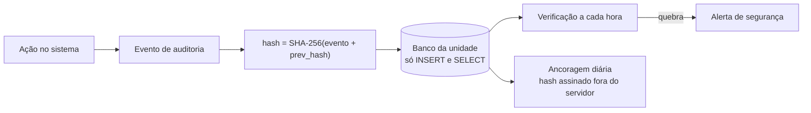

**Regras principais**
- Nenhum segredo em texto claro; chave-mestra do cofre fora do host da aplicação ([05](#doc-05); ADR-05).
- LGPD: base legal registrada, minimização, direitos do titular com prazo, incidentes comunicados à ANPD ([07](#doc-07)).
- Auditoria com cadeia de hash, leitura que também gera evento e exportação com MFA ([29](#doc-29)).
- Atendimento (helpdesk e SAC) e privacidade por portal, com o DPO de cada entidade ([32](#doc-32)).

<a id="doc-05"></a>

## 05 — Segurança

> Parte do [SDD v2](#doc-00). Identidade e acesso em [06](#doc-06); privacidade em [07](#doc-07).

---

### 1. Postura

A v1 declara risco **baixo** e zero achados abertos de severidade média ou superior (**[Declarado]**, auditorias de 10 e 11/07/2026). Essa afirmação não é usada como base de decisão nesta versão. A v2 exige que cada controle tenha teste ou evidência reproduzível. Os achados verificados contra o código estão em [13-achados-v1.md](#doc-13).

### 2. Controles

| Área | Requisito | Verificação |
|---|---|---|
| Senhas | Argon2id. Parâmetros mínimos do OWASP Password Storage Cheat Sheet: m = 19 MiB, t = 2, p = 1. **Parâmetros do produto (decisão do autor, 02/11/2026): m = 64 MiB, t = 4, p = 3.** Devem ser aceitos se o p95 de login, medido em hardware de produção, ficar abaixo de 500 ms. | **[Verificado]** `app/Security/Argon2idProfile.php` usa m = 64 MiB, t = 4, p = 2 (constante `THREADS`). **Pendente:** alinhar o código a p = 3. Teste de benchmark em CI. |
| Pepper de senha | Chave HMAC fora do banco, no cofre de segredos (ADR-05). Rotação com verificação dupla. | **[Planejado]** |
| Tokens | RS256 fixo. Rejeitar `alg` diferente, `none` e HS256. | **[Verificado parcial]**: `config/jwt.php` usa RS256 por padrão e bloqueia HS256 em produção, mas `JWT_SECRET` ainda é lido por código de proteção de ativos. Separar em segredo próprio por finalidade e não reutilizar o nome de JWT. |
| Sessão | Idle 30 min, absoluta 12 h, regeneração do ID após login e troca de privilégio. | Teste de integração. |
| Cookies | `HttpOnly`, `Secure`, `SameSite=Lax`, prefixo `__Host-` (ver [06](#doc-06), seção 7). | Teste de cabeçalho. |
| CSRF | Token sincronizador por sessão + validação de `Origin` ou `Sec-Fetch-Site`. Dupla submissão é aceita só para API de cookie. | Teste automatizado. |
| CSP | `default-src 'self'`; `script-src 'self' 'nonce-…'`; sem `unsafe-inline`; sem `on*=` em HTML (ADR-07). Trusted Types em modo report-only antes de forçar. | **[Verificado parcial]**: ver ACH-01 em [13](#doc-13). |
| Cabeçalhos | HSTS com `max-age` ≥ 1 ano em produção; `X-Content-Type-Options: nosniff`; `X-Frame-Options: DENY` ou `frame-ancestors 'none'`; `Referrer-Policy: strict-origin-when-cross-origin`; `Permissions-Policy` restritiva. | Teste de cabeçalho em CI. |
| Autorização | Default-deny. Toda rota com permissão ou rota pública explícita. | Teste que percorre o roteador e falha em rota sem regra. |
| Tenant | Ver [03](#doc-03), seção 3. | Matriz de isolamento. |
| Rate limit | Por IP, por identificador (com atraso progressivo, não bloqueio total) e por tenant. | Teste de carga leve em CI. |
| Upload | Limite de tamanho; validação por assinatura do arquivo (magic bytes) e por lista branca de tipos; renomeação com UUID; antivírus quando disponível; servido por controller com `Content-Disposition` e `X-Content-Type-Options: nosniff`. Nunca dentro de diretório público. | Teste com arquivo renomeado (`.php` com conteúdo de imagem). |
| Imagens protegidas | Marca d'água e URL assinada com expiração para conteúdo restrito. | **[Planejado]** |
| SQL | Somente prepared statements. Ordenação e nomes de coluna em lista branca. | Análise estática (regra de SQL com interpolação). |
| Saída | Escapamento contextual em HTML, atributo, JavaScript e URL. | Teste de XSS automatizado. |
| Erros | `display_errors=0` em produção; resposta genérica; detalhe só no log interno. | Teste de configuração. |
| Logs | Sem senha, token, cookie, CPF, e-mail completo ou corpo de requisição sensível. Mascaramento na escrita. | Teste com dados sintéticos. |
| Criptografia em repouso | AES-256-GCM para dados sensíveis, chave derivada com HKDF e envelope com versão. | **[Declarado]**; teste de decifragem com rotação. |
| Biblioteca de cofre própria (D-02) | Primitivas de `libsodium` ou OpenSSL, sem algoritmo novo. Envelope cifrado com chave de dados; chave-mestra fora do host da aplicação e nunca no mesmo arquivo do envelope. Revisão externa de criptografia antes de produção. | **[Planejado]** |
| Criptografia em trânsito | TLS 1.2 mínimo, preferencialmente 1.3. | Teste externo com ferramenta de TLS, em homologação. |

### 3. Contas e ferramentas de desenvolvimento

- **Proibido em qualquer diretório implantado:** scripts que criam sessão para contas reais, que imprimem identificadores de sessão ou que desativam autenticação. A v1 inclui 162 arquivos em `scratch/` na raiz do código, entre eles scripts que criam sessão para a conta de desenvolvedor (ACH-06). Esses arquivos são removidos do repositório. Regra de CI proíbe qualquer script que crie sessão ou imprima identificador de sessão. IP de origem não é controle válido, porque é forjável atrás de proxy.
- Diretórios `uploads/`, `workspace/`, `storage/`, `node_modules/` e `vendor/` com dados de execução não entram no artefato de deploy. A exclusão é verificada no pipeline (ver [10](#doc-10)).

### 4. Cadeia de suprimentos

| Controle | Regra |
|---|---|
| Versões | Pacotes com versão exata no lockfile. Nada de `latest`. |
| Instaladores de terceiros | Proibido executar em produção. Em desenvolvimento, versão fixada e checksum conferido antes da execução. |
| Auditoria | `composer audit` e `npm audit` em CI. Falha em alto ou crítico sem exceção registrada com prazo. |
| Segredos no código | `gitleaks` no pre-commit e no CI. Achado bloqueia merge. |
| SBOM | CycloneDX gerado por build: **[Planejado]**. Assinatura e procedência (SLSA) também são **[Planejado]**. |
| Ferramentas de IA e agentes | Versão fixada, revisão do código-fonte antes da instalação e sem permissão de escrita fora do repositório. Ver [11](#doc-11). |

### 5. Modelo de ameaças (resumo STRIDE)

| Categoria | Ameaça | Controle principal |
|---|---|---|
| Spoofing | Login com credencial vazada; sessão roubada | Argon2id, MFA, breach-check, sessão com vínculo de dispositivo (D-03) |
| Tampering | Alteração de parâmetro de tenant ou preço | Tenant do contexto; validação no serviço; assinatura em webhook |
| Repudiation | Negar ação administrativa | Auditoria com ator, ação, alvo, antes/depois, IP e requisição |
| Information disclosure | Enumeração de IDs; vazamento de tenant; erro com SQL | UUID, 404 uniforme, erro genérico, filtro de campo |
| Denial of service | Bloqueio de conta por tentativas; exportação pesada; payload grande | Atraso progressivo; fila para exportação; limite de payload |
| Elevation of privilege | Acesso de professor a dados de outra unidade; conta master sem MFA | Default-deny; permissão de unidade; MFA obrigatória para conta de plataforma |

Ameaças adicionais que a v2 inclui: **SSRF** em webhooks e integrações (bloqueio de redes privadas), **CSV injection** em exportações (regra em [08](#doc-08), seção 3) e **open redirect** em telas de login. Também: **injeção de prompt** em recursos com IA (dados de aluno enviados a provedor externo sem minimização; saída do provedor tratada como dado não confiável), **mass assignment** (campos de papel e de tenant não são aceitos do corpo da requisição) e **path traversal** em download (o caminho nunca vem do cliente; só o ID do arquivo).

### 6. Resposta a incidentes

| Severidade | Início do tratamento | Contenção | Comunicação interna |
|---|---|---|---|
| Crítica | 1 h | 4 h | Imediata ao responsável e à diretoria |
| Alta | 4 h | 24 h | Em até 8 h |
| Média | 1 dia útil | 7 dias | Relatório semanal |
| Baixa | 3 dias úteis | Próxima entrega | Registro no backlog |

- Runbook e modelo de comunicação à ANPD: ver [07](#doc-07), seção 8.
- Exercício de mesa semestral com registro.

### 7. Critérios de aceite de segurança (para cada release)

- [ ] Nenhum achado aberto de severidade alta ou crítica sem exceção aprovada.
- [ ] Testes de isolamento de tenant e de autorização passando.
- [ ] Varredura de dependências sem vulnerabilidades altas ou críticas.
- [ ] Varredura de segredos sem achados.
- [ ] Varredura dinâmica (DAST) em homologação, sem achado médio ou superior não tratado.
- [ ] Revisão de mudança em autenticação, autorização, cripto ou upload por pessoa com perfil de segurança.
- [ ] Nenhum arquivo de desenvolvimento no artefato de deploy.

<a id="v1-05-security-architecture-md"></a>

### v1 — `05-security-architecture.md` (69 linhas)

> Situação na v2: Substituído por 05. Quando este texto diverge da v2, vale a v2.

> Esta especificação foi substituída por inteiro pelo documento indicado acima. O texto fica como histórico; para implementar, vale o documento da v2.

> **Documento derivado do SDD mestre** · **Data:** 04/08/2026
> **Detalhes completos:** `docs/security/control-matrix.md`, `docs/security/findings-register.md`, `docs/threat-model-STRIDE.md`, `docs/MASTER_AUDIT_REPORT_2026-07-11.md`, `docs/security/audit-2026-07-10.md`

---

#### 1. Postura atual

- **Nível de risco: BAIXO** (auditorias 10-11/07/2026, validadas 04/08/2026).
- **36 achados** registrados → **34 FIXED**, 2 backlog (Vault KMS, SBOM).
- **0 críticos / 0 altos / 0 médios abertos.** CVSS residual máx 2.0.

#### 2. Principais controles (resumo)

| Área | Controle |
|------|----------|
| Senhas | Argon2id m=65536 (64MiB), t=4, p=2, hash 32B + salt 32B (sodium) + pepper HMAC-SHA256 via Vault |
| MFA | TOTP/WebAuthn/passkey/cert apenas (email/SMS/Tele rejeitados) |
| Tokens | JWT RS256 (HS256 bloqueado), blacklist jti, rotação de chaves, refresh rotativo |
| Sessão | idle 30min, absolute 12h, máx 3 concorrentes, bind IP+UA, regeneração pós-login |
| Cookies | Secure+HttpOnly+SameSite=Strict, rotação 5min |
| Headers | CSP nonce + Trusted Types, HSTS preload, XFO DENY, nosniff, COOP/CORP, Referrer-Policy, Permissions-Policy |
| CSRF | Double-submit + Origin/Referer |
| AuthZ | Default-deny global, BOLA/BFLA/BOPLA, RBAC por permissão, tenant scoping |
| Rate limit | Global + por identificador + por tenant + por IP |
| Uploads | MIME/magic/ext whitelist, rename, fora do webroot |
| Dados | AES-256-GCM + HKDF-SHA256 + envelope versionado |
| Secrets | Vault abstraction (FileVault ativo; KMS/HashiCorp prontos) |
| LGPD | Consentimento, DSR, DPO, breach 72h (ANPDReporter), sem PII em logs |

#### 3. Gates de segurança do SDD

| Gate | Momento | Aprovador |
|------|---------|-----------|
| SG-01 | Fechamento arquitetura base | Oracle + Security Auditor v3 |
| SG-02 | Fechamento Auth/ACL/Tenancy | Mantis + Security Auditor v3 |
| SG-03 | Antes de módulos sensíveis | Orchestrator + Mantis + Security Auditor v3 |
| SG-04 | Antes de homologação | Mantis + Fable Judge + Security Auditor v3 |
| SG-05 | Antes de release | Security Council + Security Auditor v3 |

**Estado:** SG-01..SG-04 validados; auditoria contínua e quality gates orientados a CI operando com a skill unificada `totustuus-security-auditor-v3` (`.agents/skills/totustuus-security-auditor-v3/SKILL.md`) cobrindo ASM, SAST, DAST, Argon2id, Multi-Tenancy e LGPD.

#### 4. Segurança por camada (implementação real)

- **app/Security/** (33 classes): PasswordManager, Argon2idProfile/Sodium, JWTManager, OAuthManager, WebAuthnManager, MFAManager, Totp, Base32, Csrf, RateLimiter, AuthorizationGuard, SessionSecurityService, RiskEngine, GeoLocationService, ClientIp, CspNonce, DataEncryption, KeyManager, TokenManager, Vault+Providers (File/HashiCorp/AwsKms), TenantCacheVault, ANPDReporter, AssetProtection, ImageProtection, AssetPathMapper, Ulid.
- **Middleware** (20): SecurityHeaders, Security, SessionSecurity, Csrf, Auth, Guest, Admin, Portal, Authorize, StrictAuthorize, ApiAuth, ApiSecurity, ApiSchema, RateLimit, Audit, HmacAuth, Idempotency, InstallToken, LogTruncation.

#### 5. Threat model

- STRIDE documentado em `docs/threat-model-STRIDE.md`.
- Superfícies: auth, API, CRUD genérico, uploads, webhooks, admin tools, tenancy.
- Mitigações ativas para cada categoria STRIDE (ver control-matrix).

#### 6. Resposta a incidentes

- `docs/security/incident-response-runbook.md` (tempos: crítico 1h, alto 4h, médio 24h, baixo 72h).
- `docs/security/breach-template-anpd.md` (LGPD Art. 48 — 72h ANPD).
- `ANPDReporter::report()` instrumentado.

#### 7. Melhorias planejadas (backlog)

| Item | Prioridade |
|------|-----------|
| Ativar AwsKmsVaultProvider/HashiCorpVaultProvider em produção (F-02) | Alta |
| SBOM + provenance no build (SLSA) | Média (Onda B) |
| CAPTCHA real (reCAPTCHA/Turnstile) — config já prevê `captcha_after_attempts` | Média |
| Expansão DAST (ZAP) | Média |
| Auditoria de secrets em CI (gitleaks já) + dependency scanning periódico | Baixa |

<a id="doc-07"></a>

## 07 — Privacidade e LGPD

> Parte do [SDD v2](#doc-00). Este documento é técnico. Não substitui parecer jurídico. Pontos marcados **(jurídico)** precisam de confirmação antes do go-live.

---

### 1. Compromissos

1. Coletar apenas o dado necessário para uma finalidade declarada.
2. Informar o titular antes da coleta, em linguagem simples.
3. Responder às solicitações de direitos dentro do prazo legal.
4. Apagar ou anonimizar quando a finalidade acaba e não há obrigação legal de guarda.
5. Tratar dados de crianças e adolescentes com o melhor interesse, consentimento parental quando exigido e minimização reforçada. (Ecossistema educacional: **(jurídico)** confirmar bases por tipo de dado.)

### 2. Inventário de dados

Cada tabela com dado pessoal tem, no registro de dados (ROPA), os campos: finalidade, base legal, categoria do titular, categoria do dado, operador, prazo de retenção e medida de segurança.

| Categoria | Exemplos | Sensibilidade |
|---|---|---|
| Identificação | Nome, e-mail, telefone, documento (CPF, RG) | Alta. Documento de identificação tem acesso restrito por política; não é dado sensível no sentido do art. 5º, II, LGPD. |
| Família | Responsáveis, parentesco | Alta (menores) |
| Acadêmico | Notas, frequência, histórico | Média |
| Saúde | Laudos, deficiência, alergias | **Sensível** (art. 11 LGPD) |
| Financeiro | Cobrança, dados bancários | Alta |
| Acesso | Logs de sessão, IP, User-Agent | Média |

### 3. Bases legais

Matriz de base legal por finalidade. Status: **proposta, pendente de parecer jurídico**. Nenhuma linha é válida para produção antes da confirmação. Citações de artigos referem-se à LGPD (Lei 13.709/2018).

| Finalidade | Dado | Base proposta | Legislação setorial a confirmar | Confirmação |
|---|---|---|---|---|
| Matrícula e vínculo acadêmico | Identificação, responsáveis | Execução de contrato ou procedimentos preliminares (art. 7º, V); obrigação legal (art. 7º, II) | Normas de educação e de registro escolar | **(jurídico)** |
| Cobrança de mensalidades | Identificação, financeiro | Execução de contrato (art. 7º, V); exercício regular de direitos (art. 7º, VI) | Código de Defesa do Consumidor, quanto a cobrança e negativação | **(jurídico)** |
| Recursos humanos e folha | Identificação, salário, documentos trabalhistas | Obrigação legal (art. 7º, II) | CLT e normas do eSocial | **(jurídico)** |
| Segurança e medicina do trabalho | Dado de saúde ocupacional | Tutela da saúde (art. 11, II, f) ou obrigação legal (art. 11, II, a) | NRs do Ministério do Trabalho e Emprego | **(jurídico)** |
| Marketing | Contato | Consentimento (art. 7º, I), com revogação simples | Regras de envio de mensagens | **(jurídico)** |
| Segurança e logs | Acesso, IP, registro de ações | Legítimo interesse (art. 7º, IX), com teste de balanceamento documentado | Normas de segurança da informação | **(jurídico)** |
| Consulta por CPF ([21](#doc-21), seção 6.8) | Identificação | Mesma base da finalidade declarada pelo tenant, sem base própria | Conforme a finalidade | **(jurídico)** |

**Escopo de legislação:** esta matriz cobre a legislação brasileira. Não afirma conformidade com outras jurisdições. A plataforma só atende outro país após revisão específica (lacuna LAC-15 em [19](#doc-19)). "Atender toda a legislação" não é uma condição que este SDD possa certificar: é tarefa contínua do jurídico, com revisão a cada mudança normativa.

### 4. Direitos do titular

| Direito | Entrega | Prazo de referência |
|---|---|---|
| Confirmação e acesso | Exportação em formato legível e portável | 15 dias (art. 19 LGPD) |
| Correção | Edição com trilha de auditoria | Imediato quando possível |
| Anonimização, bloqueio ou eliminação | Processo de retenção | Conforme política e prazos legais |
| Portabilidade | JSON ou CSV | 15 dias |
| Revogação de consentimento | Efeito imediato nas finalidades dependentes | Imediato |
| Informação sobre compartilhamento | Lista de operadores e terceiros | 15 dias |

- Solicitação gera protocolo, registro e resposta por canal verificado.
- Exportação de dados pessoais exige step-up de autenticação (ver [06](#doc-06)).
- Fluxo de pedido de titular para o responsável legal de menor segue a mesma regra, com verificação de vínculo.

### 5. Retenção

- Prazo por categoria definido pela plataforma. A entidade pode reduzir, não estender além do que a lei permite. **(jurídico)** confirmar prazos de guarda de documentos escolares.
- Job diário de expurgo com relatório. Eliminação física registra data e tipo, sem guardar o dado eliminado.
- Backups seguem a mesma regra: retenção de backup é limitada e documentada, e restauração de backup reaplica expurgos já executados.

### 6. Minimização nos logs

- Sem senha, token, cookie, CPF, dado de saúde ou corpo completo de requisição em log.
- E-mail e telefone mascarados (`j***@d***.com`).
- Logs de auditoria mantêm identificador interno do ator, não o nome.

### 7. Transferência e operadores

- Lista de operadores (provedores de e-mail, SMS, pagamento, nuvem) com contrato de tratamento de dados.
- Transferência internacional só para países com nível adequado ou com cláusulas-padrão. **(jurídico)**
- Integrações enviam somente os campos necessários ao contrato com o terceiro.

### 8. Incidentes e comunicação à ANPD

A v1 cita prazo de **72 horas**. A v2 corrige para o texto vigente: a Resolução CD/ANPD nº 15/2024 fixa o prazo de comunicação de incidente com risco ou dano relevante em **três dias úteis** a partir do conhecimento do incidente, e o art. 48 da LGPD exige comunicação ao titular. **(jurídico)** confirmar o prazo vigente antes de publicar o runbook.

Passos do runbook:

1. Conter e preservar evidências (sem alterar logs).
2. Avaliar: tipo de dado, volume de titulares, risco aos direitos, medidas aplicadas.
3. Comunicar internamente conforme severidade ([05](#doc-05), seção 6).
4. Comunicar à ANPD e aos titulares quando houver risco ou dano relevante, com conteúdo do modelo oficial.
5. Registrar o incidente, causa, ações e lições aprendidas.

### 9. Métricas de privacidade

| Métrica | Meta |
|---|---|
| Pedidos de titular atendidos no prazo | 100% |
| Dados com retenção vencida e não expurgados | 0 |
| Campos sensíveis em log (varredura) | 0 |
| Operadores sem contrato de tratamento | 0 |

### 10. Lacunas

Itens que a v1 listava como lacuna e que continuam abertos: ROPA completo por tabela, parecer de legítimo interesse, prazos de retenção aprovados, fluxo de consentimento para menores. Cada um tem dono e prazo no [backlog](#doc-11).

<a id="v1-08-privacy-lgpd-md"></a>

### v1 — `08-privacy-lgpd.md` (66 linhas)

> Situação na v2: Substituído por 07. Quando este texto diverge da v2, vale a v2.

> Esta especificação foi substituída por inteiro pelo documento indicado acima. O texto fica como histórico; para implementar, vale o documento da v2.

> **Documento derivado do SDD mestre** · **Data:** 04/08/2026

---

#### 1. Compromisso

Tratamento de dados pessoais em conformidade com LGPD (Lei 13.709/2018), com bases legais, consentimento granular, DSR e instrumentação de incidentes 72h.

#### 2. Instrumentação implementada

| Funcionalidade | Implementação |
|----------------|---------------|
| Consentimento | `UserConsent`, `PrivacyConsentEvent` (consentimento explícito, revogável, com versão) |
| Cookie consent | `UserCookieConsent` + `UserCookieConsentItem`, `CookieCatalog`, `CookieCategory`, `ConsentBannerVersion` |
| Preferências de privacidade | `UserPrivacyPreferences`, `PrivacyPreference` |
| Config por tenant | `TenantPrivacySetting` (retenção, mfa_required, etc.) |
| DSR (dados pessoais) | `PrivacyDataSubjectRequest` + workflow (acesso, correção, portabilidade, eliminação, revogação, opor) |
| DPO | `PrivacyOfficer` (nome/contato por tenant) |
| Auditoria | `PrivacyAuditLog` + `PrivacyComplianceController` (compliance 62 views) |
| Incidentes | `ANPDReporter` + `docs/security/breach-template-anpd.md` (Art. 48, 72h) |
| Minimização | Logs sem PII (LogTruncation), retenção configurável |

#### 3. Bases legais (implementadas)

- Consentimento explícito (consent records versionados).
- Contrato/legítimo interesse (termos + política, com histórico).
- Obrigação legal (retenção fiscal, ANPD).
- Direitos: acesso, correção, portabilidade, eliminação, revogação, oposição, não-decisão automatizada.

#### 4. Ciclo de vida de dados

```
Coleta (consent/bases) → Armazenamento (cifrado AES-256-GCM; backups) →
Uso (tenant-scoped) → Compartilhamento (somente com consentimento; integrações) →
Retenção (config por tenant) → Eliminação (soft/hard delete; DSR)
```

#### 5. Dados pessoais sensíveis

- Biométricos (WebAuthn credenciais → cifradas em vault-adjacent storage).
- Documentos (upload com AccessControl + cifragem).
- Saúde/educação (grade, matrículas — tenant-scoped).
- Minors: consentimento parental (modelos `*Parent*`).

#### 6. Prazos de retenção (configurável por tenant)

- Sessões/logs: config (default em `config/security.php`).
- DSR: registro por 5 anos (obrigação legal).
- Dados não necessários: eliminados após DSR.

#### 7. Métricas

- **~85% implementado** (GAP_ANALYSIS_2026-08-04.md).
- Compliance views: 62 (módulo compliance).
- Testes: Privacy/Consent/Cookie/DSR test classes (ver tests/).

#### 8. Lacunas

| Lacuna | Ação |
|--------|------|
| DSR workflow de ponta-a-ponta com interface | Reforçar views (algumas existem) |
| Minimização automática (pseudo-anonimização) | Melhoria contínua |
| Mapeamento de dados (records of processing) | Criar documento de registro de operações (ROPA) |
| ANPD contactos por tenant preenchidos | Validar dados de `PrivacyOfficer` por tenant |

<a id="doc-29"></a>

## 29 — Auditoria: Registro, Integridade, Acesso e Retenção

> Parte do [SDD v2](#doc-00). Princípios iniciais em [18](#doc-18), seção 4. Busca por CPF em [21](#doc-21), seção 6.8. Prazos em [26](#doc-26), seção 3. Bancos por entidade e unidade em [03](#doc-03), seção 1.1.
> **Status:** especificação proposta. Este documento consolida a auditoria, que estava espalhada em 80 menções. Prazos marcados como pendentes dependem do jurídico ([25](#doc-25)).

---

### 1. O que a auditoria registra

Um evento de auditoria existe para responder: **quem fez o quê, em qual objeto, quando, de onde, com qual resultado e com que contexto.**

| Categoria | Exemplos | Obrigatório |
|---|---|---|
| Autenticação | Login, falha de login, bloqueio, troca de senha, MFA, sessão encerrada | Sim |
| Autorização | Troca de contexto, acesso negado, concessão e revogação de vínculo ou papel | Sim |
| Dado sensível | Leitura de cadastro civil, de ficha de saúde, de salário, de dado bancário | Sim |
| Alteração de dado | Criação, alteração e exclusão lógica ou física, com antes e depois | Sim |
| Exportação e download | Exportação de lista, download de arquivo, envio de relatório | Sim |
| Consulta por CPF | Consulta, resultado e finalidade ([21](#doc-21), seção 6.8) | Sim |
| Configuração | Alteração de política, de MFA, de canal, de integração, de feature flag | Sim |
| Pagamento e estorno | Cobrança, baixa, estorno, aprovação dupla ([20](#doc-20)) | Sim |
| Consentimento | Concessão, revogação e versão do texto aceito | Sim |
| Processo | Job, expurgo, migração, reprocessamento de fila, bloqueio legal | Sim |
| Leitura comum | Abertura de tela sem dado sensível | Não (só amostragem, se medido) |

Regra: se a ação altera estado, lê dado sensível ou tem efeito financeiro, a auditoria é obrigatória e **gravada antes da resposta**. Se a gravação falhar, a ação é recusada.

---

### 2. Formato do evento

Todo evento tem o mesmo esquema, em todos os módulos.

| Campo | Tipo | Regra |
|---|---|---|
| `event_id` | UUIDv4 | Gerado pela aplicação |
| `occurred_at` | DATETIME(6) UTC | Relógio sincronizado por NTP. Desvio acima de 1 s gera alerta. |
| `category` | Enum | Uma das categorias da seção 1 |
| `action` | Texto curto | Ex.: `student.grade.update`, `invoice.refund.approve` |
| `result` | Enum | `sucesso`, `negado`, `erro` |
| `actor_uuid` | UUID | Conta global ([06](#doc-06), seção 12). `NULL` apenas para processos do sistema, com `actor_kind = sistema`. |
| `actor_kind` | Enum | `pessoa`, `sistema`, `integracao`, `suporte` |
| `portal` | Enum | Obrigatório. `desenvolvedor`, `gestao`, `professor`, `aluno`, `responsaveis`, `terceiros`, `publico`, `sistema`. Portal de onde a ação partiu ([31](#doc-31), seção 5). Permite filtrar a auditoria por portal sem ler o objeto |
| `entity_uuid`, `unit_uuid` | UUID | Contexto do evento |
| `session_id` | UUID | Sessão que originou a ação |
| `object_type`, `object_uuid` | Texto e UUID | Objeto afetado |
| `before_hash`, `after_hash` | CHAR(64) | Hash do estado antes e depois. O conteúdo completo fica no campo `diff`, quando permitido. |
| `diff` | JSON | Campos alterados. Campos sensíveis aparecem mascarados ou ausentes. |
| `reason` | Texto | Obrigatório em estorno, reabertura, bloqueio legal, leitura de dado sensível fora da rotina e consulta por CPF com detalhe |
| `ip`, `user_agent` | Texto | User-agent truncado em 200 caracteres |
| `correlation_id` | UUID | Liga eventos de uma mesma operação e ao log técnico ([10](#doc-10), seção 7) |
| `prev_hash`, `hash` | CHAR(64) | Cadeia de integridade (seção 4) |

Proibido no evento: senha, token, segredo, número de cartão, CVV, conteúdo completo de dado de saúde e CPF em texto. Usar hash HMAC quando for preciso identificar um CPF.

---

### 3. Onde fica

| Auditoria | Banco | Motivo |
|---|---|---|
| Ações de unidade (alunos, notas, financeiro, arquivos) | Banco da unidade | Acompanha o dado. Mesma retenção do dado. |
| Ações de identidade e de vínculo | Master | Autenticação e acesso são globais ([06](#doc-06), seção 12) |
| Leitura de cadastro civil | Banco de identidade da entidade | Acompanha o cadastro ([14](#doc-14), seção 3) |
| Ações da plataforma (Editor de portais, suporte, configuração global) | Master | Operação da plataforma |
| Processos e integrações | Banco da unidade ou master, conforme o escopo | Correlação por `correlation_id` |

Cópia de auditoria para armazenamento de longo prazo é feita por exportação diária assinada. Não é uma segunda fonte de verdade.

---

### 4. Integridade

1. **Cadeia de hash:** cada evento guarda `prev_hash`, o hash do evento anterior do mesmo banco e categoria. `hash = SHA-256(event canônico + prev_hash)`.
2. **Verificação:** job a cada hora recalcula a cadeia do último dia. Quebra gera alerta de segurança.
3. **Ancoragem:** o hash do último evento de cada dia é assinado e enviado a armazenamento separado, com a chave fora do servidor de dados ([05](#doc-05)).
4. **Imutabilidade no banco:** a conta da aplicação tem permissão de `INSERT` e `SELECT` na tabela de auditoria. Não tem `UPDATE` nem `DELETE`. Expurgo usa conta própria de processo de retenção, com registro.
5. **Correção:** erro em evento não é alterado. Gera evento de correção que referencia o original.

---

### 5. Acesso à auditoria

| Papel | Pode ver | Não pode ver |
|---|---|---|
| Auditor interno (segurança) | Todas as categorias, com mascaramento padrão | Conteúdo de dado de saúde, sem motivo registrado |
| Gestor da unidade | Eventos da própria unidade, exceto segurança da plataforma | Eventos de outra unidade |
| Encarregado (DPO) | Consultas por CPF, leituras de cadastro civil, pedidos de titular | Conteúdo de dado de saúde |
| Titular | Relatório sobre o próprio dado: quem consultou ou alterou, sem motivo livre de terceiros | Eventos de outras pessoas |
| Suporte da plataforma | Eventos técnicos e de sessão do chamado | Dado de aluno sem vínculo |

Regras:

- Toda leitura da auditoria gera evento de auditoria (`audit.read`).
- Exportação da auditoria exige MFA recente e motivo.
- Acesso à auditoria de outra entidade é impossível pela aplicação. Só é possível por processo jurídico, com registro fora do sistema.

---

### 6. Mascaramento

- CPF: `***.456.789-**` na listagem. Completo só com motivo.
- E-mail: `j***@d***.com`.
- Telefone: últimos quatro dígitos.
- Dado de saúde: presença e tipo do registro, sem conteúdo.
- Valor salarial: sem valor, só indicação de que foi alterado.

---

### 7. Retenção

| Categoria | Prazo | Situação |
|---|---|---|
| Registro de acesso (login, sessão, IP) | 6 meses | Base: Marco Civil, art. 15. Confirmar ([26](#doc-26), J-01). |
| Consulta por CPF | 24 horas | Decisão do autor. Conflito com o registro de acesso e com o relatório ao titular. Ver [25](#doc-25), Q-01. |
| Alteração de dado de unidade | Mesma retenção do dado | Ver [26](#doc-26), seção 3 |
| Pagamento e estorno | Prazo fiscal e de consumo | Confirmar ([26](#doc-26), seção 3) |
| Ação de plataforma | 5 anos | **Aprovado pelo autor em 03/11/2026.** Parecer jurídico ainda não registrado ([25](#doc-25)). |
| Evento de expurgo | Permanente | Registro do expurgo sem o dado |

Expurgo por job, com registro. Bloqueio legal impede expurgo do evento.

---

### 8. Alertas

| Alerta | Condição |
|---|---|
| Quebra de cadeia | Qualquer quebra |
| Gravação falhou | Qualquer falha de gravação de evento obrigatório |
| Leitura em volume | Leitura de dado sensível acima do padrão do usuário |
| Consulta por CPF | Padrão de varredura ([21](#doc-21), seção 6.8) |
| Acesso de suporte a dado de tenant | Qualquer acesso fora de chamado vinculado |
| Desvio de relógio | Mais de 1 s |

#### 8.1 Envio para central de segurança (AUD-03)

A integração é **opcional**. A auditoria do banco continua a fonte de verdade. A central de segurança (SIEM) recebe cópia, para correlação e alerta.

| Item | Regra |
|---|---|
| Da plataforma | Eventos de segurança do master (login, MFA, bloqueio, acesso negado, ação de plataforma, acesso de suporte) e os alertas desta seção vão para a central da empresa desenvolvedora |
| Da entidade | A entidade que tem central própria recebe só os eventos de segurança dela, por exportação assinada ou pelo webhook de saída da unidade (SRC-06). Nunca recebe evento de outra entidade nem da plataforma |
| Conteúdo | Evento com o mascaramento da seção 6. Pessoa identificada por `uuid`, sem CPF, e-mail ou nome. Sem dado de saúde, nota, valor salarial ou conteúdo de mensagem |
| Transporte | Só saída, da plataforma para a central, com TLS e assinatura do lote. A central não tem acesso de leitura ao banco |
| Falha | Falha de envio não bloqueia a ação do usuário. Os eventos ficam em fila e são reenviados na ordem, com o hash da cadeia (seção 4), para a central detectar lacuna |
| Log | O conector grava log de integração ([49](#doc-49), seção 2.1) |
| Produto | Escolha do produto e teste de envio ficam para homologação, como em AUD-02 |

---

### 9. Testes obrigatórios

- Ação que altera dado grava evento antes da resposta. Falha na gravação recusa a ação.
- Evento não aceita `UPDATE` nem `DELETE` pela conta da aplicação.
- Quebra de cadeia é detectada.
- Evento não contém senha, token, CPF em texto nem dado de saúde (varredura).
- Usuário de uma unidade não lê auditoria de outra.
- Leitura da auditoria gera evento.
- Relatório ao titular não inclui motivo livre de terceiro.

---

### 10. Lacunas

| # | Lacuna | Dono |
|---|---|---|
| AUD-01 | Prazo de retenção de eventos de plataforma: **5 anos, aprovado pelo autor em 03/11/2026.** Registrar parecer jurídico quando houver ([25](#doc-25), Q-01). | Jurídico |
| AUD-02 | Armazenamento de longo prazo e ancoragem: **decidido pelo autor em 03/11/2026**, com a exportação diária assinada da seção 3. Escolha do produto concreto e teste de restauração ficam para homologação. | Operação |
| AUD-03 | Integração com central de segurança, se houver | **Escrito** em 03/11/2026, seção 8.1. Escolha do produto em homologação |
| AUD-04 | Campo `portal` no evento | **Feito** em 03/11/2026: incluído na seção 2 |

---

### 11. Critérios de aceite

- [ ] Todas as categorias da seção 1 implementadas e testadas.
- [ ] Esquema da seção 2 aplicado em todos os bancos (unidade, identidade e master).
- [ ] Cadeia de hash verificada diariamente, com alerta.
- [ ] Testes da seção 9 passando em CI.
- [ ] AUD-01 e AUD-02 decididas (03/11/2026). Produto de longo prazo escolhido e restauração testada antes de produção.

<a id="doc-32"></a>

## 32 — Atendimento (Help Desk, SAC), Privacidade, LGPD e Encarregado, por Portal

> Parte do [SDD v2](#doc-00). Matriz de portais e fronteiras em [31](#doc-31). Protocolo e canais em [22](#doc-22) e [31](#doc-31), seção 3.2. Base legal e direitos em [07](#doc-07). Incidentes em [07](#doc-07), seção 8, e [05](#doc-05), seção 6. Auditoria em [29](#doc-29).
> **Status:** aprovada pelo autor em 03/11/2026, com as propostas adotadas. Itens sem valor definido continuam pendentes, criada em 03/11/2026 a partir das especificações da v1 ([`SPEC-HELPDESK.md`](#v1-spec-helpdesk-md), [`spec_chat_rapido_sac.md`](#v1-spec-chat-rapido-sac-md), [`spec_gestao_sac_base_conhecimento.md`](#v1-spec-gestao-sac-base-conhecimento-md), [`spec_gestao_privacy_global_completo.md`](#v1-spec-gestao-privacy-global-completo-md), [`spec-sub-sidebar-privacidade-lgpd.md`](#v1-spec-sub-sidebar-privacidade-lgpd-md)). Itens **[Decisão do autor]** dependem de resposta. Itens **(jurídico)** dependem de parecer ([25](#doc-25), [26](#doc-26)).
> **Premissa:** o pedido diz "pdo". Entendi como **DPO (encarregado)**. Se for outra coisa, avise.
> **Atualização de 03/11/2026:** o protocolo passa a ser serviço comum, usado também por documentos recebidos, administrativos e emitidos. Ver [54](#doc-54), seção 5.

---

### 1. Estado atual na v2

| Assunto | O que a v2 tem | Falta |
|---|---|---|
| Help desk / SAC | Só a decisão de unificar em um módulo ([19](#doc-19), seção 7) e as regras de bot ([22](#doc-22), seção 3) | Estados, transições, SLA, filas, categorias, portal do cliente, base de conhecimento, DDL |
| Privacidade e LGPD | Compromissos, inventário, bases legais, direitos, retenção, incidentes, métricas ([07](#doc-07)) | Fluxo de solicitação do titular com estados e prazo, gestão de consentimento por finalidade, registro de tratamento (ROPA) com DDL, transferência internacional, consentimento parental, painel do DPO |
| Encarregado (DPO) | Papel citado em [22](#doc-22), seção 5, e em [29](#doc-29), seção 5 | Escopo do papel no sistema, fila de aprovação, relatório de impacto (RIPD), tarefas e prazos |

Conclusão: **nenhum dos quatro assuntos está completo na v2.** Os requisitos da v1 existem, mas não foram trazidos para a v2 com estados, DDL e critério de aceite.

---

### 2. Atendimento: Help Desk e SAC

#### 2.1 Modelo único

Um só módulo de atendimento. Help desk é a base. SAC, chat rápido e tickets de canal são **canais ou tipos** do mesmo registro. Cada solicitação tem número de protocolo ([31](#doc-31), seção 3.2).

**Decisão proposta:** ticket é um tipo de protocolo. Todo ticket tem número de protocolo; nem todo protocolo é ticket (ex.: requerimento de 2ª chamada pode ser protocolo sem fila de atendimento). **Decidido** em 03/11/2026: ticket é tipo de protocolo em parte. Pedido com responsável e prazo recebe protocolo.

#### 2.2 Estados do ticket (da v1)

| Estado | Próximos estados permitidos |
|---|---|
| `novo` | `aberto`, `em_triagem`, `cancelado` |
| `aberto` | `em_triagem`, `em_atendimento`, `cancelado` |
| `em_triagem` | `em_atendimento`, `escalonado`, `cancelado` |
| `em_atendimento` | `aguardando_cliente`, `aguardando_terceiro`, `aguardando_aprovacao`, `em_pausa`, `resolvido`, `escalonado` |
| `aguardando_cliente`, `aguardando_terceiro`, `aguardando_aprovacao`, `em_pausa` | `em_atendimento` ou `resolvido` |
| `resolvido` | `fechado`, `reaberto` |
| `fechado` | `reaberto`, dentro da janela configurável |
| `reaberto` | `em_atendimento` |
| `escalonado` | `em_atendimento` |
| `cancelado`, `fechado` (sem reabertura) | Estados finais |

Regras:

- Estado `aguardando_*` pausa o contador de SLA conforme a regra de SLA (abaixo).
- Cada transição grava quem, quando e motivo quando o estado for `cancelado`, `escalonado` ou `reaberto`.
- Transição inválida é recusada pela aplicação ([15](#doc-15), seção 5), não só pela tela.

#### 2.3 SLA

Tipos (da v1): primeira resposta, próxima resposta, resolução, fechamento.

Aplicação: por entidade (tenant), por cliente, por fila, por tipo, por categoria e por prioridade. A regra mais específica vence.

**Proposta de valores iniciais:** definir por entidade, sem padrão universal. Valores padrão decididos em 03/11/2026: de 1 hora a 10 dias úteis por prioridade, ajustáveis por entidade. Sem valor definido, o ticket não recebe prazo, e o painel mostra "sem SLA".

Alerta: 80% do prazo consumido, e prazo estourado. Estouro entra no painel do gestor, não no portal do solicitante.

#### 2.4 Prioridade, categoria e fila

- Prioridade: baixa, média, alta, urgente. Urgente exige categoria que permita ([15](#doc-15)).
- Categoria: lista fechada por entidade. Ex.: secretaria, financeiro, biblioteca, TI, saúde.
- Fila: uma por categoria ou unidade. Atribuição automática por fila; redistribuição pelo coordenador.

#### 2.5 Canais

Conforme [22](#doc-22), seção 2, com estas regras de atendimento:

- Opção "Abrir ticket" sem IA em todo ponto de atendimento (D-18).
- Texto do solicitante é guardado literal, nunca interpretado como instrução ([05](#doc-05)).
- Campos obrigatórios variam por tipo, conforme a v1 ([`SPEC-HELPDESK.md`](#v1-spec-helpdesk-md), seção 7). Lista de campos padrão é fixa para todo tipo.

#### 2.6 Portal do cliente (solicitante)

- Abertura, acompanhamento, anexos, respostas públicas por padrão (v1, seção 12), consulta da base de conhecimento e avaliação do atendimento.
- Resposta interna (nota do atendente) nunca aparece no portal.
- Consulta pública por número e CPF, sem login, com limite de tentativas ([17](#doc-17), seção 3).

#### 2.7 Base de conhecimento

- Artigo tem autor, revisor, versão, data de revisão e público (interno, portal ou público).
- Artigo com dado pessoal não é publicado.
- Artigo que a IA sugere ao atendente passa pela regra de [27](#doc-27) (fonte cadastrada).

#### 2.8 Atendimento por portal

| Portal | Quem abre | Onde é atendido | Visibilidade |
|---|---|---|---|
| Desenvolvedor | Entidades (clientes da plataforma) | Suporte da plataforma | Tickets de clientes; sem dado de aluno sem chamado vinculado ([29](#doc-29), seção 8) |
| Gestão | Equipe da entidade e atendentes | Fila da categoria e da unidade | Conforme permissão da fila |
| Professor | Docente, para materiais, reservas, justificativas | Secretaria ou coordenação | Só o próprio ticket |
| Aluno | Aluno, para segunda chamada, declaração, dúvidas | Secretaria, biblioteca, financeiro | Só o próprio ticket |
| Responsáveis | Responsável legal, pelos dependentes | Secretaria, financeiro, coordenação | Só dependentes com vínculo ativo |
| Terceiros | Fornecedor, para manutenção e acesso | Operacional e compras | Só o próprio ticket |

#### 2.9 Bots

Bot de atendimento segue [22](#doc-22), seção 3 e [31](#doc-31), seção 3.7. Não resolve ticket de categoria sensível (saúde, denúncia, conflito) sem encaminhar para humano.

#### 2.10 Pendências do atendimento

| # | Pendência | Tipo |
|---|---|---|
| ATD-01 | Ticket como tipo de protocolo (seção 2.1) | **Aprovado em parte** em 03/11/2026: pedido com responsável e prazo recebe protocolo |
| ATD-02 | Valores padrão de SLA (seção 2.3) | **Decidido** em 03/11/2026: 1 hora a 10 dias úteis por prioridade, ajustável por entidade |
| ATD-03 | Retenção de tickets e de transcrição | (jurídico) — ver LAC-24 em [22](#doc-22) |
| ATD-04 | DDL do módulo de atendimento (estados, SLA, canais, artigos) | **Escrito** em [51](#doc-51), seção 1. Revisão do owner pendente (DDL-01) |
| ATD-05 | Regra para categoria sensível e encaminhamento | **Decidido** em 03/11/2026: encaminha ao canal da entidade e restringe o acesso |

---

### 3. Privacidade e LGPD

#### 3.1 Princípio de organização

A privacidade tem **duas escalas**:

- **Plataforma:** governança da própria empresa como controladora (ROPA, RIPD, incidentes, DPO, contratos com clientes).
- **Entidade:** governança do tenant como controlador. A plataforma é operadora. Cada entidade tem o próprio DPO, o próprio registro de tratamento e os próprios pedidos de titular.

Essa separação segue [22](#doc-22), seção 1, e [31](#doc-31), seção 3.

#### 3.2 Consentimento

Cada consentimento registra: finalidade, canal, versão do texto, data de concessão, data de revogação e evidência. Já definido em `crm_consents` ([22](#doc-22), seção 8). Falta generalizar:

| Regra | Detalhe |
|---|---|
| Finalidade separada | Cada finalidade tem consentimento próprio. Marketing não é condição de matrícula. |
| Revogação simples | Mesmo canal de concessão, sem barreira extra. Efeito imediato. |
| Consentimento não apagado | Revogação preenche `revoked_at`. Histórico fica. |
| Menor de 13 anos | Consentimento parental verificável antes da coleta. Método **(jurídico)**. |
| Menor de 18 e maior de 13 | Regra de [07](#doc-07), seção 3. Confirmar base por tipo de dado **(jurídico)**. |
| Termo de imagem | Consentimento específico por finalidade (site, redes, mural). Revogável. |

#### 3.3 Solicitação do titular

Fluxo, com estados e prazo (base em [07](#doc-07), seção 4):

| Estado | Ação |
|---|---|
| `recebida` | Protocolo gerado; prazo começa no recebimento |
| `identidade_pendente` | Verificação por canal verificado. Sem verificação, não há resposta. |
| `em_analise` | Atribuída a responsável. Avalia exceção legal. |
| `aguardando_dpo` | Pedido sensível ou com exceção: aprovação do DPO |
| `atendida` | Resposta entregue pelo canal verificado |
| `negada_com_motivo` | Recusa fundamentada, com a exceção legal citada **(jurídico)** |
| `encerrada` | Estado final |

Regras:

- Prazo de referência: 15 dias para confirmação e acesso, conforme [07](#doc-07), seção 4 **(jurídico)**. O sistema calcula o prazo e alerta com antecedência.
- Pedido de titular que é menor passa pelo responsável legal, com verificação de vínculo ([07](#doc-07), seção 4).
- Pedido recebido por atendimento vira ticket e protocolo (seção 2), com categoria `privacidade`.
- Exclusão respeita retenção legal e preservação probatória. Exceção é registrada com motivo ([31](#doc-31)).

#### 3.4 Registro de tratamento (ROPA)

Cada tratamento tem: finalidade, base legal, categoria de titular, categoria de dado, operador, prazo de retenção, medida de segurança e local de armazenamento. [07](#doc-07), seção 2, exige o registro, mas não define a tabela.

**Pendência:** DDL do ROPA por escala (plataforma e entidade). Documento a criar.

#### 3.5 Incidentes

Já definido em [07](#doc-07), seção 8, com prazo de três dias úteis **(jurídico)**. Falta o registro estruturado: tipo de dado, volume de titulares, risco, comunicação à ANPD e aos titulares, medidas e lições. Esse é o modelo de [18](#doc-18), seção 4.

#### 3.6 Transferência e operadores

Lista de operadores e contrato de tratamento: [07](#doc-07), seção 7. Transferência internacional: **(jurídico)**. A v1 lista jurisdições de vários países ([`spec_gestao_privacy_global_completo.md`](#v1-spec-gestao-privacy-global-completo-md), seção 4); a v2 limita ao Brasil, conforme [07](#doc-07), seção 3, até haver cliente fora do país.

#### 3.7 Painel do DPO

O DPO precisa de:

- fila de pedidos de titular e de aprovação;
- prazos e alertas;
- incidentes em aberto;
- RIPD em andamento (lacuna G-05 em [25](#doc-25));
- trilha de decisão.

O DPO **não opera** o módulo que audita ([22](#doc-22), seção 5). Ele vê o resultado, não altera o dado.

---

### 4. Privacidade por portal

| Portal | Recurso de privacidade | Escopo |
|---|---|---|
| Desenvolvedor | ROPA da plataforma, incidentes da plataforma, DPO da plataforma, contratos de operador com clientes | Plataforma apenas |
| Gestão | DPO da entidade, ROPA da entidade, pedidos de titular, consentimentos, termos de imagem, proteção de menores | Entidade e unidades conforme permissão |
| Professor | Próprias configurações de privacidade, consentimento de uso de imagem de turma | Só o próprio dado |
| Aluno | Dados cadastrais, solicitação LGPD, revogação de consentimento | Só o próprio dado |
| Responsáveis | Consentimento de imagem dos filhos, dados dos filhos, solicitação LGPD pelos dependentes | Só dependentes com vínculo ativo |
| Terceiros | Acordo de tratamento de dados (DPA), termo de confidencialidade | Só a própria empresa |

**Regra:** pedido de titular nunca é atendido por outro portal que não o do próprio titular ou do responsável verificado.

---

### 5. Pendências de privacidade e LGPD

| # | Pendência | Tipo |
|---|---|---|
| LGPD-01 | DDL do ROPA (plataforma e entidade) | **Escrito** em [51](#doc-51), seção 2. Revisão do owner pendente (DDL-01) |
| LGPD-02 | DDL do pedido de titular e seus estados (seção 3.3) | **Escrito** em [51](#doc-51), seção 2. Revisão do owner pendente (DDL-01) |
| LGPD-03 | Método de consentimento parental para menor de 13 anos | (jurídico) |
| LGPD-04 | Bases legais por tipo de dado escolar, incluindo menores | (jurídico), lacuna Q-03 a Q-08 em [25](#doc-25) |
| LGPD-05 | Transferência internacional, se houver cliente fora do Brasil | (jurídico) |
| LGPD-06 | Painel do DPO e RIPD (G-05) | Documento e (jurídico) |
| LGPD-07 | Quem é o DPO da plataforma e o de cada entidade | **Decidido** em 03/11/2026: plataforma é a empresa desenvolvedora. Entidade designa o seu, podendo contratar a empresa. Nomes a informar |
| LGPD-08 | Prazo de comunicação de incidente (três dias úteis, Resolução 15/2024) | (jurídico) confirmar vigência |

---

### 6. Critérios de aceite

- [ ] Ticket com estados e transições da seção 2.2, testados (transição inválida recusada).
- [ ] SLA aplicado por regra mais específica, com pausa em estados `aguardando_*`.
- [ ] Portal do cliente não mostra nota interna.
- [ ] Consentimento por finalidade, com revogação registrada sem apagar histórico.
- [ ] Pedido de titular com protocolo, prazo calculado e verificação de identidade antes de qualquer resposta.
- [ ] ROPA e incidentes com DDL e relatórios por escala.
- [ ] Cada portal mostra só o recurso da seção 4.
- [ ] Itens **[Decisão do autor]** e **(jurídico)** respondidos ou marcados como pendentes no [00](#doc-00).

### 7. Decisões de 03/11/2026

**ATD-01 (ticket como protocolo): aprovado em parte.**

- Recebe número de protocolo todo pedido que tem responsável e prazo: requerimento, reclamação, solicitação de documento, pedido de titular, chamado de TI, chamado de manutenção.
- Não recebe protocolo a pergunta respondida pelo bot ou pela base de conhecimento, sem fila de atendimento. Se a pergunta virar pedido, recebe protocolo nesse momento.

**ATD-02 (valores padrão de SLA): aprovado.** Padrão inicial, ajustável por entidade dentro do limite do contrato:

| Prioridade | Primeira resposta | Resolução |
|---|---|---|
| Urgente | 1 hora | 4 horas |
| Alta | 4 horas | 2 dias úteis |
| Média | 1 dia útil | 5 dias úteis |
| Baixa | 2 dias úteis | 10 dias úteis |

Fechamento automático 3 dias úteis após `resolvido`, sem resposta do solicitante. Tempo em `aguardando_*` não conta.

**LGPD-07 (DPO): aprovado.**

- DPO da plataforma: a empresa desenvolvedora, por meio do encarregado indicado por ela. Ele aparece no painel do portal do desenvolvedor.
- DPO de cada entidade: designado pela própria entidade, como controladora. A entidade pode designar a empresa desenvolvedora por contrato. **(jurídico)** confirmar a forma de designação e de contato público.

## Especificações da v1 desta parte absorvidas no kit-starter ou sem destino

<a id="v1-spec-sub-sidebar-privacidade-lgpd-md"></a>

### v1 — `spec-sub-sidebar-privacidade-lgpd.md` (321 linhas)

> Situação na v2: Absorvido integralmente no kit-starter. Destino: ficha do kit-starter: `kit-starter/desenvolvedor/seguranca-e-operacao/privacidade-dpo.md`. Quando este texto diverge da v2, vale a v2.

#### O que a v2 muda nesta especificação

Estas regras prevalecem sobre o texto da v1 que vem a seguir.

- **O [07](#doc-07) e o [32](#doc-32), seções 3 a 5, prevalecem** ([19](#doc-19), seção 2: privacidade global consolidada no 07; cookies e sessões no 06).
- **DPO da plataforma** (LGPD-07, [32](#doc-32), seção 7): a empresa desenvolvedora, por encarregado indicado por ela, com painel no portal do desenvolvedor. Cada entidade designa o próprio DPO.
- **Painel do DPO** ([32](#doc-32), seção 3.7); **pedido do titular** (seção 3.3); **ROPA** (seção 3.4); **incidentes e comunicação à ANPD** ([07](#doc-07), seção 8).
- **Operadora:** a plataforma não usa dado de entidade fora do contrato de tratamento ([07](#doc-07), seção 7).
- **Separação de funções:** o DPO não opera o módulo que audita ([22](#doc-22), seção 5).

#### Texto integral da v1

**Projeto:** TotusTuusSoftCloud  
**Módulo:** Privacy Compliance  
**Componente:** Sub-Sidebar de Navegação  
**Template Base:** Supabase Design System (`ui-patterns/InnerSideMenu`)  
**Versão:** 1.0.0  
**Status:** Draft  
**Autor:** Spec gerado para revisão técnica  
**Data:** Junho 2026

- Language Standard: Global English
---

#### 1. Contexto e Problema

O sub-sidebar atual do módulo de Privacidade & LGPD apresenta os seguintes problemas estruturais:

- **Hierarquia visual fraca:** títulos de grupo têm pouco contraste em relação aos itens, dificultando a escaneabilidade
- **Ordem não segue o fluxo operacional:** o usuário não consegue navegar na sequência lógica (ver → configurar → operar → governar → publicar)
- **Itens faltantes:** DPIA, Transferências Internacionais e Incidentes de Privacidade estão previstos na spec do módulo mas ausentes do menu
- **Redundância de dashboards:** "Dashboard", "Tenant Dashboard" e "Master Dashboard" aparecem como itens paralelos, quando deveriam ser contextos do mesmo painel
- **Estado ativo inconsistente:** o último item "Dashboard" do grupo LGPD Masking usa estilo diferente do padrão do template
- **Largura insuficiente:** itens como "Preferências de Cookies" ficam visualmente comprimidos

---

#### 2. Padrão de Referência — Supabase InnerSideMenu

O template Supabase utiliza os seguintes componentes de `ui-patterns/InnerSideMenu`:

| Componente | Uso |
|---|---|
| `InnerSideMenuCollapsible` | Wrapper de grupo colapsável |
| `InnerSideMenuCollapsibleTrigger` | Título clicável do grupo com chevron |
| `InnerSideMenuCollapsibleContent` | Container dos itens do grupo |
| `InnerSideMenuItem` | Item de navegação individual |
| `InnerSideMenuSeparator` | Linha divisória entre grupos |
| `InnerSideBarTitle` | Título estático (não colapsável) |
| `InnerSideBarFilters` + `InnerSideBarFilterSearchInput` | Campo de busca no topo |
| `InnerSideMenuItemLoading` | Skeleton de carregamento |
| `InnerSideBarEmptyPanel` | Estado vazio do menu |

##### Regras do padrão

- `defaultOpen={true}` apenas nos 2–3 grupos mais utilizados operacionalmente
- Demais grupos iniciam fechados (`defaultOpen={false}`) para reduzir altura total
- O campo de busca usa `InnerSideBarFilterSearchInput` — não um `<input>` customizado
- `InnerSideMenuSeparator` substitui bordas horizontais CSS manuais entre grupos
- Item ativo é controlado pelo componente via `isActive` prop ou rota ativa — **não** via classe CSS manual

---

#### 3. Arquitetura de Grupos e Ordem

A nova estrutura deve seguir o fluxo operacional: **ver → configurar → operar → governar → publicar**.

##### 3.1 Estrutura Completa

```
[Campo de busca — InnerSideBarFilterSearchInput]
  placeholder: "Buscar páginas de privacidade..."

────────────────────────────────────────────

VISÃO GERAL  (InnerSideBarTitle — estático, não colapsável)
  └─ Dashboard                          /admin/privacy/dashboard

[InnerSideMenuSeparator]

CONFORMIDADE LEGAL  (defaultOpen: true)
  ├─ Catálogo de Leis                   /admin/privacy/laws
  └─ Leis Aplicáveis                    /admin/privacy/applicability

[InnerSideMenuSeparator]

INVENTÁRIO & DIREITOS  (defaultOpen: true)
  ├─ RoPA                               /admin/privacy/ropa
  ├─ DSR                                /admin/privacy/dsr
  ├─ DPIA / Avaliações de Impacto       /admin/privacy/dpia       ← NOVO
  └─ DPO / Encarregado                  /admin/privacy/dpo

[InnerSideMenuSeparator]

CONSENTIMENTOS  (defaultOpen: true)
  ├─ Consentimentos                     /admin/privacy/consents
  ├─ Preferências de Cookies            /admin/privacy/cookies
  └─ Gerenciar Sessões                  /admin/privacy/sessions

[InnerSideMenuSeparator]

TRANSFERÊNCIAS & INCIDENTES  (defaultOpen: false)
  ├─ Transferências Internacionais      /admin/privacy/transfers   ← NOVO
  └─ Incidentes de Privacidade          /admin/privacy/incidents   ← NOVO

[InnerSideMenuSeparator]

POLÍTICAS  (defaultOpen: false)
  ├─ Políticas de Privacidade           /admin/privacy/policies
  └─ Policy Builder                     /admin/privacy/policy-builder

[InnerSideMenuSeparator]

LGPD MASKING  (defaultOpen: false)
  └─ Dashboard                          /admin/privacy/masking/dashboard
```

---

#### 4. Tratamento do Contexto de Dashboard (Tenant / Master)

O menu atual expõe três itens de dashboard separados:
- Dashboard
- Tenant Dashboard
- Master Dashboard

**Decisão de design:** esses três itens representam o **mesmo Dashboard** em contextos diferentes de visão, não três páginas distintas. A solução correta no padrão Supabase é um **seletor de contexto** acima do menu, e não itens paralelos no sidebar.

##### Implementação recomendada

Acima do `InnerSideMenuCollapsible` da seção "Visão Geral", adicionar um `<Select>` ou segmented control com as opções:

```
[Contexto: ▾]  ○ Meu Tenant   ○ Tenant Selecionado   ○ Master (Global)
```

O item "Dashboard" no menu aponta para a mesma rota `/admin/privacy/dashboard`, mas a view renderizada muda conforme o contexto selecionado via query param ou store global (`?context=master`).

---

#### 5. Itens Novos a Implementar

Os itens abaixo estão especificados na `privacy-compliance-spec.md` porém **ausentes do menu atual**:

| Item | Grupo | Rota | Permissão |
|---|---|---|---|
| DPIA / Avaliações de Impacto | Inventário & Direitos | `/admin/privacy/dpia` | `privacy:dpia:read` |
| Transferências Internacionais | Transferências & Incidentes | `/admin/privacy/transfers` | `privacy:transfers:manage` |
| Incidentes de Privacidade | Transferências & Incidentes | `/admin/privacy/incidents` | `privacy:incidents:read` |

---

#### 6. Especificação de Estado dos Grupos

| Grupo | `defaultOpen` | Justificativa |
|---|---|---|
| Visão Geral | estático (sem collapsible) | Dashboard é o ponto de entrada — sempre visível |
| Conformidade Legal | `true` | Configuração frequente em implantação inicial |
| Inventário & Direitos | `true` | Operação diária principal (DSR, RoPA) |
| Consentimentos | `true` | Operação diária frequente |
| Transferências & Incidentes | `false` | Uso eventual — abre quando necessário |
| Políticas | `false` | Uso eventual — geração e publicação de docs |
| LGPD Masking | `false` | Subproduto separado — uso específico |

---

#### 7. Ícones

Manter os ícones existentes onde já definidos. Para os itens novos, usar ícones do conjunto já adotado no projeto (Lucide ou similar):

| Item Novo | Ícone sugerido |
|---|---|
| DPIA / Avaliações de Impacto | `shield-alert` |
| Transferências Internacionais | `arrow-right-left` |
| Incidentes de Privacidade | `triangle-alert` |

---

#### 8. Implementação em Código — Estrutura JSX

```jsx
import {
  InnerSideMenuCollapsible,
  InnerSideMenuCollapsibleContent,
  InnerSideMenuCollapsibleTrigger,
  InnerSideMenuItem,
  InnerSideMenuSeparator,
  InnerSideBarTitle,
  InnerSideBarFilters,
  InnerSideBarFilterSearchInput,
} from 'ui-patterns/InnerSideMenu'

export function PrivacySidebarMenu({ currentPath }) {
  return (
    <Card className="min-w-60 bg-dash-sidebar py-4 flex flex-col gap-4 h-full">

      {/* Campo de busca */}
      <div className="px-3">
        <InnerSideBarFilters>
          <InnerSideBarFilterSearchInput
            name="privacy-search"
            placeholder="Buscar páginas de privacidade..."
            aria-labelledby="Buscar páginas"
          />
        </InnerSideBarFilters>
      </div>

      {/* VISÃO GERAL — estático */}
      <div className="px-3">
        <InnerSideBarTitle>Visão Geral</InnerSideBarTitle>
        <div className="mt-1">
          <InnerSideMenuItem href="/admin/privacy/dashboard" isActive={currentPath === '/admin/privacy/dashboard'}>
            Dashboard
          </InnerSideMenuItem>
        </div>
      </div>

      <InnerSideMenuSeparator />

      {/* CONFORMIDADE LEGAL */}
      <InnerSideMenuCollapsible defaultOpen>
        <InnerSideMenuCollapsibleTrigger title="Conformidade Legal" />
        <InnerSideMenuCollapsibleContent className="mt-1">
          <InnerSideMenuItem href="/admin/privacy/laws">Catálogo de Leis</InnerSideMenuItem>
          <InnerSideMenuItem href="/admin/privacy/applicability">Leis Aplicáveis</InnerSideMenuItem>
        </InnerSideMenuCollapsibleContent>
      </InnerSideMenuCollapsible>

      <InnerSideMenuSeparator />

      {/* INVENTÁRIO & DIREITOS */}
      <InnerSideMenuCollapsible defaultOpen>
        <InnerSideMenuCollapsibleTrigger title="Inventário & Direitos" />
        <InnerSideMenuCollapsibleContent className="mt-1">
          <InnerSideMenuItem href="/admin/privacy/ropa">RoPA</InnerSideMenuItem>
          <InnerSideMenuItem href="/admin/privacy/dsr">DSR</InnerSideMenuItem>
          <InnerSideMenuItem href="/admin/privacy/dpia">DPIA / Avaliações de Impacto</InnerSideMenuItem>
          <InnerSideMenuItem href="/admin/privacy/dpo">DPO / Encarregado</InnerSideMenuItem>
        </InnerSideMenuCollapsibleContent>
      </InnerSideMenuCollapsible>

      <InnerSideMenuSeparator />

      {/* CONSENTIMENTOS */}
      <InnerSideMenuCollapsible defaultOpen>
        <InnerSideMenuCollapsibleTrigger title="Consentimentos" />
        <InnerSideMenuCollapsibleContent className="mt-1">
          <InnerSideMenuItem href="/admin/privacy/consents">Consentimentos</InnerSideMenuItem>
          <InnerSideMenuItem href="/admin/privacy/cookies">Preferências de Cookies</InnerSideMenuItem>
          <InnerSideMenuItem href="/admin/privacy/sessions">Gerenciar Sessões</InnerSideMenuItem>
        </InnerSideMenuCollapsibleContent>
      </InnerSideMenuCollapsible>

      <InnerSideMenuSeparator />

      {/* TRANSFERÊNCIAS & INCIDENTES */}
      <InnerSideMenuCollapsible defaultOpen={false}>
        <InnerSideMenuCollapsibleTrigger title="Transferências & Incidentes" />
        <InnerSideMenuCollapsibleContent className="mt-1">
          <InnerSideMenuItem href="/admin/privacy/transfers">Transferências Internacionais</InnerSideMenuItem>
          <InnerSideMenuItem href="/admin/privacy/incidents">Incidentes de Privacidade</InnerSideMenuItem>
        </InnerSideMenuCollapsibleContent>
      </InnerSideMenuCollapsible>

      <InnerSideMenuSeparator />

      {/* POLÍTICAS */}
      <InnerSideMenuCollapsible defaultOpen={false}>
        <InnerSideMenuCollapsibleTrigger title="Políticas" />
        <InnerSideMenuCollapsibleContent className="mt-1">
          <InnerSideMenuItem href="/admin/privacy/policies">Políticas de Privacidade</InnerSideMenuItem>
          <InnerSideMenuItem href="/admin/privacy/policy-builder">Policy Builder</InnerSideMenuItem>
        </InnerSideMenuCollapsibleContent>
      </InnerSideMenuCollapsible>

      <InnerSideMenuSeparator />

      {/* LGPD MASKING */}
      <InnerSideMenuCollapsible defaultOpen={false}>
        <InnerSideMenuCollapsibleTrigger title="LGPD Masking" />
        <InnerSideMenuCollapsibleContent className="mt-1">
          <InnerSideMenuItem href="/admin/privacy/masking/dashboard">Dashboard</InnerSideMenuItem>
        </InnerSideMenuCollapsibleContent>
      </InnerSideMenuCollapsible>

    </Card>
  )
}
```

---

#### 9. Checklist de Implementação

- [ ] Substituir `<input>` de busca customizado por `InnerSideBarFilterSearchInput`
- [ ] Substituir bordas CSS manuais entre grupos por `InnerSideMenuSeparator`
- [ ] Remover "Tenant Dashboard" e "Master Dashboard" do menu; implementar seletor de contexto acima
- [ ] Mover "Catálogo de Leis" para antes de "Leis Aplicáveis" no grupo Conformidade Legal
- [ ] Adicionar item **DPIA / Avaliações de Impacto** em Inventário & Direitos
- [ ] Mover **DPO** para depois de DPIA (final do grupo Inventário & Direitos)
- [ ] Criar grupo **Transferências & Incidentes** com os dois itens novos
- [ ] Garantir que `defaultOpen` seja `false` nos grupos: Transferências & Incidentes, Políticas, LGPD Masking
- [ ] Padronizar estado ativo via prop `isActive` ou detecção de rota — remover CSS manual de estado ativo
- [ ] Adicionar ícones nos itens novos: `shield-alert`, `arrow-right-left`, `triangle-alert`
- [ ] Verificar largura mínima do sub-sidebar para acomodar "Preferências de Cookies" sem truncamento
- [ ] Testar em dark mode (padrão Supabase)
- [ ] Testar collapse/expand de todos os grupos
- [ ] Verificar acessibilidade: `aria-label` nos ícones, navegação por teclado, foco visível

---

#### 10. Rotas e Permissões por Item

| Item | Rota | Permissão |
|---|---|---|
| Dashboard | `/admin/privacy/dashboard` | `privacy:dashboard:read` |
| Catálogo de Leis | `/admin/privacy/laws` | `privacy:laws:read` |
| Leis Aplicáveis | `/admin/privacy/applicability` | `privacy:applicability:manage` |
| RoPA | `/admin/privacy/ropa` | `privacy:ropa:manage` |
| DSR | `/admin/privacy/dsr` | `privacy:dsr:read` |
| DPIA / Avaliações de Impacto | `/admin/privacy/dpia` | `privacy:dpia:read` |
| DPO / Encarregado | `/admin/privacy/dpo` | `privacy:dpo:manage` |
| Consentimentos | `/admin/privacy/consents` | `privacy:consents:read` |
| Preferências de Cookies | `/admin/privacy/cookies` | `privacy:consents:manage` |
| Gerenciar Sessões | `/admin/privacy/sessions` | `privacy:consents:manage` |
| Transferências Internacionais | `/admin/privacy/transfers` | `privacy:transfers:manage` |
| Incidentes de Privacidade | `/admin/privacy/incidents` | `privacy:incidents:read` |
| Políticas de Privacidade | `/admin/privacy/policies` | `privacy:policies:manage` |
| Policy Builder | `/admin/privacy/policy-builder` | `privacy:policies:manage` |
| LGPD Masking — Dashboard | `/admin/privacy/masking/dashboard` | `privacy:masking:read` |

<a id="v1-spec-gestao-auditoria-completo-md"></a>

### v1 — `spec_gestao_auditoria_completo.md` (731 linhas)

> Situação na v2: Absorvido integralmente no kit-starter. Destino: ficha do kit-starter: `kit-starter/desenvolvedor/seguranca-e-operacao/auditoria.md`. Quando este texto diverge da v2, vale a v2.

#### O que a v2 muda nesta especificação

Estas regras prevalecem sobre o texto da v1 que vem a seguir.

- **O [29](#doc-29) prevalece:** categorias, formato do evento, onde fica (ações da plataforma no master; ações de unidade no banco da unidade), integridade por cadeia de hash com verificação horária e ancoragem diária, imutabilidade (a aplicação só faz `INSERT` e `SELECT`), acesso por papel, mascaramento, retenção e alertas.
- **Auditoria × Logger** ([19](#doc-19), seção 2): a Auditoria é dona da trilha de negócio e de segurança ([18](#doc-18), seção 4); o logger técnico fica no [10](#doc-10), seção 7. A especificação do Logger da v1 é absorvida só como referência técnica, sem dado pessoal nos logs ([07](#doc-07), seção 6).
- **Toda leitura gera evento** (`audit.read`); exportação exige MFA recente e motivo; auditoria de outra entidade é impossível pela aplicação ([29](#doc-29), seção 5).
- **Suporte da plataforma** vê eventos técnicos e de sessão do chamado, sem dado de aluno sem vínculo.

#### Texto integral da v1

- Language Standard: Global English
#### 1. Visão geral

O módulo de Auditoria centraliza rastreabilidade, conformidade, revisão de eventos, trilhas de alteração, investigação de incidentes, monitoramento de integridade e governança operacional para um SaaS multi-entidade, multi-unidade e multi-usuário.

Este módulo deve cobrir toda a jornada de auditoria da plataforma, incluindo:
- Eventos de acesso.
- Alterações em cadastros e configurações.
- Aprovações e rejeições operacionais.
- Logs de API.
- Logs de segurança.
- Logs de automação.
- Logs de integrações externas.
- Revisões por fila, kanban e status.
- Evidências de conformidade.
- Exportação e retenção de registros.
- Controles de privacidade, sigilo e LGPD/GDPR.

A auditoria deve ser consultável por filtros avançados, organizada em datatables de alta densidade, acompanhada por widgets operacionais, charts executivos, drawers CRUD para investigação e painéis Kanban para tratamento de ocorrências.

---

#### 2. Objetivos do módulo

- Garantir rastreabilidade completa de ações críticas.
- Permitir investigação rápida de incidentes.
- Expor trilhas de alteração antes/depois.
- Controlar acesso a registros sensíveis.
- Atender requisitos de compliance e governança.
- Reduzir risco operacional e fraude.
- Prover evidências para revisões internas e externas.
- Permitir correlação entre eventos, usuários, unidades e entidades.

---

#### 3. Escopo funcional

##### 3.1. Entidades principais
- Audit Log.
- Security Event.
- Access Event.
- Change Event.
- API Request Log.
- Automation Run Log.
- Integration Log.
- Evidence Record.
- Review Case.
- Audit Rule.
- Retention Policy.
- Exception/Alert.
- Correlation Session.

##### 3.2. Públicos do módulo
- Administrador do sistema.
- Gestor de unidade.
- Gestor de entidade.
- Auditor interno.
- Segurança da informação.
- Compliance/LGPD.
- Suporte técnico.
- Usuário final com permissão restrita de consulta.

---

#### 4. Páginas do módulo

##### 4.1. Dashboard de Auditoria
Página inicial com visão consolidada do ecossistema de auditoria.

###### Controles
- Filtro de período.
- Filtro por entidade.
- Filtro por unidade.
- Filtro por tipo de evento.
- Filtro por gravidade.
- Filtro por usuário.
- Filtro por módulo.
- Filtro por origem IP.
- Filtro por canal.
- Salvar filtro.
- Exportar dados.
- Atualização automática.
- Modo investigação.
- Modo compliance.

###### Widgets
- Total de eventos no período.
- Eventos críticos.
- Tentativas de acesso negadas.
- Alterações sensíveis.
- Incidentes abertos.
- APIs com erro.
- Automations com falha.
- Evidências pendentes.

###### Charts
- Eventos por dia.
- Eventos por tipo.
- Eventos críticos por módulo.
- Volume por entidade/unidade.
- Taxa de falhas por integração.
- Distribuição por usuário.
- Heatmap por horário.
- Linha de tendência de risco.

###### Seções
- Últimos eventos relevantes.
- Casos em investigação.
- Alertas ativos.
- Top usuários com maior volume de ações.
- Top módulos com maior incidência.

---

##### 4.2. Audit Trail
Página principal de consulta de trilhas de auditoria.

###### Datatable
Colunas:
- ID.
- Data/hora.
- Entidade.
- Unidade.
- Módulo.
- Recurso.
- Ação.
- Usuário.
- Perfil.
- Origem.
- IP.
- Resultado.
- Gravidade.
- Correlation ID.
- Status de revisão.

###### Controles
- Busca textual.
- Filtros por coluna.
- Ordenação persistente.
- Paginação server-side.
- Exportação CSV/XLSX/PDF.
- Copiar linha.
- Abrir drawer.
- Comparar versões.
- Marcar para revisão.
- Encaminhar para incidente.

###### Drawer CRUD
- Visualizar evento.
- Ver antes/depois.
- Ver payload.
- Ver headers.
- Ver metadados.
- Ver timeline correlacionada.
- Ver anexos/evidências.
- Marcar como revisado.
- Criar caso.
- Adicionar observação.

---

##### 4.3. Security Logs
Página dedicada a eventos de segurança.

###### Eventos
- Login bem-sucedido.
- Login negado.
- Logout.
- MFA validado.
- MFA falhou.
- Troca de senha.
- Reset de senha.
- Bloqueio de conta.
- Desbloqueio de conta.
- Troca de dispositivo.
- Detecção de sessão suspeita.
- Alteração de permissões.

###### Widgets
- Logins por hora.
- Falhas de autenticação.
- Contas bloqueadas.
- Dispositivos novos.
- Sessões anômalas.
- Alertas de brute force.

###### Controles
- Filtro por risco.
- Filtro por dispositivo.
- Filtro por geolocalização.
- Filtro por status.
- Filtro por MFA.
- Filtro por sessão.

---

##### 4.4. API Logs
Página para auditoria de chamadas REST.

###### Datatable
Colunas:
- Timestamp.
- Método.
- Endpoint.
- Status HTTP.
- Latência.
- Usuário.
- Client ID.
- Correlation ID.
- IP.
- Unidade.
- Entidade.
- Request size.
- Response size.
- Erro.

###### Controles
- Filtrar por endpoint.
- Filtrar por status.
- Filtrar por método.
- Filtrar por latência.
- Filtrar por cliente.
- Filtrar por token.
- Ver request body.
- Ver response body.
- Reexecutar em ambiente de teste.
- Abrir incidente.

###### Charts
- Requests por minuto.
- Distribuição de status HTTP.
- Latência média por endpoint.
- Top endpoints com erro.
- Erros por integração.

---

##### 4.5. Change History
Página de versionamento de registros críticos.

###### Escopo
- Usuários.
- Papéis.
- Permissões.
- Entidades.
- Unidades.
- Parâmetros.
- Configurações.
- Cadastro de terceiros.
- Regras de automação.
- Templates e layouts.

###### Drawer
- Versão atual.
- Versão anterior.
- Diff linha a linha.
- Autor da alteração.
- Motivo.
- Campo alterado.
- Valor antigo.
- Valor novo.
- Reverter versão.
- Registrar justificativa.

---

##### 4.6. Incidents
Página de gestão de incidentes de auditoria.

###### Kan Ban
Colunas:
- Novo.
- Em análise.
- Em contenção.
- Em correção.
- Em validação.
- Resolvido.
- Encerrado.

###### Cards
- ID do incidente.
- Severidade.
- Tipo.
- Impacto.
- SLA.
- Responsável.
- Relacionamento com evento.
- Prazo.
- Quantidade de evidências.

###### Controles
- Criar incidente.
- Atribuir responsável.
- Alterar severidade.
- Adicionar evidências.
- Mover etapa.
- Registrar ação corretiva.
- Encerrar com justificativa.
- Reabrir.

---

##### 4.7. Evidence Center
Página para armazenamento e consulta de evidências.

###### Itens
- Captura de tela.
- Arquivo PDF.
- Log bruto.
- Exportação CSV.
- Assinatura digital.
- Documento de justificativa.
- Anexos de incidente.
- Comprovantes externos.

###### Controles
- Upload.
- Download.
- Controle de retenção.
- Controle de acesso.
- Assinatura/hash.
- Versionamento.
- Vincular a incidente.
- Vincular a evento.

---

##### 4.8. Rules and Policies
Página de gerenciamento das regras de auditoria.

###### Regras
- Eventos obrigatórios.
- Limiares de risco.
- Alertas por tentativas repetidas.
- Alertas por alterações sensíveis.
- Alertas por acesso fora do horário.
- Alertas por IP suspeito.
- Alertas por exportação massiva.
- Alertas por falha de integração.

###### Controles
- Ativar/desativar regra.
- Prioridade.
- Severidade.
- Escopo por entidade/unidade.
- Canal de notificação.
- Janela de tempo.
- Ação automática.
- Exceções.

---

##### 4.9. Retention and Compliance
Página de gestão de retenção e conformidade.

###### Funções
- Política de retenção por tipo de evento.
- Política por categoria legal.
- Expurgo controlado.
- Anonimização.
- Mascaramento.
- Bloqueio de alteração.
- Exportação sob demanda.
- Registros para LGPD/GDPR.

###### Controles
- Criar política.
- Revisar política.
- Agendar expurgo.
- Aprovar retenção estendida.
- Exportar evidências.
- Registrar base legal.

---

#### 5. Datatables por página

##### 5.1. Padrão global
Toda datatable deve ter:
- Busca global.
- Filtros avançados.
- Ordenação por colunas.
- Paginação server-side.
- Estado salvo por usuário.
- Ações por linha.
- Seleção múltipla.
- Exportação.
- Colunas configuráveis.
- Resposta responsiva.

##### 5.2. Colunas padrão
- ID.
- UUID.
- Data.
- Usuário.
- Entidade.
- Unidade.
- Módulo.
- Ação.
- Severidade.
- Status.
- Origem.
- IP.
- Correlation ID.
- Observação.

---

#### 6. Widgets

##### 6.1. Widgets executivos
- Total de eventos.
- Total de eventos críticos.
- Total de acessos suspeitos.
- Total de alterações sensíveis.
- Total de incidentes.
- Total de evidências.
- Total de regras ativas.
- Taxa de conformidade.

##### 6.2. Widgets operacionais
- Eventos sem revisão.
- Casos em SLA.
- Falhas por integração.
- Alertas em aberto.
- Logs com erro.
- Sessões suspeitas.
- Ações em lote recentes.
- Exportações pendentes.

---

#### 7. Charts

##### 7.1. Gráficos obrigatórios
- Line chart de eventos no tempo.
- Bar chart de eventos por módulo.
- Donut chart por severidade.
- Area chart de risco acumulado.
- Heatmap de atividade por horário.
- Stacked bar por entidade/unidade.
- Sankey de origem → ação → resultado.
- Scatter de latência x volume para APIs.

##### 7.2. Objetivo dos gráficos
- Identificar picos de risco.
- Encontrar módulos problemáticos.
- Medir comportamento anômalo.
- Acompanhar incidentes por período.
- Apoiar comitês de segurança e compliance.

---

#### 8. Drawers CRUD

##### 8.1. Drawer de evento
Campos:
- Tipo de evento.
- Data/hora.
- Usuário.
- Entidade.
- Unidade.
- Ação.
- Recurso.
- Resultado.
- Gravidade.
- IP.
- User agent.
- Correlation ID.
- Payload.
- Before.
- After.
- Observação.

##### 8.2. Drawer de incidente
Campos:
- Título.
- Descrição.
- Severidade.
- Categoria.
- Status.
- Responsável.
- SLA.
- Datas.
- Evidências.
- Ações corretivas.

##### 8.3. Drawer de regra
Campos:
- Nome.
- Descrição.
- Evento alvo.
- Condição.
- Operador.
- Limite.
- Frequência.
- Canal.
- Ação automática.
- Escopo.

---

#### 9. Kan Ban

##### 9.1. Casos de uso
- Tratamento de incidentes.
- Revisão de alertas.
- Aprovação de exceções.
- Validação de expurgo.
- Investigação de logs suspeitos.

##### 9.2. Metadados do card
- Tipo.
- Severidade.
- Prazo.
- Responsável.
- Evidências.
- Tags.
- Unidade.
- Entidade.

##### 9.3. Ações do card
- Arrastar e soltar.
- Comentar.
- Anexar evidências.
- Reatribuir.
- Bloquear.
- Escalar.
- Encerrar.

---

#### 10. Automações

##### 10.1. Regras automáticas
- Criar incidente ao exceder limiar.
- Enviar alerta ao detectar acesso suspeito.
- Registrar evidência ao exportar dados.
- Marcar revisão obrigatória para evento sensível.
- Bloquear sessão em padrão anômalo.
- Notificar compliance em falha crítica.
- Gerar resumo diário.
- Gerar relatório semanal.

##### 10.2. Canais
- E-mail.
- Notificação interna.
- Webhook.
- Slack/Teams.
- SMS.
- Tarefa interna.

---

#### 11. Controles

##### 11.1. Controles globais
- Filtro de entidade.
- Filtro de unidade.
- Filtro de usuário.
- Filtro temporal.
- Filtro por severidade.
- Filtro por origem.
- Filtro por módulo.
- Filtro por tipo de ação.

##### 11.2. Controles de segurança
- Mascarar dados sensíveis.
- Bloquear exportação sem permissão.
- Registrar toda consulta.
- Controlar acesso por RBAC.
- Aplicar escopo por entidade/unidade.
- Registrar justificativa para acesso sensível.

##### 11.3. Controles de auditoria
- Aprovação de revisão.
- Aprovação de expurgo.
- Reabertura de incidente.
- Reclassificação de severidade.
- Reprocessamento de regra.
- Marcação de falso positivo.

---

#### 12. Gerenciamentos

##### 12.1. Gestão de perfis
- Administrador.
- Auditor.
- Compliance.
- Suporte.
- Gestor.
- Leitura restrita.

##### 12.2. Gestão de políticas
- Retenção.
- Expurgo.
- Segurança.
- Revisão.
- Alertas.
- Exportação.

##### 12.3. Gestão de integrações
- ERP.
- Identity provider.
- Webhooks.
- Monitoramento.
- SIEM.
- Ferramentas de BI.

##### 12.4. Gestão de evidências
- Coleta.
- Assinatura.
- Versionamento.
- Retenção.
- Consulta.
- Exportação.

---

#### 13. Permissões

##### 13.1. Acesso por perfil
- Visualizar auditoria.
- Exportar auditoria.
- Reverter alteração.
- Criar incidente.
- Aprovar expurgo.
- Configurar regra.
- Ver payload sensível.
- Ver antes/depois.
- Atribuir responsável.
- Encerrar caso.

##### 13.2. Restrições
- Usuários comuns não acessam payload sensível.
- Exportação massiva exige permissão especial.
- Reversão de alteração exige perfil elevado.
- Evidências criptografadas para dados protegidos.
- Logs com PII devem ser mascarados conforme política.

---

#### 14. Requisitos técnicos

##### 14.1. Backend
- PHP 8 puro.
- API REST.
- RBAC.
- Middleware de escopo por entidade/unidade.
- Logs imutáveis.
- Correlation ID por requisição.
- Hash de integridade por evento.

##### 14.2. Frontend
- Tailwind CSS 4.2.
- Supabase.
- DataTables responsivos.
- Drawers assíncronos.
- Kan Ban drag-and-drop.
- Charts com amCharts 5.

##### 14.3. Banco de dados
- MariaDB.
- Índices compostos por data, entidade, unidade, tipo e severidade.
- Particionamento por período quando necessário.
- Tabelas de retenção e purga.
- Colunas UUID para rastreabilidade.

---

#### 15. Segurança e compliance

- Registrar toda ação crítica.
- Aplicar princípio do menor privilégio.
- Mascarar dados pessoais sempre que possível.
- Logar acesso a registros sensíveis.
- Manter trilha imutável para auditoria.
- Proteger evidências com hash.
- Suportar retenção configurável.
- Atender LGPD/GDPR com base legal e minimização.
- Registrar consentimento quando aplicável.
- Garantir exportação e eliminação sob política.

---

#### 16. Páginas complementares

- Configurações de auditoria.
- Alertas e notificações.
- Relatórios executivos.
- Histórico de exportações.
- Trilha de revisão.
- Logs de retenção e expurgo.
- Configuração de integrações.
- Centro de evidências.
- Fila de incidentes.
- Painel de risco.

---

#### 17. Checklist de entrega

- Dashboard funcional.
- Datatables com filtros avançados.
- Widgets por domínio.
- Charts operacionais e executivos.
- Drawers CRUD completos.
- Kan Ban para incidentes.
- Automações configuráveis.
- Controles por perfil.
- Gestão de retenção.
- Exportação segura.
- Integrações e webhooks.
- Logs de integridade.
- Conformidade LGPD/GDPR.

---

#### 18. Critérios de aceite

- Cada evento crítico deve ser rastreável do início ao fim.
- Cada alteração sensível deve mostrar before/after.
- Cada incidente deve ter responsável e SLA.
- Cada exportação deve gerar log próprio.
- Cada acesso sensível deve ser auditável.
- Cada regra deve ser configurável por escopo.
- Cada evidência deve poder ser vinculada ao caso.
- O módulo deve operar com multi-entidade e multi-unidade sem vazamento de escopo.

<a id="v1-spec-gestao-logger-completo-md"></a>

### v1 — `spec_gestao_logger_completo.md` (1038 linhas)

> Situação na v2: Absorvido integralmente no kit-starter. Destino: ficha do kit-starter: `kit-starter/desenvolvedor/seguranca-e-operacao/auditoria.md`. Quando este texto diverge da v2, vale a v2.

#### O que a v2 muda nesta especificação

Estas regras prevalecem sobre o texto da v1 que vem a seguir.

- **O [29](#doc-29) prevalece:** categorias, formato do evento, onde fica (ações da plataforma no master; ações de unidade no banco da unidade), integridade por cadeia de hash com verificação horária e ancoragem diária, imutabilidade (a aplicação só faz `INSERT` e `SELECT`), acesso por papel, mascaramento, retenção e alertas.
- **Auditoria × Logger** ([19](#doc-19), seção 2): a Auditoria é dona da trilha de negócio e de segurança ([18](#doc-18), seção 4); o logger técnico fica no [10](#doc-10), seção 7. A especificação do Logger da v1 é absorvida só como referência técnica, sem dado pessoal nos logs ([07](#doc-07), seção 6).
- **Toda leitura gera evento** (`audit.read`); exportação exige MFA recente e motivo; auditoria de outra entidade é impossível pela aplicação ([29](#doc-29), seção 5).
- **Suporte da plataforma** vê eventos técnicos e de sessão do chamado, sem dado de aluno sem vínculo.

#### Texto integral da v1

> **Projeto:** TotusTuusSoftCloud Premium V2  
> **Stack:** PHP 8 puro · Tailwind CSS 4.2 · Supabase · amCharts 5 · FontAwesome 7.2  
> **Padrão de IDs:** `id` (ordenação/JOINs) · `uuid` (interno entre bancos) · `code` (externo/APIs/URLs)  

- Language Standard: Global English
> **Última atualização:** 2026-06-08

---

#### Índice de Páginas

| # | Página | Rota | Arquivo PHP |
|---|--------|------|-------------|
| 1 | Dashboard | /admin/logger | logger/dashboard.php |
| 2 | Sessões de Usuários | /admin/logger/sessions | logger/sessions.php |
| 3 | Audit Trail | /admin/logger/audit-trail | logger/audit-trail.php |
| 4 | Security Logs | /admin/logger/security | logger/security.php |
| 5 | Login Attempts | /admin/logger/login-attempts | logger/login-attempts.php |
| 6 | System Events | /admin/logger/system-events | logger/system-events.php |
| 7 | Database Audits | /admin/logger/db-audits | logger/db-audits.php |
| 8 | Metrics | /admin/logger/metrics | logger/metrics.php |
| 9 | Alerts | /admin/logger/alerts | logger/alerts.php |
| 10 | **Kanban de Alertas** | /admin/logger/kanban | logger/kanban.php |
| 11 | **Automações** | /admin/logger/automations | logger/automations.php |
| 12 | **Controles** | /admin/logger/controls | logger/controls.php |
| 13 | **Gerenciamentos** | /admin/logger/management | logger/management.php |

---

#### Regras Globais de Padronização

##### Estrutura de Blocos por View (ordem obrigatória)
```
1. Header        → breadcrumb + título + botões de ação
2. Widgets       → 4 a 8 cards KPI com progress bar
3. DataTable     → toolbar + tabela + paginação + footer
4. Charts        → grid de gráficos amCharts 5
5. Drawers       → filtros, criação, edição, visualização
6. JS include    → <script src="/assets/js/logger/ttsc.admin.logger.{page}.js">
```

##### Padrão de Widget Card
```html
<div id="widget-{id}" class="ttsc-card ttsc-card-widget">
  <div class="ttsc-card-body d-flex align-items-center gap-3">
    <span class="ttsc-icon-wrap ttsc-bg-{color}-soft">
      <i class="fa-solid fa-{icon} ttsc-text-{color}"></i>
    </span>
    <div class="flex-grow-1">
      <div class="ttsc-widget-value" id="widget-{id}-value">—</div>
      <div class="ttsc-widget-label">{Label}</div>
      <div class="progress mt-1" style="height:4px">
        <div class="progress-bar bg-{color}" id="widget-{id}-bar" style="width:0%"></div>
      </div>
      <small class="ttsc-text-muted" id="widget-{id}-hint">{hint}</small>
    </div>
  </div>
</div>
```

##### Padrão de Toolbar DataTable
```html
<div class="ttsc-datatable-toolbar d-flex flex-wrap align-items-center gap-2">
  <!-- Busca -->
  <input type="search" id="search-{page}" class="form-control form-control-sm w-200px"
         placeholder="Buscar...">
  <!-- Filtros rápidos (chips/select) -->
  <select id="filter-{field}" class="form-select form-select-sm w-auto">...</select>
  <!-- Batch Actions (aparece ao selecionar linhas) -->
  <div id="batch-actions-{page}" class="d-none d-flex gap-2">
    <button class="btn btn-sm btn-light-danger" id="batch-delete-{page}">
      <i class="fa-solid fa-trash"></i> Excluir selecionados
    </button>
    <button class="btn btn-sm btn-light-primary" id="batch-export-{page}">
      <i class="fa-solid fa-file-export"></i> Exportar selecionados
    </button>
  </div>
  <!-- Exportar -->
  <div class="dropdown ms-auto">
    <button class="btn btn-sm btn-light dropdown-toggle">
      <i class="fa-solid fa-download"></i> Exportar
    </button>
    <ul class="dropdown-menu dropdown-menu-end">
      <li><a class="dropdown-item" data-export="csv">CSV</a></li>
      <li><a class="dropdown-item" data-export="xlsx">XLSX</a></li>
      <li><a class="dropdown-item" data-export="pdf">PDF</a></li>
      <li><a class="dropdown-item" data-export="json">JSON</a></li>
      <li><a class="dropdown-item" data-export="xml">XML</a></li>
      <li><a class="dropdown-item" data-export="sql">SQL</a></li>
      <li><a class="dropdown-item" data-export="txt">TXT</a></li>
    </ul>
  </div>
  <!-- Filtro Avançado -->
  <button class="btn btn-sm btn-light" data-drawer-toggle="drawer-filter-{page}">
    <i class="fa-solid fa-sliders"></i> Filtros
  </button>
</div>
```

##### Padrão amCharts 5 — Destroy/Recreate
```javascript
// Sempre destruir antes de recriar
if (window._charts && window._charts['{chartId}']) {
  window._charts['{chartId}'].dispose();
}
const root = am5.Root.new('{chartId}');
root.setThemes([am5themes_Animated.new(root)]);
window._charts = window._charts || {};
window._charts['{chartId}'] = root;
```

##### Padrão de Drawer (filtro/CRUD)
- **Pasta:** `/resources/app/partials/drawers/drawer/admin/logger/`
- **Include em:** `/resources/app/partials/drawer.php`
- **Largura:** `w-400px` (filtros) · `w-600px` (criação/edição) · `w-800px` (visualização/kanban)
- **Footer obrigatório:** botões Cancelar + Aplicar/Salvar com IDs `btn-{drawer}-cancel` e `btn-{drawer}-submit`

---

#### 1. Dashboard Logger

##### Header
- **Ícone:** `fa-solid fa-gauge-high` · cor `ttsc-text-primary`
- **Título:** Painel de Logger
- **Subtítulo:** Visão geral de todos os módulos de log e auditoria
- **Botões:** `Atualizar` (fa-rotate-right) · `Configurações` → drawer-config-dashboard

##### Widgets (linha 1 — visão geral)
| ID | Ícone | Título | Cor | Progress Label |
|----|-------|--------|-----|----------------|
| widget-sessions-active | fa-users | Sessões Ativas | primary | % do pico diário |
| widget-alerts-critical | fa-triangle-exclamation | Alertas Críticos | danger | % sem resolução |
| widget-login-failed-24h | fa-lock | Falhas de Login 24h | warning | % do limite |
| widget-events-today | fa-bolt | Eventos Hoje | info | vs. média diária |

##### Widgets (linha 2 — status dos módulos)
| ID | Ícone | Título | Cor | Progress Label |
|----|-------|--------|-----|----------------|
| widget-audit-records | fa-file-shield | Registros Audit Trail | success | % capacidade DB |
| widget-security-events | fa-shield-halved | Eventos de Segurança | danger | últimas 24h |
| widget-db-queries | fa-database | Queries Auditadas | secondary | % slow queries |
| widget-metrics-score | fa-chart-line | Score de Saúde | success | índice geral |

##### DataTable — Últimos Eventos (Feed Global)
| Coluna | Tipo | Alinhamento | Notas |
|--------|------|-------------|-------|
| # | checkbox | center | seleção batch |
| Módulo | badge | left | Sessions/Audit/Security/etc. |
| Tipo | badge-soft | left | info/warning/error/critical |
| Descrição | texto truncado | left | max 80 chars, tooltip full |
| Entidade | texto | left | entity_code |
| Usuário | avatar+texto | left | user_code + nome |
| IP | mono | center | — |
| Data/Hora | datetime | center | formato DD/MM/YYYY HH:mm:ss |
| Ações | botões | center | Ver, Ir ao módulo |

**SORT_FIELDS:** `module, type, user_code, ip_address, created_at`
**Filter Keys:** `module, type, date_range, user_uuid, entity_uuid`

##### Charts
| ID | Tipo amCharts 5 | Título | Grid |
|----|-----------------|--------|------|
| chart-events-timeline | XYChart (LineSeries) | Linha do Tempo de Eventos | col-12 |
| chart-modules-donut | PieChart (donut) | Eventos por Módulo | col-md-6 |
| chart-severity-bar | XYChart (ColumnSeries) | Eventos por Severidade | col-md-6 |

##### Drawers
- `drawer-config-dashboard.php` — ID: `drawer-config-dashboard` · w-400px
  - Período padrão de exibição (select: 24h/7d/30d)
  - Módulos visíveis (checkboxes)
  - Auto-refresh (toggle + intervalo em segundos)
  - Limite de registros no feed (number input)

---

#### 2. Sessões de Usuários

##### Header
- **Ícone:** `fa-solid fa-users` · cor `ttsc-text-primary`
- **Título:** Sessões de Usuários
- **Subtítulo:** Monitoramento de sessões ativas e históricas
- **Botões:** `Encerrar Todas` (fa-right-from-bracket, btn-danger) · `Filtros` → drawer-filter-sessions

##### Widgets
| ID | Ícone | Título | Cor | Progress Label |
|----|-------|--------|-----|----------------|
| widget-sessions-now | fa-circle-dot | Sessões Ativas Agora | success | % do pico |
| widget-sessions-today | fa-calendar-day | Sessões Hoje | primary | vs. ontem |
| widget-sessions-avg | fa-clock | Duração Média | info | min por sessão |
| widget-sessions-devices | fa-mobile-screen | Dispositivos Únicos | secondary | mobile vs. desktop |

##### DataTable
| Coluna | Tipo | Alinhamento | Notas |
|--------|------|-------------|-------|
| # | checkbox | center | — |
| code | mono | center | session code (externo) |
| Usuário | avatar+texto | left | user_code + nome completo |
| IP | mono | center | com flag de país |
| Dispositivo | ícone+texto | left | fa-mobile/fa-desktop/fa-tablet |
| Navegador | ícone+texto | left | — |
| Sistema Op. | texto | left | — |
| Início | datetime | center | — |
| Último Acesso | datetime | center | badge "Agora" se < 2min |
| Duração | timer | center | HH:mm:ss |
| Status | badge | center | Ativa/Encerrada/Expirada |
| Ações | botões | center | Ver Detalhes, Encerrar |

**SORT_FIELDS:** `code, user_code, ip_address, started_at, last_seen_at, duration, status`
**Filter Keys:** `status, device_type, date_range, user_uuid, ip_address`
**Batch Actions:** Encerrar Selecionadas · Exportar

##### Charts
| ID | Tipo | Título | Grid |
|----|------|--------|------|
| chart-sessions-active-line | XYChart (SmoothedXLineSeries) | Sessões Ativas por Hora | col-12 |
| chart-sessions-devices | PieChart (donut) | Sessões por Dispositivo | col-md-4 |
| chart-sessions-browsers | PieChart (donut) | Sessões por Navegador | col-md-4 |
| chart-sessions-os | PieChart (donut) | Sessões por Sistema Op. | col-md-4 |

##### Drawers
- `drawer-filter-sessions.php` — ID: `drawer-filter-sessions` · w-400px
  - Status (checkboxes: Ativa/Encerrada/Expirada)
  - Tipo de dispositivo (select)
  - Período (date range picker)
  - Usuário (input autocomplete → user_code)
  - IP (text input)
  - Footer: Limpar | Aplicar

- `drawer-view-session.php` — ID: `drawer-view-session` · w-800px
  - Informações completas da sessão
  - Timeline de ações na sessão
  - Mapa de geolocalização do IP
  - Botão Encerrar Sessão

---

#### 3. Audit Trail

##### Header
- **Ícone:** `fa-solid fa-file-shield` · cor `ttsc-text-success`
- **Título:** Audit Trail
- **Subtítulo:** Registro imutável de todas as ações no sistema
- **Botões:** `Exportar Relatório` (fa-file-export) · `Filtros` → drawer-filter-audit

##### Widgets
| ID | Ícone | Título | Cor | Progress Label |
|----|-------|--------|-----|----------------|
| widget-audit-total | fa-file-lines | Total de Registros | primary | crescimento mensal |
| widget-audit-today | fa-calendar-day | Ações Hoje | info | vs. média |
| widget-audit-creates | fa-plus-circle | Criações | success | % do total |
| widget-audit-deletes | fa-trash | Exclusões | danger | % do total |

##### DataTable
| Coluna | Tipo | Alinhamento | Notas |
|--------|------|-------------|-------|
| # | checkbox | center | — |
| code | mono | center | audit code externo |
| Usuário | avatar+texto | left | user_code + nome |
| Ação | badge | center | CREATE/UPDATE/DELETE/VIEW/EXPORT |
| Módulo | texto | left | — |
| Entidade | mono | left | entity_code |
| IP | mono | center | — |
| Antes | btn icon | center | fa-eye → abre modal diff |
| Depois | btn icon | center | fa-eye → abre modal diff |
| Data/Hora | datetime | center | — |
| Ações | botões | center | Ver Diff, Ver Detalhes |

**SORT_FIELDS:** `code, user_code, action, module, entity_code, created_at`
**Filter Keys:** `action, module, date_range, user_uuid, entity_uuid, entity_code`
**Batch Actions:** Exportar · Arquivar

##### Charts
| ID | Tipo | Título | Grid |
|----|------|--------|------|
| chart-audit-actions-bar | XYChart (ColumnSeries grouped) | Ações por Tipo (CREATE/UPDATE/DELETE) | col-md-8 |
| chart-audit-modules-donut | PieChart (donut) | Auditoria por Módulo | col-md-4 |
| chart-audit-timeline | XYChart (LineSeries) | Volume de Ações por Dia | col-12 |

##### Drawers
- `drawer-filter-audit.php` — w-400px
  - Ação (checkboxes multi)
  - Módulo (select)
  - Entidade (text input → entity_code)
  - Usuário (autocomplete)
  - Período (date range)
  - Footer: Limpar | Aplicar

- `drawer-view-audit.php` — w-800px
  - Header: ícone + código + badge de ação
  - Info do usuário + IP + timestamp
  - Diff visual: tabela Before/After com highlight de mudanças
  - JSON raw colapsável

---

#### 4. Security Logs

##### Header
- **Ícone:** `fa-solid fa-shield-halved` · cor `ttsc-text-danger`
- **Título:** Security Logs
- **Subtítulo:** Eventos de segurança, ameaças e anomalias detectadas
- **Botões:** `Criar Regra` → drawer-create-security-rule · `Filtros` → drawer-filter-security

##### Widgets
| ID | Ícone | Título | Cor | Progress Label |
|----|-------|--------|-----|----------------|
| widget-sec-critical | fa-skull-crossbones | Eventos Críticos | danger | últimas 24h |
| widget-sec-high | fa-triangle-exclamation | Eventos Alto | warning | últimas 24h |
| widget-sec-blocked | fa-ban | IPs Bloqueados | dark | total ativo |
| widget-sec-resolved | fa-circle-check | Resolvidos Hoje | success | % do total |

##### DataTable
| Coluna | Tipo | Alinhamento | Notas |
|--------|------|-------------|-------|
| # | checkbox | center | — |
| code | mono | center | — |
| Tipo de Evento | badge | left | Brute Force/SQLi/XSS/CSRF/etc. |
| Severidade | badge-soft | center | Critical/High/Medium/Low |
| IP Origem | mono | center | — |
| Usuário | texto | left | user_code ou "Anônimo" |
| Módulo Alvo | texto | left | — |
| Descrição | texto truncado | left | tooltip full |
| Status | badge | center | Aberto/Em Análise/Resolvido/Ignorado |
| Data/Hora | datetime | center | — |
| Ações | botões | center | Ver, Resolver, Ignorar, Bloquear IP |

**SORT_FIELDS:** `code, event_type, severity, ip_origin, user_code, status, created_at`
**Filter Keys:** `severity, event_type, status, date_range, ip_origin, user_uuid`
**Batch Actions:** Resolver Selecionados · Ignorar · Bloquear IPs · Exportar

##### Charts
| ID | Tipo | Título | Grid |
|----|------|--------|------|
| chart-sec-severity-donut | PieChart (donut) | Eventos por Severidade | col-md-4 |
| chart-sec-types-bar | XYChart (ColumnSeries) | Top 10 Tipos de Ataques | col-md-8 |
| chart-sec-timeline | XYChart (LineSeries stacked) | Eventos de Segurança por Dia | col-12 |

##### Drawers
- `drawer-filter-security.php` — w-400px
- `drawer-view-security.php` — w-800px (detalhes + timeline de análise)
- `drawer-create-security-rule.php` — w-600px
  - Nome da regra, Tipo de evento, Severidade
  - Condição (IP range, user_uuid, módulo alvo)
  - Ação automática (bloquear IP / criar alerta / notificar admin)
  - Status (ativo/inativo)
  - Footer: Cancelar | Salvar Regra

---

#### 5. Login Attempts

##### Header
- **Ícone:** `fa-solid fa-right-to-bracket` · cor `ttsc-text-warning`
- **Título:** Tentativas de Login
- **Subtítulo:** Monitoramento de acessos autenticados e falhos
- **Botões:** `Bloquear IP` → drawer-create-block · `Filtros` → drawer-filter-login

##### Widgets
| ID | Ícone | Título | Cor | Progress Label |
|----|-------|--------|-----|----------------|
| widget-login-success | fa-circle-check | Logins com Sucesso | success | hoje |
| widget-login-failed | fa-circle-xmark | Logins com Falha | danger | hoje |
| widget-login-blocked | fa-ban | IPs em Bloqueio | dark | total ativo |
| widget-login-rate | fa-percent | Taxa de Sucesso | info | % geral hoje |

##### DataTable
| Coluna | Tipo | Alinhamento | Notas |
|--------|------|-------------|-------|
| # | checkbox | center | — |
| code | mono | center | — |
| Usuário/Email | texto | left | tentativa de login |
| IP | mono | center | com flag |
| País | texto | left | via geo-IP |
| Tipo | badge | center | Sucesso/Falha/Bloqueado |
| Motivo da Falha | texto | left | Senha inválida/Conta bloqueada/2FA/etc. |
| User Agent | texto truncado | left | — |
| Tentativas Consec. | número badge | center | badge danger se > 3 |
| Data/Hora | datetime | center | — |
| Ações | botões | center | Ver, Bloquear IP, Liberar |

**SORT_FIELDS:** `code, user_identifier, ip_address, type, consecutive_attempts, created_at`
**Filter Keys:** `type, date_range, ip_address, user_identifier, country`
**Batch Actions:** Bloquear IPs · Exportar

##### Charts
| ID | Tipo | Título | Grid |
|----|------|--------|------|
| chart-login-success-fail | XYChart (ColumnSeries grouped) | Sucesso vs. Falha por Hora | col-md-8 |
| chart-login-countries | MapChart | Tentativas por País | col-md-4 |
| chart-login-timeline | XYChart (LineSeries) | Volume de Tentativas por Dia | col-12 |

##### Drawers
- `drawer-filter-login.php` — w-400px
- `drawer-view-login.php` — w-600px
- `drawer-create-block.php` — w-400px
  - IP ou range CIDR, Motivo, Duração (horas/dias/permanente), Observação

---

#### 6. System Events

##### Header
- **Ícone:** `fa-solid fa-bolt` · cor `ttsc-text-info`
- **Título:** System Events
- **Subtítulo:** Eventos internos do sistema, cron jobs e processos automatizados
- **Botões:** `Registrar Evento Manual` → drawer-create-event · `Filtros` → drawer-filter-events

##### Widgets
| ID | Ícone | Título | Cor | Progress Label |
|----|-------|--------|-----|----------------|
| widget-events-today | fa-bolt | Eventos Hoje | info | vs. ontem |
| widget-events-errors | fa-circle-exclamation | Erros de Sistema | danger | últimas 24h |
| widget-events-cron | fa-clock-rotate-left | Cron Jobs Executados | secondary | hoje |
| widget-events-pending | fa-hourglass-half | Eventos Pendentes | warning | fila atual |

##### DataTable
| Coluna | Tipo | Alinhamento | Notas |
|--------|------|-------------|-------|
| # | checkbox | center | — |
| code | mono | center | — |
| Tipo | badge | left | CRON/SYSTEM/APP/DEPLOY/MAINTENANCE |
| Categoria | badge-soft | left | Info/Warning/Error/Critical |
| Fonte | mono | left | nome do processo/serviço |
| Descrição | texto truncado | left | — |
| Duração | mono | center | ms ou segundos |
| Status | badge | center | Sucesso/Falha/Em execução |
| Data/Hora | datetime | center | — |
| Ações | botões | center | Ver Detalhes, Reexecutar |

**SORT_FIELDS:** `code, type, category, source, status, duration, created_at`
**Filter Keys:** `type, category, status, source, date_range`
**Batch Actions:** Exportar · Marcar como Lido · Excluir

##### Charts
| ID | Tipo | Título | Grid |
|----|------|--------|------|
| chart-events-type-donut | PieChart (donut) | Eventos por Tipo | col-md-4 |
| chart-events-status-bar | XYChart (ColumnSeries) | Status por Tipo de Evento | col-md-8 |
| chart-events-timeline | XYChart (LineSeries) | Volume de Eventos por Dia | col-12 |

##### Drawers
- `drawer-filter-events.php` — w-400px
- `drawer-view-event.php` — w-800px (stack trace, payload, logs detalhados)
- `drawer-create-event.php` — w-600px
  - Tipo, Categoria, Fonte, Descrição, Payload JSON (textarea), Status

---

#### 7. Database Audits

##### Header
- **Ícone:** `fa-solid fa-database` · cor `ttsc-text-secondary`
- **Título:** Database Audits
- **Subtítulo:** Auditoria de queries, alterações de schema e acessos diretos ao banco
- **Botões:** `Configurar Auditoria` → drawer-config-db · `Filtros` → drawer-filter-db

##### Widgets
| ID | Ícone | Título | Cor | Progress Label |
|----|-------|--------|-----|----------------|
| widget-db-queries-total | fa-magnifying-glass | Queries Hoje | primary | volume total |
| widget-db-slow-queries | fa-snail | Slow Queries | warning | acima de 500ms |
| widget-db-schema-changes | fa-table-list | Mudanças de Schema | danger | últimas 24h |
| widget-db-direct-access | fa-terminal | Acessos Diretos | dark | fora da app |

##### DataTable
| Coluna | Tipo | Alinhamento | Notas |
|--------|------|-------------|-------|
| # | checkbox | center | — |
| code | mono | center | — |
| Tipo | badge | center | SELECT/INSERT/UPDATE/DELETE/DDL |
| Tabela(s) | texto | left | tabelas envolvidas |
| Usuário DB | mono | left | usuário de conexão |
| Usuário App | texto | left | user_code |
| Duração | mono+badge | center | badge danger se slow |
| Rows Afetadas | número | center | — |
| Query | código truncado | left | click → drawer view |
| Data/Hora | datetime | center | — |
| Ações | botões | center | Ver Query, Analisar |

**SORT_FIELDS:** `code, type, table_name, db_user, app_user_code, duration, rows_affected, created_at`
**Filter Keys:** `type, table_name, is_slow, db_user, app_user_uuid, date_range`
**Batch Actions:** Exportar · Marcar como Revisado

##### Charts
| ID | Tipo | Título | Grid |
|----|------|--------|------|
| chart-db-query-types | PieChart (donut) | Queries por Tipo (DML/DDL) | col-md-4 |
| chart-db-slow-timeline | XYChart (LineSeries) | Slow Queries ao Longo do Dia | col-md-8 |
| chart-db-tables-bar | XYChart (BarSeries horizontal) | Top 10 Tabelas Mais Acessadas | col-12 |

##### Drawers
- `drawer-filter-db.php` — w-400px
- `drawer-view-db-query.php` — w-800px (query formatada, EXPLAIN plan, contexto)
- `drawer-config-db.php` — w-600px
  - Capturar slow queries (toggle + threshold ms)
  - Capturar DDL (toggle)
  - Capturar acessos diretos (toggle)
  - Tabelas excluídas da auditoria (multi-select)
  - Usuários DB auditados (multi-select)

---

#### 8. Metrics

##### Header
- **Ícone:** `fa-solid fa-chart-line` · cor `ttsc-text-success`
- **Título:** Metrics
- **Subtítulo:** Performance, disponibilidade e saúde do sistema
- **Botões:** `Configurar Alertas` → drawer-config-metrics · `Período` → dropdown (1h/24h/7d/30d)

##### Widgets
| ID | Ícone | Título | Cor | Progress Label |
|----|-------|--------|-----|----------------|
| widget-metrics-uptime | fa-circle-check | Uptime | success | % disponibilidade |
| widget-metrics-response | fa-gauge | Tempo Médio Resposta | info | ms média |
| widget-metrics-errors-rate | fa-circle-exclamation | Taxa de Erros | danger | % requisições |
| widget-metrics-throughput | fa-arrows-up-down | Throughput | primary | req/min |

##### DataTable — Snapshots de Métricas
| Coluna | Tipo | Alinhamento | Notas |
|--------|------|-------------|-------|
| # | checkbox | center | — |
| code | mono | center | — |
| Métrica | texto | left | nome da métrica |
| Valor | número+unidade | right | com unidade (ms/%, req/s) |
| Threshold Warning | número | right | amarelo se ultrapassado |
| Threshold Critical | número | right | vermelho se ultrapassado |
| Status | badge | center | Normal/Warning/Critical |
| Coletado em | datetime | center | — |
| Ações | botões | center | Ver Histórico, Configurar |

**SORT_FIELDS:** `code, metric_name, value, status, collected_at`
**Filter Keys:** `status, metric_name, date_range`

##### Charts
| ID | Tipo | Título | Grid |
|----|------|--------|------|
| chart-metrics-response-time | XYChart (AreaSeries) | Tempo de Resposta (ms) | col-12 |
| chart-metrics-error-rate | XYChart (LineSeries) | Taxa de Erros % | col-md-6 |
| chart-metrics-throughput | XYChart (ColumnSeries) | Throughput (req/min) | col-md-6 |
| chart-metrics-uptime-gauge | RadarChart (gauge) | Score de Uptime | col-md-4 |
| chart-metrics-cpu-memory | XYChart (LineSeries dual) | CPU vs. Memória % | col-md-8 |

##### Drawers
- `drawer-config-metrics.php` — w-600px
  - Lista de métricas ativas com thresholds configuráveis
  - Intervalo de coleta (select: 30s/1min/5min)
  - Alertas por métrica (toggle + threshold + canal de notificação)

---

#### 9. Alerts

##### Header
- **Ícone:** `fa-solid fa-bell` · cor `ttsc-text-warning`
- **Título:** Alerts
- **Subtítulo:** Central de alertas disparados e regras de monitoramento
- **Botões:** `Nova Regra` → drawer-create-alert-rule · `Filtros` → drawer-filter-alerts

##### Widgets
| ID | Ícone | Título | Cor | Progress Label |
|----|-------|--------|-----|----------------|
| widget-alerts-open | fa-bell-ring | Alertas Abertos | danger | sem resolução |
| widget-alerts-critical | fa-skull | Críticos | danger | alta prioridade |
| widget-alerts-resolving | fa-spinner | Em Resolução | warning | em andamento |
| widget-alerts-resolved-today | fa-bell-slash | Resolvidos Hoje | success | % do total |

##### DataTable
| Coluna | Tipo | Alinhamento | Notas |
|--------|------|-------------|-------|
| # | checkbox | center | — |
| code | mono | center | — |
| Regra | texto | left | nome da regra disparada |
| Severidade | badge | center | Critical/High/Medium/Low |
| Módulo Origem | badge-soft | left | — |
| Descrição | texto truncado | left | — |
| Responsável | avatar+texto | left | quem está resolvendo |
| Status | badge | center | Aberto/Em Análise/Resolvido/Ignorado |
| Disparado em | datetime | center | — |
| Resolvido em | datetime | center | — se aberto |
| Ações | botões | center | Ver, Assumir, Resolver, Ignorar |

**SORT_FIELDS:** `code, rule_name, severity, module, status, fired_at, resolved_at`
**Filter Keys:** `severity, status, module, rule_name, date_range, responsible_uuid`
**Batch Actions:** Resolver Selecionados · Ignorar · Atribuir Responsável · Exportar

##### Charts
| ID | Tipo | Título | Grid |
|----|------|--------|------|
| chart-alerts-severity | PieChart (donut) | Alertas por Severidade | col-md-4 |
| chart-alerts-modules | XYChart (BarSeries horizontal) | Alertas por Módulo | col-md-8 |
| chart-alerts-sla | XYChart (ColumnSeries) | Tempo Médio de Resolução (SLA) | col-12 |

##### Drawers
- `drawer-filter-alerts.php` — w-400px
- `drawer-view-alert.php` — w-800px (timeline de análise, responsáveis, histórico)
- `drawer-create-alert-rule.php` — w-600px
  - Nome da regra, Módulo, Condição (tipo evento / threshold / regex)
  - Severidade, Canais de notificação (email/webhook/slack)
  - Cooldown (evitar spam), Status (ativo/inativo)
  - Footer: Cancelar | Salvar Regra

---

#### 10. Kanban de Alertas

##### Header
- **Ícone:** `fa-solid fa-table-columns` · cor `ttsc-text-primary`
- **Título:** Kanban de Alertas
- **Subtítulo:** Gestão visual do fluxo de resolução de alertas
- **Botões:** `Filtrar` → drawer-filter-kanban · `Criar Alerta` → drawer-create-alert · `Exportar` dropdown

##### Widgets (topo)
| ID | Ícone | Título | Cor |
|----|-------|--------|-----|
| widget-kanban-open | fa-inbox | Abertos | danger |
| widget-kanban-analysis | fa-magnifying-glass | Em Análise | warning |
| widget-kanban-solving | fa-wrench | Em Resolução | info |
| widget-kanban-done | fa-circle-check | Concluídos Hoje | success |

##### Layout Kanban
```
┌─────────────────────────────────────────────────────────────────┐
│  [🔴 Abertos N]  [🟡 Em Análise N]  [🔵 Em Resolução N]  [✅ Resolvidos N]  [⚫ Ignorados N]
├──────────────┬────────────────┬──────────────────┬─────────────┬──────────────┤
│  Card Alert  │   Card Alert   │   Card Alert     │ Card Alert  │ Card Alert   │
│  Card Alert  │   Card Alert   │                  │ Card Alert  │              │
│  Card Alert  │                │                  │             │              │
│  [+ Adicionar]│               │                  │             │              │
└──────────────┴────────────────┴──────────────────┴─────────────┴──────────────┘
```

##### Card de Alerta (Kanban)
```html
<div class="ttsc-kanban-card" data-alert-uuid="{uuid}" draggable="true">
  <div class="d-flex justify-content-between align-items-start">
    <span class="ttsc-badge ttsc-badge-{severity}">{severity}</span>
    <span class="ttsc-text-muted fs-8">{code}</span>
  </div>
  <div class="ttsc-kanban-card-title mt-2">{rule_name}</div>
  <div class="ttsc-text-muted fs-8 mt-1">{module_origin}</div>
  <div class="ttsc-kanban-card-desc mt-1">{description truncated}</div>
  <hr class="my-2">
  <div class="d-flex justify-content-between align-items-center">
    <div class="ttsc-avatar-group"><!-- responsáveis --></div>
    <span class="fs-8 ttsc-text-muted"><i class="fa-regular fa-clock"></i> {fired_at}</span>
  </div>
  <div class="d-flex gap-1 mt-2">
    <button class="btn btn-xs btn-light" data-action="view"><i class="fa-solid fa-eye"></i></button>
    <button class="btn btn-xs btn-light-primary" data-action="assign"><i class="fa-solid fa-user-plus"></i></button>
    <button class="btn btn-xs btn-light-success" data-action="resolve"><i class="fa-solid fa-check"></i></button>
  </div>
</div>
```

##### Drag & Drop
- Arrastar card entre colunas muda `status` via API REST (PATCH /api/logger/alerts/{uuid}/status)
- Confirmação visual: animação de drop + toast de sucesso
- Restrição: não pode mover de "Resolvido" para "Aberto" sem permissão de superadmin

##### Drawers Kanban
- `drawer-filter-kanban.php` — w-400px
  - Severidade, Módulo, Responsável, Período
- `drawer-create-alert.php` — w-600px (igual ao drawer-create-alert da página Alerts)
- `drawer-view-alert-kanban.php` — w-800px (idêntico ao drawer-view-alert)

---

#### 11. Automações

##### Header
- **Ícone:** `fa-solid fa-robot` · cor `ttsc-text-primary`
- **Título:** Automações
- **Subtítulo:** Regras automáticas de resposta a eventos do logger
- **Botões:** `Nova Automação` → drawer-create-automation · `Logs de Execução` → drawer-automation-logs

##### Widgets
| ID | Ícone | Título | Cor | Progress Label |
|----|-------|--------|-----|----------------|
| widget-auto-active | fa-circle-play | Automações Ativas | success | total configuradas |
| widget-auto-triggered | fa-bolt | Disparadas Hoje | primary | vs. ontem |
| widget-auto-success | fa-circle-check | Executadas com Sucesso | success | % do total |
| widget-auto-failed | fa-circle-xmark | Com Falha | danger | necessitam atenção |

##### DataTable — Regras de Automação
| Coluna | Tipo | Alinhamento | Notas |
|--------|------|-------------|-------|
| # | checkbox | center | — |
| code | mono | center | — |
| Nome | texto | left | nome da automação |
| Gatilho | badge | left | tipo de evento que dispara |
| Condição | texto truncado | left | lógica da condição |
| Ação | badge-soft | left | bloquear IP/criar alerta/notificar/webhook |
| Módulo | texto | left | módulo alvo |
| Execuções | número | center | total histórico |
| Última Exec. | datetime | center | — |
| Status | toggle | center | ativo/inativo (edita inline) |
| Ações | botões | center | Editar, Testar, Logs, Excluir |

**SORT_FIELDS:** `code, name, trigger_type, action_type, module, executions, last_executed_at, status`
**Filter Keys:** `status, trigger_type, action_type, module`
**Batch Actions:** Ativar · Desativar · Excluir · Exportar

##### Charts
| ID | Tipo | Título | Grid |
|----|------|--------|------|
| chart-auto-triggers | PieChart (donut) | Automações por Tipo de Gatilho | col-md-4 |
| chart-auto-timeline | XYChart (ColumnSeries) | Execuções por Dia | col-md-8 |
| chart-auto-success-rate | XYChart (LineSeries) | Taxa de Sucesso ao Longo do Tempo | col-12 |

##### Drawers Automações
- `drawer-filter-automations.php` — w-400px
- `drawer-create-automation.php` — w-700px
  - **Seção: Identificação** — Nome, Descrição
  - **Seção: Gatilho** — Tipo de evento (select), Módulo alvo, Severidade mínima
  - **Seção: Condição** — Editor de condição (campo + operador + valor, multi-linha com AND/OR)
  - **Seção: Ação** — Tipo de ação (select múltipla):
    - Bloquear IP (duração)
    - Criar alerta (severidade)
    - Notificar por email (destinatários)
    - Webhook (URL + payload JSON)
    - Encerrar sessão do usuário
    - Executar cron específico
  - **Seção: Controle** — Cooldown entre disparos (min), Limite diário de execuções, Status (toggle)
  - Footer: Cancelar | Testar Regra | Salvar Automação

- `drawer-edit-automation.php` — w-700px (idêntico ao create com campos preenchidos)
- `drawer-automation-logs.php` — w-800px
  - DataTable de execuções: código, automação, gatilho, status, duração, data
  - Filtros: automação, status, período

---

#### 12. Controles

##### Header
- **Ícone:** `fa-solid fa-sliders` · cor `ttsc-text-dark`
- **Título:** Controles do Logger
- **Subtítulo:** Configurações de captura, retenção e controle de acesso ao módulo
- **Botões:** `Salvar Configurações` (fa-floppy-disk) · `Resetar Padrões` (fa-rotate-left, btn-light-warning)

##### Widgets
| ID | Ícone | Título | Cor | Progress Label |
|----|-------|--------|-----|----------------|
| widget-ctrl-storage | fa-hard-drive | Uso de Armazenamento | info | % utilizado |
| widget-ctrl-retention | fa-calendar-xmark | Retenção Ativa | secondary | dias configurados |
| widget-ctrl-modules | fa-toggle-on | Módulos Ativos | success | N de M módulos |
| widget-ctrl-last-cleanup | fa-broom | Última Limpeza | primary | data e hora |

##### Seções da Página de Controles

###### 12.1 Captura por Módulo
```
Tabela de toggles por módulo:
| Módulo | Capturar | Severidade Mín. | Sampling % | Ações |
```
- Toggle de ativação por módulo
- Select de severidade mínima para captura
- Slider de sampling (0-100%) para logs de alto volume
- Botão "Configurar" → drawer específico do módulo

###### 12.2 Políticas de Retenção
```
Tabela de retenção:
| Módulo | Retenção (dias) | Auto-archive | Auto-delete | Última Limpeza |
```
- Input numérico de retenção por módulo (1-3650 dias)
- Toggle de auto-archive (move para cold storage)
- Toggle de auto-delete (exclui após retenção)
- Botão "Executar Limpeza Agora" (abre confirmação)

###### 12.3 Controle de Acesso (ACL)
```
Tabela de permissões por role:
| Role | Dashboard | Sessions | Audit Trail | Security | DB Audits | ... |
```
- Checkbox grid: pode Visualizar / Exportar / Gerenciar por módulo por role
- Roles: SuperAdmin / Admin Tenant / Gestor / Auditor (read-only)

###### 12.4 Configurações Globais
- Timezone para timestamps dos logs (select)
- Formato de data na UI (DD/MM/YYYY ou YYYY-MM-DD)
- Nível de verbosidade global (Debug/Info/Warning/Error)
- Habilitar mascaramento de dados sensíveis nos logs (toggle + regex patterns)
- Habilitar LGPD compliance mode (toggle) → activa anonimização automática de IPs após X dias

##### DataTable — Histórico de Alterações de Controles
| Coluna | Tipo | Alinhamento |
|--------|------|-------------|
| Admin | avatar+texto | left |
| Configuração Alterada | texto | left |
| Valor Anterior | código | center |
| Novo Valor | código | center |
| Data/Hora | datetime | center |

##### Drawers Controles
- `drawer-module-capture-config.php` — w-600px (configuração detalhada por módulo)
- `drawer-retention-cleanup.php` — w-500px (confirmação de limpeza com estimativa de registros a excluir)
- `drawer-acl-role-detail.php` — w-700px (permissões detalhadas por role)

---

#### 13. Gerenciamentos

##### Header
- **Ícone:** `fa-solid fa-gears` · cor `ttsc-text-secondary`
- **Título:** Gerenciamento do Logger
- **Subtítulo:** Manutenção, exportações em massa, integrações e saúde do módulo
- **Botões:** `Exportar Tudo` → drawer-bulk-export · `Diagnóstico` → drawer-diagnostics

##### Widgets
| ID | Ícone | Título | Cor | Progress Label |
|----|-------|--------|-----|----------------|
| widget-mgmt-total-records | fa-table | Total de Registros | primary | todos os módulos |
| widget-mgmt-db-size | fa-database | Tamanho do BD Logger | info | GB utilizado |
| widget-mgmt-last-backup | fa-box-archive | Último Backup | success | data e hora |
| widget-mgmt-integrations | fa-plug | Integrações Ativas | secondary | N configuradas |

##### Abas da Página (tabs)
```html
<ul class="nav nav-tabs" id="mgmt-tabs">
  <li><a data-tab="backups">Backups & Arquivos</a></li>
  <li><a data-tab="integrations">Integrações</a></li>
  <li><a data-tab="scheduled">Tarefas Agendadas</a></li>
  <li><a data-tab="health">Saúde do Sistema</a></li>
  <li><a data-tab="lgpd">LGPD/Compliance</a></li>
</ul>
```

###### Aba: Backups & Arquivos
DataTable de backups:
| Coluna | Tipo | Notas |
|--------|------|-------|
| code | mono | — |
| Nome do Arquivo | texto | — |
| Módulo(s) | badges | quais módulos incluídos |
| Tamanho | texto | KB/MB/GB |
| Tipo | badge | Full/Incremental/Module |
| Status | badge | Completo/Falhou/Em Progresso |
| Criado em | datetime | — |
| Ações | botões | Download, Restaurar, Excluir |

Botões: `Novo Backup` → drawer-create-backup

###### Aba: Integrações
DataTable de integrações:
| Coluna | Tipo | Notas |
|--------|------|-------|
| code | mono | — |
| Nome | texto | — |
| Tipo | badge | Webhook/Syslog/SIEM/Email/Slack |
| URL/Endpoint | mono truncado | — |
| Eventos Enviados | badge | quais tipos de evento |
| Último Envio | datetime | — |
| Status | toggle | ativo/inativo |
| Ações | botões | Editar, Testar, Excluir |

Botões: `Nova Integração` → drawer-create-integration

###### Aba: Tarefas Agendadas
DataTable de cron jobs do logger:
| Coluna | Tipo | Notas |
|--------|------|-------|
| code | mono | — |
| Tarefa | texto | descrição da tarefa |
| Expressão Cron | mono | ex: 0 2 * * * |
| Próxima Exec. | datetime | — |
| Última Exec. | datetime | — |
| Status Último | badge | Sucesso/Falha |
| Status | toggle | ativo/inativo |
| Ações | botões | Editar, Executar Agora, Histórico |

###### Aba: Saúde do Sistema
- Checklist visual de status: banco, disco, integrações, crons, backups
- Cada item: ícone (fa-circle-check verde / fa-circle-xmark vermelho / fa-circle-half-stroke amarelo)
- Charts:
  - `chart-health-db-size` — XYChart (AreaSeries) — crescimento do BD ao longo de 30 dias
  - `chart-health-records-growth` — XYChart (LineSeries) — crescimento de registros por módulo

###### Aba: LGPD/Compliance
- Status de conformidade LGPD por módulo (tabela com badges Verde/Amarelo/Vermelho)
- Configuração de anonimização automática (IPs, emails, user agents após N dias)
- Relatório de titulares de dados (exportação de logs por user_uuid para direito de portabilidade)
- Registro de solicitações de exclusão (direito ao esquecimento): DataTable com solicitações, status, executor

##### Drawers Gerenciamento
- `drawer-bulk-export.php` — w-600px
  - Módulos a exportar (checkboxes)
  - Período (date range)
  - Formato (CSV/XLSX/JSON/XML/SQL)
  - Filtros adicionais por módulo
  - Footer: Cancelar | Gerar Exportação

- `drawer-diagnostics.php` — w-800px
  - Resultado de diagnóstico em tempo real (progress bars + status checks)
  - Sugestões automáticas de manutenção

- `drawer-create-backup.php` — w-500px
  - Módulos, tipo (Full/Incremental), compressão, destino

- `drawer-create-integration.php` — w-700px
  - Tipo, Nome, URL/endpoint, Headers, Eventos a enviar, Formato de payload, Autenticação

- `drawer-edit-integration.php` — w-700px

- `drawer-create-cron.php` — w-600px
  - Nome, Descrição, Expressão cron (com helper visual), Comando/função PHP, Timeout, Notificar em falha

---

#### Referência Global de Ícones (FontAwesome 7.2)

| Contexto | Classe FA |
|----------|-----------|
| Dashboard | fa-solid fa-gauge-high |
| Sessões | fa-solid fa-users |
| Audit Trail | fa-solid fa-file-shield |
| Security | fa-solid fa-shield-halved |
| Login Attempts | fa-solid fa-right-to-bracket |
| System Events | fa-solid fa-bolt |
| DB Audits | fa-solid fa-database |
| Metrics | fa-solid fa-chart-line |
| Alerts | fa-solid fa-bell |
| Kanban | fa-solid fa-table-columns |
| Automações | fa-solid fa-robot |
| Controles | fa-solid fa-sliders |
| Gerenciamento | fa-solid fa-gears |
| Criar/Adicionar | fa-solid fa-plus |
| Editar | fa-solid fa-pen-to-square |
| Excluir | fa-solid fa-trash |
| Ver/Detalhes | fa-solid fa-eye |
| Filtrar | fa-solid fa-sliders |
| Exportar | fa-solid fa-download |
| Importar | fa-solid fa-upload |
| Resolver/OK | fa-solid fa-circle-check |
| Bloquear | fa-solid fa-ban |
| Alerta/Warning | fa-solid fa-triangle-exclamation |
| Erro | fa-solid fa-circle-exclamation |
| Sucesso | fa-solid fa-circle-check |
| Info | fa-solid fa-circle-info |
| Encerrar sessão | fa-solid fa-right-from-bracket |
| IP/Rede | fa-solid fa-network-wired |
| Webhook | fa-solid fa-webhook |
| Backup | fa-solid fa-box-archive |
| LGPD | fa-solid fa-user-shield |
| Drag handle | fa-solid fa-grip-vertical |

---

#### Includes do drawer.php

```php
<?php
// Logger Module Drawers — /resources/app/partials/drawer.php
// ============================================================

// Dashboard
$this->fetch('drawers/drawer/admin/logger/drawer-config-dashboard.php');

// Sessions
$this->fetch('drawers/drawer/admin/logger/drawer-filter-sessions.php');
$this->fetch('drawers/drawer/admin/logger/drawer-view-session.php');

// Audit Trail
$this->fetch('drawers/drawer/admin/logger/drawer-filter-audit.php');
$this->fetch('drawers/drawer/admin/logger/drawer-view-audit.php');

// Security Logs
$this->fetch('drawers/drawer/admin/logger/drawer-filter-security.php');
$this->fetch('drawers/drawer/admin/logger/drawer-view-security.php');
$this->fetch('drawers/drawer/admin/logger/drawer-create-security-rule.php');

// Login Attempts
$this->fetch('drawers/drawer/admin/logger/drawer-filter-login.php');
$this->fetch('drawers/drawer/admin/logger/drawer-view-login.php');
$this->fetch('drawers/drawer/admin/logger/drawer-create-block.php');

// System Events
$this->fetch('drawers/drawer/admin/logger/drawer-filter-events.php');
$this->fetch('drawers/drawer/admin/logger/drawer-view-event.php');
$this->fetch('drawers/drawer/admin/logger/drawer-create-event.php');

// DB Audits
$this->fetch('drawers/drawer/admin/logger/drawer-filter-db.php');
$this->fetch('drawers/drawer/admin/logger/drawer-view-db-query.php');
$this->fetch('drawers/drawer/admin/logger/drawer-config-db.php');

// Metrics
$this->fetch('drawers/drawer/admin/logger/drawer-config-metrics.php');

// Alerts
$this->fetch('drawers/drawer/admin/logger/drawer-filter-alerts.php');
$this->fetch('drawers/drawer/admin/logger/drawer-view-alert.php');
$this->fetch('drawers/drawer/admin/logger/drawer-create-alert-rule.php');

// Kanban
$this->fetch('drawers/drawer/admin/logger/drawer-filter-kanban.php');
$this->fetch('drawers/drawer/admin/logger/drawer-create-alert.php');
$this->fetch('drawers/drawer/admin/logger/drawer-view-alert-kanban.php');

// Automações
$this->fetch('drawers/drawer/admin/logger/drawer-filter-automations.php');
$this->fetch('drawers/drawer/admin/logger/drawer-create-automation.php');
$this->fetch('drawers/drawer/admin/logger/drawer-edit-automation.php');
$this->fetch('drawers/drawer/admin/logger/drawer-automation-logs.php');

// Controles
$this->fetch('drawers/drawer/admin/logger/drawer-module-capture-config.php');
$this->fetch('drawers/drawer/admin/logger/drawer-retention-cleanup.php');
$this->fetch('drawers/drawer/admin/logger/drawer-acl-role-detail.php');

// Gerenciamento
$this->fetch('drawers/drawer/admin/logger/drawer-bulk-export.php');
$this->fetch('drawers/drawer/admin/logger/drawer-diagnostics.php');
$this->fetch('drawers/drawer/admin/logger/drawer-create-backup.php');
$this->fetch('drawers/drawer/admin/logger/drawer-create-integration.php');
$this->fetch('drawers/drawer/admin/logger/drawer-edit-integration.php');
$this->fetch('drawers/drawer/admin/logger/drawer-create-cron.php');
?>
```

---

#### Checklist de Implementação por Página

- [ ] Header com breadcrumb, título, subtítulo e botões de ação
- [ ] 4 widgets KPI com IDs únicos, ícones, cores e progress bar
- [ ] Toolbar: busca + filtros rápidos + batch actions + dropdown de exportação (7 formatos) + botão Filtros
- [ ] DataTable com todas as colunas especificadas, paginação e footer de contagem
- [ ] Todos os gráficos amCharts 5 com destroy pattern antes de recriar
- [ ] Todos os drawers criados na pasta correta e incluídos no drawer.php
- [ ] Arquivo JS IIFE separado: `/assets/js/logger/ttsc.admin.logger.{page}.js`
- [ ] SORT_FIELDS e filter keys declarados no JS
- [ ] Badges usando classe `ttsc-badge-soft` para estados
- [ ] IDs seguem padrão: `id` (interno) · `uuid` (referências) · `code` (exposto na UI/API)
- [ ] Compliance LGPD: dados sensíveis mascarados conforme configuração de Controles
- [ ] Permissões ACL verificadas antes de renderizar ações (editar/excluir/exportar)

<a id="v1-spec-gestao-privacy-global-completo-md"></a>

### v1 — `spec_gestao_privacy_global_completo.md` (345 linhas)

> Situação na v2: Absorvido integralmente no kit-starter. Destino: ficha do kit-starter: `kit-starter/desenvolvedor/seguranca-e-operacao/privacidade-dpo.md`. Quando este texto diverge da v2, vale a v2.

#### O que a v2 muda nesta especificação

Estas regras prevalecem sobre o texto da v1 que vem a seguir.

- **O [07](#doc-07) e o [32](#doc-32), seções 3 a 5, prevalecem** ([19](#doc-19), seção 2: privacidade global consolidada no 07; cookies e sessões no 06).
- **DPO da plataforma** (LGPD-07, [32](#doc-32), seção 7): a empresa desenvolvedora, por encarregado indicado por ela, com painel no portal do desenvolvedor. Cada entidade designa o próprio DPO.
- **Painel do DPO** ([32](#doc-32), seção 3.7); **pedido do titular** (seção 3.3); **ROPA** (seção 3.4); **incidentes e comunicação à ANPD** ([07](#doc-07), seção 8).
- **Operadora:** a plataforma não usa dado de entidade fora do contrato de tratamento ([07](#doc-07), seção 7).
- **Separação de funções:** o DPO não opera o módulo que audita ([22](#doc-22), seção 5).

#### Texto integral da v1

- Language Standard: Global English
#### 1. Objetivo

Este documento define o módulo completo de privacidade, direitos do titular e governança regulatória para o SaaS multi-entidade, multi-unidade e multi-usuário. O módulo deve cobrir CCPA/CPRA, COPPA, PIPL, GDPR, LGPD, PDPA, APPI e PIPEDA com uma experiência consistente, auditável e segura.

O sistema deve operar em modelo **tenant-aware** e **unit-aware**, com isolamento por entidade e por unidade, respeitando as regras globais de privacidade, consentimento, retenção, retenção legal, preferências, solicitações de titulares e incidentes.

#### 2. Escopo

O módulo deve incluir:
- Catálogo regulatório por lei, país, jurisdição, tipo de dado e aplicabilidade.
- Gestão de consentimentos, preferências e revogação.
- Portal de solicitações do titular e workflow interno.
- Retenção, minimização, anonimização, exclusão e bloqueio técnico.
- Inventário de processamentos, terceiros, transferências internacionais e bases legais.
- Auditoria, trilha de decisão, relatórios e dashboards.
- Automações e kanban operacional para governança e DSR.

#### 3. Regras globais

1. Cada tenant pode possuir múltiplas entidades e múltiplas unidades.
2. Cada unidade pode ter contexto regulatório próprio, inclusive país, idioma, moeda e políticas ativas.
3. Toda operação deve registrar tenant, entity, unit, user, actor_type, source_ip, user_agent e correlation_id.
4. Nenhum tracking não essencial pode ser executado antes de consentimento válido, quando aplicável.
5. Dados devem ser coletados com finalidade explícita, minimização e retenção configurável.
6. A exclusão deve respeitar exceções legais, retenção obrigatória e necessidade de preservação probatória.
7. Todas as ações relevantes devem gerar auditoria imutável.

#### 4. Legislações suportadas

##### 4.1 CCPA/CPRA

Cobrir direito de saber, corrigir, excluir, opt-out de venda/compartilhamento, limitação de uso de informação sensível, non-discrimination, notice at collection, GPC e prazos de resposta. O módulo deve permitir registro de categorias de PI, fontes, finalidades, destinatários e retenção por categoria. A política deve suportar regras de “Do Not Sell or Share My Personal Information”.

##### 4.2 COPPA

Cobrir coleta de dados de menores de 13 anos, consentimento parental verificável, limitação de coleta, retenção reduzida, proibição de publicidade comportamental em contexto infantil e revisão de fluxos educacionais. O sistema deve bloquear coleta indevida em produtos classificados como child-directed ou mixed audience, quando aplicável.

##### 4.3 PIPL

Cobrir base legal, transparência, consentimento separado quando necessário, regras para dados sensíveis, DPIA/PIA, transferência internacional, deveres de processadores e controle sobre decisão automatizada. O sistema deve permitir segmentação da aplicação por residentes na China e regras adicionais para exportação de dados.

##### 4.4 GDPR

Cobrir licitude, transparência, minimização, limitação de finalidade, exatidão, limitação de conservação, integridade/confidencialidade, accountability, direitos do titular e bases legais. Deve suportar DSAR/DSR, resposta em 30 dias, breach notification, DPIA, RoPA, transferências e SCC/IDTA quando aplicável.

##### 4.5 LGPD

Cobrir bases legais, direitos do titular, consentimento, revogação, eliminação, anonimização, portabilidade, revisão de decisões automatizadas, RIPD quando necessário e comunicação de incidentes. O sistema deve suportar encarregado, registro de operações e justificativa por tratamento.

##### 4.6 PDPA

Cobrir versões por jurisdição, com destaque para modelos como Singapura e Tailândia, incluindo consentimento, finalidade, acesso/correção, proteção, retenção e transferência. O módulo deve tratar o PDPA como configuração por país/tenant e não como regra genérica única.

##### 4.7 APPI

Cobrir finalidade, notificação, consentimento, dados sensíveis, compartilhamento com terceiros, transferências internacionais, pseudonimização e direitos do titular. O sistema deve permitir regras específicas por residência do titular e por estabelecimento do operador.

##### 4.8 PIPEDA

Cobrir accountability, identificação de propósitos, consentimento, limitação de coleta, uso, divulgação e retenção, precisão, salvaguardas, abertura, acesso individual e contestação. O sistema deve permitir matrizes de retenção e consentimento por finalidade.

#### 5. Estrutura de páginas

##### 5.1 Dashboard principal

Exibir status geral de conformidade por lei, score por tenant, score por unit, consentimentos ativos, solicitações em aberto, incidentes, retenções vencidas e atividades de risco. Deve conter widgets de atalho, visão executiva e gráficos comparativos.

##### 5.2 Catálogo regulatório

Lista todas as leis com aplicabilidade, status, data de revisão, responsável, escopo geográfico, tipo de dados cobertos e ações pendentes. Deve permitir ativar, desativar, justificar inaplicabilidade e revisar automaticamente por periodicidade.

##### 5.3 Consentimentos

Lista registros de consentimento, revogações, prova de consentimento, versão da política, canal de coleta, finalidade, cookies e SDKs vinculados. Deve permitir busca por titular, unidade, campanha, dispositivo e origem.

##### 5.4 Solicitações do titular

Kanban e datatable para requests de acesso, correção, exclusão, portabilidade, oposição, limitação e revogação. Deve suportar SLA, status, verificação de identidade, anexos, comentários internos e exportação.

##### 5.5 Inventário e RoPA

Registro de tratamentos, finalidades, bases legais, categorias de dados, titulares, destinatários, retenção, transferências, sistemas e subprocessadores. Deve ser editável por entidade e unidade com trilha de revisão.

##### 5.6 Transferências internacionais

Lista fluxos de dados entre países, base de transferência, cláusulas aplicáveis, destinatários, riscos e data de revisão. Deve registrar exceções e aprovações de compliance.

##### 5.7 Retenção e descarte

Painel de políticas de retenção, cronogramas, exclusão lógica, anonimização, bloqueio legal e retenções obrigatórias. Deve mostrar pendências e filas automáticas de purge.

##### 5.8 Incidentes e violações

Registro de incidentes, classificação de severidade, risco aos titulares, notificação regulatória, medidas de contenção e lições aprendidas. Deve suportar workflow de 72h para GDPR/LGPD quando aplicável e prazos específicos por lei.

##### 5.9 DPO e governança

Central de responsáveis, encarregado, contatos, aprovação de políticas, comentários jurídicos, revisões periódicas e evidências de decisão. Deve incluir tarefas, prazos e checklist por norma.

#### 6. Datatable

##### 6.1 Requisitos gerais

Toda tabela deve suportar paginação, ordenação, filtros avançados, colunas configuráveis, pesquisa global, exportação CSV/XLSX/PDF, seleção em massa e ações por linha. Devem existir estados para vazio, carregando, erro, sem permissão, registros arquivados e filtros salvos.

##### 6.2 Colunas padrão por contexto

- ID interno.
- Código externo.
- Tenant.
- Entidade.
- Unidade.
- Lei/regulação.
- Status.
- Responsável.
- Data de criação.
- Última revisão.
- Próxima revisão.
- SLA.
- Risco.
- Ações.

##### 6.3 Filtros obrigatórios

- Por tenant, entidade e unidade.
- Por lei e jurisdição.
- Por status operacional.
- Por risco.
- Por período.
- Por responsável.
- Por tipo de titular.
- Por canal de coleta.
- Por versão da política.

#### 7. Widgets

##### 7.1 Widgets executivos

- Compliance score por lei.
- Consentimentos válidos vs revogados.
- Requests abertos por SLA.
- Incidentes por severidade.
- Retenção vencida.
- Transferências internacionais pendentes.
- Revisões vencidas.

##### 7.2 Widgets operacionais

- Queue de triagem DSR.
- Pendências de validação de identidade.
- Itens aguardando aprovação do DPO.
- Tarefas de atualização de política.
- Alertas de cookies sem consentimento.
- Processamentos sem base legal documentada.

##### 7.3 Widgets por unidade

Cada widget deve aceitar contexto unitário e mostrar ranking, alertas e tendências por unidade, com drill-down para entidade e tenant.

#### 8. Charts

##### 8.1 Gráficos obrigatórios

- Rosca de conformidade por lei.
- Linha de volume de requests por mês.
- Barras de incidentes por tipo.
- Heatmap de risco por unidade.
- Funil de solicitações por etapa.
- Área de consentimentos por origem.

##### 8.2 Interação

Todos os gráficos devem permitir filtro cruzado por tenant, entidade, unidade, período, lei e status. O clique em um elemento deve abrir o datatable já filtrado.

#### 9. CRUD drawers

##### 9.1 Drawer de lei

Campos para nome, sigla, jurisdição, aplicável, escopo, base legal, direitos cobertos, prazos, responsável e justificativa. Deve ter preview de impacto e bloqueio de salvar se faltar justificativa obrigatória.

##### 9.2 Drawer de consentimento

Campos para titular, finalidade, canal, versão da política, timestamp, prova, status, revogação e escopo. Deve mostrar histórico de alterações e origem técnica.

##### 9.3 Drawer de request

Campos para tipo, titular, identidade, prazo, status, evidências, anexos, resposta e exceções. Deve permitir atribuição, escalonamento e encerramento com justificativa.

##### 9.4 Drawer de incidente

Campos para categoria, severidade, sistemas afetados, dados impactados, titulares envolvidos, risco, notificação e medidas de contenção. Deve exigir análise de impacto e decisão jurídica.

#### 10. Kanban

##### 10.1 Colunas

- Novo.
- Em validação.
- Em execução.
- Aguardando aprovação.
- Aguardando resposta externa.
- Concluído.
- Bloqueado.

##### 10.2 Uso

O kanban deve ser usado para requests, incidentes, revisões de política, ações de remediação, aprovações de DPO e tarefas de retenção. Cada card deve carregar SLA, prioridade, lei relacionada e unidade responsável.

#### 11. Automações

##### 11.1 Consentimento

Bloquear tracking não essencial antes do opt-in. Revogar tags, pixels e SDKs ao mudar preferência. Registrar o evento e reprocessar a sessão atual quando necessário.

##### 11.2 Requests

Criar ticket automaticamente ao receber solicitação do titular. Classificar por lei, calcular prazo, atribuir fila e disparar lembretes antes do vencimento.

##### 11.3 Retenção

Executar jobs para expirar, anonimizar ou arquivar dados conforme política e exceções legais. Criar exceção automática quando houver litigação, obrigação legal ou hold administrativo.

##### 11.4 Incidentes

Abrir playbook de crise ao atingir severidade configurada. Gerar checklist de contenção, evidência, notificação e pós-incidente.

##### 11.5 Revisões

Agendar revisão periódica de políticas, bases legais, subprocessadores, transferências e inventário. Notificar responsáveis por unidade e por tenant.

#### 12. Controles

##### 12.1 Controles de acesso

- RBAC com permissões granulares.
- Escopo por tenant, entity e unit.
- Separação entre leitura, edição, aprovação e auditoria.
- Impedir edição de dados regulatórios por perfis não autorizados.

##### 12.2 Controles de segurança

- MFA para perfis sensíveis.
- Logs imutáveis.
- Criptografia em repouso e em trânsito.
- Máscara de dados sensíveis na interface.
- Timeout de sessão e reautenticação para ações críticas.

##### 12.3 Controles de privacidade

- Proof of consent.
- Opt-in/opt-out por finalidade.
- GPC quando aplicável.
- Minimized collection.
- Retenção configurável.
- Anonimização reversível apenas quando aprovada.

##### 12.4 Controles de governança

- Workflow de aprovação.
- Revisão dupla para exclusão massiva.
- Registro de justificativas.
- Versionamento de políticas.
- Assinatura eletrônica de aprovações internas.

#### 13. Gerenciamentos

##### 13.1 Gerenciamento de leis

Permitir ativar, desativar, editar aplicabilidade, registrar justificativa e revisar status de conformidade. O sistema deve mostrar o motivo da aplicabilidade por entidade e unidade.

##### 13.2 Gerenciamento de titulares

Permitir visualizar perfis, consentimentos, requests, preferências, categorias de dados, histórico e solicitações abertas. Deve existir relacionamento com múltiplas contas e múltiplos contextos de unidade.

##### 13.3 Gerenciamento de terceiros

Registrar operadores, subprocessadores, contratos, país, risco, base de transferência e revisão de DPA. Deve haver alerta de contrato vencido ou cláusula ausente.

##### 13.4 Gerenciamento de retenção

Permitir políticas por categoria de dado, finalidade, lei e unidade. Deve suportar retenção legal, retenção comercial e exclusão programada.

##### 13.5 Gerenciamento de templates

Manter templates de notice at collection, privacy policy, consent banners, request responses e incident notices por idioma e jurisdição.

#### 14. Estrutura de páginas completas

##### 14.1 Página Home

Dashboard executivo com widgets, gráficos, alertas e atalhos para requests, incidentes, políticas e retenção. Deve ter visão global e por unidade.

##### 14.2 Página Leis

Datatable principal de legislações, drawer de edição, filtros, score, justificativas e revisão. Deve permitir importação de baseline regulatório.

##### 14.3 Página Consentimentos

Lista de consentimentos, provas, revogações, origem, finalidade e ações em massa. Deve exibir alertas de consentimento expirado ou inválido.

##### 14.4 Página Requests

Kanban e datatable combinados, com SLA, atribuição, validação de identidade, resposta e exportação. Deve suportar busca por titular e por número de protocolo.

##### 14.5 Página Inventário

Gestão completa de processamento, bases legais, categorias, sistemas e subprocessadores. Deve incluir relatório exportável e histórico de revisão.

##### 14.6 Página Incidentes

Lista e fluxo de incidentes, severidade, prazos, notificações, evidências e ações corretivas. Deve suportar playbook e pós-incidente.

##### 14.7 Página Retenção

Cronogramas, filas de purge, holds e políticas por lei, entidade e unidade. Deve permitir simulação de impacto antes de executar exclusão.

##### 14.8 Página Relatórios

Relatórios por lei, unidade, entidade, período e tipo de evento. Deve exportar CSV, XLSX e PDF e registrar quem gerou cada relatório.

#### 15. Critérios de aceite

1. Todas as páginas devem funcionar com contexto multi-entidade, multi-unidade e multi-usuário.
2. Nenhum dado sensível pode ser processado sem regra explícita de proteção e auditoria.
3. Toda lei suportada deve ter aplicabilidade, justificativa e revisão.
4. Todo request deve ter trilha de status, SLA e resposta final.
5. Toda exclusão deve respeitar retenções e exceções legais.
6. Todo evento relevante deve ser auditado.
7. Todo widget e gráfico deve respeitar filtros de escopo.
8. Todo drawer e formulário deve validar permissão, contexto e obrigatoriedade legal.

#### 16. Entregáveis de implementação

- Banco de dados para leis, consentimentos, requests, inventário, incidentes, retenção e terceiros.
- API interna para compliance, consent, DSR, retention e incident handling.
- UI completa com datatable, widgets, gráficos, drawers e kanban.
- Jobs automáticos de retenção, alertas e revisão.
- Logs, auditoria e exportações.

#### 17. Observação final

A implementação deve nascer como padrão global, com configuração por jurisdição, e não como adaptação tardia. Em ambiente multi-entidade e multi-unidade, o módulo deve ser capaz de manter regras distintas por contexto sem quebrar a governança central.

---

<a id="parte-5"></a>

# Parte 5 — Portais, navegação e interface

## Visão geral da parte 5

A matriz de portais define o que cada portal tem, quem é dono de cada dado e onde cada módulo aparece ([31](#doc-31)). A interface segue o design system ([08](#doc-08)).

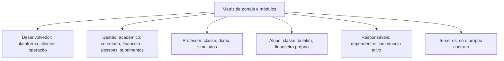

**Regras principais**
- Sem JavaScript inline nem atributos `on*=`; tema claro e escuro; WCAG 2.2 AA; 320 px sem rolagem horizontal ([08](#doc-08)).
- Inglês canônico e dez locales, com teste de paridade de chaves ([09](#doc-09)).
- Busca, notificações e perfil respeitam o escopo de cada portal ([75](#doc-75), [76](#doc-76)).
- O portal de terceiros nunca mostra financeiro interno, contábil, folha ou dado de aluno ([31](#doc-31), seção 2.6).

<a id="doc-31"></a>

## 31 — Matriz de Portais, Fronteiras entre Módulos, Logs, Testes, Segurança e Auditoria

> Parte do [SDD v2](#doc-00). Portais em [23](#doc-23), seção 1. Catálogo em [12](#doc-12). Auditoria em [29](#doc-29). Testes em [24](#doc-24), seção 5. Logs em [10](#doc-10), seção 7. Fonte dos módulos por portal: a navegação da v1 ([12-portals-navigation-sidebar-pages-spec.md](#doc-12), seção 4), agora reclassificada pelos seis portais da v2.
> **Status:** aprovada pelo autor em 03/11/2026, com as propostas adotadas. Itens sem valor definido continuam pendentes, criada em 03/11/2026 a partir de auditoria das especificações da v1. Itens marcados **[Decisão do autor]** dependem de resposta. Itens **[Sem especificação]** não têm fonte na v1 ou na v2.

---

### 1. Regras de organização

1. **Módulo tem um dono de dado.** Cada módulo pertence a um único domínio (plataforma ou entidade) e a um único banco ([03](#doc-03), seção 1.1).
2. **Portal é tela, não dono.** Um portal mostra os módulos que o vínculo da pessoa permite. Nenhum portal guarda dado próprio além de preferências.
3. **Dois contextos não se misturam.** Operação da plataforma (portal do desenvolvedor) e operação de cada entidade (portal de gestão, professor, aluno, responsáveis, terceiros) usam bancos, papéis e módulos diferentes, mesmo quando o nome é igual (ex.: Financeiro, Contábil).
4. **Um nome, uma especificação.** Dois documentos que descrevem o mesmo módulo viram um só. O que sobra vai para o arquivo histórico.

---

### 2. Matriz por portal

Legenda de origem: **P** = plataforma (banco master); **E** = entidade/unidade (banco da unidade).

#### 2.1 Portal do Desenvolvedor (`desenvolvedor.`) — equipe da plataforma

| Área | Módulos | Contexto | Observação |
|---|---|---|---|
| Plataforma e clientes | Clientes (tenants), licenciamento, assinaturas, faturamento de clientes, limites e consumo, domínios, provisionamento | P | Ciclo de vida da seção 5 de [23](#doc-23) |
| Editor de portais | Páginas, rotas, layouts, blocos, publicação e rollback | P | D-23. Chamado de "builder de portais" na v1. **Não é o editor de modelos do Gerador de documentos** (ver seção 3.4) Especificação: [23](#doc-23), seção 3 (D-23) |
| Comercial da plataforma | CRM da plataforma, leads, propostas, comissões | P | [22](#doc-22), seção 6.1. Não se mistura com o protocolo de atendimento (seção 3.2) |
| Financeiro da plataforma | Contas a pagar e a receber **da própria empresa** | P | **Decidido** em 03/11/2026: mantido para a gestão da própria empresa desenvolvedora. Especificação: [31](#doc-31), seção 3.3; [34](#doc-34), seção 3 (taxas de split) |
| Contábil da plataforma | Plano de contas, razão, fechamento da empresa, tributos e obrigações fiscais da empresa | P | Mesma decisão do financeiro. Tributos da empresa: seção 3.3, confirmado pelo autor em 04/11/2026. Especificação: [31](#doc-31), seção 3.3; [22](#doc-22), seção 5 (papéis contábil e fiscal) |
| Operações internas | Patrimônio, frotas, suprimentos da empresa | P | **Decidido** em 03/11/2026: mantidos, como instâncias separadas dos módulos das entidades. Especificação: [19](#doc-19), seções 8 e 9; [80](#doc-80), DP-01 a DP-03 |
| Pessoas da plataforma | Departamento pessoal, recursos humanos, medicina e segurança do trabalho da empresa | P | Mesma decisão. O HCM das entidades não é o da plataforma. Três módulos separados, conforme HCM-01 e HCM-10 do [39](#doc-39), seção 11 |
| Suporte | Chamados dos clientes, base de conhecimento, SLA | P | Seção 3.2. Especificação: [32](#doc-32), seção 2 |
| Segurança e operação | Acesso, MFA, auditoria, privacidade (DPO), TI, configurações do sistema, integrações globais, painel de bancos de dados | P | [05](#doc-05), [07](#doc-07), [10](#doc-10). Painel de bancos de dados: substitui o módulo Bancos (PAG-03, [34](#doc-34), seção 4) |

#### 2.2 Portal de Gestão (`gestao.`) — equipe administrativa da entidade

| Área | Módulos | Contexto | Observação |
|---|---|---|---|
| Acadêmico | Administração escolar (estrutura acadêmica), pedagógico (coordenação e diário), calendário e eventos, séries e turmas (grade de horários), regras de aprovação (sistemas avaliativos, boletim e conselho de classe), ocorrências disciplinares, planos de aula e de ensino, estágio e TCC, prontuário e portfólio do aluno, livros digitais e arquivo morto, preceptoria, gestão pastoral, aulas online, agendamento de ambientes e equipamentos, formulários e pesquisas, relatórios acadêmicos e censo | E | [17](#doc-17), seção 4; [55](#doc-55); [58](#doc-58) a [69](#doc-69); [40](#doc-40) a [44](#doc-44). Itens explicitados em 04/11/2026 a partir da seção 7 e dos documentos por portal |
| Secretaria | Matrículas, rematrículas, transferências, enturmação, ficha cadastral, protocolo de atendimento, emissão de documentos, processo seletivo e lista de espera | E | Sub-área do acadêmico. Ver seções 3.2 e 3.5; [46](#doc-46), [48](#doc-48) |
| Gestão de documentos | Documentos recebidos (validação), documentos administrativos (tramitação), documentos emitidos (modelos e emissão), serviços comuns (assinatura, protocolo e armazenamento) | E | [54](#doc-54). Ver também seções 3.1 e 3.4 |
| Simulados | Banco de questões, geração de provas, correção, gabarito, ranking | E | Ver seção 3.6. Especificação: [47](#doc-47) |
| Biblioteca | Acervo, empréstimos, reservas, multas, biblioteca digital | E | Ver seção 3.1. Especificação: [68](#doc-68) |
| Financeiro da entidade | Mensalidades, títulos, cobrança, régua, conciliação, centros de custo, contas a pagar, cheques, caixa físico, fluxo de caixa e DRE, gateways e split | E | [17](#doc-17), [18](#doc-18), [20](#doc-20), [34](#doc-34), [71](#doc-71) |
| Contábil e fiscal da entidade | Plano de contas da entidade, tributos, retenções, obrigações, NFSe | E | Ver seção 3.3. Especificação: [31](#doc-31), seção 3.3; [34](#doc-34), seção 5; [26](#doc-26), seção 11 |
| Comercial e admissões | CRM do tenant (captação, pré-cadastro, inscrição) | E | [22](#doc-22), seção 6.2 |
| Pessoas e RH | HCM, folha, ponto, férias, avaliação de desempenho, SST | E | [18](#doc-18), seção 3; [39](#doc-39); [52](#doc-52) |
| Suprimentos e compras | Requisição, cotação, pedido, almoxarifado, merenda | E | [19](#doc-19), seção 2 |
| Patrimônio e frotas | Bens, depreciação, veículos, manutenção, rotas | E | [19](#doc-19), seções 8 e 9 |
| Contratos | Contratos de fornecedor, contratos de aluno, contratos de pessoal | E | [17](#doc-17), seção 7; [33](#doc-33); [53](#doc-53) |
| Atendimento | SAC, helpdesk, chat, tickets | E | Seção 3.7; [32](#doc-32), seção 2 |
| Arquivos | Armazenamento de arquivos | E | [21](#doc-21) |
| Relatórios e gráficos | Painéis, gráficos salvos | E | Seção 3.8; [56](#doc-56), seção 3; [69](#doc-69) |
| Configuração e acesso | Unidades, usuários, vínculos, privacidade da entidade, configurações da entidade, campos personalizados, notificações, integrações educacionais oficiais, importação de dados, acesso físico e portaria, TI da entidade | E | [06](#doc-06); [32](#doc-32), seção 3; [35](#doc-35); [36](#doc-36), seção 4; [56](#doc-56), seção 2; [57](#doc-57); [70](#doc-70); [72](#doc-72); [74](#doc-74). Unidade só é criada por `platform.developer` (L-02); a gestão edita a unidade existente |
| Planejamento acadêmico, institucional e de desenvolvimento | Planejamento acadêmico, planejamento institucional, planejamento de desenvolvimento de pessoas | E | [37](#doc-37), seções 2 a 4 (especificado em 03/11/2026, seção 3.9) |
| Empenho | Empenho, liquidação e pagamento (só entidade pública) | E | [37](#doc-37), seção 5 (especificado em 03/11/2026, seção 3.9) |

#### 2.3 Portal do Professor (`portal-do-professor.`)

| Área | Módulos | Escopo |
|---|---|---|
| Classe | Turmas e disciplinas do próprio docente, mural, materiais, tarefas | Só turmas vinculadas. Especificação: [81](#doc-81); regra de origem em [80](#doc-80), DP-06 |
| Diário | Frequência, conteúdo, notas, plano de aula | Só turmas vinculadas. Nota só pelo professor da turma ([22](#doc-22), seção 5) |
| Simulados | Elaboração de questões, agendamento, resultados da turma | Questão passa por revisão antes de publicar (seção 3.6) Especificação: [47](#doc-47), seção 7 |
| Biblioteca | Consulta de acervo, indicação de leitura | Somente leitura. Especificação: [68](#doc-68), seção 11 |
| Protocolos e pedidos | Solicitação de material, reserva de laboratório, justificativa | Usa o serviço de protocolo (seção 3.2) Especificação: [31](#doc-31), seção 3.2; [44](#doc-44) |
| Documentos e pessoal | Declarações, contrato de trabalho, holerite, ponto | Só dados do próprio docente. Especificação: [39](#doc-39), seção 6; [34](#doc-34), seção 8 |
| Relatórios | Rendimento da turma, ficha individual | Só turmas vinculadas. Especificação: [69](#doc-69), seção 6 |
| Agenda e comunicação | Horário e calendário das turmas, aulas online, notificações, meu perfil | Só turmas vinculadas. [58](#doc-58), [60](#doc-60), [40](#doc-40), [57](#doc-57), [76](#doc-76) (explicitado em 04/11/2026) |
| Acompanhamento pedagógico | Ocorrências da turma, orientação de estágio e TCC, preceptoria, portfólio dos alunos, formulários e pesquisas, pastoral | Só turmas e orientandos vinculados. [63](#doc-63), [65](#doc-65), [42](#doc-42), [66](#doc-66), [41](#doc-41), [43](#doc-43) (explicitado em 04/11/2026) |

#### 2.4 Portal do Aluno (`portal-do-aluno.`)

| Área | Módulos | Escopo |
|---|---|---|
| Classe e diário | Disciplinas, materiais, entregas, boletim, presença | Só o próprio aluno. Especificação: [61](#doc-61), seção 7; [62](#doc-62), seção 7; [81](#doc-81) |
| Simulados | Simulados agendados, realização de prova, gabarito e comentários | Só simulados do próprio aluno. Especificação: [47](#doc-47), seção 7 |
| Biblioteca | Empréstimos, prazos, renovação, pesquisa de acervo | Só os próprios empréstimos. Especificação: [68](#doc-68), seção 11 |
| Protocolos online | Requerimento de segunda chamada, declaração de matrícula | Usa o serviço de protocolo. Especificação: [31](#doc-31), seção 3.2 |
| Documentos | Boletim oficial, histórico, declarações | Emissão pelo aluno conforme regra de [21](#doc-21) e seção 3.5 |
| Matrícula | Confirmação para o ano seguinte, eletivas, rematrícula | Seção 3.5. Especificação: [46](#doc-46), seção 6 |
| Financeiro | Mensalidades, boleto, PIX, comprovantes | Só títulos do próprio aluno. Especificação: [34](#doc-34), seção 8; [20](#doc-20) |
| Privacidade | Dados cadastrais, solicitações LGPD | [07](#doc-07) |
| Agenda e comunicação | Horário da turma, calendário e eventos, aulas online, notificações, meu perfil | Só o próprio aluno. [58](#doc-58), [60](#doc-60), [40](#doc-40), [57](#doc-57), [76](#doc-76) (explicitado em 04/11/2026) |
| Vida acadêmica | Ocorrências próprias, estágio e TCC, portfólio, preceptoria, formulários e pesquisas, pastoral | Só o próprio aluno. [63](#doc-63), [65](#doc-65), [66](#doc-66), [42](#doc-42), [41](#doc-41), [43](#doc-43) (explicitado em 04/11/2026) |

#### 2.5 Portal dos Pais e Responsáveis (`portal-dos-responsaveis.`)

| Área | Módulos | Escopo |
|---|---|---|
| Acompanhamento | Notas, faltas, ocorrências, comunicados, entradas e saídas da portaria | Só dependentes com vínculo ativo de responsabilidade. Especificação: [61](#doc-61), [62](#doc-62), [63](#doc-63), [35](#doc-35), seção 4, [57](#doc-57) |
| Biblioteca e simulados | Empréstimos e desempenho dos filhos | Somente leitura. Especificação: [68](#doc-68), seção 11; [47](#doc-47), seção 7 |
| Protocolos da família | Mudança de turno, saída antecipada, documentos | Usa o serviço de protocolo. Especificação: [31](#doc-31), seção 3.2 |
| Financeiro e matrícula | Faturas dos filhos, PIX, rematrícula online, assinatura do contrato | Seção 3.5. Bloqueio parcial por inadimplência ([26](#doc-26), seção 3) |
| Privacidade e menores | Consentimento de imagem, dados dos filhos | Regra de menor de idade em [07](#doc-07) |
| Agenda e comunicação | Horário e calendário dos dependentes, eventos e autorizações, notificações, meu perfil | Só dependentes com vínculo ativo. [58](#doc-58), [60](#doc-60), [43](#doc-43), [57](#doc-57), [76](#doc-76) (explicitado em 04/11/2026) |

#### 2.6 Portal de Terceiros (`portal-de-terceiros.`)

| Área | Módulos | Escopo |
|---|---|---|
| Faturamento de serviços | Emissão e envio de NF-e de serviço, acompanhamento de pagamento, extrato | Só o próprio fornecedor. Especificação: [38](#doc-38); [34](#doc-34), seções 5 e 8 |
| Pedidos e contratos | Pedidos de compra pendentes, contratos em vigor | Só o próprio fornecedor. Especificação: [38](#doc-38), seção 4; [33](#doc-33), seção 9 |
| Documentos da empresa | Certidões, contrato social, alvarás, seguro | Só o próprio fornecedor. Validade com alerta. Especificação: [38](#doc-38), seção 5 |
| Prestação de serviço | Ordens de serviço, relatórios de execução, cronograma | Só ordens do próprio fornecedor. Especificação: [38](#doc-38), seção 3 |
| Chamados | Abertura de chamado de manutenção, solicitação de acesso à unidade | Usa o módulo de atendimento (seção 3.7) Especificação: [32](#doc-32), seção 2.8; [35](#doc-35), seção 4 |
| Configurações e integrações | Dados da empresa, responsáveis técnicos, dados bancários, integrações via API | Dados bancários exigem confirmação por MFA. Especificação: [38](#doc-38), seção 6; [06](#doc-06), seção 8 |
| Habilitação e acesso | Cadastro e habilitação do prestador, pessoas e papéis do prestador, tipo de prestador, meu perfil | [38](#doc-38), seções 2 a 6; [76](#doc-76) (explicitado em 04/11/2026) |

**Regra:** o portal de terceiros nunca mostra financeiro interno, contábil, folha ou dado de aluno.

---

### 3. Fronteiras entre módulos

#### 3.1 Biblioteca × Gestão de Documentos

**Problema encontrado:** a especificação [`spec_gestao_biblioteca_completo.md`](#v1-spec-gestao-biblioteca-completo-md) (UI enterprise) inclui páginas de gestão de usuários, perfis, auditoria, integrações e **"Gestão de Documentos e Anexos"** (página 14). Isso mistura o acervo da biblioteca com o cofre de documentos da entidade.

**Decisão proposta:**

| Módulo | Dono | Guarda | Não guarda |
|---|---|---|---|
| Biblioteca | Acervo, exemplar, empréstimo, reserva, multa | Metadados do acervo; arquivo digital do acervo via [21](#doc-21) | Documento oficial de aluno ou de funcionário |
| Gestão de documentos | Documento oficial, versão, assinatura, validação, modelo | Declarações, históricos, certidões, contratos assinados | Exemplar físico, empréstimo |

A página 14 da UI de biblioteca sai dela. A "Interface de biblioteca (UI)" do catálogo deixa de ser módulo e passa a ser componentes de [08](#doc-08). As páginas 6 a 13 da UI são padrões de tela, não módulos.

#### 3.2 Protocolo × CRM comercial × Atendimento

Não encontrei na v1 um módulo chamado "CRM protocolo". O protocolo aparece em:

- Secretaria (número e senha, consulta pública por número e CPF) — [`spec_gestao_academica_completo.md`](#v1-spec-gestao-academica-completo-md), seção 6.2;
- Gestão de documentos e validações;
- Serviços do portal do aluno, do professor e dos responsáveis;
- Direitos do titular (solicitação LGPD com protocolo — [07](#doc-07));
- Segurança e medicina do trabalho (protocolo de CAT ou INSS).

**Decisão proposta:** o **protocolo é um serviço transversal**, dono em Atendimento. Ele gera número único, status, prazo e trilha. Ele **não pertence ao CRM**:

| | CRM comercial (plataforma e tenant) | Protocolo |
|---|---|---|
| Objeto | Lead, oportunidade, proposta, matrícula em andamento | Pedido ou solicitação com número |
| Quem abre | Vendedor, admissões, canal de captação | Pessoa que pede algo (aluno, responsável, professor, titular, fornecedor) |
| Consulta pública | Não | Sim, por número e CPF, com limite de tentativas ([17](#doc-17), seção 3) |

**Regra de separação:** nenhum protocolo guarda dado comercial, e nenhum lead recebe número de protocolo. Quando um lead vira matrícula, o protocolo de matrícula é um pedido separado, vinculado ao lead.

#### 3.3 Financeiro e contábil: plataforma × entidade

| Assunto | Plataforma (portal do desenvolvedor) | Entidade (portal de gestão) |
|---|---|---|
| Receita | Assinaturas dos clientes ([20](#doc-20)) | Mensalidades e serviços de alunos |
| Despesa | Da própria empresa | Da entidade (fornecedor, folha) |
| Contábil | Plano de contas da empresa | Plano de contas da entidade, com centro de custo por unidade |
| Tributos | Da empresa | Retenções e apurações da entidade ([19](#doc-19) e v1 [`spec_gestao_contabil_fiscal_completo.md`](#v1-spec-gestao-contabil-fiscal-completo-md), seção 6.5) |

**Proposta:** o módulo Financeiro e o Contábil são o mesmo código com dois donos de dado (banco master e banco de cada unidade). **Decidido** em 03/11/2026: a plataforma precisa dos módulos contábil e financeiro para a própria empresa.

#### 3.4 Builder: três significados

O termo "builder" aparece em três lugares e pode confundir:

| Nome | Dono | Função | Documento |
|---|---|---|---|
| Builder de portais | Plataforma | Páginas e layouts declarativos | [23](#doc-23), seção 3 |
| Builder de documentos | Entidade (Gestão de documentos) | Modelos de documento com variáveis e emissão em PDF | [`spec-builder-documentos-academicos.md`](#v1-spec-builder-documentos-academicos-md) (26 seções) |
| Builder de automações | Entidade (Automações) | Regras de disparo | [`spec_gestao_biblioteca_completo.md`](#v1-spec-gestao-biblioteca-completo-md), página 7 |

**Ação (feita em 03/11/2026, MOD-12):** na v2 os nomes são "Editor de portais" ([23](#doc-23)), "Gerador de documentos", com o "editor de modelos" ([48](#doc-48)), e "Automações". O termo "builder" fica só nos nomes de arquivo da v1 e no código do papel `platform.builder`.

**Gerador de documentos:** especificado em [48](#doc-48) (MOD-07), a partir da v1, que cobre tipos documentais, tamanhos de papel, cabeçalho e rodapé, variáveis, condicionais, fluxo de emissão, auditoria e LGPD. Os itens abaixo eram a lista do que faltava e estão cobertos lá:

- Lista de tipos documentais com retenção de cada um (ligada a [07](#doc-07), seção 5).
- Emissão só de modelo aprovado. Versão emitida é imutável.
- Número de protocolo da emissão (seção 3.2).
- Assinatura: [26](#doc-26), seção 6.

#### 3.5 Matrícula e rematrícula

A v2 tem só os estados da matrícula em [17](#doc-17) (`pre_matricula`, `ativa`, `trancada`, `concluida`, `cancelada`, `transferida`). A v1 ([`spec_gestao_academica_completo.md`](#v1-spec-gestao-academica-completo-md)) tem mais: kanban de rematrícula, wizard, prazo de 7 dias, lembrete, "não rematriculado" após 30 dias, matrícula condicional com prazo e trancamento com motivo e protocolo.

**Lacunas do fluxo, a incluir na v2:**

| # | Passo ou regra | Origem na v1 | Estado na v2 |
|---|---|---|---|
| M-01 | Janela de rematrícula por série e unidade, com abertura e fechamento | Acadêmico, kanban | Não definido |
| M-02 | Wizard do responsável ou aluno: dados, documentos, escolha de turma e eletivas, contrato, pagamento | Portal dos responsáveis e do aluno | Não definido |
| M-03 | Vaga com reserva e bloqueio de concorrência | [15](#doc-15), seção 7 | Definido |
| M-04 | Matrícula condicional com prazo e expiração | Ações automáticas, v1 linha 1181 | Não definido |
| M-05 | Não rematriculado após 30 dias: estado e aviso | Ações automáticas, v1 linha 1175 | Não definido |
| M-06 | Trancamento com motivo, aprovação por níveis e protocolo | Requerimentos, v1 seção 15 | Não definido |
| M-07 | Transferência e enturmação | Secretaria digital | Não definido |
| M-08 | Documento obrigatório pendente bloqueia a matrícula? Regra por tipo | v1 linha 1176 | Não definido. Ver [26](#doc-26) |
| M-09 | Assinatura do contrato de matrícula e pagamento da primeira parcela | Portal dos responsáveis | Parcial em [20](#doc-20) |

#### 3.6 Simulados

A v2 tem só a regra de IA em [19](#doc-19), seção 12, e a linha da tabela em [28](#doc-28). Faltam:

- **Banco de questões**, com origem, autoria, revisão e situação (`rascunho`, `revisada`, `publicada`, `arquivada`).
- **Geração de prova** por perfil (ENEM, vestibular, interna) e gabarito.
- **Gabarito óptico**: a v1 cita, mas não há especificação do leitor. **Decidido** em 03/11/2026: as duas opções, próprio e de terceiro, por configuração da entidade.
- **Correção por IA**. **Conflito:** a v1 ([`spec_gestao_simulados_ia.md`](#v1-spec-gestao-simulados-ia-md), seção "Correção automática por IA") tem como saída "nota final estimada". A v2 proíbe nota final dada só pela IA ([27](#doc-27), princípio 2 e seção 5.11). Ação: a v2 fica com a regra da [27](#doc-27). A nota da IA é sugestão; o professor confirma.
- **Anonimização** do aluno enviado ao provedor de IA ([19](#doc-19), seção 12).
- **Relatórios por portal**: professor vê a turma; aluno vê as próprias provas; responsável vê os filhos; gestor vê a unidade.
- **Plano**: a v1 marca o simulado como "PRO" no portal de gestão. **Decidido** em 03/11/2026: o PRO libera correção por IA e ranking.

#### 3.7 Atendimento: SAC, helpdesk, chat e bots

Há três especificações separadas, todas em "Revisar" no catálogo:

- [`spec_chat_rapido_sac.md`](#v1-spec-chat-rapido-sac-md): chat rápido e abertura de ticket no SAC.
- [`SPEC-HELPDESK.md`](#v1-spec-helpdesk-md): helpdesk com SLA, base de conhecimento e portal do cliente.
- [`spec_gestao_sac_base_conhecimento.md`](#v1-spec-gestao-sac-base-conhecimento-md).

**Decisão proposta (já adotada na v1 do catálogo):** um módulo único de atendimento, com helpdesk como base ([19](#doc-19), seção 2). Os canais (chat do site, WhatsApp, Telegram, Instagram, Messenger, telefone e presencial) são entradas desse módulo, com as regras de [22](#doc-22), seção 2.

**Bots.** Há dois tipos e não podem ser confundidos:

| Bot | Dono | Regra |
|---|---|---|
| Bot de captação (CRM) | CRM da plataforma ou do tenant | [22](#doc-22), seção 3 |
| Bot de atendimento (SAC) | Atendimento | Mesma regra de IA: fonte cadastrada, humano para o resto, opção "Abrir ticket" sem IA (D-18) |

A reunião global ([`global_meeting_spec_v2_complete.md`](#v1-global-meeting-spec-v2-complete-md)) menciona proteção contra bot em entrada pública, sem módulo de bot. Não é um terceiro tipo.

Pendente: a v2 ainda não tem DDL do atendimento consolidado (T-02 em [19](#doc-19)).

#### 3.8 Gráficos e painéis

[`chart-builder-spec-complete.md`](#v1-chart-builder-spec-complete-md) (16 seções: consulta, renderização, painéis, API, segurança, exportação, tempo real) está marcado como "Especificado" no catálogo, mas a v2 não tem regra para ele.

**Proposta:**

- O construtor de gráfico é **componente compartilhado** ([08](#doc-08)), não módulo de domínio.
- Cada gráfico salvo pertence a um portal e a um contexto (plataforma, entidade ou unidade). Nenhum gráfico mostra dado fora do escopo de quem o abriu.
- Consulta passa pela mesma camada de permissão das telas. A consulta não tem acesso direto ao banco.
- Gráfico de dado sensível (CPF, saúde, salário) não é exportável sem motivo e sem auditoria ([29](#doc-29)).
- Painel com dado pessoal entra no cache só com a regra de [30](#doc-30), seção 4.

#### 3.9 Módulos sem especificação

| Nome | Onde aparece | Situação |
|---|---|---|
| Planejamento acadêmico | Pedido do autor | Não há especificação na v1 nem na v2. **Decidido** em 03/11/2026: analisado e implementado em [37](#doc-37). |
| Planejamento institucional | Pedido do autor | Idem |
| Planejamento de desenvolvimento | Pedido do autor. A v1 cita "Plano de Desenvolvimento Individual" no PRO de preceptoria | Idem. Se o termo for o PDI, ele fica em preceptoria ([19](#doc-19), seção 11) |
| Empenho | Pedido do autor. A v1 não traz o termo como módulo | Empenho é fase da despesa pública (empenho, liquidação, pagamento). Só se aplica se a entidade for órgão público. **Decidido** em 03/11/2026: só para entidade pública. |
| Secretaria como módulo | v1 tem "Secretaria Digital" e "Secretaria Acadêmica" | Não é módulo próprio. É sub-área do acadêmico (seção 2.2) |
| Tributos como módulo | v1 tem "Retenção Tributária" e "Retenções e Tributos" | Não é módulo próprio. Fica em contábil e fiscal |

---

### 4. Logs, testes, segurança e auditoria por portal

#### 4.1 Logs

**Estado na v2:** [10](#doc-10), seção 7 define log estruturado em JSON com `request_id`, `tenant_id` e nível, sem PII. [29](#doc-29) define a auditoria. Não há especificação de logs por portal.

| Canal de log | Conteúdo | Portais | Retenção | Estado |
|---|---|---|---|---|
| Aplicação | Erros, desempenho, requisição | Todos | 90 dias ([10](#doc-10)) | Definido |
| Segurança | Login, falha, bloqueio, MFA, acesso negado | Todos | Conforme [29](#doc-29), seção 7 | Definido |
| Auditoria de negócio | Alteração de dado, leitura sensível, exportação | Todos | Conforme [29](#doc-29) | Definido. Campo `portal` incluído em [29](#doc-29), seção 2 (AUD-04) |
| Integração | Chamada a provedor, webhook, falha de conector | Gestão, desenvolvedor | 90 dias (LOG-03) | **Especificado** em [49](#doc-49), seção 2 |
| Job e fila | Processamento, reprocessamento, expurgo | Plataforma e entidade | 90 dias (LOG-03) | **Especificado** em [49](#doc-49), seção 3 |
| Logger técnico (módulo `spec_gestao_logger_completo`) | — | — | — | Revisar: retirar dados de log da especificação, conforme o catálogo |

**Lacunas:** LOG-01 a LOG-03 (seção 5).

#### 4.2 Testes

[24](#doc-24), seção 5 define a estratégia geral. Falta a matriz por portal. Cada portal precisa de um conjunto mínimo:

| Portal | Teste de isolamento | Teste de permissão | Teste de fluxo principal | Teste de acessibilidade |
|---|---|---|---|---|
| Desenvolvedor | O Editor de portais publica só para o escopo escolhido | Publicação não é aprovada pelo próprio editor (D-23) | Criar entidade e unidade (provisionamento, seção 4 de [23](#doc-23)) | Telas de leitura |
| Gestão | Cross-tenant e cross-unidade | Papel sem permissão não vê o módulo | Matrícula, cobrança, emissão de documento | Telas principais |
| Professor | Só turmas vinculadas | Nota só pelo professor da turma | Lançar nota e frequência | Diário |
| Aluno | Só os próprios dados | Não vê nota de outro aluno | Realizar simulado, rematrícula | Telas principais |
| Responsáveis | Só dependentes com vínculo ativo | Vínculo revogado perde acesso em até 30 s ([30](#doc-30), seção 4) | Pagar fatura e rematricular | Telas principais |
| Terceiros | Só o próprio fornecedor | Sem acesso a financeiro interno | Emitir NF-e de serviço | Telas principais |

Itens de teste comuns: fluxo ponta a ponta por portal a cada release, varredura de log sem PII, e varredura de auditoria sem segredo ([29](#doc-29), seção 9).

**Lacunas:** TST-01 a TST-03 (seção 5).

#### 4.3 Segurança por portal

[05](#doc-05) é genérico. Falta o que muda entre portais:

| Portal | Autenticação | Sessão | Dados e restrições especiais |
|---|---|---|---|
| Desenvolvedor | Senha e passkey obrigatória ([06](#doc-06), seção 10) | Curta; reautenticação antes de publicar | Acesso ao Editor de portais é registrado; sem acesso a dado de cliente sem chamado ([29](#doc-29), seção 8) |
| Gestão | Senha e MFA conforme política da entidade ([06](#doc-06), seção 5) | Padrão | Consulta por CPF com finalidade ([21](#doc-21), seção 6.8) |
| Professor | Senha e MFA conforme política | Padrão | Dado de aluno só das turmas |
| Aluno | Senha e MFA opcional por política | Padrão | Dado de menor de idade: regra de [07](#doc-07) e [26](#doc-26) |
| Responsáveis | Senha e MFA obrigatório para pagamento ([20](#doc-20), seção 19.2) | Padrão | Vínculo de responsabilidade verificado; dado do filho é de acesso restrito |
| Terceiros | Senha e MFA obrigatório | Curta | Escopo contratual; sem financeiro interno; dados bancários exigem MFA |

**Lacuna de segurança:** o portal dos responsáveis não tem regra de verificação do vínculo de responsabilidade legal. Ver SEG-01 (seção 5).

#### 4.4 Auditoria por portal

[29](#doc-29), seção 2 tem o esquema do evento, mas **não tem o campo `portal`**. A v1 exige o campo (`spec` de navegação, seção 6 — `audit_logs` com `portal`). Sem ele não é possível separar a auditoria do portal do desenvolvedor da auditoria do portal de gestão.

**Correção proposta:** incluir `portal` (enum: `desenvolvedor`, `gestao`, `professor`, `aluno`, `responsaveis`, `terceiros`, `sistema`) na tabela de campos de [29](#doc-29), seção 2.

---

### 5. Lacunas e decisões pendentes

| # | Assunto | Tipo | Dono |
|---|---|---|---|
| MOD-01 | Módulos Financeiro, Contábil, Patrimônio, Frotas, Suprimentos e Pessoas da plataforma: manter ou remover | **Decidido** em 03/11/2026: mantidos, para a gestão da própria empresa desenvolvedora | Autor |
| MOD-02 | Planejamento acadêmico, institucional e de desenvolvimento: definir ou remover | **Decidido** em 03/11/2026: analisado e implementado ([37](#doc-37)) | Autor |
| MOD-03 | Empenho: aplicável ou não | **Decidido** em 03/11/2026: só para entidade pública ([37](#doc-37)) | Autor, jurídico |
| MOD-04 | Gabarito óptico: próprio ou terceiro | **Decidido** em 03/11/2026: as duas opções, próprio e de terceiro, por configuração da entidade | Autor |
| MOD-05 | Plano que muda o simulado (PRO) | **Decidido** em 03/11/2026: o PRO libera correção por IA e ranking | Comercial |
| MOD-06 | Nota de IA em simulado | **Decidido** em 03/11/2026: a IA sugere, e o professor e a coordenação pedagógica confirmam. Nada chega ao aluno sem aprovação | Autor |
| MOD-07 | Especificação de Gerador de documentos na v2 | **Escrito** em [48](#doc-48). Revisão do owner pendente | Owner de Gestão de documentos |
| MOD-08 | Especificação de Simulados na v2 (banco, prova, correção, relatórios) | **Escrito** em [47](#doc-47). Revisão do owner pendente | Owner de Simulados |
| MOD-09 | Especificação de Matrícula e rematrícula (M-01 a M-09) | **Escrito** em [46](#doc-46). Revisão do owner pendente | Owner de Acadêmico |
| MOD-10 | Remover a página de gestão de documentos da UI da biblioteca | **Escrito** em [68](#doc-68), seção 1: a página sai da UI da biblioteca | Owner de Biblioteca |
| MOD-11 | Unificar Atendimento (SAC, helpdesk, chat) com DDL | **Escrito** em [32](#doc-32), com DDL em [51](#doc-51), seção 1 | Owner de Atendimento |
| MOD-12 | Renomear os três "builders" (seção 3.4) | **Feito** em 03/11/2026: Editor de portais em [23](#doc-23), editor de modelos em [48](#doc-48) | Autor |
| LOG-01 | Especificação de logs de integração | **Escrito** em [49](#doc-49), seção 2 | Integrações |
| LOG-02 | Especificação de logs de job e fila | **Escrito** em [49](#doc-49), seção 3 | Operação |
| LOG-03 | Retenção de logs de integração e de job | **Decidido** em 03/11/2026: 90 dias | Autor |
| TST-01 | Conjunto de testes por portal (seção 4.2) em CI | **Escrito** em [49](#doc-49), seção 4 | QA |
| TST-02 | Teste de isolamento para cada par portal e módulo | **Escrito** em [49](#doc-49), seção 5 | QA |
| TST-03 | Teste de acessibilidade por portal | **Escrito** em [49](#doc-49), seção 6 | Frontend |
| SEG-01 | Regra de verificação do vínculo de responsabilidade legal | **Decidido** em 03/11/2026: documento e vínculo cadastrado pela escola. Parecer do jurídico pendente | Autor, jurídico |
| AUD-04 | Adicionar campo `portal` ao evento de auditoria | **Feito** em [29](#doc-29), seção 2, campo `portal` | Segurança |

---

### 6. Critérios de aceite

- [ ] Cada módulo tem um dono de dado e um portal de entrada documentados.
- [ ] Nenhum documento de módulo descreve o mesmo domínio que outro.
- [ ] Protocolo, CRM e Atendimento têm fronteiras escritas e testadas.
- [ ] Financeiro e contábil da plataforma e da entidade não compartilham banco.
- [ ] Matrícula, rematrícula e simulados têm regra de validação completa (MOD-08, MOD-09).
- [ ] Logs, testes, segurança e auditoria têm regra por portal (seção 4).
- [ ] Campo `portal` presente em toda auditoria.
- [ ] Itens **[Decisão do autor]** respondidos ou marcados como pendentes no [00](#doc-00).

---

### 7. Módulos adicionados em 03/11/2026

Estes módulos ganharam especificação própria. Cada um tem seu portal e seu dono de dado na matriz da seção 2:

| Módulo | Documento | Dono de dado | Portal principal |
|---|---|---|---|
| Aulas online e reuniões ao vivo | [40](#doc-40) | Entidade (unidade) | Professor e aluno |
| Formulários e pesquisas | [41](#doc-41) | Módulo que criou o formulário | Gestão |
| Preceptoria | [42](#doc-42) | Entidade (unidade) | Preceptor e residente |
| Gestão pastoral | [43](#doc-43) | Entidade (unidade) | Equipe pastoral |
| Agendamento de ambientes e equipamentos | [44](#doc-44) | Entidade (unidade) | Professor e responsável |
| Matrícula e rematrícula | [46](#doc-46) | Entidade (unidade) | Secretaria e responsável |
| Simulados e correção por IA | [47](#doc-47) | Entidade (unidade) | Professor e aluno |
| Gerador de documentos | [48](#doc-48) | Entidade (unidade) | Secretaria |
| Logs, testes e acessibilidade | [49](#doc-49) | Plataforma | Desenvolvedor |
| Medicina do trabalho | [52](#doc-52) | Entidade (unidade) | Médico e SESMT |

Os DDL de todos esses módulos estão em [51](#doc-51).

<a id="doc-08"></a>

## 08 — Frontend e Design System

> Parte do [SDD v2](#doc-00). Segurança de cabeçalhos e CSP em [05](#doc-05).

---

### 1. Abordagem

Interface progressiva: páginas renderizadas no servidor, com melhoria por JavaScript para interações (`fetch()`, filtros, modais). A aplicação funciona com JavaScript desligado nas telas de leitura e de formulário.

### 2. Regras de segurança do frontend

1. **Sem JavaScript inline** e **sem atributos de evento inline** (`onclick`, `onchange`, `onsubmit` etc.). Eventos são ligados em arquivos `.js` externos. (ADR-07.)
2. **Scripts com nonce** gerado por requisição. Sem `unsafe-inline` nem `unsafe-eval`.
3. **Sem tokens em `localStorage` ou `sessionStorage`.** Autenticação por cookie `HttpOnly`.
4. **Requisições** com `credentials: 'same-origin'` (ou `'include'` apenas em domínio de API documentado).
5. **Conteúdo do usuário** é escapado no servidor e, quando inserido pelo cliente, com `textContent` ou sanitizador com lista branca. Nunca `innerHTML` com dado não confiável.
6. **Service worker** (`sw.js`) não cacheia respostas autenticadas nem endpoints de API.
7. **Dependências de terceiros** ficam no próprio domínio (ver seção 4).

### 3. Layout e navegação

- Navegação lateral por contexto: principal (ícones) e sub-navegação por módulo, com busca.
- Telas de lista seguem um padrão único: cabeçalho com ações, barra de filtros, tabela ou cartões, paginação, exportação.
- Visões alternativas (KPIs, tabela, cartões, kanban, gráficos) são opcionais por tela e não podem ocultar dados que a permissão do usuário permite ver.
- Exportação: CSV, XLSX, PDF, JSON. XML, SQL e TXT da v1 **[Declarado]** entram só com requisito de negócio, porque exportar SQL e XML de dados pessoais amplia a superfície de vazamento.
- Exportação de CSV neutraliza células que começam com `=`, `+`, `@`, tabulação ou retorno de carro. Números negativos são exportados como número, sem prefixo (ver [05](#doc-05)).
- Ações destrutivas: confirmação com digitação do nome do objeto, não de uma palavra genérica. Ação de arquivamento não usa a mesma confirmação que exclusão.

### 4. Design system

- Tokens de cor, espaçamento e tipografia em variáveis CSS, com tema claro e escuro.
- Tema da v1 (**[Declarado]**): paleta escura com fundo `#14171c`, superfícies `#1a1d24` e `#242832`, acento `#10b981`. Os valores são tokens de referência, não constantes espalhadas no código.
- Contraste mínimo WCAG 2.2 AA: texto normal 4.5:1, texto grande e componentes de interface 3:1. Verificação automatizada em CI.
- Foco visível em todo controle interativo. Navegação completa por teclado.
- Tamanho mínimo de alvo de toque: 24×24 CSS px (WCAG 2.2 AA, 2.5.8), recomendado 44×44 em telas de uso móvel.

#### Ícones (decisão D-01)

A v1 declara Font Awesome Pro 7.2 "Light" em toda a interface e carrega o Font Awesome de CDN (versão gratuita 7.0.0 em `teste.html`). Problemas:

- A licença Pro não permite servir os arquivos a partir de CDN público sem assinatura válida. Licença confirmada pelo autor em 03/11/2026: permite servir os arquivos do próprio domínio.
- A v1 diz "sem bibliotecas externas de runtime" e, ao mesmo tempo, depende de CDN.

Opções para o autor escolher:

| Opção | Mecanismo | Trade-off | Falha quando |
|---|---|---|---|
| (a) Self-host da licença Pro | Arquivos copiados para `assets/vendor/` no build | Mantém o visual atual; exige revisar termos de licença de redistribuição | Licença não cobre uso em aplicação web hospedada por terceiros |
| (b) Biblioteca open source | Ícones SVG locais, licença MIT/ISC | Sem custo recorrente; pode exigir ajuste visual em ícones específicos | Equipe não aceita mudança visual |
| (c) CDN com licença confirmada | `<link>` externo com SRI (`integrity`) | Depende de terceiro; CSP precisa liberar o domínio | Domínio do CDN sai do ar ou a licença expira |

**Decisão do autor (02/11/2026): opção (a).** O Font Awesome Pro é servido do próprio domínio a partir de `assets/fonts/fontawesome.v7.2.0/` (já presente no projeto). Nenhum CDN de ícones em produção. Condição: confirmar, nos termos da licença, que ela cobre a hospedagem da aplicação para os tenants. Caso não cubra, a decisão volta para (b).

### 5. Desempenho

- Orçamento: LCP ≤ 2,5 s e INP ≤ 200 ms no percentil 75 em rede 4G simulada para telas de lista.
- Imagens com `width`/`height`, `loading="lazy"` abaixo da dobra e formato moderno quando suportado.
- JavaScript carregado por tela, não global. Sem bibliotecas de runtime que dupliquem recursos nativos.
- Tailwind CSS compilado no build, com somente as classes usadas (purge). Sem CDN do Tailwind em produção.

### 6. Responsividade

- Layout funciona de 320 px de largura sem rolagem horizontal da página. Tabelas largas rolam dentro do próprio componente.
- Teste manual em tela de 320 px, 375 px e 1280 px em cada release de tela nova.

### 7. Telas de referência

A v1 aponta uma página de módulos como referência visual oficial, com endereço de `localhost`. Referências não devem apontar para ambiente local. A v2 mantém um catálogo de telas de referência em homologação, com captura de tela versionada no repositório de design.

### 8. Critérios de aceite de frontend

- [ ] Nenhum `on*=` em HTML e nenhum `<script>` inline (verificação automatizada).
- [ ] Nenhum recurso externo sem SRI e fora da lista de domínios aprovados (lista publicada após a decisão D-01).
- [ ] Contraste verificado por ferramenta em cada tema.
- [ ] Teste de teclado para fluxo de criação e edição.
- [ ] Textos vindos de chaves de i18n, sem texto fixo em PT ou EN no código.
- [ ] Tela testada em 320 px, 375 px e 1280 px.

---

### 9. Template de sala de aula e reunião

Decidido em 03/11/2026 ([40](#doc-40), seção 4.4). A sala usa o template do portal em que a pessoa está, com layout de reunião estilo Zoom. Não há identidade visual própria da sala.

#### 9.1 Regiões

| Região | Conteúdo | Comportamento |
|---|---|---|
| Barra superior | Nome da sessão, tempo decorrido, indicador de gravação, sair | Fixa. Indicador de gravação nunca some enquanto ela durar |
| Área de vídeo | Grade de participantes. Quem fala tem destaque | Em telas pequenas, uma coluna. Em telas largas, grade ajustada ao número de participantes |
| Painel lateral | Participantes e chat, em abas alternáveis | Em telas pequenas, vira aba em tela cheia, não coluna |
| Barra de ação | Microfone, câmera, compartilhar tela, levantar a mão, sair | Fixa na parte inferior. Botões com rótulo, não só ícone |

#### 9.2 Estados e regras visuais

- Microfone, câmera e gravação têm estado comunicado por ícone **e** texto. Cor não é o único indicador.
- Gravação ativa tem marca visível e textual, e o aviso de gravação aparece ao entrar.
- Estado de aluno com câmera desligada é mostrado como avatar com nome, sem imagem.
- Participante na sala de espera aparece para o moderador com nome e botão de admitir.

#### 9.3 Temas e identidade

- Usa os tokens de cor do portal ([08](#doc-08), seção 4), nos temas claro e escuro do portal.
- O estilo escuro com verde-esmeralda da v1 não é obrigatório.
- Textos vêm de chaves de i18n ([09](#doc-09)).

#### 9.4 Teclado e acessibilidade

- Atalhos para microfone, câmera e sair, com lista visível de atalhos.
- Ordem de foco: barra superior, área de vídeo, painel lateral, barra de ação.
- Anúncio de entrada e saída de participante para leitor de tela, sem repetir a cada atualização de vídeo.

#### 9.5 Critérios de aceite

- [ ] Sala testada em 320 px, 375 px e 1280 px, sem rolagem horizontal.
- [ ] Estado de microfone e câmera legível sem cor (teste de contraste e de leitura por texto).
- [ ] Indicador de gravação visível em todo o período de gravação (teste).
- [ ] Sala usa tokens do portal nos dois temas.
- [ ] Todo o fluxo de entrar, falar e sair funciona só com teclado.

<a id="v1-11-frontend-design-system-master-model-md"></a>

### v1 — `11-frontend-design-system-master-model.md` (260 linhas)

> Situação na v2: Substituído por 08. Quando este texto diverge da v2, vale a v2.

> Esta especificação foi substituída por inteiro pelo documento indicado acima. O texto fica como histórico; para implementar, vale o documento da v2.

> **Documento derivado do SDD Mestre** · **Data:** 05/09/2026 (atualizado)  
> **Página de Referência / Gold Standard:** `https://localhost/totustuussoftcloud/developer/commercial`  
> **Arquivo Fonte Master:** `resources/views/app/pages/developer/commercial.php`
> **Controller:** `app/Http/Controllers/Admin/DeveloperController.php` (método `commercial`)  
> **Rota:** `/developer/commercial` registrada em `routes/web.php`, nav configurada em `app/Config/sidebar-nav.php` (chave `commercial`)

---

#### 1. Visão Geral & Modelo de Referência

A página do **Commercial Workspace** (`/developer/commercial`) é estabelecida como o **Modelo Arquitetural Master (Gold Standard)** para todas as telas administrativas, operacionais, analíticas e de gestão do ecossistema TotusTuus SoftCloud.

Qualquer nova tela, refatoração de módulo ou componente deve seguir estritamente a arquitetura, padrões visuais, convenções de ícones e comportamentos assíncronos estabelecidos nesta página.

> [!IMPORTANT]
> **Antecedente:** Esta página substitui `/developer/settings/billing/modules` (`modules.php`) como referência canônica. O `code.html` original também não é mais a autoridade. O Commercial Workspace foi escolhido por representar o layout mais completo do ecossistema, com suporte nativo a i18n (10 idiomas, RTL apenas para árabe `ar`, `en-gb` como alias de inglês), formatação monetária via `Intl.NumberFormat`, sistema de temas dark/light com engine próprio, e a estrutura completa de 5 visões com drawers, kanban e analytics.

---

#### 2. Padrões de Design System (Supabase Theme 3-Layer Dark)

##### 2.1 Paleta de Cores em 3 Camadas (Dark Mode)
- **Layer 1 (Canvas Principal):** `#14171c`
- **Layer 2 (Containers & Outer Boxes):** `#1a1d24` com borda `#282c37`
- **Layer 3 (Cards, Tabelas & Modais):** `#242832` com borda `#323745`
- **Cor Primária de Destaque (Accent):** `#10b981` (Supabase Emerald)
- **Texto Principal:** `#f3f4f6` (Light: `#18181b`)
- **Texto Secundário / Muted:** `#9ca3af` (Light: `#71717a`)

##### 2.2 Tipografia & Espaçamento
- **Fonte Geral:** Sans-serif moderna (Inter / Circular fallback)
- **Fonte Numérica / Telemetria:** Monospace (`Source Code Pro` / `var(--font-mono)`)
- **Wrapper Principal:** Padding `18px 24px`, espaçamento `gap: 8px` vertical entre seções.

---

#### 3. Padrão de Iconografia Oficial (FontAwesome Pro 7.2 Light)

> [!IMPORTANT]
> Todos os ícones do sistema devem utilizar obrigatoriamente o prefixo **`fa-light`**, conforme a biblioteca FontAwesome Pro 7.2 instalada em `assets/`.

##### Exemplos Canônicos:
- **Sincronização / Refresh:** `<i class="fa-light fa-arrows-rotate"></i>`
- **Histórico / Timestamp:** `<i class="fa-light fa-clock-rotate-left"></i>`
- **Filtros Avançados:** `<i class="fa-light fa-filter"></i>`
- **Exportação:** `<i class="fa-light fa-file-export"></i>`
- **Novo Registro / CTA:** `<i class="fa-light fa-plus"></i>`
- **Voltar / Navegação:** `<i class="fa-light fa-arrow-left"></i>`
- **Formatos de Arquivo:** `fa-light fa-file-csv`, `fa-light fa-file-excel`, `fa-light fa-file-pdf`, `fa-light fa-file-code`, `fa-light fa-code`, `fa-light fa-database`, `fa-light fa-file-lines`.

---

#### 4. Sistema de Navegação em 5 Visões (Segmented Pill Tabs)

A página canônica `/developer/commercial` controla as 5 visões com botões `.tab-btn` (ids `tab-btn-<view>`, contadores em `.tab-badge`) e views correspondentes em `#view-<view>` (`view-kpi`, `view-table`, `view-cards`, `view-kanban`, `view-analytics`):

```html
<div class="inline-flex p-1 bg-slate-200/75 rounded-2xl border border-slate-200 text-xs font-medium text-slate-600 gap-1 overflow-x-auto">
    <button id="tab-btn-kpi" type="button" onclick="switchCommercialTab('kpi')" class="tab-btn is-active px-3.5 py-1.5 rounded-xl ...">
        <i class="fa-light fa-chart-simple text-xs"></i>
        <span>KPI</span>
        <span class="tab-badge px-1.5 py-0.5 bg-slate-300 text-slate-700 rounded-full text-[10px]">10</span>
    </button>
    <button id="tab-btn-table" type="button" onclick="switchCommercialTab('table')" class="tab-btn px-3.5 py-1.5 rounded-xl ...">
        <i class="fa-light fa-table-list text-emerald-600 text-xs"></i>
        <span>Data Table</span>
        <span class="tab-badge ..."><?= $totalDeals ?></span>
    </button>
    <button id="tab-btn-cards" type="button" onclick="switchCommercialTab('cards')" class="tab-btn ...">
        <i class="fa-light fa-border-all text-xs"></i>
        <span>Cards / Grid</span>
    </button>
    <button id="tab-btn-kanban" type="button" onclick="switchCommercialTab('kanban')" class="tab-btn ...">
        <i class="fa-light fa-bars-progress text-xs"></i>
        <span>Kanban Board</span>
    </button>
    <button id="tab-btn-analytics" type="button" onclick="switchCommercialTab('analytics')" class="tab-btn ...">
        <i class="fa-light fa-chart-line text-xs"></i>
        <span>Analytics</span>
    </button>
</div>
```

O alternador é definido na própria view e exportado no `window` (também como alias `window.switchChassisTab`, usado pelo shell):

```js
function switchCommercialTab(tabName) {
  const tabs = ['kpi', 'table', 'cards', 'kanban', 'analytics'];
  tabs.forEach(function (t) {
    document.getElementById('view-' + t).style.display = (t === tabName ? 'block' : 'none');
    document.getElementById('tab-btn-' + t).className = 'tab-btn ... ' +
      (t === tabName ? 'bg-white text-slate-900 shadow-sm font-semibold is-active' : 'text-slate-600 bg-transparent font-normal');
  });
  document.getElementById('main-viewport')?.scrollTo({ top: 0, behavior: 'smooth' });
}
window.switchCommercialTab = switchCommercialTab;
window.switchChassisTab = switchCommercialTab;
```

> [!NOTE]
> **Duas variantes coexistem no repositório.** O padrão `.ud-tab-segmented` + `.ud-tab-btn` + `data-view`/`data-target` (handler global por delegação de click em `assets/js/app.js`) é o chassis usado pelas demais páginas de módulo (`academic/*`, `accounting/*`, `databases/*`). A página canônica `/developer/commercial` **não** usa esse markup: ela usa `.tab-btn` + `switchCommercialTab()` acima. Ao copiar para uma nova tela, escolha **uma** das duas variantes e mantenha `#view-<nome>` ↔ `tab-btn-<nome>` em sincronia.

> [!IMPORTANT]
> O texto das abas nasce em **EN** no markup (base `en`); rótulos traduzidos entram apenas via `__('key', 'group', 'Fallback')` com entrada em `lang/{locale}/developer.php`.

---

#### 5. Toolbar & Dropdown de Exportação Universal (7 Formatos)

O menu de exportação padronizado deve oferecer 7 formatos com cor uniforme de ícone em Esmeralda (`#10b981`) e badge de extensão:

```html
<div class="export-dd" id="toolbarExportDropdown">
    <button type="button" class="qa-customize-btn" id="btnToggleExportDD">
        <i class="fa-light fa-file-export text-emerald-500"></i>
        <span>Exportar</span>
        <i class="fa-light fa-chevron-down text-[9px] text-muted ml-0.5"></i>
    </button>
    <div class="dd-menu" id="toolbarExportDDMenu">
        <div class="item" data-export-format="csv"><i class="fa-light fa-file-csv text-emerald-500"></i> CSV<span class="ext">.csv</span></div>
        <div class="item" data-export-format="xlsx"><i class="fa-light fa-file-excel text-emerald-500"></i> XLSX<span class="ext">.xlsx</span></div>
        <div class="item" data-export-format="pdf"><i class="fa-light fa-file-pdf text-emerald-500"></i> PDF<span class="ext">.pdf</span></div>
        <div class="sep"></div>
        <div class="item" data-export-format="json"><i class="fa-light fa-file-code text-emerald-500"></i> JSON<span class="ext">.json</span></div>
        <div class="item" data-export-format="xml"><i class="fa-light fa-code text-emerald-500"></i> XML<span class="ext">.xml</span></div>
        <div class="item" data-export-format="sql"><i class="fa-light fa-database text-emerald-500"></i> SQL<span class="ext">.sql</span></div>
        <div class="item" data-export-format="txt"><i class="fa-light fa-file-lines text-emerald-500"></i> TXT<span class="ext">.txt</span></div>
    </div>
</div>
```

---

#### 6. Prevenção de Duplicação de Ações & Sincronização AJAX

> [!NOTE]
> **Padrão de integração futura ao shell.** O snippet abaixo NÃO é código copiado do `commercial.php` (que é uma página standalone). É o padrão que deve ser aplicado quando as páginas forem migradas para o layout compartilhado via `main.php` e `$this->start()`/`$this->end()`.

Para evitar conflito entre o recarregamento total da página e o recarregamento assíncrono:

1. **No Cabeçalho (Breadcrumb):** Declarar a seção `actions` da view:
   ```php
   <?php $this->start('actions') ?>
   <div class="flex items-center gap-2">
       <span class="text-xs font-mono text-muted hidden sm:inline-flex items-center gap-1.5 px-2.5 py-1 rounded-lg border border-border bg-surface">
           <i class="fa-light fa-clock-rotate-left text-[11px] text-emerald-500"></i>
           <span>Synced:</span>
           <strong id="ttscLastSync" class="text-fg"><?= date('H:i:s') ?></strong>
       </span>
       <a href="<?= url('/developer/dashboard') ?>" class="qa-customize-btn">
           <i class="fa-light fa-arrow-left text-xs"></i> <span>Portal</span>
       </a>
   </div>
   <?php $this->end() ?>
   ```

2. **Na Toolbar da Tabela:** Botão específico para requisição AJAX assíncrona:
   ```html
   <button type="button" class="qa-customize-btn" id="btnReloadTable" title="Sincronizar dados via AJAX">
       <i class="fa-light fa-arrows-rotate text-emerald-500" id="iconReloadTable"></i>
       <span>Sincronizar</span>
   </button>
   ```

---

#### 7. Suporte Bimoeda & Matriz i18n (10 Idiomas)

- **Moedas Nativas:** Suporte dinâmico a USD ($) e BRL (R$) com conversão baseada em taxa de câmbio configurável e alternador no topo (`#btnCurrBrl` / `#btnCurrUsd`).
- **10 Idiomas:** Geração automática e persistência de matriz de tradução: `en`, `pt-br`, `es`, `fr`, `de`, `it`, `zh`, `ja`, `ru`, `ar`.
- **Serviço de Tradução:** Integração transparente via `App\Services\I18n\TranslationService`.

---

#### 8. Drawers Seguros (Safe Delete & Impact Assessment)

Ações destrutivas ou de arquivamento utilizam drawers com verificação de segurança (estilo Supabase/GitHub):
- **Impact Assessment:** Mostra número de planos afetados e garantia de *Grace Period*.
- **Desbloqueio Seguro:** Campo de digitação de palavra-chave (`DELETE` ou `ARCHIVE`) com validação reativa e proteção contra duplo clique.

---

#### 9. Checklist de Conformidade para Novas Telas

Conforme estabelecido em `totustuus-layout-design/SKILL.md` e detalhado no [SDD 12 — Especificação de Portais, Navegação e Páginas](#doc-12), toda tela desenvolvida nos 6 portais (`Developer`, `SaaS Acadêmico`, `Professor`, `Aluno`, `Pais/Responsáveis`, `Terceiros`) deve cumprir integralmente a checklist de 21 itens:

| Requisito | Padrão Esperado | Status |
|---|---|---|
| **1. Base em Inglês** | Código, comentários, variáveis, chaves e fallbacks primários em EN | Obrigatório |
| **2. 100% Funcional** | Sem erros de console JS, requisições quebradas ou elementos estáticos | Obrigatório |
| **3. Banco de Dados** | Integridade referencial, UUIDs e predicado estrito `tenant_id` | Obrigatório |
| **4. Migrations** | Versionadas e automatizadas em `database/migrations/` | Obrigatório |
| **5. 5-View TABs** | 5 visões (`kpi` │ `table` │ `cards` │ `kanban` │ `analytics`) com `#view-*` ↔ `tab-btn-*` sincronizados (padrão da canônica §4) — ou o chassis `.ud-tab-segmented` das demais páginas | Obrigatório |
| **6. Aba KPI Ativa** | Aba KPI selecionada por padrão e renderizada instantaneamente | Obrigatório |
| **7. Botões & Toolbar** | Input com debounce + filtros select + dropdown 7 formatos + CTA Emerald | Obrigatório |
| **8. Analytics / Charts** | Chart.js 4.4 (Line, Bar, Doughnut) com paleta Dark Emerald | Obrigatório |
| **9. Integrações** | APIs bancárias, PIX, Asaas, SEFAZ e webhooks | Obrigatório |
| **10. i18n / l10n** | Função `__('key', 'group', 'Fallback')` nos 10 idiomas do sistema | Obrigatório |
| **11. Stepper Drawers** | Painel lateral deslizante com stepper de 5 passos (`.drawer-step-grid`) | Obrigatório |
| **12. LGPD & Privacidade**| Mascaramento PII na UI e trilhas de auditoria para visualizações | Obrigatório |
| **13. Automações** | Rotinas assíncronas, webhooks e alertas em tempo real | Obrigatório |
| **14. Segurança** | Sem BOLA/IDOR, SQLi, XSS, CSRF e com Nonce CSP universal | Obrigatório |
| **15. Testes** | Cobertura de testes unitários e de integração em `tests/` | Obrigatório |
| **16. Colunas Sticky** | Coluna check (`left:0`) e ações (`right:0`) com `position: sticky; z-index:10` | Obrigatório |
| **17. Botões CRUD** | No mínimo 3 botões na tabela: 👁️ View, ✏️ Edit, 🗑️ Delete (`text-red-500`) | Obrigatório |
| **18. 3 Drawers** | View Drawer + Create/Edit 5-Step Drawer + Exclusão com keyword `"DELETE"` | Obrigatório |
| **19. Paginação Universal**| Paginação completa na Tabela e nos Grids de Cards (independente por grid) | Obrigatório |
| **20. Zero Inline JS** | Zero `onclick`/`onchange`/`oninput`; 100% via `data-action` e delegação | Obrigatório |
| **21. Kanban Drag & Drop**| HTML5 nativo (`draggable="true"`), indicador `.drag-over` e update otimista | Obrigatório |

Para a relação completa de todas as sidebars, sub-sidebars, accordions e páginas dos 6 portais, consulte o [SDD 12 — Especificação de Portais, Navegação e Páginas](#doc-12).

---

#### 10. Guardrails de Propagação a partir de /developer/commercial

Ao derivar novas páginas ou refatorar existentes a partir do Commercial Workspace, os seguintes guardrails são mandatórios:

##### 10.1 Copiar estrutura e interações, NÃO copiar hardcodes

- **Estrutura a copiar:** Hierarquia visual (rail → sub-sidebar → header → segmented tabs → toolbar → view panes → drawers), padrão de 5 visões, padrão de 3 drawers (View/Create-Edit/Delete), batch action bar, pagination, kanban drag-and-drop.
- **Hardcodes a NÃO copiar:**
  - Wrapper transitório `tComm('key', 'Default')` — em migração para `__('key', 'group', 'Fallback')` do `TranslationService`. Não replicar o wrapper nem arrays inline de tradução.
  - Valores monetários fixos (`R$ 35.000,00`) — usar `formatCurrency()` ou `Intl.NumberFormat`.
  - Datas fixas — usar formatação via locale do projeto.
  - Cores hardcoded em inline styles — usar tokens CSS (`var(--accent)`, `var(--fg)`, etc.).
  - Dados mockados de oportunidades — conectar a dados reais via controller.

##### 10.2 i18n / l10n — Verificar antes de propagar

- O Commercial usa `tComm()` como wrapper transitório para arrays inline de traduções. Este wrapper está em migração para o `__('key', 'group', 'Fallback')` padronizado via `TranslationService`. Novas páginas devem usar diretamente `__()` — não replicar `tComm()` nem arrays inline.
- **10 idiomas obrigatórios:** `en`, `pt-br`, `es`, `fr`, `de`, `it`, `zh`, `ja`, `ru`, `ar`.
- **RTL árabe:** A página define `dir="rtl"` para `ar`. Qualquer layout derivado deve suportar `rtl` via CSS (usar `margin-inline-start`/`end` em vez de `margin-left`/`right`).
- **Persistência de idioma:** O Commercial lê `$_GET['locale']` — a propagação deve respeitar o `cookie`/`session` de idioma do usuário via `locale_init.php`.

##### 10.3 Formatação monetária, data e locale

- Usar `Intl.NumberFormat` com `style: 'currency'` e a moeda do locale ativo.
- **Não** copiar formatação hardcoded (`number_format($val, 2, ',', '.')`) — usar `formatCurrency()` do projeto.
- Datas via `Intl.DateTimeFormat` ou `Carbon` com locale.

##### 10.4 Estados JS e drawers

- O Commercial tem extenso inline JS. Ao propagar a estrutura, migrar lógica para arquivos JS dedicados (`assets/js/ttsc.<modulo>.js`) com delegação via `data-action`.
- Drawers devem seguir o padrão: backdrop + panel + head/body/foot + stepper quando aplicável.
- **Verificar antes de propagar:** Que os drawers abrem/fecham corretamente, que o stepper funciona, que a validação de delete com keyword está ativa.

##### 10.5 Autenticação e acesso

- A rota `/developer/commercial` requer autenticação (session middleware). Não foi possível acessar via ferramentas externas sem credenciais — a verificação visual depende de runtime autenticado.
- Qualquer página derivada herda o mesmo middleware de autenticação e isolamento de tenant.

##### 10.6 O que NÃO fazer

- Não copiar inline `<style>` bloco — usar classes CSS compartilhadas de `ttsc.css` / `ttsc.supabase.css`.
- Não copiar inline JS — usar `data-action` + delegação em JS externo.
- Não copiar SVGs de bandeiras inline — usar asset externo ou componente reutilizável.
- Não inventar observações de browser — declarar explicitamente quando uma verificação requer autenticação.

<a id="doc-09"></a>

## 09 — Internacionalização e Localização

> Parte do [SDD v2](#doc-00).

---

### 1. Locales

| Código | Idioma | Situação |
|---|---|---|
| `en` | Inglês (canônico) | Fonte de todas as chaves |
| `pt-BR` | Português (Brasil) | Locale padrão do produto |
| `es`, `fr`, `de`, `it`, `zh`, `ja`, `ru`, `ar` | Demais idiomas | Tradução por fornecedor com revisão nativa |

A v1 declara 100% de chaves em dez locales, verificado em 04/08/2026 por testes. **[Declarado]**: a v2 exige que o teste seja executado em CI, e o número é gerado pelo teste, não digitado no SDD.

### 2. Regras

1. Chave canônica em inglês, em `snake.case` com namespace por módulo: `academico.nota.salvar`.
2. Nenhum texto visível fixo no código ou em template.
3. Plural e gênero por ICU MessageFormat. Não concatenar fragmentos de frase.
4. Datas, horas, números e moeda por `Intl` do locale. Moeda do tenant é independente do idioma.
5. Fallback: idioma do usuário → idioma do tenant → `en`. Chave ausente em locale não canônico gera aviso em CI, não erro em produção.
6. Ordem de precedência do locale: preferência do usuário > parâmetro de locale do tenant > cabeçalho `Accept-Language` > padrão do produto.
7. Variável `APP_LOCALE` forçada (uso em instalação dedicada) desativa a troca pelo usuário e deve aparecer no painel de configuração.

### 3. RTL (árabe)

- `dir="rtl"` no elemento `html` quando o locale é `ar`.
- Propriedades lógicas em CSS (`margin-inline-start`, `inline-end`) no lugar de esquerda e direita.
- Ícones direcionais (setas, avanço) espelhados; ícones de marca e de mídia não.
- Teste visual em RTL para cada tela nova.

### 4. Governança de tradução

- Fornecedor de tradução com contrato de confidencialidade. Texto de tela não contém dado pessoal real.
- Glossário por idioma com termos do domínio educacional (matrícula, mantenedora, unidade etc.).
- Revisão nativa antes de publicar. Tradução automática não é publicada sem revisão.
- Mudança de texto em `en` gera tarefa de tradução para os demais locales com prazo.

### 5. Critérios de aceite

- [ ] Teste de paridade: todas as chaves de `en` existem nos dez locales ou têm marca de pendência explícita.
- [ ] Teste de placeholders: mesmos parâmetros em todos os locales.
- [ ] Teste de layout em `ar` em telas de formulário e tabela.
- [ ] Nenhum texto fixo detectado por varredura do código de views.

<a id="doc-75"></a>

## 75 — Análise por Escopo: Busca, Notificações, Perfil e Integrações

> Parte do [SDD v2](#doc-00). Análise de cobertura dos quatro temas por escopo: portal do desenvolvedor (plataforma), entidade, unidade, módulo e global. Não cria regra nova para o que já está especificado. Aponta o que falta e o que precisa de decisão.
> Documentos de referência: busca e armazenamento em [21](#doc-21); notificações em [57](#doc-57); integrações externas em [16](#doc-16); integrações internas e eventos em [14](#doc-14); identidade, sessões e MFA em [06](#doc-06); preferências de comunicação em [32](#doc-32), seção 3.2; integrações educacionais em [74](#doc-74).
> **Status:** análise, criada em 03/11/2026. Todas as decisões do autor desta análise foram respondidas em 03/11/2026 (seção 7).

---

### 1. Resposta direta

> **Leitura (04/11/2026):** esta tabela registra o que existia no SDD antes deste documento ser escrito. Os itens marcados como **Não** ou **Parcial** são especificados nas seções seguintes deste documento, exceto o que estiver listado na seção de pendências.

| Tema | Veredito |
|---|---|
| Busca | **Parcial.** O motor, a permissão e o isolamento estão em [21](#doc-21), seção 6. Não há especificação da busca global por portal nem do que cada perfil pode buscar |
| Notificações | **Coberto** em [57](#doc-57), com canais, preferências, público por escopo e portal. Falta ligar aos eventos dos módulos novos |
| Perfil (conta do usuário) | **Lacuna.** Existe em pedaços: sessões e MFA em [06](#doc-06), consentimentos em [32](#doc-32), preferências em [57](#doc-57). Não há uma especificação de "meu perfil" |
| Integrações externas | **Coberto para plataforma e entidade** em [16](#doc-16), e para o padrão educacional em [74](#doc-74). Falta o nível de unidade |
| Integrações internas | **Parcial.** Catálogo de eventos em [14](#doc-14), seção 4, só para RH, SMT, suprimentos, financeiro e contratos. Os módulos acadêmicos, de notificação e de documentos novos não têm eventos |

---

### 2. Busca, por escopo

| Escopo | O que deve existir | Situação | Onde |
|---|---|---|---|
| **Portal do desenvolvedor** | Busca por conta de cliente, entidade e unidade, só por metadados e status. Sem dado de tenant | **Lacuna.** Nada define o que o desenvolvedor pode buscar | [31](#doc-31) diz que não vê dado de entidade. Falta regra de busca |
| **Entidade** | Busca de pessoas, registros e documentos da entidade, conforme o papel | Coberto pela regra geral de permissão | [21](#doc-21), seção 6.3 |
| **Unidade** | Mesmo que entidade, limitado à unidade | Coberto pela regra geral | [21](#doc-21), seção 6.3 |
| **Módulo** | Quais campos cada módulo indexa | Parcial. Seção 6.1 da [21](#doc-21) lista campos gerais. Falta por módulo | Ver [21](#doc-21) e os docs de módulo |
| **Global (topbar, Ctrl+K)** | Busca única que mistura módulos, respeitando permissão | **Lacuna.** A v1 cita "busca global" em quase todos os módulos, sem regra de composição | Ausente na v2 |
| **Por portal** | Professor busca só as turmas dele. Aluno busca só o próprio conteúdo. Responsável busca só dependentes | **Lacuna.** A regra existe em cada portal, mas não há matriz de busca | [31](#doc-31) |

**Pontos a decidir:**
- **SRC-01 Decidido** em 03/11/2026: o portal do desenvolvedor busca entidade e unidade só por nome, CNPJ e status da conta, sem dado pessoal nem acadêmico.
- **SRC-02 Decidido** em 03/11/2026: a busca global agrupa os resultados por módulo, cada um filtrado pela permissão.
- **SRC-03 Mantido:** o log de busca guarda só o hash do termo ([21](#doc-21), seção 6.6).

---

### 3. Notificações, por escopo

| Escopo | Situação | Onde |
|---|---|---|
| Plataforma (desenvolvedor) | Coberto: comunicado de manutenção e cobrança, por e-mail e in-app | [57](#doc-57), seção 4 |
| Entidade | Coberto: público da entidade, com aprovação acima de 500 | [57](#doc-57), seção 3.4 |
| Unidade | Coberto: público da unidade | [57](#doc-57), seção 3.4 |
| Turma | Coberto | [57](#doc-57), seção 3.4 |
| Módulo | Parcial. Os avisos de cada módulo estão nos docs de módulo, mas não há catálogo de avisos por módulo | [57](#doc-57), seção 4 |
| Global | Coberto pelas regras de canal e de silêncio | [57](#doc-57), seção 3.3 |

**Lacuna:** os avisos dos módulos novos (ocorrência, boletim, conselho, estágio, TCC, biblioteca, financeiro novo, censo) não estão no catálogo de eventos da [14](#doc-14). Sem evento, a notificação não dispara. Ver seção 5.

---

### 4. Perfil (conta do usuário)

Hoje o "perfil" está espalhado. Itens existentes:

| Item | Onde está |
|---|---|
| Sessões simultâneas (3 por usuário) | [06](#doc-06), seção 3 |
| Dispositivos confiáveis e token de dispositivo | [06](#doc-06), seção 7 |
| MFA e passkey | [06](#doc-06), seção 5 |
| Recuperação de conta | [06](#doc-06), seção 4 |
| Consentimentos por finalidade | [32](#doc-32), seção 3.2 |
| Preferências de canal e de silêncio | [57](#doc-57), seção 3.3 |
| Idioma | [09](#doc-09) |

**Lacunas:**
- **PER-01:** não há tela nem regra de "meu perfil": quais dados civis o próprio usuário edita, e quais exigem aprovação (nome, CPF, endereço, responsável).
- **PER-02:** não há foto e avatar, nem a regra de quem vê a foto (ver [35](#doc-35), seção 6, para foto em relatório).
- **PER-03:** não há histórico de alterações do próprio perfil para o usuário ver.

**Pontos a decidir:**
- **PER-04 Decidido** em 03/11/2026: o próprio usuário altera contato e endereço sem aprovação. Nome, CPF e vínculo exigem aprovação da secretaria.
- **PER-05 Decidido** em 03/11/2026: o perfil mostra o histórico de alterações ao próprio usuário, sem valor antigo de dado sensível.

---

### 5. Integrações internas e eventos

Catálogo atual: RH, SMT, suprimentos, financeiro e contratos ([14](#doc-14), seção 4).

**Lacuna:** os módulos novos ainda não têm evento. Lista proposta, para cada um, o evento principal e o consumidor:

| Módulo | Evento | Consumidor | Documento |
|---|---|---|---|
| Acadêmico (matrícula) | `academico.matricula.efetivada` | Financeiro, Notificações, Biblioteca | [46](#doc-46) |
| Diário | `diario.falta.registrada` | Notificações (aviso), Boletim | [61](#doc-61) |
| Boletim | `boletim.resultado.fechado` | Matrícula (rematrícula), Notificações | [62](#doc-62) |
| Ocorrência | `ocorrencia.registrada` (grave) | Notificações, Conselho | [63](#doc-63) |
| Biblioteca | `biblioteca.multa.gerada` | Financeiro | [68](#doc-68) |
| Financeiro | `financeiro.titulo.pago` | Matrícula (bloqueio parcial), Notificações | [18](#doc-18) |
| Calendário | `calendario.dia.alterado` | Turmas, Diário, Notificações | [58](#doc-58) |
| Censo | `relatorio.envio.gerado` | Auditoria | [69](#doc-69) |

**Regra:** o nome segue o padrão de [14](#doc-14), seção 4: `<modulo>.<entidade>.<fato>`.

**Pontos a decidir:**
- **SRC-04 Decidido** em 03/11/2026: os eventos da lista acima entram nesta versão, no catálogo de [14](#doc-14), seção 4.

---

### 6. Integrações externas, por escopo

| Escopo | Situação | Onde |
|---|---|---|
| Plataforma (desenvolvedor) | Coberto: e-mail, SMS, armazenamento, antivírus, captcha, cobrança, backup, monitoramento | [16](#doc-16), seção 2 |
| Entidade | Coberto: gateway, ERP, NFS-e, eSocial, SSO, webhook, legado | [16](#doc-16), seção 3 |
| Educacional oficial | Coberto: Educacenso, SIGEP, SGP, Pé-de-Meia, sistema municipal (conflito em aberto) | [74](#doc-74) |
| **Unidade** | Coberto para gateway de pagamento, por decisão SRC-05: um gateway primário por unidade, dentro da entidade. Atualizados [16](#doc-16) e [34](#doc-34). Outras integrações por unidade ainda não especificadas | SRC-05 |
| Módulo | Parcial. Cada módulo fala com o externo do seu jeito (portaria com catraca, TI com monitoramento) | [35](#doc-35), [36](#doc-36) |
| Global | Coberto: webhook de saída | [04](#doc-04), seção 7 |

**Pontos a decidir:**
- **SRC-05 Decidido** em 03/11/2026: um gateway primário por unidade, dentro da entidade.
- **SRC-06 Decidido** em 03/11/2026: o webhook de saída é configurado por unidade, com endpoint e segredo HMAC próprios.

---

### 7. Pendências

| # | Pendência | Tipo |
|---|---|---|
| SRC-01 | Busca do portal do desenvolvedor: só nome, CNPJ e status (seção 2) | **Decidido** em 03/11/2026 |
| SRC-02 | Busca global: agrupa por módulo, cada um filtrado pela permissão (seção 2) | **Decidido** em 03/11/2026 |
| SRC-03 | Termo de busca no log (seção 2) | Mantido: hash |
| SRC-04 | Eventos dos módulos acadêmicos nesta versão (seção 5) | **Decidido** em 03/11/2026: sim |
| SRC-05 | Gateway por unidade ou por entidade (seção 6) | **Decidido** em 03/11/2026: por unidade. Docs 16, 34 e 46 atualizados |
| SRC-06 | Webhook por unidade ou por entidade (seção 6) | **Decidido** em 03/11/2026: por unidade |
| PER-01 | Tela e regra de "meu perfil" (seção 4) | **Escrito** em [76](#doc-76). Campos decididos em PER-04 |
| PER-02 | Foto e avatar (seção 4) | **Decidido** em 03/11/2026: foto opcional, para a mesma unidade (PER-06 de [76](#doc-76)) |
| PER-03 | Histórico de alterações do perfil para o usuário (seção 4) | **Escrito** em [76](#doc-76), seções 2 e 3, a partir de PER-05 |
| PER-04 | Campos civis sem aprovação (seção 4) | **Decidido** em 03/11/2026: contato e endereço. Nome, CPF e vínculo pedem aprovação da secretaria |
| PER-05 | Histórico para o usuário (seção 4) | **Decidido** em 03/11/2026: sim, sem valor antigo de dado sensível |

---

### 8. Critérios de aceite desta análise

- [ ] Cada tema tem uma linha por escopo (plataforma, entidade, unidade, módulo, global).
- [ ] Cada lacuna tem código e está na seção 7.
- [ ] Nenhuma decisão [Decisão do autor] vira regra sem resposta.

<a id="doc-76"></a>

## 76 — Meu Perfil, por Portal

> Parte do [SDD v2](#doc-00). Fecha PER-01 da análise do [75](#doc-75). Cada pessoa tem um perfil, em todos os portais, com a mesma tela. Segurança e sessões em [06](#doc-06). Preferências de canal e silêncio em [57](#doc-57), seção 3.3. Consentimentos em [32](#doc-32), seção 3.2. Idioma em [09](#doc-09). Pedido de titular em [32](#doc-32). Auditoria em [29](#doc-29).
> **Status:** especificação proposta, criada em 03/11/2026. Campos editáveis decididos em PER-04 e PER-05 (doc 75). Itens **[Decisão do autor]** ou **(proposta)** indicam o que ainda depende de resposta.

---

### 1. Resposta direta

> **Leitura (04/11/2026):** esta tabela registra o que existia no SDD antes deste documento ser escrito. Os itens marcados como **Não** ou **Parcial** são especificados nas seções seguintes deste documento, exceto o que estiver listado na seção de pendências.

| Pergunta | Veredito |
|---|---|
| Existe tela de perfil? | **Não na v2.** Os pedaços existem em outros documentos |
| Quem tem perfil? | Toda pessoa com conta, em qualquer portal |
| Quem edita o quê? | Contato e endereço, o próprio usuário. Nome, CPF e vínculo, com aprovação |

---

### 2. Seções

Uma única tela, com estas seções:

| Seção | Conteúdo | Origem |
|---|---|---|
| Dados pessoais | Nome, CPF, nascimento, documento, vínculo | Cadastro civil ([06](#doc-06)) |
| Contato | Telefone e e-mail verificado | [06](#doc-06), seção 4 |
| Endereço | Endereço completo | Cadastro civil |
| Segurança | Senha, MFA, passkey, sessões, dispositivos | [06](#doc-06), seções 3, 5 e 7 |
| Preferências de aviso | Canal por tipo e horário de silêncio | [57](#doc-57), seção 3.3 |
| Consentimentos | Finalidades aceitas e revogação | [32](#doc-32), seção 3.2 |
| Idioma | Idioma da interface | [09](#doc-09) |
| Histórico de alterações | O que mudou, quando e por quem | Decisão PER-05 |
| Meus dados | Pedido de cópia ou de eliminação | [32](#doc-32) |

---

### 3. Regras de edição

- **Contato e endereço:** o próprio usuário altera e a mudança vale na hora. Decisão PER-04.
- **Nome, CPF e vínculo:** o usuário pede. A secretaria aprova ou recusa, com motivo, em até 5 dias úteis. Decisões PER-04 e PER-08.
- **E-mail:** alteração exige verificação do novo endereço ([06](#doc-06), seção 4).
- **Histórico:** mostra quando e o que mudou. Não mostra o valor anterior de dado sensível. Decisão PER-05.
- **Auditoria:** toda alteração gera evento, com o campo `portal` ([29](#doc-29)).

---

### 4. Foto

Foto é opcional. Aparece para pessoas com vínculo na mesma unidade. **Decidido** em 03/11/2026 (PER-06). Não aparece em relatório sem consentimento específico ([56](#doc-56), CFG-02).

---

### 5. Por portal

| Portal | Perfil | Pode editar | Não pode |
|---|---|---|---|
| **Desenvolvedor** | Sim, da equipe da empresa | Contato e segurança da própria conta | Ver perfil de cliente |
| **Gestão, coordenação, secretaria, financeiro** | Sim | Contato e endereço. Pede alteração civil | Editar o perfil de outra pessoa sem papel próprio |
| **Professor** | Sim | Contato, endereço e preferências | Editar dados de vínculo |
| **Aluno** | Sim | Contato, endereço e preferências | Editar dados de vínculo sem pedido |
| **Responsáveis** | Sim | Contato, endereço e preferências | Editar dados do dependente |
| **Terceiros** | Sim, da conta do prestador | Contato e segurança da própria conta | Ver perfil de outro prestador |

---

### 6. Pendências

| # | Pendência | Tipo |
|---|---|---|
| PER-06 | Foto: opcional, para a mesma unidade (seção 4) | **Decidido** em 03/11/2026 |
| PER-07 | DDL: pedido de alteração civil e histórico. **Escrito** em [51](#doc-51), seção 15.18. Revisão do owner pendente | Documento |
| PER-08 | Prazo para a secretaria responder a pedido de alteração civil (seção 3) | **Decidido** em 03/11/2026: 5 dias úteis |

---

### 7. Critérios de aceite

- [ ] Contato alterado pelo próprio usuário vale sem aprovação (teste).
- [ ] Nome, CPF ou vínculo alterado pelo usuário fica pendente de aprovação (teste).
- [ ] Histórico não mostra valor anterior de dado sensível (varredura).
- [ ] Usuário não vê perfil de outra pessoa sem papel próprio (teste de isolamento).
- [ ] Itens **[Decisão do autor]** e **(proposta)** respondidos ou marcados como pendentes no [00](#doc-00).

## Especificações da v1 desta parte absorvidas no kit-starter ou sem destino

<a id="v1-12-portals-navigation-sidebar-pages-spec-md"></a>

### v1 — `12-portals-navigation-sidebar-pages-spec.md` (279 linhas)

> Situação na v2: Absorvido integralmente no kit-starter. Destino: ficha do kit-starter: `kit-starter/transversal/navegacao-dos-portais.md`. Quando este texto diverge da v2, vale a v2.

#### O que a v2 muda nesta especificação

Estas regras prevalecem sobre o texto da v1 que vem a seguir.

- **Matriz de portais, áreas e módulos:** a [31](#doc-31) prevalece; itens da v1 fora da matriz não entram no menu sem passar pela matriz.
- **Layout, componentes e acessibilidade:** o [08](#doc-08) prevalece; o checklist de 21 itens da v1 (seção 13) vale onde não contradiz o 08.
- **Menu por permissão:** item sem permissão não aparece e a rota responde 404 ou 403 (default-deny, [78](#doc-78), seção 5).
- **Itens só citados na v1** (mural, materiais, tarefas) ganharam regra no DP-06 ([80](#doc-80)).
- **`sub_sidebar_itsm.php`** é código de view com `onclick=` (ACH-01) e não é especificação ([12](#doc-12), seção 3).

#### Texto integral da v1

> **Documento Derivado do SDD Mestre** · **Data:** 05/09/2026  
> **Status:** Aprovado / Normativo  
> **Conformidade de Design:** `totustuus-layout-design/SKILL.md` (Checklist de 21 Itens / Supabase 3-Layer Dark Emerald)  
> **Conformidade de Segurança:** `totustuus-security-auditor-v3/SKILL.md` (ASVS Level 2, OWASP Top 10:2025, STRIDE, ASM, Argon2id, Tenant-Strict, Zero Inline JS)

---

#### 1. Visão Geral e Fundamentação

Este documento estabelece a Especificação de Design de Software (SDD) canônica para a implementação das **Sidebars Principais**, **Sub-Sidebars Modulares com Accordions** e **Páginas Completas** em todo o ecossistema TotusTuus SoftCloud.

O desenho arquitetural é derivado das **6 especificações definitivas de portais**:
1. Portal do Desenvolvedor Completo (`/developer/*`)
2. SAAS Acadêmico Completo (`/admin/*`, `/academic/*`, `/app/*`)
3. Portal do Professor Completo (`/teacher/*`)
4. Portal do Aluno Completo (`/student/*`)
5. Portal dos Pais e Responsáveis Completo (`/parents/*`, `/guardian/*`)
6. Portal de Terceiros Completo (`/thirdparty/*`)

---

#### 2. Princípios Globais de Implementação

1. **Contexto Estrito de Domínio**: Cada página deve exibir **única e exclusivamente** os dados, indicadores (KPIs), colunas, cards e telemetria pertinentes ao seu assunto (vedado copiar dados genéricos entre telas).
2. **Padrão 5-View Supabase Dark Emerald**: Toda página de gestão implementa o container unificado `.tb-card` com abas segmentadas em pílula (`.ud-tab-segmented`):
   - **`KPI` (Overview)**: Ativa por padrão ao carregar a página.
   - **`Data Table`**: Tabela com scroll horizontal, busca debounced, filtros e colunas fixas (`.col-check`, `.col-actions`).
   - **`Cards / Grid`**: Grade de cartões de entidades com paginação independente.
   - **`Kanban Board`**: Quadro em 4 estágios com Drag & Drop HTML5 nativo e atualização otimista.
   - **`Analytics / Charts`**: Visualizações Chart.js 4.4 específicas (barras, linhas e doughnut).
3. **Exportação Universal em 7 Formatos**: Dropdown padronizado com CSV, XLSX, PDF, JSON, XML, SQL Dump e TXT.
4. **Operação 100% via Drawers Laterais**:
   - **Drawer de Leitura (View)**: Exibição de detalhes e metadados.
   - **Drawer de Criação/Edição (Stepper de 5 Passos)**: `Geral` $\rightarrow$ `Configurações` $\rightarrow$ `Parâmetros` $\rightarrow$ `Segurança` $\rightarrow$ `Revisão`.
   - **Drawer de Exclusão (Delete)**: Destravamento do botão perigoso apenas após digitação exata da palavra-chave `"DELETE"`.
5. **Segurança e Zero Inline JS**:
   - **Zero `onclick`, `onchange`, `oninput`**. Todos os eventos usam `data-action="..."` capturados por delegação no `document`.
   - Script tag com atributo `nonce="<?= \App\Security\CspNonce::get() ?>"`.
   - Isolamento de Tenant estrito: nunca aceitar `tenant_id` do cliente em requisições de modificação.
   - Prevenção rigorosa de BOLA/IDOR na abertura e submissão de dados dos Drawers.

---

#### 3. Arquitetura de Navegação: Sidebars & Sub-Sidebars

##### 3.1 Camada de Configuração Central (`app/Config/sidebar-nav.php`)
A navegação do sistema é governada por uma matriz PHP canônica que registra todos os portais e módulos com:
- `sidebarId`: ID DOM único para controle de visibilidade.
- `i18nGroup`: Domínio de tradução no `TranslationService`.
- `key` e `title`: Chave de localização e título padrão.
- `icon`: Ícone oficial FontAwesome Pro 7.2 Light (`fa-light`).
- `sections`: Lista de seções/accordions, suportando:
  - Links diretos no topo (`'isDirect' => true`): Renderizados sem botão de toggle ou seta, funcionando como link direto para a página de visão geral do módulo.
  - Grupos de Accordion normais: Expansíveis com múltiplos itens, preservando expansão automática com base no `currentUrl`.

##### 3.2 Sub-Sidebar Partial (`resources/views/app/partials/sub_sidebar.php`)
O componente parcial do sub-sidebar implementa:
- Detecção da rota atual via `SidebarRouter::path()`.
- Destaque ativo (`.is-active`, `aria-current="page"`).
- Internacionalização dinâmica em 10 idiomas com fallback (`__('key', 'group', 'Fallback')`).
- Isolamento de busca client-side de menus com atalho `Ctrl+K`.

---

#### 4. Matriz Completa dos 6 Portais

##### 4.1 Portal do Desenvolvedor (`/developer/*`)

| Seção Principal (Sidebar) | Módulo / Sub-Sidebar | Accordions & Páginas Requisitadas |
|---|---|---|
| **Portal do Desenvolvedor** | Dashboard | Métricas do Cluster, Nós Ativos, Uptime, APM |
| **Plataforma & Locatários** | Clientes (Tenants) | **Visão Geral Clientes (Tenants)** (Direto)<br>▸ *CLIENTES / TENANTS*: Clientes / Escolas<br>▸ *Comercial e Cobrança*: Licenciamento e Planos, Assinaturas e Renovações, Faturamento e Cobranças, Pagamentos e Transações, Créditos, Descontos e Cupons<br>▸ *Contrato e Provisionamento*: Módulos e Recursos Contratados, Limites e Consumo, Domínios e Subdomínios, Onboarding e Migrações<br>▸ *Administração do Tenant*: Administradores e Acessos, Integrações e APIs, Comunicação e Notificações<br>▸ *Governança e Operação*: Suporte e Solicitações, Auditoria e Conformidade, Configurações |
| | System Builder & Portais | Portais e Aplicações, Navegação e Menus, Páginas e Rotas, Layouts e Templates, Temas e Identidade Visual, Componentes e Widgets, Formulários e Jornadas, Conteúdo, Localização (10 Locales), Feature Flags, Publicação e Auditoria |
| **Gestão & Negócios** | Administrativo | Empresas Desenvolvedoras, Unidades e Filiais, Departamentos, Cargos, Organograma, Governança, Contratos Administrativos, Riscos |
| | Comercial | Catálogo de Produtos e Planos, Módulos/Add-ons, Tabelas de Preço, CRM, Leads, Oportunidades, Propostas, Comissões |
| | Marketing | Campanhas, Landing Pages, Formulários de Captura, Automações de E-mail, Tracking & Pixel, ROI e Leads |
| | Contábil | Plano de Contas, Lançamentos Contábeis, Balancetes, Razão, Fechamento Contábil, DRE, SPED, Conciliação |
| | Documentos | Documentos Corporativos, Contratos Internos, Assinaturas Digitais, Políticas e Normas, Templates |
| | Eventos | Calendário Corporativo, Eventos Técnicos, Hackathons, Treinamentos Internos, Participantes |
| | Financeiro | Contas a Pagar, Contas a Receber, Fluxo de Caixa, DRE Financeiro, Bancos e Contas, Conciliação Bancária |
| | Projetos | Roadmap do Produto, Sprints e Backlog, Quadro Kanban, Milestones, Tarefas Técnicas, Apontamento de Horas |
| | Qualidade & Testes | Casos de Teste, Execuções Automatizadas, Relatórios de Cobertura, Bugs e Defeitos, Pentests e Varreduras |
| **Pessoas & RH** | Departamento Pessoal | Admissões, Folha de Pagamento, Férias, Rescisões, eSocial, Benefícios, Controle de Ponto |
| | Recursos Humanos | Recrutamento e Seleção, Avaliação de Desempenho, Clima Organizacional, Treinamento e Desenvolvimento |
| | Medicina do Trabalho | ASO e Exames Ocupacionais, PCMSO, PGR, CAT, Laudos de Ergonomia e Insalubridade |
| **Operações & Logística** | Suprimentos | Requisições de Compra, Cotações, Pedidos de Compra, Fornecedores Homologados |
| | Armazenamento (WMS) | Almoxarifados, Locais de Estoque, Itens e SKUs, Entradas, Saídas, Lotes e Validades, Inventário |
| | Frotas | Veículos Corporativos, Manutenções, Abastecimentos, Multas e Sinistros, Rotas e Checklists |
| | Patrimônio | Bens Patrimoniais, Plaquetas/Tombamento, Depreciação, Transferências, Termos de Cautela |
| **Segurança & Acesso** | Portaria & Acesso | Catracas e Bloqueios, Visitantes, Crachás/Biometria, Encomendas e Correspondências |
| | Gestão de Acesso | Usuários, Papéis e Perfis (RBAC), Permissões Granulares, Sessões Ativas, MFA e Chaves WebAuthn |
| | Gestão de Auditoria | Logs de Sistema, Trilha de Operações (Quem/Onde/Quando), Mudanças em BD, Tentativas de Invasão |
| | Gestão de Privacidade | DPO / Encarregado, Registro de Atividades (ROPA), Consentimentos, Requisições DSR, Incidentes LGPD |
| | Gestão de TI | Infraestrutura em Nuvem, Clusters Kubernetes, Bancos de Dados, DNS, Certificados TLS, Backups |
| **Entidade & Unidades** | Configurações da Entidade | Dados Cadastrais da Mantenedora, Unidades Operacionais, Certidões e Documentos Regulatórios |
| **Suporte** | Gestão de Tickets | Fila de Chamados, SLA, Atendimento Helpdesk, Base de Conhecimento, Avaliações CSAT |
| **Configurações & Sistema**| Configurações do Sistema | Parâmetros Globais, Logs do Servidor, Filas/Workers, Cache Redis, Manutenção Programada |
| | Gestão de Integração | Webhooks, Chaves de API, Conectores Bancários, SEFAZ / Prefeituras, Gateways de E-mail/SMS |

---

##### 4.2 SAAS Acadêmico (`/admin/*`, `/academic/*`)

| Seção Principal (Sidebar) | Módulo / Sub-Sidebar | Accordions & Páginas Requisitadas |
|---|---|---|
| **SAAS Acadêmico** | Dashboard | KPIs de Matrículas, Adimplência Escolar, Frequência Global, Ocorrências |
| **Ensino & Acadêmico** | Administração Escolar | Estrutura Acadêmica, Calendário Letivo, Séries e Turmas, Horários de Aula, Regras de Aprovação |
| | Gestão de Documentos | Declarações Escolares, Certificados, Boletins, Históricos Oficiais, Protocolos e Validações |
| | Gestão de Eventos | Feiras de Ciências, Festividades, Reuniões de Pais, Jogos Internos, Inscrições e Certificados |
| | Gestão Pedagógica | Matriz Curricular, Planos de Aula, Conteúdos e Trilhas, Banco de Avaliações, Conselho de Classe |
| | Secretaria Digital | Matrículas e Rematrículas, Transferências, Enturmação, Ficha Médica/Cadastral, Protocolos |
| | Biblioteca | Acervo Físico e Digital, Empréstimos, Reservas, Controle de Atrasos e Multas, Catálogo AACR2 |
| | Relatórios Acadêmicos | Boletim de Desempenho, Mapa de Notas e Faltas, Ata de Resultados Finais, Censo Escolar MEC |
| **Módulos PRO** | Simulados PRO | Banco de Questões ENEM/Vestibulares, Geração de Provas, Correção TRI, Gabarito Óptico, Rankings |
| | Gestão Pastoral PRO | Acompanhamento Espiritual, Encontros de Jovens, Ações Sociais, Confissões, Capelania Escolar |
| | Preceptoria PRO | Tutoria Individual de Alunos, Metas Acadêmicas, Plano de Desenvolvimento Individual (PDI) |
| | Projetos PRO | Feiras de Inovação, Clubes de Robótica, Iniciação Científica, Tarefas e Marcos dos Alunos |
| | Agendamento Espaços PRO | Laboratórios de Ciências/Informática, Quadras, Auditórios, Salas Multimídia, Termos de Uso |
| **Gestão & Negócios** | Comercial / Matrículas | Funil de Captação de Alunos, Visitas Agendadas, Bolsas de Estudo, Conversão de Leads |
| | Contábil Escolar | Centro de Custo por Unidade, Contabilidade Integrada, Livro Razão, Retenção Tributária |
| | Financeiro Escolar | Mensalidades Escolares, Carnês/Boletos, Cobrança Recorrente PIX/Cartão, Renegociação, Régua |
| **Pessoas & RH** | Corpo Docente & Pessoal | Quadro de Professores, Atribuição de Aulas, Grade Horária, Ponto Eletrônico, Licenças |
| **Operações & Logística** | Suprimentos & Merenda | Alimentação Escolar / Cardápio Nutricional, Uniformes, Materiais Didáticos, Compras |
| | Transporte Escolar | Rotas de Ônibus/Vans, Motoristas Credenciados, Alunos por Ponto, Rastreamento de Trajeto |
| **Segurança & Acesso** | Portaria Escolar | Reconhecimento Facial / Catracas, Autorização de Saída com Responsáveis, Visitantes |
| | Gestão de Privacidade | LGPD Escolar, Proteção de Dados de Menores, Termos de Imagem, Consentimentos |
| **Instituição & Unidades**| Configurações Escolares | Dados do MEC/INEP, Dados da Entidade Mantenedora, Unidades e Campi, Brasão e Cores |

---

##### 4.3 Portal do Professor (`/teacher/*`)

| Seção Principal (Sidebar) | Módulo / Sub-Sidebar | Accordions & Páginas Requisitadas |
|---|---|---|
| **Portal do Professor** | Dashboard do Docente | Aulas de Hoje, Alertas de Pendências, Próximas Avaliações, Mensagens da Coordenação |
| **Ensino & Acadêmico** | Classe de Aula | Minhas Turmas e Disciplinas, Mural de Avisos, Materiais de Apoio, Trabalhos e Tarefas |
| | Diário Escolar | Lançamento de Frequência Diária, Registro de Conteúdos Lecionados, Lançamento de Notas |
| | Eventos & Calendário | Calendário de Aulas, Reuniões Pedagógicas, Plantão de Dúvidas, Datas de Provas |
| | Notificações | Comunicados da Direção, Mensagens para Turmas, Avisos Importantes |
| | Biblioteca do Professor | Acervo Técnico Pedagógico, Livros Adotados, Indicação de Leituras |
| | Simulados | Elaboração de Questões, Agendamento de Simulados, Resultados da Turma |
| | Relatórios do Docente | Rendimento por Turma, Ficha de Acompanhamento Individual, Mapa Comparativo |
| **Serviços** | Protocolos & Pedidos | Solicitação de Materiais, Reserva de Equipamentos/Laboratórios, Justificativas |
| | Documentos | Diplomas e Certificados do Professor, Contratos de Trabalho, Declarações |
| | Privacidade | Minhas Configurações de Privacidade, Consentimentos e Termos de Uso |
| **Financeiro & Carreira** | Ponto & Frequência | Registro de Ponto Docente, Histórico de Marcações, Horas-Aula Cumpridas |
| | Holerites & Rendimentos | Contracheques / Holerites Mensais, Informe de Rendimentos, Benefícios |

---

##### 4.4 Portal do Aluno (`/student/*`)

| Seção Principal (Sidebar) | Módulo / Sub-Sidebar | Accordions & Páginas Requisitadas |
|---|---|---|
| **Portal do Aluno** | Dashboard do Aluno | Horário das Aulas, Próximas Entregas, Últimas Notas Lançadas, Avisos do Dia |
| **Ensino & Acadêmico** | Classe de Aula | Minhas Disciplinas, Aulas e Conteúdos, Download de Materiais, Envio de Trabalhos |
| | Diário Escolar | Boletim Online, Histórico Parcial de Notas, Percentual de Presença por Disciplina |
| | Entradas e Saídas | Histórico de Acesso na Catraca/Portaria, Registro de Presença com Horário |
| | Eventos | Feiras, Campeonatos, Excursões, Calendário Acadêmico |
| | Notificações | Avisos da Coordenação, Notificações dos Professores, Lembretes de Provas |
| | Biblioteca | Livros Emprestados, Prazo de Devolução, Renovação Online, Pesquisa de Acervo |
| | Simulados & Testes | Simulados Agendados, Realização de Provas Online, Gabaritos e Comentários |
| **Serviços** | Protocolos Online | Requerimento de 2ª Chamada, Solicitação de Declaração de Matrícula, Carteirinha |
| | Documentos | Boletins Oficiais em PDF, Histórico Escolar, Termos e Declarações |
| | Privacidade | Meus Dados Cadastrais, Solicitações de Privacidade LGPD |
| **Financeiro** | Financeiro do Aluno | Mensalidades, Segunda Via de Boletos, Código PIX Copia e Cola, Comprovantes |
| | Matrícula Online | Confirmação de Matrícula para o Próximo Ano, Escolha de Eletivas e Trilhas |

---

##### 4.5 Portal dos Pais e Responsáveis (`/parents/*` ou `/guardian/*`)

| Seção Principal (Sidebar) | Módulo / Sub-Sidebar | Accordions & Páginas Requisitadas |
|---|---|---|
| **Portal dos Pais** | Dashboard Familiar | Seletor de Filho/Dependente, Resumo de Notas, Faltas da Semana, Boletos a Vencer |
| **Ensino & Acompanhamento**| Classe & Atividades | Tarefas de Casa dos Filhos, Materiais Didáticos, Comunicados dos Professores |
| | Diário Escolar | Notas e Avaliações de Cada Dependente, Boletim Escolar, Ocorrências Disciplinares |
| | Entradas e Saídas | Registro em Tempo Real de Entrada/Saída na Portaria, Notificação de Atraso |
| | Eventos & Reuniões | Agendamento de Atendimento com Professores, Reuniões de Pais, Festividades |
| | Notificações | Avisos da Diretoria, Notificações de Saúde/Enfermaria, Avisos Gerais |
| | Biblioteca | Empréstimos Ativos dos Filhos, Prazos de Devolução e Multas Pendentes |
| | Simulados | Desempenho dos Filhos nos Simulados, Análise Comparativa e Evolução |
| **Serviços & Protocolos** | Protocolos da Família | Solicitação de Mudança de Turno, Autorização de Saída Antecipada, Documentos |
| | Documentação | Contratos de Prestação de Serviços Educacionais, Declarações de Quitação |
| | Privacidade & Menores | Consentimento de Uso de Imagem, Gerenciamento de Dados Pessoais dos Filhos |
| **Financeiro & Matrícula**| Central Financeira | Faturas e Mensalidades de Todos os Filhos, Pagamento via PIX Instantâneo, Carnê |
| | Matrícula & Contrato | Rematrícula Online dos Filhos, Assinatura Digital do Contrato de Matrícula |

---

##### 4.6 Portal de Terceiros / Parceiros (`/thirdparty/*`)

| Seção Principal (Sidebar) | Módulo / Sub-Sidebar | Accordions & Páginas Requisitadas |
|---|---|---|
| **Portal de Terceiros** | Dashboard do Fornecedor | Faturas a Receber, Pedidos de Compra Pendentes, Contratos em Vigor, Mensagens |
| **Financeiro & Cobrança** | Faturamento de Serviços | Emissão e Upload de NF-e de Serviços, Acompanhamento de Liquidação Bancária, Extrato |
| **Serviços & Operações** | Documentos da Empresa | Certidões Negativas (CNDs), Contrato Social, Alvarás e Licenças, Seguro |
| | Prestação de Serviços | Ordens de Serviço (OS), Relatórios de Execução de Obra/Manutenção, Cronograma |
| | Solicitações & Chamados | Abertura de Chamados com a Manutenção Escolar, Solicitação de Acesso à Unidade |
| **Entidade & Governança** | Configurações do Fornecedor| Dados Cadastrais da Empresa, Responsáveis Técnicos, Dados Bancários |
| | Gestão de Integração | Integrações via API (Catracas, Fornecimento de Merenda, Livraria), Webhooks |
| | Privacidade & Segurança | Acordo de Processamento de Dados (DPA), Termo de Confidencialidade e LGPD |

---

#### 5. Padrão Arquitetural de Páginas (Checklist 21 Itens de Layout)

Toda página nos 6 portais deve ser implementada com fidelidade ao modelo Master:

```
[ Banner de Contexto: Folder Tree + Nome do Accordion + Título da Página + Badge de Domínio Exclusivo ]

[ Card Master Unificado (.tb-card) ]
  ├── Header da Toolbar:
  │    ├── Segmented Pill Tabs: [ KPI (Ativo) ] [ Data Table ] [ Cards / Grid ] [ Kanban ] [ Analytics / Charts ]
  │    └── Ações: [ Dropdown Exportar (7 formatos) ] [ + Novo Registro ]
  │
  ├── Visão 1: KPI Overview
  │    ├── Grid responsivo de 4 a 6 KPI tiles com minibarras CSS/SVG e tendências
  │    └── Caixa de Destaques Operacionais e Governança do domínio
  │
  ├── Visão 2: Data Table
  │    ├── Barra de Ferramentas: Busca com Debounce (200ms) + Select de Status + Reset
  │    ├── Barra de Ações em Lote (Batch Bar): Contagem de seleção, Exportar e Excluir
  │    ├── Tabela: Coluna checkbox fixa à esquerda (.col-check) + Colunas de dados + Ações fixas à direita (.col-actions)
  │    │    └── Botões de ação mínimos: [ 👁️ Ver ] [ ✏️ Editar ] [ 🗑️ Excluir ]
  │    └── Barra de Paginação: Mostrando X-Y de Z, botões de página (‹‹ ‹ 1 2 3 › ››) e Seletor Por Página (5, 10, 25, 50)
  │
  ├── Visão 3: Cards / Grid
  │    ├── Grid responsivo de cartões com status badges temáticos e botões de ação
  │    └── Paginação independente do grid (cards por página: 6, 12, 24)
  │
  ├── Visão 4: Kanban Board
  │    ├── 4 Estágios de fluxo de trabalho operacional do domínio
  │    ├── Cards arrastáveis (draggable="true") com identificador, tag de cor, título e descrição
  │    └── Eventos HTML5 Drag & Drop delegados, com classe .drag-over na coluna e atualização otimista de contadores
  │
  └── Visão 5: Analytics & Charts
       ├── Gráfico 1: Barras ou Linhas com Chart.js 4.4 para volumetria do domínio
       └── Gráfico 2: Doughnut / Rosca para composição percentual de categorias

[ Drawers Laterais Supabase (Modais Deslizantes) ]
  ├── Drawer 1: Visualização de Detalhes (Read-Only)
  ├── Drawer 2: Cadastro / Edição com Stepper de 5 Passos (Geral → Configurações → Parâmetros → Segurança → Revisão)
  └── Drawer 3: Exclusão Segura com Destravamento por Digitação Obrigatória de "DELETE"
```

---

#### 6. Governança de Segurança e Auditoria (Skills de Segurança)

Para cada página e rota especificada nos 6 portais, os seguintes requisitos de segurança são mandatórios:

1. **Prevenção de BOLA / IDOR**:
   - Abertura de Drawer de visualização, edição ou exclusão deve obrigatoriamente validar se o recurso pertence ao `tenant_id` ativo da sessão.
2. **Segurança de Autenticação e Hashing**:
   - Todas as senhas da plataforma utilizam **Argon2id** (OWASP 2025: $m=65536, t=4, p=1$).
3. **Isolamento Multi-Tenant**:
   - Queries preparadas PDO vinculam explicitamente `WHERE tenant_id = ? AND deleted_at IS NULL`.
4. **Política de Scripts e CSP Nonce**:
   - Proibição absoluta de manipuladores inline (`onclick`, `onchange`).
   - Todos os scripts embutidos utilizam `nonce="<?= \App\Security\CspNonce::get() ?>"`.
5. **Trilha de Auditoria Universal**:
   - Qualquer mutação realizada pelos Drawers registra evento estruturado em `audit_logs` contendo: `user_id`, `tenant_id`, `portal`, `action`, `entity_type`, `entity_id`, `ip_address`, `user_agent` e `payload_diff` (antes/depois).
6. **LGPD / Proteção de PII**:
   - CPF, e-mails, telefones e dados de saúde/menores mascarados na interface por padrão, com botão de revelação auditado.

---

#### 7. Roteiro e Estratégia de Entrega dos Portais

A implementação física das páginas segue o padrão de catálogo e serviço modular:
1. **Configuração de Navegação**: Registro no arquivo `app/Config/sidebar-nav.php`.
2. **Camada de Serviço e Catálogo**: Criação de `PageService` de domínio (como `TenantPageService`, `AcademicPageService`, `TeacherPageService`, etc.) contendo KPIs reais, colunas, itens estruturados, estágios kanban e configurações analíticas de gráficos.
3. **Controladores**: Despacho no Controller correspondente resolvendo sub-caminhos e alimentando a view.
4. **Views**: Renderização sob o padrão 5-View Supabase Dark Emerald.
5. **Garantia de Qualidade**: Validação contínua através do suite `tests/SidebarNavConfigTest.php` e testes de renderização.

---

<a id="parte-6"></a>

# Parte 6 — Plataforma SaaS: clientes, domínios, licenças e CRM

## Visão geral da parte 6

A plataforma cria entidades e unidades em etapas idempotentes, controla planos com limite de alunos e mantém um CRM próprio, separado do CRM de cada entidade ([23](#doc-23), [77](#doc-77), [22](#doc-22)).

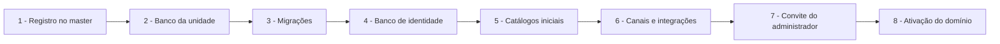

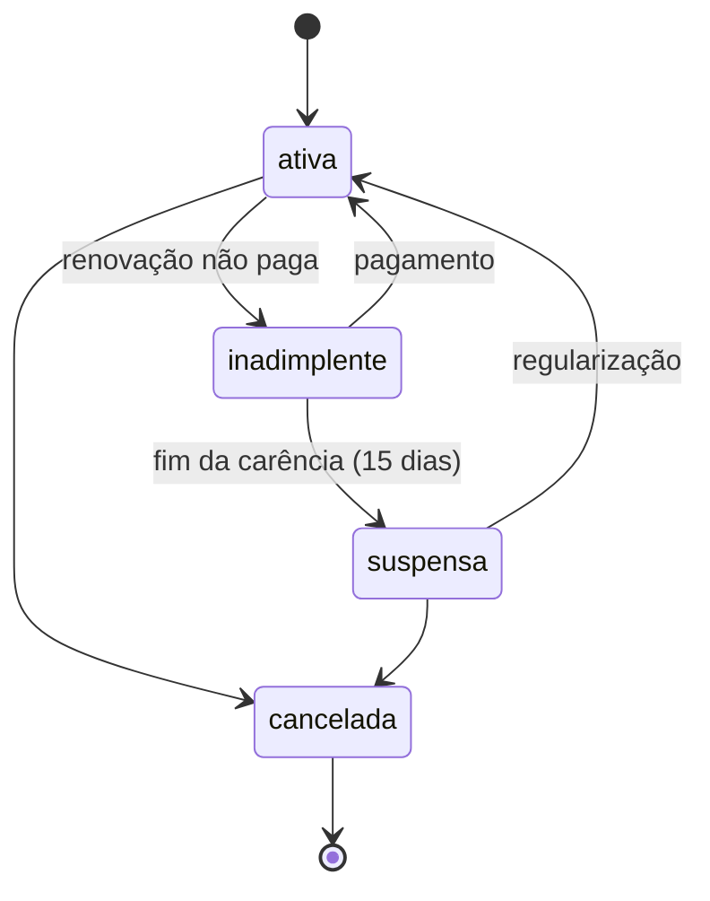

**Regras principais**
- Falha em qualquer etapa deixa a entidade em `provisionando`, sem acesso; a retomada é registrada ([23](#doc-23), seção 4).
- A saída do cliente tem sete etapas: pedido, suspensão, exportação, retenção legal, encerramento, expurgo e certificado ([23](#doc-23), seção 5).
- Cada plano tem limite de alunos; acima do limite, novas matrículas ativas são bloqueadas ([77](#doc-77)).
- São dois CRMs: o da plataforma (vender o SaaS) e o do tenant (captar alunos). Nenhum lead cruza de um para o outro ([22](#doc-22), seção 1).

<a id="doc-23"></a>

## 23 — Domínios, Editor de portais, Autenticação, Provisionamento e Ciclo de Vida

> Parte do [SDD v2](#doc-00). Identidade em [06](#doc-06), seção 12. Bancos em [03](#doc-03), seção 1.1. Operação em [10](#doc-10). Operação contínua, backup e testes em [24](#doc-24).
> **Status:** D-22, D-23 e D-24 aprovadas pelo autor em 02/11/2026. Esta seção cobre pontos que estavam no projeto sem registro: a arquitetura de subdomínios (Editor de portais e autenticação), o provisionamento de entidade e unidade e a saída de um cliente. Decisões D-22 a D-24 (seção 6) foram aprovadas em 02/11/2026.

---

### 1. Mapa de domínios

**Decisão D-25 (02/11/2026): seis portais.** Módulos não são subdomínios. Cada portal reúne os módulos que o usuário tem permissão de usar.

| Domínio | Portal | Quem acessa |
|---|---|---|
| `totustuussoftcloud.com.br` | Site institucional e CRM da plataforma. Não é portal de uso. | Público; equipe comercial |
| `desenvolvedor.totustuussoftcloud.com.br` | Portal do Desenvolvedor, com o Editor de portais como área restrita (papel `platform.builder`) | Equipe da plataforma |
| `gestao.totustuussoftcloud.com.br` | Portal SaaS de gestão: acadêmico, simulados, projetos, contábil, financeiro, biblioteca, arquivos, protocolo, suprimentos, frotas, pessoas, atendimento e acesso. Cada módulo aparece conforme o vínculo. | Usuários administrativos da entidade |
| `portal-do-professor.totustuussoftcloud.com.br` | Portal do Professor | Docentes |
| `portal-do-aluno.totustuussoftcloud.com.br` | Portal do Aluno | Estudantes |
| `portal-dos-responsaveis.totustuussoftcloud.com.br` | Portal dos Pais e Responsáveis | Responsáveis legais |
| `portal-de-terceiros.totustuussoftcloud.com.br` | Portal de Terceiros | Parceiros com acesso restrito |
| `autenticacao.totustuussoftcloud.com.br` | Serviço de login. Infraestrutura, não é portal. | Todos |
| `arquivos.totustuussoftcloud.com.br` | Serviço de arquivos sem tela, com origem separada. Infraestrutura. | Sistema |

Todos os endereços têm um único nível antes de `totustuussoftcloud.com.br`, para que o certificado curinga cubra todos. Por isso os portais usam hífen (`portal-do-aluno`), e não pontos.

**Fluxo de entrada (D-26, aprovada em 02/11/2026):**

1. A pessoa informa e-mail e senha no portal escolhido. A conta é a mesma em todos os portais.
2. Se a conta tiver um único vínculo ativo, com uma entidade e uma unidade, o sistema vai direto para a página principal do portal.
3. Se houver mais de uma entidade, a pessoa escolhe a entidade. Depois, se houver mais de uma unidade nela, escolhe a unidade.
4. Se a conta não tiver vínculo com o portal acessado, a tela mostra que não há acesso a esse portal, sem listar outras entidades ou unidades.
5. Trocar de entidade ou unidade depois do login emite novo token com o contexto escolhido (D-20). O endereço do portal não muda.

O subdomínio por entidade do D-24 é **superado** por D-25. O endereço da entidade fica pendente em D-26 ([00](#doc-00)).

Regras gerais:

1. Cada domínio tem cookie próprio. Nenhum cookie de sessão é compartilhado com domínio pai (ver seção 2).
2. Todo redirecionamento após login usa lista de destinos permitidos por conta. Destino fora da lista é recusado. Isso evita redirecionamento aberto.
3. Certificado curinga para `*.totustuussoftcloud.com.br`, com renovação automática e alerta a 14 dias do vencimento ([10](#doc-10), seção 7).
4. Domínio próprio da entidade exige verificação de posse (registro DNS) e certificado emitido para ele. Sem verificação, o domínio não é ativado.
5. O host da requisição é validado contra a lista de domínios ativos. Host desconhecido recebe `404` ([03](#doc-03), seção 3).

### 2. Sessão entre domínios

**Proposta (D-22):** OpenID Connect com código de autorização e PKCE.

- O login acontece só em `autenticacao.`.
- O domínio de destino recebe um código de uso único, troca por tokens e cria a própria sessão.
- Um domínio comprometido não acessa a sessão de outro.
- Logout propaga para todos os domínios com sessão ativa.

Alternativa: cookie compartilhado em `.totustuussoftcloud.com.br`. É mais simples, mas qualquer subdomínio comprometido recebe o cookie de todos. Não recomendado.

### 3. Editor de portais: a superfície mais sensível

O Editor de portais (chamado de "builder" na v1; nome decidido em MOD-12) altera páginas e rotas que valem para todas as entidades. O código do papel continua `platform.builder`, para não mudar as permissões já escritas em [06](#doc-06). Um erro ou um acesso indevido afeta todos os clientes. Por isso, ele tem regras próprias.

**Proposta (D-23):** o Editor de portais altera apenas definições declarativas: páginas, rotas, layout, blocos aprovados e configuração. Não aceita PHP, JavaScript ou HTML livre.

| Controle | Regra |
|---|---|
| Acesso | Papel `platform.builder`, passkey obrigatória ([06](#doc-06), seção 10) e sessão de curta duração. |
| Implantação | Sistema separado do produto, em outro grupo de servidores. Falha do Editor de portais não afeta os clientes. |
| Publicação | Rascunho → revisão por segundo papel → publicação. Quem edita não aprova a própria mudança. |
| Versão | Toda publicação gera versão imutável. Rollback volta a uma versão anterior em um clique, com registro. |
| Escopo | Mudança pode ser publicada para todas as entidades, para um grupo ou para uma entidade. Padrão: uma entidade, depois o grupo. |
| Validação | Definição é validada por esquema antes de publicar. Bloco fora do catálogo é recusado. |
| Conteúdo | Texto exibido passa pelo escape do sistema ([08](#doc-08)). Nenhum script é aceito. |
| Auditoria | Cada edição, aprovação e publicação gera registro ([18](#doc-18), seção 4.2). |
| Teste | Publicação passa por teste de fumaça das telas afetadas antes de ir para produção. |

**Motivo do limite:** código livre no Editor de portais transforma uma conta comprometida em execução de código em todos os clientes. A versão declarativa mantém o mesmo ganho de produtividade com um teto de dano bem menor.

### 4. Provisionamento de entidade e unidade

Criar uma entidade ou unidade é uma operação de várias etapas. Cada etapa é idempotente e pode ser retomada. A entidade só fica ativa ao final.

| Ordem | Etapa | Verificação |
|---|---|---|
| 1 | Registro da entidade e das unidades no master | Código e domínio únicos |
| 2 | Criação do banco da unidade (`tt_NNN`) e registro em `tenant_databases` | Banco criado com o nome registrado |
| 3 | Aplicação das migrações ao banco da unidade | `schema_version` igual à versão atual |
| 4 | Criação do banco de identidade da entidade, se ainda não existir (D-19) | Vazio e cifrado com a chave da entidade |
| 5 | Carga inicial de catálogos (locales, papéis padrão, categorias) | Conferência por contagem |
| 6 | Configuração de canais e integrações, por credencial própria do tenant ([16](#doc-16)) | Teste de conexão, sem ativação automática |
| 7 | Criação do primeiro administrador da entidade, por convite | Convite com validade de 72 h ([06](#doc-06)) |
| 8 | Ativação do domínio e da entidade | Teste de fumaça no domínio |

Regras:

- Falha em qualquer etapa deixa a entidade em `provisionando`, sem acesso de usuário. Retomada ou cancelamento são ações com registro.
- Cancelamento antes da ativação remove o banco criado e o registro de bancos. A remoção é verificada.
- Provisionamento não copia dado de outra entidade. Modelos padrão são sementes independentes.

### 5. Saída de cliente (desprovisionamento)

Um cliente que sai da plataforma precisa de um fluxo próprio, com prazos e registro. Ele é também um direito do titular.

| Etapa | Ação | Prazo de referência |
|---|---|---|
| 1. Pedido | Registro do pedido pelo administrador da entidade, com confirmação de identidade (MFA recente) | Imediato |
| 2. Suspensão | Entidade fica somente leitura. Novos vínculos e cobranças são bloqueados. | Imediato |
| 3. Exportação | Pacote com dados de titulares e de operação, em formato legível e portável ([07](#doc-07), seção 4). Entrega cifrada, com link de validade curta. | Até 15 dias |
| 4. Retenção legal | Dados que a lei exige guardar ficam em banco de retenção, com acesso restrito e prazo registrado. | Conforme a finalidade ([07](#doc-07), seção 5) |
| 5. Encerramento | Vínculos revogados. Domínio desativado. Sessões encerradas. | Após a exportação |
| 6. Expurgo | Banco da unidade e banco de identidade removidos. Arquivos expurgados. Backups expiram no prazo de retenção de backup. | Conforme política |
| 7. Registro final | Certificado de encerramento com o que foi exportado, retido e expurgado | Imediato após o expurgo |

Pendência: o prazo de guarda para retenção legal depende do jurídico (matriz de retenção, [26](#doc-26), seção 3).

### 6. Decisões propostas

| # | Decisão | Proposta | Alternativa e condição de falha |
|---|---|---|---|
| D-22 | Sessão entre domínios | OIDC com código e PKCE (seção 2) | Cookie compartilhado: mais simples, mas um subdomínio comprometido expõe os demais |
| D-23 | Escopo do Editor de portais | Só definições declarativas, com publicação revisada e rollback (seção 3) | Código livre: mais poder, mas uma conta comprometida afeta todas as entidades |
| D-24 | Endereço do tenant | Subdomínio por entidade, mais domínio próprio opcional com verificação (seção 1) | Seleção de entidade na tela de login: mais simples, mas a marca fica menos separada |

Estas decisões foram aprovadas pelo autor em 02/11/2026, com as propostas indicadas.

### 7. Critérios de aceite

- [ ] Cada domínio tem cookie próprio, sem compartilhamento com o domínio pai.
- [ ] Redirecionamento após login passa pela lista de destinos da conta.
- [ ] Editor de portais publica somente definições validadas, com revisão de segundo papel e rollback.
- [ ] Provisionamento retomável; cancelamento remove o que foi criado.
- [ ] Saída de cliente com exportação, retenção legal, expurgo e certificado.
- [ ] D-22 a D-24 decididas e registradas.

<a id="doc-77"></a>

## 77 — Licenciamento, planos, assinaturas e limites

> Parte do [SDD v2](#doc-00). Complementa [16](#doc-16) (cobrança da assinatura do SaaS) e [20](#doc-20) (pagamentos). Permissões em [78](#doc-78).
> **Status:** aprovado pelo autor em 04/11/2026 (L-01 e D-27 a D-29, D-34 a D-37). Não há proposta em aberto neste documento.

---

### 1. Regras aprovadas pelo autor

| # | Regra | Origem |
|---|---|---|
| L-01 | Cada plano tem um **limite de alunos**, definido pelo desenvolvedor da plataforma. | Autor, 04/11/2026 |
| L-02 | Criar entidade e criar unidade é **exclusivo do papel de desenvolvedor** (`platform.developer`). Nenhum outro papel cria entidade ou unidade. | Autor, 04/11/2026 |

### 2. Modelo de plano

| Campo | Regra | Situação |
|---|---|---|
| Nome e código | Únicos na plataforma. | D-34 (aprovada) |
| Limite de alunos | Número inteiro, definido pelo desenvolvedor. Contabiliza **alunos com matrícula ativa** em qualquer unidade da entidade. | L-01 (aprovada) |
| Módulos incluídos | Lista de módulos licenciados para o plano. Entidade sem o módulo não vê o item no portal. | D-35 (aprovada) (ver [23](#doc-23), seção 1) |
| Ciclo de cobrança | Mensal ou anual, definido por plano. | D-29 (aprovada) |
| Preço | Definido pelo desenvolvedor, por plano, em moeda única da plataforma. | D-29 (aprovada) |
| Situação | Ativo, descontinuado. Plano descontinuado não aceita novas assinaturas, e as existentes seguem até a renovação. | D-36 (aprovada) |

### 3. Assinatura da entidade

- Uma entidade tem **uma assinatura ativa** por vez, vinculada a um plano.
- Mudança de plano: efeito na data definida pelo desenvolvedor. Aumento de limite pode ser imediato; redução só vale na renovação, sem remover alunos já matriculados.
- Cobrança de assinatura: integrada ao provedor de pagamento, sem dado bancário no sistema ([16](#doc-16), seção 2.1).

#### 3.1 Situações da assinatura (D-37, aprovada)

| Situação | Quando | Efeito |
|---|---|---|
| `ativa` | Pagamento em dia | Operação normal |
| `inadimplente` | Renovação não paga após o vencimento | Acesso de leitura por período de carência; novas matrículas bloqueadas |
| `suspensa` | Fim da carência sem pagamento, ou pedido do desenvolvedor | Somente leitura, como em [23](#doc-23), seção 5 |
| `cancelada` | Cancelamento solicitado ou fim do processo de saída | Início do fluxo de saída de cliente |

Prazo de carência: **15 dias**, ajustável pelo desenvolvedor por plano (D-28, aprovada).

### 4. Limite de alunos (L-01)

- **Contagem:** alunos com matrícula ativa, somados em todas as unidades da entidade. Matrícula cancelada, trancada ou concluída não conta.
- **Verificação:** a cada nova matrícula ativa e, em lote, uma vez por dia para conferência.
- **Ao atingir 90%:** aviso aos administradores da entidade e ao desenvolvedor.
- **Ao exceder o limite:** **bloqueio de novas matrículas ativas** (D-27, aprovada) até que o plano seja ampliado ou o número de alunos caia. Dados existentes não são alterados nem bloqueados.
- **Alternativa:** permitir o excedente por período de tolerância, com cobrança adicional. Descartada pela D-27.

### 5. Decisões pendentes

| # | Decisão | Proposta | Alternativa |
|---|---|---|---|
| D-27 | Comportamento ao exceder o limite de alunos | Bloquear novas matrículas ativas (seção 4). **Aprovada pelo autor em 04/11/2026.** | Tolerância com cobrança adicional |
| D-28 | Prazo de carência por inadimplência | 15 dias, por plano. **Aprovada pelo autor em 04/11/2026.** | Prazo único para todos os planos |
| D-29 | Preço e ciclo por plano | Definidos pelo desenvolvedor, por plano. **Aprovada pelo autor em 04/11/2026.** | Preço único da plataforma |
| D-34 | Nome e código do plano | Únicos na plataforma (seção 2). **Aprovada pelo autor em 04/11/2026.** | Únicos por grupo de planos |
| D-35 | Módulos incluídos no plano | Lista de módulos por plano; entidade sem o módulo não vê o item no portal (seção 2). **Aprovada pelo autor em 04/11/2026.** | Todos os módulos em todos os planos, com limite só de alunos |
| D-36 | Situação do plano | Ativo ou descontinuado; descontinuado não aceita novas assinaturas (seção 2). **Aprovada pelo autor em 04/11/2026.** | Plano pode ser excluído |
| D-37 | Situações da assinatura | Ativa, inadimplente, suspensa, cancelada, com os efeitos da seção 3.1. **Aprovada pelo autor em 04/11/2026.** | Só ativa e cancelada |

### 6. Critérios de aceite

- [ ] Plano com limite de alunos obrigatório, definido pelo desenvolvedor.
- [ ] Contagem de alunos com matrícula ativa, somada por entidade, verificada na matrícula e em lote.
- [ ] Aviso a 90% e bloqueio de novas matrículas acima do limite (D-27).
- [ ] Mudança de plano com efeito na data definida, sem remover alunos.
- [ ] Situações da assinatura refletidas na navegação e nas ações (D-28 e D-37).
- [ ] Nenhum dado bancário no sistema (ver [16](#doc-16)).

<a id="doc-22"></a>

## 22 — CRM: Dois Contextos, Canais de Captação e Papéis

> Parte do [SDD v2](#doc-00). Substitui e amplia a v1 [`spec_crm_funil_comercial.md`](#v1-spec-crm-funil-comercial-md) (ver [19](#doc-19), seção 6). Integrações de canal em [16](#doc-16). Consentimento e papéis de LGPD em [07](#doc-07). Permissões em [06](#doc-06). Pagamentos em [20](#doc-20). Chatbots e captação usam a mesma camada de mensagens descrita aqui.
> **Interpretação:** "papilanes" foi lido como **papéis** (perfis de usuário e de operação). Se a intenção for outra, esta seção será revisada.
> **Status:** D-16, D-17 e D-18 decididas pelo autor em 02/11/2026 (seção 9).

---

### 1. Dois CRMs, não um

Existem dois CRMs com donos, leads e finalidades diferentes. Misturá-los seria erro de dados e de LGPD.

| Aspecto | CRM da plataforma (vendas do SaaS) | CRM do tenant (captação de alunos) |
|---|---|---|
| Quem vende | TotusTuus SoftCloud | Colégio, faculdade ou instituição (tenant) |
| Quem é o lead | Instituição ou empresa que pode contratar o SaaS | Aluno, responsável ou candidato |
| Dono dos dados (controlador, LGPD) | Plataforma | Tenant |
| Papel da plataforma sobre os dados | Controlador | Operadora, quando a plataforma executa o canal para o tenant |
| Funil | Pré-venda, demonstração, proposta, contrato, implantação | Interesse, contato, pré-cadastro, inscrição, documentos, matrícula |
| Dados pessoais típicos | Nome do decisor, e-mail corporativo, telefone comercial | Nome do aluno e do responsável, telefone, e-mail, série de interesse |
| Dados que nunca entram | Dado de aluno de tenant | Dado comercial da plataforma, preço negociado com outro tenant |
| Banco | **Banco master** (`totustuus.matriz.bd`) | **Banco da unidade** (um por entidade + unidade, ver [03](#doc-03), seção 1.1) |

**Regra de separação:** nenhum registro de tenant aparece no CRM da plataforma, e nenhum registro do CRM da plataforma aparece em tenant. A ligação entre os dois é apenas o contrato comercial.

**Operação pela plataforma de canal de tenant:** quando o chatbot da plataforma atende o aluno de um tenant, a plataforma atua como operadora. Isso exige contrato de tratamento de dados entre plataforma e tenant ([07](#doc-07), seção 7).

---

### 2. Canais

#### 2.1 CRM da plataforma

| Canal | Entrada | Identidade capturada | Atendimento | Consentimento |
|---|---|---|---|---|
| Chatbot no site (totustuussoftcloud.com.br) | Widget no site institucional | E-mail corporativo, telefone, nome, instituição | Bot com handoff para vendedor | Aviso e aceite antes de coletar |
| Chatbot WhatsApp | Número oficial da plataforma | Número de telefone | Bot com handoff | Opt-in na primeira mensagem |
| Chatbot Telegram | Bot oficial da plataforma | Identificador do usuário e, se fornecido, telefone | Bot com handoff | Opt-in na primeira mensagem |
| Chatbot Instagram | Conta oficial, mensagem direta | Identificador da conta | Bot com handoff | Opt-in e aviso de que o contato é registrado |
| Chatbot Messenger | Página oficial | Identificador da página | Bot com handoff | Opt-in e aviso de que o contato é registrado |
| Telefone | Ligação recebida ou feita | Número e nome informado | Vendedor | Aviso de gravação, quando houver gravação |
| Presencial | Evento, visita, feira | Cartão ou formulário em papel digitalizado | Vendedor | Termo no formulário, com aceite |

#### 2.2 CRM do tenant (captação de alunos)

| Canal | Entrada | Identidade capturada | Atendimento | Consentimento |
|---|---|---|---|---|
| Formulário embutido no site do tenant (iframe ou script) | Página do tenant, com origem permitida | Nome, telefone, e-mail, série de interesse | Equipe de admissões | Aceite com finalidade, na própria página |
| Chatbot WhatsApp do tenant | Número do tenant ([16](#doc-16), D-07) | Número de telefone | Bot do tenant com handoff | Opt-in na primeira mensagem |
| Chatbot Telegram do tenant | Bot do tenant | Identificador e telefone, se fornecido | Bot com handoff | Opt-in |
| Chatbot Instagram do tenant | Conta do tenant | Identificador da conta | Bot com handoff | Opt-in |
| Chatbot Messenger do tenant | Página do tenant | Identificador da página | Bot com handoff | Opt-in |
| Telefone | Central do tenant | Número e nome | Atendente | Aviso de gravação |
| Presencial | Visita, feira, open day | Ficha de inscrição | Atendente | Termo de consentimento na ficha |

**Regra comum a todos os canais:** a captura começa só depois do aviso de finalidade. Lead sem consentimento de contato para a finalidade informada fica em estado `sem_consentimento` e não recebe mensagem de marketing.

---

### 3. Regras por canal

| Regra | Aplicação |
|---|---|
| Identificação de bot | O chatbot se identifica como automático na primeira mensagem e oferece transferência para humano. |
| Dados que o bot não coleta | Dado de saúde, CPF completo, número de cartão, senha e documento de imagem. Quando necessário para a matrícula, o coleta acontece em formulário autenticado. |
| Pagamento | Nenhum pagamento é feito no chat. O bot envia link de pagamento ([20](#doc-20)). |
| Opt-out | Palavra de saída reconhecida em todos os canais (`PARAR`, `SAIR`). Efeito imediato sobre marketing. |
| Horário e frequência | Limite de mensagens proativas por lead e por dia. Mensagem de cobrança segue a régua de [18](#doc-18), seção 2.6. |
| Transcrição | Guardada como interação do lead, com retenção configurável por tenant ([07](#doc-07), seção 5). |
| Gravação de ligação | Só com aviso no início e registro do consentimento. |
| Mensagem de terceiro | Nunca encaminhar a conversa a outro lead ou a outro tenant. |
| Políticas das plataformas | Cada canal cumpre as regras de uso da plataforma de mensagens (WhatsApp Business, Telegram Bot API, Meta para Instagram e Messenger). Mudança de regra vira tarefa de adequação. |
| Chatbot com IA (D-18) | A IA responde **somente com base em fonte cadastrada** (catálogo de cursos, preços, calendário, FAQ aprovada). Pergunta fora da fonte não recebe resposta inventada: é encaminhada para humano. Preço, bolsa, prazo ou condição nunca saem de fonte não cadastrada. |
| Abertura de ticket sem IA (D-18) | Todo ponto de atendimento oferece a opção "Abrir ticket" por menu fixo, sem interpretação por IA. O ticket é criado no módulo de atendimento ([19](#doc-19), seção 7) com categoria escolhida no menu e texto digitado pelo contato, guardado como texto literal. Esse caminho funciona mesmo com IA desligada. |
| Injeção de instrução | Texto do lead é dado, nunca instrução ao bot. Teste contra tentativa de alterar o comportamento do bot ([05](#doc-05)). |

---

### 4. Papéis do CRM

#### 4.1 CRM da plataforma

| Papel | Escopo | Pode | Não pode |
|---|---|---|---|
| Pré-vendas (SDR) | Leads da plataforma | Qualificar, agendar demonstração, registrar interação | Fechar proposta, alterar preço, ver contrato |
| Vendedor (AE) | Leads e oportunidades atribuídos a ele | Criar proposta, avançar funil até negociação | Aprovar desconto acima da alçada, alterar contrato assinado |
| Gerente comercial | Equipe | Atribuir leads, aprovar desconto dentro da alçada, ver funil da equipe | Aprovar a própria proposta |
| Operador de chatbot | Conversas em atendimento | Atender, transferir, registrar | Acessar carteira fora da fila |
| Sucesso do cliente | Clientes ativos (tenants) | Acompanhar implantação e uso | Alterar cobrança |

#### 4.2 CRM do tenant

| Papel | Escopo | Pode | Não pode |
|---|---|---|---|
| Atendente de admissões | Leads da unidade | Atender, registrar interação, agendar visita | Exportar base, ver dado de matrícula de outro aluno |
| Coordenador de admissões | Leads de todas as unidades permitidas | Redistribuir, ver funil, configurar régua de contato | Alterar a finalidade de consentimento |
| Gestor comercial da entidade | Entidade | Ver indicadores, configurar canais | Ver dado pessoal além da lista de leads com permissão de exportação |
| Operador de bot do tenant | Conversas do canal | Atender e transferir | Editar a base de conhecimento do bot sem permissão |
| Responsável pela unidade | Unidade | Ver funil da unidade | Ver outra unidade |

---

### 5. Papéis dos departamentos

Papéis internos da organização que usa o sistema (plataforma ou tenant). Cada papel define acesso a módulos. Os nomes de permissão seguem `modulo.recurso.acao` ([06](#doc-06), seção 9).

| Papel | Módulos principais | Permissões-chave | Segregação de funções |
|---|---|---|---|
| **Financeiro** | Financeiro, Cobrança, Pagamentos | Emitir e baixar títulos; solicitar estorno; conciliar | Não aprova o próprio estorno |
| **Contábil** | Contábil e Fiscal, Financeiro (leitura) | Lançar, fechar período, exportar para ERP | Não fecha período com lançamento que criou sem revisão |
| **Fiscal** | Contábil e Fiscal, Cobrança (NFSe) | Emitir e cancelar NFSe, apurar tributos | Cancelamento exige aprovação do contábil |
| **Comercial** | CRM (conforme 4.1 ou 4.2), Contratos (leitura) | Criar proposta, negociar | Não aprova desconto acima da alçada |
| **Compras** | Suprimentos (requisição, pedido, cotação), Contratos | Criar cotação e pedido; cadastrar fornecedor | Não aprova a própria requisição; não recebe a própria compra |
| **Almoxarifado** | Suprimentos (estoque) | Registrar recebimento e movimento | Não ajusta estoque sem motivo e aprovação |
| **Aprovador de compras** | Suprimentos | Aprovar requisição dentro da alçada | Não é o solicitante |
| **RH** | HCM (Pessoas e RH) | Cadastrar colaborador, férias, afastamento | Campos salariais só com permissão própria |
| **Folha** | HCM (folha) | Processar folha | Folha fechada não é alterada |
| **SMT** | Segurança e medicina do trabalho | Registrar ASO, CAT, EPI | Resultado de exame só por profissional responsável |
| **Acadêmico (secretaria)** | Acadêmico | Matrícula, documentos | Nota só pelo professor da turma |
| **Professor** | Acadêmico (turmas próprias) | Lançar nota, presença, diário | Só turmas vinculadas |
| **Jurídico** | Contratos, Documentos, Auditoria (leitura) | Parecer, bloqueio legal | Não altera contrato assinado |
| **Encarregado (DPO)** | Privacidade, Auditoria, Busca por CPF | Relatório de impacto, relatório ao titular, aprovação de finalidade | Não opera o módulo que audita |
| **Segurança** | Auditoria, Configuração de MFA, Cofre (leitura de status) | Investigar, bloquear conta | Não concede permissão a si mesmo |
| **TI / Operação** | Infraestrutura, filas, monitoramento | Operar serviços | Sem acesso a dado pessoal de tenant |

**Regra geral de segregação:** nenhuma pessoa cria e aprova o mesmo objeto financeiro, de compra ou de consentimento. A aplicação verifica isso, não só o processo.

---

### 6. Funil e estados

#### 6.1 CRM da plataforma

Leads: `novo` → `contatado` → `qualificado` → `demonstracao` → `proposta` → `negociacao` → `ganho` ou `perdido`.
Após ganho: `implantacao` → `ativo`.

Estados de lead descartado: `desqualificado`, `sem_consentimento`, `duplicado`.

#### 6.2 CRM do tenant

Leads: `interessado` → `contatado` → `pre_cadastro` → `inscrito` → `documentos_pendentes` → `matriculado`.
Estado de saída: `desistente`, `sem_consentimento`, `duplicado`.

Regras:

- "Fechado perdido" exige motivo (preço, concorrência, sem vaga, timing ou outro), como já definido na v1.
- Lead `matriculado` nunca volta a `interessado`. Novo interesse gera novo lead, vinculado ao anterior.
- Vaga do curso é reservada só em `inscrito`, com bloqueio de concorrência ([15](#doc-15), seção 7).

---

### 7. Captura por formulário embutido

- Origem permitida: lista de domínios cadastrada por tenant. Outro domínio não recebe o envio.
- O formulário é carregado de origem da plataforma com `frame-ancestors` limitado aos domínios permitidos.
- Campos mínimos. A série de interesse é lista fechada.
- Proteção contra robô: desafio antes do envio, sem terceiro não aprovado.
- Aceite de finalidade e de contato antes do envio, com texto e versão registrados.
- Confirmação por e-mail ou WhatsApp quando marketing estiver marcado (duplo opt-in).
- Nenhum script de terceiro na página do formulário além dos aprovados ([08](#doc-08), seção 2).

---

### 8. Dados

Tabelas mínimas. Todas com `tenant_id` (no CRM da plataforma, `tenant_id` aponta para a própria plataforma).

```sql
CREATE TABLE crm_leads (
  id              BIGINT UNSIGNED AUTO_INCREMENT PRIMARY KEY,
  uuid            CHAR(36)     NOT NULL,
  tenant_id       CHAR(36)     NOT NULL,
  context         ENUM('plataforma','tenant') NOT NULL,
  origin_channel  ENUM('site','formulario','whatsapp','telegram','instagram','messenger','telefone','presencial','indicacao') NOT NULL,
  owner_uuid      CHAR(36)     NULL,
  unit_id         CHAR(36)     NULL,
  name            VARCHAR(150) NOT NULL,
  phone_e164      VARCHAR(20)  NULL,
  email           VARCHAR(254) NULL,
  email_hash      CHAR(64)     NULL,
  phone_hash      CHAR(64)     NULL,
  status          VARCHAR(40)  NOT NULL,
  lost_reason     VARCHAR(60)  NULL,
  created_at      DATETIME(6)  NOT NULL DEFAULT CURRENT_TIMESTAMP(6),
  UNIQUE KEY uk_lead_uuid (uuid),
  INDEX idx_tenant_status (tenant_id, context, status),
  INDEX idx_tenant_phone (tenant_id, phone_hash),
  INDEX idx_tenant_email (tenant_id, email_hash)
) ENGINE=InnoDB DEFAULT CHARSET=utf8mb4;

CREATE TABLE crm_consents (
  id              BIGINT UNSIGNED AUTO_INCREMENT PRIMARY KEY,
  uuid            CHAR(36)     NOT NULL,
  tenant_id       CHAR(36)     NOT NULL,
  lead_id         BIGINT UNSIGNED NOT NULL,
  purpose         ENUM('contato_comercial','marketing','admissao','cobranca','gravacao_ligacao') NOT NULL,
  channel         VARCHAR(20)  NOT NULL,
  text_version    VARCHAR(40)  NOT NULL,
  granted_at      DATETIME(6)  NOT NULL,
  revoked_at      DATETIME(6)  NULL,
  evidence_ref    VARCHAR(255) NULL,
  UNIQUE KEY uk_consent_uuid (uuid),
  INDEX idx_lead_purpose (tenant_id, lead_id, purpose),
  FOREIGN KEY (lead_id) REFERENCES crm_leads(id)
) ENGINE=InnoDB DEFAULT CHARSET=utf8mb4;
```

Notas:

- `email_hash` e `phone_hash` são HMAC com pepper, para deduplicação e busca exata ([15](#doc-15), seção 2). Dado em claro é cifrado conforme [05](#doc-05).
- Consentimento nunca é apagado. Revogação preenche `revoked_at`.
- Interações (mensagens, ligações, visitas) vão para tabela própria, com canal, direção e referência à transcrição. A transcrição segue a retenção do tenant.
- Deduplicação: mesmo `phone_hash` ou `email_hash` dentro do mesmo `tenant_id` e contexto gera alerta de possível duplicidade, sem fusão automática.

---

### 9. Decisões

| # | Decisão | Proposta | Alternativa e condição de falha |
|---|---|---|---|
| D-16 | Separação dos CRMs | **Decidida:** CRM da plataforma no banco master; CRM do tenant no banco de cada unidade (entidade + unidade). | — |
| D-17 | Contas de canal (WhatsApp, Telegram, Instagram, Messenger) | **Decidida:** no CRM da plataforma, contas oficiais da plataforma. No CRM do tenant, contas do próprio tenant, conforme D-07 ([16](#doc-16), seção 6). | — |
| D-18 | Uso de IA no chatbot | **Decidida:** IA só com fonte cadastrada; pergunta fora da fonte vai para humano; sempre disponível a opção "Abrir ticket" sem IA (seção 3) | — |

---

### 10. Lacunas

| # | Lacuna | Dono sugerido | Situação em 04/11/2026 |
|---|---|---|---|
| LAC-21 | Texto de aceite de finalidade por contexto | Jurídico | Aberta (jurídico) |
| LAC-22 | Limite de mensagens proativas por canal | Comercial, Jurídico | Parcial: padrão seguro provisório DP-08 ([80](#doc-80)); o limite por canal continua dependendo do jurídico |
| LAC-23 | Alçada de desconto do CRM da plataforma | Comercial | Resolvida por padrão: DP-07 ([80](#doc-80)). Parâmetro sem valor inventado; até a configuração, todo desconto fora da regra passa pelo gerente comercial |
| LAC-24 | Retenção de transcrição e de gravação de ligação | Jurídico, DPO | Aberta (jurídico): ATD-03 ([32](#doc-32)) |
| LAC-25 | Contrato de operadora entre plataforma e tenant para atendimento de canal | Jurídico | Aberta (jurídico) |

---

### 11. Critérios de aceite

- [ ] Nenhum lead de tenant aparece no CRM da plataforma, e o contrário (teste de isolamento).
- [ ] Todo canal da seção 2 tem regra de consentimento antes da primeira mensagem proativa.
- [ ] Todo papel das seções 4 e 5 tem permissões testadas, incluindo as restrições.
- [ ] Segregação de funções testada nas operações financeiras, de compra e de consentimento.
- [ ] Chatbot se identifica como automático e transfere para humano.
- [ ] Formulário embutido só envia para origem permitida.

## Especificações da v1 desta parte absorvidas no kit-starter ou sem destino

<a id="v1-spec-crm-funil-comercial-md"></a>

### v1 — `spec_crm_funil_comercial.md` (244 linhas)

> Situação na v2: Absorvido integralmente no kit-starter. Destino: ficha do kit-starter: `kit-starter/gestao/comercial-e-admissoes/crm-do-tenant-captacao-pre-cadastro-inscricao.md`. Quando este texto diverge da v2, vale a v2.

#### O que a v2 muda nesta especificação

Estas regras prevalecem sobre o texto da v1 que vem a seguir.

- Dois CRMs, não um ([22](#doc-22), seção 1); consentimento por canal ([26](#doc-26), seção 5).

#### Texto integral da v1

**Projeto:** TotusTuusSoftCloud — SaaS Multi-Entidade · Multi-Unidade · Multi-Usuário
**Módulo:** CRM / Sales Pipeline / Admissions
**Stack:** PHP 8 puro · MariaDB · Tailwind CSS 4.2 · Supabase · amCharts 5
**Padrão de ID:** `id` (ordenação) · `uuid` (interno) · `code` (externo)
**Status:** Draft — gap identificado (conecta Marketing → Processo Seletivo → Matrícula)

- Language Standard: Global English

---

#### 1. Objetivo

Centralizar a jornada comercial completa, do lead gerado (Marketing) até a conversão em cliente/aluno matriculado, com pipeline de vendas, metas por vendedor/unidade, forecast, follow-up automatizado e atribuição de origem. Preenche a lacuna entre o módulo de Marketing (que gera leads) e o módulo Acadêmico (que trata do Processo Seletivo já com candidato inscrito).

#### 2. Escopo funcional

- Cadastro e qualificação de leads.
- Pipeline de oportunidades (kanban multi-etapa configurável).
- Atribuição automática de leads por regra (round-robin, território, origem).
- Atividades comerciais: ligações, e-mails, reuniões, tarefas.
- Metas e comissionamento por vendedor/unidade.
- Forecast de conversão e receita.
- Campanhas e origem de leads (integração com Marketing).
- Propostas comerciais e follow-up.
- Perda de oportunidade com motivo estruturado.
- Conversão para matrícula (handoff ao módulo Acadêmico) ou para contrato (handoff ao módulo Contratos).

#### 3. Perfis de acesso

| Perfil | Permissões |
|---|---|
| Gestor Comercial | Visão total, metas, relatórios, redistribuição de leads |
| Vendedor/Consultor | Pipeline próprio, atividades, propostas |
| Marketing | Cadastro de campanhas, visão de origem de leads |
| Recepção/SDR | Qualificação inicial de leads (pré-vendas) |
| Financeiro | Consulta de propostas fechadas para faturamento |

#### 4. Páginas do módulo

```
/crm/dashboard
/crm/leads                    — Lista de leads (datatable)
/crm/leads/:uuid               — Ficha do lead / timeline
/crm/pipeline                  — Kanban de oportunidades
/crm/opportunities             — Lista de oportunidades (datatable)
/crm/opportunities/:uuid       — Detalhe da oportunidade
/crm/activities                — Agenda de atividades comerciais
/crm/proposals                 — Propostas emitidas
/crm/goals                     — Metas e comissionamento
/crm/campaigns                 — Campanhas e origem
/crm/reports                   — Relatórios de funil e conversão
/crm/settings                  — Pipelines, motivos de perda, regras de atribuição
```

#### 5. Dashboard

##### Widgets
- Total de leads no período.
- Leads não atribuídos.
- Oportunidades abertas.
- Taxa de conversão (lead → matrícula/venda).
- Ticket médio.
- Receita em pipeline (forecast).
- Atividades atrasadas.
- Tempo médio de ciclo de venda.

##### Charts
- Funil: Lead → Qualificado → Proposta → Negociação → Fechado.
- Linha: novos leads por semana/mês.
- Donut: leads por origem/campanha.
- Barras: conversão por vendedor.
- Barras: motivos de perda mais frequentes.

#### 6. Leads — Datatable

Colunas: nome · telefone/e-mail · origem · campanha · curso/produto de interesse · responsável · status (novo/em contato/qualificado/desqualificado/convertido) · data criação · última interação · ações.

##### Drawer CRUD — Lead
- Dados de contato · origem (orgânico/pago/indicação/evento) · campanha vinculada.
- Curso/produto/unidade de interesse.
- Responsável atribuído (manual ou automático por regra).
- Score de qualificação (BANT ou customizado).
- Histórico de interações (timeline).
- Botão "Converter em Oportunidade".

#### 7. Pipeline — Kanban de Oportunidades

##### Colunas (configuráveis por pipeline)
Novo → Qualificação → Proposta Enviada → Negociação → Fechado Ganho → Fechado Perdido

##### Card
- Nome do lead/empresa · valor estimado · responsável · próxima atividade agendada · dias na etapa · badge de prioridade.

##### Regras
- Drag and drop com log de transição de etapa.
- Etapa "Fechado Perdido" exige motivo obrigatório (select configurável: preço, concorrência, sem orçamento, timing, outro).
- Etapa "Fechado Ganho" dispara automação de handoff (matrícula ou contrato).
- Múltiplos pipelines por tipo de produto/unidade (ex.: pipeline Educação Básica vs. pipeline Cursos Livres).

#### 8. Atividades Comerciais

- Tipos: ligação, e-mail, reunião, WhatsApp, tarefa.
- Agenda por vendedor com lembretes.
- Registro de resultado da atividade (contato feito/não atendeu/reagendado).
- Vínculo obrigatório a um lead ou oportunidade.

#### 9. Propostas Comerciais

- Geração de proposta em PDF a partir de template configurável.
- Itens de proposta com valores, descontos e condições.
- Status: rascunho / enviada / visualizada / aceita / recusada / expirada.
- Assinatura eletrônica opcional (integração com módulo de Contratos).

#### 10. Metas e Comissionamento

- Meta mensal/trimestral por vendedor e por unidade.
- Acompanhamento de realizado vs. meta (gauge/progress).
- Regra de comissão configurável (percentual fixo, escalonado, por produto).
- Relatório de comissão a pagar (integração com Financeiro/RH).

#### 11. Campanhas e Origem

- Cadastro de campanhas com custo, período e canal.
- Cálculo de CAC (custo de aquisição) por campanha.
- Vínculo com módulo de Marketing (UTM, tags de origem).

#### 12. Automações

- Atribuir lead automaticamente por regra (round-robin, território, disponibilidade).
- Notificar vendedor de lead sem contato em X horas (SLA de primeiro atendimento).
- Mover oportunidade para "Perdido" automaticamente após N dias sem atividade.
- Disparar e-mail de nutrição para leads não qualificados.
- Ao "Fechado Ganho", criar matrícula (Acadêmico) ou contrato (Contratos) automaticamente com dados da oportunidade.
- Alertar gestor quando meta do vendedor estiver em risco (< 70% aos 20 dias do período).

#### 13. Integrações

- **Marketing**: origem de lead, campanhas, UTM.
- **Acadêmico**: handoff para Processo Seletivo/Matrícula ao fechar oportunidade educacional.
- **Contratos**: handoff para geração de contrato ao fechar oportunidade B2B.
- **Financeiro/Billing**: geração de proposta que vira fatura/assinatura.
- **Notificações**: lembretes de atividade, alertas de SLA.
- **Auditoria**: mudança de etapa, atribuição, perda e conversão.

#### 14. Modelo de dados mínimo

```sql
CREATE TABLE crm_leads (
  id BIGINT UNSIGNED AUTO_INCREMENT PRIMARY KEY,
  uuid CHAR(36) NOT NULL UNIQUE DEFAULT (UUID()),
  code VARCHAR(30) NOT NULL UNIQUE,
  entity_id BIGINT UNSIGNED NOT NULL,
  unit_id BIGINT UNSIGNED,
  name VARCHAR(150) NOT NULL,
  email VARCHAR(150),
  phone VARCHAR(30),
  source VARCHAR(60),
  campaign_id BIGINT UNSIGNED NULL,
  interest_product VARCHAR(150),
  owner_user_id BIGINT UNSIGNED,
  score TINYINT UNSIGNED DEFAULT 0,
  status ENUM('new','contacted','qualified','disqualified','converted') DEFAULT 'new',
  created_at DATETIME DEFAULT CURRENT_TIMESTAMP,
  updated_at DATETIME ON UPDATE CURRENT_TIMESTAMP,
  deleted_at DATETIME NULL
) ENGINE=InnoDB DEFAULT CHARSET=utf8mb4;

CREATE TABLE crm_opportunities (
  id BIGINT UNSIGNED AUTO_INCREMENT PRIMARY KEY,
  uuid CHAR(36) NOT NULL UNIQUE DEFAULT (UUID()),
  code VARCHAR(30) NOT NULL UNIQUE,
  lead_id BIGINT UNSIGNED NOT NULL,
  pipeline_id BIGINT UNSIGNED NOT NULL,
  stage VARCHAR(60) NOT NULL DEFAULT 'new',
  estimated_value DECIMAL(12,2),
  owner_user_id BIGINT UNSIGNED,
  probability TINYINT UNSIGNED DEFAULT 0,
  expected_close_date DATE,
  status ENUM('open','won','lost') DEFAULT 'open',
  lost_reason VARCHAR(120) NULL,
  closed_at DATETIME NULL,
  created_at DATETIME DEFAULT CURRENT_TIMESTAMP,
  updated_at DATETIME ON UPDATE CURRENT_TIMESTAMP,
  FOREIGN KEY (lead_id) REFERENCES crm_leads(id)
) ENGINE=InnoDB DEFAULT CHARSET=utf8mb4;

CREATE TABLE crm_activities (
  id BIGINT UNSIGNED AUTO_INCREMENT PRIMARY KEY,
  uuid CHAR(36) NOT NULL UNIQUE DEFAULT (UUID()),
  opportunity_id BIGINT UNSIGNED NULL,
  lead_id BIGINT UNSIGNED NULL,
  type ENUM('call','email','meeting','whatsapp','task') NOT NULL,
  scheduled_at DATETIME,
  completed_at DATETIME NULL,
  outcome VARCHAR(100) NULL,
  owner_user_id BIGINT UNSIGNED,
  notes TEXT,
  created_at DATETIME DEFAULT CURRENT_TIMESTAMP
) ENGINE=InnoDB DEFAULT CHARSET=utf8mb4;

CREATE TABLE crm_proposals (
  id BIGINT UNSIGNED AUTO_INCREMENT PRIMARY KEY,
  uuid CHAR(36) NOT NULL UNIQUE DEFAULT (UUID()),
  opportunity_id BIGINT UNSIGNED NOT NULL,
  total_value DECIMAL(12,2),
  status ENUM('draft','sent','viewed','accepted','declined','expired') DEFAULT 'draft',
  pdf_path VARCHAR(500),
  sent_at DATETIME NULL,
  responded_at DATETIME NULL,
  created_at DATETIME DEFAULT CURRENT_TIMESTAMP,
  FOREIGN KEY (opportunity_id) REFERENCES crm_opportunities(id)
) ENGINE=InnoDB DEFAULT CHARSET=utf8mb4;

CREATE TABLE crm_goals (
  id BIGINT UNSIGNED AUTO_INCREMENT PRIMARY KEY,
  uuid CHAR(36) NOT NULL UNIQUE DEFAULT (UUID()),
  owner_user_id BIGINT UNSIGNED NOT NULL,
  unit_id BIGINT UNSIGNED,
  period VARCHAR(7) NOT NULL COMMENT 'YYYY-MM',
  target_value DECIMAL(12,2) NOT NULL,
  achieved_value DECIMAL(12,2) DEFAULT 0,
  commission_rule JSON,
  created_at DATETIME DEFAULT CURRENT_TIMESTAMP
) ENGINE=InnoDB DEFAULT CHARSET=utf8mb4;
```

#### 15. API REST (principais)

- `GET/POST /api/v1/crm/leads` · `POST /api/v1/crm/leads/{uuid}/convert`
- `GET/POST /api/v1/crm/opportunities` · `PATCH /api/v1/crm/opportunities/{uuid}/stage`
- `POST /api/v1/crm/opportunities/{uuid}/win` · `POST /api/v1/crm/opportunities/{uuid}/lose`
- `GET/POST /api/v1/crm/activities`
- `GET/POST /api/v1/crm/proposals` · `POST /api/v1/crm/proposals/{uuid}/send`
- `GET /api/v1/crm/goals` · `GET /api/v1/crm/reports/funnel`

#### 16. Critérios de aceite

- Lead flui do cadastro até a conversão sem perda de contexto.
- Kanban de pipeline reflete mudança de etapa com auditoria.
- Perda de oportunidade sempre exige motivo estruturado.
- Handoff automático para Acadêmico/Contratos funciona ao fechar "Ganho".
- Dashboard exibe funil e conversão em tempo real.
- Metas e comissão calculadas corretamente por vendedor/período.

<a id="v1-spec-gestao-marketing-redes-sociais-md"></a>

### v1 — `spec_gestao_marketing_redes_sociais.md` (350 linhas)

> Situação na v2: Absorvido integralmente no kit-starter. Destino: ficha do kit-starter: `kit-starter/gestao/comercial-e-admissoes/crm-do-tenant-captacao-pre-cadastro-inscricao.md`. Quando este texto diverge da v2, vale a v2.

#### O que a v2 muda nesta especificação

Estas regras prevalecem sobre o texto da v1 que vem a seguir.

- Dois CRMs, não um ([22](#doc-22), seção 1); consentimento por canal ([26](#doc-26), seção 5).

#### Texto integral da v1

- Language Standard: Global English
#### Objetivo
Definir o módulo completo de Marketing com redes sociais integradas, automação avançada, operação multicanal, governança corporativa e analytics em uma plataforma SaaS multi-empresa e multi-unidade.

#### Escopo
O módulo deve cobrir planejamento, produção, agendamento, publicação, monitoramento, interação, automação, relatórios e governança de marketing e social media em um único ecossistema operacional.

#### Princípios
- Operação omnichannel com visão unificada por empresa, unidade, canal e campanha.
- Execução rápida com datatables, drawers, Kanban e ações em massa.
- Automação orientada a eventos com rastreabilidade total.
- Governança com aprovação, auditoria, compliance e permissões granulares.
- Analytics acionável com widgets, charts e relatórios exportáveis.

#### Páginas do módulo
##### 1. Dashboard Executivo
Visão consolidada com KPIs, funil, performance por canal, alertas, aprovações pendentes e atalhos operacionais.

##### 2. Campanhas
Gestão completa de campanhas de marketing, mídia paga, inbound, outbound e campanhas sociais.

##### 3. Redes Sociais Integradas
Gestão de contas conectadas, publicações, interações, inbox unificada, escuta social e agendamento.

##### 4. Conteúdo e Ativos
Biblioteca de criativos, templates, vídeos, artes, documentos, versões e aprovações.

##### 5. Automação
Fluxos automáticos, regras, eventos, condições, ações, logs e testes.

##### 6. Calendário Editorial
Planejamento de conteúdos, campanhas, posts, stories, reels, lives e eventos.

##### 7. Kanban Operacional
Fluxos de produção, revisão, aprovação, publicação e follow-up.

##### 8. Leads e Conversão
Gestão de leads, qualificação, atribuição, origem, status e conversão.

##### 9. Relatórios e BI
Análises, comparativos, exportações, dashboards analíticos e agendamento de relatórios.

##### 10. Configurações e Governança
Integrações, permissões, tags, listas, compliance, auditoria e parâmetros gerais.

#### Dashboard Executivo
##### Objetivo
Oferecer visão rápida de desempenho e prioridades do marketing e social media.

##### Widgets obrigatórios
- Leads gerados hoje.
- Leads convertidos.
- Campanhas ativas.
- Posts agendados.
- Publicações com falha.
- Menções não respondidas.
- DMs pendentes.
- Aprovações aguardando.
- Orçamento consumido.
- ROI por canal.
- Taxa de abertura e clique.
- Engajamento por rede.

##### Charts
- Linha: evolução de leads, engajamento e conversões.
- Barras: performance por canal, campanha e unidade.
- Funil: jornada do lead.
- Rosca: distribuição por origem, status e rede social.
- Área: orçamento versus gasto ao longo do tempo.
- Heatmap: engajamento por dia e horário.
- Radar: comparação de canais sociais.

##### Controles
- Filtro por período.
- Filtro por empresa, unidade, usuário, canal, campanha e status.
- Comparação com período anterior.
- Atualização manual e automática.
- Exportação PDF, CSV e XLSX.

#### Campanhas
##### Objetivo
Gerenciar campanhas com ciclo completo de criação, aprovação, execução e análise.

##### DataTable
Colunas: nome, tipo, canal, objetivo, público, orçamento, gasto, conversões, ROI, status, responsável, início, fim, atualização, ações.

##### Drawer CRUD
Campos: nome, descrição, tipo, objetivo, canal, empresa, unidade, orçamento, datas, público, tags, responsáveis, mídia vinculada, UTM, aprovação.

##### Controles
- Criar, editar, duplicar e arquivar.
- Pausar e reativar.
- Enviar para aprovação.
- Vincular a posts e automações.
- Ações em massa.
- Observações e anexos.

##### Estados
Rascunho, Em revisão, Aprovada, Ativa, Pausada, Encerrada, Arquivada.

#### Redes Sociais Integradas
##### Objetivo
Centralizar contas sociais, publicações, interações e monitoramento.

##### Subpáginas
- Contas conectadas.
- Inbox unificada.
- Agendador de publicações.
- Social listening.
- Comentários e menções.
- Templates e respostas rápidas.
- Performance por rede.

##### DataTable — Contas Conectadas
Colunas: rede, conta, perfil, unidade, status da conexão, token, validade, permissões, última sincronização, ações.

##### DataTable — Publicações
Colunas: título, rede, tipo, campanha, agendamento, status, autor, aprovador, métricas, ações.

##### DataTable — Inbox Unificada
Colunas: origem, contato, mensagem, tipo, sentimento, prioridade, responsável, status, última interação, ações.

##### Drawer CRUD — Publicação
Campos: título, texto, mídia, legenda, hashtags, link, rede, data/hora, recorrência, campanha, unidade, aprovação, UTM, CTA.

##### Drawer CRUD — Conta
Campos: rede, nome da conta, URL, credenciais/tokens, permissões, webhook, status, unidade, observações.

##### Controles
- Conectar/desconectar conta.
- Renovar token.
- Agendar, publicar agora ou salvar rascunho.
- Reaproveitar conteúdo.
- Responder comentários e DMs.
- Criar resposta rápida.
- Marcar como lido, pendente ou resolvido.
- Transferir atendimento.
- Bloquear, silenciar ou priorizar contato.

##### Estados
Rascunho, Agendado, Em aprovação, Publicado, Falha, Reagendado, Arquivado.

#### Conteúdo e Ativos
##### Objetivo
Gerenciar toda a produção criativa reutilizável.

##### DataTable
Colunas: nome, tipo, formato, tamanho, campanha, versão, status, autor, aprovação, ações.

##### Controles
- Upload múltiplo.
- Pré-visualização.
- Versionamento.
- Aprovação e reprovação.
- Tags e categorias.
- Reutilização em campanhas e posts.

#### Automação
##### Objetivo
Permitir automações completas com eventos, condições e ações multicanal.

##### DataTable
Colunas: nome, gatilho, condição, ação, canal, status, execuções, sucesso, falhas, último disparo.

##### Drawer CRUD — Fluxo
Campos: nome, descrição, evento gatilho, filtros, condições, ramificações, ações, tempo de espera, retries, canal, unidade, aprovação, logs.

##### Gatilhos
- Lead criado.
- Lead qualificado.
- Comentário recebido.
- DM recebida.
- Menção detectada.
- Post publicado.
- Conteúdo aprovado.
- Campanha aprovada.
- Formulário enviado.
- Link clicado.
- Compra realizada.
- Carrinho abandonado.

##### Ações
- Responder automaticamente.
- Criar tarefa.
- Notificar equipe.
- Atribuir responsável.
- Mover Kanban.
- Registrar evento.
- Publicar conteúdo.
- Enviar e-mail, WhatsApp ou notificação.
- Escalar para humano.

##### Controles
- Testar fluxo.
- Ativar, pausar e duplicar.
- Versionar fluxos.
- Simular eventos.
- Ver logs e auditoria.
- Aprovação antes de ativação.

##### Estados
Rascunho, Em teste, Aguardando aprovação, Ativa, Pausada, Erro, Encerrada.

#### Calendário Editorial
##### Objetivo
Planejar publicações, campanhas e eventos por canal e unidade.

##### Controles
- Visões diária, semanal e mensal.
- Arrastar e soltar itens.
- Filtrar por rede, campanha, usuário e status.
- Bloquear datas críticas.
- Vincular ao fluxo de aprovação.
- Reagendar itens com falha.

##### Tipos de item
Post, story, reel, live, vídeo, campanha, evento, lembrete, ação promocional.

#### Kanban Operacional
##### Objetivo
Acompanhar execução de conteúdo, campanhas e aprovações.

##### Colunas sugeridas
Backlog, Em produção, Em revisão, Em aprovação, Agendado, Publicado, Medindo resultados, Encerrado.

##### Controles
- Drag and drop.
- WIP limit.
- Responsável por card.
- Comentários, anexos e checklist.
- Etiquetas e prioridade.
- Histórico de movimentações.

#### Leads e Conversão
##### Objetivo
Gerenciar captação, qualificação e conversão de leads.

##### DataTable
Colunas: nome, empresa, contato, origem, campanha, score, estágio, responsável, prioridade, último contato, próximo passo, status.

##### Drawer CRUD
Campos: nome, email, telefone, empresa, cargo, origem, campanha, tags, score, consentimento, observações, histórico.

##### Controles
- Importar e exportar.
- Deduplicar.
- Qualificar e converter.
- Reatribuir responsável.
- Registrar interações.

#### Relatórios e BI
##### Objetivo
Oferecer análises estratégicas e operacionais.

##### Charts
- Linha de tendência.
- Barras por canal.
- Funil de conversão.
- Rosca por rede social.
- Área de orçamento.
- Heatmap de engajamento.

##### Controles
- Drill-down.
- Filtros avançados.
- Comparação de períodos.
- Exportação agendada.
- Compartilhamento por permissão.

#### Configurações e Governança
##### Objetivo
Garantir padronização, segurança e rastreabilidade.

##### Controles
- Perfis de acesso.
- Permissões por ação e por canal.
- Trilhas de auditoria.
- Integrações externas.
- Webhooks e chaves de API.
- Lista de palavras bloqueadas.
- Regras de consentimento LGPD.
- Templates aprovados.
- Políticas de retenção.

#### Regras de negócio
- Todo registro deve pertencer a empresa e unidade.
- Toda publicação precisa de canal e status de execução.
- Toda automação precisa de log e versionamento.
- Toda interação social precisa de rastreabilidade.
- Alterações críticas exigem auditoria.
- Campanhas com orçamento acima do limite exigem aprovação.
- Exclusão física deve ser evitada; usar arquivamento ou soft delete.

#### Permissões sugeridas
- Visualizar.
- Criar.
- Editar.
- Excluir.
- Aprovar.
- Publicar.
- Responder interações.
- Gerenciar contas sociais.
- Executar automações.
- Gerenciar integrações.
- Exportar relatórios.
- Ver auditoria.

#### Integrações sugeridas
- Instagram.
- Facebook.
- LinkedIn.
- X.
- YouTube.
- TikTok.
- WhatsApp Business.
- CRM.
- E-mail marketing.
- Analytics.
- Webhooks.
- API pública.

#### Estrutura de navegação
- Dashboard.
- Campanhas.
- Redes Sociais.
- Conteúdo.
- Automação.
- Calendário.
- Kanban.
- Leads.
- Relatórios.
- Configurações.

#### Critérios de aceite
- Todas as páginas principais devem existir e estar funcionalmente completas.
- Social media deve permitir contas conectadas, inbox, publicação e monitoramento.
- Automações devem cobrir eventos, condições, ações e logs.
- Widgets e charts devem refletir dados em tempo real ou quase real.
- Kanban e drawers devem permitir operação sem troca de página.
- Relatórios devem exportar e comparar períodos.

#### Entregáveis esperados
- Especificação funcional completa.
- Estrutura de páginas e navegação.
- Lista de componentes UI.
- Regras de negócio e permissões.
- Fluxos de automação e status.
- Base para implementação frontend e backend.

---

<a id="parte-7"></a>

# Parte 7 — Regras gerais dos módulos de gestão

## Visão geral da parte 7

Estes documentos trazem as regras de base de financeiro, pessoas, acadêmico, segurança do trabalho, suprimentos, contratos, cobrança, notificações, auditoria e dos módulos que vieram da v1 ([17](#doc-17), [18](#doc-18), [19](#doc-19)). As partes seguintes detalham cada área.

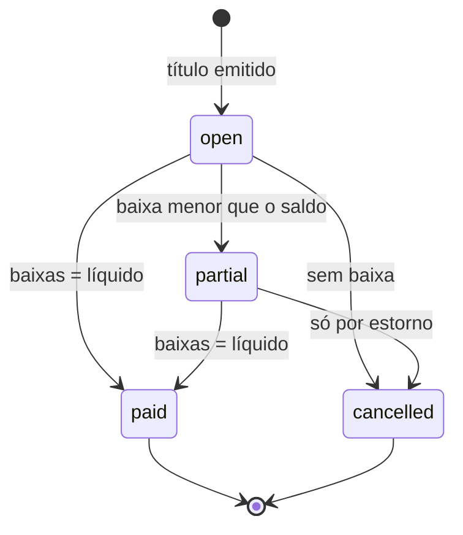

**Regras principais**
- "Atrasado" não é estado: é filtro calculado sobre `open` e `partial` com vencimento passado ([17](#doc-17), seção 2.3).
- Despesa acima de R$ 10.000 exige segundo aprovador; o solicitante não aprova a própria ([17](#doc-17), seção 2.4).
- Duplicidades da v1 resolvidas: suprimentos é dono do estoque; auditoria é dona da trilha; autenticação consolidada no [06](#doc-06); um único módulo de atendimento ([19](#doc-19), seção 2).

<a id="doc-17"></a>

## 17 — Regras de Validação dos Módulos Prioritários

> Parte do [SDD v2](#doc-00). Padrão de validação em [15](#doc-15). Eventos e dono de dados em [14](#doc-14). Tipos de campo em [15](#doc-15), seção 2.
> **Fonte:** especificações da v1 citadas em cada módulo. Onde a v1 não define a regra, o item aparece como **[Pendente]** e precisa de confirmação do owner.
> **Escopo:** módulos Financeiro, Pessoas (HCM), Acadêmico, SMT, Suprimentos e Contratos. Os demais módulos do [catálogo](#doc-12) seguem a mesma estrutura em versões futuras deste documento.

---

### 1. Defeitos transversais da v1

Estes defeitos aparecem em mais de um módulo. Eles têm de ser corrigidos antes de qualquer implementação.

| ID | Defeito | Onde | Correção obrigatória |
|---|---|---|---|
| T-01 | Nenhuma tabela tem `tenant_id`. Contagem: 0 ocorrências em Financeiro (11 tabelas) e Acadêmico (22 tabelas). Pessoas e SMT usam `entityid`, sem `tenant_id`. Suprimentos isola por `entity_uuid` e `unit_uuid`. | Todos | Adicionar `tenant_id CHAR(36) NOT NULL` e índice composto que começa por `tenant_id`. Ver [03](#doc-03), seção 3. |
| T-02 | Suprimentos e Contratos não têm DDL. Só descrição de tela. | Suprimentos, Contratos | Escrever o DDL antes da implementação, no padrão da seção 4 de [15](#doc-15). |
| T-03 | Campos de chave interna com nomes diferentes (`id`, `uuid`, `code`, `entity_uuid`, `entityid`). | Todos | Padronizar: `id` numérico interno, `uuid` público, `tenant_id`, `entity_id`, `unit_id`. |
| T-04 | Estado derivado armazenado como estado. Ex.: `overdue` (Atrasado) está no `ENUM` de status, mas depende de data. | Financeiro | Status armazenado só com fatos. "Atrasado" é calculado por `due_date < hoje` com status `open` ou `partial`. |
| T-05 | Regras de unicidade dizem "por tenant" mas o DDL não tem tenant. | Acadêmico | Restrição composta `(tenant_id, cpf_hash)`. |
| T-06 | Status em inglês no banco e em português na tela. | Financeiro | Código e banco em inglês; rótulos pelo sistema de i18n ([09](#doc-09)). |

### 2. Financeiro

#### 2.1 Entidades com DDL na v1

`financial_receivables`, `financial_payables`, `financial_transactions`, contas bancárias, centros de custo, orçamentos e outras (11 tabelas). Valores em `DECIMAL(15,2)` e taxas em `DECIMAL(5,4)`. Esses tipos estão corretos.

#### 2.2 Campos e regras

| Campo | Tipo (v1) | Regra |
|---|---|---|
| `gross_amount` | DECIMAL(15,2) | Maior que zero. |
| `discount_amount` | DECIMAL(15,2) | Zero ou positivo; não pode ser maior que `gross_amount`. |
| `interest_rate`, `fine_rate` | DECIMAL(5,4) | Entre 0 e 1 (0% a 100%). Ajustar para percentual na tela, não no banco. |
| `net_amount` | DECIMAL(15,2) | **Calculado pelo servidor** e validado: `gross - discount + juros + multa`. Gravado com a regra de arredondamento do tenant ([15](#doc-15), seção 4.2). Diferença é `422`. |
| `issue_date`, `due_date` | DATE | `due_date` não anterior a `issue_date`. |
| `payment_date` | DATE | Não pode ser futura na baixa. Não pode ser anterior a `issue_date`. |
| `amount_paid` | DECIMAL(15,2) | Maior que zero na baixa. Não pode exceder o saldo do título. |
| `installment_number`, `total_installments` | SMALLINT | `installment_number` entre 1 e `total_installments`. |
| `parent_id` | BIGINT | Aponta para o título-mãe do mesmo tenant. Parcelas não são títulos independentes para estorno. |
| `status` | ENUM | Ver seção 2.3. |
| `category_id`, `cost_center_id`, `bank_account_id` | BIGINT | Existem no tenant e estão ativos na data de lançamento. |
| `approval_status` (pagar) | ENUM | Ver seção 2.4. |

#### 2.3 Estados do título

Estados armazenados: `open`, `partial`, `paid`, `cancelled`.

| De | Para | Condição |
|---|---|---|
| `open` | `partial` | Baixa menor que o saldo. |
| `open` ou `partial` | `paid` | Soma das baixas igual ao líquido. |
| `open` ou `partial` | `cancelled` | Sem baixa registrada. Com baixa, só por estorno. |
| `paid` | `cancelled` | Não permitido. Estorno gera movimento novo. |

"Atrasado" (`overdue`) não é estado. É filtro calculado: `status IN (open, partial) AND due_date < data de referência`. Resolve T-04.

#### 2.4 Aprovação de despesa

- `approval_status` `pending` bloqueia a baixa.
- Solicitante não pode aprovar a própria despesa. Regra da v1 em Suprimentos vale aqui também.
- Aprovação acima de R$ 10.000 exige segundo aprovador. Decidido pelo autor em 03/11/2026.

#### 2.5 Conciliação bancária

A v1 define matching automático (seção 7.5):

| Regra | Classificação |
|---|---|
| Valor exato e data ± 1 dia | Match automático, confiança alta |
| Valor exato e data ± 3 dias | Match sugerido, confiança média |
| Valor ± R$ 0,01 e data ± 1 dia | Match sugerido |
| Sem match | Pendente manual |

**[Pendente]** A regra de R$ 0,01 é tolerância de arredondamento. Ela deve ser parâmetro do tenant, e não constante. Um lançamento só pode ser conciliado uma vez: `financial_transactions.status = matched` impede novo vínculo.

#### 2.6 Idempotência

- Baixa e emissão de cobrança exigem chave de idempotência ([15](#doc-15), seção 4).
- Importação de extrato OFX é idempotente pelo hash da linha (data, valor, descrição, identificador do banco).

#### 2.7 Testes específicos

- Título com desconto maior que o bruto: `422`.
- Baixa de valor maior que o saldo: `422`.
- Duas baixas com a mesma chave de idempotência: um movimento.
- Título pago com estorno: novo movimento, original inalterado.

### 3. Pessoas (HCM)

#### 3.1 Entidades

Colaborador, cargo, faixa salarial, documentos, ponto, férias, afastamentos, treinamentos, folha, recrutamento e onboarding (12 tabelas na v1). O cadastro de pessoa civil deve ser único (decisão D-06, [14](#doc-14), seção 3).

#### 3.2 Campos e regras (v1, seção 4 e 2)

| Campo | Regra |
|---|---|
| CPF | Formato e dígito verificador ([15](#doc-15), seção 2). Mascarado na lista. Único por tenant. |
| RG, PIS/NIS | Formato por tipo de documento **[Pendente: regra por UF para RG]**. |
| Data de nascimento | Não futura. Idade mínima para vínculo **[Pendente: regra legal por tipo de vínculo]**. |
| CTPS | Obrigatória para vínculo CLT. |
| Salário base | Maior que o piso da categoria. Campo restrito: só quem tem permissão `hcm.salario.ler` vê. |
| Experiência (contrato de experiência) | A v1 diz "máximo 90 dias (prorrogável 1× até 90 dias)". Esse texto é contraditório: duas prorrogações somariam mais de 90 dias. **[Pendente: confirmação jurídica da CLT, art. 445]**. |
| Documento anexado | PDF, JPEG ou PNG; máximo 10 MB. Versão e validade obrigatórias para documento com vencimento. |
| Treinamento obrigatório | Alerta 30 dias antes do vencimento. |

#### 3.3 Estados

| Entidade | Estados |
|---|---|
| Colaborador | `ativo`, `afastado`, `desligado` (transições por evento de RH) |
| Vaga | `aberta`, `pausada`, `preenchida`, `cancelada` |
| Candidato | conforme pipeline do Kanban; cada etapa tem entrada e saída declaradas |
| Folha | `em_processamento`, `fechada`, `paga`. Folha fechada não é alterada; correção é folha complementar. |

#### 3.4 Dados sensíveis

- Dado de saúde (tipo sanguíneo, alergias) do SMT: criptografado, conforme a v1 (ver seção 5.1).
- Salário: campo restrito; o listado não exibe o valor sem permissão.
- Folha: só o próprio colaborador vê o holerite; RH vê os de sua unidade.

#### 3.5 Integrações

- `hcm.employee.created`, `hcm.employee.terminated`, `hcm.employee.department-changed`, `hcm.absence.created` ([14](#doc-14), seção 4).

### 4. Acadêmico

#### 4.1 Entidades

Matrícula, aluno, turma, disciplina, diário, avaliação, plano de aula, plano de ensino, conselho de classe, estágio, documentos da secretaria, presença (22 tabelas na v1).

#### 4.2 Campos e regras (v1, seções 4 a 9)

| Campo | Regra |
|---|---|
| CPF do aluno ou candidato | Único por tenant. Busca antes de cadastrar; alerta de matrícula duplicada (v1, seção 4.2). |
| Documentos pessoais | Versionados, com data de upload, validade, responsável e hash de integridade (v1, seção 5). |
| Matrícula | Um vínculo ativo por aluno e turma. Vaga disponível com bloqueio de concorrência ([15](#doc-15), seção 7). |
| Trancamento | Prazo máximo conforme regimento **[Pendente: valor do regimento, por curso]**. |
| Nota | Dentro da faixa do método de avaliação; período de lançamento aberto. |
| Presença por QR Code | Válido por 5 minutos por padrão, configurável pela escola. Decidido pelo autor em 03/11/2026. Geolocalização só com consentimento, conforme [07](#doc-07). |
| Horas de atividade complementar | Status `pendente_validacao`, `validado`, `recusado`. Total validado nunca ultrapassa o limite do curso. |
| Estágio | CNPJ válido da empresa concedente. Apólice de seguro com validade. |
| Protocolo de atendimento | Consulta pública por número e CPF, sem login, com limite de tentativas. |

#### 4.3 Estados

| Entidade | Estados |
|---|---|
| Matrícula | `pre_matricula`, `ativa`, `trancada`, `concluida`, `cancelada`, `transferida` |
| Diário | `aberto`, `fechado`, `reaberto` (com justificativa) |
| Estágio | `solicitado`, `ativo`, `concluido`, `cancelado` |

#### 4.4 Segurança específica

- Dados de aluno menor de idade: acesso do responsável legal, com vínculo verificado ([07](#doc-07), seção 1).
- Diário e notas: professor vê só as turmas em que está vinculado.

### 5. SMT (Segurança e Medicina do Trabalho)

#### 5.1 Entidades

Funcionário e ASO, PCMSO, PGR/GHE, LTCAT, CAT, EPI, treinamentos NR, afastamentos, CIPA.

#### 5.2 Campos e regras (v1, seções 4 a 12)

| Campo | Regra |
|---|---|
| Ficha de saúde | Dado sensível. Criptografado. Acesso restrito a profissional de saúde e ao próprio colaborador. |
| ASO | Tipo (admissional, periódico, retorno, mudança, demissional) obrigatório. Resultado somente por profissional responsável. |
| CAT | Data do acidente não futura. Testemunhas por CPF válido. Emissão exige ocorrência registrada. |
| EPI | CA com validade. Entrega com registro de assinatura (FIEPI). Estoque não negativo. |
| Treinamento NR | Validade obrigatória quando a NR exige reciclagem. |
| Afastamento | Data fim não anterior à início. Sobreposição com afastamento ativo é recusada. |
| GHE | Pertence a um PGR ativo do tenant. |

#### 5.3 Estados

| Entidade | Estados |
|---|---|
| CAT | `emitida`, `em_investigacao`, `encerrada` |
| EPI (entrega) | `entregue`, `devolvido`, `extraviado` |
| Plano de ação | `aberto`, `em_andamento`, `concluido`, `vencido` (calculado por prazo) |

#### 5.4 Integrações

- SMT consome `hcm.employee.created` para agendar exame admissional.
- SMT publica `smt.exam.performed`, `smt.cat.created`, `smt.training.expired` ([14](#doc-14), seção 4).
- Transmissão de eSocial (S-2220, S-2230, S-2240) conforme decisão D-08 ([16](#doc-16), seção 6).

### 6. Suprimentos

#### 6.1 Entidades

Requisição, aprovação, cotação, pedido de compra, recebimento, divergência, almoxarifado, itens críticos, fornecedor, avaliação de fornecedor, contrato e ata (sem DDL na v1, ver T-02).

#### 6.2 Regras de negócio (v1, seções 6.2 e 9)

| Regra | Descrição |
|---|---|
| Autoaprovação | Bloqueada acima da faixa da política. |
| Solicitante e aprovador | Não podem ser a mesma pessoa em cenários sensíveis. |
| Pedido | Só emitido por usuário com permissão. |
| Fornecedor bloqueado | Não recebe pedido nem recebimento quando a política exige. |
| Edição após encerramento | Bloqueada. |
| Cotações | Número mínimo por faixa de valor. Fonte única só com justificativa. Motivo da adjudicação registrado. |
| Comparativo | Snapshot gravado no fechamento da cotação. |
| Estoque | Movimento que deixaria saldo negativo é recusado, salvo item de consumo sob encomenda. |
| Divergência de recebimento | Tipo obrigatório (quantidade, item incorreto, avaria, validade, lote, documento fiscal, atraso). |

#### 6.3 Estados

| Entidade | Estados |
|---|---|
| Requisição | `rascunho`, `em_aprovacao`, `aprovada`, `reprovada`, `cancelada` |
| Pedido | `emitido`, `em_transito`, `recebido_parcial`, `recebido`, `cancelado` |
| Fornecedor | `ativo`, `bloqueado`, `inativo` |

#### 6.4 Campos mínimos a definir

Como a v1 não tem DDL, os campos de requisição, pedido, item e fornecedor precisam ser escritos antes. Lista mínima proposta:

- Requisição: solicitante, unidade, centro de custo, itens (item, quantidade, unidade de medida), valor estimado, justificativa, data limite de SLA.
- Item: código, descrição, unidade de medida, estoque mínimo, estoque atual, fornecedor preferencial.
- Fornecedor: CNPJ válido, situação documental, validade de certificados, situação (`ativo`, `bloqueado`).

### 7. Contratos

#### 7.1 Entidades

Contrato, parte, valor, vigência, cláusula, obrigação, aprovação, assinatura, aditivo, solicitação contratual (sem DDL na v1, ver T-02).

#### 7.2 Regras de negócio (v1, seções 8, 10 e 12)

| Regra | Descrição |
|---|---|
| Edição após assinatura | Bloqueada, exceto por aditivo. |
| Alteração estrutural após assinatura | Gera aditivo. |
| Parte | CPF ou CNPJ válido; duplicidade por documento bloqueada. |
| Contratação | Bloqueada com documentação vencida. |
| Anexo obrigatório | Avanço de etapa bloqueado sem o documento obrigatório. |
| Parecer | Jurídico obrigatório por tipo de contrato. Financeiro obrigatório acima de faixa **[Pendente: faixa]**. |
| Cláusula obrigatória | Lista por tipo de contrato; ausência bloqueia envio para assinatura. |

#### 7.3 Estados

| Entidade | Estados |
|---|---|
| Contrato | `negociacao`, `aprovacao`, `assinado`, `vigente`, `em_renovacao`, `encerrado`, `cancelado` |
| Aditivo | `rascunho`, `aprovado`, `assinado` |
| Solicitação contratual | `aberta`, `em_validacao`, `bloqueada`, `concluida` |

#### 7.4 Validação de datas

- Vigência: data fim posterior à data início.
- Renovação automática: aviso antes do vencimento, com prazo em dias configurável. Padrão de 60 dias, decidido pelo autor em 03/11/2026.

### 8. Lacunas abertas

| # | Lacuna | Dono sugerido | Situação em 04/11/2026 |
|---|---|---|---|
| LAC-01 | Faixas de valor para aprovação de despesa e contrato | Financeiro | Parcial: despesa decidida (acima de R$ 10.000, segundo aprovador; [17](#doc-17), seção 2.4). Alçada de contrato em aberto ([33](#doc-33), seção 4) |
| LAC-02 | Regra de RG por UF e idade mínima por vínculo | Pessoas | Aberta |
| LAC-03 | Prazo de experiência (CLT art. 445) | Jurídico | Aberta (jurídico) |
| LAC-04 | Prazo de trancamento por curso e validade de QR Code | Acadêmico | Parcial: QR Code de 5 minutos decidido ([17](#doc-17), seção 4.2). Prazo de trancamento depende do regimento de cada curso ([46](#doc-46), M-06) |
| LAC-05 | Campos e DDL de Suprimentos e Contratos | Suprimentos, Contratos | Resolvida: DDL de suprimentos em [51](#doc-51), seção 16, e de contratos em [51](#doc-51), seção 3. Aguarda revisão do owner (DDL-01) |
| LAC-06 | Tolerância de conciliação como parâmetro do tenant | Financeiro | Resolvida: parâmetro da entidade ([71](#doc-71), seção 9) |

### 9. Critérios de aceite

- [ ] Todas as tabelas dos módulos têm `tenant_id NOT NULL` e índice composto por ele (T-01).
- [ ] Nenhum estado calculado é armazenado como estado (T-04).
- [ ] Cada regra marcada **[Pendente]** tem dono e data na seção 8 deste documento.
- [ ] Suprimentos e Contratos têm DDL escrito (T-02).
- [ ] Cada módulo tem tabela de transição de estado para as entidades com status.

<a id="doc-18"></a>

## 18 — Regras de Validação: Cobrança, Notificações, Auditoria, RH e Contábil/Fiscal

> Parte do [SDD v2](#doc-00). Continua [17](#doc-17). Padrão em [15](#doc-15). Eventos e dono de dados em [14](#doc-14). Integrações de cobrança em [16](#doc-16).
> **Fonte:** especificações da v1 citadas em cada módulo. Regras não definidas na v1 aparecem como **[Pendente]**.

---

### 1. Defeitos transversais

| ID | Defeito | Onde | Correção |
|---|---|---|---|
| T-01 | Sem `tenant_id`. Contagem nos DDL: Cobrança (9 tabelas) e Auditoria (0 tabelas com DDL, mas referências a tenant ausentes). | Cobrança, Auditoria | `tenant_id` NOT NULL e índice composto ([03](#doc-03)). |
| T-02 | RH e Contábil/Fiscal sem DDL. | RH, Contábil | DDL antes da implementação. |
| T-04 | Estado calculado armazenado. Cobrança tem `overdue` e `viewed` no `ENUM` de `billing_invoices.status`. `overdue` depende de data; `viewed` é fato de evento. | Cobrança | Ver seção 2.3. |
| T-07 | Duplicidade de módulo. RH e Pessoas (HCM) cobrem o mesmo colaborador, com ficha, treinamento, férias e afastamento. | RH, Pessoas | Decidir a fronteira. Proposta na seção 4.1. |

### 2. Cobrança e Mensalidades

#### 2.1 Entidades com DDL na v1

`billing_plans`, `billing_subscriptions`, `billing_invoices`, `billing_payments`, `billing_discounts`, `billing_automations`, `billing_nfse`, `billing_collection_rules` e uma tabela de régua. Valores em `DECIMAL(12,2)` e alíquota de ISS em `DECIMAL(5,4)`. Esses tipos estão corretos. Os valores em `DECIMAL(12,2)` limitam a fatura a R$ 9,99 bilhões, o que basta.

#### 2.2 Campos e regras

| Campo | Regra |
|---|---|
| `plans.base_amount` | Maior ou igual a zero. |
| `plans.min_amount`, `max_amount` | `min_amount ≤ base_amount ≤ max_amount`, quando informados. |
| `subscriptions.negotiated_amount` | Dentro de `[min_amount, max_amount]` do plano, quando houver faixa. |
| `subscriptions.discount_percent` | Entre 0 e 100. |
| `invoices.gross_amount` | Maior que zero. |
| `invoices.net_amount` | **Calculado pelo servidor:** `gross - discount + fine + interest`. Diferença é `422` ([17](#doc-17), seção 2.2). |
| `invoices.paid_amount` | Não pode exceder `net_amount` sem registro de crédito. |
| `payments.amount` | Maior que zero. Soma das baixas por fatura não pode exceder o saldo. |
| `discounts.value` | Maior que zero. Para `modality = percent`, até 100. |
| `nfse.iss_amount` | Calculado: `iss_base × iss_rate`. Diferença é `422`. |
| `nfse.iss_base` | Não pode exceder `gross_amount - deductions`. |

#### 2.3 Estados da fatura

A v1 define: `draft`, `pending`, `sent`, `viewed`, `paid`, `partial`, `overdue`, `negotiated`, `cancelled`, `refunded`.

Proposta de correção (T-04):

| Estado armazenado | Significado |
|---|---|
| `draft` | Não emitida |
| `issued` | Emitida e enviada ao devedor (substitui `pending`, `sent`) |
| `partial` | Baixa parcial |
| `paid` | Quitada |
| `negotiated` | Substituída por acordo; original preservado |
| `cancelled` | Cancelada antes de pagamento |
| `refunded` | Estornada, com movimento de estorno |

Calculados, não armazenados:

- `viewed`: existe registro em `invoice_views`.
- `overdue`: `status IN (issued, partial) AND due_date < data de referência`.

Transições:

| De | Para | Condição |
|---|---|---|
| `draft` | `issued` | Valor e vencimento válidos; aprovação se a política exigir |
| `issued` ou `partial` | `paid` | Soma das baixas igual a `net_amount` |
| `issued` | `partial` | Baixa menor que o saldo |
| `issued` ou `partial` | `negotiated` | Acordo registrado com nova fatura vinculada |
| `paid` | `refunded` | Estorno pelo gateway ou registro manual com motivo; novo movimento |
| `draft` ou `issued` | `cancelled` | Sem baixa registrada |

#### 2.4 Pagamento e baixa

- Baixa com `write_off_type = automatic` só pode ser feita por retorno do gateway com assinatura validada ([16](#doc-16), seção 8).
- Baixa manual exige `write_off_type = manual`, motivo e permissão `cobranca.baixa.manual`. Acima de R$ 1.000, exige segundo aprovador. Configurável por unidade. Decidido pelo autor em 03/11/2026.
- Pagamento duplicado com o mesmo `NSU/TID` é recusado. Chave única por `gateway + NSU/TID`.
- Pagamento não pode ser registrado em fatura `cancelled` ou `refunded`.

#### 2.5 Descontos e bolsas

- Desconto por pontualidade só se aplica se o pagamento ocorrer até a data limite do plano.
- Regras combinadas: a política de acumulatividade define se dois descontos somam. Não acumulam: vale o maior. Configurável por entidade. Decidido pelo autor em 03/11/2026.
- Bolsa e isenção exigem documento anexado e data de validade ([15](#doc-15), seção 4.3).

#### 2.6 Régua de cobrança: pontos que exigem parecer

A v1 define sete etapas de cobrança, de D+1 a D+90, com canais e ações ([`spec_gestao_billing_cobranca_mensalidades.md`](#v1-spec-gestao-billing-cobranca-mensalidades-md), seção 11). Três pontos precisam de parecer antes de implementar:

| Etapa | Ação na v1 | Risco | Tratamento proposto |
|---|---|---|---|
| D+10 SMS e e-mail; D+5 WhatsApp | Cobrança por canal de mensagem | Consentimento e LGPD ([07](#doc-07)) | **(jurídico)** base legal da comunicação de cobrança. Canal só para titular que informou o contato para esse fim. |
| D+30 aviso de negativação | Inclusão em cadastro de inadimplentes | Exige notificação prévia e regras do cadastro de crédito | **(jurídico)** prazo e forma de notificação antes da negativação. |
| D+90 bloqueio de acesso ao portal | Bloqueio do portal do aluno | Interrupção de serviço educacional a menor de idade | **(jurídico)** bloqueio não deve impedir acesso a documentos obrigatórios nem a matrícula de menor. Propor bloqueio parcial. |

#### 2.7 Nota fiscal de serviço (NFSe)

- Emissão só para fatura `paid` ou `partial`, conforme política municipal **[Pendente: regra por município]**.
- Status `pending` → `processing` → `issued` ou `rejected`. `cancelled` só a partir de `issued`, com o cancelamento transmitido ao município.
- Integração com o município é externa ([16](#doc-16), seção 3). Resposta de rejeição guarda o código de erro do município.

#### 2.8 Testes específicos

- Fatura com desconto acima do bruto: `422`.
- Dois pagamentos com o mesmo NSU/TID: um movimento.
- Fatura `paid` tentando ser cancelada: `409`.
- Desconto de pontualidade após a data limite: não aplicado.
- Régua no D+90 com aluno menor e documento obrigatório pendente: bloqueio parcial.

### 3. Notificações

#### 3.1 Estados (v1, seção 6, validada)

A v1 define: `draft`, `in_review`, `scheduled`, `queued`, `processing`, `sent`, `delivered`, `read`, `failed`, `archived`, `cancelled`.

As transições da v1 estão corretas e são adotadas. Regras adicionais:

| Regra | Detalhe |
|---|---|
| Estados terminais | `read`, `archived`, `cancelled` não voltam sem ação explícita autorizada. |
| Reenvio | Cria nova tentativa. Não sobrescreve a anterior. |
| Cancelamento | Preserva histórico e auditoria. |
| Falha | Classificada por tipo: validação, transporte, provedor, conteúdo, autorização, timeout ou desconhecida. Só transporte e timeout são retentados. |

#### 3.2 Validações de envio

- Campos obrigatórios por canal validados antes do envio: e-mail exige endereço verificado; SMS e WhatsApp exigem número em E.164 ([15](#doc-15), seção 2).
- Conteúdo sem público-alvo válido é bloqueado.
- Anexo validado por tamanho, tipo e política de segurança ([15](#doc-15), seção 4.3).
- Toda operação de envio é idempotente pela `idempotency_key`.
- Payload validado por schema. Campo obrigatório documentado por tipo de evento.

#### 3.3 Dados sensíveis

- Notificação de saúde ou de RH não mostra diagnóstico nem valor de salário no corpo. Mostra aviso e link autenticado.
- Corpo de mensagem guardado com retenção configurável ([07](#doc-07)).

### 4. Auditoria

#### 4.1 Fronteira com RH e Pessoas (T-07)

Proposta: RH e Pessoas são **um único módulo HCM** com submódulos. O cadastro de colaborador, a ficha e o vínculo ficam em Pessoas. Férias, afastamento, treinamento, ponto e folha ficam em RH/HCM. Essa é a decisão a confirmar.

#### 4.2 Regras de auditoria

| Regra | Detalhe |
|---|---|
| Imutabilidade | Registro de auditoria não é alterado nem apagado por usuário. Correção gera novo registro referenciando o original. |
| Integridade | Cada registro guarda hash SHA-256 do conteúdo e do registro anterior do mesmo tenant (cadeia). Quebra da cadeia gera alerta. |
| Expurgo | Só por job de retenção, com aprovação para retenção estendida, e deixa um registro do expurgo. |
| Mascaramento | Campo pessoal mascarado na visualização; valor completo só com permissão e motivo. |
| Acesso | Leitura da auditoria é ela própria auditada. |
| Eventos obrigatórios | Login, falha de login, bloqueio, alteração de permissão, exportação, acesso a dado sensível, consulta por CPF ([21](#doc-21), seção 6.8), alteração de política. |

Esses pontos reforçam [05](#doc-05), seção 2, e [07](#doc-07), seção 6.

### 5. RH (fronteira com Pessoas)

Conforme a proposta da seção 4.1, as regras abaixo são do submódulo RH/HCM.

| Regra | Detalhe |
|---|---|
| Bloqueio por documento faltante | Afastamento, férias ou admissão são bloqueados se documento obrigatório não estiver anexado (v1, seção 7). |
| Treinamento obrigatório | Pendente bloqueia a função ou a tarefa, conforme regra do cargo (v1, seção 5.2). |
| Edição em campo sensível | Bloqueada sem permissão específica (v1, seção 3.3). |
| Visibilidade | Gestor vê só a própria equipe; RH vê a unidade; nenhum perfil vê salário de outro sem permissão (v1, seção 3.2). |
| Férias | Fim não anterior ao início; período não pode exceder o direito acumulado **[Pendente: regra CLT art. 130 e fracionamento]**. |
| Afastamento | Sobreposição com afastamento ativo é recusada. |

**Defeito:** a v1 não tem DDL do RH (T-02). Sem DDL, as regras acima não podem ser testadas.

### 6. Contábil e Fiscal

#### 6.1 Controles de período (v1, seção 11.1)

| Regra | Detalhe |
|---|---|
| Período fechado | Edição e exclusão de lançamento bloqueadas. Correção só por lançamento de ajuste no período aberto, com motivo. |
| Competência | Data do lançamento dentro da competência declarada; competência inválida é `422`. |
| Fechamento | Bloqueado com pendência aberta de aprovação ou de conciliação. |
| Correção | Sempre com motivo obrigatório (v1, seção 8.1). |
| Aprovação automática | Só por regra cadastrada e auditada (v1, seção 10). |

#### 6.2 Estados

| Entidade | Estados |
|---|---|
| Período | `aberto`, `em_fechamento`, `fechado`, `reaberto` (com justificativa e permissão administrativa) |
| Lançamento | `rascunho`, `em_validacao`, `aprovado`, `estornado` |
| Obrigação fiscal | `pendente`, `transmitida`, `paga`, `em_atraso` (calculado por data) |

**Defeito:** sem DDL (T-02). Não há campos, tipos de valor nem chaves definidos para validar. **Resolvido em 04/11/2026:** DDL em [51](#doc-51), seção 18.

### 7. Lacunas

| # | Lacuna | Dono sugerido | Situação em 04/11/2026 |
|---|---|---|---|
| LAC-07 | Parecer sobre base legal, negativação e bloqueio de portal (seção 2.6) | Jurídico | Aberta (jurídico). Ver [26](#doc-26), seção 4 |
| LAC-08 | Limite de valor para baixa manual e aprovação de desconto | Financeiro | Resolvida: baixa manual acima de R$ 1.000 exige segundo aprovador ([18](#doc-18), seção 2.4). Limite de aprovação de desconto: padrão DP-07 ([80](#doc-80)) |
| LAC-09 | Política de acumulatividade de descontos | Financeiro | Resolvida: descontos não acumulam, vale o maior, configurável por entidade ([18](#doc-18), seção 2.5) |
| LAC-10 | Regra de NFSe por município | Fiscal | Parcial: regras gerais em [34](#doc-34), seção 5. Regra de cada município depende do provedor (homologação) |
| LAC-11 | Fronteira RH/Pessoas (seção 4.1) | Produto | Resolvida: um módulo HCM com submódulos ([39](#doc-39), seção 2) |
| LAC-12 | Regra CLT de férias e fracionamento | Jurídico, RH | Aberta (jurídico): HCM-03 ([39](#doc-39)) |
| LAC-13 | DDL de RH e Contábil/Fiscal | RH, Contábil | Resolvida: DDL de pessoas e RH em [51](#doc-51), seção 17, e de contábil e fiscal em [51](#doc-51), seção 18. Aguarda revisão do owner (DDL-01) |

### 8. Critérios de aceite

- [ ] Todas as tabelas de Cobrança têm `tenant_id NOT NULL` (T-01).
- [ ] `overdue` e `viewed` saem de `status` e passam a ser calculados (T-04).
- [ ] Régua de cobrança com parecer jurídico registrado antes de ativar cada etapa (LAC-07).
- [ ] Auditoria com cadeia de hash e registros imutáveis (seção 4.2).
- [ ] RH e Contábil com DDL escrito (T-02).

<a id="doc-19"></a>

## 19 — Regras de Validação: Demais Módulos do Catálogo

> Parte do [SDD v2](#doc-00). Continua [17](#doc-17) e [18](#doc-18). Padrão em [15](#doc-15). Catálogo em [12](#doc-12).
> **Escopo deste documento:** módulos restantes com regras de validação identificadas na v1. Onde a v1 não define DDL, a seção do módulo lista as regras encontradas e o que falta. Não é uma especificação campo a campo.

---

### 1. Defeitos transversais

| ID | Defeito | Módulos afetados | Correção |
|---|---|---|---|
| T-01 | Sem `tenant_id` nos DDL. Contagem: CRM (5 tabelas), Patrimônio (12), Frotas (13), Biblioteca (5), Armazenamento (17). | Esses módulos | `tenant_id` NOT NULL e índice composto ([03](#doc-03)). |
| T-02 | Sem DDL: Documentos, Marketing, SAC/Helpdesk, Simulados IA, Preceptoria, Privacidade global. | Esses módulos | DDL antes da implementação. |
| T-04 | Valor derivado armazenado como valor atual. Ex.: Patrimônio guarda `current_value`, que depende de depreciação. | Patrimônio | Armazenar o último cálculo com data e método. Recalcular, não sobrescrever. |
| T-07 | Duplicidade. Ver seção 2. | Vários | Uma especificação por domínio. |

### 2. Duplicidades a resolver

| Módulo A | Módulo B | Sobreposição | Proposta |
|---|---|---|---|
| Armazenamento (estoque, 17 tabelas) | Suprimentos (almoxarifado) | Saldo, movimento, estoque mínimo, rastreabilidade por lote | Suprimentos é dono de estoque e movimento. Armazenamento é renomeado para sistema de arquivos e documentos, sem estoque. **Decidido** em 03/11/2026. |
| Logger | Auditoria | Registro de eventos, bloqueio de IP, alertas de segurança | Auditoria é dona de trilha de negócio e de segurança ([18](#doc-18), seção 4). Logger técnico fica em [10](#doc-10), seção 7. |
| Autenticação (v1, 1.001 linhas) | 06 e 07 | Login, sessão, MFA, senha | Consolidar em [06](#doc-06). A especificação de módulo perde o conteúdo que duplica 06. |
| Privacidade global | 07 e Cookies e sessões | Direitos do titular, consentimento, cookies | Consolidar em [07](#doc-07). Cookies e sessões fica em 06. |
| Bancos (administração de banco de dados, 305 linhas) | Financeiro (contas bancárias) | Nenhuma: são assuntos diferentes | Bancos sai do escopo. Dados bancários ficam no Financeiro. Ver [34](#doc-34), seção 4. |
| SAC, Chat rápido, Helpdesk | Entre si | Atendimento e tickets | Um único módulo de atendimento. Helpdesk é a base. Proposta na seção 7. |
| Biblioteca acadêmica e Biblioteca completo | Entre si | Acervo, empréstimo, multa | Uma especificação. Escolher a mais recente como base. |

### 3. Documentos

| Regra | Detalhe |
|---|---|
| Edição após assinatura | Bloqueada. Só nova versão autorizada (v1, linhas 255 e 380). |
| Download restrito | Bloqueado para documento marcado como restrito (v1, linha 298). |
| Rejeição | Exige motivo obrigatório (v1, linha 386). |
| Versão | Cada versão guarda hash SHA-256 do arquivo e autor. |
| Retenção | Por política, com expurgo registrado ([07](#doc-07)). |
| Arquivo | Validação de tipo e tamanho por campo ([15](#doc-15), seção 4.3). |

**Pendente:** DDL (T-02). Lista de tipos de documento e prazo de retenção por tipo.

### 4. Privacidade global

A v1 descreve modelo tenant-aware e unit-aware (linha 8) e cobre direitos do titular, consentimento parental e múltiplas jurisdições. As regras já estão em [07](#doc-07). Pontos que faltam:

| Regra | Detalhe |
|---|---|
| Menor de 13 anos | Consentimento parental verificável antes de coletar (v1, linha 39). Verificação do responsável por canal verificado. **(jurídico)** para validar o método. |
| Jurisdições | A v1 cita Singapura, Tailândia e outras. **[Pendente]** A plataforma opera no Brasil; a lista de jurisdições só entra se houver cliente fora do Brasil. |
| Exclusão | Respeita retenção legal e necessidade de preservação probatória (v1, linha 28). Registro de exceção com motivo. |

**Defeito:** a v1 é uma lista de princípios, sem DDL nem campos. Não é possível validar. Proposta: reduzir a [07](#doc-07) e tirar a lista de jurisdições do escopo desta versão.

### 5. Armazenamento (estoque)

Este módulo é tratado como estoque, por causa do conteúdo. Ver seção 2.

| Regra | Detalhe |
|---|---|
| Saldo | Nunca negativo, bloqueio na API (linha 54). |
| Rastreabilidade | Lote, série ou validade obrigatório para item controlado (linha 57). |
| Bloqueio de item | Status `Bloqueado` impede movimento. Motivo registrado. |
| Movimento | Quantidade obrigatória e maior que zero. |

**Pendente:** os 17 DDL precisam da fronteira com Suprimentos (seção 2) antes de validar.

### 6. CRM e funil comercial

| Entidade | Estados (DDL) | Regra |
|---|---|---|
| Lead | `new`, `contacted`, `qualified`, `disqualified`, `converted` | Conversão cria oportunidade. |
| Oportunidade | `open`, `won`, `lost` | `estimated_value DECIMAL(12,2)`, maior ou igual a zero. |
| Atividade | — | Vínculo obrigatório a lead ou oportunidade (linha 106). |

- "Fechado perdido" exige motivo obrigatório (linha 97): preço, concorrência, sem orçamento, timing ou outro.
- Lead convertido não volta a `new`.
- **Defeito:** sem `tenant_id` (T-01). Lead contém dado pessoal de terceiro. Base legal de contato comercial precisa de parecer ([07](#doc-07)).

### 7. Atendimento (SAC, Chat rápido, Helpdesk)

Três especificações descrevem o mesmo tipo de solicitação. A v1 do Helpdesk cita tenant 23 vezes e define obrigatoriedade dinâmica por tipo (linhas 142 e 340).

Regras do Helpdesk:

| Regra | Detalhe |
|---|---|
| Campos obrigatórios | Variam por tipo de solicitação (linha 142). |
| Campos padrão | Lista fixa para todo tipo (seção 8.1). |
| Retenção | Política e expurgo (linha 791). |
| Canais | Obrigatórios por tipo (seção 6.1). |

**Proposta:** um módulo de atendimento. Helpdesk como base. SAC e Chat rápido viram canais ou tipos de solicitação.

**Pendente:** DDL (T-02).

### 8. Patrimônio

#### 8.1 Entidades com DDL (12 tabelas)

Categorias de ativo, ativos e demais. Valores em `DECIMAL(15,2)` e taxa em `DECIMAL(8,4)`. Os tipos estão adequados.

#### 8.2 Regras

| Campo | Regra |
|---|---|
| `acquisition_value` | Maior que zero. Não altera após a aquisição, salvo correção com motivo. |
| `residual_value` | Não negativo; não maior que `acquisition_value`. |
| `dep_method` | Lista fechada: `linear`, `accelerated`, `degressive`, `unit`. |
| `dep_rate` | Entre 0 e 100%, conforme método. |
| `current_value` | Calculado. Não é campo editável. Ver T-04. |
| Baixa | Ativo baixado não recebe depreciação nem movimento. |

**Pendente:** regra de depreciação por categoria, aprovada pela contabilidade.

### 9. Frotas

| Regra | Detalhe |
|---|---|
| CNH do motorista | Vencida bloqueia a reserva e exibe alerta (linha 422). |
| Conflito de horário | Bloqueia a reserva do veículo (linha 421). |
| Veículo em manutenção | Bloqueia; sugere veículo alternativo (linha 423). |
| Tacógrafo | Validade obrigatória quando aplicável (linha 240). |
| Consumo | Calculado a partir de litros e quilometragem. Não editável (linha 580). |
| Abastecimento | Litros obrigatório e maior que zero (linha 612). |

**Defeito:** 13 DDL sem `tenant_id` (T-01). Consumo "calculado" aparece como campo de entrada em outra tela (linha 215). Padronizar como calculado.

### 10. Biblioteca acadêmica

| Regra | Detalhe |
|---|---|
| Multa | Multa em aberto ou item atrasado bloqueia novo empréstimo (linhas 39 e 109). |
| Renovação | Bloqueada se o item tiver reserva pendente (linha 164). |
| Reserva | Check-in obrigatório para validar a reserva (linha 151). |
| Responsável | Vê empréstimos e multas do filho vinculado, somente leitura (linha 28). |
| Status do item | `active`, `archived`, `lost`. |

**Defeito:** 5 DDL sem `tenant_id` (T-01).

### 11. Preceptoria e autoavaliação

| Regra | Detalhe |
|---|---|
| Pergunta | Tipo, peso e obrigatoriedade configuráveis (linha 38). |
| Condicional | Pergunta pode depender de outra (linha 260). |
| Avaliação fechada | Não pode ser editada (linha 263). |
| Anonimato | **[Pendente]** Avaliação de preceptor deve ser anônima para o avaliado, com regra de mínimo de respostas por grupo para não identificar a pessoa. |

**Pendente:** DDL (T-02).

### 12. Simulados com IA

| Regra | Detalhe |
|---|---|
| Auditoria | Obrigatória em notas e revisões (linha 610). |
| Conteúdo gerado | Revisão humana antes de publicar **[Pendente: regra de quem revisa]**. |
| Dados enviados ao provedor | Só o conteúdo do simulado, sem dado pessoal do aluno. Registrar o provedor e a retenção dele ([16](#doc-16)). |

**Defeito:** sem DDL (T-02). Sem definição de como o aluno é identificado nas respostas enviadas à IA.

### 13. Client migration

| Regra | Detalhe |
|---|---|
| Checksum | Hash de cada arquivo enviado (linha 316). Divergência é erro (linha 353). |
| Segredos | Credenciais não são migradas em texto. Hash ou recadastro (linha 553). |
| Idempotência | Token por execução de job (linha 687) e chave por registro (linha 869). |
| Isolamento | Migração de dados entre tenants exige revisão de isolamento ([17](#doc-17), seção 1). |

**Defeito:** sem DDL (T-02).

### 14. Soft delete

| Regra | Detalhe |
|---|---|
| Colunas | `deleted_at`, `deleted_by` em toda tabela soft-deletable (seção 3.1). |
| Validação pré-exclusão | Obrigatória. Ex.: aluno com matrícula ativa não pode ser excluído (linha 111). |
| Expurgo | Hard delete após N dias configurados por entidade, por job (linha 56). |
| Testes | Restauração e expurgo testados (seção 4.2). |

**Conflito:** o expurgo do soft delete precisa respeitar a imutabilidade da auditoria ([18](#doc-18), seção 4.2). Registro de auditoria não é expurgado por soft delete.

### 15. Marketing e redes sociais

| Regra | Detalhe |
|---|---|
| Publicação | Campos de título, texto, rede, data e aprovação obrigatórios (linha 126). |
| Aprovação | Publicação só após aprovação de quem tem permissão (fluxo de aprovação). |
| Datas críticas | Bloqueadas para publicação (linha 214). |
| Palavras bloqueadas | Lista de termos que impede publicação (linha 282). |
| Contato | Bloquear, silenciar ou priorizar contato respeita consentimento ([07](#doc-07)). |

**Defeito:** sem DDL (T-02). Sem tenant. **Resolvido em 04/11/2026:** DDL com `unidade_uuid` em [51](#doc-51), seção 19.

### 16. Bancos

Removido do escopo ([34](#doc-34), seção 4). As regras da v1 (alteração por pipeline, backup, TLS) valem para a ferramenta de operação, que fica fora do produto.

### 17. Autenticação (módulo de origem)

A especificação v1 (1.001 linhas) já exige Argon2id e refresh token armazenado com hash (linhas 267, 272 e 329). Está alinhada com [06](#doc-06). Não há regra nova a acrescentar. O módulo deve ser consolidado em 06 (seção 2).

### 18. Lacunas

| # | Lacuna | Dono sugerido | Situação em 04/11/2026 |
|---|---|---|---|
| LAC-14 | Fronteira Armazenamento/Suprimentos (seção 2) | Produto | Resolvida ([19](#doc-19), seção 2) |
| LAC-15 | Lista de jurisdições da privacidade (seção 4) | Jurídico | Resolvida: só legislação brasileira ([07](#doc-07), seção 3) |
| LAC-16 | Anonimato na avaliação de preceptor (seção 11) | Acadêmico | Resolvida: anônima, mínimo de 2 respostas por grupo ([42](#doc-42), PRE-03) |
| LAC-17 | Regra de revisão humana de conteúdo gerado por IA (seção 12) | Acadêmico, Jurídico | Resolvida: a IA sugere e a pessoa decide ([27](#doc-27), princípio 2) |
| LAC-18 | Regra de depreciação por categoria (seção 8) | Contabilidade | Resolvida por padrão: DP-02 ([80](#doc-80)) |
| LAC-19 | Módulo de atendimento único (seção 7) | Produto | Resolvida: modelo único de ticket ([32](#doc-32), seção 2.1) |
| LAC-20 | DDL de Documentos, Marketing, Atendimento, Simulados, Preceptoria, Privacidade | Owners | Resolvida: DDL de documentos ([51](#doc-51), seção 12; [54](#doc-54), seção 10), atendimento ([51](#doc-51), seção 1), privacidade ([51](#doc-51), seção 2), preceptoria ([51](#doc-51), seção 6), simulados ([51](#doc-51), seção 15) e marketing ([51](#doc-51), seção 19). Aguarda revisão do owner |

### 19. Critérios de aceite

- [ ] Cada módulo do catálogo tem uma seção aqui ou em 17 e 18, ou está marcado como duplicado.
- [ ] Duplicidades da seção 2 têm decisão registrada.
- [ ] Todo DDL tem `tenant_id NOT NULL` (T-01).
- [ ] Valor derivado não é campo editável (T-04).

---

<a id="parte-8"></a>

# Parte 8 — Acadêmico

## Visão geral da parte 8

O acadêmico é especificado em ordem de dependência: estrutura, sistemas avaliativos, turmas e grade, diário, boletim e conselho, e os demais módulos ([55](#doc-55), seção 3).

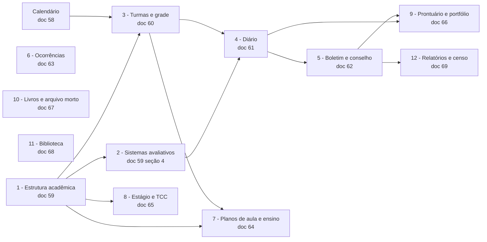

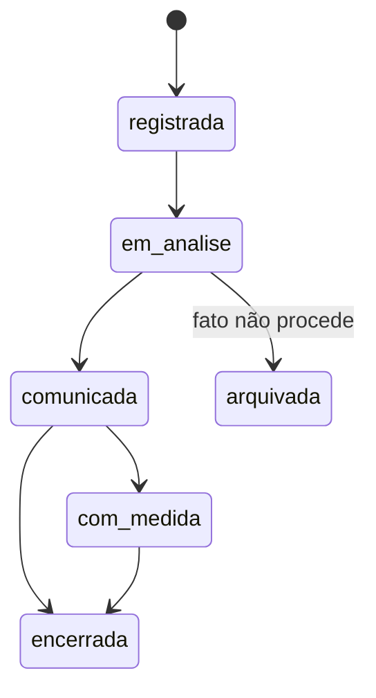

**Regras principais**
- Os três níveis de ensino estão no escopo: básico, técnico e superior, com TCC e CPA/SINAES (ACA-01, ACA-02).
- Grade publicada só muda por nova versão; turma aponta para curso, grade e versão ([59](#doc-59), [60](#doc-60)).
- Nota só pelo professor da turma; diário fechado só reabre pela coordenação, com motivo ([61](#doc-61)).
- Ocorrência tem relato sigiloso e dado de terceiro protegido ([63](#doc-63)).
- A Classe (mural, materiais e tarefas) tem nota de tarefa no diário só quando a tarefa é avaliação ([81](#doc-81)).
- Aulas online, formulários, preceptoria, pastoral, agendamento, simulados e planejamento estão nos documentos [40](#doc-40) a [44](#doc-44), [47](#doc-47) e [37](#doc-37).

<a id="doc-55"></a>

## 55 — Verificação do Acadêmico: Cobertura, Lacunas e Ordem de Fechamento

> Parte do [SDD v2](#doc-00). Referência de comparação: menu do sistema iScholar, colado pelo autor em 03/11/2026, e o mapa de páginas acadêmico da v1 ([`spec_gestao_academica_completo.md`](#v1-spec-gestao-academica-completo-md), seção 2). Regras já existentes em [17](#doc-17), seção 4. Matrícula em [46](#doc-46). Agendamento em [44](#doc-44). Sala online em [40](#doc-40). Documentos em [48](#doc-48) e [54](#doc-54). Simulados em [47](#doc-47). Preceptoria em [42](#doc-42).
> **Veredito:** o acadêmico **não está completo**. A parte de matrícula, documentos e salas está especificada. A estrutura acadêmica, a grade de horários, notas, frequência, diário, conselho de classe e planos pedagógicos estão só citados.

---

### 1. Resposta direta

Atualizado em 04/11/2026: os itens que esta verificação marcava como lacuna foram especificados nos documentos 58 a 70. A tabela abaixo aponta onde cada um está.

| Pergunta | Veredito |
|---|---|
| Matrícula e rematrícula estão completas? | **Sim**, em [46](#doc-46), com estados, janelas, condicional e trancamento |
| Estrutura acadêmica (cursos, grades, disciplinas, períodos, calendário) está especificada? | **Sim**, em [59](#doc-59) e [58](#doc-58) |
| Notas, boletim e aprovação? | **Sim**, em [61](#doc-61), seção 5, e [62](#doc-62) |
| Frequência, faltas e justificativas? | **Sim**, em [61](#doc-61), seções 3 e 4 |
| Diário, planos de aula e de ensino? | **Sim**, em [61](#doc-61) e [64](#doc-64) |
| Ocorrências disciplinares? | **Sim**, em [63](#doc-63) |
| Conselho de classe, recuperação paralela, portfólio? | **Sim**, em [62](#doc-62) (conselho e recuperação) e [66](#doc-66) (portfólio) |
| Estágio, TCC? | **Sim**, em [65](#doc-65) |
| Livros digitais (registro e atas)? | **Sim**, em [67](#doc-67) |
| Relatórios acadêmicos e censo? | **Sim**, em [69](#doc-69) |

---

### 2. Mapa: menu iScholar × SDD

Itens do menu de referência, na ordem em que aparecem.

#### 2.1 Coordenação

| Item do iScholar | Cobertura no SDD | Situação |
|---|---|---|
| Empresas | Empresa e unidades: [03](#doc-03) | Coberto no modelo de tenant |
| Unidades escolares | [03](#doc-03), [44](#doc-44) | Coberto |
| Salas de aula | [44](#doc-44) | Coberto |
| Cursos | [59](#doc-59), seção 3.1 | Coberto |
| Grupos de horários | [60](#doc-60), seção 3 | Coberto |
| Disciplinas | [59](#doc-59), seção 3.2 | Coberto |
| Grades curriculares | [59](#doc-59), seções 3.3 e 3.5 (equivalência) | Coberto |
| Períodos letivos | [59](#doc-59), seção 3.6 | Coberto |
| Funcionários | [39](#doc-39) | Coberto como RH |
| Documentos (pendentes) | [54](#doc-54), contexto A | Coberto |
| Sistemas avaliativos | [59](#doc-59), seção 4 | Coberto |
| Calendários escolares | [58](#doc-58) | Coberto |
| Planos de pagamento | [18](#doc-18) e [26](#doc-26) | Coberto no financeiro |

#### 2.2 Secretaria

| Item do iScholar | Cobertura no SDD | Situação |
|---|---|---|
| Turmas | [60](#doc-60), seção 2; enturmação em [46](#doc-46), M-07 | Coberto |
| Responsáveis | [46](#doc-46), [07](#doc-07) | Coberto no vínculo |
| Alunos | [17](#doc-17), seção 4.2; prontuário em [66](#doc-66) | Coberto |
| Matrículas | [46](#doc-46) | Coberto |
| Alunos potenciais | [22](#doc-22), leads | Coberto no CRM |
| Modelos de documentos | [48](#doc-48) | Coberto |
| Ocorrências | [63](#doc-63) | Coberto |
| Solicitações | [32](#doc-32) e [46](#doc-46) | Coberto pelo protocolo |
| Agenda de eventos | [58](#doc-58), seção 5 | Coberto |
| Processos seletivos | [46](#doc-46), seção 4 | Coberto |
| Gabaritos | [47](#doc-47) e [31](#doc-31), seção 3.6 (leitor próprio ou de terceiro) | Coberto |
| Secretaria digital (portal externo) | [46](#doc-46), [48](#doc-48) | Coberto |
| Relatórios | [69](#doc-69) e [56](#doc-56), seção 4 | Coberto |

#### 2.3 Diário escolar

| Item do iScholar | Cobertura no SDD | Situação |
|---|---|---|
| Notas | [61](#doc-61), seção 5; boletim e aprovação em [62](#doc-62) | Coberto |
| Aulas (conteúdo) | [61](#doc-61), seção 2; planos em [64](#doc-64) | Coberto |
| Faltas | [61](#doc-61), seções 3 e 4 | Coberto |
| Relatórios | [69](#doc-69) e [56](#doc-56), seção 5 | Coberto |

#### 2.4 Outros módulos do menu

| Item | Cobertura | Situação |
|---|---|---|
| Financeiro (parcelas, cobrança, conciliação, NF, cheques, cartões, estoque) | [18](#doc-18), [20](#doc-20), [34](#doc-34) | Coberto no financeiro. Cheques e estoque de cantina não têm especificação |
| Centros de custo | [71](#doc-71), seções 3 e 4 (rateio por centro de custo em lançamento e despesa) | Coberto como atributo; sem cadastro próprio especificado |
| Controle patrimonial | [19](#doc-19), seção 8 | Coberto |
| Catraca | [35](#doc-35) | Coberto |
| Biblioteca (bibliografias, empréstimos e reservas) | [68](#doc-68) | Coberto |
| Administração (usuários, grupos, integrações, importação, notificações) | [06](#doc-06), [16](#doc-16), [19](#doc-19), seção 13; importação em [70](#doc-70) | Coberto |
| Ischolar Intelligence | [27](#doc-27) e [28](#doc-28) | Coberto |

---

### 3. Lacunas do acadêmico, em ordem de dependência

As lacunas abaixo se apoiam umas nas outras. Por isso a ordem importa.

| Ordem | Módulo a especificar | Depende de | Itens do menu que cobre | Situação em 04/11/2026 |
|---|---|---|---|---|
| 1 | **Estrutura acadêmica**: cursos, disciplinas, grades curriculares, períodos letivos, calendário e tipos de curso | Nada | Cursos, disciplinas, grades, períodos, calendários | Especificado em [59](#doc-59) e [58](#doc-58) |
| 2 | **Sistemas avaliativos**: escalas, método de média, recuperação, conceitos, regra de aprovação | 1 | Sistemas avaliativos | Especificado em [59](#doc-59), seção 4 |
| 3 | **Turmas e grade de horários**: criação de turma, grupos de horários, enturmação, quadro de aulas | 1 | Turmas, grupos de horários | Especificado em [60](#doc-60) |
| 4 | **Diário**: chamada, faltas, justificativa, notas por período, conteúdo da aula, fechamento | 2 e 3 | Notas, aulas, faltas, relatórios do diário | Especificado em [61](#doc-61) |
| 5 | **Boletim e conselho de classe**: boletim, aprovação final, recuperação paralela, ata de conselho | 4 | Boletim, conselho de classe, recuperação paralela | Especificado em [62](#doc-62) |
| 6 | **Ocorrências disciplinares**: registro, fluxo, notificação ao responsável, sigilo | Nada | Ocorrências | Especificado em [63](#doc-63) |
| 7 | **Planos de aula e de ensino**: planos por disciplina, revisão pela coordenação | 1 e 3 | Plano de aula, plano de ensino | Especificado em [64](#doc-64) |
| 8 | **Estágio e TCC** | 1 | Estágio, TCC | Especificado em [65](#doc-65) |
| 9 | **Prontuário e portfólio do aluno** | 4 e 5 | Perfil e prontuário do aluno, portfólio | Especificado em [66](#doc-66) |
| 10 | **Livros digitais e arquivo morto**: livro de registro, arquivo digitalizado | 54 | Livro de registro, arquivo morto | Especificado em [67](#doc-67) |
| 11 | **Biblioteca**: acervo, empréstimo e reserva | Nada | Bibliografias, empréstimos | Especificado em [68](#doc-68) |
| 12 | **Relatórios e censo** | 1 a 10 | Relatórios de cada módulo | Especificado em [69](#doc-69) |
| 13 | **Importação de dados** de sistema anterior | 1 a 4 | Importação | Especificado em [70](#doc-70) |

---

### 4. Decisões necessárias

Estas são de produto. Não as tomo sozinho.

| # | Decisão | Opções |
|---|---|---|
| ACA-01 | Escopo: o SDD cobre ensino básico, técnico, superior, ou os três? | **Decidido** em 03/11/2026: os três níveis. Inclui TCC e CPA/SINAES, a confirmar em ACA-02 |
| ACA-02 | TCC e CPA/SINAES entram nesta versão? | **Decidido** em 03/11/2026: sim, entram. TCC em [65](#doc-65) e CPA em [69](#doc-69) |
| ACA-03 | Estágio: obrigatório para o curso ou só opcional? | **Decidido** em 03/11/2026: obrigatório quando o curso exigir |
| ACA-04 | Ordem de fechamento da seção 3 | **Decidido** em 03/11/2026: confirmada |

---

### 5. Critérios para dizer que o acadêmico está completo

- [ ] Cada item do menu de referência (seção 2) tem um documento de origem.
- [ ] Cada módulo da seção 3 tem estados, regra de portal, DDL e critérios de aceite.
- [ ] Notas, frequência e boletim têm regra de cálculo testada com caso real.
- [ ] Importação tem validação de origem e relatório de rejeitados.
- [ ] Pareceres de jurídico e norma sobre histórico, guarda de registro e prazos estão respondidos.

<a id="doc-59"></a>

## 59 — Estrutura Acadêmica, por Portal: Cursos, Disciplinas, Grades, Períodos e Sistemas Avaliativos

> Parte do [SDD v2](#doc-00). Primeira lacuna da ordem de fechamento de [55](#doc-55), seção 3. Escopo decidido: os três níveis, básico, técnico e superior (ACA-01). Calendário letivo em [58](#doc-58). Matrícula e enturmação em [46](#doc-46). Regras de nota e de frequência em [17](#doc-17), seção 4. Plano pedagógico em [55](#doc-55), item 7. Auditoria em [29](#doc-29).
> **Status:** especificação proposta, criada em 03/11/2026. Fecha a lacuna 1 do acadêmico. Pontos que dependem de norma de ensino estão marcados **(verificar)**.

---

### 1. Resposta direta

> **Leitura (04/11/2026):** esta tabela registra o que existia no SDD antes deste documento ser escrito. Os itens marcados como **Não** ou **Parcial** são especificados nas seções seguintes deste documento, exceto o que estiver listado na seção de pendências.

| Pergunta | Veredito |
|---|---|
| Cursos, disciplinas e grades estão especificados? | **Não.** Aparecem como nomes de entidades em [17](#doc-17), seção 4.1 |
| Versão de grade e de PPC? | **Não.** A v1 cita PPC versionado, sem regra de vigência |
| Sistemas avaliativos? | **Não.** A v1 cita escalas e tipos de avaliação em configuração, sem regra |
| Equivalência entre cursos? | **Não.** A v1 cita mapa de equivalência, sem regra |

---

### 2. Tipos de curso

| Tipo | Nível | Exige |
|---|---|---|
| Educação infantil | Básico | Idade. Avaliação sem objetivo de promoção (LDB, art. 31, I). 800 horas anuais em 200 dias, 4 horas diárias no turno parcial e 7 no integral (art. 31, II e III) |
| Ensino fundamental | Básico | Série. 800 horas anuais em 200 dias letivos (LDB, art. 24, I). Pelo menos 4 horas diárias de aula efetiva, salvo noturno (art. 34) |
| Ensino médio | Básico | Série ou itinerário. Duração mínima de 3 anos (art. 35). 1.000 horas anuais em 200 dias, com ampliação progressiva até 1.400 (art. 24, I e § 1º). Formação geral básica de pelo menos 2.400 horas, ou 2.100 no técnico (art. 35-C) |
| Curso técnico de nível médio | Técnico | Eixo tecnológico, carga horária, estágio se o curso exigir. Forma **integrada** (matrícula única, para quem concluiu o fundamental), **concomitante** (matrículas distintas, na mesma ou em outra instituição) ou **subsequente** (para quem concluiu o médio) (LDB, arts. 36-B e 36-C). Segue as diretrizes do CNE, as normas do sistema de ensino e o Catálogo Nacional de Cursos Técnicos (arts. 36-B, § 1º, e 42-A, § 3º). Pode ter etapas com certificado de qualificação (art. 36-D, parágrafo único) |
| Formação inicial e continuada | Técnico | Qualificação profissional (LDB, art. 39, § 2º, I). Matrícula pela capacidade de aproveitamento, não necessariamente pela escolaridade (art. 42) |
| Graduação tecnológica | Superior | Organizada pelas diretrizes do CNE e pelo Catálogo Nacional de Cursos Superiores de Tecnologia (LDB, arts. 39, § 3º, e 42-A, § 3º) |
| Graduação | Superior | Créditos ou carga horária, atividades complementares, TCC se o curso exigir. Ano letivo de pelo menos 200 dias de trabalho acadêmico (art. 47). Carga horária pela diretriz curricular de cada curso **(verificar)** |
| Pós-graduação lato sensu | Superior | Especialização ou aperfeiçoamento, para diplomado em graduação (LDB, art. 44, III). Carga horária, trabalho final |
| Pós-graduação stricto sensu | Superior | Mestrado ou doutorado (art. 44, III) |
| Curso sequencial e extensão | Superior | Abertos conforme requisitos da instituição; o sequencial exige ensino médio concluído (art. 44, I e IV) |
| Curso livre | Livre | Sem regra de grade oficial |

Tipo de curso define quais campos são obrigatórios. Não há campo fixo comum a todos.

**Publicação no superior** (LDB, art. 47, § 1º, com a Lei 13.168/2015): antes de cada período letivo, a instituição publica programas, componentes curriculares, duração, requisitos, qualificação dos professores, recursos e critérios de avaliação, em página com o título "Grade e Corpo Docente", em toda propaganda eletrônica e em local visível. A página traz a data da última atualização, é publicada até um mês antes das aulas e é atualizada a cada semestre ou ano. O sistema gera essa página a partir da grade e dos docentes do curso e avisa o aluno de mudança até o início das aulas.

---

### 3. Entidades e regras

#### 3.1 Curso

- Tem tipo, nome, código, carga horária total, duração prevista e situação.
- Situação: `rascunho`, `ativo`, `suspenso`, `extinto`. Curso extinto não recebe nova matrícula, mas mantém o histórico dos alunos.
- Ato de autorização ou reconhecimento do curso, quando exigido, é anexo com validade **(verificar)**.

#### 3.2 Disciplina

- Catálogo por entidade. Campos: código, nome, carga horária, tipo (obrigatória, optativa, eletiva, estágio, TCC, atividade complementar).
- Pré-requisito é lista de disciplinas, com regra de cumprimento.
- Disciplina em uso não é excluída. Só pode ficar `inativa`.

#### 3.3 Grade curricular

- Grade pertence a um curso e tem **vigência**: data de início e, quando houver, data de fim.
- Estados: `rascunho`, `vigente`, `substituida`.
- Grade vigente não muda. Mudança gera nova versão, e os alunos já matriculados permanecem na versão em que entraram. A migração para a nova versão é autorizada pela coordenação e executada pela secretaria, com registro.
- Cada item da grade tem: disciplina, período ou semestre, carga horária, pré-requisitos e se é obrigatório.

#### 3.4 Projeto pedagógico (PPC)

- Versionado, por curso. Mesma regra de vigência da grade.
- Contém objetivos, perfil, organização e regras de avaliação. O texto final é aprovado pelo órgão colegiado da entidade ([37](#doc-37), PLN-01) **(verificar)**.

#### 3.5 Equivalência entre cursos

- Mapa de disciplinas entre duas grades, com equivalência total, parcial ou sem equivalência.
- Equivalência é usada por reopção de curso ([46](#doc-46), seção 5) e por aproveitamento de estudos.
- Equivalência não é automática sem registro. Cada equivalência tem responsável e data.

#### 3.6 Períodos letivos

- Período pertence ao calendário da unidade ([58](#doc-58)): bimestre, trimestre, semestre ou módulo.
- Estados: `planejado`, `aberto`, `em_fechamento`, `fechado`, `reaberto` (com justificativa).
- Período fechado não aceita lançamento de nota nem de frequência, salvo reabertura autorizada ([17](#doc-17), seção 4.3).

---

### 4. Sistemas avaliativos

Cada curso usa um sistema avaliativo. Um sistema define:

| Elemento | Opções | Regra |
|---|---|---|
| Escala | Numérica (ex.: 0 a 10), conceitual (ex.: A a E), percentual | Uma escala por sistema |
| Tipos de avaliação | Prova, trabalho, seminário, atividade prática, autoavaliação | Cada tipo tem peso |
| Método de média | Aritmética ou ponderada | Pesos somam 100% por período |
| Recuperação | Paralela, final, ou ambas | Nota de recuperação substitui ou compõe a média, conforme o sistema |
| Nota mínima de aprovação | Valor da escala | Por sistema |
| Frequência mínima | Percentual de presença | 75% do total de horas letivas no fundamental e no médio (LDB, art. 24, VI). 60% na pré-escola (art. 31, IV). No superior, a frequência de alunos e professores é obrigatória, salvo nos programas de educação a distância (art. 47, § 3º, texto literal conferido). A LDB não fixa percentual para o superior: o valor vem do regimento da instituição e é configurado por curso. O valor fica no sistema avaliativo, com esses mínimos como piso |
| Aprovação por conselho | Sim ou não | Casos fora da regra passam por conselho de classe ([55](#doc-55), item 5) |

**Regras:**

- Nota fora da escala é recusada.
- Sistema avaliativo em uso não muda. Mudança gera nova versão, aplicada ao próximo período.
- Arredondamento padrão: uma casa decimal, arredondando para cima a partir de 0,05. A entidade pode definir outra regra, registrada no próprio sistema avaliativo.

---

### 5. Por portal

| Portal | Pode | Não pode | Origem |
|---|---|---|---|
| **Desenvolvedor** | Publicar modelos de curso e de sistema avaliativo, sem dado | Ver grade, PPC ou dado de entidade | P |
| **Gestão** | Criar e aprovar cursos, grades, PPC e sistemas avaliativos. Definir vigência | Alterar grade vigente sem nova versão | E |
| **Coordenação pedagógica** | Montar grade, disciplinas, equivalências e PPC. Propor sistema avaliativo | Publicar PPC sem aprovação do colegiado | E |
| **Secretaria** | Consultar grade e sistema. Cadastrar período letivo e equivalência aprovada | Criar disciplina ou grade | E |
| **Professor** | Ver grade e sistema das próprias disciplinas | Alterar grade ou sistema | E |
| **Aluno** | Ver grade da própria matrícula e o sistema avaliativo do curso | Ver grade de outro curso | E |
| **Responsáveis** | Ver grade e sistema do dependente | Ver grade de outro aluno | E, só dependentes com vínculo ativo |
| **Terceiros** | Nada | Qualquer item da estrutura | E |

---

### 6. Integrações

| Módulo | Relação |
|---|---|
| Calendário ([58](#doc-58)) | Período letivo pertence ao calendário |
| Matrícula ([46](#doc-46)) | Matrícula aponta para curso, grade e versão |
| Diário ([17](#doc-17)) | Nota e frequência seguem o sistema avaliativo do curso |
| Conselho de classe ([55](#doc-55), item 5) | Aprovação fora da regra |
| Estágio e TCC ([55](#doc-55), item 8) | Disciplinas do tipo estágio e TCC |
| Agendamento ([44](#doc-44)) | Turma e disciplina reservam ambiente |
| Relatórios ([56](#doc-56)) | Grade curricular e sistema avaliativo |

---

### 7. Pendências

| # | Pendência | Tipo |
|---|---|---|
| EST-01 | Frequência mínima de aprovação por nível de ensino (seção 4) | **Conferido** em 03/11/2026: 75% no fundamental e no médio (LDB, art. 24, VI) e 60% na pré-escola (art. 31, IV). No superior, a LDB só torna a frequência obrigatória (art. 47, § 3º) e não fixa percentual: vale o regimento da instituição, configurado por curso |
| EST-02 | Carga horária mínima por nível, e regra de créditos no superior (seção 2) | **Conferido** em parte em 03/11/2026: educação básica na LDB (arts. 24, 31, 34 e 35-C). Superior depende da diretriz de cada curso **(verificar)** |
| EST-03 | Tipos de curso e nomenclatura do ensino técnico e superior, conforme norma do sistema de ensino | **Conferido** em 03/11/2026: LDB, arts. 36-B a 36-D, 39, 42, 42-A e 44 (seção 2). Os catálogos CNCT e CNCST entram como tabela de referência carregada do MEC |
| EST-04 | Arredondamento padrão das notas | **Decidido** em 03/11/2026: uma casa decimal, arredondando para cima a partir de 0,05. A entidade pode trocar |
| EST-05 | Autorização de migração de aluno entre versões da grade | **Decidido** em 03/11/2026: a coordenação autoriza, e a secretaria executa a migração com autorização registrada |
| EST-06 | Ato de autorização e reconhecimento do curso: formato e validade (seção 3.1) | (jurídico) |
| EST-07 | DDL das tabelas: curso, disciplina, grade, item de grade, PPC, equivalência, período e sistema avaliativo | **Escrito** em [51](#doc-51), seção 15.3. Revisão do owner pendente (DDL-01) |

---

### 8. Critérios de aceite

- [ ] Grade vigente não muda; mudança gera nova versão (teste).
- [ ] Matrícula aponta para a versão da grade em que entrou (teste).
- [ ] Disciplina em uso não é excluída, só inativada (teste).
- [ ] Nota fora da escala do sistema é recusada (teste).
- [ ] Período fechado não aceita lançamento (teste).
- [ ] Equivalência sem responsável e data não é usada em aproveitamento (teste).
- [ ] Itens **(verificar)**, **(jurídico)** e **[Decisão do autor]** respondidos ou marcados como pendentes no [00](#doc-00).

<a id="doc-58"></a>

## 58 — Calendário Escolar e Eventos, por Portal

> Parte do [SDD v2](#doc-00). Decidido em 03/11/2026: o módulo entra nesta versão, como módulo próprio (CFG-01 e decisão de calendário em [56](#doc-56)). Períodos letivos e enturmação em [55](#doc-55). Reserva de ambiente em [44](#doc-44). Inscrição por formulário em [41](#doc-41). Público por targeting em [57](#doc-57), seção 3.4. Certificado de evento em [53](#doc-53), DC-19. Eventos pastorais em [43](#doc-43). Reunião de pais 1:1 em [40](#doc-40). Auditoria em [29](#doc-29).
> **Status:** especificação proposta, criada em 03/11/2026. Fecha a lacuna de calendário e eventos. Itens **(verificar)** e **[Decisão do autor]** são indicados onde aparecem.

---

### 1. Resposta direta

> **Leitura (04/11/2026):** esta tabela registra o que existia no SDD antes deste documento ser escrito. Os itens marcados como **Não** ou **Parcial** são especificados nas seções seguintes deste documento, exceto o que estiver listado na seção de pendências.

| Pergunta | Veredito |
|---|---|
| Existe especificação de calendário na v2? | **Não.** Só citado em [44](#doc-44) e [51](#doc-51) |
| Eventos escolares têm regra? | **Só em partes.** Pastoral em [43](#doc-43), reunião 1:1 em [40](#doc-40) |
| Feriado e recesso bloqueiam aula e reserva? | **Não especificado.** Tratado só como bloqueio em [44](#doc-44) |

---

### 2. Escopo

Entram:

- Calendário letivo por unidade: períodos, dias letivos, recessos e feriados.
- Calendário por turma, derivado do calendário da unidade.
- Eventos escolares: festividades, feiras, reuniões de pais coletivas, jogos internos, formaturas e outros eventos da unidade.
- Inscrição em evento, com capacidade e prazo.
- Certificado de participação em evento.
- Agenda pública de eventos para os portais.

Não entram:

- Agenda pessoal de cada usuário (CFG-01).
- Eventos pastorais, que seguem [43](#doc-43), mas aparecem no mesmo calendário da unidade.
- Reunião 1:1 com responsável, que segue [40](#doc-40).

---

### 3. Entidades

| Entidade | Função |
|---|---|
| Calendário letivo | Ano ou semestre da unidade, com períodos e dias letivos |
| Período letivo | Bimestre, trimestre, semestre ou módulo, com datas de início e fim |
| Dia não letivo | Feriado, recesso, ponto facultativo ou dia de planejamento |
| Evento | Ocorrência com data, horário, local, público e responsável |
| Inscrição | Participação de pessoa em evento, por formulário ([41](#doc-41)) |
| Certificado | Documento de participação, sem valor de documento oficial ([53](#doc-53), DC-19) |

---

### 4. Regras do calendário

1. **Calendário letivo é da unidade.** Cada unidade tem o seu, dentro do calendário da entidade.
2. **Dia não letivo bloqueia aula e reserva.** Aula não pode ser agendada em dia não letivo. Reserva de ambiente também é bloqueada ([44](#doc-44), seção 3.2), salvo evento que o próprio calendário autorize.
3. **Mudança de calendário após início do período** exige aprovação da diretoria, da coordenação pedagógica ou da secretaria, conforme o fluxo configurado pela entidade. Gera aviso aos envolvidos e recalcula o calendário da turma. Aulas já dadas não são alteradas.
4. **Calendário por turma** é derivado do calendário da unidade, mais os eventos que atingem a turma. Não é cópia editável.
5. **Feriado nacional, estadual ou municipal** entra por três caminhos: cadastro pela secretaria, importação de site oficial ou cadastro assistido por IA. Em todos, a fonte fica registrada, e a pessoa confirma antes de salvar, como em [27](#doc-27). Feriado municipal pode não se aplicar à unidade, por configuração.
6. **Recesso e férias escolares** ficam a critério do sistema de ensino e da escola. A LDB não fixa recesso nem férias. O calendário se adapta às peculiaridades locais, inclusive climáticas e econômicas, sem reduzir as horas letivas (art. 23, § 2º). Na escola do campo, acompanha o ciclo agrícola (art. 28, II). Ao publicar o calendário, o sistema confere o mínimo de 200 dias letivos e as horas do nível ([59](#doc-59), seção 2). Conferido em 03/11/2026 no texto da LDB (Lei 9.394/1996, planalto.gov.br) (CAL-01).

---

### 5. Eventos

#### 5.1 Estados

`rascunho` → `publicado` → `em_andamento` → `encerrado`, com `cancelado` a partir de `rascunho` ou `publicado`.

- Evento publicado não muda data nem local sem aviso aos inscritos.
- Cancelamento exige motivo e gera aviso pelo canal de [57](#doc-57).
- Evento encerrado não recebe inscrição.

#### 5.2 Regras

| Regra | Detalhe |
|---|---|
| Local | Reserva de ambiente pelo módulo de [44](#doc-44), com prioridade de evento (3) |
| Público | Definido por targeting de [57](#doc-57), seção 3.4. Nunca lista aberta |
| Inscrição | Por formulário de [41](#doc-41). Capacidade e prazo definidos pelo evento |
| Capacidade | Inscrição acima da capacidade vai para lista de espera |
| Menor de idade | Participação de menor exige autorização do responsável, como em [43](#doc-43), seção 6 |
| Custo | Evento com custo gera cobrança pelo financeiro ([18](#doc-18)). Sem cobrança, não gera |
| Certificado | Emitido para quem tiver presença registrada. Presença de evento segue o registro próprio do evento |

#### 5.3 Tipos de evento

| Tipo | Exemplo | Regra específica |
|---|---|---|
| Festividade | Festa junina, dia da família | Público amplo, sem inscrição |
| Feira | Feira de ciências | Inscrição de expositor, com avaliação por formulário |
| Reunião coletiva | Reunião de pais por série | Público por série, com confirmação de presença |
| Esportivo | Jogos internos | Inscrição de equipe, com ambiente reservado |
| Formatura | Formatura de turma | Convite a responsáveis, com ambiente reservado |
| Pastoral | Missa, celebração, encontro | Regras de [43](#doc-43) |

---

### 6. Por portal

| Portal | Pode | Não pode | Origem |
|---|---|---|---|
| **Desenvolvedor** | Publicar modelos de calendário-padrão, sem dado | Ver calendário ou evento de entidade | P |
| **Gestão** | Definir calendário letivo, feriados, recesso e eventos da unidade. Aprovar evento com público acima de 500 ([57](#doc-57), seção 3.4) | Alterar calendário de outra unidade | E |
| **Secretaria** | Cadastrar períodos, dias não letivos, eventos e inscrições. Emitir certificado | Publicar evento sem aprovação da gestão, quando o evento exigir | E |
| **Coordenação** | Criar evento pedagógico da unidade, como reunião de pais e conselho | Criar evento fora da unidade | E |
| **Professor** | Ver calendário das próprias turmas. Propor evento da turma para a coordenação | Publicar evento sem aprovação | E |
| **Aluno** | Ver calendário e eventos das próprias turmas. Inscrever-se onde houver inscrição aberta | Ver inscrição de colega | E |
| **Responsáveis** | Ver calendário e eventos dos dependentes. Inscrever dependente, com autorização | Ver inscrição de outra família | E, só dependentes com vínculo ativo |
| **Terceiros** | Ver o evento do próprio contrato, como buffet ou som ([38](#doc-38)) | Ver público, inscrição ou calendário de turma | E |

---

### 7. Integrações

| Módulo | Relação |
|---|---|
| Acadêmico ([55](#doc-55)) | Períodos letivos e enturmação dependem do calendário |
| Agendamento ([44](#doc-44)) | Dia não letivo bloqueia reserva. Evento reserva ambiente |
| Formulários ([41](#doc-41)) | Inscrição e pesquisa de satisfação |
| Notificações ([57](#doc-57)) | Aviso de evento, cancelamento e lembrete |
| Documentos ([48](#doc-48)) | Certificado de participação |
| Financeiro ([18](#doc-18)) | Cobrança de evento com custo |
| Pastoral ([43](#doc-43)) | Eventos pastorais no mesmo calendário |

---

### 8. Pendências

| # | Pendência | Tipo |
|---|---|---|
| CAL-01 | Recesso e férias escolares: regra da legislação do sistema de ensino (regra 6) | **Conferido** em 03/11/2026: LDB, art. 23, § 2º, e art. 28, II. Não há prazo fixo de recesso na lei. Calendário configurável pela escola |
| CAL-02 | Carga de feriados nacionais, estaduais e municipais | **Decidido** em 03/11/2026: três formas de cadastro: pela secretaria, por importação de site oficial e por cadastro assistido por IA. Em todas, a fonte é registrada e a pessoa confirma antes de salvar |
| CAL-03 | Mudança de calendário após o início do período | **Decidido** em 03/11/2026: aprovação pela diretoria, pela coordenação pedagógica e pela secretaria, com fluxo configurável pela entidade |
| CAL-04 | Certificado de evento: prazo de guarda | (jurídico) |
| CAL-05 | DDL das tabelas de calendário, período, dia não letivo, evento, inscrição e certificado | **Escrito** em [51](#doc-51), seção 15.2. Revisão do owner pendente (DDL-01) |

---

### 9. Critérios de aceite

- [ ] Aula não pode ser agendada em dia não letivo (teste).
- [ ] Reserva de ambiente é recusada em dia não letivo, salvo evento que o autorize (teste de integração com [44](#doc-44)).
- [ ] Calendário da turma muda quando o da unidade muda, e aulas já dadas não mudam (teste).
- [ ] Evento com público fora do targeting permitido é recusado (teste de isolamento).
- [ ] Inscrição acima da capacidade vai para lista de espera (teste).
- [ ] Certificado só é emitido para presença registrada (teste).
- [ ] Itens **(verificar)**, **(jurídico)** e **[Decisão do autor]** respondidos ou marcados como pendentes no [00](#doc-00).

<a id="doc-60"></a>

## 60 — Turmas, Enturmação e Grade de Horários, por Portal

> Parte do [SDD v2](#doc-00). Segunda e terceira lacunas da ordem de [55](#doc-55), seção 3. Estrutura de curso e grade em [59](#doc-59). Calendário e dias não letivos em [58](#doc-58). Enturmação e vagas em [46](#doc-46), M-03 e M-07. Salas e reservas em [44](#doc-44). Carga docente em [37](#doc-37), PLN-05. Aula online em [40](#doc-40). Aviso de mudança em [57](#doc-57).
> **Status:** especificação proposta, criada em 03/11/2026. Fecha as lacunas de turma e de grade de horários. A v1 tem as páginas `classes/list`, `classes/schedule`, `schedule/builder` e `schedule/rooms`, sem regra.

---

### 1. Resposta direta

> **Leitura (04/11/2026):** esta tabela registra o que existia no SDD antes deste documento ser escrito. Os itens marcados como **Não** ou **Parcial** são especificados nas seções seguintes deste documento, exceto o que estiver listado na seção de pendências.

| Pergunta | Veredito |
|---|---|
| Turma tem regra? | **Não.** Aparece só em [46](#doc-46), M-07, como destino de enturmação |
| Grade de horários tem regra? | **Não.** A v1 tem um construtor de horários, sem regra de conflito |
| Conflito de professor, sala e turma? | **Não.** Só a regra de sala de [44](#doc-44) |
| Carga do professor? | **Parcial.** Limite de 40 horas-aula por semana em [37](#doc-37), PLN-05 |

---

### 2. Turma

#### 2.1 Cadastro

Uma turma pertence a: unidade, curso, versão da grade, período letivo e turno.

| Campo | Regra |
|---|---|
| Código | Único na unidade e no período |
| Série ou módulo | Pertence à grade. Não é texto livre |
| Turno | Manhã, tarde, noite, integral ou EAD |
| Capacidade | Número de vagas. Matrícula não passa da capacidade ([46](#doc-46), M-03) |
| Sala de referência | Ambiente padrão de [44](#doc-44), quando houver |
| Professor regente | Um por turma, quando a norma exigir |
| Professores por disciplina | Um por disciplina e por turma |

#### 2.2 Cadastro de salas

Sala é o ambiente físico onde a aula acontece. Usa o mesmo registro de recurso de [44](#doc-44), `recursos` do tipo `ambiente`. Não há cadastro paralelo de sala.

| Campo | Regra |
|---|---|
| Código e nome | Únicos na unidade |
| Tipo | Sala de aula, laboratório, auditório, quadra, sala multimídia, sala de reunião, sala de atendimento |
| Capacidade de aula | Número de lugares para aula. Turma maior que a capacidade é recusada na grade |
| Andar e bloco | Para orientação e para o aviso de mudança de sala |
| Recursos fixos | Projetor, quadro, ar-condicionado, acessibilidade, bancadas, computadores |
| Acessibilidade | Indicação de acesso para pessoa com deficiência. Turma com aluno que precisa dessa acessibilidade só é alocada em sala que a tenha |
| Reservável | Sim ou não. Sala de aula fixa na grade não é reservável para uso avulso |
| Status | `ativa`, `manutencao`, `inativa` |

**Regras:**

- Sala em `manutencao` não recebe aula nem reserva, com data prevista de retorno. Aula afetada é remanejada com aviso ([57](#doc-57)).
- Sala `inativa` não aparece na grade nova. Não é excluída se houver histórico de aula.
- Cadastro e alteração de sala geram evento de auditoria ([29](#doc-29)).
- Inativar sala com aula futura exige remanejamento antes.

**Quem cadastra:** secretaria e coordenação cadastram. Gestão aprova inativação e manutenção prolongada.

#### 2.3 Estados

`planejada` → `aberta` → `em_andamento` → `encerrada`, com `cancelada` a partir de `planejada` ou `aberta`.

- Turma `aberta` recebe matrícula.
- Turma `encerrada` não recebe lançamento de nota nem de frequência.
- Turma sem alunos ao abrir o período é `cancelada`, com aviso à coordenação.

#### 2.4 Enturmação

- Aluno matriculado é enturmado em uma turma da própria grade vigente ([59](#doc-59), seção 3.3).
- Enturmação passa da capacidade? Recusada. Vai para lista de espera ([46](#doc-46), seção 4).
- Transferência de turma segue M-07 de [46](#doc-46), com aprovação da coordenação.

---

### 3. Grupos de horários

Grupo de horários é o modelo de tempo da unidade: os blocos de aula, com início e fim, por turno.

- Um grupo tem blocos ordenados: número, início, fim e intervalo.
- Um grupo é usado por várias turmas do mesmo turno.
- Mudança de bloco em grupo usado por turma em andamento só vale para o período seguinte.

---

### 4. Grade de horários

#### 4.1 Aula

Cada aula da grade tem: turma, disciplina, professor, bloco do grupo de horários, dia da semana, ambiente e tipo (presencial, online, híbrida, EAD).

#### 4.2 Regras de conflito

A grade não é salva com conflito. As regras são:

| Conflito | Regra |
|---|---|
| Professor em duas aulas no mesmo bloco | Recusado |
| Turma em duas aulas no mesmo bloco | Recusado |
| Ambiente em duas aulas no mesmo bloco | Recusado. Usa a regra de sobreposição de [44](#doc-44), seção 3.2 |
| Aula em dia não letivo | Recusada. Regra de [58](#doc-58), seção 4 |
| Professor acima de 40 horas-aula por semana | Aviso, não bloqueio. Limite por unidade, PLN-05 de [37](#doc-37) |
| Aula ou exame no domingo, com professor de escola particular | Recusado. CLT, art. 319, conferido em 03/11/2026 ([39](#doc-39), seção 3.4). Em escola pública, vale o estatuto do ente |
| Aula online sem ambiente físico | Permitida. Não reserva sala. Segue [40](#doc-40) |
| Disciplina sem professor habilitado | Recusada. Habilitação é cadastro do professor |

#### 4.3 Publicação

- Grade é montada em `rascunho` e revisada pela coordenação.
- Publicação torna a grade `vigente` para o período.
- Grade publicada não muda sem nova versão. Mudança de um período em andamento gera aviso aos alunos e professores afetados ([57](#doc-57)) com 5 dias úteis de antecedência.
- Troca emergencial de professor não altera a versão: é uma substituição registrada, com data e motivo.

#### 4.4 Consultas

| Consulta | Quem vê |
|---|---|
| Horário da turma | Turma: aluno e responsáveis. Professor da turma. Coordenação |
| Horário do professor | O próprio professor. Coordenação e secretaria |
| Horário da semana da unidade | Gestão, coordenação e secretaria |
| Ocupação de sala | Gestão, coordenação e secretaria ([44](#doc-44)) |

---

### 5. Por portal

| Portal | Pode | Não pode | Origem |
|---|---|---|---|
| **Desenvolvedor** | Publicar modelo de grupo de horários, sem dado | Ver turma ou grade de entidade | P |
| **Gestão** | Aprovar grade, abrir e encerrar turma, ver ocupação da unidade | Alterar grade publicada sem nova versão | E |
| **Coordenação** | Montar turmas, enturmar, montar e publicar grade, autorizar troca de professor | Publicar grade com conflito | E |
| **Secretaria** | Enturmar com autorização, cadastrar sala de referência, consultar grade | Criar turma ou aula | E |
| **Professor** | Ver o próprio horário e o horário das turmas em que leciona. Pedir troca de aula | Alterar grade. Ver horário de outro professor | E |
| **Aluno** | Ver o horário da turma | Ver horário de outra turma | E |
| **Responsáveis** | Ver o horário da turma do dependente | Ver horário de outra turma | E, só dependentes com vínculo ativo |
| **Terceiros** | Nada | Qualquer item do horário | E |

---

### 6. Integrações

| Módulo | Relação |
|---|---|
| Estrutura acadêmica ([59](#doc-59)) | Turma aponta para curso, grade e versão |
| Calendário ([58](#doc-58)) | Dia letivo e período |
| Matrícula ([46](#doc-46)) | Enturmação e vaga |
| Agendamento ([44](#doc-44)) | Sala de cada aula e conflito de ambiente |
| Aula online ([40](#doc-40)) | Aula com sala virtual |
| Carga docente ([37](#doc-37)) | Limite de 40 horas-aula por semana |
| Diário ([55](#doc-55), item 4) | Chamada e nota pertencem à turma e à aula |
| Notificações ([57](#doc-57)) | Aviso de mudança de horário |

---

### 7. Pendências

| # | Pendência | Tipo |
|---|---|---|
| TUR-01 | Teto de 40 horas-aula por professor na grade | **Decidido** em 03/11/2026: vale como aviso na grade, não bloqueio. A unidade ajusta o valor |
| TUR-02 | Turno de aula integral e de EAD | **Decidido** em 03/11/2026: integral é turno próprio. EAD não tem turno físico, só sala virtual |
| TUR-03 | Aviso de mudança de grupo de horários em turma em andamento | **Decidido** em 03/11/2026: 5 dias úteis de antecedência |
| TUR-04 | Carga horária mínima de aula e de intervalo, por nível de ensino | **Conferido** em parte em 03/11/2026: pelo menos 4 horas diárias de aula efetiva no fundamental, salvo noturno (LDB, art. 34); 4 horas no parcial e 7 no integral na educação infantil (art. 31, III). A LDB não trata de intervalo: regra do sistema de ensino ou da escola **(verificar)** |
| TUR-05 | DDL das tabelas: turma, enturmação, grupo de horários, aula, grade publicada e substituição. Cadastro de sala usa `recursos` de [51](#doc-51), seção 8 | **Escrito** em [51](#doc-51), seção 15.4. Revisão do owner pendente (DDL-01). Sala usa `recursos` da seção 8 |

---

### 8. Critérios de aceite

- [ ] Grade com conflito de professor, turma ou ambiente não é salva (teste).
- [ ] Aula em dia não letivo é recusada (teste de integração com [58](#doc-58)).
- [ ] Enturmação acima da capacidade vai para lista de espera (teste).
- [ ] Turma com aluno que precisa de acessibilidade não é alocada em sala sem ela (teste).
- [ ] Sala em manutenção não recebe aula nova (teste).
- [ ] Grade publicada não muda sem nova versão (teste).
- [ ] Professor não vê horário de outro professor (teste de isolamento).
- [ ] Troca emergencial de professor é registrada sem nova versão de grade (teste).
- [ ] Itens **(verificar)**, **(jurídico)** e **[Decisão do autor]** respondidos ou marcados como pendentes no [00](#doc-00).

<a id="doc-61"></a>

## 61 — Diário Escolar, por Portal: Chamada, Faltas, Justificativas, Notas e Conteúdo

> Parte do [SDD v2](#doc-00). Quarta lacuna da ordem de [55](#doc-55), seção 3. Turma, aula e grade em [60](#doc-60). Sistema avaliativo e frequência mínima em [59](#doc-59), seção 4. Chamada por QR Code e sala online em [17](#doc-17), seção 4, e [40](#doc-40). Períodos em [59](#doc-59), seção 3.6. Aviso ao responsável em [57](#doc-57). Relatórios do diário em [56](#doc-56), seção 5. Auditoria em [29](#doc-29).
> **Status:** especificação proposta, criada em 03/11/2026. Fecha a lacuna do diário. Pontos que dependem de norma ou de decisão do autor estão marcados.

---

### 1. Resposta direta

> **Leitura (04/11/2026):** esta tabela registra o que existia no SDD antes deste documento ser escrito. Os itens marcados como **Não** ou **Parcial** são especificados nas seções seguintes deste documento, exceto o que estiver listado na seção de pendências.

| Pergunta | Veredito |
|---|---|
| Chamada tem regra? | **Parcial.** QR Code e manual em [17](#doc-17). Falta regra de registro por aula |
| Faltas e justificativas? | **Não.** Só o nome "faltas" e "justificadas" no menu de referência |
| Lançamento de nota? | **Parcial.** Regra de faixa e de período aberto em [17](#doc-17) |
| Conteúdo da aula? | **Não.** Só citado como plano de aula em [55](#doc-55) |
| Fechamento e reabertura? | **Parcial.** Estados `aberto`, `fechado`, `reaberto` em [17](#doc-17) |

---

### 2. Aula

Cada aula da grade ([60](#doc-60), seção 4) gera uma **aula realizada** no diário. A aula tem:

- Turma, disciplina, professor, data e bloco.
- Conteúdo ministrado, com texto livre e referência ao plano de aula.
- Estado: `planejada`, `realizada`, `cancelada`, `reposicao`.

**Regras:**

- Só o professor da disciplina na turma registra a aula.
- Aula cancelada não conta na frequência. Exige motivo.
- Aula de reposição é aula nova, com data própria. Não substitui a original.
- Conteúdo não lançado até o fim do período aparece no relatório de pendências ([56](#doc-56), seção 5).

---

### 3. Chamada

#### 3.1 Formas de registro

| Forma | Quando | Regra |
|---|---|---|
| Manual | Padrão | Presente, falta, ou justificada, por aluno |
| QR Code | Presencial | Código válido pelo tempo configurado (5 minutos por padrão, decidido em 03/11/2026). Presença sem QR vira pendência |
| Sala online | Aula online | Presença pelo tempo conectado e confirmação, conforme [40](#doc-40), seção 6 |

**Regra geral:** a chamada é lançada na aula, com correção até o fim do dia útil seguinte. **Decidido** em 03/11/2026 (DIA-05). Lançamento fora do prazo exige justificativa da coordenação.

#### 3.2 Presença pendente

Aluno sem registro, em aula que usou QR ou sala online, fica como **pendência de chamada**. Não vira falta sem revisão do professor.

---

### 4. Faltas e justificativas

#### 4.1 Falta

- Falta é registrada por aluno, por aula. Não por dia.
- Falta é contada por disciplina, e por período no total de frequência.

#### 4.2 Justificativa

| Regra | Detalhe |
|---|---|
| Tipos | Lista padrão da plataforma, ajustável pela escola. Decidido em 03/11/2026 |
| Prazo | 5 dias úteis após a falta, ajustável pela escola. Decidido em 03/11/2026 |
| Documento | Anexo quando o tipo exigir. Armazenado como documento recebido ([54](#doc-54), contexto A) |
| Quem aprova | Coordenação. Professor não aprova justificativa de própria aula |
| Efeito | A LDB não prevê abono geral de falta: a falta justificada continua contando para o mínimo de 75% (art. 24, VI). A exceção da LDB é a falta por motivo religioso com atividade alternativa, que regulariza a frequência (art. 7º-A, § 2º). Regimes especiais de lei própria, como exercícios domiciliares, entram como exceção configurada **(verificar)** |
| Negativa | Sempre com motivo. Aluno ou responsável recebe o aviso ([57](#doc-57)) |

#### 4.3 Aviso de falta

- Falta acima do limite de alerta da escola gera aviso ao responsável ([57](#doc-57)).
- O aviso informa a disciplina e a quantidade de faltas. Não informa motivo clínico.
- Falta de saúde justificada por atestado não aparece com diagnóstico no aviso ([57](#doc-57), seção 3.5).
- **Conselho Tutelar:** a escola notifica ao Conselho Tutelar do município a relação dos alunos com faltas acima de 30% do percentual permitido em lei (LDB, art. 12, VIII). O sistema gera a lista por período para a secretaria enviar. A forma de cálculo e a periodicidade ficam em DIA-09 **(verificar)**.

---

### 5. Notas

#### 5.1 Lançamento

- Nota é lançada por avaliação, na escala e com o peso do sistema avaliativo ([59](#doc-59), seção 4).
- Só o professor da disciplina na turma lança nota.
- Nota fora da escala é recusada.
- Nota lançada é `lançada`. Correção gera nova versão com motivo, e a anterior fica no histórico.

#### 5.2 Média e recuperação

- Média por disciplina e por período, pelo método do sistema avaliativo.
- Aluno abaixo da média entra em recuperação conforme a regra do sistema. A nota de recuperação aplica-se conforme o sistema.
- Recuperação paralela e conselho de classe seguem [55](#doc-55), item 5.

#### 5.3 Período

Lançamento de nota e de chamada só com período `aberto` ([59](#doc-59), seção 3.6). Reabertura exige justificativa e autorização da coordenação pedagógica (DIA-04).

---

### 6. Fechamento do diário

- Diário fecha por turma e disciplina, ao fim do período.
- Diário fechado não aceita chamada, nota ou conteúdo.
- Reabertura exige justificativa e autorização da coordenação pedagógica. Fica em auditoria ([29](#doc-29)).
- Fechamento sem todas as notas gera pendência, não bloqueio. **Decidido** em 03/11/2026 (DIA-07).

---

### 7. Por portal

| Portal | Pode | Não pode | Origem |
|---|---|---|---|
| **Desenvolvedor** | Nada sobre diário de entidade | Ver diário, nota, falta ou conteúdo | P |
| **Gestão** | Ver relatórios do diário e indicadores de frequência | Lançar nota ou chamada. Autorizar reabertura, que é da coordenação | E |
| **Coordenação** | Aprovar justificativa. Autorizar lançamento fora do prazo e reabertura. Ver diário de todas as turmas da unidade | Lançar nota pelo professor | E |
| **Secretaria** | Consultar diário. Emitir relatórios. Cadastrar tipos de justificativa | Lançar nota ou aprovar justificativa | E |
| **Professor** | Fazer chamada, lançar nota e conteúdo das próprias turmas. Ver o diário das próprias turmas | Lançar em turma em que não leciona. Aprovar justificativa da própria aula | E |
| **Aluno** | Ver as próprias notas, faltas e justificativas. Enviar justificativa com anexo | Ver nota ou falta de colega | E |
| **Responsáveis** | Ver as notas e faltas do dependente. Enviar justificativa | Ver diário de outra turma | E, só dependentes com vínculo ativo |
| **Terceiros** | Nada | Qualquer item do diário | E |

---

### 8. Pendências

| # | Pendência | Tipo |
|---|---|---|
| DIA-01 | Tipos de justificativa de falta | **Decidido** em 03/11/2026: lista padrão da plataforma (atestado médico, motivo familiar, luto, convocação oficial, atividade escolar, outro), que a escola ajusta |
| DIA-02 | Prazo para apresentar justificativa | **Decidido** em 03/11/2026: 5 dias úteis, ajustável pela escola |
| DIA-03 | Falta justificada conta ou não na frequência, por nível de ensino (seção 4.2) | **Conferido** em parte em 03/11/2026: a LDB não prevê abono geral (art. 24, VI). A exceção é o art. 7º-A. Regimes especiais de lei própria **(verificar)** |
| DIA-04 | Quem autoriza reabertura de diário e lançamento fora do prazo | **Decidido** em 03/11/2026: coordenação pedagógica, com justificativa e registro. A secretaria executa |
| DIA-05 | Prazo de correção da chamada após a aula (seção 3.1) | **Decidido** em 03/11/2026: até o fim do dia útil seguinte |
| DIA-06 | Limite de falta que gera aviso ao responsável (seção 4.3) | **Decidido** em 03/11/2026: a cada 5 faltas na disciplina |
| DIA-07 | Fechamento sem todas as notas: pendência ou bloqueio (seção 6) | **Decidido** em 03/11/2026: pendência, sem bloqueio |
| DIA-08 | DDL: aula, chamada, falta, justificativa, lançamento de nota e conteúdo | **Escrito** em [51](#doc-51), seção 15.5. Revisão do owner pendente (DDL-01) |
| DIA-09 | Lista de alunos para o Conselho Tutelar (LDB, art. 12, VIII): base do cálculo de "30% do percentual permitido" e periodicidade do envio (seção 4.3) | (verificar) |

---

### 9. Critérios de aceite

- [ ] Professor de outra turma não lança chamada nem nota (teste de isolamento).
- [ ] Presença pendente de QR não vira falta sem revisão (teste).
- [ ] Nota fora da escala é recusada (teste).
- [ ] Correção de nota gera nova versão com motivo (teste).
- [ ] Diário fechado não aceita lançamento, e reabertura fica em auditoria (teste).
- [ ] Aviso de falta não traz diagnóstico (varredura).
- [ ] Itens **(verificar)**, **(jurídico)** e **[Decisão do autor]** respondidos ou marcados como pendentes no [00](#doc-00).

<a id="doc-81"></a>

## 81 — Classe: Mural, Materiais e Tarefas, por Portal

> Parte do [SDD v2](#doc-00). Especifica o que o [80](#doc-80), DP-06, decidiu por padrão. A matriz ([31](#doc-31), seções 2.3 a 2.5) põe a Classe nos portais do professor, do aluno e dos responsáveis.
> **Status:** especificação criada em 04/11/2026. Não há especificação na v1 além da citação na navegação ([12-portals-navigation-sidebar-pages-spec.md](#doc-12)).

---

### 1. Resposta direta

| Pergunta | Veredito |
|---|---|
| O que é a Classe? | O espaço de cada turma e disciplina com três recursos: mural de avisos, materiais de apoio e tarefas com entrega |
| Quem publica? | O professor da turma e a coordenação da unidade |
| Quem vê? | Os alunos da turma e os responsáveis com vínculo ativo, cada um no próprio portal |
| A nota da tarefa entra no diário? | Só quando a tarefa é uma avaliação do sistema avaliativo da turma ([59](#doc-59), seção 4) |
| A IA corrige a tarefa? | Não. A IA pode sugerir; o professor decide ([27](#doc-27), princípio 2) |

---

### 2. Escopo

Dentro: aviso no mural, comentário em aviso, material de apoio, tarefa, entrega do aluno, correção e devolução.

Fora, porque têm documento próprio:

- Chamada, conteúdo da aula e notas do período: [61](#doc-61).
- Boletim, aprovação e conselho: [62](#doc-62).
- Plano de aula e de ensino: [64](#doc-64).
- Aula ao vivo e gravação: [40](#doc-40).
- Prova e simulado: [47](#doc-47).

---

### 3. Entidades e campos

#### 3.1 Aviso do mural

| Campo | Regra |
|---|---|
| Turma e disciplina | Obrigatórias. O aviso pertence a uma turma; aviso para várias turmas gera um aviso por turma |
| Título | Obrigatório, até 160 caracteres |
| Texto | Obrigatório, até 5.000 caracteres, com o escape do sistema ([08](#doc-08)) |
| Anexos | Até 5 arquivos, pelo armazenamento ([21](#doc-21), seção 3) |
| Comentários | Desligados por padrão. O autor liga por aviso |
| Fixado | Opcional. No máximo 3 avisos fixados por turma |
| Publicação | Imediata ou agendada |

#### 3.2 Material de apoio

| Campo | Regra |
|---|---|
| Turma e disciplina | Obrigatórias |
| Título e descrição | Título obrigatório, até 160 caracteres |
| Tipo | Arquivo, link externo ou referência à biblioteca ([68](#doc-68)) |
| Arquivo | Pelo armazenamento, com antivírus antes de ficar disponível e limite de tamanho de [21](#doc-21), seção 3.9 |
| Link externo | Só `https`. Abre em nova aba, sem envio de dado do aluno |
| Aula vinculada | Opcional, para ligar o material à aula do diário |

#### 3.3 Tarefa

| Campo | Regra |
|---|---|
| Turma e disciplina | Obrigatórias |
| Título e instruções | Obrigatórios |
| Anexos | Até 10 arquivos |
| Abertura e prazo | Prazo obrigatório e posterior à abertura |
| Forma de entrega | Texto, arquivo ou os dois; tipos de arquivo aceitos pela tarefa, dentro dos permitidos em [21](#doc-21) |
| Aceita atraso | Sim ou não. Se sim, até quando |
| É avaliação | Sim ou não. Se sim, aponta para a avaliação do período no sistema avaliativo ([59](#doc-59), seção 4) e a escala de nota vem dele |
| Público | A turma inteira, ou alunos escolhidos (atividade de recuperação, adaptação) |

#### 3.4 Entrega

| Campo | Regra |
|---|---|
| Aluno e tarefa | Obrigatórios; uma entrega por aluno e tarefa, com versões |
| Conteúdo | Texto e arquivos, conforme a forma de entrega |
| Data e hora | Gravadas pelo servidor, em UTC, exibidas no fuso da unidade |
| Atraso | Calculado: entregue depois do prazo. Não é digitado |
| Correção | Nota (quando é avaliação), comentário e arquivo de devolução |

---

### 4. Estados

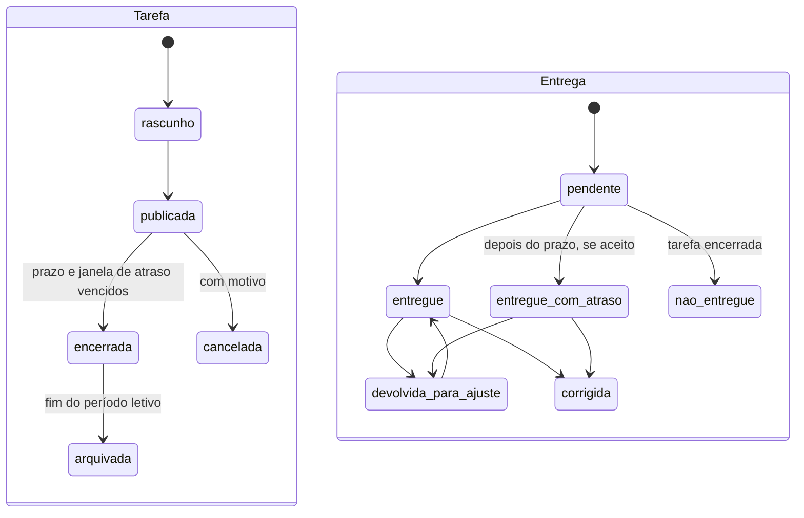

| Entidade | Estados |
|---|---|
| Aviso | `rascunho`, `agendado`, `publicado`, `arquivado` |
| Material | `processando` (antivírus), `disponivel`, `bloqueado` (falha no antivírus), `arquivado` |
| Tarefa | `rascunho`, `publicada`, `encerrada`, `cancelada`, `arquivada` |
| Entrega | `pendente`, `entregue`, `entregue_com_atraso`, `devolvida_para_ajuste`, `corrigida`, `nao_entregue` |

`nao_entregue` e `entregue_com_atraso` são calculados pelo prazo e gravados pelo job de encerramento da tarefa, com registro ([18](#doc-18), T-04).

---

### 5. Regras

#### 5.1 Mural

1. Só o professor da turma ou a coordenação da unidade publica na turma.
2. Comentários ficam desligados por padrão. Quando ligados, só alunos da turma e o autor comentam; o autor pode ocultar comentário, com registro.
3. Foto ou vídeo em que apareça aluno só com termo de imagem ativo daquele aluno para a finalidade "mural" ([32](#doc-32), seção 3.2). Sem termo, o envio é recusado com aviso ao autor.
4. Aviso publicado não é editado sem deixar versão: a edição gera nova versão e mostra "editado".

#### 5.2 Materiais

1. Arquivo só fica disponível depois do antivírus. Falha bloqueia o material e avisa o autor.
2. Material é visível só para a turma e para os responsáveis dos alunos dela.
3. Download e abertura são registrados, sem guardar o conteúdo.

#### 5.3 Tarefas e entregas

1. Entrega depois do prazo só é aceita se a tarefa aceitar atraso, até o limite definido. Depois disso, o envio é recusado.
2. O professor pode prorrogar o prazo para um aluno, com motivo. A prorrogação fica no histórico da entrega.
3. A nota da tarefa só é lançada pelo professor da turma ([22](#doc-22), seção 5).
4. Tarefa marcada como avaliação lança a nota na avaliação do diário ([61](#doc-61), seção 5) só quando o professor confirma a correção. Diário fechado bloqueia a alteração ([61](#doc-61), seção 6).
5. Tarefa que não é avaliação não entra no diário nem no boletim.
6. Sugestão de correção por IA é recurso contratado. A sugestão aparece como sugestão e precisa de confirmação do professor ([27](#doc-27)).
7. Aluno menor não vê entrega de colega. Responsável não envia entrega pelo dependente.

---

### 6. Por portal

| Portal | Pode | Não pode | Origem |
|---|---|---|---|
| **Desenvolvedor** | Publicar modelos de tarefa e de aviso, sem dado | Ver aviso, material, tarefa ou entrega de entidade | P |
| **Gestão** | Ver painel agregado da unidade: tarefas publicadas, entregas no prazo, atrasos por turma | Ver o conteúdo das entregas sem papel de coordenação | E |
| **Coordenação** | Publicar aviso para turmas da unidade; ver tarefas e entregas da unidade; ocultar conteúdo impróprio, com registro | Lançar nota de tarefa | E |
| **Secretaria** | Nada nesta área | Ver ou publicar | E |
| **Professor** | Publicar aviso, material e tarefa nas próprias turmas; corrigir, devolver e prorrogar | Ver turma em que não leciona | E |
| **Aluno** | Ver aviso e material da turma; entregar tarefa; ver a própria correção; comentar quando ligado | Ver entrega de colega | E |
| **Responsáveis** | Ver aviso, material, tarefas, prazos e situação da entrega dos dependentes | Entregar pelo dependente; ver entrega de outro aluno | E, só dependentes com vínculo ativo |
| **Terceiros** | Nada | Qualquer item da Classe | E |

Permissões: `classe.aviso.publicar`, `classe.aviso.moderar`, `classe.material.publicar`, `classe.tarefa.publicar`, `classe.tarefa.corrigir`, `classe.tarefa.prorrogar`, `classe.entrega.enviar`, `classe.painel.ver`. Papéis em [78](#doc-78), seções 4.2 a 4.5.

---

### 7. Notificações

Pelo módulo de notificações ([57](#doc-57)), respeitando preferência e horário de silêncio:

| Evento | Quem recebe |
|---|---|
| Aviso publicado | Alunos da turma; responsáveis, se a preferência deles incluir comunicados |
| Tarefa publicada | Alunos do público da tarefa |
| Prazo em 24 horas, sem entrega | Aluno; responsável do menor |
| Entrega devolvida para ajuste | Aluno |
| Correção publicada | Aluno; responsável do menor |
| Material bloqueado pelo antivírus | Autor |

---

### 8. Privacidade, auditoria e retenção

- Entrega é dado do aluno: acesso pelo professor da turma, pela coordenação e pelo próprio aluno; responsável vê a situação e a correção do dependente.
- Publicação, edição, ocultação, correção, prorrogação e lançamento no diário geram evento de auditoria ([29](#doc-29)).
- **Retenção (proposta, [Pendente: jurídico]):** avisos e materiais até o fim do período letivo e mais 1 ano, depois arquivamento; entregas de tarefas avaliativas até o fim do período letivo e mais 2 anos, porque a nota resultante é registro de vida escolar ([26](#doc-26), seção 3), mas o arquivo da entrega não é. Nenhum prazo entra em produção sem a confirmação do jurídico.

---

### 9. Integrações

| Módulo | Relação |
|---|---|
| Turmas ([60](#doc-60)) | A Classe existe por turma e disciplina; aluno da turma é o público |
| Diário ([61](#doc-61)) | Nota de tarefa avaliativa; material ligado à aula |
| Sistema avaliativo ([59](#doc-59)) | Escala e avaliação do período |
| Armazenamento ([21](#doc-21)) | Arquivos, antivírus, versões |
| Notificações ([57](#doc-57)) | Avisos e lembretes |
| IA ([27](#doc-27)) | Sugestão de correção, quando contratada |

---

### 10. DDL

Convenções do [51](#doc-51): MySQL 8 ou MariaDB 10.6, `utf8mb4`, horários em UTC, banco da unidade, exclusão lógica.

```sql
CREATE TABLE classe_avisos (
  id              BIGINT UNSIGNED AUTO_INCREMENT PRIMARY KEY,
  uuid            CHAR(36) NOT NULL UNIQUE,
  unidade_uuid    CHAR(36) NOT NULL,
  turma_uuid      CHAR(36) NOT NULL,
  disciplina_uuid CHAR(36) NOT NULL,
  autor_uuid      CHAR(36) NOT NULL,
  titulo          VARCHAR(160) NOT NULL,
  texto           TEXT NOT NULL,
  comentarios_ligados TINYINT(1) NOT NULL DEFAULT 0,
  fixado          TINYINT(1) NOT NULL DEFAULT 0,
  estado          ENUM('rascunho','agendado','publicado','arquivado') NOT NULL DEFAULT 'rascunho',
  publicar_em     DATETIME(3) NULL,
  versao          INT UNSIGNED NOT NULL DEFAULT 1,
  created_at      DATETIME(3) NOT NULL DEFAULT CURRENT_TIMESTAMP(3),
  updated_at      DATETIME(3) NULL,
  deleted_at      DATETIME(3) NULL,
  deleted_by      CHAR(36) NULL,
  INDEX ix_aviso_turma (unidade_uuid, turma_uuid, estado, publicar_em)
) ENGINE=InnoDB DEFAULT CHARSET=utf8mb4;

CREATE TABLE classe_aviso_comentarios (
  id              BIGINT UNSIGNED AUTO_INCREMENT PRIMARY KEY,
  uuid            CHAR(36) NOT NULL UNIQUE,
  aviso_uuid      CHAR(36) NOT NULL,
  autor_uuid      CHAR(36) NOT NULL,
  texto           VARCHAR(2000) NOT NULL,
  oculto          TINYINT(1) NOT NULL DEFAULT 0,
  oculto_por      CHAR(36) NULL,
  oculto_motivo   VARCHAR(255) NULL,
  created_at      DATETIME(3) NOT NULL DEFAULT CURRENT_TIMESTAMP(3),
  deleted_at      DATETIME(3) NULL,
  deleted_by      CHAR(36) NULL,
  INDEX ix_coment_aviso (aviso_uuid, created_at)
) ENGINE=InnoDB DEFAULT CHARSET=utf8mb4;

CREATE TABLE classe_materiais (
  id              BIGINT UNSIGNED AUTO_INCREMENT PRIMARY KEY,
  uuid            CHAR(36) NOT NULL UNIQUE,
  unidade_uuid    CHAR(36) NOT NULL,
  turma_uuid      CHAR(36) NOT NULL,
  disciplina_uuid CHAR(36) NOT NULL,
  autor_uuid      CHAR(36) NOT NULL,
  titulo          VARCHAR(160) NOT NULL,
  descricao       TEXT NULL,
  tipo            ENUM('arquivo','link','biblioteca') NOT NULL,
  arquivo_uuid    CHAR(36) NULL,          -- storage_files.uuid (doc 21, seção 4.3)
  url_externa     VARCHAR(2048) NULL,     -- só https
  aula_uuid       CHAR(36) NULL,
  estado          ENUM('processando','disponivel','bloqueado','arquivado') NOT NULL DEFAULT 'processando',
  created_at      DATETIME(3) NOT NULL DEFAULT CURRENT_TIMESTAMP(3),
  deleted_at      DATETIME(3) NULL,
  deleted_by      CHAR(36) NULL,
  INDEX ix_material_turma (unidade_uuid, turma_uuid, estado)
) ENGINE=InnoDB DEFAULT CHARSET=utf8mb4;

CREATE TABLE classe_tarefas (
  id              BIGINT UNSIGNED AUTO_INCREMENT PRIMARY KEY,
  uuid            CHAR(36) NOT NULL UNIQUE,
  unidade_uuid    CHAR(36) NOT NULL,
  turma_uuid      CHAR(36) NOT NULL,
  disciplina_uuid CHAR(36) NOT NULL,
  autor_uuid      CHAR(36) NOT NULL,
  titulo          VARCHAR(160) NOT NULL,
  instrucoes      TEXT NOT NULL,
  abre_em         DATETIME(3) NOT NULL,
  prazo_em        DATETIME(3) NOT NULL,
  aceita_atraso_ate DATETIME(3) NULL,
  forma_entrega   ENUM('texto','arquivo','texto_e_arquivo') NOT NULL,
  e_avaliacao     TINYINT(1) NOT NULL DEFAULT 0,
  avaliacao_uuid  CHAR(36) NULL,          -- avaliação do período no diário
  publico         ENUM('turma','alunos_escolhidos') NOT NULL DEFAULT 'turma',
  estado          ENUM('rascunho','publicada','encerrada','cancelada','arquivada') NOT NULL DEFAULT 'rascunho',
  cancelada_motivo VARCHAR(255) NULL,
  created_at      DATETIME(3) NOT NULL DEFAULT CURRENT_TIMESTAMP(3),
  deleted_at      DATETIME(3) NULL,
  deleted_by      CHAR(36) NULL,
  CONSTRAINT ck_tarefa_prazo CHECK (prazo_em > abre_em),
  INDEX ix_tarefa_turma (unidade_uuid, turma_uuid, estado, prazo_em)
) ENGINE=InnoDB DEFAULT CHARSET=utf8mb4;

CREATE TABLE classe_tarefa_publico (
  tarefa_uuid     CHAR(36) NOT NULL,
  aluno_uuid      CHAR(36) NOT NULL,
  prazo_prorrogado_em DATETIME(3) NULL,
  prorrogacao_motivo  VARCHAR(255) NULL,
  PRIMARY KEY (tarefa_uuid, aluno_uuid)
) ENGINE=InnoDB DEFAULT CHARSET=utf8mb4;

CREATE TABLE classe_entregas (
  id              BIGINT UNSIGNED AUTO_INCREMENT PRIMARY KEY,
  uuid            CHAR(36) NOT NULL UNIQUE,
  unidade_uuid    CHAR(36) NOT NULL,
  tarefa_uuid     CHAR(36) NOT NULL,
  aluno_uuid      CHAR(36) NOT NULL,
  versao          INT UNSIGNED NOT NULL DEFAULT 1,
  texto           TEXT NULL,
  entregue_em     DATETIME(3) NULL,
  estado          ENUM('pendente','entregue','entregue_com_atraso','devolvida_para_ajuste','corrigida','nao_entregue') NOT NULL DEFAULT 'pendente',
  nota            DECIMAL(6,2) NULL,      -- só quando a tarefa é avaliação
  comentario_correcao TEXT NULL,
  corrigida_por   CHAR(36) NULL,
  corrigida_em    DATETIME(3) NULL,
  lancada_no_diario_em DATETIME(3) NULL,
  created_at      DATETIME(3) NOT NULL DEFAULT CURRENT_TIMESTAMP(3),
  deleted_at      DATETIME(3) NULL,
  deleted_by      CHAR(36) NULL,
  UNIQUE KEY ux_entrega (tarefa_uuid, aluno_uuid),
  INDEX ix_entrega_estado (unidade_uuid, tarefa_uuid, estado)
) ENGINE=InnoDB DEFAULT CHARSET=utf8mb4;

CREATE TABLE classe_entrega_arquivos (
  entrega_uuid    CHAR(36) NOT NULL,
  versao          INT UNSIGNED NOT NULL,
  arquivo_uuid    CHAR(36) NOT NULL,      -- storage_files.uuid
  PRIMARY KEY (entrega_uuid, versao, arquivo_uuid)
) ENGINE=InnoDB DEFAULT CHARSET=utf8mb4;
```

Antes da migração, este DDL passa pela revisão do owner do módulo e pelo teste de migração (DDL-01 e DDL-02, [45](#doc-45), seção 7).

---

### 11. Pendências

| Código | Pendência | Responsável |
|---|---|---|
| CLA-01 | Prazos de retenção de avisos, materiais e entregas (seção 8) | Jurídico |
| CLA-02 | Revisão do DDL pelo owner do acadêmico e teste de migração | Owner do módulo |

---

### 12. Critérios de aceite

- [ ] Professor só publica e corrige nas turmas em que leciona; tentativa em outra turma responde 404.
- [ ] Aviso com imagem de aluno sem termo de imagem ativo é recusado.
- [ ] Material só fica disponível depois do antivírus; falha deixa o material `bloqueado`.
- [ ] Entrega depois do prazo e fora da janela de atraso é recusada pelo servidor.
- [ ] Nota de tarefa não avaliativa nunca aparece no diário nem no boletim.
- [ ] Nota de tarefa avaliativa só entra no diário depois da confirmação do professor, e nunca com o diário fechado.
- [ ] Responsável vê só os dependentes com vínculo ativo e não envia entrega.
- [ ] Todas as ações da seção 8 geram evento de auditoria.

<a id="doc-62"></a>

## 62 — Boletim, Aprovação, Recuperação e Conselho de Classe, por Portal

> Parte do [SDD v2](#doc-00). Quinta lacuna da ordem de [55](#doc-55), seção 3. Depende do diário ([61](#doc-61)), da turma ([60](#doc-60)) e do sistema avaliativo ([59](#doc-59), seção 4). Atas e boletim como documento em [53](#doc-53), DC-17 a DC-18, e em [48](#doc-48). Validação pública em [48](#doc-48), seção 6. Ocorrências, item 6 de [55](#doc-55), alimentam a pauta do conselho, mas ainda não têm especificação. Aviso de resultado em [57](#doc-57). Regras de matrícula por resultado em [46](#doc-46). Auditoria em [29](#doc-29).
> **Status:** especificação proposta, criada em 03/11/2026. Fecha a lacuna 5 do acadêmico. Pontos que dependem de norma ou de decisão do autor estão marcados.

---

### 1. Resposta direta

> **Leitura (04/11/2026):** esta tabela registra o que existia no SDD antes deste documento ser escrito. Os itens marcados como **Não** ou **Parcial** são especificados nas seções seguintes deste documento, exceto o que estiver listado na seção de pendências.

| Pergunta | Veredito |
|---|---|
| Boletim tem regra? | **Não.** Aparece só como documento do portal do aluno em [31](#doc-31), seção 3 |
| Aprovação final tem regra? | **Parcial.** Nota dentro da faixa em [15](#doc-15). Regra de aprovação por nota e frequência não está especificada |
| Recuperação paralela? | **Não.** Só citada como tipo de avaliação em [59](#doc-59), seção 4 |
| Conselho de classe? | **Não.** Só citado como entidade em [17](#doc-17), seção 4.1, e como ata em [53](#doc-53), DC-18 |
| Ata e assinatura? | **Parcial.** Quem assina a ata de conselho está em DC-18. Ata de resultados finais em DC-17 |

---

### 2. Boletim

#### 2.1 Conteúdo

O boletim reúne, por aluno e por período:

- Identificação do aluno, da turma, do curso, da versão da grade e do período letivo.
- Por disciplina: avaliações com nota, peso e data, média do período, total de aulas, faltas e percentual de frequência.
- Situação da disciplina: `aprovado`, `recuperacao`, `reprovado_nota`, `reprovado_frequencia`, `aprovado_conselho`, `em_andamento`.
- Versão do sistema avaliativo aplicada. Mudança posterior do sistema não altera o boletim já emitido.
- Resultado final do período, quando o período estiver fechado.

#### 2.2 Tipos de emissão

| Tipo | Quando | Valor |
|---|---|---|
| Parcial | Durante o período, a qualquer momento | Informativo. Traz a marca "parcial, sem valor oficial". Não é documento de [48](#doc-48) |
| Oficial | Depois do fechamento do período e da ata do conselho, se houver | Documento oficial, com código de validação e QR. Vai para o contexto C de [54](#doc-54) |
| Segunda via | A pedido, depois da emissão oficial | Indica que é reemissão e mantém a data de origem, como em DC-14 ([53](#doc-53)) |

**Regras:**

- Boletim oficial só é emitido com período `fechado` ([59](#doc-59), seção 3.6).
- Boletim oficial traz código de validação pública. Pela regra DC-13, a validação mostra tipo, data, situação e entidade. Não mostra nota.
- Alteração de nota depois do boletim oficial gera nova versão do boletim, com aviso ao aluno e ao responsável ([57](#doc-57)). A versão anterior fica no histórico.

---

### 3. Aprovação final

#### 3.1 Regra

Para cada disciplina, a situação final segue esta ordem:

1. **Frequência** abaixo do mínimo do sistema avaliativo: `reprovado_frequencia`. Valor mínimo por nível de ensino em [59](#doc-59), EST-01: 75% na educação básica (LDB, art. 24, VI).
2. **Média** igual ou acima da nota mínima de aprovação: `aprovado`.
3. **Média** abaixo da nota mínima, mas acima do piso de recuperação do sistema: `recuperacao`. A recuperação é feita conforme a seção 4.
4. **Média** abaixo do piso de recuperação: `reprovado_nota`.
5. **Caso fora da regra** (por exemplo, média abaixo do mínimo em disciplina com regra especial): vai ao conselho, seção 5. Pode resultar em `aprovado_conselho` ou `reprovado_nota`, com justificativa registrada.

O resultado do período combina as disciplinas conforme a regra do sistema avaliativo. Se a regra exigir aprovação em todas as disciplinas, uma disciplina reprovada reprova o período. O sistema não decide a combinação sozinho, porque ela muda por escola e por norma **(verificar)**.

#### 3.2 Regras

- A situação é calculada pela regra da versão do sistema vigente no período, e gravada com o número da versão.
- Situação gravada só muda por conselho ou por reabertura autorizada. Recálculo sem reabertura gera aviso à coordenação, não mudança silenciosa.
- Aluno transferido ou trancado no período não recebe situação final. Fica com a situação parcial e com o motivo.

---

### 4. Recuperação paralela

- Aluno com situação `recuperacao` faz avaliação de recuperação durante o período letivo, dentro do calendário da unidade ([58](#doc-58)).
- A nota de recuperação é lançada como avaliação do tipo recuperação, com peso definido no sistema avaliativo.
- A nota resultante segue a regra do sistema: **substitui** a média ou **compõe** com ela ([59](#doc-59), seção 4). **Decidido** em 03/11/2026: as duas opções existem, e a instituição escolhe no sistema avaliativo.
- Recuperação só é lançada com período aberto, pelo professor da disciplina, como as demais notas ([61](#doc-61), seção 5).
- Aluno que não fez a recuperação fica com a situação do início da recuperação, sem nova média.

---

### 5. Conselho de classe

#### 5.1 Convocação e pauta

- O conselho é convocado pela coordenação pedagógica, por turma e por período. Pode haver conselho intermediário, sem decisão de resultado.
- A pauta é gerada pelo sistema com os alunos em situação de atenção:
  - média abaixo da nota mínima;
  - frequência a menos de 5 pontos percentuais do mínimo. **Decidido** em 03/11/2026;
  - alunos com recuperação pendente;
  - ocorrências do período ([55](#doc-55), item 6), quando a especificação de ocorrências estiver pronta.
- A coordenação pode incluir ou retirar alunos da pauta, com justificativa.

#### 5.2 Participantes

| Papel | Participa | Vota ou decide |
|---|---|---|
| Coordenação pedagógica | Sim | Preside |
| Professores da turma | Sim | Opinam. A decisão do caso é da reunião |
| Secretaria | Sim | Registra. Não vota |
| Gestão | A convite | Não decide resultado de aluno |
| Responsáveis e aluno | Não participam da reunião | Podem enviar parecer por escrito antes da reunião. **Decidido** em 03/11/2026 |

#### 5.3 Decisão

- A decisão é registrada por aluno e por disciplina, com a situação, a justificativa e o nome de quem decidiu.
- Aprovação fora da regra (seção 3.1, item 5) exige justificativa escrita.
- Decisão de conselho não pode ser tomada sem quórum mínimo de maioria dos membros. **Decidido** em 03/11/2026.
- Parecer de professor sobre aluno com dado de saúde, pastoral ou atendimento sensível não entra na ata. Fica em registro restrito aos participantes e à direção ([53](#doc-53), DC-27).

#### 5.4 Ata

- A ata é gerada do registro do conselho: data, turma, pauta, presentes, decisões por aluno e justificativas.
- Assinada pelo presidente e pelo secretário, conforme DC-18 ([53](#doc-53)). Não exige assinatura de todos os presentes.
- Ata assinada entra no acervo da secretaria ([54](#doc-54), contexto B ou C, conforme o tipo).
- Ata sem assinatura fica como rascunho. Não gera resultado final.

---

### 6. Fechamento e reabertura do resultado

- O fechamento do período (diário, [61](#doc-61), seção 6) gera o resultado final por aluno, segundo a seção 3.
- Fechamento com conselho pendente: o período fecha, e a falta de ata assinada fica como pendência para a coordenação. **Decidido** em 03/11/2026.
- Reabertura do resultado exige justificativa e autorização da coordenação. A secretaria executa. Nova versão do resultado é gravada, com o anterior no histórico ([61](#doc-61), seção 6).
- Resultado final alimenta a matrícula do período seguinte: aprovado avança, reprovado segue a regra de rematrícula de [46](#doc-46).
- Mudança de resultado depois da rematrícula gera aviso à secretaria, que decide sobre o vínculo.

---

### 7. Por portal

| Portal | Pode | Não pode | Origem |
|---|---|---|---|
| **Desenvolvedor** | Publicar modelo de ata e de boletim, sem dado | Ver boletim, resultado ou ata de entidade | P |
| **Gestão** | Ver indicadores de aprovação e reprovação, ver atas da unidade | Alterar resultado. Decidir conselho de aluno | E |
| **Coordenação** | Convocar conselho, montar pauta, presidir, decidir resultado fora da regra, autorizar reabertura | Lançar nota pelo professor | E |
| **Secretaria** | Emitir boletim oficial, registrar ata, executar reabertura autorizada, emitir segunda via | Decidir resultado de aluno | E |
| **Professor** | Ver boletim parcial das próprias turmas. Opinar no conselho. Lançar recuperação | Decidir resultado. Ver boletim de turma de que não é professor | E |
| **Aluno** | Ver o próprio boletim, parcial e oficial, e a situação. Baixar boletim oficial | Ver ata. Ver boletim de colega | E |
| **Responsáveis** | Ver boletim do dependente, parcial e oficial. Ver a situação | Ver ata ou parecer. Ver boletim de outro aluno | E, só dependentes com vínculo ativo |
| **Terceiros** | Nada | Qualquer item do boletim ou do conselho | E |

---

### 8. Integrações

| Módulo | Relação |
|---|---|
| Diário ([61](#doc-61)) | Notas, faltas e fechamento alimentam o boletim |
| Estrutura ([59](#doc-59)) | Sistema avaliativo define média, mínimo, recuperação e frequência |
| Calendário ([58](#doc-58)) | Período de recuperação e de conselho |
| Ocorrências ([55](#doc-55), item 6) | Entram na pauta do conselho |
| Documentos ([48](#doc-48), [54](#doc-54)) | Boletim oficial, ata e segunda via |
| Matrícula ([46](#doc-46)) | Resultado final define avanço ou rematrícula |
| Notificações ([57](#doc-57)) | Aviso de resultado, de conselho e de boletim disponível |

---

### 9. Pendências

| # | Pendência | Tipo |
|---|---|---|
| BOL-01 | Frequência mínima para aprovação, por nível de ensino (seção 3.1, item 1) | **Conferido** em 03/11/2026 com EST-01 de [59](#doc-59): 75% na educação básica. Superior segue EST-01 |
| BOL-02 | Regra de combinação do resultado do período (seção 3.1, último parágrafo) | (verificar) |
| BOL-03 | Recuperação: substitui ou compõe a média (seção 4) | **Decidido** em 03/11/2026: a instituição escolhe no sistema avaliativo |
| BOL-04 | Pareceres por escrito de responsáveis e alunos antes do conselho (seção 5.2) | **Decidido** em 03/11/2026: sim, por escrito |
| BOL-05 | Quórum mínimo do conselho (seção 5.3) | **Decidido** em 03/11/2026: maioria dos membros |
| BOL-06 | Fechamento com conselho pendente: bloqueia ou marca pendência (seção 6) | **Decidido** em 03/11/2026: marca pendência |
| BOL-07 | Frequência para alerta no conselho (seção 5.1) | **Decidido** em 03/11/2026: 5 pontos acima do mínimo |
| BOL-08 | Prazo de guarda de boletim e de ata | (jurídico). Mesmo ponto de DC-17 em [53](#doc-53) |
| BOL-09 | Piso de recuperação: nota mínima para entrar em recuperação (seção 3.1, item 3). O sistema avaliativo de [59](#doc-59) ainda não define esse valor | **Decidido** em 03/11/2026: a escola define o valor no sistema avaliativo, sem padrão da plataforma |
| BOL-10 | DDL das tabelas: boletim, resultado por disciplina, recuperação, pauta, reunião, decisão e ata | **Escrito** em [51](#doc-51), seção 15.6. Revisão do owner pendente (DDL-01) |

---

### 10. Critérios de aceite

- [ ] Resultado calculado com a versão do sistema avaliativo vigente no período, e a versão fica gravada (teste).
- [ ] Mudança de sistema avaliativo não altera boletim já emitido (teste).
- [ ] Boletim parcial não é aceito como documento oficial (teste).
- [ ] Validação pública do boletim não mostra nota (teste de DC-13).
- [ ] Aprovação fora da regra sem justificativa escrita é recusada (teste).
- [ ] Ata sem assinatura não gera resultado final (teste).
- [ ] Parecer com dado de saúde ou pastoral não aparece na ata (varredura).
- [ ] Aluno ou responsável não vê boletim de outro aluno (teste de isolamento).
- [ ] Itens **(verificar)**, **(jurídico)** e **[Decisão do autor]** respondidos ou marcados como pendentes no [00](#doc-00).

<a id="doc-63"></a>

## 63 — Ocorrências Disciplinares e de Convivência, por Portal

> Parte do [SDD v2](#doc-00). Sexta lacuna da ordem de [55](#doc-55), seção 3. Alimenta a pauta do conselho ([62](#doc-62), seção 5.1). Aviso ao responsável em [57](#doc-57). Dado sensível e regra de saúde em [18](#doc-18), seção 3.3. Pedido de revisão pelo atendimento em [32](#doc-32). Decisão disciplinar fora da IA em [27](#doc-27), seção 5.1. Ocorrência de segurança do trabalho, que é outra coisa, em [39](#doc-39) e [52](#doc-52). Ocorrência de portaria em [35](#doc-35). Auditoria em [29](#doc-29).
> **Status:** especificação proposta, criada em 03/11/2026. Fecha a lacuna 6 do acadêmico. Pontos que dependem de norma ou de decisão do autor estão marcados.

---

### 1. Resposta direta

> **Leitura (04/11/2026):** esta tabela registra o que existia no SDD antes deste documento ser escrito. Os itens marcados como **Não** ou **Parcial** são especificados nas seções seguintes deste documento, exceto o que estiver listado na seção de pendências.

| Pergunta | Veredito |
|---|---|
| Ocorrência disciplinar tem regra? | **Não.** Só aparece como lacuna em [55](#doc-55) e em [56](#doc-56) |
| Há ocorrência em outro contexto? | **Sim, em três.** Ocorrência de SST em [39](#doc-39) e [52](#doc-52). Ocorrência de portaria em [35](#doc-35). Ocorrência de frota em outro módulo. Nenhum deles é disciplinar |
| Pode ser misturada com esses? | **Não.** Cada tipo tem tabela, regra e permissão próprias |
| A v1 tem algo? | **Só o esqueleto:** entidade `occurrences`, timeline no perfil do aluno, API de registro, kanban de tratamento e aviso ao responsável para ocorrência grave |

---

### 2. O que é e o que não é

**É:** registro de um fato observado, com data, local, pessoas envolvidas e relato objetivo, e o encaminhamento que a escola deu.

**Não é:**

- **Julgamento de caráter.** O relato descreve o fato. Não usa rótulo sobre a pessoa.
- **Registro de saúde.** Atendimento de enfermaria, de crise ou de lesão segue o registro de saúde do aluno, com restrição de acesso ([18](#doc-18), seção 3.3). Não entra aqui.
- **Denúncia de violência contra o aluno.** Esse caso segue a seção 6.3. Não é tratado como disciplina.
- **Saída ou atraso na portaria.** Segue [35](#doc-35).

---

### 3. Tipos e gravidade

#### 3.1 Tipos

| Tipo | Exemplo |
|---|---|
| Convivência | Desrespeito entre alunos, briga, uso de linguagem ofensiva |
| Conduta em aula | Atrapalhar a aula, sair sem autorização, recusar atividade |
| Segurança | Brincadeira perigosa, objeto perigoso, acesso a área restrita |
| Integridade acadêmica | Fraude em avaliação, plágio, falsificação de documento |
| Uso de meio digital | Mensagem ofensiva, imagem sem autorização, perfil falso |
| Outro | Descrição livre, com justificativa |

**Decidido** em 03/11/2026 (OCO-01): lista padrão da plataforma, que a escola ajusta (inclui, renomeia ou desativa tipo). É o mesmo critério de DIA-01 em [61](#doc-61).

#### 3.2 Gravidade

| Gravidade | Efeito |
|---|---|
| Leve | Registro e comunicação ao responsável pelo canal padrão |
| Média | Registro, comunicação e conversa com a coordenação |
| Grave | Aviso imediato ao responsável e à coordenação ([57](#doc-57)). Entra na pauta do conselho |
| Gravíssima | Aviso imediato à direção e à coordenação. Pode haver afastamento, decidido pela direção ou pela coordenação (seção 5.3) |

A gravidade é escolhida por quem registra e pode ser alterada pela coordenação com justificativa. A IA não sugere gravidade ([27](#doc-27), seção 5.1).

---

### 4. Registro e fluxo

#### 4.1 Campos do registro

| Campo | Regra |
|---|---|
| Alunos envolvidos | Um ou mais, com vínculo ativo na turma ou na unidade |
| Data e hora do fato | Não pode ser futura. Pode ser anterior ao registro, com motivo se passar de 2 dias úteis. **Decidido** em 03/11/2026 |
| Local | Lista da unidade ([44](#doc-44)) ou texto livre |
| Relato | Texto objetivo. Sem juízo sobre caráter. Sem dado de outro aluno além do necessário |
| Testemunhas | Opcional. Registradas como pessoa do cadastro, quando houver |
| Anexos | Fotos, prints ou documentos, com limite de tamanho. Imagem de outro aluno, que é menor, não é mostrada no aviso. Segue a regra de imagem de menor de [40](#doc-40) |
| Gravidade e tipo | Seção 3 |

#### 4.2 Estados

`registrada` → `em_analise` → `comunicada` → `com_medida` → `encerrada`, com `arquivada` quando o fato não procede.

- `registrada`: quem registrou ainda pode corrigir o relato. Depois de `comunicada`, correção vira nova versão.
- `em_analise`: a coordenação confirma o fato e pode ouvir o aluno e a testemunha.
- `comunicada`: o responsável recebe o aviso ([57](#doc-57)), sem o relato de terceiros (seção 6.2).
- `com_medida`: medida educativa registrada (seção 5).
- `encerrada`: medida cumprida ou sem medida.
- `arquivada`: fato não confirmado. Permanece no histórico, com motivo.

#### 4.3 Regras do fluxo

- Ocorrência não pode ser excluída. Só `arquivada`, com motivo.
- Toda mudança de estado gera evento de auditoria ([29](#doc-29)).
- Ocorrência grave vai direto para `comunicada`, sem esperar análise, para o responsável ser avisado a tempo.

---

### 5. Medidas e contestação

#### 5.1 Medidas educativas

Medida educativa é a resposta pedagógica: conversa, orientação, plano de convivência, reparação, acompanhamento com a equipe pedagógica. Cada medida tem responsável, prazo e resultado.

#### 5.2 Contestação

- O responsável pode contestar a ocorrência pelo atendimento ([32](#doc-32)), dentro do prazo.
- Contestação não suspende a medida educativa, salvo decisão da direção.
- Resposta à contestação é registrada, com motivo, e a versão da ocorrência fica no histórico.
- Prazo de contestação: 5 dias úteis, como o prazo de justificativa de falta ([61](#doc-61), DIA-02). **Decidido** em 03/11/2026.

#### 5.3 Afastamento

- Suspensão de aula ou afastamento de atividade é decisão da direção ou da coordenação, registrada com fundamento e prazo. **Decidido** em 03/11/2026.
- Antes de aplicar, a escola ouve o aluno e o responsável, e comunica por escrito.
- O regime de afastamento, o prazo máximo e a forma de comunicação dependem da legislação do sistema de ensino **(jurídico)**.
- Afastamento não gera falta para o aluno sem decisão da direção sobre o efeito na frequência **(verificar)**.

---

### 6. Sigilo e dados

#### 6.1 Quem vê o relato

| Papel | Vê o relato | Vê a medida | Vê a contestação |
|---|---|---|---|
| Quem registrou | Sim, o próprio registro | Sim | Não |
| Coordenação | Sim | Sim | Sim |
| Direção | Sim | Sim | Sim |
| Secretaria | Não | Não | Não |
| Professor da turma | Só o que registrou | Não | Não |
| Aluno envolvido | Não | Sim, a medida que lhe cabe | Não |
| Responsável do aluno | Não | Sim, a medida e a comunicação | Sim, a própria contestação |

#### 6.2 Dado de terceiro

- O relato pode citar outros alunos. Ao aviso ao responsável, ele não é mostrado. Mostra-se só o tipo, a data e a medida.
- Relato com dado de saúde ou de conduta de outro aluno fica em campo restrito ([18](#doc-18), seção 3.3).

#### 6.3 Denúncia de violência

- Relato de violência, abuso, maus-tratos ou exploração contra o aluno **não entra como ocorrência disciplinar**.
- Abre protocolo próprio, com encaminhamento imediato à direção e ao canal que a legislação indicar **(jurídico)**. Ex.: conselho tutelar.
- O registro fica com acesso restrito à direção. Nenhum aviso automático é enviado ao suposto agressor.
- A IA não atua nesse caso ([27](#doc-27)).

#### 6.4 Armazenamento

- O relato sensível é cifrado na aplicação, como as anotações sensíveis de [51](#doc-51).
- Acesso ao relato gera evento de auditoria com motivo ([29](#doc-29)).

---

### 7. Relação com outros módulos

| Módulo | Relação |
|---|---|
| Conselho de classe ([62](#doc-62)) | Ocorrências do período entram na pauta. Ocorrência não decide resultado sozinha |
| Notificações ([57](#doc-57)) | Aviso ao responsável, com canal por gravidade |
| Atendimento ([32](#doc-32)) | Contestação por protocolo |
| Documentos ([48](#doc-48), [54](#doc-54)) | Declaração de comportamento e transferência só se a escola configurar. Ver OCO-04 |
| Boletim ([62](#doc-62)) | Ocorrência não entra no boletim, salvo decisão em OCO-04 |
| Matrícula ([46](#doc-46)) | Ocorrência não impede rematrícula. Medida de desligamento segue a norma **(jurídico)** |
| Pastoral ([43](#doc-43)) | Confissão e acompanhamento espiritual não viram ocorrência |
| Preceptoria ([42](#doc-42)) | Não se aplica. Fica separada |

---

### 8. Por portal

| Portal | Pode | Não pode | Origem |
|---|---|---|---|
| **Desenvolvedor** | Publicar lista padrão de tipos e modelo de medida, sem dado | Ver ocorrência, relato ou medida de entidade | P |
| **Gestão** | Ver indicadores agregados: quantidade por tipo e gravidade, sem nome | Ver relato. Decidir medida disciplinar de aluno | E |
| **Direção** | Ver tudo. Decidir afastamento | Alterar relato de outro registro sem motivo | E |
| **Coordenação** | Ver tudo da unidade. Confirmar fato, aplicar medida, alterar gravidade com justificativa, decidir afastamento | Alterar relato de outro registro sem motivo | E |
| **Secretaria** | Ver o status e a comunicação enviada. Gerar documento autorizado | Ver relato. Registrar ocorrência | E |
| **Professor** | Registrar ocorrência das próprias turmas. Ver o próprio registro | Ver ocorrência de outra turma. Ver medida | E |
| **Aluno** | Ver a medida que lhe cabe. Enviar contestação por atendimento, se permitido | Ver relato ou ocorrência de colega | E |
| **Responsáveis** | Ver a comunicação, a medida e a própria contestação do dependente | Ver relato, nome de outro aluno ou registro de violência | E, só dependentes com vínculo ativo |
| **Terceiros** | Nada | Qualquer item de ocorrência | E |

---

### 9. Pendências

| # | Pendência | Tipo |
|---|---|---|
| OCO-01 | Lista padrão de tipos e gravidades (seção 3) | **Decidido** em 03/11/2026: lista padrão da plataforma, que a escola ajusta |
| OCO-02 | Quem aplica afastamento (seção 5.3) | **Decidido** em 03/11/2026: direção ou coordenação. Forma, prazo máximo e comunicação do afastamento seguem a legislação (jurídico), seção 5.3 |
| OCO-03 | Prazo de contestação do responsável (seção 5.2) | **Decidido** em 03/11/2026: 5 dias úteis |
| OCO-04 | Ocorrência aparece no boletim ou em declaração de comportamento? (seções 6 e 7) | **Decidido** em 03/11/2026: não |
| OCO-05 | Responsável vê relato ou só comunicação e medida (seção 6.1) | **Decidido** em 03/11/2026: só comunicação e medida |
| OCO-06 | Protocolo de violência: canal e prazo de encaminhamento (seção 6.3) | (jurídico) |
| OCO-07 | Prazo de guarda de ocorrência e de medida | (jurídico) |
| OCO-08 | Efeito de afastamento na frequência (seção 5.3) | (verificar) |
| OCO-09 | DDL das tabelas: ocorrência, versão do relato, envolvido, medida, contestação e evento de acesso ao relato | **Escrito** em [51](#doc-51), seção 15.8. Revisão do owner pendente (DDL-01) |

---

### 10. Critérios de aceite

- [ ] Ocorrência não é excluída, só arquivada com motivo (teste).
- [ ] Professor de outra turma não vê nem registra ocorrência (teste de isolamento).
- [ ] Responsável não vê relato nem nome de outro aluno no aviso (varredura do aviso e teste de isolamento).
- [ ] Ocorrência grave gera aviso imediato ao responsável e à coordenação (teste com [57](#doc-57)).
- [ ] Relato de violência não entra como ocorrência disciplinar e não gera aviso ao suposto agressor (teste).
- [ ] IA não sugere gravidade nem medida (teste de [27](#doc-27), seção 5.1).
- [ ] Acesso ao relato gera evento de auditoria (teste).
- [ ] Itens **(verificar)**, **(jurídico)** e **[Decisão do autor]** respondidos ou marcados como pendentes no [00](#doc-00).

<a id="doc-64"></a>

## 64 — Planos de Ensino e de Aula, por Portal

> Parte do [SDD v2](#doc-00). Sétima lacuna da ordem de [55](#doc-55), seção 3. Depende de estrutura acadêmica ([59](#doc-59), disciplina e sistema avaliativo) e de turma e grade ([60](#doc-60)). O conteúdo realizado é registrado no diário ([61](#doc-61), seção 2). Geração de rascunho por IA em [27](#doc-27), seção 5. Aviso de plano pendente em [57](#doc-57). Acervo de bibliografia em [56](#doc-56), item de biblioteca. Projeto político-pedagógico e PPC em [59](#doc-59), seção 3.4 e [37](#doc-37), PLN-01. Auditoria em [29](#doc-29).
> **Status:** especificação proposta, criada em 03/11/2026. Fecha a lacuna 7 do acadêmico. A v1 tem `lesson_plans` e `teaching_plans` ([`spec_gestao_academica_completo.md`](#v1-spec-gestao-academica-completo-md), seções 7.1 e 7.2). Esta versão corrige um erro da v1: o projeto político-pedagógico (PPP) não é plano de aula.

---

### 1. Resposta direta

> **Leitura (04/11/2026):** esta tabela registra o que existia no SDD antes deste documento ser escrito. Os itens marcados como **Não** ou **Parcial** são especificados nas seções seguintes deste documento, exceto o que estiver listado na seção de pendências.

| Pergunta | Veredito |
|---|---|
| Plano de ensino tem regra? | **Não.** A v1 tem campos e DDL, sem regra de vigência, versão nem alinhamento com avaliação |
| Plano de aula tem regra? | **Não.** A v1 tem campos, status e um alerta de envio atrasado, sem regra de revisão |
| Fluxo de aprovação? | **Parcial.** A v1 tem professor → coordenação, mas inclui diretor para PPP, que não é plano de aula |
| Ligação com o diário? | **Não.** Só o diário cita "referência ao plano de aula" ([61](#doc-61), seção 2) |
| Ligação com a avaliação? | **Não.** A v1 tem "avaliações previstas" no plano de aula, sem vínculo com o sistema avaliativo |

---

### 2. Dois documentos, com relação entre eles

```
Plano de ensino (disciplina + turma + período)
   └── unidades ou módulos de conteúdo
         └── Plano de aula (por aula ou por semana)
               └── Aula realizada no diário (o que foi ministrado)
```

- **Plano de ensino** é o compromisso do professor para a disciplina naquela turma e naquele período. É aprovado pela coordenação.
- **Plano de aula** detalha uma aula ou uma semana dentro do plano de ensino. O professor prepara e a coordenação revisa.
- **Aula realizada** é o que foi ministrado, no diário. Pode diferir do plano. A diferença não é erro, mas é registrada.

**PPP fora deste módulo.** O projeto político-pedagógico da escola é um documento institucional, aprovado pelo colegiado, com o PPC de cada curso em [59](#doc-59), seção 3.4. A v1 o põe como tipo de plano de aula, com aprovação de diretor. Essa mistura é removida. Ver PLA-01.

---

### 3. Plano de ensino

#### 3.1 Campos

| Campo | Regra |
|---|---|
| Disciplina e turma | Vinculados. Um plano por disciplina, turma e período letivo |
| Professor | Quem leciona a disciplina na turma ([60](#doc-60), seção 2.1) |
| Ementa | Vem do catálogo de disciplina ([59](#doc-59), seção 3.2). Não é editada no plano |
| Objetivos gerais e específicos | Texto |
| Conteúdo por unidade ou módulo | Lista ordenada. Cada item tem número, título, carga horária prevista e aulas previstas |
| Metodologia | Texto |
| Critérios de avaliação | Avaliações previstas com tipo, peso e data. A soma dos pesos é a do sistema avaliativo ([59](#doc-59), seção 4). Diferença bloqueia o envio |
| Bibliografia básica e complementar | Referências. Quando o item existir no acervo, referencia o acervo (item de biblioteca de [55](#doc-55)) |
| Versão | Número, incrementado a cada aprovação de alteração |

#### 3.2 Estados

`rascunho` → `enviado` → `aprovado`, com `devolvido` a partir de `enviado`. Aprovado não é editado: alteração gera nova versão, que volta a `enviado`.

- **Regra de critério:** alteração de critério de avaliação em período `aberto` exige justificativa e aviso aos alunos da turma ([57](#doc-57)).
- **Regra de conteúdo:** alteração de conteúdo já ministrado não é aceita. Só o conteúdo ainda não ministrado muda.

#### 3.3 Prazo

- Plano de ensino é enviado antes do início do período letivo. Prazo definido pelo calendário da unidade ([58](#doc-58)).
- Plano não aprovado até o início do período não bloqueia aula. Gera pendência para a coordenação.

---

### 4. Plano de aula

#### 4.1 Campos

| Campo | Regra |
|---|---|
| Plano de ensino | Obrigatório. Plano de aula sem plano de ensino aprovado não é criado |
| Aula ou semana | Ligada à grade ([60](#doc-60), seção 4). Uma aula ou um intervalo de semana |
| Unidade ou módulo do plano de ensino | Obrigatório. O conteúdo vem da unidade |
| Objetivos específicos da aula | Texto |
| Conteúdo previsto | Texto, com link para o conteúdo da unidade |
| Metodologia e recursos | Texto e arquivos. Arquivos seguem [21](#doc-21) |
| Avaliação prevista | Se houver, vira avaliação prevista do diário. Mesmo tipo e peso do plano de ensino |
| Alinhamento com competências | Na educação básica, o currículo tem base nacional comum obrigatória (LDB, art. 26, e art. 9º, IV). **Decidido** em 03/11/2026 (PLA-04): o plano de ensino indica as competências da BNCC; no plano de aula, a indicação é opcional, porque a lei trata do currículo, não de cada aula |

#### 4.2 Estados e prazo

`rascunho` → `enviado` → `aprovado`, com `devolvido`.

- **Prazo de envio:** o plano de aula é enviado 5 dias antes da aula, com alerta ao professor e à coordenação. **Decidido** em 03/11/2026, igual à regra da v1 ([`spec_gestao_academica_completo.md`](#v1-spec-gestao-academica-completo-md), linha 1182).
- **Aula sem plano aprovado:** a aula acontece. O sistema registra pendência de planejamento, sem bloquear o diário.

#### 4.3 Conteúdo realizado

- O diário registra o conteúdo ministrado ([61](#doc-61), seção 2). Ele pode ser diferente do plano.
- Conteúdo previsto e não ministrado aparece como pendente no fechamento do período. O professor decide se reagenda para outra aula. Não há reagendamento automático. **Decidido** em 03/11/2026.
- A diferença entre previsto e realizado aparece no relatório de planejamento ([56](#doc-56), seção 5).

---

### 5. Revisão

- A coordenação aprova ou devolve o plano, com comentário obrigatório na devolução.
- Plano devolvido volta para `rascunho`. O professor responde no próprio plano, sem criar outro.
- Aprovação é registrada com data e pessoa. Fica em auditoria ([29](#doc-29)).
- A coordenação não edita o conteúdo do professor. Ela pode devolver ou aprovar.

---

### 6. Inteligência artificial

- A IA gera rascunho de plano de ensino e de plano de aula a partir da ementa, do material e da grade ([27](#doc-27), seção 5).
- Rascunho gerado por IA não é enviado sem revisão do professor. Ele é marcado como gerado por IA até o professor aprovar o texto.
- IA não aprova plano.

---

### 7. Por portal

| Portal | Pode | Não pode | Origem |
|---|---|---|---|
| **Desenvolvedor** | Publicar modelo de plano de ensino e de aula, sem dado | Ver plano de entidade | P |
| **Gestão** | Ver indicador: planos aprovados por período e por disciplina. Ver pendência de planejamento | Editar ou aprovar plano | E |
| **Coordenação** | Ver todos os planos da unidade. Aprovar ou devolver. Ver pendência de planejamento | Editar conteúdo do professor | E |
| **Secretaria** | Ver status dos planos da unidade | Criar, editar ou aprovar | E |
| **Professor** | Criar e editar os próprios planos enquanto não aprovados. Ver os planos das próprias turmas | Editar plano aprovado sem nova versão. Ver plano de outra disciplina | E |
| **Aluno** | Ver o plano de ensino publicado da própria turma e os planos de aula aprovados: ementa, critérios, cronograma de conteúdo, bibliografia | Ver plano em rascunho ou devolvido | E |
| **Responsáveis** | Ver o plano de ensino publicado do dependente | Ver plano de aula. Ver plano de outra turma | E, só dependentes com vínculo ativo |
| **Terceiros** | Nada | Qualquer item de plano | E |

---

### 8. Integrações

| Módulo | Relação |
|---|---|
| Estrutura ([59](#doc-59)) | Ementa vem do catálogo. Critérios seguem o sistema avaliativo |
| Turmas e grade ([60](#doc-60)) | Plano de aula liga a aula da grade |
| Diário ([61](#doc-61)) | Conteúdo realizado e avaliação prevista |
| Calendário ([58](#doc-58)) | Prazo de envio e período |
| Notificações ([57](#doc-57)) | Aviso de plano devolvido, de plano pendente e de alteração de critério |
| IA ([27](#doc-27)) | Rascunho com revisão humana |
| Relatórios ([56](#doc-56)) | Planejado versus ministrado |

---

### 9. Pendências

| # | Pendência | Tipo |
|---|---|---|
| PLA-01 | PPP sai do plano de aula e vai para documento institucional ([59](#doc-59), seção 3.4) | **Decidido** em 03/11/2026: sai do plano de aula |
| PLA-02 | Aluno vê o plano de aula aprovado da própria turma (seção 7) | **Decidido** em 03/11/2026: sim |
| PLA-03 | Prazo de envio do plano de aula antes da aula (seção 4.2) | **Decidido** em 03/11/2026: 5 dias antes |
| PLA-04 | Alinhamento com BNCC e DCN na educação básica, e se é obrigatório (seção 4.1) | **Conferido** em 03/11/2026: base nacional comum obrigatória no currículo (LDB, art. 26 e art. 9º, IV). **Decidido** em 03/11/2026: BNCC obrigatória no plano de ensino e opcional no plano de aula |
| PLA-05 | Quem aprova o plano de ensino (seção 3.2) | **Decidido** em 03/11/2026: coordenação pedagógica |
| PLA-06 | Conteúdo previsto e não ministrado: reagendar automático ou só pendência (seção 4.3) | **Decidido** em 03/11/2026: só pendência |
| PLA-07 | DDL: plano de ensino, unidade, plano de aula, versão, revisão e pendência de planejamento | **Escrito** em [51](#doc-51), seção 15.9. Revisão do owner pendente (DDL-01) |

---

### 10. Critérios de aceite

- [ ] Soma dos pesos no plano de ensino diferente do sistema avaliativo bloqueia o envio (teste).
- [ ] Plano aprovado não muda sem nova versão (teste).
- [ ] Alteração de conteúdo já ministrado é recusada (teste).
- [ ] Plano de aula sem plano de ensino aprovado não é criado (teste).
- [ ] Aula sem plano aprovado não é bloqueada, e gera pendência (teste).
- [ ] Rascunho de IA não é enviado sem revisão do professor (teste de [27](#doc-27), seção 5).
- [ ] Professor não edita plano de outra disciplina (teste de isolamento).
- [ ] Itens **(verificar)**, **(jurídico)** e **[Decisão do autor]** respondidos ou marcados como pendentes no [00](#doc-00).

<a id="doc-65"></a>

## 65 — Estágio e TCC, por Portal

> Parte do [SDD v2](#doc-00). Oitava lacuna da ordem de [55](#doc-55), seção 3. Depende da estrutura acadêmica ([59](#doc-59), tipos de disciplina e carga horária). Decisão ACA-03: estágio obrigatório quando o curso exigir. TCC entra nesta versão (ACA-02, decidido em 03/11/2026). Campos de estágio já citados em [17](#doc-17), seção 4.2. Convênio com empresa concedente em [33](#doc-33). Motor de formulários para avaliação em [41](#doc-41). Convidado externo com link de uso único em [40](#doc-40). Assinatura de termo e de ata em [54](#doc-54), seção 5. Resultado no boletim em [62](#doc-62). Campo de estágio da preceptoria, que é outra coisa, em [42](#doc-42). Auditoria em [29](#doc-29).
> **Status:** especificação proposta, criada em 03/11/2026. Fecha a lacuna 8 do acadêmico. A v1 tem `internships` e `thesis_works` ([`spec_gestao_academica_completo.md`](#v1-spec-gestao-academica-completo-md), seções 9 e 10). Pontos que dependem de norma ou de decisão do autor estão marcados.

---

### 1. Resposta direta

> **Leitura (04/11/2026):** esta tabela registra o que existia no SDD antes deste documento ser escrito. Os itens marcados como **Não** ou **Parcial** são especificados nas seções seguintes deste documento, exceto o que estiver listado na seção de pendências.

| Pergunta | Veredito |
|---|---|
| Estágio tem regra? | **Parcial.** Campos e estados em [17](#doc-17) (CNPJ, apólice, `solicitado`, `ativo`, `concluido`, `cancelado`). Sem regra de horas, supervisão e avaliação |
| TCC tem regra? | **Não.** Só a entidade `thesis_works` da v1, sem regra de orientação, banca nem versão final |
| Banca de defesa? | **Não.** Só citada na v1, com composição e nota, sem regra |
| Termo e ata? | **Parcial.** Termo e ata são documentos de [54](#doc-54). Falta regra de quem assina |

---

### 2. Estágio

#### 2.1 Tipos

| Tipo | Regra |
|---|---|
| Obrigatório | Exigido pelo curso ([59](#doc-59), seção 2). Sem ele, o aluno não conclui. Decidido em ACA-03 |
| Não obrigatório | Opcional, acrescido à carga horária regular (Lei 11.788/2008, art. 2º, § 2º). Bolsa ou outra contraprestação e auxílio-transporte são obrigatórios (art. 12). Seguro contra acidentes pessoais é obrigatório em todo estágio (art. 9º, IV). No obrigatório, a instituição pode assumir o seguro (art. 9º, § 1º) |

#### 2.2 Cadastro

| Campo | Regra |
|---|---|
| Aluno e curso | Aluno com matrícula ativa. Curso que exige estágio tem carga horária obrigatória ([59](#doc-59), disciplina do tipo estágio) |
| Empresa concedente | CNPJ válido, nome, endereço e contrato de convênio vigente ([33](#doc-33)). Regra de [17](#doc-17) |
| Supervisor da empresa | Pessoa da empresa concedente, com conta no portal de terceiros (seção 6) |
| Professor orientador | Professor habilitado na disciplina de estágio da turma |
| Período | Início, fim previsto e fim real. Dentro do período letivo ([58](#doc-58)) |
| Carga horária | Definida no projeto do curso (Lei 11.788/2008, art. 2º, § 1º) e combinada por semana. Limite: 4 h por dia e 20 h por semana na educação especial e nos anos finais do fundamental na EJA; 6 h por dia e 30 h por semana no superior, no médio e no técnico de nível médio; até 40 h por semana em período sem aula presencial, se o projeto do curso prever (art. 10). Em período de avaliação, cai pelo menos à metade (art. 10, § 2º). No mesmo concedente, até 2 anos, salvo pessoa com deficiência (art. 11). O sistema recusa termo acima desses limites |
| Termo de compromisso | Assinado por aluno, empresa e instituição. Gerado pelo sistema ([54](#doc-54)) |
| Apólice de seguro | Arquivo, com validade. Regra de [17](#doc-17) |

#### 2.3 Estados

`solicitado` → `ativo` → `concluido`, com `interrompido` e `cancelado`.

- `solicitado` para `ativo` só com termo assinado pelas três partes e apólice válida.
- `concluido` só com horas cumpridas, relatório final e avaliação do supervisor e do orientador.
- `interrompido` tem motivo registrado. Não conta como horas concluídas. Pode voltar a `ativo` por nova versão do termo.
- `cancelado` antes de `ativo`. Depois de `ativo`, é `interrompido`.

#### 2.4 Supervisão e horas

- O orientador registra visitas de supervisão, com data e observação.
- O aluno envia relatórios periódicos, com atividades desenvolvidas, em prazo não superior a 6 meses (Lei 11.788/2008, art. 7º, IV). Estágio de 1 ano ou mais dá direito a recesso de 30 dias, remunerado quando há bolsa (art. 13).
- Horas são registradas pelo aluno e confirmadas pelo supervisor da empresa.
- Alerta quando as horas do mês ficam 20% abaixo do previsto. Decidido em ETC-07. Alerta ao aluno e ao orientador ([57](#doc-57)).

#### 2.5 Avaliação e resultado

- Avaliação de estágio tem duas partes: supervisor da empresa e orientador. Cada uma é um formulário ([41](#doc-41)).
- A nota final segue o método do sistema avaliativo ([59](#doc-59), seção 4). A v1 usa média das avaliações.
- Resultado `aprovado` ou `reprovado` entra no resultado do período ([62](#doc-62)).
- Declaração de conclusão de estágio segue [48](#doc-48). Não sai sem resultado registrado.

---

### 3. TCC

#### 3.1 Tipos e escopo

Tipos: TCC, monografia, projeto final e artigo. Aplica-se a cursos que exigem trabalho final ([59](#doc-59), seção 2, graduação). Entra nesta versão: **decidido** em 03/11/2026 (ACA-02).

#### 3.2 Cadastro

| Campo | Regra |
|---|---|
| Aluno, curso e tipo | Aluno com matrícula ativa no curso |
| Título | Pode ser provisório. Muda com versão registrada |
| Orientador | Professor habilitado, da lista de professores do curso |
| Coorientador | Opcional. Mesma regra de habilitação |
| Linha de pesquisa | Lista configurável por curso |
| Datas | Início e entrega prevista. Entrega prevista é o prazo |
| Termo de orientação | Assinado pelo aluno e pelo orientador. Gerado pelo sistema |

#### 3.3 Estados

`em_orientacao` → `submetido` → `em_banca` → `aprovado` | `aprovado_com_ressalvas` | `reprovado`, com `reformulacao` a partir de `em_banca`.

- `reformulacao` volta a `submetido` depois da nova versão, com prazo definido pela banca.
- `aprovado_com_ressalvas` exige versão final com as correções. Sem ela, o trabalho não é encerrado.
- `reprovado` encerra o trabalho. Nova tentativa segue a regra do curso **(verificar)**.

#### 3.4 Prazo

- Aviso ao aluno e ao orientador 30 dias antes da entrega prevista, como a regra 17 da v1 ([`spec_gestao_academica_completo.md`](#v1-spec-gestao-academica-completo-md), linha 1183).
- Entrega atrasada não muda o estado sozinha. A coordenação decide sobre a prorrogação, com justificativa.

#### 3.5 Banca de defesa

| Regra | Detalhe |
|---|---|
| Composição | Orientador e dois membros, internos ou externos. Coorientador não entra na nota |
| Membro externo | Cadastro com nome, titulação e instituição. Tem conta no portal de terceiros (seção 6) |
| Agendamento | Data, hora e local. Local é sala reservada ([44](#doc-44)) ou link de sala online com convidado externo ([40](#doc-40)) |
| Avaliação | Cada membro lança nota e parecer, por formulário. Nota só é vista depois que todos lançaram |
| Nota final | Média ponderada, com pesos configurados pela escola |
| Resultado | Conforme seção 3.3 |
| Ata | Gerada do registro da defesa. Assinada pela banca ([54](#doc-54)) |

#### 3.6 Versão final e repositório

- Versão final em PDF e no formato que a escola definir.
- Publicação em repositório institucional depende de autorização do aluno e das regras de direito autoral **(jurídico)**. Sem autorização, o trabalho fica no acervo restrito.
- Trabalho com dado pessoal de pesquisa segue [07](#doc-07).

---

### 4. Por portal

| Portal | Pode | Não pode | Origem |
|---|---|---|---|
| **Desenvolvedor** | Publicar modelo de termo e de ata, sem dado | Ver estágio, TCC ou banca de entidade | P |
| **Gestão** | Ver indicadores: estágios ativos, TCCs por status, prazos vencidos. Aprovar convênio com empresa concedente ([33](#doc-33)) | Avaliar aluno ou aprovar resultado | E |
| **Coordenação** | Aprovar estágio e TCC. Autorizar prorrogação. Montar banca. Ver todos da unidade | Lançar nota de avaliação de outro professor | E |
| **Secretaria** | Cadastrar estágio e TCC aprovados. Emitir declaração e termo. Guardar a versão final | Aprovar ou avaliar | E |
| **Professor orientador** | Ver e acompanhar os próprios orientandos. Registrar visitas. Avaliar. Participar da banca | Ver orientando de outro professor | E |
| **Aluno** | Ver o próprio estágio ou TCC. Enviar relatórios e versões. Ver resultado | Ver avaliação de colega ou nota de banca | E |
| **Responsáveis** | Ver status e resultado do dependente, quando houver | Ver relatório ou avaliação | E, só dependentes com vínculo ativo |
| **Empresa concedente (supervisor)** | Pelo portal de terceiros: avaliar e confirmar horas do próprio estagiário | Ver outros estagiários. Ver a instituição | Terceiros |
| **Membro externo de banca** | Pelo portal de terceiros: lançar a avaliação da própria banca | Ver outras bancas ou a nota dos colegas antes do fim | Terceiros |
| **Terceiros** | Só os itens liberados pelo próprio vínculo | Qualquer outro item | E |

---

### 5. Integrações

| Módulo | Relação |
|---|---|
| Estrutura ([59](#doc-59)) | Estágio e TCC são disciplinas do curso. Carga horária e tipos |
| Diário ([61](#doc-61)) | Visitas e avaliações de orientação seguem o diário, quando houver |
| Boletim e resultado ([62](#doc-62)) | Resultado do estágio e do TCC |
| Contratos ([33](#doc-33)) | Convênio com empresa concedente |
| Documentos ([48](#doc-48), [54](#doc-54)) | Termo, ata, declaração de conclusão e histórico |
| Formulários ([41](#doc-41)) | Avaliação do supervisor e do orientador, e da banca |
| Agendamento ([44](#doc-44)) e aula online ([40](#doc-40)) | Defesa em sala ou por link |
| Notificações ([57](#doc-57)) | Prazo, horas abaixo do esperado, resultado |

---

### 6. Pessoas de fora do sistema

Supervisor da empresa e membro externo de banca têm conta no portal de terceiros ([38](#doc-38)), com acesso só aos próprios itens. Não veem dados de outros estudantes nem de outras bancas. Decidido em ETC-04. A conta é criada pela secretaria, com verificação de e-mail ([06](#doc-06)).

---

### 7. Pendências

| # | Pendência | Tipo |
|---|---|---|
| ETC-01 | Limite semanal e total de jornada de estágio (seção 2.2) | **Conferido** em 03/11/2026: Lei 11.788/2008, arts. 10 e 11 |
| ETC-02 | Estágio não obrigatório: bolsa, auxílio e benefício (seção 2.1) | Texto da lei conferido em 03/11/2026 (Lei 11.788/2008, arts. 9º, 12 e 13) e registrado na seção 2.1. Parecer do (jurídico) pendente |
| ETC-03 | Carga horária mínima de estágio obrigatório por curso (seção 2.1) | **Conferido** em 03/11/2026: a lei não fixa horas e remete ao projeto do curso (Lei 11.788/2008, art. 2º, § 1º). O valor fica no curso, em [59](#doc-59) |
| ETC-04 | Supervisor de empresa e membro externo acessam (seção 6) | **Decidido** em 03/11/2026: conta no portal de terceiros |
| ETC-05 | Publicação de TCC em repositório: autorização do aluno e prazo de acesso (seção 3.6) | (jurídico) |
| ETC-06 | Verificação de similaridade (plágio) no TCC | **Decidido** em 03/11/2026: não nesta versão |
| ETC-07 | Percentual de horas mensais abaixo do esperado para alerta (seção 2.4) | **Decidido** em 03/11/2026: 20% abaixo do previsto |
| ETC-08 | Nova tentativa de TCC reprovado (seção 3.3) | (verificar) |
| ETC-09 | DDL das tabelas: estágio, horas, relatório, supervisão, TCC, versão, banca e avaliação | **Escrito** em [51](#doc-51), seção 15.10. Revisão do owner pendente (DDL-01) |

---

### 8. Critérios de aceite

- [ ] Estágio não vira `ativo` sem termo assinado pelas três partes e apólice válida (teste).
- [ ] Estágio `concluido` sem avaliação do supervisor e do orientador é recusado (teste).
- [ ] Supervisor de empresa não vê outro estagiário, e membro externo não vê outra banca (teste de isolamento).
- [ ] Nota da banca não aparece antes de todos os membros lançarem (teste).
- [ ] Versão final sem autorização do aluno não vai para o repositório público (teste).
- [ ] Declaração de conclusão não sai sem resultado registrado (teste).
- [ ] Itens **(verificar)**, **(jurídico)** e **[Decisão do autor]** respondidos ou marcados como pendentes no [00](#doc-00).

<a id="doc-66"></a>

## 66 — Prontuário e Portfólio do Aluno, por Portal

> Parte do [SDD v2](#doc-00). Nona lacuna da ordem de [55](#doc-55), seção 3. Depende do diário ([61](#doc-61)) e do boletim ([62](#doc-62)). Documentos recebidos e emitidos ficam em [54](#doc-54), contextos A e C. O prontuário é uma visão sobre eles, sem cópia. Armazenamento, hash e OCR em [21](#doc-21). Ocorrências em [63](#doc-63). Acesso a dado sensível e campos bloqueados em [18](#doc-18), seção 3.3, e [38](#doc-38). Dados de menor e imagem em [40](#doc-40) e [07](#doc-07). Auditoria em [29](#doc-29).
> **Status:** especificação proposta, criada em 03/11/2026. Fecha a lacuna 9 do acadêmico. A v1 tem `student_records` e `student_portfolios` ([`spec_gestao_academica_completo.md`](#v1-spec-gestao-academica-completo-md), seções 5.3, 7.5 e 16). Pontos que dependem de norma ou de decisão do autor estão marcados.

---

### 1. Resposta direta

> **Leitura (04/11/2026):** esta tabela registra o que existia no SDD antes deste documento ser escrito. Os itens marcados como **Não** ou **Parcial** são especificados nas seções seguintes deste documento, exceto o que estiver listado na seção de pendências.

| Pergunta | Veredito |
|---|---|
| Prontuário tem regra? | **Parcial.** Documentos com versão, validade, responsável e hash em [17](#doc-17) e [54](#doc-54). Falta a visão do prontuário e as seções de dado de saúde |
| Acesso ao prontuário? | **Não.** A v1 dá leitura à coordenação sem limitar seção. Pela regra de dado sensível, isso não basta |
| Portfólio tem regra? | **Não.** A v1 tem campos e tipos de evidência, sem regra de compartilhamento nem de exportação |
| Dado de saúde e necessidade específica? | **Não.** A v1 não tem seção. Acessibilidade aparece em [60](#doc-60), seção 2.2 |

---

### 2. Prontuário

#### 2.1 Princípio: visão, não cópia

O prontuário é a página do aluno que reúne, por seção, o que já existe em outro lugar. Cada documento tem um único armazenamento e uma única origem. O prontuário mostra e linka.

| Seção | Origem | Como aparece |
|---|---|---|
| Documentos pessoais | Contexto A, recebidos ([54](#doc-54)) | Lista de documentos com validade, status e versão |
| Documentos acadêmicos | Contexto C, emitidos, e histórico externo recebido | Histórico interno, diplomas anteriores e histórico externo |
| Histórico acadêmico | Diário e boletim ([61](#doc-61), [62](#doc-62)) | Só leitura. Não é editado no prontuário |
| Contratos e termos | Contratos ([33](#doc-33)) e termos de [65](#doc-65) | Contrato pedagógico, aditivos, termo de estágio, termo LGPD |
| Requerimentos e protocolos | Atendimento ([32](#doc-32)) e matrícula ([46](#doc-46)) | Todos os requerimentos e respostas |
| Comunicações | Notificações ([57](#doc-57)) | Correspondência oficial enviada e recebida |
| Ocorrências | [63](#doc-63) | Só comunicação e medida, conforme OCO-05 |
| Saúde e apoio | Seção própria (seção 2.3) | Restrita |

#### 2.2 Regras gerais

- Cada documento do prontuário tem data de envio, validade, responsável, versão e hash de integridade ([54](#doc-54)). Nova versão não apaga a anterior.
- Documento vencido aparece com aviso. Não é removido sem prazo de guarda ([26](#doc-26), N-10).
- O prontuário não tem campo de edição livre para dado que já é de outro módulo.

#### 2.3 Saúde e apoio educacional

Esta seção é restrita. Inclui:

- Laudo ou relatório de necessidade educacional específica, quando houver.
- Plano de apoio ou de acessibilidade, com o recurso que a escola disponibilizou.
- Restrição alimentar ou medicamento de uso escolar.
- Registro de atendimento de enfermaria.

**Regras:**

- Diagnóstico e CID ficam visíveis para coordenação, secretaria, enfermagem e médico da escola. Decidido em 03/11/2026 (PRT-01). Os demais portais não veem.
- Medicamento de uso escolar tem validade e autorização do responsável, com documento no contexto A.
- Acesso à seção gera evento de auditoria com motivo ([29](#doc-29)).
- A seção não é enviada para terceiros. Empresa de transporte e de alimentação recebem só o que a regra de contrato permite ([38](#doc-38), seção 5).

#### 2.4 Histórico após saída

- Aluno transferido, trancado ou desligado mantém o prontuário com acesso restrito à secretaria e à coordenação.
- Prazo de guarda segue o acervo escolar ([26](#doc-26), seção 3, N-10). **(jurídico)**

---

### 3. Portfólio

#### 3.1 Evidências

| Campo | Regra |
|---|---|
| Aluno e disciplina | Um portfólio por aluno e disciplina, com período letivo |
| Evidência | Texto, imagem, arquivo, link ou vídeo |
| Quem publica | O aluno, pelo portal. Ou o professor, por material de aula |
| Imagem ou vídeo com outra pessoa | Só com autorização do responsável, quando o aluno é menor. Mesma regra de [40](#doc-40) |
| Dado pessoal de terceiro | Evidência com dado de outra pessoa é recusada ou anonimizada antes de publicar, como em [42](#doc-42), seção 6 |

#### 3.2 Avaliação

- O professor avalia o portfólio com comentário e nota qualitativa. Nota qualitativa não entra no cálculo da média sem regra do sistema avaliativo ([59](#doc-59), seção 4).
- O aluno vê a avaliação depois de publicada. Antes, o portfólio fica em rascunho.

#### 3.3 Compartilhamento e exportação

- Para aluno maior de idade, o aluno decide compartilhar com o responsável.
- Para aluno menor de idade, o responsável vê o portfólio sempre, sem depender do aluno. Decidido em 03/11/2026 (PRT-02).
- Exportação em PDF é feita pelo próprio aluno, com a data e a identificação do aluno. A escola não exporta portfólio para terceiros sem pedido por escrito do aluno ou do responsável.
- Exportação registra evento de auditoria.

---

### 4. Por portal

| Portal | Pode | Não pode | Origem |
|---|---|---|---|
| **Desenvolvedor** | Publicar modelo de prontuário e de portfólio, sem dado | Ver prontuário, saúde ou portfólio de entidade | P |
| **Gestão** | Ver indicador: prontuários completos, documentos vencidos, portfólios publicados | Ver seção de saúde. Ver documento pessoal | E |
| **Coordenação** | Ver o prontuário, inclusive a seção de saúde com CID e diagnóstico. Ver portfólio da unidade | Editar histórico | E |
| **Secretaria** | Gerir documentos pessoais e acadêmicos, requerimentos e comunicações. Ver a seção de saúde, inclusive CID | Editar avaliação do portfólio | E |
| **Enfermagem e médico da escola** | Ver e registrar a seção de saúde e apoio | Ver histórico de notas ou ocorrência, sem necessidade | E |
| **Professor** | Ver o portfólio da própria disciplina. Avaliar. Publicar material de aula | Ver prontuário. Ver portfólio de outra disciplina | E |
| **Aluno** | Ver o próprio prontuário, exceto saúde restrita. Publicar e exportar o próprio portfólio. Ver a avaliação | Ver portfólio ou prontuário de colega | E |
| **Responsáveis** | Ver documentos e comunicações do dependente. Ver o portfólio do dependente menor sempre, e do maior se ele compartilhar | Ver CID ou diagnóstico. Ver portfólio de outro aluno | E, só dependentes com vínculo ativo |
| **Terceiros** | Nada | Qualquer item do prontuário ou do portfólio | E |

---

### 5. Integrações

| Módulo | Relação |
|---|---|
| Documentos ([54](#doc-54)) | Origem de documentos pessoais, acadêmicos e de termo |
| Armazenamento ([21](#doc-21)) | Arquivo, hash, OCR de digitalização |
| Diário e boletim ([61](#doc-61), [62](#doc-62)) | Histórico acadêmico só para leitura |
| Acessibilidade ([60](#doc-60), seção 2.2) | Sala com recurso de acessibilidade |
| Ocorrências ([63](#doc-63)) | Comunicação e medida |
| Atendimento ([32](#doc-32)) e matrícula ([46](#doc-46)) | Requerimentos e protocolos |
| Notificações ([57](#doc-57)) | Aviso de documento vencido, de portfólio avaliado e de comunicação |

---

### 6. Pendências

| # | Pendência | Tipo |
|---|---|---|
| PRT-01 | CID e diagnóstico: quem vê (seção 2.3) | **Decidido** em 03/11/2026: coordenação, secretaria, enfermagem e médico da escola. **Atenção:** a regra de mínimo de dado usada em [18](#doc-18), seção 3.3, e em [52](#doc-52) restringe CID a quem trata o paciente. Vale rever com o (jurídico) (PRT-07) |
| PRT-02 | Portfólio de menor: responsável vê sem o aluno compartilhar (seção 3.3) | **Decidido** em 03/11/2026: sim, sempre para menor |
| PRT-07 | Revisão jurídica do acesso da secretaria e da coordenação ao CID (PRT-01), à luz da minimização de dado | (jurídico) |
| PRT-03 | Guarda do prontuário após saída do aluno (seção 2.4). Mesmo ponto de N-10 | (jurídico) |
| PRT-04 | Imagem de menor em portfólio: autorização e prazo (seção 3.1). Mesmo ponto de LIV-13 de [40](#doc-40) | (jurídico) |
| PRT-05 | Restrição alimentar e medicamento de uso escolar: documento e validade exigidos (seção 2.3) | (verificar) |
| PRT-06 | DDL das tabelas: seção de prontuário, vínculo com documento, portfólio, evidência, avaliação e compartilhamento | **Escrito** em [51](#doc-51), seção 15.11. Revisão do owner pendente (DDL-01) |

---

### 7. Critérios de aceite

- [ ] Prontuário não guarda cópia de documento de outro contexto (teste de integridade: um documento, uma origem).
- [ ] Professor e responsável não veem CID nem diagnóstico (teste de isolamento e varredura de resposta).
- [ ] Documento vencido aparece com aviso, sem ser removido (teste).
- [ ] Aluno transferido mantém prontuário com acesso restrito (teste).
- [ ] Portfólio em rascunho não aparece para o responsável (teste).
- [ ] Evidência com dado de terceiro é recusada ou anonimizada antes de publicar (teste).
- [ ] Exportação de portfólio gera evento de auditoria (teste).
- [ ] Itens **(verificar)**, **(jurídico)** e **[Decisão do autor]** respondidos ou marcados como pendentes no [00](#doc-00).

<a id="doc-67"></a>

## 67 — Livros Digitais e Arquivo Morto, por Portal

> Parte do [SDD v2](#doc-00). Décima lacuna da ordem de [55](#doc-55), seção 3. Depende dos documentos de [54](#doc-54) e do registro de matrícula de [46](#doc-46). Atas de conselho em [62](#doc-62) e [53](#doc-53), DC-17 e DC-18. Armazenamento, hash e OCR em [21](#doc-21). Cadeia de integridade em [18](#doc-18), seção 3. Assinatura e ICP-Brasil em [54](#doc-54), seção 5, e [48](#doc-48). Guarda e eliminação em [26](#doc-26), seção 6, e [07](#doc-07). Auditoria em [29](#doc-29).
> **Status:** especificação proposta, criada em 03/11/2026. Fecha a lacuna 10 do acadêmico. A v1 tem `book-registry`, `meeting-book` e `digital-archive` ([`spec_gestao_academica_completo.md`](#v1-spec-gestao-academica-completo-md), seções 6.4 a 6.6). Esta versão mantém o que a v1 tem e acrescenta as regras de imutabilidade, separação de funções e eliminação.

---

### 1. Resposta direta

> **Leitura (04/11/2026):** esta tabela registra o que existia no SDD antes deste documento ser escrito. Os itens marcados como **Não** ou **Parcial** são especificados nas seções seguintes deste documento, exceto o que estiver listado na seção de pendências.

| Pergunta | Veredito |
|---|---|
| Livro de registro tem regra? | **Parcial.** A v1 tem campos, numeração e travamento. Faltam regra de correção, de separação de funções e de exportação |
| Livro de atas tem regra? | **Parcial.** A v1 tem estados e numeração. Faltam regras de ata retificadora e de assinatura |
| Arquivo morto tem regra? | **Parcial.** A v1 tem localização física, digitalização e empréstimo. Faltam regra de verificação, de original e de eliminação |
| Guarda e eliminação? | **Não.** Depende do jurídico ([26](#doc-26), J-04) |

---

### 2. Livro de registro

#### 2.1 Conteúdo

- Um registro por matrícula efetivada.
- Campos: número de ordem, nome do aluno, curso, série ou módulo, data da matrícula, situação e identificação de quem assinou.
- CPF do aluno no livro: sim, como na v1. **Decidido** em 03/11/2026 (ARQ-01).

#### 2.2 Numeração e travamento

- Número de ordem é sequencial por livro e por unidade. Não é reaproveitado, mesmo se a matrícula for cancelada.
- Registro é travado quando o livro é publicado. Alteração depois disso não edita o registro: gera **nota de retificação** com motivo, data e autor. Ver ARQ-05.
- Cada registro guarda hash do conteúdo e do registro anterior, como a cadeia de [18](#doc-18), seção 3.1.

#### 2.3 Geração e envio

- Livro é gerado em PDF, com numeração de páginas e cabeçalho da unidade.
- Exportação para o órgão do sistema de ensino da entidade, no formato que a norma exigir **(verificar)**. A v1 cita envio ao MEC e SIED. A referência do órgão é configurada por unidade ([26](#doc-26), seção 6).

---

### 3. Livro de atas

#### 3.1 O que entra

Atas de conselho de classe ([62](#doc-62), seção 5), de reunião e de assembleia. Não entra ata com dado de saúde, pastoral ou de conduta de aluno: esses ficam no registro restrito de cada módulo ([63](#doc-63), seção 6).

#### 3.2 Estados

`rascunho` → `em_assinatura` → `assinado` → `publicado`.

- `rascunho`: pode ser editado pelo autor.
- `em_assinatura`: travado para edição. Todos os participantes assinam individualmente.
- `assinado`: todas as assinaturas registradas. Não tem número final ainda.
- `publicado`: recebe número sequencial e data. Não é alterado. Correção é ata retificadora, que aponta a original.

#### 3.3 Regras

- Número e data de criação são imutáveis depois de publicado.
- Ata sem todas as assinaturas exigidas não sai de `em_assinatura`.
- Assinatura segue o tipo de documento: assinatura simples ou ICP-Brasil, conforme a lista do jurídico ([54](#doc-54), seção 5; N-12 de [50](#doc-50)).
- Impressão em layout oficial da unidade.

---

### 4. Arquivo morto

#### 4.1 O que é

Acervo de documentos de alunos que já saíram ou de documentos sem uso corrente. Inclui papel original e a versão digitalizada. Não é o prontuário de aluno ativo ([66](#doc-66)).

#### 4.2 Cadastro físico

| Campo | Regra |
|---|---|
| Localização | Caixa, pasta e prateleira, com código único na unidade |
| Tipo e período | Tipo de documento, aluno ou turma, ano letivo, período |
| Situação | `apenas_fisico`, `digitalizado`, `digitalizado_verificado` |
| Empréstimo | Quem retirou, data, prazo e devolução. Empréstimo em atraso aparece para a secretaria |

#### 4.3 Digitalização e verificação

- Digitalização gera PDF ou imagem, com hash e data.
- Quem digitaliza não verifica. A verificação é feita por outra pessoa, com registro de quem verificou. Mesmo padrão de separação de funções de [51](#doc-51).
- Só documento `digitalizado_verificado` pode ser usado como cópia oficial. Ver ARQ-03 para o original.
- Busca no texto digitalizado segue [21](#doc-21). Texto de documento sensível não entra no índice ([21](#doc-21), D-13).

#### 4.4 Eliminação

- Nenhum documento físico é descartado pelo sistema. O sistema só registra a eliminação, quando a escola a decide.
- Eliminação só depois do prazo de guarda do tipo de documento ([26](#doc-26), seção 6; N-10) **(jurídico)**.
- Eliminação gera termo com lista do que foi eliminado, data e responsável. O termo não guarda o conteúdo.

---

### 5. Por portal

| Portal | Pode | Não pode | Origem |
|---|---|---|---|
| **Desenvolvedor** | Publicar modelo de livro de registro e de ata, sem dado | Ver livro, ata ou arquivo de entidade | P |
| **Gestão** | Ver indicadores: livros publicados, documentos digitalizados e verificados, empréstimos em atraso | Publicar livro. Ver conteúdo do arquivo | E |
| **Coordenação** | Assinar atas. Ver atas da unidade. Ver arquivo morto (leitura) | Publicar livro de registro. Eliminar documento | E |
| **Secretaria** | Gerar e publicar livro de registro. Cadastrar, digitalizar e controlar empréstimo do arquivo | Verificar a própria digitalização. Eliminar sem termo autorizado | E |
| **Verificador** (funcionário designado pela secretaria) | Verificar documento digitalizado por outra pessoa | Digitalizar o mesmo documento | E |
| **Professor** | Assinar ata em que participou | Ver livro de registro ou arquivo | E |
| **Aluno** | Pedir cópia de documento do próprio arquivo, por requerimento ([46](#doc-46)) | Ver arquivo de colega ou livro | E |
| **Responsáveis** | Pedir cópia de documento do dependente, por requerimento | Ver livro ou ata | E, só dependentes com vínculo ativo |
| **Terceiros** | Nada | Qualquer item de livro ou arquivo | E |

---

### 6. Pendências

| # | Pendência | Tipo |
|---|---|---|
| ARQ-01 | CPF do aluno no livro de registro (seção 2.1) | **Decidido** em 03/11/2026: sim, como na v1. A norma que o exige segue em conferência (ARQ-04) |
| ARQ-02 | Prazo de guarda por tipo de documento e de livro (seção 4.4). Mesmo ponto de N-10 e J-04 | (jurídico) |
| ARQ-03 | O original em papel pode ser eliminado depois de digitalizado e verificado (seção 4.3) | (jurídico) |
| ARQ-04 | Formato e órgão de envio do livro de registro por tipo de sistema de ensino (seção 2.3) | (verificar) |
| ARQ-05 | Correção de registro publicado (seção 2.2) | **Decidido** em 03/11/2026: nota de retificação, sem reabrir o livro |
| ARQ-06 | Assinatura de ata: simples ou ICP-Brasil, por tipo de ata. Mesmo ponto de N-12 | (jurídico) |
| ARQ-07 | DDL das tabelas: livro, registro, ata, participante e assinatura, arquivo, localização, empréstimo, digitalização e termo de eliminação | **Escrito** em [51](#doc-51), seção 15.12. Revisão do owner pendente (DDL-01) |

---

### 7. Critérios de aceite

- [ ] Número de ordem do livro não é reaproveitado (teste).
- [ ] Registro publicado não é editado; correção gera nota de retificação (teste).
- [ ] Ata em `em_assinatura` não é alterada (teste).
- [ ] Ata publicada mantém número e data (teste).
- [ ] Documento digitalizado não é verificado pela mesma pessoa que o digitalizou (teste).
- [ ] Documento físico não é eliminado pelo sistema sem termo (teste).
- [ ] Aluno não vê arquivo ou livro de colega (teste de isolamento).
- [ ] Itens **(verificar)**, **(jurídico)** e **[Decisão do autor]** respondidos ou marcados como pendentes no [00](#doc-00).

<a id="doc-68"></a>

## 68 — Biblioteca (Acervo, Empréstimos, Reservas, Multas e Salas de Leitura), por Portal

> Parte do [SDD v2](#doc-00). Décima primeira lacuna da ordem de [55](#doc-55), seção 3. Fronteira com Gestão de Documentos em [31](#doc-31), seção 3.1: biblioteca e documentos são módulos separados. Multas viram cobrança em [18](#doc-18). Aquisição em [17](#doc-17), suprimentos. Patrimônio e baixa em [19](#doc-19), seção 8. Salas de leitura usam o cadastro de recursos de [44](#doc-44) e [60](#doc-60), seção 2.2. Avisos de prazo em [57](#doc-57). Busca no acervo em [21](#doc-21), seção 6. Bibliografia do plano em [64](#doc-64). Auditoria em [29](#doc-29).
> **Status:** especificação proposta, criada em 03/11/2026. Fecha a lacuna 11 do acadêmico. A referência de domínio é [`spec_gestao_biblioteca_academica.md`](#v1-spec-gestao-biblioteca-academica-md) (v1, Draft). O [`spec_gestao_biblioteca_completo.md`](#v1-spec-gestao-biblioteca-completo-md) é design de interface e não é usado aqui, conforme [31](#doc-31), seção 3.1.

---

### 1. Resposta direta

> **Leitura (04/11/2026):** esta tabela registra o que existia no SDD antes deste documento ser escrito. Os itens marcados como **Não** ou **Parcial** são especificados nas seções seguintes deste documento, exceto o que estiver listado na seção de pendências.

| Pergunta | Veredito |
|---|---|
| Biblioteca tem especificação na v2? | **Não.** Só citada como módulo em [31](#doc-31) e como lacuna em [56](#doc-56) |
| Domínio na v1? | **Sim, em rascunho.** Acervo, exemplar, empréstimo, reserva, multa, inventário, salas e biblioteca digital. Tem modelo de dados e API |
| Separada de documentos? | **Sim**, em [31](#doc-31). A página de gestão de documentos sai da UI da biblioteca |
| Problemas da v1 a corrigir? | **Sim:** tabelas sem `tenant_id` (T-01), seção 3 numerada duas vezes, salas de leitura duplicadas do agendamento, aquisição duplicada de suprimentos |

---

### 2. Escopo

Entra: catálogo (livros, periódicos, mídias, e-books e TCCs), exemplares com código de barras, empréstimo e devolução, renovação, reserva com fila, multas, inventário, baixa e descarte, biblioteca digital e indicadores.

Não entra:

- **Documento oficial** de aluno ou funcionário. É [54](#doc-54).
- **Arquivo morto** de documentos escolares. É [67](#doc-67).
- **Pedido de compra** do acervo. Fica em suprimentos (BIB-03).
- **Cobrança de multa.** Gera fatura no financeiro, como em [18](#doc-18).
- **Sala de reunião e de aula.** Usa o cadastro de recursos de [44](#doc-44).

---

### 3. Acervo e exemplares

- **Item** é a obra: título, autores, ISBN ou ISSN, editora, edição, ano, idioma, categoria e sinopse.
- **Exemplar** é a cópia física: código de barras único, localização (estante e prateleira), estado de conservação e situação.
- **Situação do exemplar:** `disponivel`, `emprestado`, `reservado`, `em_manutencao`, `baixado`.
- **Item digital** tem arquivo, licença e número de licenças simultâneas (seção 8).
- **Tombamento:** código de tombamento é único na unidade. O acervo fica só no módulo de biblioteca, com valor de aquisição. Não entra no patrimônio (BIB-02).

---

### 4. Perfis e prazos

| Perfil | Empréstimos simultâneos | Prazo | Renovação |
|---|---|---|---|
| Aluno | 3 itens | 7 dias | Até 2 vezes, se não houver reserva de outro usuário |
| Professor | 5 itens | 30 dias | Mesma regra do aluno |
| Servidor | 5 itens | 30 dias | Mesma regra do aluno |

**Regra:** os valores da tabela são o ponto de partida de toda unidade nova. A escola altera por perfil e por categoria de item. **Decidido** em 03/11/2026 (BIB-04).

---

### 5. Empréstimo, devolução e reserva

#### 5.1 Empréstimo

- Só com usuário com vínculo ativo: matrícula ativa para aluno, vínculo ativo para professor e servidor ([46](#doc-46) e [39](#doc-39)).
- Bloqueado com multa em aberto ou item atrasado.
- Retirada com busca por código de barras ou título. Confirmação de retirada pode ser assinada, se a escola exigir.

#### 5.2 Renovação

- Bloqueada se o item tiver reserva pendente de outro usuário.
- As renovações são contadas no empréstimo. Depois do limite, só devolução.

#### 5.3 Reserva

- Fila por item indisponível. Quando o exemplar volta, o próximo da fila é avisado ([57](#doc-57)).
- Reserva tem prazo de retirada. Expirado, passa ao próximo da fila.

#### 5.4 Devolução

- Devolução dentro da tolerância baixa a multa automaticamente.
- Exemplar devolvido em estado danificado vira `em_manutencao` até a avaliação do bibliotecário.

---

### 6. Multas

- Valor por dia de atraso e teto por item são configurados pela escola, por categoria.
- Multa confirmada gera fatura no financeiro ([18](#doc-18)). A baixa da fatura volta para a biblioteca.
- Isenção exige justificativa e aprovação do bibliotecário ou da coordenação (BIB-06). Quem isenta não isenta a própria multa.
- O responsável financeiro vê só valor e situação da multa, sem título do livro. Regra de [31](#doc-31) e da v1.

---

### 7. Inventário e baixa

- Inventário por estante, setor ou geral. Contagem com leitor de código de barras ou QR.
- Divergências (não encontrado, fora do lugar) geram relatório.
- Baixa por extravio exige aprovação do bibliotecário. Como o acervo não é patrimônio (BIB-02), a baixa não passa pelo patrimônio.
- Doação e descarte seguem regra própria: lista, termo e aprovação da gestão. Descarte de obra rara exige justificativa.

---

### 8. Biblioteca digital

- E-books e PDFs com licença de uso. Quando a licença tem limite, o número de empréstimos simultâneos é controlado e expira sozinho.
- Leitura embutida, sem download quando a licença exigir.
- Marca d'água com identificação do leitor é dado pessoal. Só com base legal confirmada (BIB-05).
- Histórico de leitura é dado do aluno. Não aparece para professor nem responsável.

---

### 9. Salas de leitura

- Salas e cabines são recursos de [44](#doc-44), com capacidade e regra de reserva. Não há cadastro de sala próprio na biblioteca.
- Reserva por aluno ou professor, com horário e duração máxima.
- Check-in obrigatório para validar a reserva.

---

### 10. Empréstimo entre unidades

- Unidades têm banco próprio ([03](#doc-03)). Empréstimo entre unidades exige transferência de registro, não consulta direta ao banco da outra unidade.
- **Decidido** em 03/11/2026 (BIB-01): o empréstimo é pedido pela unidade de destino e aprovado pela unidade de origem. Só o registro do exemplar e do usuário é transferido.

---

### 11. Por portal

| Portal | Pode | Não pode | Origem |
|---|---|---|---|
| **Desenvolvedor** | Ver métricas agregadas de uso, sem dado de acervo ou empréstimo | Ver acervo, empréstimo, multa ou histórico de leitura | P |
| **Gestão** | Ver indicadores e relatórios de circulação. Aprovar baixa e descarte | Emprestar, isentar multa ou editar acervo sem perfil de biblioteca | E |
| **Bibliotecário** (perfil da unidade) | Gerir acervo, empréstimo, multa, inventário, salas e biblioteca digital | Aprovar a própria isenção de multa | E |
| **Auxiliar de biblioteca** (perfil da unidade) | Emprestar e devolver. Lançar reserva | Gerir acervo. Isentar multa | E |
| **Coordenação** | Ver relatórios de uso por curso e disciplina | Editar acervo ou empréstimo | E |
| **Professor** | Consultar catálogo. Emprestar com prazo próprio. Reservar sala. Ver os próprios empréstimos | Ver empréstimo ou multa de outro usuário | E |
| **Aluno** | Consultar catálogo. Emprestar, reservar e renovar. Ver as próprias multas. Biblioteca digital | Ver empréstimo ou histórico de leitura de colega | E |
| **Responsáveis** | Ver empréstimos e multas do dependente, só leitura | Pagar, isentar ou ver título e histórico de leitura | E, só dependentes com vínculo ativo |
| **Responsável financeiro** (função dentro de responsáveis) | Ver valor e situação da multa do aluno sob sua responsabilidade, com link para quitar no financeiro | Ver título, categoria ou histórico | E |
| **Terceiros** | Nada por padrão. Acesso só por permissão explícita da entidade | Qualquer item sem permissão | E |

---

### 12. Integrações

| Módulo | Relação |
|---|---|
| Acadêmico ([46](#doc-46), [60](#doc-60)) | Validação de matrícula ativa. Turma e disciplina para relatórios |
| Pessoas ([39](#doc-39)) | Vínculo ativo de professor e servidor |
| Financeiro ([18](#doc-18)) | Fatura de multa e baixa |
| Suprimentos ([17](#doc-17)) | Aquisição: pedido de compra e nota fiscal |
| Patrimônio ([19](#doc-19), seção 8) | Baixa de item patrimonial |
| Recursos ([44](#doc-44)) | Salas e cabines |
| Plano de ensino ([64](#doc-64)) | Bibliografia referencia o acervo quando o item existe |
| Busca ([21](#doc-21)) | Busca no acervo, com o escopo de permissão |
| Notificações ([57](#doc-57)) | Vencimento, atraso, reserva liberada |
| Relatórios ([56](#doc-56), seção 7) | Circulação e busca geral de bibliografia |

---

### 13. Pendências

| # | Pendência | Tipo |
|---|---|---|
| BIB-01 | Empréstimo entre unidades (seção 10) | **Decidido** em 03/11/2026: sim, com pedido e aprovação da origem |
| BIB-02 | O acervo é patrimônio ou fica só na biblioteca (seções 3 e 7) | **Decidido** em 03/11/2026: só na biblioteca. Confirmar com (contábil) a classificação do acervo |
| BIB-03 | Aquisição do acervo (seção 2) | **Decidido** em 03/11/2026: pelo suprimentos, com pedido de compra e nota fiscal |
| BIB-04 | Limites, prazos e renovações por perfil (seção 4) | **Decidido** em 03/11/2026: valor inicial da plataforma, que a escola ajusta |
| BIB-05 | Marca d'água de leitura digital com identificação do leitor: base legal e licença do editor (seção 8) | (jurídico) |
| BIB-06 | Quem pode isentar multa (seção 6) | **Decidido** em 03/11/2026: bibliotecário ou coordenação, sem isentar a própria multa |
| BIB-07 | Guarda de histórico de leitura e de empréstimo, e prazo de eliminação | (jurídico) |
| BIB-08 | DDL: reescrever com `unidade_uuid`, chave interna e `uuid` do padrão de [51](#doc-51). Corrige T-01 | **Escrito** em [51](#doc-51), seção 15.13. Revisão do owner pendente (DDL-01). Corrige T-01 |

---

### 14. Critérios de aceite

- [ ] Empréstimo com multa em aberto é recusado (teste).
- [ ] Reserva é liberada ao próximo da fila na devolução (teste).
- [ ] Renovação com reserva de outro usuário é recusada (teste).
- [ ] Usuário sem vínculo ativo não empresta (teste de integração com [46](#doc-46)).
- [ ] Responsável não vê título nem histórico de leitura (teste de isolamento).
- [ ] Responsável financeiro não vê título nem categoria (varredura da API de multa).
- [ ] Bibliotecário não isenta a própria multa (teste).
- [ ] Empréstimo entre unidades não consulta o banco da outra unidade (teste de isolamento).
- [ ] Itens **(verificar)**, **(jurídico)** e **[Decisão do autor]** respondidos ou marcados como pendentes no [00](#doc-00).

<a id="doc-69"></a>

## 69 — Relatórios, Exportações Regulatórias e Censo, por Portal

> Parte do [SDD v2](#doc-00). Décima segunda lacuna da ordem de [55](#doc-55), seção 3. Regra geral de relatórios e lacunas do menu iScholar em [56](#doc-56), seções 3 a 7. Cada relatório depende do módulo que tem o dado, e por isso este documento só fecha o modelo comum e o catálogo. Documento oficial com código de validação em [48](#doc-48), seção 6. Minimização em [07](#doc-07). Integração de envio em [16](#doc-16). Auditoria em [29](#doc-29). Relatórios de estágio e TCC em [65](#doc-65), e de conselho em [62](#doc-62).
> **Status:** especificação proposta, criada em 03/11/2026. Fecha a lacuna 12 do acadêmico. A v1 tem relatórios de desempenho, frequência e regulatórios na API ([`spec_gestao_academica_completo.md`](#v1-spec-gestao-academica-completo-md), seção 15 e API). Pontos que dependem de norma ou de decisão do autor estão marcados.

---

### 1. Resposta direta

> **Leitura (04/11/2026):** esta tabela registra o que existia no SDD antes deste documento ser escrito. Os itens marcados como **Não** ou **Parcial** são especificados nas seções seguintes deste documento, exceto o que estiver listado na seção de pendências.

| Pergunta | Veredito |
|---|---|
| Modelo comum de relatório? | **Parcial.** A regra geral está em [56](#doc-56), seção 3. Faltam ciclo de geração, arquivo e formatos |
| Catálogo por módulo? | **Parcial.** Seção 3 deste documento. Cada item depende do módulo de origem |
| Censo escolar? | **Não.** Não há especificação na v1 nem na v2 |
| Formatos oficiais (ficha SEE, recadastramento, SINAES)? | **Não.** Dependem de decisão CFG-05 e de ACA-02 |

---

### 2. Modelo comum

#### 2.1 Tipos

| Tipo | Uso | Exemplo |
|---|---|---|
| Operacional | Lista do dia ou do período | Lista de presença, aniversariantes, empréstimos em atraso |
| Gerencial | Totais e indicadores | Desempenho por disciplina, frequência por turma, inadimplência |
| Regulatório | Formato exigido por órgão | Censo escolar, ficha SEE, relatório SINAES |

#### 2.2 Ciclo

1. **Pedido.** O usuário escolhe o relatório e o filtro, dentro do próprio escopo ([56](#doc-56), regra 3).
2. **Geração.** Abaixo do limite de linhas, a geração é imediata. Acima dele, é fila, com aviso quando pronta ([57](#doc-57)). Limite: REL-04.
3. **Arquivo.** O resultado é um arquivo com data, filtro, autor, hash e versão do layout.
4. **Download.** Só pelo autor do pedido, ou por quem tem o mesmo escopo, pelo período de validade.
5. **Expiração.** Arquivo expira e sai do armazenamento. O pedido e o filtro ficam no histórico.

#### 2.3 Formatos

| Formato | Uso |
|---|---|
| Tela | Padrão. Sem arquivo |
| PDF | Para imprimir ou arquivar. Com cabeçalho da unidade e data |
| CSV e planilha | Para análise. Sem formatação |
| Layout oficial | Só para regulatório, na forma exigida pelo órgão |

#### 2.4 Regras

- **Escopo da tela.** Relatório não mostra dado que a tela de origem não mostra ([56](#doc-56), regra 3).
- **Minimização.** Só os campos necessários. Aniversariantes usa mês e dia ([56](#doc-56), regra 4).
- **Grupo pequeno.** Indicador de grupo com menos de 2 pessoas não é mostrado, como em [41](#doc-41), seção 3.
- **Sem segredo.** Senha, token e link de uso único não aparecem em relatório. Ver [56](#doc-56), regra 7 e CFG-03.
- **Foto.** Relatório com foto só com consentimento específico ([56](#doc-56), CFG-02).
- **Auditoria.** Geração e download geram evento com o portal, o filtro e o número de linhas ([29](#doc-29)).
- **Relatório programado.** O envio automático vai só para usuários com vínculo ativo na entidade. Não há envio a e-mail externo. **Decidido** em 03/11/2026 (REL-06).

---

### 3. Catálogo por módulo

| Módulo | Relatórios principais | Tipo | Documento de origem |
|---|---|---|---|
| Matrícula | Matrículas, matrículas ativas, comparação entre períodos, duplicidade de matrícula, vagas por turma | Gerencial e operacional | [46](#doc-46) |
| Estrutura | Grade curricular, sistema avaliativo, PPC vigente | Operacional | [59](#doc-59) |
| Turmas | Total de alunos por turma e unidade, capa de pasta, ocupação | Operacional e gerencial | [60](#doc-60) |
| Grade | Horário da turma, do professor e da semana | Operacional | [60](#doc-60), seção 4.4 |
| Diário | Lista de presença, faltas consecutivas, justificadas, notas, planejado versus ministrado | Operacional e gerencial | [61](#doc-61) |
| Boletim | Abaixo da média, reprovados, ata de resultados finais | Gerencial e regulatório | [62](#doc-62) |
| Planos | Conteúdo não lançado, planejado versus ministrado | Gerencial | [64](#doc-64) |
| Estágio e TCC | Estágios, horas, TCCs por status, defesas | Gerencial | [65](#doc-65) |
| Ocorrências | Quantidade por tipo e gravidade, sem nome | Gerencial | [63](#doc-63) |
| Prontuário | Documentos vencidos, prontuários incompletos | Operacional | [66](#doc-66) |
| Livros | Livros publicados, arquivo digitalizado e verificado | Gerencial | [67](#doc-67) |
| Biblioteca | Circulação, empréstimos em atraso, busca de bibliografia | Operacional e gerencial | [68](#doc-68) |
| Financeiro | Recebimento, inadimplência, contas, caixa, DRE, fluxo de caixa | Gerencial e regulatório | [18](#doc-18), [34](#doc-34) |
| Calendário e eventos | Calendário letivo, inscritos, certificados emitidos | Operacional | [58](#doc-58) |
| Notificações | Entregas, falhas, leitura (sem corpo de mensagem) | Gerencial | [57](#doc-57), NOT-08 |
| Salas | Ocupação e reservas | Gerencial | [44](#doc-44) |
| Avaliação institucional (CPA) | Resultados por dimensão do SINAES | Regulatório | [55](#doc-55), ACA-02 (decidido: entra nesta versão) |

---

### 4. Censo escolar

#### 4.1 O que é

Levantamento anual de dados da escola, com alunos, turmas, professores, unidade e infraestrutura, enviado ao órgão do sistema de ensino. O layout e o prazo mudam por ano e por esfera **(verificar)**.

#### 4.2 Fonte

| Dado | Vem de |
|---|---|
| Alunos e matrículas | [46](#doc-46) |
| Turmas, turno e grade | [60](#doc-60) |
| Professores e vínculo | [39](#doc-39) e [60](#doc-60) |
| Infraestrutura (salas) | [44](#doc-44) e [60](#doc-60), seção 2.2 |
| Estrutura do curso | [59](#doc-59) |

#### 4.3 Regras

- **Geração é da secretaria.** Gestão confere antes do envio. **Decidido** em 03/11/2026 (REL-03).
- **Conferência antes do envio.** O sistema lista inconsistências (aluno sem turma, turma sem professor, sala sem capacidade). Não corrige sozinho. A secretaria corrige no módulo de origem.
- **Versão enviada é registrada.** Ao enviar, o sistema grava o arquivo, o hash, a data e o layout usado. Reenvio gera nova versão.
- **Envio é ação da secretaria.** O sistema gera o arquivo no layout oficial do Educacenso. A secretaria confere, baixa e importa no sistema do INEP. A plataforma não acessa o sistema do INEP por conta própria. Ver [74](#doc-74), seção 3.1.
- **Layout por ano.** Cada layout é uma versão. Relatório antigo não é regerado com layout novo sem aviso.

---

### 5. Formatos oficiais

| Formato | Quem exige | Situação |
|---|---|---|
| Censo escolar | Órgão federal, por esfera | Seção 4. Layout e prazo **(verificar)** |
| Ficha de matrícula SEE | Secretaria estadual | Formato **a confirmar** (CFG-05) |
| Ficha de recadastramento | Escola ou secretaria | Formato **a confirmar** (CFG-05) |
| Relatório SINAES e CPA | Ensino superior | Entra nesta versão (ACA-02, decidido em 03/11/2026) |
| Histórico escolar e livro de registro | Sistema de ensino | Já em [48](#doc-48) e [67](#doc-67) |

---

### 6. Por portal

| Portal | Pode | Não pode | Origem |
|---|---|---|---|
| **Desenvolvedor** | Publicar modelos de relatório e de layout, sem dado | Ver relatório ou arquivo de entidade | P |
| **Gestão** | Ver gerenciais de toda a entidade. Conferir o censo e aprovar o envio | Gerar operacional de aluno. Ver arquivo de regulatório antes do envio | E |
| **Coordenação** | Ver relatórios gerenciais e operacionais da unidade, no escopo de pedagógico | Enviar censo. Ver relatório financeiro | E |
| **Secretaria** | Gerar operacionais e regulatórios da unidade. Gerar e enviar censo, com conferência da gestão | Gerar financeiro. Enviar sem conferência | E |
| **Financeiro** (perfil da unidade) | Gerar relatórios financeiros, incluindo caixa e DRE | Ver dado pedagógico além do necessário | E |
| **Professor** | Ver lista de presença e de notas das próprias turmas | Relatório de outra turma ou unidade | E |
| **Aluno** | Ver o próprio histórico e boletim, quando a regra permitir | Relatório de turma ou de colega | E |
| **Responsáveis** | Ver o boletim e a frequência do dependente | Relatório de turma | E, só dependentes com vínculo ativo |
| **Terceiros** | Nada | Qualquer relatório | E |

---

### 7. Pendências

| # | Pendência | Tipo |
|---|---|---|
| REL-01 | Layout e prazo do censo, por esfera e por ano (seção 4.1) | (verificar) |
| REL-02 | Prazo de guarda do arquivo gerado de relatório regulatório | (jurídico) |
| REL-03 | Quem envia o censo (seção 4.3) | **Decidido** em 03/11/2026: a secretaria envia, com conferência da gestão |
| REL-04 | Limite de linhas para geração imediata (seção 2.2) | Técnico. Proposta a validar em homologação |
| REL-05 | Formatos oficiais de cada unidade (seção 5) | **Decidido** em 03/11/2026 (CFG-05): censo, ficha SEE e SINAES. Ficha de recadastramento fica para configuração da unidade |
| REL-06 | Relatório programado: destinos (seção 2.4) | **Decidido** em 03/11/2026: só usuários com vínculo na entidade |
| REL-07 | DDL: modelo de relatório, pedido, execução, arquivo gerado, agendamento e envio regulatório | **Escrito** em [51](#doc-51), seção 15.14. Revisão do owner pendente (DDL-01) |

---

### 8. Critérios de aceite

- [ ] Relatório não mostra dado que a tela de origem não mostra (teste de isolamento).
- [ ] Senha, token e link de uso único não aparecem em nenhum relatório (varredura).
- [ ] Exportação gera evento de auditoria com portal, filtro e número de linhas (teste).
- [ ] Censo não é enviado sem ação da secretaria (teste).
- [ ] Inconsistência do censo aparece como lista, sem correção automática (teste).
- [ ] Arquivo regulatório guarda layout, versão, hash e data do envio (teste).
- [ ] Arquivo expirado sai do armazenamento (teste).
- [ ] Itens **(verificar)**, **(jurídico)** e **[Decisão do autor]** respondidos ou marcados como pendentes no [00](#doc-00).

<a id="doc-40"></a>

## 40 — Aulas Online e Reuniões ao Vivo, por Portal

> Parte do [SDD v2](#doc-00). Matriz de portais em [31](#doc-31). Portais e domínios em [23](#doc-23). Presença e frequência em [17](#doc-17). Dado de menor, consentimento e gravação em [07](#doc-07) e [26](#doc-26). Gateway de IA em [27](#doc-27). Auditoria em [29](#doc-29). Retenção em [21](#doc-21). Pendências de acesso físico e geolocalização em [35](#doc-35), seção 9.
> **Status:** análise e especificação proposta, criada em 03/11/2026 a partir de [`global_meeting_spec_v2_complete.md`](#v1-global-meeting-spec-v2-complete-md) (620 linhas, v1) e das partes de chamada e EAD de [`spec_gestao_academica_completo.md`](#v1-spec-gestao-academica-completo-md) (seção 8.3 e linhas 596–612). Itens **[Decisão do autor]** e **(jurídico)** dependem de resposta ou parecer. Não é parecer.

---

### 1. Resposta direta

> **Leitura (04/11/2026):** esta tabela registra o que existia no SDD antes deste documento ser escrito. Os itens marcados como **Não** ou **Parcial** são especificados nas seções seguintes deste documento, exceto o que estiver listado na seção de pendências.

| Pergunta | Veredito |
|---|---|
| Aula online está especificada como módulo? | **Não.** A v1 não tem módulo de aula online. O único texto é a especificação genérica de reunião ao vivo, com um caso de uso "Live class" (seção 5.2) |
| Está organizada por portal? | **Não.** A especificação de reunião não conhece os seis portais. Usa papéis genéricos (`teacher`, `student`, `parent_guardian`, `guest`) e não diz o que cada um vê |
| Trata de menores? | **Não.** Aluno é tratado como adulto. Não há consentimento de responsável, nem bloqueio de gravação, nem limite de câmera |
| Gravação e transcrição têm regra de privacidade? | **Parcial.** Diz "sob permissão explícita" e "conforme política do tenant", sem padrão nem base legal |
| Presença em aula online é regra? | **Não.** Tem registro de entrada e saída, sem regra de frequência válida nem correção pelo professor |
| Infraestrutura de mídia é definida? | **Não na v2.** A v1 cita WebRTC, SFU, serviço de gravação e armazenamento de mídia, sem decisão de construir ou contratar |
| A v2 cita o módulo como especificado? | **Corrigir.** O catálogo ([12](#doc-12)) marca "Reunião global" como "Especificado", mas o arquivo é da v1 e não foi adaptado. Status correto: **especificação genérica, não aderente** |

---

### 2. O que existe na v1

| Fonte | O que diz | Limite |
|---|---|---|
| [`global_meeting_spec_v2_complete.md`](#v1-global-meeting-spec-v2-complete-md) | Reunião, sala, chat, sala de espera, presença, gravação, transcrição, relatórios, auditoria, RBAC por tenant e unidade | Genérica. Não separa aula de reunião de pais, de reunião pedagógica e de reunião administrativa como regras diferentes |
| Mesmo arquivo, seção 5.2 | "Live class": professor abre sessão para um grupo de alunos, com controle de áudio, vídeo, chat e ordem de fala | Não diz quem pode entrar além da turma, nem o que acontece com aluno fora da turma |
| [`spec_gestao_academica_completo.md`](#v1-spec-gestao-academica-completo-md), seção 8.3 | Chamada por QR Code, por geolocalização no modo EAD e por IP e horário de acesso ao "LMS" | Cita um LMS que não tem especificação. Geolocalização já está pendente em [35](#doc-35) (ACC-05) |
| [`spec_gestao_academica_completo.md`](#v1-spec-gestao-academica-completo-md), Conselho de Classe | Campo `meeting_link` na reunião do conselho | Sem regra de acesso nem de gravação |
| [`12-portals-navigation-sidebar-pages-spec.md`](#doc-12) (v1) | "Calendário de Aulas" (professor), "Aulas e Conteúdos" (aluno), "Aulas de Hoje" (dashboard do professor) | Não há item de sala ao vivo na navegação. A aula é tratada como calendário e conteúdo |

**Conclusão:** a v1 tem a sala ao vivo (genérica) e o calendário de aulas, mas não liga os dois. Não há um lugar onde a aula online se encontre com a turma, a presença e o portal do aluno.

---

### 3. Problemas encontrados

1. **Aluno tratado como adulto.** A v1 não exige consentimento do responsável para aula com menor, nem para gravação ou transcrição ([26](#doc-26): consentimento específico e em destaque, LGPD art. 14).
2. **Gravação por padrão do tenant.** A política de retenção é "por tenant", sem valor padrão. Uma escola sem configuração gravaria sem prazo.
3. **Transcrição sem freio.** A v1 gera transcrição "de áudio ao vivo, se habilitado". Não diz se a transcrição de aula com menores sai para um provedor de IA. Pela regra da v2 ([27](#doc-27)), dado de menor não sai do sistema sem finalidade e base definidas.
4. **Convidado sem regra de portal.** O papel `guest` existe na v1 (acesso por token assinado e expirável), mas não há portal para ele. Não se sabe quem é, o que vê nem por quanto tempo.
5. **Responsável sem limite.** O responsável entra em reunião 1:1 com o professor. Não há regra que impeça o acesso a sala de aula de outros alunos ou a gravação da turma.
6. **Presença por conexão.** A v1 registra tempo conectado e marca presença "manual ou automática". Tempo conectado não prova que o aluno assistiu.
7. **Câmera de aluno menor.** A v1 dá controle de vídeo ao professor, sem padrão de câmera desligada para alunos nem regra de exposição de imagem de menor a outros alunos.
8. **Dois sistemas de presença sem ponte.** A chamada presencial (QR, geolocalização) e a presença em aula online usam tabelas diferentes na v1. Não há regra de qual vale para a frequência oficial.
9. **Infraestrutura sem decisão.** SFU, serviço de gravação e armazenamento de mídia são descritos como unidades de implantação, sem dizer se a entidade contrata um provedor de vídeo ou se a plataforma opera a sua própria. Essa escolha muda o papel LGPD (operador) e o custo.
10. **Modelo de dados conflita com [03].** A v1 cria tabelas `tenants` e `users` no mesmo esquema da sala. Pela v2, cada entidade e unidade tem o seu banco, e a identidade fica no master ([03](#doc-03), seção 1.1). Essas tabelas devem sair do banco da unidade.
11. **Padrão visual não adotado.** A v1 pede interface escura estilo Supabase com verde-esmeralda. A v2 não define esse padrão em [08](#doc-08). Decidir se a sala segue o padrão do portal ou um próprio.

---

### 4. Modelo proposto

#### 4.1 Tipos de sessão

Cada sessão tem um tipo. O tipo define quem pode entrar, se pode gravar e se gera presença.

| Tipo | Quem entra | Gravação | Gera presença | Gera transcrição |
|---|---|---|---|---|
| Aula da turma | Professor e alunos da turma, com vínculo ativo | Desligada por padrão. Só com permissão da entidade e consentimento (seção 5) | Sim, pela regra da seção 6 | Desligada por padrão |
| Reunião professor e responsável | Professor e o responsável com vínculo ao aluno | Desligada por padrão. Só com consentimento do próprio responsável | Não | Desligada |
| Reunião pedagógica ou administrativa | Membros convidados da equipe | Só com permissão da gestão | Não | Só com aviso a todos |
| Convidado externo (palestra, banca) | Convidado com token de uso único, para uma só sessão | Só com aviso e permissão da gestão | Não | Não |

#### 4.2 Estados da sessão

`agendada` → `aberta` (sala liberada) → `em_andamento` → `encerrada`, com `cancelada` a partir de `agendada`. Sessão `encerrada` não reabre. Uma nova sessão é criada se a aula voltar.

#### 4.3 Entrada

- Entrada só com autenticação do portal, exceto o convidado externo, que entra com token.
- Sala de espera obrigatória para convidado e responsável. Aluno entra direto se estiver na lista da turma.
- Token de entrada assinado e com validade curta. Link de sessão não serve para outra sessão.
- Tentativa de entrada fora da turma ou do vínculo gera evento de segurança e é recusada.

---

#### 4.4 Interface da sala

**Decidido pelo autor em 03/11/2026.** A sala usa o template do portal, com a mesma identidade visual, e layout de reunião estilo Zoom:

- Grade de vídeo no centro, com destaque para quem fala.
- Painel lateral com participantes e chat, alternável.
- Barra superior de ação: microfone, câmera, compartilhar tela, levantar a mão, gravação e sair.
- Indicador visível de gravação e de sessão em andamento.

O estilo escuro com verde-esmeralda da v1 não é obrigatório. O template e os componentes da sala estão em [08](#doc-08), seção 9.

---

### 5. Gravação, transcrição e consentimento

**Regra padrão:** nenhuma sessão com aluno é gravada por padrão.

| Regra | Detalhe |
|---|---|
| Permissão | A entidade habilita a gravação por unidade. O professor inicia a gravação por sessão, com aviso visível na sala |
| Consentimento | Para aluno menor, consentimento do responsável, específico e registrado, antes da gravação ([26](#doc-26)). Sem consentimento, o aluno entra na aula sem ser gravado, ou não entra, conforme a regra da entidade **(jurídico)** |
| Aviso | Todos veem o aviso de gravação ao entrar, e o aviso fica visível enquanto ela durar |
| Acesso à gravação | Só a gestão e o professor da turma. Responsável vê só a gravação da própria sessão de reunião 1:1. Aluno não vê gravação de aula dos colegas |
| Download | Bloqueado por padrão. Quando habilitado, gera evento de auditoria ([29](#doc-29)) |
| Transcrição | Desligada por padrão. Pode ser enviada a provedor de IA, **decidido pelo autor em 03/11/2026**, sempre pelo gateway de IA ([27](#doc-27)), com registro da chamada. A entidade habilita por unidade. Só existe se a sessão tiver gravação permitida, conforme o consentimento da regra acima |
| Retenção | Padrão proposto: **30 dias** para gravação e transcrição, com expurgo automático. Valor a confirmar **(jurídico)** |
| Exclusão a pedido | Gravação e transcrição apagadas a pedido do titular ou do responsável, quando a lei permitir. Registro da exclusão sem o dado |

---

### 6. Presença em aula online

A regra de presença precisa de três pontos: quem conta, quanto tempo conta e quem corrige.

| Regra | Proposta |
|---|---|
| Base | Presença conta com **40 minutos** de tempo conectado. O valor é configurável por entidade, com 40 minutos como padrão. Decidido pelo autor em 03/11/2026 |
| Interação | Além do tempo, o aluno registra presença ativa por uma das formas: resposta a pergunta de checagem, ou confirmação por código mostrado pelo professor. Sem interação, o sistema marca **presença pendente** |
| Presença pendente | Vira falta só após revisão do professor |
| Correção | O professor corrige com motivo. A correção vai para auditoria com antes e depois |
| Frequência oficial | A frequência oficial é o registro da chamada em [17](#doc-17), com a presença online como uma das origens. Origem fica registrada no registro de frequência |
| Geolocalização | Não usada para aula online. A v1 propõe GPS para EAD. Pendente em [35](#doc-35), ACC-05 |
| Câmera | Aluno entra com câmera desligada por padrão. O professor não obriga câmera ligada, por ser dado de imagem de menor sem finalidade pedagógica |

---

### 7. Por portal

| Portal | Pode | Não pode | Origem |
|---|---|---|---|
| **Desenvolvedor** | Ver saúde técnica da plataforma: uso de sala, falhas de conexão, filas de gravação, sem identidade nem conteúdo | Entrar em sala, ver gravação, ver transcrição, ver nome de participante | P |
| **Gestão** | Agendar sessões da unidade, criar e encerrar sala, ver presença consolidada, gerenciar permissão de gravação, ver relatórios e auditoria. **Diretor da unidade** entra em qualquer sessão da unidade, com passe livre. **Coordenador** entra para observar aulas da unidade. Ambos com registro em auditoria | Entrar em sala de aula sem ser moderador, convidado, diretor ou coordenador da unidade. Baixar gravação sem evento de auditoria | E |
| **Professor** | Criar e conduzir aula da própria turma, controlar microfone, câmera e chat, admitir da sala de espera, iniciar gravação com permissão, corrigir presença com motivo | Criar sessão para turma que não leciona, ver aula de outra turma, baixar gravação sem permissão | E |
| **Aluno** | Entrar na aula da própria turma no horário, ver a própria presença, ver a gravação quando liberada pela entidade | Entrar em turma sem vínculo, ver lista de participantes além do próprio nome, ver gravação de colegas, gravar, baixar | E |
| **Responsáveis** | Entrar na reunião 1:1 com o professor do próprio dependente, ver a própria gravação de reunião, receber aviso de sessão | Entrar em aula de turma, ver presença da turma, ver dado de outro aluno, entrar sem sala de espera | E, só dependentes com vínculo ativo |
| **Terceiros** | Ver integração técnica com o provedor de vídeo, se a entidade contratar um, sem conteúdo de sessão | Ver sessão, participante, gravação ou transcrição | E, pelo contrato de integração ([38](#doc-38)) |
| **Convidado externo** | Entrar em uma sessão com token de uso único, se a entidade habilitar a opção de externos | Ver outras sessões, o portal da entidade, ou dados de participantes | Fora dos seis portais. Decidido pelo autor em 03/11/2026: a entidade pode habilitar externos |

**Regra de isolamento:** um portal nunca recebe dado de sessão de outra turma, de outra unidade ou de outra entidade. Teste de varredura de resposta por papel.

---

### 8. Infraestrutura de mídia

| Opção | Descrição | Efeito |
|---|---|---|
| A. Provedor de vídeo contratado | A entidade ou a plataforma contrata um provedor de vídeo, com contrato de operador | Menos operação. Exige contrato de operador com cláusulas de dado de menor e de localização dos dados **(jurídico)** |
| B. Própria mídia | Plataforma opera SFU e gravação próprios | Mais controle. Exige operação de mídia, monitoramento e custo de infraestrutura, que a v2 ainda não especifica ([10](#doc-10)) |

**Decidido pelo autor em 03/11/2026: opção B, mídia própria, com as melhores tecnologias disponíveis.** A plataforma opera a sua própria SFU, o serviço de gravação e o armazenamento de mídia. A escolha de cada componente open source é feita em homologação, com critério de maturidade, segurança e desempenho, e registrada em [10](#doc-10). Consequências:

- A plataforma passa a ser a operadora direta do dado de sessão. Cifração em trânsito e em repouso, isolamento de mídia por entidade e unidade, e registro de acesso são obrigatórios desde o primeiro lançamento ([05](#doc-05)).
- Operação de mídia (SFU, gravação em fragmentos, armazenamento, capacidade e monitoramento) está especificada em [10](#doc-10), seção 10.
- As integrações de mídia saem de [16](#doc-16) e passam a ser componentes internos. Cabe um contrato de operador só se algum componente de terceiro for usado.
- Gravação fica sob a mesma guarda de [21](#doc-21) para arquivos. O expurgo automático da seção 5 precisa rodar no armazenamento de mídia.

---

### 9. Correções nos documentos

Correções abaixo. A de [12](#doc-12) já foi aplicada. As demais são propostas e dependem da aprovação do autor.

| Onde | Correção |
|---|---|
| [12](#doc-12), linha "Reunião global" | Trocar "Especificado" por "Especificação genérica da v1. Aderente só após [40](#doc-40)" |
| [31](#doc-31), matriz por portal | Incluir a aula online como módulo de entidade (E), ligado à turma e não ao módulo de comunicação |
| [28](#doc-28) | Marcar aula online e reunião como **Não** para transcrição e resumo de sessão com menor, até parecer |
| [`global_meeting_spec_v2_complete.md`](#v1-global-meeting-spec-v2-complete-md) (v1) | Não editar. Este documento substitui a parte de aula. A parte de reunião administrativa segue a v1 com as regras da seção 4 |

---

### 10. Pendências

| # | Pendência | Tipo |
|---|---|---|
| LIV-01 | Consentimento de responsável para gravação e para entrada de aluno menor sem gravação (seção 5). Pedido por cláusula do contrato com a instituição | (jurídico). Texto da cláusula a cargo do jurídico |
| LIV-02 | Prazo de retenção de gravação e transcrição, padrão 30 dias (seção 5) | (jurídico). Padrão de 30 dias até parecer |
| LIV-03 | Transcrição de aula com menor pode sair para provedor de IA (seção 5) | **Decidido: sim**, pelo gateway de IA. Consentimento (LIV-01) continua valendo |
| LIV-04 | Tempo conectado para presença (seção 6) | **Decidido: 40 minutos**, configurável por entidade |
| LIV-05 | Infraestrutura de mídia (seção 8) | **Decidido: mídia própria**, com as melhores tecnologias |
| LIV-11 | Operação de mídia: SFU, gravação em fragmentos, armazenamento e mapeamento | **Feito:** [10](#doc-10), seção 10 |
| LIV-06 | Convidado externo (seção 7) | **Decidido:** a entidade habilita a opção. Quem entra usa token de uso único |
| LIV-07 | Coordenador entra em aula para observar (seção 7) | **Decidido:** sim, com registro em auditoria |
| LIV-08 | Padrão visual da sala (seção 4.4) | **Decidido:** template do portal, layout de reunião |
| LIV-12 | Template e componentes da sala | **Feito:** [08](#doc-08), seção 9 |
| LIV-13 | Valores de capacidade: fragmento de 60 segundos (**decidido** em 03/11/2026), bitrate, salas por nó e limite de perda de pacote | Medir em homologação e registrar em [10](#doc-10), seção 10 |
| LIV-09 | Geolocalização em EAD (seção 6) | **Decidido** em 03/11/2026 por ACC-05 de [35](#doc-35): a escola configura |
| LIV-10 | Modelo de dados da sala, sem tabelas `tenants` e `users` no banco da unidade | **Escrito** em [51](#doc-51), seção 9. Revisão do owner pendente (DDL-01) |

---

### 11. Critérios de aceite

- [ ] Aluno de turma A não entra em sessão da turma B (teste de isolamento).
- [ ] Sessão com aluno menor não grava sem consentimento registrado (teste).
- [ ] Transcrição desligada por padrão; sessão com menor não envia dado a provedor de IA sem parecer (teste).
- [ ] Câmera do aluno começa desligada (teste).
- [ ] Responsável não entra em aula de turma e não vê presença de outros alunos (teste de varredura).
- [ ] Gravação baixada gera evento de auditoria com motivo (teste).
- [ ] Presença pendente não vira falta sem revisão do professor (teste).
- [ ] Token de convidado expira e não serve para outra sessão (teste).
- [ ] Itens **(jurídico)** e **[Decisão do autor]** respondidos ou marcados como pendentes no [00](#doc-00).

<a id="doc-41"></a>

## 41 — Formulários e Pesquisas (motor compartilhado, estilo Google Forms e Microsoft Forms)

> Parte do [SDD v2](#doc-00). Consumidores: [42](#doc-42) (avaliações), [43](#doc-43) (inscrições e pesquisas), [39](#doc-39) (questionário de saída e clima), [32](#doc-32) (CSAT do atendimento). Captura de lead continua em [22](#doc-22), seção 7. Dado sensível em [07](#doc-07). Auditoria em [29](#doc-29). Retenção em [21](#doc-21).
> **Status:** especificação proposta, criada em 03/11/2026. A v1 não tem motor de formulários próprio. Há "Gerador de autoavaliação" e "Editor de avaliação" na preceptoria, "formulário dinâmico por tipo" e "questionário de saída" no RH, e "Formulários e Jornadas" no System Builder. Cada um foi feito à parte. Itens **[Decisão do autor]** e **(jurídico)** dependem de resposta ou parecer.

---

### 1. Resposta direta

> **Leitura (04/11/2026):** esta tabela registra o que existia no SDD antes deste documento ser escrito. Os itens marcados como **Não** ou **Parcial** são especificados nas seções seguintes deste documento, exceto o que estiver listado na seção de pendências.

| Pergunta | Veredito |
|---|---|
| Existe motor de formulários na v2? | **Não.** Cada módulo que precisa de formulário teria o seu. Isso duplica regra de anonimato, versão e relatório |
| Quem precisa? | Preceptoria, RH, pastoral, atendimento (CSAT), secretaria (pesquisa de satisfação) e professor (pesquisa de turma) |
| Captura de lead é o mesmo produto? | **Não.** Captura de lead é função do CRM ([22](#doc-22)). O motor pode ser usado, mas a regra de origem permitida e de aceite continua a de 22 |
| Pode ser anônimo? | **Sim, com regra própria.** Resposta anônima não guarda identificador. Relatório por grupo só aparece acima de um mínimo de respostas |

**Decisão de desenho:** um motor único, com donos diferentes. O formulário pertence ao módulo que o criou (ex.: preceptoria). O motor fornece construção, publicação, convite, resposta, anonimato e relatório.

---

### 2. Recursos

#### 2.1 Construção

| Recurso | Regra |
|---|---|
| Seções | Agrupam perguntas. Cada seção tem título e descrição |
| Tipos de pergunta | Texto curto, texto longo, escolha única, múltipla escolha, escala (1 a N, com rótulos nas pontas), data, hora, número, arquivo (com limite de tipo e tamanho, ver [21](#doc-21)), nota (estrelas), matriz (linhas × colunas) |
| Obrigatoriedade | Por pergunta |
| Lógica condicional | Mostra ou oculta pergunta ou seção conforme resposta anterior. Só para perguntas de escolha e escala. Ciclo de dependência é recusado ao publicar |
| Pontuação | Opcional. Cada opção tem valor. O cálculo é do módulo consumidor, não do motor |
| Modelos | Modelos globais publicados pela plataforma (sem dado) e modelos de cada entidade |
| Cópia | Duplicar formulário gera nova versão em rascunho |
| Pré-visualização | Sempre disponível, sem gravar resposta |

#### 2.2 Publicação e convite

| Forma | Quem responde | Regra |
|---|---|---|
| Convite nominal | Pessoa convidada, com vínculo ativo | Token de uso único, com validade. Identifica quem respondeu |
| Link aberto da unidade | Qualquer pessoa com vínculo do público-alvo | Exige login do portal. Sem login, não responde |
| Convite a convidado externo | Pessoa sem vínculo | Só se a entidade habilitar externos (decidido em [40](#doc-40), seção 7). Token de uso único, anônimo por padrão |

Regra geral: link aberto sem login não existe. Quem responde sem vínculo entra só por convite.

#### 2.3 Estados

`rascunho` → `publicado` → `encerrado` → `arquivado`. Formulário publicado não muda pergunta. Mudança exige nova versão. Respostas ficam ligadas à versão em que foram dadas.

`em_andamento` (prazo aberto) e `atrasado` (prazo vencido com convites sem resposta) são **calculados** a partir de data e de convites, sem coluna de estado ([18](#doc-18), T-04).

---

### 3. Anonimato

Esta é a regra mais sensível do motor.

1. **Tabelas separadas.** `convites` guarda quem foi convidado e se respondeu (`respondido_em`). `respostas` guarda o conteúdo. Não há chave que une as duas em formulário anônimo.
2. **Token.** O convite tem token aleatório. Só o hash do token é gravado. O token não aparece em log.
3. **Sem metadado identificador.** Resposta anônima não grava IP, user agent nem `user_id`. O log de acesso registra só o evento de "resposta recebida", sem vínculo com a pessoa.
4. **Mínimo de respostas por grupo.** Relatório por grupo (turma, unidade, tópico) só aparece com **no mínimo 2 respostas** no grupo. Decidido pelo autor em 03/11/2026. Abaixo disso, o grupo é agregado com o grupo de nível superior ou fica oculto.
5. **Comentário livre.** Campo de texto livre em formulário anônimo é exibido só em lista sem vínculo com grupo pequeno. Antes de exibir, o sistema procura nomes próprios e números de telefone e mascara, com revisão humana antes de publicar o relatório.

**Atende:** LAC-16 em [19](#doc-19), seção 11 (anonimato na avaliação de preceptor).

---

### 4. Dado sensível

Formulário pode coletar dado sensível (religião, saúde, orientação, origem étnica, filiação sindical). Regras:

- O formulário declara a categoria sensível **antes** de publicar. Sem a declaração, o campo não aceita tipo sensível.
- Coleta de dado sensível exige base legal: consentimento específico, registrado, ou outra base indicada pelo jurídico ([26](#doc-26)).
- Resposta com dado sensível tem acesso restrito ao papel que criou o formulário. Gestão vê só o agregado, nunca a resposta individual, salvo regra do módulo consumidor.
- Exportação de resposta com dado sensível gera evento de auditoria com motivo.
- Dado sensível não aparece em payload de evento ([14](#doc-14), seção 8).

---

### 5. Relatórios

| Relatório | Regra |
|---|---|
| Resumo por pergunta | Contagem e percentual. Escala com média. Gráfico de barras para escolha, linha para série temporal |
| Cruzamento por grupo | Só acima do mínimo da seção 3 |
| Comparação entre versões | Compara a mesma pergunta em versões diferentes, com aviso de mudança de texto |
| Exportação | CSV e PDF. Mesma regra de anonimato. Gera evento de auditoria |
| Painel | Taxa de resposta, atrasos e convites pendentes. Sem conteúdo |

---

### 6. Por portal

| Portal | Pode | Não pode | Origem |
|---|---|---|---|
| **Desenvolvedor** | Publicar modelos globais, sem resposta. Ver uso agregado do motor | Ver resposta de qualquer entidade | P |
| **Gestão** | Criar, publicar, convidar, encerrar, ver relatório agregado, exportar com auditoria | Ver resposta nominal de formulário anônimo. Ver resposta de dado sensível sem papel do módulo de origem | E |
| **Professor** | Criar pesquisa para a própria turma (ex.: satisfação com a disciplina). Ver relatório da turma acima do mínimo | Pesquisa sobre colega ou ver resposta de outra turma | E |
| **Aluno** | Responder o que foi convidado. Ver a própria resposta enquanto o formulário não encerrar, quando não for anônimo | Ver resposta de colegas. Responder duas vezes em formulário de resposta única | E |
| **Responsáveis** | Responder pesquisa de família e avaliação de atendimento, por convite | Responder em nome de dependente maior de idade. Ver resposta de outra família | E |
| **Terceiros** | Nada, por padrão. Fornecedor só responde se o contrato prever pesquisa de avaliação de serviço | Ver resposta de qualquer outra pessoa | E, [38](#doc-38) |
| **Convidado externo** | Responder com convite de uso único | Ver qualquer relatório | Fora dos seis portais, pela regra de [40](#doc-40) |

---

### 7. Modelo de dados proposto

Tabelas no banco da unidade. Horários em UTC. `utf8mb4`.

```sql
CREATE TABLE formularios (
  id              BIGINT UNSIGNED AUTO_INCREMENT PRIMARY KEY,
  uuid            CHAR(36) NOT NULL UNIQUE,
  modulo_origem   VARCHAR(40) NOT NULL,        -- preceptoria, rh, pastoral, atendimento, ...
  titulo          VARCHAR(200) NOT NULL,
  unidade_uuid    CHAR(36) NOT NULL,
  anonimo         TINYINT(1) NOT NULL DEFAULT 0,
  categoria_sensivel TINYINT(1) NOT NULL DEFAULT 0,
  resposta_unica  TINYINT(1) NOT NULL DEFAULT 1,
  estado          ENUM('rascunho','publicado','encerrado','arquivado') NOT NULL,
  versao          INT UNSIGNED NOT NULL DEFAULT 1,
  abre_em         DATETIME NULL,
  fecha_em        DATETIME NULL,
  created_by      CHAR(36) NOT NULL,
  created_at      DATETIME NOT NULL DEFAULT CURRENT_TIMESTAMP,
  deleted_at      DATETIME NULL,
  INDEX ix_form_unidade (unidade_uuid, estado)
) ENGINE=InnoDB DEFAULT CHARSET=utf8mb4;

CREATE TABLE formulario_perguntas (
  id              BIGINT UNSIGNED AUTO_INCREMENT PRIMARY KEY,
  formulario_id   BIGINT UNSIGNED NOT NULL,
  versao          INT UNSIGNED NOT NULL,
  secao           VARCHAR(120) NULL,
  ordem           INT UNSIGNED NOT NULL,
  tipo            ENUM('texto_curto','texto_longo','escolha_unica','multipla','escala','data','hora','numero','arquivo','nota','matriz') NOT NULL,
  enunciado       TEXT NOT NULL,
  obrigatoria     TINYINT(1) NOT NULL DEFAULT 0,
  condicao        JSON NULL,                   -- {"pergunta_id": n, "valor": "..."}
  sensivel        TINYINT(1) NOT NULL DEFAULT 0,
  UNIQUE KEY ux_pergunta_ordem (formulario_id, versao, ordem),
  CONSTRAINT fk_pergunta_form FOREIGN KEY (formulario_id) REFERENCES formularios (id)
) ENGINE=InnoDB DEFAULT CHARSET=utf8mb4;

CREATE TABLE formulario_convites (
  id              BIGINT UNSIGNED AUTO_INCREMENT PRIMARY KEY,
  formulario_id   BIGINT UNSIGNED NOT NULL,
  token_hash      CHAR(64) NOT NULL UNIQUE,    -- SHA-256 do token. Nunca o token
  destinatario_uuid CHAR(36) NULL,             -- NULL em formulário anônimo
  expira_em       DATETIME NOT NULL,
  respondido_em   DATETIME NULL,
  CONSTRAINT fk_convite_form FOREIGN KEY (formulario_id) REFERENCES formularios (id)
) ENGINE=InnoDB DEFAULT CHARSET=utf8mb4;

CREATE TABLE formulario_respostas (
  id              BIGINT UNSIGNED AUTO_INCREMENT PRIMARY KEY,
  uuid            CHAR(36) NOT NULL UNIQUE,
  formulario_id   BIGINT UNSIGNED NOT NULL,
  versao          INT UNSIGNED NOT NULL,
  respondido_em   DATETIME NOT NULL,
  respondente_uuid CHAR(36) NULL,              -- NULL em formulário anônimo
  respostas       JSON NOT NULL,               -- {"pergunta_uuid": valor}
  CONSTRAINT fk_resposta_form FOREIGN KEY (formulario_id) REFERENCES formularios (id)
) ENGINE=InnoDB DEFAULT CHARSET=utf8mb4;
```

**Regras do modelo:**

- Em formulário anônimo, `destinatario_uuid` e `respondente_uuid` ficam `NULL`. Não é preenchimento omitido, é regra. Teste de banco garante isso.
- Resposta é imutável. Correção gera nova resposta com motivo, e a anterior fica marcada como `substituida`. Essa coluna não está no DDL acima e entra na próxima revisão do modelo.
- `respostas` em JSON tem validação de schema contra a versão do formulário na gravação ([15](#doc-15), seção 4).

---

### 8. Integração

| Consumidor | Uso | Dono do dado |
|---|---|---|
| Preceptoria ([42](#doc-42)) | Autoavaliação, avaliação do preceptor, comparação | Preceptoria |
| RH ([39](#doc-39)) | Questionário de saída, clima, avaliação de desempenho | RH |
| Pastoral ([43](#doc-43)) | Inscrição em encontro, pesquisa de ação social | Pastoral |
| Atendimento ([32](#doc-32)) | CSAT ao fechar protocolo | Atendimento |
| CRM ([22](#doc-22)) | Captura de lead. Regras de origem e aceite continuam de 22 | CRM |

Formulário não envia resposta a módulo consumidor. O consumidor lê a resposta por contrato, com permissão do próprio módulo.

---

### 9. Pendências

| # | Pendência | Tipo |
|---|---|---|
| FRM-01 | Mínimo de respostas por grupo para relatório: 2 | **Decidido** em 03/11/2026 |
| FRM-02 | Revisão humana de comentário livre antes de exibir (seção 3, item 5) | **Decidido** em 03/11/2026: sempre revisado por pessoa. Parecer de (jurídico) pendente |
| FRM-03 | Base legal para coleta de dado sensível em formulário (seção 4) | (jurídico) |
| FRM-04 | Modelos globais iniciais: quem aprova | **Decidido** em 03/11/2026: a equipe da empresa desenvolvedora aprova antes de publicar |
| FRM-05 | Coluna `substituida` e demais detalhes do DDL (seção 7) | **Escrito** em [51](#doc-51), seção 5. Revisão do owner pendente (DDL-01) |
| FRM-06 | Prazo de guarda de resposta de formulário, por tipo | (jurídico) |

---

### 10. Critérios de aceite

- [ ] Formulário anônimo não grava `respondente_uuid` nem `destinatario_uuid` (teste de banco).
- [ ] Token de convite gravado só como hash (teste).
- [ ] Relatório de grupo abaixo do mínimo não aparece (teste).
- [ ] Formulário com dado sensível não publica sem a declaração de categoria (teste).
- [ ] Link aberto sem login não responde (teste).
- [ ] Resposta publicada não muda de versão (teste).
- [ ] Ciclo de condição é recusado ao publicar (teste).
- [ ] Itens **(jurídico)** e **[Decisão do autor]** respondidos ou marcados como pendentes no [00](#doc-00).

<a id="doc-42"></a>

## 42 — Preceptoria e Autoavaliação, por Portal

> Parte do [SDD v2](#doc-00). Motor de formulários em [41](#doc-41). Anonimato em [41](#doc-41), seção 3. Regras já existentes em [19](#doc-19), seção 11. Estágio e campos de prática em [17](#doc-17). Planejamento de desenvolvimento de colaborador em [37](#doc-37), seção 4. Terceiros (campo de estágio) em [38](#doc-38). Auditoria em [29](#doc-29).
> **Status:** análise e especificação proposta, criada em 03/11/2026 a partir de [`spec-gestao-preceptoria-autoavaliacao.md`](#v1-spec-gestao-preceptoria-autoavaliacao-md) (409 linhas, v1) e da linha "Preceptoria PRO" de [`12-portals-navigation-sidebar-pages-spec.md`](#doc-12) (v1, seção 4.2). Itens **[Decisão do autor]** e **(verificar)** dependem de resposta ou de conferência de norma. Não é parecer.

---

### 1. Resposta direta

> **Leitura (04/11/2026):** esta tabela registra o que existia no SDD antes deste documento ser escrito. Os itens marcados como **Não** ou **Parcial** são especificados nas seções seguintes deste documento, exceto o que estiver listado na seção de pendências.

| Pergunta | Veredito |
|---|---|
| A preceptoria está especificada? | **Em parte.** A v1 tem especificação de avaliação e autoavaliação. Não tem DDL (T-02), não tem regra de portal além de telas, e a navegação usa o mesmo nome para outra coisa |
| Está organizada por portal? | **Não.** A v1 descreve telas, mas não diz quem vê o quê entre preceptor, residente, gestão e campo de estágio |
| Tem todas as ferramentas? | **Não.** Falta tutoria com registro de encontros, metas com prazo, PDI com plano, evidências com validação, e vínculo com carga de prática |
| Avaliação de preceptor é anônima? | **Pendente.** Regra de anonimato ainda aberta (LAC-16). Proposta em [41](#doc-41), seção 3 |
| Usa o motor de formulários? | **Deve usar.** A v1 construiu um editor próprio de perguntas, que duplica [41](#doc-41) |

---

### 2. Conflito de nome

| Nome na v1 | Onde | O que é de fato | Decisão proposta |
|---|---|---|---|
| "Preceptoria e autoavaliação médica" | Especificação completa | Avaliação de residente ou estagiário por preceptor, e autoavaliação do próprio residente | Módulo **Preceptoria**, parte A |
| "Preceptoria PRO" | Navegação, seção 4.2 | Tutoria individual de alunos, metas acadêmicas e PDI | Módulo **Preceptoria**, parte B |
| "Plano de Desenvolvimento Individual" | Navegação de preceptoria, e também [37](#doc-37) seção 4 para colaborador | PDI do aluno ou do residente em preceptoria. PDI do colaborador fica em RH | Separado por dono: aluno em preceptoria, colaborador em RH |

**Decidido:** é um módulo só, chamado Preceptoria. A parte A é avaliação e autoavaliação: o instrumento, o ciclo, as respostas e os pesos. A parte B é acompanhamento: tutoria, metas, PDI e evidências. As duas valem para os mesmos residentes e alunos, com a mesma pessoa como preceptor ou tutor.

---

### 3. Preceptoria, parte A: avaliação e autoavaliação

#### 3.1 Instrumento

| Campo | Regra |
|---|---|
| Tipo | Autoavaliação, avaliação do preceptor, ou híbrido (as duas, com comparação) |
| Vínculo | Programa, especialidade, unidade e período. Um instrumento pode valer para mais de um programa |
| Tópicos | Conhecimento clínico, raciocínio clínico, conduta, comunicação, ética, segurança do paciente, procedimentos, organização do trabalho, consciência de limites |
| Peso | Por tópico e por pergunta, configurável. Soma dos pesos de tópicos fecha em 100% |
| Versão | Instrumento publicado não muda. Mudança gera versão nova ([41](#doc-41), seção 2.3) |
| Modelos | Modelos da plataforma, sem dado. Entidade copia e ajusta |

Pergunta com tipo, peso, obrigatoriedade, ordem, competência e dependência condicional. O motor de [41](#doc-41) faz a construção. Esta seção define só o que é de preceptoria.

#### 3.2 Ciclo de avaliação

Um ciclo agrupa instrumentos e participantes em um período. Estados do ciclo: `planejado` → `aberto` → `em_revisao` → `encerrado`.

Estados de cada avaliação individual (guardados em coluna):

`rascunho` → `enviada_pelo_residente` → `em_avaliacao_preceptor` → `em_revisao` → `devolvida` ou `concluida`.

`atrasada` é calculada por prazo, sem coluna ([18](#doc-18), T-04).

#### 3.3 Cálculo

Regra da v1, mantida:

- Nota da pergunta = resposta normalizada.
- Nota do tópico = média ponderada das perguntas.
- Nota do instrumento = média ponderada dos tópicos.
- Nota final = combinação de autoavaliação e avaliação do preceptor, com pesos configuráveis por programa.

A nota final junta as duas notas: a do próprio residente e a do preceptor. **Decidido pelo autor em 03/11/2026:** o peso de cada nota é definido ao criar a autoavaliação, e não há valor padrão fixo. O exemplo da v1 (40% autoavaliação e 60% preceptor) serve só de referência.

Regra que não muda: divergência entre autoavaliação e avaliação do preceptor acima de limiar gera alerta e tarefa de revisão. Limiar configurável por programa.

#### 3.4 Regras de negócio

- Avaliação fechada não é editada. Resposta enviada fica versionada.
- Autoavaliação e avaliação do preceptor coexistem no mesmo ciclo.
- Avaliação do preceptor é **anônima para o residente**, pela regra de [41](#doc-41), seção 3. A autoavaliação é identificada.
- Relatório de preceptor, por grupo de residentes, só aparece acima do mínimo de respostas.
- Nota abaixo da meta do programa gera plano de desenvolvimento (parte B), por regra, mas não é publicada sem revisão do preceptor.

---

### 4. Preceptoria, parte B: tutoria e PDI

#### 4.1 Tutoria

| Recurso | Regra |
|---|---|
| Encontro de tutoria | Data, duração, presença, tópicos, encaminhamentos. Registro feito pelo tutor |
| Anotações | Anotação do tutor é do tutor. Não é visível ao residente, salvo quando o tutor publica como parecer |
| Encaminhamento | Vira tarefa ao responsável pelo encaminhamento (ex.: coordenação, saúde mental, secretaria) |
| Sigilo | Registro de tutoria com menção a saúde ou a dificuldade pessoal é dado sensível. Acesso restrito ao tutor e à coordenação, com auditoria ([07](#doc-07), seção 2) |

#### 4.2 Metas e PDI

| Recurso | Regra |
|---|---|
| Meta | Texto, prazo, indicador, responsável e status: `planejada`, `em_andamento`, `atingida`, `nao_atingida`, `cancelada` |
| PDI | Plano que agrupa metas, com ações e prazos. Assinado pelo residente e pelo preceptor |
| Revisão | Revisão periódica com data e parecer. Cada revisão é uma versão do PDI |
| Vínculo | Meta pode ligar a competência da avaliação (parte A) |

#### 4.3 Evidências

Arquivo ou link anexado a uma resposta ou meta (certificado, registro de procedimento, relatório de caso). Regras:

- Evidência com dado de paciente é recusada. O residente anonimiza antes de anexar, e o sistema bloqueia nomes e registros de prontuário no texto.
- Evidência é validada pelo preceptor. Estado: `enviada`, `validada`, `recusada`.
- Armazenamento segue [21](#doc-21). Retenção pelo prazo do programa **(verificar)**.

---

### 5. Por portal

| Portal | Pode | Não pode | Origem |
|---|---|---|---|
| **Desenvolvedor** | Publicar modelos de instrumento, sem dado | Ver avaliação, PDI ou tutoria de qualquer entidade | P |
| **Gestão** | Criar instrumento, ciclo, programa e pesos. Ver relatório agregado. Gerenciar alertas de divergência. Aprovar devolução. Exportar com auditoria | Ver resposta individual de avaliação do preceptor. Ver anotação de tutoria. Ver PDI sem vínculo de coordenação | E |
| **Preceptor** | Responder avaliação dos seus residentes. Registrar tutoria e metas dos seus tutorados. Validar evidência. Devolver ou aprovar | Ver residente sem vínculo ativo no programa. Ver avaliação de outro preceptor | E |
| **Residente / aluno** | Responder autoavaliação. Ver a própria avaliação depois da conclusão. Ver PDI e metas. Enviar evidência | Ver avaliação de colega. Ver anotação de tutoria. Ver resposta de avaliação de preceptor, que é anônima | E |
| **Responsáveis** | Nada, por padrão. Residente é adulto | Ver avaliação, PDI, tutoria | E. Para aluno **menor** em preceptoria de tutoria, ver regra de consentimento abaixo |
| **Campo de estágio (terceiro)** | Os dados necessários para supervisionar cada estagiário do próprio campo: nome, frequência na prática, metas de prática, avaliação de desempenho na prática e ocorrências do campo | Tutoria, anotação, PDI, avaliação de outro campo e dado de saúde além de apto ou inapto para a prática | E, pelo contrato em [38](#doc-38) |

**Menor de idade:** tutoria de aluno menor em preceptoria de tutoria (parte B) exige consentimento do responsável para o registro de tutoria com dado sensível. Sem consentimento, o registro fica limitado a dado de acompanhamento acadêmico ([26](#doc-26)) **(jurídico)**.

---

### 6. Integrações

| Módulo | Integração |
|---|---|
| Formulários ([41](#doc-41)) | Motor de construção, convite, resposta e relatório |
| Acadêmico ([17](#doc-17)) | Programa, turma, matrícula do residente, carga de prática |
| Agendamento ([44](#doc-44)) | Sala de tutoria e de avaliação prática, quando houver |
| RH ([39](#doc-39)) | Só para preceptor que também é colaborador da entidade. O PDI do colaborador não fica aqui |
| Terceiros ([38](#doc-38)) | Campo de estágio, pela regra de contrato |

---

### 7. Pendências

| # | Pendência | Tipo |
|---|---|---|
| PRE-01 | Preceptoria com partes A e B (seção 2) | **Decidido** em 03/11/2026 |
| PRE-02 | Peso entre autoavaliação e preceptor (seção 3.3) | **Decidido** em 03/11/2026: definido ao criar a autoavaliação |
| PRE-03 | Anonimato da avaliação de preceptor e mínimo de respostas (LAC-16) | **Decidido** em 03/11/2026: anônima, com mínimo de 2 respostas por grupo ([41](#doc-41), FRM-01) |
| PRE-04 | Regra de regulamento de residência e avaliação por programa | (verificar) |
| PRE-05 | Prazo de guarda de avaliação, tutoria e PDI | (jurídico) |
| PRE-06 | Consentimento para tutoria de aluno menor com dado sensível (seção 5) | (jurídico) |
| PRE-07 | Campo de estágio como terceiro: os dados necessários para supervisão (seção 5) | **Decidido** em 03/11/2026 |
| PRE-08 | DDL de instrumento, ciclo, avaliação, tutoria, meta, PDI e evidência | **Escrito** em [51](#doc-51), seção 6. Revisão do owner pendente (DDL-01) |

---

### 8. Critérios de aceite

- [ ] Residente não vê avaliação do preceptor, que é anônima, e não vê anotação de tutoria (teste).
- [ ] Preceptor não vê residente fora do programa dele (teste de isolamento).
- [ ] Relatório de preceptor abaixo do mínimo de respostas não aparece (teste).
- [ ] Avaliação concluída não é editada, e resposta enviada fica versionada (teste).
- [ ] Divergência acima do limiar gera tarefa de revisão (teste).
- [ ] Evidência com dado de paciente é recusada (teste).
- [ ] Campo de estágio não vê avaliação de estagiário de outro campo (teste de isolamento).
- [ ] Itens **(verificar)**, **(jurídico)** e **[Decisão do autor]** respondidos ou marcados como pendentes no [00](#doc-00).

<a id="doc-43"></a>

## 43 — Gestão Pastoral, por Portal (eventos, missas e celebrações, ações sociais)

> Parte do [SDD v2](#doc-00). Matriz de portais em [31](#doc-31). Formulários de inscrição e pesquisa em [41](#doc-41). Espaços e equipamentos em [44](#doc-44). Eventos da escola em [17](#doc-17). Dado sensível em [07](#doc-07) e [26](#doc-26). Doações e receitas em [33](#doc-33) e [34](#doc-34). Terceiros em [38](#doc-38). Auditoria em [29](#doc-29).
> **Status:** análise e especificação proposta, criada em 03/11/2026. A v1 tem a Gestão Pastoral só como lista de nomes na navegação ("Gestão Pastoral PRO", seção 4.2 de [`12-portals-navigation-sidebar-pages-spec.md`](#doc-12)), sem especificação. Missas e celebrações não aparecem na v1. Itens **[Decisão do autor]** e **(jurídico)** dependem de resposta ou parecer. Não é parecer.

---

### 1. Resposta direta

> **Leitura (04/11/2026):** esta tabela registra o que existia no SDD antes deste documento ser escrito. Os itens marcados como **Não** ou **Parcial** são especificados nas seções seguintes deste documento, exceto o que estiver listado na seção de pendências.

| Pergunta | Veredito |
|---|---|
| A gestão pastoral está especificada? | **Não.** Existe só a lista de nomes: Acompanhamento Espiritual, Encontros de Jovens, Ações Sociais, Confissões, Capelania Escolar |
| Eventos, missas e celebrações? | **Não.** A v1 tem "Festividades" em Gestão de Eventos, mas não tem agenda litúrgica, escala de celebrantes nem intenções |
| Ações sociais? | **Não.** O nome aparece, sem cadastro de beneficiário, campanha, entrega ou doação |
| Organizada por portal? | **Não.** Nenhum portal é definido |
| Há risco de privacidade? | **Sim, alto.** "Confissões" e "Acompanhamento Espiritual" tratam de convicção religiosa e de vida íntima. "Ações Sociais" trata de situação de vulnerabilidade |

---

### 2. Itens de alto risco

#### 2.1 Confissões: mantido só como horário público

Confissão é sacramento. Um sistema que registra que alguém se confessou, com quem e quando, guarda dado sensível de convicção religiosa e uma informação que a própria instituição não deveria ter. Não há regra segura que torne isso aceitável.

**Decidido pelo autor em 03/11/2026: manter, com regra própria.** O sistema não registra confissão: não guarda quem se confessou, quando, nem presença, nem conteúdo. Não existe campo de pessoa nem de conteúdo ligado a confissão em nenhuma tabela. Na agenda de celebrações (seção 3), o horário de confissão aparece como horário público do local, sem vínculo com pessoa. Só aparece quando a tradição estiver habilitada (seção 3.5).

Pedido para registrar confissão, por qualquer portal, é recusado pelo sistema.

#### 2.2 Acompanhamento espiritual: restrito ao acompanhante

Anotação sobre vida espiritual, dúvidas de fé, luto ou crise pessoal é dado sensível (LGPD, art. 5º, II e art. 11). Regras:

- Adesão voluntária. O aluno ou o responsável (se menor) aceita por escrito, com finalidade e prazo.
- Só o acompanhante cadastrado vê as anotações. Coordenação, direção e RH não veem o conteúdo.
- Sem exportação, sem relatório com nome, sem envio a terceiro.
- Anotação pode ser retirada pelo titular, com exclusão do conteúdo e registro da exclusão sem o dado ([29](#doc-29)).
- Se houver risco à integridade do aluno, o acompanhante aciona o canal definido pela entidade ([35](#doc-35) e [32](#doc-32)). A anotação em si não é repassada automaticamente.

#### 2.3 Ações sociais: beneficiário é dado de vulnerabilidade

Cadastro de família ou pessoa atendida, renda, moradia, situação de desemprego ou de saúde é dado sensível ou de alto risco. Regras na seção 5.

---

### 3. Eventos e celebrações

#### 3.1 Agenda pastoral

| Tipo | Exemplo | Regra |
|---|---|---|
| Missa | Missa de domingo, missa de unidade, missa de formatura | Data, horário, local, celebrante |
| Celebração | Celebração da Palavra, bênção, ato ecumênico, oração | Mesmo modelo. Tipo define a escala litúrgica |
| Evento | Retiro, encontro de jovens, festa junina, feira solidária | Pode ter inscrição, capacidade, custo e certificado |
| Atividade de capelania | Atendimento de capelão, visita, reunião de pastoral | Agenda do capelão. Não é lançada como presença de aluno |

Local de celebração é reservado pelo módulo de [44](#doc-44). Capela, auditório e pátio aparecem como ambiente.

#### 3.2 Escala litúrgica

| Função | Regra |
|---|---|
| Celebrante | Vinculado à agenda. Pessoa de fora da entidade é cadastrada como convidado, com documento só quando exigido pela norma do local |
| Leitor, ministro, coroinha, músico | Escala por celebração, com confirmação |
| Coroinha ou menor de idade | Só com consentimento do responsável, e sem imagem de criança publicada sem autorização expressa |
| Substituição | Troca registrada, com motivo. Substituto confirmado |

#### 3.3 Intenções de missa

Intenção é um pedido de oração por alguém. Costuma citar nome de pessoa, falecida ou doente.

| Regra | Detalhe |
|---|---|
| Campo | Texto livre limitado a nome e uma frase. Dado de saúde não é registrado, mesmo quando o pedido cita doença |
| Visibilidade | Só a equipe pastoral. Não aparece em portal de aluno, responsável ou terceiro |
| Retenção | Excluída após a celebração e um período fixo, a definir **(jurídico)** |
| Publicação | Lista de intenções só é impressa ou exibida com autorização de quem fez o pedido |

#### 3.4 Inscrição e presença em eventos

- Inscrição por formulário ([41](#doc-41)), com capacidade e prazo.
- Presença em evento de pastoral não é presença acadêmica, a não ser que o evento seja marcado como atividade curricular pela entidade.
- Certificado de participação é emitido pelo módulo de documentos da secretaria ([17](#doc-17)).

---

#### 3.5 Tradições religiosas (ecumênico)

**Decidido pelo autor em 03/11/2026:** a pastoral é configurável por entidade, para atender escolas de qualquer tradição.

| Regra | Detalhe |
|---|---|
| Tradições habilitadas | A entidade escolhe as tradições que atende: católica, evangélica, espírita, judaica, islâmica, ortodoxa e outras. Pode escolher mais de uma |
| Modo ecumênico | Opção própria, para atividades que reúnem várias tradições: oração, bênção, ato inter-religioso. Não usa sacramento de uma tradição específica |
| Tipos por tradição | Cada tradição define os tipos de celebração e os papéis da escala. Ex.: confissão só aparece para a tradição que a pratica |
| Participação | Opcional para aluno. Não há obrigação de participar de celebração de tradição diferente da própria |
| Menor | Participação de menor em celebração segue a regra da seção 6 |
| Dado de convicção | A tradição do aluno não é coletada. Quando for necessária para uma escala ou atividade, é campo opcional, com consentimento, e visível só à equipe pastoral |

### 4. Ações sociais

| Recurso | Regra |
|---|---|
| Campanha | Título, período, meta (ex.: arrecadar 200 cestas), responsável, prestação de contas |
| Doação | Valor, data, doador (identificado ou anônimo), destino. Lançada no financeiro como receita, com origem registrada ([34](#doc-34)). Doação anônima não grava identificador |
| Beneficiário | Cadastro mínimo: nome, responsável pelo núcleo familiar, contato, número de pessoas. Sem renda detalhada, salvo quando a campanha exige, com base legal |
| Entrega | Data, item, quantidade, quem recebeu. Sem dado de saúde |
| Triagem | Critério escrito por campanha. Decisão registrada com quem decidiu |
| Prestação de contas | Relatório agregado. Sem nome de beneficiário |

**Minimização:** campanha que não precisa de renda não a coleta. A regra é da campanha, não do sistema.

**Retenção:** cadastro de beneficiário tem prazo após o último atendimento, a definir **(jurídico)**. Enquanto não houver prazo, o cadastro não é expurgado automaticamente, e o registro fica marcado para revisão.

**Menor de idade:** ação com criança segue consentimento do responsável (seção 6).

---

### 5. Por portal

| Portal | Pode | Não pode | Origem |
|---|---|---|---|
| **Desenvolvedor** | Nada sobre o conteúdo. Modelos de escala e de campanha, sem dado | Ver qualquer dado pastoral de entidade | P |
| **Gestão** | Ver agenda pastoral, aprovar evento, ver relatório agregado de ações e doações, gerenciar escalas | Ver intenção, anotação de acompanhamento, cadastro de beneficiário ou dado de doador identificado sem papel do módulo | E |
| **Equipe pastoral** (capelão, coordenador, voluntário) | Gerenciar agenda, escala, evento, campanha e cadastro de beneficiário dentro da campanha | Ver anotação de acompanhamento que não é a sua. Exportar beneficiário sem auditoria | E |
| **Professor** | Ver agenda de celebração e evento da escola. Confirmar presença na própria escala, se for leitor ou convidado | Ver escala de outra pessoa, intenção ou beneficiário | E |
| **Aluno** | Ver agenda, inscrever-se em evento e em campanha, aceitar escala de leitura | Ver anotação de acompanhamento, intenção, beneficiário ou doação de colega | E |
| **Responsáveis** | Ver agenda, autorizar participação de dependente menor, inscrever-se em campanha como família | Ver anotação, intenção, escala de outro aluno ou cadastro de outra família | E, só dependentes com vínculo ativo |
| **Terceiros** | Fornecedor de evento (buffet, som, decoração) vê só a data, o local e a quantidade, pelo contrato em [38](#doc-38). Pode ser cadastrado como tipo personalizado (TER-01) | Ver escala, intenção, beneficiário ou presença | E |

---

### 6. Menores de idade

- Evento com participação de menor exige autorização do responsável, registrada, com validade.
- Encontro de jovens é atividade com menor. Decidido pelo autor em 03/11/2026: o contato de adulto com menor é só em grupo, com dois adultos presentes. Contato individual não é permitido, nem com aviso ao responsável.
- Imagem de menor em evento não é publicada sem autorização específica do responsável ([35](#doc-35), seção 6, e [26](#doc-26)).

---

### 7. Modelo de dados proposto

Tabelas no banco da unidade. Não é o DDL final.

| Tabela | Conteúdo | Sensibilidade |
|---|---|---|
| `pastoral_agenda` | Tipo, data, local, celebrante, estado | Normal |
| `pastoral_escala` | Função, pessoa, celebração, confirmação, substituição | Normal |
| `pastoral_intencao` | Nome e frase. Sem dado de saúde. Retenção curta | Sensível |
| `pastoral_acompanhamento` | Anotação. Acesso só do acompanhante. Sem exportação | Sensível |
| `pastoral_campanha` | Campanha, meta, período, responsável | Normal |
| `pastoral_beneficiario` | Cadastro mínimo, criptografado nos campos pessoais | Sensível |
| `pastoral_entrega` | Item, quantidade, data. Vínculo ao beneficiário | Pessoal |
| `pastoral_doacao` | Valor, data, doador ou anônimo. Vínculo ao financeiro | Pessoal |

Campos de `pastoral_acompanhamento` e `pastoral_beneficiario` são cifrados na aplicação, com chave do cofre ([05](#doc-05)).

---

### 8. Pendências

| # | Pendência | Tipo |
|---|---|---|
| PAS-01 | Confissões: mantido só como horário público (seção 2.1) | **Decidido** em 03/11/2026 |
| PAS-02 | Acompanhamento espiritual: adesão voluntária e visibilidade só do acompanhante (seção 2.2) | **Decidido** em 03/11/2026. Parecer de (jurídico) pendente |
| PAS-03 | Retenção de intenção de missa (seção 3.3) | (jurídico) |
| PAS-04 | Retenção de cadastro de beneficiário (seção 4) | (jurídico) |
| PAS-05 | Consentimento de menor para evento, escala e imagem (seção 6) | (jurídico) |
| PAS-06 | Campanhas com renda: base legal de coleta (seção 4) | (jurídico) |
| PAS-07 | Contato adulto e menor em encontro de jovens: só em grupo, com dois adultos | **Decidido** em 03/11/2026 |
| PAS-08 | Tradições religiosas (seção 3.5) | **Decidido:** configurável por entidade, com modo ecumênico |
| PAS-09 | Aviso de risco ao aluno: coordenação pedagógica e psicólogo, sem o conteúdo da anotação (seção 2.2) | **Decidido** em 03/11/2026 |
| PAS-10 | DDL das tabelas da seção 7 | **Escrito** em [51](#doc-51), seção 7. Revisão do owner pendente (DDL-01) |

---

### 9. Critérios de aceite

- [ ] Não existe registro de confissão em nenhuma tela, tabela ou log (varredura).
- [ ] Anotação de acompanhamento não aparece para gestão, RH, responsável ou terceiro (teste de isolamento).
- [ ] Intenção não aparece fora da equipe pastoral (teste).
- [ ] Doação anônima não grava identificador (teste de banco).
- [ ] Menor não entra em evento sem autorização registrada e válida (teste).
- [ ] Relatório de ação social não traz nome de beneficiário (varredura).
- [ ] Exportação de beneficiário gera evento de auditoria com motivo (teste).
- [ ] Itens **(jurídico)** e **[Decisão do autor]** respondidos ou marcados como pendentes no [00](#doc-00).

<a id="doc-44"></a>

## 44 — Agendamento de Ambientes e Equipamentos, por Portal (Acadêmico)

> Parte do [SDD v2](#doc-00). Turmas em [17](#doc-17). Aulas online, que não ocupam ambiente físico, em [40](#doc-40). Equipamento como bem patrimonial em [19](#doc-19), seção 8. Chamados de manutenção em [36](#doc-36). Matriz de portais em [31](#doc-31). Auditoria em [29](#doc-29).
> **Status:** especificação proposta, criada em 03/11/2026. A v1 tem "Agendamento Espaços PRO" (laboratórios, quadras, auditórios, salas multimídia, termos de uso) só como item de navegação, em [`12-portals-navigation-sidebar-pages-spec.md`](#doc-12), seção 4.2. Não há especificação, DDL nem regra de conflito. Itens **[Decisão do autor]** dependem de resposta.

---

### 1. Resposta direta

> **Leitura (04/11/2026):** esta tabela registra o que existia no SDD antes deste documento ser escrito. Os itens marcados como **Não** ou **Parcial** são especificados nas seções seguintes deste documento, exceto o que estiver listado na seção de pendências.

| Pergunta | Veredito |
|---|---|
| Há gestão de agendamento de ambientes na v2? | **Não.** Só aparece "reserva de laboratório" como exemplo de pedido no portal do professor ([31](#doc-31), seção 2) |
| Há gestão de equipamentos? | **Não.** Equipamento não é reservável em nenhum documento |
| Há regra de conflito? | **Não.** Dois professores podem reservar a mesma sala no mesmo horário |
| Liga com a grade horária? | **Não.** A aula da grade e a reserva avulsa são tratadas como coisas separadas, quando deveriam competir pelo mesmo ambiente |

---

### 2. Recursos

#### 2.1 Ambientes

| Tipo | Exemplos | Atributos |
|---|---|---|
| Sala de aula | Sala 12, sala 3º ano | Capacidade, recursos fixos (projetor, quadro, ar-condicionado), andar |
| Laboratório | Ciências, informática, robótica | Capacidade, bancadas, equipamentos fixos, exigência de responsável técnico |
| Espaço esportivo | Quadra, campo | Capacidade, horário de uso permitido, bloqueio por chuva |
| Auditório e salão | Auditório, salão de eventos, capela | Capacidade, palco, uso para evento externo |
| Sala de reunião e de atendimento | Sala de reunião, sala de tutoria, sala de atendimento | Capacidade, privacidade |
| Biblioteca | Sala de estudo em grupo | Regra da biblioteca ([17](#doc-17)) |

#### 2.2 Equipamentos

| Tipo | Exemplos | Regra |
|---|---|---|
| Móvel e portátil | Notebook, tablet, projetor portátil, caixa de som, câmera | Reservável por unidade. Retirada com termo de responsabilidade |
| Kit | Kit de microscópio com 10 peças, kit robótica | Reservado como um item. Peças conferidas na devolução |
| Fixo | Lousa digital, projetor de sala | Não reservável. Aparece só como recurso do ambiente |

Equipamento reservável é um bem patrimonial. O cadastro é o mesmo do patrimônio ([19](#doc-19), seção 8), com a marca "reservável". Não se cria um segundo cadastro de equipamento. Equipamento de TI segue [36](#doc-36).

#### 2.3 Finalidade da reserva

| Origem | Prioridade | Exemplo |
|---|---|---|
| Grade horária (aula) | 1. Fixa, não cancelável por reserva | Aula do 3º ano B na sala 12, segunda, 7h30 |
| Prova e simulado | 2 | Prova de recuperação, simulado ENEM |
| Evento institucional | 3 | Feira de ciências, formatura |
| Pastoral ([43](#doc-43)) | 3 | Missa na capela |
| Preceptoria e tutoria ([42](#doc-42)) | 4 | Sala de tutoria |
| Reunião administrativa | 4 | Reunião de coordenação |
| Uso avulso de professor ou responsável | 5 | Grupo de estudo, ensaio, agendamento liberado pela gestão |

Prioridade só decide conflito entre reservas em aberto. Reserva de prioridade menor não é cancelada automaticamente. A regra é de aviso e de remanejamento, com aprovação.

---

### 3. Reserva

#### 3.1 Estados

`solicitada` → `aprovada` → `em_uso` → `concluida`, com `recusada`, `cancelada` e `nao_utilizada` como saídas.

- `nao_utilizada`: reserva aprovada sem check-in até **15 minutos** depois do início. Libera o ambiente automaticamente. Valor de 15 minutos, configurável por unidade. Decidido pelo autor em 03/11/2026
- Check-in e check-out são feitos pelo responsável da reserva, no portal.

#### 3.2 Regras

| Regra | Detalhe |
|---|---|
| Aprovação | Professor reserva direto, sem aprovação, se o ambiente estiver livre e dentro do limite. Responsável reserva só ambiente liberado pela gestão. Só a gestão cancela reserva de outra pessoa. Decidido pelo autor em 03/11/2026 |
| Sem sobreposição | Duas reservas aprovadas não ocupam o mesmo ambiente no mesmo horário. Checagem dentro de transação, com bloqueio do registro do ambiente, porque MySQL não tem restrição de sobreposição de intervalo |
| Grade horária | Horário de aula é bloqueio fixo. Reserva avulsa não cabe nele |
| Capacidade | Número de participantes não passa a capacidade do ambiente |
| Antecedência | Solicitação com antecedência mínima por tipo. Decidido em 03/11/2026: 50 minutos, configurável por unidade |
| Limite | Sem limite semanal de reservas avulsas de professor. Decidido pelo autor em 03/11/2026 |
| Recorrência | Reserva semanal, com exceções. Cada ocorrência é reservada separadamente, e conflito em uma não cancela as outras |
| Fuso | Horário em UTC no banco, exibido no fuso da unidade |
| Bloqueio | Manutenção, feriado, chuva e uso institucional bloqueiam o ambiente. Bloqueio aparece na checagem de conflito |
| Cancelamento | Pelo responsável ou pela gestão, com motivo. Cancelamento de reserva aprovada menos de 24 h antes exige aprovação da gestão. Decidido pelo autor em 03/11/2026 |

#### 3.3 Equipamento

| Regra | Detalhe |
|---|---|
| Retirada | Termo de responsabilidade aceito no portal. Data, item e responsável |
| Devolução | Conferência de estado e de peças. Problema gera chamado de manutenção ([36](#doc-36)) |
| Atraso | Após o prazo, aviso ao responsável. Sem bloqueio automático de conta de aluno |
| Equipamento em manutenção | Bloqueado para reserva, com motivo e data prevista |
| Vínculo com ambiente | Equipamento pode ser reservado junto com o ambiente (ex.: projetor portátil para sala sem projetor fixo) |

---

### 4. Por portal

| Portal | Pode | Não pode | Origem |
|---|---|---|---|
| **Desenvolvedor** | Nada sobre ambiente de entidade | Ver reserva de qualquer entidade | P |
| **Gestão** | Cadastrar ambiente e equipamento, definir regra de antecedência, liberar ambientes para responsáveis, cancelar qualquer reserva, ver ocupação, aplicar bloqueio | Alterar grade horária sem passar pelo módulo de grade | E |
| **Professor** | Ver ambientes e equipamentos da unidade. Agendar e reservar ambiente e equipamento para a própria turma e para uso próprio, dentro do limite. Retirar equipamento. Ver a própria reserva e a agenda do ambiente | Reservar ambiente de aula de outra turma. Cancelar reserva de outro professor | E |
| **Aluno** | Ver a agenda pública dos ambientes. Não reserva nenhum ambiente nem equipamento | Reservar qualquer ambiente ou equipamento | E |
| **Responsáveis** | Agendar somente os ambientes que a gestão liberou para eles. Ver a própria reserva | Reservar ambiente não liberado. Reservar equipamento. Ver reserva de outra pessoa | E |
| **Terceiros** | Fornecedor de evento vê a reserva do evento e o ambiente reservado, sem agenda de aulas | Ver agenda de turma, aluno ou professor | E, pelo contrato em [38](#doc-38) |

---

### 5. Integrações

| Módulo | Relação |
|---|---|
| Grade horária ([17](#doc-17)) | Aula é bloqueio fixo. Mudança de grade gera reserva de remanejamento |
| Simulados ([31](#doc-31)) | Prova presencial reserva sala e pode reservar equipamento |
| Pastoral ([43](#doc-43)) | Missa e evento em capela, auditório e pátio |
| Preceptoria ([42](#doc-42)) | Sala de tutoria e de avaliação prática |
| Patrimônio e TI ([19](#doc-19), seção 8; [36](#doc-36)) | Equipamento é o mesmo bem. Manutenção gera chamado |
| Eventos ([17](#doc-17)) | Feira, formatura e reunião de pais reservam ambiente pelo mesmo motor |
| Aulas online ([40](#doc-40)) | Não reserva ambiente físico. A sala virtual é separada |

---

### 6. Modelo de dados proposto

Não é o DDL final. Horários em UTC, `utf8mb4`.

| Tabela | Campos principais |
|---|---|
| `recursos` | `uuid`, `unidade_uuid`, `tipo` (ambiente, equipamento, kit), `nome`, `capacidade`, `reservavel`, `estado` (ativo, manutencao, inativo), `patrimonio_uuid` (quando for bem) |
| `recurso_composicao` | `kit_uuid`, `item_uuid`, `quantidade`. Liga kit a peças |
| `reservas` | `uuid`, `unidade_uuid`, `origem_tipo`, `origem_uuid`, `solicitante_uuid`, `inicio_utc`, `fim_utc`, `estado`, `prioridade`, `motivo_cancelamento` |
| `reserva_recursos` | `reserva_id`, `recurso_id`, `quantidade`, `retirada_em`, `devolucao_em`, `estado_devolucao` |
| `bloqueios` | `recurso_id`, `inicio_utc`, `fim_utc`, `motivo` (manutencao, feriado, uso_institucional) |

Verificação de conflito: consulta de `reservas` aprovadas e `bloqueios` sobrepostos ao intervalo, dentro de transação com bloqueio do registro de `recursos`.

---

### 7. Pendências

| # | Pendência | Tipo |
|---|---|---|
| AMB-01 | Tempo de `nao_utilizada`: 15 min (seção 3.1) | **Decidido** em 03/11/2026 |
| AMB-02 | Antecedência mínima: 50 minutos, configurável por unidade (seção 3.2) | **Decidido** em 03/11/2026 |
| AMB-03 | Aluno reservar: não reserva. Professor reserva direto; responsável reserva só o que for liberado (seção 4) | **Decidido** em 03/11/2026 |
| AMB-04 | Limite semanal de reserva avulsa de professor | **Decidido** em 03/11/2026: sem limite. Conflito e antecedência continuam valendo |
| AMB-05 | Cancelamento com menos de 24 h: aprovação da gestão (seção 3.2) | **Decidido** em 03/11/2026: sim, exige aprovação |
| AMB-06 | Termo de responsabilidade de equipamento: texto e guarda | (jurídico) |
| AMB-07 | Regra de uso de espaço esportivo por menor fora do horário escolar | (jurídico) |
| AMB-08 | DDL das tabelas da seção 6, com teste de conflito concorrente | **Escrito** em [51](#doc-51), seção 8. Revisão do owner pendente (DDL-01) |

---

### 8. Critérios de aceite

- [ ] Duas reservas aprovadas não ocupam o mesmo ambiente no mesmo horário, mesmo em solicitações simultâneas (teste de concorrência).
- [ ] Reserva avulsa não sobrepõe horário de aula da grade (teste).
- [ ] Número de participantes não passa a capacidade do ambiente (teste).
- [ ] Reserva sem check-in libera o ambiente no tempo configurado (teste).
- [ ] Equipamento em manutenção não aceita reserva (teste).
- [ ] Equipamento reservável é o mesmo registro do patrimônio (teste de integridade).
- [ ] Professor não reserva ambiente de outra turma (teste de isolamento).
- [ ] Itens **(jurídico)** e **[Decisão do autor]** respondidos ou marcados como pendentes no [00](#doc-00).

<a id="doc-47"></a>

## 47 — Simulados e Correção de Redação, por Portal

> Parte do [SDD v2](#doc-00). Matriz em [31](#doc-31), seção 2, e pendências MOD-05, MOD-06 e MOD-08. Gateway de IA e regras de nota por IA em [27](#doc-27). Formulários de pesquisa em [41](#doc-41). Agendamento de sala de prova em [44](#doc-44). Dado de aluno e de menor em [07](#doc-07). Armazenamento de redação e imagem em [21](#doc-21). Auditoria em [29](#doc-29).
> **Status:** especificação proposta, criada em 03/11/2026 a partir de [`spec_gestao_simulados_ia.md`](#v1-spec-gestao-simulados-ia-md) (v1, seções de escopo, perfis, fluxo, correção, OCR e automações). Fecha MOD-08 da [31](#doc-31). Itens **[Decisão do autor]** e **(jurídico)** dependem de resposta.

---

### 1. Resposta direta

> **Leitura (04/11/2026):** esta tabela registra o que existia no SDD antes deste documento ser escrito. Os itens marcados como **Não** ou **Parcial** são especificados nas seções seguintes deste documento, exceto o que estiver listado na seção de pendências.

| Pergunta | Veredito |
|---|---|
| O simulado está completo? | **Em parte.** A v1 tem escopo, perfis (ENEM, MEC, Harvard, custom), fluxo, OCR, correção por IA, rubricas, kanban e relatórios. Não tem estados, DDL, nem regra de quem publica e de quem confirma a nota |
| Há conflito com regra da v2? | **Sim.** A v1 gera "nota final estimada" pela IA. A v2 decide que a IA sugere e o professor confirma (MOD-06) |
| Está organizado por portal? | **Não.** A v1 não diz o que o aluno vê antes e depois da correção |
| Há item excluído? | **Sim.** Proctoring com biometria e reconhecimento facial estão fora do escopo, conforme a v1 e a regra de [35](#doc-35) |

---

### 2. Decisões já tomadas que se aplicam aqui

- **MOD-05 (decidido):** o plano PRO libera correção por IA e ranking. O plano básico tem simulado e gabarito.
- **MOD-06 (decidido):** a IA sugere nota e feedback. O professor e a coordenação pedagógica confirmam. Nada chega ao aluno sem aprovação.
- **MOD-04 (decidido):** gabarito óptico pode ser próprio ou de terceiro, por configuração da entidade.

---

### 3. Perfis de prova

| Perfil | Uso | Regra |
|---|---|---|
| ENEM | Preparação com estrutura do exame, redação dissertativo-argumentativa e competências | Rubrica e competências do perfil, versionadas. Tema central obrigatório |
| MEC | Correção rápida, com envio por foto ou PDF | Mesma estrutura de envio, rubrica simplificada |
| Harvard | Redação analítica longa | Rubrica própria, com peso maior para profundidade crítica |
| Custom | Vestibular, concurso, curso interno | Entidade cria a rubrica. Sem nome de exame oficial sem direito de uso |

Perfil publicado não muda. Mudança gera nova versão, como em [41](#doc-41), seção 2.3.

---

### 4. Estados

**Simulado:** `rascunho` → `publicado` → `em_aplicacao` → `encerrado` → `arquivado`.

**Redação:** `enviada` → `ocr_em_andamento` → `ocr_concluido` ou `revisao_ocr` → `em_correcao_ia` → `sugerida_pela_ia` → `em_revisao_professor` → `confirmada` ou `devolvida`.

- `revisao_ocr`: confiança baixa ou página ilegível. Pede novo envio ou leitura manual.
- `devolvida`: o professor pede reprocessamento ou nova entrega. Registrada com motivo.
- Prazo vencido é calculado, não gravado ([18](#doc-18), T-04).

---

### 5. Entrada: envio, OCR e fallback

| Etapa | Regra |
|---|---|
| Upload | Imagem, PDF digitalizado, PDF com texto selecionável, ou texto digitado. Tamanho e tipo são validados na entrada ([21](#doc-21)) |
| Conversão | PDF é separado em páginas. Cada página guarda a ordem |
| OCR | Motor de código aberto com versão fixada, em ADR próprio, como na [21](#doc-21), seção 3.10 |
| Confiança | Abaixo do limite configurável, a redação vai para `revisao_ocr`. Limite padrão a definir (SIM-03) |
| Falha em várias páginas | Abre ticket de análise no atendimento ([32](#doc-32)) |

**Dado do aluno na imagem:** a foto da redação pode conter nome e documento do aluno. O sistema recorta o cabeçalho e guarda o nome só como vínculo, não no texto enviado à IA.

---

### 6. Correção por IA

#### Entrada enviada ao gateway

- Texto transcrito, sem nome e sem identificador do aluno.
- Rubrica ativa e perfil de prova.
- Tema.

Histórico do aluno não é enviado. A comparação com o histórico é feita pelo sistema, depois da resposta.

#### Saída guardada

- Nota por competência e nota total **sugerida**. A v1 chama de "nota final estimada". Na v2 o nome é **nota sugerida**.
- Feedback textual por competência.
- Alerta de fuga do tema e de incoerência.
- Versão do modelo e do prompt, e o hash da entrada.

#### Regras

- A IA não grava nota final. Só o professor ou a coordenação confirma ([27](#doc-27)).
- Reprocessamento com prompt revisado cria nova versão, sem apagar a anterior.
- Toda chamada passa pelo gateway de IA, com registro ([27](#doc-27), seção 3).

---

### 7. Por portal

| Portal | Pode | Não pode | Origem |
|---|---|---|---|
| **Desenvolvedor** | Publicar perfis-modelo, sem dado de aluno | Ver redação ou nota de qualquer entidade | P |
| **Gestão** | Criar perfil custom, ver relatórios agregados, ver kanban da unidade, exportar com auditoria | Ver redação individual sem papel de correção. Alterar nota confirmada sem motivo | E |
| **Professor** | Montar simulado para a própria turma, publicar, revisar sugestão da IA, confirmar ou devolver nota, ver relatório da turma | Ver simulado ou redação de outra turma. Confirmar a própria redação, se for aluno | E |
| **Coordenação pedagógica** | Ver relatório consolidado, confirmar nota em revisão, aprovar reprocessamento | Editar questão de simulado já publicado | E |
| **Aluno** | Enviar redação dentro do prazo, ver a nota e o feedback depois de confirmados. Ver o próprio ranking, se a unidade publicar | Ver nota da IA antes da confirmação. Ver redação de colega. Ver ranking nominal de colegas sem opção da unidade | E |
| **Responsáveis** | Ver a nota confirmada do dependente e o relatório do simulado | Ver redação do dependente com dado de terceiro. Ver outro aluno | E, só dependentes com vínculo ativo |
| **Terceiros** | Nada, por padrão | Ver simulado, redação ou nota | E, [38](#doc-38) |

**Aluno e nota da IA:** a regra de MOD-06 vale para qualquer nota. A IA nunca aparece ao aluno como nota.

---

### 8. Relatórios e ranking

- Relatório por competência, por turma e por unidade, com média e distribuição. Abaixo do mínimo de respostas da [41](#doc-41), seção 3, o grupo não aparece.
- Ranking é do plano PRO (MOD-05). Mostra posição com nome só se a unidade permitir. O padrão é não expor nome de colega.
- Exportação de notas gera evento de auditoria ([29](#doc-29)).

---

### 9. Automações

- Publicar simulado: aviso à turma, com data de abertura e fechamento.
- Receber redação: OCR automático.
- Concluir OCR com confiança suficiente: correção por IA.
- Confiança baixa: `revisao_ocr` e aviso ao professor.
- Confirmar nota: aviso ao aluno.
- Nota abaixo da meta da rubrica: trilha de reforço, com sugestão de atividade para o professor aprovar.
- Encerrar simulado: relatório consolidado.

---

### 10. Retenção e segurança

- Redação original (imagem e PDF) segue o prazo de guarda de documentos escolares, a definir **(jurídico)**.
- Texto transcrito segue o mesmo prazo.
- Sem proctoring biométrico e sem reconhecimento facial, como na v1.
- Gravação de vídeo de prova é fora do escopo.

---

### 11. Pendências

| # | Pendência | Tipo |
|---|---|---|
| SIM-01 | Prazo de guarda de redação original e de transcrição (seção 10) | (jurídico) |
| SIM-02 | Uso de nome de exame oficial (ENEM e outros) no perfil, e a permissão de uso | (jurídico) |
| SIM-03 | Limite padrão de confiança do OCR, abaixo do qual vai para revisão | **Decidido** em 03/11/2026: 80% |
| SIM-04 | Ranking (seção 8) | **Decidido** em 03/11/2026: vários tipos de ranking e de análise, escolhidos pela unidade. Nome do aluno aparece só no ranking da própria turma |
| SIM-05 | Quem aprova a trilha de reforço após nota baixa | **Decidido** em 03/11/2026: a escola configura. Pode ser o professor, a coordenação ou os dois. Prazo padrão de 15 dias para refazer a atividade, ajustável pela escola |
| SIM-06 | Nomenclatura da nota da IA | **Decidido** em 03/11/2026: "nota sugerida", para professor e aluno |
| SIM-07 | DDL de simulado, perfil, questão, redação, OCR, correção e rubrica | **Escrito** em [51](#doc-51), seção 15.19. Revisão do owner pendente (DDL-01) |

---

### 12. Critérios de aceite

- [ ] Aluno não vê nota sugerida pela IA antes da confirmação (teste).
- [ ] Nota confirmada não muda sem motivo e sem evento de auditoria (teste).
- [ ] Texto enviado ao gateway não contém nome nem identificador do aluno (varredura).
- [ ] Redação de uma turma não aparece para professor de outra turma (teste de isolamento).
- [ ] OCR com confiança abaixo do limite vai para `revisao_ocr` (teste).
- [ ] Ranking não mostra nome de colega sem a opção da unidade (teste).
- [ ] Itens **(jurídico)** e **[Decisão do autor]** respondidos ou marcados como pendentes no [00](#doc-00).

<a id="doc-37"></a>

## 37 — Planejamento (Acadêmico, Institucional, de Desenvolvimento) e Empenho

> Parte do [SDD v2](#doc-00). Matriz de portais em [31](#doc-31), seção 3.9. Acadêmico em [17](#doc-17). Pessoas em [18](#doc-18), seção 3. Contábil e fiscal em [18](#doc-18), seção 4. Financeiro em [17](#doc-17), seção 2. Auditoria em [29](#doc-29). Validação em [15](#doc-15).
> **Status:** especificação proposta, criada em 03/11/2026 a partir da decisão do autor de "analisar e implementar". Não há especificação anterior na v1 para estes módulos. Itens **(verificar)** citam norma que precisa de conferência antes da implementação. Não é parecer.

---

### 1. Análise

| Item | Situação na v1 | Análise | Decisão |
|---|---|---|---|
| Planejamento acadêmico | Termo ausente como módulo. Há planejamento de aula no diário | Planejamento de oferta, grade, turmas, vagas e carga docente é necessário para matrícula e para a folha de docentes | Implementar como módulo de tenant |
| Planejamento institucional | Termo ausente | Corresponde ao plano de desenvolvimento institucional da entidade: missão, metas, indicadores e ações. Instituições de ensino superior têm esse plano por exigência regulatória **(verificar)** | Implementar como módulo de tenant |
| Planejamento de desenvolvimento | Termo ausente. Há "plano de desenvolvimento individual" na preceptoria ([19](#doc-19), seção 11) | Entendido como plano de desenvolvimento de pessoas (carreira e formação). O plano individual de preceptoria é caso particular e continua na preceptoria | Implementar como módulo de tenant, ligado a Pessoas |
| Empenho | Termo ausente | Empenho é o ato que reserva dotação orçamentária antes da despesa pública. Só se aplica a entidade que é órgão público ou que mantém contabilidade pública **(verificar)**: Lei 4.320/1964, arts. 58 a 65 | Implementar como módulo de tenant, ativado só por entidade pública |

**Separação:** o planejamento é gestão e não tem valor financeiro próprio. O empenho é execução de despesa. Os dois não compartilham tabela. O planejamento institucional pode prever recursos, mas o valor comprometido só existe no empenho.

---

### 2. Planejamento acadêmico

#### 2.1 Entidades

| Entidade | Função |
|---|---|
| Período letivo | Intervalo com datas, unidade e situação |
| Oferta | Disciplina ou série oferecida em um período, com vagas e carga horária |
| Turma planejada | Divisão da oferta, com professor previsto e sala |
| Carga docente | Horas previstas por professor em cada período |
| Previsão de matrícula | Quantidade esperada por oferta, a partir de rematrícula e captação ([31](#doc-31), seção 3.5) |

#### 2.2 Estados

`rascunho` → `em_revisao` → `aprovado` → `publicado` → `encerrado`. `publicado` é o estado que alimenta matrícula. Oferta publicada não é editada. Alteração gera revisão.

#### 2.3 Regras

- Turma publicada com vaga zero não aceita matrícula.
- Carga docente prevista acima do limite contratual do professor gera alerta antes da publicação. O limite vem de [18](#doc-18), seção 3.
- Professor sem disciplina habilitada não é atribuído à oferta ([17](#doc-17), seção 4).
- Oferta publicada só é alterada com motivo e aprovação de segundo papel.
- Período encerrado é somente leitura.

---

### 3. Planejamento institucional

#### 3.1 Entidades

| Entidade | Função |
|---|---|
| Plano institucional | Documento com período (ex.: cinco anos), missão e valores |
| Objetivo | Meta de longo prazo dentro do plano |
| Indicador | Medida com fórmula, fonte, unidade e periodicidade |
| Ação | Tarefa com responsável, prazo e orçamento previsto |
| Acompanhamento | Registro periódico de resultado de indicador |

#### 3.2 Estados

Plano: `rascunho` → `em_revisao` → `aprovado` → `vigente` → `encerrado`. Ação: `planejada` → `em_andamento` → `concluida` ou `cancelada`.

#### 3.3 Regras

- Objetivo sem indicador não é aprovado.
- Indicador sem fonte de dado definida não é aprovado. A fonte é um módulo do sistema ou um campo informado com responsável.
- Ação sem responsável não entra em `em_andamento`.
- Acompanhamento é imutável. Correção gera novo registro com referência ao anterior.
- Plano aprovado tem versão. Mudança de meta gera nova versão, com aprovação registrada.
- Aprovação final do plano é de órgão colegiado da entidade **(verificar)** exigência da regulação do setor. O sistema registra a ata e o órgão aprovador.

#### 3.4 Ligação com orçamento

Ação com orçamento previsto informa a dotação, mas não empenha. Para executar a despesa, a ação gera solicitação de compra ([19](#doc-19), seção 2) ou, em entidade pública, solicitação de empenho (seção 5).

---

### 4. Planejamento de desenvolvimento de pessoas

#### 4.1 Entidades

| Entidade | Função |
|---|---|
| Plano de desenvolvimento | Por colaborador, com período e metas de formação e carreira |
| Ação de formação | Curso, treinamento ou certificação, com carga horária |
| Trilha | Conjunto de ações para um cargo |
| Avaliação de competência | Resultado por competência, vinculado ao ciclo de avaliação de desempenho |

#### 4.2 Estados

Plano: `rascunho` → `pactuado` → `em_execucao` → `concluido`. Pactuado exige assinatura do colaborador e do gestor. Ação de formação: `prevista` → `realizada` → `comprovada`.

#### 4.3 Regras

- Plano sem assinatura do colaborador não entra em execução.
- Ação `realizada` sem comprovante não vira `comprovada`.
- Carga horária comprovada alimenta o registro de formação do colaborador ([18](#doc-18), seção 3).
- Avaliação de competência não altera nota de desempenho. Os dois são registros separados.
- Dado de saúde ou de afastamento não entra no plano ([07](#doc-07), seção 2).

---

### 5. Empenho (entidade pública)

**Ativação:** o módulo só é habilitado para entidade que declara natureza pública. A declaração é feita pelo administrador da entidade, com MFA, e registrada em auditoria.

#### 5.1 Entidades

| Entidade | Função |
|---|---|
| Dotação | Valor autorizado por rubrica, exercício e unidade |
| Empenho | Reserva de dotação para uma despesa, com credor, valor e origem |
| Liquidação | Confirmação de que o bem ou serviço foi entregue, com documento comprobatório |
| Pagamento | Saída financeira, sempre posterior à liquidação |
| Anulação | Reversão parcial ou total de empenho, com motivo |
| Restos a pagar | Empenho que passa para o exercício seguinte |

#### 5.2 Modalidades

Conferido em 03/11/2026 no texto da Lei 4.320/1964 (planalto.gov.br):

| Modalidade | Base |
|---|---|
| Ordinário | Valor certo. A lei não usa o nome: é o caso comum, sem regra própria |
| Por estimativa | Despesa cujo montante não se pode determinar (art. 60, § 2º) |
| Global | Despesa contratual ou outra sujeita a parcelamento (art. 60, § 3º) |

- Empenho é o ato de autoridade competente que cria a obrigação de pagamento (art. 58). Não há despesa sem prévio empenho (art. 60), salvo dispensa da nota em lei específica (art. 60, § 1º).
- Cada empenho gera a **nota de empenho**, com credor, especificação, valor e dedução do saldo da dotação (art. 61). O sistema emite a nota com esses campos obrigatórios.
- O empenho não excede o crédito concedido (art. 59).
- **Liquidação** apura origem e objeto, valor exato e credor, com base no contrato, na nota de empenho e no comprovante de entrega ou serviço (art. 63). Pagamento só depois da liquidação regular e por **ordem de pagamento** da autoridade competente, em documento processado pela contabilidade (arts. 62 e 64).
- **Município, último mês do mandato do prefeito:** não empenha mais que um duodécimo da despesa prevista, nem assume compromisso para depois do mandato, salvo calamidade pública comprovada. Empenho em desacordo é nulo (art. 59, §§ 1º a 4º). O sistema bloqueia acima do duodécimo nesse mês, com data do fim do mandato cadastrada pela entidade, e aceita exceção só com o decreto de calamidade anexado.
- Normas do tribunal de contas de cada estado e o texto compilado da lei, com alterações posteriores, **(verificar)**.

#### 5.3 Estados

Empenho: `emitido` → `liquidado` → `pago`. Pode ir para `anulado` (parcial ou total) antes de `pago`. Empenho não pago até 31 de dezembro vai para `restos_a_pagar`, separado em **processado** (já liquidado) e **não processado** (não liquidado) (Lei 4.320/1964, art. 36). Empenho de crédito plurianual não liquidado só vira restos a pagar no último ano de vigência do crédito (art. 36, parágrafo único).

#### 5.4 Regras

- Empenho não pode exceder a dotação disponível da rubrica, na data de emissão.
- Liquidação exige documento comprobatório (nota fiscal, recibo ou contrato) vinculado.
- Pagamento exige liquidação. Sem liquidação, a aplicação recusa o pagamento.
- Anulação exige motivo e aprovação de segundo papel. Quem emite não aprova.
- Pagamento segue a regra de pagamento de [20](#doc-20) e de [34](#doc-34).
- Período fechado não recebe novo empenho.
- Toda emissão, liquidação, pagamento e anulação gera evento de auditoria ([29](#doc-29)).

#### 5.5 Segregação

| Ação | Papel que executa | Papel que aprova |
|---|---|---|
| Emitir empenho | Financeiro | Contador |
| Liquidar | Responsável pelo recebimento | Financeiro |
| Pagar | Financeiro | Gestor executivo acima da faixa 2 de [33](#doc-33) |
| Anular | Financeiro | Contador e gestor executivo |

---

### 6. Portais

| Portal | Planejamento acadêmico | Planejamento institucional | Desenvolvimento de pessoas | Empenho |
|---|---|---|---|---|
| Desenvolvedor | Nenhum | Plano institucional da própria empresa, se houver | Nenhum | Nenhum |
| Gestão | Completo, por permissão | Completo, por permissão | Completo, por permissão | Completo, para entidade pública, por permissão |
| Professor | Carga e turmas próprias, somente leitura | Nenhum | Plano próprio | Nenhum |
| Aluno | Oferta publicada e calendário, somente leitura | Nenhum | Nenhum | Nenhum |
| Responsáveis | Calendário e oferta publicada, somente leitura | Nenhum | Nenhum | Nenhum |
| Terceiros | Nenhum | Nenhum | Nenhum | Recebe pagamento liquidado. Ver [34](#doc-34), seção 8 |

---

### 7. Integrações

| Origem | Destino | Evento |
|---|---|---|
| Planejamento acadêmico | Acadêmico | Oferta publicada |
| Planejamento acadêmico | Pessoas | Carga docente aprovada |
| Planejamento acadêmico | Financeiro | Previsão de receita por oferta |
| Planejamento institucional | Suprimentos | Solicitação de compra a partir de ação |
| Planejamento de desenvolvimento | Pessoas | Formação comprovada |
| Empenho | Contábil e fiscal | Empenho, liquidação, pagamento, anulação |
| Empenho | Financeiro | Pagamento |

Todos os eventos seguem [14](#doc-14), com outbox e consumidor idempotente.

---

### 8. Estrutura de dados mínima

Tabelas com `tenant_id` e índice composto ([03](#doc-03)). Valores monetários em centavos ([20](#doc-20), seção 4).

```sql
CREATE TABLE plan_strategic_goals (
  id           BIGINT UNSIGNED AUTO_INCREMENT PRIMARY KEY,
  uuid         CHAR(36)     NOT NULL,
  tenant_id    CHAR(36)     NOT NULL,
  plan_id      BIGINT UNSIGNED NOT NULL,
  title        VARCHAR(200) NOT NULL,
  status       VARCHAR(30)  NOT NULL,
  owner_uuid   CHAR(36)     NULL,
  created_at   DATETIME(6)  NOT NULL DEFAULT CURRENT_TIMESTAMP(6),
  UNIQUE KEY uk_goal_uuid (uuid),
  INDEX idx_tenant_plan (tenant_id, plan_id, status)
) ENGINE=InnoDB DEFAULT CHARSET=utf8mb4;

CREATE TABLE budget_commitments (
  id              BIGINT UNSIGNED AUTO_INCREMENT PRIMARY KEY,
  uuid            CHAR(36)     NOT NULL,
  tenant_id       CHAR(36)     NOT NULL,
  unit_id         CHAR(36)     NOT NULL,
  fiscal_year     SMALLINT     NOT NULL,
  budget_line     VARCHAR(40)  NOT NULL,
  modality        ENUM('ordinario','estimativo','global') NOT NULL,
  creditor_uuid   CHAR(36)     NOT NULL,
  amount_cents    BIGINT       NOT NULL,
  status          VARCHAR(30)  NOT NULL,
  supporting_doc  VARCHAR(255) NULL,
  created_by      CHAR(36)     NOT NULL,
  approved_by     CHAR(36)     NULL,
  created_at      DATETIME(6)  NOT NULL DEFAULT CURRENT_TIMESTAMP(6),
  UNIQUE KEY uk_commitment_uuid (uuid),
  INDEX idx_tenant_year_line (tenant_id, fiscal_year, budget_line),
  CHECK (amount_cents > 0),
  CHECK (created_by <> approved_by)
) ENGINE=InnoDB DEFAULT CHARSET=utf8mb4;
```

Notas:

- `CHECK (created_by <> approved_by)` garante a segregação. A aplicação também valida, para dar mensagem clara.
- Liquidação e pagamento são tabelas próprias, com chave para o empenho, e não colunas de `budget_commitments`.
- Restos a pagar processado ou não processado não é coluna: sai da existência de liquidação do empenho em 31 de dezembro (seção 5.3).
- Dotação é tabela própria, por exercício e rubrica. A soma de empenhos ativos não pode passar da dotação. Essa regra é validada na transação de emissão.

---

### 9. Pendências

| # | Pendência | Tipo |
|---|---|---|
| PLN-01 | Obrigação de plano institucional e órgão colegiado aprovador, por tipo de entidade | (verificar) |
| PLN-02 | Lei 4.320/1964 e normas do órgão de controle para o empenho | **Conferido** em parte em 03/11/2026: Lei 4.320/1964, arts. 36 e 58 a 65 (seção 5.2). Faltam as normas do tribunal de contas e o texto compilado **(verificar)** |
| PLN-03 | Lista de rubricas padrão | **Decidido** em 03/11/2026: a empresa desenvolvedora define, com modelo por tipo de entidade. A entidade pode ajustar |
| PLN-04 | Quem declara a natureza pública da entidade | **Decidido** em 03/11/2026: a gestão da entidade declara, com o ato anexado |
| PLN-05 | Limite de carga docente por professor (ligado a [18](#doc-18), seção 3) | **Decidido** em 03/11/2026: definido por unidade, com aviso acima de 40 horas-aula por semana |

---

### 10. Critérios de aceite

- [ ] Oferta publicada com vaga zero não aceita matrícula (teste).
- [ ] Objetivo sem indicador e ação sem responsável não avançam de estado (teste).
- [ ] Empenho acima da dotação é recusado na transação (teste de concorrência).
- [ ] Pagamento sem liquidação é recusado (teste).
- [ ] Quem emite um empenho não o aprova (teste de segregação, com `CHECK`).
- [ ] Módulo de empenho invisível para entidade que não declarou natureza pública (teste).
- [ ] Itens **(verificar)** conferidos antes da implementação.

## Especificações da v1 desta parte absorvidas no kit-starter ou sem destino

<a id="v1-global-meeting-spec-v2-complete-md"></a>

### v1 — `global_meeting_spec_v2_complete.md` (620 linhas)

> Situação na v2: Absorvido integralmente no kit-starter. Destino: ficha do kit-starter: `kit-starter/gestao/academico/aulas-online.md`. Quando este texto diverge da v2, vale a v2.

#### O que a v2 muda nesta especificação

Estas regras prevalecem sobre o texto da v1 que vem a seguir.

- Gravação só com aviso e consentimento conforme a seção 13 (5).
- Presença online segue a regra da seção 13 (6) e alimenta o diário ([61](#doc-61)).

#### Texto integral da v1

**Product:** TotusTuusSoftCloud  
**Template:** Supabase-style UI/UX  
**Language:** Global English  
**Version:** 2.0.0  
**Status:** Complete technical specification

#### 1. Executive Summary

This module delivers a secure, scalable, global real-time meeting and live streaming platform for education and institutional communication. It supports teacher-parent meetings, live classes, pedagogical meetings, internal administrative sessions, one-to-one conversations, webinars, and hybrid events.

The specification assumes an enterprise SaaS environment with multi-tenant isolation, per-unit access control, strict auditability, and international naming standards. All technical artifacts must follow English naming, `snake_case` database conventions, and Supabase-inspired UI patterns.

#### 2. Product Principles

- Global English first.
- Security by default.
- Privacy by design.
- Multi-tenant isolation.
- Scalable real-time architecture.
- Education-friendly UX.
- Auditability for every sensitive action.
- Open standards and vendor-neutral design.

#### 3. Scope

##### 3.1 Included

- Meeting creation and scheduling.
- Instant and recurring sessions.
- Live audio and video.
- Screen sharing.
- Chat and attachments.
- Waiting room and host moderation.
- Presence and attendance tracking.
- Recording and transcript generation.
- Reports and audit logs.
- Notifications and reminders.
- Admin policies and retention controls.

##### 3.2 Excluded in this version

- Native mobile apps.
- Advanced AI meeting agent.
- External marketplace integrations.
- Full white-label domain routing.
- Hardware room system integration.

#### 4. Roles and Actors

- `system_admin`
- `tenant_admin`
- `unit_admin`
- `coordinator`
- `teacher`
- `student`
- `parent_guardian`
- `moderator`
- `guest`

#### 5. Business Use Cases

##### 5.1 Teacher and parent meeting

A teacher schedules a one-to-one meeting with a parent or guardian, shares a secure access link, and controls entry through a waiting room. The system records attendance, duration, and optional notes.

##### 5.2 Live class

A teacher opens a class session for a specific group of students. Students join with role-based permissions, and the teacher controls audio, video, chat, screen sharing, and participation order.

##### 5.3 Pedagogical session

A coordinator schedules a meeting with multiple teachers to discuss planning, student performance, or institutional topics. Notes, files, and outcomes can be attached to the session record.

##### 5.4 Internal meeting

An internal meeting supports administrative work, policy discussion, operational planning, and sensitive coordination inside the institution.

#### 6. Functional Requirements

##### 6.1 Meeting management

- Create, edit, cancel, restore, and duplicate meetings.
- Support one-time and recurring meetings.
- Support meeting templates.
- Support meeting categories and tags.
- Allow host, co-host, moderator, and participant roles.
- Support default rules by tenant and unit.

##### 6.2 Access control

- Require authentication for internal users.
- Allow external access only with signed, expiring tokens.
- Support manual approval from waiting room.
- Block unauthorized reuse of join links.
- Prevent cross-tenant access.
- Apply unit-level restrictions when configured.

##### 6.3 Live communication

- Audio streaming.
- Video streaming.
- Adaptive quality switching.
- Screen sharing.
- File sharing.
- Public and private chat.
- Reactions.
- Raise hand.
- Presenter spotlight.
- Host controls.

##### 6.4 Attendance and participation

- Track join time, leave time, and total connected time.
- Mark attendance manually or automatically.
- Distinguish viewer, speaker, and presenter participation.
- Export attendance reports.
- Record participation events for compliance.

##### 6.5 Recording and transcript

- Start and stop recording under explicit permission.
- Store recordings securely.
- Generate transcript from recorded or live audio if enabled.
- Link transcript to the meeting record.
- Support retention and deletion policies.

##### 6.6 Notifications

- Meeting invitation email.
- Reminder before start.
- Join confirmation.
- Meeting started notice.
- Meeting ended notice.
- Recording available notice.
- Transcript ready notice.

#### 7. Non-Functional Requirements

- Low latency in real-time communication.
- Horizontal scalability.
- High availability.
- Graceful reconnection.
- Browser compatibility.
- Mobile responsive web support.
- Secure media transport.
- Strong observability.
- International time zone support.
- Operational resilience under load.

#### 8. UI/UX Requirements

##### 8.1 Visual system

- Supabase-style dark-first interface.
- Emerald accent color.
- Minimal cards and clean tables.
- Collapsible navigation groups.
- Strong empty states.
- Compact action bars.
- Consistent status badges.

##### 8.2 Screen structure

- Dashboard.
- Meetings list.
- Calendar view.
- Create meeting.
- Meeting details.
- Live meeting room.
- Participants panel.
- Recordings library.
- Transcript page.
- Reports page.
- Settings and policies.
- Audit logs.

##### 8.3 Live room layout

- Main video grid.
- Active speaker focus.
- Side panel for chat and participants.
- Top action bar.
- Status indicators.
- Responsive mobile fallback.

#### 9. System Architecture

##### 9.1 High-level layers

- Presentation layer.
- Application layer.
- API layer.
- Realtime signaling layer.
- Media layer.
- Recording pipeline.
- Notification pipeline.
- Storage layer.
- Audit and analytics layer.

##### 9.2 Media architecture

- WebRTC for media transport.
- SFU for group sessions.
- Optional P2P for very small sessions.
- Signaling over secure WebSocket or equivalent.
- Recording as asynchronous media job.
- Separate storage for artifacts and metadata.

##### 9.3 Suggested deployment units

- API service.
- Realtime signaling service.
- Media gateway service.
- Recording worker service.
- Notification worker service.
- Audit/logging service.
- Database cluster.
- Object storage for media.

#### 10. Domain Model

##### 10.1 Core entities

- `tenants`
- `units`
- `users`
- `user_memberships`
- `meetings`
- `meeting_templates`
- `meeting_rules`
- `meeting_invites`
- `meeting_participants`
- `meeting_rooms`
- `meeting_sessions`
- `meeting_presence`
- `meeting_chat_messages`
- `meeting_attachments`
- `meeting_reactions`
- `meeting_polls`
- `meeting_whiteboards`
- `meeting_recordings`
- `meeting_transcripts`
- `meeting_audit_logs`
- `meeting_exports`

##### 10.2 Identifier strategy

- `id`: internal technical primary key.
- `uuid`: public external identifier.
- `code`: human-readable business code.

##### 10.3 Core meeting fields

- `id`
- `uuid`
- `code`
- `tenant_id`
- `unit_id`
- `created_by_user_id`
- `host_user_id`
- `meeting_type`
- `title`
- `description`
- `scheduled_start_at`
- `scheduled_end_at`
- `actual_start_at`
- `actual_end_at`
- `timezone`
- `status`
- `visibility`
- `access_policy`
- `waiting_room_enabled`
- `chat_enabled`
- `screen_share_enabled`
- `recording_enabled`
- `transcript_enabled`
- `max_participants`
- `created_at`
- `updated_at`
- `deleted_at`

#### 11. Database Design

##### 11.1 Recommended schema rules

- Use English names only.
- Use `snake_case` consistently.
- Add indexes for tenant scope, status, scheduled time, and public UUID.
- Use soft delete where operationally useful.
- Use timestamps in UTC.
- Keep audit tables append-only.

##### 11.2 Example tables

###### `meetings`

- `id` bigint unsigned primary key.
- `uuid` char(36) unique.
- `code` varchar(50) unique.
- `tenant_id` bigint unsigned indexed.
- `unit_id` bigint unsigned nullable indexed.
- `created_by_user_id` bigint unsigned.
- `host_user_id` bigint unsigned.
- `meeting_type` varchar(50).
- `title` varchar(255).
- `description` text.
- `scheduled_start_at` datetime.
- `scheduled_end_at` datetime.
- `actual_start_at` datetime nullable.
- `actual_end_at` datetime nullable.
- `timezone` varchar(64).
- `status` varchar(30).
- `visibility` varchar(30).
- `access_policy` varchar(30).
- `waiting_room_enabled` tinyint(1).
- `chat_enabled` tinyint(1).
- `screen_share_enabled` tinyint(1).
- `recording_enabled` tinyint(1).
- `transcript_enabled` tinyint(1).
- `max_participants` int unsigned.
- `created_at` datetime.
- `updated_at` datetime.
- `deleted_at` datetime nullable.

###### `meeting_participants`

- `id` bigint unsigned primary key.
- `uuid` char(36) unique.
- `meeting_id` bigint unsigned indexed.
- `user_id` bigint unsigned nullable.
- `display_name` varchar(255).
- `email` varchar(255) nullable.
- `role` varchar(30).
- `join_status` varchar(30).
- `joined_at` datetime nullable.
- `left_at` datetime nullable.
- `mute_state` varchar(30).
- `camera_state` varchar(30).
- `hand_raised` tinyint(1).
- `attendance_state` varchar(30).
- `created_at` datetime.
- `updated_at` datetime.

###### `meeting_recordings`

- `id` bigint unsigned primary key.
- `uuid` char(36) unique.
- `meeting_id` bigint unsigned indexed.
- `storage_provider` varchar(50).
- `storage_path` varchar(500).
- `file_name` varchar(255).
- `mime_type` varchar(100).
- `file_size` bigint unsigned.
- `duration_seconds` int unsigned.
- `status` varchar(30).
- `created_at` datetime.
- `updated_at` datetime.

###### `meeting_audit_logs`

- `id` bigint unsigned primary key.
- `uuid` char(36) unique.
- `tenant_id` bigint unsigned indexed.
- `meeting_id` bigint unsigned nullable indexed.
- `actor_user_id` bigint unsigned nullable indexed.
- `event_type` varchar(100).
- `event_name` varchar(100).
- `event_payload` json.
- `ip_address` varchar(45).
- `user_agent` varchar(255).
- `created_at` datetime.

#### 12. API Specification

##### 12.1 Meetings

- `POST /api/v1/meetings`
- `GET /api/v1/meetings`
- `GET /api/v1/meetings/{uuid}`
- `PATCH /api/v1/meetings/{uuid}`
- `DELETE /api/v1/meetings/{uuid}`
- `POST /api/v1/meetings/{uuid}/duplicate`
- `POST /api/v1/meetings/{uuid}/start`
- `POST /api/v1/meetings/{uuid}/end`
- `POST /api/v1/meetings/{uuid}/cancel`

##### 12.2 Participation

- `POST /api/v1/meetings/{uuid}/join-token`
- `POST /api/v1/meetings/{uuid}/join`
- `POST /api/v1/meetings/{uuid}/leave`
- `GET /api/v1/meetings/{uuid}/participants`
- `PATCH /api/v1/meetings/{uuid}/participants/{participant_uuid}`
- `DELETE /api/v1/meetings/{uuid}/participants/{participant_uuid}`

##### 12.3 Realtime collaboration

- `POST /api/v1/meetings/{uuid}/chat/messages`
- `GET /api/v1/meetings/{uuid}/chat/messages`
- `POST /api/v1/meetings/{uuid}/screen-share/start`
- `POST /api/v1/meetings/{uuid}/screen-share/stop`
- `POST /api/v1/meetings/{uuid}/reactions`
- `POST /api/v1/meetings/{uuid}/polls`

##### 12.4 Recording and transcript

- `POST /api/v1/meetings/{uuid}/recordings/start`
- `POST /api/v1/meetings/{uuid}/recordings/stop`
- `GET /api/v1/meetings/{uuid}/recordings`
- `GET /api/v1/meetings/{uuid}/transcript`
- `POST /api/v1/meetings/{uuid}/transcript/generate`

##### 12.5 Reports and audit

- `GET /api/v1/meetings/{uuid}/report`
- `GET /api/v1/meetings/{uuid}/presence`
- `GET /api/v1/meetings/{uuid}/audit-logs`
- `GET /api/v1/meetings/{uuid}/exports`

#### 13. Realtime Event Contract

##### 13.1 Event channels

- `meeting.joined`
- `meeting.left`
- `meeting.started`
- `meeting.ended`
- `meeting.chat_message.created`
- `meeting.participant.muted`
- `meeting.participant.kicked`
- `meeting.reaction.created`
- `meeting.hand_raised`
- `meeting.recording.started`
- `meeting.recording.stopped`
- `meeting.transcript.ready`

##### 13.2 Payload standards

- Use JSON.
- Include `tenant_uuid`, `meeting_uuid`, `actor_uuid`, `event_name`, `created_at`.
- Keep payloads minimal and versioned.
- Never expose internal secrets in events.

#### 14. Security Specification

##### 14.1 Authentication

- Use secure token-based auth.
- Support MFA for privileged roles.
- Session hardening for internal users.
- Optional SSO integration.

##### 14.2 Authorization

- Enforce RBAC and tenant scope.
- Support policy checks by role and context.
- Protect all admin and moderation actions.

##### 14.3 Media security

- Encrypt media transport.
- Sign room join tokens.
- Limit token lifetime.
- Restrict access to recordings.
- Control download permissions.

##### 14.4 Abuse prevention

- Rate limiting.
- Bot protection on public joins.
- Chat moderation and profanity filtering if enabled.
- Suspicious activity logs.

#### 15. Privacy and Compliance

- Consent-based recording policies.
- Data retention policies by tenant.
- Right-to-access support.
- Right-to-delete support where legally allowed.
- Audit trails for sensitive actions.
- Configurable regional policy packs.

#### 16. Storage and Retention

##### 16.1 Storage types

- Metadata in relational database.
- Media files in object storage.
- Logs in append-only audit store.
- Transcripts in searchable text storage.

##### 16.2 Retention defaults

- Meeting metadata: per tenant policy.
- Recordings: per tenant policy.
- Transcripts: per tenant policy.
- Audit logs: long-term retention.

#### 17. Error Handling

- Invalid token.
- Expired join link.
- Meeting not found.
- Meeting not started.
- Room full.
- User not authorized.
- Recording unavailable.
- Network interruption.
- Media negotiation failure.

All errors must return structured English messages and machine-readable codes.

#### 18. Observability

- Application logs.
- Security logs.
- Audit logs.
- Metrics for join success, video quality, participant counts, and recording status.
- Alerting for downtime or session failures.

#### 19. Testing Requirements

- Unit tests for domain rules.
- Integration tests for APIs.
- Realtime event tests.
- Authorization tests.
- Load tests for concurrent sessions.
- Browser compatibility tests.
- Recovery tests for disconnection and reconnection.
- Security validation tests.

#### 20. Deployment Requirements

- Separate environments for development, staging, and production.
- Feature flags for recording, transcript, and AI functions.
- Rolling deployment support.
- Health checks for each service.
- Backup and restore strategy.
- Object storage lifecycle rules.

#### 21. Project Structure

##### 21.1 Suggested folders

- `app/`
- `app/modules/meeting/`
- `app/modules/meeting/controllers/`
- `app/modules/meeting/services/`
- `app/modules/meeting/repositories/`
- `app/modules/meeting/models/`
- `app/modules/meeting/events/`
- `app/modules/meeting/policies/`
- `app/modules/meeting/views/`
- `core/`
- `config/`
- `routes/`
- `storage/`
- `docs/`
- `tests/`

#### 22. Acceptance Criteria

- All UI, database, and API names are in English.
- The interface follows Supabase-style design principles.
- Meetings can be created, scheduled, joined, moderated, recorded, and reported.
- The module supports education workflows end to end.
- Tenant isolation is enforced everywhere.
- Audit trails are complete.
- The system is ready for global deployment.

#### 23. Delivery Checklist

- DDL script.
- API contract.
- Realtime event contract.
- UI screens.
- Security checklist.
- Compliance checklist.
- Test plan.
- Deployment checklist.
- Logging and monitoring checklist.
- Documentation index.

#### 24. Appendix — Recommended Enums

##### `meeting_status`

- `draft`
- `scheduled`
- `live`
- `ended`
- `canceled`
- `archived`

##### `participant_role`

- `host`
- `co_host`
- `moderator`
- `speaker`
- `listener`
- `guest`

##### `access_policy`

- `private`
- `tenant_only`
- `invite_only`
- `token_required`
- `public_link`

##### `join_status`

- `waiting`
- `approved`
- `joined`
- `rejected`
- `left`

<a id="v1-spec-gestao-preceptoria-autoavaliacao-md"></a>

### v1 — `spec-gestao-preceptoria-autoavaliacao.md` (409 linhas)

> Situação na v2: Absorvido integralmente no kit-starter. Destino: ficha do kit-starter: `kit-starter/gestao/academico/preceptoria.md`. Quando este texto diverge da v2, vale a v2.

#### O que a v2 muda nesta especificação

Estas regras prevalecem sobre o texto da v1 que vem a seguir.

- Avaliação do preceptor é anônima para o residente (seção 13, 5).
- Campo de estágio (terceiro) vê só o mínimo para supervisionar (seção 13, 5; [38](#doc-38)).

#### Texto integral da v1

- Language Standard: Global English
#### Visão geral

O módulo de **Gestão de Preceptoria e Autoavaliação Médica** organiza avaliações por ciclos, tópicos, perguntas e respostas, com foco em acompanhamento formativo, feedback estruturado e evolução de competências. Ele cobre o fluxo completo de **avaliação -> tópicos -> perguntas -> respostas**, com autoavaliação do profissional, avaliação do preceptor e consolidação de indicadores. [web:1][web:9]

O desenho abaixo foi pensado para um SaaS enterprise multi-entity/multi-unit, com controle por unidade, perfis de acesso, trilhas de auditoria e automações de acompanhamento. [web:5][web:7]

#### Objetivos do módulo

- Permitir criação de instrumentos de avaliação por especialidade, unidade, programa ou turma. [web:1]
- Estruturar o processo em avaliação, tópicos, perguntas e respostas, com pontuação, comentários e evidências. [web:1][web:4]
- Suportar autoavaliação médica, avaliação do preceptor e comparação entre ambas. [web:1][web:9]
- Disponibilizar gestão visual com datatables, widgets, charts, kanban, drawers e automações. [web:3][web:6]
- Garantir rastreabilidade, segurança, controle de acesso e conformidade com regras de privacidade. [web:5]

#### Entidades principais

- Avaliação.
- Tópico de avaliação.
- Pergunta.
- Resposta.
- Ciclo de avaliação.
- Participante.
- Preceptor.
- Autoavaliação.
- Avaliação do preceptor.
- Competência.
- Evidência/anexo.
- Regra de automação.
- Log de auditoria. [web:1][web:4][web:5]

#### Fluxo funcional

1. O administrador ou coordenador cria uma avaliação. [web:1]
2. A avaliação é dividida em tópicos. [web:1]
3. Cada tópico contém perguntas configuráveis por tipo, peso e obrigatoriedade. [web:1][web:4]
4. O médico responde a autoavaliação. [web:4]
5. O preceptor responde a avaliação correspondente. [web:1]
6. O sistema consolida as respostas, gera indicadores e compara autoavaliação versus avaliação do preceptor. [web:1][web:9]
7. Automations disparam alertas, tarefas ou encaminhamentos quando houver divergências, atraso ou baixa performance. [web:3][web:5]

#### Estrutura do domínio

##### Avaliação

Representa o formulário ou instrumento principal. Deve ter:
- Título.
- Descrição.
- Unidade.
- Programa.
- Especialidade.
- Status.
- Versão.
- Período de vigência.
- Público-alvo.
- Tipo: autoavaliação, preceptoria ou híbrida. [web:1][web:9]

##### Tópicos

Agrupam perguntas por tema:
- Conhecimento técnico.
- Raciocínio clínico.
- Comunicação.
- Ética.
- Postura profissional.
- Segurança do paciente.
- Procedimentos.
- Auto conhecimento. [web:4][web:7]

##### Perguntas

Cada pergunta deve suportar:
- Texto.
- Tipo de resposta.
- Peso.
- Obrigatória ou opcional.
- Ordem.
- Tags de competência.
- Critério de pontuação.
- Ajuda contextual.
- Dependência lógica de resposta anterior. [web:1][web:4]

##### Respostas

Devem aceitar:
- Nota numérica.
- Texto livre.
- Opção única.
- Múltipla escolha.
- Escala Likert.
- Arquivo/anexo.
- Observação do preceptor.
- Auto comentário do médico. [web:1][web:4]

#### Tipos de autoavaliação médica

O módulo deve contemplar autoavaliação médica com foco em:
- Conhecimento clínico.
- Conduta e tomada de decisão.
- Relacionamento interpessoal.
- Organização do trabalho.
- Comunicação com equipe e paciente.
- Gestão do tempo.
- Postura ética.
- Consciência de limites e necessidade de supervisão.
- Reconhecimento de pontos fortes e pontos de melhoria. [web:4][web:7]

#### Páginas do sistema

##### Dashboard geral

Deve conter:
- Widgets de avaliações abertas, pendentes, concluídas e atrasadas. [web:9]
- Gráfico de evolução de notas por período. [web:9]
- Gráfico de comparação autoavaliação x preceptor. [web:9]
- Lista de alertas e divergências críticas. [web:5]
- Atalhos para criar avaliação, tópico, pergunta e ciclo. [web:3]

##### Lista de avaliações

Datatable com:
- Nome.
- Tipo.
- Unidade.
- Especialidade.
- Status.
- Período.
- Total de respondentes.
- Percentual concluído.
- Ações. [web:9]

Controles:
- Filtro por unidade.
- Filtro por período.
- Filtro por status.
- Filtro por especialidade.
- Busca global.
- Exportação CSV/PDF.
- Ações em massa. [web:9]

##### Editor de avaliação

Tela principal para montar a estrutura:
- Cabeçalho da avaliação.
- Aba de tópicos.
- Aba de perguntas.
- Aba de regras.
- Aba de preview.
- Aba de publicações. [web:1]

##### Gerador de autoavaliação

Tela para montar a autoavaliação médica com:
- Tópicos organizados por competência.
- Perguntas editáveis.
- Ordenação por drag and drop.
- Tipos de resposta.
- Regras de obrigatoriedade.
- Critério de cálculo de resultado final. [web:1][web:4]

##### Tela do respondente

Fluxo de resposta com:
- Barra de progresso.
- Salvamento automático.
- Indicação de pendência.
- Navegação por tópico.
- Validação por pergunta.
- Upload de evidência.
- Resumo final antes do envio. [web:1]

##### Tela do preceptor

Inclui:
- Visualização das respostas do médico.
- Campo de avaliação paralela.
- Comparação lado a lado.
- Campo de feedback por tópico.
- Campo de feedback geral.
- Aprovação, devolução ou solicitação de revisão. [web:1][web:9]

##### Kanban de acompanhamento

Colunas sugeridas:
- Rascunho.
- Em aplicação.
- Em preenchimento.
- Em revisão.
- Devolvido.
- Concluído.
- Atrasado. [web:3]

Cada card mostra:
- Nome do avaliado.
- Ciclo.
- Tópico atual.
- Percentual concluído.
- Responsável.
- Prazo.
- Alertas. [web:3]

#### Componentes obrigatórios

##### Datatable

Deve suportar:
- Paginação server-side.
- Busca textual.
- Ordenação por coluna.
- Filtros avançados.
- Seleção múltipla.
- Ações em lote.
- Colunas configuráveis.
- Exportação. [web:9]

##### Widgets

Widgets recomendados:
- Total de avaliações ativas.
- Avaliações em atraso.
- Média geral por competência.
- Divergência média auto x preceptor.
- Taxa de conclusão.
- Número de alertas ativos. [web:9]

##### Charts

Gráficos obrigatórios:
- Linha: evolução temporal das notas.
- Barra: comparação por tópico.
- Radar: perfil de competência.
- Pizza/donut: status das avaliações.
- Heatmap: tópicos x unidades. [web:9]

##### CRUD drawers

Usar drawers laterais para:
- Criar/editar avaliação.
- Criar/editar tópico.
- Criar/editar pergunta.
- Ver resposta.
- Registrar feedback.
- Configurar automação. [web:1][web:3]

##### Kanban

Deve permitir:
- Drag and drop.
- Filtros por unidade e ciclo.
- WIP limits.
- Regras por coluna.
- Atualização em tempo real. [web:3]

#### Regras de negócio

- Uma avaliação pode ter múltiplos tópicos.
- Um tópico pode ter múltiplas perguntas.
- Uma pergunta pode ser obrigatória ou condicional.
- Autoavaliação e avaliação do preceptor podem coexistir no mesmo ciclo.
- O resultado final pode ser ponderado por peso de tópico, peso da pergunta e peso da origem da resposta.
- Avaliações fechadas não podem ser editadas.
- Respostas enviadas devem ficar versionadas.
- Toda alteração deve registrar auditoria. [web:5][web:7]

#### Modelo de cálculo

Sugestão:
- Nota da pergunta = resposta normalizada.
- Nota do tópico = média ponderada das perguntas.
- Nota da avaliação = média ponderada dos tópicos.
- Nota final = combinação entre autoavaliação e preceptoria, com pesos configuráveis. [web:1][web:4]

Exemplo:
- Autoavaliação: 40%.
- Preceptoria: 60%.
- Divergência superior a limite gera alerta. [web:1]

#### Automações

Regras possíveis:
- Se avaliação atrasar, notificar médico e preceptor.
- Se divergência entre auto e preceptor exceder limiar, abrir tarefa de revisão.
- Se nota final for abaixo de meta, criar plano de desenvolvimento.
- Se avaliação for concluída, consolidar relatório e notificar os envolvidos. [web:3][web:5]

Eventos:
- evaluation.created.
- evaluation.published.
- response.started.
- response.submitted.
- review.completed.
- divergence.detected.
- evaluation.closed. [web:3]

#### Controles administrativos

- Gerenciar unidades.
- Gerenciar perfis e permissões.
- Gerenciar modelos de avaliação.
- Gerenciar pesos e fórmulas de cálculo.
- Gerenciar regras de automação.
- Gerenciar retenção de dados.
- Gerenciar auditoria e logs. [web:5][web:7]

#### API sugerida

- POST /evaluations.
- GET /evaluations.
- GET /evaluations/:id.
- PATCH /evaluations/:id.
- POST /evaluations/:id/publish.
- POST /evaluations/:id/close.
- POST /evaluations/:id/topics.
- POST /topics/:id/questions.
- POST /responses.
- PATCH /responses/:id.
- POST /responses/:id/submit.
- POST /reviews/:id.
- GET /dashboards/medical-preceptorship.
- GET /reports/evaluation-summary. [web:1][web:9]

#### Banco de dados

Tabelas centrais:
- evaluations.
- evaluation_topics.
- evaluation_questions.
- evaluation_answers.
- evaluation_cycles.
- evaluation_participants.
- evaluation_reviews.
- competencies.
- automation_rules.
- audit_logs. [web:5][web:7]

Campos importantes:
- uuid.
- unit_id.
- status.
- version.
- created_by.
- updated_by.
- deleted_at.
- metadata json.
- score_numeric.
- score_weighted. [web:5]

#### Segurança e compliance

- Controle de acesso por papel e unidade.
- Registro de auditoria em todas as ações sensíveis.
- Sanitização de respostas livres.
- Proteção contra CSRF e XSS.
- Criptografia de dados sensíveis.
- Políticas de retenção e anonimização. [web:5]

#### Estrutura de telas completas

##### 1. Gestão de Avaliações
- Lista.
- Criar.
- Editar.
- Duplicar.
- Publicar.
- Encerrar.
- Arquivar.

##### 2. Gestão de Tópicos
- Lista.
- Criar.
- Editar.
- Reordenar.
- Vincular competência.
- Definir peso.

##### 3. Gestão de Perguntas
- Lista.
- Criar.
- Editar.
- Reordenar.
- Definir tipo.
- Definir regra condicional.
- Definir resposta obrigatória.

##### 4. Gestão de Respostas
- Visualizar.
- Corrigir.
- Revisar.
- Comparar auto x preceptor.
- Exportar.

##### 5. Gestão de Autoavaliação médica
- Configurar instrumento.
- Aplicar.
- Responder.
- Consolidar.
- Analisar gaps.
- Gerar plano de desenvolvimento.

#### O que pode entrar na próxima versão

- OpenAPI completo.
- SQL migration completo.
- Mockup textual de cada página.
- Layout em React/Next.js ou Vue.
- Documento técnico para backend em PHP 8.
- Documento de regras de cálculo por especialidade. [web:1][web:9]

<a id="v1-spec-gestao-academica-completo-md"></a>

### v1 — `spec_gestao_academica_completo.md` (1382 linhas)

> Situação na v2: Absorvido integralmente no kit-starter. Destino: ficha do kit-starter: `kit-starter/gestao/academico/administracao-escolar-estrutura-academica.md`. Quando este texto diverge da v2, vale a v2.

#### O que a v2 muda nesta especificação

Estas regras prevalecem sobre o texto da v1 que vem a seguir.

- Turma aponta sempre para curso, grade e **versão** da grade ([60](#doc-60), seção 6).
- Grade publicada não é editada: mudança gera nova versão; alunos ficam na versão em que entraram.
- Período letivo depende do calendário da unidade ([58](#doc-58)); nota só é lançada dentro do período aberto ([17](#doc-17), seção 4.2).
- Sistemas avaliativos ficam na ficha regras de aprovação.

#### Texto integral da v1

**Produto:** TotusTuus SoftCloud Education
**Módulo:** Academic Management (ACM)
**Segmento:** Instituições de ensino (escolas, faculdades, universidades, cursos livres, EAD, híbrido)
**Versão:** 2.0 — Revisão completa com gaps SGE + SIS + SIGAA
**Stack:** PHP 8 puro · JavaScript · Tailwind CSS 4.2 · amCharts 5 · MariaDB
**Arquitetura:** SaaS multi-tenant · multi-entity · multi-unit · database-per-unit
**Padrão de tabelas:** `id` (PK ordenação) · `uuid` (ID interno) · `code` (ID externo)
**Nomenclatura:** Internacional (inglês · snake_case)

- Language Standard: Global English
---

#### 1. VISÃO GERAL DO MÓDULO

O módulo Academic Management centraliza toda a operação acadêmica da instituição: matrículas, turmas, currículo, notas, frequência, horários, calendário, ocorrências e documentos. É o núcleo do produto educacional, consumido por todos os outros módulos (Billing, CRM, LMS, DMS, HCM).

##### 1.1 Perfis de Acesso (RBAC)

| Perfil         | Sigla | Permissões-chave                                              |
|----------------|-------|---------------------------------------------------------------|
| Super Admin    | SA    | Acesso total a todas as entidades/unidades                    |
| Admin Unidade  | AU    | Gestão completa da unidade vinculada                          |
| Coordenador    | CO    | Cursos, turmas, horários, notas, frequência, conselho         |
| Secretaria     | SE    | Matrículas, documentos, requerimentos, comunicados, protocolo |
| Professor      | PR    | Diário de classe, notas, frequência, plano de aula            |
| Aluno          | AL    | Portal self-service: notas, freq., horários, docs, solicitações|
| Responsável    | RE    | Consulta boletim, frequência, comunicados (ensino básico)     |
| CPA            | CP    | Avaliação institucional, relatórios SINAES                    |

---

#### 2. MAPA DE PÁGINAS

```
/academic
├── dashboard
├── enrollments
│   ├── list
│   ├── new                            # Wizard matrícula manual
│   ├── online                         # Portal matrícula online (self-service)
│   ├── selective-process              # Processo seletivo / vestibular
│   ├── pre-enrollment                 # Pré-matrícula + lista de espera
│   ├── conditional                    # Matrícula condicional
│   ├── renewals                       # Rematrículas (Kanban)
│   ├── transfers                      # Transferências
│   ├── lock                           # Trancamento com motivo + protocolo
│   ├── course-change                  # Reopção de curso
│   ├── credit-recognition             # Aproveitamento de estudos
│   └── complementary-hours            # Creditação de atividades complementares
├── students
│   ├── list
│   ├── profile/:uuid
│   ├── documents
│   └── record/:uuid                   # Prontuário digital do aluno
├── courses
│   ├── list
│   ├── curriculum/:uuid               # Grade curricular
│   ├── curriculum-equivalence         # Mapa de equivalência entre cursos
│   ├── subjects
│   └── ppc/:uuid                      # Projeto Pedagógico de Curso (versionado)
├── classes
│   ├── list
│   ├── schedule/:uuid
│   └── diary/:uuid                    # Diário de turma + diário por disciplina
├── class-diary                        # Diário por disciplina (separado)
│   ├── list
│   ├── view/:uuid
│   └── print/:uuid                    # Impressão layout oficial
├── grades
│   ├── input
│   ├── report-cards
│   └── approvals
├── attendance
│   ├── input                          # Chamada normal + QR Code + geolocalização EAD
│   ├── absences
│   └── justifications
├── schedule
│   ├── builder
│   └── rooms
├── calendar
│   ├── events
│   ├── holidays
│   └── periods
├── occurrences
│   ├── list
│   └── kanban
├── requests
│   ├── list
│   └── kanban
├── secretariat                        # Secretaria Acadêmica (módulo completo)
│   ├── queue                          # Fila virtual + atendimento presencial
│   ├── protocol                       # Protocolo de atendimento (número + senha)
│   ├── attendance-history             # Histórico de atendimentos
│   ├── documents-emission             # Emissão de documentos oficiais
│   │   ├── school-record              # Histórico escolar layout MEC
│   │   ├── enrollment-declaration     # Declaração de matrícula (ICP-Brasil)
│   │   ├── completion-certificate     # Certidão de conclusão
│   │   └── second-copies              # 2ª via de documentos
│   ├── digital-archive               # Arquivo morto / digitalização
│   ├── book-registry                  # Livro de registro digital
│   └── meeting-book                   # Livro de atas digitais
├── pedagogical                        # Coordenação Pedagógica
│   ├── lesson-plans                   # Plano de aula (PPP + semanal/bimestral)
│   ├── teaching-plans                 # Plano de ensino por disciplina
│   ├── class-council                  # Conselho de classe estruturado
│   ├── student-portfolio              # Portfólio do aluno
│   ├── parallel-recovery              # Recuperação paralela
│   └── institutional-evaluation      # Avaliação institucional CPA/SINAES
├── internship                         # Estágio curricular
│   ├── list
│   ├── supervision
│   └── reports
├── thesis                             # TCC / Trabalho final
│   ├── list
│   ├── guidance
│   └── defense
├── complementary-activities           # Atividades complementares
│   ├── list
│   └── validation
├── teachers
│   ├── list
│   └── workload
├── student-portal                     # Portal do Aluno (self-service)
├── teacher-portal                     # Portal do Professor
├── reports
│   ├── performance
│   ├── attendance-report
│   └── regulatory
└── settings
    ├── grade-scales
    ├── evaluation-types
    ├── academic-periods
    ├── course-types
    └── document-types
```

---

#### 3. DASHBOARD — `/academic/dashboard`

##### 3.1 Widgets KPI (topo — 6 cards)

| Widget                    | Valor          | Tendência | Ícone              |
|---------------------------|----------------|-----------|---------------------|
| Total de Alunos Ativos    | count          | vs. mês anterior | graduation-cap |
| Matrículas no Mês         | count          | vs. mês anterior | file-plus      |
| Taxa de Frequência Média  | %              | semana atual | calendar-check |
| Índice de Aprovação       | %              | período atual | check-circle   |
| Requerimentos Pendentes   | count          | urgentes em destaque | inbox   |
| Ocorrências Abertas       | count          | críticas em vermelho | alert-triangle |

##### 3.2 Widgets Operacionais (segunda linha — 4 cards)

| Widget                       | Descrição                                              |
|------------------------------|--------------------------------------------------------|
| Próximas Avaliações          | Lista das 5 próximas provas agendadas                  |
| Turmas com Baixa Frequência  | Turmas abaixo de 75% na semana                         |
| Alunos em Risco              | Alunos com nota < mínimo ou falta crítica              |
| Eventos do Calendário        | Mini-calendário com próximos eventos (7 dias)          |

##### 3.3 Charts amCharts 5

| # | Gráfico                         | Tipo              | Dados                                          |
|---|---------------------------------|-------------------|------------------------------------------------|
| 1 | Matrículas por Mês              | Line (dual axis)  | Novas matrículas x Cancelamentos por mês       |
| 2 | Distribuição por Curso          | Donut             | Alunos por curso/área                          |
| 3 | Frequência por Turma            | Bar Grouped       | % frequência por turma nas últimas 4 semanas   |
| 4 | Desempenho por Disciplina       | Bar Horizontal    | Média de notas por disciplina                  |
| 5 | Alunos por Status               | Stacked Bar       | Ativo / Trancado / Desistente / Concluído      |
| 6 | Evolução de Notas               | Area Spline       | Média geral por bimestre/semestre              |

##### 3.4 Kanban do Dashboard — Requerimentos do Dia

**Colunas:** `Recebido` → `Em Análise` → `Aguardando Doc.` → `Resolvido` → `Negado`

Cada card exibe: tipo de requerimento, nome do aluno, data, responsável.

---

#### 4. MATRÍCULAS — `/academic/enrollments`

##### 4.1 Lista de Matrículas — Datatable

| Coluna           | Tipo      | Detalhe                                      |
|------------------|-----------|----------------------------------------------|
| #                | checkbox  | Seleção múltipla                             |
| Code             | badge     | Código externo da matrícula                  |
| Aluno            | avatar+nome | Foto + nome completo                       |
| Curso            | texto     | Nome do curso                                |
| Turma            | badge     | Código e turno da turma                      |
| Período Letivo   | texto     | Ex.: 2026/1                                  |
| Data Matrícula   | data      | dd/mm/aaaa                                   |
| Status           | badge-color | Ativo / Trancado / Transferido / Concluído / Cancelado / Condicional |
| Tipo             | badge     | Regular / Especial / Transferência / EAD     |
| Responsável Fin. | texto     | Nome do resp. financeiro                     |
| Ações            | botões    | Ver, Editar, Trancar, Cancelar, Histórico    |

**Filtros:** Período letivo · Curso · Turma · Turno · Status · Tipo · Data inicial/final
**Ações em lote:** Gerar boletos · Exportar · Trancamento em massa · Imprimir lista
**Totalizador no rodapé:** Total de registros · Ativos · Trancados · Cancelados

##### 4.2 Wizard — Nova Matrícula Manual (6 etapas)

**Etapa 1 — Busca/Cadastro do Aluno**
- Busca por CPF / nome / código
- Se não encontrado: mini-formulário de pré-cadastro (nome, CPF, e-mail, nascimento, telefone)
- Validação: CPF único por tenant, alerta de matrícula duplicada

**Etapa 2 — Dados da Matrícula**
- Curso (select com busca) · Modalidade · Turma · Turno · Período letivo
- Data de início · Tipo: Regular / Especial / Transferência / Condicional
- Se Condicional: campo "pendência" (financeira / documental) + prazo de regularização
- Observações

**Etapa 3 — Dados do Responsável (se menor)**
- Nome completo · CPF / RG · Parentesco · Contato · Endereço (CEP + ViaCEP)

**Etapa 4 — Plano Financeiro**
- Plano de pagamento · Desconto (tipo + motivo) · Data de vencimento
- Forma de pagamento preferida · Preview das parcelas

**Etapa 5 — Documentos**
- Upload drag-and-drop · Tipos obrigatórios por curso
- Status por documento: Enviado / Pendente / Aprovado / Recusado

**Etapa 6 — Contrato e LGPD**
- Geração de contrato pedagógico digital (PDF)
- Assinatura eletrônica do aluno/responsável (ICP-Brasil ou assinatura simples)
- Aceite do termo LGPD (checkbox com texto completo)
- Botão: Finalizar e Gerar Protocolo de Matrícula

##### 4.3 Portal de Matrícula Online — `/academic/enrollments/online`

Self-service para aluno/responsável acessar via portal externo:

- **Passo 1:** Login ou cadastro com CPF
- **Passo 2:** Seleção de curso e turno desejado
- **Passo 3:** Verificação de vagas em tempo real (se sem vaga → entra em lista de espera)
- **Passo 4:** Upload de documentos obrigatórios
- **Passo 5:** Plano financeiro e pagamento da taxa de matrícula (PIX/Boleto)
- **Passo 6:** Assinatura do contrato digital + aceite LGPD
- **Passo 7:** Confirmação com número de protocolo gerado automaticamente
- Status em tempo real: Em análise / Documentação pendente / Aprovada / Condicional

##### 4.4 Processo Seletivo / Vestibular — `/academic/enrollments/selective-process`

**Datatable de Inscrições:**

| Coluna           | Detalhe                                              |
|------------------|------------------------------------------------------|
| Code             | Código da inscrição                                  |
| Candidato        | Nome + CPF                                           |
| Curso pretendido | Nome do curso                                        |
| Modalidade prova | Presencial / Online / Análise de histórico           |
| Status           | Inscrito / Confirmado / Ausente / Aprovado / Reprovado / Em espera |
| Nota             | Nota do processo seletivo (se aplicável)             |
| Classificação    | Posição no ranking                                   |
| Ações            | Ver, Chamar para matrícula, Mover para espera        |

**Drawer — Configurar Processo Seletivo:**
- Nome do processo · Curso(s) alvo · Período letivo destino
- Datas: inscrição, prova, resultado, matrícula
- Total de vagas · Vagas por cotas (se configurado)
- Modalidade de seleção: Prova / ENEM / Histórico / Entrevista / Múltipla
- Taxa de inscrição (link para Billing)

**Kanban do Processo:**
`Inscrito` → `Confirmado` → `Prova Realizada` → `Aprovado` → `Matrícula Efetuada` → `Desistiu`

##### 4.5 Pré-matrícula / Lista de Espera — `/academic/enrollments/pre-enrollment`

- Registro de candidatos em lista de espera por curso/turno
- Ordem de prioridade configurável: data de inscrição / nota / cotas / critério manual
- Notificação automática ao candidato quando vaga abrir
- Prazo de resposta do candidato (ex.: 48h para confirmar)
- Status: Aguardando vaga / Notificado / Confirmou / Desistiu / Expirou

##### 4.6 Trancamento — `/academic/enrollments/lock`

- Busca do aluno · Matrícula vinculada
- Motivo do trancamento (select configurável: pessoal, financeiro, saúde, militar, outro)
- Descrição complementar (textarea)
- Prazo máximo de trancamento (conforme regimento)
- Geração automática de protocolo de trancamento (PDF)
- Status: Trancado com prazo definido de retorno

##### 4.7 Reopção de Curso — `/academic/enrollments/course-change`

- Aluno origem + curso/turma origem
- Curso/turma destino (select)
- Justificativa
- Análise de equivalência curricular automática (disciplinas cursadas vs. grade destino)
- Aprovação pelo coordenador (workflow)
- Geração de nova matrícula vinculada à anterior

##### 4.8 Aproveitamento de Estudos — `/academic/enrollments/credit-recognition`

- Upload do histórico externo (PDF)
- Tabela de disciplinas externas x disciplinas da grade (mapeamento manual/automático)
- Status por disciplina: Aproveitado / Não aproveitado / Pendente análise
- Aprovação do coordenador + geração de parecer formal

##### 4.9 Atividades Complementares — `/academic/enrollments/complementary-hours`

- Registro de atividade: tipo (evento, curso, projeto, extensão, publicação)
- Carga horária declarada · Documento comprobatório (upload)
- Status: Pendente validação / Validado / Recusado
- Totalizador de horas validadas vs. horas exigidas pelo curso
- Aprovação pelo coordenador

---

#### 5. ALUNOS — `/academic/students`

##### 5.1 Lista de Alunos — Datatable

| Coluna             | Tipo        | Detalhe                                        |
|--------------------|-------------|------------------------------------------------|
| #                  | checkbox    | Seleção múltipla                               |
| Code               | badge       | Código do aluno                                |
| Aluno              | avatar+nome | Foto + nome completo                           |
| CPF                | texto       | Mascarado: ***.***.***-**                      |
| Turma Atual        | badge       | Código + turno                                 |
| Curso              | texto       | Nome do curso                                  |
| Contato            | ícones      | E-mail, telefone, WhatsApp                     |
| Freq. Atual        | progress-bar| % de frequência no período                     |
| Média Atual        | badge-color | Média geral (verde/amarelo/vermelho)            |
| Status             | badge-color | Ativo / Trancado / Desistente / Concluído      |
| Ações              | botões      | Perfil, Notas, Frequência, Documentos, Ocorrências |

##### 5.2 Perfil do Aluno — `/academic/students/profile/:uuid`

**Tabs:**
- Overview: KPIs (freq, média, ranking, créditos, horas complementares)
- Histórico Acadêmico: tabela de disciplinas, notas e status por período
- Frequência: gráfico de presença + lista de faltas + justificativas
- Documentos: grid com status por documento
- Ocorrências: timeline de ocorrências
- Requerimentos: histórico de solicitações
- Financeiro: resumo + link para Billing
- Notas: boletim interativo por período
- Portfólio: evidências de aprendizagem
- Estágio: situação do estágio curricular
- TCC: situação do trabalho final
- Atividades Complementares: horas acumuladas
- Comunicações: histórico de mensagens

##### 5.3 Prontuário Digital do Aluno — `/academic/students/record/:uuid`

Pasta digital completa do aluno (digital twin do prontuário físico):

- **Seção Documentos Pessoais:** RG, CPF, certidão de nascimento, comprovante residência, foto (versionados)
- **Seção Documentos Acadêmicos:** histórico externo, diplomas anteriores, histórico interno gerado pelo sistema
- **Seção Contratos:** contrato pedagógico assinado, aditivos, termos LGPD
- **Seção Requerimentos:** todos os requerimentos e respostas archivados
- **Seção Comunicações:** correspondências oficiais enviadas/recebidas
- **Controle de versão:** cada documento tem data upload, validade, responsável e hash de integridade
- **Acesso:** Secretaria (leitura/escrita) · Coordenador (leitura) · Aluno (leitura dos seus próprios docs)
- **Digitalização:** upload de documentos físicos digitalizados com OCR opcional

---

#### 6. SECRETARIA ACADÊMICA — `/academic/secretariat`

##### 6.1 Fila Virtual + Atendimento Presencial — `/academic/secretariat/queue`

**Painel de Senhas:**
- Emissão de senha pelo totem ou portal do aluno (tipo de atendimento: matrícula, documentos, requerimento, financeiro, informações)
- Exibição da fila atual com estimativa de espera
- Chamada de senha pela secretaria (interface de guichê)
- Transferência de senha entre atendentes
- Status: Aguardando / Em atendimento / Atendido / Desistiu

**Histórico de Atendimento:**
| Coluna        | Detalhe                                      |
|---------------|----------------------------------------------|
| Senha         | Número sequencial + tipo                     |
| Aluno         | Nome + código                                |
| Atendente     | Nome do funcionário                          |
| Tipo          | Categoria do atendimento                     |
| Início        | Hora de chamada                              |
| Duração       | Tempo de atendimento                         |
| Resolução     | Resumo da resolução + requerimento gerado    |
| Status        | Atendido / Pendente retorno / Encaminhado    |

##### 6.2 Protocolo de Atendimento — `/academic/secretariat/protocol`

- Geração de número de protocolo para qualquer demanda presencial ou online
- Formato: `ANO-UNIDADE-SEQUENCIAL` (ex.: 2026-BH-004521)
- Vinculação a requerimento, matrícula ou documento emitido
- QR Code no comprovante físico para consulta de status
- Consulta pública de protocolo (portal externo, sem login, por número + CPF)

##### 6.3 Emissão de Documentos Oficiais — `/academic/secretariat/documents-emission`

###### 6.3.1 Histórico Escolar — layout oficial MEC (Res. CNE/CEB)

- Gerador de PDF com layout conforme resolução CNE/CEB vigente
- Campos: dados da instituição (MEC), dados do aluno, disciplinas por período, notas, frequência, situação, carga horária, carimbo/assinatura do diretor
- Assinatura digital com certificado ICP-Brasil (integração com token ou arquivo .pfx)
- Geração individual e em lote (por turma/período)
- QR Code de autenticidade embutido no PDF
- Registro de emissão em `document_emissions` (quem solicitou, quem emitiu, data, hash do PDF)

###### 6.3.2 Declaração de Matrícula

- Template configurável por unidade
- Campos: dados do aluno, curso, turma, período, data de matrícula, validade da declaração
- Assinatura digital ICP-Brasil (mesma integração)
- Modalidade: para fins de imposto de renda, bolsa, estágio, outros (select)
- Emissão pelo aluno via portal (self-service, sem precisar ir à secretaria)

###### 6.3.3 Certidão de Conclusão (pós-EAD)

- Emissão após conclusão de curso EAD ou módulo
- Layout com dados de conclusão, carga horária, data, código verificador
- Assinatura digital + QR Code de verificação pública
- Registro em `certificates`

###### 6.3.4 Segunda Via de Documentos

- Listagem de todos os documentos já emitidos para o aluno
- Reemissão com novo número de protocolo e carimbo "2ª VIA"
- Taxa de segunda via (integração com Billing, se configurado)

##### 6.4 Arquivo Morto / Digitalização — `/academic/secretariat/digital-archive`

- Cadastro de documentos físicos (caixas, pastas, prateleiras) com localização física
- Upload da versão digitalizada (PDF/imagem)
- Indexação por: tipo, aluno, turma, ano letivo, período
- Status: Apenas físico / Digitalizado / Digitalizado e verificado
- Busca full-text nos documentos digitalizados
- Controle de empréstimo de documentos físicos (quem retirou, data, devolução)

##### 6.5 Livro de Registro Digital — `/academic/secretariat/book-registry`

- Registro oficial de matrículas (equivalente ao livro físico exigido pelo MEC)
- Campos: número de ordem, nome aluno, CPF, curso, data matrícula, assinatura
- Geração do livro em PDF (formato oficial, numeração sequencial)
- Travamento de registros após publicação (imutável, com hash)
- Exportação para envio ao MEC/SIED

##### 6.6 Livro de Atas Digitais — `/academic/secretariat/meeting-book`

- Registro de atas de reuniões, conselhos de classe, assembleias
- Editor de texto rico (formatação básica)
- Participantes: select de usuários do sistema com assinatura digital individual
- Status: Rascunho / Em assinatura / Assinado / Publicado
- Numeração sequencial e data de criação imutáveis após publicação
- Impressão em layout oficial

---

#### 7. COORDENAÇÃO PEDAGÓGICA — `/academic/pedagogical`

##### 7.1 Plano de Aula — `/academic/pedagogical/lesson-plans`

**Datatable:**

| Coluna         | Detalhe                                        |
|----------------|------------------------------------------------|
| Professor      | Nome + avatar                                  |
| Disciplina     | Nome da disciplina                             |
| Turma          | Código da turma                                |
| Tipo           | Semanal / Bimestral / Anual (PPP)              |
| Período        | Bimestre/semestre de referência                |
| Status         | Rascunho / Enviado / Aprovado / Devolvido      |
| Ações          | Ver, Aprovar, Devolver, Comentar               |

**Drawer — Criar/Editar Plano de Aula:**
- Professor (auto-fill se perfil Professor) · Disciplina · Turma · Período
- Tipo: Semanal / Bimestral / PPP (Projeto Político Pedagógico)
- Objetivos gerais e específicos
- Conteúdo programático (editor rich text por aula/semana)
- Metodologia e estratégias de ensino
- Recursos didáticos previstos (lista com links/arquivos)
- Avaliações previstas (tipo + data + peso)
- Referências bibliográficas (básica + complementar)
- Alinhamento à BNCC/DCN (campo de competências vinculadas)
- Workflow de aprovação: Professor → Coordenador → (Diretor se PPP)

##### 7.2 Plano de Ensino por Disciplina — `/academic/pedagogical/teaching-plans`

- Ementa da disciplina
- Objetivos gerais e específicos
- Conteúdo programático por unidade/módulo
- Metodologia de ensino
- Critérios de avaliação (fórmulas e pesos)
- Bibliografia básica e complementar (normas ABNT)
- Carga horária teórica vs. prática
- Vinculação ao PPC do curso
- Versão: versionamento completo (histórico de alterações)
- Publicação no portal do aluno (toggle)

##### 7.3 Conselho de Classe — `/academic/pedagogical/class-council`

**Agendamento:**
- Data · Hora · Local / Link videoconferência
- Turma(s) alvo
- Participantes convocados (professores + coordenador + diretor)
- Pauta pré-definida (template configurável)

**Durante o Conselho:**
- Lista de alunos com: média atual, frequência atual, status de risco
- Campo de parecer individual por aluno (texto)
- Deliberações por aluno: Aprovado / Reprovado / Recuperação / Progressão parcial
- Campo de observações gerais da turma

**Pós-Conselho:**
- Ata gerada automaticamente com dados da reunião, participantes e deliberações
- Assinatura digital de todos os participantes
- Publicação no livro de atas digitais
- Notificação aos pais/responsáveis dos alunos com deliberação especial (toggle)

##### 7.4 Projeto Pedagógico de Curso (PPC) — `/academic/courses/ppc/:uuid`

- Documento estruturado por seções (justificativa, objetivos, perfil egresso, estrutura curricular, metodologia, avaliação, corpo docente, infraestrutura)
- Editor rich text por seção com formatação e inserção de tabelas
- Versionamento completo: cada publicação gera nova versão numerada
- Histórico de versões com diff visual (seção alterada destacada)
- Workflow de aprovação: Coordenador → Diretor → Conselho Acadêmico
- Status: Em elaboração / Em aprovação / Vigente / Substituído
- Exportação em PDF (layout MEC)
- Vinculação com grade curricular vigente

##### 7.5 Portfólio do Aluno — `/academic/pedagogical/student-portfolio`

- Por aluno e por disciplina/período
- Tipos de evidência: texto, imagem, arquivo, link, vídeo
- Publicado pelo aluno (via portal) ou pelo professor
- Avaliação do portfólio pelo professor (comentário + nota qualitativa)
- Compartilhamento opcional com responsável
- Exportação como PDF para uso externo (emprego, concurso)

##### 7.6 Recuperação Paralela — `/academic/pedagogical/parallel-recovery`

- Alunos elegíveis (abaixo da média configurada)
- Atribuição de atividades de recuperação por disciplina
- Prazo de entrega + responsável (professor)
- Status da atividade: Pendente / Entregue / Avaliado
- Nova nota registrada e impacto na média calculado automaticamente
- Notificação ao aluno e responsável

##### 7.7 Avaliação Institucional (CPA/SINAES) — `/academic/pedagogical/institutional-evaluation`

- Criação de formulários de autoavaliação (builder de formulário)
- Público-alvo: alunos / professores / técnico-administrativos / comunidade
- Período de coleta configurável
- Exibição no portal do aluno/professor (banner de aviso)
- Dashboard de resultados em tempo real (charts amCharts)
- Relatório consolidado por dimensão SINAES
- Exportação para submissão ao e-MEC

---

#### 8. DIÁRIO ESCOLAR / DIÁRIO DE CLASSE

##### 8.1 Diário de Turma — `/academic/classes/diary/:uuid`

(já existente na v1 — mantido com as melhorias abaixo)

**Melhorias v2:**
- Registro de professor substituto eventual (campo "docente eventual" com nome + motivo)
- Vinculação de aulas de reposição ao calendário acadêmico
- Campo de habilidades/competências por aula (multi-select vinculado à BNCC/DCN)
- Campo de recursos didáticos utilizados (links + arquivos anexos)
- Assinatura digital do diário ao fechar a aula (certificado do professor)
- Impressão em layout oficial (frente e verso conforme padrão estadual)
- Alerta automático se diário não fechado em 48h após a aula

##### 8.2 Diário por Disciplina — `/academic/class-diary`

Diário separado por disciplina (diferente do diário de turma):

**Datatable:**

| Coluna         | Detalhe                                              |
|----------------|------------------------------------------------------|
| Disciplina     | Nome da disciplina                                   |
| Professor      | Nome + avatar                                        |
| Turma          | Código da turma                                      |
| Período        | Período letivo                                       |
| Aulas Dadas    | X de Y planejadas                                    |
| % Cumprimento  | Progress bar                                         |
| Status         | Em andamento / Concluído / Atrasado                  |
| Ações          | Abrir diário, Imprimir, Assinar                      |

**Visualização do Diário por Disciplina:**
- Tabela de aulas: data · conteúdo ministrado · habilidades/competências · recursos · assinatura
- Chamada integrada (presença por aluno por aula)
- Conteúdo programático alinhado à BNCC/DCN (marcação de cobertura)
- Substituição de professor: campo para docente eventual + justificativa
- Aula de reposição: marcação + vínculo com evento no calendário
- Fechamento da aula: assinatura digital com certificado do professor
- Impressão: layout oficial verso/anverso com dados da instituição e do professor

##### 8.3 Chamada por QR Code e Geolocalização — `/academic/attendance/input`

**Modo QR Code (presencial):**
- Professor gera QR Code único por aula (válido por X minutos, configurável)
- Aluno escaneia com câmera do celular → registro automático de presença
- Antifraude: QR Code expira + vinculação ao IP/dispositivo
- Alunos que não escanearam: aparecem como falta pendente para revisão manual

**Modo Geolocalização (EAD/híbrido):**
- Check-in do aluno via portal/app com coordenadas GPS
- Raio configurável (ex.: dentro de 500m da instituição)
- Para EAD: confirmação por IP + horário de acesso à plataforma LMS

**Modo Manual (padrão):**
- Toggle Presente / Falta / Justificada por aluno na tabela

**Consolidado Legal (LDBEN):**
- Cálculo automático de % frequência por aluno por disciplina
- Alerta em 3 níveis: Atenção (abaixo de 85%) · Crítico (abaixo de 80%) · Legal (abaixo de 75%)
- Relatório de risco de reprovação por frequência (threshold 25% de faltas = LDBEN)

---

#### 9. ESTÁGIO CURRICULAR — `/academic/internship`

##### 9.1 Lista de Estágios

| Coluna         | Detalhe                                              |
|----------------|------------------------------------------------------|
| Aluno          | Nome + avatar                                        |
| Curso          | Curso vinculado                                      |
| Empresa        | Nome da empresa concedente                           |
| Supervisor     | Professor supervisor                                 |
| Início / Fim   | Datas do estágio                                     |
| Horas          | Horas cumpridas vs. exigidas                         |
| Status         | Em andamento / Concluído / Interrompido / Aprovado   |

##### 9.2 Drawer — Cadastrar Estágio

- Aluno (busca) · Curso · Tipo: Obrigatório / Não obrigatório
- Empresa concedente: CNPJ + nome + endereço + contato do supervisor empresarial
- Professor supervisor (select)
- Datas: início, fim previsto, fim real
- Carga horária exigida pelo curso · CH semanal combinada
- Termo de compromisso de estágio (upload ou geração pelo sistema)
- Apólice de seguro (upload + validade)

##### 9.3 Supervisão e Relatórios

- Professor supervisor lança visitas de supervisão (data + observações)
- Aluno envia relatórios periódicos (upload PDF + descrição de atividades)
- Avaliação do estágio: professor supervisor + supervisor empresarial (formulário)
- Nota final do estágio calculada pela média das avaliações
- Geração de declaração de conclusão de estágio

---

#### 10. TCC / TRABALHO FINAL — `/academic/thesis`

##### 10.1 Lista de TCCs

| Coluna         | Detalhe                                              |
|----------------|------------------------------------------------------|
| Aluno          | Nome + avatar                                        |
| Curso          | Curso vinculado                                      |
| Título         | Título do trabalho (editável)                        |
| Orientador     | Professor orientador                                 |
| Coorientador   | Opcional                                             |
| Entrega prevista | Data limite                                        |
| Status         | Em orientação / Submetido / Em banca / Aprovado / Reprovado / Reformulação |

##### 10.2 Drawer — Cadastrar TCC

- Aluno (busca) · Curso · Tipo: TCC / Monografia / Projeto final / Artigo
- Título (provisório inicialmente)
- Orientador (select de professores habilitados)
- Coorientador (opcional)
- Linha de pesquisa (select configurável por curso)
- Data de início · Data de entrega prevista
- Geração de termo de orientação (PDF com assinatura digital)

##### 10.3 Banca de Defesa

- Agendamento da defesa: data · hora · local / link
- Composição da banca: orientador + 2 membros (internos ou externos)
- Membro externo: cadastro de nome + titulação + instituição
- Formulário de avaliação por membro (nota + parecer)
- Nota final: média ponderada configurável
- Resultado: Aprovado / Aprovado com ressalvas / Reprovado
- Ata de defesa gerada automaticamente + assinatura digital da banca
- Entrega da versão final: upload PDF + DOC (repositório)

---

#### 11. CURSOS — `/academic/courses`

##### 11.1 Lista de Cursos — Datatable (sem alteração da v1)

##### 11.2 Grade Curricular — `/academic/courses/curriculum/:uuid` (sem alteração da v1)

##### 11.3 Equivalência Curricular — `/academic/courses/curriculum-equivalence`

- Mapa de equivalência entre cursos da mesma instituição
- Tabela: disciplina curso A ↔ disciplina curso B + status (equivalente total / parcial / não equivalente)
- Usado no processo de reopção de curso e aproveitamento de estudos
- Aprovação pelo coordenador

##### 11.4 Projeto Pedagógico de Curso (PPC) — detalhado na seção 7.4

---

#### 12. TURMAS, NOTAS, FREQUÊNCIA, HORÁRIOS, CALENDÁRIO, OCORRÊNCIAS, REQUERIMENTOS

_(Seções 12–18: mantidas da v1 com as melhorias registradas nas seções de Diário e Secretaria acima)_

##### 12.1 Melhorias no Diário de Classe (seção 8 deste spec)
##### 12.2 Requerimentos — Workflow Multi-nível

Além do fluxo básico já existente, adicionar:

- Configuração de workflow por tipo de requerimento (ex.: trancamento requer aprovação do coordenador antes da secretaria efetivar)
- Níveis de aprovação: 1 (secretaria) / 2 (secretaria + coordenador) / 3 (secretaria + coord. + diretor)
- SLA diferente por nível
- Notificação a cada mudança de nível
- Delegação de aprovação (aprovador temporário)

---

#### 13. PORTAIS DE ACESSO

##### 13.1 Portal do Aluno (Self-Service) — `/academic/student-portal`

Área exclusiva do aluno, acessada com login próprio:

- **Dashboard:** notas atuais, frequência atual, avisos importantes, próximas avaliações
- **Boletim:** visualização por período letivo (tabela + gráfico evolução)
- **Frequência:** detalhamento de faltas por disciplina + status de risco
- **Horários:** grade horária da semana atual
- **Calendário:** eventos e prazos importantes
- **Documentos:** solicitação e download de histórico, declarações (self-service)
- **Requerimentos:** abertura e acompanhamento de solicitações
- **Matrícula Online:** acesso ao wizard de rematrícula
- **Contrato:** visualização e download do contrato pedagógico
- **Portfólio:** upload de evidências de aprendizagem
- **TCC/Estágio:** acompanhamento do status
- **Atividades Complementares:** registro e acompanhamento de horas
- **Notificações:** histórico de mensagens recebidas
- **Protocolo:** consulta de status de protocolos abertos

##### 13.2 Portal do Professor — `/academic/teacher-portal`

Área exclusiva do professor:

- **Dashboard:** turmas do dia, aulas pendentes, diários não fechados, alertas
- **Diário de Classe:** acesso rápido ao diário por disciplina/turma
- **Chamada:** lançamento de chamada com QR Code ou manual
- **Notas:** lançamento e consulta de notas
- **Plano de Aula:** criação e envio para aprovação
- **Plano de Ensino:** cadastro e edição
- **Portfólio:** avaliação de portfólios dos alunos
- **TCC:** orientação + avaliação de bancas
- **Estágio:** supervisão e relatórios
- **Conselho de Classe:** participação e assinatura de atas
- **Comunicados:** envio de mensagens para alunos/turmas
- **Horários:** visualização da grade pessoal
- **Carga Horária:** resumo semanal/mensal

---

#### 14. PROFESSORES — `/academic/teachers` _(sem alteração da v1)_

---

#### 15. RELATÓRIOS — `/academic/reports`

##### 15.1–15.3 _(mantidos da v1)_

##### 15.4 Relatórios Adicionais v2

- **Relatório de Estágios:** alunos em estágio, horas cumpridas, empresas parceiras
- **Relatório de TCC:** status por curso, orientadores, defesas realizadas
- **Relatório de Atividades Complementares:** horas por aluno, tipos mais realizados
- **Relatório de Conselho de Classe:** deliberações por turma/período
- **Relatório CPA:** resultados de avaliação institucional por dimensão
- **Relatório de Equivalências:** aproveitamentos concedidos por curso

---

#### 16. BANCO DE DADOS — NOVAS TABELAS (v2)

```sql
-- Prontuário do Aluno
CREATE TABLE student_records (
  id              BIGINT UNSIGNED AUTO_INCREMENT PRIMARY KEY,
  uuid            CHAR(36) NOT NULL UNIQUE,
  student_uuid    CHAR(36) NOT NULL,
  document_type   VARCHAR(100) NOT NULL,
  file_path       VARCHAR(500) NOT NULL,
  file_hash       CHAR(64) NOT NULL,
  version         TINYINT UNSIGNED DEFAULT 1,
  valid_until     DATE NULL,
  uploaded_by     CHAR(36) NOT NULL,
  status          ENUM('pending','approved','rejected','expired') DEFAULT 'pending',
  created_at      DATETIME DEFAULT CURRENT_TIMESTAMP,
  deleted_at      DATETIME NULL
);

-- Protocolo de Atendimento
CREATE TABLE service_protocols (
  id              BIGINT UNSIGNED AUTO_INCREMENT PRIMARY KEY,
  uuid            CHAR(36) NOT NULL UNIQUE,
  code            VARCHAR(50) NOT NULL UNIQUE,
  student_uuid    CHAR(36) NOT NULL,
  unit_uuid       CHAR(36) NOT NULL,
  type            ENUM('enrollment','document','request','financial','information','other') NOT NULL,
  channel         ENUM('counter','portal','email','whatsapp','phone') NOT NULL,
  attendant_uuid  CHAR(36),
  request_uuid    CHAR(36) NULL,
  notes           TEXT NULL,
  status          ENUM('open','in_progress','resolved','cancelled') DEFAULT 'open',
  opened_at       DATETIME DEFAULT CURRENT_TIMESTAMP,
  resolved_at     DATETIME NULL,
  created_at      DATETIME DEFAULT CURRENT_TIMESTAMP
);

-- Fila Virtual
CREATE TABLE service_queue (
  id              BIGINT UNSIGNED AUTO_INCREMENT PRIMARY KEY,
  uuid            CHAR(36) NOT NULL UNIQUE,
  unit_uuid       CHAR(36) NOT NULL,
  ticket_number   VARCHAR(20) NOT NULL,
  student_uuid    CHAR(36),
  service_type    VARCHAR(100) NOT NULL,
  priority        TINYINT UNSIGNED DEFAULT 5,
  status          ENUM('waiting','called','in_service','done','skipped') DEFAULT 'waiting',
  issued_at       DATETIME DEFAULT CURRENT_TIMESTAMP,
  called_at       DATETIME NULL,
  finished_at     DATETIME NULL,
  attendant_uuid  CHAR(36) NULL
);

-- Processo Seletivo
CREATE TABLE selective_processes (
  id              BIGINT UNSIGNED AUTO_INCREMENT PRIMARY KEY,
  uuid            CHAR(36) NOT NULL UNIQUE,
  code            VARCHAR(50) NOT NULL UNIQUE,
  name            VARCHAR(255) NOT NULL,
  period_uuid     CHAR(36) NOT NULL,
  selection_type  ENUM('exam','enem','history','interview','multiple') NOT NULL,
  registration_start DATE,
  registration_end   DATE,
  exam_date          DATE NULL,
  result_date        DATE NULL,
  enrollment_start   DATE,
  enrollment_end     DATE,
  total_vacancies    SMALLINT UNSIGNED,
  status          ENUM('draft','open','closed','finished') DEFAULT 'draft',
  created_at      DATETIME DEFAULT CURRENT_TIMESTAMP,
  deleted_at      DATETIME NULL
);

-- Candidatos do Processo Seletivo
CREATE TABLE selective_candidates (
  id                  BIGINT UNSIGNED AUTO_INCREMENT PRIMARY KEY,
  uuid                CHAR(36) NOT NULL UNIQUE,
  process_uuid        CHAR(36) NOT NULL,
  name                VARCHAR(255) NOT NULL,
  cpf                 VARCHAR(14) NOT NULL,
  email               VARCHAR(255),
  phone               VARCHAR(20),
  course_uuid         CHAR(36) NOT NULL,
  score               DECIMAL(5,2) NULL,
  rank_position       SMALLINT UNSIGNED NULL,
  status              ENUM('registered','confirmed','absent','approved','rejected','waitlisted','enrolled') DEFAULT 'registered',
  created_at          DATETIME DEFAULT CURRENT_TIMESTAMP
);

-- Pré-matrícula / Lista de Espera
CREATE TABLE pre_enrollments (
  id              BIGINT UNSIGNED AUTO_INCREMENT PRIMARY KEY,
  uuid            CHAR(36) NOT NULL UNIQUE,
  student_uuid    CHAR(36) NOT NULL,
  course_uuid     CHAR(36) NOT NULL,
  class_uuid      CHAR(36) NULL,
  period_uuid     CHAR(36) NOT NULL,
  priority_order  SMALLINT UNSIGNED,
  notified_at     DATETIME NULL,
  expires_at      DATETIME NULL,
  status          ENUM('waiting','notified','confirmed','declined','expired') DEFAULT 'waiting',
  created_at      DATETIME DEFAULT CURRENT_TIMESTAMP
);

-- Matrícula Condicional
CREATE TABLE conditional_enrollments (
  id              BIGINT UNSIGNED AUTO_INCREMENT PRIMARY KEY,
  uuid            CHAR(36) NOT NULL UNIQUE,
  enrollment_uuid CHAR(36) NOT NULL,
  condition_type  ENUM('financial','documentary','other') NOT NULL,
  description     TEXT,
  deadline        DATE NOT NULL,
  resolved_at     DATETIME NULL,
  status          ENUM('pending','resolved','expired') DEFAULT 'pending',
  created_at      DATETIME DEFAULT CURRENT_TIMESTAMP
);

-- Plano de Aula
CREATE TABLE lesson_plans (
  id              BIGINT UNSIGNED AUTO_INCREMENT PRIMARY KEY,
  uuid            CHAR(36) NOT NULL UNIQUE,
  teacher_uuid    CHAR(36) NOT NULL,
  subject_uuid    CHAR(36) NOT NULL,
  class_uuid      CHAR(36) NOT NULL,
  period_uuid     CHAR(36) NOT NULL,
  type            ENUM('weekly','bimonthly','annual','ppp') NOT NULL,
  objectives      TEXT,
  content         JSON,
  methodology     TEXT,
  resources       JSON,
  bibliography    TEXT,
  bncc_alignment  JSON NULL,
  status          ENUM('draft','submitted','approved','returned') DEFAULT 'draft',
  reviewed_by     CHAR(36) NULL,
  reviewed_at     DATETIME NULL,
  created_at      DATETIME DEFAULT CURRENT_TIMESTAMP,
  updated_at      DATETIME DEFAULT CURRENT_TIMESTAMP ON UPDATE CURRENT_TIMESTAMP,
  deleted_at      DATETIME NULL
);

-- Plano de Ensino
CREATE TABLE teaching_plans (
  id              BIGINT UNSIGNED AUTO_INCREMENT PRIMARY KEY,
  uuid            CHAR(36) NOT NULL UNIQUE,
  subject_uuid    CHAR(36) NOT NULL,
  teacher_uuid    CHAR(36) NOT NULL,
  period_uuid     CHAR(36) NOT NULL,
  syllabus        TEXT,
  objectives      TEXT,
  content         JSON,
  methodology     TEXT,
  evaluation_criteria TEXT,
  bibliography_basic TEXT,
  bibliography_complementary TEXT,
  version         TINYINT UNSIGNED DEFAULT 1,
  is_published    TINYINT(1) DEFAULT 0,
  status          ENUM('draft','submitted','approved') DEFAULT 'draft',
  created_at      DATETIME DEFAULT CURRENT_TIMESTAMP,
  updated_at      DATETIME DEFAULT CURRENT_TIMESTAMP ON UPDATE CURRENT_TIMESTAMP,
  deleted_at      DATETIME NULL
);

-- Conselho de Classe
CREATE TABLE class_councils (
  id              BIGINT UNSIGNED AUTO_INCREMENT PRIMARY KEY,
  uuid            CHAR(36) NOT NULL UNIQUE,
  class_uuid      CHAR(36) NOT NULL,
  period_uuid     CHAR(36) NOT NULL,
  scheduled_at    DATETIME NOT NULL,
  location        VARCHAR(255),
  meeting_link    VARCHAR(500) NULL,
  agenda          TEXT,
  general_notes   TEXT NULL,
  status          ENUM('scheduled','in_progress','done','cancelled') DEFAULT 'scheduled',
  minutes_uuid    CHAR(36) NULL,
  created_at      DATETIME DEFAULT CURRENT_TIMESTAMP
);

-- Deliberações do Conselho por Aluno
CREATE TABLE council_deliberations (
  id              BIGINT UNSIGNED AUTO_INCREMENT PRIMARY KEY,
  uuid            CHAR(36) NOT NULL UNIQUE,
  council_uuid    CHAR(36) NOT NULL,
  enrollment_uuid CHAR(36) NOT NULL,
  opinion         TEXT,
  decision        ENUM('approved','failed','recovery','partial_progression','other') NOT NULL,
  notified        TINYINT(1) DEFAULT 0,
  created_at      DATETIME DEFAULT CURRENT_TIMESTAMP
);

-- Diário por Disciplina
CREATE TABLE subject_diaries (
  id              BIGINT UNSIGNED AUTO_INCREMENT PRIMARY KEY,
  uuid            CHAR(36) NOT NULL UNIQUE,
  subject_uuid    CHAR(36) NOT NULL,
  class_uuid      CHAR(36) NOT NULL,
  teacher_uuid    CHAR(36) NOT NULL,
  period_uuid     CHAR(36) NOT NULL,
  lesson_date     DATE NOT NULL,
  content_taught  TEXT,
  competencies    JSON NULL,
  resources_used  JSON NULL,
  substitute_uuid CHAR(36) NULL,
  is_makeup       TINYINT(1) DEFAULT 0,
  makeup_ref_uuid CHAR(36) NULL,
  signed_at       DATETIME NULL,
  signed_by       CHAR(36) NULL,
  cert_hash       CHAR(64) NULL,
  is_closed       TINYINT(1) DEFAULT 0,
  created_at      DATETIME DEFAULT CURRENT_TIMESTAMP,
  updated_at      DATETIME DEFAULT CURRENT_TIMESTAMP ON UPDATE CURRENT_TIMESTAMP
);

-- Estágio
CREATE TABLE internships (
  id                  BIGINT UNSIGNED AUTO_INCREMENT PRIMARY KEY,
  uuid                CHAR(36) NOT NULL UNIQUE,
  enrollment_uuid     CHAR(36) NOT NULL,
  type                ENUM('mandatory','voluntary') DEFAULT 'mandatory',
  company_name        VARCHAR(255) NOT NULL,
  company_cnpj        VARCHAR(18),
  company_supervisor  VARCHAR(255),
  teacher_supervisor  CHAR(36) NOT NULL,
  start_date          DATE NOT NULL,
  end_date_expected   DATE NOT NULL,
  end_date_actual     DATE NULL,
  required_hours      SMALLINT UNSIGNED,
  completed_hours     SMALLINT UNSIGNED DEFAULT 0,
  final_grade         DECIMAL(5,2) NULL,
  status              ENUM('active','completed','interrupted','approved') DEFAULT 'active',
  created_at          DATETIME DEFAULT CURRENT_TIMESTAMP,
  deleted_at          DATETIME NULL
);

-- TCC
CREATE TABLE thesis_works (
  id              BIGINT UNSIGNED AUTO_INCREMENT PRIMARY KEY,
  uuid            CHAR(36) NOT NULL UNIQUE,
  enrollment_uuid CHAR(36) NOT NULL,
  type            ENUM('tcc','monograph','final_project','article') NOT NULL,
  title           VARCHAR(500),
  advisor_uuid    CHAR(36) NOT NULL,
  co_advisor_uuid CHAR(36) NULL,
  research_line   VARCHAR(255) NULL,
  start_date      DATE,
  deadline        DATE,
  defense_date    DATE NULL,
  final_grade     DECIMAL(5,2) NULL,
  status          ENUM('in_progress','submitted','in_defense','approved','failed','revision') DEFAULT 'in_progress',
  created_at      DATETIME DEFAULT CURRENT_TIMESTAMP,
  deleted_at      DATETIME NULL
);

-- Atividades Complementares
CREATE TABLE complementary_activities (
  id              BIGINT UNSIGNED AUTO_INCREMENT PRIMARY KEY,
  uuid            CHAR(36) NOT NULL UNIQUE,
  enrollment_uuid CHAR(36) NOT NULL,
  type            ENUM('event','course','project','extension','publication','other') NOT NULL,
  description     TEXT NOT NULL,
  hours_declared  SMALLINT UNSIGNED NOT NULL,
  hours_validated SMALLINT UNSIGNED NULL,
  document_path   VARCHAR(500),
  validated_by    CHAR(36) NULL,
  validated_at    DATETIME NULL,
  status          ENUM('pending','validated','rejected') DEFAULT 'pending',
  created_at      DATETIME DEFAULT CURRENT_TIMESTAMP,
  deleted_at      DATETIME NULL
);

-- PPC (Projeto Pedagógico de Curso)
CREATE TABLE course_ppcs (
  id              BIGINT UNSIGNED AUTO_INCREMENT PRIMARY KEY,
  uuid            CHAR(36) NOT NULL UNIQUE,
  course_uuid     CHAR(36) NOT NULL,
  version         TINYINT UNSIGNED DEFAULT 1,
  content         JSON NOT NULL,
  status          ENUM('draft','in_approval','current','replaced') DEFAULT 'draft',
  approved_by     CHAR(36) NULL,
  approved_at     DATETIME NULL,
  replaces_uuid   CHAR(36) NULL,
  created_at      DATETIME DEFAULT CURRENT_TIMESTAMP
);

-- Portfólio do Aluno
CREATE TABLE student_portfolios (
  id              BIGINT UNSIGNED AUTO_INCREMENT PRIMARY KEY,
  uuid            CHAR(36) NOT NULL UNIQUE,
  enrollment_uuid CHAR(36) NOT NULL,
  subject_uuid    CHAR(36) NULL,
  period_uuid     CHAR(36) NOT NULL,
  type            ENUM('text','image','file','link','video') NOT NULL,
  title           VARCHAR(255) NOT NULL,
  description     TEXT NULL,
  file_path       VARCHAR(500) NULL,
  external_url    VARCHAR(500) NULL,
  teacher_comment TEXT NULL,
  qualitative_grade VARCHAR(10) NULL,
  is_public       TINYINT(1) DEFAULT 0,
  created_at      DATETIME DEFAULT CURRENT_TIMESTAMP,
  deleted_at      DATETIME NULL
);

-- Recuperação Paralela
CREATE TABLE parallel_recoveries (
  id              BIGINT UNSIGNED AUTO_INCREMENT PRIMARY KEY,
  uuid            CHAR(36) NOT NULL UNIQUE,
  enrollment_uuid CHAR(36) NOT NULL,
  subject_uuid    CHAR(36) NOT NULL,
  teacher_uuid    CHAR(36) NOT NULL,
  activity_desc   TEXT NOT NULL,
  deadline        DATE NOT NULL,
  submitted_at    DATETIME NULL,
  new_score       DECIMAL(5,2) NULL,
  status          ENUM('pending','submitted','graded') DEFAULT 'pending',
  created_at      DATETIME DEFAULT CURRENT_TIMESTAMP
);

-- Livro de Registro Digital
CREATE TABLE registry_books (
  id              BIGINT UNSIGNED AUTO_INCREMENT PRIMARY KEY,
  uuid            CHAR(36) NOT NULL UNIQUE,
  unit_uuid       CHAR(36) NOT NULL,
  order_number    INT UNSIGNED NOT NULL,
  enrollment_uuid CHAR(36) NOT NULL,
  registered_at   DATE NOT NULL,
  registered_by   CHAR(36) NOT NULL,
  record_hash     CHAR(64) NOT NULL,
  is_locked       TINYINT(1) DEFAULT 0,
  created_at      DATETIME DEFAULT CURRENT_TIMESTAMP
);

-- Livro de Atas Digitais
CREATE TABLE meeting_books (
  id              BIGINT UNSIGNED AUTO_INCREMENT PRIMARY KEY,
  uuid            CHAR(36) NOT NULL UNIQUE,
  unit_uuid       CHAR(36) NOT NULL,
  type            ENUM('council','assembly','pedagogical','other') NOT NULL,
  title           VARCHAR(255) NOT NULL,
  content         LONGTEXT,
  meeting_date    DATE NOT NULL,
  participants    JSON,
  status          ENUM('draft','signing','signed','published') DEFAULT 'draft',
  record_hash     CHAR(64) NULL,
  created_by      CHAR(36) NOT NULL,
  created_at      DATETIME DEFAULT CURRENT_TIMESTAMP
);

-- Avaliação Institucional (CPA)
CREATE TABLE institutional_evaluations (
  id              BIGINT UNSIGNED AUTO_INCREMENT PRIMARY KEY,
  uuid            CHAR(36) NOT NULL UNIQUE,
  title           VARCHAR(255) NOT NULL,
  target_audience ENUM('students','teachers','staff','community') NOT NULL,
  start_date      DATE NOT NULL,
  end_date        DATE NOT NULL,
  form_schema     JSON NOT NULL,
  status          ENUM('draft','active','closed','published') DEFAULT 'draft',
  created_at      DATETIME DEFAULT CURRENT_TIMESTAMP
);

-- Equivalência Curricular
CREATE TABLE curriculum_equivalences (
  id                  BIGINT UNSIGNED AUTO_INCREMENT PRIMARY KEY,
  uuid                CHAR(36) NOT NULL UNIQUE,
  source_course_uuid  CHAR(36) NOT NULL,
  source_subject_uuid CHAR(36) NOT NULL,
  target_course_uuid  CHAR(36) NOT NULL,
  target_subject_uuid CHAR(36) NOT NULL,
  equivalence_type    ENUM('full','partial','none') DEFAULT 'full',
  approved_by         CHAR(36) NULL,
  created_at          DATETIME DEFAULT CURRENT_TIMESTAMP
);
```

---

#### 17. AUTOMAÇÕES (v2 — ampliadas)

| #  | Gatilho                                           | Ação                                                          | Canal                    |
|----|---------------------------------------------------|---------------------------------------------------------------|--------------------------|
| 1  | Aluno com freq. abaixo do threshold               | Notificar responsável + registrar alerta                      | E-mail / WhatsApp        |
| 2  | Aluno com média abaixo do mínimo                  | Criar tarefa para coordenador + notificar aluno               | Sistema + E-mail         |
| 3  | Nova ocorrência grave registrada                  | Notificar responsável + coordenador imediatamente             | WhatsApp / E-mail / Push |
| 4  | Requerimento sem atendimento no SLA               | Escalar para coordenador + alerta no dashboard                | Sistema                  |
| 5  | Prazo de rematrícula a 7 dias                     | Enviar lembrete ao aluno e responsável financeiro             | E-mail / WhatsApp / SMS  |
| 6  | Nota lançada e publicada                          | Notificar aluno + atualizar boletim no portal                 | Push / E-mail            |
| 7  | Diário de classe não fechado 48h após aula        | Alertar professor + coordenador                               | Sistema + E-mail         |
| 8  | Conflito de horário detectado no builder          | Bloquear publicação + notificar coordenador                   | Sistema                  |
| 9  | Aluno sem matrícula 30 dias após prazo            | Mover para "Não Rematriculado" no kanban + CRM                | Sistema                  |
| 10 | Documento de matrícula vencido / pendente         | Notificar aluno e secretaria                                  | E-mail / WhatsApp        |
| 11 | Início de período letivo                          | Gerar turmas a partir do modelo do período anterior           | Sistema (batch)          |
| 12 | Fim de período letivo                             | Calcular situação final de todos os alunos e gerar atas       | Sistema (batch)          |
| 13 | Novo aluno cadastrado                             | Disparar fluxo de boas-vindas (e-mail + checklist docs)       | E-mail / Portal          |
| 14 | Vaga disponível na lista de espera                | Notificar candidato + iniciar contagem regressiva             | E-mail / WhatsApp / SMS  |
| 15 | Prazo de matrícula condicional vencido            | Alertar secretaria + mudar status para "Condicional expirada" | Sistema + E-mail         |
| 16 | Plano de aula não enviado 5 dias antes da aula    | Alertar professor + coordenador                               | Sistema + E-mail         |
| 17 | TCC com prazo de entrega a 30 dias                | Notificar aluno + orientador                                  | E-mail / Portal          |
| 18 | Estágio com horas abaixo do esperado (% mensal)   | Alertar aluno + supervisor                                    | Sistema + E-mail         |
| 19 | Conselho de classe agendado (48h antes)           | Lembrete a todos os participantes                             | E-mail / WhatsApp        |
| 20 | Avaliação CPA aberta                              | Notificar público-alvo com link de acesso                     | E-mail / Portal / Push   |
| 21 | Período de avaliação CPA encerrado                | Gerar relatório consolidado e notificar CPA                   | Sistema + E-mail         |
| 22 | Requerimento aprovado em todos os níveis          | Notificar aluno + gerar documento automaticamente             | E-mail / Portal          |

---

#### 18. CONTROLES GLOBAIS (sem alteração da v1)

Todos os módulos incluem na toolbar superior:
- Filtros avançados (drawer lateral com estado persistido)
- Colunas visíveis (toggle por usuário com persistência)
- Exportação: CSV · Excel · PDF · Imprimir
- Importação em lote: CSV com validação e relatório de erros
- Busca global no módulo (shortcut Ctrl+K)
- Ações em lote (habilitadas somente quando há itens selecionados)
- Paginação configurável: 10 / 25 / 50 / 100 por página
- Reload (botão atualizar sem reload de página via fetch)

##### Controles de Auditoria
- Toda criação, edição e exclusão registrada em `audit_logs`
- Campos: `user_uuid` · `action` · `table_name` · `record_uuid` · `old_data (JSON)` · `new_data (JSON)` · `ip` · `user_agent` · `created_at`
- Exclusão lógica obrigatória: campo `deleted_at` em todas as entidades

---

#### 19. CHECKLIST DE COBERTURA — SGE + SIS + SIGAA

| Funcionalidade                                      | v1  | v2  |
|-----------------------------------------------------|-----|-----|
| Histórico escolar layout MEC (CNE/CEB)              | ❌  | ✅  |
| Declaração de matrícula c/ assinatura ICP-Brasil    | ❌  | ✅  |
| Protocolo de atendimento presencial (senha + fila)  | ❌  | ✅  |
| Arquivo morto / digitalização documentos físicos    | ❌  | ✅  |
| Certidão de conclusão (pós-EAD)                     | ❌  | ✅  |
| Prontuário digital do aluno                         | ❌  | ✅  |
| Requerimentos — workflow de aprovação multi-nível   | parcial | ✅ |
| Documentos — rastreio versão + data validade        | ❌  | ✅  |
| Atendimento ao público — fila virtual + histórico   | ❌  | ✅  |
| Livro de registro digital                           | ❌  | ✅  |
| Livro de atas digitais                              | ❌  | ✅  |
| Plano de aula (PPP + semanal/bimestral)             | ❌  | ✅  |
| Plano de ensino por disciplina                      | ❌  | ✅  |
| Conselho de classe estruturado                      | parcial | ✅ |
| PPC versionado                                      | ❌  | ✅  |
| Avaliação institucional CPA/SINAES                  | ❌  | ✅  |
| Portfólio do aluno                                  | ❌  | ✅  |
| Recuperação paralela                                | ❌  | ✅  |
| Estágio curricular                                  | ❌  | ✅  |
| TCC / Trabalho final                                | ❌  | ✅  |
| Grade curricular — mapa de equivalência             | ❌  | ✅  |
| Diário por disciplina (separado do de turma)        | ❌  | ✅  |
| Conteúdo programático BNCC/DCN por aula             | ❌  | ✅  |
| Habilidades/competências por aula                   | ❌  | ✅  |
| Recursos didáticos por aula                         | ❌  | ✅  |
| Assinatura digital diário (certificado professor)   | ❌  | ✅  |
| Impressão diário layout oficial (frente/verso)      | ❌  | ✅  |
| Substituição professor — registro docente eventual  | ❌  | ✅  |
| Aula de reposição — vínculo calendário + diário     | ❌  | ✅  |
| Chamada por QR Code                                 | ❌  | ✅  |
| Chamada por geolocalização (EAD)                    | ❌  | ✅  |
| Frequência — consolidado legal LDBEN (25%)          | parcial | ✅ |
| Portal de matrícula online (self-service)           | ❌  | ✅  |
| Processo seletivo / vestibular                      | ❌  | ✅  |
| Pré-matrícula + lista de espera + prioridade        | ❌  | ✅  |
| Matrícula condicional (financeira/documental)       | ❌  | ✅  |
| Aproveitamento de estudos (histórico externo)       | ❌  | ✅  |
| Creditação de atividades complementares             | ❌  | ✅  |
| Trancamento com motivo + protocolo formal           | parcial | ✅ |
| Reopção de curso (mudança interna)                  | ❌  | ✅  |
| Contrato pedagógico digital (assinatura eletrônica) | parcial | ✅ |
| Wizard de matrícula — assinatura + termo LGPD       | parcial | ✅ |
| Portal do Aluno (self-service)                      | ❌  | ✅  |
| Portal do Professor                                 | ❌  | ✅  |
| Atividades Complementares                           | ❌  | ✅  |


#### 20. API REST ENDPOINTS PRINCIPAIS

##### 20.1 Padrão de resposta

Todas as rotas seguem o padrão:

```json
{
  "status": "success",
  "data": {},
  "meta": {
    "page": 1,
    "per_page": 25,
    "total": 150
  },
  "errors": null
}
```

##### 20.2 Endpoints principais

| Método | Rota | Descrição | Permissão |
|---|---|---|---|
| GET | /api/v1/academic/dashboard | KPIs e widgets do dashboard | AU, CO, SE |
| GET | /api/v1/enrollments | Listar matrículas com filtros | AU, SE |
| POST | /api/v1/enrollments | Criar nova matrícula | SE, AU |
| GET | /api/v1/enrollments/:uuid | Detalhe da matrícula | AU, SE, AL |
| PUT | /api/v1/enrollments/:uuid | Atualizar matrícula | SE, AU |
| PATCH | /api/v1/enrollments/:uuid/status | Alterar status | AU, CO |
| GET | /api/v1/students | Listar alunos | AU, CO, SE |
| POST | /api/v1/students | Criar aluno | SE, AU |
| GET | /api/v1/students/:uuid | Perfil completo do aluno | AU, CO, SE, AL |
| PUT | /api/v1/students/:uuid | Atualizar dados do aluno | SE, AU |
| GET | /api/v1/courses | Listar cursos | ALL |
| POST | /api/v1/courses | Criar curso | AU |
| GET | /api/v1/courses/:uuid/curriculum | Grade curricular do curso | CO, AU |
| PUT | /api/v1/courses/:uuid/curriculum | Atualizar grade curricular | CO, AU |
| POST | /api/v1/classes | Criar turma | AU, CO |
| GET | /api/v1/classes/:uuid/diary | Diário de classe | PR, CO |
| POST | /api/v1/attendance | Registrar chamada | PR, SE |
| GET | /api/v1/attendance/class/:uuid | Frequência por turma | PR, CO, AU |
| GET | /api/v1/grades/enrollment/:uuid | Notas do aluno | AU, CO, PR, AL |
| POST | /api/v1/grades | Lançar nota | PR |
| PATCH | /api/v1/grades/:uuid/publish | Publicar nota | CO, AU |
| GET | /api/v1/schedule/class/:uuid | Grade de horários da turma | ALL |
| POST | /api/v1/schedule | Criar/salvar grade de horários | CO, AU |
| GET | /api/v1/calendar/events | Listar eventos do calendário | ALL |
| POST | /api/v1/calendar/events | Criar evento | AU, CO, SE |
| GET | /api/v1/occurrences | Listar ocorrências | AU, CO, SE |
| POST | /api/v1/occurrences | Registrar ocorrência | PR, SE, CO |
| PATCH | /api/v1/occurrences/:uuid/status | Atualizar status | CO, AU |
| GET | /api/v1/requests | Listar requerimentos | AU, SE |
| POST | /api/v1/requests | Criar requerimento | SE, AL, AU |
| PATCH | /api/v1/requests/:uuid/status | Atualizar status | SE, CO |
| GET | /api/v1/reports/performance | Relatório de desempenho | AU, CO, SE |
| GET | /api/v1/reports/attendance | Relatório de frequência | AU, CO, SE |
| GET | /api/v1/reports/regulatory | Relatórios regulatórios | AU, SA |
| GET | /api/v1/students/:uuid/data-export | Exportação de dados pessoais | AU, SE, AL |
| DELETE | /api/v1/students/:uuid | Exclusão lógica / anonimização agendada | AU, SE |
```

## 21. SEGURANÇA E LGPD

- Dados sensíveis de alunos, responsáveis e saúde são criptografados em repouso.
- Acesso à API exige autenticação JWT e validação de tenant em todas as rotas.
- O sistema aplica RBAC rígido para dados de menores e documentos restritos.
- Exportações de dados pessoais geram registro obrigatório em `audit_logs`.
- Consentimento de uso de dados e imagem é coletado no fluxo de matrícula.
- Alunos desligados entram em política de retenção configurável com anonimização posterior.
- O sistema oferece direito de portabilidade e exportação completa dos dados do titular.
- Exclusão lógica é imediata, com anonimização agendada conforme política da instituição.

## 22. REQUISITOS NÃO FUNCIONAIS

| Requisito | Especificação |
|---|---|
| Performance | Listagens com até 10.000 registros devem responder em até 800ms.
| Paginação | Cursor-based para listas grandes e offset para relatórios.
| Cache | Redis para KPIs do dashboard com TTL de 5 minutos.
| Upload | Máximo de 10MB por arquivo, aceitando PDF, JPG, PNG e DOCX.
| Concorrência | Optimistic locking no lançamento de notas para evitar duplo clique.
| Acessibilidade | WCAG 2.1 AA, contraste adequado, navegação por teclado e ARIA.
| Multi-tenant | Isolamento completo por unidade, com queries sempre filtradas.
| Auditoria | 100% das ações críticas auditadas.
| Internacionalização | Formatação de datas e números por tenant.
| Offline-first | Diário de classe com fila local em IndexedDB para reenvio.

## 23. CHECKLIST DE ENTREGA

### Backend

- REST API versionada em `/api/v1`.
- RBAC com 7 perfis e matriz de permissões.
- Automações com triggers configuráveis.
- Geração de PDFs para boletim, declaração, histórico e atas.
- Fila de notificações para e-mail, WhatsApp, push e SMS.

### Frontend

- Dashboard com KPIs, widgets e gráficos.
- Datatables com filtros, paginação e ações em lote.
- Drawers CRUD completos em todas as entidades.
- Wizards para matrícula e montagem de grade.
- Kanban para rematrículas, ocorrências, requerimentos e justificativas.
- Responsividade mobile, tablet e desktop.

### Banco

- Padrão `id`, `uuid`, `code`.
- Índices em FKs e campos de busca frequente.
- Constraints de integridade referencial.
- Migrations versionadas.
- Seeds para configurações padrão.

### Qualidade e conformidade

- Cobertura de audit logs em 100% das ações críticas.
- Campos LGPD: `consent_at`, `consent_ip`, `deleted_at`, `anonymized_at`.
- Testes de isolamento multi-tenant.
- Validação de conflito de horários.
- Validação de pré-requisitos na grade curricular.

<a id="v1-spec-gestao-biblioteca-academica-md"></a>

### v1 — `spec_gestao_biblioteca_academica.md` (275 linhas)

> Situação na v2: Absorvido integralmente no kit-starter. Destino: ficha do kit-starter: `kit-starter/gestao/biblioteca/acervo.md`. Quando este texto diverge da v2, vale a v2.

#### O que a v2 muda nesta especificação

Estas regras prevalecem sobre o texto da v1 que vem a seguir.

- Fronteira com gestão de documentos ([31](#doc-31), seção 3.1).

#### Texto integral da v1

**Projeto:** TotusTuusSoftCloud — SaaS Multi-Entidade · Multi-Unidade · Multi-Usuário
**Módulo:** Academic Library / Circulation Management
**Stack:** PHP 8 puro · MariaDB · Tailwind CSS 4.2 · Supabase · amCharts 5
**Padrão de ID:** `id` (ordenação) · `uuid` (interno) · `code` (externo)
**Status:** Draft — gap identificado (não confundir com `spec_gestao_biblioteca_completo.md`, que é um design system de componentes UI)

- Language Standard: Global English

---

#### 1. Objetivo

Gerenciar o acervo físico e digital das unidades educacionais: catalogação, aquisição, empréstimo, devolução, reserva, multas, inventário e leitura digital, integrado ao módulo Acadêmico (alunos, professores, turmas) e ao módulo Financeiro (multas).

#### 2. Access Levels & Portal Boundaries

Este módulo é consumido por múltiplos portais da plataforma. Cada nível acessa **apenas seu recorte**, nunca a administração completa do acervo.

| Nível | Portal | Acesso neste módulo |
|---|---|---|
| Desenvolvedor (SaaS) | `/dev` | Nenhum acesso a dados de acervo/empréstimo. Apenas métricas agregadas de uso (ex.: nº de bibliotecas ativas por entidade) para suporte/billing da plataforma. |
| Entidade/Unidade (Bibliotecário/Admin) | `/admin/library` | Acesso total: catalogação, empréstimos, multas, inventário, relatórios. Escopo travado à própria entidade/unidade. |
| Site público (venda do SaaS) | — | Nenhum acesso. Não relacionado à venda da plataforma. |
| Professor | `/teacher/library` | Consulta ao catálogo, empréstimo próprio (prazo estendido), reserva de sala. **Não vê** empréstimos de outros usuários nem multas de terceiros. |
| Aluno | `/student/library` | Consulta ao catálogo, empréstimo/reserva/renovação **do próprio usuário**, biblioteca digital, próprias multas. |
| Terceiros | `/partner` | Sem acesso por padrão. Pode ser habilitado pontualmente (ex.: biblioteca comunitária) via permissão explícita da entidade. |
| Pais/Responsáveis (pedagógico) | `/guardian/library` | **Somente leitura**: empréstimos ativos e multas do(s) filho(s) vinculado(s). Não pode consultar catálogo geral fora do contexto do filho nem editar/pagar multa aqui. |
| Responsável Financeiro | `/payer/library` (ou aba financeira dedicada) | **Somente leitura financeira**: valor e status de multas vinculadas ao aluno sob sua responsabilidade de pagamento, com link direto para quitação no módulo Billing. **Não vê** título do livro, categoria ou histórico de leitura — apenas o valor e a referência da multa, para preservar privacidade pedagógica. |

**Regra de segregação:** a API deve expor endpoints diferentes por portal (`/api/v1/library/*` para admin vs. `/api/v1/me/library/*` para aluno/professor vs. `/api/v1/guardian/library/*` vs. `/api/v1/payer/library/fines` — este último retorna apenas `{fine_uuid, amount, status, due_date}`, sem join com `lib_items`).

#### 3. Escopo funcional

- Catalogação de itens (livros, periódicos, mídias, e-books, TCCs).
- Empréstimo e devolução com regras por perfil (aluno, professor, servidor).
- Reserva de itens indisponíveis com fila de espera.
- Renovação automática e manual.
- Multas por atraso e bloqueio de novo empréstimo.
- Inventário de acervo (contagem física, divergências).
- Doações e descarte de itens.
- Empréstimo entre unidades (malote/interbibliotecas).
- Sala de leitura / reserva de espaço físico.
- Biblioteca digital: e-books, PDFs protegidos, streaming de leitura.
- Indicadores de uso do acervo por curso/disciplina.

#### 3. Perfis de acesso

| Perfil | Permissões |
|---|---|
| Bibliotecário | CRUD completo, empréstimos, multas, inventário |
| Auxiliar de Biblioteca | Empréstimo/devolução, sem gestão de acervo |
| Professor | Empréstimo com prazo estendido, reserva de sala |
| Aluno | Consulta, empréstimo próprio, reserva, renovação self-service |
| Coordenador | Relatórios de uso por curso/disciplina |
| Financeiro | Consulta de multas vinculadas ao aluno |

#### 4. Páginas do módulo

```
/library/dashboard
/library/catalog                  — Catálogo de itens (datatable)
/library/catalog/:uuid             — Ficha catalográfica
/library/loans                     — Empréstimos ativos e histórico
/library/reservations              — Reservas e fila de espera
/library/fines                     — Multas
/library/inventory                 — Inventário do acervo
/library/rooms                     — Reserva de salas de leitura/estudo
/library/digital                   — Biblioteca digital (e-books)
/library/reports                   — Relatórios de circulação
/library/settings                  — Regras de empréstimo, categorias, editoras
```

#### 5. Dashboard

##### Widgets
- Total de itens no acervo.
- Empréstimos ativos.
- Empréstimos em atraso.
- Reservas pendentes.
- Multas em aberto (R$).
- Itens mais emprestados (top 5).
- Taxa de devolução no prazo.
- Novos itens catalogados no mês.

##### Charts
- Linha: empréstimos por mês.
- Donut: acervo por categoria (Literatura, Didático, Periódico, Mídia, E-book).
- Barras: circulação por curso/disciplina.
- Heatmap: horários de maior movimento no balcão.

#### 6. Catálogo — Datatable

Colunas: código de tombamento · título · autor · ISBN/ISSN · categoria · editora · exemplares totais · exemplares disponíveis · localização física (estante/prateleira) · status · ações.

##### Drawer — Ficha Catalográfica (CRUD)
Abas:
- **Dados Gerais**: título, subtítulo, autor(es), ISBN/ISSN, editora, edição, ano, idioma, categoria (CDD/CDU opcional), sinopse, capa (upload).
- **Exemplares**: lista de exemplares físicos com código de barras individual, estado de conservação, localização, status (disponível/emprestado/reservado/em manutenção/baixado).
- **Digital**: arquivo e-book/PDF protegido, licença de uso, número de licenças simultâneas, DRM opcional.
- **Aquisição**: fornecedor, nota fiscal, valor de aquisição, data de entrada, forma (compra/doação).
- **Histórico**: timeline de empréstimos do item.

#### 7. Empréstimos

##### Regras de negócio
- Prazo de empréstimo configurável por perfil (ex.: aluno 7 dias, professor 30 dias).
- Limite de itens simultâneos por perfil.
- Bloqueio automático de novo empréstimo se houver multa em aberto ou item atrasado.
- Renovação permitida até N vezes, exceto se houver reserva de outro usuário para o item.
- Devolução gera baixa automática de multa quando dentro do prazo de tolerância.

##### Datatable de Empréstimos
Colunas: código do empréstimo · usuário · item · data empréstimo · data prevista devolução · data devolução real · status (ativo/atrasado/devolvido/perdido) · multa gerada · ações.

##### Drawer — Novo Empréstimo
- Buscar usuário (aluno/professor/servidor) por matrícula/nome.
- Buscar item por código de barras (scanner) ou título.
- Data de devolução calculada automaticamente pela regra do perfil.
- Confirmação de retirada (assinatura digital opcional).

#### 8. Reservas

- Fila de espera por item indisponível.
- Notificação automática quando item é devolvido e liberado para o próximo da fila.
- Prazo de retirada da reserva (ex.: 48h), expirando automaticamente.

#### 9. Multas

##### Regras
- Valor por dia de atraso configurável por categoria de item.
- Teto máximo de multa por item.
- Geração automática de fatura no módulo Financeiro/Billing quando multa é confirmada.
- Isenção de multa mediante justificativa aprovada pelo bibliotecário.

##### Datatable de Multas
Colunas: usuário · item · dias de atraso · valor · status (pendente/pago/isento) · data geração · ações.

#### 10. Inventário do Acervo

- Criação de inventário por estante/setor ou geral.
- Contagem via leitor de código de barras/QR.
- Relatório de divergências (item não encontrado, item fora de lugar).
- Aprovação de baixa por extravio.

#### 11. Salas de Leitura / Estudo

- Cadastro de salas/cabines com capacidade.
- Reserva por aluno/professor com horário e duração máxima.
- Calendário de ocupação (dia/semana).
- Check-in obrigatório para validar reserva.

#### 12. Biblioteca Digital

- Upload de e-books com DRM/watermark dinâmico por usuário.
- Controle de licenças simultâneas (empréstimo digital com expiração automática).
- Leitor embutido (visualização sem download quando exigido por licença).
- Histórico de leitura e progresso.

#### 13. Automações

- Notificar usuário 2 dias antes do vencimento do empréstimo.
- Notificar usuário no dia do vencimento e em D+1, D+3 de atraso.
- Bloquear renovação automática se item tiver reserva pendente.
- Liberar reserva expirada e notificar o próximo da fila.
- Gerar relatório mensal de circulação por curso.
- Sincronizar baixa de multa com módulo Financeiro/Billing.

#### 14. Integrações

- **Acadêmico**: validação de matrícula ativa do aluno antes de permitir empréstimo.
- **RH/Pessoas**: validação de vínculo ativo do professor/servidor.
- **Financeiro/Billing**: geração e baixa de fatura de multa.
- **Notificações**: envio de lembretes por e-mail/push/WhatsApp.
- **Auditoria**: toda ação de empréstimo, devolução, baixa e isenção deve ser auditada.

#### 15. Modelo de dados mínimo

```sql
CREATE TABLE lib_items (
  id BIGINT UNSIGNED AUTO_INCREMENT PRIMARY KEY,
  uuid CHAR(36) NOT NULL UNIQUE DEFAULT (UUID()),
  code VARCHAR(30) NOT NULL UNIQUE,
  entity_id BIGINT UNSIGNED NOT NULL,
  unit_id BIGINT UNSIGNED NOT NULL,
  title VARCHAR(300) NOT NULL,
  authors JSON,
  isbn VARCHAR(20),
  category VARCHAR(80),
  publisher VARCHAR(150),
  edition VARCHAR(50),
  publish_year YEAR,
  language VARCHAR(30),
  synopsis TEXT,
  cover_path VARCHAR(500),
  total_copies INT UNSIGNED DEFAULT 1,
  available_copies INT UNSIGNED DEFAULT 1,
  is_digital TINYINT(1) DEFAULT 0,
  digital_file_path VARCHAR(500),
  digital_license_count INT UNSIGNED,
  status ENUM('active','archived','lost') DEFAULT 'active',
  created_at DATETIME DEFAULT CURRENT_TIMESTAMP,
  deleted_at DATETIME NULL
) ENGINE=InnoDB DEFAULT CHARSET=utf8mb4;

CREATE TABLE lib_copies (
  id BIGINT UNSIGNED AUTO_INCREMENT PRIMARY KEY,
  uuid CHAR(36) NOT NULL UNIQUE DEFAULT (UUID()),
  item_id BIGINT UNSIGNED NOT NULL,
  barcode VARCHAR(50) NOT NULL UNIQUE,
  location VARCHAR(100),
  condition_status ENUM('new','good','damaged','lost') DEFAULT 'good',
  status ENUM('available','loaned','reserved','maintenance','disposed') DEFAULT 'available',
  FOREIGN KEY (item_id) REFERENCES lib_items(id)
) ENGINE=InnoDB DEFAULT CHARSET=utf8mb4;

CREATE TABLE lib_loans (
  id BIGINT UNSIGNED AUTO_INCREMENT PRIMARY KEY,
  uuid CHAR(36) NOT NULL UNIQUE DEFAULT (UUID()),
  code VARCHAR(30) NOT NULL UNIQUE,
  copy_id BIGINT UNSIGNED NOT NULL,
  user_id BIGINT UNSIGNED NOT NULL,
  user_type ENUM('student','teacher','staff') NOT NULL,
  loaned_at DATETIME NOT NULL,
  due_at DATE NOT NULL,
  returned_at DATETIME NULL,
  renewals_count TINYINT UNSIGNED DEFAULT 0,
  status ENUM('active','overdue','returned','lost') DEFAULT 'active',
  fine_id BIGINT UNSIGNED NULL,
  created_at DATETIME DEFAULT CURRENT_TIMESTAMP
) ENGINE=InnoDB DEFAULT CHARSET=utf8mb4;

CREATE TABLE lib_reservations (
  id BIGINT UNSIGNED AUTO_INCREMENT PRIMARY KEY,
  uuid CHAR(36) NOT NULL UNIQUE DEFAULT (UUID()),
  item_id BIGINT UNSIGNED NOT NULL,
  user_id BIGINT UNSIGNED NOT NULL,
  queue_position SMALLINT UNSIGNED,
  status ENUM('waiting','ready','expired','fulfilled','cancelled') DEFAULT 'waiting',
  notified_at DATETIME NULL,
  expires_at DATETIME NULL,
  created_at DATETIME DEFAULT CURRENT_TIMESTAMP
) ENGINE=InnoDB DEFAULT CHARSET=utf8mb4;

CREATE TABLE lib_fines (
  id BIGINT UNSIGNED AUTO_INCREMENT PRIMARY KEY,
  uuid CHAR(36) NOT NULL UNIQUE DEFAULT (UUID()),
  loan_id BIGINT UNSIGNED NOT NULL,
  user_id BIGINT UNSIGNED NOT NULL,
  days_late INT UNSIGNED,
  amount DECIMAL(10,2),
  status ENUM('pending','paid','waived') DEFAULT 'pending',
  billing_invoice_uuid CHAR(36) NULL,
  created_at DATETIME DEFAULT CURRENT_TIMESTAMP
) ENGINE=InnoDB DEFAULT CHARSET=utf8mb4;
```

#### 16. API REST (principais)

- `GET/POST /api/v1/library/items`
- `GET /api/v1/library/items/{uuid}/copies`
- `POST /api/v1/library/loans` · `POST /api/v1/library/loans/{uuid}/return` · `POST /api/v1/library/loans/{uuid}/renew`
- `POST /api/v1/library/reservations` · `POST /api/v1/library/reservations/{uuid}/cancel`
- `GET /api/v1/library/fines` · `POST /api/v1/library/fines/{uuid}/waive`
- `POST /api/v1/library/inventory` · `POST /api/v1/library/inventory/{uuid}/count`
- `GET /api/v1/library/rooms/availability` · `POST /api/v1/library/rooms/bookings`

#### 17. Critérios de aceite

- Empréstimo, devolução e renovação funcionam com regras por perfil.
- Reserva libera automaticamente para o próximo da fila.
- Multa é gerada e sincronizada com o módulo Financeiro/Billing.
- Inventário identifica divergências corretamente.
- Biblioteca digital respeita limite de licenças simultâneas.
- Todas as ações críticas são auditadas.

<a id="v1-spec-gestao-biblioteca-completo-md"></a>

### v1 — `spec_gestao_biblioteca_completo.md` (1182 linhas)

> Situação na v2: Absorvido integralmente no kit-starter. Destino: ficha do kit-starter: `kit-starter/gestao/biblioteca/acervo.md`. Quando este texto diverge da v2, vale a v2.

#### O que a v2 muda nesta especificação

Estas regras prevalecem sobre o texto da v1 que vem a seguir.

- Fronteira com gestão de documentos ([31](#doc-31), seção 3.1).

#### Texto integral da v1

- Language Standard: Global English
Documento de especificação funcional e estrutural para uma biblioteca de páginas, blocos e componentes reutilizáveis voltada a sistemas SaaS administrativos, operacionais e analíticos. O escopo cobre DataTables, widgets, charts, CRUD em drawers, Kanban, automações, controles e páginas de gerenciamento completas, com foco em consistência de design system, acessibilidade, segurança operacional e alta reutilização entre módulos.[cite:1]

#### Objetivo

Esta biblioteca deve servir como base única para construção de backoffice, painéis operacionais, módulos administrativos, fluxos transacionais e interfaces analíticas, reduzindo divergência visual e técnica entre produtos.[cite:1]

A arquitetura da biblioteca deve priorizar composição por blocos, estados previsíveis, responsividade, acessibilidade, performance e capacidade de extensão por domínio, como financeiro, educacional, saúde, CRM, estoque, suporte e compliance.[cite:1]

#### Princípios da biblioteca

- Design system centralizado com tokens de cor, espaçamento, tipografia, radius, sombra e estados interativos.[cite:1]
- Componentes stateless na camada visual e integração por adapters para dados, autenticação, permissão e telemetria.[cite:1]
- Todos os blocos devem prever estados de loading, vazio, erro, sucesso, bloqueado por permissão e somente leitura.[cite:1]
- Toda ação crítica deve suportar confirmação, auditoria e feedback transacional claro.[cite:1]
- Os componentes devem funcionar em tema claro e escuro, desktop e mobile, com foco inicial em desktop administrativo.[cite:1]

#### Estrutura macro da biblioteca

A biblioteca deve ser organizada em sete camadas principais, permitindo adoção incremental por equipes diferentes.[cite:1]

##### 1. Foundations

- Tokens de cor semântica.
- Tipografia.
- Grid e spacing.
- Iconografia.
- Elevação.
- Motion.
- Breakpoints.
- Acessibilidade.
- Internacionalização.
- Estados globais.[cite:1]

##### 2. Átomos

- Button.
- IconButton.
- Input.
- Textarea.
- Select.
- MultiSelect.
- Checkbox.
- Radio.
- Switch.
- Tag.
- Badge.
- Avatar.
- Tooltip.
- Divider.
- Tabs.
- Breadcrumb.
- Pagination.
- EmptyState.
- Skeleton.
- Alert.[cite:1]

##### 3. Moléculas

- Search bar.
- Filter bar.
- Date range picker.
- Field group.
- Inline validation block.
- KPI card.
- Stat block.
- Action group.
- Upload area.
- Row actions.
- Table toolbar.
- Quick filters.
- Step header.
- Audit snippet.[cite:1]

##### 4. Organismos

- DataTable full.
- Form drawer.
- Detail drawer.
- Side panel.
- Modal de confirmação.
- Kanban board.
- Widget containers.
- Dashboard sections.
- Automation builder.
- Permission matrix.
- Activity timeline.
- Comment thread.
- Bulk action panel.[cite:1]

##### 5. Templates

- Listagem com filtros.
- Dashboard analítico.
- CRUD master-detail.
- Gestão por Kanban.
- Tela de automações.
- Tela de configurações.
- Tela de permissões.
- Tela de auditoria.
- Tela de detalhes de entidade.[cite:1]

##### 6. Pages

Cada página deve ser empacotada como blueprint completo, com áreas, componentes, estados, eventos, permissões, ações e contratos de integração.[cite:1]

##### 7. Domain packs

Pacotes opcionais por domínio, como alunos, pacientes, contratos, tickets, usuários, unidades, convênios, pagamentos, estoque, documentos e consentimentos.[cite:1]

#### Convenções globais

##### Layout base

Toda página deve seguir a seguinte estrutura visual.[cite:1]

1. Header da página com título, subtítulo, breadcrumbs e ações primárias.
2. Barra contextual com filtros, busca, segmentadores, chips e ações secundárias.
3. Conteúdo principal em grid responsivo.
4. Painéis auxiliares opcionais, como resumo, auditoria ou atalhos.
5. Rodapé contextual com contagem, paginação, seleção ou status da operação.[cite:1]

##### Estados obrigatórios por componente

Cada componente de alto nível deve suportar, no mínimo, os estados abaixo.[cite:1]

| Estado | Obrigatório | Comportamento |
|---|---|---|
| Loading | Sim | Skeleton ou spinner contextual sem quebrar layout. [cite:1] |
| Empty | Sim | Mensagem clara, CTA e orientação do próximo passo. [cite:1] |
| Error | Sim | Erro amigável, código opcional, ação de retry. [cite:1] |
| Success | Sim | Feedback visual e textual após operação. [cite:1] |
| Disabled | Sim | Bloqueio visual e semântico. [cite:1] |
| Read only | Sim | Visualização sem affordance de edição. [cite:1] |
| Permission denied | Sim | Mensagem de acesso restrito e trilha de solicitação. [cite:1] |

##### Telemetria mínima

Todo bloco acionável deve permitir instrumentação de eventos como view, click, submit, error, retry, export, import, approve, reject, drag, drop, reorder e bulk_action.[cite:1]

##### Segurança operacional

A biblioteca deve prever hooks para mascaramento de dados sensíveis, bloqueio por escopo, confirmação de ações destrutivas, trilha de auditoria e política de visibilidade por role, tenant, unidade e entidade.[cite:1]

#### Módulo 1 — DataTable completo

O DataTable é um dos pilares da biblioteca e deve ser entregue em versão enterprise, cobrindo cenários simples e densos.[cite:1]

##### Objetivos do DataTable

- Exibir grandes volumes de registros.
- Permitir busca, filtro, ordenação e paginação.
- Suportar seleção em massa e ações em lote.
- Expor colunas configuráveis por contexto e perfil.
- Ser reutilizável em qualquer entidade de negócio.[cite:1]

##### Estrutura visual do DataTable

- Toolbar superior.
- Linha de filtros rápidos.
- Área de tabela.
- Cabeçalho com ordenação.
- Coluna de seleção opcional.
- Coluna de ações fixada à direita.
- Rodapé com paginação e resumo.[cite:1]

##### Controles obrigatórios

- Campo de busca global.
- Filtros avançados.
- Ordenação por coluna.
- Redimensionamento de coluna.
- Reordenação de colunas.
- Toggle de visibilidade de colunas.
- Fixação de colunas críticas.
- Paginação server-side ou client-side.
- Seletor de densidade da tabela.
- Seletor de quantidade por página.
- Exportar CSV/XLSX/PDF quando permitido.
- Importar quando aplicável.
- Ações em massa.
- Reset de filtros.
- Saved views.[cite:1]

##### Tipos de coluna suportados

| Tipo | Uso |
|---|---|
| Texto | Nome, título, descrição curta. [cite:1] |
| Identificador | Código, UUID parcial, protocolo. [cite:1] |
| Status | Badge colorido com legenda semântica. [cite:1] |
| Data/hora | Criação, atualização, vencimento. [cite:1] |
| Valor monetário | Faturamento, saldo, custo. [cite:1] |
| Percentual | Conversão, taxa, conclusão. [cite:1] |
| Usuário | Avatar, nome, cargo. [cite:1] |
| Relação | Unidade, turma, contrato, categoria. [cite:1] |
| Booleano | Ativo, verificado, bloqueado. [cite:1] |
| Progresso | Barra linear com label. [cite:1] |
| Tag list | Etiquetas múltiplas. [cite:1] |
| Ações | Ver, editar, duplicar, excluir, mais ações. [cite:1] |

##### Funcionalidades avançadas

- Persistência de preferências de visualização por usuário.
- Seleção por página e seleção global por resultado filtrado.
- Inline row expansion para detalhes rápidos.
- Group by por campos categóricos.
- Colunas calculadas.
- Virtualização para datasets extensos.
- Modo comparação entre linhas.
- Indicadores de alteração recente ou anomalia.
- Linha clicável configurável sem conflitar com botões internos.[cite:1]

##### Estados da tabela

- Sem registros iniciais.
- Sem resultado após filtros.
- Carregando primeira página.
- Carregando nova página.
- Erro na consulta.
- Modo bulk ativo.
- Linhas parcialmente indisponíveis por permissão.[cite:1]

##### Ações de linha obrigatórias

- Visualizar.
- Editar.
- Duplicar.
- Arquivar ou inativar.
- Excluir com confirmação.
- Abrir histórico.
- Abrir auditoria.
- Mais ações contextuais.[cite:1]

##### Saved views do DataTable

Cada tabela importante deve permitir salvar visões com os seguintes campos.[cite:1]

- Nome da view.
- Escopo pessoal ou compartilhado.
- Colunas visíveis.
- Ordenação aplicada.
- Filtros ativos.
- Densidade.
- Agrupamentos.
- Pin de colunas.
- View padrão.[cite:1]

#### Módulo 2 — Widgets

Widgets são blocos compactos para dashboards, home operacionais e resumos de entidades.[cite:1]

##### Tipos obrigatórios de widget

- KPI numérico.
- KPI comparativo com delta.
- Lista curta.
- Timeline.
- Alerta operacional.
- Meta e progresso.
- Ranking.
- Distribuição por categoria.
- Heat summary.
- Próximos vencimentos.
- Pendências por SLA.
- Atividade recente.[cite:1]

##### Estrutura mínima do widget

- Cabeçalho com título, subtítulo e menu.
- Conteúdo principal.
- Rodapé opcional com link, insight ou atualização.
- Estado de loading, erro e vazio.[cite:1]

##### Controles obrigatórios dos widgets

- Seleção de período.
- Refresh manual.
- Expandir para tela completa ou detalhe.
- Menu contextual.
- Drill-down quando houver granularidade.
- Indicador de última atualização.
- Compartilhar ou copiar link quando aplicável.[cite:1]

##### Widgets recomendados para dashboard principal

| Widget | Conteúdo | Ações |
|---|---|---|
| Receita/volume | Valor atual, delta, tendência. [cite:1] | Ver relatório, alterar período. [cite:1] |
| Pendências | Total aberto por prioridade. [cite:1] | Abrir fila filtrada. [cite:1] |
| SLA | Dentro e fora do prazo. [cite:1] | Ver detalhes. [cite:1] |
| Usuários ativos | Total e crescimento. [cite:1] | Abrir analytics. [cite:1] |
| Erros recentes | Incidentes e severidade. [cite:1] | Ver log ou auditoria. [cite:1] |
| Automações | Execuções, falhas, taxa de sucesso. [cite:1] | Abrir automações. [cite:1] |

#### Módulo 3 — Charts

Os charts devem ser integrados ao design system, legíveis em dashboards densos e com boa experiência de drill-down.[cite:1]

##### Tipos obrigatórios

- Line chart.
- Bar chart.
- Stacked bar.
- Area chart.
- Donut chart.
- Pie apenas quando estritamente necessário.
- Horizontal bar.
- Heatmap.
- Funnel.
- Scatter.
- Mixed chart.
- Sparkline.[cite:1]

##### Controles obrigatórios para charts

- Alterar período.
- Alterar granularidade, por dia, semana, mês, trimestre.
- Seleção de série.
- Mostrar ou ocultar legenda.
- Tooltip detalhado.
- Exportar imagem ou dados.
- Drill-down por ponto ou segmento.
- Reset de zoom.
- Comparar com período anterior.
- Meta/linha de referência.
- Toggle absoluto versus percentual.[cite:1]

##### Regras de UX

- Não depender só de cor para diferenciar séries.
- Sempre exibir unidade de medida.
- Evitar pizza com muitas categorias.
- Em telas pequenas, priorizar sparklines, barras horizontais e resumos textuais.
- Todo gráfico deve ter fallback textual dos principais insights.[cite:1]

##### Cards analíticos compostos

A biblioteca deve oferecer cards híbridos combinando KPI, chart e tabela resumida.[cite:1]

Exemplos.

- Receita mensal com delta, sparkline e top 3 origens.
- Tickets por status com donut e SLA médio.
- Ocupação por unidade com heatmap e ranking lateral.[cite:1]

#### Módulo 4 — CRUD Drawers

CRUD drawers são painéis laterais para criação, edição, visualização rápida e ações transacionais sem navegação disruptiva.[cite:1]

##### Tipos de drawer

- Create drawer.
- Edit drawer.
- View drawer.
- Clone drawer.
- Approval drawer.
- Side detail drawer.[cite:1]

##### Estrutura padrão do drawer

1. Header com título, entidade, status e ações rápidas.
2. Corpo com formulário ou resumo estruturado.
3. Footer fixo com ações primárias e secundárias.
4. Área opcional de auditoria resumida.
5. Banner contextual para erros, alertas ou dependências.[cite:1]

##### Controles obrigatórios

- Fechar.
- Salvar.
- Salvar e continuar.
- Salvar e novo.
- Cancelar.
- Confirmar saída com alterações não salvas.
- Próximo e anterior quando houver navegação entre registros.
- Duplicar.
- Excluir ou arquivar quando permitido.[cite:1]

##### Recursos obrigatórios de formulário

- Validação inline.
- Máscaras configuráveis.
- Ajuda contextual.
- Campos condicionais.
- Seções expansíveis.
- Stepper interno para formulários longos.
- Autosave opcional.
- Uploads.
- Relacionamentos pesquisáveis.
- Tags.
- Checklists.
- Notas internas.
- Histórico resumido.[cite:1]

##### Estados obrigatórios

- Novo registro.
- Edição.
- Somente leitura.
- Aprovando.
- Rejeitando.
- Bloqueado por conflito de edição.
- Carregando dados de apoio.
- Erro de validação de servidor.[cite:1]

##### Seções padrão recomendadas em drawers complexos

| Seção | Conteúdo |
|---|---|
| Dados principais | Nome, código, descrição, status. [cite:1] |
| Classificação | Categoria, tipo, tags, origem. [cite:1] |
| Relacionamentos | Unidade, responsável, cliente, grupo. [cite:1] |
| Regras | Limites, flags, parâmetros. [cite:1] |
| Arquivos | Anexos e evidências. [cite:1] |
| Auditoria | Criado por, atualizado por, timeline curta. [cite:1] |

#### Módulo 5 — Kanban

O Kanban deve atender fluxos operacionais com grande volume, múltiplas colunas e regras de transição.[cite:1]

##### Estrutura do board

- Header do board.
- Filtros e visão.
- Colunas configuráveis.
- Cards arrastáveis.
- Rodapé por coluna com contagem e ações.
- Painel lateral de detalhes opcional.[cite:1]

##### Controles obrigatórios

- Busca.
- Filtro por responsável.
- Filtro por status, prioridade, unidade, data e tags.
- Agrupar por pipeline, time ou categoria.
- Expandir ou colapsar colunas.
- Limite visual de WIP.
- Drag and drop com regras de negócio.
- Quick add card.
- Quick edit card.
- Abrir drawer detalhado.
- Ordenação interna da coluna.
- Modo fullscreen.[cite:1]

##### Conteúdo mínimo do card Kanban

- Título.
- ID ou protocolo.
- Status ou etapa.
- Responsável.
- Prazo ou idade.
- Prioridade.
- Tags.
- Indicador de bloqueio.
- Indicador de comentários ou anexos.[cite:1]

##### Regras obrigatórias do Kanban

- Validação antes da mudança de etapa.
- Confirmação para etapas críticas.
- Bloqueio de drop por permissão ou pré-condição.
- Registro de auditoria no drag and drop.
- Atualização otimista com rollback em caso de erro.
- Visualização mobile alternativa, como lista por etapa.[cite:1]

#### Módulo 6 — Automações

A área de automações deve permitir criação, monitoramento, versionamento e governança de regras operacionais.[cite:1]

##### Páginas obrigatórias de automação

1. Lista de automações.
2. Builder de automação.
3. Histórico de execuções.
4. Catálogo de gatilhos e ações.
5. Logs e falhas.
6. Configurações globais.[cite:1]

##### Componentes obrigatórios do builder

- Nome da automação.
- Descrição.
- Status ativo/inativo.
- Escopo da automação.
- Trigger selector.
- Condições.
- Operadores lógicos.
- Ações encadeadas.
- Delay ou agendamento.
- Simulação/teste.
- Versionamento.
- Publicar/rascunho.
- Guardrails e limites.[cite:1]

##### Tipos de gatilho

- Criação de registro.
- Atualização de campo.
- Mudança de status.
- Data programada.
- Webhook recebido.
- Evento manual.
- Inatividade.
- Meta atingida ou violada.[cite:1]

##### Tipos de ação

- Atualizar campo.
- Enviar e-mail.
- Enviar notificação in-app.
- Criar tarefa.
- Atribuir responsável.
- Mover etapa.
- Gerar documento.
- Chamar webhook.
- Abrir aprovação.
- Inserir comentário interno.[cite:1]

##### Controles obrigatórios de governança

- Duplicar automação.
- Versionar.
- Ativar/desativar.
- Testar com payload exemplo.
- Ver impacto estimado.
- Ver histórico.
- Reprocessar falhas.
- Limites de execução.
- Escopo por tenant, unidade ou entidade.[cite:1]

##### Tabela de execuções

A tabela de execuções deve conter no mínimo: ID, automação, trigger, entidade, horário, duração, resultado, tentativas, originador e ação de detalhes.[cite:1]

#### Módulo 7 — Controles

Controles representam interfaces de comando, filtragem, interação e configuração fina.[cite:1]

##### Grupos de controles obrigatórios

- Inputs de texto.
- Inputs numéricos.
- Date e time controls.
- Range controls.
- Select simples.
- Select remoto.
- MultiSelect.
- TreeSelect.
- Checkbox e radio groups.
- Switches.
- Segment controls.
- Botões com split action.
- Toggle groups.
- Chips e tags.
- Upload controls.
- Rich text básico.
- Color/status selector quando permitido pelo domínio.[cite:1]

##### Requisitos comuns dos controles

- Label.
- Hint.
- Placeholder.
- Estado obrigatório.
- Estado inválido.
- Estado desabilitado.
- Estado leitura.
- Mensagem de erro.
- Suporte a teclado.
- Ajuda contextual.[cite:1]

##### Controles avançados necessários

- Filtro por data relativa, hoje, ontem, últimos 7 dias, mês atual.
- Campo de busca com debounce.
- Select com paginação remota.
- Selector de entidade com avatar e metadados.
- Controle de permissões por checkbox matrix.
- Reorder list.
- Dual list transfer.
- Cron expression helper para automações.[cite:1]

#### Módulo 8 — Gerenciamentos

Gerenciamentos são páginas completas para operação administrativa e estratégica do sistema.[cite:1]

##### Tipos obrigatórios de páginas de gerenciamento

- Gestão de usuários.
- Gestão de perfis e permissões.
- Gestão de unidades/filiais.
- Gestão de entidades de negócio.
- Gestão de categorias e taxonomias.
- Gestão de integrações.
- Gestão de automações.
- Gestão de notificações.
- Gestão de auditoria e logs.
- Gestão de configurações globais.
- Gestão de documentos e anexos.
- Gestão de filas e pendências.[cite:1]

#### Páginas completas obrigatórias

Abaixo estão os blueprints completos mínimos para a biblioteca.

#### Página 1 — Dashboard Executivo

##### Objetivo

Exibir visão consolidada do negócio e permitir navegação rápida para áreas críticas.[cite:1]

##### Blocos obrigatórios

- Header com período, unidade, escopo e ações.
- Linha de KPIs principais.
- Grid de widgets analíticos.
- Chart de tendência principal.
- Ranking ou distribuição.
- Feed de alertas.
- Lista de pendências críticas.
- Atalhos operacionais.[cite:1]

##### Controles obrigatórios

- Período.
- Unidade.
- Segmento.
- Comparar com período anterior.
- Atualizar dados.
- Exportar visão.
- Compartilhar link interno.[cite:1]

##### Estados necessários

- Sem dados do período.
- Carregando dashboard.
- Dados parciais com falha em um widget.
- Acesso limitado por escopo.[cite:1]

#### Página 2 — Listagem Mestre com DataTable

##### Objetivo

Servir como página padrão para qualquer entidade com operação massiva.[cite:1]

##### Estrutura

- Header.
- Toolbar com busca e filtros.
- Quick filters.
- Tabela principal.
- Painel de bulk actions.
- Paginação e resumo.[cite:1]

##### Controles obrigatórios

- Novo registro.
- Exportar.
- Importar.
- Salvar view.
- Editar colunas.
- Reset filtros.
- Seleção em massa.[cite:1]

##### Variações obrigatórias

- Entidade simples.
- Entidade com relações.
- Entidade sensível com colunas mascaradas.
- Entidade arquivável.[cite:1]

#### Página 3 — Detalhe de Entidade

##### Objetivo

Apresentar visão 360 da entidade sem perder contexto operacional.[cite:1]

##### Seções obrigatórias

- Cabeçalho com identidade do registro.
- Resumo geral.
- Dados principais.
- Relacionamentos.
- Timeline.
- Anexos.
- Auditoria.
- Ações rápidas.
- Blocos analíticos ou operacionais relacionados.[cite:1]

##### Controles obrigatórios

- Editar.
- Duplicar.
- Arquivar.
- Excluir.
- Compartilhar referência.
- Abrir histórico.
- Abrir logs relacionados.[cite:1]

#### Página 4 — CRUD com Drawer

##### Objetivo

Permitir manipulação rápida de registros a partir da listagem.[cite:1]

##### Fluxos obrigatórios

- Criar a partir da listagem.
- Editar sem sair da página.
- Visualizar detalhes curtos.
- Salvar e permanecer no contexto.
- Retomar edição interrompida.[cite:1]

##### Controles obrigatórios

- Dirty state guard.
- Validação inline.
- Navegação por seções.
- Upload.
- Relacionamentos remotos.
- Rodapé fixo com CTA principal.[cite:1]

#### Página 5 — Kanban Operacional

##### Objetivo

Gerenciar pipelines operacionais, comerciais ou de atendimento.[cite:1]

##### Blocos obrigatórios

- Header de pipeline.
- Filtros rápidos.
- Métricas do board.
- Colunas com cards.
- Drawer lateral.
- Indicadores de SLA e bloqueios.[cite:1]

##### Controles obrigatórios

- Alterar board.
- Filtrar responsáveis.
- Adicionar card.
- Arrastar e soltar.
- Ver detalhes.
- Alternar para visão lista.[cite:1]

#### Página 6 — Gestão de Automações

##### Objetivo

Centralizar desenho, governança e observabilidade das automações.[cite:1]

##### Blocos obrigatórios

- Listagem de automações.
- Filtros por status, trigger e escopo.
- Cards de saúde das execuções.
- Histórico recente.
- CTA para nova automação.[cite:1]

##### Controles obrigatórios

- Nova automação.
- Duplicar.
- Ativar/desativar.
- Testar.
- Publicar.
- Ver logs.
- Reprocessar falhas.[cite:1]

#### Página 7 — Builder de Automação

##### Objetivo

Permitir criação visual e governada de regras.[cite:1]

##### Seções obrigatórias

- Metadados da automação.
- Trigger.
- Condições.
- Fluxo de ações.
- Testes.
- Versionamento.
- Publicação.[cite:1]

##### Controles obrigatórios

- Adicionar condição.
- Agrupar lógica.
- Adicionar ação.
- Reordenar ações.
- Testar payload.
- Validar dependências.
- Salvar rascunho.
- Publicar versão.[cite:1]

#### Página 8 — Gestão de Usuários

##### Objetivo

Administrar usuários, convites, status e vínculos com segurança.[cite:1]

##### Seções obrigatórias

- DataTable de usuários.
- Filtros por status, role, unidade e origem.
- Drawer de criação/edição.
- Bloco de convites pendentes.
- Bloco de atividade recente.
- Ações em lote.[cite:1]

##### Controles obrigatórios

- Convidar usuário.
- Ativar/desativar.
- Resetar acesso.
- Reenviar convite.
- Vincular unidade.
- Alterar perfil.
- Exportar.[cite:1]

#### Página 9 — Perfis e Permissões

##### Objetivo

Gerenciar RBAC e escopos operacionais.[cite:1]

##### Blocos obrigatórios

- Lista de perfis.
- Drawer de perfil.
- Matriz de permissões.
- Escopos por tenant, unidade e recurso.
- Resumo de impacto do perfil.[cite:1]

##### Controles obrigatórios

- Criar perfil.
- Clonar perfil.
- Editar permissões.
- Comparar perfis.
- Publicar alteração.
- Ver usuários impactados.[cite:1]

#### Página 10 — Auditoria e Logs

##### Objetivo

Expor rastreabilidade operacional e de segurança.[cite:1]

##### Blocos obrigatórios

- DataTable de eventos.
- Filtros por ator, ação, recurso, data e severidade.
- Timeline lateral.
- JSON viewer ou payload viewer.
- Exportação permitida por perfil.[cite:1]

##### Controles obrigatórios

- Buscar por ID.
- Filtrar intervalo.
- Ver diff.
- Ver contexto.
- Copiar referência.
- Exportar resultados.[cite:1]

#### Página 11 — Configurações Gerais

##### Objetivo

Concentrar parâmetros sistêmicos com segurança e clareza.[cite:1]

##### Seções obrigatórias

- Geral.
- Branding.
- Notificações.
- Integrações.
- Segurança.
- Privacidade.
- Parametrizações avançadas.[cite:1]

##### Controles obrigatórios

- Navegação por tabs ou sidebar interna.
- Modo edição seguro.
- Controle de dirty state.
- Histórico resumido.
- Validação por seção.
- Salvar por bloco ou página.[cite:1]

#### Página 12 — Central de Notificações e Pendências

##### Objetivo

Exibir tarefas, alertas, aprovações e itens críticos em uma fila acionável.[cite:1]

##### Blocos obrigatórios

- Cards de resumo.
- Filtros por tipo, prioridade, origem e vencimento.
- Lista ou tabela de pendências.
- Ações rápidas.
- Timeline resumida.[cite:1]

##### Controles obrigatórios

- Marcar como lido.
- Resolver.
- Delegar.
- Abrir detalhe.
- Filtrar minhas pendências.
- Ordenar por urgência.[cite:1]

#### Página 13 — Gestão de Integrações

##### Objetivo

Administrar conectores, credenciais, eventos e status de sincronização.[cite:1]

##### Seções obrigatórias

- Lista de integrações.
- Status cards.
- Histórico de sync.
- Logs de erro.
- Drawer de credenciais/configuração.
- Teste de conexão.[cite:1]

##### Controles obrigatórios

- Conectar.
- Desconectar.
- Testar.
- Reprocessar.
- Ver logs.
- Renovar credencial.[cite:1]

#### Página 14 — Gestão de Documentos e Anexos

##### Objetivo

Gerenciar arquivos vinculados a entidades com rastreabilidade.[cite:1]

##### Blocos obrigatórios

- Lista ou grid de arquivos.
- Preview.
- Filtros por tipo, entidade, data, autor.
- Upload drawer.
- Histórico de versões.[cite:1]

##### Controles obrigatórios

- Upload múltiplo.
- Substituir versão.
- Baixar.
- Compartilhar referência.
- Vincular entidade.
- Excluir com confirmação.[cite:1]

#### Padrões transversais por página

##### Header padrão

Todo header de página deve conter os itens abaixo quando aplicável.[cite:1]

- Breadcrumb.
- Título.
- Descrição curta.
- Badge de status.
- Última atualização.
- Ações primárias.
- Menu de overflow.[cite:1]

##### Barra de filtros padrão

- Busca global.
- Filtros principais.
- Chips ativos.
- Contador de filtros.
- Limpar filtros.
- Salvar view.[cite:1]

##### Bulk actions padrão

- Selecionados.
- Limpar seleção.
- Exportar.
- Alterar status.
- Atribuir.
- Arquivar.
- Excluir quando permitido.[cite:1]

##### Timeline padrão

A timeline deve suportar eventos de negócio, sistema e auditoria, com tipo, ator, timestamp, resumo, detalhe expandível e ação de cópia de referência.[cite:1]

#### Contratos de integração recomendados

A biblioteca deve padronizar interfaces de integração para facilitar o consumo por frontends diferentes.[cite:1]

##### Contrato mínimo de listagem

```ts
interface ListResponse<T> {
  data: T[];
  total: number;
  page: number;
  perPage: number;
  filters?: Record<string, unknown>;
  sort?: { field: string; direction: 'asc' | 'desc' }[];
  meta?: Record<string, unknown>;
}
```

##### Contrato mínimo de opção remota

```ts
interface RemoteOption {
  id: string | number;
  label: string;
  description?: string;
  avatar?: string;
  meta?: Record<string, unknown>;
  disabled?: boolean;
}
```

##### Contrato de evento de auditoria

```ts
interface AuditEvent {
  id: string;
  actor: string;
  action: string;
  resource: string;
  resourceId: string;
  timestamp: string;
  summary: string;
  details?: unknown;
  severity?: 'info' | 'warning' | 'critical';
}
```

#### Permissões e escopos

Todo blueprint deve permitir composição com camadas de autorização.[cite:1]

##### Tipos mínimos de escopo

- Tenant.
- Unidade.
- Papel.
- Recurso.
- Ação.
- Campo sensível.
- Operação em lote.[cite:1]

##### Comportamentos obrigatórios por permissão

- Esconder ação quando necessário.
- Desabilitar ação quando a existência da feature puder ser conhecida.
- Exibir motivo do bloqueio em tooltip ou helper text.
- Mascarar dados sensíveis parcialmente.
- Exigir dupla confirmação para ações críticas.[cite:1]

#### Acessibilidade

A biblioteca deve nascer acessível por padrão.[cite:1]

##### Requisitos mínimos

- Navegação por teclado.
- Focus visible consistente.
- Labels e descrições para inputs.
- ARIA para componentes compostos quando necessário.
- Contraste adequado.
- Mensagens de erro associadas ao campo.
- Toasts não exclusivos para feedback crítico.
- Drag and drop com alternativa por teclado quando aplicável.[cite:1]

#### Responsividade

Em mobile, a biblioteca deve preservar operação essencial sem tentar replicar toda a densidade desktop.[cite:1]

##### Estratégias mínimas

- Tabelas com horizontal scroll ou modo cards.
- Drawers full-screen em telas pequenas.
- Widgets empilhados em uma coluna.
- Kanban alternando para listas por etapa.
- Toolbars quebradas em menus contextuais.[cite:1]

#### Performance

##### Requisitos mínimos

- Virtualização para tabelas extensas.
- Lazy loading em widgets pesados.
- Debounce em buscas remotas.
- Memoização para colunas e filtros complexos.
- Atualização parcial de widgets e charts.
- Skeletons ao invés de reflow bruto.[cite:1]

#### Convenção de diretórios sugerida

```txt
/ui-library
  /foundations
  /atoms
  /molecules
  /organisms
  /templates
  /pages
  /domain-packs
  /hooks
  /adapters
  /types
  /tokens
  /docs
```

#### Checklist de aceite por página

| Item | Obrigatório |
|---|---|
| Header completo | Sim [cite:1] |
| Estados de loading/empty/error | Sim [cite:1] |
| Controle de permissão | Sim [cite:1] |
| Telemetria | Sim [cite:1] |
| Responsividade | Sim [cite:1] |
| Acessibilidade | Sim [cite:1] |
| Feedback transacional | Sim [cite:1] |
| Auditoria em ações críticas | Sim [cite:1] |
| Documentação de props e eventos | Sim [cite:1] |

#### Entregáveis esperados da biblioteca

- Catálogo visual dos componentes.
- Guia de uso por contexto.
- Specs funcionais por página.
- Contratos de integração.
- Mapa de permissões.
- Guidelines de acessibilidade.
- Guidelines de telemetria.
- Exemplos de composição por domínio.[cite:1]

#### Roadmap sugerido de implementação

##### Fase 1

- Foundations.
- Controles base.
- DataTable.
- Drawers CRUD.
- Widgets KPI.
- Charts principais.[cite:1]

##### Fase 2

- Kanban.
- Automações.
- Permissões.
- Auditoria.
- Integrações.[cite:1]

##### Fase 3

- Domain packs.
- Saved views avançadas.
- Personalização por perfil.
- Templates analíticos avançados.[cite:1]

#### Critério final de qualidade

A biblioteca só deve ser considerada pronta quando uma equipe conseguir montar qualquer tela administrativa relevante combinando templates, organismos e contratos padrão, sem redesenhar controles básicos e sem criar divergência estrutural entre módulos.[cite:1]

<a id="v1-spec-gestao-simulados-ia-md"></a>

### v1 — `spec_gestao_simulados_ia.md` (683 linhas)

> Situação na v2: Absorvido integralmente no kit-starter. Destino: ficha do kit-starter: `kit-starter/gestao/simulados/banco-de-questoes.md`. Quando este texto diverge da v2, vale a v2.

#### O que a v2 muda nesta especificação

Estas regras prevalecem sobre o texto da v1 que vem a seguir.

- Questão passa por revisão antes de publicar ([31](#doc-31), seção 3.6).
- IA só sugere; nota final nunca é só da IA ([27](#doc-27)).

#### Texto integral da v1

- Language Standard: Global English
#### Visão geral

Este módulo atende a gestão completa de simulados de provas, com foco principal em correção automática de redações via IA, suportando perfis de prova como ENEM, MEC, Harvard e perfis customizados. O sistema deve funcionar em ambiente multi-tenant e multi-unidade, com segregação de dados por instituição, unidade, turma e usuário.

O objetivo é centralizar criação, aplicação, correção, auditoria e acompanhamento pedagógico dos simulados, reduzindo o tempo de correção e aumentando a precisão do feedback ao aluno.

---

#### Objetivos do produto

- Criar simulados com perfis prontos e configuráveis.
- Permitir redação digital, manuscrita via imagem e envio em PDF.
- Executar OCR para transcrição automática do conteúdo.
- Aplicar correção automática por IA com rubricas configuráveis.
- Fornecer feedback detalhado por competência e por critério.
- Exibir dashboards, widgets, datatables, charts e fluxos Kanban.
- Permitir revisão humana, override de nota e auditoria completa.
- Integrar automações de notificações, trilhas de reforço e reprocessamento.

---

#### Escopo funcional

##### Inclui

- Gestão de simulados.
- Gestão de perfis de prova.
- Gestão de questões objetivas.
- Gestão de redações.
- Upload de imagens e PDFs.
- OCR e extração de texto.
- Correção por IA.
- Rubricas e competências.
- Relatórios analíticos.
- Dashboard operacional.
- Kanban de correções.
- Automações e notificações.
- Controle de permissões e auditoria.

##### Não inclui

- Marketplace de questões.
- Correção humana terceirizada.
- Proctoring com biometria.
- Reconhecimento facial avançado.
- Banco público de temas externos sem curadoria.

---

#### Perfis de prova

##### ENEM

Perfil com estrutura inspirada no exame ENEM, incluindo redação dissertativo-argumentativa, competências avaliativas, tema central e trilha de feedback por competência.

##### MEC

Perfil orientado a preparação e correção automatizada, com foco em praticidade, correção rápida e fluxo de envio por foto ou PDF.

##### Harvard

Perfil avançado para redações analíticas, argumentativas e dissertativas longas, com rubricas próprias, maior peso de profundidade crítica e clareza textual.

##### Custom

Perfil livre para vestibulares, concursos, cursos internos e simulados proprietários.

---

#### Requisitos de páginas

##### 1. Dashboard principal

O dashboard deve apresentar visão executiva e operacional do módulo.

###### Widgets obrigatórios

- Total de simulados criados.
- Total de simulados publicados.
- Total de redações enviadas.
- Total de redações corrigidas por IA.
- Redações pendentes de revisão humana.
- Tempo médio de OCR.
- Tempo médio de correção por IA.
- Taxa de sucesso de OCR.
- Taxa de aprovação por competência.
- Média geral por turma.
- Evolução mensal.
- Alertas críticos.

###### Gráficos obrigatórios

- Linha de evolução das notas.
- Barras de redações por status.
- Pizza de distribuição por perfil de prova.
- Heatmap de competências mais fracas.
- Funil de processamento OCR → IA → revisão → publicação.

###### Ações rápidas

- Novo simulado.
- Nova rubrica.
- Revisar redações pendentes.
- Criar tema.
- Exportar relatório.

---

##### 2. Lista de simulados

###### Datatable obrigatória

A listagem deve conter:

- Nome do simulado.
- Perfil de prova.
- Unidade.
- Turma.
- Status.
- Data de abertura.
- Data de encerramento.
- Total de alunos inscritos.
- Total de redações recebidas.
- Média geral.
- Ações.

###### Controles

- Busca global.
- Filtros por status, perfil, unidade, turma e período.
- Ordenação por coluna.
- Paginação.
- Exportação CSV/PDF.
- Ações em massa.
- Duplicar simulado.
- Arquivar.
- Publicar.
- Encerrar.

###### CRUD drawer

O cadastro e edição devem acontecer preferencialmente em drawer lateral com:

- Nome.
- Descrição.
- Perfil de prova.
- Unidade.
- Turma(s).
- Datas.
- Regras de envio.
- Configurações de correção.
- Regras de pontuação.
- Status.

---

##### 3. Perfis de prova

###### Lista

- Nome.
- Tipo.
- Base de correção.
- Competências.
- Peso da redação.
- Peso de questões objetivas.
- Status.

###### Configuração

- Número de questões.
- Tempo total.
- Tempo por seção.
- Peso da redação.
- Rubrica associada.
- Modelo de feedback.
- Regra de revisão humana.
- Integração com automações.

###### Ações

- Criar perfil.
- Editar perfil.
- Clonar perfil.
- Arquivar perfil.
- Associar rubrica.

---

##### 4. Redações

###### Lista principal

- Aluno.
- Simulado.
- Perfil.
- Status do OCR.
- Status da correção IA.
- Nota estimada.
- Revisão humana.
- Data de envio.
- Data de processamento.
- Ações.

###### Status possíveis

- Pendente.
- Em OCR.
- Texto extraído.
- Em correção.
- Corrigida.
- Em revisão.
- Aprovada.
- Reprovada.
- Reprocessar.

###### Funcionalidades

- Visualizar imagem/PDF original.
- Comparar original vs transcrito.
- Editar transcrição.
- Reprocessar OCR.
- Reprocessar correção.
- Aprovar correção.
- Ajustar nota manualmente.
- Adicionar comentário do professor.

---

##### 5. Tela de correção

A tela de correção deve ser o núcleo operacional do módulo.

###### Seções

- Cabeçalho com aluno, simulado e status.
- Visualização do arquivo enviado.
- Transcrição OCR lado a lado.
- Rubrica de avaliação.
- Nota por competência.
- Explicação gerada pela IA.
- Pontos fortes.
- Pontos de melhoria.
- Sugestão de reescrita.
- Campo para revisão humana.
- Campo para override de nota.
- Histórico de versões da correção.

###### Controles

- Aprovar correção.
- Salvar rascunho.
- Reprocessar.
- Marcar para revisão.
- Aplicar override.
- Registrar observação.
- Enviar feedback ao aluno.

---

##### 6. Kanban de correções

O Kanban deve organizar o fluxo de redações por status.

###### Colunas

- Recebidas.
- OCR em andamento.
- Transcritas.
- Em correção IA.
- Em revisão humana.
- Aprovadas.
- Reprocessar.

###### Regras

- Drag and drop permitido conforme permissão.
- Atualização automática de status.
- Indicadores de SLA por coluna.
- Filtros por unidade, turma e professor.

---

##### 7. Rubricas e competências

###### Cadastro de rubricas

- Nome.
- Tipo de prova.
- Descrição.
- Competências avaliadas.
- Peso por competência.
- Critérios de aprovação.
- Templates de feedback.

###### Exemplo de competências

- Aderência ao tema.
- Estrutura textual.
- Coesão.
- Coerência.
- Argumentação.
- Norma culta.
- Proposta de intervenção.

---

##### 8. Relatórios

###### Relatórios obrigatórios

- Desempenho por aluno.
- Desempenho por turma.
- Desempenho por unidade.
- Evolução por período.
- Média por competência.
- Correlação entre OCR e revisão humana.
- Taxa de reprocessamento.
- Tempo médio de correção.

###### Exportações

- PDF.
- CSV.
- Excel.
- Imagem do gráfico.

---

#### Fluxo de negócio

1. Admin cria um perfil de prova.
2. Professor monta um simulado.
3. Simulado é publicado para uma turma.
4. O aluno envia a redação por imagem, PDF ou texto.
5. O sistema executa OCR.
6. O texto é normalizado.
7. A IA corrige com base na rubrica.
8. O professor pode revisar e ajustar.
9. O feedback é entregue ao aluno.
10. Os dados entram nos relatórios e dashboards.

---

#### Correção automática por IA

##### Entrada

- Texto OCR.
- Redação digitada.
- Rubrica ativa.
- Perfil de prova.
- Histórico do aluno.

##### Saída

- Nota final estimada.
- Nota por competência.
- Classificação de qualidade.
- Feedback textual.
- Observações técnicas.
- Alertas de fuga ao tema.
- Sinalização de incoerências.

##### Regras da IA

- Não sobrescrever automaticamente nota final quando o modo humano estiver ativo.
- Sempre registrar versão da resposta da IA.
- Permitir reprocessamento com prompt revisado.
- Guardar evidência da entrada usada.
- Manter trilha de auditoria.

---

#### OCR e ingestão de PDF

##### Cenários suportados

- Foto de folha manuscrita.
- PDF digitalizado.
- PDF com texto selecionável.
- Imagem isolada por página.

##### Etapas

1. Upload.
2. Validação de formato.
3. Conversão e extração de páginas.
4. Pré-processamento de imagem.
5. OCR.
6. Normalização.
7. Conferência da confiança.
8. Envio para IA.

##### Critérios de fallback

- Se confiança baixa, marcar para revisão manual.
- Se arquivo ilegível, solicitar novo envio.
- Se OCR falhar em múltiplas páginas, criar ticket de análise.

---

#### Automações

- Ao publicar simulado, notificar turma.
- Ao receber redação, iniciar OCR automaticamente.
- Ao concluir OCR, disparar correção por IA.
- Ao detectar baixa confiança, enviar para revisão.
- Ao concluir correção, notificar aluno e professor.
- Ao identificar nota baixa, criar trilha de reforço.
- Ao encerrar simulado, gerar relatório consolidado.

---

#### Requisitos de interface

##### DataTables

As tabelas devem ter:

- Busca global.
- Filtro avançado.
- Ordenação por coluna.
- Paginação.
- Seleção múltipla.
- Ações em massa.
- Colunas configuráveis.
- Estado persistido por usuário.

##### Widgets

- Cards de KPI.
- Estado vazio com CTA.
- Indicadores com cores semânticas.
- Alarmes de SLA.
- Contadores de fila.

##### Charts

- Linha.
- Barra.
- Donut.
- Radar de competências.
- Funil de processamento.
- Heatmap.

##### Drawers CRUD

Usar drawers para:

- Novo simulado.
- Nova rubrica.
- Nova competência.
- Novo tema.
- Revisão de correção.
- Override de nota.

---

#### Permissões

##### Perfis

- Super Admin.
- Admin da instituição.
- Coordenador.
- Professor.
- Corretor.
- Aluno.

##### Ações controladas

- Criar simulado.
- Publicar simulado.
- Corrigir redação.
- Revisar correção.
- Exportar relatório.
- Ajustar nota.
- Gerenciar rubricas.
- Gerenciar perfis.

---

#### Auditoria e logs

Registrar eventos de:

- Criação de simulado.
- Alteração de perfil.
- Upload de redação.
- Início de OCR.
- Finalização de OCR.
- Correção por IA.
- Revisão humana.
- Override de nota.
- Envio de feedback.
- Reprocessamento.

Campos mínimos de auditoria:

- Usuário.
- Data e hora.
- Ação.
- Entidade afetada.
- Antes.
- Depois.
- Origem da requisição.

---

#### Modelo de dados

##### Tabelas principais

- tenants
- units
- classrooms
- users
- exam_profiles
- rubrics
- rubric_competencies
- simulations
- simulation_classrooms
- prompts
- essays
- essay_files
- ocr_jobs
- ai_corrections
- correction_versions
- feedbacks
- notifications
- audit_logs
- automation_jobs

##### Relacionamentos

- Um tenant possui várias unidades.
- Uma unidade possui várias turmas.
- Um simulado pertence a um tenant, unidade e turma.
- Uma redação pertence a um aluno e a um simulado.
- Uma redação possui múltiplas versões de correção.
- Uma rubrica possui várias competências.
- Um job OCR pode gerar uma ou mais tentativas de processamento.

---

#### APIs

##### Simulados

- `GET /api/simulations`
- `POST /api/simulations`
- `GET /api/simulations/{id}`
- `PUT /api/simulations/{id}`
- `DELETE /api/simulations/{id}`
- `POST /api/simulations/{id}/publish`
- `POST /api/simulations/{id}/archive`

##### Redações

- `GET /api/essays`
- `POST /api/essays`
- `GET /api/essays/{id}`
- `POST /api/essays/{id}/ocr`
- `POST /api/essays/{id}/correct`
- `POST /api/essays/{id}/review`
- `POST /api/essays/{id}/override`

##### Rubricas

- `GET /api/rubrics`
- `POST /api/rubrics`
- `PUT /api/rubrics/{id}`
- `DELETE /api/rubrics/{id}`

##### Relatórios

- `GET /api/reports/simulations`
- `GET /api/reports/essays`
- `GET /api/reports/performance`

---

#### Requisitos não funcionais

- Tempo de resposta da interface abaixo de 300 ms em telas críticas.
- Processamento assíncrono para OCR e IA.
- Suporte a filas e retries.
- Logs estruturados.
- Escalabilidade horizontal.
- Controle de acesso por tenant.
- LGPD por design.
- Backup e recuperação.
- Observabilidade com métricas e tracing.

---

#### Segurança

- Autenticação JWT ou sessão segura.
- RBAC por perfil.
- CSRF em ações sensíveis.
- Rate limiting em upload e correção.
- Sanitização de texto enviado por usuário.
- Criptografia em repouso para arquivos sensíveis.
- Assinatura de URLs temporárias para arquivos.
- Auditoria obrigatória em notas e revisões.

---

#### Custos estimados

Os custos devem ser calculados separadamente para OCR e IA, pois cada etapa tem modelo de cobrança próprio. APIs OCR modernas costumam cobrar por página ou imagem processada, enquanto APIs de IA cobram por volume de tokens ou por chamada, dependendo do modelo [web:17][web:18][web:20][web:26][web:29].

##### Estratégia de custo

- OCR apenas quando houver imagem ou PDF escaneado.
- Correção por IA apenas após validação do OCR.
- Cache de resultados de transcrição e correção.
- Reprocessamento manual apenas sob demanda.
- Batch processing para reduzir custo unitário.

##### Observação operacional

Como os preços mudam por provedor e por modelo, a camada de configuração deve permitir trocar o fornecedor de OCR e o fornecedor de IA sem alterar o core do sistema [web:18][web:20][web:26][web:29].

---

#### Critérios de aceite

- É possível criar e publicar simulados com perfil ENEM, MEC, Harvard e custom.
- O aluno consegue enviar redação por imagem, PDF ou texto.
- O sistema executa OCR automaticamente.
- A IA gera correção com nota por competência.
- O professor consegue revisar e sobrescrever a correção.
- O dashboard exibe métricas e gráficos em tempo real.
- O Kanban organiza o fluxo operacional.
- Toda ação crítica fica auditada.

---

#### Prioridade de implementação

##### Fase 1

- Cadastro de perfis.
- Cadastro de rubricas.
- Upload de redações.
- OCR básico.
- Correção por IA.

##### Fase 2

- Dashboard.
- Datatables avançados.
- Kanban.
- Relatórios.
- Notificações.

##### Fase 3

- Automações avançadas.
- Reprocessamento inteligente.
- Trilhas de reforço.
- Otimização de custos.
- Suporte multi-tenant completo.

---

#### Entregáveis finais

- Especificação funcional completa.
- Fluxos de UI.
- Modelo de dados.
- Contratos de API.
- Regras de negócio.
- Requisitos de segurança.
- Estratégia de custos.
- Pipeline OCR + IA.

---

<a id="parte-9"></a>

# Parte 9 — Secretaria, matrícula e documentos

## Visão geral da parte 9

A secretaria conduz a matrícula do pedido à efetivação, emite documentos a partir de modelos aprovados e gere os documentos em três contextos: recebidos, administrativos e emitidos ([46](#doc-46), [48](#doc-48), [54](#doc-54)).

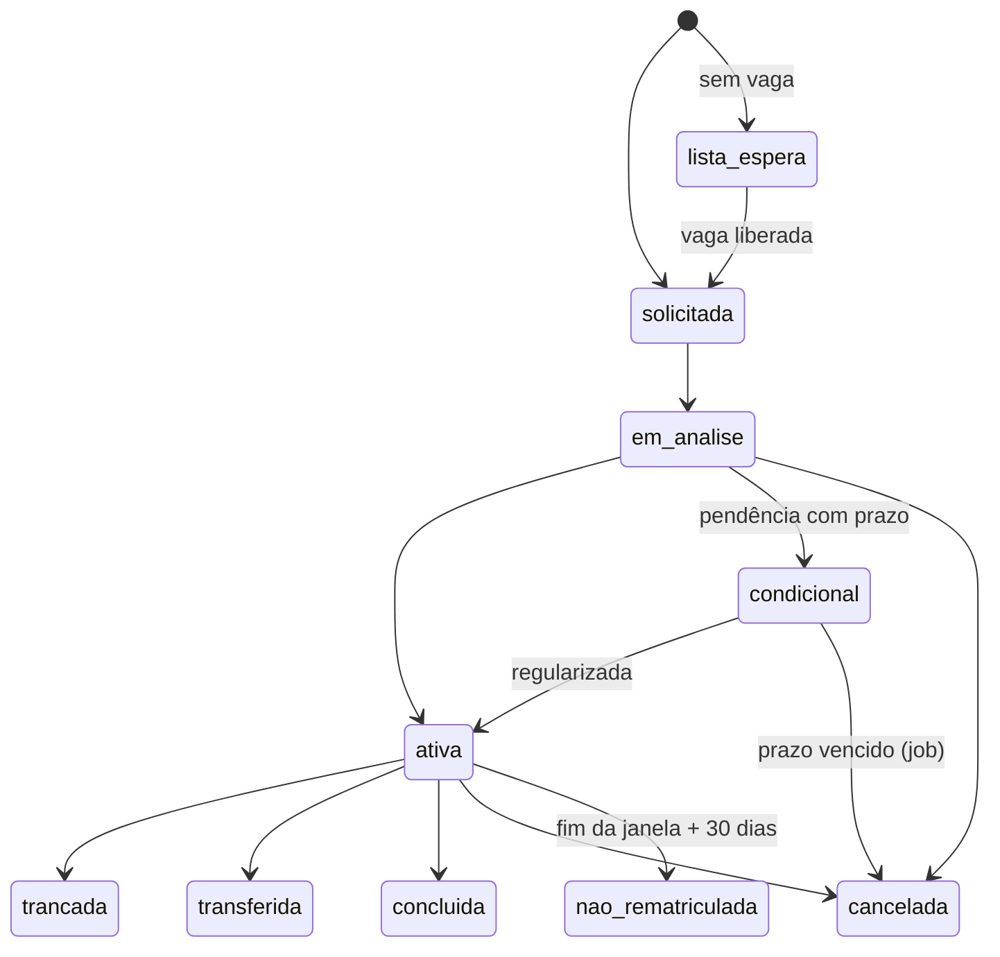

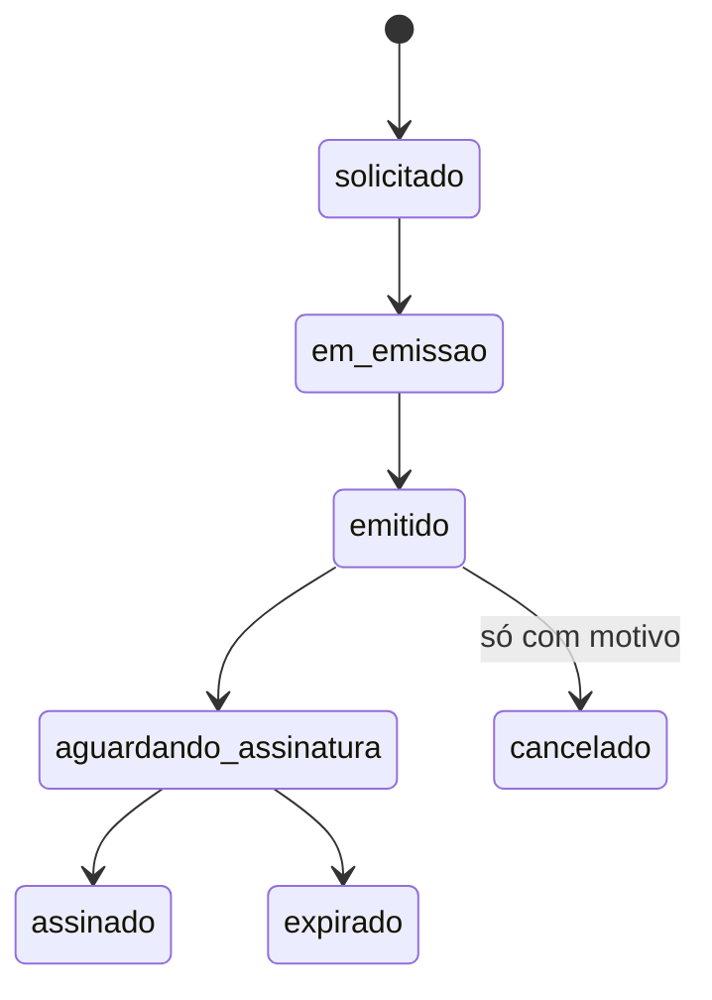

**Regras principais**
- Vaga reservada na transação de confirmação; empate na última vaga gera uma matrícula e uma lista de espera ([46](#doc-46), M-03).
- Sem contrato e termo de LGPD assinados, a matrícula não passa de `em_analise` ([46](#doc-46), M-08).
- Documento emitido não é editado; correção gera documento novo e o anterior é cancelado ([48](#doc-48), seção 4).

<a id="doc-46"></a>

## 46 — Matrícula e Rematrícula, por Portal (Acadêmico)

> Parte do [SDD v2](#doc-00). Matriz em [31](#doc-31). Regras de validação de matrícula em [15](#doc-15), seção 7, e em [17](#doc-17), seção 4. Bloqueio parcial por inadimplência em [26](#doc-26), seção 3. Contrato de matrícula em [33](#doc-33). Pagamento da matrícula em [34](#doc-34). Protocolo de atendimento em [32](#doc-32). Documentos exigidos e LGPD em [07](#doc-07). Auditoria em [29](#doc-29).
> **Status:** especificação proposta, criada em 03/11/2026 a partir de [`spec_gestao_academica_completo.md`](#v1-spec-gestao-academica-completo-md) (seções 4.1 a 4.9 e 4.3 do portal online). Fecha M-01 a M-09 da [31](#doc-31). Itens **(jurídico)** e **[Decisão do autor]** dependem de resposta.

---

### 1. Resposta direta

> **Leitura (04/11/2026):** esta tabela registra o que existia no SDD antes deste documento ser escrito. Os itens marcados como **Não** ou **Parcial** são especificados nas seções seguintes deste documento, exceto o que estiver listado na seção de pendências.

| Pergunta | Veredito |
|---|---|
| A matrícula está completa na v1? | **Em parte.** Tem telas (lista, wizard de 6 etapas, portal online, processo seletivo, lista de espera, trancamento, reopção, aproveitamento e atividades complementares). Não tem estados, regra de transição nem DDL completo |
| Está organizada por portal? | **Parcialmente.** O portal online existe. A v1 não diz o que o responsável vê antes e depois da matrícula, nem o que a secretaria pode alterar depois de ativa |
| Há conflito de regra? | **Sim.** "CPF único por tenant" (v1) está errado: a regra é por entidade, com banco por unidade ([03](#doc-03)). Trancamento "conforme regimento" não tem valor |
| Rematrícula está especificada? | **Não.** A v1 só cita "Rematrícula Online" na navegação e um aviso de 30 dias. M-01 a M-05 não têm regra |

---

### 2. Estados da matrícula

| Estado | Significado | Entra por |
|---|---|---|
| `lista_espera` | Candidato sem vaga, na ordem de prioridade | Pré-matrícula (4.5 da v1) |
| `solicitada` | Pedido feito, aguardando análise | Wizard ou portal online |
| `em_analise` | Documentos ou pagamento em verificação | Secretaria |
| `condicional` | Aceita com pendência financeira ou documental e prazo para regularizar | Análise |
| `ativa` | Matrícula efetivada, com contrato assinado | Análise ou condicional regularizada |
| `trancada` | Suspensa a pedido, com prazo de retorno | Trancamento aprovado |
| `transferida` | Saiu para outra turma ou unidade | Transferência |
| `concluida` | Ciclo encerrado | Conclusão |
| `cancelada` | Desistência ou não regularização | Pedido ou expiração |
| `nao_rematriculada` | Aluno ativo que não confirmou a rematrícula dentro do prazo | Job diário (M-05) |

**Transições:** `solicitada` → `em_analise` → `ativa` ou `condicional` ou `cancelada`. `condicional` → `ativa` ou `cancelada` (ao vencer o prazo). `ativa` → `trancada`, `transferida`, `concluida` ou `cancelada`. `trancada` → `ativa` (retorno) ou `cancelada`.

Estado calculado não é gravado. Prazo vencido de condicional é calculado por data e vira `cancelada` por job, com registro ([18](#doc-18), T-04).

---

### 3. Regras por item da matriz

#### M-01 Janela de rematrícula por série e unidade

- A unidade define a janela por série e por curso: abertura, fechamento e prazo de confirmação.
- Fora da janela, a rematrícula não aceita confirmação. A tela informa a data de abertura.
- Kanban de rematrícula na gestão: `não iniciada`, `em preenchimento`, `confirmada`, `em pendência`, `não rematriculada`.

#### M-02 Wizard do responsável ou aluno

Etapas do portal, em ordem: dados do aluno e do responsável; escolha de turma e eletivas; documentos; plano financeiro; contrato e aceite de LGPD; pagamento da primeira parcela. Cada etapa salva e pode ser retomada.

- Aluno maior de idade faz o próprio wizard. Menor é feito pelo responsável com vínculo ativo.
- Eletiva só aparece se a grade do curso tiver vaga e pré-requisito cumprido.

#### M-03 Vaga com reserva e bloqueio de concorrência

Já definido em [15](#doc-15), seção 7. A vaga é reservada na transação de confirmação. Duas confirmações simultâneas para a última vaga resultam em uma matrícula e uma `lista_espera`.

#### M-04 Matrícula condicional com prazo e expiração

- Condicional é aceita com pendência financeira ou documental, e recebe prazo de regularização configurável por unidade.
- Ao vencer o prazo, a matrícula vai para `cancelada` por job, com aviso ao responsável e registro. A vaga volta para a lista de espera.
- Condicional não dá acesso ao contrato de turma até a regularização. Dá acesso à documentação pendente e ao pagamento.

#### M-05 Não rematriculado após 30 dias

- Aluno ativo que não confirmou rematrícula até o fim da janela, mais 30 dias, vai para `nao_rematriculada`.
- Aviso ao responsável em até 2 dias úteis após o fim da janela, e novo aviso aos 30 dias.
- Não é cancelamento. A vaga só é liberada com decisão da secretaria.

#### M-06 Trancamento com motivo, aprovação por níveis e protocolo

- Motivo escolhido na lista (pessoal, financeiro, saúde, militar, outro), com texto complementar quando for "outro".
- Aprovação por níveis: coordenação pedagógica para trancamento até o prazo do regimento, e secretaria mais direção acima desse prazo.
- Gera protocolo. O prazo máximo do trancamento vem do regimento de cada curso (pendência abaixo).
- Trancamento com dado de saúde segue o acesso restrito de [43](#doc-43), seção 2.2, e não aparece no portal de terceiros.

#### M-07 Transferência e enturmação

- Transferência de turma dentro da mesma unidade: aprovada pela coordenação, com verificação de vaga e de pré-requisito.
- Transferência entre unidades da mesma entidade: exige matrícula nova na unidade de destino, com histórico transferido por registro, não por cópia.
- Enturmação: lista de alunos por turma, gerada pela secretaria, com vagas e bloqueio pela regra de M-03.

#### M-08 Documento obrigatório pendente

Proposta, por tipo de documento:

| Tipo | Efeito de pendência |
|---|---|
| Documento de identidade do aluno e do responsável | Matrícula fica `condicional`, com prazo |
| Histórico escolar anterior (para série final ou transferência) | Matrícula fica `condicional`, com prazo |
| Comprovante de vacinação, quando exigido pela norma da unidade | Matrícula fica `condicional`, com prazo |
| Termo de LGPD e contrato | Sem assinatura, a matrícula não passa de `em_analise` |

**(jurídico):** lista de documentos obrigatórios por nível de ensino e se algum pode bloquear, e não apenas condicionar.

#### M-09 Assinatura do contrato e pagamento da primeira parcela

- Contrato de matrícula é gerado no wizard e assinado pelo responsável (menor) ou pelo aluno (maior), com o provedor de assinatura da [33](#doc-33), seção 4.
- Primeira parcela é cobrada pelo gateway da unidade ([34](#doc-34)). Sem pagamento, a matrícula fica `condicional`, com o prazo da M-04.
- Inadimplente de outro período continua com acesso à rematrícula, à documentação e à comunicação com a família, pelo bloqueio parcial de [26](#doc-26), seção 3.

---

### 4. Processo seletivo e lista de espera

Mantidos da v1 (4.4 e 4.5), com estas regras:

- Candidato em lista de espera recebe aviso quando abrir vaga, com prazo de resposta configurável (48 horas na v1).
- Sem resposta no prazo, o candidato vai para `cancelada` e a vaga passa ao próximo, em ordem de prioridade.
- Ordem de prioridade: data de inscrição, nota, cota ou critério manual, configurável por processo.
- Cota de vaga é campo do processo, com regra de comprovação documental ([17](#doc-17), seção 4).

---

### 5. Reopção, aproveitamento e atividades complementares

Mantidos da v1 (4.7 a 4.9). Regras de estado:

- **Reopção de curso:** nova matrícula vinculada à anterior. A anterior vai para `transferida`.
- **Aproveitamento de estudos:** cada disciplina tem estado `aproveitada`, `não aproveitada` ou `pendente`. O parecer é emitido pelo coordenador e vira documento da secretaria ([17](#doc-17)).
- **Atividade complementar:** `pendente_validacao`, `validada` ou `recusada`. Só horas validadas contam para a conclusão.

---

### 6. Por portal

| Portal | Pode | Não pode | Origem |
|---|---|---|---|
| **Desenvolvedor** | Nada sobre matrícula de entidade | Ver matrícula, aluno ou responsável | P |
| **Gestão** | Abrir e fechar janela de rematrícula, ver kanban, aprovar trancamento acima do prazo, emitir declaração, cancelar matrícula com motivo | Alterar matrícula ativa sem registro de motivo. Ver documento de saúde sem o papel do módulo | E |
| **Secretaria** | Analisar, condicionar, efetivar, transferir, enturmar, emitir protocolo | Efetivar sem contrato e sem documento do responsável, quando exigidos | E |
| **Coordenação pedagógica** | Aprovar trancamento até o prazo do regimento, aprovar reopção e aproveitamento | Aprovar trancamento acima do prazo sem a secretaria | E |
| **Professor** | Ver a lista da própria turma, após enturmação | Matricular, trancar ou ver documento de matrícula | E |
| **Aluno maior** | Fazer o próprio wizard, rematrícula e eletivas. Ver a própria situação | Ver matrícula de outro aluno. Alterar matrícula ativa | E |
| **Responsável** | Fazer o wizard de dependente, rematrícula, pagamento da primeira parcela e assinatura. Ver a situação de cada dependente | Ver matrícula de outro aluno. Confirmar rematrícula sem vínculo ativo | E, só dependentes com vínculo ativo |
| **Terceiros** | Nada, por padrão | Ver matrícula, aluno ou responsável | E |

---

### 7. Modelo de dados proposto

Não é o DDL final. Tabelas no banco da unidade, horários em UTC.

| Tabela | Campos principais |
|---|---|
| `matriculas` | `uuid`, `aluno_uuid`, `turma_uuid`, `periodo_letivo`, `tipo` (regular, especial, transferencia, condicional, ead), `estado`, `solicitada_em`, `prazo_regularizacao_em`, `motivo_estado`, `created_by`. Unicidade de vínculo ativo por aluno e período |
| `matricula_pendencias` | `matricula_uuid`, `tipo` (financeira, documental), `documento_tipo`, `prazo_em`, `resolvida_em` |
| `janelas_rematricula` | `unidade_uuid`, `serie`, `curso_uuid`, `abre_em`, `fecha_em`, `prazo_confirmacao_dias` |
| `trancamentos` | `matricula_uuid`, `motivo`, `descricao`, `solicitado_em`, `retorno_previsto_em`, `estado`, `protocolo_uuid` |
| `transferencias` | `matricula_origem_uuid`, `matricula_destino_uuid`, `tipo` (turma, curso, unidade), `aprovado_por`, `aprovado_em` |
| `vagas_reserva` | `turma_uuid`, `matricula_uuid`, `reservada_em`, `expira_em`. Índice único em (`turma_uuid`, `matricula_uuid`) |
| `lista_espera` | `processo_uuid`, `candidato_uuid`, `prioridade`, `estado`, `notificado_em`, `expira_em` |

Regra: `vagas_reserva` é o que impede concorrência. A confirmação de matrícula consome a vaga dentro de transação com bloqueio da turma.

---

### 8. Pendências

| # | Pendência | Tipo |
|---|---|---|
| MAT-01 | Lista de documentos obrigatórios por nível e se algum pode bloquear, não só condicionar (M-08) | (jurídico) |
| MAT-02 | Prazo máximo de trancamento (M-06) | **Decidido** em 03/11/2026: um ano letivo, configurável por curso |
| MAT-03 | Prazo de regularização de matrícula condicional (M-04) | **Decidido** em 03/11/2026: 15 dias, ajustável por unidade |
| MAT-04 | Aviso de não rematrícula: 2 dias úteis após a janela e 30 dias depois (M-05) | **Decidido** em 03/11/2026 |
| MAT-05 | "CPF único por tenant" da v1 passa a ser "CPF único por entidade", com verificação entre unidades ([03](#doc-03)) | **Decidido** em 03/11/2026 |
| MAT-06 | Níveis de aprovação de trancamento: coordenação até o regimento, secretaria e direção acima (M-06) | **Decidido** em 03/11/2026 |
| MAT-07 | DDL das tabelas da seção 7, com teste de concorrência em vagas | **Escrito** em [51](#doc-51), seção 10. Revisão do owner pendente (DDL-01) |

---

### 9. Critérios de aceite

- [ ] Duas confirmações simultâneas para a última vaga geram uma matrícula e uma `lista_espera` (teste de concorrência).
- [ ] Matrícula condicional vencida vai para `cancelada` e libera a vaga (teste).
- [ ] Rematrícula fora da janela é recusada com a data de abertura (teste).
- [ ] Aluno sem vínculo ativo não vê matrícula de outro aluno (teste de isolamento).
- [ ] Responsável vê só dependentes com vínculo ativo (teste de isolamento).
- [ ] Inadimplente de outro período mantém rematrícula, documentação e comunicação (teste, conforme [26](#doc-26)).
- [ ] Trancamento gera protocolo e registro de aprovação por nível (teste).
- [ ] Itens **(jurídico)** e **[Decisão do autor]** respondidos ou marcados como pendentes no [00](#doc-00).

<a id="doc-48"></a>

## 48 — Gerador de Documentos, por Portal

> Parte do [SDD v2](#doc-00). Emissão de documento oficial da secretaria em [17](#doc-17) e [46](#doc-46). Assinatura digital em [33](#doc-33), seção 4, e decisão CTR-06. Biblioteca e acervo, separados, em [31](#doc-31), seção 3. Armazenamento e checksum em [21](#doc-21). Auditoria em [29](#doc-29). Consulta pública e dado mínimo em [07](#doc-07).
> **Status:** especificação proposta, criada em 03/11/2026 e verificada contra a v1 no mesmo dia (seção 11). **Escopo:** apenas documentos emitidos pela secretaria (contexto C de [54](#doc-54)). Documentos recebidos e administrativos têm regras próprias a partir de [`spec-builder-documentos-academicos.md`](#v1-spec-builder-documentos-academicos-md) (editor de modelos, chamado de builder na v1: layout, variáveis, condicionais) e [`spec_gestao_documentos_completo.md`](#v1-spec-gestao-documentos-completo-md) (tipos, ciclo de vida, assinatura, permissões). Fecha MOD-07 da [31](#doc-31). Itens **(jurídico)**, **(verificar)** e **[Decisão do autor]** dependem de resposta.

---

### 1. Resposta direta

> **Leitura (04/11/2026):** esta tabela registra o que existia no SDD antes deste documento ser escrito. Os itens marcados como **Não** ou **Parcial** são especificados nas seções seguintes deste documento, exceto o que estiver listado na seção de pendências.

| Pergunta | Veredito |
|---|---|
| O gerador de documentos está especificado? | **Em parte.** O editor de modelos (layout, papel, margens, cabeçalho, rodapé, variáveis, condicionais) está bem descrito. Falta DDL, regra de emissão, validação pública e a separação entre gerador e gestão de documentos |
| Há duplicidade? | **Sim.** A v1 tem duas especificações de documentos, uma do editor de modelos (builder) e outra de gestão. Este documento une as duas |
| Está organizado por portal? | **Não.** A v1 não diz quem pode solicitar, quem emite e quem vê |
| Biblioteca e documentos se misturam? | **Não, por decisão.** A biblioteca tem acervo e empréstimo. Documento é emitido pela secretaria. Ver [31](#doc-31), seção 3 |

---

### 2. Separação de responsabilidades

| Parte | Função | Dono |
|---|---|---|
| Editor de modelos | Desenha o modelo: papel, margens, cabeçalho, corpo, rodapé, variáveis, condicionais | Gestão de documentos |
| Catálogo de tipos | Declaração, histórico, certificado, termo, ata, comunicado, contrato e outros | Gestão de documentos |
| Emissão | Gera o arquivo final a partir de um modelo publicado e de dados do aluno, pessoa ou entidade | Secretaria ou módulo de origem |
| Assinatura | Assina o arquivo emitido | Serviço de assinatura ([33](#doc-33)) |
| Validação pública | Confirma autenticidade por código ou QR, sem dado pessoal além do mínimo | Gestão de documentos |

---

### 3. Tipos de documento

Tipos da v1 mantidos: declaração de matrícula, declaração de frequência, declaração de conclusão, declaração de quitação, histórico escolar, certidão de conclusão, segunda via, aditivo e contrato.

Tipos previstos na v1 e mantidos como expansão: termo de responsabilidade, requerimento, autorização, boleto com instruções, comunicado institucional, certificado, ata, relatório acadêmico, ficha cadastral, dossiê do aluno e declaração personalizada.

Cada tipo tem:

- Modelo publicado e versionado.
- Lista de variáveis obrigatórias.
- Quem pode solicitar e quem pode emitir.
- Se exige assinatura e de quem.
- Prazo de validade, quando houver.

---

### 4. Ciclo de vida do documento emitido

`solicitado` → `em_emissao` → `emitido` → `aguardando_assinatura` → `assinado` ou `expirado` ou `cancelado`.

- `solicitado`: pedido do aluno, responsável, professor ou da própria secretaria, com protocolo ([32](#doc-32)).
- `emitido` sem assinatura: disponível para download, com código de validação.
- `expirado`: quando o documento tem validade e ela venceu. Calculado por data ([18](#doc-18), T-04).
- `cancelado`: só com motivo e evento de auditoria. O arquivo continua guardado.

Documento emitido não é editado. Correção gera novo documento, e o anterior vai para `cancelado`.

---

### 5. Editor de modelos: regras de modelo

| Regra | Detalhe |
|---|---|
| Papel | Presets A4 e ofício, com configuração de tamanho personalizado. Unidade em mm, cm ou pt |
| Margens e recuos | Por página, com recuo de primeira linha e de parágrafo |
| Cabeçalho e rodapé | Campos fixos da entidade (nome, CNPJ, endereço, logotipo) e paginação |
| Variáveis | Grupos mínimos: aluno, responsável, turma, curso, matrícula, entidade, unidade, data. Variável sem dado na emissão bloqueia a emissão e aponta o campo |
| Condicionais | Bloco aparece só se a condição for verdadeira. Ex.: bloco de bolsa só se houver bolsa |
| Repetições | Lista de disciplinas, de notas ou de parcelas, com cabeçalho repetido por página |
| Publicação | Modelo só é publicado depois de revisão. Publicado não muda ([41](#doc-41), seção 2.3) |

Modelo não contém código executável. Condicional e repetição são interpretadas por um motor de regras limitado.

---

### 6. Validação pública

- Cada documento emitido tem código de validação e QR apontando para uma página pública.
- A página confirma: tipo, data de emissão, situação atual (válido, expirado, cancelado) e a entidade emissora.
- A página **não** mostra nome do aluno, CPF ou nota. Para confirmar a pessoa, o consultante informa o código e a data de nascimento, e a consulta é limitada por taxa ([23](#doc-23)).
- Cada consulta gera evento de auditoria sem o dado consultado.

---

### 7. Por portal

| Portal | Pode | Não pode | Origem |
|---|---|---|---|
| **Desenvolvedor** | Publicar modelos-padrão, sem dado | Ver documento emitido de qualquer entidade | P |
| **Gestão** | Criar e publicar modelo, cancelar documento com motivo, ver relatório de emissão | Emitir sem papel de secretaria | E |
| **Secretaria** | Solicitar, emitir, assinar (quando for o caso), reemitir, cancelar com motivo | Alterar modelo publicado | E |
| **Professor** | Solicitar documento de sua turma, ex.: declaração de frequência de aluno da turma | Emitir histórico ou documento oficial. Ver documento de outro aluno | E |
| **Aluno maior** | Solicitar e baixar os próprios documentos, com código de validação | Ver documento de outro aluno. Cancelar documento emitido | E |
| **Responsável** | Solicitar e baixar documentos de dependente com vínculo ativo | Ver documento de dependente sem vínculo. Cancelar documento emitido | E |
| **Terceiros** | Ver um documento emitido para ele, quando o contrato prevê (ex.: cartório recebe certidão) | Ver outros documentos | E, [38](#doc-38) |
| **Público (consulta)** | Validar código e situação | Ver dado pessoal, nota ou conteúdo | Fora dos portais, seção 6 |

---

### 8. Assinatura

- Documento que exige assinatura passa por `aguardando_assinatura` até todos os signatários assinarem.
- Provedor de assinatura: decisão CTR-06, aceitar provedores de terceiros e ter assinatura digital própria.
- Assinatura de documento oficial depende de exigência de cada tipo. Conferido em 03/11/2026 na Lei 14.063/2020 (planalto.gov.br):
  - **Níveis:** simples (identifica o signatário), avançada (certificado fora da ICP-Brasil ou outro meio aceito pelas partes, ligado ao signatário de forma unívoca e que detecta alteração) e qualificada (certificado ICP-Brasil) (art. 4º). O modelo de documento guarda o **nível mínimo** exigido, e o sistema recusa assinatura abaixo dele.
  - **Âmbito:** a lei vale para interações com ente público e dentro dele (art. 2º). Não vale entre particulares (art. 2º, parágrafo único, II, a). Cada Poder e ente define o nível mínimo por ato próprio (art. 5º). Por isso, em escola pública o nível de cada tipo vem do ato do ente, configurado pela entidade.
  - **Qualificada obrigatória:** atos de chefes de Poder e de titulares de órgão autônomo, nota fiscal eletrônica (salvo pessoa física e MEI), transferência e registro de imóvel, e demais casos em lei (art. 5º, § 2º). Atestado médico eletrônico e receita de controle especial também (art. 13). Em conflito entre normas, prevalece a qualificada (art. 5º, § 5º).
  - A lei não trata de diploma nem de histórico. A regra do diploma e do histórico digital do superior (normas do MEC) **(verificar)**.
  - **Entre particulares** (MP 2.200-2/2001, art. 10, conferido em 03/11/2026): documento assinado com certificado ICP-Brasil presume-se verdadeiro em relação ao signatário (§ 1º). Outro meio de comprovação de autoria e integridade vale se admitido pelas partes ou aceito por quem recebe o documento (§ 2º). Por isso, contrato e termo entre a escola privada e a família podem usar assinatura avançada, com a aceitação registrada no próprio contrato.
- O arquivo assinado guarda o checksum do conteúdo emitido ([21](#doc-21)).

---

### 9. Pendências

| # | Pendência | Tipo |
|---|---|---|
| DOC-01 | Quais tipos exigem assinatura com certificado ICP-Brasil (seção 8) | **Conferido** em parte em 03/11/2026: níveis e casos obrigatórios na Lei 14.063/2020, arts. 2º, 4º, 5º e 13. MP 2.200-2/2001, art. 10, conferida. Faltam as normas do MEC para diploma e histórico digital **(verificar)**. Lista final por tipo com o (jurídico) |
| DOC-02 | Prazo de guarda de cada tipo emitido (histórico, declaração, certidão) | (jurídico) |
| DOC-03 | Layout oficial do histórico escolar, conforme norma do sistema de ensino (Res. CNE/CEB, citada na v1) | (verificar) |
| DOC-04 | Validade de declaração, por tipo | **Decidido** em 03/11/2026: 90 dias quando o tipo não define prazo |
| DOC-05 | Limite de consultas públicas de validação por código, por minuto | **Decidido** em 03/11/2026: 10 por minuto por endereço |
| DOC-06 | DDL de tipo, modelo, versão, documento emitido, assinatura e validação | **Escrito** em [51](#doc-51), seção 12. Revisão do owner pendente (DDL-01) |

---

### 10. Critérios de aceite

- [ ] Modelo com variável sem dado não emite e aponta o campo (teste).
- [ ] Modelo publicado não muda, e correção gera novo documento (teste).
- [ ] Consulta pública não retorna nome, CPF ou nota (varredura).
- [ ] Responsável não baixa documento de dependente sem vínculo ativo (teste de isolamento).
- [ ] Cancelamento de documento exige motivo e gera evento de auditoria (teste).
- [ ] Itens **(jurídico)**, **(verificar)** e **[Decisão do autor]** respondidos ou marcados como pendentes no [00](#doc-00).

---

### 11. Verificação contra a v1 e lacunas fechadas

Verificado em 03/11/2026 contra [`spec-builder-documentos-academicos.md`](#v1-spec-builder-documentos-academicos-md) e [`spec_gestao_documentos_completo.md`](#v1-spec-gestao-documentos-completo-md). A versão anterior deste documento cobria o núcleo (tipos, ciclo, editor de modelos, validação e portais), mas deixava de fora itens da v1. Os itens abaixo foram incluídos nas seções 12 a 19.

| Item da v1 | Situação antes | Onde agora |
|---|---|---|
| Aprovação de modelo, com revisor distinto de quem criou | Faltava | Seção 12 |
| Regras de elegibilidade com severidades | Faltava | Seção 13 |
| Emissão em lote | Faltava | Seção 14 |
| Revogação como ato separado do cancelamento | Faltava | Seção 15 |
| Biblioteca de componentes reutilizáveis | Faltava | Seção 16 |
| Configuração de impressão | Faltava | Seção 17 |
| Auditoria: lista completa de ações | Parcial | Seção 18 |
| Automações e painel de assinaturas | Faltava | Seção 19 |
| Interface da API e DDL | Faltava | Seções 20 e 21 |

---

### 12. Aprovação de modelo

Estados do modelo: `rascunho` → `em_revisao` → `publicado` → `arquivado`.

- Quem cria o modelo não aprova o próprio modelo. A regra é verificada no banco, com a mesma técnica do `CHECK (created_by <> approved_by)` de [37](#doc-37).
- A revisão confere layout, variáveis e regras. Não confere o texto jurídico, que é responsabilidade do jurídico da entidade.
- Modelo publicado não muda. Mudança gera nova versão em `rascunho`.

---

### 13. Elegibilidade para emissão

Cada tipo de documento tem regras de elegibilidade. A regra roda antes da geração.

| Tipo de regra | Exemplo | Severidade |
|---|---|---|
| Vínculo | Declaração de matrícula só para matrícula ativa | Bloqueante |
| Vigência | Aditivo só com contrato vigente | Bloqueante |
| Situação financeira | Declaração de quitação só sem parcela vencida | Bloqueante |
| Solicitação | Transferência só com pedido deferido | Bloqueante |
| Cadastro incompleto | Campo opcional do modelo vazio | Alerta |
| Dado desatualizado | Endereço com mais de um ano | Informativa |

Bloqueante impede a emissão e mostra o motivo. Alerta permite emitir com confirmação. Informativa só aparece no preview.

---

### 14. Emissão em lote

- A secretaria seleciona um tipo e um conjunto de alunos, por turma, série ou filtro.
- O sistema roda a elegibilidade para cada aluno e separa: emitidos, bloqueados e com alerta.
- Lote gera um protocolo por documento, não um protocolo único.
- Falha em um aluno não cancela o lote. O relatório final lista o que falhou e o motivo.
- O lote tem limite de tamanho por execução, e roda em fila ([14](#doc-14)).

---

### 15. Revogação

Revogação é diferente de cancelamento:

- **Cancelamento:** o documento foi emitido por erro, antes de ser usado. Sai da validação com o motivo.
- **Revogação:** o documento foi emitido corretamente, mas a situação mudou (ex.: matrícula cancelada depois da declaração). A validação pública mostra "revogado" e a data.

Os dois exigem motivo e evento de auditoria. O arquivo nunca é apagado.

---

### 16. Componentes reutilizáveis

Biblioteca por entidade, com componentes como cabeçalho institucional, rodapé de autenticação, bloco de assinatura da secretaria, tabela de disciplinas, caixa de LGPD e termo de ciência.

Cada componente tem nome, categoria, versão, estrutura, estilos, variáveis esperadas, dependências e escopo (entidade ou unidade). Alterar um componente gera nova versão. Os modelos que usam o componente escolhem a versão na publicação.

---

### 17. Configuração de impressão

| Recurso | Regra |
|---|---|
| Margens espelhadas | Para documento frente e verso |
| Altura de cabeçalho e rodapé | Fixa em milímetros, por modelo |
| Quebra de página | Bloco não se divide entre páginas quando marcado |
| Fonte | Embutida no PDF. Fonte não embutida bloqueia a emissão |
| Assinatura visível | Campo de assinatura com área reservada, na última página |
| Número de página | Formato "página X de Y" em todas as páginas |

O PDF é gerado com a mesma versão do modelo que foi publicada na data da emissão.

---

### 18. Auditoria: ações obrigatórias

Toda ação gera evento em [29](#doc-29), com os campos da seção 2 daquele documento e o campo `portal`:

criação de tipo · criação de modelo · edição de versão · envio para revisão · aprovação · publicação · preview · emissão · emissão em lote · reemissão · cancelamento · revogação · validação pública · download · alteração de regra · alteração de componente.

Validação pública registra a consulta sem o dado consultado ([29](#doc-29), seção 6).

---

### 19. Automações e painel de assinaturas

- Documento aguardando assinatura há 3 dias: lembrete ao signatário.
- Documento expirado sem assinatura: aviso à secretaria, com opção de reenviar.
- Modelo em revisão há 5 dias úteis: lembrete ao revisor.
- Painel da secretaria: documentos aguardando assinatura, por signatário, e expirados. Gráfico de assinaturas concluídas por mês.

Prazos de lembrete são valores iniciais, ajustáveis pela entidade.

---

### 20. Interface da API

| Método | Caminho | Função |
|---|---|---|
| GET, POST | `/documentos/tipos` | Listar e criar tipo |
| PUT | `/documentos/tipos/{uuid}` | Editar tipo |
| GET, POST | `/documentos/modelos` | Listar e criar modelo |
| POST | `/documentos/modelos/{uuid}/versoes` | Nova versão |
| POST | `/documentos/modelos/{uuid}/revisao` | Enviar para revisão |
| POST | `/documentos/modelos/{uuid}/publicacao` | Publicar (aprovador distinto do criador) |
| POST | `/documentos/emissoes` | Emitir um documento |
| POST | `/documentos/emissoes/lote` | Emitir em lote |
| POST | `/documentos/emissoes/{uuid}/cancelamento` | Cancelar, com motivo |
| POST | `/documentos/emissoes/{uuid}/revogacao` | Revogar, com motivo |
| GET | `/validar/{codigo}` | Validação pública, sem dado pessoal |

Todos os endpoints exigem permissão por ação e escopo. A validação pública tem limite de consultas (DOC-05).

---

### 21. DDL

As tabelas do módulo estão em [51](#doc-51), seção 12 (tipos, modelos, versões, emissões, validação, revogação e componentes). Este documento não repete o DDL.

---

### 22. Pendências desta verificação

| # | Pendência | Tipo |
|---|---|---|
| DOC-07 | Prazos de lembrete de assinatura e de revisão (seção 19) | Valor inicial, ajustável |
| DOC-08 | Limite de tamanho do lote (seção 14) | Operação, em homologação |

<a id="doc-54"></a>

## 54 — Gestão de Documentos: Três Contextos e Serviços Comuns

> Parte do [SDD v2](#doc-00). Substitui a visão de "gestão de documentos" como bloco único que aparecia em [31](#doc-31), seção 3.1. Emissão de documentos pela secretaria, detalhada em [48](#doc-48). Armazenamento e retenção em [21](#doc-21). Protocolo e atendimento em [32](#doc-32). Assinatura de contratos em [33](#doc-33), seção 5. Auditoria em [29](#doc-29). Pacotes jurídicos em [50](#doc-50) e [53](#doc-53).
> **Status:** decisão de arquitetura, criada em 03/11/2026. Não centralizar: cada contexto tem dono, regras e portal próprios. O que é comum fica em serviços, sem compartilhar tabelas de negócio.

---

### 1. Os três contextos

| Contexto | O que é | Quem origina | Quem cuida | Exemplos |
|---|---|---|---|---|
| **A. Documentos recebidos** | Arquivos enviados a instituição para análise e validação | Responsáveis, alunos, candidatos, fornecedores | Secretaria, RH, compras | Certidão de nascimento, RG do responsável, histórico de escola anterior, alvará do fornecedor |
| **B. Documentos administrativos** | Documentos internos de gestão, com tramitação e aprovação | Equipe da instituição | Gestão e administração | Ata de reunião de diretoria, ofício, circular, processo administrativo, política interna |
| **C. Documentos emitidos** | Documentos gerados pela instituição a partir de modelo, para uma pessoa ou uma organização | Secretaria | Secretaria | Declaração, histórico, boletim, certidão, contrato, termo |

Os três contextos não se misturam. Um documento pertence a um contexto, e o contexto define regras, estados, portal de acesso e prazo de guarda.

---

### 2. Contexto A: documentos recebidos

#### 2.1 O que o contexto faz

- Recebe arquivo enviado pelo portal (responsável, aluno, candidato ou fornecedor).
- Confere o arquivo: formato, tamanho, legibilidade e tipo declarado.
- Valida o conteúdo por pessoa habilitada. A validação registra quem validou, quando e o resultado.
- Vincula o arquivo a um cadastro ou a um processo: matrícula, cadastro de fornecedor, candidatura.
- Controla vencimento, quando o documento tem validade (ex.: alvará, seguro, certidão).

#### 2.2 Estados

`enviado` → `em_analise` → `aprovado` ou `recusado` ou `pendente_correcao`.

- `recusado` exige motivo. O remetente recebe o motivo e pode reenviar.
- `pendente_correcao` tem prazo. Vencido o prazo, o processo vinculado é tratado conforme a regra do processo (ex.: matrícula condicional, em [46](#doc-46)).
- `vencido` é calculado por data ([18](#doc-18), T-04), não gravado.

#### 2.3 Regras

- Documento de menor é enviado pelo responsável com vínculo ativo.
- Imagem de documento de identidade é guardada cifrada, com acesso restrito à validação. Número completo aparece mascarado nas telas ([07](#doc-07)).
- Documento recebido não é emitido. Nunca gera código de validação pública.
- Validação não é automática por padrão. Automação de leitura (OCR) só sugere, e a pessoa confirma ([21](#doc-21), seção 3.10).

#### 2.4 Retenção

Prazo por tipo de documento, vinculado ao processo que originou o envio. Documento de matrícula segue o prazo de guarda escolar **(jurídico, [50](#doc-50), J-05 e N-10)**. Documento de fornecedor segue o prazo do contrato.

---

### 3. Contexto B: documentos administrativos

#### 3.1 O que o contexto faz

- Cria documento interno com modelo ou em formato livre.
- Tramita: envia para análise, aprovação e assinatura de quem deve aprovar.
- Mantém versões. Versão aprovada não muda.
- Arquiva ao fim da tramitação, com prazo de guarda.

#### 3.2 Estados

`rascunho` → `em_tramitacao` → `aprovado` → `arquivado`, com `reprovado` como saída de `em_tramitacao`.

- Quem cria não aprova o próprio documento. Regra verificada no banco, como em [48](#doc-48), seção 12.
- Documento aprovado pode ser assinado. A assinatura usa o serviço comum da seção 5.

#### 3.3 Regras

- Documento administrativo não é visível a alunos e responsáveis, salvo quando a gestão publica um comunicado, que é contexto C ou um comunicado específico ([53](#doc-53), DC-26).
- Ata de conselho ou de diretoria com dado sensível tem acesso restrito aos participantes ([53](#doc-53), DC-27).
- Documento de processo administrativo público segue a lei de processo do ente. Conferido em 03/11/2026 na Lei 9.784/1999 (planalto.gov.br), que vale para a administração federal (art. 1º). Ente estadual e municipal segue lei própria, configurada pela entidade **(verificar)** por ente. Regras da lei federal que o sistema aplica quando a entidade escolher esse regime:
  - **Forma:** ato escrito, em português, com data, local e assinatura da autoridade (art. 22, § 1º). Páginas numeradas em sequência e rubricadas (art. 22, § 4º): no processo digital, o sistema numera cada peça e guarda o hash.
  - **Prazos:** 5 dias quando não houver prazo próprio, prorrogável até o dobro com justificativa (art. 24). Decisão em até 30 dias após a instrução, prorrogável uma vez com motivo (art. 49). Recurso em 10 dias da ciência (art. 59), com reconsideração em 5 dias e no máximo três instâncias (arts. 56 e 57). Contagem exclui o dia do começo e inclui o do vencimento, que passa ao dia útil seguinte sem expediente (art. 66). O sistema calcula e mostra o vencimento.
  - **Intimação:** com antecedência mínima de 3 dias úteis e o conteúdo do art. 26, § 1º. Registro da ciência no processo.
  - **Motivação:** obrigatória quando o ato nega ou limita direito, impõe sanção, decide recurso ou anula ato (art. 50). O sistema exige o campo de motivação nesses tipos de decisão.

---

### 4. Contexto C: documentos emitidos

Detalhado em [48](#doc-48). Resumo do que o contexto tem e não tem:

- Tem: modelo versionado, elegibilidade, emissão individual e em lote, código de validação pública, revogação, cancelamento.
- Não tem: recebimento de arquivo do usuário. O único arquivo que entra é o anexo de assinatura, dentro do fluxo de assinatura.
- Documento emitido é imutável. Correção gera novo documento.

---

### 5. Serviços comuns

Estes serviços são usados pelos três contextos. Não guardam regra de negócio de nenhum contexto.

| Serviço | Função | Quem usa | Onde é especificado |
|---|---|---|---|
| **Armazenamento** | Guarda arquivos cifrados, com checksum e prazo de retenção. Cada contexto tem seu prefixo e sua política | A, B, C | [21](#doc-21) |
| **Assinatura** | Coleta assinaturas de uma ou mais partes, na ordem definida, e guarda a evidência. Aceita provedores de terceiros e a assinatura própria, conforme CTR-06 | B e C, e contratos | [33](#doc-33), seção 5 |
| **Protocolo** | Gera o número de protocolo de qualquer pedido ou documento. Número único por unidade | A (envio), B (tramitação), C (emissão) | [32](#doc-32) |
| **Auditoria** | Registra cada ação com o contexto e o portal | A, B e C | [29](#doc-29) |
| **Validação pública** | Confirma autenticidade por código. Só para documento emitido ou assinado | C e B (assinados) | [48](#doc-48), seção 6 |

**Regra de uso dos serviços:** o contexto chama o serviço e recebe o resultado. Não lê tabela de outro contexto.

---

### 6. Por portal

| Portal | Contexto A (recebidos) | Contexto B (administrativos) | Contexto C (emitidos) |
|---|---|---|---|
| **Desenvolvedor** | Nada | Nada, salvo documentos da própria empresa | Publica modelos-padrão, sem dado |
| **Gestão** | Consulta o que foi aprovado, sem a imagem, salvo papel de validação | Cria, tramita, aprova e arquiva | Acompanha emissão e relatório |
| **Secretaria** | Valida, aprova ou recusa; vincula ao processo | Não tramita (salvo se for setor da própria secretaria) | Emite, assina e revoga com motivo |
| **Professor** | Nada | Lê documento de tramitação em que é parte | Solicita documento de sua turma |
| **Aluno maior e responsável** | Envia e acompanha o próprio documento e o de dependente com vínculo ativo | Nada | Solicita e baixa o próprio documento |
| **Fornecedor (terceiros)** | Envia documentos da empresa, com validade e alerta | Nada | Recebe documento emitido para ele, quando o contrato prevê |
| **Público** | Nada | Nada | Valida código, sem dado pessoal |

---

### 7. Como os contextos se encontram

Exemplo de fluxo completo, em matrícula:

1. **A:** responsável envia certidão de nascimento. A secretaria valida e aprova.
2. **Matrícula:** a aprovação libera o passo de documentos do wizard ([46](#doc-46), M-08).
3. **C:** a secretaria emite o contrato de matrícula pelo modelo publicado.
4. **Assinatura:** o contrato passa pelo serviço comum de assinatura, com o responsável como signatário.
5. **Protocolo:** cada etapa recebe número de protocolo pelo serviço comum.
6. **Auditoria:** cada etapa grava o contexto e o portal.

Ata de conselho de classe (B) pode gerar declaração de encaminhamento (C), mas o vínculo é de referência: a ata não é copiada para dentro do documento emitido.

---

### 8. O que muda nos documentos existentes

| Documento | Mudança |
|---|---|
| [31](#doc-31), seção 3.1 | "Gestão de documentos" vira três contextos. Ver seção 1 deste documento |
| [48](#doc-48) | Escopo restrito ao contexto C. Não recebe arquivo do usuário |
| [21](#doc-21) | Prefixo e prazo de retenção por contexto |
| [33](#doc-33), seção 5 | Assinatura passa a ser serviço comum |
| [32](#doc-32) | Protocolo passa a ser serviço comum |

---

### 9. Pendências

| # | Pendência | Tipo |
|---|---|---|
| GD-01 | Validação de documento recebido | **Decidido** em 03/11/2026: secretaria valida, com dupla conferência para documento de identidade |
| GD-02 | Prazo de guarda de documento recebido, por tipo (matrícula, fornecedor, candidato) | (jurídico) |
| GD-03 | Tramitação de documento administrativo | **Decidido** em 03/11/2026: o sistema deve permitir criar o fluxo de aprovação por tipo de documento, com níveis configuráveis |
| GD-04 | Formato e tamanho máximo de arquivo recebido, por contexto | Operação, em homologação |
| GD-05 | Leitura automática (OCR) de documento recebido | **Decidido** em 03/11/2026: só sugere, e a pessoa confirma |
| GD-06 | Documento administrativo de entidade pública: regra de processo administrativo | **Conferido** em parte em 03/11/2026: Lei 9.784/1999 para o federal (seção 3.3). Falta a lei de cada estado e município **(verificar)** |
| GD-07 | DDL dos contextos A e B e das tabelas compartilhadas de protocolo e assinatura | **Feito** em 03/11/2026: seção 10 |
| GD-08 | Revisão do DDL pelo owner de cada contexto e teste de migração | Owner e operação |

---

### 10. DDL dos contextos e serviços comuns (GD-07)

Convenções de [51](#doc-51): MySQL 8 ou MariaDB 10.6, `utf8mb4`, horários em UTC, `unidade_uuid` em toda tabela de unidade. Cada contexto tem prefixo próprio, para que as tabelas fiquem separadas.

```sql
-- Contexto A: documentos recebidos
CREATE TABLE recebidos_envios (
  id              BIGINT UNSIGNED AUTO_INCREMENT PRIMARY KEY,
  uuid            CHAR(36) NOT NULL UNIQUE,
  unidade_uuid    CHAR(36) NOT NULL,
  origem          ENUM('responsavel','aluno','candidato','fornecedor') NOT NULL,
  remetente_uuid  CHAR(36) NOT NULL,
  pessoa_uuid     CHAR(36) NULL,
  tipo_documento  VARCHAR(60) NOT NULL,
  processo_tipo   ENUM('matricula','cadastro_fornecedor','candidatura','outro') NOT NULL,
  processo_uuid   CHAR(36) NULL,
  arquivo_uuid    CHAR(36) NOT NULL,
  arquivo_sha256  CHAR(64) NOT NULL,
  validade_em     DATE NULL,
  estado          ENUM('enviado','em_analise','aprovado','recusado','pendente_correcao','substituido') NOT NULL,
  motivo_estado   VARCHAR(500) NULL,
  protocolo_uuid  CHAR(36) NOT NULL,
  created_at      DATETIME(3) NOT NULL DEFAULT CURRENT_TIMESTAMP(3),
  deleted_at      DATETIME(3) NULL,
  INDEX ix_envio_processo (unidade_uuid, processo_tipo, processo_uuid),
  INDEX ix_envio_validade (unidade_uuid, validade_em)
) ENGINE=InnoDB DEFAULT CHARSET=utf8mb4;

CREATE TABLE recebidos_validacoes (
  id              BIGINT UNSIGNED AUTO_INCREMENT PRIMARY KEY,
  envio_id        BIGINT UNSIGNED NOT NULL,
  validador_uuid  CHAR(36) NOT NULL,
  etapa           TINYINT UNSIGNED NOT NULL,
  resultado       ENUM('aprovado','recusado') NOT NULL,
  motivo          VARCHAR(500) NULL,
  validado_em     DATETIME(3) NOT NULL DEFAULT CURRENT_TIMESTAMP(3),
  UNIQUE KEY ux_validacao_etapa (envio_id, etapa),
  CONSTRAINT fk_validacao_envio FOREIGN KEY (envio_id) REFERENCES recebidos_envios (id)
) ENGINE=InnoDB DEFAULT CHARSET=utf8mb4;

-- Contexto B: documentos administrativos
CREATE TABLE admin_documentos (
  id              BIGINT UNSIGNED AUTO_INCREMENT PRIMARY KEY,
  uuid            CHAR(36) NOT NULL UNIQUE,
  unidade_uuid    CHAR(36) NOT NULL,
  tipo            VARCHAR(60) NOT NULL,
  titulo          VARCHAR(200) NOT NULL,
  estado          ENUM('rascunho','em_tramitacao','reprovado','aprovado','arquivado') NOT NULL,
  versao_aprovada INT UNSIGNED NULL,
  criado_por_uuid CHAR(36) NOT NULL,
  arquivo_uuid    CHAR(36) NULL,
  protocolo_uuid  CHAR(36) NULL,
  guarda_ate      DATE NULL,
  deleted_at      DATETIME(3) NULL,
  INDEX ix_admin_estado (unidade_uuid, estado)
) ENGINE=InnoDB DEFAULT CHARSET=utf8mb4;

CREATE TABLE admin_fluxos (
  id              BIGINT UNSIGNED AUTO_INCREMENT PRIMARY KEY,
  unidade_uuid    CHAR(36) NOT NULL,
  tipo            VARCHAR(60) NOT NULL,
  nivel           TINYINT UNSIGNED NOT NULL,
  papel_aprovador VARCHAR(60) NOT NULL,
  UNIQUE KEY ux_fluxo_nivel (unidade_uuid, tipo, nivel)
) ENGINE=InnoDB DEFAULT CHARSET=utf8mb4;

CREATE TABLE admin_tramitacoes (
  id              BIGINT UNSIGNED AUTO_INCREMENT PRIMARY KEY,
  documento_id    BIGINT UNSIGNED NOT NULL,
  nivel           TINYINT UNSIGNED NOT NULL,
  aprovador_uuid  CHAR(36) NOT NULL,
  resultado       ENUM('pendente','aprovado','reprovado') NOT NULL,
  decidido_em     DATETIME(3) NULL,
  motivo          VARCHAR(500) NULL,
  CONSTRAINT fk_tramitacao_documento FOREIGN KEY (documento_id) REFERENCES admin_documentos (id)
) ENGINE=InnoDB DEFAULT CHARSET=utf8mb4;

-- Serviços comuns
CREATE TABLE protocolos (
  id              BIGINT UNSIGNED AUTO_INCREMENT PRIMARY KEY,
  uuid            CHAR(36) NOT NULL UNIQUE,
  unidade_uuid    CHAR(36) NOT NULL,
  numero          VARCHAR(30) NOT NULL,
  contexto        ENUM('atendimento','recebido','administrativo','emitido') NOT NULL,
  referencia_uuid CHAR(36) NOT NULL,
  criado_em       DATETIME(3) NOT NULL DEFAULT CURRENT_TIMESTAMP(3),
  UNIQUE KEY ux_protocolo_numero (unidade_uuid, numero),
  INDEX ix_protocolo_referencia (referencia_uuid)
) ENGINE=InnoDB DEFAULT CHARSET=utf8mb4;

CREATE TABLE assinaturas_pedidos (
  id              BIGINT UNSIGNED AUTO_INCREMENT PRIMARY KEY,
  uuid            CHAR(36) NOT NULL UNIQUE,
  unidade_uuid    CHAR(36) NOT NULL,
  contexto        ENUM('administrativo','emitido','contrato') NOT NULL,
  documento_uuid  CHAR(36) NOT NULL,
  arquivo_sha256  CHAR(64) NOT NULL,
  estado          ENUM('pendente','concluido','cancelado','expirado') NOT NULL,
  expira_em       DATETIME(3) NULL,
  created_at      DATETIME(3) NOT NULL DEFAULT CURRENT_TIMESTAMP(3),
  INDEX ix_assinatura_documento (documento_uuid)
) ENGINE=InnoDB DEFAULT CHARSET=utf8mb4;

CREATE TABLE assinaturas_signatarios (
  id              BIGINT UNSIGNED AUTO_INCREMENT PRIMARY KEY,
  pedido_id       BIGINT UNSIGNED NOT NULL,
  ordem           TINYINT UNSIGNED NOT NULL,
  pessoa_uuid     CHAR(36) NULL,
  papel           VARCHAR(40) NOT NULL,
  provedor        VARCHAR(40) NOT NULL,
  tipo            ENUM('simples','avancada','qualificada_icp_brasil') NOT NULL,
  estado          ENUM('pendente','assinado','recusado','expirado') NOT NULL,
  evidencia_hash  CHAR(64) NULL,
  assinado_em     DATETIME(3) NULL,
  UNIQUE KEY ux_signatario_ordem (pedido_id, ordem),
  CONSTRAINT fk_signatario_pedido FOREIGN KEY (pedido_id) REFERENCES assinaturas_pedidos (id)
) ENGINE=InnoDB DEFAULT CHARSET=utf8mb4;
```

**Regras do DDL:**

- `recebidos_validacoes` tem uma linha por etapa. A constraint `ux_validacao_etapa` impede repetir a mesma etapa. A regra de dupla conferência, que exige pessoa diferente na segunda etapa, é de aplicação.
- `protocolos` guarda os quatro contextos. É o único lugar onde o número é gerado, e a referência aponta para o objeto de origem, sem copiar dado.
- `assinaturas_pedidos` é usado por documentos administrativos, emitidos e contratos. A ordem de assinatura é a constraint `ux_signatario_ordem`.
- O documento emitido (contexto C) está em [51](#doc-51), seção 12, e não é repetido aqui.

---

### 11. Critérios de aceite

- [ ] Documento recebido (A) nunca gera código de validação pública (teste).
- [ ] Quem criou um documento administrativo não aprova o próprio (teste de constraint).
- [ ] Documento emitido (C) não aceita upload de arquivo do usuário (teste).
- [ ] Documento administrativo não aparece para aluno ou responsável (teste de isolamento).
- [ ] Cada etapa do fluxo da seção 7 gera protocolo e evento de auditoria com o contexto (teste de integração).
- [ ] Contexto não lê tabela de outro contexto (verificação de código).

## Especificações da v1 desta parte absorvidas no kit-starter ou sem destino

<a id="v1-spec-builder-documentos-academicos-md"></a>

### v1 — `spec-builder-documentos-academicos.md` (896 linhas)

> Situação na v2: Absorvido integralmente no kit-starter. Destino: ficha do kit-starter: `kit-starter/gestao/secretaria/emissao-de-documentos.md`. Quando este texto diverge da v2, vale a v2.

#### O que a v2 muda nesta especificação

Estas regras prevalecem sobre o texto da v1 que vem a seguir.

- Modelo só é usado depois de aprovado; documento emitido é imutável e só é revogado com motivo (seção 13, 12 e 15).
- Editor de modelos do gerador **não é** o Editor de portais ([31](#doc-31), seção 3.4).

#### Texto integral da v1

Documento funcional e técnico para criação, configuração, versionamento, renderização, emissão e validação de qualquer documento acadêmico, administrativo, financeiro ou contratual, com suporte a builder visual, layout de impressão avançado, múltiplos tamanhos de papel, cabeçalho, rodapé, margens, identação, paginação e regras de negócio.

- Language Standard: Global English
Baseado na tela observada em **Secretaria > Modelos de documentos**, com filtros por período letivo, unidade, turma e aluno, e agrupamento por tipo documental como aditivo, contratos e declarações. [cite:1]

[image:1]

#### 1. Visão geral

O módulo deve permitir que a instituição crie, mantenha e emita documentos padronizados a partir de modelos reutilizáveis, parametrizados e versionados. A tela atual indica um catálogo de modelos por tipo documental com contexto acadêmico por período, unidade, turma e aluno, o que exige um motor de geração contextual e rastreável. [cite:1]

O objetivo não é apenas armazenar arquivos, mas prover uma plataforma de **Document Template Management + Document Builder + Rendering Engine + Issuance Workflow**, capaz de atender desde uma declaração simples até contratos complexos com assinatura, QR code, múltiplas páginas e requisitos formais de impressão.

#### 2. Objetivos do módulo

- Padronizar todos os documentos institucionais.
- Eliminar edição manual repetitiva em Word, LibreOffice ou editores externos.
- Permitir criação de modelos com baixa dependência técnica.
- Garantir versionamento, aprovação e trilha de auditoria.
- Possibilitar emissão individual ou em lote.
- Suportar layout profissional de impressão e PDF.
- Adaptar o mesmo builder para qualquer formato de papel.
- Atender cenários multiunidade, multicurso e multientidade.

#### 3. Escopo funcional

O módulo deve cobrir:

- Tipos documentais.
- Modelos documentais.
- Versionamento de modelos.
- Builder visual e técnico.
- Biblioteca de variáveis.
- Regras condicionais.
- Pré-visualização responsiva e de impressão.
- Emissão individual.
- Emissão em lote.
- Geração de PDF.
- Cabeçalho e rodapé configuráveis.
- Assinatura e autenticação.
- Validação pública.
- Revogação e reemissão.
- Auditoria completa.

#### 4. Tipos documentais suportados

A lista inicial deve incluir, no mínimo, os tipos mostrados na tela atual, como aditivo, contratos, declaração de conclusão de curso, declaração de frequência, declaração de matrícula, declaração de quitação, declaração de transferência e etiqueta do aluno. [cite:1]

Também deve aceitar expansão para:

- Termos de responsabilidade.
- Requerimentos.
- Autorizações.
- Boletos acompanhados de instruções.
- Comunicados institucionais.
- Certificados.
- Atas.
- Relatórios acadêmicos.
- Fichas cadastrais.
- Dossiês do aluno.
- Declarações personalizadas.

#### 5. Arquitetura conceitual

O módulo deve ser dividido em componentes independentes:

- **Document Type Service**: cadastro e política por tipo documental.
- **Template Catalog Service**: cadastro de modelos e escopos.
- **Template Version Service**: snapshots, histórico, rollback e comparação.
- **Document Builder Service**: edição visual/técnica do layout.
- **Rendering Engine**: interpretação do template e geração final.
- **Rule Engine**: validação de elegibilidade e lógica condicional.
- **Issuance Service**: emissão, protocolo e fila de processamento.
- **Signature Service**: integração com assinatura eletrônica/digital.
- **Validation Service**: consulta pública por QR/token/código.
- **Audit Service**: trilha completa de eventos.
- **Storage Service**: persistência dos arquivos gerados e seus checksums.

#### 6. Builder universal de documentos

O builder é o núcleo do módulo. Ele deve ser capaz de construir qualquer documento institucional sem depender de edição externa, usando composição visual por blocos e modo avançado por markup/template.

##### 6.1 Modos do builder

O builder deve possuir dois modos interoperáveis:

1. **Modo visual**
   - Edição por blocos.
   - Arrastar e soltar.
   - Painel de propriedades.
   - Guias visuais para margens e grid.
   - Preview imediato.

2. **Modo técnico**
   - HTML/CSS controlado.
   - DSL/template engine com variáveis.
   - Regras condicionais.
   - Estruturas de repetição.
   - CSS de impressão avançado.

3. **Modo híbrido**
   - Usuário monta no visual.
   - Usuário técnico refina no markup.
   - Sistema mantém estrutura sem perda de compatibilidade.

##### 6.2 Blocos base do builder

O builder deve oferecer blocos reutilizáveis:

- Título.
- Subtítulo.
- Parágrafo.
- Texto rico.
- Lista ordenada.
- Lista não ordenada.
- Tabela.
- Linha horizontal.
- Espaçador.
- Quebra de página.
- Imagem.
- Logo.
- QR code.
- Código de barras.
- Assinatura.
- Carimbo.
- Selo.
- Caixa de destaque.
- Campo variável.
- Grupo condicional.
- Repetidor.
- Colunas.
- Bloco de identificação institucional.
- Bloco de identificação do aluno.
- Rodapé institucional.
- Cabeçalho institucional.
- Bloco livre HTML.

##### 6.3 Áreas estruturais do documento

Cada documento deve ser composto por zonas independentes:

- Área da página.
- Cabeçalho.
- Corpo.
- Rodapé.
- Margem superior.
- Margem inferior.
- Margem esquerda.
- Margem direita.
- Área imprimível.
- Área de notas internas não impressas.

##### 6.4 Camadas do layout

O builder deve suportar camadas lógicas:

- Fundo.
- Conteúdo principal.
- Elementos fixos.
- Elementos repetidos por página.
- Marcas de segurança.
- Marca d’água.
- Overlay de preview.

#### 7. Suporte universal a tamanhos de papel

O builder deve permitir configurar qualquer formato de papel, com presets e modo customizado.

##### 7.1 Presets obrigatórios

- A0
- A1
- A2
- A3
- A4
- A5
- A6
- Carta (Letter)
- Ofício
- Legal
- Executivo
- Tabloide
- Envelope padrões institucionais
- Etiquetas personalizadas

##### 7.2 Configuração de papel

Campos obrigatórios:

- Nome do preset.
- Largura.
- Altura.
- Unidade de medida.
- Orientação: retrato ou paisagem.
- Sangria opcional.
- Área segura.
- Escala de renderização.
- DPI de preview.
- DPI de exportação.

##### 7.3 Unidades de medida aceitas

- mm
- cm
- in
- px
- pt

##### 7.4 Requisitos funcionais do motor de página

- Converter qualquer unidade para uma base interna padronizada.
- Preservar proporção e posicionamento no preview.
- Separar preview de tela do layout real de impressão.
- Permitir presets por modelo e por versão.
- Suportar documentos de página única e multipágina.

##### 7.5 Exemplo de configuração JSON

```json
{
  "page": {
    "size": "A4",
    "width": 210,
    "height": 297,
    "unit": "mm",
    "orientation": "portrait",
    "bleed": 0,
    "safeArea": 5,
    "dpiPreview": 96,
    "dpiExport": 300
  }
}
```

#### 8. Margens, recuos, alinhamento e identação

O builder deve permitir controle fino de composição tipográfica e de impressão.

##### 8.1 Configuração de margens da página

Campos:

- Margem superior.
- Margem inferior.
- Margem esquerda.
- Margem direita.
- Margem espelhada para frente e verso.
- Margem específica da primeira página.
- Margem específica de páginas pares/ímpares.

##### 8.2 Configuração de recuos e identação

Campos:

- Recuo do primeiro parágrafo.
- Recuo esquerdo do bloco.
- Recuo direito do bloco.
- Espaçamento antes.
- Espaçamento depois.
- Entrelinha.
- Alinhamento horizontal.
- Alinhamento vertical do bloco.
- Controle de hifenização.
- Justificado, esquerda, centro, direita.

##### 8.3 Regras tipográficas

- Permitir estilo por bloco e por classe.
- Permitir herança de estilo institucional.
- Permitir tabulações.
- Permitir grid de baseline opcional.
- Permitir controle de órfãs e viúvas em impressão.
- Permitir evitar quebra dentro de blocos críticos.

##### 8.4 Exemplo de estilo do corpo

```json
{
  "contentStyle": {
    "fontFamily": "Times New Roman",
    "fontSize": 12,
    "lineHeight": 1.5,
    "textAlign": "justify",
    "firstLineIndent": 1.25,
    "indentUnit": "cm",
    "spacingBefore": 0,
    "spacingAfter": 0.25,
    "spacingUnit": "cm"
  }
}
```

#### 9. Cabeçalho e rodapé

O sistema deve oferecer builder específico para cabeçalho e rodapé, desacoplado do corpo do documento.

##### 9.1 Capacidades do cabeçalho

- Logo institucional.
- Nome da instituição.
- CNPJ.
- Endereço.
- Unidade emissora.
- Linha decorativa.
- Título da seção.
- Número do documento.
- Data de emissão.
- Cabeçalho diferente na primeira página.
- Cabeçalho diferente em páginas pares/ímpares.

##### 9.2 Capacidades do rodapé

- Texto institucional.
- Endereço/contato.
- Autenticação e QR code.
- Número da página.
- Total de páginas.
- Código de validação.
- Rodapé legal.
- Assinatura institucional.
- Observação de validade.

##### 9.3 Campos configuráveis

- Altura do cabeçalho.
- Altura do rodapé.
- Distância da margem.
- Repetir em todas as páginas.
- Mostrar apenas na primeira página.
- Mostrar apenas na última página.
- Mostrar em páginas pares/ímpares.
- Sobrepor ou reservar área fixa.

##### 9.4 Placeholders de paginação

- `{{ page.number }}`
- `{{ page.total }}`
- `{{ document.validation_code }}`
- `{{ document.issue_date }}`

##### 9.5 Regras de layout

- Cabeçalho e rodapé devem reservar espaço real na área imprimível.
- O corpo não pode colidir com cabeçalho/rodapé.
- O preview deve mostrar claramente a caixa útil da página.

#### 10. Configuração avançada de impressão

O módulo precisa suportar impressão profissional e PDF confiável.

##### 10.1 Recursos obrigatórios

- CSS de impressão por template.
- `@page` configurável.
- Quebra de página manual e automática.
- Evitar quebra dentro de tabela ou assinatura.
- Repetição de cabeçalho de tabela.
- Marcas de corte opcionais.
- Escala de impressão controlada.
- Modo frente e verso.
- Margens espelhadas.
- Página inicial distinta.

##### 10.2 Propriedades a suportar

- `page-break-before`
- `page-break-after`
- `page-break-inside`
- `break-before`
- `break-after`
- `break-inside`
- `orphans`
- `widows`
- `@page`

##### 10.3 Exemplo conceitual

```css
@page {
  size: A4 portrait;
  margin: 20mm 15mm 25mm 20mm;
}

.section-no-break {
  break-inside: avoid;
}

.signature-block {
  page-break-inside: avoid;
}
```

#### 11. Biblioteca de variáveis e placeholders

O builder deve expor variáveis organizadas por domínio de negócio.

##### 11.1 Grupos mínimos

- Instituição.
- Mantenedora.
- Unidade.
- Curso.
- Turma.
- Período letivo.
- Aluno.
- Matrícula.
- Contrato.
- Financeiro.
- Responsável.
- Documento.
- Usuário emissor.
- Data/hora.
- Assinaturas.
- Configurações customizadas.

##### 11.2 Exemplos

- `{{ instituicao.nome }}`
- `{{ unidade.nome }}`
- `{{ aluno.nome_completo }}`
- `{{ aluno.cpf }}`
- `{{ matricula.numero }}`
- `{{ curso.nome }}`
- `{{ turma.nome }}`
- `{{ periodo_letivo.descricao }}`
- `{{ contrato.numero }}`
- `{{ financeiro.saldo_aberto }}`
- `{{ document.protocol }}`
- `{{ document.validation_code }}`
- `{{ issuer.nome }}`

##### 11.3 Requisitos

- Autocomplete por grupo.
- Descrição funcional da variável.
- Tipo da variável.
- Exemplo de valor.
- Indicação de campo sensível.
- Validação de placeholder inexistente.
- Aviso quando a variável não existir no contexto selecionado.

#### 12. Condicionais, repetições e lógica de template

O builder deve suportar lógica suficiente para compor documentos complexos.

##### 12.1 Condicionais

Exemplos:

```twig

<p>O aluno encontra-se regularmente matriculado.</p>

```

##### 12.2 Repetições

```twig

<tr>
  <td>{{ disciplina.nome }}</td>
  <td>{{ disciplina.carga_horaria }}</td>
  <td>{{ disciplina.nota_final }}</td>
</tr>

```

##### 12.3 Regras obrigatórias

- Comparações simples e compostas.
- Operadores lógicos.
- Formatação de datas, números e moeda.
- Funções auxiliares seguras.
- Blocos ocultos quando vazios.
- Fallbacks de valor.

#### 13. Componentes reutilizáveis

O sistema deve permitir biblioteca de componentes reutilizáveis por tenant.

##### Exemplos

- Cabeçalho institucional padrão.
- Rodapé de autenticação padrão.
- Bloco de assinatura da secretaria.
- Bloco de contrato financeiro.
- Tabela padrão de disciplinas.
- Caixa legal de LGPD.
- Termo padrão de ciência.

Cada componente deve ter:

- Nome.
- Categoria.
- Versão.
- HTML/estrutura.
- Estilos.
- Variáveis esperadas.
- Dependências.
- Escopo.

#### 14. Regras de negócio para emissão

Como a tela atual permite filtrar por período letivo, unidade, turma e aluno, a emissão precisa ser contextual e dirigida por dados acadêmicos antes da geração do documento. [cite:1]

##### Exemplos de elegibilidade

- Declaração de matrícula apenas para matrícula ativa.
- Declaração de frequência apenas com vínculo vigente.
- Declaração de quitação apenas sem débitos vencidos.
- Aditivo apenas com contrato vigente.
- Transferência apenas com solicitação deferida.
- Etiqueta do aluno apenas com vínculo válido ou cadastro ativo.

##### Severidades

- Bloqueante.
- Alerta.
- Informativa.

#### 15. Fluxos do usuário

##### 15.1 Criar tipo documental

1. Acessar Secretaria > Modelos de documentos. [cite:1]
2. Clicar em Cadastrar. [cite:1]
3. Informar nome, categoria, escopo e políticas.
4. Salvar o tipo.

##### 15.2 Criar modelo

1. Selecionar o tipo documental.
2. Criar novo modelo.
3. Definir escopo, vigência e formato de papel.
4. Abrir builder.
5. Montar cabeçalho, corpo e rodapé.
6. Inserir variáveis.
7. Configurar regras.
8. Salvar rascunho.

##### 15.3 Publicar modelo

1. Enviar para revisão.
2. Aprovador revisa layout e regras.
3. Publicar versão.
4. Modelo passa a ficar disponível para emissão.

##### 15.4 Emitir documento individual

1. Selecionar período, unidade, turma e aluno. [cite:1]
2. Selecionar o tipo documental desejado. [cite:1]
3. Sistema resolve o modelo aplicável.
4. Executa regras de elegibilidade.
5. Exibe preview.
6. Confirma emissão.
7. Gera PDF e protocolo.
8. Registra auditoria.

##### 15.5 Emitir em lote

1. Selecionar turma, unidade, curso ou filtro customizado.
2. Selecionar tipo documental.
3. Executar validações.
4. Enfileirar processamento.
5. Gerar resultado com sucessos e falhas.

#### 16. Estrutura da interface do builder

##### 16.1 Layout da tela

A interface deve conter:

- Barra superior com ações.
- Painel esquerdo de blocos.
- Área central de canvas/página.
- Painel direito de propriedades.
- Barra inferior de zoom, grade e páginas.
- Alternância entre preview tela e preview impressão.

##### 16.2 Barra superior

- Salvar.
- Salvar versão.
- Validar.
- Pré-visualizar.
- Testar com aluno.
- Aprovar.
- Publicar.
- Duplicar.
- Exportar definição.
- Importar definição.

##### 16.3 Painel esquerdo

- Blocos.
- Variáveis.
- Componentes reutilizáveis.
- Estrutura do documento.
- Páginas.

##### 16.4 Painel direito

Propriedades contextuais do elemento selecionado:

- Dimensões.
- Posição.
- Fonte.
- Cor.
- Borda.
- Margem.
- Padding.
- Recuo.
- Quebra.
- Visibilidade condicional.
- Fonte de dados.
- Repetição.

#### 17. Modelo de dados

##### 17.1 Entidades principais

- `document_types`
- `document_models`
- `document_model_versions`
- `document_layout_definitions`
- `document_layout_blocks`
- `document_layout_assets`
- `document_variables_catalog`
- `document_rules`
- `document_approvals`
- `document_issuances`
- `document_issuance_files`
- `document_validation_tokens`
- `document_revocations`
- `document_audit_logs`
- `document_components_library`

##### 17.2 Campos sugeridos para layout versionado

###### document_layout_definitions

- id
- model_version_id
- page_size
- page_width
- page_height
- unit
- orientation
- margin_top
- margin_right
- margin_bottom
- margin_left
- mirrored_margins
- header_height
- footer_height
- content_schema_json
- print_css
- preview_css
- builder_schema_json
- created_at

###### document_layout_blocks

- id
- layout_definition_id
- parent_block_id nullable
- block_type
- zone
- sort_order
- x
- y
- width
- height
- style_json
- content_json
- visibility_rule_json
- repeat_rule_json

#### 18. API sugerida

##### Tipos

- `GET /api/document-types`
- `POST /api/document-types`
- `PUT /api/document-types/{id}`

##### Modelos

- `GET /api/document-models`
- `POST /api/document-models`
- `GET /api/document-models/{id}`
- `PUT /api/document-models/{id}`
- `POST /api/document-models/{id}/version`
- `POST /api/document-models/{id}/publish`

##### Builder

- `GET /api/document-models/{id}/builder`
- `PUT /api/document-models/{id}/builder`
- `POST /api/document-models/{id}/validate-layout`
- `POST /api/document-models/{id}/preview`
- `POST /api/document-models/{id}/preview-print`

##### Emissão

- `POST /api/documents/issue`
- `POST /api/documents/issue-batch`
- `GET /api/documents/issuances`
- `GET /api/documents/issuances/{id}`
- `POST /api/documents/issuances/{id}/revoke`

##### Validação pública

- `GET /public/document-validation/{code}`

#### 19. Segurança, LGPD e governança

O módulo deve tratar documentos acadêmicos e cadastrais, o que exige governança forte sobre acesso, visualização e emissão, especialmente porque a tela atual é contextualizada por aluno e unidade. [cite:1]

##### Requisitos obrigatórios

- RBAC por ação e escopo.
- Separação por tenant.
- Restrição por unidade.
- Logs imutáveis.
- Hash do documento emitido.
- Máscara de dados sensíveis em telas públicas.
- Criptografia de dados sensíveis em repouso.
- Registro de base legal e finalidade, quando aplicável.
- Política de retenção e descarte.

#### 20. Auditoria

Toda ação deve ser registrada:

- criação de tipo;
- criação de modelo;
- edição de versão;
- aprovação;
- publicação;
- preview;
- emissão;
- reemissão;
- revogação;
- validação pública;
- download;
- alteração de regras.

Campos mínimos:

- entidade;
- id da entidade;
- ação;
- usuário;
- data/hora;
- IP;
- before/after;
- unidade;
- tenant;
- correlation id.

#### 21. Requisitos não funcionais

##### Performance

- Preview individual em até 2 segundos em cenários comuns.
- Geração síncrona simples em até 5 segundos.
- Emissão em lote assíncrona.
- Layout com paginação estável.

##### Confiabilidade

- Idempotência na emissão.
- Retry seguro em tarefas assíncronas.
- Não duplicar protocolo.
- Snapshot completo do payload usado na emissão.

##### Escalabilidade

- Filas para geração de lote.
- Storage desacoplado.
- Cache de variáveis institucionais.
- Render workers horizontais.

#### 22. Critérios de aceite do builder

O builder será considerado pronto quando:

- Permitir criar modelo sem ferramenta externa.
- Suportar A0, A1, A2, A3, A4, A5, Carta e formatos customizados.
- Permitir configurar orientação, margens e área imprimível.
- Permitir cabeçalho e rodapé independentes.
- Permitir identação, recuo, entrelinha e alinhamento por bloco.
- Permitir preview fiel do papel.
- Permitir quebras de página controladas.
- Permitir PDF multipágina estável.
- Permitir variáveis, condicionais e repetições.
- Permitir salvar e versionar layouts.
- Permitir emissão real por aluno/unidade/período.
- Permitir validação e auditoria completas.

#### 23. Roadmap recomendado

##### Fase 1

- Cadastro de tipos.
- Cadastro de modelos.
- Builder básico com A4/A3/Carta.
- Variáveis.
- Preview.
- Geração de PDF.
- Emissão individual.

##### Fase 2

- Versionamento avançado.
- Cabeçalho e rodapé por página.
- Condicionais e repetições.
- Emissão em lote.
- Validação pública.
- Revogação.

##### Fase 3

- Assinatura digital.
- Componentes reutilizáveis avançados.
- Editor técnico completo.
- Frentes e versos com margens espelhadas.
- Templates institucionais compartilhados entre unidades.

#### 24. Recomendação de implementação

Para um SaaS educacional multiunidade, a melhor abordagem é manter o documento emitido como artefato imutável, o template como ativo versionado e o builder como uma definição estruturada serializável em JSON, separada da renderização final.

A implementação recomendada é:

- Builder salvo em `builder_schema_json`.
- Estilo salvo em `style_json` por bloco.
- Template lógico salvo em `content_schema_json`.
- Exportação final em HTML de impressão + PDF.
- Render service isolado com fila para lote.
- Snapshot integral do payload da emissão.

#### 25. Exemplo de definição serializada do builder

```json
{
  "document": {
    "type": "DECLARACAO_MATRICULA",
    "version": "3.0.0"
  },
  "page": {
    "size": "A4",
    "orientation": "portrait",
    "unit": "mm",
    "width": 210,
    "height": 297,
    "margins": {
      "top": 20,
      "right": 15,
      "bottom": 25,
      "left": 20
    },
    "header": {
      "enabled": true,
      "height": 25,
      "repeatEveryPage": true
    },
    "footer": {
      "enabled": true,
      "height": 18,
      "repeatEveryPage": true
    }
  },
  "content": [
    {
      "type": "paragraph",
      "style": {
        "fontSize": 12,
        "textAlign": "justify",
        "firstLineIndent": 12.5,
        "lineHeight": 1.5
      },
      "value": "Declaramos que {{ aluno.nome_completo }} está regularmente matriculado(a)..."
    }
  ]
}
```

#### 26. Fechamento técnico

A tela observada já aponta corretamente para um catálogo de modelos documentais por tipo, mas a evolução ideal é transformar esse ponto em um subsistema completo de **gestão documental com builder universal**, suportando documentos simples, formais, extensos, multipágina e institucionalmente validados. [cite:1]

O grande diferencial do módulo deve ser unir três camadas no mesmo produto: governança do modelo, liberdade de composição visual e confiabilidade de emissão/impressão. Isso permite que a secretaria opere documentos do dia a dia, enquanto jurídico, financeiro e administração mantêm controle formal sobre versões, layout e validade.

<a id="v1-spec-gestao-documentos-completo-md"></a>

### v1 — `spec_gestao_documentos_completo.md` (546 linhas)

> Situação na v2: Absorvido integralmente no kit-starter. Destino: ficha do kit-starter: `kit-starter/gestao/gestao-de-documentos/servicos-comuns-assinatura-protocolo-e-armazenamento.md`. Quando este texto diverge da v2, vale a v2.

#### O que a v2 muda nesta especificação

Estas regras prevalecem sobre o texto da v1 que vem a seguir.

- Serviços comuns e DDL dos contextos ([54](#doc-54), seções 5 e 10); o que muda nos documentos existentes (seção 8).

#### Texto integral da v1

- Language Standard: Global English
#### 1. Objetivo do módulo

O módulo de **Gestão de Documentos** deve centralizar cadastro, organização, tramitação, aprovação, assinatura digital, arquivamento e auditoria de documentos físicos e digitais, com suporte completo a fluxo operacional, segurança e conformidade.

#### 2. Escopo funcional

##### 2.1 Tipos de documento
- Documentos internos.
- Documentos externos.
- Contratos.
- Ofícios.
- Procurações.
- Políticas e procedimentos.
- Requisições.
- Relatórios.
- Documentos com assinatura digital.
- Documentos sem assinatura digital.

##### 2.2 Ciclo de vida
- Rascunho.
- Em revisão.
- Aguardando aprovação.
- Aguardando assinatura.
- Assinado.
- Publicado.
- Arquivado.
- Expirado.
- Cancelado.
- Rejeitado.

##### 2.3 Capacidades centrais
- Upload, indexação e versionamento.
- Busca avançada e filtros combinados.
- Fluxo de aprovação e assinatura.
- Controle de acesso por perfil, unidade e entidade.
- Histórico, trilha de auditoria e logs.
- Automação de tarefas e alertas.
- Gestão por Kanban e lista.
- Indicadores e dashboards.

#### 3. Páginas do módulo

##### 3.1 Dashboard principal
**Objetivo:** visão executiva e operacional do ambiente documental.

**Widgets:**
- Total de documentos.
- Documentos pendentes por status.
- Documentos aguardando assinatura.
- Documentos vencendo em X dias.
- Documentos com SLA estourado.
- Documentos arquivados por período.
- Volume de upload por dia.
- Taxa de aprovação.
- Taxa de rejeição.
- Assinaturas pendentes por aprovador.

**Charts:**
- Linha: volume de documentos por tempo.
- Barras: documentos por status.
- Pizza: distribuição por tipo.
- Donut: documentos com e sem assinatura digital.
- Área: evolução de assinaturas concluídas.
- Heatmap: atividade por dia da semana e hora.

**Controles:**
- Filtros por entidade, unidade, tipo, status, período, responsável e prioridade.
- Atalho para novo documento.
- Atalho para iniciar fluxo.
- Atalho para documentos vencidos.
- Exportação CSV/PDF.
- Atualização automática.

##### 3.2 Lista de documentos
**Objetivo:** visualização tabular robusta para operação diária.

**Datatable com colunas:**
- Checkbox de seleção.
- Código.
- Título.
- Tipo.
- Categoria.
- Status.
- Assinatura digital.
- Versão.
- Responsável.
- Unidade.
- Entidade.
- Criado em.
- Atualizado em.
- Validade.
- Prioridade.
- SLA.
- Ações.

**Recursos do datatable:**
- Ordenação por qualquer coluna.
- Paginação.
- Busca global.
- Busca por colunas.
- Filtros salvos.
- Agrupamento por status, tipo ou unidade.
- Colunas configuráveis.
- Multi-select.
- Ações em massa.
- Exportar CSV, XLSX e PDF.
- Pin de colunas.
- Lazy loading.

**Ações por linha:**
- Visualizar.
- Editar.
- Duplicar.
- Enviar para revisão.
- Solicitar assinatura.
- Aprovar.
- Rejeitar.
- Arquivar.
- Reabrir.
- Cancelar.
- Ver histórico.
- Baixar arquivo.
- Gerenciar permissões.

##### 3.3 Cadastro de documento
**Objetivo:** criar e editar documentos com controle de metadados e anexos.

**Campos principais:**
- Título.
- Código interno.
- Tipo.
- Categoria.
- Subcategoria.
- Descrição.
- Tags.
- Unidade.
- Entidade.
- Responsável.
- Solicitante.
- Data de emissão.
- Data de validade.
- Confidencialidade.
- Nível de acesso.
- Requer assinatura digital.
- Requer aprovação.
- Observações.

**Campos de arquivo:**
- Upload principal.
- Anexos complementares.
- Versão inicial.
- Formato aceito.
- Preview.

**Campos de fluxo:**
- Roteiro de aprovação.
- Roteiro de assinatura.
- Prazo por etapa.
- Prioridade.
- SLA.

##### 3.4 Drawer de CRUD
**Objetivo:** criação e edição rápida sem sair da lista.

**Seções do drawer:**
- Dados básicos.
- Classificação.
- Arquivos.
- Fluxo.
- Assinatura.
- Permissões.
- Auditoria resumida.

**Comportamentos:**
- Salvar rascunho.
- Salvar e continuar editando.
- Salvar e iniciar fluxo.
- Salvar e anexar outro arquivo.
- Validação inline.
- Autosave opcional.
- Histórico de mudanças no próprio drawer.

##### 3.5 Visualização detalhada
**Objetivo:** página completa do documento.

**Blocos da página:**
- Cabeçalho com título, status e ações.
- Resumo do documento.
- Preview do arquivo.
- Timeline de eventos.
- Histórico de versões.
- Aprovações.
- Assinaturas.
- Comentários.
- Anexos.
- Permissões.
- Auditoria.

**Ações no cabeçalho:**
- Editar.
- Baixar.
- Compartilhar.
- Solicitar revisão.
- Solicitar assinatura.
- Aprovar.
- Rejeitar.
- Arquivar.
- Cancelar.
- Criar nova versão.

##### 3.6 Kanban
**Objetivo:** acompanhar o fluxo documental por estágio.

**Colunas sugeridas:**
- Rascunho.
- Em revisão.
- Aguardando aprovação.
- Aguardando assinatura.
- Em assinatura.
- Concluído.
- Arquivado.
- Rejeitado.

**Cards com:**
- Título.
- Tipo.
- Responsável.
- Prazo.
- Alertas.
- Ícone de assinatura.
- Indicador de prioridade.
- Última atualização.

**Interações:**
- Drag and drop.
- Filtro por responsável.
- Filtro por unidade.
- Filtro por tipo.
- Atalhos de ação no card.
- Expansão rápida do card.

##### 3.7 Assinatura digital
**Objetivo:** controlar documentos que exigem assinatura eletrônica/digital.

**Funcionalidades:**
- Marcar documento como assinável.
- Definir signatários em ordem ou paralelos.
- Exibir status de cada assinatura.
- Capturar evidências da assinatura.
- Validar certificado.
- Registrar IP, data, hora e trilha.
- Bloquear edição após assinatura, conforme política.
- Reenvio de solicitação.
- Expiração de pedido de assinatura.

**Estados de assinatura:**
- Não iniciado.
- Enviado.
- Visualizado.
- Em andamento.
- Assinado.
- Recusado.
- Expirado.
- Revogado.

##### 3.8 Automações
**Objetivo:** reduzir trabalho manual com regras de negócio.

**Automations examples:**
- Ao subir documento, classificar automaticamente por tipo via regra.
- Ao atingir status “Aguardando assinatura”, notificar signatários.
- Ao vencer prazo, gerar alerta e escalar.
- Ao aprovar, mover para próximo estágio.
- Ao rejeitar, devolver ao solicitante com motivo.
- Ao expirar validade, arquivar automaticamente.
- Ao criar nova versão, invalidar versão anterior.
- Ao anexar documento sensível, aplicar nível de acesso restrito.

**Tipos de automação:**
- Baseada em evento.
- Baseada em tempo.
- Baseada em condição.
- Baseada em regra de classificação.
- Baseada em SLA.

##### 3.9 Controles
**Objetivo:** governança e segurança do módulo.

**Controles obrigatórios:**
- Permissões por papel.
- Permissões por entidade.
- Permissões por unidade.
- Controle de leitura, edição, exclusão, aprovação, assinatura e exportação.
- Máscara de campos sensíveis.
- Bloqueio de download em documentos restritos.
- Watermark no preview e exportação.
- Expiração de links compartilhados.
- Auditoria de acesso.
- Versionamento imutável.
- Retenção por política.
- Lock de documento em workflow.
- Dupla validação para ações críticas.

##### 3.10 Gerenciamentos
**Objetivo:** administrar a estrutura documental.

**Subáreas:**
- Tipos de documento.
- Categorias e subcategorias.
- Modelos e templates.
- Tags.
- Status e transições.
- Regras de SLA.
- Níveis de confidencialidade.
- Papéis e permissões.
- Assinantes.
- Integrações externas.
- Políticas de retenção.
- Logs e auditoria.

#### 4. Estrutura de páginas

##### 4.1 Navegação
- Dashboard.
- Documentos.
- Kanban.
- Assinaturas.
- Aprovações.
- Categorias.
- Templates.
- Automações.
- Auditoria.
- Configurações.

##### 4.2 Rotas sugeridas
- `/documentos`
- `/documentos/novo`
- `/documentos/:id`
- `/documentos/:id/editar`
- `/documentos/:id/versoes`
- `/documentos/:id/auditoria`
- `/documentos/kanban`
- `/documentos/assinaturas`
- `/documentos/aprovacoes`
- `/documentos/automacoes`
- `/documentos/configuracoes`

#### 5. Widgets essenciais

- Total de documentos ativos.
- Pendências por usuário.
- Assinaturas atrasadas.
- Fluxos em andamento.
- Documentos por vencimento.
- Documentos por unidade.
- Documentos por categoria.
- Últimas movimentações.
- Alertas críticos.
- Documentos sensíveis.
- Aprovações recentes.
- Uploads recentes.

#### 6. Charts recomendados

- Linha: criação de documentos ao longo do tempo.
- Barras verticais: documentos por status.
- Barras horizontais: documentos por unidade.
- Pizza: distribuição por tipo.
- Donut: com assinatura vs sem assinatura.
- Radar: desempenho por área.
- Funil: etapa de aprovação.
- Heatmap: atividade por horário.
- Área empilhada: crescimento por categoria.

#### 7. Regras de negócio

- Documento com assinatura digital não pode ser editado após assinatura final, exceto nova versão autorizada.
- Documentos confidenciais exigem permissão explícita para leitura e download.
- Toda ação crítica deve ser registrada em auditoria.
- Toda mudança de status deve respeitar transições válidas.
- Documento vencido deve gerar alerta e política de tratamento.
- Documentos arquivados ficam somente leitura.
- Rejeição deve exigir motivo obrigatório.
- A exclusão física deve ser substituída por exclusão lógica, salvo política especial.
- Deve existir rastreabilidade completa de versões.

#### 8. Permissões sugeridas

- `document.view`
- `document.create`
- `document.edit`
- `document.delete`
- `document.export`
- `document.archive`
- `document.approve`
- `document.reject`
- `document.sign`
- `document.manage_permissions`
- `document.manage_workflow`
- `document.manage_templates`
- `document.manage_automations`
- `document.view_audit`

#### 9. Estados e feedbacks

##### Estados de interface
- Loading.
- Empty state.
- Error state.
- Permission denied.
- Draft saved.
- Action success.
- Action failed.
- Syncing signature.
- File uploading.
- Processing preview.

##### Feedbacks obrigatórios
- Toasts.
- Confirm dialog para ações destrutivas.
- Banner para pendências críticas.
- Badge por status.
- Alertas por SLA.

#### 10. Validações

- Título obrigatório.
- Tipo obrigatório.
- Arquivo obrigatório para documentos publicados.
- Assinante obrigatório quando assinatura digital estiver ativa.
- Fluxo obrigatório quando aprovação for requerida.
- Data de validade não pode ser anterior à emissão.
- Campos sensíveis precisam de justificativa quando exigido.
- Regras de transição devem ser respeitadas.
- Upload deve validar extensão, tamanho e integridade.

#### 11. Auditoria e rastreabilidade

Registrar:
- Criação.
- Edição.
- Troca de status.
- Upload e remoção de anexos.
- Visualização de documento sensível.
- Download.
- Exportação.
- Aprovação.
- Rejeição.
- Assinatura.
- Reabertura.
- Arquivamento.
- Cancelamento.
- Mudança de permissão.
- Alteração de automação.

Cada evento deve guardar:
- Usuário.
- Data/hora.
- IP.
- Unidade.
- Entidade.
- Ação.
- Dados antes/depois.
- Correlation ID.

#### 12. Componentes front-end

- DataTable avançada.
- Drawer CRUD.
- Modal de confirmação.
- Modal de assinatura.
- Modal de compartilhamento.
- Preview de documento.
- Timeline.
- Kanban board.
- Badge de status.
- KPI cards.
- Chart cards.
- Tabs de detalhes.
- Comment thread.
- Permission matrix.
- Version list.
- Audit log table.
- Workflow stepper.

#### 13. Integrações

- Serviço de assinatura digital.
- Storage de arquivos.
- OCR/indexação.
- Notificações por e-mail.
- Notificações in-app.
- Webhooks.
- API para integrações externas.
- SSO/IdP, se aplicável.
- Logs centralizados.
- Antivírus/scan de upload.

#### 14. MVP e evolução

##### MVP
- Cadastro de documentos.
- Lista com datatable.
- Preview.
- Upload.
- Versionamento.
- Aprovação simples.
- Assinatura digital básica.
- Kanban.
- Dashboard.
- Auditoria.

##### Evolução
- OCR.
- Busca full-text.
- Classificação automática.
- Regras avançadas de automação.
- SLA por perfil.
- Compartilhamento externo seguro.
- Templates dinâmicos.
- Assinatura múltipla em fluxo paralelo.
- Expiração e retenção automatizada.

#### 15. Critérios de aceite

- O usuário consegue criar, editar, visualizar e arquivar documentos com segurança.
- O sistema suporta documentos com e sem assinatura digital.
- A lista suporta filtros, busca, exportação e ações em massa.
- O Kanban reflete o fluxo real do documento.
- As automações disparam corretamente por evento e tempo.
- As permissões impedem acesso indevido.
- Toda ação crítica é auditável.
- Os dashboards exibem indicadores confiáveis e atualizados.

#### 16. Observação de implementação

Para sua stack, esse módulo pode ser implementado com:
- Backend com API REST bem versionada.
- Banco com tabelas para documentos, versões, assinaturas, aprovações, auditoria, automações e permissões.
- Frontend com páginas modulares, drawers, tabs e componentes reutilizáveis.
- Storage separado para binários.
- Índice de busca para metadados e texto extraído.
- Camada de workflow para transições e automações.

---

<a id="parte-10"></a>

# Parte 10 — Financeiro, pagamentos e fiscal

## Visão geral da parte 10

Todo movimento financeiro passa por um ledger, com valores em centavos inteiros, e cada pagamento tem um ciclo de vida com transições validadas ([20](#doc-20)).

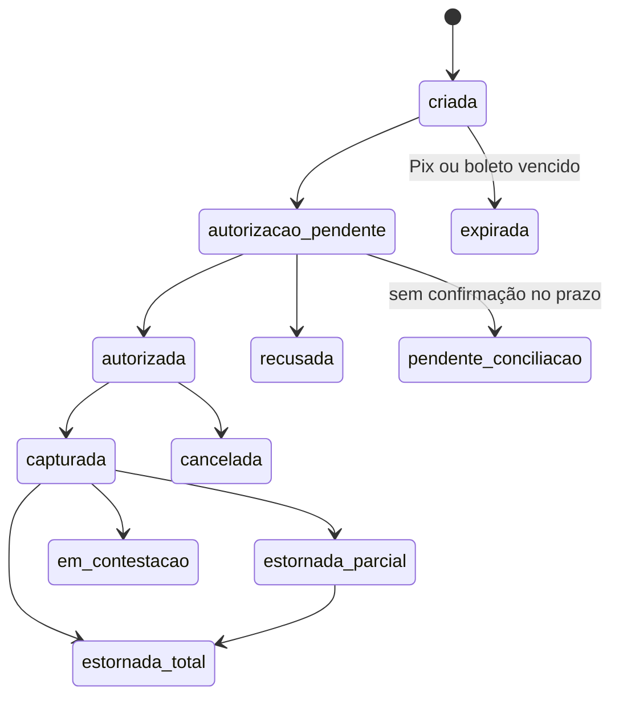

**Regras principais**
- `capturada` nunca volta para `autorizada`; só estorno ou chargeback ([20](#doc-20), seção 6.2).
- O sistema fica fora do escopo PCI: cartão só pelo provedor ([20](#doc-20), seção 3).
- Gateway e contingência por unidade; split quando adotado; NFS-e da entidade e da plataforma ([34](#doc-34)).
- Contas a pagar, cheques, caixa físico, fluxo de caixa, DRE e conciliação ([71](#doc-71)).
- Valores legais e tributários são parâmetros obrigatórios; sem eles, a apuração fica bloqueada ([80](#doc-80)).

<a id="doc-20"></a>

## 20 — Pagamentos e Recebimentos: Segurança, Validação e Conformidade

> Parte do [SDD v2](#doc-00). Integrações com gateways em [16](#doc-16), seção 8. Validação geral em [15](#doc-15). Regras de cobrança em [18](#doc-18), seção 2. Criptografia e cofre em [05](#doc-05).
> **Status:** requisitos de segurança e de validação. Decisões de fluxo de recursos (seção 2) precisam de aprovação do autor. Conformidade PCI DSS e BCB exige parecer antes da produção.

---

### 1. Princípios

1. **Nenhum dado de cartão toca os servidores da plataforma.** Captura é feita pelos campos hospedados do provedor (iframe ou SDK), e o sistema recebe só um token.
2. **O valor é sempre calculado no servidor.** O valor enviado pelo navegador é ignorado e comparado. Diferença é recusada.
3. **Toda movimentação de dinheiro passa por um ledger de partidas dobradas, somente de inserção.** Saldo é derivado do ledger, nunca editado.
4. **Todo evento de provedor é autenticado antes de qualquer efeito.** Webhook sem assinatura válida não altera estado.
5. **Toda operação é idempotente.** Repetir uma chamada, um webhook ou um job não gera segundo efeito financeiro.
6. **Privilégio mínimo e separação de funções.** Quem cria um estorno não o aprova. Quem configura a conta do gateway não consulta o cartão de um pagador.
7. **Falha fecha, não abre.** Em dúvida sobre status, a operação fica `pendente_conciliacao`, sem liberar produto nem recurso.

### 2. Fluxo de recursos

**[Decisão pendente D-10]** Quem recebe o dinheiro?

| Opção | Mecanismo | Vantagem | Risco e condição de falha |
|---|---|---|---|
| (a) Conta do tenant no gateway (**proposta**) | Cada entidade tem a própria conta no provedor (D-07). O dinheiro vai direto para ela. A plataforma só registra. | Plataforma não custodia recursos. Menor exigência regulatória. | Depende de o tenant manter a conta e as credenciais. A plataforma precisa conciliar contas que não controla diretamente. |
| (b) Conta da plataforma com repasse | A plataforma recebe e repassa ao tenant. | Um único ponto de conciliação. | A plataforma passa a custodiar recursos de terceiros. Exige autorização de instituição de pagamento ou arranjo com instituição autorizada. **(jurídico)** Falha de repasse vira passivo da plataforma. |
| (c) Split no provedor | O provedor divide o pagamento entre a plataforma (taxa) e o tenant. | Taxa automática, sem custódia da plataforma. | Depende de suporte do provedor e de contrato de subcontas. |

Padrão desta versão: (a). A plataforma não guarda saldo de tenant. Se a escolha for (b) ou (c), esta seção será revisada.

### 3. Escopo PCI DSS

Objetivo: manter a plataforma no menor escopo possível (SAQ A ou equivalente).

| Requisito | Regra |
|---|---|
| Número do cartão (PAN) | Nunca transita, nunca é gravado, nunca é logado. Captura só pelo campo hospedado do provedor. |
| CVV / CVC | Nunca é gravado em nenhum momento, nem criptografado, nem em memória além da autorização. |
| Token | Armazenado. Formato `provider_token_id`. Sem utilidade fora do provedor e da conta do tenant. |
| Dado exibido | Somente marca, final (4 dígitos), validade mês/ano e nome parcial, quando o provedor devolve. |
| Página de pagamento | Carregada apenas de origem permitida. Política CSP restrita a `frame-src` e `script-src` do provedor, com SRI ([08](#doc-08), seção 2). |
| Logs e erros | Filtro que remove qualquer sequência de 13 a 19 dígitos com validação de Luhn antes de gravar log ou enviar erro. |
| Auditoria | Registra tokens mascarados e identificadores, nunca dados brutos de cartão. |
| Dados de teste | Cartões de teste do provedor apenas em ambiente `sandbox` ([16](#doc-16), seção 4). |

**Verificação:** varredura automatizada do código, dos logs e do banco por padrão de PAN antes de cada release.

### 4. Valor e moeda

| Regra | Detalhe |
|---|---|
| Representação | **[Decisão pendente D-11]** Proposta: inteiros em centavos (`BIGINT`, por exemplo `1234` = R$ 12,34). A v1 usa `DECIMAL(12,2)`, que é aceitável para exibição, mas arredondamento em cálculo de juros e multa pode gerar diferença de centavo. Converter para centavos antes de qualquer cálculo. |
| Cálculo | Juros, multa e desconto calculados no servidor, com regra de arredondamento única do tenant ([15](#doc-15), seção 4.2). |
| Comparação | Valor cobrado deve ser igual ao valor da fatura calculado no momento da cobrança. Diferença é recusada. |
| Moeda | Só a moeda da conta do tenant. Moeda diferente é `422`. |
| Limites | Mínimo e máximo por meio de pagamento, configurados por tenant. Valor acima do limite exige step-up de MFA. Padrão de R$ 1.000 por operação, confirmado pelo autor em 03/11/2026. |
| Valor negativo | Nunca em cobrança. Crédito é lançamento próprio. |

### 5. Ledger

Todo movimento de dinheiro, inclusive taxa, estorno e chargeback, gera partidas dobradas em tabela append-only.

```sql
CREATE TABLE payment_ledger_entries (
  id              BIGINT UNSIGNED AUTO_INCREMENT PRIMARY KEY,
  uuid            CHAR(36)     NOT NULL,
  tenant_id       CHAR(36)     NOT NULL,
  transaction_id  CHAR(36)     NOT NULL,
  account_code    VARCHAR(40)  NOT NULL,
  direction       ENUM('debit','credit') NOT NULL,
  amount_cents    BIGINT UNSIGNED NOT NULL,
  currency        CHAR(3)      NOT NULL,
  posted_at       DATETIME(6)  NOT NULL DEFAULT CURRENT_TIMESTAMP(6),
  created_by      CHAR(36)     NULL,
  UNIQUE KEY uk_uuid (uuid),
  INDEX idx_tenant_tx (tenant_id, transaction_id),
  INDEX idx_tenant_account (tenant_id, account_code, posted_at)
) ENGINE=InnoDB DEFAULT CHARSET=utf8mb4;
```

Regras:

- Tabela sem `UPDATE` nem `DELETE` para a aplicação. Permissão de banco concedida só `INSERT` e `SELECT`.
- Cada transação tem soma de débitos igual à soma de créditos, verificada na mesma transação de banco. Divergência reverte a operação.
- Correção é lançamento de estorno, nunca alteração.
- Saldo de conta é consulta agregada, com cache invalidado a cada inserção.
- `amount_cents` é sempre positivo. Direção indica o sinal.

### 6. Ciclo de vida da transação

#### 6.1 Estados

| Estado | Significado |
|---|---|
| `criada` | Intenção registrada, sem chamada ao provedor |
| `autorizacao_pendente` | Enviada ao provedor, aguardando resposta |
| `autorizada` | Aprovada, ainda não capturada (cartão com captura posterior) |
| `capturada` | Dinheiro confirmado pelo provedor |
| `recusada` | Negada pelo provedor ou antifraude. Motivo código do provedor. |
| `expirada` | Pix ou boleto passou do vencimento sem pagamento |
| `estornada_parcial` / `estornada_total` | Estorno registrado no ledger |
| `em_contestacao` | Chargeback aberto |
| `pendente_conciliacao` | Status não confirmado dentro do prazo |
| `cancelada` | Cancelada antes de captura |

Transições válidas são as da tabela. Qualquer outra é `409` e gera alerta.

#### 6.2 Regras de transição

- `capturada` nunca volta para `autorizada`. Só estorno ou chargeback.
- `estornada_total` exige soma dos estornos igual ao valor capturado.
- `estornada_parcial` acumula até o valor capturado. Acima disso, `422`.
- `pendente_conciliacao` expira em 24 h e vai para análise humana, sem liberar o produto.

### 7. Webhooks e confirmação

| Regra | Detalhe |
|---|---|
| Assinatura | Validada com o método do provedor, usando o segredo da conexão do tenant ([16](#doc-16), seção 4). Assinatura inválida: resposta `401`, nenhum efeito, alerta. |
| Janela | Timestamp com tolerância de 300 s, quando o provedor envia timestamp. |
| Deduplicação | Chave única por `provider + event_id`. Repetido: resposta `200` sem efeito. |
| Resposta | `200` após gravar na fila. Processamento assíncrono ([14](#doc-14), seção 5). |
| Ordem | Eventos da mesma transação aplicados por versão de estado. Evento antigo registrado e descartado. |
| Consulta de confirmação | Webhook não é a única fonte. Job consulta provedor para transações em `autorizacao_pendente` depois de N minutos. |
| Origem | IP de origem do provedor, quando publicado, é verificado como controle adicional, não como único controle. |

### 8. Cartão

- Autorização com 3DS2 obrigatório acima de valor configurado e para transações de risco alto pelo antifraude do provedor.
- Captura posterior à autorização tem prazo máximo configurado pelo provedor. Autorização vencida é cancelada automaticamente.
- Cartão tokenizado não é reaproveitado entre tenants.
- Tentativas recusadas: limite de 5 por cartão e 10 por IP em 15 min. Acima disso, bloqueio temporário.
- Cadastro de cartão recorrente (assinatura) exige consentimento registrado, com texto e data.

### 9. Pix

| Regra | Detalhe |
|---|---|
| Cobrança | `txid` único por tenant e conta. Valor fixo na criação. Expiração obrigatória. |
| Reuso | QR expirado não é reaberto. Nova cobrança gera novo `txid`. |
| Confirmação | Webhook do provedor e consulta por `txid` na conciliação. |
| Valor pago | Diferente do valor da cobrança: pagamento parcial ou excedente vai para pendência, nunca é aceito silenciosamente. |
| Chave Pix | Chave do recebedor cadastrada na conta do tenant. Não é dado pessoal do pagador. |

### 10. Boleto

| Regra | Detalhe |
|---|---|
| Identificador | `nosso_numero` único por tenant e convênio. |
| Cancelamento | Só antes do pagamento. Após pagamento, é estorno. |
| Pagamento após vencimento | Aceito conforme regra do provedor, com juros e multa calculados no servidor e validados contra o valor pago. Diferença gera pendência. |
| Registro | Baixa por retorno de arquivo ou webhook, assinado. Arquivo de retorno validado por checksum e por número de linhas. |

### 11. Estornos e contestações

- Estorno exige permissão `pagamento.estorno.solicitar` e aprovação por outra pessoa com `pagamento.estorno.aprovar`.
- Estorno acima de limite configurado exige MFA recente (ver [06](#doc-06), seção 5).
- Prazo de estorno respeita a janela do provedor e do meio de pagamento. Fora do prazo, só por crédito em conta, com aprovação dupla.
- Chargeback abre estado `em_contestacao` e reserva o valor no ledger, em conta de bloqueio.
- Evidências de contestação são arquivos com validação de tipo e tamanho ([15](#doc-15), seção 4.3), com prazo do provedor controlado por alerta.

### 12. Conciliação

- Diária, por conta de gateway: extrato do provedor contra o ledger.
- Diferença de valor, de quantidade ou de status gera item na fila de conciliação, com alerta ao financeiro.
- Conciliação não corrige sozinha. Ajuste é lançamento com motivo e aprovação.
- Relatório de conciliação fica disponível para auditoria e não contém dado de cartão.

### 13. Antifraude e abuso

| Controle | Regra |
|---|---|
| Velocidade | Limite de tentativas por cartão, IP, pagador e conta de tenant (seção 8). |
| Lista de bloqueio | Cartão, e-mail e IP bloqueados por motivo registrado, com revisão. |
| Score do provedor | Transação acima do limite de risco é recusada ou vai para revisão, conforme configuração do tenant. |
| Padrão anômalo | Muitas recusas seguidas de um mesmo pagador gera alerta, não bloqueio automático de conta. |

### 14. Acesso e segregação de funções

| Papel | Pode | Não pode |
|---|---|---|
| Operador financeiro | Consultar cobranças e recebimentos | Estornar, alterar valor, ver token completo |
| Gestor financeiro | Solicitar estorno e aprovar até o limite | Aprovar o próprio pedido |
| Administrador do tenant | Configurar conta de gateway (com MFA) | Ver segredo em texto claro |
| Equipe da plataforma | Ver status e erros resumidos | Ver cartão, token ou segredo de tenant. Acesso excepcional segue [06](#doc-06), seção 10. |

### 15. Segurança de dados e logs

- Dados de pagador tratados conforme [07](#doc-07). CPF do pagador é exigido só quando o meio de pagamento exigir, e é cifrado.
- Logs de pagamento: identificador da transação, valor, estado, código do provedor. Sem PAN, CVV, token em claro, segredo de webhook ou chave Pix completa.
- Erro retornado ao cliente: código e mensagem genérica. Mensagem do provedor é traduzida, nunca repassada crua.
- Comunicação com o provedor: TLS 1.2 mínimo, validação de certificado, sem redirecionamento.

### 16. Monitoramento e alertas

| Alerta | Condição |
|---|---|
| Assinatura inválida | Qualquer ocorrência |
| Divergência de ledger | Qualquer ocorrência |
| Conciliação com diferença | Qualquer ocorrência acima de zero |
| Transição inválida | Qualquer ocorrência |
| Recusas acima do normal | Taxa de recusa acima de limite configurado por tenant |
| Estorno incomum | Volume ou valor acima da média do tenant |
| Webhook sem processamento | Mais de 5 min em fila |
| Chargeback aberto | Prazo de resposta em 3 dias |

### 17. Incidentes de pagamento

- Suspeita de vazamento de token ou de segredo de gateway: revogação imediata no provedor e rotação ([16](#doc-16), seção 5.3). Suspensão automática da conexão.
- Suspeita de PAN em log ou banco: tratar como incidente de dados ([07](#doc-07), seção 8) e acionar o provedor e a equipe de conformidade.
- Notificação ao provedor e ao tenant conforme contrato.

### 18. Testes obrigatórios

- PAN de teste nunca aparece em log, banco ou resposta de erro (varredura automatizada).
- Webhook com assinatura adulterada, com timestamp antigo e sem assinatura são recusados sem efeito.
- Webhook repetido não gera segundo lançamento.
- Valor enviado pelo cliente diferente do calculado é recusado.
- Estorno acima do capturado é recusado.
- Aprovador igual ao solicitante é recusado.
- Ledger não aceita `UPDATE` e `DELETE` pela conta da aplicação.
- Pix expirado não aceita pagamento.
- Boleto cancelado após pagamento é recusado.
- Conciliação com diferença gera item e alerta, sem ajuste automático.
- Tentativas acima do limite bloqueiam temporariamente.

### 19. Decisões pendentes

| # | Decisão | Proposta |
|---|---|---|
| D-10 | Fluxo de recursos | **Decidida:** (a) conta do tenant no gateway, sem custódia pela plataforma. O tenant pode usar gateway de terceiro ou gateway operado pela plataforma. Gateway operado pela plataforma é **condicionado a parecer jurídico** sobre arranjo de pagamento, porque o recurso passaria pela plataforma (seção 2). |
| D-11 | Representação de valor | **Decidida:** inteiros em centavos (seção 4). |
| D-12 | Limite de valor e MFA para operações | **Decidida pelo autor em 02/11/2026: MFA configurável por tenant, com piso.** Limite padrão definido pelo autor: operação acima de R$ 1.000,00 exige MFA forte e aprovação dupla. Valor ajustável por tenant, com piso não reduzível pelo tenant. Métodos e piso na seção 5 de [06](#doc-06). |

#### 19.1 D-10: gateway da plataforma

Se o tenant contratar o gateway da plataforma, a conta do provedor fica no nome da plataforma e o recurso passa por ela antes de chegar ao tenant. Isso caracteriza custódia. Até o parecer jurídico, a plataforma não oferece essa opção. O tenant contrata gateway de terceiro, em conta própria, conectada por [16](#doc-16), seção 4.

Parecer necessário: enquadramento como arranjo de pagamento, exigências do Banco Central, responsabilidade por repasse e por estorno, e contrato com o tenant.

#### 19.2 D-12: regras aplicadas

- MFA forte (TOTP, passkey ou certificado) para aprovação de estorno, baixa manual e pagamento acima do limite.
- Canais de mensagem (e-mail, SMS, WhatsApp, Telegram) nunca aprovam operação financeira.
- Limite padrão de R$ 1.000,00 por operação, com MFA forte e aprovação dupla acima dele. O tenant pode reduzir o limite, nunca aumentar acima do piso da plataforma. O piso do aumento fica **[Pendente]** com o autor.
- Alteração do limite e do método de MFA gera registro de auditoria e notificação em todos os canais cadastrados.

### 20. Pareceres necessários

| Tema | Responsável |
|---|---|
| Enquadramento de arranjo de pagamento (se D-10 não for (a)) | Jurídico, com parecer do BCB |
| Escopo e nível PCI DSS e questionário SAQ | Segurança e provedor |
| Prazos de estorno e chargeback por meio | Financeiro e jurídico |
| Consentimento para cobrança recorrente | Jurídico |

### 21. Critérios de aceite

- [ ] Nenhum dado de cartão é armazenado ou logado (varredura).
- [ ] Todo webhook passa por validação de assinatura antes de qualquer efeito.
- [ ] Todo valor é calculado e comparado no servidor.
- [ ] Ledger somente de inserção, com verificação de partidas dobradas.
- [ ] Estorno com segregação de funções e limite de MFA.
- [ ] Conciliação diária com alerta.
- [ ] Testes da seção 18 passando em CI.
- [ ] Pareceres da seção 20 registrados antes de produção.

<a id="doc-34"></a>

## 34 — Pagamentos, Gateways, Split, Notas Fiscais, Bancos e Carteiras, por Portal

> Parte do [SDD v2](#doc-00). Segurança de pagamento em [20](#doc-20). Integrações e credenciais em [16](#doc-16). Cobrança e NFS-e em [18](#doc-18). Matriz de portais em [31](#doc-31).
> **Status:** aprovada pelo autor em 03/11/2026, com as propostas adotadas. Itens sem valor definido continuam pendentes, criada em 03/11/2026. Itens **[Decisão do autor]** dependem de resposta. Itens **(jurídico)** dependem de parecer (arranjo de pagamento, nota fiscal, Open Finance). Não é parecer.

---

### 1. Resposta direta

| Assunto | Estado na v2 | Veredito |
|---|---|---|
| Gateways de pagamento | Lista de adapters em [16](#doc-16), seção 3. Segurança em [20](#doc-20) | **Completa** desde 03/11/2026: EFÍ incluída, um gateway primário por unidade (SRC-05) e contingência na seção 2.3 (PAG-01). Fonte da lista: [`spec_gestao_billing_cobranca_mensalidades.md`](#v1-spec-gestao-billing-cobranca-mensalidades-md), seção 17.1 |
| Split de pagamento | Opção (c) em [20](#doc-20), seção 2. Não decidida | **Incompleta.** Sem decisão, sem modelo de subconta, sem regra de taxa |
| Emissão de nota fiscal | [16](#doc-16) (NFS-e por município) e [18](#doc-18), seção 2.7 | **Incompleta.** Faltam NFS-e Nacional, cancelamento, XML e PDF, certificado, nota da plataforma e nota de terceiros |
| Bancos | Módulo "Bancos" tratado como dados bancários em [19](#doc-19), seções 2 e 16 | **Errado.** Ver seção 4 |
| Carteiras digitais e débito automático | Não há especificação | **Ausente** |
| Open Finance | Não há especificação na v2. A v1 cita em [`spec_gestao_billing_cobranca_mensalidades.md`](#v1-spec-gestao-billing-cobranca-mensalidades-md) | **Ausente** |

---

### 2. Gateways de pagamento

#### 2.1 Lista consolidada

| Provedor | Métodos | Credencial (v1) | Origem |
|---|---|---|---|
| Asaas | Pix, boleto, cartão, carteira | Chave de API, identificador de carteira, URL de webhook | v1 billing, 17.1 |
| Mercado Pago | Pix, boleto, cartão | Access token, chave pública | v1 billing, 17.1 |
| PagSeguro | Boleto, cartão, Pix | Token, e-mail, modo sandbox | v1 billing, 17.1 |
| Gerencianet / EFÍ | Pix, boleto | Client ID, client secret, certificado Pix (.p12 ou .pem) | v1 billing, 17.1. Incluído na v2 em 03/11/2026 (PAG-01) |
| Stripe | Cartão | Chave secreta, chave pública, segredo de webhook | v1 billing, 17.1 |

**Regras que faltam na v2:**

- Certificado Pix (.p12 ou .pem) é segredo. Fica no cofre ([05](#doc-05), seção 2), nunca no banco comum.
- Modo sandbox não pode ser ativado em produção. O sistema recusa a credencial de teste em ambiente de produção.
- Contingência: quando o gateway primário cai, o sistema não troca de provedor sozinho. Troca é decisão do financeiro, com registro. Regra completa na seção 2.3.
- Teste de conectividade com resultado imediato (v1, 17.1) é permitido, mas não grava o dado de teste.

#### 2.2 Gateway por escala

| Escala | Quem configura | Conta de quem | Fonte |
|---|---|---|---|
| Entidade (cobrança de alunos) | Administrador da entidade, com MFA | Entidade | [20](#doc-20), opção (a) |
| Plataforma (cobrança de clientes SaaS) | Financeiro da plataforma | Plataforma | [20](#doc-20), seção 19.1 |

Gateway da plataforma que recebe por conta de entidade é custódia. Só existe se o parecer de [20](#doc-20) for favorável.

#### 2.3 Gateway por unidade e contingência (PAG-01)

Cada unidade tem **um gateway primário** (SRC-05). A unidade pode cadastrar **um gateway de contingência**, de outro provedor, com conta da própria entidade.

| Situação | Regra |
|---|---|
| Primário saudável | Toda cobrança nova sai pelo primário |
| Primário com falha | O monitor marca o provedor como degradado depois de 3 falhas seguidas de criação de cobrança ou de 5 minutos sem resposta ([20](#doc-20), seção 16). O financeiro da unidade recebe aviso |
| Troca para contingência | Decisão do financeiro da unidade, com MFA e motivo. Vale só para cobrança nova. Fica na auditoria ([29](#doc-29)) |
| Cobrança já emitida | Continua no gateway que a emitiu. Não é cancelada nem reemitida em outro provedor, para não haver dois boletos ou dois Pix válidos para o mesmo título |
| Webhook e conciliação | Cada gateway concilia as próprias cobranças. A conciliação diária roda para os dois enquanto houver cobrança aberta em algum deles ([20](#doc-20), seção 12) |
| Volta ao primário | Decisão do financeiro, com registro, depois de teste de conectividade aprovado |
| Sem contingência cadastrada | A unidade aceita só os meios manuais ([71](#doc-71): caixa e cheque) até o primário voltar |

**Regras gerais:**

- Os dois gateways da unidade não podem ser do mesmo provedor. Contingência no mesmo provedor não protege de queda do provedor.
- A credencial de cada gateway fica no cofre, separada por unidade ([05](#doc-05), seção 2). Certificado Pix da EFÍ segue a mesma regra.
- Unidades da mesma entidade podem usar provedores diferentes. A troca numa unidade não afeta as outras.
- O provedor que emitiu cada título fica gravado no título. Relatório de recebimento mostra o provedor por título.

---

### 3. Split de pagamento

**Estado:** opção (c) em [20](#doc-20), seção 2. Padrão desta versão é a opção (a): cada entidade tem a própria conta, sem custódia da plataforma.

**Se o split for adotado**, a especificação precisa de:

| Item | Regra proposta |
|---|---|
| Subconta | Cada entidade tem uma subconta no provedor, com identificador de carteira guardado. O identificador é dado de configuração, não segredo, mas fica vinculado à entidade. |
| Taxa | Percentual ou valor fixo da plataforma, por contrato. Gravado no momento da cobrança. Não muda retroativamente. |
| Divisão | Valor bruto, taxa, valor líquido da entidade e valor da plataforma gravados no lançamento do ledger ([20](#doc-20), seção 4). |
| Estorno | Estorno devolve da subconta da entidade e da plataforma na proporção gravada. Taxa estornada só se o contrato permitir. |
| Conciliação | Diária por subconta, contra o extrato do provedor ([20](#doc-20), seção 12). |
| Falha parcial | Se o provedor confirma uma parte, a diferença vira item de conciliação. Nunca é lançada automaticamente. |
| Contrato | Subcontas e taxa exigem contrato com o provedor e com a entidade. **(jurídico)** |

**Por portal:**

- Desenvolvedor: visão de taxas recebidas por entidade e por período.
- Gestão: visão do líquido recebido e do que foi retido como taxa.
- Responsáveis e aluno: aparecem só o valor pago e o estado. Taxa nunca aparece para o pagador.

**Decidido** em 03/11/2026: split em duas formas, automática e pelo gateway. Entidade sem fins lucrativos: mesmo split, com taxa da plataforma menor.

---

### 4. Módulo "Bancos": achado crítico

Os dois arquivos [`spec_gestao_bancos.md`](#v1-spec-gestao-bancos-md) e [`spec_gestao_bancos_completo.md`](#v1-spec-gestao-bancos-completo-md) têm 305 linhas cada e são **idênticos em conteúdo**. Não tratam de dados bancários de alunos, entidades ou fornecedores. Tratam de **gestão de bancos de dados**:

- inventário e descoberta de instâncias;
- console SQL com histórico, snippets e favoritos;
- migrações;
- backup e restauração;
- replicação e alta disponibilidade;
- visualizador de esquema;
- monitoramento.

A v2 classifica esse arquivo como "dados bancários" ([12](#doc-12), linha 21; [19](#doc-19), linha 25) e propõe que ele vire um conector de extrato. **Essa leitura está errada.**

**Risco:** um console SQL e uma ferramenta de migração expostos a usuários de entidade, em um SaaS multi-tenant, dão acesso direto ao banco de todos os clientes. Isso anula o isolamento de [03](#doc-03).

**Decisão proposta:**

1. Remover o módulo "Bancos" do produto. Ele é ferramenta de operação e não entra no catálogo de módulos.
2. Se a equipe de operação precisar da ferramenta, ela roda fora do produto, com acesso restrito à rede de operação ([10](#doc-10)), sem acesso pelos portais.
3. Dados bancários (conta de entidade, conta de fornecedor, conta para repasse) vivem no módulo **Financeiro**, com a regra de MFA para alteração ([31](#doc-31), seção 4.3).

**Decidido** em 03/11/2026: módulo Bancos removido do escopo.

---

### 5. Nota fiscal

#### 5.1 Quem emite, por escala e por portal

| Nota | Quem emite | Portal de origem | Estado |
|---|---|---|---|
| NFS-e de mensalidade e serviço educacional | Entidade, por município | Gestão | Parcial. Ver 5.2 |
| NFS-e da assinatura SaaS (plataforma cobra a entidade) | Plataforma | Desenvolvedor | **Ausente.** Precisa de especificação própria |
| NF-e de serviço de fornecedor (terceiros) | Fornecedor, no próprio sistema ou no município | Terceiros | Conflito. Ver 5.3 |
| NF-e de produto (SEFAZ) | — | Desenvolvedor (v1, "Gestão de integração") | **Fora de escopo.** Não há venda de produto no escopo. Confirmar |

#### 5.2 Regras da NFS-e (entidade)

Já definido: emissão só para fatura paga ou parcial, conforme regra municipal; estados `pending`, `processing`, `issued`, `rejected`, `cancelled`; cancelamento transmitido ao município ([18](#doc-18), seção 2.7).

Faltam:

- **NFS-e Nacional** (padrão ABRASF e nacional, citado na v1). Lista de municípios que usam cada padrão. **(jurídico)** e fiscal.
- **Certificado digital A1 ou A3** da entidade: guardado no cofre, nunca em arquivo ([16](#doc-16), seção 3).
- **Cancelamento:** prazo e justificativa exigidos pelo município. Cancelamento após o prazo exige processo fiscal, não ação do operador.
- **Reenvio** de nota rejeitada: só após correção do motivo. Nota rejeitada não é reemitida com o mesmo número.
- **Guarda:** XML e PDF guardados pelo prazo fiscal **(jurídico)**, com hash ([21](#doc-21)).
- **Pagamento e nota:** emissão automática após pagamento é opcional. Se for automática, a nota tem o valor do pagamento confirmado, não o valor da fatura.
- **Tomador:** dado do responsável financeiro. Se o tomador tem dado pessoal, o campo segue a regra de [07](#doc-07).

#### 5.3 Nota do fornecedor (terceiros)

A v1 ([`12-portals-navigation-sidebar-pages-spec.md`](#doc-12), portal de terceiros, "Emissão e Upload de NF-e de Serviços") diz que o portal **emite** a nota. Isso não se sustenta: a nota é emitida pelo prestador, no município ou no seu sistema.

**Proposta:** o portal de terceiros **recebe e valida** a nota (XML, valor, tomador, competência), vincula à ordem de compra e ao pagamento, e não emite. Qualquer mudança de "emissão" para "envio" passa por revisão **(jurídico)** e fiscal.

**Decidido** em 03/11/2026: o portal de terceiros recebe e valida, sem emitir.

---

### 6. Bancos, Open Finance e débito automático

| Recurso | Quem usa | Regra proposta |
|---|---|---|
| Conta bancária da entidade | Financeiro da entidade | Cadastro no Financeiro. Alteração exige MFA e dupla aprovação |
| Conta bancária da plataforma | Financeiro da plataforma | Mesma regra, no portal do desenvolvedor |
| Dados bancários de fornecedor | Compras, terceiros | Terceiros cadastra. Compras aprova. Alteração gera alerta de possível fraude |
| Conciliação por extrato (OFX) | Financeiro | Já em [17](#doc-17), seção 2.5 |
| Open Finance (leitura de extrato, consentimento) | Financeiro | Só com consentimento do titular da conta e regra do Open Finance. **(jurídico)**. Não especificado |
| Débito automático | Responsáveis | Autorização do pagador, revogável. Regra de cobrança em [18](#doc-18). **(jurídico)** |

---

### 7. Carteiras digitais

**Estado:** ausente. Não há especificação de carteira digital (Apple Pay, Google Pay, carteira do provedor).

**Proposta mínima:** carteira digital é um **método de pagamento do gateway**, não módulo. O sistema não guarda token de carteira. Cada carteira aceita só o que o provedor suporta. Pagamento por carteira segue [20](#doc-20), inclusive 3-D Secure.

**Decidido** em 03/11/2026: Pix e cartão pelo gateway da unidade, sem carteira própria.

---

### 8. Pagamento por portal

| Portal | Pagamento | Recurso |
|---|---|---|
| Desenvolvedor | Cobrança de clientes SaaS; recebimento da plataforma | Gateway da plataforma (com parecer), NFS-e da plataforma (ausente), taxas |
| Gestão | Cobrança de alunos e fornecedores; configuração do gateway | Gateway da entidade, split (se adotado), NFS-e da entidade, conciliação |
| Professor | Nenhum pagamento recebido. Holerite e pagamento de salário fora do escopo deste módulo | Só consulta do próprio holerite ([31](#doc-31), seção 2.3) |
| Aluno | Pagar mensalidade: Pix, boleto, cartão | Cobrança, comprovante, segunda via |
| Responsáveis | Pagar fatura dos filhos; débito automático | Mesmos métodos, central financeira, débito automático (se aprovado) |
| Terceiros | Receber pagamento; enviar nota | Extrato, status da liquidação, envio de NF-e (seção 5.3), dados bancários com MFA |

**Regra:** nenhum portal, exceto Gestão e Desenvolvedor, mostra taxa, split ou conta de recebimento da entidade.

---

### 9. Pendências

| # | Pendência | Tipo |
|---|---|---|
| PAG-01 | Incluir EFÍ e regra de contingência entre gateways (seção 2) | **Escrito** em 03/11/2026: EFÍ na seção 2.1 e contingência na seção 2.3 |
| PAG-02 | Split: duas formas, automática e pelo gateway. Entidade sem fins lucrativos: mesmo split, com taxa da plataforma menor. Classificação da entidade (pública, particular, sem fins lucrativos) define só a taxa e a forma de cobrança (seção 3) | **Decidido** em 03/11/2026 |
| PAG-03 | Remover módulo "Bancos" de escopo e corrigir [12](#doc-12) e [19](#doc-19) (seção 4) | **Decidido** em 03/11/2026: removido. Correção de [12](#doc-12) e [19](#doc-19) é documento |
| PAG-04 | NFS-e Nacional, cancelamento, guarda de XML (seção 5.2) | (jurídico) e fiscal |
| PAG-05 | NFS-e da assinatura SaaS (plataforma) | Documento e (jurídico) |
| PAG-06 | Nota do fornecedor: recebe e valida, não emite (seção 5.3) | **Decidido** em 03/11/2026: só recebe e valida |
| PAG-07 | Open Finance e débito automático | (jurídico) |
| PAG-08 | Carteira digital: escopo e provedor (seção 7) | **Decidido** em 03/11/2026: Pix e cartão pelo gateway da entidade, sem carteira própria |
| PAG-09 | Corrigir a referência de fonte da lista de gateways: a lista vem de [`spec_gestao_billing_cobranca_mensalidades.md`](#v1-spec-gestao-billing-cobranca-mensalidades-md) (v1), não de [01](#doc-01) | **Feito** em 03/11/2026 na tabela de origem |

---

### 10. Critérios de aceite

- [ ] Todo gateway tem credencial no cofre e nenhuma em texto claro (teste de varredura, [20](#doc-20)).
- [ ] Credencial de sandbox recusada em produção (teste).
- [ ] Nota emitida só para pagamento confirmado; nota rejeitada não é reemitida com o mesmo número.
- [ ] Módulo "Bancos" fora do catálogo de módulos e fora dos portais.
- [ ] Taxa e split, se adotados, gravados no lançamento e conciliados por subconta.
- [ ] Itens **[Decisão do autor]** e **(jurídico)** respondidos ou marcados como pendentes no [00](#doc-00).

### 11. Decisões de 03/11/2026

**PAG-02 (split): mantido na opção (a).** Mudanças necessárias se a opção (c) for adotada no futuro, listadas para análise:

| Documento | Mudança se (c) fosse adotado |
|---|---|
| [16](#doc-16), seção 3 | Gateway passa a ter subconta por entidade e identificador de carteira vinculado |
| [20](#doc-20), seção 2 e seção 19 (D-10) | Opção (c) vira a decisão; padrão (a) é revogado; parecer deixa de ser condição |
| [20](#doc-20), seção 4 | Lançamento grava valor bruto, taxa, valor líquido da entidade e valor da plataforma |
| [20](#doc-20), seção 12 | Conciliação diária por subconta, além da conta de gateway |
| [18](#doc-18), seção 2 | Baixa divide o pagamento; estorno devolve nas duas subcontas |
| [31](#doc-31) e [23](#doc-23) | Portal do desenvolvedor passa a mostrar taxas recebidas por entidade |
| Jurídico | Contrato com o provedor para subconta; contrato de taxa com cada entidade |
| Operação | Teste de suporte do provedor a subcontas antes de qualquer contratação |

Enquanto (a) vigora, nenhuma dessas mudanças entra em produção.

**PAG-03 (módulo Bancos): removido do escopo de produto.** Substituição: painel de operação no portal do desenvolvedor, descrito abaixo. Não é módulo de tenant e não é console SQL aberto.

**Painel de bancos de dados (portal do desenvolvedor)**

| Recurso | Regra |
|---|---|
| Inventário | Lista dos bancos: master, cada banco de unidade, cada banco de identidade. Versão do esquema, tamanho e última restauração testada. |
| Migrações | Estado por unidade. Migração em lote só com plano de volta e aprovação de segundo papel. |
| Backup | Estado e prazo de cada backup. Restauração só por pedido com dupla aprovação, em ambiente isolado. |
| Consulta técnica | Não existe console SQL no painel comum. Acesso técnico direto só por procedimento de emergência: passkey, motivo e chamado vinculado, sessão de tempo limitado, leitura por padrão, escrita só com dupla aprovação. Cada comando é gravado e mascarado conforme [29](#doc-29). |
| Dado pessoal | Qualquer consulta que atinja dado pessoal exige motivo e gera evento de auditoria. |
| Clientes | Nenhum portal de entidade vê este painel. |

Motivo: um console SQL acessível sem controle reduz o isolamento entre clientes a uma senha. O painel cobre a gestão de todos os bancos sem expor o conteúdo deles.

<a id="doc-71"></a>

## 71 — Financeiro Completo, por Portal: Pagamentos, Cheques, Caixa, Fluxo, DRE e Conciliação

> Parte do [SDD v2](#doc-00). Decisão CFG-04 em [56](#doc-56), seção 8: escopo financeiro completo, com cheques, caixa, DRE e fluxo de caixa. Este documento fecha o que faltava. Já especificado em outros documentos e só referenciado aqui: títulos, parcelas e descontos em [18](#doc-18); cobrança e gateway em [20](#doc-20); NFS-e, split e nota de fornecedor em [34](#doc-34); contratos em [33](#doc-33); regras de conciliação e aprovação em [17](#doc-17), seção 2. Financeiro da própria empresa desenvolvedora em [31](#doc-31). Orçamento e empenho em [37](#doc-37). Relatórios financeiros em [69](#doc-69). Auditoria em [29](#doc-29).
> **Status:** especificação proposta, criada em 03/11/2026. Fecha a lacuna financeira de [56](#doc-56), seções 6 e 8. A v1 tem [`spec_gestao_financeiro_completo.md`](#v1-spec-gestao-financeiro-completo-md) com contas a pagar, fluxo de caixa, conciliação, centros de custo, orçamentos, DRE e inadimplência. Esta versão corrige o que a v1 deixa solto: regime do DRE, cheques e caixa.

---

### 1. Resposta direta

> **Leitura (04/11/2026):** esta tabela registra o que existia no SDD antes deste documento ser escrito. Os itens marcados como **Não** ou **Parcial** são especificados nas seções seguintes deste documento, exceto o que estiver listado na seção de pendências.

| Pergunta | Veredito |
|---|---|
| Receitas de alunos (títulos, parcelas, cobrança)? | **Coberto** em [18](#doc-18) e [20](#doc-20) |
| Contas a pagar? | **Parcial.** Aprovação e rateio na v1 e em [17](#doc-17), seção 2.4. Falta regra de pagamento em lote |
| Cheques (recebidos e emitidos)? | **Não.** Só como forma de pagamento na v1 |
| Caixa (físico e fechamento)? | **Não.** Só como tipo de conta bancária na v1 |
| Fluxo de caixa e DRE? | **Parcial.** Tela e fórmula na v1. Falta regime, linha de DRE e fechamento |
| Conciliação? | **Coberto** em [17](#doc-17), seção 2.5, e [20](#doc-20), seção 12 |

---

### 2. Divisão de dono

| Assunto | Dono | Documento |
|---|---|---|
| Título, parcela, desconto, cobrança de aluno | Financeiro da entidade | [18](#doc-18) |
| Gateway, ledger, webhook, Pix, boleto | Financeiro da entidade, com provedor | [20](#doc-20) |
| Conta a pagar, fornecedor, rateio | Financeiro da entidade | Este documento, seção 4 |
| Cheque | Financeiro da entidade | Este documento, seção 5 |
| Caixa físico | Financeiro da entidade, operado na unidade | Este documento, seção 6 |
| Fluxo de caixa e DRE | Financeiro da entidade | Este documento, seções 7 e 8 |
| Conciliação | Financeiro da entidade | [17](#doc-17), seção 2.5 |
| NFS-e, split, nota de fornecedor | Financeiro e fiscal | [34](#doc-34) |
| Financeiro da empresa desenvolvedora | Plataforma | [31](#doc-31) |

---

### 3. Contas e movimentação

- **Conta** é o lugar onde o dinheiro está: conta corrente, poupança, gateway, carteira digital (como método do gateway, [34](#doc-34)) ou caixa físico.
- Cada movimentação tem conta, data, valor, categoria financeira, centro de custo, origem e estado.
- Estados de movimentação: `previsto`, `lancado`, `conciliado`, `estornado`. Não há estado de atraso gravado: atraso é filtro calculado por data, como em [17](#doc-17), seção 2.3 (T-04).
- Lançamento conciliado não é alterado. Correção é estorno e novo lançamento, com motivo.

---

### 4. Contas a pagar

#### 4.1 Regras

- Despesa tem fornecedor, categoria, centro de custo, vencimento e valor.
- Rateio por centro de custo: a soma dos percentuais é 100%. Diferença bloqueia o lançamento.
- Aprovação: pendente bloqueia a baixa. Solicitante não aprova a própria despesa. Acima de R$ 10.000 exige segundo aprovador. Decidido em 03/11/2026, [17](#doc-17), seção 2.4.
- Despesa com nota fiscal de fornecedor é recebida e validada pelo portal de terceiros ([38](#doc-38)) e não é emitida aqui ([34](#doc-34)).

#### 4.2 Pagamento

- Pagamento em lote: seleção de despesas aprovadas da mesma conta, com total conferido antes da confirmação.
- Pagamento tem chave de idempotência ([15](#doc-15), seção 4). Reenvio não paga duas vezes.
- Pagamento por cheque segue a seção 5.

---

### 5. Cheques

- **Decidido** em 03/11/2026 (FIN-02): cheque é aceito como forma de pagamento de aluno, com limite por cheque configurado pela escola.

#### 5.1 Cheque recebido

| Estado | Significado |
|---|---|
| `recebido` | Recebido na unidade, com dados conferidos |
| `custodiado` | Guardado para depósito |
| `depositado` | Enviado para compensação, em conta indicada |
| `compensado` | Dinheiro entrou. Gera movimentação |
| `devolvido` | Não compensado. Volta ao titular como título em aberto, com motivo |
| `substituido` | Trocado por outra forma, com registro |

#### 5.2 Cheque emitido

| Estado | Significado |
|---|---|
| `emitido` | Preenchido e aprovado |
| `entregue` | Enviado ao favorecido |
| `compensado` | Pago. Gera movimentação |
| `cancelado` | Cancelado com motivo. Não reaproveita número |

#### 5.3 Regras

- Número de cheque emitido é único por conta. Cancelado não é reaproveitado.
- Cheque recebido devolvido gera aviso ao responsável pela cobrança ([57](#doc-57)). Não gera multa sem a regra de [18](#doc-18).
- Custódia física: a guarda do cheque recebido segue regra própria **(jurídico)**. Ver FIN-06.

---

### 6. Caixa físico

- Cada caixa é uma conta do tipo caixa, com um operador por vez.
- **Abertura:** saldo inicial conferido pelo operador. Diferença é registrada.
- **Movimentação:** recebimentos em dinheiro, cheques e cartões. Sangria e suprimento exigem motivo e aprovação de quem a escola indicar.
- **Fechamento:** contagem pelo operador. Diferença entre o contado e o calculado vai para a coordenação do financeiro, com motivo. **Decidido** em 03/11/2026 (FIN-05): sem tolerância. Qualquer diferença vai para a coordenação.
- Caixa fechado não recebe lançamento. Reabertura exige justificativa e aprovação.
- Fechamento gera relatório de caixa, com recebimentos por forma.

---

### 7. Fluxo de caixa

- **Realizado:** movimentações lançadas e conciliadas, por conta e por data.
- **Projetado:** títulos a receber e contas a pagar em aberto, pela data de vencimento. Não grava nada: é consulta.
- **Diário:** entradas, saídas e saldo por dia, com a linha de saldo projetado.
- Projeção usa somente títulos com estado válido. Estorno e título cancelado saem da projeção.

---

### 8. DRE

#### 8.1 Estrutura

- Cada categoria financeira aponta para uma linha da DRE. Categoria sem linha não entra no demonstrativo e aparece como pendência.
- Centro de custo é filtro, não linha.
- A DRE tem as linhas da v1 (receita bruta, deduções, receita líquida, custos, despesas, resultado), com o detalhamento que a entidade configurar.

#### 8.2 Regime

- A DRE pode ser por **caixa** (pelo que foi pago e recebido) ou por **competência** (pelo período a que o valor se refere).
- **Decidido** em 03/11/2026 (FIN-01): a DRE é por competência. A escolha é por entidade e não muda no meio do exercício. Lançamento de caixa entra no período a que se refere.

---

#### 8.3 Orçamento

**Decidido** em 03/11/2026 (FIN-07): o orçamento fica no financeiro.

- Orçamento é por centro de custo e categoria, por mês e por exercício. Estado: `rascunho`, `aprovado`, `encerrado`.
- Orçado versus realizado: o realizado vem dos lançamentos da seção 4 e da seção 3. Não é digitado.
- Desvio acima do limite configurado pela escola gera aviso à gestão. O aviso não bloqueia lançamento.
- Orçamento aprovado não muda. Ajuste é nova versão, com aprovação da gestão.

### 9. Conciliação

Regras já definidas em [17](#doc-17), seção 2.5, e [20](#doc-20), seção 12. Reforço:

- Tolerância de arredondamento é parâmetro da entidade, não constante ([17](#doc-17), LAC-06).
- Conciliação não ajusta sozinha. Diferença vira item de conciliação e o ajuste é lançamento com motivo e aprovação.
- Extrato OFX é importado com hash por linha, para não duplicar.

---

### 10. Inadimplência e fiscal

- Inadimplência, régua e cadastro de inadimplente seguem [18](#doc-18) e [26](#doc-26). Comunicação prévia por escrito antes de qualquer cadastro (CDC, art. 43, §2º) **(jurídico)**.
- Comprovante de IRPF do pagador: regra fiscal a confirmar (FIN-03).
- NFS-e de mensalidade e de serviço seguem [34](#doc-34).

---

### 11. Por portal

| Portal | Pode | Não pode | Origem |
|---|---|---|---|
| **Desenvolvedor** | Ver e gerir o financeiro da própria empresa, separado da entidade | Ver financeiro de entidade | P |
| **Gestão** | Ver tudo: DRE, fluxo, inadimplência, caixa. Aprovar despesa e fechamento de caixa | Operar caixa. Lançar pagamento sem aprovação | E |
| **Financeiro** (perfil da unidade) | Operar contas, cheques, caixa, pagamentos, conciliação. Gerar relatório financeiro | Aprovar a própria despesa. Aprovar a própria diferença de caixa | E |
| **Coordenação** | Ver o financeiro da unidade, em leitura | Lançar ou aprovar lançamento | E |
| **Secretaria** | Receber pagamento de aluno na unidade, em caixa de atendimento. Emitir boleto e segunda via | Pagar despesa. Ver DRE | E |
| **Professor** | Nada | Qualquer item financeiro | E |
| **Aluno** | Ver e pagar os próprios títulos. Ver comprovantes e informe de pagamento | Ver título de colega | E |
| **Responsáveis** | Ver e pagar faturas dos dependentes. Ver comprovantes | Ver título de outra família | E, só dependentes com vínculo ativo |
| **Terceiros** (fornecedores) | Ver a própria conta a receber, enviar nota e acompanhar o pagamento | Ver outros fornecedores ou o caixa | E |

---

### 12. Pendências

| # | Pendência | Tipo |
|---|---|---|
| FIN-01 | DRE por caixa ou por competência (seção 8.2) | **Decidido** em 03/11/2026: competência |
| FIN-02 | Cheque como forma de pagamento de aluno (seção 5) | **Decidido** em 03/11/2026: aceito, com limite por cheque configurado pela escola |
| FIN-03 | Comprovante de IRPF do pagador: obrigação, formato e prazo (seção 10) | (verificar) |
| FIN-04 | "Parcelas de serviços financeiros" do menu iScholar (seção 1) | **Decidido** em 03/11/2026: não se aplica. Sai do escopo |
| FIN-05 | Tolerância de diferença de caixa (seção 6) | **Decidido** em 03/11/2026: sem tolerância |
| FIN-06 | Guarda física de cheque recebido e prazo (seção 5.3) | (jurídico) |
| FIN-07 | Orçamento orçado versus realizado (seção 8.3) | **Decidido** em 03/11/2026: no financeiro |
| FIN-08 | DDL: contas, movimentação, cheque, caixa, fechamento, rateio, categoria e linha de DRE | **Escrito** em [51](#doc-51), seção 15.16. Revisão do owner pendente (DDL-01) |

---

### 13. Critérios de aceite

- [ ] Rateio de centro de custo com soma diferente de 100% é recusado (teste).
- [ ] Solicitante não aprova a própria despesa (teste).
- [ ] Pagamento repetido com a mesma chave não paga duas vezes (teste de idempotência).
- [ ] Cheque cancelado não reaproveita número (teste).
- [ ] Caixa fechado não recebe lançamento (teste).
- [ ] Projeção não grava nada (teste).
- [ ] Categoria sem linha de DRE aparece como pendência, não some (teste).
- [ ] Responsável não vê título de outra família (teste de isolamento).
- [ ] Itens **(verificar)**, **(jurídico)** e **[Decisão do autor]** respondidos ou marcados como pendentes no [00](#doc-00).

## Especificações da v1 desta parte absorvidas no kit-starter ou sem destino

<a id="v1-spec-gestao-billing-cobranca-mensalidades-md"></a>

### v1 — `spec_gestao_billing_cobranca_mensalidades.md` (1433 linhas)

> Situação na v2: Absorvido integralmente no kit-starter. Destino: ficha do kit-starter: `kit-starter/gestao/financeiro-da-entidade/mensalidades.md`. Quando este texto diverge da v2, vale a v2.

#### O que a v2 muda nesta especificação

Estas regras prevalecem sobre o texto da v1 que vem a seguir.

- Estados da fatura ([18](#doc-18), seção 2.3); valor em centavos inteiros ([20](#doc-20), seção 4).
- Multa, juros e reajuste dentro do limite legal ([26](#doc-26), seção 4.3).
- Geração idempotente: reprocessar não duplica fatura ([17](#doc-17), seção 2.6).

#### Texto integral da v1

**Versão:** 1.0  
**Status:** Draft Funcional Completo  
**Módulo:** Billing / Subscriptions / Receivables  
**Contexto:** SaaS multi-entidade, multi-unidade e multi-usuário — banco segregado por entidade/unidade  
**Padrão de Identidade:** `id` (PK ordenação) · `uuid` (global) · `code` (negócio, ex.: `INV-2026-000001`)  
**Stack:** PHP 8 puro · MariaDB · Tailwind CSS 4.2 · Supabase · amCharts 5 · fetch API  
**Prefixo CSS:** `ttsc-` (substituindo `kt-`)  
**Naming:** inglês snake_case em banco/código; português nos labels de UI  

- Language Standard: Global English
---

#### Índice

1. [Visão Geral e Objetivos](#1-visão-geral-e-objetivos)
2. [Arquitetura e Banco de Dados](#2-arquitetura-e-banco-de-dados)
3. [Mapa de Páginas](#3-mapa-de-páginas)
4. [Dashboard — Cobrança e Mensalidades](#4-dashboard--cobrança-e-mensalidades)
5. [Gestão de Planos e Tabelas de Preço](#5-gestão-de-planos-e-tabelas-de-preço)
6. [Gestão de Assinaturas](#6-gestão-de-assinaturas)
7. [Cobrança — Faturas e Boletos](#7-cobrança--faturas-e-boletos)
8. [Mensalidades — Gestão Escolar](#8-mensalidades--gestão-escolar)
9. [Pagamentos e Baixas](#9-pagamentos-e-baixas)
10. [Descontos, Bolsas e Isenções](#10-descontos-bolsas-e-isenções)
11. [Inadimplência e Régua de Cobrança](#11-inadimplência-e-régua-de-cobrança)
12. [Kanban de Cobranças](#12-kanban-de-cobranças)
13. [Automações e Régua Inteligente](#13-automações-e-régua-inteligente)
14. [Notas Fiscais de Serviço (NFSe)](#14-notas-fiscais-de-serviço-nfse)
15. [Conciliação Bancária](#15-conciliação-bancária)
16. [Relatórios e Exportações](#16-relatórios-e-exportações)
17. [Configurações do Módulo](#17-configurações-do-módulo)
18. [APIs REST — Endpoints](#18-apis-rest--endpoints)
19. [Schema SQL](#19-schema-sql)
20. [RBAC — Permissões por Perfil](#20-rbac--permissões-por-perfil)
21. [Auditoria e LGPD](#21-auditoria-e-lgpd)
22. [Critérios de Aceite](#22-critérios-de-aceite)

---

#### 1. Visão Geral e Objetivos

##### 1.1 Escopo
O módulo **Billing / Cobrança e Mensalidades** gerencia todo o ciclo financeiro de receita da instituição:
- Planos e tabelas de preço configuráveis por unidade
- Assinaturas e contratos de mensalidade por aluno/responsável
- Emissão de faturas (boleto, Pix, cartão, débito automático)
- Controle de inadimplência com régua de cobrança automatizada
- Integração com NFSe (Nota Fiscal de Serviço Eletrônica)
- Conciliação bancária e baixa automática de pagamentos
- Dashboards, KPIs e relatórios gerenciais

##### 1.2 Objetivos de Negócio
| Objetivo | Métrica-alvo |
|---|---|
| Reduzir inadimplência | < 5% da carteira ativa |
| Automatizar cobranças | ≥ 80% das faturas emitidas sem intervenção |
| Conciliação bancária automatizada | ≥ 95% de match automático |
| Emissão de NFSe | < 2 min após confirmação de pagamento |
| Prazo de baixa de boleto | ≤ 2 horas após pagamento |

##### 1.3 Integrações Externas
- **Gateways:** PagSeguro, Mercado Pago, Asaas, Gerencianet/EFÍ, Stripe
- **NFSe:** Prefeituras via API (padrão ABRASF / NFS-e Nacional)
- **Banco Central:** Open Finance (extrato, PIX, débito automático)
- **Email/SMS/WhatsApp:** Envio de faturas e notificações
- **ERP Financeiro:** Lançamentos contábeis automáticos

---

#### 2. Arquitetura e Banco de Dados

##### 2.1 Multi-tenant
- Cada unidade possui banco físico próprio (`dbcoldev01`, `dbcolsec01`, etc.)
- O `db_core` armazena planos globais, gateways e configurações master
- Conexão resolvida em runtime via `TenantResolver` → `ConnectionManager`
- Todas as queries filtradas por `unit_id` + `entity_id`

##### 2.2 Convenções de Banco
- Tabelas: `snake_case` em inglês, prefixo por domínio (`billing_`, `payment_`, `invoice_`)
- PKs: `id BIGINT UNSIGNED AUTO_INCREMENT`
- UUID global: `uuid CHAR(36) NOT NULL UNIQUE DEFAULT (UUID())`
- Código de negócio: `code VARCHAR(30) NOT NULL UNIQUE` (ex.: `INV-2026-000001`)
- Soft delete: `deleted_at DATETIME NULL DEFAULT NULL`
- Auditoria: `created_by`, `updated_by`, `deleted_by` (FK → users.id)
- Timestamps: `created_at`, `updated_at` em `DATETIME DEFAULT CURRENT_TIMESTAMP`

---

#### 3. Mapa de Páginas

```
/billing/
├── dashboard                          → Dashboard principal
├── plans/
│   ├── index                          → Lista de planos
│   └── pricing-tables                 → Tabelas de preço
├── subscriptions/
│   ├── index                          → Lista de assinaturas
│   └── [uuid]/details                 → Detalhe da assinatura
├── invoices/
│   ├── index                          → Faturas (datatable)
│   ├── generate                       → Geração em lote
│   └── [uuid]/view                    → Visualizar fatura
├── tuitions/
│   ├── index                          → Mensalidades (datatable)
│   ├── matrix                         → Matriz de mensalidades por turma
│   └── negotiation                    → Negociação e parcelamento
├── payments/
│   ├── index                          → Pagamentos recebidos
│   ├── write-off                      → Baixa manual
│   └── conciliation                   → Conciliação bancária
├── discounts/
│   ├── index                          → Descontos e bolsas
│   └── scholarships                   → Gestão de bolsas
├── delinquency/
│   ├── index                          → Painel de inadimplência
│   └── collection-rules               → Régua de cobrança
├── kanban                             → Kanban de cobranças
├── automations/
│   ├── index                          → Lista de automações
│   └── [uuid]/logs                    → Logs de execução
├── nfse/
│   ├── index                          → Notas fiscais emitidas
│   └── config                         → Configuração NFSe
├── conciliation/
│   └── index                          → Conciliação bancária
├── reports/
│   ├── revenue                        → Relatório de receita
│   ├── delinquency-aging              → Aging de inadimplência
│   ├── cash-flow                      → Fluxo de caixa
│   └── forecast                       → Previsão de recebimento
└── settings/
    ├── gateways                       → Configuração de gateways
    ├── payment-methods                → Métodos de pagamento
    ├── due-dates                      → Calendário de vencimentos
    └── notifications                  → Templates de notificação
```

---

#### 4. Dashboard — Cobrança e Mensalidades

**Arquivo:** `/resources/views/pages/billing/dashboard/index.php`  
**Rota:** `GET /billing/dashboard`

##### 4.1 Toolbar e Breadcrumb
```
Início > Billing > Dashboard
[Botão: Gerar Faturas em Lote]  [Botão: Exportar]  [Filtro: Período ▼]  [Filtro: Unidade ▼]
```

##### 4.2 Widgets KPI — Linha 1 (Cards Estatísticos)

| Widget | Valor exibido | Ícone | Cor | Tendência |
|---|---|---|---|---|
| Receita Prevista (mês) | R$ 248.500,00 | `ki-dollar` | azul | ↑ +5,2% vs mês ant. |
| Receita Realizada | R$ 198.200,00 | `ki-check-circle` | verde | ↑ +3,1% |
| A Receber (em aberto) | R$ 50.300,00 | `ki-time` | laranja | ↓ -2,4% |
| Inadimplência | 4,8% | `ki-warning` | vermelho | ↓ -0,6pp |
| Faturas Emitidas | 1.240 | `ki-document` | roxo | — |
| Boletos Vencidos | 87 | `ki-close-circle` | vermelho | ↑ +12 hoje |

Cada card: valor principal, variação percentual vs período anterior, link para drilldown, tooltip com fórmula de cálculo.

##### 4.3 Widgets KPI — Linha 2 (Indicadores Operacionais)

| Widget | Descrição |
|---|---|
| **Taxa de Cobrança Automática** | % de faturas emitidas sem intervenção manual |
| **Tempo Médio de Pagamento** | Média de dias entre emissão e quitação |
| **Taxa de Conversão PIX** | % de boletos convertidos para PIX |
| **NFSe Emitidas** | Quantidade de notas fiscais emitidas no período |
| **Conciliação Pendente** | Qtd. transações aguardando match |
| **Automações Ativas** | Qtd. e status das automações em execução |

##### 4.4 Charts amCharts 5

###### Chart 1 — Receita Mensal (Coluna empilhada + linha de meta)
```
Tipo: XYChart (ColumnSeries empilhado + LineSeries)
Eixo X: meses (jan–dez)
Séries: Mensalidades | Outros Serviços | Multas/Juros
Linha: Meta mensal (tracejada)
Interatividade: tooltip detalhado, zoom, exportar PNG/CSV
```

###### Chart 2 — Aging de Inadimplência (Barras horizontais)
```
Tipo: XYChart horizontal
Faixas: 1-30d | 31-60d | 61-90d | 91-180d | +180d
Valor: R$ e % da carteira
Cor: gradiente verde→vermelho por faixa de risco
```

###### Chart 3 — Distribuição por Método de Pagamento (Donut)
```
Tipo: PieChart (donut)
Fatias: Boleto | PIX | Cartão Crédito | Cartão Débito | Débito Automático | Outros
Legenda: percentual e valor absoluto
```

###### Chart 4 — Fluxo de Caixa Previsto vs Realizado (Linha dupla)
```
Tipo: XYChart (LineSeries duplo)
Período: 30 dias rolling
Série 1: Previsto (tracejado azul)
Série 2: Realizado (sólido verde)
Área: fill entre as linhas (desvio)
```

###### Chart 5 — Funil de Cobrança (Funnel)
```
Tipo: SlicedChart (FunnelSeries)
Etapas: Fatura Emitida → Enviada → Visualizada → Paga → Atrasada → Negociada → Cancelada
```

###### Chart 6 — Heatmap de Vencimentos (Calendar Heatmap)
```
Tipo: XYChart com CellSeries
Eixo X: dias do mês
Eixo Y: semanas
Cor: intensidade = valor a vencer por dia
Tooltip: lista de faturas do dia
```

##### 4.5 Datatable — Faturas Recentes
Colunas: `#Code` | `Aluno/Responsável` | `Tipo` | `Vencimento` | `Valor` | `Status` | `Método` | `Ações`

Filtros inline: Status (chips) | Período | Unidade | Método de Pagamento

Ações por linha: Ver | Enviar | Baixar | Cancelar | Reenviar

##### 4.6 Seção — Alertas e Ações Rápidas
```
┌─────────────────────────────────────────────────────┐
│ ⚠  87 boletos venceram hoje          [Ver lista]   │
│ 🔔 12 automações falharam nas 2h     [Ver logs]    │
│ ✅ R$ 18.200 conciliados agora        [Detalhar]    │
│ 📄 34 NFSe pendentes de emissão      [Emitir]      │
└─────────────────────────────────────────────────────┘
```

---

#### 5. Gestão de Planos e Tabelas de Preço

**Arquivo:** `/resources/views/pages/billing/plans/index.php`  
**Rota:** `GET /billing/plans`

##### 5.1 Datatable de Planos

Colunas: `Code` | `Nome do Plano` | `Tipo` (Mensalidade/Serviço/Matrícula/Avulso) | `Valor Base` | `Periodicidade` | `Vigência` | `Status` | `Assinantes` | `Ações`

Filtros: Tipo | Status | Periodicidade | Faixa de valor (range slider)

Ações: Editar | Duplicar | Desativar | Tabela de Preços | Histórico

##### 5.2 CRUD Drawer — Plano

**Trigger:** Botão `Novo Plano` ou ícone Editar na linha  
**Largura:** 600px  
**Título dinâmico:** "Novo Plano" | "Editar Plano"

###### Campos do Drawer

**Aba: Dados Gerais**
| Campo | Tipo | Regras |
|---|---|---|
| Nome do Plano | text | required, max:120 |
| Código (code) | text | required, unique, uppercase, auto-sugerido |
| Descrição | textarea | max:500 |
| Tipo | select | Mensalidade / Serviço / Matrícula / Material / Avulso |
| Periodicidade | select | Mensal / Bimestral / Trimestral / Semestral / Anual / Único |
| Valor Base | money | required, ≥ 0 |
| Valor Mínimo | money | opcional |
| Valor Máximo | money | opcional |
| Moeda | select | BRL / USD (default BRL) |
| Status | toggle | Ativo / Inativo |
| Vigência Início | date | required |
| Vigência Fim | date | opcional |
| Aplicável a | multiselect | Alunos / Responsáveis / Empresas |
| Nível de Ensino | multiselect | EI / EF1 / EF2 / EM / Superior / Livre |
| Observações | textarea | max:1000 |

**Aba: Composição de Valor**
- Tabela de itens: Serviço | Quantidade | Valor Unitário | Desconto | Total
- Botão `+ Adicionar Item`
- Totalizador automático

**Aba: Regras de Desconto**
- Desconto pontualidade (%) — dias antes do vencimento
- Desconto irmão (%) — por número de dependentes
- Desconto convênio (%) — vinculado a empresa/associação
- Desconto bolsa (%) — vinculado a programa de bolsa
- Regras combinadas: checkboxes de acumulatividade

**Aba: Configuração de Cobrança**
| Campo | Tipo |
|---|---|
| Método de cobrança padrão | select (Boleto/PIX/Cartão/Débito Auto.) |
| Dia de vencimento padrão | number (1–28) |
| Dias de tolerância | number |
| Juros ao mês (%) | decimal |
| Multa (%) | decimal |
| Máximo de parcelas | number |
| Gerar NFSe automático | toggle |
| Gateway de pagamento | select |

**Rodapé do Drawer:** `[Cancelar]` `[Salvar Rascunho]` `[Salvar e Publicar]`

##### 5.3 Página — Tabelas de Preço

**Arquivo:** `/resources/views/pages/billing/plans/pricing-tables.php`

- Datatable com filtros por nível, turno, ano letivo
- Importação via CSV/Excel com validação e preview
- Exportação em XLSX
- Versioning: cada tabela tem version_number e effective_date
- Comparativo entre duas versões (diff visual lado a lado)

---

#### 6. Gestão de Assinaturas

**Arquivo:** `/resources/views/pages/billing/subscriptions/index.php`  
**Rota:** `GET /billing/subscriptions`

##### 6.1 Datatable de Assinaturas

Colunas: `Code` | `Aluno` | `Responsável Financeiro` | `Plano` | `Valor` | `Próx. Vencimento` | `Status` | `Gateway` | `Parcelas` | `Ações`

Filtros: Status | Plano | Unidade | Turma | Período | Gateway

Ações: Ver Detalhes | Editar | Suspender | Cancelar | Histórico | Gerar Fatura Avulsa

##### 6.2 CRUD Drawer — Assinatura

**Largura:** 700px

**Aba: Dados da Assinatura**
| Campo | Tipo | Regras |
|---|---|---|
| Aluno | autocomplete | busca por nome/matrícula/CPF, required |
| Responsável Financeiro | autocomplete | busca por nome/CPF, required |
| Plano | select | required |
| Data de Início | date | required |
| Data de Término | date | opcional (NULL = indeterminado) |
| Valor Negociado | money | pode diferir do plano |
| Desconto aplicado (%) | decimal | 0–100 |
| Motivo do desconto | text | required se desconto > 0 |
| Dia de vencimento | number | 1–28 |
| Número de parcelas | number | 1–24 |
| Método de pagamento | select | |
| Gateway | select | |
| Observação interna | textarea | |

**Aba: Parcelas Geradas**
- Tabela preview de parcelas: nº | vencimento | valor | desconto | valor final | status
- Botão "Regenerar Parcelas"
- Edição inline de vencimento e valor por parcela
- Total do contrato em destaque

**Aba: Responsáveis**
- Responsável financeiro principal
- Responsáveis adicionais (co-devedores)
- E-mails e telefones de cobrança

**Aba: Histórico de Status**
- Timeline de mudanças de status com data, usuário e motivo

##### 6.3 Página Detalhe da Assinatura

**Arquivo:** `/resources/views/pages/billing/subscriptions/detail.php`

Seções:
- Header: identificação do aluno + status badge + ações rápidas
- Cards KPI: total contrato | pago | em aberto | atrasado
- Tabela de parcelas com status por linha
- Timeline de eventos (pagamentos, notificações, ajustes)
- Aba Documentos: contrato assinado, comprovantes
- Aba Comunicações: histórico de e-mails/SMS/WhatsApp enviados

---

#### 7. Cobrança — Faturas e Boletos

**Arquivo:** `/resources/views/pages/billing/invoices/index.php`  
**Rota:** `GET /billing/invoices`

##### 7.1 Toolbar
```
[+ Nova Fatura]  [⚡ Gerar em Lote]  [📤 Exportar]  [🖨 Imprimir Selecionadas]
Filtros: Status | Vencimento | Método | Gateway | Unidade | Turma | Responsável
```

##### 7.2 Datatable de Faturas

Colunas: `Selecionar` | `Code` | `Aluno` | `Responsável` | `Descrição` | `Emissão` | `Vencimento` | `Valor` | `Desconto` | `Valor Final` | `Status` | `Método` | `Pago em` | `Ações`

**Status (badges coloridos):**
- `draft` — Rascunho (cinza)
- `pending` — Pendente (azul)
- `sent` — Enviado (roxo)
- `overdue` — Vencido (laranja)
- `paid` — Pago (verde)
- `partial` — Parcialmente Pago (amarelo)
- `cancelled` — Cancelado (vermelho)
- `refunded` — Estornado (rosa)
- `negotiated` — Negociado (índigo)

Seleção múltipla → ações em lote: Enviar | Cancelar | Reenviar | Exportar PDF | Gerar NFSe

##### 7.3 CRUD Drawer — Fatura Avulsa

**Largura:** 650px  
**Título:** "Nova Fatura" | "Editar Fatura"

| Campo | Tipo | Regras |
|---|---|---|
| Tipo de Fatura | select | Mensalidade / Matrícula / Material / Serviço / Multa / Avulso |
| Aluno | autocomplete | required |
| Responsável Financeiro | autocomplete | required |
| Assinatura vinculada | autocomplete | opcional |
| Descrição | text | required, max:200 |
| Competência (mês/ano) | month | required |
| Data de Emissão | date | default hoje |
| Data de Vencimento | date | required |
| Valor Bruto | money | required |
| Desconto (R$ ou %) | money/pct | toggle R$/% |
| Acréscimos | money | juros + multa calculados |
| Valor Final | money | readonly, calculado |
| Método de Pagamento | select | |
| Gateway | select | |
| Observação | textarea | |
| Enviar ao responsável | checkbox | default marcado |
| Gerar NFSe | checkbox | |

**Itens da Fatura (tabela):**
- Serviço | Qtd | Valor Unit. | Desconto | Total
- Botão `+ Item`

##### 7.4 Página — Geração em Lote

**Arquivo:** `/resources/views/pages/billing/invoices/generate.php`

**Wizard em 4 passos:**

**Passo 1 — Seleção de Alunos**
- Filtros: Unidade | Turma | Nível | Situação de matrícula | Plano
- Datatable de seleção múltipla com checkbox
- Preview: qtd selecionados, valor estimado total

**Passo 2 — Parâmetros da Cobrança**
- Competência | Vencimento | Método | Gateway
- Aplicar desconto de pontualidade? (toggle + dias)
- Gerar NFSe automaticamente? (toggle)

**Passo 3 — Revisão e Confirmação**
- Tabela de preview das faturas a gerar
- Alertas: alunos sem responsável financeiro, plano não configurado
- Total de faturas | Valor total

**Passo 4 — Processamento**
- Barra de progresso em tempo real (WebSocket/SSE)
- Log de erros inline
- Resumo final: sucesso | erros | ignorados

---

#### 8. Mensalidades — Gestão Escolar

**Arquivo:** `/resources/views/pages/billing/tuitions/index.php`  
**Rota:** `GET /billing/tuitions`

##### 8.1 Controles de Filtro Avançados

```
Turma ▼  |  Nível ▼  |  Turno ▼  |  Situação ▼  |  Mês/Ano ▼  |  Status Financeiro ▼
[🔍 Buscar por aluno/CPF/matrícula]
```

##### 8.2 Datatable de Mensalidades

Colunas: `Matrícula` | `Aluno` | `Turma` | `Plano` | `Valor Base` | `Desconto` | `Valor Final` | `Vencimento` | `Status` | `Dias Atraso` | `Multa/Juros` | `Método` | `Ações`

Totalizador por coluna (rodapé): soma de valor base, descontos, valor final, multa acumulada

**Exportação:** Excel (XLSX) | PDF | CSV | Impressão

##### 8.3 Matriz de Mensalidades por Turma

**Arquivo:** `/resources/views/pages/billing/tuitions/matrix.php`

- Grid: linhas = alunos, colunas = meses (jan–dez)
- Célula colorida por status: verde=pago, amarelo=a vencer, laranja=vencido, vermelho=inadimplente
- Click na célula: drawer rápido com detalhes da fatura
- Exportação do grid completo
- Totais por linha (aluno) e por coluna (mês)
- Legenda de cores no header

##### 8.4 Negociação e Parcelamento

**Arquivo:** `/resources/views/pages/billing/tuitions/negotiation.php`

**CRUD Drawer — Negociação**
| Campo | Tipo |
|---|---|
| Faturas selecionadas | tabela readonly |
| Total em débito | money readonly |
| Tipo de negociação | select (Parcelamento / Desconto / Renegociação) |
| Número de parcelas novas | number |
| Desconto concedido (%) | decimal |
| Entrada | money |
| Vencimento 1ª parcela | date |
| Motivo / justificativa | textarea |
| Aprovador | select (usuário com perfil Gestor+) |
| Documentos anexos | file upload |

Preview das novas parcelas antes de confirmar.

---

#### 9. Pagamentos e Baixas

**Arquivo:** `/resources/views/pages/billing/payments/index.php`  
**Rota:** `GET /billing/payments`

##### 9.1 Datatable de Pagamentos

Colunas: `Code` | `Fatura` | `Aluno` | `Data Pagamento` | `Valor Pago` | `Desconto` | `Juros/Multa` | `Método` | `Gateway` | `NSU/TID` | `Comprovante` | `Tipo Baixa` | `Ações`

Filtros: Período | Método | Gateway | Tipo de Baixa (Auto/Manual) | Unidade

##### 9.2 Drawer — Baixa Manual

| Campo | Tipo | Regras |
|---|---|---|
| Fatura | autocomplete | required |
| Data do Pagamento | date | required |
| Valor Pago | money | required |
| Desconto concedido | money | |
| Juros/Multa cobrados | money | |
| Acréscimos | money | |
| Método de Pagamento | select | required |
| Gateway | select | |
| NSU / TID / Código | text | |
| Banco / Conta | select | |
| Comprovante | file | PDF/JPG/PNG, max 10MB |
| Observação | textarea | |
| Gerar NFSe? | checkbox | |

##### 9.3 Conciliação Bancária

**Arquivo:** `/resources/views/pages/billing/payments/conciliation.php`

**Layout em 3 colunas:**
```
┌──────────────────────┬──────────┬──────────────────────┐
│  Extrato Bancário    │  Match   │  Faturas em Aberto   │
│  (OFX/CSV importado) │  Status  │  (sistema)           │
├──────────────────────┼──────────┼──────────────────────┤
│ Data | Valor | Desc  │ ✅/⚠/❌  │ Code | Aluno | Valor │
│ Drag or click match  │          │ Filtros avançados    │
└──────────────────────┴──────────┴──────────────────────┘
```

Funcionalidades:
- Importação OFX / CSV / CNAB 240 / CNAB 400
- Match automático por valor + data + identificador
- Match manual por drag-and-drop
- Regras de conciliação configuráveis
- Histórico de conciliações por data/banco
- Relatório de pendências

---

#### 10. Descontos, Bolsas e Isenções

**Arquivo:** `/resources/views/pages/billing/discounts/index.php`

##### 10.1 Datatable de Descontos

Colunas: `Code` | `Tipo` | `Nome` | `Percentual/Valor` | `Planos` | `Vigência` | `Beneficiários` | `Status` | `Ações`

**Tipos de Desconto:**
- Pontualidade (automático por data)
- Irmão / Dependente
- Convênio Empresarial
- Funcionário da Instituição
- Bolsa Social / PROUNI
- Bolsa Mérito Acadêmico
- Isenção Total
- Desconto Negociado (manual, aprovação)
- Desconto Campanha

##### 10.2 CRUD Drawer — Desconto/Bolsa

| Campo | Tipo |
|---|---|
| Nome do Desconto | text |
| Tipo | select |
| Modalidade | select (% / R$ fixo) |
| Valor | decimal |
| Planos aplicáveis | multiselect |
| Acumulável com outros? | toggle |
| Requer aprovação? | toggle |
| Aprovador responsável | select |
| Documentação exigida | multiselect (checkboxes) |
| Vigência início/fim | date range |
| Cota máxima de beneficiários | number |
| Critérios de elegibilidade | textarea |
| Status | toggle |

##### 10.3 Gestão de Bolsas

**Arquivo:** `/resources/views/pages/billing/discounts/scholarships.php`

- Datatable de beneficiários de bolsa com status de renovação
- Widget: % de bolsas concedidas vs cota disponível
- Workflow de aprovação: Solicitado → Em análise → Aprovado → Ativo → Renovação pendente → Expirado
- Documentos de comprovação por beneficiário
- Alertas de bolsas a vencer em 30/60/90 dias

---

#### 11. Inadimplência e Régua de Cobrança

**Arquivo:** `/resources/views/pages/billing/delinquency/index.php`  
**Rota:** `GET /billing/delinquency`

##### 11.1 Widgets de Inadimplência

| Widget | Conteúdo |
|---|---|
| **Total Inadimplente** | R$ e % da carteira |
| **Aging 1–30 dias** | Qtd alunos + valor |
| **Aging 31–90 dias** | Qtd alunos + valor |
| **Aging 91–180 dias** | Qtd alunos + valor |
| **Aging +180 dias** | Qtd alunos + valor (risco crítico) |
| **Taxa de Recuperação** | % recuperado no mês |

##### 11.2 Chart — Evolução da Inadimplência

```
Tipo: XYChart linha dupla
Séries: % Inadimplência (eixo Y esquerdo) + R$ Recuperado (eixo Y direito)
Período: 12 meses rolling
```

##### 11.3 Datatable de Inadimplentes

Colunas: `Aluno` | `Turma` | `Responsável` | `Contato` | `Faturas` | `Valor Total` | `Maior Atraso` | `Faixa Aging` | `Última Ação` | `Régua` | `Ações`

Ações: Ligar | Enviar Mensagem | Negociar | Acionar Régua | Bloquear Acesso | Ver Histórico

##### 11.4 Régua de Cobrança — Configuração

**Arquivo:** `/resources/views/pages/billing/delinquency/collection-rules.php`

**CRUD Drawer — Régua de Cobrança**
| Campo | Tipo |
|---|---|
| Nome da Régua | text |
| Descrição | textarea |
| Planos aplicáveis | multiselect |
| Disparar a partir de X dias de atraso | number |
| Status | toggle |

**Etapas da Régua (configuráveis):**

Cada etapa: D+X dias | Canal (E-mail/SMS/WhatsApp/Ligação/Carta) | Template | Ação automática | Próxima etapa

Exemplo de régua padrão:
| Etapa | Dia | Canal | Ação |
|---|---|---|---|
| 1 | D+1 | E-mail | Lembrete amigável |
| 2 | D+5 | WhatsApp | Aviso de atraso |
| 3 | D+10 | SMS + E-mail | Notificação formal |
| 4 | D+20 | Ligação automática | Proposta de negociação |
| 5 | D+30 | E-mail jurídico | Aviso de negativação |
| 6 | D+60 | Carta registrada | Notificação extrajudicial |
| 7 | D+90 | Sistema | Bloquear acesso ao portal |

---

#### 12. Kanban de Cobranças

**Arquivo:** `/resources/views/pages/billing/kanban/index.php`  
**Rota:** `GET /billing/kanban`

##### 12.1 Colunas do Kanban

| Coluna | Status | Cor | Descrição |
|---|---|---|---|
| 📋 Rascunho | `draft` | cinza | Faturas não enviadas |
| 📤 Enviado | `sent` | azul | Enviado ao responsável |
| 👁 Visualizado | `viewed` | roxo | Responsável abriu |
| ⏰ A Vencer | `pending` | amarelo | Vence em ≤ 5 dias |
| ❌ Vencido | `overdue` | laranja | Passou do vencimento |
| 🤝 Negociando | `negotiating` | índigo | Em processo de negociação |
| ✅ Pago | `paid` | verde | Quitado |
| 🚫 Cancelado | `cancelled` | vermelho | Cancelado/Inativo |

##### 12.2 Controles do Kanban

**Toolbar:**
```
[Filtro: Unidade ▼]  [Filtro: Turma ▼]  [Filtro: Responsável ▼]
[Período ▼]  [🔍 Buscar]  [⚙ Configurar Colunas]  [📊 Modo Lista]
```

**Cards no Kanban:**
```
┌─────────────────────────────┐
│ 👤 João da Silva            │
│ 📚 3º Ano A                 │
│ 📅 Vence: 15/06/2026        │
│ 💰 R$ 850,00                │
│ [PIX] [Boleto]              │
│ 🔴 3 dias de atraso         │
│ ──────────────────          │
│ [Ver] [Enviar] [Negociar]   │
└─────────────────────────────┘
```

##### 12.3 Interatividade
- Drag & drop de cards entre colunas com confirmação de mudança de status
- Click no card: drawer lateral com detalhes da fatura
- Ações rápidas no hover: Enviar lembrete | Baixar | Negociar
- Contador e total financeiro no header de cada coluna
- Scroll infinito ou paginação por coluna
- Modo compacto (lista) / modo expandido (cards)

---

#### 13. Automações e Régua Inteligente

**Arquivo:** `/resources/views/pages/billing/automations/index.php`  
**Rota:** `GET /billing/automations`

##### 13.1 Datatable de Automações

Colunas: `Code` | `Nome` | `Tipo` | `Gatilho` | `Última Execução` | `Próxima Execução` | `Sucesso` | `Erros` | `Status` | `Ações`

##### 13.2 CRUD Drawer — Automação

**Aba: Configuração Geral**
| Campo | Tipo |
|---|---|
| Nome da Automação | text |
| Descrição | textarea |
| Tipo | select (ver abaixo) |
| Status | toggle Ativo/Pausado |
| Prioridade | select (Alta/Média/Baixa) |
| Responsável | select usuário |

**Tipos de Automação:**
1. **Geração de Faturas** — automática por plano/data
2. **Envio de Boleto/PIX** — X dias antes do vencimento
3. **Lembrete de Vencimento** — D-5, D-2, D-1
4. **Notificação de Atraso** — conforme régua de cobrança
5. **Baixa Automática** — retorno de gateway (webhook)
6. **Emissão de NFSe** — após confirmação de pagamento
7. **Renegociação Automática** — proposta após X dias
8. **Bloqueio de Acesso** — inadimplência > X dias
9. **Relatório Automático** — envio de resumo periódico
10. **Conciliação Bancária** — OFX importado automaticamente

**Aba: Gatilho (Trigger)**
| Campo | Tipo |
|---|---|
| Tipo de Gatilho | select (Cron / Evento / Webhook / Manual) |
| Expressão Cron | text (com validador visual) |
| Evento disparador | select (Fatura criada / Pagamento / Vencimento / etc.) |
| Condições adicionais | builder visual (campo + operador + valor) |

**Aba: Ação**
| Campo | Tipo |
|---|---|
| Canal de envio | multiselect (Email/SMS/WhatsApp/Push) |
| Template de mensagem | select |
| Variáveis disponíveis | lista de tokens {{nome}}, {{valor}}, etc. |
| Preview do template | área de renderização |
| Ação no sistema | select (Atualizar status / Bloquear / Gerar doc) |

**Aba: Filtros de Público**
- Unidades | Planos | Status de inadimplência | Faixa de valor | Tags de aluno

**Aba: Logs**
- Tabela: Data | Status | Público impactado | Mensagens enviadas | Erros
- Link para detalhe por execução

##### 13.3 Página de Logs de Automação

**Arquivo:** `/resources/views/pages/billing/automations/logs.php`

- Timeline de execuções
- Detalhamento por registro processado
- Reprocessar erros individualmente
- Exportar log em CSV

---

#### 14. Notas Fiscais de Serviço (NFSe)

**Arquivo:** `/resources/views/pages/billing/nfse/index.php`  
**Rota:** `GET /billing/nfse`

##### 14.1 Datatable de NFSe

Colunas: `Número NF` | `Aluno/Tomador` | `Competência` | `Serviço` | `Valor` | `ISS` | `Data Emissão` | `Status` | `XML` | `PDF` | `Ações`

**Status NFSe:** Pendente | Processando | Emitida | Cancelada | Rejeitada (com erro)

##### 14.2 Drawer — Emissão Manual NFSe

| Campo | Tipo |
|---|---|
| Fatura vinculada | autocomplete |
| Tomador (Nome/CNPJ/CPF) | autocomplete |
| Endereço do tomador | form address |
| Código do Serviço LC116 | select |
| Discriminação do Serviço | textarea |
| Competência | month |
| Valor do Serviço | money readonly |
| Deduções | money |
| Base de Cálculo ISS | money readonly |
| Alíquota ISS (%) | decimal |
| ISS a Reter? | toggle |
| Regime Especial | select |
| Informações Complementares | textarea |

##### 14.3 Configuração NFSe

**Arquivo:** `/resources/views/pages/billing/nfse/config.php`

- Dados da empresa prestadora (razão, CNPJ, IM, CNAE)
- Configuração por prefeitura (API endpoint, certificado A1)
- Alíquotas de ISS por serviço
- Regime tributário
- E-mail padrão de envio da NF ao tomador
- Teste de integração com prefeitura

---

#### 15. Conciliação Bancária

**Arquivo:** `/resources/views/pages/billing/conciliation/index.php`

##### 15.1 Widgets de Conciliação

| Widget | Valor |
|---|---|
| Transações Importadas | Qtd no período |
| Match Automático | Qtd + % |
| Match Manual | Qtd |
| Pendentes | Qtd + R$ (alerta) |
| Saldo Extrato | R$ |
| Saldo Sistema | R$ |
| Diferença | R$ (deve ser zero) |

##### 15.2 Importação de Extrato

- Upload de arquivo: OFX / CSV / CNAB 240 / CNAB 400
- Preview automático antes de importar
- Validação de duplicidade
- Histórico de importações

##### 15.3 Regras de Conciliação Automática

**CRUD Drawer — Regra**
| Campo | Tipo |
|---|---|
| Nome da Regra | text |
| Campo de match | select (Valor / Descrição / NSU / Código de barras) |
| Tolerância de valor (R$) | decimal |
| Tolerância de data (dias) | number |
| Prioridade | number |
| Status | toggle |

---

#### 16. Relatórios e Exportações

**Arquivo:** `/resources/views/pages/billing/reports/`

##### 16.1 Relatório de Receita

**Filtros:** Período | Unidade | Plano | Nível | Método | Status

**Seções:**
- KPIs no topo: Previsto | Realizado | Inadimplente | Cancelado
- Chart de receita mensal (coluna)
- Chart de composição por tipo (donut)
- Datatable detalhado com exportação

##### 16.2 Aging de Inadimplência

- Faixas: 1-30 / 31-60 / 61-90 / 91-180 / +180 dias
- Filtros: Unidade | Turma | Nível | Responsável
- Exportação para cobrança terceirizada (CSV padrão)

##### 16.3 Relatório de Fluxo de Caixa

- Previsto x Realizado por dia/semana/mês
- Gráfico de linha dupla amCharts 5
- Tabela com entradas por data

##### 16.4 Previsão de Recebimento (Forecast)

- Projeção baseada em histórico + faturas em aberto
- Cenários: Otimista / Realista / Conservador
- Chart de área com bandas de confiança

##### 16.5 Exportações Disponíveis em Todas as Telas
- Excel (XLSX) — formatado com totais
- CSV — padrão UTF-8 BOM para Excel BR
- PDF — layout relatório com logo da instituição
- Impressão direta

---

#### 17. Configurações do Módulo

**Arquivo:** `/resources/views/pages/billing/settings/`

##### 17.1 Gateways de Pagamento

**Arquivo:** `gateways.php`

Datatable: Gateway | Ambiente | Status | Webhooks | Última sync | Ações

**Drawer — Configurar Gateway:**
- Asaas: API Key | Carteira | Webhook URL
- PagSeguro: Token | E-mail | Sandbox toggle
- Mercado Pago: Access Token | Public Key
- Gerencianet/EFÍ: Client ID | Client Secret | Certificado PIX (upload .p12/.pem)
- Stripe: Secret Key | Publishable Key | Webhook Secret
- Teste de conectividade com resultado imediato

##### 17.2 Métodos de Pagamento

**Arquivo:** `payment-methods.php`

- Ativar/desativar por método: Boleto | PIX | Cartão Crédito | Cartão Débito | Débito Automático | Transferência | Dinheiro
- Configurar juros e multa por método
- Configurar prazo de compensação

##### 17.3 Calendário de Vencimentos

**Arquivo:** `due-dates.php`

- Definir dias úteis vs dias corridos
- Feriados cadastrados (federal + estadual + municipal)
- Regra de vencimento em final de semana/feriado: avançar ou recuar
- Dias de vencimento padrão por plano

##### 17.4 Templates de Notificação

**Arquivo:** `notifications.php`

| Template | Canal | Variáveis |
|---|---|---|
| Fatura emitida | E-mail, WhatsApp | {{nome}}, {{valor}}, {{vencimento}}, {{link}} |
| Lembrete vencimento | SMS, E-mail | {{dias_restantes}}, {{link_boleto}} |
| Fatura vencida | E-mail, WhatsApp | {{dias_atraso}}, {{multa}}, {{juros}} |
| Pagamento confirmado | E-mail, WhatsApp | {{valor_pago}}, {{data_pagamento}} |
| Negociação aprovada | E-mail | {{parcelas}}, {{novo_vencimento}} |
| NFSe emitida | E-mail | {{numero_nf}}, {{link_nfse}} |

- Editor HTML inline para e-mail
- Preview em dispositivo (desktop/mobile)
- Variáveis disponíveis com documentação

---

#### 18. APIs REST — Endpoints

**Base URL:** `/api/v1/billing/`  
**Auth:** Bearer JWT — header `Authorization: Bearer {token}`  
**Rate Limit:** 120 req/min por usuário

##### 18.1 Planos
| Método | Endpoint | Descrição |
|---|---|---|
| GET | `/plans` | Listar planos (paginado) |
| POST | `/plans` | Criar plano |
| GET | `/plans/{uuid}` | Detalhar plano |
| PUT | `/plans/{uuid}` | Atualizar plano |
| DELETE | `/plans/{uuid}` | Soft delete |
| GET | `/plans/{uuid}/pricing` | Tabela de preços do plano |

##### 18.2 Assinaturas
| Método | Endpoint | Descrição |
|---|---|---|
| GET | `/subscriptions` | Listar assinaturas |
| POST | `/subscriptions` | Criar assinatura |
| GET | `/subscriptions/{uuid}` | Detalhar |
| PUT | `/subscriptions/{uuid}` | Atualizar |
| POST | `/subscriptions/{uuid}/suspend` | Suspender |
| POST | `/subscriptions/{uuid}/cancel` | Cancelar |
| GET | `/subscriptions/{uuid}/invoices` | Faturas da assinatura |

##### 18.3 Faturas
| Método | Endpoint | Descrição |
|---|---|---|
| GET | `/invoices` | Listar faturas |
| POST | `/invoices` | Criar fatura |
| POST | `/invoices/batch` | Geração em lote |
| GET | `/invoices/{uuid}` | Detalhar |
| PUT | `/invoices/{uuid}` | Atualizar |
| POST | `/invoices/{uuid}/send` | Enviar ao responsável |
| POST | `/invoices/{uuid}/cancel` | Cancelar |
| POST | `/invoices/{uuid}/write-off` | Baixa manual |
| GET | `/invoices/{uuid}/pdf` | Download PDF |

##### 18.4 Pagamentos
| Método | Endpoint | Descrição |
|---|---|---|
| GET | `/payments` | Listar pagamentos |
| POST | `/payments` | Registrar pagamento manual |
| GET | `/payments/{uuid}` | Detalhar |
| POST | `/payments/{uuid}/refund` | Estornar |
| POST | `/webhooks/{gateway}` | Webhook do gateway |

##### 18.5 Descontos e Bolsas
| Método | Endpoint | Descrição |
|---|---|---|
| GET | `/discounts` | Listar descontos |
| POST | `/discounts` | Criar desconto |
| PUT | `/discounts/{uuid}` | Atualizar |
| DELETE | `/discounts/{uuid}` | Soft delete |
| GET | `/scholarships` | Listar bolsas |
| POST | `/scholarships` | Conceder bolsa |
| PUT | `/scholarships/{uuid}/renew` | Renovar bolsa |

##### 18.6 NFSe
| Método | Endpoint | Descrição |
|---|---|---|
| GET | `/nfse` | Listar notas |
| POST | `/nfse` | Emitir nota |
| GET | `/nfse/{uuid}` | Detalhar |
| POST | `/nfse/{uuid}/cancel` | Cancelar nota |
| GET | `/nfse/{uuid}/pdf` | Download PDF |
| GET | `/nfse/{uuid}/xml` | Download XML |

##### 18.7 Automações
| Método | Endpoint | Descrição |
|---|---|---|
| GET | `/automations` | Listar automações |
| POST | `/automations` | Criar automação |
| PUT | `/automations/{uuid}` | Atualizar |
| POST | `/automations/{uuid}/run` | Executar manualmente |
| POST | `/automations/{uuid}/pause` | Pausar |
| GET | `/automations/{uuid}/logs` | Logs de execução |

##### 18.8 Payload Padrão de Resposta
```json
{
  "success": true,
  "data": { ... },
  "meta": {
    "page": 1,
    "per_page": 25,
    "total": 1240,
    "last_page": 50
  },
  "errors": null,
  "timestamp": "2026-06-07T03:00:00-03:00"
}
```

---

#### 19. Schema SQL

##### 19.1 Tabelas do Banco de Unidade

```sql
-- PLANOS
CREATE TABLE billing_plans (
    id BIGINT UNSIGNED NOT NULL AUTO_INCREMENT,
    uuid CHAR(36) NOT NULL DEFAULT (UUID()),
    code VARCHAR(30) NOT NULL,
    name VARCHAR(120) NOT NULL,
    description TEXT,
    type ENUM('tuition','enrollment','material','service','fee','other') NOT NULL,
    periodicity ENUM('monthly','bimonthly','quarterly','semiannual','annual','one_time') NOT NULL,
    base_amount DECIMAL(12,2) NOT NULL DEFAULT 0.00,
    min_amount DECIMAL(12,2),
    max_amount DECIMAL(12,2),
    currency CHAR(3) NOT NULL DEFAULT 'BRL',
    status ENUM('active','inactive','archived') NOT NULL DEFAULT 'active',
    valid_from DATE NOT NULL,
    valid_until DATE,
    metadata JSON,
    created_by BIGINT UNSIGNED,
    updated_by BIGINT UNSIGNED,
    deleted_by BIGINT UNSIGNED,
    created_at DATETIME DEFAULT CURRENT_TIMESTAMP,
    updated_at DATETIME DEFAULT CURRENT_TIMESTAMP ON UPDATE CURRENT_TIMESTAMP,
    deleted_at DATETIME NULL,
    PRIMARY KEY (id),
    UNIQUE KEY uk_plans_uuid (uuid),
    UNIQUE KEY uk_plans_code (code),
    INDEX idx_plans_status (status),
    INDEX idx_plans_type (type)
);

-- ASSINATURAS
CREATE TABLE billing_subscriptions (
    id BIGINT UNSIGNED NOT NULL AUTO_INCREMENT,
    uuid CHAR(36) NOT NULL DEFAULT (UUID()),
    code VARCHAR(30) NOT NULL,
    student_id BIGINT UNSIGNED NOT NULL,
    payer_id BIGINT UNSIGNED NOT NULL,
    plan_id BIGINT UNSIGNED NOT NULL,
    negotiated_amount DECIMAL(12,2) NOT NULL,
    discount_percent DECIMAL(5,2) DEFAULT 0.00,
    discount_reason TEXT,
    due_day TINYINT UNSIGNED NOT NULL DEFAULT 10,
    installments SMALLINT UNSIGNED DEFAULT 12,
    payment_method ENUM('boleto','pix','credit_card','debit_card','direct_debit','transfer','cash') NOT NULL,
    gateway_id BIGINT UNSIGNED,
    gateway_subscription_id VARCHAR(120),
    status ENUM('active','suspended','cancelled','completed','pending') NOT NULL DEFAULT 'pending',
    starts_at DATE NOT NULL,
    ends_at DATE,
    cancelled_at DATETIME,
    cancellation_reason TEXT,
    metadata JSON,
    created_by BIGINT UNSIGNED,
    updated_by BIGINT UNSIGNED,
    deleted_at DATETIME NULL,
    created_at DATETIME DEFAULT CURRENT_TIMESTAMP,
    updated_at DATETIME DEFAULT CURRENT_TIMESTAMP ON UPDATE CURRENT_TIMESTAMP,
    PRIMARY KEY (id),
    UNIQUE KEY uk_sub_uuid (uuid),
    UNIQUE KEY uk_sub_code (code),
    INDEX idx_sub_student (student_id),
    INDEX idx_sub_status (status),
    INDEX idx_sub_plan (plan_id)
);

-- FATURAS
CREATE TABLE billing_invoices (
    id BIGINT UNSIGNED NOT NULL AUTO_INCREMENT,
    uuid CHAR(36) NOT NULL DEFAULT (UUID()),
    code VARCHAR(30) NOT NULL,
    subscription_id BIGINT UNSIGNED,
    student_id BIGINT UNSIGNED NOT NULL,
    payer_id BIGINT UNSIGNED NOT NULL,
    type ENUM('tuition','enrollment','material','service','fine','other') NOT NULL,
    description VARCHAR(200) NOT NULL,
    competence_month TINYINT UNSIGNED,
    competence_year SMALLINT UNSIGNED,
    issue_date DATE NOT NULL,
    due_date DATE NOT NULL,
    gross_amount DECIMAL(12,2) NOT NULL,
    discount_amount DECIMAL(12,2) DEFAULT 0.00,
    fine_amount DECIMAL(12,2) DEFAULT 0.00,
    interest_amount DECIMAL(12,2) DEFAULT 0.00,
    net_amount DECIMAL(12,2) NOT NULL,
    paid_amount DECIMAL(12,2) DEFAULT 0.00,
    payment_method ENUM('boleto','pix','credit_card','debit_card','direct_debit','transfer','cash'),
    gateway_id BIGINT UNSIGNED,
    gateway_invoice_id VARCHAR(120),
    barcode VARCHAR(100),
    pix_key VARCHAR(200),
    pix_qrcode TEXT,
    boleto_url VARCHAR(500),
    status ENUM('draft','pending','sent','viewed','paid','partial','overdue','negotiated','cancelled','refunded') NOT NULL DEFAULT 'draft',
    sent_at DATETIME,
    paid_at DATETIME,
    cancelled_at DATETIME,
    nfse_id BIGINT UNSIGNED,
    metadata JSON,
    created_by BIGINT UNSIGNED,
    updated_by BIGINT UNSIGNED,
    deleted_at DATETIME NULL,
    created_at DATETIME DEFAULT CURRENT_TIMESTAMP,
    updated_at DATETIME DEFAULT CURRENT_TIMESTAMP ON UPDATE CURRENT_TIMESTAMP,
    PRIMARY KEY (id),
    UNIQUE KEY uk_inv_uuid (uuid),
    UNIQUE KEY uk_inv_code (code),
    INDEX idx_inv_student (student_id),
    INDEX idx_inv_due_date (due_date),
    INDEX idx_inv_status (status),
    INDEX idx_inv_competence (competence_year, competence_month)
);

-- PAGAMENTOS
CREATE TABLE billing_payments (
    id BIGINT UNSIGNED NOT NULL AUTO_INCREMENT,
    uuid CHAR(36) NOT NULL DEFAULT (UUID()),
    code VARCHAR(30) NOT NULL,
    invoice_id BIGINT UNSIGNED NOT NULL,
    paid_at DATETIME NOT NULL,
    amount DECIMAL(12,2) NOT NULL,
    discount_amount DECIMAL(12,2) DEFAULT 0.00,
    fine_amount DECIMAL(12,2) DEFAULT 0.00,
    interest_amount DECIMAL(12,2) DEFAULT 0.00,
    net_amount DECIMAL(12,2) NOT NULL,
    payment_method ENUM('boleto','pix','credit_card','debit_card','direct_debit','transfer','cash') NOT NULL,
    gateway_id BIGINT UNSIGNED,
    gateway_payment_id VARCHAR(120),
    nsu VARCHAR(60),
    tid VARCHAR(60),
    write_off_type ENUM('automatic','manual') NOT NULL DEFAULT 'automatic',
    bank_account_id BIGINT UNSIGNED,
    receipt_path VARCHAR(500),
    conciliation_id BIGINT UNSIGNED,
    notes TEXT,
    created_by BIGINT UNSIGNED,
    created_at DATETIME DEFAULT CURRENT_TIMESTAMP,
    PRIMARY KEY (id),
    UNIQUE KEY uk_pay_uuid (uuid),
    INDEX idx_pay_invoice (invoice_id),
    INDEX idx_pay_paid_at (paid_at),
    INDEX idx_pay_gateway (gateway_payment_id)
);

-- DESCONTOS
CREATE TABLE billing_discounts (
    id BIGINT UNSIGNED NOT NULL AUTO_INCREMENT,
    uuid CHAR(36) NOT NULL DEFAULT (UUID()),
    code VARCHAR(30) NOT NULL,
    name VARCHAR(120) NOT NULL,
    type ENUM('punctuality','sibling','agreement','employee','scholarship','merit','exemption','negotiated','campaign') NOT NULL,
    modality ENUM('percent','fixed') NOT NULL DEFAULT 'percent',
    value DECIMAL(10,2) NOT NULL,
    is_cumulative TINYINT(1) DEFAULT 0,
    requires_approval TINYINT(1) DEFAULT 0,
    approver_id BIGINT UNSIGNED,
    max_beneficiaries INT UNSIGNED,
    valid_from DATE,
    valid_until DATE,
    criteria TEXT,
    status ENUM('active','inactive') NOT NULL DEFAULT 'active',
    created_by BIGINT UNSIGNED,
    updated_by BIGINT UNSIGNED,
    deleted_at DATETIME NULL,
    created_at DATETIME DEFAULT CURRENT_TIMESTAMP,
    updated_at DATETIME DEFAULT CURRENT_TIMESTAMP ON UPDATE CURRENT_TIMESTAMP,
    PRIMARY KEY (id),
    UNIQUE KEY uk_disc_uuid (uuid),
    UNIQUE KEY uk_disc_code (code)
);

-- AUTOMAÇÕES DE COBRANÇA
CREATE TABLE billing_automations (
    id BIGINT UNSIGNED NOT NULL AUTO_INCREMENT,
    uuid CHAR(36) NOT NULL DEFAULT (UUID()),
    code VARCHAR(30) NOT NULL,
    name VARCHAR(120) NOT NULL,
    description TEXT,
    type ENUM('invoice_generation','send_boleto','due_reminder','overdue_notification','auto_write_off','nfse_emission','renegotiation','access_block','report','bank_conciliation') NOT NULL,
    trigger_type ENUM('cron','event','webhook','manual') NOT NULL,
    cron_expression VARCHAR(60),
    trigger_event VARCHAR(80),
    conditions JSON,
    action_config JSON,
    audience_filters JSON,
    status ENUM('active','paused','error') NOT NULL DEFAULT 'active',
    last_run_at DATETIME,
    next_run_at DATETIME,
    run_count INT UNSIGNED DEFAULT 0,
    error_count INT UNSIGNED DEFAULT 0,
    priority ENUM('high','medium','low') DEFAULT 'medium',
    created_by BIGINT UNSIGNED,
    updated_by BIGINT UNSIGNED,
    created_at DATETIME DEFAULT CURRENT_TIMESTAMP,
    updated_at DATETIME DEFAULT CURRENT_TIMESTAMP ON UPDATE CURRENT_TIMESTAMP,
    PRIMARY KEY (id),
    UNIQUE KEY uk_aut_uuid (uuid)
);

-- NOTAS FISCAIS (NFSe)
CREATE TABLE billing_nfse (
    id BIGINT UNSIGNED NOT NULL AUTO_INCREMENT,
    uuid CHAR(36) NOT NULL DEFAULT (UUID()),
    invoice_id BIGINT UNSIGNED,
    numero VARCHAR(20),
    serie VARCHAR(5),
    payer_id BIGINT UNSIGNED NOT NULL,
    service_code VARCHAR(20),
    service_description TEXT,
    competence_month TINYINT UNSIGNED,
    competence_year SMALLINT UNSIGNED,
    gross_amount DECIMAL(12,2) NOT NULL,
    deductions DECIMAL(12,2) DEFAULT 0.00,
    iss_base DECIMAL(12,2) NOT NULL,
    iss_rate DECIMAL(5,4) NOT NULL,
    iss_amount DECIMAL(12,2) NOT NULL,
    iss_retained TINYINT(1) DEFAULT 0,
    status ENUM('pending','processing','issued','cancelled','rejected') NOT NULL DEFAULT 'pending',
    issue_date DATETIME,
    cancel_date DATETIME,
    verification_code VARCHAR(50),
    pdf_path VARCHAR(500),
    xml_path VARCHAR(500),
    gateway_response JSON,
    error_message TEXT,
    created_by BIGINT UNSIGNED,
    created_at DATETIME DEFAULT CURRENT_TIMESTAMP,
    updated_at DATETIME DEFAULT CURRENT_TIMESTAMP ON UPDATE CURRENT_TIMESTAMP,
    PRIMARY KEY (id),
    UNIQUE KEY uk_nfse_uuid (uuid),
    INDEX idx_nfse_invoice (invoice_id),
    INDEX idx_nfse_status (status)
);

-- RÉGUA DE COBRANÇA
CREATE TABLE billing_collection_rules (
    id BIGINT UNSIGNED NOT NULL AUTO_INCREMENT,
    uuid CHAR(36) NOT NULL DEFAULT (UUID()),
    name VARCHAR(120) NOT NULL,
    description TEXT,
    trigger_after_days TINYINT UNSIGNED NOT NULL DEFAULT 1,
    status ENUM('active','inactive') NOT NULL DEFAULT 'active',
    created_by BIGINT UNSIGNED,
    created_at DATETIME DEFAULT CURRENT_TIMESTAMP,
    PRIMARY KEY (id)
);

CREATE TABLE billing_collection_rule_steps (
    id BIGINT UNSIGNED NOT NULL AUTO_INCREMENT,
    rule_id BIGINT UNSIGNED NOT NULL,
    step_order TINYINT UNSIGNED NOT NULL,
    day_offset TINYINT UNSIGNED NOT NULL,
    channel ENUM('email','sms','whatsapp','call','letter','system') NOT NULL,
    template_id BIGINT UNSIGNED,
    system_action ENUM('none','block_access','send_to_legal','propose_negotiation') DEFAULT 'none',
    PRIMARY KEY (id),
    INDEX idx_steps_rule (rule_id)
);
```

---

#### 20. RBAC — Permissões por Perfil

| Funcionalidade | Super Admin | Admin Entidade | Gestor Unidade | Coord. Financeiro | Operador | Consulta |
|---|---|---|---|---|---|---|
| Dashboard Billing | ✅ | ✅ | ✅ | ✅ | ✅ | ✅ (readonly) |
| Criar/Editar Planos | ✅ | ✅ | ❌ | ❌ | ❌ | ❌ |
| Criar Assinaturas | ✅ | ✅ | ✅ | ✅ | ✅ | ❌ |
| Gerar Faturas em Lote | ✅ | ✅ | ✅ | ✅ | ❌ | ❌ |
| Baixa Manual | ✅ | ✅ | ✅ | ✅ | ❌ | ❌ |
| Cancelar Faturas | ✅ | ✅ | ✅ | ❌ | ❌ | ❌ |
| Conceder Desconto > 30% | ✅ | ✅ | ❌ | ❌ | ❌ | ❌ |
| Negociação/Parcelamento | ✅ | ✅ | ✅ | ✅ | ❌ | ❌ |
| Emitir NFSe | ✅ | ✅ | ✅ | ✅ | ✅ | ❌ |
| Cancelar NFSe | ✅ | ✅ | ✅ | ❌ | ❌ | ❌ |
| Configurar Gateways | ✅ | ✅ | ❌ | ❌ | ❌ | ❌ |
| Configurar Automações | ✅ | ✅ | ✅ | ❌ | ❌ | ❌ |
| Conciliação Bancária | ✅ | ✅ | ✅ | ✅ | ❌ | ❌ |
| Ver Relatórios | ✅ | ✅ | ✅ | ✅ | ❌ | ✅ |
| Exportar Dados | ✅ | ✅ | ✅ | ✅ | ❌ | ❌ |
| Acessar Dados LGPD | ✅ | ✅ | ❌ | ❌ | ❌ | ❌ |

---

#### 21. Auditoria e LGPD

##### 21.1 Eventos Auditados (audit_logs)

| Evento | Dados Capturados |
|---|---|
| `invoice.created` | invoice_id, student_id, amount, user_id, ip |
| `invoice.sent` | invoice_id, channel, recipient |
| `invoice.paid` | invoice_id, payment_id, amount, gateway |
| `invoice.cancelled` | invoice_id, reason, user_id |
| `payment.manual_write_off` | payment_id, invoice_id, amount, user_id |
| `discount.granted` | discount_id, student_id, value, approver_id |
| `scholarship.approved` | scholarship_id, student_id, approver_id |
| `nfse.issued` | nfse_id, invoice_id, numero, user_id |
| `nfse.cancelled` | nfse_id, reason, user_id |
| `automation.executed` | automation_id, affected_count, errors |
| `gateway.configured` | gateway_id, user_id (sem dados sensíveis) |
| `data.exported` | endpoint, filters, user_id, ip, record_count |

##### 21.2 Proteção de Dados (LGPD/GDPR)

- **Dados financeiros** classificados como sensíveis — acesso restrito por perfil
- **CPF/CNPJ** mascarados em interfaces de menor privilégio (`***.xxx.xxx-**`)
- **Dados de cartão** NUNCA armazenados localmente (PCI DSS compliance via gateway tokenização)
- **Exportações** registradas em audit_log com justificativa obrigatória
- **Retenção:** dados financeiros retidos por 10 anos (obrigação fiscal)
- **Consentimento:** responsável financeiro deve consentir envio de cobranças por canal digital (LGPD art. 7)
- **Anonimização:** após cancelamento e expiração de retenção, dados pessoais anonimizados

---

#### 22. Critérios de Aceite

##### 22.1 Funcionais
- [ ] Dashboard carrega em < 2s com 10.000+ faturas
- [ ] Geração em lote de 500+ faturas em < 60s com feedback em tempo real
- [ ] Kanban suporta drag & drop com confirmação de status
- [ ] Automações executam no horário configurado com tolerância ≤ 5min
- [ ] Baixa automática via webhook processa em < 30s após confirmação do gateway
- [ ] NFSe emitida em < 2min após acionamento
- [ ] Conciliação automática com match ≥ 95% em base padrão
- [ ] Todos os formulários validam client-side E server-side
- [ ] Exportações funcionam para Excel/CSV/PDF em todas as telas de listagem

##### 22.2 Segurança
- [ ] Todas as rotas verificam permissão RBAC antes de processar
- [ ] Webhooks de gateway validados por assinatura HMAC
- [ ] Dados de cartão nunca trafegam pelo backend (tokenização no frontend via SDK do gateway)
- [ ] Chaves de API de gateway armazenadas criptografadas (AES-256)
- [ ] Rate limiting ativo em todos os endpoints da API
- [ ] Audit log gravado para cada operação financeira crítica

##### 22.3 UX / Interface
- [ ] Todos os drawers têm loading state, tratamento de erro e feedback de sucesso
- [ ] Datatable com paginação server-side, busca e ordenação por coluna
- [ ] Charts responsivos para telas ≥ 768px
- [ ] Kanban responsivo com scroll horizontal em mobile
- [ ] Ações em lote sempre precedidas de modal de confirmação com contagem de registros
- [ ] Status badges consistentes com o design system ttsc-/Supabase

##### 22.4 Performance
- [ ] Queries indexadas por unit_id, status, due_date, student_id
- [ ] Cache de dashboard KPIs com TTL de 5 minutos
- [ ] Paginação server-side em todos os datatables (max 50 registros/página)
- [ ] Lazy load de charts (só renderiza quando visível no viewport)

---

*Documento gerado em: 2026-06-07 — TotusTuusSoftCloud — Módulo: Billing / Cobrança e Mensalidades*

<a id="v1-spec-gestao-contabil-fiscal-completo-md"></a>

### v1 — `spec_gestao_contabil_fiscal_completo.md` (294 linhas)

> Situação na v2: Absorvido integralmente no kit-starter. Destino: ficha do kit-starter: `kit-starter/gestao/contabil-e-fiscal-da-entidade/plano-de-contas-da-entidade.md`. Quando este texto diverge da v2, vale a v2.

#### O que a v2 muda nesta especificação

Estas regras prevalecem sobre o texto da v1 que vem a seguir.

- Fronteira plataforma × entidade ([31](#doc-31), seção 3.3); controles de período ([18](#doc-18), seção 6).

#### Texto integral da v1

- Language Standard: Global English
#### 1. Objetivo do módulo
Este documento especifica o módulo Contábil e Fiscal completo para o SaaS TotusTuusSoftCloud, cobrindo páginas, controles, componentes de UI, automações, regras operacionais e integrações necessárias para operação empresarial em ambiente multi-tenant, multi-unidade e multi-usuário. A estrutura segue o padrão do projeto com PHP 8 puro, sem bibliotecas externas, usando identificadores `id`, `uuid` e `code` para ordenação, identidade interna e exposição externa. [cite:1][cite:2]

#### 2. Escopo funcional
O módulo deve cobrir escrituração, apuração, validação, conferência, emissão, fechamento, monitoramento e auditoria de rotinas contábeis e fiscais. O objetivo é permitir operação diária, fechamento mensal, revisão gerencial e rastreabilidade total de alterações, aprovações e integrações. [cite:2]

##### 2.1 Áreas cobertas
- Plano de contas.
- Lançamentos contábeis.
- Centros de custo e rateios.
- Livros, balancetes e demonstrações.
- Obrigações fiscais e apurações.
- Notas, documentos e retenções.
- Conciliações, pendências e exceções.
- Aprovações, alertas e auditoria. [cite:2]

#### 3. Estrutura de páginas
Abaixo está a estrutura completa sugerida de páginas para o módulo, com foco em cobertura operacional e controle gerencial. Cada página deve existir em versão de listagem, detalhe, criação/edição, histórico e trilha de auditoria quando aplicável. [cite:2]

| Página | Finalidade | Tipo de controle principal |
|---|---|---|
| Dashboard | Visão executiva contábil/fiscal | Widgets, charts, KPIs |
| Plano de Contas | Cadastro e hierarquia | Datatable, drawer CRUD, árvore |
| Lançamentos Contábeis | Escrituração manual e importada | Datatable, drawer, validação |
| Rateios e Centros de Custo | Distribuição analítica | Datatable, kanban de pendências |
| Fechamento Contábil | Controle do ciclo mensal | Kanban, checklist, automações |
| Obrigações Fiscais | Controle de entregas e apurações | Datatable, alertas, status |
| Documentos Fiscais | NF, XML, eventos e anexos | Datatable, preview, drawers |
| Retenções e Tributos | Regras e apurações tributárias | Datatable, charts, alertas |
| Conciliações | Bancária, contábil e fiscal | Datatable, kanban, automações |
| Relatórios Gerenciais | Análises e exportações | Charts, filtros, widgets |
| Aprovações | Workflow de revisão | Kanban, filas, decisões |
| Auditoria e Logs | Rastreabilidade completa | Datatable, timeline, filtros |

#### 4. Padrão de páginas
Toda página do módulo deve obedecer ao mesmo padrão visual e funcional para reduzir curva de aprendizado e facilitar manutenção. O layout recomendado é: cabeçalho com título, breadcrumbs, actions primárias, barra de filtros, widgets de resumo, área principal em datatable ou kanban, drawer lateral para detalhes e seção final para auditoria e histórico. [cite:1][cite:2]

##### 4.1 Controles globais por página
- Filtro por período.
- Filtro por unidade, entidade e filial.
- Filtro por status.
- Busca textual com debounce.
- Exportação CSV, PDF e XLSX.
- Botão de importar dados.
- Botão de recarregar.
- Seletor de colunas visíveis.
- Ações em massa.
- Botão de criar novo registro.
- Atalho para auditoria e histórico. [cite:2]

#### 5. Dashboard contábil/fiscal
O dashboard deve ser o painel central de controle da operação, com visão executiva, operacional e de exceções. Ele precisa responder rápido à pergunta: o que está certo, o que está pendente, o que venceu e o que precisa de ação imediata. [cite:2]

##### 5.1 Widgets obrigatórios
- Total de lançamentos do período.
- Total de documentos fiscais processados.
- Pendências de conciliação.
- Obrigações vencendo em até 7 dias.
- Obrigações em atraso.
- Valor total apurado por tributo.
- Saldo contábil consolidado.
- Alertas críticos abertos.
- Itens aguardando aprovação.
- Fechamentos mensais concluídos versus pendentes. [cite:2]

##### 5.2 Charts recomendados
- Linha de lançamentos por dia.
- Barra de tributos apurados por competência.
- Donut de status de obrigações.
- Coluna de documentos por tipo.
- Área de evolução de pendências.
- Radar opcional de conformidade por domínio. [cite:1][cite:3]

#### 6. Datatables por página
Cada datatable deve ter paginação, ordenação, filtros avançados, seleção em massa, colunas configuráveis, ações de linha, exportação e carregamento assíncrono. Sempre que houver risco de duplicidade ou inconsistência, o datatable deve mostrar status operacional e trilha de origem do dado. [cite:2]

##### 6.1 Plano de Contas
Colunas: `code`, `nome`, `tipo`, `grupo`, `nível`, `natureza`, `ativo`, `padrão`, `atualizado em`, `ações`. [cite:2]

##### 6.2 Lançamentos Contábeis
Colunas: `data`, `competência`, `documento`, `histórico`, `conta débito`, `conta crédito`, `centro de custo`, `valor`, `origem`, `status`, `ações`. [cite:2]

##### 6.3 Obrigações Fiscais
Colunas: `obrigação`, `período`, `tributo`, `vencimento`, `status`, `responsável`, `competência`, `protocolo`, `ações`. [cite:2]

##### 6.4 Documentos Fiscais
Colunas: `número`, `série`, `tipo`, `emitente`, `destinatário`, `data`, `valor`, `imposto`, `status`, `xml`, `ações`. [cite:2]

##### 6.5 Retenções e Tributos
Colunas: `tributo`, `base`, `alíquota`, `valor calculado`, `valor retido`, `diferença`, `competência`, `status`, `ações`. [cite:2]

##### 6.6 Conciliações
Colunas: `origem`, `conta`, `competência`, `valor sistema`, `valor externo`, `diferença`, `status`, `tratativa`, `ações`. [cite:2]

##### 6.7 Aprovações
Colunas: `item`, `tipo`, `solicitante`, `etapa`, `aprovador`, `prazo`, `status`, `prioridade`, `ações`. [cite:2]

##### 6.8 Auditoria e Logs
Colunas: `data`, `usuário`, `ação`, `módulo`, `entidade`, `antes`, `depois`, `origem`, `ip`, `ações`. [cite:2]

#### 7. Widgets por área
Os widgets devem servir como indicadores de estado e gatilhos de ação, não apenas como elementos visuais. Cada widget deve ter título, valor principal, tendência, período de referência e link de drill-down. [cite:2]

##### 7.1 Widgets do Plano de Contas
- Contas ativas.
- Contas analíticas.
- Contas sintéticas.
- Contas sem movimentação.
- Contas com inconsistência de vínculo. [cite:2]

##### 7.2 Widgets de Lançamentos
- Lançamentos pendentes de revisão.
- Lançamentos rejeitados.
- Lançamentos automatizados.
- Lançamentos por origem.
- Lançamentos com divergência. [cite:2]

##### 7.3 Widgets de Obrigações
- Próximas obrigações.
- Obrigações vencidas.
- Obrigações entregues.
- Obrigações com protocolo.
- Obrigações em análise. [cite:2]

##### 7.4 Widgets de Conciliação
- Pendências abertas.
- Diferença total conciliável.
- Diferenças críticas.
- Conciliações automáticas.
- Conciliações manuais. [cite:2]

#### 8. Drawers CRUD
Os drawers devem ser o padrão para criar, editar, visualizar e corrigir registros sem sair da página principal. Eles precisam abrir lateralmente, manter contexto, suportar abas internas e exibir validações em tempo real. [cite:1][cite:2]

##### 8.1 Conteúdo obrigatório do drawer
- Identificação principal.
- Dados fiscais ou contábeis essenciais.
- Campos obrigatórios com máscara.
- Campos condicionais por tipo.
- Histórico de alterações.
- Anexos e documentos relacionados.
- Validações e alertas.
- Ações rápidas: salvar, salvar e novo, cancelar, duplicar, inativar. [cite:2]

##### 8.2 Tipos de drawers
- Cadastro simples.
- Cadastro hierárquico.
- Edição completa.
- Visualização detalhada.
- Aprovação/reprovação.
- Correção com motivo obrigatório.
- Importação assistida. [cite:2]

#### 9. Kanban operacional
O kanban deve ser usado sempre que o fluxo tiver etapas claras e mutáveis, como revisão, validação, aprovação, envio, pendência e encerramento. Ele deve suportar drag and drop, contadores por coluna, prioridade visual e bloqueios por permissão. [cite:2]

##### 9.1 Kanbans recomendados
- Fechamento contábil mensal.
- Obrigações fiscais.
- Conciliações pendentes.
- Aprovações de lançamento.
- Tratativa de inconsistências.

##### 9.2 Colunas padrão
- Novo.
- Em análise.
- Em validação.
- Pendente de ajuste.
- Aguardando aprovação.
- Concluído.
- Rejeitado. [cite:2]

#### 10. Automações
As automações devem reduzir trabalho manual, evitar atraso e impedir que processos críticos dependam de conferência humana tardia. O módulo precisa permitir regras agendadas, disparos por evento e automações condicionais por status, competência, valor, prazo e tipo de documento. [cite:2]

##### 10.1 Automações mínimas
- Geração de alerta antes do vencimento.
- Marcação de atraso automático.
- Aprovação automática por regra.
- Bloqueio de fechamento com pendência aberta.
- Sugestão de conta contábil por histórico.
- Classificação automática por natureza.
- Importação e triagem de documentos.
- Reprocessamento de inconsistências.
- Envio de notificações por status crítico.
- Registro automático em trilha de auditoria. [cite:2]

#### 11. Controles e validações
O módulo deve impedir inconsistências operacionais, tributárias e de segurança com validações em cadastro, lançamento, aprovação e fechamento. As regras precisam ser explícitas e rastreáveis, com mensagens objetivas para o usuário e registro técnico para auditoria. [cite:2]

##### 11.1 Controles obrigatórios
- Bloqueio de edição em período fechado.
- Permissão por perfil, unidade e entidade.
- Separação entre visualizar, editar, aprovar e excluir.
- Validação de competência e período fiscal.
- Validação de totais e saldos.
- Consistência entre documento, lançamento e obrigação.
- Rastreamento de origem do registro.
- Controle de reabertura com justificativa.
- Controle de versão do registro.
- Controle de observação obrigatória em exceções. [cite:2]

#### 12. Gerenciamentos
Os gerenciamentos são as telas e mecanismos administrativos para manter o módulo saudável em longo prazo. Eles devem cobrir cadastros-base, regras operacionais, integrações, permissões, parâmetros fiscais e estados de processamento. [cite:2]

##### 12.1 Gerenciamentos necessários
- Gerenciamento de plano de contas.
- Gerenciamento de tributos.
- Gerenciamento de calendários fiscais.
- Gerenciamento de obrigações.
- Gerenciamento de centros de custo.
- Gerenciamento de rotinas automáticas.
- Gerenciamento de integrações externas.
- Gerenciamento de perfis e permissões.
- Gerenciamento de status e filas.
- Gerenciamento de mensagens e alertas. [cite:2]

#### 13. Detalhes de UX
A experiência deve ser consistente com o restante do SaaS e privilegiar produtividade. Telas críticas devem evitar troca excessiva de página, usando drawers, filtros persistentes, ações rápidas e feedback visual claro. [cite:1][cite:2]

##### 13.1 Regras de interface
- Cabeçalho fixo com ações principais.
- Filtros persistentes entre navegações.
- Estados vazios com chamada para ação.
- Skeleton loading para tabelas e widgets.
- Badge de status com cores padronizadas.
- Confirmação para ações destrutivas.
- Toasts para sucesso e erro.
- Histórico lateral acessível em qualquer detalhe. [cite:2]

#### 14. Segurança e auditoria
Como o módulo trata dados sensíveis, toda ação deve ser auditável e compatível com um ambiente empresarial multi-tenant. O sistema precisa registrar quem fez, quando fez, de onde fez e qual foi o antes/depois de cada alteração relevante. [cite:2]

##### 14.1 Eventos auditáveis
- Criação, edição e exclusão.
- Aprovação e reprovação.
- Reabertura de período.
- Importação e exportação.
- Alteração de status.
- Troca de responsável.
- Ajuste manual de valores.
- Reprocessamento de obrigação.

#### 15. Padrão de componentes
O módulo deve usar componentes reaproveitáveis para garantir consistência e velocidade de desenvolvimento. O ideal é que datatable, drawer, widget, chart, tag de status, timeline e kanban sejam componentes padrão reutilizados por todas as páginas. [cite:1][cite:2][cite:3]

##### 15.1 Componentes base
- `datatable`
- `drawer`
- `widget-card`
- `chart-card`
- `status-badge`
- `timeline`
- `kanban-board`
- `filter-bar`
- `export-menu`
- `audit-panel`

#### 16. Requisitos não funcionais
O módulo deve ser rápido, previsível, escalável e fácil de manter. Cada página precisa carregar com performance adequada em ambientes com muitos registros e múltiplos contextos de entidade e unidade. [cite:2]

##### 16.1 Requisitos mínimos
- Paginação server-side.
- Busca otimizada por índices.
- Cache de agregações quando aplicável.
- Proteção contra repetição de submissão.
- Logs de erro com contexto.
- Respostas JSON padronizadas em ações assíncronas.
- Estrutura pronta para crescimento incremental. [cite:2]

#### 17. Checklist de páginas completas
Use este checklist para garantir que cada página esteja pronta para produção. [cite:2]

- Lista principal com filtros.
- Resumo em widgets.
- Gráficos relevantes.
- Criação via drawer.
- Edição via drawer.
- Visualização detalhada.
- Histórico e auditoria.
- Ações em massa.
- Exportação de dados.
- Estados de erro e vazio.
- Permissões aplicadas.
- Integrações e automações visíveis.

#### 18. Prioridade de implementação
A sequência recomendada é começar pelo dashboard, plano de contas, lançamentos, obrigações, documentos fiscais e conciliações. Depois disso, entram aprovações, fechamento, relatórios gerenciais, automações avançadas e refinamentos visuais. [cite:2]

#### 19. Entrega esperada
O resultado final deve permitir que o usuário trabalhe o ciclo completo: cadastrar, importar, conferir, aprovar, conciliar, apurar, fechar, auditar e reportar, tudo em páginas completas com controles suficientes para operação real. [cite:2]

<a id="v1-spec-gestao-financeiro-completo-md"></a>

### v1 — `spec_gestao_financeiro_completo.md` (1532 linhas)

> Situação na v2: Absorvido integralmente no kit-starter. Destino: ficha do kit-starter: `kit-starter/gestao/financeiro-da-entidade/titulos.md`. Quando este texto diverge da v2, vale a v2.

#### O que a v2 muda nesta especificação

Estas regras prevalecem sobre o texto da v1 que vem a seguir.

- Estados do título ([17](#doc-17), seção 2.3); ninguém cria e aprova o mesmo objeto financeiro ([22](#doc-22), seção 5).
- Ledger de partidas dobradas para todo movimento ([20](#doc-20), seção 5).

#### Texto integral da v1

**Projeto:** TotusTuusSoftCloud  
**Stack:** PHP 8 (puro) · JavaScript · Tailwind CSS 4.2 · Supabase · amCharts 5 · MariaDB/InnoDB  
**Arquitetura:** Multi-tenant · Multi-entity · Multi-unit · Multi-user  
**Padrão de ID:** `id` (PK ordenação) · `uuid` (interno) · `code` (externo)  
**Versão:** 1.0.0  
**Data:** 2026-06-06  

- Language Standard: Global English
---

#### Índice

1. [Visão Geral](#1-visão-geral)  
2. [Estrutura de Páginas](#2-estrutura-de-páginas)  
3. [Dashboard Financeiro](#3-dashboard-financeiro)  
4. [Contas a Receber](#4-contas-a-receber)  
5. [Contas a Pagar](#5-contas-a-pagar)  
6. [Fluxo de Caixa](#6-fluxo-de-caixa)  
7. [Conciliação Bancária](#7-conciliação-bancária)  
8. [Centros de Custo](#8-centros-de-custo)  
9. [Orçamentos](#9-orçamentos)  
10. [Contratos Financeiros](#10-contratos-financeiros)  
11. [Cobranças e Inadimplência](#11-cobranças-e-inadimplência)  
12. [Relatórios Financeiros](#12-relatórios-financeiros)  
13. [Automações](#13-automações)  
14. [Gerenciamentos](#14-gerenciamentos)  
15. [Controles Globais](#15-controles-globais)  
16. [Esquema SQL Base](#16-esquema-sql-base)  
17. [Rotas da API REST](#17-rotas-da-api-rest)  
18. [Permissões por Perfil](#18-permissões-por-perfil)  
19. [Checklist de Entrega](#19-checklist-de-entrega)  

---

#### 1. Visão Geral

O módulo **Financeiro** é responsável por toda a gestão de receitas, despesas, fluxo de caixa, cobranças, contratos, orçamentos e conciliação bancária da plataforma SaaS. Opera de forma isolada por unidade (banco de dados por unidade) e sincroniza consolidações no banco da entidade.

##### 1.1 Domínios do Módulo

| Domínio              | Responsabilidade                                              |
|----------------------|---------------------------------------------------------------|
| Contas a Receber     | Títulos, parcelas, boletos, PIX, cartão                      |
| Contas a Pagar       | Despesas, fornecedores, NF-e, pagamentos                     |
| Fluxo de Caixa       | Projeção, realizado, saldo, gaps                             |
| Conciliação Bancária | OFX, extrato, matching automático                            |
| Centros de Custo     | Rateio, alocação, controle orçamentário                      |
| Orçamentos           | Previsão anual/mensal, desvios, alertas                      |
| Contratos            | Recorrências, reajustes, vencimentos                         |
| Cobranças            | Régua de cobrança, notificações, inadimplência               |
| Relatórios           | DRE, Balanço resumido, Fluxo projetado                       |

##### 1.2 Entidades Principais

```
financial_receivables      → Contas a receber
financial_payables         → Contas a pagar
financial_transactions     → Transações realizadas
financial_bank_accounts    → Contas bancárias
financial_bank_statements  → Extratos / OFX
financial_reconciliations  → Conciliações
financial_cost_centers     → Centros de custo
financial_budgets          → Orçamentos
financial_contracts        → Contratos financeiros
financial_charges          → Régua de cobranças
financial_categories       → Categorias financeiras
financial_payment_methods  → Métodos de pagamento
```

---

#### 2. Estrutura de Páginas

```
/financial
├── /dashboard                    → Dashboard principal
├── /receivables
│   ├── /list                     → Datatable contas a receber
│   ├── /kanban                   → Kanban por status
│   └── /overdue                  → Inadimplência
├── /payables
│   ├── /list                     → Datatable contas a pagar
│   └── /kanban                   → Kanban por status
├── /cash-flow
│   ├── /daily                    → Fluxo diário
│   └── /projected                → Fluxo projetado
├── /bank
│   ├── /accounts                 → Contas bancárias
│   ├── /statements               → Extratos
│   └── /reconciliation           → Conciliação OFX
├── /cost-centers                 → Centros de custo
├── /budgets                      → Orçamentos
├── /contracts                    → Contratos financeiros
├── /charges                      → Régua de cobrança
├── /reports
│   ├── /dre                      → DRE
│   ├── /balance                  → Balanço resumido
│   └── /cash-flow-report         → Relatório de fluxo
└── /settings
    ├── /categories                → Categorias financeiras
    ├── /payment-methods           → Métodos de pagamento
    └── /automations               → Automações
```

---

#### 3. Dashboard Financeiro

**Rota:** `GET /financial/dashboard`  
**Componente:** `financial_dashboard.php`

##### 3.1 Widgets — Linha 1 (KPIs Principais)

| Widget                  | Valor                  | Ícone      | Cor       | Variação |
|-------------------------|------------------------|------------|-----------|----------|
| Saldo em Caixa          | R$ total consolidado   | wallet     | primary   | vs mês anterior |
| A Receber (30 dias)     | R$ a vencer            | arrow-up   | success   | % crescimento |
| A Pagar (30 dias)       | R$ a pagar             | arrow-down | danger    | % crescimento |
| Inadimplência           | R$ em atraso           | alert      | warning   | Δ vs mês |
| Receita do Mês          | R$ recebido no mês     | trending-up| info      | vs mês ant. |
| Despesa do Mês          | R$ pago no mês         | trending-down| dark    | vs mês ant. |

> Todos os widgets são clicáveis e redirecionam para a página relacionada.  
> Período configurável: Hoje / 7d / 30d / 90d / Personalizado.

##### 3.2 Widgets — Linha 2 (Operacional)

| Widget                  | Tipo            | Descrição                             |
|-------------------------|-----------------|---------------------------------------|
| Próximos Vencimentos    | Lista compacta  | Top 5 títulos a vencer em 7 dias     |
| Alertas de Saldo        | Badges + lista  | Contas abaixo do limite mínimo        |
| Aprovações Pendentes    | Counter badge   | Pagamentos aguardando aprovação       |
| Conciliação Pendente    | Counter badge   | Lançamentos não conciliados           |

##### 3.3 Charts

###### Chart 1 — Fluxo de Caixa (Linha dupla)
```
Tipo: amCharts 5 — XYChart (line)
Séries:
  - Receitas realizadas (verde)
  - Despesas realizadas (vermelho)
  - Saldo acumulado (azul — linha tracejada)
Período: últimos 12 meses
Drill-down: clique no mês abre modal com lançamentos do período
Controles: toggle por série, exportar PNG/CSV
```

###### Chart 2 — Composição de Receitas (Donut)
```
Tipo: amCharts 5 — PieChart (donut)
Dados: receitas agrupadas por categoria
Legenda: lateral com valores e percentuais
Filtro: mês atual / trimestre / ano
```

###### Chart 3 — Contas a Receber vs Pagar (Barras agrupadas)
```
Tipo: amCharts 5 — XYChart (column)
Séries:
  - A Receber (azul)
  - A Pagar (laranja)
Eixo X: próximos 6 meses
Tooltip: valor + qtd de títulos
```

###### Chart 4 — Inadimplência por Faixa de Atraso (Barras horizontais)
```
Tipo: amCharts 5 — XYChart (bar horizontal)
Faixas: 1-30d / 31-60d / 61-90d / 90d+
Dados: valor e quantidade por faixa
Cor: gradiente warning → danger
```

###### Chart 5 — Orçado vs Realizado (Gauge + Barras)
```
Tipo: amCharts 5 — XYChart (column) + GaugeChart
Dados: % de execução do orçamento mensal
Indicadores: abaixo / dentro / acima do orçamento
```

##### 3.4 Kanban Rápido — Aprovações do Dia

```
Colunas:
  [Pendente] → [Em Análise] → [Aprovado] → [Rejeitado]

Card de Aprovação:
  - Fornecedor / Beneficiário
  - Valor
  - Vencimento
  - Centro de custo
  - Ações: [Aprovar] [Rejeitar] [Ver Detalhes]
```

##### 3.5 Controles do Dashboard

```
[ Período ▼ ] [ Unidade ▼ ] [ Centro de Custo ▼ ] [ Exportar ▼ ] [ Atualizar ]
```

---

#### 4. Contas a Receber

**Rota:** `GET /financial/receivables/list`  
**Componente:** `financial_receivables_list.php`

##### 4.1 Controles da Página

```
Barra superior:
[ + Novo Título ]  [ Importar ▼ ]  [ Exportar ▼ ]  [ Ações em Lote ▼ ]

Filtros:
[ Status ▼ ]  [ Categoria ▼ ]  [ Vencimento: De___ Até___ ]
[ Método de Pagamento ▼ ]  [ Centro de Custo ▼ ]  [ Cliente 🔍 ]
[ Valor: Min___ Max___ ]  [ Parcela ▼ ]  [ Busca Geral 🔍 ]  [ Limpar ]
```

##### 4.2 Datatable — Contas a Receber

| Coluna          | Tipo         | Ordenável | Filtro | Observação                          |
|-----------------|--------------|-----------|--------|-------------------------------------|
| ☐               | Checkbox     | —         | —      | Seleção múltipla                    |
| Código          | text         | ✓         | ✓      | `code` externo                     |
| Cliente         | text+avatar  | ✓         | ✓      | Link para cadastro                  |
| Descrição       | text         | ✓         | ✓      |                                     |
| Categoria       | badge        | ✓         | ✓      |                                     |
| Emissão         | date         | ✓         | ✓      |                                     |
| Vencimento      | date+badge   | ✓         | ✓      | Badge vermelho se vencido           |
| Parcelas        | text         | —         | —      | 1/3, 2/3, etc.                      |
| Valor           | currency     | ✓         | —      |                                     |
| Desconto        | currency     | —         | —      |                                     |
| Juros/Multa     | currency     | —         | —      |                                     |
| Valor Líquido   | currency     | ✓         | —      | Negrito                             |
| Status          | badge        | ✓         | ✓      | Aberto/Parcial/Pago/Cancelado/Atrasado |
| Método Pgto     | icon+text    | ✓         | ✓      |                                     |
| Recebido em     | date         | ✓         | ✓      |                                     |
| Ações           | buttons      | —         | —      | Ver / Editar / Receber / Cancelar   |

**Linha de Totais (rodapé fixo):**
```
Total Selecionado: R$ ___  |  Total Página: R$ ___  |  Total Filtro: R$ ___
```

##### 4.3 Ações em Lote

```
[ Marcar como Recebido ] [ Cancelar Selecionados ] [ Gerar Boletos ]
[ Enviar Notificação ] [ Exportar Selecionados ] [ Renegociar ]
```

##### 4.4 Drawer — Novo / Editar Título a Receber

```
Drawer lateral direito (largura: 680px)
Título: "Novo Título a Receber" / "Editar Título #CODE"

Seção 1 — Identificação
  [ Código (auto) ]        [ Categoria * ▼ ]
  [ Cliente * 🔍 ]         [ Centro de Custo ▼ ]
  [ Descrição * ]          [ Tags (multi-select) ]

Seção 2 — Valores
  [ Valor Total * ]        [ Desconto (R$ ou %) ]
  [ Juros (% a.m.) ]       [ Multa (%) ]
  [ Valor Líquido (calc) ]

Seção 3 — Datas e Parcelas
  [ Data de Emissão * ]    [ Data de Vencimento * ]
  [ Parcelar? ⬜ ]
    Se sim:
    [ Nº de Parcelas ]     [ Intervalo (dias) ]
    [ 1ª Parcela em ]      [ Preview de parcelas (table) ]

Seção 4 — Pagamento
  [ Método de Pagamento * ▼ ]
  [ Conta Bancária ▼ ]
  [ Código de Barras / PIX (se aplicável) ]
  [ Observações ]
  [ Arquivos Anexos 📎 (drag-and-drop, max 5 arquivos 10MB cada) ]

Seção 5 — Recebimento (colapsável, se status = recebido)
  [ Data de Recebimento ]  [ Valor Recebido ]
  [ Juros Recebidos ]      [ Desconto Concedido ]
  [ Conta Bancária Destino ▼ ]

Footer do Drawer:
  [ Salvar ] [ Salvar e Receber ] [ Cancelar ]
  Histórico de alterações (accordion)
```

##### 4.5 Drawer — Baixa / Recebimento

```
Título: "Registrar Recebimento — #CODE"

[ Valor Original: R$ ___ ]
[ Desconto Concedido: R$ ___ ]
[ Juros/Multa: R$ ___ ]
[ Valor a Receber (calc): R$ ___ ]
[ Data do Recebimento * ]
[ Conta Bancária Destino * ▼ ]
[ Método de Pagamento * ▼ ]
[ Comprovante Anexo 📎 ]
[ Observações ]

[ Confirmar Recebimento ] [ Cancelar ]
```

##### 4.6 Kanban — Contas a Receber

**Rota:** `GET /financial/receivables/kanban`

```
Colunas:
  [ A Vencer ]  [ Vence Hoje ]  [ Atrasado ]  [ Pago Parcial ]  [ Pago ]  [ Cancelado ]

Card:
  ┌──────────────────────────────┐
  │ #CODE  📅 DD/MM/AAAA        │
  │ Cliente: Nome               │
  │ Valor: R$ 1.250,00          │
  │ Categoria: [badge]          │
  │ [Receber] [Ver] [•••]       │
  └──────────────────────────────┘

Drag-and-drop entre colunas → atualiza status via API
Filtro por período / cliente / categoria
Contador + soma de valor por coluna
```

##### 4.7 Página — Inadimplência

**Rota:** `GET /financial/receivables/overdue`

###### Widgets
| Widget               | Dados                             |
|----------------------|-----------------------------------|
| Total em Atraso      | R$ + quantidade de títulos        |
| Atraso 1-30 dias     | R$ + %                            |
| Atraso 31-90 dias    | R$ + %                            |
| Atraso 90+ dias      | R$ + % (provável perda)           |

###### Chart — Evolução da Inadimplência
```
Tipo: amCharts 5 — XYChart (area)
Séries: valor inadimplente por dia (últimos 90 dias)
Benchmark: linha de meta de inadimplência
```

###### Datatable Inadimplência
- Mesmas colunas de Recebíveis + coluna **Dias em Atraso** e **Tentativas de Cobrança**
- Ações extras: [Acionar Régua] [Renegociar] [Enviar WhatsApp] [Protestar]

---

#### 5. Contas a Pagar

**Rota:** `GET /financial/payables/list`  
**Componente:** `financial_payables_list.php`

##### 5.1 Controles da Página

```
[ + Nova Despesa ]  [ Importar NF-e ▼ ]  [ Exportar ▼ ]  [ Ações em Lote ▼ ]

Filtros:
[ Status ▼ ] [ Categoria ▼ ] [ Fornecedor 🔍 ] [ Vencimento: De___ Até___ ]
[ Centro de Custo ▼ ] [ Aprovação ▼ ] [ Valor: Min___ Max___ ] [ Busca 🔍 ]
```

##### 5.2 Datatable — Contas a Pagar

| Coluna          | Tipo         | Ordenável | Observação                           |
|-----------------|--------------|-----------|--------------------------------------|
| ☐               | Checkbox     | —         | Seleção múltipla                     |
| Código          | text         | ✓         |                                      |
| Fornecedor      | text+avatar  | ✓         | Link para cadastro                   |
| Descrição       | text         | ✓         |                                      |
| Categoria       | badge        | ✓         |                                      |
| NF-e / Doc      | text         | ✓         | Ícone de visualização                |
| Emissão         | date         | ✓         |                                      |
| Vencimento      | date+badge   | ✓         | Badge vermelho se vencido            |
| Valor           | currency     | ✓         |                                      |
| Centro de Custo | text         | ✓         |                                      |
| Aprovação       | badge        | ✓         | Pendente / Aprovado / Rejeitado      |
| Status          | badge        | ✓         | Aberto/Parcial/Pago/Cancelado/Atrasado|
| Método Pgto     | icon+text    | ✓         |                                      |
| Pago em         | date         | ✓         |                                      |
| Ações           | buttons      | —         | Ver/Editar/Pagar/Aprovar/Cancelar    |

##### 5.3 Drawer — Nova / Editar Despesa

```
Drawer lateral direito (680px)
Título: "Nova Despesa" / "Editar Despesa #CODE"

Seção 1 — Identificação
  [ Código (auto) ]         [ Categoria * ▼ ]
  [ Fornecedor * 🔍 ]       [ Centro de Custo * ▼ ]
  [ Descrição * ]           [ Nº Documento / NF-e ]

Seção 2 — Valores
  [ Valor Bruto * ]         [ Desconto (R$ ou %) ]
  [ Juros/Multa ]           [ Valor Líquido (calc) ]
  [ Rateio por Centro de Custo? ⬜ ]
    Se sim: tabela de rateio (centro de custo + % + R$)

Seção 3 — Datas e Parcelas
  [ Data de Emissão * ]     [ Data de Vencimento * ]
  [ Parcelar? ⬜ ]
    [ Nº de Parcelas ]      [ Intervalo (dias) ]

Seção 4 — Aprovação
  [ Requer Aprovação? ⬜ ]
  [ Aprovador Responsável ▼ ]
  [ Justificativa ]

Seção 5 — Pagamento
  [ Método de Pagamento ▼ ]
  [ Conta Bancária Origem ▼ ]
  [ Chave PIX / Dados Bancários ]
  [ Observações ]
  [ Arquivos Anexos 📎 ]

Footer: [ Salvar ] [ Salvar e Enviar p/ Aprovação ] [ Cancelar ]
```

##### 5.4 Drawer — Pagamento de Despesa

```
Título: "Registrar Pagamento — #CODE"

[ Valor Original: R$ ___ ]
[ Desconto Obtido: R$ ___ ]
[ Juros/Multa: R$ ___ ]
[ Valor Pago (calc): R$ ___ ]
[ Data do Pagamento * ]
[ Conta Bancária Origem * ▼ ]
[ Método de Pagamento * ▼ ]
[ Comprovante Anexo 📎 ]
[ Observações ]

[ Confirmar Pagamento ] [ Cancelar ]
```

##### 5.5 Kanban — Contas a Pagar

```
Colunas:
[ Pendente ] → [ Aguard. Aprovação ] → [ Aprovado ] → [ Pago ] → [ Vencido ] → [ Cancelado ]

Card:
  ┌──────────────────────────────┐
  │ #CODE  📅 DD/MM/AAAA        │
  │ Fornecedor: Nome            │
  │ Valor: R$ 3.500,00          │
  │ Centro: [badge]             │
  │ Aprov: [badge]              │
  │ [Pagar] [Aprovar] [•••]     │
  └──────────────────────────────┘
```

---

#### 6. Fluxo de Caixa

**Rota:** `GET /financial/cash-flow/daily`  
**Componente:** `financial_cashflow.php`

##### 6.1 Widgets

| Widget              | Dados                                  |
|---------------------|----------------------------------------|
| Saldo Atual         | Soma de todas as contas bancárias      |
| Entradas Hoje       | R$ recebido no dia                     |
| Saídas Hoje         | R$ pago no dia                         |
| Projeção 30 dias    | Saldo projetado + semáforo             |

##### 6.2 Charts

###### Chart 1 — Fluxo Diário (Barras + Linha de Saldo)
```
Tipo: amCharts 5 — XYChart
Série 1 (barras verdes): Entradas por dia
Série 2 (barras vermelhas): Saídas por dia
Série 3 (linha azul): Saldo acumulado
Período: 30 / 60 / 90 dias (toggle)
Drill-down: dia → lista de transações
```

###### Chart 2 — Projeção de Caixa (Area Chart)
```
Tipo: amCharts 5 — XYChart (area)
Linha 1 (sólida): Saldo realizado
Linha 2 (tracejada): Saldo projetado
Zona de risco: área abaixo de zero destacada em vermelho
Projeção: 60 dias futuros
```

##### 6.3 Datatable — Lançamentos do Fluxo

| Coluna       | Tipo       | Observação                              |
|--------------|------------|-----------------------------------------|
| Data         | date       | Ordenação padrão DESC                   |
| Tipo         | badge      | Entrada (verde) / Saída (vermelho)      |
| Descrição    | text       |                                         |
| Categoria    | badge      |                                         |
| Origem       | text       | Recebível / Despesa / Transferência     |
| Conta Banc.  | text       |                                         |
| Valor        | currency   | Verde = entrada / Vermelho = saída      |
| Saldo Acum.  | currency   |                                         |
| Status       | badge      | Realizado / Previsto                    |
| Ações        | buttons    | Ver / Estornar / Conciliar              |

##### 6.4 Controles

```
[ Período ▼ ] [ Conta Bancária ▼ ] [ Tipo ▼ ] [ Categoria ▼ ]
[ Mostrar Previstos ⬜ ] [ Exportar ▼ ] [ + Lançamento Manual ]
```

##### 6.5 Drawer — Lançamento Manual

```
[ Tipo * (Entrada / Saída / Transferência) ]
[ Data * ]                [ Valor * ]
[ Descrição * ]           [ Categoria * ▼ ]
[ Conta Bancária * ▼ ]    [ Centro de Custo ▼ ]
[ Se Transferência: Conta Destino * ▼ ]
[ Observações ]           [ Comprovante 📎 ]
[ Salvar ] [ Cancelar ]
```

---

#### 7. Conciliação Bancária

**Rota:** `GET /financial/bank/reconciliation`  
**Componente:** `financial_reconciliation.php`

##### 7.1 Widgets

| Widget                  | Dados                           |
|-------------------------|---------------------------------|
| Lançamentos no Sistema  | Qtd + R$ no período             |
| Lançamentos no Extrato  | Qtd + R$ no período             |
| Conciliados             | Qtd + R$ (badge verde)          |
| Pendentes               | Qtd + R$ (badge warning)        |
| Divergências            | Qtd + R$ (badge danger)         |

##### 7.2 Chart — Status da Conciliação (Donut)

```
Tipo: amCharts 5 — PieChart (donut)
Segmentos: Conciliado / Pendente / Divergente / Ignorado
Centro: % conciliado total
```

##### 7.3 Datatable — Extrato Bancário vs Sistema

Layout em duas colunas paralelas (split view):

```
| EXTRATO BANCÁRIO          | SISTEMA                    | STATUS       |
|---------------------------|----------------------------|--------------|
| Data | Descrição | Valor  | Data | Descrição | Valor     | Match/Pendente|
```

Ações por linha:
- [Conciliar] → abre modal de matching manual
- [Ignorar] → marca como ignorado
- [Criar Lançamento] → cria lançamento no sistema baseado no extrato
- [Ver Detalhes]

##### 7.4 Drawer — Importar Extrato OFX

```
[ Banco * ▼ ]             [ Conta Bancária * ▼ ]
[ Período: De___ Até___ ]
[ Arquivo OFX / CSV 📎 (drag-and-drop) ]
[ Preview da importação (datatable 10 linhas) ]
[ Iniciar Conciliação Automática ⬜ ]
[ Importar ] [ Cancelar ]
```

##### 7.5 Automação de Conciliação

```
Regras de matching automático:
  - Valor exato + data ± 1 dia → Match automático (confiança: alta)
  - Valor exato + data ± 3 dias → Match sugerido (confiança: média)
  - Valor ± R$ 0,01 (arredondamento) + data ± 1 dia → Match sugerido
  - Sem match → Pendente manual
```

---

#### 8. Centros de Custo

**Rota:** `GET /financial/cost-centers`  
**Componente:** `financial_cost_centers.php`

##### 8.1 Widgets

| Widget              | Dados                              |
|---------------------|------------------------------------|
| Total de Centros    | Quantidade ativa                   |
| Maior Gasto         | Centro com maior despesa no mês    |
| % do Orçamento      | Execução orçamentária consolidada  |
| Rateios Pendentes   | Qtd de lançamentos sem alocação    |

##### 8.2 Chart — Despesa por Centro de Custo

```
Tipo: amCharts 5 — XYChart (bar horizontal)
Dados: R$ gasto por centro no mês atual
Linha de referência: orçamento previsto
Cor: verde se abaixo / laranja se acima do orçado
```

##### 8.3 Datatable — Centros de Custo

| Coluna        | Tipo     | Observação                          |
|---------------|----------|-------------------------------------|
| Código        | text     |                                     |
| Nome          | text     |                                     |
| Tipo          | badge    | Resultado / Investimento / Overhead |
| Responsável   | avatar   |                                     |
| Orçado (mês)  | currency |                                     |
| Gasto (mês)   | currency | Vermelho se acima do orçado         |
| % Exec.       | progress |                                     |
| Status        | badge    | Ativo / Inativo                     |
| Ações         | buttons  | Ver / Editar / Desativar            |

##### 8.4 Drawer — Novo / Editar Centro de Custo

```
[ Código (auto) ]          [ Nome * ]
[ Tipo * ▼ ]               [ Centro Pai ▼ (hierarquia) ]
[ Responsável * 🔍 ]       [ Descrição ]
[ Orçamento Mensal ]       [ Orçamento Anual ]
[ Alerta em (%): ___ ]     [ Status * ▼ ]
[ Salvar ] [ Cancelar ]
```

---

#### 9. Orçamentos

**Rota:** `GET /financial/budgets`  
**Componente:** `financial_budgets.php`

##### 9.1 Widgets

| Widget              | Dados                            |
|---------------------|----------------------------------|
| Orçamento Total     | R$ previsto no ano               |
| Realizado           | R$ executado no ano              |
| Saldo Disponível    | R$ restante                      |
| Desvio (%)          | % acima/abaixo do orçado         |

##### 9.2 Chart — Orçado vs Realizado por Mês (Barras agrupadas)

```
Tipo: amCharts 5 — XYChart (column grouped)
Série 1 (cinza): Orçado
Série 2 (azul): Realizado
Linha de desvio (vermelho tracejada): % de desvio
Período: ano atual + projeção até dezembro
```

##### 9.3 Datatable — Orçamento por Categoria

| Coluna          | Tipo     | Observação                           |
|-----------------|----------|--------------------------------------|
| Categoria       | text     |                                      |
| Centro de Custo | text     |                                      |
| Jan             | currency |                                      |
| Fev             | currency |                                      |
| ...             | currency | (todos os meses)                     |
| Total Orçado    | currency | Negrito                              |
| Total Realizado | currency |                                      |
| Desvio          | badge    | Verde se ok / Vermelho se acima      |
| Ações           | buttons  | Editar / Histórico                   |

> Linha editável inline (click para editar valor orçado).

##### 9.4 Drawer — Novo Orçamento

```
[ Ano * ]                   [ Categoria * ▼ ]
[ Centro de Custo * ▼ ]     [ Tipo * (Receita / Despesa) ]
[ Distribuição * (▼ Igual / Manual) ]
  Se igual: [ Valor Total ] → divide por 12
  Se manual: tabela com campo por mês
[ Observações ]
[ Salvar ] [ Cancelar ]
```

---

#### 10. Contratos Financeiros

**Rota:** `GET /financial/contracts`  
**Componente:** `financial_contracts.php`

##### 10.1 Widgets

| Widget               | Dados                              |
|----------------------|------------------------------------|
| Contratos Ativos     | Qtd + R$ recorrente/mês            |
| Renov. Próx. 30 dias | Qtd a renovar / expirar            |
| Ticket Médio         | R$ médio por contrato              |
| Reajuste Pendente    | Qtd de contratos p/ reajuste       |

##### 10.2 Chart — Contratos por Status (Donut)

```
Tipo: amCharts 5 — PieChart (donut)
Segmentos: Ativo / A Renovar / Expirado / Cancelado / Em Negociação
```

##### 10.3 Datatable — Contratos

| Coluna           | Tipo     | Observação                             |
|------------------|----------|----------------------------------------|
| Código           | text     |                                        |
| Cliente/Forn.    | text     |                                        |
| Tipo             | badge    | Receita / Despesa                      |
| Modalidade       | badge    | Mensal / Trimestral / Anual            |
| Valor Mensal     | currency |                                        |
| Início           | date     |                                        |
| Término          | date     |                                        |
| Reajuste         | text     | IPCA / IGPM / % fixo                  |
| Status           | badge    |                                        |
| Próx. Cobrança   | date     |                                        |
| Ações            | buttons  | Ver / Editar / Renovar / Cancelar      |

##### 10.4 Drawer — Novo / Editar Contrato

```
Seção 1 — Identificação
  [ Código (auto) ]          [ Tipo * ▼ (Receita/Despesa) ]
  [ Cliente / Fornecedor * 🔍 ] [ Modalidade * ▼ ]
  [ Objeto do Contrato * ]   [ Categoria * ▼ ]

Seção 2 — Valores e Vigência
  [ Valor Total do Contrato ] [ Valor da Parcela * ]
  [ Data de Início * ]        [ Data de Término * ]
  [ Dia de Vencimento * ]     [ Tolerância (dias) ]

Seção 3 — Reajuste
  [ Índice de Reajuste ▼ ] (IPCA / IGPM / INPC / % Fixo)
  [ % Fixo (se aplicável) ]
  [ Periodicidade do Reajuste ▼ ] (Anual / Semestral)
  [ Data do Próximo Reajuste ]

Seção 4 — Cobrança
  [ Gerar Parcelas Automaticamente ⬜ ]
  [ Método de Pagamento ▼ ]
  [ Conta Bancária ▼ ]
  [ Régua de Cobrança ▼ ]

Seção 5 — Documentos
  [ Contrato em PDF 📎 ]
  [ Observações ]

Footer: [ Salvar ] [ Salvar e Gerar Parcelas ] [ Cancelar ]
```

##### 10.5 Kanban — Contratos

```
Colunas:
[ Em Negociação ] → [ Ativo ] → [ A Renovar ] → [ Expirado ] → [ Cancelado ]

Card:
  ┌──────────────────────────────┐
  │ #CODE  📅 Vence DD/MM/AAAA  │
  │ Cliente/Forn.: Nome         │
  │ Valor: R$ 1.500,00/mês      │
  │ [Renovar] [Ver] [•••]       │
  └──────────────────────────────┘
```

---

#### 11. Cobranças e Inadimplência

**Rota:** `GET /financial/charges`  
**Componente:** `financial_charges.php`

##### 11.1 Régua de Cobrança

```
Linha do tempo visual (timeline horizontal):

  D-10     D-5      D0        D+3      D+7      D+15     D+30
  |         |        |         |         |         |        |
[Email]  [Email]  [Venc.]  [Email]   [WhatsApp] [SMS]  [Protestar]
                            [Push]
```

##### 11.2 Widgets Cobrança

| Widget                  | Dados                         |
|-------------------------|-------------------------------|
| Em Cobrança Ativa       | Qtd de títulos na régua       |
| Enviados Hoje           | Qtd de notificações           |
| Taxa de Retorno         | % que pagaram após notificação|
| Protestados             | Qtd + R$                      |

##### 11.3 Datatable — Histórico de Cobranças

| Coluna           | Tipo     | Observação                          |
|------------------|----------|-------------------------------------|
| Título           | text     | Link para o recebível               |
| Cliente          | text     |                                     |
| Valor            | currency |                                     |
| Dias em Atraso   | number   | Badge colorido por faixa            |
| Última Ação      | text     |                                     |
| Próx. Ação       | date     |                                     |
| Canal            | badge    | Email/SMS/WhatsApp/Push             |
| Status           | badge    | Ativo / Pausado / Quitado           |
| Ações            | buttons  | Pausar / Forçar Ação / Histórico    |

##### 11.4 Drawer — Régua de Cobrança (Configuração)

```
[ Nome da Régua * ]         [ Descrição ]
[ Ativa ⬜ ]                 [ Padrão ⬜ ]

Ações da Régua (lista editável, drag-and-drop):
  + Adicionar Ação
  ┌─────────────────────────────────────────────────────┐
  │ Momento: [ D-10 ▼ ]   Canal: [ Email ▼ ]           │
  │ Template: [ ▼ ]        Ativo: [ ⬜ ]                │
  │ [ ✏ Editar Template ] [ 🗑 Remover ]               │
  └─────────────────────────────────────────────────────┘

[ Salvar ] [ Cancelar ]
```

---

#### 12. Relatórios Financeiros

##### 12.1 DRE — Demonstrativo de Resultado

**Rota:** `GET /financial/reports/dre`

###### Controles
```
[ Período: De___ Até___ ] [ Unidade ▼ ] [ Centro de Custo ▼ ]
[ Comparar com período anterior ⬜ ] [ Exportar: PDF / Excel / CSV ▼ ]
```

###### Estrutura do DRE

```
RECEITA BRUTA
  (+) Receitas de Serviços
  (+) Receitas de Produtos
  (-) Deduções e Cancelamentos
= RECEITA LÍQUIDA
  (-) Custos dos Serviços/Produtos (CMV/CSV)
= LUCRO BRUTO
  (-) Despesas Operacionais
      Despesas Administrativas
      Despesas Comerciais
      Despesas Financeiras
      Outras Despesas
  (+) Receitas Financeiras
  (+) Outras Receitas
= EBITDA
  (-) Depreciação / Amortização
= EBIT
  (-) Resultado Financeiro Líquido
= LAIR (Lucro antes do IR)
  (-) IRPJ / CSLL (estimado)
= LUCRO LÍQUIDO
```

###### Chart DRE — Waterfall

```
Tipo: amCharts 5 — XYChart (waterfall)
Barras positivas: verde / negativas: vermelho / totais: azul
Comparativo: mesmo período ano anterior (linhas pontilhadas)
```

##### 12.2 Relatório de Fluxo de Caixa

**Rota:** `GET /financial/reports/cash-flow-report`

```
Estrutura tabular com:
  - Saldo inicial do período
  - (+) Entradas por categoria
  - (-) Saídas por categoria
  - Saldo final do período
  - Projeção próximos 30/60/90 dias
```

##### 12.3 Relatório de Inadimplência

**Rota:** `GET /financial/reports/overdue`

```
Filtros: período / faixa de atraso / cliente / categoria
Exportação: PDF / Excel
Agrupamento: por cliente / por categoria / por faixa
```

---

#### 13. Automações

**Rota:** `GET /financial/settings/automations`

##### 13.1 Lista de Automações Disponíveis

| ID  | Nome                              | Gatilho                        | Ação                              | Status   |
|-----|-----------------------------------|--------------------------------|-----------------------------------|----------|
| A01 | Geração de Parcelas de Contrato   | Contrato ativado               | Gerar parcelas no recebível       | ativo    |
| A02 | Envio de Boleto por Email         | Parcela gerada                 | Email com boleto PDF              | ativo    |
| A03 | Lembrete de Vencimento D-3        | 3 dias antes do vencimento     | Email + Push para cliente         | ativo    |
| A04 | Notificação de Atraso D+1         | 1 dia após vencimento          | Email + SMS                       | ativo    |
| A05 | Aplicação de Juros/Multa          | Vencimento ultrapassado        | Atualiza valor do título          | ativo    |
| A06 | Alerta de Saldo Mínimo            | Saldo < limite configurado     | Push + Email para financeiro      | ativo    |
| A07 | Conciliação Automática            | Importação de extrato OFX      | Matching automático por valor/data| ativo    |
| A08 | Reajuste de Contrato              | Data de reajuste atingida      | Atualiza valor + notifica cliente | ativo    |
| A09 | Aprovação por Alçada              | Despesa acima do limite        | Notifica aprovador responsável    | ativo    |
| A10 | Renovação de Contrato             | 30 dias antes do término       | Notifica gestor + cria tarefa     | ativo    |
| A11 | Protestar Título                  | Atraso > X dias (configurável) | Envia para cartório (integração)  | inativo  |
| A12 | Relatório Financeiro Diário       | Todo dia às 08h                | Email com resumo para gestores    | ativo    |
| A13 | Backup de Dados Financeiros       | Semanalmente (domingo 02h)     | Exporta e armazena backup         | ativo    |

##### 13.2 Drawer — Configurar Automação

```
[ Nome * ]                    [ Descrição ]
[ Ativo ⬜ ]

Seção — Gatilho
  [ Tipo de Gatilho * ▼ ]
  (Parâmetros dinâmicos conforme tipo)
  Ex. Atraso: [ Dias após vencimento: ___ ]
  Ex. Saldo: [ Conta ▼ ] [ Limite R$: ___ ]
  Ex. Agendado: [ Recorrência ▼ ] [ Horário ]

Seção — Condições (opcionais)
  + Adicionar Condição
  [ Campo ▼ ] [ Operador ▼ ] [ Valor ]

Seção — Ações
  + Adicionar Ação
  [ Tipo ▼ ] (Email / SMS / Push / Webhook / Função interna)
  [ Template ▼ / Configuração da ação ]

Seção — Log
  Últimas 10 execuções (datatable compacto)

[ Salvar ] [ Testar Agora ] [ Cancelar ]
```

---

#### 14. Gerenciamentos

##### 14.1 Gerenciamento de Categorias Financeiras

**Rota:** `GET /financial/settings/categories`

###### Datatable

| Coluna      | Tipo   | Observação                         |
|-------------|--------|------------------------------------|
| Código      | text   |                                    |
| Nome        | text   |                                    |
| Tipo        | badge  | Receita / Despesa / Neutro         |
| Categoria Pai | text | Hierarquia (1 nível)               |
| DRE         | badge  | Linha do DRE relacionada           |
| Status      | badge  | Ativo / Inativo                    |
| Ações       | buttons| Editar / Desativar                 |

###### Drawer — Categoria

```
[ Código (auto) ]       [ Nome * ]
[ Tipo * ▼ ]            [ Categoria Pai ▼ ]
[ Linha DRE * ▼ ]       [ Cor (color picker) ]
[ Ícone ▼ ]             [ Status ▼ ]
[ Salvar ] [ Cancelar ]
```

##### 14.2 Gerenciamento de Contas Bancárias

**Rota:** `GET /financial/bank/accounts`

###### Datatable

| Coluna         | Tipo     | Observação                     |
|----------------|----------|--------------------------------|
| Banco          | logo+text|                                |
| Agência        | text     |                                |
| Conta          | text     |                                |
| Tipo           | badge    | Corrente / Poupança / Caixa    |
| Saldo Atual    | currency |                                |
| Saldo Mínimo   | currency |                                |
| Status         | badge    |                                |
| Ações          | buttons  | Editar / Extrato / Transferir  |

###### Drawer — Conta Bancária

```
[ Banco * ▼ ]           [ Tipo * ▼ ]
[ Agência * ]           [ Conta * ]
[ Dígito ]              [ Nome de Identificação * ]
[ Saldo Inicial ]       [ Data do Saldo Inicial ]
[ Saldo Mínimo ]        [ Alerta Saldo Mínimo ⬜ ]
[ PIX habilitado ⬜ ]   [ Chave PIX ]
[ Status ▼ ]
[ Salvar ] [ Cancelar ]
```

##### 14.3 Gerenciamento de Métodos de Pagamento

**Rota:** `GET /financial/settings/payment-methods`

```
Datatable + Drawer:
Campos: Nome / Tipo (Dinheiro/Boleto/PIX/Cartão/TED/DOC/Cheque) /
        Taxa (%) / Prazo de Liquidação (dias) / Ativo
```

##### 14.4 Gerenciamento de Integrações

**Rota:** `GET /financial/settings/integrations`

| Integração        | Tipo         | Status     | Ações                   |
|-------------------|--------------|------------|-------------------------|
| Asaas             | Gateway Pgto | Ativo      | Configurar / Testar     |
| PagSeguro         | Gateway Pgto | Inativo    | Ativar                  |
| Efí Bank (Gerencianet) | Boleto  | Ativo      | Configurar / Testar     |
| Febraban OFX      | Extrato      | Ativo      | Configurar              |
| Contabilidade     | Exportação   | Configurar | Configurar              |
| SPED Contábil     | Fiscal       | Inativo    | Ativar                  |

---

#### 15. Controles Globais

##### 15.1 Barra de Navegação do Módulo

```
[ Dashboard ] [ A Receber ] [ A Pagar ] [ Fluxo de Caixa ]
[ Bancário ▼ ] [ Orçamentos ] [ Contratos ] [ Cobranças ]
[ Relatórios ▼ ] [ Configurações ▼ ]
```

##### 15.2 Filtros Globais (Persistentes por sessão)

```
[ 🏢 Entidade ▼ ] [ 🏭 Unidade ▼ ] [ 📅 Período ▼ ] [ 💰 Moeda ▼ ]
```

##### 15.3 Atalhos de Teclado

| Atalho       | Ação                        |
|--------------|-----------------------------|
| `N`          | Novo título/despesa         |
| `F`          | Foco na busca               |
| `Esc`        | Fechar drawer/modal         |
| `Ctrl+S`     | Salvar formulário ativo     |
| `Ctrl+E`     | Exportar datatable          |

##### 15.4 Auditoria e Log

- Todo CRUD gera registro em `audit_logs` (uuid, user, action, entity, before, after, ip, timestamp)
- Exclusão lógica: campo `deleted_at` + `deleted_by`
- Rastreabilidade: cada transação financeira mantém `origin_type` e `origin_id`

##### 15.5 Permissões de Interface

```
Elementos que respeitam permissões RBAC:
  - Botões de ação (ocultos se sem permissão)
  - Colunas sensíveis (valor, saldo) → ocultadas por perfil
  - Campos de aprovação → visíveis apenas para aprovadores
  - Exportação → permissão específica
  - Configurações → somente admin financeiro
```

---

#### 16. Esquema SQL Base

```sql
-- ================================================
-- Tabela: financial_categories
-- ================================================
CREATE TABLE financial_categories (
    id          BIGINT UNSIGNED AUTO_INCREMENT PRIMARY KEY,
    uuid        CHAR(36)        NOT NULL UNIQUE,
    code        VARCHAR(30)     NOT NULL UNIQUE,
    name        VARCHAR(100)    NOT NULL,
    type        ENUM('revenue','expense','neutral') NOT NULL,
    parent_id   BIGINT UNSIGNED DEFAULT NULL,
    dre_line    VARCHAR(100)    DEFAULT NULL,
    color       VARCHAR(7)      DEFAULT NULL,
    icon        VARCHAR(50)     DEFAULT NULL,
    is_active   TINYINT(1)      DEFAULT 1,
    created_at  DATETIME        DEFAULT CURRENT_TIMESTAMP,
    updated_at  DATETIME        ON UPDATE CURRENT_TIMESTAMP,
    deleted_at  DATETIME        DEFAULT NULL,
    CONSTRAINT fk_fc_parent FOREIGN KEY (parent_id) REFERENCES financial_categories(id)
) ENGINE=InnoDB;

-- ================================================
-- Tabela: financial_bank_accounts
-- ================================================
CREATE TABLE financial_bank_accounts (
    id              BIGINT UNSIGNED AUTO_INCREMENT PRIMARY KEY,
    uuid            CHAR(36)        NOT NULL UNIQUE,
    code            VARCHAR(30)     NOT NULL UNIQUE,
    name            VARCHAR(100)    NOT NULL,
    bank_name       VARCHAR(100)    DEFAULT NULL,
    bank_code       VARCHAR(10)     DEFAULT NULL,
    agency          VARCHAR(20)     DEFAULT NULL,
    account_number  VARCHAR(30)     DEFAULT NULL,
    account_digit   VARCHAR(5)      DEFAULT NULL,
    type            ENUM('checking','savings','cash','investment') NOT NULL,
    balance         DECIMAL(15,2)   DEFAULT 0.00,
    min_balance     DECIMAL(15,2)   DEFAULT 0.00,
    pix_key         VARCHAR(100)    DEFAULT NULL,
    is_active       TINYINT(1)      DEFAULT 1,
    created_at      DATETIME        DEFAULT CURRENT_TIMESTAMP,
    updated_at      DATETIME        ON UPDATE CURRENT_TIMESTAMP,
    deleted_at      DATETIME        DEFAULT NULL
) ENGINE=InnoDB;

-- ================================================
-- Tabela: financial_cost_centers
-- ================================================
CREATE TABLE financial_cost_centers (
    id              BIGINT UNSIGNED AUTO_INCREMENT PRIMARY KEY,
    uuid            CHAR(36)        NOT NULL UNIQUE,
    code            VARCHAR(30)     NOT NULL UNIQUE,
    name            VARCHAR(100)    NOT NULL,
    type            ENUM('result','investment','overhead') NOT NULL,
    parent_id       BIGINT UNSIGNED DEFAULT NULL,
    responsible_id  BIGINT UNSIGNED DEFAULT NULL,
    budget_monthly  DECIMAL(15,2)   DEFAULT 0.00,
    budget_yearly   DECIMAL(15,2)   DEFAULT 0.00,
    alert_threshold TINYINT UNSIGNED DEFAULT 80,
    is_active       TINYINT(1)      DEFAULT 1,
    created_at      DATETIME        DEFAULT CURRENT_TIMESTAMP,
    updated_at      DATETIME        ON UPDATE CURRENT_TIMESTAMP,
    deleted_at      DATETIME        DEFAULT NULL
) ENGINE=InnoDB;

-- ================================================
-- Tabela: financial_receivables
-- ================================================
CREATE TABLE financial_receivables (
    id                  BIGINT UNSIGNED AUTO_INCREMENT PRIMARY KEY,
    uuid                CHAR(36)        NOT NULL UNIQUE,
    code                VARCHAR(30)     NOT NULL UNIQUE,
    customer_id         BIGINT UNSIGNED NOT NULL,
    category_id         BIGINT UNSIGNED NOT NULL,
    cost_center_id      BIGINT UNSIGNED DEFAULT NULL,
    description         VARCHAR(255)    NOT NULL,
    gross_amount        DECIMAL(15,2)   NOT NULL,
    discount_amount     DECIMAL(15,2)   DEFAULT 0.00,
    interest_rate       DECIMAL(5,4)    DEFAULT 0.0000,
    fine_rate           DECIMAL(5,4)    DEFAULT 0.0000,
    net_amount          DECIMAL(15,2)   NOT NULL,
    issue_date          DATE            NOT NULL,
    due_date            DATE            NOT NULL,
    payment_date        DATE            DEFAULT NULL,
    amount_paid         DECIMAL(15,2)   DEFAULT NULL,
    installment_number  SMALLINT        DEFAULT 1,
    total_installments  SMALLINT        DEFAULT 1,
    parent_id           BIGINT UNSIGNED DEFAULT NULL,
    payment_method_id   BIGINT UNSIGNED DEFAULT NULL,
    bank_account_id     BIGINT UNSIGNED DEFAULT NULL,
    status              ENUM('open','partial','paid','cancelled','overdue') DEFAULT 'open',
    notes               TEXT            DEFAULT NULL,
    created_by          BIGINT UNSIGNED NOT NULL,
    created_at          DATETIME        DEFAULT CURRENT_TIMESTAMP,
    updated_at          DATETIME        ON UPDATE CURRENT_TIMESTAMP,
    deleted_at          DATETIME        DEFAULT NULL,
    deleted_by          BIGINT UNSIGNED DEFAULT NULL,
    INDEX idx_due_date (due_date),
    INDEX idx_status (status),
    INDEX idx_customer (customer_id)
) ENGINE=InnoDB;

-- ================================================
-- Tabela: financial_payables
-- ================================================
CREATE TABLE financial_payables (
    id                  BIGINT UNSIGNED AUTO_INCREMENT PRIMARY KEY,
    uuid                CHAR(36)        NOT NULL UNIQUE,
    code                VARCHAR(30)     NOT NULL UNIQUE,
    supplier_id         BIGINT UNSIGNED NOT NULL,
    category_id         BIGINT UNSIGNED NOT NULL,
    cost_center_id      BIGINT UNSIGNED DEFAULT NULL,
    description         VARCHAR(255)    NOT NULL,
    document_number     VARCHAR(60)     DEFAULT NULL,
    gross_amount        DECIMAL(15,2)   NOT NULL,
    discount_amount     DECIMAL(15,2)   DEFAULT 0.00,
    interest_amount     DECIMAL(15,2)   DEFAULT 0.00,
    net_amount          DECIMAL(15,2)   NOT NULL,
    issue_date          DATE            NOT NULL,
    due_date            DATE            NOT NULL,
    payment_date        DATE            DEFAULT NULL,
    amount_paid         DECIMAL(15,2)   DEFAULT NULL,
    installment_number  SMALLINT        DEFAULT 1,
    total_installments  SMALLINT        DEFAULT 1,
    parent_id           BIGINT UNSIGNED DEFAULT NULL,
    payment_method_id   BIGINT UNSIGNED DEFAULT NULL,
    bank_account_id     BIGINT UNSIGNED DEFAULT NULL,
    approval_status     ENUM('not_required','pending','approved','rejected') DEFAULT 'not_required',
    approver_id         BIGINT UNSIGNED DEFAULT NULL,
    approved_at         DATETIME        DEFAULT NULL,
    status              ENUM('open','partial','paid','cancelled','overdue') DEFAULT 'open',
    notes               TEXT            DEFAULT NULL,
    created_by          BIGINT UNSIGNED NOT NULL,
    created_at          DATETIME        DEFAULT CURRENT_TIMESTAMP,
    updated_at          DATETIME        ON UPDATE CURRENT_TIMESTAMP,
    deleted_at          DATETIME        DEFAULT NULL,
    deleted_by          BIGINT UNSIGNED DEFAULT NULL,
    INDEX idx_due_date (due_date),
    INDEX idx_status (status),
    INDEX idx_supplier (supplier_id)
) ENGINE=InnoDB;

-- ================================================
-- Tabela: financial_transactions
-- ================================================
CREATE TABLE financial_transactions (
    id              BIGINT UNSIGNED AUTO_INCREMENT PRIMARY KEY,
    uuid            CHAR(36)        NOT NULL UNIQUE,
    code            VARCHAR(30)     NOT NULL UNIQUE,
    type            ENUM('credit','debit','transfer') NOT NULL,
    origin_type     VARCHAR(50)     NOT NULL,
    origin_id       BIGINT UNSIGNED NOT NULL,
    bank_account_id BIGINT UNSIGNED NOT NULL,
    dest_account_id BIGINT UNSIGNED DEFAULT NULL,
    category_id     BIGINT UNSIGNED DEFAULT NULL,
    cost_center_id  BIGINT UNSIGNED DEFAULT NULL,
    description     VARCHAR(255)    NOT NULL,
    amount          DECIMAL(15,2)   NOT NULL,
    transaction_date DATE           NOT NULL,
    balance_after   DECIMAL(15,2)   DEFAULT NULL,
    reconciled      TINYINT(1)      DEFAULT 0,
    reconciled_at   DATETIME        DEFAULT NULL,
    notes           TEXT            DEFAULT NULL,
    created_by      BIGINT UNSIGNED NOT NULL,
    created_at      DATETIME        DEFAULT CURRENT_TIMESTAMP,
    INDEX idx_transaction_date (transaction_date),
    INDEX idx_bank_account (bank_account_id),
    INDEX idx_reconciled (reconciled)
) ENGINE=InnoDB;

-- ================================================
-- Tabela: financial_contracts
-- ================================================
CREATE TABLE financial_contracts (
    id                  BIGINT UNSIGNED AUTO_INCREMENT PRIMARY KEY,
    uuid                CHAR(36)        NOT NULL UNIQUE,
    code                VARCHAR(30)     NOT NULL UNIQUE,
    type                ENUM('revenue','expense') NOT NULL,
    party_id            BIGINT UNSIGNED NOT NULL,
    party_type          VARCHAR(50)     NOT NULL,
    description         TEXT            NOT NULL,
    category_id         BIGINT UNSIGNED DEFAULT NULL,
    modality            ENUM('monthly','quarterly','semiannual','annual') NOT NULL,
    installment_amount  DECIMAL(15,2)   NOT NULL,
    total_amount        DECIMAL(15,2)   DEFAULT NULL,
    start_date          DATE            NOT NULL,
    end_date            DATE            DEFAULT NULL,
    due_day             TINYINT UNSIGNED NOT NULL,
    tolerance_days      TINYINT UNSIGNED DEFAULT 0,
    adjustment_index    ENUM('IPCA','IGPM','INPC','fixed','none') DEFAULT 'none',
    adjustment_rate     DECIMAL(6,4)    DEFAULT 0.0000,
    next_adjustment_date DATE           DEFAULT NULL,
    payment_method_id   BIGINT UNSIGNED DEFAULT NULL,
    charge_rule_id      BIGINT UNSIGNED DEFAULT NULL,
    auto_generate       TINYINT(1)      DEFAULT 1,
    status              ENUM('negotiating','active','to_renew','expired','cancelled') DEFAULT 'active',
    notes               TEXT            DEFAULT NULL,
    created_by          BIGINT UNSIGNED NOT NULL,
    created_at          DATETIME        DEFAULT CURRENT_TIMESTAMP,
    updated_at          DATETIME        ON UPDATE CURRENT_TIMESTAMP,
    deleted_at          DATETIME        DEFAULT NULL
) ENGINE=InnoDB;

-- ================================================
-- Tabela: financial_budgets
-- ================================================
CREATE TABLE financial_budgets (
    id              BIGINT UNSIGNED AUTO_INCREMENT PRIMARY KEY,
    uuid            CHAR(36)        NOT NULL UNIQUE,
    code            VARCHAR(30)     NOT NULL UNIQUE,
    year            YEAR            NOT NULL,
    category_id     BIGINT UNSIGNED NOT NULL,
    cost_center_id  BIGINT UNSIGNED DEFAULT NULL,
    type            ENUM('revenue','expense') NOT NULL,
    jan             DECIMAL(15,2)   DEFAULT 0.00,
    feb             DECIMAL(15,2)   DEFAULT 0.00,
    mar             DECIMAL(15,2)   DEFAULT 0.00,
    apr             DECIMAL(15,2)   DEFAULT 0.00,
    may             DECIMAL(15,2)   DEFAULT 0.00,
    jun             DECIMAL(15,2)   DEFAULT 0.00,
    jul             DECIMAL(15,2)   DEFAULT 0.00,
    aug             DECIMAL(15,2)   DEFAULT 0.00,
    sep             DECIMAL(15,2)   DEFAULT 0.00,
    oct             DECIMAL(15,2)   DEFAULT 0.00,
    nov             DECIMAL(15,2)   DEFAULT 0.00,
    dec_month       DECIMAL(15,2)   DEFAULT 0.00,
    total_budgeted  DECIMAL(15,2)   GENERATED ALWAYS AS (
        jan+feb+mar+apr+may+jun+jul+aug+sep+oct+nov+dec_month
    ) STORED,
    notes           TEXT            DEFAULT NULL,
    created_by      BIGINT UNSIGNED NOT NULL,
    created_at      DATETIME        DEFAULT CURRENT_TIMESTAMP,
    updated_at      DATETIME        ON UPDATE CURRENT_TIMESTAMP
) ENGINE=InnoDB;

-- ================================================
-- Tabela: financial_charge_rules
-- ================================================
CREATE TABLE financial_charge_rules (
    id          BIGINT UNSIGNED AUTO_INCREMENT PRIMARY KEY,
    uuid        CHAR(36)        NOT NULL UNIQUE,
    code        VARCHAR(30)     NOT NULL UNIQUE,
    name        VARCHAR(100)    NOT NULL,
    description TEXT            DEFAULT NULL,
    is_default  TINYINT(1)      DEFAULT 0,
    is_active   TINYINT(1)      DEFAULT 1,
    created_by  BIGINT UNSIGNED NOT NULL,
    created_at  DATETIME        DEFAULT CURRENT_TIMESTAMP,
    updated_at  DATETIME        ON UPDATE CURRENT_TIMESTAMP
) ENGINE=InnoDB;

-- ================================================
-- Tabela: financial_charge_actions
-- ================================================
CREATE TABLE financial_charge_actions (
    id              BIGINT UNSIGNED AUTO_INCREMENT PRIMARY KEY,
    uuid            CHAR(36)        NOT NULL UNIQUE,
    rule_id         BIGINT UNSIGNED NOT NULL,
    trigger_days    SMALLINT        NOT NULL,
    channel         ENUM('email','sms','whatsapp','push','internal') NOT NULL,
    template_id     BIGINT UNSIGNED DEFAULT NULL,
    is_active       TINYINT(1)      DEFAULT 1,
    sort_order      SMALLINT        DEFAULT 0,
    created_at      DATETIME        DEFAULT CURRENT_TIMESTAMP,
    CONSTRAINT fk_fca_rule FOREIGN KEY (rule_id) REFERENCES financial_charge_rules(id)
) ENGINE=InnoDB;

-- ================================================
-- Tabela: financial_bank_statements
-- ================================================
CREATE TABLE financial_bank_statements (
    id              BIGINT UNSIGNED AUTO_INCREMENT PRIMARY KEY,
    uuid            CHAR(36)        NOT NULL UNIQUE,
    bank_account_id BIGINT UNSIGNED NOT NULL,
    transaction_date DATE           NOT NULL,
    description     VARCHAR(255)    NOT NULL,
    amount          DECIMAL(15,2)   NOT NULL,
    balance         DECIMAL(15,2)   DEFAULT NULL,
    ofx_id          VARCHAR(100)    DEFAULT NULL,
    transaction_id  BIGINT UNSIGNED DEFAULT NULL,
    status          ENUM('pending','matched','ignored','manual') DEFAULT 'pending',
    imported_at     DATETIME        DEFAULT CURRENT_TIMESTAMP,
    INDEX idx_status (status),
    INDEX idx_bank_account (bank_account_id)
) ENGINE=InnoDB;
```

---

#### 17. Rotas da API REST

```
GET    /api/v1/financial/dashboard              → Dados do dashboard
GET    /api/v1/financial/receivables            → Listar (paginado, filtros)
POST   /api/v1/financial/receivables            → Criar
GET    /api/v1/financial/receivables/{uuid}     → Detalhar
PUT    /api/v1/financial/receivables/{uuid}     → Atualizar
DELETE /api/v1/financial/receivables/{uuid}     → Excluir (soft)
POST   /api/v1/financial/receivables/{uuid}/pay → Registrar recebimento
GET    /api/v1/financial/payables               → Listar
POST   /api/v1/financial/payables               → Criar
GET    /api/v1/financial/payables/{uuid}        → Detalhar
PUT    /api/v1/financial/payables/{uuid}        → Atualizar
DELETE /api/v1/financial/payables/{uuid}        → Excluir (soft)
POST   /api/v1/financial/payables/{uuid}/pay    → Registrar pagamento
POST   /api/v1/financial/payables/{uuid}/approve → Aprovar
POST   /api/v1/financial/payables/{uuid}/reject  → Rejeitar
GET    /api/v1/financial/cash-flow              → Fluxo de caixa
GET    /api/v1/financial/cash-flow/projected    → Projeção
GET    /api/v1/financial/bank-accounts          → Contas bancárias
POST   /api/v1/financial/bank-accounts          → Criar
PUT    /api/v1/financial/bank-accounts/{uuid}   → Atualizar
POST   /api/v1/financial/bank-statements/import → Importar OFX
GET    /api/v1/financial/reconciliation         → Pendências
POST   /api/v1/financial/reconciliation/match   → Conciliar manual
POST   /api/v1/financial/reconciliation/auto    → Conciliar automático
GET    /api/v1/financial/cost-centers           → Listar
POST   /api/v1/financial/cost-centers           → Criar
PUT    /api/v1/financial/cost-centers/{uuid}    → Atualizar
GET    /api/v1/financial/budgets                → Listar
POST   /api/v1/financial/budgets                → Criar
PUT    /api/v1/financial/budgets/{uuid}         → Atualizar
GET    /api/v1/financial/contracts              → Listar
POST   /api/v1/financial/contracts              → Criar
PUT    /api/v1/financial/contracts/{uuid}       → Atualizar
POST   /api/v1/financial/contracts/{uuid}/renew → Renovar
GET    /api/v1/financial/charge-rules           → Listar réguas
POST   /api/v1/financial/charge-rules           → Criar
PUT    /api/v1/financial/charge-rules/{uuid}    → Atualizar
GET    /api/v1/financial/reports/dre            → DRE (parâmetros: period, unit)
GET    /api/v1/financial/reports/cash-flow      → Relatório fluxo
GET    /api/v1/financial/reports/overdue        → Relatório inadimplência
GET    /api/v1/financial/categories             → Categorias
POST   /api/v1/financial/categories             → Criar
PUT    /api/v1/financial/categories/{uuid}      → Atualizar
GET    /api/v1/financial/payment-methods        → Métodos de pagamento
POST   /api/v1/financial/automations/trigger    → Disparar automação manual
GET    /api/v1/financial/automations/logs       → Log de automações
```

Padrão de resposta:
```json
{
    "success": true,
    "data": { ... },
    "meta": {
        "pagination": { "page": 1, "per_page": 25, "total": 340 },
        "filters_applied": { ... }
    },
    "message": null
}
```

---

#### 18. Permissões por Perfil

| Permissão                       | Admin | Financeiro | Gerente | Operador | Auditor |
|---------------------------------|-------|------------|---------|----------|---------|
| Ver Dashboard                   | ✓     | ✓          | ✓       | ✓        | ✓       |
| Ver Contas a Receber            | ✓     | ✓          | ✓       | ✓        | ✓       |
| Criar/Editar Recebíveis         | ✓     | ✓          | ✓       | ✓        | —       |
| Baixar Recebível                | ✓     | ✓          | ✓       | —        | —       |
| Ver Contas a Pagar              | ✓     | ✓          | ✓       | ✓        | ✓       |
| Criar/Editar Despesas           | ✓     | ✓          | ✓       | ✓        | —       |
| Pagar Despesa                   | ✓     | ✓          | —       | —        | —       |
| Aprovar Despesa                 | ✓     | ✓          | ✓       | —        | —       |
| Ver Fluxo de Caixa              | ✓     | ✓          | ✓       | —        | ✓       |
| Gerenciar Contas Bancárias      | ✓     | ✓          | —       | —        | —       |
| Conciliação Bancária            | ✓     | ✓          | —       | —        | ✓       |
| Gerenciar Centros de Custo      | ✓     | ✓          | ✓       | —        | —       |
| Gerenciar Orçamentos            | ✓     | ✓          | ✓       | —        | —       |
| Gerenciar Contratos             | ✓     | ✓          | ✓       | —        | ✓       |
| Configurar Régua de Cobrança    | ✓     | ✓          | —       | —        | —       |
| Ver Relatórios                  | ✓     | ✓          | ✓       | —        | ✓       |
| Exportar Dados                  | ✓     | ✓          | ✓       | —        | ✓       |
| Configurar Automações           | ✓     | ✓          | —       | —        | —       |
| Configurar Integrações          | ✓     | —          | —       | —        | —       |
| Excluir Registros               | ✓     | —          | —       | —        | —       |
| Ver Auditoria                   | ✓     | —          | —       | —        | ✓       |

---

#### 19. Checklist de Entrega

##### Frontend
- [ ] Dashboard com widgets, 5 charts e kanban de aprovações
- [ ] Página de Contas a Receber: datatable + kanban + página de inadimplência
- [ ] Página de Contas a Pagar: datatable + kanban
- [ ] Página de Fluxo de Caixa: diário + projetado
- [ ] Página Conciliação Bancária: split view + import OFX
- [ ] Página de Centros de Custo: datatable + chart
- [ ] Página de Orçamentos: datatable editável + chart
- [ ] Página de Contratos: datatable + kanban
- [ ] Página de Cobranças: régua visual + datatable
- [ ] Relatórios: DRE (waterfall chart) + Fluxo + Inadimplência
- [ ] Todos os drawers de CRUD implementados
- [ ] Drawer de baixa de recebível
- [ ] Drawer de pagamento de despesa
- [ ] Filtros persistentes por sessão
- [ ] Ações em lote nos datatables
- [ ] Exportação PDF/Excel/CSV em todas as páginas
- [ ] Controles RBAC por perfil (ocultar botões/colunas)
- [ ] Atalhos de teclado

##### Backend
- [ ] Migrations para todas as tabelas
- [ ] Seeders para categorias e métodos de pagamento padrão
- [ ] Controllers REST para todos os endpoints
- [ ] Lógica de cálculo de juros/multa automático
- [ ] Processamento de parcelas
- [ ] Motor de automações (cron + regras)
- [ ] Parser OFX para importação de extrato
- [ ] Algoritmo de conciliação automática
- [ ] Engine de geração de DRE
- [ ] Geração de relatórios PDF (mPDF ou TCPDF)
- [ ] Job de geração automática de parcelas de contratos
- [ ] Log de auditoria em todos os endpoints
- [ ] Cobertura de permissões RBAC na API

##### Integrações
- [ ] Gateway de boleto (Efí Bank ou Asaas)
- [ ] Gateway de PIX
- [ ] Importação OFX Febraban
- [ ] Envio de email (SMTP configurável)
- [ ] Envio de SMS (provider configurável)
- [ ] WhatsApp Business API (opcional)

---

*Documento gerado em: 2026-06-06 | TotusTuusSoftCloud | Módulo Financeiro v1.0.0*

---

<a id="parte-11"></a>

# Parte 11 — Pessoas, departamento pessoal e SST

## Visão geral da parte 11

O HCM tem três submódulos: departamento pessoal, recursos humanos e medicina e segurança do trabalho. O da plataforma e o da entidade são instâncias separadas ([39](#doc-39), HCM-01 e HCM-10).

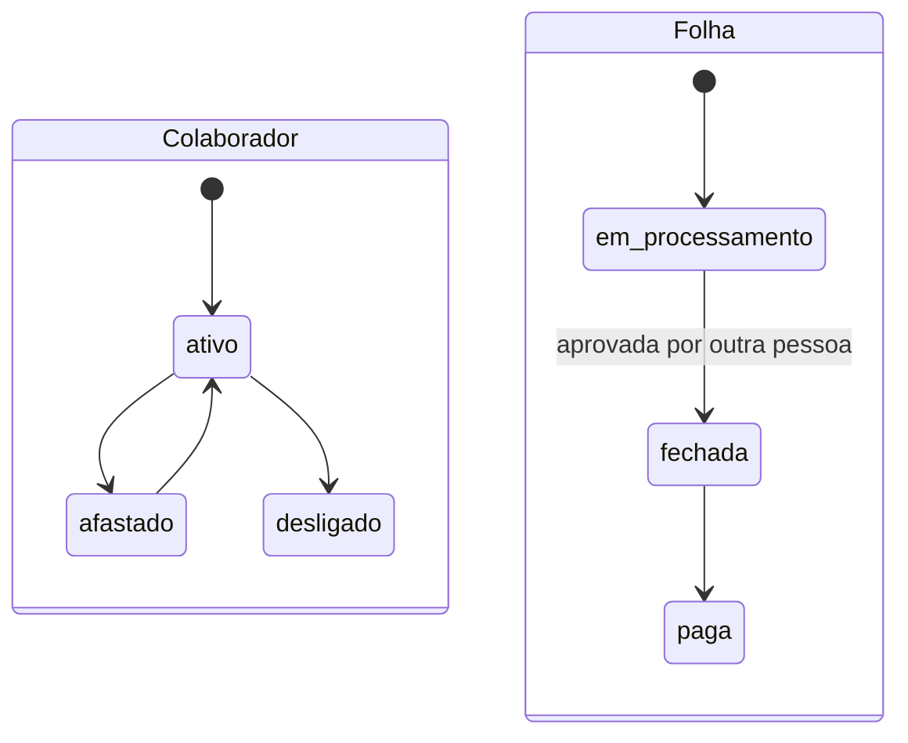

**Regras principais**
- Folha fechada não é alterada; correção é folha complementar ([17](#doc-17), seção 3.3).
- Quem processa a folha não a aprova ([39](#doc-39), seção 7).
- ASO, CID e prontuário só pelo médico do trabalho; RH e gestão veem apto ou inapto ([39](#doc-39), [52](#doc-52)).

<a id="doc-39"></a>

## 39 — Departamento Pessoal, Recursos Humanos e Medicina do Trabalho, por Portal

> Parte do [SDD v2](#doc-00). Regras atuais de RH e Pessoas em [17](#doc-17), seção 3, e [18](#doc-18), seção 3. Medicina e segurança em [17](#doc-17), seção 5. Integrações e eSocial em [16](#doc-16), seção 6 (D-08) e em [14](#doc-14). Dado de saúde em [07](#doc-07), seção 2. Planejamento de desenvolvimento em [37](#doc-37), seção 4. Prestadores em [38](#doc-38).
> **Status:** análise e especificação proposta, criada em 03/11/2026 a partir de [`spec_gestao_pessoas_completo.md`](#v1-spec-gestao-pessoas-completo-md) (1.217 linhas), [`spec_gestao_rh_completo.md`](#v1-spec-gestao-rh-completo-md) e [`spec_gestao_seguranca_medicina_trabalho_completo.md`](#v1-spec-gestao-seguranca-medicina-trabalho-completo-md). Itens **(verificar)** dependem de conferência de norma trabalhista, previdenciária ou de saúde. Não é parecer.

---

### 1. Resposta direta

> **Leitura (04/11/2026):** esta tabela registra o que existia no SDD antes deste documento ser escrito. Os itens marcados como **Não** ou **Parcial** são especificados nas seções seguintes deste documento, exceto o que estiver listado na seção de pendências.

| Área | Completa? | Principal falha |
|---|---|---|
| Departamento pessoal (admissão, folha, férias, rescisão, benefícios, ponto) | **Não** | Sem regras de folha, rescisão e admissão. eSocial só cobre SST (S-2220, S-2230, S-2240), não cobre admissão, remuneração, pagamento e desligamento |
| Recursos humanos (recrutamento, onboarding, desempenho, clima, treinamento) | **Não** | Duplicidade com Pessoas (T-07) ainda sem decisão. Sem regra de recrutamento, onboarding, clima ou avaliação |
| Medicina e segurança do trabalho | **Parcial** | Regras de ASO, CAT, EPI, NR e afastamento existem ([17](#doc-17), seção 5). Faltam PCMSO, PGR/GHE, LTCAT, CIPA e ergonomia. **Falha de privacidade:** a v1 dá ao RH e à gestão a permissão "SST — Gerenciar" e mostra CID no cadastro de exame |
| Organização por portal | **Não** | Os três assuntos aparecem em portais diferentes na v1 sem regra clara de quem vê o quê |

---

### 2. Organização: um módulo, submódulos e donos

**Decisão proposta (já registrada como T-07 em [18](#doc-18)):** RH e Pessoas são **um único módulo HCM**, com estes submódulos:

| Submódulo | Dono | Banco |
|---|---|---|
| Cadastro e vínculo (colaborador, cargo, unidade, documentos) | HCM | Banco da unidade ([03](#doc-03)) |
| Departamento pessoal (admissão, folha, férias, rescisão, benefícios, ponto) | HCM | Banco da unidade |
| Recursos humanos (recrutamento, onboarding, desempenho, clima, treinamento) | HCM | Banco da unidade |
| Medicina e segurança do trabalho | SST | Banco da unidade, com acesso restrito (seção 5) |

Dados civis do colaborador ficam no banco de identidade da entidade, como manda D-19 ([14](#doc-14), seção 3). O HCM referencia `person_id`.

---

### 3. Departamento pessoal

#### 3.1 Admissão

| Etapa | Regra |
|---|---|
| Cadastro | Dados civis no banco de identidade. Dados contratuais no banco da unidade |
| Documentos | Obrigatórios por cargo. Admissão bloqueada se faltar documento ([18](#doc-18), seção 3) |
| Exame admissional | Agendado pelo SST. Admissão só com ASO apto ([17](#doc-17), seção 5) |
| Registro | Evento de admissão para o eSocial (S-2200) **(verificar)** |

#### 3.2 Folha

**Estados (v2, já definidos):** `em_processamento`, `fechada`, `paga`. Folha fechada não é alterada; a correção é folha complementar ([17](#doc-17), seção 2).

**Lacunas:**

| # | Falta | Origem |
|---|---|---|
| DP-01 | Catálogo de verbas (proventos, descontos, informativos), com natureza e incidência de INSS, FGTS e IRRF | v1, seção 9.3 |
| DP-02 | Fórmulas de cálculo versionadas, com vigência. Tabela de INSS e IRRF por competência | **(verificar)** |
| DP-03 | Processamento por competência e unidade, com pendências bloqueando o fechamento | v1, seção 9.1 |
| DP-04 | Holerite: geração, envio e registro de visualização. Holerite só para o próprio colaborador | v1, seção 9.2; [17](#doc-17), seção 2 |
| DP-05 | Eventos eSocial de remuneração (S-1200) e de pagamento (S-1210) **(verificar)** | Ausente |

#### 3.3 Férias e afastamentos

- Período aquisitivo e concessivo com cálculo de direito. **(verificar)** art. 130 da CLT e fracionamento. Pendência LAC-12 de [18](#doc-18).
- Programação pelo colaborador ou gestor, com aprovação do RH.
- Afastamento com data fim não anterior ao início e sem sobreposição ([17](#doc-17), seção 5.2).

#### 3.4 Ponto e jornada

- Registro de ponto por unidade. Regras da CLT, com a redação da Lei 13.874/2019 (planalto.gov.br, Conferido em 03/11/2026):
  - O horário de trabalho é anotado em registro de empregados (art. 74, caput).
  - **Estabelecimento com mais de 20 trabalhadores:** anotação obrigatória de entrada e saída, em registro manual, mecânico ou eletrônico, conforme instruções do Ministério, com pré-assinalação do repouso permitida (art. 74, § 2º). O sistema conta os trabalhadores **por estabelecimento** e exige o registro acima de 20. Abaixo disso, o registro fica opcional por unidade.
  - Trabalho fora do estabelecimento: registro em poder do empregado (art. 74, § 3º), por exemplo no aplicativo.
  - **Ponto por exceção:** permitido por acordo individual escrito, convenção ou acordo coletivo (art. 74, § 4º). O sistema só ativa o modo por exceção com o documento do acordo anexado.
  - **Intervalos:** mínimo de 11 horas entre duas jornadas (art. 66). Intervalo de 1 a 2 horas em trabalho contínuo acima de 6 horas, salvo acordo ou contrato coletivo (art. 71, caput), e de 15 minutos quando passar de 4 horas e não exceder 6 (art. 71, § 1º). O sistema alerta a violação, não bloqueia o registro.
  - Requisitos técnicos do registro eletrônico (REP) são da Portaria MTP nº 671/2021 **(verificar)**. Regra do servidor público vem do estatuto do ente **(verificar)** por ente.
  - **Professor de escola particular** (CLT, arts. 317 a 323, texto compilado lido em 03/11/2026 no Planalto):
    - Pode dar aula em mais de um turno no mesmo estabelecimento, sem passar da jornada semanal legal, com intervalo para refeição assegurado e não contado (art. 318, Lei 13.415/2017). O sistema soma as aulas de todos os turnos do professor na unidade e alerta acima da jornada semanal do contrato.
    - Não dá aula nem trabalha em exame aos domingos (art. 319). A grade ([60](#doc-60)) recusa aula de professor no domingo.
    - **Remuneração por aulas semanais**, paga por mês de **quatro semanas e meia** (art. 320, § 1º). Falta desconta as aulas não dadas (§ 2º), salvo até 9 dias por casamento ou luto de cônjuge, pai, mãe ou filho (§ 3º). Aula acima do horário é paga no fim do mês (art. 321). A folha recebe do diário ([61](#doc-61)) as aulas dadas e as excedentes de cada mês.
    - Em exames e férias escolares, recebe a mesma remuneração do período de aulas (art. 322). Em exames, no máximo 8 horas por dia, salvo pagamento de cada hora extra pelo valor de uma aula (§ 1º). Nas férias, só serviço de exame (§ 2º). Dispensa sem justa causa no fim do ano letivo ou nas férias garante essa remuneração (§ 3º).
- Ajuste manual só por RH, com motivo e evento de auditoria ([29](#doc-29)).
- Ponto fechado não é alterado sem ajuste rastreado.
- Entrada e saída pela catraca, quando houver, é fonte auxiliar, não única ([35](#doc-35), seção 3.4).

#### 3.5 Rescisão e desligamento

**Ausente na v2.** Proposta de estados: `solicitado` → `calculado` → `homologado` (se a regra exigir) → `pago` → `encerrado`.

- Cálculo com aviso prévio, férias proporcionais, 13.º e multa do FGTS **(verificar)**.
- Evento de desligamento para o eSocial (S-2299) **(verificar)**.
- Desligamento de quem tem afastamento ativo bloqueado até a regularização.

#### 3.6 Benefícios

Vale-transporte, vale-refeição e plano. Regra de desconto e de elegibilidade por cargo **(verificar)**. Benefício concedido gera evento de folha.

---

### 4. Recursos humanos

| Submódulo | Estado na v2 | Proposta mínima |
|---|---|---|
| Recrutamento | Ausente | Vaga → candidato → entrevista → aprovação → oferta. Estados por etapa. Candidato sem consentimento para guarda de currículo é descartado ao fim do prazo ([07](#doc-07)) |
| Onboarding | Ausente | Checklist de admissão por cargo, com responsável por item. Convite de acesso ao sistema com validade de 72 h ([06](#doc-06)) |
| Desempenho | Ausente | Ciclo, metas e avaliação. Avaliação não altera a nota de desempenho do aluno, nem a folha |
| Clima | Ausente | Pesquisa anônima. Resultado só com mínimo de respostas por grupo, para não identificar pessoa ([19](#doc-19), seção 11) |
| Treinamento e desenvolvimento | Parcial | Ver [37](#doc-37), seção 4 |
| Movimentação interna | Ausente | Transferência de unidade e de cargo, com histórico. Não apaga o histórico anterior |

---

### 5. Medicina e segurança do trabalho

#### 5.1 Regra central de privacidade

**O RH e a gestão não veem diagnóstico, CID ou prontuário.** A v1 dá a eles a permissão "SST — Gerenciar" e mostra CID no cadastro de exame. Correção proposta:

| Papel | Vê | Não vê |
|---|---|---|
| Médico do trabalho | ASO completo, prontuário, CID, restrição detalhada | Nada de outros médicos sem vínculo |
| Técnico de segurança (SESMT) | Ocorrências, EPI, NR, PGR, CAT sem diagnóstico | CID, prontuário |
| RH e gestão | Apto, inapto ou apto com restrição; data de validade do ASO; restrição funcional **sem motivo clínico**; afastamento sem CID | CID, diagnóstico, prontuário |
| Colaborador | O próprio ASO e o próprio resultado | Dado de outro colaborador |
| Auditor | Acesso de leitura com motivo ([29](#doc-29), seção 5) | Conteúdo de dado de saúde |

**Base:** LGPD, art. 11, e o princípio de necessidade ([07](#doc-07), seção 1). A CAT exige CID para o INSS, e isso é emitido pelo médico, não pela gestão **(verificar)**.

**Correção necessária na v1:** a permissão "SST — Gerenciar" deixa de ser concedida por nome de cargo a RH e gestão. Cada portal ou papel que precisa gerir SST recebe a sua própria permissão, limitada ao que esse papel faz (ver seção 11).

#### 5.2 Exames ocupacionais (ASO)

- Tipos: admissional, periódico, retorno ao trabalho, mudança de função e demissional ([17](#doc-17), seção 5.2).
- Vencimento calculado pelo tipo e pela NR aplicável **(verificar)**. Alerta aos 30 dias.
- ASO só é emitido por médico com CRM válido.

#### 5.3 PCMSO, PGR e LTCAT

**Ausentes na v2.** Proposta:

- **PCMSO:** programa anual, com exames e calendário por grupo de risco. Responsável médico.
- **PGR:** inventário de riscos por setor (GHE). Plano de ação com prazo e responsável. Versão vigente única por unidade.
- **LTCAT:** laudo técnico de exposição, com validade. Base de cálculo de adicional de insalubridade e aposentadoria especial **(verificar)**.

Estados do plano de ação: `aberto`, `em_andamento`, `concluido`, `vencido` (calculado, [17](#doc-17), seção 5.3).

#### 5.4 CAT, acidente e afastamento

- CAT com data não futura, testemunhas por CPF válido e ocorrência registrada ([17](#doc-17), seção 5.2).
- CID do acidente vai só para a CAT e para o médico.
- Afastamento gerado pela CAT é do RH ([14](#doc-14), seção 2).
- Envio da CAT ao INSS **(verificar)** o canal e o prazo.

#### 5.5 EPI

Entrega com assinatura. CA com validade. Estoque não negativo ([17](#doc-17), seção 5.2). A entrega é registrada no HCM, e o estoque fica no Suprimentos ([18](#doc-18), seção 6).

#### 5.6 CIPA e ergonomia

**Ausentes.** Proposta: eleição, composição e atas da CIPA **(verificar)** conforme NR-5. Laudo de ergonomia com versão e responsável técnico.

#### 5.7 Treinamento em NR

Validade por NR, com alerta. Treinamento vencido bloqueia a função que exige a NR **(verificar)**.

---

### 6. Por portal

| Portal | Departamento pessoal | Recursos humanos | Medicina e SST |
|---|---|---|---|
| Desenvolvedor | HCM da própria empresa desenvolvedora, se houver equipe própria. Banco master, separado de qualquer entidade | Idem | SST da própria empresa, se houver |
| Gestão | Completo, por permissão ([17](#doc-17), seção 3) | Completo, por permissão | Apto, inapto, restrição, EPI, NR, CAT, afastamento. **Sem CID nem prontuário** |
| Professor | Próprio holerite, férias, ponto e documentos | Próprio plano de desenvolvimento e treinamentos | Próprio ASO e resultado. Ciência de restrição funcional |
| Aluno | Nenhum | Nenhum | Nenhum |
| Responsáveis | Nenhum | Nenhum | Nenhum |
| Terceiros | Nenhum. Contabilidade recebe só totais ([38](#doc-38), seção 3.2) | Nenhum | Clínica de ASO recebe agendamento e devolve resultado ([38](#doc-38), seção 3.11) |

---

### 7. Permissões

A matriz da v1 (seção 20 de [`spec_gestao_pessoas_completo.md`](#v1-spec-gestao-pessoas-completo-md)) é aproveitada, com estas correções:

| Permissão | v1 | Proposta |
|---|---|---|
| SST — Gerenciar | Por papel e portal que precisa (seção 11). RH e gestão não recebem essa permissão | SESMT e médico do trabalho, cada um com escopo próprio. RH e gestão só veem o resultado sem CID |
| Folha — Processar e aprovar | GE, GP, SA | Mantido. Quem processa não aprova ([22](#doc-22), seção 5) |
| Ponto — Ajuste manual | RH e GP | Mantido, com motivo obrigatório |
| Audit Log | SA, GE, GP, AUD | Mantido. Leitura do audit log gera evento ([29](#doc-29), seção 5) |
| Holerite próprio | Todos | Mantido |

---

### 8. Integrações

| Evento | Origem | Destino | Estado |
|---|---|---|---|
| `hcm.employee.created` | HCM | SST (agenda admissional), Financeiro | Definido em [14](#doc-14) |
| `smt.cat.created` | SST | HCM (afastamento) | Definido |
| eSocial S-2200, S-1200, S-1210, S-2299 | HCM | Transmissor | **Ausente.** Só S-2220, S-2230, S-2240 estão definidos |
| `hcm.leave.started` | HCM | Financeiro (folha) | Definido em [14](#doc-14) |

Transmissão do eSocial segue D-08 ([16](#doc-16), seção 6): certificado da entidade, com transmissor da plataforma.

---

### 9. Pendências

| # | Pendência | Tipo |
|---|---|---|
| HCM-01 | RH e Pessoas como módulos separados, com fronteira definida (seção 11) | **Decidido** em 03/11/2026 |
| HCM-02 | Catálogo de verbas e tabelas de INSS, IRRF e FGTS por competência | (verificar) e Documento |
| HCM-03 | Regra de férias, 13.º e rescisão (LAC-12) | (verificar) e (jurídico) |
| HCM-04 | Eventos eSocial S-2200, S-1200, S-1210, S-2299 | (verificar) e Documento |
| HCM-05 | Ponto e jornada: regra de registro e controle | **Conferido** em parte em 03/11/2026: CLT, arts. 66, 71 e 74 (seção 3.4). Professor conferido nos arts. 317 a 323. Faltam a Portaria MTP nº 671/2021 (REP) e o estatuto do servidor de cada ente **(verificar)** |
| HCM-06 | Permissão "SST — Gerenciar" por papel e portal que precisa, fora de RH e gestão (seção 11) | **Decidido** em 03/11/2026 |
| HCM-07 | PCMSO, PGR, LTCAT, CIPA e ergonomia: escrever as especificações | **Escrito** em [52](#doc-52). Revisão do owner pendente |
| HCM-08 | Guarda do prontuário médico e de ASO por prazo | **Conferido** em 03/11/2026: no mínimo 20 anos após o desligamento (NR-7, 7.6.1.1). Detalhe em [52](#doc-52), seção 2 |
| HCM-09 | Recrutamento: prazo de guarda de currículo de não contratado (seção 11) | **Incluído.** Valor a fixar pelo (jurídico) |
| HCM-10 | HCM da empresa desenvolvedora e das entidades clientes (seção 11) | **Decidido** em 03/11/2026 |

---

### 10. Critérios de aceite

- [ ] Perfil de RH e de gestão não recebe CID nem prontuário em nenhuma tela ou API (varredura de resposta).
- [ ] ASO com restrição mostra restrição funcional sem motivo clínico para RH e gestão (teste).
- [ ] Folha fechada não é alterada (teste).
- [ ] Ajuste de ponto sem motivo é recusado (teste).
- [ ] Desligamento com afastamento ativo fica bloqueado (teste).
- [ ] Eventos eSocial definidos e testados em homologação antes da produção.
- [ ] Itens **(verificar)** e **[Decisão do autor]** respondidos ou marcados como pendentes no [00](#doc-00).

---

### 11. Decisões de 03/11/2026

**HCM-01 (RH e Pessoas): módulos separados.** Cada um tem suas telas, permissões e dados próprios. O vínculo entre eles é só por referência à pessoa, sem cópia de dado.

| Módulo | Dono de | Não é dono de |
|---|---|---|
| RH | Recrutamento, onboarding, avaliação de desempenho, clima, movimentação interna | Folha, admissão no eSocial, cadastro civil |
| Pessoas (DP) | Cadastro funcional, folha, férias, rescisão, eSocial, ponto | Processo seletivo, avaliação, clima |

Quando um candidato é contratado, o RH passa a pessoa para Pessoas por referência. O cadastro funcional nasce em Pessoas, não no RH.

**HCM-06 (permissão "SST — Gerenciar"): por papel e por portal, não por cargo.** Não há uma permissão geral de SST para RH ou gestão. Cada papel que precisa gerir SST recebe permissão própria, limitada ao que faz:

- Médico do trabalho: ASO, prontuário, CID.
- Técnico de SESMT: ocorrências, EPI, NR, PGR, CAT, sem diagnóstico.
- Gestor de RH ou de unidade: resultado apto, inapto ou restrição, validade e afastamento, sem CID nem motivo clínico.

A permissão de cada papel aparece na matriz de permissões do portal onde ela é usada, e não como um item genérico de RH.

**HCM-09 (currículo de candidato não contratado): incluído.** O currículo e os dados do candidato não contratado são guardados por prazo fixo e depois excluídos. **Valor do prazo: (jurídico).** O candidato é informado da guarda no ato de envio. Não há uso desses dados fora do processo seletivo em que se candidatou.

**HCM-10 (HCM da plataforma e dos clientes): dois usos do mesmo módulo, isolados.**

- **Empresa desenvolvedora:** HCM próprio, para os seus funcionários, no portal do desenvolvedor, com dados no banco master e acesso restrito à equipe da própria empresa.
- **Entidades clientes:** cada entidade tem o seu HCM no portal de gestão, com banco da entidade e unidade. Nenhuma entidade vê dado de outra, e a empresa desenvolvedora não acessa o HCM de cliente como funcionário.

<a id="doc-52"></a>

## 52 — Medicina e Segurança do Trabalho: PCMSO, PGR, LTCAT, CIPA e Ergonomia

> Parte do [SDD v2](#doc-00). Regras já existentes de ASO, CAT, EPI e NR em [17](#doc-17), seção 5, e análise por portal em [39](#doc-39), seção 5. Dado de saúde e CID em [07](#doc-07) e no padrão de [39](#doc-39), seção 5.1. Armazenamento de laudo em [21](#doc-21). Auditoria em [29](#doc-29). Fecha HCM-07.
> **Status:** especificação proposta, criada em 03/11/2026. Os nomes e as exigências de cada programa (PCMSO, PGR, LTCAT, CIPA e ergonomia) vêm das normas regulamentadoras e da legislação previdenciária. Cada exigência marcada **(verificar)** precisa de conferência do responsável por norma antes da implementação ([50](#doc-50), seção 6).

---

### 1. Resposta direta

| Programa | Base | O que o sistema faz | Dono |
|---|---|---|---|
| PCMSO | NR-7 **(verificar)** | Planeja e registra exames médicos ocupacionais por função e risco | Médico do trabalho |
| PGR | NR-1 e NR-9 **(verificar)** | Registra riscos ocupacionais, medidas de controle e plano de ação | SESMT e gestão |
| LTCAT | Previdência social **(verificar)** | Laudo técnico de exposição a agentes nocivos, com validade | SESMT |
| CIPA | NR-5 **(verificar)** | Eleição, composição, mandato e atas | Gestão e empregados |
| Ergonomia | NR-17 **(verificar)** | Análise ergonômica do posto e recomendações | SESMT |

---

### 2. PCMSO

- **Programa anual**, com cronograma de exames por função e por exposição.
- Exames previstos: admissional, periódico, de retorno ao trabalho, de mudança de função e demissional (regras já em [17](#doc-17), seção 5.2).
- **Vencimento** de cada exame é calculado pela periodicidade da NR-7, item 7.5.8. Alerta aos 30 dias. Conferido em 03/11/2026 no texto oficial da NR-7 (gov.br, versão atualizada de 2022):

| Exame | Prazo |
|---|---|
| Admissional | Antes de o empregado assumir as atividades (7.5.8, I) |
| Periódico, exposto a risco do PGR ou com doença crônica que aumente a suscetibilidade | A cada ano ou em intervalo menor, a critério do médico responsável (7.5.8, II, a) |
| Periódico, demais empregados | A cada dois anos (7.5.8, II, b) |
| Retorno ao trabalho | Antes de reassumir, quando ausente por 30 dias ou mais por doença ou acidente, ocupacional ou não (7.5.9) |
| Mudança de risco | Antes da data da mudança (7.5.10) |
| Demissional | Até 10 dias após o término do contrato. Dispensado se o último exame clínico tiver menos de 135 dias (grau de risco 1 e 2) ou menos de 90 dias (grau de risco 3 e 4) (7.5.11) |
| Anexos da NR-7 | Periodicidade própria, por exemplo audiometria e espirometria, configurada por risco |

- **ASO:** emitido pelo médico que fez o exame e disponibilizado ao empregado, em papel quando ele pedir (7.5.19). Conteúdo mínimo: organização, nome, CPF e função do empregado, riscos do PGR, exames feitos, apto ou inapto, médico responsável pelo PCMSO e médico examinador (7.5.19.1). O ASO não traz diagnóstico. "Apto com restrição" é registro interno do sistema: no ASO, a aptidão para atividade específica é anotada quando a NR exigir (7.5.19.2).
- **Prontuário:** sob responsabilidade do médico responsável pelo PCMSO (7.6.1). A organização guarda por **no mínimo 20 anos após o desligamento**, salvo prazo diverso nos anexos (7.6.1.1). Na troca de médico, a organização transfere formalmente os prontuários ao sucessor (7.6.1.2). Prontuário eletrônico segue as exigências do Conselho Federal de Medicina (7.6.1.3).
- **Relatório analítico:** anual, pelo médico responsável pelo PCMSO, contado do último relatório (7.6.2).
- **Dispensa:** MEI, ME e EPP de grau de risco 1 e 2 que declararem as informações digitais e não tiverem exposição a agente físico, químico, biológico ou ergonômico ficam dispensadas do PCMSO, mas não dos exames nem do ASO (NR-1, 1.8.6 e 1.8.7.1).
- **Quem vê o quê:** o médico do trabalho acessa o prontuário e o CID. Gestão e RH veem só apto, inapto, apto com restrição e validade ([39](#doc-39), seção 5.1).
- Exame sem médico com CRM válido não é emitido.

Estados do exame: `agendado` → `realizado` → `apto`, `apto_com_restricao` ou `inapto`, e `vencido` calculado por data.

---

### 3. PGR

- **Inventário de riscos** por setor e função: físico, químico, biológico, ergonômico, de acidentes e **fatores de risco psicossociais relacionados ao trabalho**, incluídos no GRO pela Portaria MTE nº 1.419/2024, com o capítulo 1.5 da NR-1 em vigor desde 26/05/2026.
- Cada risco tem **medida de controle**, responsável e prazo.
- **Plano de ação** com estados `aberto`, `em_andamento`, `concluido` e `vencido` (calculado por prazo, como em [17](#doc-17), seção 5).
- Revisão do PGR com data e versão. Versão vigente não muda, e mudança gera nova versão.
- **Prazo de revisão:** a avaliação de riscos é contínua e revista a cada dois anos, ou até 3 anos se a organização tiver certificação em sistema de gestão de SST (NR-1, 1.5.4.4.6 e 1.5.4.4.6.1). Revisão antecipada quando: medida de prevenção implantada, mudança de tecnologia, ambiente, processo ou organização do trabalho, medida ineficaz, acidente ou doença do trabalho, mudança de requisito legal, ou pedido justificado dos trabalhadores ou da CIPA. O sistema calcula o vencimento e abre a revisão quando um desses fatos é registrado.
- **Histórico:** o inventário fica atualizado, e o histórico das atualizações é guardado por no mínimo 20 anos (NR-1, 1.5.7.3.3 e 1.5.7.3.3.1).
- **Dispensa:** o MEI não elabora PGR (1.8.1), mas a contratante o inclui no próprio PGR quando ele atua nas dependências dela (1.8.1.1). ME e EPP de grau de risco 1 e 2 sem exposição a agente físico, químico ou biológico, que declararem as informações digitais, ficam dispensadas do PGR (1.8.4).
- Ocorrência ligada a um risco do inventário. Acidente de trabalho gera CAT ([39](#doc-39), seção 5).

---

### 4. LTCAT

- Laudo por função e setor, com agentes nocivos, intensidade e tempo de exposição.
- **Validade:** a lei não fixa prazo de validade. A empresa mantém o laudo **atualizado**, sob pena da lei (Lei 8.213/1991, art. 58, § 3º). O sistema não calcula vencimento: abre revisão do laudo quando o PGR registra mudança de ambiente, processo ou agente, e lembra a revisão a cada ano como prática de controle. O laudo é expedido por médico do trabalho ou engenheiro de segurança do trabalho (art. 58, § 1º) e diz se há proteção coletiva ou individual que reduza o agente ao limite de tolerância (art. 58, § 2º).
- **PPP:** a empresa mantém o perfil profissiográfico atualizado e entrega cópia ao trabalhador na rescisão (art. 58, § 4º). A entrega por meio eletrônico pelo eSocial **(verificar)**.
- Base para adicional de insalubridade e para aposentadoria especial. Cálculo do adicional é do módulo de folha, a partir do laudo, não do laudo em si.
- O laudo guarda o responsável técnico e o registro profissional.

---

### 5. CIPA

- Nome atual: **Comissão Interna de Prevenção de Acidentes e de Assédio** (NR-5, Portaria MTP nº 4.219/2022).
- **Composição:** por estabelecimento, com representantes da organização e dos empregados, conforme o Quadro I da NR-5 (5.4.1). Os representantes da organização são designados por ela (5.4.3). Estabelecimento fora do Quadro I e sem SESMT nomeia um representante da NR-5 entre os empregados (5.4.13). O MEI está dispensado (5.4.13.2). O número de membros por faixa vem do Quadro I e fica como tabela configurável, carregada a partir do texto oficial.
- **Mandato:** um ano, com uma reeleição (5.4.6). O eleito para cargo de direção não pode ser dispensado sem justa causa desde o registro da candidatura até um ano após o fim do mandato (5.4.12). O sistema marca essa estabilidade no vínculo, para o módulo de pessoal avisar antes de uma rescisão.
- **Eleição:** convocada pelo empregador pelo menos 60 dias antes do fim do mandato (5.5.1), e realizada pelo menos 30 dias antes (5.5.3, f). Inscrição individual por pelo menos 15 dias corridos (5.5.3, b). A eleição vale com participação de pelo menos um terço dos empregados. Abaixo disso, a votação é prorrogada (5.5.4 e 5.5.4.1).
- **Reuniões:** ordinárias mensais, em calendário prévio (5.6.1). Em ME e EPP de grau de risco 1 e 2, podem ser bimestrais (5.6.1.1). Extraordinária em acidente grave ou fatal, ou a pedido de uma das representações (5.6.4).
- **Treinamento:** 8, 12, 16 ou 20 horas, para grau de risco 1, 2, 3 ou 4, com no máximo 8 horas por dia (5.7.4 e 5.7.4.1). Feito antes da posse (5.7.1). Na CIPA em primeiro mandato, em até 30 dias da posse (5.7.1.1).
- **Ata** de cada reunião, assinada pelos presentes e disponível a todos os membros (5.6.3 e 5.6.3.1). Deliberações divulgadas a todos os empregados (5.6.3.2).
- Os encaminhamentos viram plano de ação do PGR, quando houver risco envolvido.
- Eleitor e candidato são empregados do quadro, com vínculo ativo na data da eleição.

---

### 6. Ergonomia

- Análise do posto de trabalho com data, função, responsável técnico e recomendações.
- Recomendação vira ação do plano do PGR, com prazo.
- Afastamento por motivo ergonômico segue a regra de afastamento de [17](#doc-17), seção 5, sem CID para a gestão.

---

### 7. Por portal

| Portal | Pode | Não pode | Origem |
|---|---|---|---|
| **Desenvolvedor** | Nada sobre dado de entidade | Ver PCMSO, PGR, LTCAT, CIPA ou laudo | P |
| **Gestão** | Ver PGR e plano de ação, ver CIPA e atas, ver o resultado de ASO sem motivo clínico, aprovar plano de ação | Ver CID, prontuário ou diagnóstico | E |
| **Médico do trabalho** | Gerir PCMSO, ASO, prontuário e CID dos pacientes da entidade | Ver prontuário de outra entidade | E |
| **SESMT (técnico de segurança)** | Gerir PGR, LTCAT, ergonomia, CAT, EPI e ocorrências, sem diagnóstico | Ver CID ou prontuário | E |
| **RH** | Ver apto, inapto, restrição e validade. Receber afastamento | Ver CID, diagnóstico ou prontuário | E |
| **Colaborador** | Ver o próprio ASO e o resultado | Ver dado de outro colaborador | E |
| **Membro da CIPA** | Ver a própria ata e as atas da CIPA | Ver dado de saúde | E |
| **Terceiros** | Clínica de ASO recebe o agendamento e devolve o resultado ([38](#doc-38)) | Ver PGR, CIPA ou outros colaboradores | E |

---

### 8. Eventos e integrações

| Evento | Produtor | Consumidor | Efeito |
|---|---|---|---|
| `smt.exame.vencendo` | Medicina | Gestão e RH | Alerta de renovação |
| `smt.cat.criada` | SESMT | RH | Abre afastamento, conforme [14](#doc-14) |
| `smt.exame.resultado` | Medicina | RH | Só apto, inapto, restrição e validade. Sem motivo clínico |

Eventos de SST não levam CID no payload ([14](#doc-14), seção 8).

---

### 9. DDL proposto

```sql
CREATE TABLE smt_pcmso_versoes (
  id              BIGINT UNSIGNED AUTO_INCREMENT PRIMARY KEY,
  uuid            CHAR(36) NOT NULL UNIQUE,
  unidade_uuid    CHAR(36) NOT NULL,
  ano             SMALLINT UNSIGNED NOT NULL,
  versao          INT UNSIGNED NOT NULL,
  medico_uuid     CHAR(36) NOT NULL,
  crm_registro    VARCHAR(30) NOT NULL,
  estado          ENUM('rascunho','vigente','substituido') NOT NULL,
  UNIQUE KEY ux_pcmso_ano_versao (unidade_uuid, ano, versao)
) ENGINE=InnoDB DEFAULT CHARSET=utf8mb4;

CREATE TABLE smt_pgr_riscos (
  id              BIGINT UNSIGNED AUTO_INCREMENT PRIMARY KEY,
  uuid            CHAR(36) NOT NULL UNIQUE,
  unidade_uuid    CHAR(36) NOT NULL,
  setor           VARCHAR(120) NOT NULL,
  funcao          VARCHAR(120) NULL,
  tipo_risco      ENUM('fisico','quimico','biologico','ergonomico','acidente') NOT NULL,
  descricao       VARCHAR(500) NOT NULL,
  medida_controle VARCHAR(500) NOT NULL,
  responsavel_uuid CHAR(36) NOT NULL,
  prazo_em        DATE NULL,
  estado          ENUM('aberto','em_andamento','concluido') NOT NULL,
  versao_pgr      INT UNSIGNED NOT NULL,
  INDEX ix_risco_setor (unidade_uuid, setor, estado)
) ENGINE=InnoDB DEFAULT CHARSET=utf8mb4;

CREATE TABLE smt_ltcat (
  id              BIGINT UNSIGNED AUTO_INCREMENT PRIMARY KEY,
  uuid            CHAR(36) NOT NULL UNIQUE,
  unidade_uuid    CHAR(36) NOT NULL,
  funcao          VARCHAR(120) NOT NULL,
  agente_nocivo   VARCHAR(120) NOT NULL,
  intensidade     VARCHAR(60) NOT NULL,
  tempo_exposicao VARCHAR(60) NOT NULL,
  responsavel_tecnico_uuid CHAR(36) NOT NULL,
  registro_profissional VARCHAR(30) NOT NULL,
  emitido_em      DATE NOT NULL,
  valido_ate      DATE NOT NULL
) ENGINE=InnoDB DEFAULT CHARSET=utf8mb4;

CREATE TABLE smt_cipa_mandatos (
  id              BIGINT UNSIGNED AUTO_INCREMENT PRIMARY KEY,
  uuid            CHAR(36) NOT NULL UNIQUE,
  unidade_uuid    CHAR(36) NOT NULL,
  inicio_em       DATE NOT NULL,
  fim_em          DATE NOT NULL,
  estado          ENUM('eleicao','vigente','encerrado') NOT NULL
) ENGINE=InnoDB DEFAULT CHARSET=utf8mb4;

CREATE TABLE smt_cipa_membros (
  id              BIGINT UNSIGNED AUTO_INCREMENT PRIMARY KEY,
  mandato_id      BIGINT UNSIGNED NOT NULL,
  pessoa_uuid     CHAR(36) NOT NULL,
  papel           ENUM('titular','suplente','presidente','vice','secretario') NOT NULL,
  representacao   ENUM('empregador','empregados') NOT NULL,
  UNIQUE KEY ux_cipa_membro (mandato_id, pessoa_uuid),
  CONSTRAINT fk_cipa_mandato FOREIGN KEY (mandato_id) REFERENCES smt_cipa_mandatos (id)
) ENGINE=InnoDB DEFAULT CHARSET=utf8mb4;

CREATE TABLE smt_cipa_atas (
  id              BIGINT UNSIGNED AUTO_INCREMENT PRIMARY KEY,
  uuid            CHAR(36) NOT NULL UNIQUE,
  mandato_id      BIGINT UNSIGNED NOT NULL,
  realizada_em    DATETIME(3) NOT NULL,
  pauta           TEXT NOT NULL,
  encaminhamentos TEXT NULL,
  arquivo_uuid    CHAR(36) NULL,
  CONSTRAINT fk_ata_mandato FOREIGN KEY (mandato_id) REFERENCES smt_cipa_mandatos (id)
) ENGINE=InnoDB DEFAULT CHARSET=utf8mb4;

CREATE TABLE smt_ergonomia_analises (
  id              BIGINT UNSIGNED AUTO_INCREMENT PRIMARY KEY,
  uuid            CHAR(36) NOT NULL UNIQUE,
  unidade_uuid    CHAR(36) NOT NULL,
  funcao          VARCHAR(120) NOT NULL,
  analisado_em    DATE NOT NULL,
  responsavel_tecnico_uuid CHAR(36) NOT NULL,
  recomendacoes   TEXT NOT NULL,
  plano_risco_uuid CHAR(36) NULL
) ENGINE=InnoDB DEFAULT CHARSET=utf8mb4;
```

---

### 10. Pendências

| # | Pendência | Tipo |
|---|---|---|
| SST-01 | Periodicidade de exames por função e risco (seção 2) | **Conferido** em 03/11/2026: NR-7, itens 7.5.8 a 7.5.11 |
| SST-02 | Validade do LTCAT e alerta (seção 4) | **Conferido** em 03/11/2026: sem prazo fixo, laudo mantido atualizado (Lei 8.213/1991, art. 58). PPP pelo eSocial **(verificar)** |
| SST-03 | Eleição e composição da CIPA por porte da entidade (seção 5) | **Conferido** em 03/11/2026: NR-5, itens 5.4 a 5.7. Os números do Quadro I entram como tabela configurável |
| SST-04 | Forma de atualização do PGR e prazo de revisão (seção 3) | **Conferido** em 03/11/2026: NR-1, itens 1.5.4.4.6 e 1.5.7.3.3 |
| SST-05 | Revisão de prazo de guarda de PCMSO e de prontuário (HCM-08) | Norma conferida em 03/11/2026: 20 anos após o desligamento (NR-7, 7.6.1.1). Parecer do (jurídico) sobre outros documentos de SST pendente |

---

### 11. Critérios de aceite

- [ ] Perfil de RH e de gestão não recebe CID nem prontuário (varredura de resposta, já em [39](#doc-39)).
- [ ] Exame sem médico com CRM válido não é emitido (teste).
- [ ] Laudo de LTCAT vencido gera alerta (teste).
- [ ] Versão vigente de PGR não é alterada, e revisão gera nova versão (teste).
- [ ] Ata da CIPA é visível só aos membros e à gestão (teste de isolamento).

## Especificações da v1 desta parte absorvidas no kit-starter ou sem destino

<a id="v1-spec-gestao-pessoas-completo-md"></a>

### v1 — `spec_gestao_pessoas_completo.md` (1257 linhas)

> Situação na v2: Absorvido integralmente no kit-starter. Destino: ficha do kit-starter: `kit-starter/desenvolvedor/pessoas-da-plataforma/departamento-pessoal.md`. Quando este texto diverge da v2, vale a v2.

#### O que a v2 muda nesta especificação

Estas regras prevalecem sobre o texto da v1 que vem a seguir.

- **Módulo separado do RH** (HCM-01 do [39](#doc-39), seção 11): Pessoas é dono de cadastro funcional, folha, férias, rescisão, eSocial e ponto; não é dono de processo seletivo, avaliação e clima. O cadastro funcional nasce aqui, quando o RH passa o candidato contratado por referência.
- **Dados civis** ficam no banco de identidade; o HCM referencia `person_id` (D-19; [14](#doc-14), seção 3). Para a empresa, o banco é o master.
- **Regras do [39](#doc-39), seção 3** prevalecem sobre a v1: admissão, folha (folha fechada não é alterada), férias e afastamentos, ponto e jornada (ajuste manual só com motivo), rescisão (desligamento com afastamento ativo fica bloqueado) e benefícios.
- **Folha:** quem processa não aprova ([22](#doc-22), seção 5; [39](#doc-39), seção 7).
- **Medicina do trabalho:** não aparece aqui com CID nem prontuário; Pessoas recebe só apto, inapto ou restrição sem motivo clínico, validade do ASO e afastamento sem CID ([39](#doc-39), seção 5.1).
- **Perfis da v1:** a matriz de permissões da v1 é aproveitada com as correções da seção 7 do [39](#doc-39); papéis na seção 6 desta ficha.
- **Instância da empresa:** sem filtro de unidade ou entidade; o portal do desenvolvedor não vê o HCM de nenhuma entidade.

#### Texto integral da v1

**Plataforma:** TotusTuusSoftCloud SaaS  
**Stack:** PHP 8 puro · JavaScript Vanilla · Fetch API · Tailwind CSS 4.2 · Supabase · amCharts 5  
**Arquitetura:** Multi-entidade · Multi-unidade · Multi-usuário · Banco segregado por unidade  
**Versão:** 1.0.0 · **Data:** 2026-06-07  
**Autor:** Jefferson Augusto · TotusTuusSoftCloud  

- Language Standard: Global English
---

#### Sumário

1. [Visão Geral](#visão-geral)
2. [Mapa de Páginas](#mapa-de-páginas)
3. [Dashboard Principal](#dashboard-principal)
4. [Colaboradores](#colaboradores)
5. [Recrutamento e Seleção](#recrutamento-e-seleção)
6. [Onboarding e Offboarding](#onboarding-e-offboarding)
7. [Cargos e Salários](#cargos-e-salários)
8. [Ponto e Jornada](#ponto-e-jornada)
9. [Folha de Pagamento](#folha-de-pagamento)
10. [Férias e Afastamentos](#férias-e-afastamentos)
11. [Treinamento e Desenvolvimento](#treinamento-e-desenvolvimento)
12. [Avaliação de Desempenho](#avaliação-de-desempenho)
13. [Benefícios](#benefícios)
14. [Saúde e Segurança do Trabalho](#saúde-e-segurança-do-trabalho)
15. [Documentos e Contratos RH](#documentos-e-contratos-rh)
16. [Relatórios e Analytics](#relatórios-e-analytics)
17. [Automações](#automações)
18. [API REST](#api-rest)
19. [Schema SQL](#schema-sql)
20. [RBAC — Perfis e Permissões](#rbac)
21. [LGPD / Compliance](#lgpd--compliance)
22. [Critérios de Aceite](#critérios-de-aceite)

---

#### 1. Visão Geral

##### Descrição
Módulo completo de Gestão de Capital Humano (HCM/RH) para gestão de colaboradores, recrutamento, folha de pagamento, ponto eletrônico, treinamentos, avaliações de desempenho, benefícios e saúde/segurança do trabalho (SST). Opera em contexto multi-entidade e multi-unidade.

##### Perfis de Acesso (RBAC)
| Código | Perfil               | Nível de Acesso                                  |
|--------|----------------------|--------------------------------------------------|
| SA     | Super Admin          | Acesso total a todas entidades e unidades        |
| GE     | Gestor de Entidade   | Acesso total à entidade                          |
| GP     | Gestor de Pessoas    | Acesso total ao módulo RH                        |
| GU     | Gestor de Unidade    | Acesso restrito à unidade                        |
| RH     | Analista RH          | Operações RH sem exclusão e sem folha            |
| FIN    | Financeiro           | Leitura folha, benefícios, provisões             |
| COL    | Colaborador          | Autoatendimento (próprios dados, holerite, férias)|
| AUD    | Auditor              | Leitura total + audit_log                        |

##### Rotas Base
```
/pessoas/dashboard
/pessoas/colaboradores
/pessoas/recrutamento
/pessoas/onboarding
/pessoas/cargos-salarios
/pessoas/ponto-jornada
/pessoas/folha
/pessoas/ferias-afastamentos
/pessoas/treinamentos
/pessoas/desempenho
/pessoas/beneficios
/pessoas/sst
/pessoas/documentos
/pessoas/relatorios
/pessoas/configuracoes
```

---

#### 2. Mapa de Páginas

```
/pessoas/
├── dashboard/
├── colaboradores/
│   ├── index.php              — Listagem DataTable
│   ├── perfil.php             — Perfil completo colaborador
│   └── organograma.php        — Organograma interativo
├── recrutamento/
│   ├── vagas/index.php        — DataTable vagas
│   ├── candidatos/index.php   — DataTable candidatos
│   └── pipeline/index.php     — Kanban pipeline seleção
├── onboarding/
│   ├── index.php              — Kanban onboarding/offboarding
│   └── checklists/index.php   — DataTable checklists
├── cargos-salarios/
│   ├── cargos/index.php       — DataTable cargos
│   ├── faixas/index.php       — DataTable faixas salariais
│   └── estrutura/index.php    — Organograma hierárquico
├── ponto-jornada/
│   ├── registros/index.php    — DataTable batidas
│   ├── espelho/index.php      — Espelho de ponto mensal
│   ├── escalas/index.php      — DataTable escalas/turnos
│   └── ocorrencias/index.php  — DataTable ocorrências
├── folha/
│   ├── processamento/index.php — Kanban processamento folha
│   ├── holerites/index.php    — DataTable holerites
│   ├── eventos/index.php      — DataTable eventos/verbas
│   └── encargos/index.php     — DataTable encargos/FGTS/INSS
├── ferias-afastamentos/
│   ├── ferias/index.php       — DataTable + calendário
│   ├── afastamentos/index.php — DataTable afastamentos
│   └── programacao/index.php  — Calendário anual férias
├── treinamentos/
│   ├── index.php              — DataTable treinamentos
│   ├── turmas/index.php       — DataTable turmas
│   └── presenca/index.php     — Controle presença
├── desempenho/
│   ├── ciclos/index.php       — DataTable ciclos avaliação
│   ├── avaliacoes/index.php   — DataTable avaliações
│   └── metas/index.php        — Kanban metas/OKRs
├── beneficios/
│   ├── planos/index.php       — DataTable planos benefícios
│   └── colaboradores/index.php — DataTable vínculos benefícios
├── sst/
│   ├── exames/index.php       — DataTable exames ocupacionais
│   ├── acidentes/index.php    — DataTable CAT/acidentes
│   └── epi/index.php          — DataTable EPIs
├── documentos/
│   └── index.php              — DataTable documentos RH
└── relatorios/
    └── index.php              — Relatórios e analytics
```

---

#### 3. Dashboard Principal

**Rota:** `/pessoas/dashboard/index.php`

##### Widgets KPI — Linha 1 (6 cards)
| Widget                  | Valor         | Ícone               | Cor      | Tendência |
|-------------------------|---------------|---------------------|----------|-----------|
| Total Colaboradores     | `#total`      | ki-people           | primary  | vs. mês anterior |
| Admissões no Mês        | `#admissoes`  | ki-user-tick        | success  | vs. mês anterior |
| Desligamentos no Mês    | `#demissoes`  | ki-user-minus       | danger   | vs. mês anterior |
| Turnover (%)            | `#turnover`   | ki-arrows-circle    | warning  | vs. trimestre    |
| Headcount Ativo         | `#headcount`  | ki-briefcase        | info     | vs. mês anterior |
| Custo Total RH (R$)     | `#custo_rh`   | ki-dollar           | primary  | vs. mês anterior |

##### Widgets KPI — Linha 2 (6 cards operacionais)
| Widget                     | Métrica           | Ação Rápida                  |
|----------------------------|-------------------|------------------------------|
| Vagas em Aberto            | count vagas        | → /recrutamento/vagas        |
| Onboardings Pendentes      | count onboarding   | → /onboarding                |
| Ponto Irregular Hoje       | count ocorrências  | → /ponto-jornada/ocorrencias |
| Folha em Processamento     | status folha mês   | → /folha/processamento       |
| Treinamentos Vencendo      | próximos 30 dias   | → /treinamentos              |
| Exames Médicos Vencidos    | count vencidos     | → /sst/exames                |

##### Charts amCharts 5
| # | Tipo           | Título                          | Dados                                         |
|---|----------------|---------------------------------|-----------------------------------------------|
| 1 | Line dual-axis | Admissões vs Desligamentos      | 12 meses, linha verde + linha vermelha        |
| 2 | Donut          | Distribuição por Departamento   | % colaboradores por depto                    |
| 3 | Bar Grouped    | Headcount por Unidade           | agrupado por unidade/entidade                 |
| 4 | Bar Horizontal | Top 10 Cargos por Headcount     | ranking cargos mais ocupados                  |
| 5 | Area Stacked   | Custo RH Mensal (Salário+Encargos+Benefícios) | 12 meses stacked |
| 6 | Gauge          | Índice de Turnover              | meta vs realizado, gauge colorido             |

##### DataTable — Admissões e Desligamentos Recentes
- Colunas: Colaborador · Cargo · Departamento · Unidade · Tipo (Admissão/Desligamento) · Data · Responsável · Status
- Filtros: Tipo · Departamento · Unidade · Período
- Ações: Ver perfil · Ver processo

##### Painel de Alertas
- Ponto não registrado (colaboradores sem batida hoje)
- Férias vencendo nos próximos 30 dias
- Exames ocupacionais vencidos ou próximos do vencimento
- Treinamentos obrigatórios pendentes
- Documentos com prazo de validade próximo
- Contratos de experiência vencendo nos próximos 15 dias

---

#### 4. Colaboradores

##### 4.1 Listagem — `/pessoas/colaboradores/index.php`

###### Toolbar
```
[+ Novo Colaborador] [Importar CSV] [Exportar ▾] [Colunas ▾] [Filtros ▾]
```

###### Filtros Avançados (drawer lateral)
- Empresa/Entidade (multi-select)
- Unidade (multi-select)
- Departamento (multi-select)
- Cargo (multi-select)
- Status: Ativo · Férias · Afastado · Desligado
- Tipo Vínculo: CLT · PJ · Estágio · Temporário · Aprendiz
- Período de Admissão (date range)
- Centro de Custo (multi-select)
- Gestor (select)

###### DataTable Colaboradores
| Coluna           | Tipo        | Ordenável | Visível Padrão |
|------------------|-------------|-----------|----------------|
| #ID              | number      | sim       | não            |
| Avatar + Nome    | text+image  | sim       | sim            |
| Matrícula        | text        | sim       | sim            |
| Cargo            | text        | sim       | sim            |
| Departamento     | text        | sim       | sim            |
| Unidade          | text        | sim       | sim            |
| Tipo Vínculo     | badge       | sim       | sim            |
| Data Admissão    | date        | sim       | sim            |
| Status           | badge color | sim       | sim            |
| Gestor Direto    | text        | sim       | não            |
| Salário Base     | currency    | sim       | não (restrito) |
| Ações            | buttons     | não       | sim            |

**Ações por linha:** Ver Perfil · Editar · Afastar · Desligar · Mais (▾ Transferir / Holerites / Documentos)

**Bulk Actions:** Exportar selecionados · Enviar notificação · Atualizar status · Gerar relatório

###### Drawer — Novo/Editar Colaborador
**Abas do drawer:**
1. **Dados Pessoais** — Nome completo · CPF · RG · Data nascimento · Gênero · Estado civil · Nacionalidade · Naturalidade · PIS/NIS · Foto
2. **Dados de Contato** — E-mail pessoal · E-mail corporativo · Telefone · Celular · Endereço completo (CEP, logradouro, número, complemento, bairro, cidade, estado)
3. **Dados Contratuais** — Matrícula · Data admissão · Tipo vínculo · Regime trabalho (CLT/PJ) · CBO · CTPS número/série/UF · Data contrato experiência · Data término experiência · Data efetivação
4. **Cargo e Salário** — Cargo · Departamento · Centro de custo · Unidade · Nível hierárquico · Salário base · Data última promoção · Gestor direto
5. **Dados Bancários** — Banco · Agência · Conta · Tipo conta · Chave PIX
6. **Benefícios** — Selecionar planos ativos (checkbox list)
7. **Documentos** — Upload documentos (RG, CPF, CTPS, comprovante residência, certidões, diplomas)
8. **Acesso ao Sistema** — Criar login · Perfil de acesso · E-mail corporativo · Notificar colaborador

**Validações:**
- CPF: formato + dígito verificador
- PIS: dígito verificador
- CTPS: obrigatório para CLT
- Salário: mínimo maior que piso salarial da categoria
- Data experiência: máximo 90 dias (prorrogável 1× até 90 dias)

##### 4.2 Perfil Completo — `/pessoas/colaboradores/perfil.php?id=:id`

**Layout tipo Supabase Profile Page:**
- Header: foto · nome · cargo · departamento · badges (status, vínculo) · botões ação (Editar · Afastar · Desligar · Holerites)
- Sidebar esquerda: informações pessoais · documentos · contatos de emergência
- Conteúdo principal (abas):
  - **Resumo** — KPIs do colaborador (tempo empresa, salário atual, férias disponíveis, treinamentos concluídos)
  - **Histórico** — Timeline de eventos (admissão, promoções, transferências, afastamentos, demissão)
  - **Documentos** — Lista de documentos com status validade
  - **Holerites** — Lista últimos 12 meses com download PDF
  - **Avaliações** — Histórico de avaliações de desempenho
  - **Treinamentos** — Treinamentos concluídos e pendentes
  - **Benefícios** — Benefícios ativos e histórico
  - **Ponto** — Espelho de ponto do mês atual

##### 4.3 Organograma — `/pessoas/colaboradores/organograma.php`
- Visualização hierárquica interativa (amCharts 5 ForceDirected ou OrgChart)
- Filtros: Entidade · Unidade · Departamento · Nível hierárquico
- Interação: clique no card → abre modal com resumo do colaborador
- Exportar como PNG/SVG/PDF
- Toggle: Visão por departamento / Visão por gestor

---

#### 5. Recrutamento e Seleção

##### 5.1 Vagas — `/pessoas/recrutamento/vagas/index.php`

###### Toolbar
```
[+ Nova Vaga] [Exportar ▾] [Filtros ▾]
```

###### DataTable Vagas
| Coluna            | Tipo        |
|-------------------|-------------|
| Código            | text        |
| Título da Vaga    | text        |
| Departamento      | text        |
| Unidade           | text        |
| Tipo              | badge (Efetivo/Substituição/Estágio/Temp) |
| Modalidade        | badge (Presencial/Híbrido/Remoto) |
| Data Abertura     | date        |
| Prazo Encerramento | date       |
| Candidatos        | number      |
| Status            | badge       |
| Responsável       | text        |
| Ações             | buttons     |

###### Drawer — Nova/Editar Vaga
- Título · Código interno · Departamento · Cargo destino · Unidade · Tipo vaga · Modalidade · Quantidade vagas
- Salário ofertado (ou "a combinar") · Benefícios ofertados
- Descrição da vaga (editor rico) · Requisitos mínimos · Requisitos desejáveis · Atividades
- Responsável pelo processo · Gestor solicitante · Data prevista encerramento
- Status (Rascunho · Publicada · Em Seleção · Encerrada · Cancelada)
- Publicar em portais (checkboxes: site institucional, LinkedIn, Indeed, Gupy)

##### 5.2 Candidatos — `/pessoas/recrutamento/candidatos/index.php`

###### DataTable Candidatos
| Coluna              | Tipo    |
|---------------------|---------|
| Nome                | text    |
| CPF / E-mail        | text    |
| Vaga Aplicada       | text    |
| Data Inscrição      | date    |
| Etapa Atual         | badge   |
| Fonte (Indicação/Portal/LinkedIn) | badge |
| Avaliação (score 0-10) | stars |
| Status              | badge   |
| Responsável         | text    |
| Ações               | buttons |

###### Drawer — Candidato
- Dados pessoais · Currículo (upload/visualização) · LinkedIn URL
- Vaga associada · Etapa atual · Score de triagem
- Histórico de etapas (timeline) · Anotações do recrutador
- Agendar entrevista (data/hora/local/responsável)

##### 5.3 Kanban — Pipeline de Seleção — `/pessoas/recrutamento/pipeline/index.php`

###### Colunas do Kanban
| Coluna              | Cor     | Descrição                                 |
|---------------------|---------|-------------------------------------------|
| Triagem             | gray    | Candidatos recebidos, aguardando triagem  |
| Triagem Aprovada    | blue    | Aprovados na triagem inicial              |
| Teste/Prova         | yellow  | Em processo de avaliação técnica          |
| Entrevista RH       | purple  | Agendados para entrevista com RH          |
| Entrevista Gestor   | indigo  | Entrevista com gestor da área             |
| Proposta Enviada    | cyan    | Proposta de emprego enviada               |
| Contratado          | green   | Aceito e em processo de admissão          |
| Reprovado           | red     | Reprovado em qualquer etapa               |
| Desistência         | orange  | Candidato desistiu do processo            |

**Card do Kanban:**
- Avatar + Nome · Vaga · Score · Data entrada etapa · Responsável · Badge fonte
- Ações rápidas: Ver perfil · Mover etapa · Agendar entrevista · Reprovar

**Controles do Kanban:**
- Filtrar por: Vaga · Responsável · Período · Fonte
- Toggle: Visualização Kanban / DataTable
- Drag & drop entre colunas (atualiza via Fetch PATCH)
- Contador de cards por coluna

---

#### 6. Onboarding e Offboarding

##### 6.1 Kanban — `/pessoas/onboarding/index.php`

###### Colunas Onboarding
| Coluna                   | Cor    |
|--------------------------|--------|
| Pré-Admissão             | gray   |
| Documentação Pendente    | yellow |
| Documentação Completa    | blue   |
| Integração TI            | purple |
| Treinamento Inicial      | indigo |
| Integração Concluída     | green  |

###### Colunas Offboarding
| Coluna                   | Cor    |
|--------------------------|--------|
| Aviso Prévio             | orange |
| Devoluções Pendentes     | yellow |
| Acesso Revogado          | red    |
| Documentação Rescisão    | blue   |
| Homologação Pendente     | purple |
| Desligado                | gray   |

**Card do Kanban:**
- Avatar + Nome · Cargo · Departamento · Data admissão/desligamento
- Checklist de tarefas (progress bar %) · Responsável · Prazo
- Alertas: itens vencidos (badge vermelho)

##### 6.2 Checklists — `/pessoas/onboarding/checklists/index.php`
- Templates de checklist configuráveis por tipo de vínculo
- Drawer CRUD: Nome da tarefa · Responsável · Prazo (dias após admissão) · Obrigatória · Departamento executor
- DataTable: Colaborador · Tipo · Progresso · Itens pendentes · Responsável · Prazo · Status

---

#### 7. Cargos e Salários

##### 7.1 Cargos — `/pessoas/cargos-salarios/cargos/index.php`

###### DataTable Cargos
| Coluna              | Tipo    |
|---------------------|---------|
| Código              | text    |
| Título do Cargo     | text    |
| CBO                 | text    |
| Departamento        | text    |
| Nível Hierárquico   | badge   |
| Colaboradores       | number  |
| Salário Mínimo      | currency|
| Salário Médio       | currency|
| Salário Máximo      | currency|
| Status              | badge   |
| Ações               | buttons |

###### Drawer — Cargo
- Título · Código · CBO · Descrição sumária · Atribuições e responsabilidades (editor)
- Departamento · Área · Nível hierárquico (Jr/Pl/Sr/Coordenador/Gerente/Diretor)
- Competências técnicas requeridas · Competências comportamentais
- Requisito de formação · Requisito de experiência (anos)
- Faixa salarial (mínimo, médio, máximo) · Gratificações e adicionais típicos

##### 7.2 Faixas Salariais — `/pessoas/cargos-salarios/faixas/index.php`
- DataTable: Cargo · Nível · Faixa A (início) · Faixa B · Faixa C (meio) · Faixa D · Faixa E (máximo) · Vigência · Revisão
- Drawer CRUD: definir faixas por cargo/nível com vigência
- Histórico de revisões salariais

##### 7.3 Estrutura Hierárquica — `/pessoas/cargos-salarios/estrutura/index.php`
- Organograma de cargos (visual interativo)
- Filtros por departamento/área
- Exportar PDF

---

#### 8. Ponto e Jornada

##### 8.1 Registros de Ponto — `/pessoas/ponto-jornada/registros/index.php`

###### Toolbar
```
[Importar Registros] [Processar Período ▾] [Exportar ▾] [Filtros ▾]
```

###### DataTable Registros
| Coluna              | Tipo        |
|---------------------|-------------|
| Colaborador         | text        |
| Matrícula           | text        |
| Data                | date        |
| Entrada             | time        |
| Saída Intervalo     | time        |
| Retorno Intervalo   | time        |
| Saída               | time        |
| Horas Trabalhadas   | duration    |
| Horas Previstas     | duration    |
| Diferença           | duration    |
| Ocorrência          | badge       |
| Status              | badge       |
| Ações               | buttons     |

**Filtros:** Colaborador · Departamento · Unidade · Período · Ocorrência · Status

###### Drawer — Ajuste Manual de Ponto
- Colaborador (somente leitura se acessado da linha)
- Data · Tipo batida (Entrada/Saída Intervalo/Retorno Intervalo/Saída)
- Hora original · Nova hora · Motivo do ajuste (select: Esquecimento/Viagem/Home Office/Falha Equipamento/Outro)
- Descrição complementar · Aprovador · Anexar documento justificativo
- Histórico de ajustes anteriores na data

##### 8.2 Espelho de Ponto — `/pessoas/ponto-jornada/espelho/index.php`
- Seletor colaborador + mês/ano
- Tabela mensal: dia · dia semana · jornada prevista · entrada/saídas registradas · horas trabalhadas · saldo · ocorrências · status
- Totalizadores: horas normais · horas extras 50% · horas extras 100% · DSR · faltas · atrasos · banco de horas
- Botão: Fechar Espelho · Enviar para Colaborador · Exportar PDF

##### 8.3 Escalas e Turnos — `/pessoas/ponto-jornada/escalas/index.php`
- DataTable: Nome da escala · Tipo (fixo/variável/turno/12x36/6x1) · Jornada semanal · Colaboradores · Vigência · Status
- Drawer CRUD: definir horários por dia da semana · tolerância · intervalo mínimo/máximo · DSR

##### 8.4 Ocorrências — `/pessoas/ponto-jornada/ocorrencias/index.php`
- DataTable: Colaborador · Data · Tipo ocorrência · Justificativa · Documento · Status (Pendente/Justificado/Injustificado/Aprovado)
- Drawer resolução: aceitar justificativa · reprovar · adicionar observação
- Bulk: aprovar selecionados

---

#### 9. Folha de Pagamento

##### 9.1 Kanban — Processamento — `/pessoas/folha/processamento/index.php`

###### Colunas Kanban Folha
| Coluna                    | Cor     |
|---------------------------|---------|
| Aguardando Fechamento Ponto | gray  |
| Ponto Fechado             | blue    |
| Processando Eventos       | yellow  |
| Aguardando Aprovação      | purple  |
| Aprovada                  | indigo  |
| Geração de Pagamento      | cyan    |
| Paga / Encerrada          | green   |
| Com Pendência             | red     |

**Card do Kanban (por competência/unidade):**
- Competência (mês/ano) · Unidade · Quantidade colaboradores · Valor total bruto
- Responsável · Data processamento · Prazo pagamento · Alertas de pendências

##### 9.2 Holerites — `/pessoas/folha/holerites/index.php`
- DataTable: Colaborador · Matrícula · Competência · Salário Bruto · Descontos · Salário Líquido · Status (Gerado/Enviado/Visualizado) · Ações (Ver · Download PDF · Reenviar)
- Filtros: Competência · Departamento · Unidade · Status
- Bulk: Enviar todos por e-mail/portal

##### 9.3 Eventos e Verbas — `/pessoas/folha/eventos/index.php`
- DataTable: Código · Descrição · Tipo (Provento/Desconto/Informativo) · Natureza · Incidência INSS/FGTS/IRRF · Status
- Drawer CRUD: Cadastro completo de verbas com fórmulas de cálculo

##### 9.4 Encargos — `/pessoas/folha/encargos/index.php`
- DataTable por competência: INSS Patronal · FGTS · RAT/SAT · Terceiros · Total encargos · Guia gerada · Status pagamento
- Resumo: visão consolidada por entidade/unidade
- Drawer: gerar guias DARF/GPS/GFIP

---

#### 10. Férias e Afastamentos

##### 10.1 Férias — `/pessoas/ferias-afastamentos/ferias/index.php`

###### DataTable Férias
| Coluna              | Tipo        |
|---------------------|-------------|
| Colaborador         | text        |
| Período Aquisitivo  | date range  |
| Dias Disponíveis    | number      |
| Dias Vendidos       | number      |
| Data Início Gozo    | date        |
| Data Fim Gozo       | date        |
| Data Pagamento      | date        |
| Status              | badge       |
| Ações               | buttons     |

**Status Férias:** Aquisitivo em Curso · Período Disponível · Programadas · Em Gozo · Concluídas · Vencidas

###### Drawer — Programar Férias
- Colaborador · Período aquisitivo (auto)
- Dias de gozo · Abono pecuniário (dias vendidos, máx 1/3)
- Data início · Data fim (calculada) · Data pagamento (obrigatório: 2 dias antes)
- Gestor aprovador · Observações

###### Alerta: Férias Vencidas
- Widget destacado quando colaborador atingir 24 meses sem férias
- Fila de férias urgentes no dashboard

##### 10.2 Afastamentos — `/pessoas/ferias-afastamentos/afastamentos/index.php`
- DataTable: Colaborador · Tipo (INSS/Acidente/Licença/Outro) · Data Início · Data Retorno Previsto · Data Retorno Real · CID (mascarado LGPD) · Status
- Drawer CRUD: Tipos configuráveis · upload atestado/laudo · protocolo INSS (B31/B91/B94) · impacto folha

##### 10.3 Calendário Férias — `/pessoas/ferias-afastamentos/programacao/index.php`
- Visualização anual em linha do tempo (amCharts 5 timeline/gantt)
- Filtros: Departamento · Unidade · Ano
- Identificação de conflitos (mesmo período, mesmo depto)
- Exportar PDF calendário anual

---

#### 11. Treinamento e Desenvolvimento

##### 11.1 Treinamentos — `/pessoas/treinamentos/index.php`

###### DataTable Treinamentos
| Coluna              | Tipo        |
|---------------------|-------------|
| Código              | text        |
| Nome do Treinamento | text        |
| Tipo (Interno/Externo/EAD) | badge |
| Categoria           | text        |
| Carga Horária       | number      |
| Obrigatório         | boolean     |
| Periodicidade (meses) | number   |
| Inscritos           | number      |
| Concluídos          | number      |
| Status              | badge       |
| Ações               | buttons     |

###### Drawer — Treinamento
- Nome · Código · Tipo · Categoria · Descrição · Objetivo
- Carga horária · Modalidade (Presencial/Online/Híbrido) · Fornecedor/Instrutor
- Obrigatório (sim/não) · Público alvo (cargos/departamentos) · Periodicidade de renovação
- Material de apoio (upload) · Certificado automático (sim/não)

##### 11.2 Turmas — `/pessoas/treinamentos/turmas/index.php`
- DataTable: Treinamento · Turma · Data Início · Data Fim · Local/Link · Vagas · Inscritos · Status
- Drawer: criar turma com calendário de aulas
- Inscrever colaboradores em massa (import CSV ou seleção na datatable)

##### 11.3 Controle de Presença — `/pessoas/treinamentos/presenca/index.php`
- Seletor turma/data
- Listagem colaboradores com toggle presente/ausente
- Observações por colaborador
- Emitir lista de presença PDF
- Emitir certificados em lote (PDF gerado server-side)

---

#### 12. Avaliação de Desempenho

##### 12.1 Ciclos de Avaliação — `/pessoas/desempenho/ciclos/index.php`

###### DataTable Ciclos
| Coluna              | Tipo        |
|---------------------|-------------|
| Nome do Ciclo       | text        |
| Tipo (360°/180°/90°/Autoavaliação) | badge |
| Período             | date range  |
| Colaboradores Avaliados | number  |
| Concluídos (%)      | progress    |
| Status              | badge       |
| Ações               | buttons     |

###### Drawer — Novo Ciclo
- Nome · Período (data início/fim) · Tipo de avaliação
- Formulário de avaliação (construtor de perguntas/critérios com peso)
- Incluir autoavaliação (sim/não) · Avaliação pelo gestor (sim/não) · 360° (sim/não)
- Público alvo (todos / por cargo / por departamento / por unidade)
- Notificações automáticas (e-mail/push)

##### 12.2 Avaliações — `/pessoas/desempenho/avaliacoes/index.php`
- DataTable: Avaliado · Avaliador · Ciclo · Tipo · Nota Final · Status (Pendente/Em Preenchimento/Concluída) · Data conclusão
- Ação: Preencher avaliação (abre formulário inline ou drawer)

##### 12.3 Kanban — Metas e OKRs — `/pessoas/desempenho/metas/index.php`

###### Colunas Kanban Metas
| Coluna         | Cor     |
|----------------|---------|
| Backlog        | gray    |
| Em Progresso   | blue    |
| Em Revisão     | yellow  |
| Concluída      | green   |
| Cancelada      | red     |

**Card de Meta:**
- Título da meta · Responsável · Período · Indicador KPI · Progresso (%) · Prazo

---

#### 13. Benefícios

##### 13.1 Planos de Benefícios — `/pessoas/beneficios/planos/index.php`

###### DataTable Planos
| Coluna              | Tipo    |
|---------------------|---------|
| Nome do Benefício   | text    |
| Tipo (Saúde/Odonto/VA/VR/Transporte/Seguro/Outro) | badge |
| Fornecedor          | text    |
| Custo Empresa (R$)  | currency|
| Desconto Colaborador (R$) | currency |
| Elegíveis           | number  |
| Ativos              | number  |
| Vigência            | date    |
| Status              | badge   |
| Ações               | buttons |

###### Drawer — Plano Benefício
- Nome · Tipo · Fornecedor/Operadora · CNPJ fornecedor
- Descricão · Regras de elegibilidade (tipo vínculo, tempo empresa, cargo)
- Custo empresa · Desconto colaborador · Forma desconto (fixo/percentual)
- Vigência (início/fim) · Cobertura (colaborador/dependentes)
- Upload apólice/contrato

##### 13.2 Benefícios Colaboradores — `/pessoas/beneficios/colaboradores/index.php`
- DataTable: Colaborador · Benefício · Fornecedor · Vigência · Custo Empresa · Desconto Col. · Status (Ativo/Suspenso/Cancelado)
- Filtros: Tipo benefício · Unidade · Status
- Bulk: suspender/reativar benefícios

---

#### 14. Saúde e Segurança do Trabalho (SST)

##### 14.1 Exames Ocupacionais — `/pessoas/sst/exames/index.php`

###### DataTable Exames
| Coluna              | Tipo        |
|---------------------|-------------|
| Colaborador         | text        |
| Tipo Exame (Adm/Periódico/Retorno/Demissional) | badge |
| Data Realização     | date        |
| Data Vencimento     | date        |
| Médico / Clínica    | text        |
| ASO Resultado (Apto/Inapto/Apto com Restr.) | badge |
| Status              | badge color |
| Ações               | buttons     |

**Alertas visuais:** vencido (vermelho) · vencendo em 30 dias (amarelo)

###### Drawer — Exame
- Colaborador · Tipo exame · Data realização · Próximo vencimento
- Médico/Clínica · CRM médico · Resultado ASO · Restrições
- Upload ASO (PDF) · CID se afastamento (mascarado LGPD)

##### 14.2 Acidentes e CAT — `/pessoas/sst/acidentes/index.php`
- DataTable: Colaborador · Data Acidente · Tipo (Típico/Trajeto/Doença Ocupacional) · CID · CAT Emitida · INSS Comunicado · Dias Afastado · Status
- Drawer CRUD: relatório de acidente completo com circunstâncias, testemunhas, CAT número
- Gerar CAT automático (e-CAT)

##### 14.3 EPIs — `/pessoas/sst/epi/index.php`
- DataTable: Colaborador · EPI · CA (Certificado Aprovação) · Data Entrega · Validade · Devolvido · Responsável
- Drawer CRUD: registrar entrega/devolução de EPI com assinatura digital (canvas)
- Alerta EPIs vencidos ou não entregues

---

#### 15. Documentos e Contratos RH

##### `/pessoas/documentos/index.php`

###### DataTable Documentos
| Coluna              | Tipo        |
|---------------------|-------------|
| Colaborador         | text        |
| Tipo Documento      | badge       |
| Nome Arquivo        | text        |
| Data Upload         | date        |
| Validade            | date        |
| Status Validação    | badge       |
| Responsável         | text        |
| Ações               | buttons     |

**Tipos de documentos:** RG · CPF · CTPS · CNH · Diploma · Certidão civil · ASO · Contrato trabalho · Aditivo · Termo rescisão · Certificados treinamento · Outros

###### Drawer — Documento
- Colaborador · Tipo · Descrição · Data emissão · Data validade
- Upload arquivo (PDF/JPEG/PNG, máx 10MB) · Validado (sim/não) · Observações

###### Controles extras
- Alerta documentos vencendo (30/15/7 dias)
- Exportar pasta ZIP com documentos do colaborador
- Histórico de versões de documentos

---

#### 16. Relatórios e Analytics

##### `/pessoas/relatorios/index.php`

###### Relatórios Disponíveis
| Relatório                          | Filtros Principais                    | Exportação       |
|------------------------------------|---------------------------------------|------------------|
| Headcount por Período              | Entidade, Unidade, Depto, Data        | Excel/CSV/PDF    |
| Admissões e Demissões              | Período, Tipo, Motivo                 | Excel/CSV/PDF    |
| Turnover Mensal/Anual              | Período, Departamento, Cargo          | Excel/PDF        |
| Custo de Pessoal Consolidado       | Competência, Unidade, CC             | Excel/PDF        |
| Folha Analítica                    | Competência, Colaborador, Verba       | Excel/PDF        |
| Banco de Horas                     | Colaborador, Período, Unidade         | Excel/PDF        |
| Absenteísmo                        | Período, Tipo ocorrência, Depto       | Excel/PDF        |
| Férias Pendentes / Vencidas        | Unidade, Departamento                 | Excel/PDF        |
| Exames Vencidos / Próximos         | Tipo, Unidade, Período                | Excel/PDF        |
| Treinamentos por Colaborador       | Treinamento, Período, Status          | Excel/PDF        |
| Avaliações de Desempenho           | Ciclo, Departamento, Nota             | Excel/PDF        |
| Declaração de Benefícios           | Colaborador, Competência              | PDF              |
| RAIS (layout oficial)              | Ano base, Entidade                    | TXT (RAIS)       |
| CAGED (layout oficial)             | Competência, Entidade                 | TXT (CAGED)      |
| eSocial — eventos pendentes        | Competência, Tipo evento              | XML/Visualização |
| DIRF                               | Ano base                              | TXT (DIRF)       |

---

#### 17. Automações

##### 17.1 Engine de Automações
- Trigger-based: evento → condição → ação
- Configurável por perfil GP/SA via interface

##### 17.2 Automações Disponíveis

| ID  | Trigger                                     | Condição                          | Ação                                                        |
|-----|---------------------------------------------|-----------------------------------|-------------------------------------------------------------|
| A01 | Admissão registrada                         | Tipo vínculo = CLT                | Criar checklist onboarding · Notificar TI · Agendar exame admissional |
| A02 | Data = 15 dias antes fim experiência        | Status = Ativo                    | Notificar gestor para decisão de efetivação/desligamento    |
| A03 | Desligamento registrado                     | Sempre                            | Criar checklist offboarding · Revogar acessos · Notificar TI/Financeiro |
| A04 | Período aquisitivo completado (12 meses)    | Status = Ativo                    | Notificar RH e gestor · Atualizar saldo férias              |
| A05 | Férias não programadas com 60+ dias aviso   | Saldo ≥ 30 dias                   | Alertar RH e gestor com urgência                            |
| A06 | Exame médico vencido                        | Data vencimento < hoje            | Notificar RH · Badge alerta no perfil do colaborador        |
| A07 | Treinamento obrigatório vencendo            | 30 dias antes vencimento          | Notificar colaborador e RH · Criar tarefa no onboarding     |
| A08 | Fechamento de ponto mensal                  | Dia = config empresa              | Iniciar processamento de folha · Notificar RH               |
| A09 | Avaliação de desempenho não concluída       | 3 dias antes do prazo             | Notificar avaliador por e-mail/push                         |
| A10 | Aniversário de empresa (N anos)             | Configurável por entidade         | Notificar RH · Gerar badge/certificado de tempo de casa     |
| A11 | Colaborador atingir piso faixa salarial     | Revisão anual programada          | Notificar GP para revisão salarial                          |
| A12 | CAT registrada (acidente)                   | Sempre                            | Notificar SESMT · Iniciar comunicação eSocial               |
| A13 | Documento vencendo em 30 dias               | Tipo = ASO/CNH/Certidão           | Notificar colaborador e RH para renovação                   |
| A14 | Folha aprovada                              | Status = Aprovada                 | Gerar arquivo de pagamento · Notificar financeiro           |

##### 17.3 Configuração de Automações
- Ativar/desativar por entidade/unidade
- Definir canal de notificação: e-mail · push interno · webhook · SMS (externo)
- Delay configurável (imediato / X horas / X dias)
- Log de execuções (sucesso/falha) auditável

---

#### 18. API REST

##### Padrão
```
Base URL: /api/v1/pessoas/
Auth: Bearer JWT (header Authorization)
Content-Type: application/json
Rate Limit: 1000 req/min por token
```

##### Endpoints Principais

| Método | Rota                                      | Descrição                          | Permissão |
|--------|-------------------------------------------|------------------------------------|-----------|
| GET    | /colaboradores                            | Listar colaboradores               | GP/GU/RH  |
| POST   | /colaboradores                            | Criar colaborador                  | GP        |
| GET    | /colaboradores/:id                        | Detalhes colaborador               | GP/GU/RH  |
| PUT    | /colaboradores/:id                        | Atualizar colaborador              | GP        |
| DELETE | /colaboradores/:id                        | Desativar colaborador              | SA/GE     |
| GET    | /colaboradores/:id/historico              | Timeline histórico                 | GP/RH     |
| GET    | /colaboradores/:id/documentos             | Documentos do colaborador          | GP/RH     |
| POST   | /colaboradores/:id/documentos             | Upload documento                   | GP/RH     |
| GET    | /colaboradores/:id/holerites              | Holerites do colaborador           | GP/FIN/COL|
| GET    | /recrutamento/vagas                       | Listar vagas                       | GP/RH     |
| POST   | /recrutamento/vagas                       | Criar vaga                         | GP        |
| PUT    | /recrutamento/vagas/:id                   | Atualizar vaga                     | GP        |
| GET    | /recrutamento/candidatos                  | Listar candidatos                  | GP/RH     |
| POST   | /recrutamento/candidatos                  | Criar candidato                    | GP/RH     |
| PATCH  | /recrutamento/candidatos/:id/etapa        | Mover etapa kanban                 | GP/RH     |
| GET    | /ponto/registros                          | Listar registros ponto             | GP/GU/RH  |
| POST   | /ponto/registros                          | Criar batida manual                | GP        |
| PUT    | /ponto/registros/:id                      | Ajustar batida                     | GP        |
| GET    | /ponto/espelho/:colaborador_id/:mes       | Espelho mensal                     | GP/RH/COL |
| GET    | /folha                                    | Listar folhas por competência      | GP/FIN    |
| POST   | /folha/processar                          | Iniciar processamento              | GP        |
| PATCH  | /folha/:id/aprovar                        | Aprovar folha                      | GE/GP     |
| GET    | /folha/:id/holerites                      | Holerites da competência           | GP/FIN    |
| GET    | /ferias                                   | Listar férias                      | GP/GU/RH  |
| POST   | /ferias                                   | Programar férias                   | GP        |
| PUT    | /ferias/:id                               | Atualizar programação              | GP        |
| GET    | /afastamentos                             | Listar afastamentos                | GP/GU/RH  |
| POST   | /afastamentos                             | Registrar afastamento              | GP/RH     |
| GET    | /treinamentos                             | Listar treinamentos                | GP/RH/COL |
| POST   | /treinamentos/turmas/:id/presenca         | Registrar presença                 | GP/RH     |
| GET    | /desempenho/ciclos                        | Listar ciclos                      | GP/RH     |
| POST   | /desempenho/avaliacoes                    | Salvar avaliação                   | GP/RH/COL |
| GET    | /beneficios/planos                        | Listar planos                      | GP/FIN    |
| POST   | /sst/exames                               | Registrar exame                    | GP/RH     |
| GET    | /sst/exames/vencidos                      | Exames vencidos                    | GP/RH     |
| GET    | /relatorios/:tipo                         | Gerar relatório                    | GP/FIN/AUD|
| GET    | /dashboard/kpis                           | KPIs do dashboard                  | GP/GU     |
| POST   | /automacoes/:id/executar                  | Executar automação manualmente     | SA/GP     |

---

#### 19. Schema SQL

```sql
-- Tabela principal de colaboradores
CREATE TABLE hcm_employees (
    id              BIGINT UNSIGNED AUTO_INCREMENT PRIMARY KEY,
    uuid            CHAR(36) NOT NULL UNIQUE DEFAULT (UUID()),
    entity_id       BIGINT UNSIGNED NOT NULL,
    unit_id         BIGINT UNSIGNED NOT NULL,
    user_id         BIGINT UNSIGNED NULL,        -- link para users (login sistema)
    registration    VARCHAR(20) NOT NULL,         -- matrícula
    full_name       VARCHAR(150) NOT NULL,
    cpf             VARCHAR(14) NOT NULL,         -- criptografado (LGPD)
    rg              VARCHAR(20) NULL,             -- criptografado (LGPD)
    birth_date      DATE NULL,                    -- criptografado (LGPD)
    gender          ENUM('M','F','NB','NI') DEFAULT 'NI',
    marital_status  ENUM('solteiro','casado','divorciado','viuvo','uniao_estavel','outro') NULL,
    nationality     VARCHAR(50) DEFAULT 'brasileiro',
    pis_nis         VARCHAR(11) NULL,             -- criptografado (LGPD)
    email_personal  VARCHAR(150) NULL,            -- criptografado (LGPD)
    email_corporate VARCHAR(150) NULL,
    phone           VARCHAR(20) NULL,
    mobile          VARCHAR(20) NULL,
    address_zip     VARCHAR(9) NULL,
    address_street  VARCHAR(200) NULL,
    address_number  VARCHAR(10) NULL,
    address_complement VARCHAR(50) NULL,
    address_neighborhood VARCHAR(100) NULL,
    address_city    VARCHAR(100) NULL,
    address_state   CHAR(2) NULL,
    photo_path      VARCHAR(255) NULL,
    -- Dados contratuais
    admission_date  DATE NOT NULL,
    contract_type   ENUM('clt','pj','estagio','temporario','aprendiz','autonomo') NOT NULL,
    work_regime     ENUM('presencial','hibrido','remoto') DEFAULT 'presencial',
    ctps_number     VARCHAR(20) NULL,
    ctps_series     VARCHAR(10) NULL,
    ctps_uf         CHAR(2) NULL,
    experience_end_date DATE NULL,
    effective_date  DATE NULL,
    termination_date DATE NULL,
    termination_reason VARCHAR(100) NULL,
    termination_type ENUM('voluntario','involuntario','acordo','aposentadoria','morte','outro') NULL,
    status          ENUM('ativo','ferias','afastado','desligado','suspenso') DEFAULT 'ativo',
    -- Cargo e depto
    job_id          BIGINT UNSIGNED NULL,
    department_id   BIGINT UNSIGNED NULL,
    cost_center_id  BIGINT UNSIGNED NULL,
    manager_id      BIGINT UNSIGNED NULL,
    -- Salário
    base_salary     DECIMAL(12,2) NULL,          -- criptografado (LGPD)
    salary_date     DATE NULL,
    -- LGPD
    consent_at      DATETIME NULL,
    consent_ip      VARCHAR(45) NULL,
    anonymized_at   DATETIME NULL,
    -- Controle
    created_by      BIGINT UNSIGNED NULL,
    updated_by      BIGINT UNSIGNED NULL,
    created_at      TIMESTAMP DEFAULT CURRENT_TIMESTAMP,
    updated_at      TIMESTAMP DEFAULT CURRENT_TIMESTAMP ON UPDATE CURRENT_TIMESTAMP,
    deleted_at      TIMESTAMP NULL,
    INDEX idx_entity_unit (entity_id, unit_id),
    INDEX idx_status (status),
    INDEX idx_admission (admission_date),
    INDEX idx_job (job_id)
) ENGINE=InnoDB DEFAULT CHARSET=utf8mb4 COLLATE=utf8mb4_unicode_ci;

-- Cargos
CREATE TABLE hcm_jobs (
    id              BIGINT UNSIGNED AUTO_INCREMENT PRIMARY KEY,
    uuid            CHAR(36) NOT NULL UNIQUE DEFAULT (UUID()),
    entity_id       BIGINT UNSIGNED NOT NULL,
    code            VARCHAR(20) NOT NULL,
    title           VARCHAR(150) NOT NULL,
    cbo             VARCHAR(10) NULL,
    department_id   BIGINT UNSIGNED NULL,
    hierarchy_level ENUM('assistente','analista_jr','analista_pl','analista_sr','especialista','coordenador','supervisor','gerente','diretor','vp','ceo') NOT NULL,
    description     TEXT NULL,
    min_salary      DECIMAL(12,2) NULL,
    mid_salary      DECIMAL(12,2) NULL,
    max_salary      DECIMAL(12,2) NULL,
    status          ENUM('ativo','inativo') DEFAULT 'ativo',
    created_at      TIMESTAMP DEFAULT CURRENT_TIMESTAMP,
    updated_at      TIMESTAMP DEFAULT CURRENT_TIMESTAMP ON UPDATE CURRENT_TIMESTAMP,
    INDEX idx_entity (entity_id)
) ENGINE=InnoDB DEFAULT CHARSET=utf8mb4 COLLATE=utf8mb4_unicode_ci;

-- Registro de ponto
CREATE TABLE hcm_time_records (
    id              BIGINT UNSIGNED AUTO_INCREMENT PRIMARY KEY,
    uuid            CHAR(36) NOT NULL UNIQUE DEFAULT (UUID()),
    employee_id     BIGINT UNSIGNED NOT NULL,
    entity_id       BIGINT UNSIGNED NOT NULL,
    unit_id         BIGINT UNSIGNED NOT NULL,
    record_date     DATE NOT NULL,
    entry           TIME NULL,
    break_start     TIME NULL,
    break_end       TIME NULL,
    exit            TIME NULL,
    worked_minutes  SMALLINT UNSIGNED NULL,
    expected_minutes SMALLINT UNSIGNED NULL,
    balance_minutes SMALLINT NULL,
    occurrence_type ENUM('normal','falta','atraso','hora_extra','abono','feriado','dsrao') DEFAULT 'normal',
    status          ENUM('aberto','ajustado','aprovado','fechado') DEFAULT 'aberto',
    adjustment_reason VARCHAR(200) NULL,
    adjusted_by     BIGINT UNSIGNED NULL,
    adjusted_at     DATETIME NULL,
    created_at      TIMESTAMP DEFAULT CURRENT_TIMESTAMP,
    updated_at      TIMESTAMP DEFAULT CURRENT_TIMESTAMP ON UPDATE CURRENT_TIMESTAMP,
    INDEX idx_employee_date (employee_id, record_date),
    INDEX idx_entity_unit (entity_id, unit_id)
) ENGINE=InnoDB DEFAULT CHARSET=utf8mb4 COLLATE=utf8mb4_unicode_ci;

-- Folha de pagamento
CREATE TABLE hcm_payroll (
    id              BIGINT UNSIGNED AUTO_INCREMENT PRIMARY KEY,
    uuid            CHAR(36) NOT NULL UNIQUE DEFAULT (UUID()),
    entity_id       BIGINT UNSIGNED NOT NULL,
    unit_id         BIGINT UNSIGNED NOT NULL,
    competence      CHAR(7) NOT NULL,            -- YYYY-MM
    payroll_type    ENUM('mensal','ferias','13_primeiro','13_segundo','rescisao','adiantamento') DEFAULT 'mensal',
    status          ENUM('aguardando_ponto','ponto_fechado','processando','aguardando_aprovacao','aprovada','paga','pendencia') DEFAULT 'aguardando_ponto',
    total_gross     DECIMAL(14,2) DEFAULT 0,
    total_discounts DECIMAL(14,2) DEFAULT 0,
    total_net       DECIMAL(14,2) DEFAULT 0,
    total_employees INT UNSIGNED DEFAULT 0,
    payment_date    DATE NULL,
    approved_by     BIGINT UNSIGNED NULL,
    approved_at     DATETIME NULL,
    processed_by    BIGINT UNSIGNED NULL,
    processed_at    DATETIME NULL,
    notes           TEXT NULL,
    created_at      TIMESTAMP DEFAULT CURRENT_TIMESTAMP,
    updated_at      TIMESTAMP DEFAULT CURRENT_TIMESTAMP ON UPDATE CURRENT_TIMESTAMP,
    INDEX idx_entity_competence (entity_id, competence)
) ENGINE=InnoDB DEFAULT CHARSET=utf8mb4 COLLATE=utf8mb4_unicode_ci;

-- Itens da folha (holerite)
CREATE TABLE hcm_payroll_items (
    id              BIGINT UNSIGNED AUTO_INCREMENT PRIMARY KEY,
    payroll_id      BIGINT UNSIGNED NOT NULL,
    employee_id     BIGINT UNSIGNED NOT NULL,
    event_code      VARCHAR(10) NOT NULL,
    event_name      VARCHAR(100) NOT NULL,
    event_type      ENUM('provento','desconto','informativo') NOT NULL,
    reference       DECIMAL(10,4) NULL,           -- horas/dias/percentual
    value           DECIMAL(12,2) NOT NULL,
    inss_incidence  TINYINT(1) DEFAULT 0,
    fgts_incidence  TINYINT(1) DEFAULT 0,
    irrf_incidence  TINYINT(1) DEFAULT 0,
    created_at      TIMESTAMP DEFAULT CURRENT_TIMESTAMP,
    INDEX idx_payroll_employee (payroll_id, employee_id)
) ENGINE=InnoDB DEFAULT CHARSET=utf8mb4 COLLATE=utf8mb4_unicode_ci;

-- Férias
CREATE TABLE hcm_vacations (
    id              BIGINT UNSIGNED AUTO_INCREMENT PRIMARY KEY,
    uuid            CHAR(36) NOT NULL UNIQUE DEFAULT (UUID()),
    employee_id     BIGINT UNSIGNED NOT NULL,
    acquisitive_start DATE NOT NULL,
    acquisitive_end   DATE NOT NULL,
    available_days  TINYINT UNSIGNED DEFAULT 30,
    sold_days       TINYINT UNSIGNED DEFAULT 0,
    start_date      DATE NULL,
    end_date        DATE NULL,
    payment_date    DATE NULL,
    status          ENUM('aquisitivo','disponivel','programadas','em_gozo','concluidas','vencidas') DEFAULT 'aquisitivo',
    approved_by     BIGINT UNSIGNED NULL,
    approved_at     DATETIME NULL,
    notes           TEXT NULL,
    created_at      TIMESTAMP DEFAULT CURRENT_TIMESTAMP,
    updated_at      TIMESTAMP DEFAULT CURRENT_TIMESTAMP ON UPDATE CURRENT_TIMESTAMP,
    INDEX idx_employee (employee_id),
    INDEX idx_status (status)
) ENGINE=InnoDB DEFAULT CHARSET=utf8mb4 COLLATE=utf8mb4_unicode_ci;

-- Afastamentos
CREATE TABLE hcm_absences (
    id              BIGINT UNSIGNED AUTO_INCREMENT PRIMARY KEY,
    uuid            CHAR(36) NOT NULL UNIQUE DEFAULT (UUID()),
    employee_id     BIGINT UNSIGNED NOT NULL,
    absence_type    ENUM('inss_doenca','inss_acidente','maternidade','paternidade','licenca_remunerada','licenca_nao_remunerada','suspensao','outro') NOT NULL,
    cid_code        VARCHAR(10) NULL,             -- criptografado (LGPD)
    start_date      DATE NOT NULL,
    expected_return DATE NULL,
    actual_return   DATE NULL,
    inss_protocol   VARCHAR(30) NULL,
    document_path   VARCHAR(255) NULL,
    status          ENUM('ativo','encerrado','cancelado') DEFAULT 'ativo',
    notes           TEXT NULL,
    created_by      BIGINT UNSIGNED NULL,
    created_at      TIMESTAMP DEFAULT CURRENT_TIMESTAMP,
    updated_at      TIMESTAMP DEFAULT CURRENT_TIMESTAMP ON UPDATE CURRENT_TIMESTAMP,
    INDEX idx_employee (employee_id)
) ENGINE=InnoDB DEFAULT CHARSET=utf8mb4 COLLATE=utf8mb4_unicode_ci;

-- Vagas de recrutamento
CREATE TABLE hcm_job_openings (
    id              BIGINT UNSIGNED AUTO_INCREMENT PRIMARY KEY,
    uuid            CHAR(36) NOT NULL UNIQUE DEFAULT (UUID()),
    entity_id       BIGINT UNSIGNED NOT NULL,
    unit_id         BIGINT UNSIGNED NOT NULL,
    code            VARCHAR(20) NOT NULL,
    title           VARCHAR(150) NOT NULL,
    job_id          BIGINT UNSIGNED NULL,
    department_id   BIGINT UNSIGNED NULL,
    opening_type    ENUM('efetivo','substituicao','estagio','temporario','aprendiz') NOT NULL,
    work_mode       ENUM('presencial','hibrido','remoto') DEFAULT 'presencial',
    quantity        TINYINT UNSIGNED DEFAULT 1,
    salary_from     DECIMAL(12,2) NULL,
    salary_to       DECIMAL(12,2) NULL,
    salary_hidden   TINYINT(1) DEFAULT 0,
    description     LONGTEXT NULL,
    requirements    TEXT NULL,
    desired         TEXT NULL,
    activities      TEXT NULL,
    owner_id        BIGINT UNSIGNED NULL,
    open_date       DATE NOT NULL,
    close_date      DATE NULL,
    status          ENUM('rascunho','publicada','em_selecao','encerrada','cancelada') DEFAULT 'rascunho',
    created_at      TIMESTAMP DEFAULT CURRENT_TIMESTAMP,
    updated_at      TIMESTAMP DEFAULT CURRENT_TIMESTAMP ON UPDATE CURRENT_TIMESTAMP,
    INDEX idx_entity_status (entity_id, status)
) ENGINE=InnoDB DEFAULT CHARSET=utf8mb4 COLLATE=utf8mb4_unicode_ci;

-- Candidatos
CREATE TABLE hcm_candidates (
    id              BIGINT UNSIGNED AUTO_INCREMENT PRIMARY KEY,
    uuid            CHAR(36) NOT NULL UNIQUE DEFAULT (UUID()),
    job_opening_id  BIGINT UNSIGNED NOT NULL,
    full_name       VARCHAR(150) NOT NULL,
    cpf             VARCHAR(14) NULL,             -- criptografado (LGPD)
    email           VARCHAR(150) NULL,            -- criptografado (LGPD)
    phone           VARCHAR(20) NULL,
    linkedin_url    VARCHAR(255) NULL,
    source          ENUM('indicacao','site','linkedin','indeed','gupy','outro') DEFAULT 'outro',
    cv_path         VARCHAR(255) NULL,
    pipeline_stage  ENUM('triagem','triagem_aprovada','teste','entrevista_rh','entrevista_gestor','proposta','contratado','reprovado','desistencia') DEFAULT 'triagem',
    score           TINYINT UNSIGNED NULL,
    notes           TEXT NULL,
    recruiter_id    BIGINT UNSIGNED NULL,
    hired_at        DATETIME NULL,
    status          ENUM('ativo','inativo') DEFAULT 'ativo',
    created_at      TIMESTAMP DEFAULT CURRENT_TIMESTAMP,
    updated_at      TIMESTAMP DEFAULT CURRENT_TIMESTAMP ON UPDATE CURRENT_TIMESTAMP,
    INDEX idx_opening_stage (job_opening_id, pipeline_stage)
) ENGINE=InnoDB DEFAULT CHARSET=utf8mb4 COLLATE=utf8mb4_unicode_ci;

-- Exames ocupacionais
CREATE TABLE hcm_medical_exams (
    id              BIGINT UNSIGNED AUTO_INCREMENT PRIMARY KEY,
    uuid            CHAR(36) NOT NULL UNIQUE DEFAULT (UUID()),
    employee_id     BIGINT UNSIGNED NOT NULL,
    exam_type       ENUM('admissional','periodico','retorno','mudanca_funcao','demissional') NOT NULL,
    exam_date       DATE NOT NULL,
    due_date        DATE NULL,
    doctor_name     VARCHAR(150) NULL,
    clinic          VARCHAR(150) NULL,
    crm             VARCHAR(20) NULL,
    result          ENUM('apto','inapto','apto_restricoes') NOT NULL,
    restrictions    TEXT NULL,
    aso_path        VARCHAR(255) NULL,
    created_by      BIGINT UNSIGNED NULL,
    created_at      TIMESTAMP DEFAULT CURRENT_TIMESTAMP,
    updated_at      TIMESTAMP DEFAULT CURRENT_TIMESTAMP ON UPDATE CURRENT_TIMESTAMP,
    INDEX idx_employee (employee_id),
    INDEX idx_due_date (due_date)
) ENGINE=InnoDB DEFAULT CHARSET=utf8mb4 COLLATE=utf8mb4_unicode_ci;

-- Treinamentos
CREATE TABLE hcm_trainings (
    id              BIGINT UNSIGNED AUTO_INCREMENT PRIMARY KEY,
    uuid            CHAR(36) NOT NULL UNIQUE DEFAULT (UUID()),
    entity_id       BIGINT UNSIGNED NOT NULL,
    code            VARCHAR(20) NOT NULL,
    name            VARCHAR(200) NOT NULL,
    training_type   ENUM('interno','externo','ead','outro') NOT NULL,
    category        VARCHAR(100) NULL,
    description     TEXT NULL,
    workload_hours  DECIMAL(6,2) NULL,
    modality        ENUM('presencial','online','hibrido') DEFAULT 'presencial',
    mandatory       TINYINT(1) DEFAULT 0,
    renewal_months  TINYINT UNSIGNED NULL,
    status          ENUM('ativo','inativo') DEFAULT 'ativo',
    created_at      TIMESTAMP DEFAULT CURRENT_TIMESTAMP,
    updated_at      TIMESTAMP DEFAULT CURRENT_TIMESTAMP ON UPDATE CURRENT_TIMESTAMP
) ENGINE=InnoDB DEFAULT CHARSET=utf8mb4 COLLATE=utf8mb4_unicode_ci;

-- Audit log RH
CREATE TABLE hcm_audit_logs (
    id              BIGINT UNSIGNED AUTO_INCREMENT PRIMARY KEY,
    entity_id       BIGINT UNSIGNED NOT NULL,
    unit_id         BIGINT UNSIGNED NULL,
    user_id         BIGINT UNSIGNED NULL,
    employee_id     BIGINT UNSIGNED NULL,
    action          VARCHAR(50) NOT NULL,
    resource        VARCHAR(50) NOT NULL,
    resource_id     BIGINT UNSIGNED NULL,
    old_data        JSON NULL,
    new_data        JSON NULL,
    ip_address      VARCHAR(45) NULL,
    user_agent      VARCHAR(255) NULL,
    created_at      TIMESTAMP DEFAULT CURRENT_TIMESTAMP,
    INDEX idx_entity (entity_id),
    INDEX idx_employee (employee_id),
    INDEX idx_action_resource (action, resource),
    INDEX idx_created (created_at)
) ENGINE=InnoDB DEFAULT CHARSET=utf8mb4 COLLATE=utf8mb4_unicode_ci;
```

---

#### 20. RBAC — Perfis e Permissões

| Funcionalidade                 | SA  | GE  | GP  | GU  | RH  | FIN | COL | AUD |
|-------------------------------|-----|-----|-----|-----|-----|-----|-----|-----|
| Dashboard                     | ✅  | ✅  | ✅  | ✅  | ✅  | 👁  | 👁  | 👁  |
| Colaboradores — Listar         | ✅  | ✅  | ✅  | ✅  | ✅  | ❌  | 👁  | 👁  |
| Colaboradores — CRUD           | ✅  | ✅  | ✅  | ❌  | 🖊  | ❌  | ❌  | ❌  |
| Desligar colaborador           | ✅  | ✅  | ✅  | ❌  | ❌  | ❌  | ❌  | ❌  |
| Recrutamento completo          | ✅  | ✅  | ✅  | ❌  | ✅  | ❌  | ❌  | 👁  |
| Ponto — Visualizar             | ✅  | ✅  | ✅  | ✅  | ✅  | ❌  | 👁  | 👁  |
| Ponto — Ajuste manual          | ✅  | ✅  | ✅  | ❌  | ✅  | ❌  | ❌  | ❌  |
| Folha — Visualizar             | ✅  | ✅  | ✅  | ❌  | ❌  | 👁  | ❌  | 👁  |
| Folha — Processar/Aprovar      | ✅  | ✅  | ✅  | ❌  | ❌  | ❌  | ❌  | ❌  |
| Holerite próprio               | ✅  | ✅  | ✅  | ✅  | ✅  | ✅  | ✅  | ❌  |
| Férias — Programar             | ✅  | ✅  | ✅  | ✅  | ✅  | ❌  | 🖊  | ❌  |
| Treinamentos — Gerenciar       | ✅  | ✅  | ✅  | ❌  | ✅  | ❌  | 👁  | 👁  |
| Avaliações — Criar ciclo       | ✅  | ✅  | ✅  | ❌  | ✅  | ❌  | ❌  | ❌  |
| Avaliações — Preencher         | ✅  | ✅  | ✅  | ✅  | ✅  | ❌  | ✅  | ❌  |
| Benefícios — Gerenciar         | ✅  | ✅  | ✅  | ❌  | ✅  | 👁  | ❌  | 👁  |
| SST — Gerenciar                | ✅  | ✅  | ✅  | ❌  | ✅  | ❌  | ❌  | 👁  |
| Documentos — Upload            | ✅  | ✅  | ✅  | ❌  | ✅  | ❌  | 🖊  | ❌  |
| Relatórios                     | ✅  | ✅  | ✅  | ✅  | ✅  | 👁  | ❌  | ✅  |
| Automações — Configurar        | ✅  | ✅  | ✅  | ❌  | ❌  | ❌  | ❌  | ❌  |
| Configurações do módulo        | ✅  | ✅  | ✅  | ❌  | ❌  | ❌  | ❌  | ❌  |
| Audit Log                      | ✅  | ✅  | ✅  | ❌  | ❌  | ❌  | ❌  | ✅  |

**Legenda:** ✅ Total · 👁 Somente leitura · 🖊 Próprios dados · ❌ Sem acesso

---

#### 21. LGPD / Compliance

##### Dados Sensíveis Criptografados (AES-256-GCM)
| Campo               | Tabela              | Categoria LGPD         |
|---------------------|---------------------|------------------------|
| cpf                 | hcm_employees       | Dado pessoal identificador |
| rg                  | hcm_employees       | Dado pessoal identificador |
| birth_date          | hcm_employees       | Dado pessoal            |
| pis_nis             | hcm_employees       | Dado pessoal identificador |
| email_personal      | hcm_employees       | Dado pessoal de contato |
| base_salary         | hcm_employees       | Dado financeiro pessoal |
| cid_code            | hcm_absences        | Dado sensível (saúde)   |
| cpf                 | hcm_candidates      | Dado pessoal identificador |
| email               | hcm_candidates      | Dado pessoal de contato |

##### Regras LGPD
- **Consentimento:** `consent_at` + `consent_ip` registrado na admissão e atualizado a cada revisão de política
- **Portabilidade:** Endpoint `GET /api/v1/pessoas/colaboradores/:id/dados-pessoais` exporta todos os dados em JSON estruturado
- **Eliminação:** `DELETE` (soft delete + anonimização) aplica `anonymized_at`; após 5 anos de desligamento, dados pessoais são substituídos por hash irreversível
- **Acesso restrito:** Salário e dados de saúde visíveis apenas para GP/SA/GE; CID mascarado na UI (exibe apenas categoria)
- **Auditoria:** 100% das operações em `hcm_audit_logs` com retenção de 10 anos
- **Candidatos:** Dados de candidatos não contratados apagados após 6 meses (automação A15, configurável)
- **Exames:** ASO e resultados médicos com acesso restrito + log de visualização

##### Campos Mascarados na UI
| Campo         | Exibição padrão   | Desmascarar por  |
|---------------|-------------------|------------------|
| CPF           | ***.***.***-**    | SA/GP/GE         |
| Salário       | oculto            | SA/GP/GE/FIN     |
| CID           | Categoria (ex: J) | SA/GP (com log)  |
| Dados bancários | ****...XXXX      | SA/GP            |

---

#### 22. Critérios de Aceite

##### Funcionais
- [ ] Dashboard carrega KPIs em ≤ 1,5s com dados em tempo real
- [ ] DataTable colaboradores suporta ≥ 10.000 registros com paginação server-side
- [ ] Drawer de admissão valida CPF, PIS e CTPS antes de salvar
- [ ] Kanban de recrutamento atualiza status via drag & drop sem reload
- [ ] Espelho de ponto calcula corretamente horas extras 50% e 100%
- [ ] Folha processa corretamente INSS, IRRF e FGTS conforme tabelas vigentes
- [ ] Férias calcula automaticamente período aquisitivo e saldo de dias
- [ ] Automações disparam notificações corretas por canal configurado
- [ ] Exportação CAGED/RAIS gera layout oficial aceito pelo eSocial
- [ ] Perfil do colaborador carrega todas as abas sem erros em contexto multi-entidade

##### Segurança
- [ ] Todos os endpoints validam JWT e perfil RBAC antes de retornar dados
- [ ] Dados criptografados não são expostos em logs ou respostas de erro
- [ ] CPF e dados sensíveis mascarados na UI para perfis não autorizados
- [ ] Audit log registra 100% das operações de escrita com user_id + IP
- [ ] Rate limiting ativo (1000 req/min por token) com resposta 429
- [ ] Upload de documentos validado: tipo MIME + tamanho + scan antivírus (ClamAV)

##### UX / Performance
- [ ] Todos os formulários possuem validação client-side imediata (Vanilla JS)
- [ ] Feedback visual (toast/spinner) em todas as operações assíncronas
- [ ] Kanban responsivo em tablets (min 768px)
- [ ] Drawers fecham ao pressionar ESC ou clicar fora
- [ ] Relatórios com > 5.000 linhas gerados em background com notificação de download
- [ ] Tema claro/escuro respeitado em todos os componentes do módulo

##### Compliance
- [ ] Consentimento LGPD registrado na criação de todo colaborador e candidato
- [ ] Dados de candidatos não contratados expiram em 6 meses (automação ativa)
- [ ] Endpoint de portabilidade retorna todos os dados pessoais em JSON estruturado
- [ ] CID nunca exposto em listagens — somente em visualização individual com log
- [ ] Anonimização automática ativa 5 anos após desligamento

---

*Documento gerado automaticamente — TotusTuusSoftCloud SaaS Platform*  
*Revisão: 1.0.0 · 2026-06-07 · Módulo: HCM/RH — Gestão de Pessoas*

<a id="v1-spec-gestao-rh-completo-md"></a>

### v1 — `spec_gestao_rh_completo.md` (1319 linhas)

> Situação na v2: Absorvido integralmente no kit-starter. Destino: ficha do kit-starter: `kit-starter/desenvolvedor/pessoas-da-plataforma/recursos-humanos.md`. Quando este texto diverge da v2, vale a v2.

#### O que a v2 muda nesta especificação

Estas regras prevalecem sobre o texto da v1 que vem a seguir.

- **Módulo separado de Pessoas** (HCM-01 do [39](#doc-39), seção 11): RH é dono de recrutamento, onboarding, avaliação, clima e movimentação interna; não é dono de folha, admissão no eSocial nem cadastro civil. Candidato contratado passa para Pessoas por referência, sem cópia de dado.
- **Currículo de candidato não contratado** (HCM-09): guardado por prazo fixo e depois excluído; o candidato é informado no envio; nenhum uso fora do processo em que se candidatou.
- **Sem acesso a dado de saúde:** o RH não vê CID, diagnóstico nem prontuário em nenhuma tela ou API ([39](#doc-39), seção 5.1).
- **Avaliação e clima:** formulários pelo motor de formulários e pesquisas ([41](#doc-41)).
- **Perfis da v1:** substituídos pelos papéis da seção 6 desta ficha.
- **Instância da empresa:** sem filtro de unidade ou entidade.

#### Texto integral da v1

Versão: 1.0  
Status: Draft funcional completo  
Módulo: Human Resources / HR / Workforce Management  
Contexto: SaaS multi-entidade, multi-unidade e multi-usuário, com segregação por tenant, controle por RBAC, trilha de auditoria, APIs seguras e interface administrativa padrão enterprise. [cite:1][cite:2][cite:7][web:18][web:21]

- Language Standard: Global English
---

### 1. Visão Geral

#### 1.1 Objetivo
O módulo de Recursos Humanos será responsável por centralizar o ciclo de vida do colaborador dentro da plataforma, desde requisição de vaga, recrutamento, onboarding, cadastro funcional, alocações, documentos, jornada, férias, afastamentos, desempenho, treinamentos, movimentações internas, desligamento e indicadores gerenciais. [web:15][web:20][web:23]

O módulo deve operar de forma integrada com:
- IAM / perfis e permissões
- DP / folha / eventos trabalhistas
- Financeiro / centros de custo / provisões
- Patrimônio / ativos sob responsabilidade
- Compliance / LGPD / retenção documental
- Workflow / aprovações / notificações
- Assinatura eletrônica / aceite de documentos
- Auditoria / logs / trilhas de alteração [cite:2][web:15][web:18][web:21]

#### 1.2 Escopo funcional
O módulo RH deverá contemplar:
- Gestão de colaboradores
- Estrutura organizacional
- Recrutamento e seleção
- Onboarding e offboarding
- Jornada e frequência
- Férias e ausências
- Cargos, trilhas e carreira
- Avaliações e desempenho
- Treinamentos e capacitações
- Documentos e compliance trabalhista
- Solicitações internas de RH
- Indicadores e analytics
- Kanban operacional de admissões, movimentações e pendências [web:15][web:20][web:23]

#### 1.3 Princípios de arquitetura
- Multi-tenant por entidade e multi-unit por unidade
- Todos os registros com `id`, `uuid`, `code`
- APIs REST seguras e versionadas
- Frontend desacoplado consumindo via `fetch`
- Controle forte de escopo por entidade, unidade, departamento e vínculo
- Soft delete quando aplicável
- Auditoria full para operações sensíveis
- Campos internacionais em inglês no banco e endpoints
- UI padronizada conforme design system do sistema [cite:1][cite:2][cite:6][cite:7]

---

### 2. Objetivos de negócio

#### 2.1 Metas operacionais
- Reduzir tempo de admissão
- Diminuir retrabalho cadastral
- Centralizar documentos do colaborador
- Melhorar rastreabilidade de movimentações
- Padronizar solicitações e aprovações
- Aumentar visibilidade de headcount, absenteísmo, turnover e pendências [web:14][web:20][web:23]

#### 2.2 Metas técnicas
- Escalabilidade por tenant
- Segurança por escopo e perfil
- Baixo acoplamento entre páginas
- Componentização de drawers, tabelas, filtros e cards
- Estrutura pronta para internacionalização e integrações futuras [cite:1][cite:2][cite:6]

---

### 3. Perfis e permissões

#### 3.1 Perfis principais
- Super Admin
- Entity Admin
- Unit Admin
- HR Director
- HR Manager
- HR Analyst
- Recruiter
- Department Manager
- Payroll Analyst
- Occupational Health Analyst
- Employee Self-Service
- Auditor / Compliance / DPO
- Readonly Executive [web:15][web:18][web:21]

#### 3.2 Regras de visibilidade
Cada perfil deve possuir acesso por:
- entidade
- unidade
- departamento
- centro de custo
- vínculo funcional
- tipo de dado sensível
- tipo de documento
- ação: view, create, update, approve, export, delete, manage [web:18][web:21]

#### 3.3 Regras especiais
- Dados sensíveis exigem permissão explícita
- Salário, documentos pessoais, dados médicos e dados disciplinares devem ter acesso segregado
- Gestores visualizam apenas subordinados diretos ou indiretos conforme política
- Employee Self-Service visualiza apenas seus próprios dados
- Exportações devem ser registradas com motivo e usuário responsável [web:18][web:21]

#### 3.4 Matriz de permissão mínima
Permissões por recurso:
- `employees.view`
- `employees.create`
- `employees.update`
- `employees.archive`
- `employees.documents.manage`
- `employees.salary.view`
- `employees.sensitive.view`
- `positions.manage`
- `departments.manage`
- `recruitment.manage`
- `onboarding.manage`
- `attendance.view`
- `attendance.adjust`
- `leave.manage`
- `performance.manage`
- `training.manage`
- `movement.approve`
- `termination.manage`
- `reports.export`
- `audit.view` [web:15][web:18][web:21]

---

### 4. Navegação do módulo

#### 4.1 Menu lateral
- Dashboard RH
- Colaboradores
- Estrutura Organizacional
- Recrutamento
- Onboarding
- Jornada e Frequência
- Férias e Ausências
- Cargos e Carreiras
- Desempenho
- Treinamentos
- Documentos RH
- Movimentações
- Desligamentos
- Solicitações RH
- Analytics
- Configurações RH [web:13][web:15][web:20]

#### 4.2 Navegação interna por páginas
Cada página deve conter:
- breadcrumb
- header com título, subtítulo e ações
- toolbar com filtros
- widgets superiores
- área principal com datatable, tabs ou kanban
- drawers laterais para CRUD
- modais apenas para ações críticas
- rodapé técnico com paginação, totalizadores e status de carregamento [cite:6][web:12][web:16]

---

### 5. Dashboard RH

#### 5.1 Objetivo
Entregar visão executiva e operacional do RH com indicadores, alertas, tendências e pendências acionáveis. [web:14][web:20][web:23]

#### 5.2 Widgets obrigatórios
- Total de colaboradores ativos
- Headcount por unidade
- Admissões no mês
- Desligamentos no mês
- Turnover mensal
- Turnover acumulado
- Férias programadas próximas
- Colaboradores com documentos pendentes
- Absenteísmo do período
- Tempo médio de contratação
- Vagas abertas
- Onboardings pendentes
- Avaliações vencidas
- Treinamentos vencendo
- Colaboradores em experiência
- Distribuição por tipo de vínculo [web:14][web:20][web:23]

#### 5.3 Charts obrigatórios
- Linha: evolução de headcount por mês
- Barras: admissões x desligamentos por período
- Donut: distribuição por departamento
- Donut: distribuição por vínculo
- Barras horizontais: turnover por unidade
- Heatmap: ausências por dia/semana
- Barras: vagas por etapa do recrutamento
- Linha: SLA médio de contratação
- Barras empilhadas: status de onboarding
- Radar opcional: competências médias por área [web:14][web:20][web:23]

#### 5.4 Blocos operacionais
- Tarefas pendentes
- Aprovações pendentes
- Alertas críticos
- Aniversariantes
- Experiência vencendo
- Contratos próximos do fim
- Documentos vencidos ou a vencer
- Treinamentos obrigatórios não concluídos [web:20][web:23]

#### 5.5 Filtros do dashboard
- período
- entidade
- unidade
- departamento
- centro de custo
- gestor
- vínculo
- status
- tipo de contratação
- regime de trabalho [web:20][web:23]

---

### 6. Página Colaboradores

#### 6.1 Objetivo
Ser a página central de gestão de pessoas com visão cadastral, contratual, organizacional e operacional. [web:13][web:21]

#### 6.2 Datatable principal
Colunas:
- Foto/avatar
- Matrícula
- Nome completo
- Nome social
- CPF/passaporte mascarado
- Cargo atual
- Departamento
- Gestor imediato
- Unidade
- Tipo de vínculo
- Regime de trabalho
- Data de admissão
- Tempo de empresa
- Status funcional
- Status do onboarding
- Status documental
- Jornada
- Última avaliação
- Score de compliance documental
- Ações [web:13][web:21]

#### 6.3 Recursos da datatable
- busca global
- filtros avançados
- ordenação
- paginação server-side
- colunas fixas
- ocultar/exibir colunas
- salvar visão personalizada
- exportar CSV/XLSX/PDF conforme permissão
- seleção em massa
- bulk actions
- chips por status
- totalizadores no topo
- click row para perfil 360 do colaborador [web:12][web:13]

#### 6.4 Filtros avançados
- entidade
- unidade
- departamento
- centro de custo
- gestor
- cargo
- vínculo
- regime
- sexo
- PCD
- faixa etária
- faixa salarial
- situação contratual
- admissão entre datas
- experiência vencendo
- férias previstas
- documentação pendente
- com/sem avaliação
- com/sem treinamento pendente [web:20][web:23]

#### 6.5 Ações por linha
- visualizar perfil
- editar cadastro
- alterar lotação
- promover / transferir
- anexar documento
- registrar ocorrência
- iniciar férias
- lançar afastamento
- abrir solicitação
- gerar termo
- bloquear acesso
- iniciar desligamento
- arquivar [web:13][web:21]

---

### 7. Perfil 360 do colaborador

#### 7.1 Estrutura da página
Header com:
- foto
- nome
- matrícula
- cargo
- unidade
- gestor
- status
- badges de vínculo e regime
- ações rápidas [cite:4][web:13]

Tabs obrigatórias:
- Resumo
- Dados pessoais
- Dados contratuais
- Organização
- Jornada
- Férias e ausências
- Documentos
- Benefícios
- Treinamentos
- Avaliações
- Movimentações
- Equipamentos
- Solicitações
- Auditoria [cite:4][web:13][web:21]

#### 7.2 Cards da aba Resumo
- dados principais
- próximos eventos
- pendências documentais
- férias futuras
- avaliações pendentes
- treinamentos obrigatórios
- ativos vinculados
- últimas movimentações
- observações internas [cite:4][web:13]

#### 7.3 Controles necessários
- timeline de eventos
- upload de documentos
- aceite digital
- observações privadas por perfil
- histórico completo
- bloqueio de edição em campos sensíveis
- visualização condicional por permissão [cite:4][web:18][web:21]

---

### 8. Estrutura organizacional

#### 8.1 Páginas
- Departamentos
- Cargos
- Funções
- Níveis
- Centros de custo RH
- Organograma
- Gestores e subordinações
- Unidades e lotações [web:13][web:20]

#### 8.2 Datatables
##### Departamentos
- code
- nome
- sigla
- unidade
- gestor responsável
- total de colaboradores
- orçamento vinculado
- status
- ações

##### Cargos
- code
- título do cargo
- família
- nível
- CBO/ocupação
- faixa salarial
- regime aplicável
- requisitos
- status
- ações

##### Organograma
Visualização híbrida:
- árvore hierárquica
- modo grid
- modo lista
- filtros por unidade, área e gestor [web:12][web:13]

#### 8.3 Drawers de CRUD
Campos obrigatórios:
- identificação
- descrições
- vínculo hierárquico
- competências requeridas
- salários/faixas
- regime/jornada
- ativo/inativo
- motivos de inativação
- anexos e observações [web:13][web:21]

---

### 9. Recrutamento e seleção

#### 9.1 Páginas
- Dashboard de recrutamento
- Requisições de vaga
- Banco de vagas
- Pipeline de candidatos
- Banco de talentos
- Entrevistas
- Avaliações
- Propostas
- Aprovações de contratação [web:15][web:20]

#### 9.2 Datatable de vagas
- code
- título da vaga
- departamento
- unidade
- gestor requisitante
- quantidade
- prioridade
- SLA alvo
- status
- etapa atual
- data de abertura
- tempo em aberto
- ações [web:15][web:20]

#### 9.3 Kanban de recrutamento
Colunas:
- Nova candidatura
- Triagem
- Entrevista RH
- Entrevista técnica
- Teste
- Referências
- Proposta
- Aprovado
- Reprovado
- Banco de talentos [web:15][web:16]

Controles do Kanban:
- drag and drop
- limite por coluna opcional
- busca
- filtros rápidos
- comentários
- anexos
- checklist
- scorecard
- mudança em lote
- histórico de mudança
- ordenação por prioridade, SLA e data
- swimlanes por vaga ou recrutador [web:16]

#### 9.4 Drawers de recrutamento
- Nova vaga
- Editar vaga
- Novo candidato
- Agendar entrevista
- Registrar feedback
- Enviar proposta
- Converter para admissão [web:15]

---

### 10. Onboarding

#### 10.1 Objetivo
Controlar a entrada do colaborador com checklist, responsáveis, documentos, acessos, treinamentos e status por etapa. [web:15]

#### 10.2 Páginas
- Dashboard de onboarding
- Onboardings ativos
- Templates de onboarding
- Pendências por responsável
- Kits por cargo/unidade [web:15]

#### 10.3 Kanban de onboarding
Colunas:
- Pré-admissão
- Documentação
- Contrato
- Cadastro em sistemas
- Equipamentos
- Integração
- Treinamentos iniciais
- Concluído
- Bloqueado [web:15][web:16]

#### 10.4 Controles
- checklist por etapa
- responsável por tarefa
- data limite
- anexos
- assinatura/aceite
- dependências entre tarefas
- bloqueios por documento faltante
- gatilho para criação de usuário IAM
- gatilho para solicitação de equipamentos
- gatilho para treinamento obrigatório [web:15][web:16]

---

### 11. Jornada e frequência

#### 11.1 Páginas
- Espelho de ponto
- Ajustes e ocorrências
- Escalas
- Banco de horas
- Faltas e atrasos
- Aprovações de ponto [web:15][web:20]

#### 11.2 Datatable de frequência
- colaborador
- matrícula
- unidade
- escala
- período
- horas previstas
- horas trabalhadas
- extra
- atraso
- falta
- inconsistências
- status de aprovação
- ações [web:20]

#### 11.3 Controles
- filtros por período e gestor
- justificativas
- anexar comprovantes
- aprovação em lote
- recálculo
- travamento por competência
- alerta de extrapolação
- integração futura com relógio/REP [web:20]

---

### 12. Férias e ausências

#### 12.1 Páginas
- Calendário de férias
- Solicitações
- Aprovações
- Saldos
- Afastamentos
- Licenças
- Retornos [web:20][web:23]

#### 12.2 Datatable
- colaborador
- período aquisitivo
- saldo
- data solicitada
- data aprovada
- quantidade de dias
- tipo
- cobertura/substituto
- status
- ações [web:20]

#### 12.3 Controles
- calendário anual
- conflito entre equipes
- bloqueios por período crítico
- aprovação em cadeia
- anexos médicos ou jurídicos
- retorno previsto
- alertas de vencimento de férias [web:20][web:23]

---

### 13. Desempenho

#### 13.1 Páginas
- Ciclos de avaliação
- Avaliações 90/180/360
- PDI
- Competências
- Metas
- Feedbacks contínuos
- Ranking interno controlado [web:20][web:23]

#### 13.2 Datatable de avaliações
- ciclo
- colaborador
- avaliador
- tipo
- peso
- nota final
- competências críticas
- status
- prazo
- ações [web:20][web:23]

#### 13.3 Drawers
- criar ciclo
- configurar formulário
- lançar feedback
- aprovar PDI
- registrar evidências
- fechar avaliação [web:20][web:23]

#### 13.4 Charts
- distribuição de notas
- evolução por ciclo
- heatmap de competências
- notas por área
- PDIs concluídos x pendentes [web:20][web:23]

---

### 14. Treinamentos

#### 14.1 Páginas
- Catálogo de treinamentos
- Trilhas por cargo
- Turmas
- Certificações
- Treinamentos obrigatórios
- Treinamentos vencendo
- Presença e conclusão [web:20][web:23]

#### 14.2 Datatable
- code
- treinamento
- tipo
- modalidade
- carga horária
- obrigatório
- público-alvo
- validade
- instrutor
- status
- ações [web:20]

#### 14.3 Controles
- matricular em lote
- conclusão manual
- upload de certificado
- score
- validade e recertificação
- integração com onboarding
- bloqueio por obrigatoriedade não concluída [web:20][web:23]

---

### 15. Documentos RH

#### 15.1 Tipos documentais
- documentos pessoais
- contrato
- aditivos
- comprovantes
- certificados
- documentos admissionais
- documentos periódicos
- termos e políticas
- laudos e ASO com acesso segregado
- documentos de desligamento [web:21]

#### 15.2 Datatable
- code
- colaborador
- tipo documental
- nome do arquivo
- versão
- validade
- obrigatoriedade
- status
- confidencialidade
- enviado por
- data de envio
- ações [web:21]

#### 15.3 Controles
- upload múltiplo
- versionamento
- expiração
- assinatura eletrônica
- aceite
- retenção
- anonimização conforme política
- bloqueio por perfil
- trilha de acesso ao documento [cite:2][web:21]

---

### 16. Movimentações internas

#### 16.1 Tipos
- promoção
- transferência
- mudança salarial
- alteração de jornada
- alteração de gestor
- alteração de unidade
- alteração de departamento
- alteração de cargo
- alteração de regime [web:21]

#### 16.2 Página de movimentações
Widgets:
- promoções no período
- transferências
- mudanças salariais
- pendências de aprovação
- movimentações futuras [web:20][web:23]

Datatable:
- code
- colaborador
- tipo
- origem
- destino
- data efetiva
- solicitante
- aprovador
- status
- impacto financeiro
- ações [web:20]

#### 16.3 Fluxo
- solicitação
- validação RH
- validação gestor
- validação financeira quando necessário
- efetivação
- comunicação
- auditoria [web:18][web:20]

---

### 17. Desligamentos

#### 17.1 Páginas
- Desligamentos ativos
- Checklist de offboarding
- Entrevistas de saída
- Pendências de devolução
- Relatórios de turnover [web:20][web:23]

#### 17.2 Kanban de desligamento
Colunas:
- Solicitação aberta
- Validação RH
- Cálculo e documentos
- Revogação de acessos
- Devolução de ativos
- Entrevista de saída
- Concluído [web:16][web:20]

#### 17.3 Controles
- data efetiva
- tipo de desligamento
- motivo
- bloqueio de acessos
- devolução de ativos
- documentos obrigatórios
- homologação
- questionário de saída
- evidências anexas [web:20][web:23]

---

### 18. Solicitações RH

#### 18.1 Tipos de solicitação
- atualização cadastral
- segunda via de documento
- férias
- abono
- declaração
- alteração de conta
- alteração de endereço
- contestação de ponto
- mudança de benefício
- pedido de movimentação [web:20][web:23]

#### 18.2 Página
- fila de solicitações
- solicitações por status
- SLA médio
- responsáveis
- automações pendentes [web:20]

#### 18.3 Controles
- formulário dinâmico por tipo
- anexos
- workflow configurável
- aprovação por alçada
- histórico de comentários
- templates de resposta
- encerramento com motivo [web:16][web:20]

---

### 19. Analytics RH

#### 19.1 Indicadores estratégicos
- headcount
- turnover
- turnover voluntário
- turnover involuntário
- absenteísmo
- tempo médio de contratação
- custo por contratação
- taxa de conclusão de onboarding
- taxa de treinamento obrigatório
- distribuição por diversidade
- movimentações por período
- férias vencidas
- tempo médio no cargo
- taxa de promoções internas [web:14][web:20][web:23]

#### 19.2 Páginas analíticas
- People Analytics
- Recruitment Analytics
- Workforce Cost
- Attrition Analysis
- Leave & Absence Analysis
- Performance Analytics
- Training Analytics [web:14][web:20][web:23]

#### 19.3 Recursos
- filtros persistentes
- drill-down
- exportação controlada
- snapshots por período
- comparação entre unidades
- metas vs realizado [web:14][web:20][web:23]

---

### 20. CRUD Drawers padrão

#### 20.1 Estrutura padrão
Todo drawer deverá possuir:
- header com título e subtítulo
- body com tabs ou seções
- footer fixo com ações
- validação inline
- loading states
- bloqueio de submit duplo
- autosave opcional quando permitido
- confirmação em ações destrutivas [cite:6][web:12]

#### 20.2 Drawers obrigatórios do módulo
- Novo colaborador
- Editar colaborador
- Nova vaga
- Novo candidato
- Nova movimentação
- Novo afastamento
- Nova solicitação
- Novo treinamento
- Novo documento
- Novo ciclo de avaliação
- Novo desligamento
- Configurar estrutura organizacional [web:13][web:15]

#### 20.3 Campos comuns
- entity_id
- unit_id
- department_id
- status
- responsible_id
- tags
- notes
- attachments
- effective_date
- start_date
- end_date [cite:2][cite:7]

---

### 21. Kanban padrão

#### 21.1 Kanbans previstos
- Recrutamento
- Onboarding
- Solicitações RH
- Desligamentos
- Pendências documentais
- Avaliações em andamento [web:15][web:16]

#### 21.2 Controles globais do Kanban
- drag and drop
- filtros
- busca
- ordenação
- swimlanes
- comentários
- checklist
- anexos
- histórico
- undo/redo
- atalhos de teclado
- limite por coluna
- cards colapsáveis
- visualização por responsável [web:16]

---

### 22. Automações

#### 22.1 Gatilhos automáticos
- Ao aprovar candidato, criar pré-colaborador
- Ao concluir admissão, criar vínculo ativo
- Ao iniciar onboarding, gerar checklist padrão
- Ao admitir, criar usuário IAM se política permitir
- Ao admitir, solicitar kit de equipamentos conforme cargo
- Ao mover colaborador, atualizar gestor/lotação
- Ao marcar desligamento, abrir fluxo de offboarding
- Ao vencer documento, notificar responsável
- Ao avaliação vencer, abrir tarefa para gestor
- Ao treinamento obrigatório expirar, notificar e bloquear conformidades específicas [web:15][web:18][web:20]

#### 22.2 Automações por agenda
- lembrete de férias vencendo
- experiência vencendo
- contrato temporário vencendo
- documentos vencendo
- aniversários
- integrações pendentes
- avaliações vencendo
- recertificações [web:20][web:23]

#### 22.3 Automações por regra
- alçada de aprovação por tipo e impacto
- roteamento por unidade/departamento
- bloqueio por ausência de documentação
- criação automática de tasks
- abertura de incidentes para inconsistências críticas [web:18][web:20]

---

### 23. Controles e compliance

#### 23.1 Controles obrigatórios
- RBAC granular
- segregação de dados sensíveis
- mascaramento parcial de PII
- logs de acesso
- logs de exportação
- versionamento de alterações
- retenção documental configurável
- anonimização conforme política
- aceite de termos
- rastreabilidade por usuário, data e origem [cite:2][web:18][web:21]

#### 23.2 LGPD e privacidade
- base legal por processamento quando necessário
- minimização de dados
- consentimento apenas onde aplicável
- acesso restrito a dados sensíveis
- trilha de acesso a documentos sensíveis
- política de retenção por categoria documental [cite:2][web:18][web:21]

#### 23.3 Auditoria
Todo evento crítico deve registrar:
- entity_id
- unit_id
- actor_user_id
- resource_type
- resource_id
- action
- before_json
- after_json
- ip
- user_agent
- created_at [cite:2][web:18]

---

### 24. Gerenciamentos e configurações

#### 24.1 Cadastros mestres
- tipos de vínculo
- regimes de trabalho
- escalas
- motivos de afastamento
- motivos de desligamento
- tipos documentais
- templates de onboarding
- templates de avaliação
- trilhas de treinamento
- motivos de movimentação
- status customizados [web:15][web:20][web:21]

#### 24.2 Configurações do módulo
- parâmetros de SLA
- regras de aprovação
- notificações
- templates de e-mail
- templates de documentos
- regras de visibilidade
- retenção documental
- políticas de bloqueio
- numeração `code`
- cores e status padrão [web:18][web:21]

---

### 25. Estrutura de páginas

#### 25.1 Lista principal de páginas
1. `/hr/dashboard`
2. `/hr/employees`
3. `/hr/employees/{uuid}`
4. `/hr/org/departments`
5. `/hr/org/positions`
6. `/hr/org/structure`
7. `/hr/recruitment/dashboard`
8. `/hr/recruitment/jobs`
9. `/hr/recruitment/candidates`
10. `/hr/recruitment/kanban`
11. `/hr/onboarding`
12. `/hr/onboarding/kanban`
13. `/hr/attendance`
14. `/hr/attendance/adjustments`
15. `/hr/leave`
16. `/hr/leave/calendar`
17. `/hr/performance`
18. `/hr/training`
19. `/hr/documents`
20. `/hr/movements`
21. `/hr/terminations`
22. `/hr/requests`
23. `/hr/analytics`
24. `/hr/settings` [cite:6][web:13][web:15]

#### 25.2 Padrão visual de cada página
- topo com título e ações
- widgets contextuais
- bloco de filtros
- conteúdo principal
- drawer manager global
- toaster notifications
- estado vazio orientado
- skeleton loading
- paginação server-side [cite:6][web:12][web:13]

---

### 26. Padrão de datatables

#### 26.1 Comportamentos obrigatórios
- server-side processing
- filtros persistentes
- busca debounce
- ordenação múltipla quando aplicável
- paginação
- seleção em massa
- exportação com auditoria
- ações rápidas
- row details
- refresh manual
- atualização automática opcional [web:12]

#### 26.2 Toolbar padrão
- busca
- filtros
- salvar visualização
- exportar
- colunas
- atualizar
- criar novo
- ações em massa [web:12]

---

### 27. Padrão de widgets

#### 27.1 Tipos de widgets
- KPI simples
- KPI com variação percentual
- KPI com sparkline
- KPI com meta
- alerta crítico
- card de SLA
- card de pendência
- card de ranking
- card de timeline [web:14][web:20][web:23]

#### 27.2 Regras visuais
- no máximo 4 por linha em desktop
- cores semânticas padronizadas
- ícones consistentes
- tooltip explicativo
- clique opcional para drill-down [cite:6]

---

### 28. Padrão de charts

#### 28.1 Biblioteca
Usar amCharts 5 já padronizado no sistema. [cite:1]

#### 28.2 Regras
- todos os charts com loading state
- export opcional conforme permissão
- legenda clicável
- tooltip detalhado
- cores consistentes
- acessibilidade por contraste
- filtros sincronizados com página [cite:1][cite:6][web:20]

#### 28.3 Charts mínimos por área
- Dashboard RH: 8+
- Recrutamento: 5+
- Frequência: 4+
- Férias: 3+
- Desempenho: 5+
- Treinamentos: 4+
- Analytics: 8+ [web:20][web:23]

---

### 29. Endpoints esperados

#### 29.1 Exemplos principais
- `GET /api/v1/hr/dashboard`
- `GET /api/v1/hr/employees`
- `POST /api/v1/hr/employees`
- `GET /api/v1/hr/employees/{uuid}`
- `PUT /api/v1/hr/employees/{uuid}`
- `POST /api/v1/hr/employees/{uuid}/documents`
- `POST /api/v1/hr/recruitment/jobs`
- `GET /api/v1/hr/recruitment/kanban`
- `POST /api/v1/hr/onboarding`
- `POST /api/v1/hr/movements`
- `POST /api/v1/hr/terminations`
- `GET /api/v1/hr/analytics/turnover` [cite:1][cite:6]

#### 29.2 Regras de API
- autenticação forte
- escopo por tenant
- validação server-side
- paginação padrão
- filtros whitelisted
- auditoria de mutações
- responses consistentes
- errors padronizados [cite:1][cite:2][web:18]

---

### 30. Modelo de status

#### 30.1 Status de colaborador
- draft
- pre_onboarding
- active
- inactive
- on_leave
- suspended
- terminated
- archived

#### 30.2 Status de vaga
- draft
- open
- paused
- in_review
- closed
- canceled

#### 30.3 Status de solicitação
- open
- pending
- approved
- rejected
- canceled
- completed

#### 30.4 Status de documento
- pending
- submitted
- approved
- rejected
- expired
- archived [web:15][web:21]

---

### 31. Campos mínimos por cadastro principal

#### 31.1 Colaborador
- code
- first_name
- last_name
- social_name
- document_number
- birth_date
- gender
- marital_status
- nationality
- email
- phone
- address
- hire_date
- employee_type
- work_regime
- department_id
- position_id
- manager_id
- unit_id
- cost_center_id
- status
- notes [cite:4][web:13][web:21]

#### 31.2 Vaga
- code
- title
- department_id
- unit_id
- requester_id
- target_start_date
- openings
- seniority_level
- salary_range
- job_type
- work_model
- description
- requirements
- status [web:15]

#### 31.3 Movimentação
- code
- employee_id
- movement_type
- from_department_id
- to_department_id
- from_position_id
- to_position_id
- effective_date
- reason
- requested_by
- approved_by
- status [web:20]

---

### 32. Checklist de aceite

#### 32.1 Funcional
- Todas as páginas renderizam corretamente
- Todos os filtros funcionam server-side
- Drawers salvam com validação
- Kanbans persistem mudança de coluna
- Widgets refletem filtros
- Charts respeitam escopo
- Ações em massa funcionam
- Perfil 360 está completo [web:12][web:16][web:20]

#### 32.2 Segurança
- RBAC aplicado em rotas, botões e dados
- Dados sensíveis protegidos
- Exportações auditadas
- APIs com escopo por tenant
- Logs críticos habilitados [cite:2][web:18][web:21]

#### 32.3 UX/UI
- Responsivo
- Acessível
- Hierarquia visual consistente
- Estados vazios, loading e erro tratados
- Feedback visual em ações críticas [cite:6][web:13]

---

### 33. Roadmap de implementação

#### 33.1 Fase 1
- Dashboard RH
- Colaboradores
- Perfil 360
- Estrutura organizacional
- Documentos RH
- Solicitações RH [web:13][web:20]

#### 33.2 Fase 2
- Recrutamento
- Onboarding
- Jornada
- Férias e ausências [web:15][web:20]

#### 33.3 Fase 3
- Desempenho
- Treinamentos
- Movimentações
- Desligamentos
- Analytics avançado [web:20][web:23]

---

### 34. Observações finais de implementação
Toda página deve seguir o padrão visual consolidado do sistema, com layout PHP base, componentes reutilizáveis, Tailwind + Supabase, JS limpo, drawers padronizados, tabelas server-side e integração exclusiva por API com `fetch`. [cite:1][cite:6]

Todos os ícones devem usar Font Awesome 7.2.0 e todo CSS específico do módulo deve ser isolado em arquivo próprio do módulo ou integrado ao `ttsc.css` conforme padrão do projeto. [cite:6]

Todos os eventos críticos do módulo RH devem ser auditáveis, principalmente visualização de dados sensíveis, downloads, alterações de vínculo, movimentações, desligamentos e documentos. [cite:2][web:18][web:21]

<a id="v1-spec-gestao-seguranca-medicina-trabalho-completo-md"></a>

### v1 — `spec_gestao_seguranca_medicina_trabalho_completo.md` (1581 linhas)

> Situação na v2: Absorvido integralmente no kit-starter. Destino: ficha do kit-starter: `kit-starter/desenvolvedor/pessoas-da-plataforma/medicina-e-seguranca-do-trabalho-da-empresa.md`. Quando este texto diverge da v2, vale a v2.

#### O que a v2 muda nesta especificação

Estas regras prevalecem sobre o texto da v1 que vem a seguir.

- **Regra central de privacidade** ([39](#doc-39), seção 5.1, e HCM-06): RH e gestão **nunca** veem CID, diagnóstico ou prontuário; veem apenas apto, inapto ou apto com restrição, validade do ASO, restrição funcional sem motivo clínico e afastamento sem CID. A permissão "SST — Gerenciar" da v1 **não existe**: cada papel tem permissão própria.
- **PCMSO, PGR, LTCAT, CIPA e ergonomia:** seguem o [52](#doc-52), que prevalece sobre a v1, inclusive o DDL proposto da seção 9.
- **Guarda do prontuário e do ASO:** no mínimo 20 anos após o desligamento (HCM-08; NR-7, 7.6.1.1).
- **Regras do [17](#doc-17), seção 5** (ASO, CAT, EPI, NR, afastamento) prevalecem sobre a v1.
- **Resultado de exame:** registrado só pelo profissional responsável ([22](#doc-22), seção 5).
- **Instância da empresa:** sem filtro de unidade; dados no banco master, com acesso restrito.

#### Texto integral da v1

> **Versão:** 1.0 | **Status:** Draft Funcional Completo
> **Plataforma:** TotusTuusSoftCloud — SaaS multi-entidade · multi-unidade · multi-usuário
> **Stack:** PHP 8 puro · MariaDB · Tailwind CSS 4.2 · Supabase · amCharts 5 · API REST (fetch)
> **Padrão de ID:** `id` (PK ordenação) · `uuid` (ID interno) · `code` (ID externo)
> **Conformidade:** LGPD · NR-01 a NR-38 · eSocial S-2220 · S-2240 · S-2210 · PCMSO · PPRA · PGR · LTCAT

- Language Standard: Global English
---

#### Sumário

1. [Visão Geral](#1-visao-geral)
2. [Perfis e Permissões (RBAC)](#2-perfis-e-permissoes-rbac)
3. [Dashboard — SMT](#3-dashboard--smt)
4. [Gestão de Funcionários e ASO](#4-gestao-de-funcionarios-e-aso)
5. [PCMSO — Programa de Controle Médico](#5-pcmso--programa-de-controle-medico)
6. [PGR / PPRA — Gestão de Riscos](#6-pgr--ppra--gestao-de-riscos)
7. [LTCAT — Laudo Técnico](#7-ltcat--laudo-tecnico)
8. [Acidentes de Trabalho (CAT)](#8-acidentes-de-trabalho-cat)
9. [EPI — Equipamentos de Proteção](#9-epi--equipamentos-de-protecao)
10. [Treinamentos e NR](#10-treinamentos-e-nr)
11. [Absenteísmo e Afastamentos](#11-absenteismo-e-afastamentos)
12. [CIPA — Comissão Interna](#12-cipa--comissao-interna)
13. [Ergonomia e Laudos](#13-ergonomia-e-laudos)
14. [eSocial — Integração](#14-esocial--integracao)
15. [Relatórios e Analytics](#15-relatorios-e-analytics)
16. [Kanban Operacional](#16-kanban-operacional)
17. [Automações e Alertas](#17-automacoes-e-alertas)
18. [Configurações e Gerenciamentos](#18-configuracoes-e-gerenciamentos)
19. [Schema SQL](#19-schema-sql)
20. [API REST — Endpoints](#20-api-rest--endpoints)
21. [Controles Globais](#21-controles-globais)
22. [LGPD e Segurança de Dados](#22-lgpd-e-seguranca-de-dados)
23. [Critérios de Aceite](#23-criterios-de-aceite)

---

#### 1. Visão Geral

O módulo **Segurança e Medicina do Trabalho (SMT)** gerencia toda a conformidade ocupacional da organização, incluindo exames médicos (ASO/PCMSO), gestão de riscos (PGR/PPRA), controle de EPI, acidentes de trabalho, laudos técnicos (LTCAT/Ergonomia), treinamentos de NR, CIPA e integração com eSocial.

##### 1.1 Objetivos Funcionais

- Controle completo do ciclo de vida dos exames ocupacionais (admissional, periódico, retorno, mudança de função, demissional)
- Gestão de riscos ocupacionais conforme PGR (NR-01) e PPRA (NR-09)
- Emissão e controle de CAT (Comunicação de Acidente de Trabalho)
- Rastreabilidade de entrega e devolução de EPIs por funcionário
- Controle de validade de treinamentos obrigatórios por NR
- Integração automática com eSocial (S-2210, S-2220, S-2240)
- Alertas e automações para vencimentos críticos

##### 1.2 Módulos de Tela

| Rota | Módulo | Descrição |
|------|--------|-----------|
| `/smt/dashboard` | Dashboard | KPIs, widgets e charts |
| `/smt/funcionarios` | Funcionários | Ficha de saúde e histórico |
| `/smt/exames` | Exames / ASO | Agendamento e controle de ASO |
| `/smt/pcmso` | PCMSO | Programa médico anual |
| `/smt/pgr` | PGR / PPRA | Gestão de riscos |
| `/smt/ltcat` | LTCAT | Laudos técnicos de condições ambientais |
| `/smt/cat` | Acidentes (CAT) | Comunicação e investigação |
| `/smt/epi` | EPI | Estoque, entrega e devolução |
| `/smt/treinamentos` | Treinamentos | NRs, validade e certificados |
| `/smt/afastamentos` | Afastamentos | INSS, B15, B31, B91 |
| `/smt/cipa` | CIPA | Eleição, atas e gestão |
| `/smt/ergonomia` | Ergonomia | Laudos e planos de ação |
| `/smt/esocial` | eSocial | Fila de envio e monitoramento |
| `/smt/relatorios` | Relatórios | Exportações e analytics |
| `/smt/configuracoes` | Configurações | CIDs, riscos, cargos, médicos |

---

#### 2. Perfis e Permissões (RBAC)

| Permissão | SA | GE | SESMT | MED | RH | AUD | VIS |
|-----------|----|----|-------|-----|----|-----|-----|
| Dashboard | ✅ | ✅ | ✅ | ✅ | ✅ | ✅ | ✅ |
| Exames — visualizar | ✅ | ✅ | ✅ | ✅ | ✅ | ✅ | ✅ |
| Exames — criar/editar | ✅ | ✅ | ✅ | ✅ | ❌ | ❌ | ❌ |
| Exames — excluir | ✅ | ✅ | ❌ | ❌ | ❌ | ❌ | ❌ |
| ASO — assinar digitalmente | ✅ | ❌ | ❌ | ✅ | ❌ | ❌ | ❌ |
| PGR — criar/editar | ✅ | ✅ | ✅ | ❌ | ❌ | ❌ | ❌ |
| CAT — emitir | ✅ | ✅ | ✅ | ✅ | ✅ | ❌ | ❌ |
| EPI — entregar/devolver | ✅ | ✅ | ✅ | ❌ | ❌ | ❌ | ❌ |
| EPI — estoque | ✅ | ✅ | ✅ | ❌ | ✅ | ❌ | ❌ |
| Treinamentos — criar | ✅ | ✅ | ✅ | ❌ | ✅ | ❌ | ❌ |
| Afastamentos — aprovar | ✅ | ✅ | ❌ | ✅ | ✅ | ❌ | ❌ |
| eSocial — enviar | ✅ | ✅ | ✅ | ❌ | ❌ | ❌ | ❌ |
| Configurações | ✅ | ✅ | ❌ | ❌ | ❌ | ❌ | ❌ |
| Relatórios | ✅ | ✅ | ✅ | ✅ | ✅ | ✅ | ✅ |
| LGPD — exportar dados | ✅ | ✅ | ❌ | ❌ | ✅ | ❌ | ❌ |
| Audit logs | ✅ | ✅ | ❌ | ❌ | ❌ | ✅ | ❌ |

> **Perfis:** SA = Super Admin · GE = Gestor de Entidade · SESMT = Técnico/Engenheiro de Segurança · MED = Médico do Trabalho · RH = Recursos Humanos · AUD = Auditor · VIS = Visitante

---

#### 3. Dashboard — SMT

##### 3.1 Widgets KPI (linha superior — 6 cards)

| Widget | Dado | Cor de alerta |
|--------|------|---------------|
| Exames vencendo em 30 dias | Contagem | Amarelo ≥10, Vermelho ≥20 |
| Exames vencidos | Contagem | Vermelho >0 |
| CATs no mês | Contagem total + graves | Vermelho se graves>0 |
| EPIs vencendo (CA) | Itens c/ CA expirando em 60 dias | Amarelo |
| Treinamentos vencidos | Funcionários c/ NR vencida | Vermelho >0 |
| Afastamentos ativos | INSS + empresa | Neutro azul |

##### 3.2 Widgets Operacionais (linha intermediária — 4 cards)

| Widget | Conteúdo |
|--------|----------|
| Agenda do dia | Exames agendados para hoje (lista compacta) |
| Riscos críticos | Top 5 GHE com risco alto/crítico |
| Ações vencidas (PGR) | Plano de ação com prazo expirado |
| CIPA — próxima reunião | Countdown + pauta |

##### 3.3 Charts amCharts 5

| Chart | Tipo | Dados | Filtros |
|-------|------|-------|---------|
| Exames por mês (12 meses) | Line dual-axis | Realizados vs Vencidos | Ano, Unidade |
| Distribuição por tipo de exame | Donut | Admissional, Periódico, Retorno, Mudança, Demissional | Período |
| Acidentes por mês | Bar grouped | Total, Típico, Doença, Trajeto | Ano |
| Riscos por GHE | Bar horizontal | Funcionários expostos por grau de risco | Setor |
| Taxa de absenteísmo | Line | % mensal | Ano, Tipo afastamento |
| EPIs mais entregues | Bar | Top 10 itens | Período |

##### 3.4 Controles do Dashboard

- **Filtro global:** `entity_id` · `unit_id` · Período (date-range picker)
- **Botão Atualizar** + timestamp da última atualização
- **Exportar Dashboard** → PDF com todos os widgets e charts
- **Alertas fixados:** banner vermelho se houver exames vencidos > 0 ou CAT grave aberta

---

#### 4. Gestão de Funcionários e ASO

##### 4.1 Página `/smt/funcionarios`

**Datatable — Funcionários SMT**

| Coluna | Tipo | Ordenável | Filtrável |
|--------|------|-----------|-----------|
| Código (code) | text | ✅ | ✅ |
| Nome | text | ✅ | ✅ |
| CPF (mascarado) | text | ❌ | ✅ |
| Cargo / Função | text | ✅ | ✅ |
| Setor / GHE | text | ✅ | ✅ |
| Data admissão | date | ✅ | ✅ |
| Último ASO | date | ✅ | ✅ |
| Próximo ASO | date | ✅ | ✅ |
| Status ASO | badge | ✅ | ✅ |
| Risco | badge | ✅ | ✅ |
| Ações | buttons | ❌ | ❌ |

**Badges de Status ASO:**
- 🟢 `Em dia` — vence em >60 dias
- 🟡 `Vencendo` — vence em 1–60 dias
- 🔴 `Vencido` — data passada
- 🔵 `Agendado` — possui agendamento futuro

**Filtros do Datatable:**
- Busca geral (nome, CPF, código)
- Setor / GHE (select)
- Status ASO (multiselect)
- Grau de risco (select)
- Tipo de contrato (CLT, PJ, Terceiro, Estagiário)
- Data de admissão (range)

**Ações por linha:**
- 👁 Visualizar ficha completa
- 📋 Novo exame / ASO
- 📦 Entregar EPI
- 📜 Histórico médico
- 📤 Exportar prontuário (PDF) — somente MED e SA

##### 4.2 Drawer — Ficha de Saúde do Funcionário

**Tamanho:** fullscreen drawer (lateral direita, 60% largura)

**Abas da Ficha:**
1. **Dados Gerais** — nome, CPF, cargo, admissão, data nascimento, tipo sanguíneo, alergias conhecidas (criptografado)
2. **Histórico de Exames** — datatable de todos os ASOs com link para PDF
3. **EPIs Entregues** — datatable de entregas e devoluções
4. **Afastamentos** — histórico de INSS e afastamentos internos
5. **Treinamentos** — NRs concluídas e vencidas
6. **CATs** — acidentes registrados
7. **Restrições Médicas** — lista de restrições ativas (acesso somente MED/SA)
8. **Audit Log** — todas as ações sobre este registro

##### 4.3 Drawer — Agendar / Registrar Exame (ASO)

**Campos:**

| Campo | Tipo | Obrigatório | Validação |
|-------|------|-------------|-----------|
| Funcionário | select-search | ✅ | Ativo no sistema |
| Tipo de exame | select | ✅ | Admissional, Periódico, Retorno, Mudança de Função, Demissional |
| Data agendada | datetime | ✅ | Não retroativa para agendamentos |
| Clínica / Local | select | ✅ | Cadastro de clínicas |
| Médico responsável | select | ✅ | CRM ativo |
| Exames solicitados | checkbox-list | ✅ | Hemograma, audiometria, espirometria, raio-x, etc. |
| Observações | textarea | ❌ | Max 1000 chars |
| Custo estimado | currency | ❌ | — |

**Após realização — campos adicionais:**

| Campo | Tipo | Obrigatório |
|-------|------|-------------|
| Data de realização | date | ✅ |
| Resultado (apto/inapto) | radio | ✅ |
| Apto com restrição | checkbox | ❌ |
| Descrição da restrição | textarea | Condicional |
| Próximo exame em (meses) | number | ✅ |
| CID relacionado | select | ❌ |
| Upload ASO (PDF) | file | ✅ |
| Assinar digitalmente | button | MED only |

---

#### 5. PCMSO — Programa de Controle Médico

##### 5.1 Página `/smt/pcmso`

**Datatable — Programas PCMSO**

| Coluna | Tipo |
|--------|------|
| Código | text |
| Ano de referência | number |
| Responsável técnico (médico) | text |
| CRM | text |
| Data elaboração | date |
| Vigência | date range |
| Status | badge (Ativo, Revisão, Arquivado) |
| Unidade | text |
| Ações | buttons |

**Ações:** Visualizar · Editar · Imprimir · Arquivar · Versionar

##### 5.2 Drawer — Cadastro de PCMSO

| Campo | Tipo | Obrigatório |
|-------|------|-------------|
| Ano de referência | number | ✅ |
| Médico coordenador | select | ✅ |
| CRM | text (auto-fill) | ✅ |
| Unidade | select | ✅ |
| Data elaboração | date | ✅ |
| Vigência início/fim | date-range | ✅ |
| Objetivo geral | textarea | ✅ |
| Riscos identificados (tags) | tag-input | ✅ |
| Exames previstos por cargo | table inline | ✅ |
| Cronograma anual | calendar-grid | ✅ |
| Observações legais | textarea | ❌ |
| Anexo (PDF assinado) | file | ❌ |
| Status | select | ✅ |

##### 5.3 Sub-tela: Cronograma PCMSO

- View **calendario mensal** com eventos de exames previstos
- View **lista** com datatable de exames previstos vs realizados
- Indicador de % de cumprimento do programa
- Exportar cronograma em Excel / PDF

---

#### 6. PGR / PPRA — Gestão de Riscos

##### 6.1 Página `/smt/pgr`

**Abas da Página:**
1. **GHE — Grupos Homogêneos de Exposição**
2. **Inventário de Riscos**
3. **Plano de Ação**
4. **Histórico de Programas**

##### 6.2 Datatable — GHE (Grupos Homogêneos de Exposição)

| Coluna | Tipo |
|--------|------|
| Código GHE | text |
| Descrição | text |
| Setor | text |
| Nº de Funcionários | number |
| Riscos identificados | badges |
| Nível de risco (maior) | badge colorido |
| Última avaliação | date |
| Próxima avaliação | date |
| Responsável | text |
| Ações | buttons |

##### 6.3 Drawer — Cadastro de GHE

| Campo | Tipo | Obrigatório |
|-------|------|-------------|
| Código GHE | text | ✅ |
| Descrição | text | ✅ |
| Setor / Área | select | ✅ |
| Atividades desenvolvidas | textarea | ✅ |
| Funcionários do grupo | multi-select | ✅ |
| Agentes de risco | checkbox-list | ✅ |

**Agentes de risco (NR-01 / GRO):**
- ☐ Físicos (ruído, calor, frio, vibração, radiação)
- ☐ Químicos (poeiras, fumos, névoas, gases, vapores)
- ☐ Biológicos (vírus, bactérias, fungos, parasitas)
- ☐ Ergonômicos (postura, esforço, jornada)
- ☐ Mecânicos/Acidente (máquinas, eletricidade, queda)

##### 6.4 Drawer — Inventário de Risco (por GHE)

| Campo | Tipo | Obrigatório |
|-------|------|-------------|
| GHE | select | ✅ |
| Agente de risco | select | ✅ |
| Fonte/processo gerador | text | ✅ |
| Trajetória de exposição | textarea | ✅ |
| Medidas de controle existentes | textarea | ✅ |
| Probabilidade (1-5) | slider | ✅ |
| Severidade (1-5) | slider | ✅ |
| Nível de risco calculado | read-only | — |
| Nível de ação exigido | read-only | — |
| Medições disponíveis | file-multi | ❌ |
| Responsável pela avaliação | select | ✅ |
| Data da avaliação | date | ✅ |

**Matriz de Risco (display visual):**
```
              Severidade
              1    2    3    4    5
Probabilidade
     1       [ 1][ 2][ 3][ 4][ 5]
     2       [ 2][ 4][ 6][ 8][10]
     3       [ 3][ 6][ 9][12][15]
     4       [ 4][ 8][12][16][20]
     5       [ 5][10][15][20][25]
```
- 1–4: 🟢 Baixo | 5–9: 🟡 Médio | 10–15: 🟠 Alto | 16–25: 🔴 Crítico

##### 6.5 Datatable — Plano de Ação

| Coluna | Tipo |
|--------|------|
| Nº da ação | text |
| GHE relacionado | text |
| Risco endereçado | text |
| Ação proposta | text |
| Responsável | text |
| Prazo | date |
| Status | badge (Pendente, Em andamento, Concluída, Vencida) |
| % Progresso | progress bar |
| Evidência | link |
| Ações | buttons |

##### 6.6 Drawer — Plano de Ação

| Campo | Tipo | Obrigatório |
|-------|------|-------------|
| GHE / Risco | select | ✅ |
| Tipo de controle | select | ✅ (Eliminação, Substituição, Controle engenharia, Controle adm., EPI) |
| Ação proposta | textarea | ✅ |
| Responsável | select | ✅ |
| Prazo | date | ✅ |
| Prioridade | radio (Alta/Média/Baixa) | ✅ |
| Recurso necessário | text | ❌ |
| Custo estimado | currency | ❌ |
| Upload evidência | file-multi | ❌ |
| Status | select | ✅ |
| Data de conclusão | date | Condicional |

---

#### 7. LTCAT — Laudo Técnico

##### 7.1 Página `/smt/ltcat`

**Datatable — Laudos LTCAT**

| Coluna | Tipo |
|--------|------|
| Código | text |
| Título / Descrição | text |
| Tipo | badge (LTCAT, PPP, Ergonômico, Ambiental) |
| Responsável técnico | text |
| CREA/CRM | text |
| Data elaboração | date |
| Vigência | date |
| Status | badge |
| Unidade | text |
| Ações | buttons |

##### 7.2 Drawer — Cadastro de Laudo

| Campo | Tipo | Obrigatório |
|-------|------|-------------|
| Tipo de laudo | select | ✅ |
| Unidade / Setor | select | ✅ |
| Responsável técnico | select | ✅ |
| Registro profissional (CREA/CRM) | text | ✅ |
| Data elaboração | date | ✅ |
| Validade | date | ✅ |
| Agentes nocivos avaliados | tag-input | ✅ |
| GHEs contemplados | multi-select | ✅ |
| Metodologia utilizada | textarea | ✅ |
| Resultados e conclusões | textarea | ✅ |
| Grau de insalubridade | select (10%, 20%, 40%, Nenhum) | ✅ |
| Grau de periculosidade | select (30%, Nenhum) | ✅ |
| Arquivo do laudo (PDF) | file | ✅ |
| Status | select | ✅ |

---

#### 8. Acidentes de Trabalho (CAT)

##### 8.1 Página `/smt/cat`

**Abas:**
1. **CATs** — Comunicações de Acidentes
2. **Investigação** — Análise de causa raiz
3. **Estatísticas** — Taxas e indicadores

**Datatable — CATs**

| Coluna | Tipo |
|--------|------|
| Nº CAT | text |
| Funcionário | text |
| Data do acidente | datetime |
| Tipo | badge (Típico, Doença, Trajeto, Óbito) |
| Parte do corpo atingida | text |
| CID | text |
| Dias perdidos | number |
| Status eSocial | badge |
| Status investigação | badge |
| Ações | buttons |

**Filtros:**
- Período (range)
- Tipo de acidente
- Setor / GHE
- Status eSocial
- Com/Sem afastamento

##### 8.2 Drawer — Emitir CAT

**Aba 1: Dados do Acidente**

| Campo | Tipo | Obrigatório |
|-------|------|-------------|
| Funcionário | select-search | ✅ |
| Data e hora do acidente | datetime | ✅ |
| Tipo de acidente | select | ✅ |
| Local do acidente | select (Dentro/Fora da empresa/Trajeto) | ✅ |
| Descrição do acidente | textarea | ✅ |
| Parte do corpo atingida | select | ✅ |
| Natureza da lesão | select | ✅ |
| Agente causador | select | ✅ |
| Houve afastamento | radio | ✅ |
| Dias de afastamento estimados | number | Condicional |
| Óbito | checkbox | ❌ |

**Aba 2: Atendimento Médico**

| Campo | Tipo | Obrigatório |
|-------|------|-------------|
| CID principal | select | ✅ |
| CID secundário | select | ❌ |
| Médico assistente | text | ✅ |
| CRM | text | ✅ |
| Local de atendimento | text | ✅ |
| Data do atendimento | date | ✅ |
| Internação | checkbox | ❌ |
| Período de internação | date-range | Condicional |

**Aba 3: Testemunhas**

| Campo | Tipo |
|-------|------|
| Nome testemunha 1 | text |
| CPF testemunha 1 | text |
| Nome testemunha 2 | text |
| CPF testemunha 2 | text |
| Declaração | textarea |

##### 8.3 Drawer — Investigação de Acidente

| Campo | Tipo | Obrigatório |
|-------|------|-------------|
| CAT relacionada | read-only | — |
| Equipe investigadora | multi-select | ✅ |
| Método de análise | select (Diagrama de Árvore, 5 Porquês, Ishikawa, FMEA) | ✅ |
| Causa imediata | textarea | ✅ |
| Causa básica | textarea | ✅ |
| Causa raiz | textarea | ✅ |
| Ações corretivas | repeat-group | ✅ |
| Ações preventivas | repeat-group | ✅ |
| Upload de fotos/evidências | file-multi | ❌ |
| Responsável pela investigação | select | ✅ |
| Data conclusão | date | ✅ |

---

#### 9. EPI — Equipamentos de Proteção

##### 9.1 Página `/smt/epi`

**Abas:**
1. **Estoque de EPIs** — cadastro e saldos
2. **Entregas** — controle de entrega por funcionário
3. **Devoluções** — registro de devoluções
4. **Certificados CA** — controle de validade dos CAs

**Datatable — Catálogo de EPIs**

| Coluna | Tipo |
|--------|------|
| Código | text |
| Descrição | text |
| Tipo / Categoria | text |
| Marca / Fabricante | text |
| Nº CA (Certificado de Aprovação) | text |
| Vencimento CA | date |
| Estoque atual | number |
| Estoque mínimo | number |
| Status estoque | badge |
| Ações | buttons |

**Datatable — Entregas de EPI**

| Coluna | Tipo |
|--------|------|
| Nº ficha | text |
| Funcionário | text |
| Data entrega | date |
| EPI entregue | text |
| Quantidade | number |
| Motivo | text |
| Assinatura digital | badge (Assinado/Pendente) |
| Devolução prevista | date |
| Status | badge |
| Ações | buttons |

##### 9.2 Drawer — Entrega de EPI (FIEPI)

**Aba 1: Identificação**

| Campo | Tipo | Obrigatório |
|-------|------|-------------|
| Funcionário | select-search | ✅ |
| Data da entrega | date | ✅ |
| Responsável pela entrega | select | ✅ |
| Motivo da entrega | select (Admissão, Reposição, Desgaste, Mudança de função, Periódico) | ✅ |

**Aba 2: Itens Entregues**

| Campo | Tipo | Obrigatório |
|-------|------|-------------|
| EPI | select-search (por CA) | ✅ |
| Quantidade | number | ✅ |
| Nº CA | read-only | — |
| Validade CA | read-only | — |
| Prazo de troca (dias) | number | ✅ |
| Observação | text | ❌ |
| + Adicionar item | button | — |

**Aba 3: Comprovante**

- Preview do FIEPI (Ficha de EPI) gerado automaticamente
- Botão **Coletar Assinatura Digital** (canvas touchscreen / upload de assinatura)
- Botão **Imprimir FIEPI**
- Botão **Salvar e Enviar por e-mail**

##### 9.3 Drawer — Entrada de Estoque EPI

| Campo | Tipo | Obrigatório |
|-------|------|-------------|
| EPI | select | ✅ |
| Quantidade recebida | number | ✅ |
| Nº da Nota Fiscal | text | ✅ |
| Fornecedor | select | ✅ |
| Data de recebimento | date | ✅ |
| Nº CA (lote) | text | ✅ |
| Validade CA | date | ✅ |
| Custo unitário | currency | ❌ |
| Upload NF | file | ❌ |

---

#### 10. Treinamentos e NR

##### 10.1 Página `/smt/treinamentos`

**Abas:**
1. **Catálogo de Treinamentos** — NRs e cursos disponíveis
2. **Turmas** — agendamento e execução
3. **Certificados** — emissão e validade
4. **Conformidade** — matriz de atendimento por cargo/NR

**Datatable — Catálogo de Treinamentos**

| Coluna | Tipo |
|--------|------|
| Código | text |
| Nome do treinamento | text |
| NR relacionada | badge |
| Carga horária (h) | number |
| Periodicidade (meses) | number |
| Modalidade | badge (Presencial, EAD, Híbrido) |
| Obrigatório para | text |
| Status | badge |
| Ações | buttons |

**Datatable — Turmas**

| Coluna | Tipo |
|--------|------|
| Código turma | text |
| Treinamento | text |
| Data início | date |
| Data fim | date |
| Instrutor | text |
| Vagas / Inscritos | fraction |
| Local | text |
| Status | badge |
| Ações | buttons |

**Datatable — Conformidade por Cargo (Matriz NR)**

| Coluna | Tipo |
|--------|------|
| Funcionário | text |
| Cargo | text |
| NR-05 CIPA | badge |
| NR-06 EPI | badge |
| NR-10 Elétrica | badge |
| NR-11 Transporte | badge |
| NR-12 Máquinas | badge |
| NR-17 Ergonomia | badge |
| NR-20 Inflamáveis | badge |
| NR-35 Altura | badge |
| NR-38 Trabalho Telhado | badge |
| Ações | buttons |

> Badges: ✅ Em dia · ⚠️ Vencendo (30 dias) · ❌ Vencido · ➖ Não aplicável

##### 10.2 Drawer — Cadastro de Treinamento

| Campo | Tipo | Obrigatório |
|-------|------|-------------|
| Nome | text | ✅ |
| NR relacionada | select-multi | ✅ |
| Código interno | text | ✅ |
| Carga horária | number | ✅ |
| Periodicidade (meses) | number | ✅ |
| Modalidade | select | ✅ |
| Conteúdo programático | textarea rich | ✅ |
| Cargos obrigatórios | multi-select | ✅ |
| Setores obrigatórios | multi-select | ❌ |
| Aprovação mínima (%) | number | ✅ |
| Emite certificado | toggle | ✅ |
| Validade do certificado (meses) | number | Condicional |
| Instrutor padrão | select | ❌ |

##### 10.3 Drawer — Turma de Treinamento

| Campo | Tipo | Obrigatório |
|-------|------|-------------|
| Treinamento | select | ✅ |
| Código da turma | text | ✅ |
| Data início | date | ✅ |
| Data fim | date | ✅ |
| Horário | time-range | ✅ |
| Local / Plataforma | text | ✅ |
| Instrutor | select | ✅ |
| Vagas | number | ✅ |
| Participantes | multi-select | ✅ |
| Upload lista de presença | file | ❌ |
| Upload avaliação (gabarito) | file | ❌ |
| Resultado (notas) | table inline | ❌ |

---

#### 11. Absenteísmo e Afastamentos

##### 11.1 Página `/smt/afastamentos`

**Abas:**
1. **Afastamentos Ativos**
2. **Histórico de Afastamentos**
3. **INSS / Perícias**
4. **Indicadores de Absenteísmo**

**Datatable — Afastamentos**

| Coluna | Tipo |
|--------|------|
| Código | text |
| Funcionário | text |
| Tipo | badge (B15, B31, B61, B91, B94, Empresa, Licença) |
| CID | text |
| Data início | date |
| Data fim prevista | date |
| Dias afastados | number (calculado) |
| Status | badge |
| eSocial enviado | badge |
| Ações | buttons |

##### 11.2 Drawer — Registrar Afastamento

| Campo | Tipo | Obrigatório |
|-------|------|-------------|
| Funcionário | select-search | ✅ |
| Tipo de afastamento | select | ✅ |
| CID principal | select | ✅ |
| CID secundário | select | ❌ |
| Data de início | date | ✅ |
| Data fim prevista | date | ✅ |
| Médico responsável | text | ✅ |
| CRM | text | ✅ |
| Relacionado a acidente de trabalho | toggle | ❌ |
| CAT relacionada | select | Condicional |
| Observações | textarea | ❌ |
| Atestado médico | file | ✅ |
| Enviar para eSocial (S-2230) | toggle | ✅ |

##### 11.3 Widget — Taxa de Absenteísmo

**Fórmula:**
```
Taxa (%) = (Horas perdidas / Horas esperadas) × 100
```

- Visualização por: mês, setor, CID, tipo de afastamento
- Benchmark: alerta se taxa > 3,5%

---

#### 12. CIPA — Comissão Interna

##### 12.1 Página `/smt/cipa`

**Abas:**
1. **Composição da CIPA** — membros eleitos e designados
2. **Reuniões** — atas e pautas
3. **Gestão de Eleições**
4. **Atividades e Campanhas**

**Datatable — Membros da CIPA**

| Coluna | Tipo |
|--------|------|
| Nome | text |
| Cargo empresa | text |
| Setor | text |
| Função CIPA | badge (Presidente, Vice, Secretário, Titular, Suplente) |
| Representação | badge (Empregador, Empregado) |
| Mandato início | date |
| Mandato fim | date |
| Status | badge |
| Ações | buttons |

**Datatable — Reuniões CIPA**

| Coluna | Tipo |
|--------|------|
| Nº reunião | text |
| Data | datetime |
| Tipo | badge (Ordinária, Extraordinária) |
| Quórum | fraction |
| Status | badge |
| Ata | link |
| Ações | buttons |

##### 12.2 Drawer — Registrar Reunião CIPA

| Campo | Tipo | Obrigatório |
|-------|------|-------------|
| Tipo de reunião | select | ✅ |
| Data e hora | datetime | ✅ |
| Local | text | ✅ |
| Pauta | repeat-group (tópicos) | ✅ |
| Presentes | multi-select | ✅ |
| Deliberações | textarea rich | ✅ |
| Ações definidas | repeat-group (ação, responsável, prazo) | ❌ |
| Upload ata assinada | file | ✅ |

---

#### 13. Ergonomia e Laudos

##### 13.1 Página `/smt/ergonomia`

**Datatable — Laudos Ergonômicos**

| Coluna | Tipo |
|--------|------|
| Código | text |
| Setor / GHE | text |
| Tipo de análise | badge (RULA, REBA, OWAS, NR-17) |
| Responsável | text |
| Data | date |
| Grau de risco | badge |
| Plano de ação | badge (Com plano / Sem plano) |
| Status | badge |
| Ações | buttons |

##### 13.2 Drawer — Análise Ergonômica

| Campo | Tipo | Obrigatório |
|-------|------|-------------|
| Setor / GHE | select | ✅ |
| Função analisada | text | ✅ |
| Tipo de análise | select | ✅ |
| Metodologia | select (RULA, REBA, OWAS, Checklist NR-17) | ✅ |
| Descrição da atividade | textarea | ✅ |
| Fatores de risco encontrados | checkbox-list | ✅ |
| Score de risco (1-7) | number | ✅ |
| Medidas recomendadas | textarea | ✅ |
| Plano de ação | repeat-group | ✅ |
| Fotos/vídeos | file-multi | ❌ |
| Laudo em PDF | file | ✅ |
| Próxima avaliação | date | ✅ |

---

#### 14. eSocial — Integração

##### 14.1 Página `/smt/esocial`

**Abas:**
1. **Fila de Envio** — eventos pendentes
2. **Histórico de Transmissões**
3. **Inconsistências**
4. **Configurações eSocial**

**Datatable — Fila de Envio**

| Coluna | Tipo |
|--------|------|
| Evento | badge (S-2210, S-2220, S-2230, S-2240) |
| Funcionário | text |
| Descrição | text |
| Data do fato gerador | date |
| Prazo de envio | date |
| Status | badge (Pendente, Em fila, Enviado, Rejeitado, Processado) |
| Protocolo | text |
| Mensagem retorno | text |
| Ações | buttons |

**Eventos eSocial SMT:**

| Evento | Descrição | Prazo |
|--------|-----------|-------|
| S-2210 | Comunicação de Acidente de Trabalho (CAT) | Até 1 dia útil |
| S-2220 | Monitoramento da Saúde do Trabalhador (ASO) | Até 15 dias após exame |
| S-2230 | Afastamento Temporário | 1º dia útil seguinte |
| S-2240 | Condições Ambientais do Trabalho | Antes do início da atividade |

**Controles da Fila:**
- **Enviar selecionados** (checkbox + batch action)
- **Reenviar rejeitado** (por linha)
- **Consultar protocolo** (por linha)
- **Download XML** (por linha)
- **Filtro por evento, status, prazo**
- **Alerta de prazo crítico** (< 24h destacado em vermelho)

---

#### 15. Relatórios e Analytics

##### 15.1 Página `/smt/relatorios`

**Relatórios disponíveis:**

| Relatório | Filtros | Formatos |
|-----------|---------|----------|
| Exames vencidos / a vencer | Setor, período, tipo | PDF · Excel |
| ASOs realizados no período | Tipo, setor, médico | PDF · Excel |
| CATs por período | Tipo, setor, gravidade | PDF · Excel |
| Taxa de frequência e gravidade | Período, setor | PDF |
| Inventário de EPIs | EPI, estoque, validade CA | PDF · Excel |
| Ficha individual de EPI (FIEPI) | Funcionário | PDF |
| Conformidade de treinamentos | Cargo, NR, setor | PDF · Excel |
| Absenteísmo por CID | Período, setor | PDF · Excel |
| CIPA — membros e reuniões | Ano, mandato | PDF |
| PGR — riscos e ações | GHE, status, risco | PDF · Excel |
| Prontuário individual | Funcionário | PDF (criptografado) |
| Relatório gerencial SMT | Período, unidade | PDF |

##### 15.2 Charts na Página de Relatórios

- **Pirâmide de Bird** — visualização de acidentes por gravidade
- **Curva ABC de absenteísmo** — CIDs mais frequentes
- **Radar de conformidade** — aderência às NRs por setor
- **Evolução de acidentes** — line chart 24 meses

---

#### 16. Kanban Operacional

##### 16.1 Kanban — Exames Agendados

**Colunas:**
| Status | Descrição |
|--------|-----------|
| 📅 Agendado | Exame com data definida |
| 🔔 Confirmado | Clínica confirmou presença |
| 🏥 Em andamento | Funcionário na clínica |
| ✅ Realizado | Exame realizado, aguardando resultado |
| 📄 Laudo recebido | ASO disponível |
| ❌ Não compareceu | Falta ao exame |

**Cards de Exame:**
- Nome do funcionário
- Tipo de exame
- Clínica / Médico
- Data/hora agendada
- Badge de urgência (vencimento próximo)
- Ações: Ver · Editar · Reagendar · Marcar como realizado

##### 16.2 Kanban — Plano de Ação (PGR)

**Colunas:**
| Status |
|--------|
| 📋 Pendente |
| 🚧 Em Execução |
| 🔍 Em Verificação |
| ✅ Concluída |
| ⏰ Vencida |

**Cards de Ação:**
- Nº da ação
- GHE relacionado
- Responsável (avatar)
- Prazo (countdown)
- Prioridade (badge colorido)
- % de progresso (mini progress bar)

##### 16.3 Kanban — CAT / Investigação

**Colunas:**
| Status |
|--------|
| 🚨 CAT Emitida |
| 🔍 Em Investigação |
| 📝 Ações Definidas |
| 🔄 Ações em Andamento |
| ✅ Encerrada |

##### 16.4 Kanban — eSocial

**Colunas:**
| Status |
|--------|
| 📋 Pendente |
| ⏳ Em Fila |
| 📤 Enviado |
| ✅ Processado |
| ❌ Rejeitado |

---

#### 17. Automações e Alertas

##### 17.1 Engine de Automação

Todas as automações rodam via **cron job** (`/cron/smt_worker.php`) com registro em `smt_automation_logs`.

##### 17.2 Gatilhos e Ações

| # | Gatilho | Condição | Ação Automática |
|---|---------|----------|-----------------|
| 1 | Diário 07:00 | Exames vencendo em 30 dias | Notificação push + e-mail para RH e SESMT |
| 2 | Diário 07:00 | Exames vencidos | Notificação crítica + widget vermelho no dashboard |
| 3 | Diário 07:00 | CA de EPI vencendo em 60 dias | Notificação para SESMT |
| 4 | Diário 07:00 | Treinamento NR vencido | Notificação para gestor e RH |
| 5 | Ao registrar acidente | Tipo = grave ou óbito | Alerta imediato por e-mail + SMS para GE e SA |
| 6 | Ao registrar CAT | Sempre | Criar evento na fila eSocial S-2210 automaticamente |
| 7 | Ao salvar ASO | Apto = true | Criar evento na fila eSocial S-2220 automaticamente |
| 8 | Ao registrar afastamento | Sempre | Criar evento na fila eSocial S-2230 automaticamente |
| 9 | Ao salvar GHE com risco | Sempre | Criar evento na fila eSocial S-2240 automaticamente |
| 10 | Diário 08:00 | eSocial com prazo < 24h | Alerta urgente para responsável eSocial |
| 11 | Ao criar agendamento | Sempre | Envio de e-mail de confirmação para funcionário |
| 12 | Diário 06:00 | Reunião CIPA em 3 dias | Lembrete por e-mail para todos os membros |
| 13 | Semanal domingo | Ações PGR vencidas | Relatório de ações vencidas para GE |
| 14 | Mensal dia 1 | — | Gerar relatório de absenteísmo do mês anterior |
| 15 | Ao atingir estoque mínimo EPI | Saldo ≤ mínimo | Notificação para SESMT + criar solicitação de compra no Suprimentos |

##### 17.3 Central de Automações

- **Listagem** de automações com toggle ativo/inativo
- **Logs de execução** (última execução, status, erros)
- **Configuração de destinatários** por automação
- **Histórico** de notificações enviadas

---

#### 18. Configurações e Gerenciamentos

##### 18.1 Página `/smt/configuracoes`

**Abas:**

1. **Médicos e Clínicas** — cadastro de parceiros
2. **CIDs Frequentes** — CIDs predefinidos mais usados
3. **Tipos de Exame** — configuração de exames por cargo
4. **NRs Aplicáveis** — quais NRs se aplicam à empresa
5. **GHE — Configuração** — setores e grupos
6. **Cargos e Periodicidade** — prazo de exame por cargo/risco
7. **Fornecedores de EPI** — cadastro
8. **Configurações eSocial** — CNPJ, certificado digital
9. **Templates de Documentos** — ASO, FIEPI, Ata CIPA
10. **Automações** — gerenciamento de gatilhos

##### 18.2 Drawer — Cadastro de Médico / Clínica

| Campo | Tipo | Obrigatório |
|-------|------|-------------|
| Tipo | select (Médico, Clínica, Laboratório) | ✅ |
| Nome | text | ✅ |
| CRM / CNPJ | text | ✅ |
| Especialidade | select | Médico |
| Endereço | fields completos | ✅ |
| Telefone | text | ✅ |
| E-mail | email | ✅ |
| Especialidades da clínica | checkbox-list | Clínica |
| Valor médio consulta | currency | ❌ |
| Contrato vigente | toggle | ❌ |
| Validade contrato | date | Condicional |
| Status | select | ✅ |

##### 18.3 Gerenciamento de Templates de Documentos

- Editor visual (rich text) para customizar:
  - ASO (Atestado de Saúde Ocupacional)
  - FIEPI (Ficha de Entrega de EPI)
  - Ata de Reunião CIPA
  - Termo de Responsabilidade EPI
  - Laudo de Inapto com Restrição
- Preview em tempo real
- Variáveis disponíveis: `{{funcionario.nome}}` · `{{empresa.razao_social}}` · `{{exame.tipo}}` · `{{data_atual}}`

---

#### 19. Schema SQL

```sql
-- ============================================================
-- Módulo: Segurança e Medicina do Trabalho (SMT)
-- Banco: por entidade/unidade (ex: dbcoldev01)
-- Padrão: id (PK) · uuid (ID interno) · code (ID externo)
-- ============================================================

-- Exames / ASO
CREATE TABLE smt_exams (
    id          BIGINT UNSIGNED AUTO_INCREMENT PRIMARY KEY,
    uuid        CHAR(36) NOT NULL UNIQUE DEFAULT (UUID()),
    code        VARCHAR(30) NOT NULL UNIQUE,
    entity_id   BIGINT UNSIGNED NOT NULL,
    unit_id     BIGINT UNSIGNED NOT NULL,
    employee_id BIGINT UNSIGNED NOT NULL,
    type        ENUM('admissional','periodico','retorno','mudanca_funcao','demissional') NOT NULL,
    scheduled_at DATETIME,
    performed_at DATETIME,
    clinic_id   BIGINT UNSIGNED,
    doctor_id   BIGINT UNSIGNED,
    result      ENUM('apto','apto_restricao','inapto') DEFAULT NULL,
    restriction TEXT DEFAULT NULL,
    next_exam_months TINYINT UNSIGNED,
    cid_code    VARCHAR(10),
    file_path   VARCHAR(500),
    signed_at   DATETIME,
    esocial_status ENUM('pending','queued','sent','processed','rejected') DEFAULT 'pending',
    esocial_protocol VARCHAR(100),
    status      ENUM('scheduled','confirmed','performed','cancelled') DEFAULT 'scheduled',
    notes       TEXT,
    created_by  BIGINT UNSIGNED NOT NULL,
    updated_by  BIGINT UNSIGNED,
    created_at  DATETIME DEFAULT CURRENT_TIMESTAMP,
    updated_at  DATETIME ON UPDATE CURRENT_TIMESTAMP,
    deleted_at  DATETIME DEFAULT NULL
) ENGINE=InnoDB DEFAULT CHARSET=utf8mb4;

-- GHE — Grupos Homogêneos de Exposição
CREATE TABLE smt_ghe (
    id          BIGINT UNSIGNED AUTO_INCREMENT PRIMARY KEY,
    uuid        CHAR(36) NOT NULL UNIQUE DEFAULT (UUID()),
    code        VARCHAR(30) NOT NULL UNIQUE,
    entity_id   BIGINT UNSIGNED NOT NULL,
    unit_id     BIGINT UNSIGNED NOT NULL,
    name        VARCHAR(200) NOT NULL,
    description TEXT,
    sector      VARCHAR(150),
    activities  TEXT,
    last_evaluated_at DATE,
    next_evaluation_at DATE,
    responsible_id BIGINT UNSIGNED,
    status      ENUM('active','inactive') DEFAULT 'active',
    created_by  BIGINT UNSIGNED NOT NULL,
    created_at  DATETIME DEFAULT CURRENT_TIMESTAMP,
    updated_at  DATETIME ON UPDATE CURRENT_TIMESTAMP,
    deleted_at  DATETIME DEFAULT NULL
) ENGINE=InnoDB DEFAULT CHARSET=utf8mb4;

-- Inventário de Riscos
CREATE TABLE smt_risk_inventory (
    id              BIGINT UNSIGNED AUTO_INCREMENT PRIMARY KEY,
    uuid            CHAR(36) NOT NULL UNIQUE DEFAULT (UUID()),
    code            VARCHAR(30) NOT NULL UNIQUE,
    ghe_id          BIGINT UNSIGNED NOT NULL,
    risk_type       ENUM('fisico','quimico','biologico','ergonomico','mecanico') NOT NULL,
    agent           VARCHAR(200) NOT NULL,
    source          TEXT,
    trajectory      TEXT,
    existing_controls TEXT,
    probability     TINYINT(1) NOT NULL COMMENT '1-5',
    severity        TINYINT(1) NOT NULL COMMENT '1-5',
    risk_level      TINYINT(2) AS (probability * severity) STORED,
    risk_grade      VARCHAR(20) AS (
        CASE
            WHEN (probability * severity) BETWEEN 1 AND 4 THEN 'baixo'
            WHEN (probability * severity) BETWEEN 5 AND 9 THEN 'medio'
            WHEN (probability * severity) BETWEEN 10 AND 15 THEN 'alto'
            ELSE 'critico'
        END
    ) STORED,
    measurement_files JSON,
    evaluated_by    BIGINT UNSIGNED,
    evaluated_at    DATE,
    created_at      DATETIME DEFAULT CURRENT_TIMESTAMP,
    updated_at      DATETIME ON UPDATE CURRENT_TIMESTAMP
) ENGINE=InnoDB DEFAULT CHARSET=utf8mb4;

-- Plano de Ação (PGR)
CREATE TABLE smt_action_plans (
    id              BIGINT UNSIGNED AUTO_INCREMENT PRIMARY KEY,
    uuid            CHAR(36) NOT NULL UNIQUE DEFAULT (UUID()),
    code            VARCHAR(30) NOT NULL UNIQUE,
    risk_inventory_id BIGINT UNSIGNED NOT NULL,
    ghe_id          BIGINT UNSIGNED NOT NULL,
    control_type    ENUM('eliminacao','substituicao','eng_controle','adm_controle','epi') NOT NULL,
    action          TEXT NOT NULL,
    responsible_id  BIGINT UNSIGNED NOT NULL,
    due_date        DATE NOT NULL,
    priority        ENUM('alta','media','baixa') NOT NULL,
    progress        TINYINT(3) DEFAULT 0 COMMENT '0-100%',
    evidence_files  JSON,
    status          ENUM('pendente','em_andamento','verificacao','concluida','vencida') DEFAULT 'pendente',
    completed_at    DATE,
    created_by      BIGINT UNSIGNED NOT NULL,
    created_at      DATETIME DEFAULT CURRENT_TIMESTAMP,
    updated_at      DATETIME ON UPDATE CURRENT_TIMESTAMP
) ENGINE=InnoDB DEFAULT CHARSET=utf8mb4;

-- CAT — Comunicação de Acidente de Trabalho
CREATE TABLE smt_cats (
    id              BIGINT UNSIGNED AUTO_INCREMENT PRIMARY KEY,
    uuid            CHAR(36) NOT NULL UNIQUE DEFAULT (UUID()),
    code            VARCHAR(30) NOT NULL UNIQUE,
    entity_id       BIGINT UNSIGNED NOT NULL,
    unit_id         BIGINT UNSIGNED NOT NULL,
    employee_id     BIGINT UNSIGNED NOT NULL,
    accident_type   ENUM('tipico','doenca','trajeto','obito') NOT NULL,
    occurred_at     DATETIME NOT NULL,
    location_type   ENUM('interno','externo','trajeto') NOT NULL,
    description     TEXT NOT NULL,
    body_part       VARCHAR(150),
    injury_nature   VARCHAR(150),
    causal_agent    VARCHAR(150),
    has_absence     TINYINT(1) DEFAULT 0,
    absence_days    INT DEFAULT 0,
    death           TINYINT(1) DEFAULT 0,
    cid_primary     VARCHAR(10),
    cid_secondary   VARCHAR(10),
    doctor_name     VARCHAR(150),
    doctor_crm      VARCHAR(30),
    treatment_place VARCHAR(200),
    treated_at      DATE,
    hospitalized    TINYINT(1) DEFAULT 0,
    hospitalization_start DATE,
    hospitalization_end   DATE,
    investigation_status ENUM('pending','in_progress','completed') DEFAULT 'pending',
    esocial_status  ENUM('pending','queued','sent','processed','rejected') DEFAULT 'pending',
    esocial_protocol VARCHAR(100),
    created_by      BIGINT UNSIGNED NOT NULL,
    created_at      DATETIME DEFAULT CURRENT_TIMESTAMP,
    updated_at      DATETIME ON UPDATE CURRENT_TIMESTAMP,
    deleted_at      DATETIME DEFAULT NULL
) ENGINE=InnoDB DEFAULT CHARSET=utf8mb4;

-- EPI — Catálogo
CREATE TABLE smt_epis (
    id              BIGINT UNSIGNED AUTO_INCREMENT PRIMARY KEY,
    uuid            CHAR(36) NOT NULL UNIQUE DEFAULT (UUID()),
    code            VARCHAR(30) NOT NULL UNIQUE,
    entity_id       BIGINT UNSIGNED NOT NULL,
    name            VARCHAR(200) NOT NULL,
    category        VARCHAR(100) NOT NULL,
    brand           VARCHAR(100),
    ca_number       VARCHAR(20) NOT NULL COMMENT 'Certificado de Aprovação',
    ca_expires_at   DATE NOT NULL,
    stock_current   INT DEFAULT 0,
    stock_minimum   INT DEFAULT 0,
    unit_cost       DECIMAL(10,2),
    status          ENUM('active','inactive') DEFAULT 'active',
    created_at      DATETIME DEFAULT CURRENT_TIMESTAMP,
    updated_at      DATETIME ON UPDATE CURRENT_TIMESTAMP
) ENGINE=InnoDB DEFAULT CHARSET=utf8mb4;

-- EPI — Entregas (FIEPI)
CREATE TABLE smt_epi_deliveries (
    id              BIGINT UNSIGNED AUTO_INCREMENT PRIMARY KEY,
    uuid            CHAR(36) NOT NULL UNIQUE DEFAULT (UUID()),
    code            VARCHAR(30) NOT NULL UNIQUE,
    employee_id     BIGINT UNSIGNED NOT NULL,
    epi_id          BIGINT UNSIGNED NOT NULL,
    delivered_by    BIGINT UNSIGNED NOT NULL,
    delivered_at    DATE NOT NULL,
    reason          ENUM('admissao','reposicao','desgaste','mudanca_funcao','periodico') NOT NULL,
    quantity        INT NOT NULL,
    replacement_days INT,
    expected_return DATE,
    signature_data  TEXT COMMENT 'base64 da assinatura',
    signed_at       DATETIME,
    returned_at     DATE,
    return_condition VARCHAR(100),
    notes           TEXT,
    created_at      DATETIME DEFAULT CURRENT_TIMESTAMP
) ENGINE=InnoDB DEFAULT CHARSET=utf8mb4;

-- Treinamentos
CREATE TABLE smt_trainings (
    id              BIGINT UNSIGNED AUTO_INCREMENT PRIMARY KEY,
    uuid            CHAR(36) NOT NULL UNIQUE DEFAULT (UUID()),
    code            VARCHAR(30) NOT NULL UNIQUE,
    entity_id       BIGINT UNSIGNED NOT NULL,
    name            VARCHAR(200) NOT NULL,
    nr_references   JSON COMMENT '["NR-10","NR-35"]',
    workload_hours  DECIMAL(5,1) NOT NULL,
    validity_months INT NOT NULL,
    modality        ENUM('presencial','ead','hibrido') NOT NULL,
    curriculum      TEXT,
    min_approval_pct TINYINT DEFAULT 70,
    issues_certificate TINYINT(1) DEFAULT 1,
    status          ENUM('active','inactive') DEFAULT 'active',
    created_at      DATETIME DEFAULT CURRENT_TIMESTAMP,
    updated_at      DATETIME ON UPDATE CURRENT_TIMESTAMP
) ENGINE=InnoDB DEFAULT CHARSET=utf8mb4;

-- Treinamentos — Participações
CREATE TABLE smt_training_participants (
    id              BIGINT UNSIGNED AUTO_INCREMENT PRIMARY KEY,
    uuid            CHAR(36) NOT NULL UNIQUE DEFAULT (UUID()),
    training_id     BIGINT UNSIGNED NOT NULL,
    session_id      BIGINT UNSIGNED NOT NULL,
    employee_id     BIGINT UNSIGNED NOT NULL,
    status          ENUM('enrolled','attended','passed','failed','absent') DEFAULT 'enrolled',
    score           DECIMAL(5,2),
    certificate_code VARCHAR(50),
    certificate_issued_at DATETIME,
    expires_at      DATE,
    created_at      DATETIME DEFAULT CURRENT_TIMESTAMP
) ENGINE=InnoDB DEFAULT CHARSET=utf8mb4;

-- Afastamentos
CREATE TABLE smt_absences (
    id              BIGINT UNSIGNED AUTO_INCREMENT PRIMARY KEY,
    uuid            CHAR(36) NOT NULL UNIQUE DEFAULT (UUID()),
    code            VARCHAR(30) NOT NULL UNIQUE,
    entity_id       BIGINT UNSIGNED NOT NULL,
    unit_id         BIGINT UNSIGNED NOT NULL,
    employee_id     BIGINT UNSIGNED NOT NULL,
    absence_type    ENUM('B15','B31','B61','B91','B94','empresa','licenca') NOT NULL,
    cid_primary     VARCHAR(10) NOT NULL,
    cid_secondary   VARCHAR(10),
    start_date      DATE NOT NULL,
    end_date_expected DATE NOT NULL,
    end_date_actual DATE,
    doctor_name     VARCHAR(150) NOT NULL,
    doctor_crm      VARCHAR(30) NOT NULL,
    work_accident   TINYINT(1) DEFAULT 0,
    cat_id          BIGINT UNSIGNED,
    certificate_file VARCHAR(500),
    esocial_status  ENUM('pending','queued','sent','processed','rejected') DEFAULT 'pending',
    esocial_protocol VARCHAR(100),
    created_by      BIGINT UNSIGNED NOT NULL,
    created_at      DATETIME DEFAULT CURRENT_TIMESTAMP,
    updated_at      DATETIME ON UPDATE CURRENT_TIMESTAMP
) ENGINE=InnoDB DEFAULT CHARSET=utf8mb4;

-- CIPA — Membros
CREATE TABLE smt_cipa_members (
    id              BIGINT UNSIGNED AUTO_INCREMENT PRIMARY KEY,
    uuid            CHAR(36) NOT NULL UNIQUE DEFAULT (UUID()),
    entity_id       BIGINT UNSIGNED NOT NULL,
    unit_id         BIGINT UNSIGNED NOT NULL,
    employee_id     BIGINT UNSIGNED NOT NULL,
    cipa_role       ENUM('presidente','vice','secretario','titular','suplente') NOT NULL,
    representation  ENUM('empregador','empregado') NOT NULL,
    mandate_start   DATE NOT NULL,
    mandate_end     DATE NOT NULL,
    status          ENUM('active','inactive') DEFAULT 'active',
    created_at      DATETIME DEFAULT CURRENT_TIMESTAMP
) ENGINE=InnoDB DEFAULT CHARSET=utf8mb4;

-- eSocial Fila
CREATE TABLE smt_esocial_queue (
    id              BIGINT UNSIGNED AUTO_INCREMENT PRIMARY KEY,
    uuid            CHAR(36) NOT NULL UNIQUE DEFAULT (UUID()),
    entity_id       BIGINT UNSIGNED NOT NULL,
    event_type      ENUM('S-2210','S-2220','S-2230','S-2240') NOT NULL,
    reference_table VARCHAR(100) NOT NULL,
    reference_id    BIGINT UNSIGNED NOT NULL,
    employee_id     BIGINT UNSIGNED NOT NULL,
    due_date        DATE NOT NULL,
    xml_payload     LONGTEXT,
    status          ENUM('pending','queued','sent','processed','rejected') DEFAULT 'pending',
    protocol        VARCHAR(100),
    return_message  TEXT,
    sent_at         DATETIME,
    processed_at    DATETIME,
    created_at      DATETIME DEFAULT CURRENT_TIMESTAMP,
    updated_at      DATETIME ON UPDATE CURRENT_TIMESTAMP
) ENGINE=InnoDB DEFAULT CHARSET=utf8mb4;

-- LTCAT / Laudos Técnicos
CREATE TABLE smt_technical_reports (
    id              BIGINT UNSIGNED AUTO_INCREMENT PRIMARY KEY,
    uuid            CHAR(36) NOT NULL UNIQUE DEFAULT (UUID()),
    code            VARCHAR(30) NOT NULL UNIQUE,
    entity_id       BIGINT UNSIGNED NOT NULL,
    unit_id         BIGINT UNSIGNED NOT NULL,
    report_type     ENUM('ltcat','ppp','ergonomico','ambiental') NOT NULL,
    title           VARCHAR(300) NOT NULL,
    responsible_id  BIGINT UNSIGNED NOT NULL,
    professional_reg VARCHAR(30) NOT NULL,
    elaborated_at   DATE NOT NULL,
    expires_at      DATE,
    insalubrity_degree ENUM('none','10','20','40') DEFAULT 'none',
    periculosity_degree ENUM('none','30') DEFAULT 'none',
    file_path       VARCHAR(500),
    status          ENUM('active','revision','archived') DEFAULT 'active',
    created_by      BIGINT UNSIGNED NOT NULL,
    created_at      DATETIME DEFAULT CURRENT_TIMESTAMP,
    updated_at      DATETIME ON UPDATE CURRENT_TIMESTAMP
) ENGINE=InnoDB DEFAULT CHARSET=utf8mb4;

-- Audit Log SMT
CREATE TABLE smt_audit_logs (
    id              BIGINT UNSIGNED AUTO_INCREMENT PRIMARY KEY,
    entity_id       BIGINT UNSIGNED NOT NULL,
    unit_id         BIGINT UNSIGNED NOT NULL,
    user_id         BIGINT UNSIGNED NOT NULL,
    action          VARCHAR(100) NOT NULL,
    table_name      VARCHAR(100) NOT NULL,
    record_id       BIGINT UNSIGNED NOT NULL,
    record_uuid     CHAR(36),
    old_data        JSON,
    new_data        JSON,
    ip_address      VARCHAR(45),
    user_agent      TEXT,
    created_at      DATETIME DEFAULT CURRENT_TIMESTAMP
) ENGINE=InnoDB DEFAULT CHARSET=utf8mb4;
```

---

#### 20. API REST — Endpoints

Base: `/api/v1/smt/`

##### Exames / ASO

| Método | Rota | Descrição | Permissão |
|--------|------|-----------|-----------|
| GET | `/exams` | Listar exames (paginado, filtros) | SESMT, MED, RH, GE, SA |
| POST | `/exams` | Criar agendamento de exame | SESMT, MED, RH, GE, SA |
| GET | `/exams/{uuid}` | Detalhe do exame | SESMT, MED, RH, GE, SA |
| PUT | `/exams/{uuid}` | Atualizar exame | SESMT, MED, GE, SA |
| DELETE | `/exams/{uuid}` | Soft delete | GE, SA |
| PATCH | `/exams/{uuid}/result` | Registrar resultado/ASO | MED, SA |
| PATCH | `/exams/{uuid}/sign` | Assinar digitalmente | MED, SA |
| GET | `/exams/{uuid}/download` | Download PDF do ASO | SESMT, MED, RH, GE, SA |

##### PGR / Riscos

| Método | Rota | Descrição | Permissão |
|--------|------|-----------|-----------|
| GET | `/ghe` | Listar GHEs | Todos |
| POST | `/ghe` | Criar GHE | SESMT, GE, SA |
| PUT | `/ghe/{uuid}` | Editar GHE | SESMT, GE, SA |
| GET | `/risk-inventory` | Listar inventário de riscos | Todos |
| POST | `/risk-inventory` | Criar item de risco | SESMT, GE, SA |
| PUT | `/risk-inventory/{uuid}` | Editar risco | SESMT, GE, SA |
| GET | `/action-plans` | Listar planos de ação | Todos |
| POST | `/action-plans` | Criar ação | SESMT, GE, SA |
| PUT | `/action-plans/{uuid}` | Atualizar ação | SESMT, GE, SA |
| PATCH | `/action-plans/{uuid}/progress` | Atualizar progresso | SESMT, GE, SA |

##### CAT

| Método | Rota | Descrição | Permissão |
|--------|------|-----------|-----------|
| GET | `/cats` | Listar CATs | SESMT, MED, RH, GE, SA |
| POST | `/cats` | Emitir CAT | SESMT, MED, RH, GE, SA |
| GET | `/cats/{uuid}` | Detalhe da CAT | SESMT, MED, RH, GE, SA |
| PUT | `/cats/{uuid}` | Editar CAT | SESMT, MED, GE, SA |
| POST | `/cats/{uuid}/investigation` | Registrar investigação | SESMT, GE, SA |

##### EPI

| Método | Rota | Descrição | Permissão |
|--------|------|-----------|-----------|
| GET | `/epis` | Listar catálogo EPIs | Todos |
| POST | `/epis` | Cadastrar EPI | SESMT, GE, SA |
| PUT | `/epis/{uuid}` | Editar EPI | SESMT, GE, SA |
| POST | `/epis/stock-in` | Entrada de estoque | SESMT, GE, SA, RH |
| GET | `/epi-deliveries` | Listar entregas | Todos |
| POST | `/epi-deliveries` | Registrar entrega | SESMT, GE, SA |
| PATCH | `/epi-deliveries/{uuid}/sign` | Assinar FIEPI | SESMT, GE, SA |
| GET | `/epi-deliveries/{uuid}/pdf` | Download FIEPI PDF | Todos |
| POST | `/epi-deliveries/{uuid}/return` | Registrar devolução | SESMT, GE, SA |

##### Treinamentos

| Método | Rota | Descrição | Permissão |
|--------|------|-----------|-----------|
| GET | `/trainings` | Listar treinamentos | Todos |
| POST | `/trainings` | Criar treinamento | SESMT, RH, GE, SA |
| POST | `/training-sessions` | Criar turma | SESMT, RH, GE, SA |
| POST | `/training-sessions/{uuid}/enroll` | Inscrever participantes | SESMT, RH, GE, SA |
| PATCH | `/training-sessions/{uuid}/results` | Lançar resultados | SESMT, RH, GE, SA |
| GET | `/training-compliance` | Matriz de conformidade | Todos |

##### Afastamentos

| Método | Rota | Descrição | Permissão |
|--------|------|-----------|-----------|
| GET | `/absences` | Listar afastamentos | MED, RH, GE, SA |
| POST | `/absences` | Registrar afastamento | MED, RH, GE, SA |
| PUT | `/absences/{uuid}` | Editar | MED, RH, GE, SA |
| PATCH | `/absences/{uuid}/close` | Encerrar afastamento | MED, RH, GE, SA |

##### eSocial

| Método | Rota | Descrição | Permissão |
|--------|------|-----------|-----------|
| GET | `/esocial/queue` | Fila de envio | SESMT, GE, SA |
| POST | `/esocial/send` | Transmitir selecionados | SESMT, GE, SA |
| POST | `/esocial/{uuid}/resend` | Reenviar rejeitado | SESMT, GE, SA |
| GET | `/esocial/{uuid}/xml` | Download XML | SESMT, GE, SA |
| GET | `/esocial/stats` | Estatísticas da fila | Todos |

##### Dashboard

| Método | Rota | Descrição |
|--------|------|-----------|
| GET | `/dashboard/kpis` | Todos os KPIs |
| GET | `/dashboard/exams-chart` | Dados gráfico exames/mês |
| GET | `/dashboard/accidents-chart` | Dados gráfico acidentes |
| GET | `/dashboard/risks-chart` | Dados gráfico riscos por GHE |
| GET | `/dashboard/absenteeism-chart` | Taxa de absenteísmo |

---

#### 21. Controles Globais

##### 21.1 Controles Presentes em Todas as Páginas

| Controle | Comportamento |
|----------|---------------|
| **Filtro de entidade/unidade** | Persiste na sessão; SA vê todas |
| **Date-range picker** | Padrão: mês corrente; persiste por página |
| **Busca global** | Debounce 400ms; busca em campos indexados |
| **Colunas configuráveis** | Drag para reordenar; visibilidade toggle; salvo em localStorage |
| **Paginação** | 10/25/50/100 registros; controles prev/next/first/last |
| **Exportar datatable** | CSV · Excel · PDF — considera filtros ativos |
| **Importar em lote** | Upload CSV/Excel com template; validação antes de importar |
| **Ordenação** | Clique no cabeçalho; multi-coluna com Shift+clique |
| **Ações em lote** | Checkbox + dropdown de ações (excluir, exportar, enviar eSocial) |
| **Breadcrumb** | Navegação contextual em todos os drawers |
| **Confirmação de exclusão** | Modal com nome do registro; input de confirmação para exclusão crítica |
| **Toast de feedback** | Sucesso, erro e aviso para todas as operações |
| **Loading states** | Skeleton loaders para datatables e charts |
| **Responsividade** | Breakpoints Tailwind; drawer fullscreen em mobile |

##### 21.2 Controles Específicos de SMT

| Controle | Página |
|----------|--------|
| **Semáforo de vencimento** | Exames, EPI, Treinamentos — cores dinâmicas por prazo |
| **Contador de dias restantes** | Tooltip em qualquer campo de data |
| **Print FIEPI / ASO** | Botão dedicado com preview |
| **Assinatura digital canvas** | Drawer de entrega EPI e ASO |
| **Botão "Enviar para eSocial"** | CAT, ASO, Afastamento — com confirmação |
| **Matriz de risco visual** | PGR — grid interativo clicável |
| **Progress tracker** | Plano de ação — barra + % editável inline |
| **Timeline de histórico** | Ficha do funcionário — visualização cronológica |

---

#### 22. LGPD e Segurança de Dados

##### 22.1 Dados Sensíveis (art. 11 LGPD — Dado de Saúde)

- CID codes · diagnósticos · restrições médicas
- Resultados de exames · ASO completo
- Histórico de afastamentos · laudos médicos

##### 22.2 Controles Implementados

| Controle | Implementação |
|----------|---------------|
| Criptografia em repouso | AES-256 para campos de diagnóstico e restrições |
| Acesso por papel | Restrições médicas visíveis apenas MED e SA |
| Mascaramento CPF | Exibido como `***.***.***-**` em telas não autorizadas |
| Audit log completo | Toda leitura/escrita em dados de saúde registrada |
| Consentimento | Registro de `consent_at` + `consent_ip` na admissão |
| Portabilidade | Endpoint `/api/v1/smt/employees/{uuid}/export` — ZIP com todos os dados |
| Anonimização | Cron mensal para funcionários desligados há 5 anos |
| Retenção | Dados de saúde retidos por 20 anos conforme CFM + CLT |
| Hash de senha | Argon2id para credenciais de acesso ao módulo |
| Rate limiting | 100 req/min por IP em endpoints de dados de saúde |

##### 22.3 Controles de Acesso

- **MFA obrigatório** para perfis MED e SA
- **JWT com expiração de 2h** para sessões no módulo
- **Log de acesso a prontuários** com IP, user-agent e timestamp
- **Alerta de acesso incomum** (IP diferente + horário atípico)

---

#### 23. Critérios de Aceite

##### 23.1 Funcionais

- [ ] Dashboard carrega em < 2s com todos os widgets e charts
- [ ] Datatable de funcionários suporta 10.000+ registros sem degradação
- [ ] Agendamento de exame cria evento automático no eSocial
- [ ] CAT de acidente grave dispara alerta por e-mail em < 1 minuto
- [ ] FIEPI gerado em PDF com assinatura digital válida
- [ ] Matriz de conformidade NR atualiza em tempo real após lançar treinamento
- [ ] Kanban de exames atualiza por drag-and-drop com persistência
- [ ] Exportação de prontuário individual gera PDF criptografado

##### 23.2 Não Funcionais

- [ ] LGPD: dados de saúde criptografados em repouso (AES-256)
- [ ] Performance: endpoints críticos < 300ms (P95)
- [ ] Disponibilidade: 99,5% mensal
- [ ] Auditoria: 100% das operações em dados de saúde logadas
- [ ] eSocial: integração testada com ambiente de homologação
- [ ] Responsivo: funcional em telas a partir de 320px
- [ ] Acessibilidade: WCAG 2.1 AA para cores e contraste
- [ ] Testes: cobertura mínima de 80% nas regras de negócio críticas

##### 23.3 Checklist de Entrega

- [ ] Todas as páginas implementadas com controles documentados neste spec
- [ ] Schema SQL aplicado e indexes criados
- [ ] Todos os endpoints REST funcionais e documentados
- [ ] Automações configuradas e testadas em staging
- [ ] Templates de ASO, FIEPI e Ata CIPA configurados
- [ ] Integração eSocial testada em homologação
- [ ] Testes de RBAC por perfil executados
- [ ] Audit logs validados para todas as operações
- [ ] LGPD: DPO revisou e aprovou o módulo

---

*Documento gerado por TotusTuusSoftCloud — Arquitetura SaaS*
*Versão 1.0 — Junho/2026*

---

<a id="parte-12"></a>

# Parte 12 — Suprimentos, patrimônio, frotas, contratos e terceiros

## Visão geral da parte 12

Compras seguem requisição, cotação, pedido e recebimento, com separação de funções. Contratos têm ciclo de vida com alçadas, e os prestadores usam o portal de terceiros ([17](#doc-17), seção 6; [33](#doc-33); [38](#doc-38)).

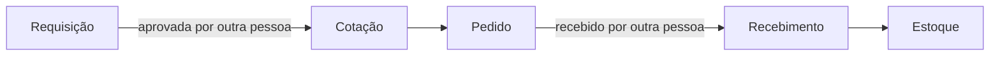

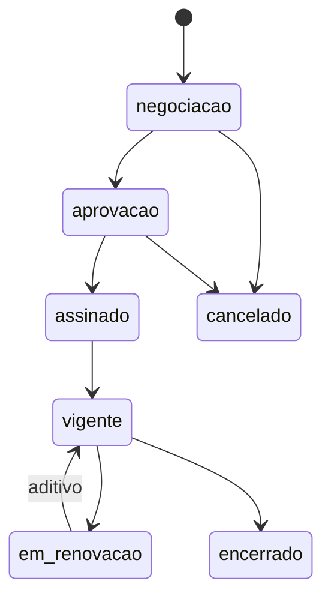

**Regras principais**
- Quem pede não aprova a própria requisição e não recebe a própria compra ([22](#doc-22), seção 5).
- Contrato assinado não é editado: mudança vira aditivo; quem cria a minuta não a aprova ([33](#doc-33), seção 3).
- Patrimônio com depreciação por categoria aprovada pelo contador; categoria sem regra não deprecia (DP-02, [80](#doc-80)).
- Pacote de documentos e contratos para o jurídico ([53](#doc-53)).

<a id="doc-33"></a>

## 33 — Gestão de Contratos, por Portal

> Parte do [SDD v2](#doc-00). Regras atuais em [17](#doc-17), seção 7. Matriz de portais em [31](#doc-31). Assinatura e base legal em [26](#doc-26), seção 6. Auditoria em [29](#doc-29). Privacidade em [32](#doc-32), seção 3.
> **Status:** aprovada pelo autor em 03/11/2026, com as propostas adotadas. Itens sem valor definido continuam pendentes, criada em 03/11/2026 a partir de [`spec_gestao_contratos_completo.md`](#v1-spec-gestao-contratos-completo-md) (v1, 1.376 linhas). Itens **[Decisão do autor]** dependem de resposta. Itens **(jurídico)** dependem de parecer. Este documento não é parecer contratual.
> **Atualização de 03/11/2026:** a assinatura passa a ser serviço comum, usado também por documentos administrativos e emitidos. Ver [54](#doc-54), seção 5.

---

### 1. Estado atual na v2

[17](#doc-17), seção 7 tem 6 linhas de entidades, regras e estados. A v1 tem 17 seções, 16 páginas, perfis, abas de cadastro e fluxos. **A v2 não está completa.** Faltam:

- DDL (defeito T-02 em [17](#doc-17));
- mapa de contratos por tipo e por portal;
- regras por tipo de contrato;
- fluxo de aprovação com alçadas;
- integração com assinatura;
- monitoramento de obrigações e vigência;
- regra de contrato sensível (dado pessoal, saúde, menor).

---

### 2. Tipos de contrato e a quem pertencem

A v1 lista 13 tipos (seção 2.1). Eles não têm o mesmo dono. Cada um fica em um portal, com parte e papel definidos:

| Tipo | Parte A | Parte B | Dono | Portal de acesso |
|---|---|---|---|---|
| Contrato de cliente (SaaS) | Plataforma | Entidade | Plataforma | Desenvolvedor |
| Contrato de prestação de serviços educacionais (matrícula) | Entidade | Responsável legal e aluno | Entidade | Gestão; assinatura pelo Responsáveis |
| Contrato de trabalho e termos de pessoal | Entidade | Colaborador | Entidade (RH) | Gestão; ciência pelo Professor |
| Contrato de fornecedor e de serviço | Entidade | Fornecedor | Entidade (Compras) | Gestão; ciência pelo Terceiros |
| Contrato de manutenção, locação e parceria | Entidade | Fornecedor ou parceiro | Entidade | Gestão; ciência pelo Terceiros |
| Convênio e contrato institucional | Entidade | Órgão ou instituição | Entidade (Jurídico) | Gestão |
| Acordo de confidencialidade (NDA) | Plataforma ou entidade | Parte externa | Quem assina | Desenvolvedor ou Gestão |
| Acordo de processamento de dados (DPA) | Entidade ou plataforma | Operador | Jurídico | Gestão ou Desenvolvedor; ciência pelo Terceiros |
| Termo aditivo, distrato, renovação | Mesmas partes do contrato original | — | Dono do contrato original | Mesmo portal do original |
| Contrato guarda-chuva (master agreement) | Entidade | Fornecedor | Entidade (Compras) | Gestão |

**Regra:** o portal de origem é o do contrato original. Aditivo e distrato não mudam de portal.

**Pendência:** o contrato de matrícula (aluno ou responsável) e o contrato de cliente são contratos de consumo ou de prestação civil. A forma e as cláusulas dependem de **(jurídico)** ([26](#doc-26), seção 4). Não defino cláusula aqui.

---

### 3. Ciclo de vida

Etapas da v1 (seção 2.2), com donos:

| Etapa | Dono | Saída |
|---|---|---|
| Solicitação | Quem precisa do contrato | Solicitação contratual |
| Triagem | Gestor de contratos | Aceita, devolvida ou recusada |
| Minuta | Gestor de contratos, com modelo | Minuta versionada |
| Revisão interna | Jurídico | Parecer |
| Negociação externa | Gestor de contratos | Versão negociada |
| Aprovação jurídica | Jurídico | Aprovado ou devolvido |
| Aprovação financeira | Financeiro | Aprovado ou devolvido, conforme faixa |
| Aprovação gestora | Gestor | Aprovado |
| Assinatura | Responsável pelo contrato | Assinado |
| Vigência | Sistema | Alerta de vencimento |
| Monitoramento de obrigações | Responsável pela obrigação | Entregas e SLA |
| Reajuste e renovação | Gestor de contratos, com financeiro | Aditivo |
| Encerramento e arquivamento | Gestor de contratos | Estado final |

**Estados do contrato** (já em [17](#doc-17), seção 7.3): `negociacao`, `aprovacao`, `assinado`, `vigente`, `em_renovacao`, `encerrado`, `cancelado`.

**Regras de transição:**

- Contrato `assinado` não é editado. Mudança vira aditivo ([17](#doc-17)).
- Ausência de cláusula obrigatória bloqueia envio para assinatura ([17](#doc-17), seção 7.2).
- Aprovação jurídica é obrigatória por tipo ([17](#doc-17)).
- Quem cria a minuta não aprova a própria minuta (segregação, [22](#doc-22), seção 5).

---

### 4. Alçadas

| Faixa | Aprovação | Valor |
|---|---|---|
| Abaixo da faixa 1 | Gestor da unidade | **Decidido** em 03/11/2026: até R$ 10.000 |
| Faixa 2 | Gestor + financeiro | **Decidido** em 03/11/2026: de R$ 10.000 a R$ 100.000 |
| Acima da faixa 2 | Gestor executivo + financeiro + jurídico | **Decidido** em 03/11/2026: acima de R$ 100.000 |

Sem os valores, a aplicação não tem regra de alçada. Lacuna LAC-01 em [17](#doc-17).

---

### 5. Assinatura

Estados (v1, seção 13.4): não iniciado, preparando envio, enviado, visualizado, parcialmente assinado, assinado, rejeitado, expirado, cancelado.

Regras:

- Assinatura eletrônica com validade jurídica depende do tipo de documento e do nível exigido **(jurídico)** ([26](#doc-26), seção 6, e Lei 14.063/2020).
- Assinatura de responsável em contrato de aluno: verificação de identidade do signatário antes do envio ([06](#doc-06)).
- Envelope tem validade. Expirado não é reaberto; novo envelope é criado.
- Assinatura de terceiro: o portal de terceiros mostra só o próprio contrato.
- Documento assinado é guardado com hash e trilha ([21](#doc-21)).

---

### 6. Obrigações, vigência e renovação

- Obrigação tem responsável, prazo, evidência e SLA. Vencida sem evidência gera alerta.
- Alerta de vencimento: antecedência configurável por tipo de contrato. Antecedência padrão decidida em 03/11/2026: 60 e 30 dias.
- Renovação automática só se o tipo permitir. Renovação sem aprovação não entra em vigor.
- Reajuste aplica índice definido no contrato. Reajuste sem índice exige aditivo.

---

### 7. Compliance do contrato

A aba de compliance (v1, seção 8.8) guarda: tratamento de dado pessoal, base legal vinculada, DPA anexado, NDA assinado, política de retenção, criticidade do risco, due diligence concluída, documentos regulatórios e data da última revisão.

**Regra:** contrato com tratamento de dado pessoal não é assinado sem DPA anexado. Essa regra é do sistema, não só do processo ([26](#doc-26)).

**Contrato com dado de menor:** exige revisão de privacidade antes da assinatura ([32](#doc-32), seção 3.2).

---

### 8. Perfis

A v1 define nove perfis (seção 4.1): SA, GE, GC, JU, FI, CO, OP, AU e VI. Eles valem **dentro do portal de gestão**. Para os outros portais valem os papéis de [22](#doc-22), seção 5.

| Perfil v1 | Papel na v2 | Portal |
|---|---|---|
| SA — Super Admin | Administrador da entidade | Gestão |
| GE — Gestor Executivo | Gestor executivo | Gestão |
| GC — Gestor de Contratos | Gestor de contratos | Gestão |
| JU — Jurídico | Jurídico | Gestão |
| FI — Financeiro | Financeiro | Gestão |
| CO — Compras | Compras | Gestão |
| OP — Operacional | Operacional, somente execução | Gestão |
| AU — Auditor | Auditor | Gestão, somente leitura ([29](#doc-29), seção 5) |
| VI — Visualizador | Consulta restrita conforme escopo | Gestão |

Contratos de cliente (SaaS) são geridos no portal do desenvolvedor pelo papel de comercial e jurídico da plataforma ([22](#doc-22), seção 4.1).

---

### 9. Páginas e portal

A v1 tem 16 páginas (seção 5). Por portal:

| Página v1 | Portal |
|---|---|
| Dashboard de contratos | Gestão |
| Contratos | Gestão |
| Solicitações contratuais | Gestão |
| Minutas e modelos | Gestão (jurídico) |
| Aprovações | Gestão |
| Assinaturas | Gestão |
| Vigência e renovações | Gestão |
| Obrigações e SLAs | Gestão |
| Aditivos e reajustes | Gestão |
| Partes e contrapartes | Gestão |
| Documentos e anexos | Gestão |
| Calendário contratual | Gestão |
| Kanban operacional | Gestão |
| Compliance e riscos | Gestão (jurídico) e Desenvolvedor (contratos de cliente) |
| Auditoria | Gestão (AU) |
| Configurações do módulo | Gestão (SA) |

Portal do desenvolvedor: contratos de cliente, com as mesmas páginas de vigência, aprovação e assinatura.

Portal de terceiros: **somente** os contratos do próprio fornecedor, com estado e vigência. Sem aprovação interna, sem minuta, sem compliance.

Portal de responsáveis: contrato de matrícula do próprio aluno, para assinatura e consulta.

Portal do professor: contrato de trabalho próprio, para ciência. Sem outros contratos.

---

### 10. Pendências

| # | Pendência | Tipo |
|---|---|---|
| CTR-01 | DDL de contrato, parte, obrigação, aditivo, solicitação, assinatura (T-02) | **Escrito** em [51](#doc-51), seção 3. Revisão do owner pendente (DDL-01) |
| CTR-02 | Faixas de alçada (seção 4) | **Decidido** em 03/11/2026: até R$ 10.000, de R$ 10.000 a R$ 100.000, e acima, com jurídico |
| CTR-03 | Antecedência padrão de alerta (seção 6) | **Decidido** em 03/11/2026: 60 e 30 dias antes do vencimento |
| CTR-04 | Forma de assinatura por tipo de contrato | (jurídico) |
| CTR-05 | Cláusulas obrigatórias por tipo | (jurídico) |
| CTR-06 | Provedor de assinatura eletrônica | **Decidido** em 03/11/2026: aceitar todos os provedores de terceiros e criar assinatura digital própria, certificada e aprovada pelos órgãos competentes. A assinatura própria depende de credenciamento na ICP-Brasil **(verificar, jurídico)** |
| CTR-07 | Contrato de matrícula: forma, cláusulas e prazo de guarda | (jurídico) |

---

### 11. Critérios de aceite

- [ ] Cada tipo de contrato da seção 2 tem dono e portal de origem.
- [ ] Transições da seção 3 testadas; contrato assinado não é editado.
- [ ] Alçada aplicada pela aplicação, não só pelo processo.
- [ ] Contrato com dado pessoal não é enviado para assinatura sem DPA.
- [ ] Portal de terceiros e de responsáveis mostram só o próprio contrato.
- [ ] DDL escrito para todas as entidades (CTR-01).
- [ ] Itens **[Decisão do autor]** e **(jurídico)** respondidos ou marcados como pendentes no [00](#doc-00).

### 12. Decisões de 03/11/2026

**CTR-02 (faixas de alçada): aprovado como padrão inicial, ajustável por entidade.**

| Faixa | Valor do contrato | Aprovação |
|---|---|---|
| 1 | Até R$ 10.000,00 | Gestor da unidade |
| 2 | Acima de R$ 10.000,00 até R$ 100.000,00 | Gestor executivo e financeiro |
| 3 | Acima de R$ 100.000,00 | Gestor executivo, financeiro e jurídico |

Prazo total ou valor mensal, o que for maior, define a faixa. Contrato que muda de faixa por aditivo é reaprovado na faixa nova.

**CTR-03 (antecedência de alerta de vencimento): aprovado.** Alerta aos 60 dias e novo alerta aos 30 dias antes do vencimento, para contratos de vigência determinada.

<a id="doc-53"></a>

## 53 — Pacote para Parecer Jurídico: Contratos, Declarações, Boletins e Demais Documentos

> Parte do [SDD v2](#doc-00). Pacote de consulta, complementar ao [50](#doc-50). Os tipos de contrato estão em [33](#doc-33). Os tipos de documento emitido estão em [48](#doc-48). Acervo escolar em [17](#doc-17).
> **Natureza deste documento:** pacote de consulta. Não é parecer. As "posições propostas" são o que o SDD adota para desenhar o sistema. O jurídico confirma, corrige ou recusa cada uma.
> **Citações legais:** todas marcadas **a confirmar**. Não foram verificadas contra o texto vigente.
> **Códigos:** DC-01 a DC-28, em 6 blocos. Responde-se com o campo de resposta da seção 9.

---

### 1. Escopo

O sistema produz e recebe documentos em quatro grupos:

| Grupo | Exemplos | Quem assina |
|---|---|---|
| Contratos | Matrícula, prestação de serviço a fornecedor, aditivo, parceria | Partes do contrato |
| Declarações e certidões | Declaração de matrícula, de frequência, de conclusão, de quitação, certidão de conclusão | Secretaria, com código de validação |
| Acervo escolar | Histórico, boletim, registro de classe, ata de resultados finais | Secretaria, com assinatura oficial |
| Outros | Termo de responsabilidade, requerimento, autorização, comunicado, certificado, ata de conselho | Conforme o tipo |

---

### 2. Bloco A: contratos

| Código | Pergunta | Contexto no sistema | Posição proposta | Alternativa | Onde |
|---|---|---|---|---|---|
| DC-01 | Contrato de matrícula: é contrato de adesão, e quais cláusulas são obrigatórias | Gerado no wizard de matrícula | Contrato de adesão, com cláusulas obrigatórias do sistema de ensino e destaque das cláusulas que limitam direitos | Contrato negociado por aluno | [33](#doc-33), CTR-05 |
| DC-02 | Contrato de matrícula com menor: quem assina e com que validade | Responsável assina por aluno menor | Responsável legal assina. Aluno maior assina o próprio contrato | Assinatura do aluno em qualquer idade | [46](#doc-46), M-09 |
| DC-03 | Forma de assinatura por tipo de contrato | Matrícula, prestação e aditivo | Assinatura digital com certificado ICP-Brasil para matrícula e prestação. Assinatura simples para aditivo e termos internos **a confirmar** | ICP-Brasil para tudo | [33](#doc-33), CTR-04 |
| DC-04 | Contrato de prestação de serviço a fornecedor: cláusulas de proteção de dados | Fornecedor com acesso a dado pessoal | DPA (acordo de tratamento de dados) assinado antes do acesso. Exigência prevista em [33](#doc-33) | Contrato sem DPA | [33](#doc-33), seção 2 |
| DC-05 | Aditivo de contrato: quando exige nova assinatura | Mudança de valor, turma ou prazo | Aditivo assinado pelas mesmas partes. Mudança de valor exige aditivo, não edição | Edição direta com registro | [33](#doc-33), seção 3 |
| DC-06 | Renovação automática de contrato: aviso e direito de recusa | Contratos com renovação automática | Aviso de 60 dias antes. Direito de recusa expresso no contrato | Renovação sem aviso | [33](#doc-33), seção 6 |
| DC-07 | Contrato de matrícula e inadimplência: o contrato continua válido durante bloqueio parcial | Bloqueio parcial de portal | Contrato segue vigente. Bloqueio parcial não é rescisão | Rescisão automática | [26](#doc-26), seção 3 |
| DC-08 | Guarda de contratos assinados: prazo | Arquivo de contratos | Prazo de cinco anos após o fim do contrato, salvo norma específica **a confirmar** | Prazo do sistema de ensino | [33](#doc-33), seção 7 |

---

### 3. Bloco B: declarações e certidões

| Código | Pergunta | Contexto no sistema | Posição proposta | Alternativa | Onde |
|---|---|---|---|---|---|
| DC-09 | Declaração de matrícula: validade e uso | Emitida para órgãos e empresas | Validade de 90 dias, por padrão, indicada no documento. Pode ser validada pelo código | Sem validade | [48](#doc-48), seção 3 |
| DC-10 | Declaração de frequência: base de dados | Frequência calculada de chamadas e de sala online | Frequência só com registro de chamada oficial. Presença online conta quando for a origem oficial | Presença online não conta para declaração | [17](#doc-17), seção 4 |
| DC-11 | Certidão de conclusão de curso: quando é emitida | Pós-EAD e cursos livres | Emitida após a conclusão registrada, com assinatura e registro | Emitida a pedido sem conclusão | [46](#doc-46), seção 5 |
| DC-12 | Declaração de quitação: quais parcelas considera | Quitação de mensalidades | Considera as parcelas vencidas até a data de emissão. Declara o período citado | Quitação total do contrato | [34](#doc-34) |
| DC-13 | Validação pública de documento: quais dados aparecem | Código e QR no documento | Tipo, data, situação e entidade. Sem nome, CPF ou nota | Nome com data de nascimento | [48](#doc-48), seção 6 |
| DC-14 | Segunda via de documento: pode ter data nova | Reemissão | Segunda via indica que é reemissão e mantém a data de origem | Nova data sem indicação | [48](#doc-48) |

---

### 4. Bloco C: acervo escolar

| Código | Pergunta | Contexto no sistema | Posição proposta | Alternativa | Onde |
|---|---|---|---|---|---|
| DC-15 | Histórico escolar: layout e conteúdo obrigatórios | Emissão de histórico | Conforme a norma do sistema de ensino da entidade, incluindo a referência legal no documento **a confirmar** | Layout próprio | [48](#doc-48), DOC-03 |
| DC-16 | Boletim: pode ser emitido antes do fechamento do período | Boletim parcial para família | Boletim parcial identificado como parcial. Não substitui o histórico | Boletim só após fechamento | [17](#doc-17) |
| DC-17 | Registro de classe e ata de resultados finais: guarda permanente ou por prazo | Acervo de turma | Prazo do sistema de ensino da entidade, com referência gravada **a confirmar** | Guarda permanente | [26](#doc-26), seção 3 |
| DC-18 | Ata de conselho de classe: quem assina | Reunião de conselho | Presidente e secretário da reunião. Registro com data e pauta | Assinatura de todos os presentes | [17](#doc-17) |
| DC-19 | Certificado de participação em evento pastoral ou escolar: quando tem validade de documento oficial | Certificados de evento | Certificado de evento não é documento oficial. Não substitui histórico | Certificado com força de documento oficial | [43](#doc-43), seção 3.4 |

---

### 5. Bloco D: termos, autorizações e requerimentos

| Código | Pergunta | Contexto no sistema | Posição proposta | Alternativa | Onde |
|---|---|---|---|---|---|
| DC-20 | Termo de responsabilidade de equipamento: texto e assinatura | Retirada de notebook, projetor, kit | Termo aceito no portal, com dados do equipamento e da pessoa. Assinatura simples | Assinatura física | [44](#doc-44), AMB-06 |
| DC-21 | Autorização de saída de aluno menor: validade e forma | Retirada na portaria | Autorização do responsável com data e validade. Forma digital, por vínculo verificado | Autorização permanente | [35](#doc-35), seção 3.3 |
| DC-22 | Autorização de uso de imagem: quando é exigida | Fotos e vídeos em evento | Autorização específica, por escrito, com finalidade e prazo. Sem autorização não publica | Autorização geral na matrícula | [43](#doc-43), seção 6 |
| DC-23 | Requerimento de segunda chamada, trancamento e transferência: prazo de resposta | Pedidos da secretaria | Prazo do serviço de atendimento ([32](#doc-32)). Negativa com motivo | Sem prazo | [46](#doc-46) |

---

### 6. Bloco E: documentos de terceiros e de cobrança

| Código | Pergunta | Contexto no sistema | Posição proposta | Alternativa | Onde |
|---|---|---|---|---|---|
| DC-24 | Nota fiscal recebida de fornecedor: a plataforma só recebe e valida, não emite | Portal de terceiros | Recebe e valida. Emissão fica com o fornecedor. Decidido pelo autor em 03/11/2026 **a confirmar** a parte fiscal | Emissão pela plataforma | [34](#doc-34), PAG-06 |
| DC-25 | Boleto com instruções: texto obrigatório | Cobrança | Texto com instruções de pagamento e canal de contestação | Texto livre | [34](#doc-34) |
| DC-26 | Comunicado institucional com dado pessoal: base e forma de envio | Comunicado a famílias | Comunicado com dado mínimo. Dado sensível nunca em comunicado em massa | Comunicado com dado completo | [07](#doc-07) |

---

### 7. Bloco F: atas, relatórios e dossiês

| Código | Pergunta | Contexto no sistema | Posição proposta | Alternativa | Onde |
|---|---|---|---|---|---|
| DC-27 | Ata de reunião com participação de menor ou dado de saúde: guarda e acesso | Reunião com responsável e atendimento | Acesso restrito aos participantes e à direção. Dado sensível fora da ata | Ata aberta à comunidade | [40](#doc-40), seção 5 |
| DC-28 | Dossiê do aluno: quais documentos entram e quem acessa | Pasta digital do aluno | Acesso pelo papel da secretaria e pelo próprio aluno ou responsável. Sem dado de saúde para a secretaria | Acesso amplo da escola | [48](#doc-48), seção 3 |

---

### 8. Itens que não são de jurídico

| Item | Responsável | Onde |
|---|---|---|
| Layout visual dos modelos | Gestão de documentos | [48](#doc-48), seção 5 |
| Teste de validação pública | Qualidade | [49](#doc-49) |

---

### 9. Campo de resposta

| Código | Confirma | Corrige (posição correta e referência) | Recusa (motivo) | Responsável | Data |
|---|---|---|---|---|---|
| DC-01 a DC-28 | | | | | |

---

### 10. Referências a confirmar

- Código Civil e Código de Defesa do Consumidor, sobre contrato de adesão e cláusulas de prestação de serviço **a confirmar**.
- LGPD, sobre acordo de tratamento com fornecedor **a confirmar**.
- Lei de Diretrizes e Bases e normas do sistema de ensino, sobre histórico, acervo e guarda **a confirmar**.
- Estrutura de ICP-Brasil e assinatura simples, para os contratos **a confirmar**.
- Regras fiscais de nota de fornecedor **a confirmar**.

<a id="doc-38"></a>

## 38 — Portal de Terceiros: Prestadores de Serviço, por Tipo, com Acesso Restrito ao Próprio Escopo

> Parte do [SDD v2](#doc-00). Portal em [23](#doc-23), seção 1. Matriz em [31](#doc-31), seção 2.6. Contratos em [33](#doc-33). Identidade e vínculo em [06](#doc-06), seção 12. Nota fiscal em [34](#doc-34), seção 5.3. Acesso físico em [35](#doc-35). Atendimento em [32](#doc-32).
> **Status:** especificação proposta, criada em 03/11/2026. Itens **(verificar)** dependem de conferência de norma setorial. Itens **[Decisão do autor]** dependem de resposta.

---

### 1. Modelo

Um **prestador** é uma pessoa jurídica ou um MEI que a entidade contrata. O acesso não é dado à empresa como um todo. É dado a **pessoas** do prestador, e cada pessoa só enxerga o que o **contrato** dela cobre.

```
Prestador (CNPJ)
  └── Contrato (33), com vigência e status
        ├── Serviços habilitados (tipo de prestador, seção 3)
        ├── Unidades cobertas
        └── Pessoas do prestador (vínculo tipo "prestador")
              └── Papel dentro do serviço
```

O acesso de uma pessoa é a **interseção** de quatro filtros. Se algum falhar, a resposta é vazia:

| Filtro | Fonte |
|---|---|
| Contrato `vigente` | [33](#doc-33), seção 3 |
| Serviço habilitado | Tipo de prestador (seção 3) |
| Unidade coberta | Contrato, seção 4 |
| Papel da pessoa no prestador | Vínculo, seção 2 |

**Regra de default:** nenhum dado é retornado sem filtro de contrato. Consulta sem contrato vigente é recusada na aplicação ([02](#doc-02), seção 2), não só na tela.

---

### 2. Pessoas e papéis do prestador

| Papel | Pode | Não pode |
|---|---|---|
| Responsável do prestador | Gerir as pessoas do próprio prestador, enviar documentos, acompanhar pedidos | Ver pessoas de outro prestador. Aprovar a própria nota |
| Operador | Executar as ações do serviço habilitado | Alterar contrato, ver faturamento |
| Financeiro do prestador | Ver pedidos e pagamentos do próprio contrato, enviar nota | Alterar dados bancários sem confirmação por MFA |
| Auditor do prestador | Ler o próprio histórico | Alterar qualquer registro |

Vínculo do prestador: conta global ([06](#doc-06), seção 12) com vínculo do tipo `prestador`, que guarda o `contrato_uuid`. Quando o contrato termina, o vínculo é revogado em até 30 s ([30](#doc-30), seção 4).

---

### 3. Tipos de prestador

Cada tipo tem um **pacote fixo** de ações e de dados. A entidade habilita o pacote no contrato. Nenhum tipo recebe dado de outro tipo.

#### 3.1 Jurídico (escritório de advocacia)

| Pode | Não pode |
|---|---|
| Ver contratos, pareceres e processos designados | Ver financeiro completo da entidade |
| Registrar parecer e minuta ([33](#doc-33), seção 8, perfil JU) | Aprovar contrato como gestor |
| Ver dado de aluno apenas em processo designado, com motivo | Ver lista geral de alunos |

Sigilo profissional. Todo acesso a processo gera evento de auditoria com motivo ([29](#doc-29)).

#### 3.2 Contabilidade

| Pode | Não pode |
|---|---|
| Lançamentos, obrigações e tributos do escopo | Ver folha detalhada por colaborador. Recebe só totais |
| Propor fechamento, que o contador da entidade aprova | Fechar período sozinho |
| Exportar para o ERP do contador | Ver dado de saúde ou de aluno |

Lançamento proposto pelo prestador tem origem registrada. Aprovação é do contador da entidade ([22](#doc-22), seção 5).

#### 3.3 Cartório (serviço notarial ou registral contratado)

| Pode | Não pode |
|---|---|
| Receber pedido de autenticação ou reconhecimento de documento indicado pela entidade | Ver outros documentos do titular |
| Devolver status e selo digital, quando o cartório emitir | Alterar o documento original |

Dado do titular aparece mascarado (CPF e e-mail, [29](#doc-29), seção 6). Validade jurídica do selo **(verificar)** com o tipo de ato.

#### 3.4 Alimentação escolar (lanchonete ou fornecedor de merenda)

| Pode | Não pode |
|---|---|
| Ver cardápio aprovado por nutricionista e quantidade de refeições por unidade e dia | Ver lista nominal de alunos sem restrição |
| Registrar entrega, temperatura e validade, conforme a RDC ANVISA nº 216/2004 (ver regra abaixo) | Ver histórico de compra da entidade com outro prestador |
| Receber lista de restrição alimentar, sem diagnóstico | Ver diagnóstico ou CID |

Regra de dado da alimentação, conferida em 03/11/2026 no texto da RDC ANVISA nº 216/2004 (bvsms.saude.gov.br). A RDC vale para cantinas e cozinhas institucionais (item 1.2). Leitura nossa: inclui cantina escolar e cozinha de merenda. A vigilância sanitária local pode complementar (art. 2º).

| Registro | Limite que o sistema confere |
|---|---|
| Cocção | Pelo menos 70 ºC em todas as partes do alimento (4.8.8) |
| Conservação a quente | Acima de 60 ºC por no máximo 6 horas (4.8.15) |
| Resfriamento | De 60 ºC a 10 ºC em até 2 horas, depois abaixo de 5 ºC ou a -18 ºC ou menos (4.8.16) |
| Preparado refrigerado | Até 5 dias a 4 ºC ou menos. Entre 4 ºC e 5 ºC, prazo menor, configurado pelo prestador (4.8.17) |
| Identificação | Designação, data de preparo e validade no preparado e no aguardando transporte. Data de abertura e nova validade no ingrediente aberto (4.8.6, 4.8.18 e 4.9.1) |
| Transporte e exposição | Temperatura monitorada e registrada (4.9.2 e 4.10.3) |
| Guarda | Registros mantidos por no mínimo 30 dias da data de preparo (4.11.3). O sistema guarda pelo prazo do contrato, nunca menos de 30 dias |

Valor fora do limite gera ocorrência para o responsável da entidade. O registro não é apagado nem corrigido sem rastro.

**Restrição alimentar** é dado de saúde ([07](#doc-07), seção 2). O prestador recebe apenas o aviso "restrição: sim" e o tipo de alimento a evitar, com consentimento do responsável **(jurídico)**. Não recebe a condição clínica.

#### 3.5 Transporte escolar

| Pode | Não pode |
|---|---|
| Ver rotas, horários e pontos do contrato | Ver endereço completo do aluno |
| Ver lista de embarque por ponto, com nome e turma | Ver CPF, saúde ou notas |
| Registrar embarque e desembarque | Ver histórico de localização passado |
| Rastrear o veículo durante a viagem, sem identificar o aluno no mapa | Ver localização de aluno fora da viagem |

**Dado de menor com localização** é o caso de maior risco desta seção. Regras:

- A localização do veículo só é transmitida durante a viagem. Não há histórico além do necessário para a viagem, com prazo de 30 dias, decidido em 03/11/2026.
- Embarque só com autorização do responsável registrada ([35](#doc-35), seção 3.3).
- Alerta de desvio de rota vai para a coordenação e para o responsável, não para o prestador.
- Base legal e prazo de guarda **(jurídico)**.

#### 3.6 Transportadora (carga e entrega de materiais)

| Pode | Não pode |
|---|---|
| Ver pedidos de compra e ordens de entrega do contrato | Ver dado pessoal de qualquer pessoa |
| Registrar coleta, entrega e comprovante | Ver rota de veículo de outro prestador |
| Rastrear a carga | Ver frota da entidade além das próprias cargas |

Rastreio é de carga, não de pessoa.

#### 3.7 Tecnologia da informação (terceirizado de TI)

| Pode | Não pode |
|---|---|
| Atender chamados de TI do escopo ([36](#doc-36)) | Ver banco de dados de pessoas |
| Ver a vista de ativos de TI do escopo | Alterar contrato ou configuração de segurança |
| Acesso remoto só com chamado aberto, passkey e sessão gravada | Acesso remoto permanente |

Acesso remoto de terceiro é o caminho de maior risco de TI. Exige chamado vinculado, janela de atendimento e registro da sessão ([36](#doc-36), seção 6).

#### 3.8 Limpeza e manutenção predial

| Pode | Não pode |
|---|---|
| Ver ordens de serviço, cronograma e áreas do contrato | Ver dado de aluno ou de colaborador |
| Solicitar crachá temporário pela portaria ([35](#doc-35)) | Ver registro de acesso de outras pessoas |
| Registrar execução e foto da área sem pessoa identificável | Ver câmera |

#### 3.9 Vigilância e segurança patrimonial

| Pode | Não pode |
|---|---|
| Ver plantão, rondas e ocorrências do contrato | Ver câmera ao vivo fora de ocorrência aberta |
| Registrar ocorrência | Exportar imagem |
| Ver lista de visitantes autorizados do dia | Ver histórico de visitantes |

Acesso a imagem, quando permitido por ocorrência, gera evento de auditoria com motivo e tempo limitado ([35](#doc-35), seção 6).

#### 3.10 Uniformes, material didático e livraria

| Pode | Não pode |
|---|---|
| Ver pedidos, catálogo e entregas do contrato | Ver lista nominal de alunos |
| Ver quantidades por série, tamanho e unidade | Ver dado pessoal além do destinatário da entrega, quando necessário |
| Emitir nota da venda ([34](#doc-34), seção 5.3) | Ver pagamento de outro prestador |

#### 3.11 Saúde ocupacional terceirizada (clínica de ASO)

| Pode | Não pode |
|---|---|
| Receber agendamento de exame ocupacional: nome, função, tipo de exame | Ver histórico de exame de outro colaborador |
| Devolver resultado: apto, inapto ou apto com restrição, e o ASO | Ver CID, diagnóstico ou prontuário fora do ASO |
| Médico responsável com CRM válido | Acessar sistema da entidade além do agendamento |

Regra de dado: o prontuário fica sob responsabilidade do médico responsável pelo PCMSO, ou do médico que fez o exame quando a entidade é dispensada do PCMSO (NR-7, 7.6.1). A entidade é obrigada a manter o prontuário por no mínimo 20 anos após o desligamento (7.6.1.1). Por isso, o contrato com a clínica garante a guarda pelo prazo e a transferência formal dos prontuários quando o médico responsável ou a clínica mudar (7.6.1.2). A entidade recebe o resultado e o ASO, não o prontuário. Prontuário eletrônico segue o Conselho Federal de Medicina (7.6.1.3) **(verificar)**.

#### 3.12 Consultoria pedagógica e treinamento

| Pode | Não pode |
|---|---|
| Ver turmas e conteúdo de formação do contrato | Ver notas ou dado de aluno |
| Registrar presença de participantes | Ver dado pessoal além de nome e função, para certificado |

---

### 4. Contrato e unidades

- Contrato de prestador segue [33](#doc-33). Acesso só começa com contrato `vigente`.
- Unidade coberta é lista explícita. Contrato de uma unidade não dá acesso às outras, mesmo na mesma entidade ([03](#doc-03)).
- Aditivo que inclui unidade ou serviço só passa a valer depois da aprovação, pela alçada de [33](#doc-33), seção 12.

---

### 5. Habilitação e ciclo de vida

| Etapa | Regra |
|---|---|
| Cadastro | CNPJ válido e situação ativa. Verificação na base pública **(verificar)** |
| Documentos | Os exigidos pelo tipo: alvará, seguro, certidões trabalhistas e previdenciárias **(verificar)** |
| Contrato | Assinado ([33](#doc-33), seção 5) |
| Convite | Cada pessoa é convidada pelo responsável do prestador. Convite com validade de 72 h ([06](#doc-06)) |
| Ativo | Documentos em dia e contrato vigente |
| Suspenso | Certidão vencida, contrato vencido ou irregularidade. Sem novo pedido |
| Encerrado | Vínculos revogados. Dados devolvidos ou expurgados conforme o contrato ([23](#doc-23), seção 5) |

**Alerta:** certidão vencendo em 30 dias.

---

### 6. Segregação e isolamento

1. Um prestador não vê outro prestador, nem o nome dele em lista de fornecedores, salvo cadastro público exigido por lei **(verificar)**.
2. Quem executa o serviço não aprova a própria nota ou o próprio pagamento.
3. Pessoa do prestador que sai do quadro do prestador perde o vínculo na mesma hora, pelo responsável do prestador.
4. Consulta que cruza dois prestadores é recusada e gera alerta.

---

### 7. Auditoria

Todo acesso de prestador grava evento com `portal = terceiros`, `prestador_uuid`, `contrato_uuid`, serviço e unidade ([29](#doc-29), seção 2). Leitura de dado pessoal de titular é marcada como dado sensível.

---

### 8. Pendências

| # | Pendência | Tipo |
|---|---|---|
| TER-01 | Tipos personalizados: regra de criação (seção 11) | **Decidido** em 03/11/2026 |
| TER-02 | Prazo de guarda do rastro de localização do transporte escolar (seção 11) | **Decidido** em 03/11/2026: 30 dias depois da viagem. Parecer do (jurídico) pendente |
| TER-03 | Base legal do transporte escolar e de restrição alimentar | (jurídico) |
| TER-04 | Norma sanitária para registro de temperatura e validade na alimentação | **Conferido** em 03/11/2026: RDC ANVISA nº 216/2004, itens 4.8 a 4.11. Fica para conferir norma sanitária local e se há RDC posterior que a substitua |
| TER-05 | Guarda de prontuário pela clínica de ASO | **Conferido** em 03/11/2026: NR-7, 7.6.1 a 7.6.1.2. Contrato com a clínica garante 20 anos e transferência. Regra do CFM para prontuário eletrônico **(verificar)** |
| TER-06 | Validade do selo do cartório digital por tipo de ato | (verificar) |
| TER-07 | Documentos exigidos por tipo (alvará, seguro, certidões) | (verificar) |
| TER-08 | Acesso remoto de TI: janela e forma de gravação (seção 11) | **Incluído** em 03/11/2026 |

---

### 9. Critérios de aceite

- [ ] Pessoa de prestador A não obtém dado de prestador B (teste de isolamento por par).
- [ ] Pessoa com contrato encerrado perde acesso em até 30 s (teste).
- [ ] Prestador de tipo X não recebe campo fora do pacote do tipo (teste por tipo).
- [ ] Transporte escolar: nenhum endereço completo ou localização fora da viagem aparece para o prestador (teste).
- [ ] Restrição alimentar sem diagnóstico (teste de varredura de resposta).
- [ ] Acesso remoto de TI sem chamado aberto é recusado (teste).
- [ ] Itens **(verificar)** e **[Decisão do autor]** respondidos ou marcados como pendentes no [00](#doc-00).

---

### 11. Decisões de 03/11/2026

**TER-01 (tipos personalizados): decidido.** Os doze tipos da seção 3 são modelos-base. A entidade cria um tipo próprio (por exemplo, "lanchonete com entrega própria") a partir de um modelo-base, com as regras:

- Escolhe serviços apenas do catálogo da plataforma. Não cria serviço fora dele.
- Pode retirar itens do pacote-base, mas não pode incluir campo bloqueado (dado de saúde, CID, diagnóstico, prontuário, gravação de câmera fora de finalidade).
- A criação e cada alteração de pacote exigem aprovação do responsável da entidade e ficam em auditoria ([29](#doc-29)).
- Tipo personalizado só recebe os mesmos bloqueios dos tipos-base. Nenhum tipo personalizado ganha acesso que o modelo-base não tinha.

**TER-02 (guarda do rastro de localização do transporte escolar): incluído.** Regra: o rastro de localização do ônibus é guardado só durante a viagem e por um prazo fixo depois, para fins de segurança e de prestação de contas. Ao fim do prazo, o expurgo é automático. Nenhum prestador vê o rastro de um aluno fora da sua viagem. **Valor do prazo: (jurídico).** Até a definição, o sistema não grava o rastro por padrão.

**TER-08 (acesso remoto de TI): incluído.** Regra:

- Acesso remoto só dentro de um chamado aberto, com identificação do técnico e do ativo.
- Janela de acesso definida pela entidade. Padrão inicial: horário comercial da unidade. Fora da janela, o acesso é recusado.
- A sessão é gravada do início ao fim, com data, duração, técnico e ações. A gravação segue a retenção de auditoria ([29](#doc-29)).
- Não há gravação de tela que capte dado pessoal sem aviso ao usuário da máquina.

## Especificações da v1 desta parte absorvidas no kit-starter ou sem destino

<a id="v1-spec-gestao-armazenamento-completo-md"></a>

### v1 — `spec_gestao_armazenamento_completo.md` (1380 linhas)

> Situação na v2: Absorvido integralmente no kit-starter. Destino: ficha do kit-starter: `kit-starter/gestao/suprimentos-e-compras/almoxarifado.md`. Quando este texto diverge da v2, vale a v2.

#### O que a v2 muda nesta especificação

Estas regras prevalecem sobre o texto da v1 que vem a seguir.

- Saldo nunca negativo; lote e validade para item controlado ([19](#doc-19), seção 5).

#### Texto integral da v1

**Versão:** 1.0  
**Status:** Draft Funcional Completo  
**Módulo:** Storage / Warehouse Management System (WMS)  
**Projeto:** TotusTuusSoftCloud (TTSC)  
**Stack:** PHP 8 puro · MariaDB · Tailwind CSS 4.2 · Supabase · amCharts 5 · Fetch API · FontAwesome 7.2.0  
**Contexto:** SaaS multi-entidade · multi-unidade · multi-usuário · banco segregado por entidade/unidade  
**Identidade padrão:** `id` (auto_increment ordenação) · `uuid` (público/API) · `code` (legível humano)

- Language Standard: Global English
---

#### ÍNDICE

1. [Visão Geral](#1-visão-geral)
2. [Arquitetura de Páginas](#2-arquitetura-de-páginas)
3. [Dashboard de Armazenamento](#3-dashboard-de-armazenamento)
4. [Localizações e Estrutura Física](#4-localizações-e-estrutura-física)
5. [Gestão de Itens / SKUs](#5-gestão-de-itens--skus)
6. [Movimentações (Entradas e Saídas)](#6-movimentações-entradas-e-saídas)
7. [Inventário e Contagem](#7-inventário-e-contagem)
8. [Kanban de Operações](#8-kanban-de-operações)
9. [Automações](#9-automações)
10. [Controles e Rastreabilidade](#10-controles-e-rastreabilidade)
11. [Gerenciamentos](#11-gerenciamentos)
12. [Schema SQL](#12-schema-sql)
13. [Endpoints da API](#13-endpoints-da-api)
14. [Permissões RBAC](#14-permissões-rbac)
15. [Requisitos Não Funcionais](#15-requisitos-não-funcionais)
16. [Checklist de Entrega](#16-checklist-de-entrega)

---

#### 1. VISÃO GERAL

##### 1.1 Objetivo
Gerenciar o ciclo completo de armazenamento físico e virtual de itens dentro das entidades/unidades do SaaS TTSC: recebimento, guarda, movimentação interna, separação, expedição, inventário e rastreabilidade por lote/série/validade.

##### 1.2 Perfis de Acesso

| Código | Perfil                | Descrição                                    |
|--------|-----------------------|----------------------------------------------|
| SA     | Super Admin           | Acesso total a todas as entidades/unidades   |
| GE     | Gestor de Entidade    | Acesso total à entidade vinculada            |
| GU     | Gestor de Unidade     | Acesso total à unidade vinculada             |
| ALM    | Almoxarife / Operador | Operação diária: entradas, saídas, contagens |
| AUD    | Auditor               | Leitura completa, sem escrita                |
| FIN    | Financeiro            | Leitura de custos e valorizações             |
| VIS    | Visitante             | Leitura limitada (sem custos/custos ocultos) |

##### 1.3 Regras de Negócio Globais

- Todo item deve ter `uuid` único e `code` alfanumérico imutável após criação.
- Saldo de estoque nunca pode ser negativo (bloqueio a nível de API).
- Toda movimentação gera registro imutável em `stg_movements` (soft-delete proibido).
- Validade (FEFO), FIFO e LIFO são estratégias configuráveis por depósito.
- Rastreabilidade obrigatória: lote, série ou validade (ao menos um) para itens controlados.
- Cada operação é auditada: `user_id`, `ip`, `timestamp`, `action`, `payload_before`, `payload_after`.

---

#### 2. ARQUITETURA DE PÁGINAS

| # | Rota PHP                                | Título da Página               | Tipo       |
|---|-----------------------------------------|-------------------------------|------------|
| 1 | `/storage/dashboard.php`                | Dashboard de Armazenamento    | Dashboard  |
| 2 | `/storage/locations.php`                | Localizações / Estrutura Física| Grid+CRUD  |
| 3 | `/storage/items.php`                    | Itens / SKUs                  | Datatable  |
| 4 | `/storage/movements/entries.php`        | Entradas                      | Datatable  |
| 5 | `/storage/movements/exits.php`          | Saídas                        | Datatable  |
| 6 | `/storage/movements/transfers.php`      | Transferências Internas       | Datatable  |
| 7 | `/storage/inventory.php`                | Inventário e Contagem         | Datatable  |
| 8 | `/storage/kanban.php`                   | Kanban de Operações           | Kanban     |
| 9 | `/storage/automations.php`              | Automações                    | Config     |
|10 | `/storage/controls/expiry.php`          | Controle de Validade          | Datatable  |
|11 | `/storage/controls/lots.php`            | Controle de Lotes             | Datatable  |
|12 | `/storage/controls/serial.php`          | Controle de Série             | Datatable  |
|13 | `/storage/controls/audit.php`           | Trilha de Auditoria           | Datatable  |
|14 | `/storage/management/warehouses.php`    | Gerenciar Depósitos           | CRUD       |
|15 | `/storage/management/categories.php`    | Gerenciar Categorias          | CRUD       |
|16 | `/storage/management/uom.php`           | Unidades de Medida            | CRUD       |
|17 | `/storage/management/suppliers.php`     | Fornecedores                  | CRUD       |
|18 | `/storage/management/rules.php`         | Regras de Estoque             | Config     |

---

#### 3. DASHBOARD DE ARMAZENAMENTO

**Arquivo:** `/storage/dashboard.php`

##### 3.1 Widgets KPI (Topo — Bento Grid 4 colunas)

| Widget                  | Ícone FA           | Cor       | Cálculo                                          |
|-------------------------|--------------------|-----------|--------------------------------------------------|
| Total de Itens Ativos   | fa-boxes-stacked   | azul      | COUNT(stg_items WHERE status = 'active')         |
| Valor Total em Estoque  | fa-dollar-sign     | verde     | SUM(qty * unit_cost) por unidade/entidade        |
| Movimentações Hoje      | fa-arrow-right-arrow-left | laranja | COUNT(stg_movements WHERE DATE = today)    |
| Itens Abaixo do Mínimo  | fa-triangle-exclamation | vermelho | COUNT(stg_stock WHERE qty < min_qty)        |
| Itens com Validade ≤30d | fa-calendar-xmark  | amarelo   | COUNT(stg_lots WHERE expiry_date ≤ today+30)    |
| Ocupação dos Depósitos  | fa-warehouse       | roxo      | SUM(used_positions) / SUM(total_positions) × 100|

> Layout: 3 widgets linha 1 (largura 1/3 cada) + 3 widgets linha 2 (largura 1/3 cada).

##### 3.2 Charts (amCharts 5)

###### Chart 1 — Evolução de Movimentações (Linha, 30 dias)
- Eixo X: data (últimos 30 dias)
- Eixo Y: quantidade de operações
- Séries: Entradas (verde), Saídas (vermelho), Transferências (azul)
- Tooltip: data · tipo · qtd operações · volume total

###### Chart 2 — Distribuição por Categoria (Donut)
- Fatias: categorias de itens
- Legenda lateral com % e valor R$
- Click em fatia → filtra datatable de itens

###### Chart 3 — Top 10 Itens mais Movimentados (Barra Horizontal)
- Eixo Y: nome do item
- Eixo X: total de movimentações no mês
- Cor: gradiente azul claro → azul escuro

###### Chart 4 — Ocupação por Depósito (Barra Empilhada)
- Eixo X: nome do depósito
- Barras: Ocupado (azul) / Livre (cinza claro)
- Linha secundária: % ocupação

###### Chart 5 — Validades Próximas (Timeline/Gantt mini)
- Eixo X: datas (hoje → +90 dias)
- Barras por item: banda colorida por urgência (verde >60d, amarelo 30–60d, vermelho <30d)

##### 3.3 Datatable Resumo — Alertas Críticos

| Coluna           | Tipo     | Notas                          |
|------------------|----------|-------------------------------|
| Código           | text     | link para item                 |
| Item             | text     | nome + SKU                    |
| Depósito         | badge    | nome do depósito               |
| Tipo de Alerta   | badge    | Estoque Mínimo / Validade / Bloqueado |
| Saldo Atual      | number   | qty com unidade de medida      |
| Mínimo Config.   | number   | qty mínima configurada         |
| Validade         | date     | data de validade mais próxima  |
| Ação             | button   | Repor / Ver / Ajustar          |

**Filtros rápidos:** Todos · Estoque mínimo · Validade · Bloqueados  
**Paginação:** 10 / 25 / 50  
**Export:** CSV · XLSX · PDF

---

#### 4. LOCALIZAÇÕES E ESTRUTURA FÍSICA

**Arquivo:** `/storage/locations.php`

##### 4.1 Visão Geral
Gerencia a árvore física: Entidade → Unidade → Depósito → Zona → Corredor → Prateleira → Posição.

##### 4.2 Controles de Página

- **Botão:** `+ Nova Localização` → abre drawer de criação
- **Seletor de Depósito:** dropdown filtra toda a visualização
- **Modo de visualização:** Toggle `Árvore | Grid | Mapa 2D`
- **Campo de busca:** por código ou nome de localização
- **Breadcrumb:** Entidade › Unidade › Depósito › Zona

##### 4.3 Visualização em Árvore (padrão)

```
📦 Depósito Central (CD-01)
  ├── 🔵 Zona A — Frios
  │   ├── Corredor A1
  │   │   ├── Prateleira A1-01 [12/20 posições ocupadas]
  │   │   └── Prateleira A1-02 [8/20 posições ocupadas]
  └── 🟡 Zona B — Seco
      └── Corredor B1
          └── Prateleira B1-01 [20/20 — LOTADA]
```

- Ícone de status por cor: verde (disponível), amarelo (>80%), vermelho (lotado), cinza (inativo)
- Click na posição → abre painel lateral com itens alocados na posição

##### 4.4 Visualização Grid 2D

- Grid CSS representando corredores × prateleiras
- Cada célula = uma posição física
- Cor por ocupação (heatmap)
- Hover → tooltip com conteúdo
- Click → drawer de detalhe da posição

##### 4.5 Datatable de Localizações

| Coluna           | Tipo    |
|------------------|---------|
| Código           | text    |
| Nome             | text    |
| Tipo             | badge   |
| Depósito / Zona  | text    |
| Capacidade       | number  |
| Ocupado          | progress|
| Status           | badge   |
| Ações            | icon    |

##### 4.6 CRUD Drawers — Localização

###### Drawer: Nova / Editar Localização
- **Campos:**
  - `code` — gerado automaticamente, editável, único
  - `name` — nome descritivo
  - `type` — select: Depósito / Zona / Corredor / Prateleira / Posição
  - `parent_id` — select hierárquico (pai desta localização)
  - `warehouse_id` — select do depósito raiz
  - `capacity` — número inteiro (0 = ilimitado)
  - `uom_id` — unidade de medida de capacidade (m², paletes, caixas)
  - `temperature_min/max` — campos numéricos para zonas climatizadas
  - `is_quarantine` — checkbox (itens em quarentena)
  - `is_picking` — checkbox (posição de picking ativo)
  - `status` — toggle ativo/inativo
  - `notes` — textarea
- **Botões:** Salvar · Cancelar · (editar) Desativar

---

#### 5. GESTÃO DE ITENS / SKUs

**Arquivo:** `/storage/items.php`

##### 5.1 Controles da Página

- **Botão:** `+ Novo Item`
- **Filtros:** Categoria · Status · Tipo de Controle · Depósito
- **Busca:** por código, nome, EAN/barcode
- **Ações em Lote:** Ativar · Inativar · Exportar · Realocar depósito
- **Toggle:** Ver apenas abaixo do mínimo

##### 5.2 Datatable Principal de Itens

| Coluna              | Tipo      | Notas                               |
|---------------------|-----------|-------------------------------------|
| #                   | checkbox  | seleção em lote                     |
| Código / SKU        | text      | link para detalhe                   |
| Nome                | text      | nome + descrição curta              |
| EAN/Barcode         | text      | código de barras                    |
| Categoria           | badge     |                                     |
| Unidade de Medida   | text      |                                     |
| Saldo Atual         | number    | qty + unidade                       |
| Saldo Reservado     | number    | qty reservada por pedidos/saídas    |
| Custo Unitário      | currency  | R$ valor                            |
| Valor Total         | currency  | saldo × custo unitário              |
| Controle            | icons     | 🔵 Lote · 🔴 Série · 🟡 Validade    |
| Mín / Máx           | text      | qty mínima / máxima configurada     |
| Status              | badge     | Ativo / Inativo / Bloqueado         |
| Ações               | icon-btn  | Ver · Editar · Movimentar · Excluir |

**Paginação:** 15 / 30 / 50 / 100  
**Export:** CSV · XLSX · PDF · Etiquetas (ZPL)  
**Ordenação:** por qualquer coluna

##### 5.3 CRUD Drawers — Item

###### Drawer: Novo / Editar Item — Aba "Dados Gerais"
- `code` (automático, editável, único)
- `name` (obrigatório)
- `description` (textarea)
- `ean` (barcode — scanner ou digitação)
- `category_id` (select com categorias)
- `subcategory_id` (select dependente)
- `uom_id` (unidade de medida principal)
- `secondary_uom_id` + `conversion_factor` (unidade secundária + fator)
- `item_type` (select: Produto / Insumo / Embalagem / Ferramenta / EPI)
- `status` (toggle)
- `image` (upload de foto — máx 2MB, WebP/JPG)

###### Drawer: Novo / Editar Item — Aba "Estoque"
- `warehouse_id` (depósito padrão)
- `location_id` (posição padrão)
- `min_qty` (estoque mínimo)
- `max_qty` (estoque máximo)
- `reorder_point` (ponto de reposição)
- `reorder_qty` (quantidade de reposição)
- `stock_strategy` (select: FEFO / FIFO / LIFO)
- `is_lot_controlled` (checkbox)
- `is_serial_controlled` (checkbox)
- `is_expiry_controlled` (checkbox)
- `expiry_alert_days` (dias de antecedência para alerta)

###### Drawer: Novo / Editar Item — Aba "Custos"
- `costing_method` (select: Média Ponderada / PEPS / Padrão Fixo)
- `standard_cost` (custo padrão R$)
- `last_purchase_cost` (custo última compra — leitura)
- `average_cost` (custo médio — calculado automaticamente, leitura)
- `currency` (select moeda)

###### Drawer: Detalhe / Visualização do Item
- Todas as informações em modo leitura
- Histórico de movimentações (datatable mini, últimas 10)
- Gráfico de evolução de saldo (linha, 90 dias) — amCharts 5
- Posições onde o item está alocado (lista com qtd por posição)
- Botões: Editar · Movimentar · Gerar Etiqueta · Bloquear

---

#### 6. MOVIMENTAÇÕES (ENTRADAS E SAÍDAS)

##### 6.1 Entradas — `/storage/movements/entries.php`

###### 6.1.1 Controles de Página
- **Botão:** `+ Nova Entrada`
- **Filtros:** Data · Depósito · Tipo de Entrada · Status · Fornecedor
- **Busca:** por número do documento, NF, pedido de compra
- **Ações em Lote:** Confirmar · Cancelar · Exportar

###### 6.1.2 Datatable de Entradas

| Coluna             | Tipo     | Notas                                    |
|--------------------|----------|------------------------------------------|
| Nº Documento       | text     | link para detalhe                        |
| Data               | date     |                                          |
| Tipo               | badge    | NF Entrada / Transferência / Ajuste / Devolução |
| Fornecedor         | text     |                                          |
| Depósito Destino   | text     |                                          |
| Qtd Itens          | number   | total de linhas                          |
| Volume Total       | number   | qtd total movimentada                    |
| Valor Total        | currency | R$                                       |
| Status             | badge    | Rascunho / Aguardando / Confirmada / Cancelada |
| Operador           | text     | usuário que lançou                       |
| Ações              | icon-btn | Ver · Confirmar · Cancelar · Imprimir    |

###### 6.1.3 Drawer: Nova Entrada

**Seção Cabeçalho:**
- `entry_type` (select: NF Entrada / Devolução de Saída / Ajuste Positivo / Transferência Recebida / Inventário)
- `warehouse_id` (depósito destino)
- `supplier_id` (select — visível para NF e Devolução)
- `document_number` (nº NF / nº pedido)
- `document_date` (data emissão)
- `entry_date` (data de entrada — default hoje)
- `notes` (observações)

**Seção Itens (tabela inline editável):**

| Campo            | Tipo      | Notas                             |
|------------------|-----------|-----------------------------------|
| Item             | autocomplete | busca por código/nome/EAN    |
| Qtd              | number    | obrigatório                       |
| Unidade          | text      | preenchido automaticamente        |
| Localização      | select    | posição de guarda no depósito     |
| Lote             | text      | obrigatório se is_lot_controlled  |
| Nº Série         | text      | obrigatório se is_serial_controlled|
| Validade         | date      | obrigatório se is_expiry_controlled|
| Custo Unit.      | currency  | R$                                |
| Subtotal         | currency  | calculado automaticamente         |
| Ação             | icon-btn  | remover linha                     |

- **Botão:** `+ Adicionar Item`
- **Botão:** `Importar da NF (XML)` — parse automático de XML NF-e
- **Rodapé:** Total Itens · Total Volume · Total R$
- **Botões:** Salvar Rascunho · Confirmar Entrada · Cancelar

---

##### 6.2 Saídas — `/storage/movements/exits.php`

###### 6.2.1 Controles de Página
- **Botão:** `+ Nova Saída`
- **Filtros:** Data · Depósito · Tipo de Saída · Status · Destino
- **Busca:** por número do documento, pedido, requisição

###### 6.2.2 Datatable de Saídas

| Coluna             | Tipo     | Notas                                              |
|--------------------|----------|----------------------------------------------------|
| Nº Documento       | text     | link para detalhe                                  |
| Data               | date     |                                                    |
| Tipo               | badge    | Requisição / Venda / Devolução a Fornecedor / Ajuste / Expedição |
| Destino / Solicitante | text  |                                                    |
| Depósito Origem    | text     |                                                    |
| Qtd Itens          | number   |                                                    |
| Valor Total        | currency |                                                    |
| Status             | badge    | Rascunho / Separação / Confirmada / Cancelada      |
| Operador           | text     |                                                    |
| Ações              | icon-btn | Ver · Separar · Confirmar · Cancelar               |

###### 6.2.3 Drawer: Nova Saída

**Seção Cabeçalho:**
- `exit_type` (Requisição Interna / Venda / Expedição / Devolução Fornecedor / Ajuste Negativo)
- `warehouse_id` (depósito origem)
- `requester_id` (usuário/setor solicitante — para requisições internas)
- `destination` (texto livre ou select de destino externo)
- `document_number` · `document_date` · `exit_date`
- `priority` (select: Normal / Urgente / Crítico)
- `notes`

**Seção Itens (tabela inline editável — mesma estrutura da Entrada):**
- Ao selecionar item: sistema sugere automaticamente lotes/posições seguindo estratégia FEFO/FIFO/LIFO do depósito
- Alerta visual se qtd solicitada > saldo disponível
- Bloqueio de confirmação se saldo insuficiente

**Botões:** Salvar Rascunho · Iniciar Separação · Confirmar Saída · Cancelar

---

##### 6.3 Transferências — `/storage/movements/transfers.php`

###### 6.3.1 Datatable de Transferências

| Coluna              | Tipo     | Notas                              |
|---------------------|----------|------------------------------------|
| Nº Transferência    | text     |                                    |
| Data                | date     |                                    |
| Tipo                | badge    | Interna (mesma unidade) / Externa (entre unidades) |
| Depósito Origem     | text     |                                    |
| Depósito Destino    | text     |                                    |
| Qtd Itens           | number   |                                    |
| Status              | badge    | Aguardando · Em Trânsito · Recebida · Cancelada |
| Ações               | icon-btn |                                    |

###### 6.3.2 Drawer: Nova Transferência

- `transfer_type` (Interna / Entre Unidades)
- `origin_warehouse_id` · `origin_location_id`
- `destination_warehouse_id` · `destination_location_id`
- `transfer_date` · `expected_arrival_date`
- `responsible_id` (responsável pelo transporte)
- Tabela de itens com: item · qtd · lote · série · posição origem → posição destino
- **Botões:** Salvar · Iniciar Transferência · Confirmar Recebimento · Cancelar

---

#### 7. INVENTÁRIO E CONTAGEM

**Arquivo:** `/storage/inventory.php`

##### 7.1 Controles da Página

- **Botão:** `+ Novo Inventário`
- **Filtros:** Depósito · Categoria · Status · Data
- **Busca:** por nº de inventário

##### 7.2 Datatable de Inventários

| Coluna           | Tipo     | Notas                                          |
|------------------|----------|------------------------------------------------|
| Nº Inventário    | text     | link para detalhe                              |
| Depósito         | text     |                                                |
| Tipo             | badge    | Geral / Parcial por Zona / Parcial por Categoria / Cíclico |
| Data Início      | date     |                                                |
| Data Fim         | date     |                                                |
| Itens Contados   | progress | x de y itens                                   |
| Divergências     | number   | qtd de itens com diferença                    |
| Valor Diferença  | currency | R$ impacto total das divergências              |
| Status           | badge    | Planejado / Em Andamento / Aguardando Aprovação / Concluído / Cancelado |
| Ações            | icon-btn | Iniciar · Contar · Revisar · Aprovar · Fechar  |

##### 7.3 Drawer: Novo Inventário

- `inventory_type` (Geral / Parcial Zona / Parcial Categoria / Cíclico)
- `warehouse_id` (depósito)
- `zone_id` (opcional — para parcial por zona)
- `category_id` (opcional — para parcial por categoria)
- `start_date` · `end_date`
- `freeze_movements` (checkbox — bloquear movimentações durante inventário)
- `count_method` (select: Simples / Dupla Contagem / Cega)
- `responsible_id` (responsável)
- `notes`
- **Botão:** Criar e Gerar Lista de Contagem

##### 7.4 Página de Contagem (modal full ou página dedicada)

- Lista de itens com: código · nome · localização · qtd sistema (oculta se contagem cega) · qtd contada (input) · diferença (calculada)
- Filtro: Todos · Não contados · Com divergência
- Botão: `Salvar Contagem` (parcial, pode retomar)
- Botão: `Finalizar Contagem`
- Importar contagem via planilha CSV

##### 7.5 Aprovação de Divergências

- Datatable com itens divergentes: qtd sistema · qtd contada · diferença · custo unit. · impacto R$
- Ações por item: Aprovar Ajuste · Recontar · Ignorar
- Aprovação em lote
- Ao aprovar: gera `stg_movements` de tipo `AJUSTE_INVENTARIO` automaticamente

---

#### 8. KANBAN DE OPERAÇÕES

**Arquivo:** `/storage/kanban.php`

##### 8.1 Configuração do Kanban

- **Filtros de topo:** Depósito · Tipo de Operação · Período · Responsável · Prioridade
- **Toggle:** Ver como Kanban / Ver como Lista
- **Botão:** `+ Nova Tarefa Operacional`

##### 8.2 Colunas do Kanban

| Coluna               | Descrição                                      | Cor      |
|----------------------|------------------------------------------------|----------|
| 📥 Aguardando        | Operações criadas, não iniciadas               | cinza    |
| 🔄 Em Separação      | Saídas em processo de picking                  | azul     |
| 🔍 Em Conferência    | Entradas recebidas aguardando conferência      | amarelo  |
| 🚚 Em Trânsito       | Transferências em andamento                    | laranja  |
| ⚠️ Com Pendência     | Divergência, bloqueio ou item faltante         | vermelho |
| ✅ Concluído         | Operações finalizadas hoje                     | verde    |

##### 8.3 Card de Operação (Kanban Card)

```
┌─────────────────────────────────────────┐
│ 🔴 URGENTE  [TRF-2024-0892]             │
│ Transferência: CD-01 → Filial SP        │
│ ─────────────────────────────────────── │
│ 📦 12 itens · 340 unidades              │
│ 👤 João Silva                            │
│ 🕐 Início: 08/06/2026 14:00             │
│ ─────────────────────────────────────── │
│ [Ver] [Mover] [Atribuir]               │
└─────────────────────────────────────────┘
```

**Campos do card:** badge de prioridade · nº documento · tipo operação · depósito origem/destino · qtd itens/volume · responsável · data prevista · botões de ação rápida.

##### 8.4 Drawer: Nova Tarefa / Editar Card

- `task_type` (Entrada / Saída / Transferência / Inventário / Ajuste / Manutenção de Localização)
- `linked_document_uuid` (vincular a documento existente)
- `warehouse_id`
- `priority` (Normal / Urgente / Crítico)
- `responsible_id`
- `due_date` · `due_time`
- `description`
- `checklist` (lista de subtarefas com checkbox)
- **Botões:** Salvar · Mover Para · Concluir · Cancelar

##### 8.5 Regras do Kanban

- Drag-and-drop entre colunas (atualiza status via API PATCH)
- Ao mover para "Concluído": exige confirmação e registro de `completed_at` + `completed_by`
- Cards com `due_date` vencido → highlight vermelho automático
- Contadores no cabeçalho de cada coluna

---

#### 9. AUTOMAÇÕES

**Arquivo:** `/storage/automations.php`

##### 9.1 Lista de Automações Disponíveis

| Automação                        | Gatilho                                  | Ação                                              |
|----------------------------------|------------------------------------------|---------------------------------------------------|
| Alerta de Estoque Mínimo         | Saldo ≤ min_qty após movimentação       | Notificação + Kanban card automático              |
| Alerta de Validade Próxima       | Diário (cron) · expiry_date ≤ hoje+N    | E-mail + notificação in-app + badge no item       |
| Bloqueio de Saldo Negativo       | Antes de confirmar saída                 | Bloqueia operação + mensagem de erro              |
| Reposição Automática             | Saldo ≤ reorder_point                   | Cria rascunho de Solicitação de Compra no módulo Suprimentos |
| Conferência Obrigatória em NF    | Nova entrada tipo NF                     | Bloqueia confirmação até conferência item a item  |
| Auditoria de Movimentação        | Toda movimentação confirmada             | Grava log imutável em stg_audit_log               |
| Inventário Cíclico               | Cron semanal/mensal por configuração     | Cria inventário automático para zonas definidas   |
| Notificação de Transferência     | Status muda para "Em Trânsito"           | Notifica destino com previsão de chegada          |
| Quarentena Automática            | Entrada com lote já existente divergente | Move item para localização de quarentena          |
| Relatório Diário de Estoque      | Cron 23:55 todo dia                      | Gera snapshot diário em stg_stock_snapshots       |

##### 9.2 Controles da Página de Automações

- Datatable com todas as automações: Nome · Tipo (Evento / Cron) · Status (toggle ativo/inativo) · Última execução · Próxima execução · Ações
- **Drawer: Configurar Automação**
  - `automation_name`
  - `trigger_type` (Evento de Movimentação / Cron / Webhook)
  - `cron_expression` (se cron — input com preview legível: "Todo dia às 23:55")
  - `conditions` (builder visual: IF campo OPERADOR valor AND/OR ...)
  - `actions` (checklist: Notificação In-App / E-mail / Criar Tarefa Kanban / Chamar Webhook / Criar Rascunho Suprimentos)
  - `recipients` (usuários / perfis que recebem notificação)
  - `is_active` (toggle)

---

#### 10. CONTROLES E RASTREABILIDADE

##### 10.1 Controle de Validade — `/storage/controls/expiry.php`

###### Datatable de Validades

| Coluna          | Tipo     | Notas                                           |
|-----------------|----------|-------------------------------------------------|
| Item / SKU      | text     |                                                 |
| Lote            | text     |                                                 |
| Depósito / Posição | text  |                                                 |
| Quantidade      | number   |                                                 |
| Validade        | date     | formatada DD/MM/YYYY                            |
| Dias Restantes  | number   | calculado: expiry_date − hoje                   |
| Status          | badge    | 🟢 OK (>60d) · 🟡 Alerta (30–60d) · 🔴 Crítico (<30d) · ⚫ Vencido |
| Valor em Risco  | currency | qty × unit_cost                                 |
| Ações           | icon-btn | Alocar p/ Picking · Quarentena · Baixar · Ver   |

**Filtros:** Depósito · Categoria · Status de Validade · Período  
**Widget Resumo topo:** Total itens vencendo 30d · Valor em risco · Itens já vencidos

---

##### 10.2 Controle de Lotes — `/storage/controls/lots.php`

###### Datatable de Lotes

| Coluna            | Tipo     | Notas                                 |
|-------------------|----------|---------------------------------------|
| Nº Lote           | text     | link → rastreabilidade completa       |
| Item              | text     |                                       |
| Fornecedor        | text     |                                       |
| Data de Entrada   | date     |                                       |
| Validade          | date     |                                       |
| Qtd Inicial       | number   |                                       |
| Qtd Atual         | number   |                                       |
| Qtd Saída         | number   |                                       |
| Posições          | text     | lista de posições onde está alocado   |
| Status            | badge    | Disponível / Quarentena / Esgotado / Bloqueado |
| Ações             | icon-btn | Rastrear · Bloquear · Quarentena · Histórico |

**Drawer: Histórico do Lote** — timeline de todas as movimentações que envolveram o lote: data · tipo · qtd · depósito · operador · documento.

---

##### 10.3 Controle de Série — `/storage/controls/serial.php`

###### Datatable de Números de Série

| Coluna            | Tipo     | Notas                              |
|-------------------|----------|------------------------------------|
| Nº Série          | text     |                                    |
| Item              | text     |                                    |
| Status            | badge    | Em Estoque / Alocado / Expedido / Baixado |
| Depósito / Posição| text     |                                    |
| Data Entrada      | date     |                                    |
| Documento Entrada | text     |                                    |
| Documento Saída   | text     |                                    |
| Destino           | text     |                                    |
| Ações             | icon-btn | Ver histórico · Bloquear           |

---

##### 10.4 Trilha de Auditoria — `/storage/controls/audit.php`

###### Datatable de Auditoria

| Coluna          | Tipo     | Notas                                     |
|-----------------|----------|-------------------------------------------|
| Data/Hora       | datetime | timestamp UTC, exibido no fuso local      |
| Usuário         | text     | nome + perfil                             |
| IP              | text     |                                           |
| Ação            | badge    | CREATE / UPDATE / DELETE / CONFIRM / CANCEL |
| Entidade        | text     | nome da tabela/objeto                     |
| UUID do Registro| text     | link para o registro                      |
| Resumo          | text     | descrição legível da ação                 |
| Payload Antes   | icon-btn | ver JSON                                  |
| Payload Depois  | icon-btn | ver JSON                                  |

**Filtros:** Usuário · Período · Ação · Entidade  
**Exportação:** CSV · XLSX (auditoria nunca exporta payloads completos sem permissão SA/AUD)

---

#### 11. GERENCIAMENTOS

##### 11.1 Depósitos — `/storage/management/warehouses.php`

###### Datatable de Depósitos

| Coluna          | Tipo     |
|-----------------|----------|
| Código          | text     |
| Nome            | text     |
| Unidade         | text     |
| Tipo            | badge    |
| Capacidade      | number   |
| Ocupação        | progress |
| Status          | badge    |
| Ações           | icon-btn |

###### Drawer: Novo / Editar Depósito

- `code` · `name` · `description`
- `unit_id` (unidade vinculada)
- `warehouse_type` (select: Almoxarifado / Centro de Distribuição / Câmara Fria / Farmácia / Arquivo / Externo)
- `address` (endereço físico — opcional)
- `manager_id` (responsável)
- `capacity` · `capacity_uom`
- `default_strategy` (select: FEFO / FIFO / LIFO)
- `is_picking_active` (checkbox)
- `allows_negative` (checkbox — apenas SA pode ativar)
- `status` (toggle)

---

##### 11.2 Categorias — `/storage/management/categories.php`

###### Datatable de Categorias

| Coluna         | Tipo     | Notas              |
|----------------|----------|--------------------|
| Código         | text     |                    |
| Nome           | text     |                    |
| Pai            | text     | categoria pai      |
| Itens          | number   | qtd de itens vinculados |
| Status         | badge    |                    |
| Ações          | icon-btn |                    |

###### Drawer: Nova / Editar Categoria

- `code` · `name` · `parent_id` (hierarquia até 3 níveis) · `description` · `is_active`

---

##### 11.3 Unidades de Medida — `/storage/management/uom.php`

###### Datatable de UOM

| Coluna             | Tipo     |
|--------------------|----------|
| Código             | text     |
| Nome               | text     |
| Tipo               | badge    |
| Fator de Conversão | number   |
| Base               | text     |
| Status             | badge    |
| Ações              | icon-btn |

###### Drawer: Nova / Editar UOM

- `code` · `name` · `uom_type` (Quantidade / Peso / Volume / Comprimento / Área)
- `is_base` (toggle — unidade base do tipo)
- `base_uom_id` · `conversion_factor`
- `decimal_places` (casas decimais permitidas)

---

##### 11.4 Fornecedores — `/storage/management/suppliers.php`

###### Datatable de Fornecedores

| Coluna          | Tipo     |
|-----------------|----------|
| Código          | text     |
| Razão Social    | text     |
| CNPJ / CPF      | text     |
| Contato         | text     |
| Categorias      | badges   |
| Status          | badge    |
| Ações           | icon-btn |

###### Drawer: Novo / Editar Fornecedor

- `code` · `company_name` · `trade_name` · `document` (CNPJ/CPF) · `state_registration`
- `contact_name` · `email` · `phone` · `website`
- `address` (campos separados: logradouro, número, complemento, bairro, cidade, estado, CEP, país)
- `category_ids` (multiselect — categorias de produtos fornecidos)
- `lead_time_days` (prazo médio de entrega)
- `payment_terms` (condições de pagamento)
- `is_preferred` (toggle — fornecedor preferencial)
- `status` (toggle)
- `notes`

---

##### 11.5 Regras de Estoque — `/storage/management/rules.php`

Página de configurações avançadas, sem datatable, estruturada em abas:

**Aba: Estratégias de Saída**
- Por depósito: definir FEFO / FIFO / LIFO individualmente
- Herança: unidade → depósito (checkbox herdar)

**Aba: Alertas**
- Threshold de alerta de mínimo: percentual ou valor absoluto
- Dias de antecedência para alerta de validade: input numérico
- Frequência de envio de alertas: Tempo Real / Resumo Diário / Semanal

**Aba: Bloqueios**
- Bloquear saída se saldo insuficiente: toggle (global por unidade)
- Exigir conferência em entradas: toggle por tipo de entrada
- Exigir dupla contagem em inventário: toggle
- Quarentena automática de lotes com divergência: toggle

**Aba: Integrações**
- Endpoint webhook de alerta externo: input URL + botão testar
- Integração com módulo Suprimentos (reposição automática): toggle + config de perfil aprovador

---

#### 12. SCHEMA SQL

```sql
-- ============================================================
-- MÓDULO: ARMAZENAMENTO (stg_*)
-- Banco: segregado por entidade/unidade
-- ============================================================

CREATE TABLE stg_warehouses (
    id              BIGINT UNSIGNED AUTO_INCREMENT PRIMARY KEY,
    uuid            CHAR(36) NOT NULL UNIQUE DEFAULT (UUID()),
    code            VARCHAR(20) NOT NULL UNIQUE,
    name            VARCHAR(120) NOT NULL,
    description     TEXT,
    unit_id         BIGINT UNSIGNED NOT NULL,
    warehouse_type  ENUM('almoxarifado','cd','camara_fria','farmacia','arquivo','externo') NOT NULL DEFAULT 'almoxarifado',
    address         JSON,
    manager_id      BIGINT UNSIGNED,
    capacity        DECIMAL(14,4) DEFAULT 0,
    capacity_uom_id BIGINT UNSIGNED,
    default_strategy ENUM('fefo','fifo','lifo') NOT NULL DEFAULT 'fefo',
    is_picking_active TINYINT(1) NOT NULL DEFAULT 1,
    allows_negative TINYINT(1) NOT NULL DEFAULT 0,
    status          ENUM('active','inactive') NOT NULL DEFAULT 'active',
    created_by      BIGINT UNSIGNED NOT NULL,
    updated_by      BIGINT UNSIGNED,
    created_at      DATETIME NOT NULL DEFAULT CURRENT_TIMESTAMP,
    updated_at      DATETIME ON UPDATE CURRENT_TIMESTAMP,
    INDEX idx_unit (unit_id),
    INDEX idx_status (status)
) ENGINE=InnoDB DEFAULT CHARSET=utf8mb4;

CREATE TABLE stg_locations (
    id              BIGINT UNSIGNED AUTO_INCREMENT PRIMARY KEY,
    uuid            CHAR(36) NOT NULL UNIQUE DEFAULT (UUID()),
    code            VARCHAR(30) NOT NULL,
    name            VARCHAR(120) NOT NULL,
    warehouse_id    BIGINT UNSIGNED NOT NULL,
    parent_id       BIGINT UNSIGNED,
    location_type   ENUM('warehouse','zone','aisle','shelf','position') NOT NULL,
    capacity        DECIMAL(14,4) DEFAULT 0,
    capacity_uom_id BIGINT UNSIGNED,
    temperature_min DECIMAL(6,2),
    temperature_max DECIMAL(6,2),
    is_quarantine   TINYINT(1) NOT NULL DEFAULT 0,
    is_picking      TINYINT(1) NOT NULL DEFAULT 0,
    status          ENUM('active','inactive','blocked') NOT NULL DEFAULT 'active',
    notes           TEXT,
    created_by      BIGINT UNSIGNED NOT NULL,
    created_at      DATETIME NOT NULL DEFAULT CURRENT_TIMESTAMP,
    updated_at      DATETIME ON UPDATE CURRENT_TIMESTAMP,
    UNIQUE KEY uq_code_wh (warehouse_id, code),
    INDEX idx_warehouse (warehouse_id),
    INDEX idx_parent (parent_id)
) ENGINE=InnoDB DEFAULT CHARSET=utf8mb4;

CREATE TABLE stg_item_categories (
    id          BIGINT UNSIGNED AUTO_INCREMENT PRIMARY KEY,
    uuid        CHAR(36) NOT NULL UNIQUE DEFAULT (UUID()),
    code        VARCHAR(20) NOT NULL UNIQUE,
    name        VARCHAR(100) NOT NULL,
    parent_id   BIGINT UNSIGNED,
    description TEXT,
    is_active   TINYINT(1) NOT NULL DEFAULT 1,
    created_at  DATETIME NOT NULL DEFAULT CURRENT_TIMESTAMP
) ENGINE=InnoDB DEFAULT CHARSET=utf8mb4;

CREATE TABLE stg_uom (
    id                BIGINT UNSIGNED AUTO_INCREMENT PRIMARY KEY,
    uuid              CHAR(36) NOT NULL UNIQUE DEFAULT (UUID()),
    code              VARCHAR(20) NOT NULL UNIQUE,
    name              VARCHAR(80) NOT NULL,
    uom_type          ENUM('quantity','weight','volume','length','area') NOT NULL,
    is_base           TINYINT(1) NOT NULL DEFAULT 0,
    base_uom_id       BIGINT UNSIGNED,
    conversion_factor DECIMAL(20,8) NOT NULL DEFAULT 1.00000000,
    decimal_places    TINYINT NOT NULL DEFAULT 2,
    status            ENUM('active','inactive') NOT NULL DEFAULT 'active',
    created_at        DATETIME NOT NULL DEFAULT CURRENT_TIMESTAMP
) ENGINE=InnoDB DEFAULT CHARSET=utf8mb4;

CREATE TABLE stg_items (
    id                    BIGINT UNSIGNED AUTO_INCREMENT PRIMARY KEY,
    uuid                  CHAR(36) NOT NULL UNIQUE DEFAULT (UUID()),
    code                  VARCHAR(30) NOT NULL UNIQUE,
    name                  VARCHAR(200) NOT NULL,
    description           TEXT,
    ean                   VARCHAR(30),
    category_id           BIGINT UNSIGNED,
    subcategory_id        BIGINT UNSIGNED,
    uom_id                BIGINT UNSIGNED NOT NULL,
    secondary_uom_id      BIGINT UNSIGNED,
    conversion_factor     DECIMAL(20,8) DEFAULT 1.00000000,
    item_type             ENUM('produto','insumo','embalagem','ferramenta','epi') NOT NULL DEFAULT 'produto',
    default_warehouse_id  BIGINT UNSIGNED,
    default_location_id   BIGINT UNSIGNED,
    min_qty               DECIMAL(14,4) NOT NULL DEFAULT 0,
    max_qty               DECIMAL(14,4) NOT NULL DEFAULT 0,
    reorder_point         DECIMAL(14,4) NOT NULL DEFAULT 0,
    reorder_qty           DECIMAL(14,4) NOT NULL DEFAULT 0,
    stock_strategy        ENUM('fefo','fifo','lifo','inherit') NOT NULL DEFAULT 'inherit',
    is_lot_controlled     TINYINT(1) NOT NULL DEFAULT 0,
    is_serial_controlled  TINYINT(1) NOT NULL DEFAULT 0,
    is_expiry_controlled  TINYINT(1) NOT NULL DEFAULT 0,
    expiry_alert_days     SMALLINT NOT NULL DEFAULT 30,
    costing_method        ENUM('average','peps','standard') NOT NULL DEFAULT 'average',
    standard_cost         DECIMAL(16,4) DEFAULT 0,
    average_cost          DECIMAL(16,4) DEFAULT 0,
    last_purchase_cost    DECIMAL(16,4) DEFAULT 0,
    currency              CHAR(3) NOT NULL DEFAULT 'BRL',
    image_path            VARCHAR(300),
    status                ENUM('active','inactive','blocked') NOT NULL DEFAULT 'active',
    created_by            BIGINT UNSIGNED NOT NULL,
    updated_by            BIGINT UNSIGNED,
    created_at            DATETIME NOT NULL DEFAULT CURRENT_TIMESTAMP,
    updated_at            DATETIME ON UPDATE CURRENT_TIMESTAMP,
    INDEX idx_category (category_id),
    INDEX idx_status (status),
    INDEX idx_ean (ean)
) ENGINE=InnoDB DEFAULT CHARSET=utf8mb4;

CREATE TABLE stg_stock (
    id            BIGINT UNSIGNED AUTO_INCREMENT PRIMARY KEY,
    uuid          CHAR(36) NOT NULL UNIQUE DEFAULT (UUID()),
    item_id       BIGINT UNSIGNED NOT NULL,
    warehouse_id  BIGINT UNSIGNED NOT NULL,
    location_id   BIGINT UNSIGNED,
    lot_id        BIGINT UNSIGNED,
    serial_id     BIGINT UNSIGNED,
    qty_available DECIMAL(14,4) NOT NULL DEFAULT 0,
    qty_reserved  DECIMAL(14,4) NOT NULL DEFAULT 0,
    qty_blocked   DECIMAL(14,4) NOT NULL DEFAULT 0,
    unit_cost     DECIMAL(16,4) NOT NULL DEFAULT 0,
    updated_at    DATETIME ON UPDATE CURRENT_TIMESTAMP,
    UNIQUE KEY uq_stock (item_id, warehouse_id, location_id, lot_id, serial_id),
    INDEX idx_item (item_id),
    INDEX idx_warehouse (warehouse_id),
    CONSTRAINT chk_qty_available CHECK (qty_available >= 0)
) ENGINE=InnoDB DEFAULT CHARSET=utf8mb4;

CREATE TABLE stg_lots (
    id            BIGINT UNSIGNED AUTO_INCREMENT PRIMARY KEY,
    uuid          CHAR(36) NOT NULL UNIQUE DEFAULT (UUID()),
    lot_number    VARCHAR(80) NOT NULL,
    item_id       BIGINT UNSIGNED NOT NULL,
    supplier_id   BIGINT UNSIGNED,
    entry_date    DATE NOT NULL,
    expiry_date   DATE,
    manufacture_date DATE,
    initial_qty   DECIMAL(14,4) NOT NULL DEFAULT 0,
    status        ENUM('available','quarantine','blocked','exhausted') NOT NULL DEFAULT 'available',
    notes         TEXT,
    created_by    BIGINT UNSIGNED NOT NULL,
    created_at    DATETIME NOT NULL DEFAULT CURRENT_TIMESTAMP,
    UNIQUE KEY uq_lot_item (item_id, lot_number),
    INDEX idx_item (item_id),
    INDEX idx_expiry (expiry_date),
    INDEX idx_status (status)
) ENGINE=InnoDB DEFAULT CHARSET=utf8mb4;

CREATE TABLE stg_serials (
    id            BIGINT UNSIGNED AUTO_INCREMENT PRIMARY KEY,
    uuid          CHAR(36) NOT NULL UNIQUE DEFAULT (UUID()),
    serial_number VARCHAR(100) NOT NULL,
    item_id       BIGINT UNSIGNED NOT NULL,
    lot_id        BIGINT UNSIGNED,
    warehouse_id  BIGINT UNSIGNED,
    location_id   BIGINT UNSIGNED,
    status        ENUM('in_stock','allocated','dispatched','written_off','blocked') NOT NULL DEFAULT 'in_stock',
    entry_document_uuid CHAR(36),
    exit_document_uuid  CHAR(36),
    created_by    BIGINT UNSIGNED NOT NULL,
    created_at    DATETIME NOT NULL DEFAULT CURRENT_TIMESTAMP,
    updated_at    DATETIME ON UPDATE CURRENT_TIMESTAMP,
    UNIQUE KEY uq_serial_item (item_id, serial_number),
    INDEX idx_item (item_id),
    INDEX idx_status (status)
) ENGINE=InnoDB DEFAULT CHARSET=utf8mb4;

CREATE TABLE stg_documents (
    id               BIGINT UNSIGNED AUTO_INCREMENT PRIMARY KEY,
    uuid             CHAR(36) NOT NULL UNIQUE DEFAULT (UUID()),
    code             VARCHAR(30) NOT NULL UNIQUE,
    document_type    ENUM('entry','exit','transfer','adjustment','inventory_adjustment') NOT NULL,
    entry_type       ENUM('nf_entrada','devolucao_saida','ajuste_positivo','transferencia_recebida','inventario') NULL,
    exit_type        ENUM('requisicao','venda','expedicao','devolucao_fornecedor','ajuste_negativo') NULL,
    origin_warehouse_id      BIGINT UNSIGNED,
    destination_warehouse_id BIGINT UNSIGNED,
    origin_location_id       BIGINT UNSIGNED,
    destination_location_id  BIGINT UNSIGNED,
    supplier_id      BIGINT UNSIGNED,
    requester_id     BIGINT UNSIGNED,
    document_number  VARCHAR(80),
    document_date    DATE,
    operation_date   DATE NOT NULL,
    priority         ENUM('normal','urgent','critical') NOT NULL DEFAULT 'normal',
    status           ENUM('draft','pending','in_picking','in_transit','confirmed','cancelled') NOT NULL DEFAULT 'draft',
    total_items      INT NOT NULL DEFAULT 0,
    total_qty        DECIMAL(14,4) NOT NULL DEFAULT 0,
    total_value      DECIMAL(16,4) NOT NULL DEFAULT 0,
    notes            TEXT,
    confirmed_by     BIGINT UNSIGNED,
    confirmed_at     DATETIME,
    cancelled_by     BIGINT UNSIGNED,
    cancelled_at     DATETIME,
    cancel_reason    TEXT,
    created_by       BIGINT UNSIGNED NOT NULL,
    updated_by       BIGINT UNSIGNED,
    created_at       DATETIME NOT NULL DEFAULT CURRENT_TIMESTAMP,
    updated_at       DATETIME ON UPDATE CURRENT_TIMESTAMP,
    INDEX idx_type (document_type),
    INDEX idx_status (status),
    INDEX idx_operation_date (operation_date)
) ENGINE=InnoDB DEFAULT CHARSET=utf8mb4;

CREATE TABLE stg_document_items (
    id              BIGINT UNSIGNED AUTO_INCREMENT PRIMARY KEY,
    uuid            CHAR(36) NOT NULL UNIQUE DEFAULT (UUID()),
    document_id     BIGINT UNSIGNED NOT NULL,
    item_id         BIGINT UNSIGNED NOT NULL,
    lot_id          BIGINT UNSIGNED,
    serial_id       BIGINT UNSIGNED,
    origin_location_id      BIGINT UNSIGNED,
    destination_location_id BIGINT UNSIGNED,
    qty             DECIMAL(14,4) NOT NULL,
    uom_id          BIGINT UNSIGNED NOT NULL,
    unit_cost       DECIMAL(16,4) NOT NULL DEFAULT 0,
    total_cost      DECIMAL(16,4) NOT NULL DEFAULT 0,
    status          ENUM('pending','picked','confirmed','cancelled') NOT NULL DEFAULT 'pending',
    notes           TEXT,
    created_at      DATETIME NOT NULL DEFAULT CURRENT_TIMESTAMP,
    INDEX idx_document (document_id),
    INDEX idx_item (item_id),
    FOREIGN KEY (document_id) REFERENCES stg_documents(id) ON DELETE CASCADE
) ENGINE=InnoDB DEFAULT CHARSET=utf8mb4;

CREATE TABLE stg_movements (
    id              BIGINT UNSIGNED AUTO_INCREMENT PRIMARY KEY,
    uuid            CHAR(36) NOT NULL UNIQUE DEFAULT (UUID()),
    document_item_id BIGINT UNSIGNED,
    document_id     BIGINT UNSIGNED NOT NULL,
    item_id         BIGINT UNSIGNED NOT NULL,
    warehouse_id    BIGINT UNSIGNED NOT NULL,
    location_id     BIGINT UNSIGNED,
    lot_id          BIGINT UNSIGNED,
    serial_id       BIGINT UNSIGNED,
    movement_type   ENUM('IN','OUT','TRANSFER_OUT','TRANSFER_IN','ADJUSTMENT','INVENTORY_ADJUSTMENT','RESERVATION','RESERVATION_CANCEL') NOT NULL,
    qty             DECIMAL(14,4) NOT NULL,
    unit_cost       DECIMAL(16,4) NOT NULL DEFAULT 0,
    total_cost      DECIMAL(16,4) NOT NULL DEFAULT 0,
    qty_before      DECIMAL(14,4) NOT NULL DEFAULT 0,
    qty_after       DECIMAL(14,4) NOT NULL DEFAULT 0,
    moved_by        BIGINT UNSIGNED NOT NULL,
    moved_at        DATETIME NOT NULL DEFAULT CURRENT_TIMESTAMP,
    notes           TEXT,
    INDEX idx_item (item_id),
    INDEX idx_warehouse (warehouse_id),
    INDEX idx_document (document_id),
    INDEX idx_moved_at (moved_at),
    INDEX idx_lot (lot_id),
    INDEX idx_serial (serial_id)
) ENGINE=InnoDB DEFAULT CHARSET=utf8mb4;

CREATE TABLE stg_inventories (
    id              BIGINT UNSIGNED AUTO_INCREMENT PRIMARY KEY,
    uuid            CHAR(36) NOT NULL UNIQUE DEFAULT (UUID()),
    code            VARCHAR(30) NOT NULL UNIQUE,
    inventory_type  ENUM('general','partial_zone','partial_category','cyclic') NOT NULL,
    warehouse_id    BIGINT UNSIGNED NOT NULL,
    zone_id         BIGINT UNSIGNED,
    category_id     BIGINT UNSIGNED,
    count_method    ENUM('single','double','blind') NOT NULL DEFAULT 'single',
    freeze_movements TINYINT(1) NOT NULL DEFAULT 0,
    start_date      DATE NOT NULL,
    end_date        DATE,
    status          ENUM('planned','in_progress','awaiting_approval','completed','cancelled') NOT NULL DEFAULT 'planned',
    responsible_id  BIGINT UNSIGNED NOT NULL,
    total_items     INT NOT NULL DEFAULT 0,
    counted_items   INT NOT NULL DEFAULT 0,
    divergent_items INT NOT NULL DEFAULT 0,
    total_diff_value DECIMAL(16,4) NOT NULL DEFAULT 0,
    approved_by     BIGINT UNSIGNED,
    approved_at     DATETIME,
    notes           TEXT,
    created_by      BIGINT UNSIGNED NOT NULL,
    created_at      DATETIME NOT NULL DEFAULT CURRENT_TIMESTAMP,
    updated_at      DATETIME ON UPDATE CURRENT_TIMESTAMP
) ENGINE=InnoDB DEFAULT CHARSET=utf8mb4;

CREATE TABLE stg_inventory_items (
    id              BIGINT UNSIGNED AUTO_INCREMENT PRIMARY KEY,
    inventory_id    BIGINT UNSIGNED NOT NULL,
    item_id         BIGINT UNSIGNED NOT NULL,
    location_id     BIGINT UNSIGNED,
    lot_id          BIGINT UNSIGNED,
    qty_system      DECIMAL(14,4) NOT NULL DEFAULT 0,
    qty_count_1     DECIMAL(14,4),
    qty_count_2     DECIMAL(14,4),
    qty_adjusted    DECIMAL(14,4),
    difference      DECIMAL(14,4) GENERATED ALWAYS AS (COALESCE(qty_adjusted, qty_count_1, 0) - qty_system) STORED,
    unit_cost       DECIMAL(16,4) NOT NULL DEFAULT 0,
    diff_value      DECIMAL(16,4) GENERATED ALWAYS AS (difference * unit_cost) STORED,
    status          ENUM('pending','counted','divergent','approved','ignored') NOT NULL DEFAULT 'pending',
    counted_by      BIGINT UNSIGNED,
    counted_at      DATETIME,
    approved_by     BIGINT UNSIGNED,
    notes           TEXT,
    INDEX idx_inventory (inventory_id),
    INDEX idx_item (item_id),
    FOREIGN KEY (inventory_id) REFERENCES stg_inventories(id) ON DELETE CASCADE
) ENGINE=InnoDB DEFAULT CHARSET=utf8mb4;

CREATE TABLE stg_kanban_tasks (
    id              BIGINT UNSIGNED AUTO_INCREMENT PRIMARY KEY,
    uuid            CHAR(36) NOT NULL UNIQUE DEFAULT (UUID()),
    task_type       ENUM('entry','exit','transfer','inventory','adjustment','location_maintenance') NOT NULL,
    linked_document_uuid CHAR(36),
    warehouse_id    BIGINT UNSIGNED NOT NULL,
    kanban_status   ENUM('waiting','in_picking','in_checking','in_transit','with_issue','done') NOT NULL DEFAULT 'waiting',
    priority        ENUM('normal','urgent','critical') NOT NULL DEFAULT 'normal',
    title           VARCHAR(200) NOT NULL,
    description     TEXT,
    responsible_id  BIGINT UNSIGNED,
    due_date        DATE,
    due_time        TIME,
    checklist       JSON,
    completed_by    BIGINT UNSIGNED,
    completed_at    DATETIME,
    created_by      BIGINT UNSIGNED NOT NULL,
    created_at      DATETIME NOT NULL DEFAULT CURRENT_TIMESTAMP,
    updated_at      DATETIME ON UPDATE CURRENT_TIMESTAMP,
    INDEX idx_status (kanban_status),
    INDEX idx_warehouse (warehouse_id),
    INDEX idx_priority (priority)
) ENGINE=InnoDB DEFAULT CHARSET=utf8mb4;

CREATE TABLE stg_audit_log (
    id              BIGINT UNSIGNED AUTO_INCREMENT PRIMARY KEY,
    uuid            CHAR(36) NOT NULL UNIQUE DEFAULT (UUID()),
    user_id         BIGINT UNSIGNED NOT NULL,
    user_profile    VARCHAR(10) NOT NULL,
    ip_address      VARCHAR(45) NOT NULL,
    action          ENUM('CREATE','UPDATE','DELETE','CONFIRM','CANCEL','LOGIN','EXPORT') NOT NULL,
    entity          VARCHAR(60) NOT NULL,
    entity_uuid     CHAR(36) NOT NULL,
    summary         VARCHAR(300) NOT NULL,
    payload_before  JSON,
    payload_after   JSON,
    created_at      DATETIME NOT NULL DEFAULT CURRENT_TIMESTAMP,
    INDEX idx_user (user_id),
    INDEX idx_entity (entity, entity_uuid),
    INDEX idx_action (action),
    INDEX idx_created_at (created_at)
) ENGINE=InnoDB DEFAULT CHARSET=utf8mb4;

CREATE TABLE stg_stock_snapshots (
    id              BIGINT UNSIGNED AUTO_INCREMENT PRIMARY KEY,
    snapshot_date   DATE NOT NULL,
    warehouse_id    BIGINT UNSIGNED NOT NULL,
    item_id         BIGINT UNSIGNED NOT NULL,
    qty_available   DECIMAL(14,4) NOT NULL DEFAULT 0,
    qty_reserved    DECIMAL(14,4) NOT NULL DEFAULT 0,
    unit_cost       DECIMAL(16,4) NOT NULL DEFAULT 0,
    total_value     DECIMAL(16,4) NOT NULL DEFAULT 0,
    created_at      DATETIME NOT NULL DEFAULT CURRENT_TIMESTAMP,
    UNIQUE KEY uq_snapshot (snapshot_date, warehouse_id, item_id),
    INDEX idx_date (snapshot_date)
) ENGINE=InnoDB DEFAULT CHARSET=utf8mb4;

CREATE TABLE stg_automations (
    id              BIGINT UNSIGNED AUTO_INCREMENT PRIMARY KEY,
    uuid            CHAR(36) NOT NULL UNIQUE DEFAULT (UUID()),
    automation_name VARCHAR(150) NOT NULL,
    trigger_type    ENUM('movement_event','cron','webhook') NOT NULL,
    cron_expression VARCHAR(100),
    conditions      JSON,
    actions         JSON NOT NULL,
    recipients      JSON,
    is_active       TINYINT(1) NOT NULL DEFAULT 1,
    last_run_at     DATETIME,
    next_run_at     DATETIME,
    run_count       INT NOT NULL DEFAULT 0,
    last_error      TEXT,
    created_by      BIGINT UNSIGNED NOT NULL,
    created_at      DATETIME NOT NULL DEFAULT CURRENT_TIMESTAMP,
    updated_at      DATETIME ON UPDATE CURRENT_TIMESTAMP
) ENGINE=InnoDB DEFAULT CHARSET=utf8mb4;
```

---

#### 13. ENDPOINTS DA API

##### 13.1 Depósitos

| Método | Rota                              | Descrição                     | Permissão     |
|--------|-----------------------------------|-------------------------------|---------------|
| GET    | /api/storage/warehouses           | Listar depósitos              | ALM+          |
| GET    | /api/storage/warehouses/{uuid}    | Detalhe do depósito           | ALM+          |
| POST   | /api/storage/warehouses           | Criar depósito                | GU+           |
| PUT    | /api/storage/warehouses/{uuid}    | Editar depósito               | GU+           |
| PATCH  | /api/storage/warehouses/{uuid}/status | Ativar/Inativar           | GE+           |
| DELETE | /api/storage/warehouses/{uuid}    | Excluir depósito vazio        | GE+           |

##### 13.2 Localizações

| Método | Rota                                       | Descrição                    | Permissão |
|--------|--------------------------------------------|------------------------------|-----------|
| GET    | /api/storage/locations                     | Listar localizações          | ALM+      |
| GET    | /api/storage/locations/{uuid}              | Detalhe                      | ALM+      |
| GET    | /api/storage/locations/{uuid}/contents     | Itens na localização         | ALM+      |
| POST   | /api/storage/locations                     | Criar localização            | GU+       |
| PUT    | /api/storage/locations/{uuid}              | Editar                       | GU+       |
| PATCH  | /api/storage/locations/{uuid}/status       | Ativar/Bloquear              | GU+       |

##### 13.3 Itens / SKUs

| Método | Rota                                    | Descrição                     | Permissão |
|--------|-----------------------------------------|-------------------------------|-----------|
| GET    | /api/storage/items                      | Listar itens (paginado)       | ALM+      |
| GET    | /api/storage/items/{uuid}               | Detalhe do item               | ALM+      |
| GET    | /api/storage/items/{uuid}/stock         | Saldo por depósito/posição    | ALM+      |
| GET    | /api/storage/items/{uuid}/movements     | Histórico de movimentações    | ALM+      |
| POST   | /api/storage/items                      | Criar item                    | GU+       |
| PUT    | /api/storage/items/{uuid}               | Editar item                   | GU+       |
| PATCH  | /api/storage/items/{uuid}/status        | Ativar/Bloquear               | GU+       |
| DELETE | /api/storage/items/{uuid}               | Excluir (se sem movimentação) | GE+       |

##### 13.4 Documentos de Movimentação

| Método | Rota                                         | Descrição                    | Permissão |
|--------|----------------------------------------------|------------------------------|-----------|
| GET    | /api/storage/documents                       | Listar documentos            | ALM+      |
| GET    | /api/storage/documents/{uuid}                | Detalhe + itens              | ALM+      |
| POST   | /api/storage/documents                       | Criar documento              | ALM+      |
| PUT    | /api/storage/documents/{uuid}                | Editar rascunho              | ALM+      |
| POST   | /api/storage/documents/{uuid}/confirm        | Confirmar documento          | ALM+      |
| POST   | /api/storage/documents/{uuid}/cancel         | Cancelar documento           | GU+       |
| POST   | /api/storage/documents/{uuid}/start-picking  | Iniciar separação            | ALM+      |
| POST   | /api/storage/documents/import-xml            | Importar NF-e XML            | ALM+      |

##### 13.5 Estoque

| Método | Rota                                             | Descrição                        | Permissão |
|--------|--------------------------------------------------|----------------------------------|-----------|
| GET    | /api/storage/stock                               | Posição de estoque atual         | ALM+      |
| GET    | /api/storage/stock/alerts                        | Alertas críticos                 | ALM+      |
| GET    | /api/storage/stock/valuation                     | Valoração de estoque             | FIN+      |
| GET    | /api/storage/stock/lots                          | Listar lotes                     | ALM+      |
| GET    | /api/storage/stock/lots/{uuid}                   | Detalhe + rastreabilidade do lote| ALM+      |
| PATCH  | /api/storage/stock/lots/{uuid}/status            | Bloquear/Quarentena/Liberar lote | GU+       |
| GET    | /api/storage/stock/serials                       | Listar séries                    | ALM+      |
| GET    | /api/storage/stock/expiry                        | Itens por vencimento             | ALM+      |

##### 13.6 Inventário

| Método | Rota                                              | Descrição                   | Permissão |
|--------|---------------------------------------------------|-----------------------------|-----------|
| GET    | /api/storage/inventories                          | Listar inventários          | GU+       |
| GET    | /api/storage/inventories/{uuid}                   | Detalhe                     | GU+       |
| POST   | /api/storage/inventories                          | Criar inventário            | GU+       |
| POST   | /api/storage/inventories/{uuid}/start             | Iniciar contagem            | ALM+      |
| POST   | /api/storage/inventories/{uuid}/count             | Salvar contagem parcial     | ALM+      |
| POST   | /api/storage/inventories/{uuid}/finish-count      | Finalizar contagem          | ALM+      |
| POST   | /api/storage/inventories/{uuid}/approve           | Aprovar ajustes             | GU+       |
| GET    | /api/storage/inventories/{uuid}/divergences       | Relatório de divergências   | GU+       |

##### 13.7 Kanban

| Método | Rota                                         | Descrição                   | Permissão |
|--------|----------------------------------------------|-----------------------------|-----------|
| GET    | /api/storage/kanban/tasks                    | Listar tarefas              | ALM+      |
| POST   | /api/storage/kanban/tasks                    | Criar tarefa                | ALM+      |
| PUT    | /api/storage/kanban/tasks/{uuid}             | Editar tarefa               | ALM+      |
| PATCH  | /api/storage/kanban/tasks/{uuid}/move        | Mover de coluna             | ALM+      |
| PATCH  | /api/storage/kanban/tasks/{uuid}/complete    | Concluir tarefa             | ALM+      |
| DELETE | /api/storage/kanban/tasks/{uuid}             | Excluir tarefa              | GU+       |

##### 13.8 Automações e Auditoria

| Método | Rota                                        | Descrição                   | Permissão |
|--------|---------------------------------------------|-----------------------------|-----------|
| GET    | /api/storage/automations                    | Listar automações           | GU+       |
| POST   | /api/storage/automations                    | Criar automação             | GE+       |
| PUT    | /api/storage/automations/{uuid}             | Editar automação            | GE+       |
| PATCH  | /api/storage/automations/{uuid}/toggle      | Ativar/Inativar             | GE+       |
| GET    | /api/storage/audit-log                      | Trilha de auditoria         | AUD+      |
| GET    | /api/storage/snapshots                      | Snapshots históricos        | FIN+      |

---

#### 14. PERMISSÕES RBAC

| Permissão                          | SA | GE | GU | ALM | AUD | FIN | VIS |
|------------------------------------|----|----|----|----|-----|-----|-----|
| Ver depósitos / localizações       | ✅ | ✅ | ✅ | ✅ | ✅  | ✅  | ✅  |
| Criar / editar depósitos           | ✅ | ✅ | ✅ | ❌ | ❌  | ❌  | ❌  |
| Excluir depósitos                  | ✅ | ✅ | ❌ | ❌ | ❌  | ❌  | ❌  |
| Ver itens / SKUs                   | ✅ | ✅ | ✅ | ✅ | ✅  | ✅  | ✅  |
| Criar / editar itens               | ✅ | ✅ | ✅ | ❌ | ❌  | ❌  | ❌  |
| Bloquear item                      | ✅ | ✅ | ✅ | ❌ | ❌  | ❌  | ❌  |
| Criar movimentação (rascunho)      | ✅ | ✅ | ✅ | ✅ | ❌  | ❌  | ❌  |
| Confirmar movimentação             | ✅ | ✅ | ✅ | ✅ | ❌  | ❌  | ❌  |
| Cancelar movimentação              | ✅ | ✅ | ✅ | ❌ | ❌  | ❌  | ❌  |
| Ver saldo de estoque               | ✅ | ✅ | ✅ | ✅ | ✅  | ✅  | ✅* |
| Ver custos / valoração             | ✅ | ✅ | ✅ | ❌ | ✅  | ✅  | ❌  |
| Criar / gerir inventário           | ✅ | ✅ | ✅ | ❌ | ❌  | ❌  | ❌  |
| Executar contagem de inventário    | ✅ | ✅ | ✅ | ✅ | ❌  | ❌  | ❌  |
| Aprovar ajustes de inventário      | ✅ | ✅ | ✅ | ❌ | ❌  | ❌  | ❌  |
| Bloquear / quarentena de lote      | ✅ | ✅ | ✅ | ❌ | ❌  | ❌  | ❌  |
| Ver trilha de auditoria            | ✅ | ✅ | ✅ | ❌ | ✅  | ❌  | ❌  |
| Ver payloads de auditoria (JSON)   | ✅ | ❌ | ❌ | ❌ | ✅  | ❌  | ❌  |
| Configurar automações              | ✅ | ✅ | ❌ | ❌ | ❌  | ❌  | ❌  |
| Exportar relatórios                | ✅ | ✅ | ✅ | ✅ | ✅  | ✅  | ❌  |
| Kanban — criar / mover tarefas     | ✅ | ✅ | ✅ | ✅ | ❌  | ❌  | ❌  |
| Ativar `allows_negative`           | ✅ | ❌ | ❌ | ❌ | ❌  | ❌  | ❌  |

> *VIS vê saldo sem ver custos unitários.

---

#### 15. REQUISITOS NÃO FUNCIONAIS

##### 15.1 Performance
- Listagens com paginação: máx 200ms p95 para até 10.000 registros.
- Atualização de saldo após confirmação de documento: máx 500ms.
- Dashboard com widgets e charts: cache de 5 minutos, invalidado em nova movimentação.
- Snapshots diários executados entre 00:00–01:00 (horário da unidade).

##### 15.2 Segurança
- Toda requisição autenticada via JWT (Bearer Token) com expiração de 30 min.
- Refresh Token com rotação a cada uso (HTTPOnly cookie).
- Rate limit: 120 req/min por usuário, 600 req/min por IP.
- Payload de auditoria criptografado em repouso (AES-256) para campos sensíveis.
- Upload de imagens: validação MIME real (não extensão), armazenado fora do webroot.
- SQL: apenas prepared statements / ORM com escape, sem concatenação direta.
- Headers de segurança obrigatórios: CSP · X-Frame-Options · HSTS · Referrer-Policy.

##### 15.3 LGPD / Compliance
- Dados de fornecedores (CNPJ/CPF): mascarados na exibição para VIS e ALM.
- Exportações com dados pessoais registradas em log de auditoria.
- Retenção de logs: 5 anos (configurável por entidade).
- Snapshots de estoque: 1 ano em linha, 5 anos em arquivo frio.

##### 15.4 Acessibilidade e UX
- ARIA labels em todos os botões icon-only.
- Navegação completa por teclado (Tab, Enter, Esc para drawers).
- Feedback de ação: toast de sucesso/erro após toda operação assíncrona.
- Skeleton loaders em datatables e widgets durante carregamento.
- Drawers: abertura com animação slide (300ms), foco automático no primeiro campo.
- Dark mode: variáveis CSS Tailwind configuradas globalmente em `ttsc.css`.

---

#### 16. CHECKLIST DE ENTREGA

##### Fase 1 — Estrutura Base
- [ ] Schema SQL completo aplicado (todas as tabelas stg_*)
- [ ] CRUD de Depósitos (API + PHP)
- [ ] CRUD de Localizações (API + PHP + visualização árvore)
- [ ] CRUD de Categorias e UOM
- [ ] CRUD de Itens / SKUs com abas

##### Fase 2 — Operações Core
- [ ] Entradas: drawer completo + importação XML NF-e
- [ ] Saídas: drawer completo + sugestão FEFO/FIFO/LIFO
- [ ] Transferências: drawer completo (interna + entre unidades)
- [ ] Atualização de saldo (`stg_stock`) após confirmação

##### Fase 3 — Controles e Rastreabilidade
- [ ] Controle de lotes (crud + histórico)
- [ ] Controle de série (crud + histórico)
- [ ] Controle de validade (datatable + alertas)
- [ ] Trilha de auditoria (datatable + payloads)

##### Fase 4 — Inventário
- [ ] Criação e gestão de inventários
- [ ] Tela de contagem (simples + cega + dupla)
- [ ] Aprovação de divergências + geração de ajustes
- [ ] Snapshots diários (cron)

##### Fase 5 — Dashboard, Kanban e Automações
- [ ] Dashboard com 6 widgets KPI
- [ ] 5 charts amCharts 5
- [ ] Datatable de alertas críticos
- [ ] Kanban de operações (drag-and-drop)
- [ ] Configuração de 10 automações

##### Fase 6 — Gerenciamentos e Config
- [ ] Gestão de fornecedores
- [ ] Regras de estoque por depósito/unidade
- [ ] Matriz RBAC completa por perfil
- [ ] Testes de segurança (JWT, rate limit, SQL injection, XSS)
- [ ] Relatórios exportáveis (CSV · XLSX · PDF)

<a id="v1-spec-gestao-contratos-completo-md"></a>

### v1 — `spec_gestao_contratos_completo.md` (1377 linhas)

> Situação na v2: Absorvido integralmente no kit-starter. Destino: ficha do kit-starter: `kit-starter/gestao/contratos/contratos-de-fornecedor.md`. Quando este texto diverge da v2, vale a v2.

#### O que a v2 muda nesta especificação

Estas regras prevalecem sobre o texto da v1 que vem a seguir.

- Contratos ([33](#doc-33)); validação de datas ([17](#doc-17), seção 7.4).

#### Texto integral da v1

Versão: 1.0  
Status: Draft funcional completo  
Módulo: Contracts / Contract Lifecycle Management (CLM)  
Contexto: SaaS multi-entidade, multi-unidade e multi-usuário, com banco segregado por entidade/unidade, padrão id + uuid + code, stack PHP 8 puro + MariaDB + JavaScript + Tailwind CSS 4.2 + Supabase + amCharts 5 [cite:1][cite:2].  

- Language Standard: Global English
Naming técnico: inglês, snake_case, rotas RESTful, payloads JSON [cite:2].

---

#### 1. Objetivo do módulo

O módulo **Contratos** deve centralizar todo o ciclo de vida contratual, desde solicitação, minuta, negociação, aprovação, assinatura, vigência, aditivos, reajustes, renovações, obrigações, SLAs, alertas, encerramento e arquivamento, com rastreabilidade completa [web:16].  
O sistema deve oferecer visibilidade operacional por meio de dashboard, datatables, charts, kanban, drawers CRUD, automações, controles e mecanismos de compliance/auditoria [web:15][web:16].  
O módulo deve suportar contratos de cliente, fornecedor, parceiro, locação, serviço, manutenção, educacional, saúde, tecnologia, convênio e instrumentos internos [web:16].

---

#### 2. Escopo funcional

##### 2.1 Tipos de contrato
- Contrato de cliente.
- Contrato de fornecedor.
- Contrato de prestação de serviços.
- Contrato de manutenção.
- Contrato de locação.
- Contrato de parceria.
- Contrato institucional.
- Convênio.
- Acordo de confidencialidade (NDA).
- Termo aditivo.
- Distrato.
- Termo de renovação.
- Contrato guarda-chuva / master agreement [web:16].

##### 2.2 Etapas do ciclo de vida
- Solicitação.
- Triagem.
- Elaboração da minuta.
- Revisão interna.
- Negociação externa.
- Aprovação jurídica.
- Aprovação financeira.
- Aprovação gestora.
- Assinatura.
- Vigência ativa.
- Monitoramento de obrigações.
- Reajuste.
- Renovação.
- Encerramento.
- Arquivamento [web:16].

##### 2.3 Pilares do módulo
- Repositório central de contratos e anexos [web:16].
- Controle de versões de minuta.
- Workflow configurável de aprovação.
- Dashboard com KPIs contratuais [web:15].
- Alertas de vencimento, renovação e obrigações [web:16].
- Auditoria completa de alterações [web:16].
- Compliance documental e regulatório [web:16].
- Permissões por perfil, unidade e carteira.
- Assinatura eletrônica preparada para integração.
- Automação de tarefas recorrentes.

---

#### 3. Requisitos arquiteturais

- Multi-tenant por entidade/unidade com isolamento lógico por database por tenant [cite:1].
- Todas as tabelas devem seguir o padrão:
  - `id` BIGINT UNSIGNED AUTO_INCREMENT para ordenação.
  - `uuid` CHAR(36) para identificador global.
  - `code` VARCHAR para identificador externo/negócio [cite:2].
- Campos padrão em todas as tabelas de domínio:
  - `entity_id`, `entity_uuid`
  - `unit_id`, `unit_uuid`
  - `is_active`
  - `created_by`, `updated_by`
  - `created_at`, `updated_at`
  - `deleted_at` (soft delete quando aplicável) [cite:1][cite:2].
- Todas as páginas devem respeitar RBAC, escopo por unidade, auditoria e logs de eventos sensíveis [web:16].
- Dados críticos como valor contratual, dados pessoais, anexos sensíveis e dados bancários devem respeitar políticas de proteção e mascaramento por perfil [cite:1].

---

#### 4. Personas e perfis

##### 4.1 Perfis padrão
- SA — Super Admin
- GE — Gestor Executivo
- GC — Gestor de Contratos
- JU — Jurídico
- FI — Financeiro
- CO — Compras
- OP — Operacional
- AU — Auditor
- VI — Visualizador

##### 4.2 Capacidades por perfil
- SA: acesso total multi-entidade/unidade.
- GE: visão executiva, aprovações estratégicas, indicadores globais.
- GC: operação completa de contratos.
- JU: minutas, cláusulas, pareceres, revisões, aprovação jurídica.
- FI: impacto financeiro, reajustes, medições, pagamentos vinculados.
- CO: contratos com fornecedores e suprimentos.
- OP: acompanhamento de execução e obrigações.
- AU: leitura ampla e trilhas.
- VI: consulta restrita conforme escopo.

---

#### 5. Mapa de páginas

1. Dashboard de Contratos  
2. Contratos  
3. Solicitações Contratuais  
4. Minutas e Modelos  
5. Aprovações  
6. Assinaturas  
7. Vigência e Renovações  
8. Obrigações e SLAs  
9. Aditivos e Reajustes  
10. Partes e Contrapartes  
11. Documentos e Anexos  
12. Calendário Contratual  
13. Kanban Operacional  
14. Compliance e Riscos  
15. Auditoria  
16. Configurações do Módulo  

---

#### 6. Dashboard de Contratos

##### 6.1 Objetivo
Fornecer visão executiva e operacional do pipeline contratual, contratos ativos, vencimentos, tempo de ciclo, exposição financeira e compliance, com capacidade de drill-down por tipo, unidade, gestor e status [web:15][web:16].

##### 6.2 Filtros globais
- Período.
- Entidade.
- Unidade.
- Tipo de contrato.
- Status.
- Contraparte.
- Responsável interno.
- Centro de custo.
- Faixa de valor.
- Vigência.
- Contrato com risco.
- Contrato com renovação automática.
- Contrato com LGPD/DPA.
- Contrato com assinatura pendente.

##### 6.3 Widgets KPI
- Total de contratos ativos.
- Contratos em elaboração.
- Contratos aguardando aprovação.
- Contratos aguardando assinatura.
- Contratos próximos do vencimento (30/60/90 dias) [web:15][web:16].
- Contratos vencidos ainda não encerrados.
- Tempo médio de ciclo contratual [web:15].
- Taxa de renovação.
- Valor total contratado ativo.
- Valor a vencer no período.
- Contratos com pendência documental.
- Contratos com SLA em risco.
- Contratos com aditivo em aberto.
- Contratos com reajuste pendente.
- Contratos com obrigações críticas em atraso.

##### 6.4 Charts
- Linha: contratos abertos x concluídos por mês [web:15].
- Linha: tempo médio de conclusão por tipo de contrato [web:15].
- Donut: contratos por tipo.
- Donut: contratos por status.
- Barra horizontal: contratos por faixa de vencimento [web:15].
- Barra agrupada: contratos por unidade x status.
- Heatmap: concentração de vencimentos por mês.
- Área: valor contratado por mês.
- Gauge: percentual de compliance documental.
- Treemap: exposição contratual por contraparte.

##### 6.5 Blocos operacionais
- Próximos vencimentos.
- Pendências de assinatura.
- Aprovações aguardando decisão.
- Obrigações próximas.
- Riscos críticos.
- Últimos contratos alterados.
- Atividade recente do módulo.
- Ranking de contrapartes por valor.
- Ranking de gestores por carteira.

##### 6.6 Ações rápidas
- Novo contrato.
- Nova solicitação.
- Novo aditivo.
- Solicitar renovação.
- Registrar assinatura.
- Subir anexo.
- Exportar dashboard.
- Salvar visão personalizada.

---

#### 7. Página Contratos

##### 7.1 Objetivo
Listar, consultar, segmentar, aprovar, acompanhar e operar todos os contratos do tenant.

##### 7.2 Datatable principal
Colunas padrão:
- ID
- Code
- Título do contrato
- Tipo
- Categoria
- Status
- Fase do ciclo
- Contraparte
- Unidade
- Responsável
- Início de vigência
- Fim de vigência
- Dias para vencer
- Valor total
- Reajuste previsto
- Renovação automática
- SLA crítico
- Compliance documental
- Última atualização

##### 7.3 Recursos da datatable
- Busca global.
- Filtros avançados persistidos.
- Ordenação multi-coluna.
- Paginação.
- Colunas configuráveis.
- Fixação de colunas.
- Exportação CSV/Excel/PDF.
- Visualização salva por usuário.
- Bulk actions.
- Chips de filtros ativos.
- Destaque visual por SLA/vencimento.
- Modo compacto / expandido.
- Refresh manual e automático.

##### 7.4 Filtros avançados
- Tipo de contrato.
- Categoria.
- Status.
- Fase.
- Contraparte.
- Responsável.
- Gestor.
- Unidade.
- Período de assinatura.
- Período de vigência.
- Vencendo em X dias.
- Renovação automática.
- Possui aditivo.
- Possui anexo obrigatório pendente.
- Faixa de valor.
- Possui cláusula LGPD.
- Possui garantia.
- Possui multa.
- Risco alto.
- Assinatura pendente.

##### 7.5 Ações por linha
- Visualizar.
- Editar.
- Duplicar.
- Enviar para aprovação.
- Aprovar / rejeitar.
- Solicitar revisão.
- Registrar assinatura.
- Criar aditivo.
- Criar reajuste.
- Criar obrigação.
- Encerrar.
- Arquivar.
- Download do PDF consolidado.
- Ver trilha de auditoria.

##### 7.6 Bulk actions
- Alterar responsável.
- Alterar categoria.
- Alterar status.
- Exportar seleção.
- Anexar documento padrão.
- Gerar lembretes.
- Encaminhar para aprovação.
- Encerrar em lote.
- Arquivar em lote.

---

#### 8. Drawer CRUD de Contrato

##### 8.1 Abas do drawer
- Geral
- Partes
- Valores
- Vigência
- Cláusulas e condições
- Obrigações
- Anexos
- Aprovação
- Assinatura
- Compliance
- Auditoria

##### 8.2 Campos — Aba Geral
- `contract_type_id`
- `category_id`
- `title`
- `short_description`
- `contract_number`
- `internal_reference`
- `status`
- `phase`
- `owner_user_id`
- `manager_user_id`
- `department_id`
- `cost_center_id`
- `business_area_id`
- `tags`
- `priority`

##### 8.3 Campos — Aba Partes
- Parte contratante.
- Contraparte principal.
- CNPJ/CPF.
- Nome jurídico.
- Nome fantasia.
- Contatos.
- Endereço.
- Representante legal.
- Testemunhas.
- Lista de partes adicionais.
- Papel da parte no contrato.

##### 8.4 Campos — Aba Valores
- `currency_code`
- `contract_value`
- `monthly_value`
- `estimated_value`
- `minimum_commitment_value`
- `maximum_commitment_value`
- `payment_terms`
- `billing_frequency`
- `readjustment_type`
- `readjustment_index`
- `readjustment_base_date`
- `penalty_amount`
- `late_fee_rule`
- `guarantee_required`
- `guarantee_type`
- `guarantee_value`

##### 8.5 Campos — Aba Vigência
- `signature_date`
- `effective_date`
- `start_date`
- `end_date`
- `renewal_type`
- `auto_renewal`
- `renewal_notice_days`
- `termination_notice_days`
- `sunset_date`
- `trial_period_days`

##### 8.6 Campos — Aba Cláusulas
- Objeto.
- Escopo.
- Entregáveis.
- SLA.
- Reajuste.
- Rescisão.
- Confidencialidade.
- Proteção de dados.
- Segurança da informação.
- Foro.
- Penalidades.
- Limitação de responsabilidade.
- Subcontratação.
- Anexo de cláusulas personalizadas.

##### 8.7 Campos — Aba Obrigações
- Obrigações da contratante.
- Obrigações da contraparte.
- Obrigações recorrentes.
- SLA de entrega.
- KPI contratual.
- Evidência obrigatória.
- Frequência de validação.
- Responsável pela cobrança.

##### 8.8 Campos — Aba Compliance
- Possui tratamento de dados pessoais.
- Base legal vinculada.
- DPA anexado.
- NDA assinado.
- Política de retenção.
- Criticidade do risco.
- Due diligence concluída.
- Documentos regulatórios exigidos.
- Data da última revisão de compliance.

##### 8.9 Campos — Aba Aprovação
- Fluxo de aprovação.
- Nível atual.
- Aprovadores obrigatórios.
- Aprovadores opcionais.
- Parecer jurídico.
- Parecer financeiro.
- Motivo de urgência.
- Justificativa de exceção.
- Motivo de rejeição.

##### 8.10 Campos — Aba Assinatura
- Tipo de assinatura.
- Plataforma de assinatura.
- Signatários internos.
- Signatários externos.
- Ordem da assinatura.
- Data de envio.
- Data de conclusão.
- Link/token externo.
- Status da assinatura.

##### 8.11 Regras do drawer
- Auto-save configurável.
- Validação por aba.
- Rascunho salvo automaticamente.
- Controle de versão antes da publicação.
- Bloqueio de edição após assinatura, exceto por aditivo.
- Mascaramento de campos financeiros por permissão.
- Histórico de alterações por campo.

---

#### 9. Página de detalhe do contrato

##### 9.1 Seções
- Cabeçalho com status e ações.
- Resumo executivo.
- Timeline do ciclo de vida.
- Painel financeiro.
- Vigência e alertas.
- Partes.
- Obrigações e SLAs.
- Aprovações.
- Assinaturas.
- Anexos.
- Aditivos.
- Reajustes.
- Riscos.
- Auditoria.

##### 9.2 Cards de resumo
- Status.
- Fase.
- Valor.
- Vigência.
- Dias para vencer.
- Gestor.
- Contraparte.
- Compliance score.
- Obrigações em atraso.
- Último aditivo.
- Próximo reajuste.
- Situação da assinatura.

##### 9.3 Timeline
Eventos:
- Solicitação criada.
- Minuta criada.
- Revisão jurídica.
- Rodada de negociação.
- Aprovação concluída.
- Assinatura enviada.
- Assinatura concluída.
- Início de vigência.
- Geração de obrigação.
- Aditivo publicado.
- Reajuste aplicado.
- Encerramento.

---

#### 10. Solicitações Contratuais

##### 10.1 Objetivo
Gerenciar demandas de novos contratos, renovações, rescisões, aditivos ou revisões antes da criação formal do instrumento [web:16].

##### 10.2 Datatable
- Número da solicitação
- Tipo de demanda
- Solicitante
- Área
- Contraparte
- Tipo de contrato
- Prioridade
- Status
- SLA
- Responsável
- Data de abertura
- Data limite
- Origem

##### 10.3 Drawer CRUD
Campos:
- tipo de demanda
- justificativa
- área solicitante
- contrato relacionado
- contraparte
- urgência
- impacto financeiro
- necessidade de assinatura
- documentos iniciais
- observações
- aprovador inicial

##### 10.4 Status
- Aberta
- Em triagem
- Em elaboração
- Em revisão
- Em aprovação
- Convertida em contrato
- Cancelada
- Concluída

---

#### 11. Minutas e Modelos

##### 11.1 Objetivo
Padronizar criação de contratos com templates, biblioteca de cláusulas e versionamento controlado [web:16].

##### 11.2 Recursos
- Cadastro de templates por tipo.
- Biblioteca de cláusulas.
- Variáveis dinâmicas.
- Geração automática de minuta.
- Versionamento.
- Workflow de homologação de template.
- Templates por unidade/segmento.
- Templates ativos/inativos.
- Comparação entre versões.

##### 11.3 Datatable
- Código
- Nome do template
- Tipo
- Versão
- Status
- Unidade aplicável
- Área dona
- Última revisão
- Publicado por

##### 11.4 Drawer CRUD
- nome
- tipo
- categoria
- corpo base
- cláusulas obrigatórias
- cláusulas opcionais
- placeholders
- versão
- status
- aplicabilidade
- observações legais

---

#### 12. Aprovações

##### 12.1 Objetivo
Controlar fluxo multinível de aprovação conforme valor, risco, tipo e exceção [web:16].

##### 12.2 Widgets
- Minhas aprovações pendentes.
- Aprovações vencidas.
- Aprovações concluídas hoje.
- Tempo médio por aprovador.
- Fluxos com gargalo.

##### 12.3 Datatable
- Protocolo
- Contrato
- Tipo
- Etapa
- Aprovador
- Status
- SLA
- Recebido em
- Decisão em
- Tempo consumido
- Motivo da pendência

##### 12.4 Ações
- Aprovar.
- Rejeitar.
- Solicitar ajuste.
- Delegar.
- Reencaminhar.
- Aprovar com ressalva.
- Adicionar comentário.
- Anexar parecer.

##### 12.5 Regras
- Aprovação por alçada de valor.
- Aprovação adicional por risco alto.
- Parecer jurídico obrigatório por tipo.
- Parecer financeiro obrigatório acima de faixa.
- Log completo de decisão.
- Assinatura só após aprovação final.

---

#### 13. Assinaturas

##### 13.1 Objetivo
Acompanhar o envio, pendência, conclusão, rejeição e expiração de assinaturas eletrônicas ou físicas [web:16].

##### 13.2 Datatable
- Contrato
- Documento
- Tipo de assinatura
- Plataforma
- Status
- Signatários pendentes
- Enviado em
- Concluído em
- Expira em

##### 13.3 Drawer
- método de assinatura
- ordem dos signatários
- mensagem de envio
- lembrete automático
- validade do envelope
- autenticação reforçada
- signatários internos
- signatários externos
- observações

##### 13.4 Status
- Não iniciado
- Preparando envio
- Enviado
- Visualizado
- Parcialmente assinado
- Assinado
- Rejeitado
- Expirado
- Cancelado

---

#### 14. Vigência e Renovações

##### 14.1 Objetivo
Monitorar contratos ativos, proximidade do vencimento, renovação, encerramento e janelas críticas [web:16].

##### 14.2 Widgets
- Vencendo em 30 dias.
- Vencendo em 60 dias.
- Vencendo em 90 dias.
- Renovações automáticas.
- Renovações em decisão.
- Encerramentos pendentes.

##### 14.3 Charts
- Contratos por mês de vencimento.
- Vencimentos por unidade.
- Taxa de renovação por tipo.
- Vencimentos por contraparte.

##### 14.4 Controles
- Abertura automática de tarefa de renovação.
- Congelamento de auto-renovação por decisão.
- Checklist pré-renovação.
- Registro de motivo da não renovação.
- Geração de termo de renovação.

---

#### 15. Obrigações e SLAs

##### 15.1 Objetivo
Garantir execução contratual por meio do controle de obrigações, entregas, evidências e níveis de serviço [web:16].

##### 15.2 Datatable
- Contrato
- Obrigação
- Tipo
- Frequência
- Responsável
- Data limite
- Status
- Evidência
- SLA
- Criticidade

##### 15.3 Kanban de Obrigações
Colunas:
- A iniciar
- Em andamento
- Aguardando evidência
- Em validação
- Concluída
- Em atraso
- Bloqueada

##### 15.4 Drawer CRUD
- título da obrigação
- contrato
- tipo
- descrição
- periodicidade
- data de início
- data limite
- tolerância
- responsável
- área
- evidência obrigatória
- indicador de SLA
- penalidade vinculada
- recorrente

##### 15.5 Ações
- concluir obrigação
- anexar evidência
- reprovar evidência
- reabrir
- escalar
- gerar ocorrência
- notificar responsável

---

#### 16. Aditivos e Reajustes

##### 16.1 Datatable
- Contrato base
- Tipo
- Número do aditivo
- Motivo
- Impacto financeiro
- Impacto de prazo
- Status
- Vigência
- Assinatura
- Publicação

##### 16.2 Tipos
- Prorrogação.
- Reajuste.
- Acréscimo.
- Supressão.
- Alteração de cláusula.
- Mudança de escopo.
- Troca de parte.
- Rescisão parcial.

##### 16.3 Controles
- Toda alteração estrutural após assinatura deve gerar aditivo.
- Reajuste com índice e memória de cálculo.
- Histórico consolidado do contrato + aditivos.
- Reflexo automático no valor vigente e datas.

---

#### 17. Partes e Contrapartes

##### 17.1 Objetivo
Manter cadastro centralizado das partes relacionadas aos contratos.

##### 17.2 Datatable
- Código
- Tipo de pessoa
- Nome jurídico
- Documento
- Categoria
- Risco
- Status cadastral
- Cidade
- UF
- Última due diligence

##### 17.3 Drawer
- tipo de pessoa
- razão social / nome
- nome fantasia
- CPF/CNPJ
- inscrição estadual
- contatos
- endereço
- representantes
- dados bancários
- documentos
- classificação de risco
- status de compliance
- observações

##### 17.4 Controles
- validação de duplicidade por documento.
- bloqueio de contratação com documentação vencida.
- checklist de cadastro.
- vínculo com due diligence.

---

#### 18. Documentos e Anexos

##### 18.1 Tipos
- minuta
- contrato assinado
- anexo técnico
- parecer jurídico
- parecer financeiro
- proposta comercial
- certidões
- DPA
- NDA
- apólice/garantia
- evidência operacional
- termo aditivo

##### 18.2 Funcionalidades
- upload múltiplo
- versionamento
- preview
- assinatura hash/checksum
- classificação documental
- OCR preparado
- retenção por política
- download controlado
- trilha de acesso

##### 18.3 Controles
- antivirus scan na fila.
- restrição por MIME/type.
- tamanho máximo configurável.
- marcação de documento obrigatório.
- bloqueio de avanço sem documento obrigatório.

---

#### 19. Kanban Operacional

##### 19.1 Objetivo
Exibir pipeline contratual por fase com operação drag-and-drop controlada.

##### 19.2 Colunas padrão
- Solicitação
- Em triagem
- Minuta
- Revisão interna
- Negociação
- Aprovação
- Assinatura
- Ativo
- Renovação
- Encerramento

##### 19.3 Cartão do kanban
- código
- título
- contraparte
- tipo
- valor
- prazo
- SLA
- responsável
- badges de risco/compliance
- pendências
- avatar do owner

##### 19.4 Regras
- mover coluna exige permissão.
- movimentos críticos exigem comentário.
- bloqueios por ausência documental.
- bloqueios por aprovação não concluída.
- log completo de transição.
- cores por prioridade e risco.

---

#### 20. Calendário Contratual

##### 20.1 Visões
- mensal
- semanal
- agenda
- timeline

##### 20.2 Eventos
- início de vigência
- fim de vigência
- data de reajuste
- renovação
- obrigação
- SLA
- assinatura
- aprovação
- entrega prevista

##### 20.3 Filtros
- tipo de evento
- unidade
- responsável
- contrato
- criticidade

---

#### 21. Compliance e Riscos

##### 21.1 Objetivo
Acompanhar aderência regulatória, risco contratual, proteção de dados, documentos obrigatórios e exceções [web:16].

##### 21.2 Widgets
- contratos sem DPA
- contratos sem NDA
- contratos com exceção jurídica
- contratos com risco alto
- contratos com documentação vencida
- contratos com cláusula crítica ausente

##### 21.3 Matriz de risco
Eixos:
- impacto financeiro
- impacto regulatório
- impacto operacional
- criticidade de dados
- dependência da contraparte

##### 21.4 Controles
- checklist por tipo de contrato
- score de compliance
- bloqueio por ausência documental crítica
- revisão periódica obrigatória
- revalidação por alteração de escopo

---

#### 22. Auditoria

##### 22.1 Eventos auditáveis
- criação
- edição
- exclusão lógica
- mudança de status
- mudança de fase
- aprovação
- rejeição
- assinatura
- download de arquivo sensível
- alteração de valor
- alteração de vigência
- alteração de cláusula crítica
- alteração de responsável
- exportação
- mudança de permissão

##### 22.2 Datatable de auditoria
- data/hora
- usuário
- ação
- entidade
- registro
- campo alterado
- valor anterior
- valor novo
- IP
- user agent
- origem
- hash do evento

---

#### 23. Configurações do módulo

##### 23.1 Cadastros auxiliares
- tipos de contrato
- categorias
- status
- fases
- motivos de aditivo
- índices de reajuste
- templates
- cláusulas padrão
- fluxos de aprovação
- papéis de assinatura
- tipos de obrigação
- SLAs
- motivos de encerramento
- classificação de risco

##### 23.2 Parâmetros
- dias de alerta de vencimento
- dias de antecedência de renovação
- obrigatoriedade de parecer jurídico
- obrigatoriedade de parecer financeiro
- obrigatoriedade de DPA por categoria
- regra de mascaramento financeiro
- política de retenção documental
- auto-numeração por unidade
- aprovação por alçada
- integração com assinatura

---

#### 24. Automações

##### 24.1 Eventos automáticos
- gerar code do contrato.
- criar timeline inicial.
- notificar aprovadores ao entrar em aprovação.
- abrir tarefa de assinatura após aprovação final.
- criar alertas de vencimento 90/60/30 dias [web:16].
- abrir fluxo de renovação automática antes do vencimento [web:16].
- gerar obrigação recorrente conforme periodicidade.
- alertar documentos vencidos.
- recalcular status de compliance.
- recalcular dias para vencimento diariamente.
- gerar task de reajuste na data-base.
- bloquear avanço quando checklist crítico incompleto.
- encerrar automaticamente contratos expirados conforme política.
- consolidar PDF final do contrato + anexos.

##### 24.2 Jobs agendados
- `contracts_due_alert_job`
- `contracts_renewal_window_job`
- `contracts_obligations_recurrence_job`
- `contracts_readjustment_job`
- `contracts_compliance_recheck_job`
- `contracts_sla_breach_job`
- `contracts_archive_policy_job`

---

#### 25. Controles globais de interface

Todas as páginas do módulo devem oferecer:
- busca global;
- filtros persistidos por usuário;
- exportação;
- colunas configuráveis;
- refresh;
- atalhos de ação;
- contador de registros;
- chips de filtros;
- estados vazios;
- loading states;
- empty/error/retry states;
- auditoria visível quando permitido;
- breadcrumb;
- favoritar página;
- salvar visão;
- compartilhar visão interna.

---

#### 26. Gerenciamentos necessários

- Gerenciamento de contratos.
- Gerenciamento de solicitações.
- Gerenciamento de minutas.
- Gerenciamento de cláusulas.
- Gerenciamento de aprovações.
- Gerenciamento de assinaturas.
- Gerenciamento de vigência.
- Gerenciamento de renovações.
- Gerenciamento de reajustes.
- Gerenciamento de obrigações.
- Gerenciamento de SLAs.
- Gerenciamento de partes.
- Gerenciamento de anexos.
- Gerenciamento de compliance.
- Gerenciamento de riscos.
- Gerenciamento de auditoria.
- Gerenciamento de permissões.
- Gerenciamento de configurações.

---

#### 27. Modelo de dados principal

##### 27.1 Tabelas principais
- `ctr_contracts`
- `ctr_contract_types`
- `ctr_contract_categories`
- `ctr_contract_parties`
- `ctr_contract_party_links`
- `ctr_contract_terms`
- `ctr_contract_versions`
- `ctr_contract_templates`
- `ctr_contract_template_versions`
- `ctr_contract_clauses`
- `ctr_contract_approvals`
- `ctr_contract_approval_steps`
- `ctr_contract_signatures`
- `ctr_contract_signatories`
- `ctr_contract_attachments`
- `ctr_contract_obligations`
- `ctr_contract_sla_rules`
- `ctr_contract_amendments`
- `ctr_contract_readjustments`
- `ctr_contract_renewals`
- `ctr_contract_requests`
- `ctr_contract_risks`
- `ctr_contract_compliance_checks`
- `ctr_contract_events`
- `ctr_contract_audit_logs`

##### 27.2 Exemplo — `ctr_contracts`
Campos mínimos:
- `id`
- `uuid`
- `code`
- `entity_id`
- `entity_uuid`
- `unit_id`
- `unit_uuid`
- `contract_type_id`
- `category_id`
- `request_id`
- `owner_user_id`
- `manager_user_id`
- `counterparty_id`
- `title`
- `short_description`
- `contract_number`
- `status`
- `phase`
- `currency_code`
- `contract_value`
- `estimated_value`
- `signature_date`
- `effective_date`
- `start_date`
- `end_date`
- `auto_renewal`
- `renewal_notice_days`
- `termination_notice_days`
- `has_personal_data`
- `has_dpa`
- `risk_level`
- `compliance_score`
- `is_active`
- `created_by`
- `updated_by`
- `created_at`
- `updated_at`
- `deleted_at`

##### 27.3 Exemplo — `ctr_contract_obligations`
- `id`
- `uuid`
- `code`
- `contract_id`
- `title`
- `description`
- `obligation_type`
- `owner_user_id`
- `frequency`
- `start_date`
- `due_date`
- `completed_at`
- `status`
- `sla_status`
- `criticality`
- `evidence_required`
- `penalty_rule`
- `created_at`
- `updated_at`

---

#### 28. Status e transições

##### 28.1 Status macro do contrato
- Draft
- In Review
- Pending Approval
- Approved
- Pending Signature
- Active
- Suspended
- Expired
- Terminated
- Archived

##### 28.2 Regras
- `Draft` → `In Review`
- `In Review` → `Pending Approval`
- `Pending Approval` → `Approved`
- `Approved` → `Pending Signature`
- `Pending Signature` → `Active`
- `Active` → `Expired` ou `Terminated`
- `Expired` → `Archived`
- `Terminated` → `Archived`

##### 28.3 Bloqueios
- Sem documento obrigatório não sai de draft.
- Sem aprovação final não vai para assinatura.
- Sem assinatura concluída não entra em active.
- Alteração estrutural em active exige aditivo.

---

#### 29. Permissões RBAC

##### 29.1 Permissões de módulo
- `contracts.view`
- `contracts.create`
- `contracts.update`
- `contracts.delete`
- `contracts.export`
- `contracts.approve`
- `contracts.sign.manage`
- `contracts.attachments.manage`
- `contracts.templates.manage`
- `contracts.clauses.manage`
- `contracts.obligations.manage`
- `contracts.renewals.manage`
- `contracts.readjustments.manage`
- `contracts.amendments.manage`
- `contracts.compliance.manage`
- `contracts.audit.view`
- `contracts.settings.manage`

##### 29.2 Escopos
- own
- team
- unit
- entity
- all

---

#### 30. Endpoints REST sugeridos

##### 30.1 Contratos
- `GET /api/v1/contracts`
- `POST /api/v1/contracts`
- `GET /api/v1/contracts/{uuid}`
- `PUT /api/v1/contracts/{uuid}`
- `PATCH /api/v1/contracts/{uuid}/status`
- `POST /api/v1/contracts/{uuid}/submit-approval`
- `POST /api/v1/contracts/{uuid}/approve`
- `POST /api/v1/contracts/{uuid}/reject`
- `POST /api/v1/contracts/{uuid}/send-signature`
- `POST /api/v1/contracts/{uuid}/archive`

##### 30.2 Solicitações
- `GET /api/v1/contract-requests`
- `POST /api/v1/contract-requests`
- `PUT /api/v1/contract-requests/{uuid}`
- `POST /api/v1/contract-requests/{uuid}/convert`

##### 30.3 Aditivos
- `GET /api/v1/contract-amendments`
- `POST /api/v1/contract-amendments`
- `GET /api/v1/contract-amendments/{uuid}`
- `PUT /api/v1/contract-amendments/{uuid}`

##### 30.4 Obrigações
- `GET /api/v1/contract-obligations`
- `POST /api/v1/contract-obligations`
- `PATCH /api/v1/contract-obligations/{uuid}/complete`
- `POST /api/v1/contract-obligations/{uuid}/evidence`

##### 30.5 Templates
- `GET /api/v1/contract-templates`
- `POST /api/v1/contract-templates`
- `PUT /api/v1/contract-templates/{uuid}`
- `POST /api/v1/contract-templates/{uuid}/publish`

---

#### 31. Validações críticas

- `end_date` deve ser maior ou igual a `start_date`.
- Contrato com valor acima da alçada exige aprovação financeira.
- Contrato com tratamento de dados pessoais exige validação de compliance.
- Contrato ativo deve possuir documento assinado.
- Aditivo não pode existir sem contrato base.
- Renovação não pode sobrepor vigência de forma inconsistente.
- Contraparte bloqueada não pode ser vinculada.
- Documento obrigatório pendente deve impedir avanço de fase crítica.

---

#### 32. Segurança e compliance

- RBAC por ação e escopo.
- Soft delete controlado.
- Logs imutáveis de auditoria.
- Mascaramento de dados sensíveis.
- Download auditado de anexos.
- Hash/assinatura lógica de arquivos.
- Proteção contra upload malicioso.
- Revisão de cláusulas críticas.
- Trilha de aprovação completa [web:16].
- Monitoramento de obrigações regulatórias [web:16].

---

#### 33. Relatórios

- Contratos por status.
- Contratos por tipo.
- Contratos por unidade.
- Contratos por contraparte.
- Contratos por gestor.
- Valor contratado por período.
- Contratos a vencer.
- Contratos renovados x encerrados.
- Tempo de ciclo por tipo [web:15].
- Gargalos de aprovação [web:15].
- Pendências de assinatura.
- Obrigações em atraso.
- Compliance documental.
- Contratos com risco alto.

---

#### 34. Checklist de entrega

##### Frontend
- Dashboard completo.
- Datatables com filtros avançados.
- Drawers CRUD.
- Kanban.
- Calendário.
- Página de detalhe.
- Timeline.
- Exportações.
- Estados visuais.
- Responsividade.

##### Backend
- CRUD completo.
- Regras de negócio.
- Jobs.
- Auditoria.
- Permissões.
- API REST.
- Upload de arquivos.
- Versionamento.
- Logs.

##### Governança
- RBAC.
- Compliance.
- Trilha de auditoria.
- Alertas.
- Parametrizações.
- Templates.
- Fluxos de aprovação.

---

#### 35. Resultado esperado

Ao final da implementação, o módulo deve permitir controlar ponta a ponta o ciclo contratual, com visibilidade gerencial, operação assistida, automações e forte governança, alinhado aos princípios de CLM modernos como centralização, workflow, compliance, repositório digital, alertas de marcos e dashboards de desempenho.

<a id="v1-spec-gestao-frotas-completo-md"></a>

### v1 — `spec_gestao_frotas_completo.md` (1558 linhas)

> Situação na v2: Absorvido integralmente no kit-starter. Destino: ficha do kit-starter: `kit-starter/desenvolvedor/operacoes-internas/frotas.md`. Quando este texto diverge da v2, vale a v2.

#### O que a v2 muda nesta especificação

Estas regras prevalecem sobre o texto da v1 que vem a seguir.

- **DP-01:** Frotas entra nesta versão ([80](#doc-80)).
- **T-01:** as 13 tabelas recebem `tenant_id` NOT NULL e índice composto ([19](#doc-19), seção 1).
- **Regras** ([19](#doc-19), seção 9): CNH vencida bloqueia a reserva e mostra alerta; conflito de horário bloqueia a reserva; veículo em manutenção bloqueia e sugere alternativo; validade do tacógrafo obrigatória quando aplicável; consumo é calculado (litros e quilometragem) e **nunca** campo de entrada, inclusive na tela que a v1 mostra como editável; abastecimento com litros maior que zero.
- **Instância da empresa:** sem filtro de unidade, entidade ou filial; dados no banco master; o portal do desenvolvedor não vê o módulo de nenhuma entidade.
- **Perfis da v1 (seção 2 da v1):** substituídos pelos papéis da seção 6 desta ficha.
- **Mapa (v1, "Painel de Mapa", opcional):** só com provedor de mapas aprovado como integração ([16](#doc-16)); sem provedor, o painel não aparece.

#### Texto integral da v1

**Projeto:** TotusTuusSoftCloud SaaS Platform  
**Módulo:** Frotas / Fleet Management  
**Versão:** 1.0  
**Status:** Draft  
**Stack:** PHP 8 puro · Supabase · Tailwind CSS 4.2 · amCharts 5 · MariaDB/InnoDB · JWT · REST API  
**Arquitetura:** Multi-entity · Multi-unit · Multi-user · Banco segregado por unidade  
**Autor:** Jefferson Augusto — TotusTuusSoftCloud  
**Data:** 2026-06-07  

- Language Standard: Global English
---

#### Sumário

1. [Visão Geral](#1-visao-geral)
2. [Perfis e Permissões RBAC](#2-perfis-e-permissoes-rbac)
3. [Dashboard de Frotas](#3-dashboard-de-frotas)
4. [Gestão de Veículos](#4-gestao-de-veiculos)
5. [Motoristas e Habilitações](#5-motoristas-e-habilitacoes)
6. [Agendamentos e Reservas](#6-agendamentos-e-reservas)
7. [Manutenções e Revisões](#7-manutencoes-e-revisoes)
8. [Abastecimentos e Combustível](#8-abastecimentos-e-combustivel)
9. [Rotas e Viagens](#9-rotas-e-viagens)
10. [Multas e Ocorrências](#10-multas-e-ocorrencias)
11. [Documentos e Licenciamentos](#11-documentos-e-licenciamentos)
12. [Kanban Operacional](#12-kanban-operacional)
13. [Automações e Alertas](#13-automacoes-e-alertas)
14. [Relatórios e Exportações](#14-relatorios-e-exportacoes)
15. [Configurações do Módulo](#15-configuracoes-do-modulo)
16. [APIs REST](#16-apis-rest)
17. [Schema SQL](#17-schema-sql)
18. [LGPD e Auditoria](#18-lgpd-e-auditoria)
19. [Critérios de Aceite](#19-criterios-de-aceite)

---

#### 1. Visão Geral

##### 1.1 Objetivo
Gerenciar toda a frota de veículos da entidade: cadastro, documentação, motoristas, agendamentos, manutenções, abastecimentos, rotas, multas e custos — com rastreabilidade completa, alertas automáticos e relatórios gerenciais.

##### 1.2 Escopo Funcional
- Cadastro completo de veículos (próprios, locados, terceirizados)
- Gestão de motoristas e CNH com vencimentos
- Reserva e agendamento de veículos por setor/usuário
- Controle de manutenções preventivas e corretivas
- Controle de abastecimentos com custo por km
- Registro de rotas, viagens e quilometragem
- Gestão de multas, sinistros e ocorrências
- Controle de documentos: CRLV, seguro, IPVA, vistoria
- Kanban de status operacional da frota
- Automações de alertas por vencimento e quilometragem
- Relatórios de custo total de propriedade (TCO) por veículo

##### 1.3 Integrações
| Módulo | Tipo | Dados |
|---|---|---|
| Financeiro | Consumo | Custos de manutenção, abastecimento, multas |
| Patrimônio | Bidirecional | Veículo como ativo patrimonial |
| RH/HCM | Consulta | Dados do motorista/colaborador |
| Suprimentos | Consumo | Peças, pneus, insumos |
| Compliance | Publicação | Logs de auditoria, ocorrências |
| Notificações | Consumo | Alertas de vencimento, manutenção |

---

#### 2. Perfis e Permissões RBAC

| Funcionalidade | SA | GE | GF | MOT | MAN | AUD | VIS |
|---|:---:|:---:|:---:|:---:|:---:|:---:|:---:|
| Dashboard completo | ✓ | ✓ | ✓ | — | — | ✓ | ✓ |
| Cadastrar veículo | ✓ | ✓ | — | — | — | — | — |
| Editar veículo | ✓ | ✓ | — | — | — | — | — |
| Excluir veículo | ✓ | — | — | — | — | — | — |
| Ver veículos | ✓ | ✓ | ✓ | ✓ | ✓ | ✓ | ✓ |
| Cadastrar motorista | ✓ | ✓ | — | — | — | — | — |
| Ver motoristas | ✓ | ✓ | ✓ | — | — | ✓ | ✓ |
| Criar reserva | ✓ | ✓ | ✓ | ✓ | — | — | — |
| Aprovar reserva | ✓ | ✓ | — | — | — | — | — |
| Registrar manutenção | ✓ | ✓ | — | — | ✓ | — | — |
| Aprovar manutenção | ✓ | ✓ | ✓ | — | — | — | — |
| Registrar abastecimento | ✓ | ✓ | — | ✓ | — | — | — |
| Registrar rota/viagem | ✓ | ✓ | — | ✓ | — | — | — |
| Registrar multa | ✓ | ✓ | — | — | — | — | — |
| Gerenciar documentos | ✓ | ✓ | — | — | — | — | — |
| Ver relatórios | ✓ | ✓ | ✓ | — | — | ✓ | ✓ |
| Exportar dados | ✓ | ✓ | ✓ | — | — | ✓ | — |
| Configurações | ✓ | ✓ | — | — | — | — | — |
| Kanban operacional | ✓ | ✓ | ✓ | ✓ | ✓ | ✓ | ✓ |
| Automações | ✓ | ✓ | — | — | — | — | — |

**Legenda:** SA = Super Admin · GE = Gestor de Frotas · GF = Gestor Financeiro · MOT = Motorista · MAN = Manutenção · AUD = Auditor · VIS = Visualizador

---

#### 3. Dashboard de Frotas

**Rota:** `GET /frotas/dashboard`  
**Arquivo:** `modules/frotas/dashboard.php`

##### 3.1 Widgets KPI — Linha 1 (Cards grandes)

| # | Widget | Métrica | Cor | Ícone |
|---|---|---|---|---|
| 1 | Total de Veículos | Quantidade total ativa | Azul | `ki-car` |
| 2 | Veículos Disponíveis | Prontos para uso | Verde | `ki-check-circle` |
| 3 | Veículos em Uso | Em rota agora | Amarelo | `ki-geolocation` |
| 4 | Em Manutenção | Parados para manutenção | Laranja | `ki-wrench` |
| 5 | Km Rodados (mês) | Total km no período | Roxo | `ki-route` |
| 6 | Custo Total (mês) | R$ gastos no período | Vermelho | `ki-dollar` |

##### 3.2 Widgets KPI — Linha 2 (Cards médios)

| # | Widget | Métrica |
|---|---|---|
| 1 | Abastecimentos (mês) | Quantidade de abastecimentos |
| 2 | Litros Consumidos | Total litros no período |
| 3 | Custo/km Médio | R$ por km rodado |
| 4 | Manutenções Abertas | Ordens abertas |
| 5 | CNHs a Vencer (30d) | Motoristas com CNH próxima do vencimento |
| 6 | Documentos a Vencer (30d) | CRLV, IPVA, seguro próximos |

##### 3.3 Charts amCharts 5

| # | Chart | Tipo | Dados |
|---|---|---|---|
| 1 | Frota por Status | Donut | Disponível / Em uso / Manutenção / Inativo |
| 2 | Custo Mensal por Categoria | Bar Stacked | Manutenção / Combustível / Multas / Outros |
| 3 | Km Rodados por Veículo | Bar Horizontal | Top 10 veículos por km |
| 4 | Evolução de Custos | Line | Últimos 12 meses |
| 5 | Consumo de Combustível | Area | Litros por semana |
| 6 | Custo por km por Veículo | Scatter | Eficiência por veículo |

##### 3.4 Datatable — Alertas Críticos

**Colunas:** Veículo · Tipo de Alerta · Vencimento · Dias Restantes · Responsável · Ação  
**Filtros:** Tipo · Urgência · Veículo  
**Ações:** Ver Detalhe · Resolver · Atribuir  
**Badges:** CRÍTICO (vermelho < 7d) · URGENTE (amarelo < 30d) · ATENÇÃO (azul < 60d)

##### 3.5 Datatable — Reservas do Dia

**Colunas:** Horário · Veículo · Motorista · Origem → Destino · Status · Ações  
**Filtros:** Status · Veículo · Motorista  
**Ações:** Ver · Aprovar · Rejeitar · Check-in · Check-out

##### 3.6 Painel de Mapa (opcional)
- Integração Google Maps API ou OpenStreetMap
- Pins de veículos em rota (GPS tracker)
- Status por cor: verde/amarelo/vermelho

---

#### 4. Gestão de Veículos

**Rota:** `GET /frotas/veiculos`  
**Arquivo:** `modules/frotas/veiculos/index.php`

##### 4.1 Controles da Página

| Controle | Tipo | Ação |
|---|---|---|
| Novo Veículo | Button primary | Abre Drawer de cadastro |
| Importar CSV | Button secondary | Upload em lote |
| Exportar | Dropdown | Excel / CSV / PDF |
| Filtro de Status | Select múltiplo | Disponível/Em uso/Manutenção/Inativo |
| Filtro de Tipo | Select | Carro/Moto/Caminhão/Van/Ônibus/Outro |
| Filtro de Categoria | Select | Próprio/Locado/Terceirizado |
| Busca | Input text | Placa, modelo, chassis |
| Visualização | Toggle | Tabela / Cards / Mapa |

##### 4.2 Datatable — Veículos

| Coluna | Tipo | Observação |
|---|---|---|
| # | Checkbox | Seleção múltipla |
| Foto | Avatar | Thumbnail do veículo |
| Placa | Badge | Link para detalhe |
| Modelo / Marca | Text | Marca · Modelo · Ano |
| Tipo | Badge | Carro / Moto / etc. |
| Categoria | Badge | Próprio / Locado |
| Status | Badge colorido | Disponível / Em Uso / Manutenção / Inativo |
| Km Atual | Number | Odômetro atual |
| Próx. Manutenção | Date | Km ou data |
| Motorista Atual | Text | Nome do motorista vinculado |
| Ações | Dropdown | Ver · Editar · Manutenção · Desativar |

**Paginação:** 10/25/50/100 por página  
**Ordenação:** Todas as colunas  
**Bulk Actions:** Desativar · Exportar · Transferir unidade

##### 4.3 Drawer — Cadastrar / Editar Veículo

**Título:** Novo Veículo / Editar Veículo  
**Largura:** 700px  
**Abas:** Dados Gerais · Documentação · Fotos · Histórico

###### Aba: Dados Gerais
| Campo | Tipo | Validação |
|---|---|---|
| Foto do veículo | File upload | JPG/PNG max 5MB |
| Placa | Input mask | AAA-0000 ou AAA0A00 (Mercosul), required |
| Tipo | Select | Carro/Moto/Caminhão/Van/Ônibus/Outro, required |
| Categoria | Select | Próprio/Locado/Terceirizado, required |
| Marca | Input / Select | required |
| Modelo | Input | required |
| Ano de Fabricação | Input number | 1900–2030, required |
| Ano do Modelo | Input number | 1900–2030, required |
| Cor | Input + Color picker | required |
| Chassi | Input | 17 chars, único |
| RENAVAM | Input mask | 9–11 dígitos |
| Combustível | Select | Gasolina/Etanol/Flex/Diesel/GNV/Elétrico/Híbrido |
| Capacidade do Tanque (L) | Input number | Mín 1 |
| Km/L médio | Input decimal | Consumo esperado |
| Km Atual (odômetro) | Input number | required |
| Capacidade de passageiros | Input number | |
| Capacidade de carga (kg) | Input number | Se caminhão/van |
| Unidade | Select | Multi-unit, required |
| Responsável | Select | Usuário da unidade |
| Observações | Textarea | Max 1000 chars |
| Status | Toggle | Ativo / Inativo |

###### Aba: Documentação
| Campo | Tipo | Validação |
|---|---|---|
| IPVA — Valor | Input currency | |
| IPVA — Vencimento | Date | |
| IPVA — Status | Select | Pago/Pendente/Isento |
| CRLV — Vencimento | Date | required |
| CRLV — Arquivo | File upload | PDF |
| Seguro — Seguradora | Input | |
| Seguro — Apólice | Input | |
| Seguro — Vencimento | Date | |
| Seguro — Valor | Input currency | |
| Seguro — Arquivo | File upload | PDF |
| Vistoria — Data | Date | |
| Vistoria — Vencimento | Date | |
| Vistoria — Laudo | File upload | PDF |
| Tacógrafo — Validade | Date | Se obrigatório |
| Outros Documentos | Repeater | Nome + Vencimento + Arquivo |

###### Aba: Fotos
- Upload múltiplo (frente, lateral esq/dir, traseira, interior, painel)
- Drag and drop
- Preview grid 3 colunas
- Máximo 20 fotos, 5MB cada

###### Aba: Histórico (somente leitura)
- Timeline de eventos: manutenções, trocas de motorista, abastecimentos, multas
- Filtro por período e tipo de evento

##### 4.4 Drawer — Detalhe do Veículo

**Largura:** 900px  
**Layout:** Sidebar esquerda (foto + status + dados básicos) + Área direita com abas

**Abas da área direita:**
- **Resumo:** KPIs individuais (km total, custo total, custo/km, manutenções realizadas)
- **Manutenções:** Lista histórica + próximas agendadas
- **Abastecimentos:** Histórico com gráfico consumo
- **Rotas:** Viagens realizadas com mapa e km
- **Multas:** Ocorrências vinculadas
- **Documentos:** Todos os docs com status de validade
- **Auditoria:** Log de alterações

---

#### 5. Motoristas e Habilitações

**Rota:** `GET /frotas/motoristas`  
**Arquivo:** `modules/frotas/motoristas/index.php`

##### 5.1 Controles da Página

| Controle | Tipo | Ação |
|---|---|---|
| Novo Motorista | Button primary | Abre Drawer |
| Exportar | Dropdown | Excel / CSV / PDF |
| Filtro de Status CNH | Select | Válida / A vencer / Vencida |
| Filtro de Categoria CNH | Select | A/B/C/D/E |
| Busca | Input text | Nome, CPF, matrícula |

##### 5.2 Datatable — Motoristas

| Coluna | Tipo | Observação |
|---|---|---|
| # | Checkbox | |
| Foto | Avatar | |
| Nome | Text | Link para detalhe |
| CPF | Masked | ***.***.***-** |
| Matrícula | Text | Vínculo com RH |
| CNH Nº | Text | |
| Categoria CNH | Badge | A/B/C/D/E |
| Validade CNH | Date | |
| Status CNH | Badge | Válida (verde) / A Vencer (amarelo) / Vencida (vermelho) |
| Pontuação CNH | Number | Pontos na carteira |
| Veículo Atual | Text | Veículo vinculado |
| Status | Badge | Ativo / Inativo / Suspenso |
| Ações | Dropdown | Ver · Editar · Suspender |

##### 5.3 Drawer — Cadastrar / Editar Motorista

**Abas:** Dados Pessoais · CNH e Habilitação · Treinamentos · Histórico

###### Aba: Dados Pessoais
| Campo | Tipo | Validação |
|---|---|---|
| Foto | File upload | |
| Vínculo com colaborador | Select search | Busca em RH/HCM |
| Nome completo | Input | required |
| CPF | Input mask | Validação dígito, required |
| Data de nascimento | Date | required |
| Telefone | Input mask | |
| E-mail | Input email | |
| Endereço | Input | |
| Tipo de vínculo | Select | CLT / PJ / Autônomo / Terceirizado |
| Unidade | Select | Multi-unit |
| Status | Select | Ativo / Inativo / Suspenso |

###### Aba: CNH e Habilitação
| Campo | Tipo | Validação |
|---|---|---|
| Número da CNH | Input | required |
| Categoria | Select múltiplo | A/B/C/D/E, required |
| Data de emissão | Date | required |
| Data de validade | Date | required |
| Data 1ª habilitação | Date | |
| Órgão emissor (DETRAN UF) | Select | |
| Pontuação atual | Input number | 0–40 |
| Observações infrações | Textarea | |
| Scan da CNH (frente) | File upload | JPG/PDF |
| Scan da CNH (verso) | File upload | JPG/PDF |
| EAR (Exerce Atividade Remunerada) | Toggle | |
| Cursos adicionais | Repeater | MOPP, Transporte Escolar, etc. |

###### Aba: Treinamentos
| Campo | Tipo |
|---|---|
| Nome do treinamento | Input |
| Instituição | Input |
| Data de realização | Date |
| Validade | Date |
| Certificado | File upload |

###### Aba: Histórico (somente leitura)
- Veículos conduzidos
- Rotas realizadas
- Multas recebidas
- Manutenções solicitadas

---

#### 6. Agendamentos e Reservas

**Rota:** `GET /frotas/agendamentos`  
**Arquivo:** `modules/frotas/agendamentos/index.php`

##### 6.1 Controles da Página

| Controle | Tipo | Ação |
|---|---|---|
| Nova Reserva | Button primary | Abre Drawer |
| Exportar | Dropdown | Excel / PDF |
| Visualização | Toggle | Tabela / Calendário / Timeline |
| Filtro de Status | Select | Pendente/Aprovado/Em andamento/Concluído/Cancelado |
| Filtro de Veículo | Select search | |
| Filtro de Motorista | Select search | |
| Filtro de Período | Date range | |

##### 6.2 Datatable — Reservas

| Coluna | Tipo | Observação |
|---|---|---|
| # | Checkbox | |
| ID Reserva | Text | REV-000001 |
| Solicitante | Text | |
| Veículo | Text | Placa + Modelo |
| Motorista | Text | |
| Data/Hora Saída | DateTime | |
| Data/Hora Retorno | DateTime | |
| Destino | Text | |
| Finalidade | Badge | Serviço / Entrega / Institucional / Pessoal |
| KM Estimado | Number | |
| Status | Badge | Pendente/Aprovado/Em andamento/Concluído/Cancelado |
| Ações | Dropdown | Ver · Aprovar · Rejeitar · Check-in · Check-out · Cancelar |

##### 6.3 Visualização Calendário
- FullCalendar.js integrado
- View: Mensal / Semanal / Diário
- Cor por veículo ou por status
- Clique no evento abre Drawer de detalhe
- Drag & Drop para reagendar (GE/SA)

##### 6.4 Visualização Timeline (Gantt)
- Eixo Y: Veículos
- Eixo X: Tempo
- Barras coloridas por status
- Detecta conflito de agendamento

##### 6.5 Drawer — Nova Reserva / Editar

| Campo | Tipo | Validação |
|---|---|---|
| Solicitante | Select search / auto | Usuário logado ou selecionar, required |
| Setor / Departamento | Select | required |
| Veículo | Select search | Mostra disponíveis no período, required |
| Motorista | Select search | required |
| Finalidade | Select | required |
| Destino (endereço) | Input + mapa | |
| Data/Hora de Saída | DateTime | required |
| Data/Hora de Retorno | DateTime | required |
| KM estimado | Input number | |
| Passageiros | Input number | Máx = capacidade do veículo |
| Nomes dos passageiros | Repeater | |
| Aprovador responsável | Select | Auto por unidade |
| Observações | Textarea | |
| Documentos de suporte | File upload múltiplo | |

**Validações automáticas:**
- Conflito de horário do veículo → bloqueia + exibe alerta
- CNH vencida do motorista → bloqueia + exibe alerta
- Veículo em manutenção → bloqueia + sugere alternativo

##### 6.6 Drawer — Check-in / Check-out

**Check-in:**
| Campo | Tipo |
|---|---|
| KM saída (odômetro) | Input number, required |
| Nível de combustível | Select (1/4, 1/2, 3/4, Cheio) |
| Condições do veículo | Checklist (lataria, pneus, vidros, interior) |
| Fotos no momento da saída | Upload múltiplo |
| Assinatura digital | Canvas / Pad |

**Check-out:**
| Campo | Tipo |
|---|---|
| KM chegada (odômetro) | Input number, required |
| Nível de combustível | Select |
| Ocorrências durante viagem | Textarea |
| Fotos retorno | Upload múltiplo |
| Avaliação do motorista | Stars 1–5 |
| Assinatura digital | Canvas / Pad |

---

#### 7. Manutenções e Revisões

**Rota:** `GET /frotas/manutencoes`  
**Arquivo:** `modules/frotas/manutencoes/index.php`

##### 7.1 Controles da Página

| Controle | Tipo | Ação |
|---|---|---|
| Nova OS de Manutenção | Button primary | Abre Drawer |
| Exportar | Dropdown | Excel / PDF |
| Filtro de Tipo | Select | Preventiva / Corretiva / Emergencial |
| Filtro de Status | Select | Aberta / Em execução / Aguardando peça / Concluída / Cancelada |
| Filtro de Veículo | Select search | |
| Filtro de Período | Date range | |

##### 7.2 Datatable — Ordens de Manutenção

| Coluna | Tipo | Observação |
|---|---|---|
| # | Checkbox | |
| OS Nº | Text | OS-000001 |
| Veículo | Text | Placa + Modelo |
| Tipo | Badge | Preventiva / Corretiva / Emergencial |
| Descrição resumida | Text | |
| Fornecedor / Oficina | Text | |
| Abertura | Date | |
| Previsão conclusão | Date | |
| Conclusão real | Date | |
| Custo total (R$) | Currency | |
| Status | Badge colorido | |
| Ações | Dropdown | Ver · Editar · Concluir · Cancelar |

##### 7.3 Charts — Manutenções

| Chart | Tipo | Dados |
|---|---|---|
| Custo por tipo de manutenção | Donut | Preventiva vs Corretiva vs Emergencial |
| Top 10 veículos por custo | Bar horizontal | Custo acumulado |
| Tempo médio de parada | Bar | Por tipo de manutenção |
| Frequência mensal | Line | Qtd OS por mês |

##### 7.4 Drawer — Nova OS de Manutenção

**Abas:** Dados Gerais · Serviços e Peças · Financeiro · Histórico

###### Aba: Dados Gerais
| Campo | Tipo | Validação |
|---|---|---|
| Veículo | Select search | required |
| Tipo de manutenção | Select | Preventiva/Corretiva/Emergencial, required |
| Descrição do problema | Textarea | required |
| KM no momento da abertura | Input number | required |
| Próxima manutenção em KM | Input number | |
| Fornecedor / Oficina | Select search + criar | |
| Responsável interno | Select | |
| Data de abertura | Date | Auto: hoje |
| Previsão de conclusão | Date | |
| Prioridade | Select | Baixa / Normal / Alta / Crítica |
| Defeitos observados | Checklist | Motor / Freios / Suspensão / Elétrica / Outros |
| Fotos do defeito | Upload múltiplo | |
| Observações | Textarea | |

###### Aba: Serviços e Peças
- **Tabela de serviços:** Descrição · Tempo estimado (h) · Valor mão de obra
- **Tabela de peças/insumos:** Item · Quantidade · Valor unitário · Valor total
- **Totais automáticos:** Mão de obra + Peças = Total OS
- Integração com Suprimentos para baixa de estoque

###### Aba: Financeiro
| Campo | Tipo |
|---|---|
| Centro de custo | Select |
| Conta contábil | Select |
| Forma de pagamento | Select |
| Número NF | Input |
| Arquivo NF | File upload |
| Data de pagamento | Date |
| Valor pago | Input currency |

###### Aba: Histórico
- Últimas 10 manutenções do veículo
- Gráfico custo histórico por manutenção

##### 7.5 Drawer — Plano de Manutenção Preventiva

| Campo | Tipo | Validação |
|---|---|---|
| Veículo | Select | required |
| Tipo de serviço | Select | Troca óleo / Filtros / Pneus / Revisão geral / Outro |
| Periodicidade | Select | KM / Meses |
| Intervalo (KM ou meses) | Input number | |
| Próxima execução (KM) | Input number | |
| Próxima execução (data) | Date | |
| Alertar com antecedência (KM) | Input number | Ex: 500 km antes |
| Alertar com antecedência (dias) | Input number | Ex: 15 dias antes |
| Responsável | Select | |
| Observações | Textarea | |

---

#### 8. Abastecimentos e Combustível

**Rota:** `GET /frotas/abastecimentos`  
**Arquivo:** `modules/frotas/abastecimentos/index.php`

##### 8.1 Controles da Página

| Controle | Tipo | Ação |
|---|---|---|
| Registrar Abastecimento | Button primary | Abre Drawer |
| Exportar | Dropdown | Excel / CSV / PDF |
| Filtro de Veículo | Select search | |
| Filtro de Motorista | Select search | |
| Filtro de Combustível | Select | Gasolina/Etanol/Diesel/GNV/Elétrico |
| Filtro de Período | Date range | |
| Filtro de Posto | Select / input | |

##### 8.2 Datatable — Abastecimentos

| Coluna | Tipo | Observação |
|---|---|---|
| # | Checkbox | |
| Data/Hora | DateTime | |
| Veículo | Text | Placa + Modelo |
| Motorista | Text | |
| Combustível | Badge | |
| Litros | Number | |
| Valor/L (R$) | Currency | |
| Total (R$) | Currency | |
| KM no abastecimento | Number | |
| KM percorrido | Number | Calculado: KM atual - KM anterior |
| Consumo (KM/L) | Decimal | Calculado |
| Posto | Text | |
| Cupom fiscal | Link | Download |
| Ações | Dropdown | Ver · Editar · Excluir |

##### 8.3 Widgets — Combustível

| Widget | Dados |
|---|---|
| Gasto total (mês) | R$ total abastecimentos |
| Litros consumidos | Total litros no período |
| Média KM/L da frota | Consumo médio geral |
| Custo médio/L | Preço médio pago por litro |

##### 8.4 Charts — Combustível

| Chart | Tipo | Dados |
|---|---|---|
| Gasto por combustível | Donut | Gasolina / Etanol / Diesel |
| Consumo semanal | Bar | Litros por semana |
| Custo/L ao longo do tempo | Line | Evolução do preço |
| KM/L por veículo | Bar horizontal | Eficiência por veículo |

##### 8.5 Drawer — Registrar Abastecimento

| Campo | Tipo | Validação |
|---|---|---|
| Veículo | Select search | required |
| Motorista | Select search | Auto pelo veículo, editável |
| Data/Hora | DateTime | Auto: agora, required |
| KM atual (odômetro) | Input number | required |
| Tipo de combustível | Select | required |
| Litros abastecidos | Input decimal | required |
| Valor por litro (R$) | Input currency | required |
| Valor total (R$) | Input currency | Calculado automaticamente |
| Posto / Fornecedor | Input / Select | |
| Número do cupom fiscal | Input | |
| Foto do cupom | File upload | JPG/PNG |
| Tanque cheio? | Toggle | Sim/Não |
| Observações | Textarea | |

---

#### 9. Rotas e Viagens

**Rota:** `GET /frotas/rotas`  
**Arquivo:** `modules/frotas/rotas/index.php`

##### 9.1 Controles da Página

| Controle | Tipo | Ação |
|---|---|---|
| Nova Rota | Button primary | Abre Drawer (rota pré-definida) |
| Registrar Viagem | Button secondary | Abre Drawer de viagem avulsa |
| Exportar | Dropdown | Excel / PDF |
| Filtro de Status | Select | Planejada / Em andamento / Concluída / Cancelada |
| Filtro de Veículo | Select search | |
| Filtro de Motorista | Select search | |
| Filtro de Período | Date range | |

##### 9.2 Datatable — Viagens

| Coluna | Tipo | Observação |
|---|---|---|
| # | Checkbox | |
| Código | Text | VIA-000001 |
| Veículo | Text | |
| Motorista | Text | |
| Origem | Text | |
| Destino | Text | |
| Saída | DateTime | |
| Chegada | DateTime | |
| KM Percorrido | Number | |
| Custo estimado (R$) | Currency | Combustível estimado |
| Passageiros | Number | |
| Status | Badge | |
| Ações | Dropdown | Ver · Editar · Iniciar · Finalizar · Cancelar |

##### 9.3 Drawer — Registrar Viagem / Rota

| Campo | Tipo | Validação |
|---|---|---|
| Tipo | Select | Viagem avulsa / Rota recorrente |
| Vinculada à reserva | Select search | Opcional |
| Veículo | Select search | required |
| Motorista | Select search | required |
| Origem (endereço) | Input + autocomplete | required |
| Destino (endereço) | Input + autocomplete | required |
| Paradas intermediárias | Repeater | Endereço + Tempo estimado |
| KM saída | Input number | required |
| KM chegada | Input number | Preenchido no encerramento |
| Data/Hora saída | DateTime | required |
| Data/Hora chegada estimada | DateTime | |
| Data/Hora chegada real | DateTime | Preenchido no encerramento |
| Finalidade | Select | |
| Passageiros | Repeater | Nome + CPF |
| Pedágios (R$) | Input currency | |
| Estacionamento (R$) | Input currency | |
| Outras despesas | Repeater | Descrição + Valor |
| Observações | Textarea | |
| Comprovantes | File upload múltiplo | |

---

#### 10. Multas e Ocorrências

**Rota:** `GET /frotas/multas`  
**Arquivo:** `modules/frotas/multas/index.php`

##### 10.1 Controles da Página

| Controle | Tipo | Ação |
|---|---|---|
| Registrar Multa | Button primary | Abre Drawer |
| Registrar Sinistro | Button secondary | Abre Drawer |
| Exportar | Dropdown | Excel / PDF |
| Filtro de Tipo | Select | Multa / Sinistro / Avaria |
| Filtro de Status | Select | Aberta / Em recurso / Paga / Cancelada |
| Filtro de Veículo | Select search | |
| Filtro de Período | Date range | |

##### 10.2 Datatable — Multas e Ocorrências

| Coluna | Tipo | Observação |
|---|---|---|
| # | Checkbox | |
| Tipo | Badge | Multa / Sinistro / Avaria |
| Auto de Infração / Nº | Text | |
| Veículo | Text | |
| Motorista | Text | |
| Data da Ocorrência | Date | |
| Infração / Descrição | Text | |
| Órgão autuador | Text | DETRAN / PRF / etc. |
| Valor (R$) | Currency | |
| Vencimento | Date | |
| Status | Badge | |
| Ações | Dropdown | Ver · Editar · Recurso · Pagar · Cancelar |

##### 10.3 Drawer — Registrar Multa

| Campo | Tipo | Validação |
|---|---|---|
| Tipo | Select | Multa / Sinistro / Avaria, required |
| Veículo | Select search | required |
| Motorista na época | Select search | required |
| Auto de infração Nº | Input | |
| Data/Hora da ocorrência | DateTime | required |
| Órgão autuador | Input | |
| Código da infração | Input | |
| Descrição da infração | Textarea | required |
| Valor original (R$) | Input currency | |
| Valor com desconto (R$) | Input currency | |
| Vencimento para pagamento | Date | |
| Pontos na CNH | Input number | |
| Status | Select | Aberta / Em recurso / Paga / Cancelada |
| Responsável pelo pagamento | Select | Empresa / Motorista |
| Descontar do motorista? | Toggle | |
| Arquivo da notificação | File upload | PDF |
| Observações | Textarea | |

---

#### 11. Documentos e Licenciamentos

**Rota:** `GET /frotas/documentos`  
**Arquivo:** `modules/frotas/documentos/index.php`

##### 11.1 Controles da Página

| Controle | Tipo | Ação |
|---|---|---|
| Novo Documento | Button primary | Abre Drawer |
| Filtro de Tipo | Select | CRLV / IPVA / Seguro / Vistoria / Tacógrafo / Outro |
| Filtro de Status | Select | Válido / A vencer / Vencido |
| Filtro de Veículo | Select search | |
| Busca | Input text | |

##### 11.2 Datatable — Documentos

| Coluna | Tipo | Observação |
|---|---|---|
| # | Checkbox | |
| Tipo | Badge | |
| Veículo | Text | |
| Descrição | Text | |
| Emissão | Date | |
| Vencimento | Date | |
| Dias restantes | Number | Badge colorido |
| Valor (R$) | Currency | IPVA, seguro |
| Arquivo | Link | Download |
| Status | Badge | Válido / A vencer / Vencido |
| Ações | Dropdown | Ver · Editar · Renovar · Excluir |

##### 11.3 Drawer — Cadastrar Documento

| Campo | Tipo | Validação |
|---|---|---|
| Veículo | Select search | required |
| Tipo de documento | Select | required |
| Descrição | Input | |
| Número / Código | Input | |
| Data de emissão | Date | |
| Data de vencimento | Date | required |
| Órgão emissor | Input | |
| Valor (R$) | Input currency | |
| Arquivo | File upload | PDF, required |
| Alertar antes de vencer | Input number | Dias de antecedência |
| Renovação automática? | Toggle | |
| Observações | Textarea | |

---

#### 12. Kanban Operacional

**Rota:** `GET /frotas/kanban`  
**Arquivo:** `modules/frotas/kanban/index.php`

##### 12.1 Kanban — Status de Veículos

**Colunas:**

| Coluna | Cor | Descrição |
|---|---|---|
| 🟢 Disponível | Verde | Veículo pronto para uso |
| 🟡 Reservado | Amarelo | Reserva aprovada aguardando saída |
| 🔵 Em Rota | Azul | Veículo em viagem ativa |
| 🟠 Manutenção | Laranja | Em manutenção preventiva ou corretiva |
| 🔴 Indisponível | Vermelho | Avaria, sinistro ou suspensão |
| ⚫ Inativo | Cinza | Desativado temporária ou permanentemente |

**Cards contêm:**
- Foto miniatura do veículo
- Placa + Modelo
- Motorista atual (se aplicável)
- Km atual
- Próxima manutenção (alerta se < 500 km)
- Documentos a vencer (badge)
- Menu rápido: Ver · Mover · Agendar Manutenção

**Controles:**
- Drag & Drop para mover entre colunas (com confirmação + log)
- Filtro por tipo de veículo
- Filtro por responsável
- Busca por placa/modelo
- Toggle: Visualização Compacta / Expandida

##### 12.2 Kanban — Manutenções

**Colunas:**

| Coluna | Cor |
|---|---|
| 📋 Solicitada | Cinza |
| ✅ Aprovada | Azul |
| 🔧 Em execução | Amarelo |
| ⏳ Aguardando Peça | Laranja |
| ✔️ Concluída | Verde |
| ❌ Cancelada | Vermelho |

**Cards contêm:**
- Número da OS
- Veículo (Placa + Modelo)
- Tipo (Preventiva/Corretiva/Emergencial)
- Fornecedor / Oficina
- Custo estimado
- Data prevista conclusão
- SLA (badge: no prazo / atrasado)
- Responsável

##### 12.3 Kanban — Reservas

**Colunas:**

| Coluna | Cor |
|---|---|
| 📩 Solicitada | Cinza |
| ⏳ Aguardando Aprovação | Amarelo |
| ✅ Aprovada | Verde |
| 🚗 Em andamento | Azul |
| 🏁 Concluída | Verde escuro |
| ❌ Rejeitada / Cancelada | Vermelho |

---

#### 13. Automações e Alertas

**Rota:** `GET /frotas/automacoes`  
**Arquivo:** `modules/frotas/automacoes/index.php`

##### 13.1 Automações Disponíveis

| # | Gatilho | Ação Automática | Canal |
|---|---|---|---|
| 1 | CNH do motorista vence em X dias | Alerta para gestor + motorista | E-mail / Push / Sistema |
| 2 | CRLV vence em X dias | Alerta para gestor | E-mail / Push |
| 3 | Seguro vence em X dias | Alerta para gestor + financeiro | E-mail / Push |
| 4 | IPVA vence em X dias | Alerta + cria despesa no financeiro | E-mail / Sistema |
| 5 | KM de manutenção atingido | Abre OS preventiva automaticamente | Sistema |
| 6 | Manutenção vence em X dias | Alerta para responsável | E-mail / Push |
| 7 | Veículo em manutenção há > X dias | Escalada para gestor | E-mail |
| 8 | Reserva aprovada | Notifica solicitante + motorista | E-mail / Push / SMS |
| 9 | Reserva rejeitada | Notifica solicitante com motivo | E-mail / Push |
| 10 | Check-in realizado | Notifica gestor | Sistema |
| 11 | Check-out não realizado no prazo | Alerta para gestor + motorista | E-mail / Push |
| 12 | Multa registrada | Notifica gestor + motorista | E-mail / Sistema |
| 13 | Consumo anômalo detectado | Alerta (KM/L fora do padrão > 20%) | E-mail / Sistema |
| 14 | Vistoria vence em X dias | Alerta para gestor | E-mail |
| 15 | Custo mensal > limite definido | Alerta para gestor financeiro | E-mail / Push |

##### 13.2 Drawer — Configurar Automação

| Campo | Tipo |
|---|---|
| Gatilho | Select (lista acima) |
| Veículo(s) afetado(s) | Select múltiplo / Todos |
| Antecedência (dias/km) | Input number |
| Canal de notificação | Checkbox múltiplo: E-mail / Push / SMS / Sistema |
| Destinatários | Select múltiplo (perfis/usuários) |
| Mensagem personalizada | Textarea (com variáveis: {veiculo}, {data}, {motorista}) |
| Ativa? | Toggle |
| Frequência de repetição | Select: Única / Diária / Semanal |

##### 13.3 Log de Automações

**Datatable:**
| Coluna | Tipo |
|---|---|
| Data/Hora | DateTime |
| Automação | Text |
| Veículo | Text |
| Destinatários | Text |
| Status | Badge: Enviado / Falha / Ignorado |
| Canal | Badge |
| Ações | Ver detalhe |

---

#### 14. Relatórios e Exportações

**Rota:** `GET /frotas/relatorios`  
**Arquivo:** `modules/frotas/relatorios/index.php`

##### 14.1 Relatórios Disponíveis

| # | Relatório | Filtros | Exportação |
|---|---|---|---|
| 1 | Custo Total por Veículo (TCO) | Período / Veículo / Tipo | Excel / PDF |
| 2 | Custo por Categoria | Período / Tipo (combustível, manutenção, multa) | Excel / PDF |
| 3 | KM Rodados por Veículo | Período / Veículo | Excel / PDF |
| 4 | Consumo de Combustível | Período / Veículo / Motorista | Excel / PDF |
| 5 | Histórico de Manutenções | Período / Veículo / Tipo | Excel / PDF |
| 6 | Multas e Ocorrências | Período / Veículo / Motorista | Excel / PDF |
| 7 | Utilização da Frota | Período / Veículo | Excel / PDF |
| 8 | Vencimentos Futuros | Tipo / Antecedência | Excel / PDF |
| 9 | Desempenho por Motorista | Período / Motorista | Excel / PDF |
| 10 | Relatório de Viagens | Período / Veículo / Motorista | Excel / PDF |
| 11 | Dashboard Executivo (PDF) | Período | PDF |
| 12 | Planilha de Depreciação | Período / Veículo | Excel |

##### 14.2 Charts nos Relatórios

| Relatório | Charts inclusos |
|---|---|
| TCO | Bar empilhada mês a mês + Donut por categoria de custo |
| Combustível | Line consumo + Bar custo por veículo |
| Manutenções | Bar tipo + Line frequência mensal |
| Utilização | Heat map dias × veículos |
| Motorista | Radar: km / consumo / multas / avaliação |

---

#### 15. Configurações do Módulo

**Rota:** `GET /frotas/configuracoes`  
**Arquivo:** `modules/frotas/configuracoes/index.php`

##### 15.1 Abas de Configuração

| Aba | Conteúdo |
|---|---|
| Geral | Nome do módulo, unidade, moeda, fuso horário |
| Tipos de Veículo | CRUD: Carro, Moto, Caminhão, Van, Ônibus, Outro |
| Categorias de Custo | CRUD: Combustível, Manutenção, Multa, Seguro, IPVA, Outros |
| Fornecedores/Oficinas | CRUD: Nome, CNPJ, contato, especialidade, avaliação |
| Postos de Combustível | CRUD: Nome, endereço, combustíveis disponíveis |
| Tipos de Manutenção | CRUD: Preventiva, Corretiva, Emergencial + serviços padrão |
| Regras de Aprovação | Fluxo de aprovação de reservas por valor/perfil |
| Alertas | Antecedências padrão por tipo de vencimento |
| Integrações | Financeiro, Patrimônio, RH, GPS Tracker |
| Limites de Custo | Alertas por veículo / frota / período |

##### 15.2 Drawer — Regras de Aprovação de Reservas

| Campo | Tipo |
|---|---|
| Condição | Select: Sempre / KM > X / Fora do horário comercial / Fins de semana |
| Aprovador 1 | Select (usuário/perfil) |
| Aprovador 2 (opcional) | Select |
| Prazo para aprovação (h) | Input number |
| Ação se não aprovado no prazo | Select: Aprovação automática / Rejeição automática / Escalada |

---

#### 16. APIs REST

**Base URL:** `/api/v1/frotas`  
**Auth:** Bearer JWT  
**Headers:** `Content-Type: application/json · X-Entity-ID · X-Unit-ID`

##### 16.1 Veículos

| Método | Rota | Descrição | Permissão |
|---|---|---|---|
| GET | `/veiculos` | Listar veículos (paginated) | GE+ |
| GET | `/veiculos/{id}` | Detalhe do veículo | GE+ |
| POST | `/veiculos` | Cadastrar veículo | GE+ |
| PUT | `/veiculos/{id}` | Editar veículo | GE+ |
| DELETE | `/veiculos/{id}` | Desativar veículo | SA |
| GET | `/veiculos/{id}/historico` | Histórico completo | GE+ |
| GET | `/veiculos/{id}/documentos` | Documentos do veículo | GE+ |
| GET | `/veiculos/disponiveis` | Veículos disponíveis no período | GE+ |
| POST | `/veiculos/{id}/fotos` | Upload de fotos | GE+ |

##### 16.2 Motoristas

| Método | Rota | Descrição | Permissão |
|---|---|---|---|
| GET | `/motoristas` | Listar motoristas | GE+ |
| GET | `/motoristas/{id}` | Detalhe do motorista | GE+ |
| POST | `/motoristas` | Cadastrar motorista | GE+ |
| PUT | `/motoristas/{id}` | Editar motorista | GE+ |
| DELETE | `/motoristas/{id}` | Desativar motorista | SA |
| GET | `/motoristas/{id}/historico` | Viagens e multas | GE+ |

##### 16.3 Reservas e Agendamentos

| Método | Rota | Descrição | Permissão |
|---|---|---|---|
| GET | `/reservas` | Listar reservas | GE+ |
| GET | `/reservas/{id}` | Detalhe da reserva | GE+ |
| POST | `/reservas` | Criar reserva | MOT+ |
| PUT | `/reservas/{id}` | Editar reserva | MOT+ |
| POST | `/reservas/{id}/aprovar` | Aprovar reserva | GE+ |
| POST | `/reservas/{id}/rejeitar` | Rejeitar reserva | GE+ |
| POST | `/reservas/{id}/checkin` | Realizar check-in | MOT+ |
| POST | `/reservas/{id}/checkout` | Realizar check-out | MOT+ |
| DELETE | `/reservas/{id}` | Cancelar reserva | GE+ |

##### 16.4 Manutenções

| Método | Rota | Descrição | Permissão |
|---|---|---|---|
| GET | `/manutencoes` | Listar OS | GE+ |
| GET | `/manutencoes/{id}` | Detalhe OS | GE+ |
| POST | `/manutencoes` | Criar OS | MAN+ |
| PUT | `/manutencoes/{id}` | Editar OS | MAN+ |
| POST | `/manutencoes/{id}/concluir` | Concluir OS | MAN+ |
| DELETE | `/manutencoes/{id}` | Cancelar OS | GE+ |

##### 16.5 Abastecimentos

| Método | Rota | Descrição | Permissão |
|---|---|---|---|
| GET | `/abastecimentos` | Listar | GE+ |
| POST | `/abastecimentos` | Registrar | MOT+ |
| PUT | `/abastecimentos/{id}` | Editar | GE+ |
| DELETE | `/abastecimentos/{id}` | Excluir | GE+ |

##### 16.6 Rotas e Viagens

| Método | Rota | Descrição | Permissão |
|---|---|---|---|
| GET | `/viagens` | Listar viagens | GE+ |
| POST | `/viagens` | Registrar viagem | MOT+ |
| PUT | `/viagens/{id}` | Atualizar viagem | MOT+ |
| POST | `/viagens/{id}/finalizar` | Finalizar viagem | MOT+ |

##### 16.7 Multas

| Método | Rota | Descrição | Permissão |
|---|---|---|---|
| GET | `/multas` | Listar | GE+ |
| POST | `/multas` | Registrar | GE+ |
| PUT | `/multas/{id}` | Editar | GE+ |
| POST | `/multas/{id}/pagar` | Marcar como paga | GF+ |

##### 16.8 Dashboard e Relatórios

| Método | Rota | Descrição | Permissão |
|---|---|---|---|
| GET | `/dashboard` | KPIs e dados do dashboard | GE+ |
| GET | `/relatorios/tco` | Custo total de propriedade | GE+ |
| GET | `/relatorios/combustivel` | Relatório de combustível | GE+ |
| GET | `/relatorios/manutencoes` | Relatório de manutenções | GE+ |
| GET | `/relatorios/utilizacao` | Utilização da frota | GE+ |
| GET | `/relatorios/motoristas` | Desempenho motoristas | GE+ |

---

#### 17. Schema SQL
```sql
-- ============================================================
-- MÓDULO FROTAS — Schema MariaDB/InnoDB
-- Multi-entity · Multi-unit · UUID · Soft Delete
-- ============================================================

-- Veículos
CREATE TABLE flt_vehicles (
    id              BIGINT UNSIGNED AUTO_INCREMENT PRIMARY KEY,
    uuid            CHAR(36) NOT NULL UNIQUE DEFAULT (UUID()),
    entity_id       BIGINT UNSIGNED NOT NULL,
    unit_id         BIGINT UNSIGNED NOT NULL,
    plate           VARCHAR(8) NOT NULL,
    type            ENUM('car','motorcycle','truck','van','bus','other') NOT NULL,
    category        ENUM('own','leased','outsourced') NOT NULL DEFAULT 'own',
    brand           VARCHAR(100) NOT NULL,
    model           VARCHAR(100) NOT NULL,
    year_manufacture YEAR NOT NULL,
    year_model      YEAR NOT NULL,
    color           VARCHAR(50),
    chassis         VARCHAR(17) UNIQUE,
    renavam         VARCHAR(11) UNIQUE,
    fuel_type       ENUM('gasoline','ethanol','flex','diesel','gnv','electric','hybrid') NOT NULL,
    tank_capacity   DECIMAL(8,2),
    avg_consumption DECIMAL(8,2) COMMENT 'km/L esperado',
    odometer_current BIGINT UNSIGNED DEFAULT 0,
    passenger_capacity TINYINT UNSIGNED,
    cargo_capacity  DECIMAL(10,2),
    responsible_user_id BIGINT UNSIGNED,
    photo_main      VARCHAR(500),
    status          ENUM('available','in_use','maintenance','unavailable','inactive') DEFAULT 'available',
    notes           TEXT,
    deleted_at      DATETIME NULL,
    created_by      BIGINT UNSIGNED NOT NULL,
    created_at      DATETIME DEFAULT CURRENT_TIMESTAMP,
    updated_at      DATETIME DEFAULT CURRENT_TIMESTAMP ON UPDATE CURRENT_TIMESTAMP,
    INDEX idx_entity_unit (entity_id, unit_id),
    INDEX idx_plate (plate),
    INDEX idx_status (status)
) ENGINE=InnoDB DEFAULT CHARSET=utf8mb4 COLLATE=utf8mb4_unicode_ci;

-- Motoristas
CREATE TABLE flt_drivers (
    id              BIGINT UNSIGNED AUTO_INCREMENT PRIMARY KEY,
    uuid            CHAR(36) NOT NULL UNIQUE DEFAULT (UUID()),
    entity_id       BIGINT UNSIGNED NOT NULL,
    unit_id         BIGINT UNSIGNED NOT NULL,
    user_id         BIGINT UNSIGNED COMMENT 'Vínculo com users',
    name            VARCHAR(200) NOT NULL,
    cpf             CHAR(11) NOT NULL,
    birth_date      DATE,
    phone           VARCHAR(20),
    email           VARCHAR(200),
    address         TEXT,
    link_type       ENUM('clt','pj','autonomous','outsourced') DEFAULT 'clt',
    cnh_number      VARCHAR(20) NOT NULL,
    cnh_category    SET('A','B','C','D','E') NOT NULL,
    cnh_issued_at   DATE,
    cnh_expires_at  DATE NOT NULL,
    cnh_first_date  DATE,
    cnh_detran_uf   CHAR(2),
    cnh_points      TINYINT UNSIGNED DEFAULT 0,
    cnh_ear         TINYINT(1) DEFAULT 0,
    status          ENUM('active','inactive','suspended') DEFAULT 'active',
    notes           TEXT,
    deleted_at      DATETIME NULL,
    created_by      BIGINT UNSIGNED NOT NULL,
    created_at      DATETIME DEFAULT CURRENT_TIMESTAMP,
    updated_at      DATETIME DEFAULT CURRENT_TIMESTAMP ON UPDATE CURRENT_TIMESTAMP,
    UNIQUE KEY uq_cpf_entity (cpf, entity_id),
    INDEX idx_entity_unit (entity_id, unit_id),
    INDEX idx_cnh_expires (cnh_expires_at)
) ENGINE=InnoDB DEFAULT CHARSET=utf8mb4 COLLATE=utf8mb4_unicode_ci;

-- Reservas
CREATE TABLE flt_reservations (
    id              BIGINT UNSIGNED AUTO_INCREMENT PRIMARY KEY,
    uuid            CHAR(36) NOT NULL UNIQUE DEFAULT (UUID()),
    code            VARCHAR(20) NOT NULL UNIQUE,
    entity_id       BIGINT UNSIGNED NOT NULL,
    unit_id         BIGINT UNSIGNED NOT NULL,
    vehicle_id      BIGINT UNSIGNED NOT NULL,
    driver_id       BIGINT UNSIGNED NOT NULL,
    requester_id    BIGINT UNSIGNED NOT NULL,
    approver_id     BIGINT UNSIGNED,
    department      VARCHAR(100),
    purpose         ENUM('service','delivery','institutional','personal','other') NOT NULL,
    destination     TEXT,
    departure_at    DATETIME NOT NULL,
    return_at       DATETIME NOT NULL,
    km_estimated    INT UNSIGNED,
    passengers_count TINYINT UNSIGNED DEFAULT 0,
    passengers_list JSON,
    status          ENUM('pending','approved','in_progress','completed','rejected','cancelled') DEFAULT 'pending',
    rejection_reason TEXT,
    checkin_km      BIGINT UNSIGNED,
    checkin_fuel    ENUM('1/4','1/2','3/4','full'),
    checkin_at      DATETIME,
    checkout_km     BIGINT UNSIGNED,
    checkout_fuel   ENUM('1/4','1/2','3/4','full'),
    checkout_at     DATETIME,
    driver_rating   TINYINT UNSIGNED,
    notes           TEXT,
    created_by      BIGINT UNSIGNED NOT NULL,
    created_at      DATETIME DEFAULT CURRENT_TIMESTAMP,
    updated_at      DATETIME DEFAULT CURRENT_TIMESTAMP ON UPDATE CURRENT_TIMESTAMP,
    FOREIGN KEY (vehicle_id) REFERENCES flt_vehicles(id),
    FOREIGN KEY (driver_id) REFERENCES flt_drivers(id),
    INDEX idx_entity_unit (entity_id, unit_id),
    INDEX idx_status (status),
    INDEX idx_departure (departure_at)
) ENGINE=InnoDB DEFAULT CHARSET=utf8mb4 COLLATE=utf8mb4_unicode_ci;

-- Manutenções
CREATE TABLE flt_maintenances (
    id              BIGINT UNSIGNED AUTO_INCREMENT PRIMARY KEY,
    uuid            CHAR(36) NOT NULL UNIQUE DEFAULT (UUID()),
    code            VARCHAR(20) NOT NULL UNIQUE,
    entity_id       BIGINT UNSIGNED NOT NULL,
    unit_id         BIGINT UNSIGNED NOT NULL,
    vehicle_id      BIGINT UNSIGNED NOT NULL,
    type            ENUM('preventive','corrective','emergency') NOT NULL,
    description     TEXT NOT NULL,
    odometer_at_open BIGINT UNSIGNED,
    next_maintenance_km BIGINT UNSIGNED,
    supplier_id     BIGINT UNSIGNED,
    responsible_id  BIGINT UNSIGNED,
    priority        ENUM('low','normal','high','critical') DEFAULT 'normal',
    opened_at       DATETIME DEFAULT CURRENT_TIMESTAMP,
    estimated_close DATETIME,
    closed_at       DATETIME,
    labor_cost      DECIMAL(12,2) DEFAULT 0,
    parts_cost      DECIMAL(12,2) DEFAULT 0,
    total_cost      DECIMAL(12,2) GENERATED ALWAYS AS (labor_cost + parts_cost) STORED,
    cost_center     VARCHAR(50),
    invoice_number  VARCHAR(50),
    status          ENUM('open','in_progress','waiting_parts','completed','cancelled') DEFAULT 'open',
    notes           TEXT,
    deleted_at      DATETIME NULL,
    created_by      BIGINT UNSIGNED NOT NULL,
    created_at      DATETIME DEFAULT CURRENT_TIMESTAMP,
    updated_at      DATETIME DEFAULT CURRENT_TIMESTAMP ON UPDATE CURRENT_TIMESTAMP,
    FOREIGN KEY (vehicle_id) REFERENCES flt_vehicles(id),
    INDEX idx_entity_unit (entity_id, unit_id),
    INDEX idx_status (status)
) ENGINE=InnoDB DEFAULT CHARSET=utf8mb4 COLLATE=utf8mb4_unicode_ci;

-- Itens de Manutenção (serviços e peças)
CREATE TABLE flt_maintenance_items (
    id              BIGINT UNSIGNED AUTO_INCREMENT PRIMARY KEY,
    maintenance_id  BIGINT UNSIGNED NOT NULL,
    item_type       ENUM('service','part') NOT NULL,
    description     VARCHAR(300) NOT NULL,
    quantity        DECIMAL(10,3) DEFAULT 1,
    unit_price      DECIMAL(12,2) DEFAULT 0,
    total_price     DECIMAL(12,2) GENERATED ALWAYS AS (quantity * unit_price) STORED,
    created_at      DATETIME DEFAULT CURRENT_TIMESTAMP,
    FOREIGN KEY (maintenance_id) REFERENCES flt_maintenances(id) ON DELETE CASCADE
) ENGINE=InnoDB DEFAULT CHARSET=utf8mb4 COLLATE=utf8mb4_unicode_ci;

-- Abastecimentos
CREATE TABLE flt_refueling (
    id              BIGINT UNSIGNED AUTO_INCREMENT PRIMARY KEY,
    uuid            CHAR(36) NOT NULL UNIQUE DEFAULT (UUID()),
    entity_id       BIGINT UNSIGNED NOT NULL,
    unit_id         BIGINT UNSIGNED NOT NULL,
    vehicle_id      BIGINT UNSIGNED NOT NULL,
    driver_id       BIGINT UNSIGNED,
    fueled_at       DATETIME NOT NULL,
    odometer        BIGINT UNSIGNED NOT NULL,
    km_since_last   BIGINT UNSIGNED,
    fuel_type       ENUM('gasoline','ethanol','flex','diesel','gnv','electric') NOT NULL,
    liters          DECIMAL(10,3) NOT NULL,
    price_per_liter DECIMAL(8,3) NOT NULL,
    total_cost      DECIMAL(12,2) GENERATED ALWAYS AS (liters * price_per_liter) STORED,
    consumption     DECIMAL(8,2) COMMENT 'km/L calculado',
    full_tank       TINYINT(1) DEFAULT 1,
    supplier        VARCHAR(200),
    receipt_number  VARCHAR(100),
    notes           TEXT,
    created_by      BIGINT UNSIGNED NOT NULL,
    created_at      DATETIME DEFAULT CURRENT_TIMESTAMP,
    FOREIGN KEY (vehicle_id) REFERENCES flt_vehicles(id),
    INDEX idx_entity_unit (entity_id, unit_id),
    INDEX idx_fueled_at (fueled_at)
) ENGINE=InnoDB DEFAULT CHARSET=utf8mb4 COLLATE=utf8mb4_unicode_ci;

-- Viagens
CREATE TABLE flt_trips (
    id              BIGINT UNSIGNED AUTO_INCREMENT PRIMARY KEY,
    uuid            CHAR(36) NOT NULL UNIQUE DEFAULT (UUID()),
    code            VARCHAR(20) NOT NULL UNIQUE,
    entity_id       BIGINT UNSIGNED NOT NULL,
    unit_id         BIGINT UNSIGNED NOT NULL,
    vehicle_id      BIGINT UNSIGNED NOT NULL,
    driver_id       BIGINT UNSIGNED NOT NULL,
    reservation_id  BIGINT UNSIGNED,
    origin          TEXT NOT NULL,
    destination     TEXT NOT NULL,
    stops           JSON,
    departure_km    BIGINT UNSIGNED,
    arrival_km      BIGINT UNSIGNED,
    km_traveled     BIGINT UNSIGNED GENERATED ALWAYS AS (IF(arrival_km > departure_km, arrival_km - departure_km, NULL)) STORED,
    departed_at     DATETIME,
    estimated_arrival DATETIME,
    arrived_at      DATETIME,
    purpose         VARCHAR(200),
    passengers      JSON,
    tolls_cost      DECIMAL(10,2) DEFAULT 0,
    parking_cost    DECIMAL(10,2) DEFAULT 0,
    other_costs     DECIMAL(10,2) DEFAULT 0,
    status          ENUM('planned','in_progress','completed','cancelled') DEFAULT 'planned',
    notes           TEXT,
    created_by      BIGINT UNSIGNED NOT NULL,
    created_at      DATETIME DEFAULT CURRENT_TIMESTAMP,
    updated_at      DATETIME DEFAULT CURRENT_TIMESTAMP ON UPDATE CURRENT_TIMESTAMP,
    FOREIGN KEY (vehicle_id) REFERENCES flt_vehicles(id),
    FOREIGN KEY (driver_id) REFERENCES flt_drivers(id),
    INDEX idx_entity_unit (entity_id, unit_id),
    INDEX idx_status (status)
) ENGINE=InnoDB DEFAULT CHARSET=utf8mb4 COLLATE=utf8mb4_unicode_ci;

-- Multas e Ocorrências
CREATE TABLE flt_fines (
    id              BIGINT UNSIGNED AUTO_INCREMENT PRIMARY KEY,
    uuid            CHAR(36) NOT NULL UNIQUE DEFAULT (UUID()),
    entity_id       BIGINT UNSIGNED NOT NULL,
    unit_id         BIGINT UNSIGNED NOT NULL,
    vehicle_id      BIGINT UNSIGNED NOT NULL,
    driver_id       BIGINT UNSIGNED,
    type            ENUM('fine','accident','damage') NOT NULL,
    auto_number     VARCHAR(50),
    occurred_at     DATETIME NOT NULL,
    authority       VARCHAR(100),
    infraction_code VARCHAR(20),
    description     TEXT NOT NULL,
    original_amount DECIMAL(12,2),
    discount_amount DECIMAL(12,2),
    due_date        DATE,
    cnh_points      TINYINT UNSIGNED DEFAULT 0,
    responsible     ENUM('company','driver') DEFAULT 'company',
    deduct_driver   TINYINT(1) DEFAULT 0,
    status          ENUM('open','appealing','paid','cancelled') DEFAULT 'open',
    paid_at         DATE,
    paid_amount     DECIMAL(12,2),
    notes           TEXT,
    created_by      BIGINT UNSIGNED NOT NULL,
    created_at      DATETIME DEFAULT CURRENT_TIMESTAMP,
    updated_at      DATETIME DEFAULT CURRENT_TIMESTAMP ON UPDATE CURRENT_TIMESTAMP,
    FOREIGN KEY (vehicle_id) REFERENCES flt_vehicles(id),
    INDEX idx_entity_unit (entity_id, unit_id),
    INDEX idx_status (status)
) ENGINE=InnoDB DEFAULT CHARSET=utf8mb4 COLLATE=utf8mb4_unicode_ci;

-- Documentos
CREATE TABLE flt_documents (
    id              BIGINT UNSIGNED AUTO_INCREMENT PRIMARY KEY,
    uuid            CHAR(36) NOT NULL UNIQUE DEFAULT (UUID()),
    entity_id       BIGINT UNSIGNED NOT NULL,
    unit_id         BIGINT UNSIGNED NOT NULL,
    vehicle_id      BIGINT UNSIGNED NOT NULL,
    type            ENUM('crlv','ipva','insurance','inspection','tachograph','other') NOT NULL,
    description     VARCHAR(200),
    doc_number      VARCHAR(100),
    issuer          VARCHAR(200),
    issued_at       DATE,
    expires_at      DATE NOT NULL,
    amount          DECIMAL(12,2),
    file_path       VARCHAR(500),
    alert_days_before INT UNSIGNED DEFAULT 30,
    auto_renew      TINYINT(1) DEFAULT 0,
    status          ENUM('valid','expiring','expired','renewed') DEFAULT 'valid',
    notes           TEXT,
    created_by      BIGINT UNSIGNED NOT NULL,
    created_at      DATETIME DEFAULT CURRENT_TIMESTAMP,
    updated_at      DATETIME DEFAULT CURRENT_TIMESTAMP ON UPDATE CURRENT_TIMESTAMP,
    FOREIGN KEY (vehicle_id) REFERENCES flt_vehicles(id),
    INDEX idx_entity_unit (entity_id, unit_id),
    INDEX idx_expires (expires_at),
    INDEX idx_status (status)
) ENGINE=InnoDB DEFAULT CHARSET=utf8mb4 COLLATE=utf8mb4_unicode_ci;

-- Planos de Manutenção Preventiva
CREATE TABLE flt_maintenance_plans (
    id              BIGINT UNSIGNED AUTO_INCREMENT PRIMARY KEY,
    uuid            CHAR(36) NOT NULL UNIQUE DEFAULT (UUID()),
    entity_id       BIGINT UNSIGNED NOT NULL,
    vehicle_id      BIGINT UNSIGNED NOT NULL,
    service_type    VARCHAR(200) NOT NULL,
    periodicity     ENUM('km','months','both') NOT NULL,
    interval_km     BIGINT UNSIGNED,
    interval_months TINYINT UNSIGNED,
    next_km         BIGINT UNSIGNED,
    next_date       DATE,
    alert_km_before INT UNSIGNED DEFAULT 500,
    alert_days_before INT UNSIGNED DEFAULT 15,
    responsible_id  BIGINT UNSIGNED,
    active          TINYINT(1) DEFAULT 1,
    notes           TEXT,
    created_by      BIGINT UNSIGNED NOT NULL,
    created_at      DATETIME DEFAULT CURRENT_TIMESTAMP,
    updated_at      DATETIME DEFAULT CURRENT_TIMESTAMP ON UPDATE CURRENT_TIMESTAMP,
    INDEX idx_vehicle (vehicle_id),
    INDEX idx_next_km (next_km),
    INDEX idx_next_date (next_date)
) ENGINE=InnoDB DEFAULT CHARSET=utf8mb4 COLLATE=utf8mb4_unicode_ci;

-- Automações
CREATE TABLE flt_automations (
    id              BIGINT UNSIGNED AUTO_INCREMENT PRIMARY KEY,
    uuid            CHAR(36) NOT NULL UNIQUE DEFAULT (UUID()),
    entity_id       BIGINT UNSIGNED NOT NULL,
    unit_id         BIGINT UNSIGNED,
    trigger_type    VARCHAR(100) NOT NULL,
    vehicle_ids     JSON COMMENT 'NULL = todos',
    advance_value   INT UNSIGNED,
    channels        SET('email','push','sms','system') NOT NULL,
    recipients      JSON,
    custom_message  TEXT,
    frequency       ENUM('once','daily','weekly') DEFAULT 'once',
    active          TINYINT(1) DEFAULT 1,
    created_by      BIGINT UNSIGNED NOT NULL,
    created_at      DATETIME DEFAULT CURRENT_TIMESTAMP,
    updated_at      DATETIME DEFAULT CURRENT_TIMESTAMP ON UPDATE CURRENT_TIMESTAMP,
    INDEX idx_entity (entity_id),
    INDEX idx_trigger (trigger_type)
) ENGINE=InnoDB DEFAULT CHARSET=utf8mb4 COLLATE=utf8mb4_unicode_ci;

-- Log de Automações
CREATE TABLE flt_automation_logs (
    id              BIGINT UNSIGNED AUTO_INCREMENT PRIMARY KEY,
    automation_id   BIGINT UNSIGNED NOT NULL,
    vehicle_id      BIGINT UNSIGNED,
    recipients      JSON,
    channel         VARCHAR(20),
    status          ENUM('sent','failed','skipped') NOT NULL,
    message         TEXT,
    error_detail    TEXT,
    fired_at        DATETIME DEFAULT CURRENT_TIMESTAMP,
    FOREIGN KEY (automation_id) REFERENCES flt_automations(id)
) ENGINE=InnoDB DEFAULT CHARSET=utf8mb4 COLLATE=utf8mb4_unicode_ci;

-- Log de Auditoria
CREATE TABLE flt_audit_logs (
    id              BIGINT UNSIGNED AUTO_INCREMENT PRIMARY KEY,
    entity_id       BIGINT UNSIGNED NOT NULL,
    unit_id         BIGINT UNSIGNED NOT NULL,
    user_id         BIGINT UNSIGNED NOT NULL,
    action          VARCHAR(100) NOT NULL,
    table_name      VARCHAR(100) NOT NULL,
    record_id       BIGINT UNSIGNED,
    old_values      JSON,
    new_values      JSON,
    ip_address      VARCHAR(45),
    user_agent      TEXT,
    created_at      DATETIME DEFAULT CURRENT_TIMESTAMP,
    INDEX idx_entity_unit (entity_id, unit_id),
    INDEX idx_user (user_id),
    INDEX idx_table_record (table_name, record_id),
    INDEX idx_created (created_at)
) ENGINE=InnoDB DEFAULT CHARSET=utf8mb4 COLLATE=utf8mb4_unicode_ci;
```

---

#### 18. LGPD e Auditoria

##### 18.1 Dados Pessoais Tratados

| Campo | Tabela | Classificação LGPD | Retenção |
|---|---|---|---|
| CPF do motorista | flt_drivers | Dado pessoal identificável | 10 anos |
| Nome completo | flt_drivers | Dado pessoal | 10 anos |
| Data de nascimento | flt_drivers | Dado pessoal | 10 anos |
| Número CNH | flt_drivers | Dado pessoal identificável | 10 anos |
| E-mail / Telefone | flt_drivers | Dado pessoal | 10 anos |
| Localização (viagens) | flt_trips | Dado de localização | 5 anos |
| Assinatura digital | flt_reservations | Dado pessoal | 5 anos |
| Foto do motorista | flt_drivers | Biométrico/imagem | 5 anos |
| Infrações / pontos CNH | flt_fines, flt_drivers | Dado pessoal sensível | 10 anos |

##### 18.2 Eventos Auditados

| # | Evento | Tabela | Criticidade |
|---|---|---|---|
| 1 | Cadastro de veículo | flt_vehicles | Média |
| 2 | Alteração de dados do veículo | flt_vehicles | Média |
| 3 | Inativação de veículo | flt_vehicles | Alta |
| 4 | Cadastro de motorista | flt_drivers | Alta |
| 5 | Alteração de CNH | flt_drivers | Alta |
| 6 | Criação de reserva | flt_reservations | Média |
| 7 | Aprovação/Rejeição de reserva | flt_reservations | Alta |
| 8 | Check-in / Check-out | flt_reservations | Alta |
| 9 | Registro de manutenção | flt_maintenances | Média |
| 10 | Conclusão de OS | flt_maintenances | Média |
| 11 | Registro de multa | flt_fines | Alta |
| 12 | Pagamento de multa | flt_fines | Alta |
| 13 | Upload de documento | flt_documents | Alta |
| 14 | Exclusão de qualquer registro | Todas | Crítica |
| 15 | Exportação de dados | — | Alta |
| 16 | Alteração de automação | flt_automations | Média |

##### 18.3 Regras de Acesso e Mascaramento

- CPF exibido mascarado: `***.***.***.***-**` para perfis abaixo de GE
- Dados completos do motorista: apenas GE, SA e AUD
- Exportações de dados pessoais: requerem log de finalidade (LGPD Art. 7)
- Fotos de motoristas: acessíveis apenas dentro do contexto da entidade
- Logs de auditoria: imutáveis, apenas SA e AUD podem visualizar

##### 18.4 Direitos do Titular (LGPD)

| Direito | Endpoint | Observação |
|---|---|---|
| Acesso | `GET /lgpd/motorista/{id}/dados` | Exporta todos os dados |
| Retificação | Formulário de edição | Com log obrigatório |
| Eliminação | `DELETE /lgpd/motorista/{id}` | Anonimização + log |
| Portabilidade | `GET /lgpd/motorista/{id}/export` | JSON/CSV |
| Oposição | `POST /lgpd/motorista/{id}/opt-out` | Bloqueia notificações |

---

#### 19. Critérios de Aceite

##### 19.1 Funcionais

- [ ] CRUD completo de veículos com upload de fotos e documentos
- [ ] CRUD completo de motoristas com gestão de CNH
- [ ] Fluxo de reserva completo: solicitação → aprovação → check-in → check-out
- [ ] Conflito de agendamento detectado e bloqueado automaticamente
- [ ] OS de manutenção com itens de serviço e peças + custo calculado
- [ ] Registro de abastecimento com cálculo automático de km/L
- [ ] Registro de viagens com km percorrido calculado
- [ ] Registro e acompanhamento de multas e sinistros
- [ ] Gestão de documentos com alertas de vencimento
- [ ] Kanban operacional com drag & drop e log de movimentação
- [ ] 15 automações configuráveis com log de disparo
- [ ] 12 relatórios com exportação Excel/PDF
- [ ] Dashboard com 12 KPIs e 6 charts amCharts 5

##### 19.2 Segurança e Conformidade

- [ ] Autenticação JWT com expiração e refresh token
- [ ] RBAC com 7 perfis e 20 permissões granulares
- [ ] Todos os endpoints validam entity_id e unit_id do token
- [ ] CPF e dados sensíveis mascarados por perfil
- [ ] Todas as operações CUD registradas em flt_audit_logs
- [ ] Soft delete em todas as tabelas principais
- [ ] Upload de arquivos: validação de tipo, tamanho e antivírus
- [ ] Rate limiting: 100 req/min por usuário
- [ ] LGPD: anonimização disponível para motoristas desligados

##### 19.3 Performance e UX

- [ ] Dashboard carregado em < 2 segundos
- [ ] Datatables com paginação server-side
- [ ] Busca com debounce de 300ms
- [ ] Drawers abrem em < 500ms
- [ ] Responsivo: funcional em tablets (768px+)
- [ ] Kanban com drag & drop fluido
- [ ] Calendário de reservas com FullCalendar.js
- [ ] Exportações geradas assincronamente (queue) para > 1.000 registros
- [ ] Gráficos amCharts 5 com loading skeleton

##### 19.4 Checklist de Entrega

- [ ] Spec revisado e aprovado pelo PO
- [ ] Schema SQL executado e validado
- [ ] APIs documentadas e testadas (Postman/Insomnia)
- [ ] RBAC implementado e testado por perfil
- [ ] Automações configuradas e testadas
- [ ] Relatórios validados com dados reais
- [ ] Testes de segurança: SQL injection, XSS, IDOR
- [ ] Documentação de onboarding atualizada
- [ ] Integração com módulos: Financeiro, Patrimônio, RH validada

---

*Documento gerado por TotusTuusSoftCloud SaaS Platform — Módulo Frotas v1.0 — 2026-06-07*

<a id="v1-spec-gestao-suprimentos-v3-consolidado-md"></a>

### v1 — `spec_gestao_suprimentos_v3_consolidado.md` (1271 linhas)

> Situação na v2: Absorvido integralmente no kit-starter. Destino: ficha do kit-starter: `kit-starter/desenvolvedor/operacoes-internas/suprimentos-da-empresa.md`. Quando este texto diverge da v2, vale a v2.

#### O que a v2 muda nesta especificação

Estas regras prevalecem sobre o texto da v1 que vem a seguir.

- **Dono do estoque** ([19](#doc-19), seção 2, decidido em 03/11/2026): Suprimentos é dono de estoque e movimento. O antigo "Armazenamento" é sistema de arquivos, sem estoque.
- **Movimento de estoque** ([19](#doc-19), seção 5; [15](#doc-15)): saldo nunca negativo, salvo item marcado como consumo sob encomenda; quantidade maior que zero; lote, série ou validade obrigatório para item controlado; item bloqueado não movimenta, com motivo.
- **Contratos e atas:** consumo de saldo é movimento no módulo de Contratos, disparado pelo Suprimentos ([14](#doc-14)).
- **Nota do fornecedor:** recebida e validada pelo portal de terceiros, não emitida aqui ([34](#doc-34), seção 5.3).
- **Instância da empresa:** sem filtro de unidade, entidade ou filial; dados no banco master; o portal do desenvolvedor não vê o módulo de nenhuma entidade.
- **Perfis da v1 (seção 5 da v1):** substituídos pelos papéis da seção 6 desta ficha.
- **Merenda:** é do portal de gestão das entidades, não da empresa.

#### Texto integral da v1

**Versão:** 3.0 — Consolidado
**Status:** Completo
**Módulo:** Suprimentos / Procurement / Purchasing / Receiving / Replenishment
**Sistema:** TotusTuusSoftCloud
- Language Standard: Global English
**Idioma técnico:** inglês | **Idioma documental:** pt-BR
**Arquitetura:** SaaS multi-entidade, multi-unidade e multi-usuário, banco segregado por entidade/unidade, padrão `id` + `uuid` + `code`
**Stack:** PHP 8 puro · Tailwind CSS 4.2 · Supabase · JavaScript fetch · amCharts 5

---

### 1. Visão Geral

O módulo de Suprimentos controla o ciclo completo de abastecimento institucional e corporativo, cobrindo:

- Solicitação interna, aprovação, cotação, negociação, emissão de pedido, contrato, entrega, recebimento, inspeção, entrada em estoque, devolução, reposição, análise de consumo, avaliação de fornecedor, compliance e auditoria.

Atende cenários de compras centralizadas, descentralizadas por unidade, emergenciais, sob contrato, de estoque, de serviço, de ativo e recorrentes.

**Integrações obrigatórias:**
- Financeiro · Estoque · Patrimônio · Fiscal · Auditoria · Notificações · IAM/RBAC · Documentos/Anexos

---

### 2. Objetivos

#### 2.1 Operacionais
- Padronizar o processo de compras.
- Reduzir compras fora de política.
- Evitar ruptura de estoque.
- Melhorar lead time de abastecimento.
- Formalizar aprovações.
- Registrar histórico completo do processo.
- Reduzir retrabalho entre solicitante, comprador e recebimento.
- Controlar divergências físicas e documentais.

#### 2.2 Gerenciais
- Medir gasto por unidade, categoria, fornecedor e centro de custo.
- Identificar fornecedores críticos.
- Medir economia em cotações.
- Medir SLA do processo.
- Medir atrasos de entrega.
- Medir conformidade contratual.
- Medir consumo e cobertura de estoque.
- Identificar compras emergenciais e desvios de orçamento.

#### 2.3 Controle
- Garantir segregação de função.
- Garantir alçada de aprovação.
- Impedir emissão de pedido sem política aprovada, quando aplicável.
- Garantir rastreabilidade ponta a ponta.
- Registrar trilha de auditoria imutável.
- Aplicar bloqueios automáticos para fornecedores e operações não conformes.

---

### 3. Escopo

#### 3.1 Dentro do escopo
Dashboard executivo e operacional · Requisições internas · Requisições automáticas por estoque mínimo · Aprovações multinível · Cotações e mapa comparativo · Seleção e adjudicação de fornecedor · Pedidos de compra · Contratos e atas de fornecimento · Agenda de entregas · Recebimento físico · Conferência quantitativa e qualitativa · Inspeção · Divergências · Devoluções ao fornecedor · Entrada em estoque · Reposição e ressuprimento · Avaliação de fornecedor · Ranking de fornecedores · Controle de SLA · Relatórios e exportações · Automações, filas e jobs · Parametrizações · Controles e compliance.

#### 3.2 Fora do escopo primário
MRP industrial avançado · Planejamento de produção · WMS de endereçamento caótico completo · Escrituração fiscal avançada · AP/contas a pagar completo · Transporte e roteirização logística.

---

### 4. Arquitetura

#### 4.1 Multi-tenant
- Cada entidade/unidade possui base transacional própria.
- Isolamento obrigatório por `entity_uuid` e `unit_uuid` em todas as queries.
- `uuid` → referência interna segura.
- `code` → exibição e referência externa.
- `id` → ordenação técnica, paginação e joins locais.

#### 4.2 Padrão de implementação
- Backend PHP 8 puro.
- Frontend Tailwind CSS 4.2 + Supabase.
- JavaScript com `fetch`.
- Charts com amCharts 5.
- Listagens com paginação server-side.
- Mutações via API REST.
- Ações sensíveis geram auditoria.

#### 4.3 Padrão visual e de layout
- Layout principal padrão do sistema (`layout('app::layouts/main')`).
- Cabeçalho com breadcrumbs + ações + filtros globais.
- KPIs no topo.
- Datatable ou cards no corpo principal.
- Drawers laterais para CRUD.
- Kanban onde o fluxo visual for relevante.
- Charts com drill-down quando aplicável.
- Desktop-first com responsividade para tablet e mobile.

---

### 5. Perfis e Papéis

#### 5.1 Perfis base
Super Admin · Admin Entidade · Admin Unidade · Solicitante · Comprador · Gestor Aprovador · Financeiro · Fiscal · Almoxarife · Recebedor · Qualidade · Gestor de Estoque · Gestor de Contrato · Auditor · Compliance.

#### 5.2 Escopo dos papéis

| Perfil | Escopo |
|---|---|
| Super Admin | Acesso total multi-tenant conforme política de suporte/implantação |
| Admin Entidade | Acesso total da entidade + parametrizações globais |
| Admin Unidade | Gestão operacional e parametrizações limitadas da unidade |
| Solicitante | Cria e acompanha requisições; não aprova a própria em faixas bloqueadas |
| Comprador | Conduz cotações, negocia, emite pedido, acompanha entrega |
| Gestor Aprovador | Aprova ou reprova por alçada |
| Almoxarife | Acompanha itens críticos, sugere reposição, recebe entrada em estoque |
| Recebedor | Registra recebimento e divergência |
| Qualidade | Valida inspeção de itens críticos |
| Financeiro | Valida orçamento, centro de custo e aderência financeira |
| Fiscal | Valida aspectos fiscais/documentais integráveis |
| Gestor de Contrato | Administra contratos, saldo e vigência |
| Auditor / Compliance | Consulta trilhas, exceções, exportações e políticas |

---

### 6. Matriz de Permissões

#### 6.1 Permissões por domínio

```
supplies.dashboard.view

supplies.requisition.view
supplies.requisition.create
supplies.requisition.update_draft
supplies.requisition.submit
supplies.requisition.cancel
supplies.requisition.approve
supplies.requisition.reject
supplies.requisition.return_adjustment
supplies.requisition.bulk_approve
supplies.requisition.export

supplies.quotation.view
supplies.quotation.create
supplies.quotation.update
supplies.quotation.invite_suppliers
supplies.quotation.register_proposal
supplies.quotation.compare
supplies.quotation.award
supplies.quotation.cancel
supplies.quotation.export

supplies.purchase_order.view
supplies.purchase_order.create
supplies.purchase_order.issue
supplies.purchase_order.confirm
supplies.purchase_order.cancel
supplies.purchase_order.resend
supplies.purchase_order.update_delivery_forecast
supplies.purchase_order.export

supplies.receipt.view
supplies.receipt.create
supplies.receipt.update
supplies.receipt.inspect
supplies.receipt.approve
supplies.receipt.reject
supplies.receipt.return_supplier
supplies.receipt.close_divergence
supplies.receipt.export

supplies.supplier.view
supplies.supplier.create
supplies.supplier.update
supplies.supplier.block
supplies.supplier.unblock
supplies.supplier.homologate
supplies.supplier.evaluate
supplies.supplier.export

supplies.contract.view
supplies.contract.create
supplies.contract.update
supplies.contract.renew
supplies.contract.suspend
supplies.contract.close
supplies.contract.export

supplies.stock_planning.view
supplies.stock_planning.generate_requisition
supplies.stock_planning.adjust_parameters
supplies.stock_planning.transfer

supplies.automation.view
supplies.automation.retry
supplies.automation.pause
supplies.automation.activate
supplies.automation.update_rules

supplies.controls.view
supplies.controls.update
supplies.audit.view
supplies.audit.export
supplies.settings.manage
```

#### 6.2 Restrições obrigatórias
- Bloqueio de autoaprovação acima da política.
- Bloqueio de solicitante = aprovador em cenários sensíveis.
- Bloqueio de emissão de pedido por usuário sem permissão.
- Bloqueio de recebimento por fornecedor bloqueado quando política exigir.
- Bloqueio de edição após encerramento.
- Sem exclusão física — usar cancelamento/soft delete.

---

### 7. Mapa de Navegação

```
Suprimentos
├── Dashboard
├── Requisições
├── Aprovações
├── Cotações
├── Pedidos de Compra
├── Agenda de Entregas
├── Recebimentos
├── Divergências
├── Almoxarifado & Ressuprimento
├── Itens Críticos
├── Fornecedores
├── Avaliações de Fornecedor
├── Contratos & Atas
├── Kanban Operacional
├── Relatórios
├── Automações
├── Controles & Compliance
└── Gerenciamentos
```

---

### 8. Dashboard de Suprimentos

#### 8.1 Objetivo
Consolidar em uma única view todas as métricas estratégicas e operacionais do ciclo de suprimentos, permitindo ao gestor identificar gargalos, priorizar ações, monitorar fornecedores, controlar orçamento e acompanhar automações ativas.

#### 8.2 Layout

```
┌─────────────────────────────────────────────────────────────────┐
│  Cabeçalho: Breadcrumb | Título | Ações | Período               │
├─────────────────────────────────────────────────────────────────┤
│  Filtros Globais: Entidade | Unidade | Categoria | Comprador    │
├──────────┬──────────┬──────────┬──────────┬────────────────────┤
│  KPI 1   │  KPI 2   │  KPI 3   │  KPI 4   │  KPI 5             │
├──────────┴──────────┴──────────┴──────────┴────────────────────┤
│  KPI 6   │  KPI 7   │  KPI 8   │  KPI 9   │  KPI 10            │
├──────────────────────────┬──────────────────────────────────────┤
│  Chart: Spend Evolution  │  Chart: Spend por Unidade/Categoria  │
├──────────────────────────┼──────────────────────────────────────┤
│  Chart: Top Fornecedores │  Chart: Funnel PR > Recebimento      │
├──────────────────────────┴──────────────────────────────────────┤
│  Widgets Operacionais: 4 cards lado a lado                      │
├──────────────────────────┬──────────────────────────────────────┤
│  Datatable: Pendências   │  Datatable: Pedidos em atraso        │
├──────────────────────────┼──────────────────────────────────────┤
│  Datatable: Itens        │  Datatable: Contratos a vencer       │
│  Críticos                │                                      │
├──────────────────────────┴──────────────────────────────────────┤
│  Chart: Heatmap Itens Críticos por Unidade                      │
├──────────────────────────┬──────────────────────────────────────┤
│  Chart: Radar Fornecedor │  Chart: Lead Time Médio              │
├──────────────────────────┴──────────────────────────────────────┤
│  Timeline de Eventos Recentes                                   │
├─────────────────────────────────────────────────────────────────┤
│  Painel de Automações: Jobs com erro | Alertas ativos           │
└─────────────────────────────────────────────────────────────────┘
```

**Regras de layout:**
- Título: `Suprimentos — Dashboard` | Breadcrumb: `Início > Suprimentos > Dashboard`
- Botões fixos no header: Exportar PDF, Exportar Excel, Salvar Visão, Compartilhar, Atualizar
- KPIs: 5 por linha desktop, 2 por linha mobile
- Charts: 2 colunas desktop, 1 coluna mobile
- Tabelas operacionais: 2 colunas desktop, 1 coluna mobile
- Filtros globais em barra colapsável fixada abaixo do header
- Auto refresh configurável: 1 min / 5 min / 15 min / desativado
- Chips de filtros ativos visíveis

#### 8.3 Controles do header
- Seletor de período: hoje / esta semana / este mês / trimestre / semestre / ano / personalizado
- Botões: Exportar PDF · Exportar Excel · Salvar visão · Compartilhar · Resetar filtros · Atualizar agora
- Toggle: Auto refresh
- Chip de última atualização com timestamp

#### 8.4 Filtros globais (persistidos por usuário)
Entidade (multi) · Unidade (multi, dependente da entidade) · Categoria de item · Grupo de item · Família · Centro de custo · Comprador responsável · Fornecedor · Contrato · Tipo (produto / serviço / ativo / consumo) · Urgência (normal / urgente / crítica) · Status geral · Período de referência.

Comportamento: todos os widgets, charts e datatables reagem aos filtros; chips de filtros ativos com botão X individual e "Limpar tudo".

#### 8.5 KPIs — Faixa 1: Estratégicos

| KPI | Label | Métrica | Cor |
|---|---|---|---|
| 1 | Gasto Total | Soma total do gasto no período com delta vs anterior | Primária |
| 2 | Sob Contrato | Gasto com fornecedores em contrato ativo | Verde ≥ meta, amarelo abaixo |
| 3 | Fora de Contrato (Maverick) | Gasto sem contrato | Vermelho acima do threshold |
| 4 | Saving | Economia obtida em cotações vs referência | Verde |
| 5 | Compliance Contratual | % compras realizadas conforme contratos | Gauge/barra com meta configurável |

#### 8.6 KPIs — Faixa 2: Operacionais

| KPI | Label | Métrica | Cor |
|---|---|---|---|
| 6 | Req. Abertas | Total requisições com status ativo; badge de pendentes de aprovação | Azul |
| 7 | Pedidos Atrasados | POs com expected_delivery < hoje sem recebimento total | Vermelho > 0 |
| 8 | PO Accuracy | % pedidos corretos (sem divergência); meta ≥ 95% | Semântica |
| 9 | Fill Rate | % itens entregues no prazo e completos | Semântica, meta configurável |
| 10 | Lead Time Médio | Dias médios PR → recebimento; sub-label PR>PO vs PO>Recebimento | Delta vs anterior |

#### 8.7 KPIs — Faixa 3: Estoque e Fornecedores

| KPI | Label | Métrica |
|---|---|---|
| 11 | Em Ruptura | Itens com estoque zero ou abaixo do mínimo crítico; ação rápida "gerar requisição" |
| 12 | Abaixo do Mínimo | Itens com cobertura abaixo do threshold |
| 13 | Taxa de Defeito | % itens recebidos com defeito; meta ≤ 2% |
| 14 | Entrega no Prazo | % pedidos entregues dentro do prazo; meta ≥ 90% |
| 15 | Contratos a Vencer | Contratos com end_date ≤ 30 dias; urgente ≤ 7 dias |

#### 8.8 Cards operacionais

**Card 1 — Pendências de aprovação:** Top 5 mais antigas · código, solicitante, valor, dias pendente, SLA status · ações Aprovar/Reprovar · link "Ver todas".

**Card 2 — Próximas entregas:** Entregas previstas hoje e amanhã · código, fornecedor, itens, hora · badge de atraso · link "Ver agenda".

**Card 3 — Divergências abertas:** Top 5 por severidade · tipo, fornecedor, dias em aberto, responsável · ações Atribuir/Ver detalhe.

**Card 4 — Automações com erro:** Jobs com erro · nome, último erro, retries, last_run_at · ação Reprocessar · link "Ver automações".

#### 8.9 Charts

| # | Tipo | Descrição | API |
|---|---|---|---|
| 1 | Line chart | Evolução do Spend: séries Gasto Total, Sob Contrato, Fora de Contrato; drill-down no mês | `/charts/spend-evolution` |
| 2 | Stacked column | Spend por Unidade × Categoria; drill-down por categoria | `/charts/spend-by-unit-category` |
| 3 | Donut | Distribuição de gasto; máx 8 fatias + "Outros"; centro mostra total | `/charts/spend-distribution` |
| 4 | Horizontal bar | Top 10 fornecedores por valor; cor por tier A/B/C | `/charts/top-suppliers` |
| 5 | Funnel | Pipeline: Requisição → Aprovação → Cotação → Pedido → Recebimento | `/charts/funnel` |
| 6 | Line | Lead Time médio por mês: PR>PO, PO>Receipt, Receipt>Stock | `/charts/lead-time` |
| 7 | Column | Pedidos atrasados por fornecedor; cor por nível de atraso | `/charts/late-orders-by-supplier` |
| 8 | Radar | Score de fornecedor: preço, prazo, qualidade, compliance, atendimento; top 3 | `/charts/supplier-radar` |
| 9 | Heatmap | Itens críticos por unidade × criticidade; gradiente vermelho→amarelo→verde | `/charts/items-heatmap` |
| 10 | Area | Cobertura de estoque por família; linha de threshold tracejada | `/charts/coverage` |

**Regras globais de charts:** tooltip enriquecido · drill-down · exportação (PNG/PDF/CSV) · clique filtra grids · comparação com período anterior · cores padronizadas por status.

#### 8.10 Datatables de apoio do dashboard

**Pendências de aprovação:** code, tipo, solicitante, unidade, valor, dias pendente, SLA status, aprovador atual, ações (aprovar/reprovar em lote).

**Pedidos em atraso:** code, fornecedor, unidade, valor, data prevista, atraso em dias, status, responsável, ações (contatar/escalar/cancelar).

**Itens críticos:** item_code, descrição, unidade, estoque atual, mínimo, cobertura em dias, risco, fornecedor preferencial, ações (gerar req./transferir).

**Contratos a vencer:** code, fornecedor, título, end_date, dias restantes, saldo, gestor, status, ações (renovar/encerrar).

#### 8.11 Timeline de eventos
Últimos eventos em ordem cronológica reversa: nova requisição · aprovação/reprovação · cotação aberta/encerrada · pedido emitido/atrasado · recebimento · divergência · fornecedor bloqueado · contrato renovado · automação com erro · item em ruptura.

Campos por evento: ícone, timestamp relativo, código do documento, usuário, entidade/unidade, link para detalhe.
Controles: filtrar por tipo/unidade · carregar mais · marcar como lido · exportar.

#### 8.12 Painel de automações
- Jobs com erro: nome, último erro, retries, botão reprocessar.
- Jobs pausados: nome, motivo, ativado/pausado por.
- Alertas ativos: gatilhos de estoque mínimo, SLA vencido, contrato a vencer.
- Próximas execuções: jobs agendados para 24h.

#### 8.13 APIs do dashboard

Prefixo: `GET /api/v1/supplies/dashboard`

```
/                         payload completo
/widgets                  todos os KPIs em batch
/widgets/spend-total
/widgets/spend-contract
/widgets/spend-maverick
/widgets/saving
/widgets/requisitions-open
/widgets/orders-late
/widgets/po-accuracy
/widgets/fill-rate
/widgets/lead-time
/widgets/items-rupture
/widgets/items-below-min
/widgets/defect-rate
/widgets/on-time-delivery
/widgets/contracts-expiring
/charts/spend-evolution
/charts/spend-by-unit-category
/charts/spend-distribution
/charts/top-suppliers
/charts/funnel
/charts/lead-time
/charts/late-orders-by-supplier
/charts/supplier-radar
/charts/items-heatmap
/charts/coverage
/tables/pending-approvals
/tables/late-orders
/tables/critical-items
/tables/expiring-contracts
/timeline
/automations/alerts
```

**Padrão de resposta:**
```json
{
  "data": {},
  "meta": {
    "period": "2026-01",
    "entity_uuid": "...",
    "unit_uuid": "...",
    "generated_at": "2026-06-06T20:00:00Z"
  }
}
```

#### 8.14 Performance e UX do dashboard
- Widgets carregados em batch único na abertura.
- Charts em paralelo via fetch.
- Skeleton loading em todos os blocos.
- Datatables com paginação server-side, máx 10 linhas no dashboard.
- Lazy load de charts abaixo da dobra.
- Cache de KPIs configurável (padrão 5 min).
- Estados de erro com retry automático.

#### 8.15 Responsividade do dashboard
- **Desktop ≥ 1280px:** 5 KPIs/linha · 2 charts/linha · 2 datatables/linha.
- **Tablet 768–1279px:** 3 KPIs/linha · 1 chart/linha · 2 datatables/linha.
- **Mobile < 768px:** 2 KPIs/linha · 1 chart simplificado · datatables → cards compactos · aprovações rápidas habilitadas.

#### 8.16 Segurança do dashboard
- Permissão mínima: `supplies.dashboard.view`.
- Filtros entity_uuid/unit_uuid obrigatórios nas queries.
- Dados sensíveis mascarados por RBAC.
- Exportações auditadas.
- Rate limit no batch de widgets.
- CSRF em ações POST (aprovações rápidas).
- Logs de acesso por usuário.

---

### 9. Páginas do Módulo

#### 9.1 Requisições

**Objetivo:** Criar, editar, aprovar, acompanhar e converter requisições internas.

**Blocos:** cabeçalho com ações · datatable principal · kanban opcional · drawer CRUD · painel lateral de histórico · painel de orçamento · painel de estoque atual · timeline de aprovação.

**Controles:** nova requisição · importar itens · duplicar · enviar para aprovação · cancelar · comentar · anexar · aprovar em lote · exportar · mudar visualização · salvar filtros.

**Estados:**
`draft` → `submitted` → `under_review` → `approved` / `partially_approved` / `rejected` / `returned_for_adjustment` → `sourcing` → `converted` / `cancelled` / `closed`

**Colunas do datatable:**
id · code · title · requester · department · unit · cost_center · request_type · category · priority · total_items · estimated_total_amount · budget_status · workflow_status · current_approver · sla_status · created_at · needed_at · updated_at

**Filtros:** período · solicitante · unidade · departamento · centro de custo · categoria · prioridade · status · workflow · orçamento · anexo · urgente · tipo (estoque/serviço/ativo).

**Ações em linha:** visualizar · editar · duplicar · comentar · anexar · enviar aprovação · aprovar · reprovar · solicitar ajuste · gerar cotação · cancelar · auditar.

**Ações em lote:** exportar · aprovar · reprovar · atribuir comprador · marcar prioridade · cancelar · etiquetar.

---

#### 9.2 Aprovações

**Objetivo:** Centralizar pendências de aprovação do usuário ou da fila do setor.

**Blocos:** cards de pendência · datatable · painel de regras aplicadas · timeline do fluxo · comparativo orçado × solicitado.

**Controles:** aprovar · reprovar · solicitar ajuste · delegar · reenviar notificação · aprovar em lote · visualizar detalhes da política.

**Colunas:** code · tipo · solicitante · unidade · valor · política aplicada · etapa atual · data limite SLA · dias pendente · urgência · risco · ações.

---

#### 9.3 Cotações

**Objetivo:** Controlar RFQs, propostas, comparação e adjudicação.

**Blocos:** datatable · cards de fornecedores convidados · comparativo lado a lado · score automático · drawer de proposta · painel de savings · anexos · timeline.

**Controles:** nova cotação · convidar fornecedor · reenviar convite · registrar proposta · encerrar · comparar · adjudicar · gerar pedido · exportar comparativo.

**Estados:**
`draft` → `open` → `waiting_proposals` → `under_analysis` → `awarded` / `not_awarded` / `expired` / `cancelled` / `closed`

**Colunas:** code · requisição vinculada · comprador · fornecedores convidados · propostas recebidas · menor preço · melhor score · saving estimado · deadline · status · created_at · updated_at.

**Quadro comparativo por item:** fornecedor · valor unitário · valor total · frete · prazo de entrega · condição de pagamento · validade · marca/modelo · aderência técnica · score qualidade/preço/prazo/compliance/total.

**Regras:** exigir número mínimo de cotações por faixa; single source somente com justificativa; registrar motivo da adjudicação; armazenar snapshot do comparativo no fechamento.

---

#### 9.4 Pedidos de Compra

**Objetivo:** Gerir emissão e acompanhamento do pedido até a entrega.

**Blocos:** datatable · status board · drawer · entregas vinculadas · documentos · saldo contratual · tracking · timeline.

**Controles:** emitir · reenviar para fornecedor · confirmar aceite · alterar previsão · cancelar · encerrar · exportar PDF/Excel.

**Estados:**
`draft` → `issued` → `supplier_confirmed` → `partially_received` / `fully_received` / `delayed` / `diverged` / `cancelled` / `closed`

**Colunas:** code · fornecedor · unidade · origem · contrato · comprador · valor total · moeda · expected_delivery_date · real_delivery_date · receipt_progress · divergence_flag · invoice_status · status · created_at · updated_at.

**Abas do drawer:** Resumo · Itens · Entrega · Financeiro · Documentos · Recebimentos · Divergências · Auditoria.

---

#### 9.5 Agenda de Entregas

**Objetivo:** Visualizar previsões e atrasos de entrega.

**Visualizações:** calendário · agenda · lista · kanban de entrega.

**Filtros:** período · fornecedor · unidade · status · atrasado/no prazo · tipo de item.

**Campos por linha/card:** pedido · fornecedor · data prevista · quantidade pendente · status · atraso em dias · contato do fornecedor · prioridade.

---

#### 9.6 Recebimentos

**Objetivo:** Registrar a entrada física e documental do pedido.

**Blocos:** datatable · agenda do dia · drawer · checklist · conferência por item · evidências · integração com estoque · painel de divergência.

**Controles:** iniciar recebimento · registrar parcial/total · aprovar inspeção · reprovar item · gerar devolução · encerrar · anexar evidência · imprimir comprovante · exportar.

**Estados:**
`pending` → `in_progress` → `received_partial` / `received_total` → `under_inspection` → `approved` / `rejected` / `returned` / `closed`

**Colunas:** code · pedido · fornecedor · data entrega · conferente · doc fiscal · qty_ordered · qty_received · qty_rejected · warehouse_status · inspection_status · divergence_status · closed_at.

---

#### 9.7 Divergências

**Objetivo:** Controlar problemas de quantidade, qualidade, documento e prazo.

**Tipos:** quantidade menor · quantidade maior · item incorreto · item avariado · validade inadequada · lote divergente · documento fiscal divergente · entrega parcial · atraso · embalagem inadequada · especificação divergente.

**Controles:** abrir ocorrência · classificar severidade · atribuir responsável · notificar fornecedor · anexar foto · registrar tratativa · encerrar · gerar devolução.

**Colunas:** code · origem · pedido · recebimento · fornecedor · tipo · severidade · status · responsável · opened_at · sla_due_at · closed_at.

---

#### 9.8 Almoxarifado & Ressuprimento

**Objetivo:** Monitorar estoque operacional e disparar reposição.

**Blocos:** itens críticos · estoque abaixo do mínimo · cobertura por família · curva ABC · consumo médio · sugestão de compra · sugestão de transferência · histórico de ressuprimento.

**Controles:** gerar requisição · aprovar sugestão · simular cobertura · ajustar mínimo/máximo · consolidar demanda · exportar plano.

**Colunas:** item_code · descrição · unidade · estoque atual · estoque mínimo · estoque máximo · ponto de pedido · consumo médio diário · cobertura em dias · última compra · último preço · fornecedor preferencial · risco.

---

#### 9.9 Itens Críticos

**Critérios:** ruptura · cobertura abaixo do limite · alta variação de consumo · fornecedor único · lead time alto · alta taxa de defeito · uso crítico assistencial/operacional · contrato próximo do fim.

**Controles:** gerar requisição · transferir entre unidades · marcar contingência · abrir fornecedor alternativo · acompanhar plano de ação.

---

#### 9.10 Fornecedores

**Objetivo:** Gerenciar cadastro, homologação, documentos, bloqueios e performance.

**Blocos:** datatable · drawer · documentação · categorias atendidas · contratos · score · ocorrências · histórico de pedidos · avaliações.

**Controles:** cadastrar · editar · homologar · bloquear · desbloquear · solicitar atualização documental · vincular categoria · registrar avaliação · exportar.

**Colunas:** code · legal_name · trade_name · tax_document · cidade · UF · categoria · homologation_status · risk_level · score_total · late_rate · defect_rate · active_contracts · blocked_flag · updated_at.

---

#### 9.11 Avaliações de Fornecedor

**Critérios base:** qualidade · prazo · preço · aderência documental · atendimento · taxa de divergência · flexibilidade · cumprimento contratual.

**Blocos:** datatable · histórico por período · radar comparativo · evolução de score · ranking.

---

#### 9.12 Contratos & Atas

**Objetivo:** Gerenciar contratos, atas, vigências, saldo e reajustes.

**Blocos:** datatable · drawer · saldos · vigências · cronograma de reajuste · documentos · pedidos vinculados · fornecedores vinculados.

**Controles:** criar · renovar · suspender · encerrar · reajustar · vincular pedido · anexar termo · exportar.

**Colunas:** code · supplier · tipo · título · start_date · end_date · amount_ceiling · consumed_amount · balance_amount · manager · status · documents_status.

---

#### 9.13 Kanban Operacional

**Visões disponíveis:** Requisições · Cotações · Pedidos · Ocorrências · Contratos.

**Regras:** cards com ações rápidas · drag-and-drop apenas quando a política permitir · mudança de coluna gera auditoria · colunas bloqueadas não aceitam drop · cards exibem SLA, prioridade e responsáveis.

**Kanban de requisições:** Rascunho → Enviada → Em aprovação → Aguardando ajuste → Aprovada → Em cotação → Convertida → Cancelada → Encerrada.

**Kanban de pedidos:** Emitido → Confirmado → Em preparação → Em trânsito → Recebido parcial → Em inspeção → Divergência → Recebido total → Encerrado.

**Kanban de divergências:** Aberta → Em análise → Aguardando fornecedor → Aguardando unidade → Em devolução → Resolvida → Encerrada.

**Cards exibem:** code · título · unidade · responsável · prioridade · valor · badge SLA · dias em aberto · fornecedor · progresso.

**Ações rápidas no card:** abrir drawer · comentar · anexar · aprovar · reprovar · atribuir · mover (se permitido) · marcar urgência.

---

#### 9.14 Relatórios

**Relatórios mínimos:**
- Gasto por período / unidade / categoria / fornecedor / centro de custo.
- Compras emergenciais · compras fora de contrato.
- Requisições por status · tempo médio por etapa.
- Cotações por comprador · savings por processo.
- Pedidos por fornecedor · atraso de entrega.
- Divergências por tipo · desempenho de fornecedores.
- Contratos a vencer · itens críticos · cobertura de estoque.
- Requisições automáticas geradas · auditoria de aprovações · log de exportações.

**Recursos:** filtros avançados · exportação CSV/Excel/PDF · agendamento · snapshot · compartilhamento por perfil.

---

#### 9.15 Automações

**Blocos:** jobs ativos · jobs com erro · logs · retries · cronogramas · filas por evento · webhooks · consumo de integração.

**Controles:** pausar job · ativar job · reprocessar · editar regra · baixar log · visualizar payload · reenviar webhook.

---

#### 9.16 Controles & Compliance

**Objetivo:** Centralizar políticas, alçadas, bloqueios, segregação e exceções.

**Blocos:** políticas de compras · alçadas · segregação de função · exceções · single source · compras emergenciais · exportações · trilhas de auditoria · bloqueios automáticos.

**Controles:** editar política · simular workflow · revisar/aprovar/rejeitar exceção · exportar evidência.

---

#### 9.17 Gerenciamentos

**Cadastros mestres:** categorias · subcategorias · famílias · unidades de medida · tipos de requisição · motivos de urgência/devolução/bloqueio · SLA por processo · alçadas · templates de email · tipos de contrato · critérios de score · tolerâncias de recebimento · políticas de cotação mínima · armazéns · locais de entrega · calendários de abastecimento · regras de automação · numeração `code`.

---

### 10. KPIs Completos

#### 10.1 Estratégicos
Spend Total · Spend sob Gestão · Spend fora de Contrato · Saving do Período · Procurement ROI · Contract Compliance · Compras Emergenciais · Maverick Spend.

#### 10.2 Operacionais
Requisições Abertas · Requisições Pendentes de Aprovação · Cotações em Aberto · Pedidos Aguardando Entrega · Pedidos Atrasados · Recebimentos com Divergência · Itens Abaixo do Mínimo · Itens em Ruptura.

#### 10.3 Fornecedor
Fornecedores Ativos · Fornecedores Bloqueados · Lead Time Médio · On-Time Delivery Rate · Supplier Defect Rate · Fill Rate · Score Médio de Fornecedor.

#### 10.4 Estoque e Reposição
Cobertura Média · Itens com Reposição Automática · Requisições Automáticas Geradas · Cobertura crítica < X dias.

---

### 11. Datatables — Regras Globais

Todos os datatables devem ter:
- Paginação server-side · ordenação · busca global · filtros avançados.
- Colunas configuráveis e persistidas por usuário.
- Exportação auditada.
- Ações em lote.
- Totalizadores quando aplicável.
- Drawer ao clicar na linha.

---

### 12. Drawers CRUD

#### 12.1 Padrão
- Lateral direita, largura lg/xl.
- Cabeçalho com `code`, status e ações.
- Abas.
- Botões fixos no rodapé.
- Validação inline.
- Confirmação em ações críticas.
- Histórico, comentários, anexos, auditoria.
- Loading states.
- Concorrência otimista.

#### 12.2 Drawer Requisição
**Abas:** Dados Gerais · Itens · Orçamento · Aprovação · Anexos · Comentários · Auditoria.

**Campos — Dados Gerais:** uuid · code · requester_user_uuid · requester_department_uuid · entity_uuid · unit_uuid · title · description · request_type · priority · urgency_reason · needed_at · cost_center_uuid · budget_account_uuid · project_uuid · contract_reference_uuid · justification · stock_related_flag · service_related_flag · asset_related_flag · status.

**Campos — Itens:** item_uuid · item_code · item_description · technical_specification · category_uuid · quantity · uom · estimated_unit_price · estimated_total_price · preferred_brand · preferred_supplier_uuid · delivery_unit_uuid · delivery_location · needed_at · stock_item_flag · asset_flag · service_flag · notes.

**Ações:** salvar rascunho · submeter · aprovar · reprovar · solicitar ajuste · duplicar · cancelar · gerar cotação.

#### 12.3 Drawer Cotação
**Abas:** Cabeçalho · Fornecedores · Propostas · Comparativo · Decisão · Anexos · Auditoria.

**Campos:** uuid · code · requisition_uuid · buyer_user_uuid · quotation_deadline · minimum_quotes_required · payment_terms_default · delivery_terms_default · evaluation_criteria_json · invited_suppliers_json · award_supplier_uuid · award_reason · single_source_justification · status.

#### 12.4 Drawer Proposta
**Campos:** supplier_uuid · quotation_uuid · valid_until · delivery_days · payment_terms · freight_terms · item_lines_json · total_amount · commercial_notes · compliance_notes · attachments.

#### 12.5 Drawer Pedido de Compra
**Abas:** Resumo · Itens · Entrega · Financeiro · Documentos · Recebimentos · Divergências · Auditoria.

**Campos:** uuid · code · supplier_uuid · quotation_uuid · contract_uuid · issue_date · expected_delivery_date · buyer_user_uuid · payment_terms · freight_type · currency · subtotal_amount · tax_amount · freight_amount · total_amount · billing_address_json · shipping_address_json · approval_snapshot_json · status.

#### 12.6 Drawer Recebimento
**Abas:** Dados · Quantidades · Qualidade · Fiscal · Estoque · Evidências · Divergências · Auditoria.

**Campos:** uuid · code · purchase_order_uuid · supplier_uuid · receiver_user_uuid · delivered_at · invoice_number · invoice_series · invoice_date · warehouse_uuid · line_received_qty · line_rejected_qty · batch_number · expiry_date · serial_number · inspection_result · divergence_reason · return_required · notes · status.

#### 12.7 Drawer Fornecedor
**Abas:** Cadastro · Fiscal/Jurídico · Bancário · Categorias · SLA/Performance · Documentos · Bloqueios · Auditoria.

**Campos:** uuid · code · legal_name · trade_name · tax_document · state_registration · municipal_registration · email · phone · website · address_json · bank_account_json · homologation_status · risk_level · blocked_flag · blocked_reason · status.

#### 12.8 Drawer Contrato
**Abas:** Dados Gerais · Vigência · Itens e Saldos · Reajustes · SLA · Documentos · Fornecedores · Auditoria.

**Campos:** uuid · code · supplier_uuid · contract_type · title · description · start_date · end_date · amount_ceiling · consumed_amount · balance_amount · reajust_rule · manager_user_uuid · status.

---

### 13. Fluxos de Negócio

#### 13.1 Fluxo da requisição
1. Usuário cria requisição.
2. Sistema valida campos obrigatórios.
3. Sistema consulta política de aprovação.
4. Sistema verifica orçamento, categoria, urgência e tipo.
5. Requisição entra em workflow.
6. Aprovadores recebem notificação.
7. Após aprovação, segue para cotação ou pedido direto.
8. Processo é convertido.
9. Requisição é encerrada.

#### 13.2 Fluxo de aprovação
1. Documento entra em fila.
2. Aprovador analisa.
3. Pode aprovar, reprovar ou solicitar ajuste.
4. Se multi-step, segue para a próxima etapa.
5. Se estourar SLA, sistema escala.
6. Se houver delegação ativa, encaminha ao delegado.

#### 13.3 Fluxo de cotação
1. Comprador cria RFQ.
2. Convida fornecedores.
3. Registra propostas.
4. Sistema calcula score.
5. Comprador compara.
6. Registra justificativa.
7. Adjudica fornecedor.
8. Gera pedido.

#### 13.4 Fluxo do pedido
1. Pedido é emitido.
2. Fornecedor confirma.
3. Sistema monitora previsão.
4. Se atrasar, gera alerta.
5. Segue para recebimento.

#### 13.5 Fluxo de recebimento
1. Recebedor inicia conferência.
2. Registra quantidade.
3. Qualidade inspeciona, se necessário.
4. Divergência abre ocorrência.
5. Itens aprovados entram em estoque.
6. Processo é encerrado.

#### 13.6 Fluxo de devolução
1. Divergência exige devolução.
2. Sistema gera registro de retorno.
3. Fornecedor é notificado.
4. Itens retornam ao status apropriado.
5. Caso encerrado após evidência.

#### 13.7 Fluxo de ressuprimento automático
1. Sistema monitora estoque mínimo e cobertura.
2. Identifica item crítico.
3. Gera sugestão ou requisição automática.
4. Gestor valida.
5. Processo segue fluxo normal.

---

### 14. Automações

#### 14.1 Gatilhos operacionais
- Estoque abaixo do mínimo · cobertura abaixo do limite.
- Pedido atrasado · contrato a vencer · documento de fornecedor vencendo.
- Aprovação em atraso · divergência aberta · fornecedor bloqueado.
- Variação de preço acima da tolerância · compra sem cotações mínimas.
- Compra fora de contrato · single source sem justificativa.

#### 14.2 Ações automáticas
- Gerar requisição automática · notificar aprovador · escalar SLA.
- Bloquear fornecedor · recalcular score de fornecedor.
- Recalcular curva ABC · recalcular cobertura.
- Sugerir consolidação de compra · sugerir fornecedor preferencial.
- Enviar e-mail/webhook · reprocessar integração.

#### 14.3 Jobs agendados
- Consolidar KPIs · recalcular rankings · fechar SLAs.
- Validar documentos · atualizar contratos · atualizar métricas de estoque.
- Reprocessar filas órfãs · gerar snapshots de auditoria.

---

### 15. Controles de Negócio

#### 15.1 Políticas
- Exigir orçamento por categoria.
- Exigir mínimo de cotações por faixa de valor.
- Permitir compra direta só com justificativa.
- Exigir contrato para categorias estratégicas.
- Exigir inspeção para itens críticos.
- Exigir lote/validade para itens controlados.
- Exigir segregação de função.
- Impedir recebimento acima da tolerância.
- Impedir pedido acima da alçada.
- Impedir fornecedor bloqueado.

#### 15.2 Tolerâncias
- Quantidade recebida a maior · quantidade recebida a menor.
- Preço · prazo · validade mínima.

#### 15.3 Exceções
- Compra emergencial · fornecedor único.
- Contrato expirando com renovação em andamento.
- Recebimento sem doc final em contingência.
- Override financeiro com justificativa.

---

### 16. Controles de Segurança

- Autenticação via IAM do sistema.
- Autorização RBAC + escopo.
- Validação server-side obrigatória.
- Proteção CSRF.
- Sanitização de entrada.
- Rate limit em endpoints críticos.
- Logs estruturados.
- Trilha de auditoria imutável.
- Hash de anexos.
- Mascaramento de dados sensíveis.
- Concorrência otimista em atualização.
- Segregação por entity_uuid e unit_uuid.
- Retenção configurável de logs.

---

### 17. Auditoria

#### 17.1 Eventos auditáveis
Criar/editar/submeter/aprovar/reprovar/solicitar ajuste/alterar item/alterar valor em requisição · Convidar fornecedor · Registrar proposta · Adjudicar · Emitir pedido · Alterar previsão · Registrar recebimento · Abrir/fechar divergência · Devolver ao fornecedor · Bloquear/desbloquear fornecedor · Alterar contrato · Exportar · Imprimir · Reprocessar job · Alterar política.

#### 17.2 Campos de auditoria
```
actor_user_uuid
actor_user_code
action
entity_type
entity_uuid
entity_code
before_json
after_json
reason
ip_address
user_agent
request_id
entity_uuid_scope
unit_uuid_scope
created_at_utc
```

---

### 18. Estrutura de Dados

#### 18.1 purchase_requisitions
id · uuid · code · entity_uuid · unit_uuid · requester_user_uuid · requester_department_uuid · title · description · request_type · priority · urgency_reason · cost_center_uuid · budget_account_uuid · project_uuid · estimated_total_amount · currency · needed_at · workflow_status · status · approval_policy_uuid · source_type · source_reference_uuid · created_at · updated_at · deleted_at.

#### 18.2 purchase_requisition_items
id · uuid · code · requisition_uuid · item_uuid · item_code · description · technical_specification · category_uuid · quantity · uom · estimated_unit_price · estimated_total_price · preferred_brand · preferred_supplier_uuid · stock_item_flag · service_flag · asset_flag · delivery_unit_uuid · delivery_location · needed_at · notes · status.

#### 18.3 approval_workflows
id · uuid · code · module · name · condition_json · active_flag · created_at · updated_at.

#### 18.4 approval_workflow_steps
id · uuid · code · workflow_uuid · step_order · approver_type · approver_reference_uuid · sla_hours · required_flag · created_at · updated_at.

#### 18.5 approval_instances
id · uuid · code · workflow_uuid · document_type · document_uuid · current_step · status · started_at · finished_at.

#### 18.6 supplier_quotations
id · uuid · code · requisition_uuid · buyer_user_uuid · quotation_deadline · minimum_quotes_required · single_source_justification · award_supplier_uuid · award_reason · status · created_at · updated_at.

#### 18.7 supplier_quotation_suppliers
id · uuid · code · quotation_uuid · supplier_uuid · invited_at · responded_at · response_status.

#### 18.8 supplier_quotation_proposals
id · uuid · code · quotation_uuid · supplier_uuid · proposed_total_amount · delivery_days · payment_terms · validity_until · freight_terms · score_price · score_delivery · score_quality · score_compliance · score_total · status · created_at · updated_at.

#### 18.9 purchase_orders
id · uuid · code · requisition_uuid · quotation_uuid · supplier_uuid · contract_uuid · buyer_user_uuid · issue_date · expected_delivery_date · supplier_confirmation_at · subtotal_amount · tax_amount · freight_amount · total_amount · currency · payment_terms · shipping_address_json · billing_address_json · approval_snapshot_json · status · created_at · updated_at.

#### 18.10 purchase_order_items
id · uuid · code · purchase_order_uuid · source_requisition_item_uuid · item_uuid · description · quantity_ordered · quantity_received · quantity_rejected · unit_price · total_price · uom · delivery_unit_uuid · status.

#### 18.11 goods_receipts
id · uuid · code · purchase_order_uuid · supplier_uuid · receiver_user_uuid · delivered_at · invoice_number · invoice_series · invoice_date · warehouse_uuid · inspection_status · divergence_status · status · notes · created_at · updated_at.

#### 18.12 goods_receipt_items
id · uuid · code · goods_receipt_uuid · purchase_order_item_uuid · quantity_ordered · quantity_received · quantity_rejected · batch_number · expiry_date · serial_number · inspection_result · divergence_reason · stock_entry_status.

#### 18.13 supplier_master
id · uuid · code · legal_name · trade_name · tax_document · state_registration · municipal_registration · email · phone · website · country · state · city · address_json · bank_account_json · homologation_status · risk_level · blocked_flag · blocked_reason · status · created_at · updated_at.

#### 18.14 supplier_documents
id · uuid · code · supplier_uuid · document_type · file_uuid · issued_at · expires_at · validation_status · notes.

#### 18.15 procurement_contracts
id · uuid · code · supplier_uuid · contract_type · title · description · start_date · end_date · amount_ceiling · consumed_amount · balance_amount · reajust_rule · manager_user_uuid · status · created_at · updated_at.

#### 18.16 supplier_evaluations
id · uuid · code · supplier_uuid · related_receipt_uuid · period_reference · score_quality · score_delivery · score_price · score_service · score_compliance · score_total · evaluator_user_uuid · notes · created_at.

#### 18.17 replenishment_rules
id · uuid · code · item_uuid · unit_uuid · min_stock · max_stock · reorder_point · safety_stock · avg_daily_consumption · lead_time_days · auto_requisition_flag · active_flag.

#### 18.18 supply_automation_jobs
id · uuid · code · job_name · trigger_event · scope_type · scope_reference_uuid · payload_json · status · retries · last_run_at · next_run_at · last_error · created_at · updated_at.

---

### 19. Campos Obrigatórios por Formulário

#### 19.1 Nova requisição
unit_uuid · title · request_type · priority · cost_center_uuid · needed_at · ao menos 1 item.

#### 19.2 Novo item da requisição
description ou item_uuid · category_uuid · quantity · uom · needed_at.

#### 19.3 Nova cotação
requisition_uuid · quotation_deadline · minimum_quotes_required (ou justificativa single source) · ao menos 1 fornecedor.

#### 19.4 Nova proposta
supplier_uuid · validity_until · delivery_days · total_amount · ao menos 1 item cotado.

#### 19.5 Novo pedido
supplier_uuid · issue_date · expected_delivery_date · payment_terms · ao menos 1 item.

#### 19.6 Novo recebimento
purchase_order_uuid · delivered_at · receiver_user_uuid · ao menos 1 item recebido.

#### 19.7 Novo fornecedor
legal_name · tax_document · email ou phone · status inicial.

#### 19.8 Novo contrato
supplier_uuid · contract_type · title · start_date · end_date · status inicial.

---

### 20. Regras de Validação

- Quantidade deve ser > 0.
- Valor monetário deve ser >= 0.
- Data necessária não pode ser inválida.
- Pedido não pode ser emitido sem itens.
- Recebimento não pode exceder tolerância configurada.
- Fornecedor bloqueado não pode ser selecionado, salvo exceção autorizada.
- Contrato vencido não pode ser vinculado, salvo contingência autorizada.
- Requisição cancelada não pode voltar para edição comum.
- Alteração de valor após aprovação deve reabrir workflow se política exigir.
- Proposta vencida não pode ser adjudicada.
- Item crítico pode exigir inspeção obrigatória.
- Documentos vencidos do fornecedor podem bloquear contratação.

---

### 21. APIs REST

Prefixo base: `/api/v1/supplies`

#### 21.1 Dashboard
```
GET  /dashboard
GET  /dashboard/widgets
GET  /dashboard/charts/spend-evolution
GET  /dashboard/charts/spend-by-unit-category
GET  /dashboard/charts/top-suppliers
GET  /dashboard/charts/funnel
GET  /dashboard/charts/lead-time
GET  /dashboard/charts/items-heatmap
```

#### 21.2 Requisições
```
GET    /requisitions
POST   /requisitions
GET    /requisitions/{uuid}
PUT    /requisitions/{uuid}
PATCH  /requisitions/{uuid}
POST   /requisitions/{uuid}/submit
POST   /requisitions/{uuid}/approve
POST   /requisitions/{uuid}/reject
POST   /requisitions/{uuid}/return-adjustment
POST   /requisitions/{uuid}/cancel
POST   /requisitions/{uuid}/duplicate
POST   /requisitions/{uuid}/generate-quotation
GET    /requisitions/{uuid}/timeline
GET    /requisitions/{uuid}/audit
```

#### 21.3 Aprovações
```
GET   /approvals/pending
GET   /approvals/history
POST  /approvals/{uuid}/approve
POST  /approvals/{uuid}/reject
POST  /approvals/{uuid}/delegate
POST  /approvals/{uuid}/request-adjustment
```

#### 21.4 Cotações
```
GET   /quotations
POST  /quotations
GET   /quotations/{uuid}
PUT   /quotations/{uuid}
POST  /quotations/{uuid}/invite-suppliers
POST  /quotations/{uuid}/register-proposal
GET   /quotations/{uuid}/comparison
POST  /quotations/{uuid}/award
POST  /quotations/{uuid}/cancel
POST  /quotations/{uuid}/generate-po
```

#### 21.5 Pedidos
```
GET   /purchase-orders
POST  /purchase-orders
GET   /purchase-orders/{uuid}
PUT   /purchase-orders/{uuid}
POST  /purchase-orders/{uuid}/issue
POST  /purchase-orders/{uuid}/confirm
POST  /purchase-orders/{uuid}/resend
POST  /purchase-orders/{uuid}/cancel
POST  /purchase-orders/{uuid}/update-forecast
GET   /purchase-orders/{uuid}/receipts
GET   /purchase-orders/{uuid}/audit
```

#### 21.6 Entregas
```
GET   /deliveries/calendar
GET   /deliveries/list
GET   /deliveries/late
POST  /deliveries/{uuid}/notify
```

#### 21.7 Recebimentos
```
GET   /receipts
POST  /receipts
GET   /receipts/{uuid}
PUT   /receipts/{uuid}
POST  /receipts/{uuid}/inspect
POST  /receipts/{uuid}/approve
POST  /receipts/{uuid}/reject
POST  /receipts/{uuid}/return-supplier
POST  /receipts/{uuid}/close
```

#### 21.8 Divergências
```
GET   /divergences
POST  /divergences
GET   /divergences/{uuid}
PUT   /divergences/{uuid}
POST  /divergences/{uuid}/assign
POST  /divergences/{uuid}/resolve
POST  /divergences/{uuid}/close
```

#### 21.9 Fornecedores
```
GET   /suppliers
POST  /suppliers
GET   /suppliers/{uuid}
PUT   /suppliers/{uuid}
POST  /suppliers/{uuid}/homologate
POST  /suppliers/{uuid}/block
POST  /suppliers/{uuid}/unblock
GET   /suppliers/{uuid}/evaluations
POST  /suppliers/{uuid}/evaluate
```

#### 21.10 Contratos
```
GET   /contracts
POST  /contracts
GET   /contracts/{uuid}
PUT   /contracts/{uuid}
POST  /contracts/{uuid}/renew
POST  /contracts/{uuid}/suspend
POST  /contracts/{uuid}/close
```

#### 21.11 Ressuprimento
```
GET   /replenishment/rules
POST  /replenishment/rules
PUT   /replenishment/rules/{uuid}
GET   /replenishment/items-critical
POST  /replenishment/generate-requisition
POST  /replenishment/simulate-coverage
```

#### 21.12 Automações e Auditoria
```
GET   /automations/jobs
POST  /automations/jobs/{uuid}/retry
POST  /automations/jobs/{uuid}/pause
POST  /automations/jobs/{uuid}/activate
GET   /audit-logs
GET   /exports/logs
```

---

### 22. Notificações

#### 22.1 Eventos
Requisição criada · requisição enviada · aprovação pendente · aprovação vencida · requisição reprovada · ajuste solicitado · cotação criada · proposta recebida · cotação encerrando · pedido emitido · pedido atrasado · entrega prevista hoje · recebimento com divergência · contrato a vencer · documento de fornecedor vencendo · fornecedor bloqueado · item em ruptura · job com erro.

#### 22.2 Canais
- In-app · e-mail · webhook · fila externa (opcional).

---

### 23. Indicadores e Fórmulas

| Indicador | Fórmula |
|---|---|
| PO Accuracy | pedidos corretos / total pedidos × 100 |
| PO Cycle Time | data emissão PO − data criação PR |
| Supplier Lead Time | data recebimento − data emissão PO |
| Supplier Defect Rate | unidades com defeito / unidades recebidas × 100 |
| Vendor Late Delivery Rate | pedidos com atraso / total pedidos × 100 |
| Fill Rate | itens entregues completos e no prazo / itens pedidos × 100 |
| Spend Under Management | gasto gerido / gasto total × 100 |
| Contract Compliance | compras em contrato / compras elegíveis × 100 |
| Maverick Spend | compras fora de política ou contrato / gasto total × 100 |
| Inventory Coverage Days | estoque atual / consumo médio diário |
| SLA Compliance | etapas dentro do SLA / total etapas × 100 |
| Saving | valor referência − valor adjudicado |

---

### 24. Requisitos Não Funcionais

- Isolamento multi-tenant obrigatório.
- Performance de grids com paginação server-side.
- Indexação adequada para filtros frequentes.
- Transações consistentes em emissão e recebimento.
- Jobs idempotentes.
- Logs estruturados.
- Observabilidade.
- Retenção de auditoria configurável.
- Suporte a anexos com hash de integridade.
- Timezone em UTC no banco.
- UI responsiva (desktop-first).
- Acessibilidade básica (WCAG AA mínimo).
- Segurança em todas as APIs.
- Exportações rastreáveis.

---

### 25. Critérios de Aceite

O módulo será aceito quando:
- Permitir rastrear o processo ponta a ponta.
- Suportar workflow multinível configurável.
- Fornecer dashboard com KPIs e charts relevantes.
- Possuir páginas completas com datatables, drawers e kanban.
- Controlar fornecedores, contratos, pedidos, recebimentos e divergências.
- Aplicar RBAC e segregação de função.
- Registrar auditoria completa.
- Suportar automações e monitoramento operacional.
- Disponibilizar relatórios e exportações consistentes.

---

### 26. Checklist de Implementação

#### Frontend
- [ ] Dashboard completo (15 KPIs, 10 charts, 4 datatables, timeline, painel de automações)
- [ ] Datatables de todos os domínios
- [ ] Drawers CRUD (requisição, cotação, pedido, recebimento, fornecedor, contrato)
- [ ] Kanbans (requisições, cotações, pedidos, divergências, contratos)
- [ ] Filtros globais com chips e persistência
- [ ] Exportações (CSV, Excel, PDF)
- [ ] Timeline
- [ ] Comentários e anexos
- [ ] Auditoria visual
- [ ] Skeleton loading em todos os blocos
- [ ] Responsividade desktop / tablet / mobile

#### Backend
- [ ] APIs REST completas (seção 21)
- [ ] RBAC + permissões (seção 6)
- [ ] Workflow engine (multi-step, SLA, delegação)
- [ ] Automações e jobs (seção 14)
- [ ] Notificações (seção 22)
- [ ] Auditoria (seção 17)
- [ ] Integrações (Financeiro, Estoque, Patrimônio, Fiscal)
- [ ] Validações server-side (seção 20)
- [ ] Rate limit e segurança

#### Banco de Dados
- [ ] Tabelas principais (seção 18)
- [ ] Índices em campos de filtro frequente
- [ ] Relacionamentos por uuid
- [ ] Tabelas de histórico/auditoria
- [ ] Tabelas de anexos e comentários
- [ ] Tabelas de workflows e automações
- [ ] Soft delete em todas as entidades

#### Governança
- [ ] Matriz de permissões implementada
- [ ] Políticas de compra configuráveis
- [ ] Alçadas de aprovação
- [ ] Tolerâncias de recebimento
- [ ] Retenção de auditoria
- [ ] Templates de e-mail
- [ ] Catálogo de motivos (urgência, bloqueio, devolução)

<a id="v1-spec-patrimonio-completo-md"></a>

### v1 — `spec_patrimonio_completo.md` (1309 linhas)

> Situação na v2: Absorvido integralmente no kit-starter. Destino: ficha do kit-starter: `kit-starter/desenvolvedor/operacoes-internas/patrimonio.md`. Quando este texto diverge da v2, vale a v2.

#### O que a v2 muda nesta especificação

Estas regras prevalecem sobre o texto da v1 que vem a seguir.

- **T-01:** todas as 12 tabelas recebem `tenant_id` NOT NULL e índice composto ([19](#doc-19), seção 1; [03](#doc-03)).
- **T-04:** `current_value` é calculado, não editável. Guardar o último cálculo com data e método; recalcular, não sobrescrever.
- **Regras de campo** ([19](#doc-19), seção 8.2): `acquisition_value` maior que zero e só alterável por correção com motivo; `residual_value` não negativo e não maior que `acquisition_value`; `dep_method` em `linear`, `accelerated`, `degressive`, `unit`; `dep_rate` entre 0 e 100%; ativo baixado não recebe depreciação nem movimento.
- **Instância da empresa:** sem filtro de unidade, entidade ou filial; dados no banco master; o portal do desenvolvedor não vê o módulo de nenhuma entidade.
- **Perfis da v1 (seção 2 da v1):** substituídos pelos papéis da seção 6 desta ficha.
- **Contabilização automática de depreciação:** gera lançamento no razão da empresa (razao.md), não no contábil de entidade.

#### Texto integral da v1

**Versão:** 1.0.0  
**Status:** Draft Funcional Completo  
**Módulo:** Patrimônio / Asset Management  
**Plataforma:** TotusTuusSoftCloud — SaaS Multi-Entidade · Multi-Unidade · Multi-Usuário  
**Stack:** PHP 8 puro · MariaDB · REST/fetch · Tailwind CSS 4.2 · Supabase · amCharts 5  
**Padrão de Identidade:** `id` (PK auto-increment) · `uuid` (interno) · `code` (externo legível)  
**Compliance:** LGPD · ISO 55000 · NBR 16280  
**Data:** 2026-06-06  

- Language Standard: Global English
---

#### Índice

1. [Visão Geral](#1-visão-geral)
2. [Perfis e Permissões (RBAC)](#2-perfis-e-permissões-rbac)
3. [Schema do Banco de Dados](#3-schema-do-banco-de-dados)
4. [Páginas e Componentes](#4-páginas-e-componentes)
   - 4.1 [Dashboard — Patrimônio](#41-dashboard--patrimônio)
   - 4.2 [Cadastro de Ativos](#42-cadastro-de-ativos)
   - 4.3 [Depreciação](#43-depreciação)
   - 4.4 [Manutenção](#44-manutenção)
   - 4.5 [Transferências](#45-transferências)
   - 4.6 [Inventário](#46-inventário)
   - 4.7 [Descarte / Alienação](#47-descarte--alienação)
   - 4.8 [Seguros](#48-seguros)
   - 4.9 [Kanban — Manutenção](#49-kanban--manutenção)
   - 4.10 [Relatórios](#410-relatórios)
5. [Automações](#5-automações)
6. [Integrações](#6-integrações)
7. [API REST — Endpoints](#7-api-rest--endpoints)
8. [Audit Log & LGPD](#8-audit-log--lgpd)
9. [Checklist de Entrega](#9-checklist-de-entrega)

---

#### 1. Visão Geral

O módulo **Patrimônio** controla todo o ciclo de vida dos ativos fixos e móveis da entidade/unidade:
aquisição, cadastro, valoração, depreciação, manutenção, transferência, inventário e descarte.
Integra-se com os módulos Financeiro, Suprimentos, Contábil e RH.

##### Subdomínios

| Subdomínio | Descrição |
|---|---|
| Ativos | Cadastro completo de bens patrimoniais |
| Depreciação | Cálculo automático linear/acelerada/degressive |
| Manutenção | Preventiva, Corretiva, Preditiva |
| Transferência | Entre unidades/centros de custo/responsáveis |
| Inventário | Contagem física com QR-code / RFID |
| Descarte | Baixa, alienação, doação, sucata |
| Seguros | Apólices vinculadas a ativos |

---

#### 2. Perfis e Permissões (RBAC)

| Permissão | SA | GE | GP | TEC | AUD | FIN | VIS |
|---|:---:|:---:|:---:|:---:|:---:|:---:|:---:|
| assets.view | ✅ | ✅ | ✅ | ✅ | ✅ | ✅ | ✅ |
| assets.create | ✅ | ✅ | ✅ | ❌ | ❌ | ❌ | ❌ |
| assets.edit | ✅ | ✅ | ✅ | ❌ | ❌ | ❌ | ❌ |
| assets.delete | ✅ | ✅ | ❌ | ❌ | ❌ | ❌ | ❌ |
| depreciation.run | ✅ | ✅ | ✅ | ❌ | ❌ | ✅ | ❌ |
| depreciation.adjust | ✅ | ✅ | ❌ | ❌ | ❌ | ❌ | ❌ |
| maintenance.view | ✅ | ✅ | ✅ | ✅ | ✅ | ❌ | ✅ |
| maintenance.create | ✅ | ✅ | ✅ | ✅ | ❌ | ❌ | ❌ |
| maintenance.edit | ✅ | ✅ | ✅ | ✅ | ❌ | ❌ | ❌ |
| maintenance.approve | ✅ | ✅ | ✅ | ❌ | ❌ | ❌ | ❌ |
| transfer.create | ✅ | ✅ | ✅ | ❌ | ❌ | ❌ | ❌ |
| transfer.approve | ✅ | ✅ | ❌ | ❌ | ❌ | ❌ | ❌ |
| inventory.run | ✅ | ✅ | ✅ | ✅ | ❌ | ❌ | ❌ |
| inventory.close | ✅ | ✅ | ✅ | ❌ | ❌ | ❌ | ❌ |
| disposal.create | ✅ | ✅ | ❌ | ❌ | ❌ | ❌ | ❌ |
| disposal.approve | ✅ | ✅ | ❌ | ❌ | ❌ | ❌ | ❌ |
| insurance.view | ✅ | ✅ | ✅ | ❌ | ✅ | ✅ | ❌ |
| insurance.manage | ✅ | ✅ | ❌ | ❌ | ❌ | ❌ | ❌ |
| reports.view | ✅ | ✅ | ✅ | ❌ | ✅ | ✅ | ✅ |
| reports.export | ✅ | ✅ | ✅ | ❌ | ✅ | ✅ | ❌ |

> **SA** = Super Admin · **GE** = Gestor de Entidade · **GP** = Gestor de Patrimônio · **TEC** = Técnico de Manutenção · **AUD** = Auditor · **FIN** = Financeiro · **VIS** = Visualizador

---

#### 3. Schema do Banco de Dados

##### 3.1 Tabela `pat_asset_categories`
```sql
CREATE TABLE pat_asset_categories (
  id          INT UNSIGNED AUTO_INCREMENT PRIMARY KEY,
  uuid        CHAR(36)     NOT NULL UNIQUE DEFAULT (UUID()),
  code        VARCHAR(20)  NOT NULL UNIQUE,
  entity_id   INT UNSIGNED NOT NULL,
  name        VARCHAR(120) NOT NULL,
  description TEXT,
  parent_id   INT UNSIGNED NULL REFERENCES pat_asset_categories(id),
  dep_method  ENUM('linear','accelerated','degressive','unit') DEFAULT 'linear',
  dep_rate    DECIMAL(8,4) NOT NULL DEFAULT 0,
  useful_life INT          NOT NULL DEFAULT 60 COMMENT 'meses',
  is_active   TINYINT(1)   DEFAULT 1,
  created_at  DATETIME     DEFAULT CURRENT_TIMESTAMP,
  updated_at  DATETIME     ON UPDATE CURRENT_TIMESTAMP,
  deleted_at  DATETIME     NULL
);
```

##### 3.2 Tabela `pat_assets`
```sql
CREATE TABLE pat_assets (
  id                INT UNSIGNED AUTO_INCREMENT PRIMARY KEY,
  uuid              CHAR(36)      NOT NULL UNIQUE DEFAULT (UUID()),
  code              VARCHAR(30)   NOT NULL UNIQUE COMMENT 'Plaqueta patrimonial',
  entity_id         INT UNSIGNED  NOT NULL,
  unit_id           INT UNSIGNED  NOT NULL,
  category_id       INT UNSIGNED  NOT NULL REFERENCES pat_asset_categories(id),
  name              VARCHAR(200)  NOT NULL,
  description       TEXT,
  brand             VARCHAR(100),
  model             VARCHAR(100),
  serial_number     VARCHAR(100),
  supplier_id       INT UNSIGNED  NULL,
  purchase_order_id INT UNSIGNED  NULL,
  acquisition_date  DATE          NOT NULL,
  activation_date   DATE          NULL,
  acquisition_value DECIMAL(15,2) NOT NULL,
  current_value     DECIMAL(15,2) NOT NULL,
  residual_value    DECIMAL(15,2) NOT NULL DEFAULT 0,
  dep_start_date    DATE          NULL,
  dep_method        ENUM('linear','accelerated','degressive','unit') DEFAULT 'linear',
  dep_rate          DECIMAL(8,4)  NOT NULL DEFAULT 0,
  useful_life       INT           NOT NULL DEFAULT 60,
  accumulated_dep   DECIMAL(15,2) NOT NULL DEFAULT 0,
  location_id       INT UNSIGNED  NULL,
  cost_center_id    INT UNSIGNED  NULL,
  responsible_id    INT UNSIGNED  NULL COMMENT 'user_id do responsável',
  status            ENUM('active','maintenance','transferred','disposed','inactive') DEFAULT 'active',
  condition         ENUM('new','good','regular','poor','critical') DEFAULT 'new',
  warranty_expiry   DATE          NULL,
  invoice_number    VARCHAR(60)   NULL,
  invoice_date      DATE          NULL,
  nf_value          DECIMAL(15,2) NULL,
  qr_code           TEXT          NULL,
  rfid_tag          VARCHAR(80)   NULL,
  photo_main        VARCHAR(255)  NULL,
  photos_json       JSON          NULL,
  docs_json         JSON          NULL,
  notes             TEXT          NULL,
  is_active         TINYINT(1)    DEFAULT 1,
  created_by        INT UNSIGNED  NOT NULL,
  updated_by        INT UNSIGNED  NULL,
  created_at        DATETIME      DEFAULT CURRENT_TIMESTAMP,
  updated_at        DATETIME      ON UPDATE CURRENT_TIMESTAMP,
  deleted_at        DATETIME      NULL,
  INDEX idx_entity_unit (entity_id, unit_id),
  INDEX idx_status (status),
  INDEX idx_category (category_id),
  INDEX idx_responsible (responsible_id)
);
```

##### 3.3 Tabela `pat_depreciation_runs`
```sql
CREATE TABLE pat_depreciation_runs (
  id            INT UNSIGNED AUTO_INCREMENT PRIMARY KEY,
  uuid          CHAR(36)      NOT NULL UNIQUE DEFAULT (UUID()),
  entity_id     INT UNSIGNED  NOT NULL,
  unit_id       INT UNSIGNED  NOT NULL,
  reference     VARCHAR(7)    NOT NULL COMMENT 'YYYY-MM',
  run_date      DATETIME      NOT NULL,
  total_assets  INT           DEFAULT 0,
  total_dep     DECIMAL(15,2) DEFAULT 0,
  status        ENUM('pending','running','completed','reversed') DEFAULT 'pending',
  run_by        INT UNSIGNED  NOT NULL,
  reversed_by   INT UNSIGNED  NULL,
  reversed_at   DATETIME      NULL,
  notes         TEXT,
  created_at    DATETIME      DEFAULT CURRENT_TIMESTAMP
);
```

##### 3.4 Tabela `pat_depreciation_entries`
```sql
CREATE TABLE pat_depreciation_entries (
  id              INT UNSIGNED AUTO_INCREMENT PRIMARY KEY,
  uuid            CHAR(36)      NOT NULL UNIQUE DEFAULT (UUID()),
  run_id          INT UNSIGNED  NOT NULL REFERENCES pat_depreciation_runs(id),
  asset_id        INT UNSIGNED  NOT NULL REFERENCES pat_assets(id),
  reference       VARCHAR(7)    NOT NULL,
  opening_value   DECIMAL(15,2) NOT NULL,
  dep_amount      DECIMAL(15,2) NOT NULL,
  accumulated_dep DECIMAL(15,2) NOT NULL,
  closing_value   DECIMAL(15,2) NOT NULL,
  method          ENUM('linear','accelerated','degressive','unit'),
  rate            DECIMAL(8,4),
  is_reversed     TINYINT(1)    DEFAULT 0,
  created_at      DATETIME      DEFAULT CURRENT_TIMESTAMP
);
```

##### 3.5 Tabela `pat_maintenances`
```sql
CREATE TABLE pat_maintenances (
  id              INT UNSIGNED AUTO_INCREMENT PRIMARY KEY,
  uuid            CHAR(36)      NOT NULL UNIQUE DEFAULT (UUID()),
  code            VARCHAR(30)   NOT NULL UNIQUE,
  entity_id       INT UNSIGNED  NOT NULL,
  unit_id         INT UNSIGNED  NOT NULL,
  asset_id        INT UNSIGNED  NOT NULL REFERENCES pat_assets(id),
  type            ENUM('preventive','corrective','predictive','calibration','inspection') NOT NULL,
  priority        ENUM('low','medium','high','critical') DEFAULT 'medium',
  status          ENUM('requested','approved','scheduled','in_progress','completed','cancelled') DEFAULT 'requested',
  title           VARCHAR(200)  NOT NULL,
  description     TEXT,
  requested_by    INT UNSIGNED  NOT NULL,
  approved_by     INT UNSIGNED  NULL,
  assigned_to     INT UNSIGNED  NULL,
  supplier_id     INT UNSIGNED  NULL,
  scheduled_date  DATETIME      NULL,
  started_at      DATETIME      NULL,
  completed_at    DATETIME      NULL,
  estimated_cost  DECIMAL(12,2) NULL,
  actual_cost     DECIMAL(12,2) NULL,
  invoice_number  VARCHAR(60)   NULL,
  next_due_date   DATE          NULL,
  resolution_notes TEXT,
  photos_json     JSON          NULL,
  docs_json       JSON          NULL,
  is_recurring    TINYINT(1)    DEFAULT 0,
  recurrence_rule VARCHAR(200)  NULL COMMENT 'iCal RRULE',
  created_at      DATETIME      DEFAULT CURRENT_TIMESTAMP,
  updated_at      DATETIME      ON UPDATE CURRENT_TIMESTAMP,
  deleted_at      DATETIME      NULL
);
```

##### 3.6 Tabela `pat_transfers`
```sql
CREATE TABLE pat_transfers (
  id              INT UNSIGNED AUTO_INCREMENT PRIMARY KEY,
  uuid            CHAR(36)      NOT NULL UNIQUE DEFAULT (UUID()),
  code            VARCHAR(30)   NOT NULL UNIQUE,
  entity_id       INT UNSIGNED  NOT NULL,
  asset_id        INT UNSIGNED  NOT NULL REFERENCES pat_assets(id),
  from_unit_id    INT UNSIGNED  NOT NULL,
  to_unit_id      INT UNSIGNED  NOT NULL,
  from_location   VARCHAR(200)  NULL,
  to_location     VARCHAR(200)  NULL,
  from_responsible INT UNSIGNED NULL,
  to_responsible  INT UNSIGNED  NULL,
  from_cost_center INT UNSIGNED NULL,
  to_cost_center  INT UNSIGNED  NULL,
  transfer_date   DATE          NOT NULL,
  reason          TEXT,
  status          ENUM('pending','approved','rejected','completed') DEFAULT 'pending',
  requested_by    INT UNSIGNED  NOT NULL,
  approved_by     INT UNSIGNED  NULL,
  approved_at     DATETIME      NULL,
  completed_at    DATETIME      NULL,
  notes           TEXT,
  docs_json       JSON          NULL,
  created_at      DATETIME      DEFAULT CURRENT_TIMESTAMP,
  updated_at      DATETIME      ON UPDATE CURRENT_TIMESTAMP
);
```

##### 3.7 Tabela `pat_inventories`
```sql
CREATE TABLE pat_inventories (
  id              INT UNSIGNED AUTO_INCREMENT PRIMARY KEY,
  uuid            CHAR(36)      NOT NULL UNIQUE DEFAULT (UUID()),
  code            VARCHAR(30)   NOT NULL UNIQUE,
  entity_id       INT UNSIGNED  NOT NULL,
  unit_id         INT UNSIGNED  NOT NULL,
  title           VARCHAR(200)  NOT NULL,
  reference_date  DATE          NOT NULL,
  start_date      DATETIME      NULL,
  end_date        DATETIME      NULL,
  status          ENUM('draft','open','in_progress','closed','audited') DEFAULT 'draft',
  scope           ENUM('full','partial','category','location') DEFAULT 'full',
  category_id     INT UNSIGNED  NULL,
  location_id     INT UNSIGNED  NULL,
  total_expected  INT           DEFAULT 0,
  total_counted   INT           DEFAULT 0,
  total_found     INT           DEFAULT 0,
  total_missing   INT           DEFAULT 0,
  total_extra     INT           DEFAULT 0,
  created_by      INT UNSIGNED  NOT NULL,
  closed_by       INT UNSIGNED  NULL,
  notes           TEXT,
  created_at      DATETIME      DEFAULT CURRENT_TIMESTAMP,
  updated_at      DATETIME      ON UPDATE CURRENT_TIMESTAMP
);
```

##### 3.8 Tabela `pat_inventory_items`
```sql
CREATE TABLE pat_inventory_items (
  id              INT UNSIGNED AUTO_INCREMENT PRIMARY KEY,
  uuid            CHAR(36)      NOT NULL UNIQUE DEFAULT (UUID()),
  inventory_id    INT UNSIGNED  NOT NULL REFERENCES pat_inventories(id),
  asset_id        INT UNSIGNED  NOT NULL REFERENCES pat_assets(id),
  expected_location VARCHAR(200) NULL,
  found_location  VARCHAR(200)  NULL,
  status          ENUM('pending','found','not_found','extra','divergent') DEFAULT 'pending',
  condition       ENUM('new','good','regular','poor','critical') NULL,
  counted_by      INT UNSIGNED  NULL,
  counted_at      DATETIME      NULL,
  qr_scanned      TINYINT(1)    DEFAULT 0,
  notes           TEXT,
  photo_json      JSON          NULL,
  created_at      DATETIME      DEFAULT CURRENT_TIMESTAMP,
  updated_at      DATETIME      ON UPDATE CURRENT_TIMESTAMP
);
```

##### 3.9 Tabela `pat_disposals`
```sql
CREATE TABLE pat_disposals (
  id              INT UNSIGNED AUTO_INCREMENT PRIMARY KEY,
  uuid            CHAR(36)      NOT NULL UNIQUE DEFAULT (UUID()),
  code            VARCHAR(30)   NOT NULL UNIQUE,
  entity_id       INT UNSIGNED  NOT NULL,
  asset_id        INT UNSIGNED  NOT NULL REFERENCES pat_assets(id),
  type            ENUM('write_off','sale','donation','scrap','loss','theft') NOT NULL,
  status          ENUM('requested','approved','rejected','completed') DEFAULT 'requested',
  reason          TEXT          NOT NULL,
  disposal_date   DATE          NULL,
  sale_value      DECIMAL(12,2) NULL,
  book_value      DECIMAL(12,2) NOT NULL,
  gain_loss       DECIMAL(12,2) NULL COMMENT 'calculado: sale_value - book_value',
  buyer           VARCHAR(200)  NULL,
  buyer_doc       VARCHAR(20)   NULL,
  requested_by    INT UNSIGNED  NOT NULL,
  approved_by     INT UNSIGNED  NULL,
  approved_at     DATETIME      NULL,
  completed_at    DATETIME      NULL,
  docs_json       JSON          NULL,
  notes           TEXT,
  created_at      DATETIME      DEFAULT CURRENT_TIMESTAMP,
  updated_at      DATETIME      ON UPDATE CURRENT_TIMESTAMP
);
```

##### 3.10 Tabela `pat_insurances`
```sql
CREATE TABLE pat_insurances (
  id              INT UNSIGNED AUTO_INCREMENT PRIMARY KEY,
  uuid            CHAR(36)      NOT NULL UNIQUE DEFAULT (UUID()),
  code            VARCHAR(30)   NOT NULL UNIQUE,
  entity_id       INT UNSIGNED  NOT NULL,
  policy_number   VARCHAR(80)   NOT NULL,
  insurer         VARCHAR(200)  NOT NULL,
  type            ENUM('comprehensive','fire','theft','liability','equipment') NOT NULL,
  start_date      DATE          NOT NULL,
  end_date        DATE          NOT NULL,
  insured_value   DECIMAL(15,2) NOT NULL,
  premium         DECIMAL(12,2) NOT NULL,
  deductible      DECIMAL(12,2) DEFAULT 0,
  status          ENUM('active','expired','cancelled','renewing') DEFAULT 'active',
  contact_name    VARCHAR(200)  NULL,
  contact_phone   VARCHAR(20)   NULL,
  contact_email   VARCHAR(150)  NULL,
  docs_json       JSON          NULL,
  notes           TEXT,
  created_by      INT UNSIGNED  NOT NULL,
  created_at      DATETIME      DEFAULT CURRENT_TIMESTAMP,
  updated_at      DATETIME      ON UPDATE CURRENT_TIMESTAMP
);
```

##### 3.11 Tabela `pat_insurance_assets`
```sql
CREATE TABLE pat_insurance_assets (
  id            INT UNSIGNED AUTO_INCREMENT PRIMARY KEY,
  insurance_id  INT UNSIGNED NOT NULL REFERENCES pat_insurances(id),
  asset_id      INT UNSIGNED NOT NULL REFERENCES pat_assets(id),
  insured_value DECIMAL(15,2) NOT NULL,
  UNIQUE KEY uk_ins_asset (insurance_id, asset_id)
);
```

##### 3.12 Tabela `pat_locations`
```sql
CREATE TABLE pat_locations (
  id          INT UNSIGNED AUTO_INCREMENT PRIMARY KEY,
  uuid        CHAR(36)     NOT NULL UNIQUE DEFAULT (UUID()),
  code        VARCHAR(20)  NOT NULL UNIQUE,
  entity_id   INT UNSIGNED NOT NULL,
  unit_id     INT UNSIGNED NOT NULL,
  name        VARCHAR(120) NOT NULL,
  parent_id   INT UNSIGNED NULL REFERENCES pat_locations(id),
  floor       VARCHAR(20)  NULL,
  building    VARCHAR(80)  NULL,
  description TEXT,
  is_active   TINYINT(1)   DEFAULT 1,
  created_at  DATETIME     DEFAULT CURRENT_TIMESTAMP,
  updated_at  DATETIME     ON UPDATE CURRENT_TIMESTAMP
);
```

---

#### 4. Páginas e Componentes

---

##### 4.1 Dashboard — Patrimônio
**Rota:** `/patrimonio/dashboard`  
**Arquivo:** `pages/patrimonio/dashboard.php`  
**Permissão:** `assets.view`

###### Widgets KPI (linha superior — 6 cards)

| # | Widget | Valor | Variação | Ícone |
|---|---|---|---|---|
| 1 | Total de Ativos | COUNT(active) | vs. mês anterior | `ki-box` |
| 2 | Valor Patrimonial Total | SUM(current_value) | vs. mês anterior | `ki-dollar` |
| 3 | Depreciação Acumulada | SUM(accumulated_dep) | % do valor original | `ki-arrow-down` |
| 4 | Ativos em Manutenção | COUNT(status=maintenance) | vs. mês anterior | `ki-wrench` |
| 5 | Manutenções Abertas | COUNT pendentes+agendadas | vence em 7 dias | `ki-notification` |
| 6 | Seguros a Vencer (30d) | COUNT expiram em 30d | alerta vermelho se > 0 | `ki-shield` |

###### Widgets Operacionais (linha intermediária — 4 cards)

| # | Widget | Conteúdo |
|---|---|---|
| 7 | Ativos por Condição | Donut rápido: new/good/regular/poor/critical |
| 8 | Próximas Manutenções | Lista top-5 por data agendada com badge de prioridade |
| 9 | Últimas Transferências | Lista top-5 com origem → destino e status |
| 10 | Inventário em Aberto | Card com progresso (%contados/esperados) ou placeholder |

###### Charts amCharts 5 (seção inferior)

| # | Chart | Tipo | Dados |
|---|---|---|---|
| C1 | Evolução do Valor Patrimonial | Line + Area dual-axis | valor_bruto vs. valor_liquido por mês (12m) |
| C2 | Depreciação Mensal | Bar clustered | dep_amount por categoria (últimos 6 meses) |
| C3 | Ativos por Categoria | Donut / Pie | COUNT por categoria nível 1 |
| C4 | Distribuição por Localização | TreeMap | COUNT por location_id agrupado por prédio/andar |
| C5 | Manutenções por Tipo | Bar horizontal | COUNT por type + status (últimos 90 dias) |
| C6 | Custo de Manutenção | Line | actual_cost por mês (12m) |

###### Controles do Dashboard

```
[Entidade ▼] [Unidade ▼] [Período ▼: Este Mês / Trimestre / Ano]  [⟳ Atualizar]
```

---

##### 4.2 Cadastro de Ativos
**Rota:** `/patrimonio/ativos`  
**Arquivo:** `pages/patrimonio/ativos.php`  
**Permissão:** `assets.view`

###### Toolbar
```
[🔍 Busca global]  [Categoria ▼]  [Unidade ▼]  [Status ▼]  [Condição ▼]  [+ Novo Ativo]
[Exportar CSV/Excel/PDF]  [Importar]  [Imprimir Etiquetas QR]  [Colunas ⚙]
```

###### DataTable — Colunas

| Coluna | Campo | Tipo | Ordenável | Filtrável |
|---|---|---|:---:|:---:|
| ☐ | Seleção | checkbox | ❌ | ❌ |
| Plaqueta | code | text | ✅ | ✅ |
| Foto | photo_main | thumbnail | ❌ | ❌ |
| Nome | name | text | ✅ | ✅ |
| Categoria | category.name | text | ✅ | ✅ |
| Localização | location.name | text | ✅ | ✅ |
| Responsável | responsible.name | text | ✅ | ✅ |
| Valor Original | acquisition_value | currency | ✅ | range |
| Valor Atual | current_value | currency | ✅ | range |
| Dep. Acumulada | accumulated_dep | currency | ✅ | range |
| Status | status | badge | ✅ | ✅ |
| Condição | condition | badge-color | ✅ | ✅ |
| Garantia | warranty_expiry | date | ✅ | date-range |
| Ações | — | buttons | ❌ | ❌ |

**Ações por linha:** `[👁 Ver]` `[✏ Editar]` `[🔄 Transferir]` `[🔧 Manutenção]` `[⋮ Mais]`

**Ações em lote (seleção múltipla):**
- Transferir em lote
- Imprimir etiquetas QR selecionados
- Exportar selecionados
- Alterar responsável em lote
- Baixar (descarte) em lote

###### CRUD Drawer — Novo/Editar Ativo

**Drawer lateral direito — largura 720px — 6 abas**

**Aba 1: Identificação**

| Campo | Tipo | Obrigatório | Regras |
|---|---|:---:|---|
| Plaqueta (code) | text | ✅ | único, auto-gerado se vazio (PAT-YYYY-NNNNNN) |
| Nome do Bem | text | ✅ | max 200 |
| Descrição | textarea | ❌ | max 1000 |
| Categoria | select2 (árvore) | ✅ | carrega dep_method e dep_rate |
| Marca | text | ❌ | max 100 |
| Modelo | text | ❌ | max 100 |
| Número de Série | text | ❌ | max 100 |
| Tag RFID | text | ❌ | max 80 |
| Condição Inicial | radio | ✅ | new/good/regular/poor/critical |
| Fotos | dropzone multi | ❌ | max 10 · jpg/png/webp · 5MB |

**Aba 2: Aquisição**

| Campo | Tipo | Obrigatório | Regras |
|---|---|:---:|---|
| Data de Aquisição | date | ✅ | ≤ hoje |
| Data de Ativação | date | ❌ | ≥ aquisição |
| Fornecedor | select2 (Suprimentos) | ❌ | |
| Ordem de Compra | select2 (Suprimentos) | ❌ | |
| Valor de Aquisição | currency | ✅ | > 0 |
| Valor Residual | currency | ❌ | ≥ 0; < aquisição |
| Nº Nota Fiscal | text | ❌ | |
| Data NF | date | ❌ | |
| Valor NF | currency | ❌ | |
| Garantia até | date | ❌ | |
| Documentos NF | dropzone | ❌ | pdf/xml · 10MB |

**Aba 3: Localização**

| Campo | Tipo | Obrigatório | Regras |
|---|---|:---:|---|
| Unidade | select2 | ✅ | |
| Localização | select2 (árvore) | ❌ | |
| Prédio | text | ❌ | |
| Andar/Sala | text | ❌ | |
| Centro de Custo | select2 (Financeiro) | ❌ | |
| Responsável | select2 (RH/Usuários) | ❌ | |
| Observações de Local | textarea | ❌ | |

**Aba 4: Depreciação**

| Campo | Tipo | Obrigatório | Regras |
|---|---|:---:|---|
| Método de Depreciação | select | ✅ | linear/acelerada/degressive/unidade |
| Taxa Anual (%) | number | ✅ | 0–100 |
| Vida Útil (meses) | number | ✅ | > 0 |
| Início da Depreciação | date | ❌ | default = ativação |
| Depreciação Acumulada (leitura) | read-only | — | calculada |
| Valor Líquido Atual (leitura) | read-only | — | calculada |
| Histórico de Depreciação | mini-table | — | referência · valor · acumulado |

**Aba 5: Seguros e Vínculos**

| Campo | Tipo | Obrigatório |
|---|---|:---:|
| Apólice(s) vinculada(s) | multi-select | ❌ |
| Valor Segurado | currency (read-only) | — |
| Projetos vinculados | multi-select | ❌ |
| Contratos vinculados | multi-select | ❌ |
| Centro de custo contábil | select2 | ❌ |

**Aba 6: Histórico / Timeline**

- Timeline vertical com todos os eventos do ativo:
  - Aquisição → Ativação → Depreciações → Manutenções → Transferências → Inventários → Descarte
- Cada evento: data · tipo · usuário · descrição resumida · botão "Ver detalhe"

###### Drawer de Visualização Rápida (modo leitura)

- Modal 900px com layout 2 colunas
- Foto principal em destaque + galeria thumbnails
- QR-code gerado dinamicamente (plaqueta)
- Dados de identificação, localização e valores
- Tabs: Depreciação | Manutenções | Transferências | Histórico

---

##### 4.3 Depreciação
**Rota:** `/patrimonio/depreciacao`  
**Arquivo:** `pages/patrimonio/depreciacao.php`  
**Permissão:** `depreciation.run`

###### Toolbar
```
[Unidade ▼]  [Referência (mês/ano) ▼]  [Status ▼]
[▶ Rodar Depreciação]  [↩ Estornar]  [Exportar]
```

###### Painel de Execução — Card de Controle

```
┌─────────────────────────────────────────────────────────┐
│  Referência: [YYYY-MM ▼]   Unidade: [Unidade ▼]        │
│  Ativos elegíveis: 0       Já processado: Não           │
│  Estimativa de depreciação: R$ 0,00                     │
│  [Calcular Prévia]           [▶ Executar Depreciação]   │
└─────────────────────────────────────────────────────────┘
```

###### DataTable — Histórico de Runs

| Coluna | Campo |
|---|---|
| Referência | reference (YYYY-MM) |
| Unidade | unit.name |
| Ativos Processados | total_assets |
| Total Depreciado | total_dep |
| Status | status badge |
| Executado por | run_by.name |
| Data Execução | run_date |
| Ações | Ver Itens · Estornar |

###### DataTable — Itens da Depreciação (drill-down)

| Coluna | Campo |
|---|---|
| Plaqueta | asset.code |
| Nome do Ativo | asset.name |
| Categoria | category.name |
| Valor Abertura | opening_value |
| Depreciação | dep_amount |
| Dep. Acumulada | accumulated_dep |
| Valor Fechamento | closing_value |
| Método | method |
| Taxa | rate |

###### Charts

| # | Chart | Tipo |
|---|---|---|
| C1 | Depreciação por Categoria (referência atual) | Bar horizontal |
| C2 | Evolução da Depreciação Mensal | Line área 12 meses |
| C3 | Valor Bruto vs. Líquido por Categoria | Bar clustered |

---

##### 4.4 Manutenção
**Rota:** `/patrimonio/manutencao`  
**Arquivo:** `pages/patrimonio/manutencao.php`  
**Permissão:** `maintenance.view`

###### Toolbar
```
[🔍 Busca]  [Tipo ▼]  [Prioridade ▼]  [Status ▼]  [Período ▼]  [Técnico ▼]
[+ Nova Manutenção]  [Exportar]  [Ver Kanban]  [Calendário]
```

###### DataTable — Manutenções

| Coluna | Campo | Tipo |
|---|---|---|
| Código | code | text |
| Ativo | asset.name + code | link |
| Tipo | type | badge |
| Prioridade | priority | badge colorido |
| Status | status | badge |
| Título | title | text |
| Responsável | assigned_to.name | text |
| Data Agendada | scheduled_date | datetime |
| Custo Estimado | estimated_cost | currency |
| Custo Real | actual_cost | currency |
| Ações | — | buttons |

**Ações:** `[👁 Ver]` `[✏ Editar]` `[✅ Concluir]` `[❌ Cancelar]`

###### CRUD Drawer — Nova/Editar Manutenção

**Drawer 720px — 4 abas**

**Aba 1: Dados Gerais**

| Campo | Tipo | Obrigatório | Regras |
|---|---|:---:|---|
| Ativo | select2 (busca por código/nome) | ✅ | |
| Tipo | select | ✅ | preventive/corrective/predictive/calibration/inspection |
| Prioridade | radio/select | ✅ | low/medium/high/critical |
| Título | text | ✅ | max 200 |
| Descrição do Problema | textarea | ✅ | |
| Solicitante | read-only (usuário logado) | — | |
| Data de Solicitação | read-only | — | now() |
| Recorrente? | toggle | ❌ | se sim → exibe RRULE builder |
| Regra de Recorrência | RRULE select (semanal/mensal/...) | ❌ | |

**Aba 2: Agendamento**

| Campo | Tipo | Obrigatório |
|---|---|:---:|
| Data Agendada | datetime | ❌ |
| Técnico Responsável | select2 (usuários com perfil TEC) | ❌ |
| Fornecedor Externo | select2 (Suprimentos) | ❌ |
| Estimativa de Custo | currency | ❌ |
| Duração Estimada (horas) | number | ❌ |
| Observações de Agendamento | textarea | ❌ |

**Aba 3: Conclusão**

| Campo | Tipo | Obrigatório |
|---|---|:---:|
| Data de Início | datetime | ❌ |
| Data de Conclusão | datetime | ❌ |
| Custo Real | currency | ❌ |
| Nº Nota Fiscal | text | ❌ |
| Resolução / Laudo | textarea (rich) | ❌ |
| Próxima Manutenção Prevista | date | ❌ |
| Condição do Ativo pós-manutenção | select | ❌ |
| Fotos do serviço | dropzone | ❌ |
| Documentos/Laudos | dropzone | ❌ |

**Aba 4: Histórico do Ativo**

- Mini-timeline de todas as manutenções anteriores do ativo selecionado
- Custo total acumulado em manutenções
- Indicador de frequência de falhas

###### Drawer de Aprovação

- Card resumido com dados da manutenção
- Campo: Observações de aprovação/rejeição
- Botões: `[✅ Aprovar]` `[❌ Rejeitar]`

###### Calendário de Manutenções

- Visão mensal/semanal (FullCalendar ou Supabase Calendar)
- Cor por prioridade: verde=low · amarelo=medium · laranja=high · vermelho=critical
- Clique no evento abre drawer de detalhes

---

##### 4.5 Transferências
**Rota:** `/patrimonio/transferencias`  
**Arquivo:** `pages/patrimonio/transferencias.php`  
**Permissão:** `transfer.create`

###### Toolbar
```
[🔍 Busca]  [Unidade Origem ▼]  [Unidade Destino ▼]  [Status ▼]  [Período ▼]
[+ Nova Transferência]  [Transferência em Lote]  [Exportar]
```

###### DataTable — Transferências

| Coluna | Campo |
|---|---|
| Código | code |
| Ativo | asset.name + plaqueta |
| Unidade Origem | from_unit.name |
| Unidade Destino | to_unit.name |
| Responsável Origem | from_responsible.name |
| Responsável Destino | to_responsible.name |
| Data Transferência | transfer_date |
| Status | status badge |
| Solicitado por | requested_by.name |
| Aprovado por | approved_by.name |
| Ações | Ver · Aprovar · Rejeitar · Concluir |

###### CRUD Drawer — Nova Transferência

| Campo | Tipo | Obrigatório | Regras |
|---|---|:---:|---|
| Ativo(s) | select2 multi (busca) | ✅ | exibe valor atual e localização |
| Unidade Destino | select2 | ✅ | ≠ unidade atual |
| Localização Destino | text | ❌ | |
| Responsável Destino | select2 | ❌ | |
| Centro de Custo Destino | select2 | ❌ | |
| Data Prevista | date | ✅ | ≥ hoje |
| Motivo | textarea | ✅ | |
| Documentos | dropzone | ❌ | |

###### Drawer de Aprovação

- Resumo da transferência com dados do ativo
- Campo: observações
- Botões: `[✅ Aprovar e Concluir]` `[⏳ Aprovar e Aguardar]` `[❌ Rejeitar]`

---

##### 4.6 Inventário
**Rota:** `/patrimonio/inventario`  
**Arquivo:** `pages/patrimonio/inventario.php`  
**Permissão:** `inventory.run`

###### Toolbar
```
[🔍 Busca]  [Status ▼]  [Período ▼]
[+ Novo Inventário]  [Exportar]
```

###### DataTable — Inventários

| Coluna | Campo |
|---|---|
| Código | code |
| Título | title |
| Unidade | unit.name |
| Escopo | scope badge |
| Data Referência | reference_date |
| Início | start_date |
| Fim | end_date |
| Esperados | total_expected |
| Contados | total_counted |
| Encontrados | total_found |
| Faltantes | total_missing |
| % Conclusão | progress bar |
| Status | status badge |
| Ações | Abrir · Ver Itens · Fechar · Exportar |

###### CRUD Drawer — Novo Inventário

| Campo | Tipo | Obrigatório | Regras |
|---|---|:---:|---|
| Título | text | ✅ | |
| Unidade | select2 | ✅ | |
| Data Referência | date | ✅ | |
| Escopo | radio | ✅ | full/partial/category/location |
| Categoria (se parcial) | select2 | cond. | |
| Localização (se parcial) | select2 | cond. | |
| Observações | textarea | ❌ | |

###### Painel de Execução do Inventário

**Subpágina:** `/patrimonio/inventario/{uuid}/executar`

```
┌─────────────────────────────────────────────┐
│  Inventário: INV-2026-001                    │
│  Progresso: ████████░░ 78%  (390/500)        │
│  Encontrados: 385  Faltantes: 5  Extras: 10  │
└─────────────────────────────────────────────┘

[📷 Ler QR-Code]   [🔍 Buscar por Código]   [Filtros ▼]
```

**DataTable de Itens:**

| Coluna | Campo |
|---|---|
| Plaqueta | asset.code |
| Nome | asset.name |
| Localização Esperada | expected_location |
| Localização Encontrada | found_location |
| Condição | condition select |
| Status | status badge |
| Contado por | counted_by.name |
| Data Contagem | counted_at |
| Ações | Marcar Encontrado · Divergência · Foto |

---

##### 4.7 Descarte / Alienação
**Rota:** `/patrimonio/descarte`  
**Arquivo:** `pages/patrimonio/descarte.php`  
**Permissão:** `disposal.create`

###### Toolbar
```
[🔍 Busca]  [Tipo ▼]  [Status ▼]  [Período ▼]
[+ Novo Descarte]  [Exportar]
```

###### DataTable — Descartes

| Coluna | Campo |
|---|---|
| Código | code |
| Ativo | asset.name + plaqueta |
| Tipo Descarte | type badge |
| Valor Contábil | book_value |
| Valor Alienação | sale_value |
| Ganho/Perda | gain_loss (verde/vermelho) |
| Status | status badge |
| Data Descarte | disposal_date |
| Solicitado por | requested_by.name |
| Ações | Ver · Aprovar · Concluir |

###### CRUD Drawer — Novo Descarte

| Campo | Tipo | Obrigatório | Regras |
|---|---|:---:|---|
| Ativo | select2 | ✅ | exibe valor contábil atual |
| Tipo de Descarte | select | ✅ | write_off/sale/donation/scrap/loss/theft |
| Motivo | textarea | ✅ | |
| Data Prevista | date | ❌ | |
| Valor de Alienação | currency | cond. | obrigatório se type=sale |
| Comprador | text | cond. | obrigatório se type=sale |
| CPF/CNPJ Comprador | text | cond. | |
| Valor Contábil (read-only) | currency | — | calculado |
| Ganho/Perda Estimado | currency (read-only) | — | calculado |
| Documentos | dropzone | ❌ | |
| Observações | textarea | ❌ | |

---

##### 4.8 Seguros
**Rota:** `/patrimonio/seguros`  
**Arquivo:** `pages/patrimonio/seguros.php`  
**Permissão:** `insurance.view`

###### Toolbar
```
[🔍 Busca]  [Tipo ▼]  [Status ▼]
[+ Nova Apólice]  [Exportar]
```

###### DataTable — Apólices

| Coluna | Campo |
|---|---|
| Código | code |
| Nº Apólice | policy_number |
| Seguradora | insurer |
| Tipo | type badge |
| Vigência Início | start_date |
| Vigência Fim | end_date |
| Valor Segurado | insured_value |
| Prêmio | premium |
| Ativos Vinculados | COUNT assets |
| Status | status badge |
| Alerta Vencimento | badge (30/60/90 dias) |
| Ações | Ver · Editar · Renovar |

###### CRUD Drawer — Nova/Editar Apólice

**Aba 1: Dados da Apólice**

| Campo | Tipo | Obrigatório |
|---|---|:---:|
| Nº da Apólice | text | ✅ |
| Seguradora | text | ✅ |
| Tipo de Seguro | select | ✅ |
| Data de Início | date | ✅ |
| Data de Término | date | ✅ |
| Valor Segurado Total | currency | ✅ |
| Prêmio Anual | currency | ✅ |
| Franquia | currency | ❌ |
| Contato Nome | text | ❌ |
| Contato Telefone | tel | ❌ |
| Contato E-mail | email | ❌ |
| Documentos | dropzone | ❌ |
| Observações | textarea | ❌ |

**Aba 2: Ativos Vinculados**

- DataTable selecionável dos ativos da entidade
- Coluna extra: Valor Segurado individual
- Totalizador de valor segurado vinculado vs. total da apólice

---

##### 4.9 Kanban — Manutenção
**Rota:** `/patrimonio/manutencao/kanban`  
**Arquivo:** `pages/patrimonio/manutencao_kanban.php`  
**Permissão:** `maintenance.view`

###### Layout Kanban — 6 Colunas

```
┌──────────────┬──────────────┬──────────────┬──────────────┬──────────────┬──────────────┐
│  SOLICITADO  │   APROVADO   │  AGENDADO    │ EM PROGRESSO │  CONCLUÍDO   │  CANCELADO   │
│  (requested) │  (approved)  │ (scheduled)  │(in_progress) │ (completed)  │ (cancelled)  │
├──────────────┼──────────────┼──────────────┼──────────────┼──────────────┼──────────────┤
│ Card Maint.  │ Card Maint.  │ Card Maint.  │ Card Maint.  │ Card Maint.  │ Card Maint.  │
│ ...          │ ...          │ ...          │ ...          │ ...          │ ...          │
└──────────────┴──────────────┴──────────────┴──────────────┴──────────────┴──────────────┘
```

###### Card de Manutenção (Kanban)

```
┌─────────────────────────────────┐
│ 🔴 CRÍTICA   [MAT-2026-0042]    │
│ Título da Manutenção            │
│ 🏷 Ativo: PAT-2024-0012 · Nome  │
│ 🔧 Tipo: Corretiva              │
│ 📅 Agendado: 10/06/2026         │
│ 👤 Técnico: João Silva          │
│ 💰 Estimado: R$ 1.500,00        │
│ [✏ Editar] [➡ Mover] [👁 Ver]  │
└─────────────────────────────────┘
```

###### Controles do Kanban

```
[Unidade ▼]  [Técnico ▼]  [Tipo ▼]  [Prioridade ▼]  [+ Nova Manutenção]
[🔄 Atualizar]  [Lista ↔ Kanban]
```

- **Drag & drop** entre colunas → atualiza status via PATCH `/api/v1/maintenances/{uuid}/status`
- Ao arrastar para "Aprovado" → modal de confirmação de aprovação
- Ao arrastar para "Concluído" → drawer de conclusão (custo real, laudo, próxima manutenção)
- Contador de cards por coluna no header

---

##### 4.10 Relatórios
**Rota:** `/patrimonio/relatorios`  
**Arquivo:** `pages/patrimonio/relatorios.php`  
**Permissão:** `reports.view`

###### Relatórios Disponíveis

| # | Relatório | Filtros | Exportação |
|---|---|---|---|
| R01 | Extrato Completo de Ativos | Unidade · Categoria · Status · Período | CSV · Excel · PDF |
| R02 | Balancete Patrimonial | Período · Unidade · Centro de Custo | Excel · PDF |
| R03 | Depreciação Acumulada por Período | Referência · Método | Excel · PDF |
| R04 | Ativos por Responsável | Unidade · Responsável | CSV · PDF |
| R05 | Histórico de Manutenções | Ativo · Período · Tipo | CSV · PDF |
| R06 | Custo de Manutenção por Ativo/Categoria | Período | Excel · PDF |
| R07 | Transferências por Período | Unidade · Status | CSV · PDF |
| R08 | Relatório de Inventário | Inventário específico | Excel · PDF |
| R09 | Ativos em Garantia | Período de Vencimento | CSV · PDF |
| R10 | Seguros e Vencimentos | Período | CSV · PDF |
| R11 | Ativos em Manutenção | Status · Técnico | CSV · PDF |
| R12 | Ganhos/Perdas em Descartes | Período · Tipo | Excel · PDF |

---

#### 5. Automações

##### 5.1 Depreciação Automática Mensal

```yaml
Automação: auto_depreciation_monthly
Gatilho: Cron — todo dia 1 do mês às 02:00
Ação:
  - Para cada entidade/unidade com ativos ativos e dep_start_date definido
  - Verifica se referência já foi processada
  - Executa cálculo por método (linear/acelerada/degressive)
  - Insere pat_depreciation_entries
  - Atualiza pat_assets.current_value e accumulated_dep
  - Gera pat_depreciation_runs com status=completed
  - Envia notificação ao gestor financeiro
  - Registra em audit_log
```

##### 5.2 Alerta de Garantia a Vencer

```yaml
Automação: alert_warranty_expiry
Gatilho: Cron diário às 08:00
Condição: warranty_expiry BETWEEN NOW() AND DATE_ADD(NOW(), INTERVAL 30 DAY)
Ação:
  - Notificação in-app para GP e GE
  - E-mail consolidado com lista de ativos
  - Badge vermelho no widget do dashboard
  - Dias configuráveis: 30 · 60 · 90
```

##### 5.3 Alerta de Seguro a Vencer

```yaml
Automação: alert_insurance_expiry
Gatilho: Cron diário às 08:00
Condição: insurance.end_date BETWEEN NOW() AND DATE_ADD(NOW(), INTERVAL 60 DAY)
Ação:
  - Notificação in-app para GP, GE e FIN
  - E-mail com dados da apólice e valor em risco
  - Atualiza status para 'renewing' se < 30 dias
```

##### 5.4 Manutenção Preventiva Recorrente

```yaml
Automação: maintenance_recurrence
Gatilho: Cron diário às 06:00
Condição: pat_maintenances WHERE is_recurring=1 AND status=completed AND next_due_date <= NOW()+7 dias
Ação:
  - Cria nova manutenção com base na regra RRULE
  - Status: requested
  - Notifica o técnico/responsável designado
  - Vincula à manutenção pai via parent_id
```

##### 5.5 Alerta de Ativo em Estado Crítico

```yaml
Automação: alert_critical_condition
Gatilho: Após salvar pat_assets (hook CRUD)
Condição: condition = 'critical'
Ação:
  - Notificação imediata para GP e GE
  - Cria sugestão automática de manutenção corretiva
  - Badge de alerta no card do ativo no dashboard
```

##### 5.6 Inventário Periódico Automático

```yaml
Automação: auto_inventory_reminder
Gatilho: Cron semestral (1/1 e 1/7 às 09:00)
Ação:
  - Cria pat_inventory em status=draft para cada unidade
  - Notifica GP e GE para iniciar inventário
  - Exibe banner de alerta no dashboard
```

##### 5.7 Contabilização Automática de Depreciação

```yaml
Automação: depreciation_to_accounting
Gatilho: Após conclusão de pat_depreciation_runs
Condição: run.status = 'completed'
Ação:
  - Gera lançamento contábil no módulo Contábil
  - Débito: Conta de Depreciação (configurável por categoria)
  - Crédito: Depreciação Acumulada (configurável por categoria)
  - Histórico: "Depreciação patrimonial ref. YYYY-MM"
```

---

#### 6. Integrações

| Módulo | Tipo | Fluxo |
|---|---|---|
| **Suprimentos** | Bidirecional | Recebimento de compra → cria ativo automaticamente via PO |
| **Financeiro** | Saída | Custo de manutenção → lançamento de despesa |
| **Contábil/Fiscal** | Saída | Depreciação mensal → lançamento contábil automático |
| **RH** | Entrada | Lista de usuários/responsáveis · desligamento → transferência automática |
| **Compliance** | Saída | Descarte → geração de documento fiscal DANFE/laudo |
| **Notificações** | Saída | Webhooks para alertas de garantia, seguro, manutenção |

---

#### 7. API REST — Endpoints

**Base URL:** `/api/v1/`  
**Autenticação:** Bearer JWT  
**Headers obrigatórios:** `X-Entity-ID` · `X-Unit-ID`

##### Assets

| Método | Rota | Descrição | Permissão |
|---|---|---|---|
| GET | `/assets` | Listar ativos (paginado, filtros) | assets.view |
| POST | `/assets` | Criar ativo | assets.create |
| GET | `/assets/{uuid}` | Detalhes do ativo | assets.view |
| PUT | `/assets/{uuid}` | Atualizar ativo | assets.edit |
| DELETE | `/assets/{uuid}` | Soft delete | assets.delete |
| GET | `/assets/{uuid}/history` | Timeline de eventos | assets.view |
| GET | `/assets/{uuid}/depreciations` | Histórico de depreciação | assets.view |
| GET | `/assets/{uuid}/maintenances` | Manutenções do ativo | maintenance.view |
| POST | `/assets/{uuid}/qrcode` | Gerar QR-code | assets.view |
| POST | `/assets/bulk-transfer` | Transferência em lote | transfer.create |
| GET | `/assets/export` | Exportar (CSV/Excel/PDF) | reports.export |

##### Depreciação

| Método | Rota | Descrição | Permissão |
|---|---|---|---|
| GET | `/depreciation/runs` | Histórico de runs | depreciation.run |
| POST | `/depreciation/runs` | Executar depreciação | depreciation.run |
| GET | `/depreciation/runs/{uuid}` | Detalhes do run | depreciation.run |
| GET | `/depreciation/runs/{uuid}/items` | Itens do run | depreciation.run |
| POST | `/depreciation/runs/{uuid}/reverse` | Estornar run | depreciation.adjust |
| GET | `/depreciation/preview` | Prévia sem executar | depreciation.run |

##### Manutenção

| Método | Rota | Descrição | Permissão |
|---|---|---|---|
| GET | `/maintenances` | Listar | maintenance.view |
| POST | `/maintenances` | Criar | maintenance.create |
| GET | `/maintenances/{uuid}` | Detalhes | maintenance.view |
| PUT | `/maintenances/{uuid}` | Atualizar | maintenance.edit |
| PATCH | `/maintenances/{uuid}/status` | Alterar status | maintenance.edit |
| POST | `/maintenances/{uuid}/approve` | Aprovar | maintenance.approve |
| POST | `/maintenances/{uuid}/complete` | Concluir | maintenance.edit |
| POST | `/maintenances/{uuid}/cancel` | Cancelar | maintenance.edit |
| GET | `/maintenances/calendar` | Eventos para calendário | maintenance.view |

##### Transferências

| Método | Rota | Descrição | Permissão |
|---|---|---|---|
| GET | `/transfers` | Listar | transfer.create |
| POST | `/transfers` | Criar | transfer.create |
| GET | `/transfers/{uuid}` | Detalhes | transfer.create |
| POST | `/transfers/{uuid}/approve` | Aprovar | transfer.approve |
| POST | `/transfers/{uuid}/reject` | Rejeitar | transfer.approve |
| POST | `/transfers/{uuid}/complete` | Concluir | transfer.create |

##### Inventário

| Método | Rota | Descrição | Permissão |
|---|---|---|---|
| GET | `/inventories` | Listar | inventory.run |
| POST | `/inventories` | Criar | inventory.run |
| GET | `/inventories/{uuid}` | Detalhes | inventory.run |
| POST | `/inventories/{uuid}/open` | Abrir | inventory.run |
| GET | `/inventories/{uuid}/items` | Listar itens | inventory.run |
| PATCH | `/inventories/{uuid}/items/{item_uuid}` | Contar item | inventory.run |
| POST | `/inventories/{uuid}/close` | Fechar | inventory.close |
| GET | `/inventories/{uuid}/report` | Relatório PDF | reports.export |

##### Descarte

| Método | Rota | Descrição | Permissão |
|---|---|---|---|
| GET | `/disposals` | Listar | disposal.create |
| POST | `/disposals` | Criar | disposal.create |
| GET | `/disposals/{uuid}` | Detalhes | disposal.create |
| POST | `/disposals/{uuid}/approve` | Aprovar | disposal.approve |
| POST | `/disposals/{uuid}/reject` | Rejeitar | disposal.approve |
| POST | `/disposals/{uuid}/complete` | Concluir | disposal.approve |

##### Seguros

| Método | Rota | Descrição | Permissão |
|---|---|---|---|
| GET | `/insurances` | Listar apólices | insurance.view |
| POST | `/insurances` | Criar | insurance.manage |
| GET | `/insurances/{uuid}` | Detalhes | insurance.view |
| PUT | `/insurances/{uuid}` | Atualizar | insurance.manage |
| POST | `/insurances/{uuid}/renew` | Renovar | insurance.manage |
| GET | `/insurances/{uuid}/assets` | Ativos vinculados | insurance.view |
| POST | `/insurances/{uuid}/assets` | Vincular ativos | insurance.manage |

##### Relatórios

| Método | Rota | Descrição | Permissão |
|---|---|---|---|
| GET | `/reports/assets/balance` | Balancete patrimonial | reports.view |
| GET | `/reports/assets/depreciation` | Relatório de depreciação | reports.view |
| GET | `/reports/maintenance/costs` | Custos de manutenção | reports.view |
| GET | `/reports/inventory/{uuid}` | Relatório de inventário | reports.view |
| GET | `/reports/disposals/gains-losses` | Ganhos e perdas | reports.view |

---

#### 8. Audit Log & LGPD

##### 8.1 Eventos Auditados

| Tabela | Eventos |
|---|---|
| pat_assets | create · update · delete · view (dados sensíveis) |
| pat_depreciation_runs | create · reverse |
| pat_maintenances | create · update · approve · complete · cancel |
| pat_transfers | create · approve · reject · complete |
| pat_inventories | create · open · close · item_counted |
| pat_disposals | create · approve · reject · complete |
| pat_insurances | create · update · renew |

##### 8.2 Estrutura do Registro

```sql
INSERT INTO audit_logs (
  entity_id, unit_id, user_id, module, action,
  table_name, record_uuid, old_data, new_data,
  ip_address, user_agent, session_id, created_at
) VALUES (...);
```

##### 8.3 LGPD — Controles

| Controle | Implementação |
|---|---|
| Dados pessoais em `responsible_id` | Referência a user_uuid; sem duplicação de CPF/nome |
| Direito de portabilidade | Endpoint `/api/v1/assets/export?format=json` |
| Anonimização | `responsible_id = NULL` + `responsible_name_anon = SHA2(nome,256)` |
| Retenção de dados | Soft delete + purge após 10 anos (configurável) |
| Consentimento para fotos | Flag `consent_photos` em pat_assets |
| Acesso por perfil | RBAC estrito — nenhuma rota sem autenticação |

---

#### 9. Checklist de Entrega

##### Frontend

- [ ] Dashboard com 10 widgets + 6 charts amCharts 5
- [ ] Página Ativos — DataTable completa + CRUD drawer 6 abas
- [ ] Página Depreciação — painel de execução + histórico
- [ ] Página Manutenção — DataTable + CRUD drawer + Calendário
- [ ] Kanban Manutenção — 6 colunas + drag & drop
- [ ] Página Transferências — DataTable + drawer + aprovação
- [ ] Página Inventário — DataTable + execução com QR-code
- [ ] Página Descarte — DataTable + drawer + aprovação
- [ ] Página Seguros — DataTable + drawer + vinculação de ativos
- [ ] Página Relatórios — 12 relatórios com exportação
- [ ] Responsividade mobile para inventário de campo
- [ ] QR-code reader integrado (câmera ou arquivo)

##### Backend

- [ ] 12 tabelas SQL criadas e migradas
- [ ] 60+ endpoints REST documentados
- [ ] Cálculo de depreciação (4 métodos)
- [ ] Engine de automações (7 automações)
- [ ] Geração de QR-code por ativo
- [ ] Exportação PDF/Excel/CSV
- [ ] Integração Suprimentos (auto-criação de ativo por PO)
- [ ] Integração Contábil (lançamento automático de depreciação)
- [ ] Integração Financeiro (custo de manutenção)
- [ ] Sistema de notificações (in-app + e-mail)

##### Qualidade

- [ ] Audit log 100% cobertura em todas as tabelas
- [ ] RBAC validado em todos os endpoints
- [ ] LGPD: anonimização, portabilidade, soft delete
- [ ] Testes de carga em depreciação massiva (10k+ ativos)
- [ ] Validação de formulários client-side (JS) + server-side (PHP)
- [ ] Rate limiting nos endpoints de exportação

---

*Gerado em 2026-06-06 — TotusTuusSoftCloud — Módulo Patrimônio v1.0*

---

<a id="parte-13"></a>

# Parte 13 — Atendimento e notificações

## Visão geral da parte 13

Atendimento usa um modelo único de ticket para SAC, helpdesk, chat e chamados ([32](#doc-32), seção 2). Notificações têm estados, preferências e horário de silêncio ([57](#doc-57)).

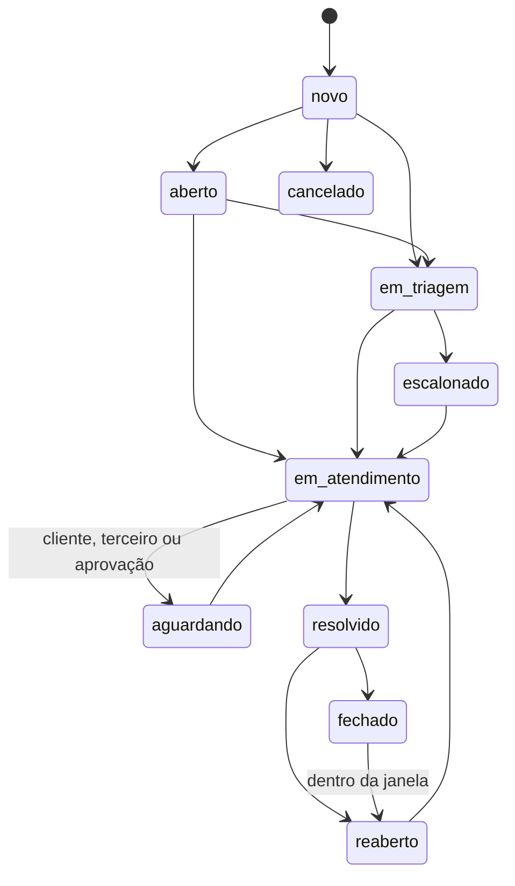

**Regras principais**
- Estado de espera pausa o contador de SLA ([32](#doc-32), seção 2.3).
- Aviso obrigatório (verificação, recuperação de conta, MFA, saúde e segurança) não pode ser desligado ([57](#doc-57), seção 3.3).
- Horário de silêncio de 21h às 7h, exceto aviso obrigatório ([57](#doc-57)).
- `read` só é gravado quando o destinatário abre o aviso ([57](#doc-57), seção 3.2).

<a id="doc-57"></a>

## 57 — Notificações, por Portal

> Parte do [SDD v2](#doc-00). Eventos que disparam notificação em [14](#doc-14). Canais e provedores de plataforma em [16](#doc-16). Verificação de contato e MFA em [06](#doc-06). Consentimento por canal em [26](#doc-26) e [22](#doc-22). Regras de envio, estados e dados sensíveis em [18](#doc-18), seção 3. Auditoria em [29](#doc-29). Idioma em [09](#doc-09). Referência de módulo: [`spec_gestao_notificacoes_revisada.md`](#v1-spec-gestao-notificacoes-revisada-md) (v1, 642 linhas) unida a [`spec_gestao_notificacoes.md`](#v1-spec-gestao-notificacoes-md) (v1, 378 linhas), por decisão NOT-01.
> **Veredito:** o módulo de notificações **não está completo como módulo**. Há regras soltas para estados, validação, canais de conta e dado sensível. Falta o módulo em si: templates, regras de envio, preferências do usuário, targeting por portal, fallback entre provedores e painel de operação.

---

### 1. Resposta direta

> **Leitura (04/11/2026):** esta tabela registra o que existia no SDD antes deste documento ser escrito. Os itens marcados como **Não** ou **Parcial** são especificados nas seções seguintes deste documento, exceto o que estiver listado na seção de pendências.

| Pergunta | Veredito |
|---|---|
| Existe especificação de notificações na v2? | **Não.** O catálogo marca "Revisar", com duas versões na v1 |
| Estados e transições estão definidos? | **Sim**, herdados da v1 revisada e validados em [18](#doc-18), seção 3.1 |
| Canais estão definidos? | **Parcial.** E-mail e SMS aparecem em [16](#doc-16). WhatsApp, Telegram e chat, em [22](#doc-22). Push e in-app não aparecem na v2 |
| Preferências do usuário? | **Não.** Só consentimento por finalidade em [32](#doc-32), seção 3.2 |
| Targeting: quem envia a quem? | **Não.** A v1 lista avisos por portal, mas não diz quem pode enviar para quem |
| Templates e variáveis? | **Não** na v2. A v1 revisada tem o conceito, sem regra de idioma nem de conteúdo |
| Fallback e saúde de provedor? | **Não** na v2. A v1 revisada tem a regra |
| Dado sensível no corpo? | **Sim**, em [18](#doc-18), seção 3.3 |
| Painel de operação e métricas? | **Não** na v2. A v1 tem, em detalhe |

---

### 2. Lacunas

1. **Módulo sem documento próprio.** As regras estão em cinco docs diferentes. Não há ponto único de consulta.
2. **Canal push e in-app ausentes.** A v1 lista ambos. Sem eles, avisos de aplicativo não têm caminho.
3. **Preferências do usuário ausentes.** Sem tela de preferência, o responsável não escolhe canal, horário ou tipo de aviso.
4. **Horário de silêncio ausente.** Mensagem às 23h para responsável não tem regra.
5. **Targeting ausente.** Não há regra para "todas as famílias da turma X", "responsáveis com dependente com vínculo ativo", "professores da unidade". Sem isso, o envio em massa fica sem controle.
6. **Templates e i18n ausentes.** Texto de aviso precisa de versão por idioma ([09](#doc-09)) e de variáveis validadas.
7. **Fallback entre provedores ausente.** [16](#doc-16) define um provedor por tipo. A v1 prevê vários por canal e troca automática quando um cai.
8. **Painel de operação ausente.** Fila, falhas, reenvio e métricas de entrega não têm tela nem métrica definida. [24](#doc-24) tem só uma meta ("99% em até 5 min"). **Escrito** nas seções 3.8 e 3.9 (NOT-08).
9. **Conflito de versões da v1.** Há [`spec_gestao_notificacoes.md`](#v1-spec-gestao-notificacoes-md) (378 linhas) e a revisada (642 linhas). **Decidido** em 03/11/2026 (NOT-01): as duas são unidas. A revisada dá estados, eventos, reenvio e observabilidade. A original dá as telas e o painel (seções 3.8 e 3.9).
10. **Notificação de saúde.** [18](#doc-18), seção 3.3, proíbe diagnóstico no corpo. Não há regra de quem pode enviar aviso de saúde, nem para quem.

---

### 3. Modelo proposto

#### 3.1 Canais

| Canal | Uso | Dono do envio | Regra |
|---|---|---|---|
| In-app | Avisos internos e de portal | Plataforma | Padrão para aviso que não é urgente |
| E-mail | Verificação, recuperação, comunicado formal | Plataforma (verificação) e entidade (comunicado) | Endereço verificado ([06](#doc-06), D-04). Link de descadastro em marketing ([26](#doc-26)) |
| Push | Aviso de aplicativo, Android e iOS | Plataforma | Depende do aplicativo e de token de dispositivo válido. Decidido pelo autor em 03/11/2026 |
| SMS | Aviso não crítico e opcional | Entidade | Não é fator de MFA ([16](#doc-16)). Desligado por padrão |
| WhatsApp | Aviso com opt-in | Entidade | Opt-in registrado ([22](#doc-22)). Template aprovado pelo provedor |
| Webhook | Integração com sistema da entidade | Entidade | Assinatura validada na recepção |

#### 3.2 Estados

Herdados da v1 revisada e validados em [18](#doc-18), seção 3.1: `draft`, `in_review`, `scheduled`, `queued`, `processing`, `sent`, `delivered`, `read`, `failed`, `archived`, `cancelled`.

Regra adicional: `read` nunca é gravado pelo envio. É gravado só quando o destinatário abre o aviso.

#### 3.3 Preferências do usuário

- Cada pessoa escolhe canal por tipo de aviso: acadêmico, financeiro, comunicado geral.
- Aviso obrigatório não pode ser desligado: verificação, recuperação de conta, MFA, aviso de saúde e comunicado de segurança.
- Horário de silêncio por pessoa, com exceção para aviso obrigatório. Decidido pelo autor em 03/11/2026: 21h às 7h.
- Opt-out de marketing vale em todos os canais ([22](#doc-22), palavras `PARAR` e `SAIR`).

#### 3.4 Targeting

Envio só para um público definido por regra, nunca para lista aberta:

| Público | Regra | Quem pode definir |
|---|---|---|
| Turma | Alunos com matrícula ativa na turma | Professor da turma, coordenação |
| Responsáveis de uma turma | Responsáveis com vínculo ativo a alunos da turma | Coordenação, secretaria |
| Unidade | Todos com vínculo ativo na unidade | Gestão da unidade |
| Entidade | Todos com vínculo ativo na entidade | Direção da entidade. Não pode ser professor |
| Plataforma | Clientes ou equipe da empresa | Equipe da empresa desenvolvedora |

Público com mais de 500 destinatários exige aprovação de segunda pessoa, como em [48](#doc-48), seção 12. Decidido pelo autor em 03/11/2026.

#### 3.5 Templates

- Template tem versão, idioma, variáveis validadas e categoria (acadêmico, financeiro, pastoral, segurança).
- Variável sem valor bloqueia o envio.
- Template de WhatsApp precisa ser aprovado pelo provedor antes de uso.
- Notificação de saúde ou de RH não tem diagnóstico nem salário no corpo ([18](#doc-18), seção 3.3). Mostra aviso e link autenticado.

#### 3.6 Provedores e fallback

- Cada canal pode ter mais de um provedor. Um é primário, e os outros são reserva.
- Health check por provedor. Falhas repetidas tiram o provedor do roteamento automático.
- Troca de provedor é registrada em auditoria.

#### 3.7 Retenção

- Corpo da mensagem: prazo configurável por entidade, com padrão a definir **(jurídico)**.
- Registro de entrega (quem, quando, canal, estado): mesmo prazo de log de integração, 90 dias ([49](#doc-49), seção 2).
- Auditoria de envio: prazo de evento de plataforma ([29](#doc-29)).

#### 3.8 Telas do módulo

Vêm da versão original da v1 ([`spec_gestao_notificacoes.md`](#v1-spec-gestao-notificacoes-md), seção 6), unida à revisada por decisão NOT-01. A regra da v2 prevalece quando há conflito: estados de [18](#doc-18), seção 3.1, aprovação acima de 500 destinatários (NOT-03), silêncio (NOT-02) e permissão por papel.

| Tela | Conteúdo | Regra da v2 |
|---|---|---|
| Painel | Indicadores e gráficos da seção 3.9, com filtro por período, unidade, canal, prioridade e estado | Mostra só o escopo do papel: entidade, unidade ou turma |
| Lista | Tabela com título, tipo, canal, prioridade, unidade, estado, agendada para, enviada em, leitura, tentativas e responsável. Filtros salvos, paginação no servidor, seleção múltipla e exportação | Ação em lote respeita a transição permitida de cada item. Exportação segue a permissão e mascara dado pessoal |
| Criação e edição | Etapas: dados básicos, público, conteúdo, canal, agendamento, regras e revisão final. Prévia das variáveis do template | Sem público válido, não envia. Limite de caracteres por canal. Público acima de 500 vai para aprovação de segunda pessoa |
| Detalhe | Resumo, linha do tempo, entregas por destinatário, interações, log técnico e auditoria | Log técnico só para quem tem papel de operação. Conteúdo de aviso de saúde segue NOT-05 |
| Quadro (kanban) | Colunas por estado: rascunho, em revisão, agendada, processando, enviada, entregue, lida, falhou, arquivada | Arrastar o cartão só faz transição permitida. Estados de entrega (`delivered`, `read`, `failed`) vêm do provedor, não da mão do usuário |
| Automações | Criar, testar, simular, ativar e desativar regra, com versão. Gatilhos: cadastro, mudança de estado, atraso, falha, aniversário, expiração e tarefa pendente | Regra só dispara a partir de evento do catálogo de [14](#doc-14), seção 4. Simulação não envia mensagem |
| Configuração | Canais, provedores, templates, limites de envio, silêncio, política de reenvio, retenção, identidade visual e permissões | Provedor e credencial seguem [16](#doc-16). Retenção segue a seção 3.7 |

Ações por item: ver, editar rascunho, duplicar, reenviar, cancelar agendamento, arquivar e excluir (exclusão lógica). Reenvio de item já entregue pede motivo e fica na auditoria.

#### 3.9 Painel, métricas e alertas

União das métricas das duas versões da v1 (original, seção 7; revisada, seção 15). Fecha NOT-08.

| Métrica | Quem vê |
|---|---|
| Total por período, enviadas hoje, pendentes na fila | Gestão e secretaria, no escopo do papel |
| Taxa de entrega e de leitura, por canal | Gestão e secretaria, no escopo do papel |
| Falhas nas últimas 24 horas e reenvios em andamento | Gestão e operação da plataforma |
| Tempo médio até o envio e até a entrega | Operação da plataforma |
| Falhas por provedor e fila por prioridade | Operação da plataforma |
| Prazo cumprido e violado (meta de [24](#doc-24): 99% em até 5 minutos) | Gestão e operação da plataforma |
| Avisos críticos pendentes | Gestão, no escopo do papel |

Gráficos: volume por dia, itens por estado, distribuição por canal, sucesso e falha por canal, e volume por hora e dia da semana.

**Portal do desenvolvedor:** vê só métricas agregadas de operação, sem título, corpo ou destinatário de mensagem de cliente ([31](#doc-31)).

**Alertas para a operação:** falha elevada por provedor, crescimento anormal da fila, aumento de reenvio, prazo violado, worker sem sinal de vida e taxa de erro acima do limite por canal. Os limites são medidos em homologação.

**Rastreio:** o `correlation_id` acompanha evento, regra, fila, worker, provedor e resultado. Log estruturado com dado sensível redigido ([49](#doc-49), seção 3).

---

### 4. Por portal

| Portal | Quem envia | Para quem | Canais | Exemplos de aviso (da v1) |
|---|---|---|---|---|
| **Desenvolvedor** | Equipe da empresa | Clientes e equipe | E-mail, in-app | Aviso de manutenção, cobrança da assinatura |
| **Gestão** | Direção, gestor de unidade | Público da entidade ou da unidade | In-app, e-mail, SMS, WhatsApp, push | Comunicado da direção, aviso geral |
| **Professor** | Professor e coordenação | Turma, responsáveis da turma | In-app, push, e-mail | Mensagem para turma, lembrete de prova, aviso de conteúdo |
| **Aluno** | Ninguém envia | Recebe | In-app, push | Aviso de professor e da coordenação, lembrete de prova |
| **Responsáveis** | Não envia comunicado geral | Recebe | In-app, push, SMS, WhatsApp, e-mail | Aviso da diretoria, aviso de saúde ou enfermaria, notificação de entrada e saída, lembrete de reunião |
| **Terceiros** | Não envia comunicado geral | Recebe aviso do próprio contrato | E-mail, in-app | Aviso de vencimento de contrato, de nota recebida, de ordem de compra |

**Regras de portal:**

- Aluno não envia notificação a colega. Professor não envia para público fora da própria turma.
- Responsável não envia para outros responsáveis.
- Notificação de entrada e saída (catraca) só vai ao responsável do dependente, com vínculo ativo ([35](#doc-35)).
- Aviso de saúde ou enfermaria vai ao responsável. Remetentes padrão: secretaria, enfermagem, médico da escola e coordenação. A escola pode incluir ou remover remetentes. Decidido pelo autor em 03/11/2026. Não aparece no portal de terceiros.

---

### 5. Pendências

| # | Pendência | Tipo |
|---|---|---|
| NOT-01 | Versão de referência da v1: revisada ou original | **Decidido** em 03/11/2026: unir as duas. Telas e painel da original nas seções 3.8 e 3.9 |
| NOT-02 | Horário de silêncio padrão (seção 3.3) | **Decidido** em 03/11/2026: 21h às 7h |
| NOT-03 | Aprovação de segunda pessoa para público acima de 500 (seção 3.4) | **Decidido** em 03/11/2026: sim |
| NOT-04 | Prazo de retenção do corpo da mensagem (seção 3.7) | (jurídico) |
| NOT-05 | Remetentes de aviso de saúde ou enfermagem (seção 4) | **Decidido** em 03/11/2026: secretaria, enfermagem, médico da escola e coordenação por padrão. A escola pode incluir ou remover. Parecer do (jurídico) sobre o conteúdo do aviso continua pendente |
| NOT-06 | Canal push | **Decidido** em 03/11/2026: aplicativo próprio para Android e iOS. Canais: app, SMS, e-mail e WhatsApp |
| NOT-07 | DDL das tabelas do módulo: notificação, template, regra, entrega, fila, preferência e provedor | **Escrito** em [51](#doc-51), seção 15.1. Revisão do owner pendente (DDL-01) |
| NOT-08 | Métricas e painel de operação: quais e para quem | **Escrito** na seção 3.9 |
| NOT-09 | Aplicativo Android e iOS: escopo, arquitetura e publicação nas lojas. É um produto novo, fora dos módulos atuais | Documento. **Decidido** em 03/11/2026: entra depois do núcleo |

---

### 6. Critérios de aceite

- [ ] Aviso obrigatório não pode ser desligado pelo usuário (teste).
- [ ] Aviso fora do horário de silêncio é adiado, salvo obrigatório (teste).
- [ ] Professor não envia para público fora da própria turma (teste de isolamento).
- [ ] Responsável não recebe aviso de dependente sem vínculo ativo (teste).
- [ ] Template com variável sem valor não é enviado (teste).
- [ ] Corpo de aviso de saúde não contém diagnóstico (varredura).
- [ ] Provedor com falha repetida sai do roteamento e o aviso segue pelo reserva (teste).
- [ ] Itens **(jurídico)** e **[Decisão do autor]** respondidos ou marcados como pendentes no [00](#doc-00).

## Especificações da v1 desta parte absorvidas no kit-starter ou sem destino

<a id="v1-spec-helpdesk-md"></a>

### v1 — `SPEC-HELPDESK.md` (929 linhas)

> Situação na v2: Absorvido integralmente no kit-starter. Destino: ficha do kit-starter: `kit-starter/desenvolvedor/suporte/chamados-dos-clientes.md`. Quando este texto diverge da v2, vale a v2.

#### O que a v2 muda nesta especificação

Estas regras prevalecem sobre o texto da v1 que vem a seguir.

- **Modelo único** ([32](#doc-32), seção 2.1; [19](#doc-19), seção 7): Helpdesk é a base; SAC e chat rápido são canais ou tipos do mesmo registro. As três especificações da v1 da seção 13 descrevem partes desse mesmo módulo.
- **Protocolo** (ATD-01): todo pedido com responsável e prazo recebe número de protocolo; pergunta resolvida pelo bot ou pela base de conhecimento, sem fila, não recebe.
- **Estados e transições** ([32](#doc-32), seção 2.2): `novo`, `aberto`, `em_triagem`, `em_atendimento`, `aguardando_cliente`, `aguardando_terceiro`, `aguardando_aprovacao`, `em_pausa`, `resolvido`, `fechado`, `reaberto`, `escalonado`, `cancelado`. Transição inválida é recusada pela aplicação. Cancelar, escalonar e reabrir gravam motivo.
- **Prioridade, categoria e fila** (seção 2.4): baixa, média, alta e urgente; urgente só em categoria que permita; atribuição automática por fila.
- **Canais** (seção 2.5; [22](#doc-22), seções 2 e 3): opção "Abrir ticket" sem IA em todo ponto de atendimento (D-18); texto do solicitante guardado literal; campos obrigatórios por tipo e lista fixa de campos padrão.
- **Portal do cliente** (seção 2.6): nota interna nunca aparece para o solicitante; respostas públicas por padrão; avaliação do atendimento.
- **Visibilidade no portal do desenvolvedor** (seção 2.8): chamados das entidades; nenhum dado de aluno sem chamado vinculado ([29](#doc-29), seção 8).
- **Bots** (seção 2.9): categoria sensível (saúde, denúncia, conflito) vai para humano (ATD-05).
- **Perfis da v1:** substituídos pelos papéis da seção 6.

#### Texto integral da v1

- Language Standard: Global English
#### 1. Visão Geral

Este documento especifica um sistema SaaS multi-tenant de SAC / Help Desk / Service Desk inspirado em plataformas como Movidesk/Zenvia, com foco em centralização de canais, padronização de tickets, automação operacional, SLA, base de conhecimento, portal do cliente, relatórios e integrações. O sistema deve permitir atendimento omnichannel com rastreabilidade total, auditoria completa e flexibilidade para múltiplas empresas, unidades, equipes e perfis de acesso [web:32][web:11][web:51].

O objetivo é servir como especificação funcional e técnica base para desenvolvimento incremental, começando por um MVP sólido e evoluindo para automação avançada, múltiplos canais e recursos inteligentes de atendimento [web:32][web:7][web:54].

#### 2. Objetivos do Produto

- Centralizar todos os canais de contato em uma única operação.
- Normalizar qualquer solicitação em um Ticket.
- Reduzir tempo de resposta e tempo de resolução.
- Garantir rastreabilidade e auditoria de ponta a ponta.
- Disponibilizar autoatendimento via portal e base de conhecimento.
- Automatizar triagem, roteamento, escalonamento e notificações.
- Suportar múltiplos tenants, unidades e equipes com segurança.
- Oferecer indicadores operacionais e gerenciais em tempo real.

#### 3. Escopo

##### 3.1 Incluído

- Gestão completa de tickets.
- Omnichannel de entrada e saída.
- Portal do cliente.
- Base de conhecimento.
- SLA e calendários de atendimento.
- Automação baseada em regras e eventos.
- Catálogo de serviços.
- Aprovações.
- Relatórios e dashboards.
- Administração e governança.
- Integrações e API.
- Auditoria e trilha de eventos.

##### 3.2 Excluído no MVP

- Telefonia nativa com discador avançado.
- Inteligência artificial generativa para respostas automáticas.
- RPA para processos externos.
- Marketplace de extensões.
- BI avançado com cubos multidimensionais.

#### 4. Definições

- **Tenant**: empresa cliente isolada logicamente dentro da plataforma.
- **Unidade**: subestrutura organizacional do tenant.
- **Fila**: agrupamento operacional de tickets.
- **Ticket**: unidade central de atendimento.
- **Solicitante**: pessoa que abre ou possui o ticket.
- **Contato**: pessoa relacionada ao ticket, podendo ser solicitante ou observador.
- **Agente**: usuário interno que atende tickets.
- **SLA**: compromisso de tempo de resposta e resolução.
- **Base de conhecimento**: artigos e conteúdos de autoatendimento.

#### 5. Requisitos Funcionais

##### 5.1 Multi-tenant

O sistema deve isolar dados por tenant em todos os níveis, incluindo tickets, usuários, canais, artigos, automações, relatórios e configurações. Um usuário autenticado só pode acessar dados autorizados pelo seu escopo de tenant, unidade, fila e permissão.

##### 5.2 Gestão de tickets

O sistema deve permitir criação, leitura, atualização, vinculação, merge, split, reabertura, cancelamento, encerramento e exclusão lógica de tickets. Cada ticket deve manter histórico completo de campos, mensagens, status, responsáveis e SLAs.

##### 5.3 Omnichannel

O sistema deve receber interações por múltiplos canais, normalizar a entrada e associá-la ao mesmo ticket ou criar um novo conforme regra de negócio. Todos os canais precisam preservar autoria, timestamp, anexos e origem.

##### 5.4 Portal do cliente

O portal deve permitir abertura e acompanhamento de tickets, respostas públicas, envio de anexos, consulta a artigos da base e avaliação do atendimento.

##### 5.5 Base de conhecimento

O sistema deve permitir criação, revisão, publicação, versionamento, busca e categorização de artigos. O conteúdo pode ser público, restrito ou interno.

##### 5.6 Automação

O sistema deve suportar regras automáticas acionadas por eventos ou agendamentos, com condições, ações, exceções e logs.

##### 5.7 SLA

O sistema deve calcular prazos de primeira resposta, próxima resposta e resolução, com base em regras por tenant, cliente, fila, prioridade, categoria e horário útil.

##### 5.8 Relatórios

O sistema deve oferecer dashboards operacionais e relatórios exportáveis com métricas de volume, tempo, backlog, produtividade, SLA e satisfação.

##### 5.9 Auditoria

Todas as ações críticas devem gerar eventos auditáveis com usuário, data, contexto, origem e alteração realizada.

#### 6. Canais de Entrada de Ticket

##### 6.1 Canais obrigatórios

- Portal do cliente.
- E-mail.
- Formulário web.
- WhatsApp Business API.
- Chat web.
- API REST.
- Webhook externo.
- Criação interna por agente.
- Importação em lote.
- Telefonia registrada manualmente.

##### 6.2 Regras de normalização

- Toda entrada deve gerar evento de origem.
- Toda mensagem deve ser associada a um ticket novo ou existente.
- O sistema deve identificar o solicitante por e-mail, telefone, ID externo ou autenticação.
- O canal de origem deve ser preservado em toda a vida do ticket.
- Anexos devem ser vinculados ao ticket e à mensagem de origem.

##### 6.3 Regras por canal

###### E-mail

- O sistema deve monitorar caixas de entrada configuradas.
- Assuntos e cabeçalhos devem ser preservados.
- Respostas devem manter thread.
- O sistema deve evitar duplicidade por heurística configurável.

###### WhatsApp

- Mensagens devem entrar como tickets ou mensagens vinculadas a tickets ativos.
- O sistema deve registrar número, nome exibido, mensagem e anexos.
- Respostas devem ser enviadas pela mesma sessão/canal.

###### Chat web

- O sistema deve abrir sessão de chat e, quando necessário, converter a conversa em ticket.
- O histórico do chat deve ser anexado ao ticket.

###### Formulário web

- O formulário deve ser configurável por tenant, categoria e fila.
- Campos obrigatórios devem variar por tipo de solicitação.

###### API

- A API deve aceitar payload autenticado e validado.
- O sistema deve suportar criação, atualização e consulta.

###### Webhook

- Integrações externas devem poder criar ou atualizar tickets por evento.

###### Criação interna

- Agentes devem poder abrir tickets para clientes, departamentos ou terceiros.

#### 7. Modelo de Ticket

##### 7.1 Identificação

- id.
- tenant_id.
- external_id.
- number.
- root_ticket_id.
- parent_ticket_id.
- merged_into_ticket_id.
- source_type.
- channel_id.

##### 7.2 Solicitante

- requester_id.
- requester_name.
- requester_email.
- requester_phone.
- requester_document.
- requester_company.
- requester_department.
- requester_role.
- requester_locale.

##### 7.3 Organização

- company_id.
- unit_id.
- department_id.
- queue_id.
- team_id.
- owner_user_id.
- owner_team_id.
- assigned_by.
- assigned_at.

##### 7.4 Classificação

- type_id.
- category_id.
- subcategory_id.
- topic_id.
- priority.
- severity.
- impact.
- urgency.
- reason_code.
- resolution_code.
- close_reason_id.
- tags.

##### 7.5 Conteúdo

- subject.
- description.
- public_description.
- internal_summary.
- resolution_summary.
- customer_expectation.
- initial_contact_channel.
- customer_language.

##### 7.6 Estado

- status.
- substatus.
- visibility.
- is_urgent.
- is_vip.
- is_blocked.
- is_on_hold.
- is_escalated.
- is_reopened.
- reopened_count.

##### 7.7 Datas e tempos

- created_at.
- updated_at.
- first_response_at.
- first_response_due_at.
- next_response_due_at.
- resolution_due_at.
- closed_at.
- resolved_at.
- reopened_at.
- last_activity_at.
- last_customer_message_at.
- last_agent_message_at.
- first_assignment_at.
- last_assignment_at.
- wait_started_at.
- wait_ended_at.
- sla_paused_at.
- sla_resumed_at.
- total_wait_minutes.
- total_work_minutes.
- total_pending_customer_minutes.
- total_pending_third_party_minutes.

##### 7.8 Satisfação

- satisfaction_score.
- satisfaction_comment.
- satisfaction_answered_at.
- csat_sent_at.
- csat_status.

##### 7.9 Metadados

- custom_fields.
- json_metadata.
- labels.
- attachments_count.
- messages_count.
- internal_notes_count.
- public_messages_count.
- views_count.
- source_reference.
- correlation_id.

#### 8. Campos do Ticket

##### 8.1 Campos padrão obrigatórios

- Assunto.
- Descrição.
- Solicitante.
- Canal.
- Categoria.
- Prioridade.
- Status.
- Fila.
- Responsável.
- SLA.
- Tipo.
- Tenant.

##### 8.2 Campos recomendados

- Unidade.
- Departamento.
- Severidade.
- Impacto.
- Urgência.
- Tags.
- Motivo.
- Solução.
- Tempo estimado.
- Tempo gasto.
- Data de vencimento.
- Data de fechamento.
- Canal secundário.
- Observador.
- Ticket relacionado.

##### 8.3 Campos customizáveis

- Texto curto.
- Texto longo.
- Número inteiro.
- Decimal.
- Moeda.
- Data.
- Data e hora.
- Booleano.
- Lista única.
- Lista múltipla.
- Upload.
- URL.
- E-mail.
- Telefone.
- CPF/CNPJ.
- Dependente.
- Calculado.
- Oculto.

##### 8.4 Regras para campos customizáveis

- Devem ser configuráveis por tenant.
- Devem ser condicionais por categoria, fila, tipo ou canal.
- Devem suportar obrigatoriedade dinâmica.
- Devem ter validação de formato.
- Devem ser auditáveis quando alterados.

#### 9. Estados do Ticket

- Novo.
- Aberto.
- Em triagem.
- Em atendimento.
- Aguardando cliente.
- Aguardando terceiro.
- Aguardando aprovação.
- Em pausa.
- Resolvido.
- Fechado.
- Cancelado.
- Reaberto.
- Escalonado.

##### 9.1 Regras de transição

- Novo só pode ir para aberto, triagem ou cancelado.
- Resolvido pode ir para fechado ou reaberto.
- Aguardando cliente pausa contagem de trabalho conforme regra de SLA.
- Ticket fechado pode ser reaberto por janela configurável.

#### 10. Prioridade, Impacto e Severidade

##### 10.1 Prioridade

- Baixa.
- Média.
- Alta.
- Crítica.
- Urgente.

##### 10.2 Impacto

- Individual.
- Setorial.
- Unidade.
- Empresa inteira.
- Múltiplos tenants em casos de fornecedor compartilhado.

##### 10.3 Severidade

- S1 - Crítica.
- S2 - Alta.
- S3 - Média.
- S4 - Baixa.

##### 10.4 Matriz de cálculo

A prioridade pode ser determinada por combinação de impacto e urgência, com overrides manuais permitidos por perfil autorizado.

#### 11. Ferramentas do Agente

##### 11.1 Operação

- Lista de tickets com filtros avançados.
- Visão Kanban.
- Busca global.
- Timeline completa.
- Thread de mensagens.
- Comentários internos.
- Respostas públicas.
- Respostas prontas.
- Macros.
- Templates.
- Encaminhamento.
- Reatribuição.
- Merge.
- Split.
- Link de tickets.
- Atribuição em lote.
- Edição em massa.
- Fechamento em massa.
- Reabertura.
- Cancelamento.
- Pausa de SLA.

##### 11.2 Produtividade

- Atalhos de teclado.
- Editor rico.
- Preenchimento automático.
- Assinatura por equipe.
- Checklist.
- Tarefas internas.
- Menções.
- Agendamento de follow-up.
- Visualização do histórico do cliente.
- Visualização de tickets relacionados.
- Sugestão de artigo da base.

##### 11.3 Supervisão

- Monitoramento de fila.
- Monitoramento de SLA.
- Visão de backlog.
- Reatribuição assistida.
- Escalonamento manual.
- Auditoria de operações.
- Dashboards por equipe e agente.

#### 12. Portal do Cliente

##### 12.1 Funcionalidades

- Criar ticket.
- Acompanhar ticket.
- Responder ticket.
- Anexar arquivo.
- Consultar histórico.
- Consultar base de conhecimento.
- Visualizar status.
- Receber notificações.
- Avaliar atendimento.
- Atualizar dados cadastrais.
- Consultar catálogo de serviços.

##### 12.2 Regras

- O cliente só pode acessar seus próprios tickets e os tickets compartilhados com ele.
- Respostas no portal devem ser públicas por padrão.
- Campos do formulário podem variar por tenant, serviço ou fila.
- Artigos relevantes podem ser sugeridos antes da abertura do ticket.

#### 13. Base de Conhecimento

##### 13.1 Estrutura

- Categoria.
- Subcategoria.
- Artigo.
- Versão.
- Autor.
- Revisor.
- Publicador.
- Tags.
- Anexos.
- Estado de publicação.

##### 13.2 Estados do artigo

- Rascunho.
- Em revisão.
- Agendado.
- Publicado.
- Arquivado.
- Restrito.

##### 13.3 Funcionalidades

- Busca textual.
- Filtros por categoria.
- Artigos relacionados.
- FAQ.
- Feedback de utilidade.
- Histórico de versão.
- Controle de permissão.
- Sugestão automática no portal e no atendimento.

#### 14. SLA

##### 14.1 Tipos de SLA

- Primeira resposta.
- Próxima resposta.
- Resolução.
- Fechamento.

##### 14.2 Regras de aplicação

- Por tenant.
- Por cliente.
- Por fila.
- Por tipo.
- Por categoria.
- Por prioridade.
- Por canal.
- Por contrato.
- Por horário de atendimento.
- Por feriado.

##### 14.3 Estados do SLA

- Ativo.
- Em risco.
- Violado.
- Pausado.
- Reiniciado.

##### 14.4 Ações automáticas

- Notificar agente.
- Notificar supervisor.
- Reatribuir ticket.
- Escalonar fila.
- Criar alerta.
- Marcar como violado.
- Registrar evento.

#### 15. Automação

##### 15.1 Tipos

- Gatilho por evento.
- Regra condicional.
- Workflow multi-etapa.
- Agendamento.
- Webhook.
- Ação manual.

##### 15.2 Eventos

- Ticket criado.
- Ticket atualizado.
- Ticket atribuído.
- Status alterado.
- Mensagem recebida.
- Mensagem enviada.
- SLA próximo.
- SLA violado.
- Aprovação concluída.
- Artigo publicado.

##### 15.3 Condições

- Canal.
- Categoria.
- Prioridade.
- Tenant.
- Unidade.
- Fila.
- Palavra-chave.
- Campo customizado.
- Horário.
- Usuário.
- Origem externa.

##### 15.4 Ações

- Alterar status.
- Alterar prioridade.
- Alterar fila.
- Alterar responsável.
- Alterar campo.
- Aplicar tag.
- Remover tag.
- Enviar e-mail.
- Enviar WhatsApp.
- Criar tarefa.
- Criar subticket.
- Criar alerta.
- Chamar webhook.
- Notificar supervisor.
- Pausar SLA.
- Retomar SLA.

#### 16. Aprovações

##### 16.1 Casos de uso

- Solicitação de acesso.
- Solicitação de mudança.
- Solicitação financeira.
- Solicitação administrativa.
- Solicitação de exceção.
- Compra e contratação.

##### 16.2 Campos de aprovação

- id.
- ticket_id.
- requested_by.
- requested_to.
- approver_id.
- status.
- requested_at.
- decided_at.
- decision_reason.
- approval_step.
- due_at.

#### 17. Notificações

##### 17.1 Canais

- E-mail.
- WhatsApp.
- In-app.
- Push.
- Webhook.

##### 17.2 Eventos notificados

- Ticket criado.
- Ticket atribuído.
- Resposta recebida.
- SLA em risco.
- SLA violado.
- Aprovação pendente.
- Aprovação concluída.
- Ticket resolvido.
- Ticket fechado.

#### 18. Relatórios e Indicadores

##### 18.1 Operacionais

- Tickets por canal.
- Tickets por fila.
- Tickets por status.
- Tickets por prioridade.
- Tempo médio de primeira resposta.
- Tempo médio de resolução.
- Backlog.
- Aging de tickets.
- Reaberturas.
- Violação de SLA.
- Tickets por agente.
- Tickets por equipe.

##### 18.2 Gerenciais

- CSAT.
- NPS.
- Volume por período.
- Tendência de atendimento.
- Produtividade individual.
- Produtividade da equipe.
- Motivos mais recorrentes.
- Causas de atraso.

##### 18.3 Exportação

- CSV.
- XLSX.
- PDF.
- JSON.

#### 19. API

##### 19.1 Princípios

- RESTful.
- Autenticada.
- Versionada.
- Documentada com OpenAPI.
- Rate limited.
- Auditável.

##### 19.2 Recursos principais

- /auth
- /tenants
- /users
- /customers
- /contacts
- /tickets
- /ticket-messages
- /ticket-attachments
- /sla-policies
- /queues
- /categories
- /custom-fields
- /knowledge-base/articles
- /workflows
- /approvals
- /reports
- /webhooks
- /audit-logs

##### 19.3 Operações mínimas em tickets

- Criar.
- Atualizar.
- Consultar.
- Listar.
- Encerrar.
- Reabrir.
- Atribuir.
- Alterar status.
- Adicionar mensagem.
- Anexar arquivo.
- Aplicar tag.
- Consultar histórico.

#### 20. Modelo de Banco de Dados

##### 20.1 Entidades principais

- tenants
- organizations
- units
- departments
- users
- roles
- permissions
- user_roles
- customers
- contacts
- channels
- queues
- categories
- subcategories
- ticket_types
- tickets
- ticket_messages
- ticket_attachments
- ticket_tags
- ticket_custom_values
- sla_policies
- sla_targets
- automation_rules
- automation_events
- knowledge_articles
- knowledge_categories
- knowledge_tags
- approvals
- notifications
- audit_logs
- holidays
- calendars
- service_catalog_items
- service_requests
- integrations
- webhooks
- templates

##### 20.2 Índices mínimos

- tenant_id em todas as tabelas multi-tenant.
- requester_id, owner_user_id, queue_id, status e priority em tickets.
- created_at e updated_at em tabelas transacionais.
- full-text em subject, description e article content.

#### 21. Segurança

- Autenticação com JWT e refresh token.
- Opção de SSO.
- RBAC com escopo por tenant.
- Criptografia de dados sensíveis.
- Logs de auditoria imutáveis.
- Rate limiting por rota e por token.
- Proteção contra abuso de API.
- Validação forte de entrada.
- Sessões seguras.
- Controle de anexos e tipos de arquivo.
- Política de retenção e expurgo.

#### 22. Observabilidade

- Logs estruturados.
- Métricas de sistema.
- Tracing de requisições.
- Alertas de fila e SLA.
- Monitoramento de integrações.
- Health checks.
- Métricas de erro por canal.

#### 23. Requisitos Não Funcionais

- Alta disponibilidade.
- Escalabilidade horizontal.
- Baixa latência no atendimento.
- Processamento assíncrono para integrações e notificações.
- Backup automatizado.
- Restore testado.
- Governança de retenção.
- Compatibilidade com LGPD.
- Suporte a múltiplos idiomas no futuro.

#### 24. Roadmap

##### Fase 1 - MVP

- Tickets.
- Portal.
- E-mail.
- Base de conhecimento.
- SLA básico.
- Automação simples.
- Relatórios básicos.

##### Fase 2

- WhatsApp.
- Chat.
- Aprovações.
- Catálogo de serviços.
- Relatórios avançados.
- Campos dinâmicos.

##### Fase 3

- Telefonia.
- Automações avançadas.
- Sugestão inteligente de respostas.
- Classificação automática.
- Previsão de SLA.
- BI avançado.

#### 25. Critérios de Aceite

- Todo canal válido deve gerar ou atualizar ticket.
- Todo ticket deve ter histórico completo.
- Todo SLA deve ser calculado automaticamente.
- Toda ação crítica deve ser auditada.
- Todo cliente deve conseguir acompanhar seus tickets no portal.
- Toda automação deve ser configurável sem alterar código.
- Todo relatório essencial deve ser exportável.

#### 26. Regras de Implementação

- O Ticket deve ser a entidade central do domínio.
- Campos customizados devem ser configuráveis por tenant.
- Automações devem ser desacopladas do core de ticket.
- O portal deve consumir a mesma API do backoffice com permissões adequadas.
- O sistema deve tratar canais como adaptadores de entrada e saída.
- Mensagens, anexos e histórico nunca devem ser perdidos em merge ou split.

#### 27. Convenções Técnicas

- Nomes de tabelas em inglês, minúsculas e plural.
- Campos de auditoria padrão em todas as tabelas relevantes.
- Soft delete preferencial.
- IDs preferencialmente UUID em camadas expostas.
- Eventos de domínio para integrações assíncronas.
- Separação entre domínio, aplicação e infraestrutura.

#### 28. Apêndice - Entidades Resumidas

##### 28.1 TicketMessage

- id.
- ticket_id.
- author_type.
- author_id.
- body.
- is_public.
- channel_id.
- created_at.

##### 28.2 TicketAttachment

- id.
- ticket_id.
- message_id.
- file_name.
- file_size.
- mime_type.
- storage_path.
- created_at.

##### 28.3 SLAPolicy

- id.
- tenant_id.
- name.
- first_response_minutes.
- next_response_minutes.
- resolution_minutes.
- schedule_id.
- priority_rules.

##### 28.4 AutomationRule

- id.
- tenant_id.
- name.
- event_type.
- conditions.
- actions.
- is_active.

##### 28.5 KnowledgeArticle

- id.
- tenant_id.
- title.
- slug.
- content.
- category_id.
- status.
- version.
- author_id.
- published_at.

<a id="v1-spec-layout-ticket-md"></a>

### v1 — `SPEC-LAYOUT-TICKET.md` (350 linhas)

> Situação na v2: Absorvido integralmente no kit-starter. Destino: ficha do kit-starter: `kit-starter/desenvolvedor/suporte/chamados-dos-clientes.md`. Quando este texto diverge da v2, vale a v2.

#### O que a v2 muda nesta especificação

Estas regras prevalecem sobre o texto da v1 que vem a seguir.

- **Modelo único** ([32](#doc-32), seção 2.1; [19](#doc-19), seção 7): Helpdesk é a base; SAC e chat rápido são canais ou tipos do mesmo registro. As três especificações da v1 da seção 13 descrevem partes desse mesmo módulo.
- **Protocolo** (ATD-01): todo pedido com responsável e prazo recebe número de protocolo; pergunta resolvida pelo bot ou pela base de conhecimento, sem fila, não recebe.
- **Estados e transições** ([32](#doc-32), seção 2.2): `novo`, `aberto`, `em_triagem`, `em_atendimento`, `aguardando_cliente`, `aguardando_terceiro`, `aguardando_aprovacao`, `em_pausa`, `resolvido`, `fechado`, `reaberto`, `escalonado`, `cancelado`. Transição inválida é recusada pela aplicação. Cancelar, escalonar e reabrir gravam motivo.
- **Prioridade, categoria e fila** (seção 2.4): baixa, média, alta e urgente; urgente só em categoria que permita; atribuição automática por fila.
- **Canais** (seção 2.5; [22](#doc-22), seções 2 e 3): opção "Abrir ticket" sem IA em todo ponto de atendimento (D-18); texto do solicitante guardado literal; campos obrigatórios por tipo e lista fixa de campos padrão.
- **Portal do cliente** (seção 2.6): nota interna nunca aparece para o solicitante; respostas públicas por padrão; avaliação do atendimento.
- **Visibilidade no portal do desenvolvedor** (seção 2.8): chamados das entidades; nenhum dado de aluno sem chamado vinculado ([29](#doc-29), seção 8).
- **Bots** (seção 2.9): categoria sensível (saúde, denúncia, conflito) vai para humano (ATD-05).
- **Perfis da v1:** substituídos pelos papéis da seção 6.

#### Texto integral da v1

#### 1. Objetivo

Este documento define a implementação da tela de detalhe de ticket inspirada no layout Movidesk da imagem de referência, usando Supabase como backend, autenticação, banco de dados, storage e controle de acesso. O objetivo é reproduzir a mesma densidade visual, organização dos campos e hierarquia de ações mostradas na interface [file:62].

#### 2. Diretrizes de Layout

- Interface desktop-first.
- Sidebar fixa à esquerda.
- Topbar fixa no topo.
- Área principal dividida em coluna lateral de formulário e painel central de atendimento.
- Visual administrativo limpo, com fundo branco, bordas cinza claras e acento azul.
- Espaçamento compacto, típico de sistema de help desk profissional.

#### 3. Estrutura Geral

##### 3.1 Região 1 - Sidebar

- Largura fixa: 64px.
- Fundo: azul-acinzentado escuro.
- Ícones centralizados verticalmente.
- Estado ativo com contraste visual sutil.
- Conteúdo: navegação principal do sistema.

##### 3.2 Região 2 - Topbar

- Altura fixa: 48px.
- Fundo branco.
- Linha inferior azul fina.
- À esquerda: identificação do ticket.
- À direita: ícones de busca, relógio, notificação, telefone, chat e avatar.
- Canto superior direito: menu de opções e status do ticket.

##### 3.3 Região 3 - Conteúdo Principal

- Coluna esquerda: 340px aproximadamente.
- Painel central: restante da largura.
- O conteúdo deve ter rolagem vertical independente.

#### 4. Coluna Esquerda

##### 4.1 Bloco superior

- Tabs: Público e Interno.
- Link rápido: Colocar-me como solicitante.
- Campo: Solicitante.
- Campo: Serviço.
- Campo: Categoria.
- Campo: Urgência.
- Seção Ativos com radio buttons: Solicitante, Organização, Todos.

##### 4.2 Bloco intermediário

- Campo: Previsão de solução.
- Campo: Responsável.
- Link rápido: Atribuir para mim.
- Campo: Tags.
- Campo: CC.

##### 4.3 Regras visuais

- Labels acima dos inputs.
- Inputs com altura compacta.
- Bordas finas cinza claras.
- Largura total da coluna.
- Espaçamento vertical consistente.

#### 5. Painel Central

##### 5.1 Cabeçalho do ticket

- Campo largo: Assunto.
- Deve ocupar praticamente toda a largura útil do painel central.
- Posicionado imediatamente abaixo da topbar.

##### 5.2 Editor de resposta

- Tabs: Ação pública e Ação interna.
- Ação pública ativa por padrão.
- Área de texto grande logo abaixo das tabs.
- Deve aceitar rich text futuramente.
- Deve suportar anexos, menções e macros.

##### 5.3 Linha de ações e metadados

Campos na mesma linha:

- Data.
- Início.
- Fim.
- Tempo.
- Tipo.
- Tempo contabilizado.
- Atividade.
- Valor.
- Opções.

##### 5.4 Botões

- Botão secundário: Aplicar macro.
- Botão de destaque: Nova ação.
- Botão final: Salvar.
- Menu Opções no canto direito da linha de status.

#### 6. Componentes da Interface

##### 6.1 Inputs

- Text input.
- Select com busca.
- Date picker.
- Time picker.
- Radio group.
- Textarea.
- Rich text editor.
- File uploader.

##### 6.2 Navegação

- Sidebar icons.
- Tabs da esquerda.
- Tabs do editor.
- Menu de opções.

##### 6.3 Feedback visual

- Badges de status.
- Hover sutil nos botões.
- Foco visível nos campos.
- Estado ativo em tabs e ícones.

#### 7. Mapeamento de Dados Supabase

##### 7.1 Tabelas principais

- tenants.
- users.
- user_profiles.
- customers.
- contacts.
- companies.
- units.
- departments.
- services.
- categories.
- queues.
- tickets.
- ticket_messages.
- ticket_activities.
- ticket_attachments.
- ticket_tags.
- sla_policies.
- macros.
- audit_logs.
- notifications.

##### 7.2 Relações principais

- tickets.requester_id -> contacts.id.
- tickets.owner_user_id -> users.id.
- tickets.queue_id -> queues.id.
- tickets.category_id -> categories.id.
- tickets.service_id -> services.id.
- ticket_messages.ticket_id -> tickets.id.
- ticket_attachments.ticket_id -> tickets.id.
- ticket_tags.ticket_id -> tickets.id.

#### 8. Regras de RLS

- Um usuário só acessa tickets do seu tenant.
- Cliente só acessa tickets próprios ou compartilhados.
- Agente só acessa filas autorizadas.
- Supervisores podem acessar tickets da unidade ou equipe sob responsabilidade.
- Todas as tabelas sensíveis devem ter RLS habilitado.

#### 9. Interações da Tela

##### 9.1 Abrir ticket

- Carregar ticket por id.
- Preencher colunas esquerda e central.
- Buscar mensagens, anexos e histórico.

##### 9.2 Alterar solicitante

- Atualizar requester_id.
- Recalcular contexto do ticket.
- Registrar no audit log.

##### 9.3 Alterar responsável

- Atualizar owner_user_id.
- Registrar timestamp da atribuição.
- Atualizar SLA se necessário.

##### 9.4 Enviar ação pública

- Inserir mensagem pública na timeline.
- Notificar solicitante.
- Registrar evento.

##### 9.5 Inserir ação interna

- Inserir nota interna apenas para agentes.
- Não notificar cliente.
- Registrar autor e data.

##### 9.6 Aplicar macro

- Mostrar modal de seleção.
- Aplicar texto, tags, status e ações associadas.

#### 10. Comportamento Responsivo

##### 10.1 Desktop

- Layout completo conforme referência.

##### 10.2 Tablet

- Sidebar colapsável.
- Coluna esquerda retrátil.
- Painel central priorizado.

##### 10.3 Mobile

- Sidebar em drawer.
- Coluna esquerda vira seção expansível.
- Editor e metadados empilhados verticalmente.

#### 11. Estados da Página

- Carregando.
- Ticket encontrado.
- Ticket não encontrado.
- Sem permissão.
- Erro de rede.
- Salvando.
- Salvo com sucesso.
- Alteração pendente.

#### 12. Validações

- Assunto obrigatório.
- Solicitante obrigatório em ticket novo.
- Serviço obrigatório quando a fila exigir.
- Responsável obrigatório em status de atendimento, quando configurado.
- Mensagem pública não pode ser enviada vazia.
- Arquivos devem respeitar limite de tamanho e tipo.

#### 13. Stack Sugerida

- Frontend: Next.js ou React.
- Estilo: Tailwind CSS.
- UI kit: componentes próprios ou shadcn/ui adaptado.
- Backend: Supabase.
- Auth: Supabase Auth.
- Banco: PostgreSQL do Supabase.
- Storage: Supabase Storage.
- Realtime: Supabase Realtime.

#### 14. Componentes React Sugeridos

- TicketLayout.
- SidebarNav.
- TopBar.
- TicketHeader.
- TicketField.
- TicketTabs.
- PublicActionEditor.
- InternalActionEditor.
- MetadataRow.
- TicketMacroPicker.
- TicketStatusBadge.
- TicketAssigneePicker.
- TicketServicePicker.
- TicketCategoryPicker.
- TicketAttachments.
- TicketTimeline.

#### 15. Estrutura de Pastas

```txt
app/
  tickets/
    [id]/
      page.tsx
components/
  ticket/
    SidebarNav.tsx
    TopBar.tsx
    TicketHeader.tsx
    TicketFields.tsx
    TicketEditor.tsx
    TicketMetaRow.tsx
    TicketActions.tsx
lib/
  supabase/
  auth/
  tickets/
  permissions/
  validations/
```

#### 16. Tokens Visuais

- primary: #2F6FED
- sidebar: #3C4A57
- background: #F6F7FA
- surface: #FFFFFF
- border: #D9DEE6
- text: #2C2C2C
- text-muted: #6B7280
- success: #22C55E
- warning: #F59E0B
- danger: #EF4444

#### 17. Regras de Auditoria

Registrar em audit_logs:

- criação do ticket.
- alteração de campo.
- troca de responsável.
- envio de mensagem.
- alteração de status.
- aplicação de macro.
- anexos adicionados.
- ações internas.
- fechamento.
- reabertura.

#### 18. Critérios de Aceite

- A tela deve reproduzir fielmente a composição visual da referência.
- A hierarquia visual deve permitir leitura rápida e operação eficiente.
- O layout deve funcionar em desktop sem quebra de alinhamento.
- O ticket deve carregar e salvar dados via Supabase.
- Os campos devem ser consistentes com o modelo de dados do help desk.
- Todas as ações relevantes devem ser auditadas.

#### 19. Próximos Entregáveis

- Wireframe detalhado por bloco.
- Schema SQL do Supabase.
- RLS policies.
- Componentes React base.
- Contrato de API para o ticket.
- Lista de validações front-end e back-end.

<a id="v1-spec-chat-rapido-sac-md"></a>

### v1 — `spec_chat_rapido_sac.md` (294 linhas)

> Situação na v2: Absorvido integralmente no kit-starter. Destino: ficha do kit-starter: `kit-starter/desenvolvedor/suporte/chamados-dos-clientes.md`. Quando este texto diverge da v2, vale a v2.

#### O que a v2 muda nesta especificação

Estas regras prevalecem sobre o texto da v1 que vem a seguir.

- **Modelo único** ([32](#doc-32), seção 2.1; [19](#doc-19), seção 7): Helpdesk é a base; SAC e chat rápido são canais ou tipos do mesmo registro. As três especificações da v1 da seção 13 descrevem partes desse mesmo módulo.
- **Protocolo** (ATD-01): todo pedido com responsável e prazo recebe número de protocolo; pergunta resolvida pelo bot ou pela base de conhecimento, sem fila, não recebe.
- **Estados e transições** ([32](#doc-32), seção 2.2): `novo`, `aberto`, `em_triagem`, `em_atendimento`, `aguardando_cliente`, `aguardando_terceiro`, `aguardando_aprovacao`, `em_pausa`, `resolvido`, `fechado`, `reaberto`, `escalonado`, `cancelado`. Transição inválida é recusada pela aplicação. Cancelar, escalonar e reabrir gravam motivo.
- **Prioridade, categoria e fila** (seção 2.4): baixa, média, alta e urgente; urgente só em categoria que permita; atribuição automática por fila.
- **Canais** (seção 2.5; [22](#doc-22), seções 2 e 3): opção "Abrir ticket" sem IA em todo ponto de atendimento (D-18); texto do solicitante guardado literal; campos obrigatórios por tipo e lista fixa de campos padrão.
- **Portal do cliente** (seção 2.6): nota interna nunca aparece para o solicitante; respostas públicas por padrão; avaliação do atendimento.
- **Visibilidade no portal do desenvolvedor** (seção 2.8): chamados das entidades; nenhum dado de aluno sem chamado vinculado ([29](#doc-29), seção 8).
- **Bots** (seção 2.9): categoria sensível (saúde, denúncia, conflito) vai para humano (ATD-05).
- **Perfis da v1:** substituídos pelos papéis da seção 6.

#### Texto integral da v1

- Language Standard: Global English
#### 1. Visão geral
Este documento descreve o módulo de chat rápido do SAC, pensado como um canal de entrada leve para o usuário abrir demandas com poucos cliques. O chat deve funcionar no mesmo ecossistema multitenant do help desk, com suporte a tenant raiz, tenants clientes e subtenants, mantendo isolamento, herança de configuração e trilha de auditoria.

#### 2. Objetivo
Permitir que qualquer usuário autorizado consiga:
- iniciar atendimento por um chat flutuante no sistema;
- abrir demanda por e-mail;
- abrir demanda por WhatsApp;
- acompanhar conversas e tickets;
- converter conversas em tickets sem perder histórico, anexos ou contexto.

#### 3. Princípios do produto
- O ticket continua sendo a entidade central.
- O chat é um canal rápido de captura de demanda.
- E-mail e WhatsApp são canais de entrada equivalentes ao chat.
- Cada tenant pode operar como prestador de suporte para seus próprios clientes.
- A mesma estrutura deve servir para a plataforma, seus clientes e os clientes dos clientes.

#### 4. Modelo hierárquico de tenant
##### 4.1 Estrutura
- Tenant raiz: empresa dona da plataforma.
- Tenant cliente: empresa contratante da plataforma.
- Subtenant: cliente do tenant cliente, quando aplicável.

##### 4.2 Regras
- Todo registro relevante deve carregar `tenant_id`.
- A hierarquia deve permitir `parent_tenant_id` para herança e segmentação.
- O tenant filho pode herdar marca, categorias, SLAs, filas, artigos e fluxos do tenant pai.
- O isolamento de dados deve ser mantido em todas as camadas.

#### 5. Canais de entrada
##### 5.1 Chat rápido
O sistema deve exibir um botão flutuante fixo no canto inferior direito, visível nas telas autorizadas. Ao clicar, o usuário abre o painel do chat com saudação, atalhos de ajuda, histórico de mensagens e ação para enviar nova mensagem.

##### 5.2 E-mail
O cliente deve poder abrir demanda por e-mail. Mensagens recebidas devem ser ingeridas automaticamente, vinculadas a uma sessão ou ticket e com resposta possível no mesmo thread. O sistema deve identificar remetente, assunto, corpo, anexos e mensagem original.

##### 5.3 WhatsApp
O cliente deve poder abrir demanda por WhatsApp. Conversas recebidas devem gerar sessão de atendimento e, quando necessário, converter-se em ticket com o histórico completo anexado. O canal precisa preservar número, autoria, tempo e anexos.

#### 6. Experiência do chat rápido
##### 6.1 Botão flutuante
- Ícone circular fixo no canto inferior direito.
- Abertura do widget com animação leve.
- Não pode bloquear ações críticas do sistema.
- Deve funcionar em desktop e mobile.

##### 6.2 Tela inicial do chat
- Saudação personalizada com o nome do usuário.
- Texto explicativo curto sobre como o sistema ajuda.
- Card de ação principal para “Envie uma mensagem”.
- Campo de busca de ajuda.
- Navegação inferior com Início, Mensagens e Ajuda.

##### 6.3 Aba Início
- Mostrar saudação e contexto do usuário.
- Exibir atalho para iniciar conversa.
- Exibir sugestões de temas mais comuns.
- Exibir tempo estimado de resposta, quando configurado.

##### 6.4 Aba Mensagens
- Listar conversas anteriores.
- Mostrar autor, prévia, data relativa e status.
- Permitir abrir conversa existente.
- Permitir iniciar nova conversa.

##### 6.5 Aba Ajuda
- Exibir busca de artigos.
- Exibir coleções e categorias.
- Permitir navegação por área funcional.
- Permitir sugerir artigo antes de abrir ticket.

#### 7. Fluxos funcionais
##### 7.1 Fluxo do chat
1. Usuário clica no botão flutuante.
2. Widget abre com saudação e atalhos.
3. Usuário envia mensagem.
4. O sistema cria ou reutiliza uma sessão de chat.
5. A conversa pode ser resolvida ali mesmo ou convertida em ticket.

##### 7.2 Fluxo de abertura por e-mail
1. Usuário envia e-mail para o endereço do SAC.
2. O sistema recebe e identifica o tenant correto.
3. Uma conversa ou ticket é criado automaticamente.
4. Respostas posteriores são associadas à mesma thread.
5. O usuário recebe retorno no e-mail original.

##### 7.3 Fluxo de abertura por WhatsApp
1. Usuário envia mensagem pelo número oficial.
2. O sistema cria sessão de atendimento.
3. O agente ou regra automática pode converter a conversa em ticket.
4. O histórico é preservado e vinculado ao ticket.
5. O usuário continua sendo atendido pelo mesmo canal.

##### 7.4 Fluxo de conversão em ticket
1. Atendimento inicia em chat, e-mail ou WhatsApp.
2. Se a demanda exigir acompanhamento formal, o sistema gera ticket.
3. O ticket herda histórico, anexos, categoria sugerida e canal de origem.
4. O ticket é encaminhado para fila, unidade ou departamento adequado.

#### 8. Regras de negócio
- Um usuário autenticado deve ser identificado automaticamente sempre que possível.
- Se o usuário não estiver autenticado, o sistema deve permitir abertura assistida com e-mail ou telefone.
- Não deve haver duplicidade de ticket aberto para a mesma demanda, salvo regra explícita.
- A categoria do ticket pode ser sugerida por artigo acessado, palavras-chave, fila, unidade ou seleção manual.
- O sistema deve permitir que tenant filho crie e administre sua própria operação de suporte.
- Um tenant filho deve conseguir atender os próprios clientes com a mesma estrutura de chat, e-mail e WhatsApp.

#### 9. Entidades principais
##### 9.1 chat_sessions
- id
- tenant_id
- parent_tenant_id
- user_id
- customer_id
- channel_id
- status
- subject
- last_message_at
- created_at
- updated_at

##### 9.2 chat_messages
- id
- session_id
- tenant_id
- sender_type
- sender_id
- body
- attachments
- is_internal
- created_at

##### 9.3 tickets
- id
- tenant_id
- parent_tenant_id
- requester_id
- requester_name
- requester_email
- requester_phone
- channel_id
- queue_id
- category_id
- priority_id
- status
- subject
- description
- created_at
- updated_at

##### 9.4 ticket_messages
- id
- ticket_id
- tenant_id
- sender_type
- sender_id
- body
- attachments
- is_public
- created_at

##### 9.5 help_articles
- id
- tenant_id
- visibility
- title
- content
- category_id
- tags
- created_at
- updated_at

##### 9.6 inbound_channel_configs
- id
- tenant_id
- type
- address_or_number
- status
- routing_rules
- created_at
- updated_at

#### 10. Regras por canal
##### 10.1 Chat web
- Deve existir widget embutido com abertura rápida.
- Deve permitir resposta em tempo real ou assíncrona.
- Deve converter para ticket quando houver necessidade de formalização ou quando o agente assumir.

##### 10.2 E-mail
- Deve suportar captura de mensagens recebidas.
- Deve manter thread por Message-ID, References ou regra equivalente.
- Deve anexar arquivos ao ticket e preservar mensagem original.

##### 10.3 WhatsApp
- Deve suportar ingestão de mensagens via integração oficial.
- Deve preservar número de origem, mensagens e anexos.
- Deve permitir escalonamento da conversa para ticket.

#### 11. Interface e UX
- O chat deve seguir a identidade visual do tenant.
- O cabeçalho deve exibir nome da marca e estado do atendimento.
- A área de mensagens deve ser rolável.
- O campo de composição deve ficar fixo na base do widget.
- A navegação inferior deve permanecer fixa dentro do componente.
- Os atalhos devem ser configuráveis por tenant.

#### 12. Operação e atendimento
- O chat pode iniciar com bot, triagem humana ou fila híbrida.
- A mensagem deve entrar na sessão adequada antes de virar ticket.
- O agente pode assumir a conversa e converter em ticket manualmente ou por regra.
- A conversa deve manter contexto ao trocar de canal.
- O ticket deve carregar histórico consolidado de todos os canais usados.

#### 13. SLA e priorização
- O ticket derivado do chat, e-mail ou WhatsApp deve herdar SLA aplicável.
- A prioridade pode ser inferida por palavras-chave, fila ou categoria.
- O sistema deve suportar primeira resposta, próxima resposta e resolução.
- O tempo em espera do cliente deve ser contabilizado conforme política do tenant.

#### 14. Segurança e privacidade
- O acesso deve respeitar RBAC por tenant, unidade, fila e departamento.
- O conteúdo das mensagens deve ser sanitizado.
- Anexos devem ter validação de tipo e tamanho.
- Logs de auditoria devem registrar abertura, leitura, resposta, conversão e fechamento.
- Dados sensíveis devem seguir a política de retenção e LGPD.

#### 15. Auditoria e rastreio
- Toda entrada por chat, e-mail ou WhatsApp deve gerar evento de auditoria.
- Toda conversão de conversa para ticket deve ser auditável.
- Toda troca de status, atribuição e encerramento deve ficar registrada.
- O histórico deve ser recuperável por ticket e por sessão.

#### 16. API sugerida
- `POST /chat/sessions`
- `GET /chat/sessions`
- `POST /chat/sessions/{id}/messages`
- `POST /tickets`
- `POST /tickets/from-session/{sessionId}`
- `GET /tickets/{id}`
- `POST /inbound/email/webhook`
- `POST /inbound/whatsapp/webhook`
- `GET /knowledge/articles`
- `GET /knowledge/articles/{id}`

#### 17. Eventos de domínio
- `chat.session_opened`
- `chat.message_received`
- `chat.message_sent`
- `chat.session_converted_to_ticket`
- `ticket.created`
- `ticket.assigned`
- `ticket.status_changed`
- `ticket.closed`
- `inbound.email_received`
- `inbound.whatsapp_received`

#### 18. Critérios de aceite
- O usuário consegue abrir o chat rápido pelo botão flutuante.
- O usuário consegue iniciar demanda pela interface do chat.
- O cliente consegue abrir ticket por e-mail.
- O cliente consegue abrir ticket por WhatsApp.
- O sistema preserva histórico, anexos e origem em todos os canais.
- O mesmo modelo funciona para tenant raiz, tenant cliente e subtenant.
- O ticket é criado ou associado sem perda de contexto.

#### 19. MVP
##### Inclui
- Botão flutuante de chat.
- Tela com Início, Mensagens e Ajuda.
- Envio de mensagem no chat.
- Conversão de chat em ticket.
- Ingestão de e-mail.
- Ingestão de WhatsApp.
- Base de conhecimento básica.
- Auditoria de eventos principais.

##### Não inclui no MVP
- IA generativa avançada.
- BI preditivo.
- RPA.
- Discador telefônico.
- Marketplace de extensões.
- Automação complexa multietapa.

#### 20. Observações finais
- O módulo deve ser pensado como um canal plugável dentro do SAC.
- A mesma estrutura deve ser reaproveitada em todos os níveis da hierarquia do SaaS.
- O chat rápido é apenas a interface; o domínio continua sendo ticket, sessão e auditoria.
- A implementação deve nascer preparada para expansão omnichannel.

<a id="v1-spec-gestao-sac-base-conhecimento-md"></a>

### v1 — `spec_gestao_sac_base_conhecimento.md` (443 linhas)

> Situação na v2: Absorvido integralmente no kit-starter. Destino: ficha do kit-starter: `kit-starter/desenvolvedor/suporte/base-de-conhecimento.md`. Quando este texto diverge da v2, vale a v2.

#### O que a v2 muda nesta especificação

Estas regras prevalecem sobre o texto da v1 que vem a seguir.

- **Artigo** ([32](#doc-32), seção 2.7): autor, revisor, versão, data de revisão e público (interno, portal ou público). Artigo com dado pessoal não é publicado.
- **Sugestão por IA:** só a partir de fonte cadastrada ([27](#doc-27); D-18 do [22](#doc-22)).
- **Bot:** responde só com artigos publicados para o público do canal; fora da base, encaminha para humano.
- **Perfis da v1:** substituídos pelos papéis da seção 6.

#### Texto integral da v1

- Language Standard: Global English
#### Objetivo
Criar um módulo completo de Gestão de SAC com base de conhecimento integrada, cobrindo atendimento omnichannel, triagem, categorização, SLA, automações, dashboards, relatórios, controle operacional e gestão de conteúdo.

#### Escopo funcional
O sistema deve permitir:
- Receber, classificar, priorizar e acompanhar tickets de atendimento.
- Gerenciar base de conhecimento pública e interna.
- Automatizar regras de distribuição, resposta, escalonamento e encerramento.
- Visualizar operações por datatables, widgets, charts, Kanban e drawers de CRUD.
- Controlar usuários, filas, permissões, categorias, macros, SLAs, tags, canais e auditoria.
- Operar com múltiplas unidades, departamentos e equipes.

#### Módulos principais

##### 1. Gestão de Tickets SAC
Função central para abertura, triagem, atendimento e encerramento de solicitações.

###### Funcionalidades
- Criar ticket manualmente, via portal, e-mail, API ou integração.
- Identificar cliente, unidade, canal, assunto e origem.
- Classificar por tipo, prioridade, categoria, subcategoria e motivo.
- Definir status, SLA, responsável, fila e equipe.
- Registrar mensagens, anexos, notas internas e histórico completo.
- Vincular ticket a pedido, contrato, aluno, paciente, colaborador ou ativo.
- Encaminhar, transferir, escalar, resolver, reabrir e encerrar.
- Gerenciar tempo de atendimento, primeira resposta e resolução.

###### Controles necessários
- Botão Novo Ticket.
- Botão Responder.
- Botão Encaminhar.
- Botão Escalar.
- Botão Resolver.
- Botão Reabrir.
- Botão Encerrar.
- Botão Adicionar nota interna.
- Botão Anexar arquivo.
- Botão Vincular entidade.
- Dropdown de fila.
- Dropdown de prioridade.
- Dropdown de canal.
- Dropdown de status.
- Dropdown de tags.
- Seletor de unidade.
- Seletor de responsável.
- Campo de busca global.

##### 2. Kanban de Atendimento
Visão operacional para acompanhamento dos tickets por etapa.

###### Colunas sugeridas
- Novo.
- Triagem.
- Em atendimento.
- Aguardando cliente.
- Aguardando interno.
- Escalado.
- Resolvido.
- Encerrado.

###### Controles necessários
- Arrastar e soltar tickets.
- Filtros por fila, agente, SLA, prioridade e unidade.
- Atalhos para abrir drawer do ticket.
- Indicadores de atraso por cartão.
- Seleção múltipla em lote.
- Ações rápidas por card.

##### 3. Datatables Operacionais
Listagens completas para gestão diária.

###### Listas obrigatórias
- Tickets.
- Clientes.
- Interações.
- Categorias.
- Subcategorias.
- Filas.
- Agentes.
- Equipes.
- SLA.
- Macros.
- Tags.
- Canal de atendimento.
- Base de conhecimento.
- Avaliações de atendimento.
- Logs e auditoria.

###### Controles necessários
- Paginação.
- Ordenação por coluna.
- Busca textual.
- Filtro avançado.
- Exportação CSV/XLSX/PDF.
- Seleção em lote.
- Ações em massa.
- Colunas ocultáveis.
- Ajuste de densidade.
- Fixação de colunas.
- Salvar visão.

##### 4. Widgets Executivos
Painéis resumidos para operação e gestão.

###### Widgets sugeridos
- Total de tickets abertos.
- Tickets novos hoje.
- Tickets vencidos.
- Tempo médio de primeira resposta.
- Tempo médio de resolução.
- Tickets por fila.
- Tickets por canal.
- Taxa de reabertura.
- Índice de satisfação.
- Base de conhecimento mais acessada.
- Agentes com maior backlog.
- Produtividade por equipe.
- SLA em risco.

###### Controles necessários
- Troca de período.
- Filtro por unidade.
- Filtro por fila.
- Filtro por canal.
- Drill-down para lista detalhada.
- Atualização automática.

##### 5. Charts Analíticos
Dashboards visuais para monitoramento e decisão.

###### Gráficos recomendados
- Linha de volume de tickets por dia.
- Barras de tickets por categoria.
- Pizza de distribuição por canal.
- Área de SLA cumprido vs vencido.
- Funil de status do atendimento.
- Heatmap por horário e dia da semana.
- Barras empilhadas por equipe e prioridade.
- Linha de tempo de atendimento por unidade.

###### Controles necessários
- Período personalizado.
- Comparação entre períodos.
- Filtro por unidade, canal, equipe e categoria.
- Exportar imagem e dados.
- Alternar tipo de visualização.

##### 6. CRUD Drawers
Edição rápida sem sair da tela principal.

###### Entidades com drawer
- Ticket.
- Cliente.
- Categoria.
- Subcategoria.
- Fila.
- SLA.
- Macro.
- Tag.
- Canal.
- Artigo da base de conhecimento.
- Usuário agente.
- Equipe.
- Regra de automação.

###### Controles necessários
- Abrir em modo criar, editar ou visualizar.
- Salvar e continuar.
- Salvar e fechar.
- Cancelar.
- Validadores inline.
- Upload de imagens e anexos.
- Editor rich text para artigos.
- Preview antes de publicar.

##### 7. Base de Conhecimento
Gestão de artigos internos e públicos para autoatendimento e padronização.

###### Funcionalidades
- Criar artigos com título, resumo, categoria, tags, conteúdo e anexos.
- Controlar versões e histórico de revisão.
- Publicar, agendar, arquivar e restaurar artigos.
- Definir visibilidade pública, interna ou restrita por unidade.
- Relacionar artigos a tickets e macros.
- Exibir sugestões automáticas durante atendimento.
- Avaliação de utilidade e feedback do usuário.

###### Controles necessários
- Editor WYSIWYG.
- Inserção de blocos.
- Upload de mídia.
- Busca por conteúdo.
- Filtro por status.
- Filtro por categoria.
- Botão publicar.
- Botão arquivar.
- Botão duplicar.
- Botão revisar.
- Botão versionar.

##### 8. Automação
Regras para redução de tempo operacional e padronização.

###### Automação obrigatória
- Distribuição automática por fila, categoria ou carga do agente.
- Resposta automática de recebimento.
- Escalonamento por tempo de inatividade.
- Fechamento automático por regra.
- Abertura de tarefa derivada.
- Notificação para cliente e equipe.
- Sugestão de artigo da base.
- Macro por palavra-chave ou evento.
- Regras por prioridade, unidade, canal e horário.

###### Controles necessários
- Criar regra.
- Ativar/desativar regra.
- Ordenar prioridade da regra.
- Simular execução.
- Auditar execuções.
- Testar condição.
- Definir gatilho, condição e ação.

##### 9. Controles Operacionais
Recursos de governança, segurança e conformidade.

###### Itens obrigatórios
- Perfis e permissões por papel.
- Escopo por unidade e departamento.
- Auditoria de alterações.
- Trilhas de conversa completas.
- Controle de anexos.
- LGPD com anonimização e retenção.
- Histórico de acesso.
- Logs de ação do agente.
- Bloqueio de exclusão sem permissão.
- Controle de visibilidade de notas internas.

##### 10. Gerenciamentos
Cadastros administrativos do módulo.

###### Cadastros essenciais
- Categorias e subcategorias.
- Fila e grupos de atendimento.
- Equipes e agentes.
- Status e prioridades.
- SLAs e escalonamentos.
- Macros e respostas prontas.
- Tags e motivos de contato.
- Canais de atendimento.
- Templates de mensagens.
- Tipos de interação.
- Regras de automação.
- Base de conhecimento.

#### Páginas completas

##### 1. Dashboard SAC
Conteúdo:
- Widgets principais.
- Charts analíticos.
- Lista de tickets críticos.
- SLA em risco.
- Últimos artigos acessados.
- Atalhos de criação.

Controles:
- Filtro global.
- Filtro por período.
- Filtro por unidade.
- Filtro por canal.
- Atualização automática.

##### 2. Lista de Tickets
Conteúdo:
- Datatable principal.
- Filtros avançados.
- Ações em massa.
- Exportação.
- Painel lateral com resumo.

Controles:
- Busca.
- Ordenação.
- Paginação.
- Filtro por status.
- Filtro por SLA.
- Filtro por responsável.
- Filtro por categoria.

##### 3. Detalhe do Ticket
Conteúdo:
- Cabeçalho com status e SLA.
- Linha do tempo.
- Mensagens.
- Notas internas.
- Anexos.
- Dados do cliente.
- Relações com outros registros.
- Sugestões da base de conhecimento.

Controles:
- Responder.
- Encaminhar.
- Escalar.
- Reabrir.
- Encerrar.
- Adicionar nota.
- Vincular artigo.
- Adicionar tag.
- Alterar prioridade.
- Alterar responsável.

##### 4. Kanban de Tickets
Conteúdo:
- Board por status.
- Cards com SLA e prioridade.
- Indicadores visuais de atraso.

Controles:
- Drag and drop.
- Filtros.
- Ações rápidas.
- Seleção múltipla.

##### 5. Base de Conhecimento
Conteúdo:
- Lista de artigos.
- Status de publicação.
- Métricas de acesso.
- Categorias e tags.

Controles:
- Criar artigo.
- Editar.
- Publicar.
- Arquivar.
- Revisar.
- Versionar.
- Buscar conteúdo.

##### 6. Automações
Conteúdo:
- Lista de regras.
- Histórico de execuções.
- Status de ativação.

Controles:
- Criar regra.
- Testar regra.
- Ativar/desativar.
- Duplicar.
- Excluir com confirmação.

##### 7. Relatórios e BI
Conteúdo:
- Charts.
- Tabelas analíticas.
- Exportações.
- Filtros por unidade, período e equipe.

Controles:
- Drill-down.
- Salvar relatório.
- Agendar envio.
- Exportar PDF/XLSX/CSV.

##### 8. Administração
Conteúdo:
- Cadastros mestres.
- Usuários.
- Perfis.
- Permissões.
- SLAs.
- Canais.
- Tags.
- Macros.
- Auditoria.

Controles:
- CRUD completo.
- Busca.
- Filtros.
- Importação e exportação.
- Histórico de alterações.

#### Modelo de dados sugerido
- tickets
- ticket_messages
- ticket_notes
- ticket_attachments
- ticket_tags
- ticket_history
- customers
- agents
- teams
- queues
- categories
- subcategories
- sla_policies
- automations
- knowledge_articles
- knowledge_versions
- knowledge_feedback
- channels
- macros
- permissions
- audit_logs

#### Requisitos não funcionais
- Performance com paginação e lazy loading.
- Permissões granulares por módulo, ação e unidade.
- LGPD com consentimento, retenção e anonimização.
- Auditoria completa de eventos críticos.
- Escalabilidade para múltiplas filas e canais.
- UI responsiva para desktop e tablet.
- Suporte a multilíngua, se necessário.

#### Critérios de aceite
- O usuário consegue abrir, responder, encaminhar e encerrar tickets sem sair do fluxo principal.
- O gestor consegue acompanhar fila, SLA, volume e produtividade em tempo real.
- A equipe consegue consultar e publicar artigos com controle de versão.
- As automações executam ações por regra com rastreabilidade.
- Todas as páginas possuem datatable, widgets ou charts quando aplicável, além de drawers e controles de gestão.

#### Entregáveis de UI
- Página dashboard.
- Página lista de tickets.
- Página detalhe do ticket.
- Página kanban.
- Página base de conhecimento.
- Página automações.
- Página relatórios.
- Página administração.
- Drawers de cadastro rápido.
- Modais de confirmação e exclusão.
- Estados vazios, loading, erro e sucesso.

#### Observações finais
O módulo deve seguir padrão enterprise, com foco em operação intensiva, rastreabilidade, segurança e extensibilidade. A experiência precisa permitir atendimento rápido, gestão centralizada e autoatendimento eficiente.

---

<a id="parte-14"></a>

# Parte 14 — Integrações e importação

## Visão geral da parte 14

Integrações existem em dois níveis, plataforma e tenant, com credenciais no cofre e um ciclo de vida próprio ([16](#doc-16)). Integrações educacionais oficiais estão no [74](#doc-74) e a importação de dados de sistema anterior, no [70](#doc-70).

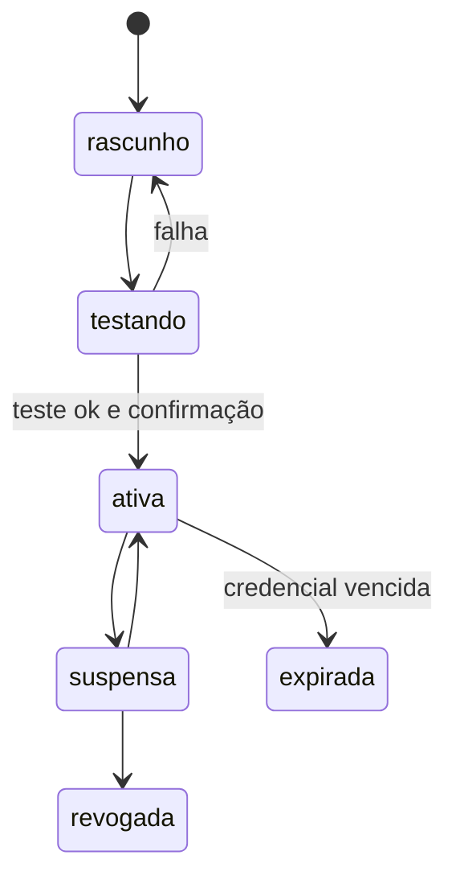

**Regras principais**
- Credencial gravada no cofre antes de qualquer teste; teste só com operação de leitura ([16](#doc-16), seção 5.1).
- Ativar conexão de produção exige permissão própria e step-up; conexão de plataforma exige dupla aprovação ([16](#doc-16), seção 5.2).
- SMS não é fator de MFA ([16](#doc-16), seção 2).

<a id="doc-16"></a>

## 16 — Integrações Externas: Plataforma (master) e Tenant

> Parte do [SDD v2](#doc-00). Credenciais e cofre em [05](#doc-05) e [10](#doc-10). Validação de entrada e de saída em [15](#doc-15). Eventos internos em [14](#doc-14).
> **Status:** proposta. Itens **[Decisão pendente]** precisam de aprovação do autor.

---

### 1. Dois níveis

| Nível | Quem contrata e paga | Quem configura | Credencial fica em | Quem usa |
|---|---|---|---|---|
| **Plataforma (master)** | TotusTuus SoftCloud | Equipe da plataforma, com permissão `plataforma.integracao.*` | Cofre da plataforma | Todos os tenants, de forma transparente |
| **Tenant** | A entidade (cliente) | Administrador da entidade, com permissão `integracao.conexao.*` | Cofre, com chave de cifragem por tenant | Só o próprio tenant |

Regras:

1. Credencial de um tenant nunca é visível para outro tenant, nem para a equipe da plataforma em texto claro.
2. A equipe da plataforma vê status, erros resumidos e metadados de uma conexão de tenant. Para ver o segredo, é preciso step-up, motivo registrado e alerta ao canal de segurança (ver [06](#doc-06), seção 10).
3. Uma integração de plataforma pode ser usada por um tenant só quando o plano contratado inclui o recurso. O controle é feito pela configuração do tenant, não pelo código.
4. Integração de tenant não pode substituir integração de plataforma em funções de segurança, como e-mail de verificação e MFA.

### 2. Catálogo de integrações de plataforma

| Provedor (tipo) | Finalidade | Dado enviado | Regra |
|---|---|---|---|
| E-mail transacional | Verificação de cadastro, recuperação de conta, notificações | E-mail e conteúdo do aviso | Obrigatório. Única via de recuperação (D-04). |
| SMS | Notificação não crítica, opcional | Número e texto curto | **Não é fator de MFA** ([06](#doc-06), seção 5). Desligado por padrão. |
| Armazenamento de objetos | Uploads e exportações | Arquivo cifrado no envio | Região declarada; URL assinada com validade curta |
| Antivírus de upload | Verificação de arquivo enviado | Arquivo | Arquivo recusado se o serviço não responder |
| Captcha | Proteção de login e cadastro após tentativas (ver [06](#doc-06), seção 6) | Token do navegador | Escolha do provedor em ADR próprio |
| Cobrança da assinatura do SaaS | Cobrança dos tenants pela plataforma | Dados do cliente da plataforma | Dados bancários nunca passam pelo sistema; tokenização no provedor |
| Backup externo | Cópia de segurança fora da região principal | Backup cifrado | Chave de backup fora do provedor |
| Monitoramento e erros | Métricas e rastreamento de erro | Metadados; sem PII | Filtro de PII antes do envio |
| Verificação de documento (opcional) | Conferência de identidade, para suporte | Documento enviado pelo titular | Só com consentimento específico; sem armazenamento no provedor |

### 3. Catálogo de integrações de tenant

| Integração | Finalidade | Credencial típica | Regra |
|---|---|---|---|
| Gateway de pagamento | Cobrança de mensalidades, Pix, cartão | Chave da conta do tenant | Um gateway primário por unidade, dentro da entidade. Decidido em 03/11/2026 (SRC-05). Adapters: Asaas, Mercado Pago, Gerencianet / EFÍ, PagSeguro e Stripe (lista da v1, [`spec_gestao_billing_cobranca_mensalidades.md`](#v1-spec-gestao-billing-cobranca-mensalidades-md), seção 17.1). Contingência em [34](#doc-34), seção 2.3. |
| ERP ou contabilidade | Exportação de lançamentos | Chave ou usuário do ERP | Envio por lote diário; idempotência por número de lançamento |
| Emissão de nota fiscal (NFS-e, por município) | Nota de serviço educacional | Certificado digital e credencial da prefeitura | Certificado do tenant; sem certificado, a emissão não é habilitada |
| eSocial (transmissão) | Eventos S-2220, S-2230, S-2240 e demais do RH e SMT | Certificado digital A1 ou A3 da entidade | Ver decisão D-08 (seção 6) |
| SSO institucional (SAML ou OIDC) | Login com o provedor de identidade da escola | Metadados e certificado do provedor | Fora desta versão, salvo decisão D-09 |
| Webhook de saída | Enviar eventos para o sistema da unidade. Um endpoint por unidade. Decidido em 03/11/2026 (SRC-06) | Segredo HMAC do endpoint | Ver [04](#doc-04), seção 7 |
| Importação de sistema legado | Carga inicial de dados | Arquivo ou acesso de leitura ao banco legado | Carga por arquivo; acesso direto ao banco de terceiros não é permitido |

### 4. Modelo de conexão

Cada conexão é um registro, em tabela com `tenant_id` quando o nível é tenant.

| Campo | Tipo | Regra |
|---|---|---|
| `id` | UUID | Público |
| `level` | enum | `platform` ou `tenant` |
| `tenant_id` | UUID | Obrigatório se `level = tenant`; nulo se `platform` |
| `provider` | enum | Lista fechada da seção 2 ou 3 |
| `environment` | enum | `sandbox` ou `production` |
| `status` | enum | `rascunho`, `testando`, `ativa`, `suspensa`, `revogada`, `expirada` |
| `config` | JSON | Só dado não secreto (ex.: identificador da conta, região) |
| `secret_ref` | string | Referência ao segredo no cofre; nunca o segredo |
| `scopes` | lista | Permissões que a conexão pede ao provedor |
| `expires_at` | data | Data de vencimento da credencial, quando o provedor informa |
| `last_tested_at`, `last_test_result` | data, enum | Resultado do último teste |
| `created_by`, `rotated_at`, `revoked_at` | identificador, data | Auditoria |

Regras do modelo:

- `production` e `sandbox` não compartilham credencial. Conexão de produção não pode ser usada em ambiente de homologação.
- Credencial de tenant é cifrada com a chave de dados do tenant, que por sua vez é protegida pela chave-mestra do cofre (ADR-05 em [02](#doc-02)).
- Um tenant tem no máximo uma conexão `ativa` por provedor e ambiente, salvo gateway com múltiplas contas (regra do provedor).

### 5. Ciclo de vida

```
rascunho → testando → ativa ⇄ suspensa
                  ↘ (falha)    ↓
                  rascunho   revogada
                              expirada (automática, se a credencial vencer)
```

#### 5.1 Criação e teste

1. Administrador informa os dados não secretos e envia a credencial. A credencial é gravada no cofre antes de qualquer teste.
2. Sistema faz uma chamada de teste ao provedor (sandbox ou produção, conforme `environment`). Teste usa operação somente leitura.
3. Resultado do teste é gravado. Sucesso leva a `testando → ativa` só depois da confirmação do administrador.
4. Falha mantém o status `rascunho` e mostra a mensagem do provedor, sem o segredo.

#### 5.2 Ativação

- Ativar conexão de produção exige permissão específica e step-up de MFA.
- Ativar conexão de plataforma exige dupla aprovação de dois responsáveis da equipe da plataforma.

#### 5.3 Rotação

- Credencial tem data de rotação. Padrão: 180 dias, ou o prazo do provedor, se for menor.
- Rotação cria o novo segredo, testa, troca a referência e só depois revoga o antigo. Se o teste falhar, o antigo continua ativo.
- Janela de sobreposição máxima de 24 h.

#### 5.4 Revogação e exclusão

- Revogar desativa a conexão e tenta revogar a credencial no provedor, quando a API permitir.
- O segredo é apagado do cofre após 30 dias de carência. Durante a carência, a restauração é possível pelo administrador da plataforma com motivo registrado.
- Registro da conexão permanece para auditoria.

### 6. Decisões aprovadas (02/11/2026, com a proposta indicada)

| # | Decisão | Proposta | Alternativa e condição de falha |
|---|---|---|---|
| D-07 | Tenant pode trazer as próprias credenciais de gateway e ERP? | Sim, para cobrança e ERP. Comunicação e infraestrutura ficam na plataforma. | Centralizar tudo na plataforma: menos trabalho para o tenant, mas a plataforma passa a ser cobradora e responsável por todas as contas bancárias. |
| D-08 | Quem transmite o eSocial? | Certificado A1 ou A3 do tenant, com transmissor da plataforma. Montagem do XML no SMT ou RH. | Transmissão feita pela própria entidade: menos carga para a plataforma, mas exige equipe técnica no cliente. |
| D-09 | SSO institucional entra nesta versão? | Não. Fica para a versão seguinte, com [06](#doc-06) já preparada para OIDC. | Entrar agora: aumenta o escopo de identidade e de testes. |

### 7. Segurança das chamadas externas

- **Lista de destinos permitidos** por provedor. Chamada para domínio fora da lista é bloqueada.
- **Proteção contra SSRF** (ver [04](#doc-04), seção 7): sem redirecionamento, IP resolvido uma vez, bloqueio de redes privadas.
- **TLS verificado.** Certificado inválido é erro, sem opção de desligar verificação.
- **Segredo nunca em log**, em mensagem de erro, em URL ou em corpo de resposta gravado.
- **Chamada de saída com `timeout`:** conexão 3 s e total 15 s. Falha segue a regra da seção 6 de [15](#doc-15).
- **Circuit breaker por conexão:** após 5 falhas em 60 s, a conexão fica `suspensa` por 5 min e o administrador é avisado.

### 8. Operações financeiras

- Chave de idempotência por cobrança: o identificador da cobrança no sistema. Repetir a chamada não gera segunda cobrança.
- Conciliação diária entre o registro interno e o extrato do gateway. Diferença gera tarefa para o financeiro.
- Webhook de pagamento tem assinatura específica do provedor, validada antes de qualquer efeito.
- Estorno passa pelo gateway, nunca só no sistema.

### 9. Auditoria e observabilidade

- Registro de cada mudança de configuração, rotação, ativação, suspensão e revogação: ator, antes, depois, motivo.
- Registro de cada chamada de saída: provedor, operação, código de resposta, latência, identificador de correlação. Sem payload com dado pessoal.
- Painel de status por conexão. O painel da plataforma mostra só conexões de plataforma e contagem de erros por tenant, sem nome de cliente, salvo permissão.
- Alerta quando uma credencial vence em 30 dias ou quando uma conexão de produção fica `suspensa`.

### 10. Testes obrigatórios

- Conexão de tenant A não é usada por requisição do tenant B.
- Credencial de produção recusada em ambiente de sandbox.
- Rotação falha não derruba a credencial antiga.
- Segredo não aparece em log nem em resposta de API, mesmo em erro.
- Chamada a domínio fora da lista é bloqueada.
- Webhook com assinatura inválida é recusado antes de qualquer efeito.
- Cobrança repetida com a mesma chave de idempotência gera uma cobrança.

### 11. Critérios de aceite

- [ ] Todo provedor de plataforma e de tenant tem linha no catálogo com finalidade, dado enviado e regra.
- [ ] Nenhuma credencial em texto claro em banco, log ou resposta.
- [ ] Todo ciclo de vida (criação, teste, ativação, rotação, revogação) tem registro de auditoria.
- [ ] Decisões D-07, D-08 e D-09 tomadas pelo autor e registradas aqui.

<a id="doc-74"></a>

## 74 — Integrações Educacionais Oficiais, por Portal

> Parte do [SDD v2](#doc-00). Trata as integrações com órgãos e programas da educação: Educacenso (INEP), SIGEP (transporte escolar), SGP / MEC Gestão Presente, sistema municipal próprio e programas federais, como o Pé-de-Meia. Integrações externas em geral em [16](#doc-16). Censo escolar e conferência em [69](#doc-69), seção 4. Carga por arquivo, sem acesso direto ao banco de terceiro, em [70](#doc-70). Transporte e rastro de localização em [38](#doc-38), seções 3.5 e 11. Frequência em [61](#doc-61). Matrícula em [46](#doc-46). Logs de integração em [49](#doc-49), seção 2. Auditoria em [29](#doc-29).
> **Status:** especificação proposta, criada em 03/11/2026. Layouts, prazos e regras de programa mudam por ano e são marcados **(verificar)**. O conflito de integração com o sistema municipal foi decidido (INT-01, seção 3.4).

---

### 1. Princípios

1. **Canal oficial, nunca banco de terceiro.** Nenhuma integração acessa o banco do órgão ou de outro sistema ([16](#doc-16)).
2. **Quem envia é a entidade, pela secretaria.** O sistema gera, confere e registra. Não envia nada a órgão sem ação da secretaria, salvo integração por API autorizada (seção 3.3).
3. **Envio é versionado.** Cada envio grava o layout, a versão, o hash, a data e quem enviou. Reenvio gera nova versão ([69](#doc-69), seção 4).
4. **Dado mínimo.** Só vai o que o layout exige. Dado de localização e de saúde só vai se o layout exigir e se a base legal permitir ([50](#doc-50)).
5. **Erro não é corrigido em silêncio.** Rejeição do órgão volta como lista de erros, para correção no módulo de origem.

---

### 2. Visão geral

| Integração | Função | Canal | Quem executa | Situação |
|---|---|---|---|---|
| Educacenso (INEP) | Declarar escolas, turmas, matrículas, docentes e infraestrutura | Arquivo no layout oficial, importado no sistema do INEP | Secretaria | Seção 3.1 |
| SIGEP | Controle de transporte escolar | Exportação e importação de arquivo | Secretaria, com o transportador | Seção 3.2 |
| SGP / MEC Gestão Presente | Sincronizar gestão e estudantes com a plataforma federal | API | Sistema, com credencial da entidade | Seção 3.3 |
| Sistema municipal próprio | Matrícula, enturmação, diário, frequência e histórico | A definir (INT-01) | Sistema, conforme contrato | Seção 3.4 |
| Pé-de-Meia e programas federais | Elegibilidade e frequência de estudantes | Pela plataforma de dados do SGP | Sistema, com aprovação da secretaria | Seção 3.5 |

---

### 3. Integrações

#### 3.1 Educacenso (INEP)

- **Conteúdo:** escolas, turmas, matrículas, docentes e infraestrutura. Fontes em [69](#doc-69), seção 4.2.
- **Mecanismo:** o sistema gera o arquivo no layout oficial do ano. A secretaria confere (seção 4.3 de [69](#doc-69)), baixa o arquivo e importa no sistema do INEP. A plataforma não acessa o sistema do INEP por conta própria.
- **Registro:** cada arquivo gerado fica em `rel_envios_regulatorios`, com layout, versão, hash e quem gerou, conferiu e enviou ([51](#doc-51), seção 15.14).
- **Obrigação:** todo estabelecimento público e privado de educação básica e toda instituição de educação superior presta as informações ao INEP (Decreto 6.425/2008, arts. 4º e 5º). No público, a autoridade do Executivo de cada ente responde pela exatidão; no privado, o representante legal (art. 2º, §§ 1º e 2º, e art. 3º, parágrafo único). Dados pessoais do censo têm sigilo e não servem a outro fim (art. 6º). Conferido em 03/11/2026 no Planalto.
- **Prazo e layout:** o decreto não fixa data de referência, prazo nem layout. Ficam para ato do Ministro da Educação e do INEP, publicado a cada ano (art. 7º, § 1º). Por isso o sistema guarda layout e calendário como **versão por ano**, carregada pela equipe de produto a partir do ato do ano, e não fixa datas no código. Conferir o ato vigente a cada ciclo **(verificar)**.

#### 3.2 SIGEP (transporte escolar)

- **Conteúdo:** alunos usuários do transporte, rotas, veículos, monitores e dados de deslocamento. A troca é por arquivo de exportação e importação, no layout do SIGEP **(verificar)**.
- **Quem executa:** a secretaria gera e importa. O transportador recebe só o que é da sua rota ([38](#doc-38), seção 3.5).
- **Localização:** o rastro de localização não entra no arquivo a menos que o layout exija. Se exigir, vale a regra de guarda do TER-02 ([38](#doc-38), seção 11). **(jurídico)**, INT-05.
- **Monitor:** dado pessoal de terceiro. Só o necessário ao layout.

#### 3.3 SGP / MEC Gestão Presente

- **Mecanismo:** API, com credencial da entidade, guardada no cofre ([05](#doc-05)). Recomendada para redes com sistema próprio, por isso a entidade decide se usa.
- **Ciclo:** envio incremental, por registro alterado. Resposta de rejeição fica na fila de integração ([49](#doc-49), LOG-01). Falha de envio é reenviada com a mesma chave de idempotência.
- **Reconciliação:** diária, entre o registro interno e o que o SGP retornou. Diferença vira item para a secretaria, sem correção automática.
- **Termo:** adesão à plataforma federal exige termo da entidade **(jurídico)**, INT-04.

#### 3.4 Sistema municipal próprio

- **Função:** matrícula, enturmação, diário, frequência e histórico, conforme o contrato com a prefeitura.
- **Conflito:** a lista de integrações admite API REST, arquivos CSV ou XML, ou integração por banco. O [16](#doc-16) proíbe acesso direto ao banco de terceiro. Não dá para usar as duas coisas.
- **Decidido** em 03/11/2026 (INT-01): API REST. Arquivo CSV/XML fica como alternativa se a prefeitura não tiver API. Banco não.

#### 3.5 Pé-de-Meia e programas federais

- **Conteúdo:** elegibilidade de estudantes e frequência, quando o programa exigir.
- **Mecanismo:** pela plataforma de dados do SGP (seção 3.3). Não há canal próprio.
- **Regra de envio:** só aluno com matrícula ativa ([46](#doc-46)), e frequência do diário ([61](#doc-61)) fechada no período. Aprovação da secretaria antes do envio.
- **Regra do programa:** Conferido em 03/11/2026 na Lei 14.818/2024 (planalto.gov.br, com as Leis 14.945/2024 e 15.265/2025). A lei não usa o nome Pé-de-Meia: trata do incentivo financeiro-educacional na modalidade de poupança.
  - **Elegível:** estudante do ensino médio público, em todas as modalidades, de família no CadÚnico, com prioridade pela renda (art. 1º, § 1º). Na EJA, de 19 a 24 anos (art. 1º, § 2º).
  - **Requisitos** (art. 3º): matrícula no início do ano, **frequência mínima de 80%** das horas letivas, conclusão do ano com aprovação, participação no Saeb e em avaliação externa do ente, Enem no último ano, Encceja na EJA.
  - **Periodicidade:** aportes de matrícula e frequência pelo menos 9 vezes por ano (art. 5º, § 4º). O sistema prepara a frequência por mês fechado.
  - **Quem verifica:** a autoridade federal da educação (art. 3º, § 1º). As redes prestam as informações, nos termos do regulamento (art. 4º).
  - O sistema não decide elegibilidade: envia matrícula e frequência e mostra o aluno abaixo de 80% como alerta à secretaria. O 80% é do programa e não muda o mínimo de aprovação de 75% ([59](#doc-59), seção 4).
  - **Regulamento** (Decreto 11.901/2024, conferido em 03/11/2026): idade de 14 a 24 anos e família no CadÚnico (art. 3º). Matrícula registrada até dois meses após o início do ano letivo e CPF do aluno (art. 4º, § 1º). Frequência de 80% medida pela média do período transcorrido ou pela frequência mensal, conforme ato do MEC (art. 4º, § 2º). Valores anuais: R$ 200 de matrícula, R$ 1.800 de frequência, R$ 1.000 de conclusão e R$ 200 do Enem (art. 4º).
  - **Dever da rede:** termo de compromisso assinado pelo chefe do Executivo do ente (art. 7º). A rede presta as informações e responde **sozinha pela veracidade** (art. 7º, §§ 1º e 3º). Informação fora do prazo do termo pode levar ao não pagamento do período (art. 7º, § 2º). Por isso o sistema mostra o prazo do termo, cadastrado pela secretaria, e alerta antes do vencimento. O envio exige aprovação da secretaria, que fica registrada.
  - **Desligamento:** evasão, abandono, ou reprovação por duas vezes seguidas ou por dois anos, entre outros casos (art. 5º). O sistema mostra esses alunos como alerta, sem decidir.
  - Ficam com o ato do MEC: forma exata da medição da frequência, canal e calendário de envio **(verificar)**.

---

### 4. Por portal

| Portal | Pode | Não pode | Origem |
|---|---|---|---|
| **Desenvolvedor** | Manter os layouts publicados, sem dado de entidade | Enviar ou ver envio de entidade | P |
| **Gestão** | Aprovar envio ao órgão. Ver o histórico de envios e rejeições | Gerar arquivo sem a secretaria | E |
| **Coordenação** | Conferir frequência e turmas antes do envio | Enviar | E |
| **Secretaria** | Gerar, conferir, baixar e importar arquivos. Enviar por API, quando autorizada | Enviar sem conferência da gestão | E |
| **Professor** | Nada. A frequência do diário alimenta o envio | Ver envio ou arquivo | E |
| **Aluno** e **Responsáveis** | Nada | Ver arquivo ou envio | E |
| **Transportador** (terceiro) | Ver a própria rota e os alunos da rota | Ver outras rotas ou arquivo completo | Terceiros, [38](#doc-38) |
| **Terceiros** (demais) | Nada | Qualquer item de integração | E |

---

### 5. Pendências

| # | Pendência | Tipo |
|---|---|---|
| INT-01 | Sistema municipal: API REST, arquivo CSV/XML, ou banco (seção 3.4) | **Decidido** em 03/11/2026: API REST. Banco não |
| INT-02 | Layout e prazo do Educacenso, por ano e por esfera (seção 3.1) | **Conferido** em parte em 03/11/2026: obrigação e responsáveis no Decreto 6.425/2008. Layout e prazo vêm do ato anual do MEC e do INEP, guardados como versão por ano **(verificar)** a cada ciclo |
| INT-03 | Critérios e periodicidade do Pé-de-Meia (seção 3.5) | **Conferido** em 03/11/2026: Lei 14.818/2024, arts. 1º, 3º, 4º e 5º. Decreto 11.901/2024, arts. 3º a 7º, conferido. Canal e calendário de envio no ato do MEC **(verificar)** |
| INT-04 | Termo de adesão à plataforma federal (SGP), e quem assina (seção 3.3) | (jurídico) |
| INT-05 | Dado de localização no arquivo do SIGEP (seção 3.2). Mesmo ponto de TER-02 | (jurídico) |
| INT-06 | Layout do SIGEP e se o monitor é pessoa do terceiro (seção 3.2) | (verificar) |
| INT-07 | DDL: integração, envio, lote, resposta e rejeição. Reutiliza `rel_envios_regulatorios` onde couber | **Escrito** em [51](#doc-51), seção 15.20. Revisão do owner pendente (DDL-01) |

---

### 6. Critérios de aceite

- [ ] Nenhuma integração acessa banco de terceiro (teste de configuração).
- [ ] Envio ao Educacenso não ocorre sem conferência da gestão (teste).
- [ ] Transportador vê só a própria rota (teste de isolamento).
- [ ] Reenvio com a mesma chave não duplica registro (teste de idempotência).
- [ ] Rejeição do órgão aparece como lista de erros, sem correção automática (teste).
- [ ] Pé-de-Meia só inclui aluno com matrícula ativa (teste).
- [ ] Itens **(verificar)**, **(jurídico)** e **[Decisão do autor]** respondidos ou marcados como pendentes no [00](#doc-00).

<a id="doc-70"></a>

## 70 — Importação de Dados e Carga Inicial, por Portal

> Parte do [SDD v2](#doc-00). Décima terceira e última lacuna da ordem de [55](#doc-55), seção 3. Regra geral de importação (simulação, erro por linha, limite e idempotência) em [15](#doc-15), seção 5. Carga de sistema legado por arquivo, sem acesso direto ao banco de terceiros, em [16](#doc-16). Cada tipo de dado segue o módulo de origem: estrutura ([59](#doc-59)), turmas ([60](#doc-60)), matrícula ([46](#doc-46)), diário e boletim ([61](#doc-61), [62](#doc-62)), prontuário ([66](#doc-66)), biblioteca ([68](#doc-68)) e financeiro ([18](#doc-18)). Notificação em massa em [57](#doc-57). Auditoria em [29](#doc-29).
> **Status:** especificação proposta, criada em 03/11/2026. Fecha a lacuna 13 do acadêmico. A v1 tem importação em lote por CSV com validação e relatório de erros ([`spec_gestao_academica_completo.md`](#v1-spec-gestao-academica-completo-md), seção 15). Esta versão define a ordem, as regras de domínio e o que a importação não pode fazer.

---

### 1. Resposta direta

> **Leitura (04/11/2026):** esta tabela registra o que existia no SDD antes deste documento ser escrito. Os itens marcados como **Não** ou **Parcial** são especificados nas seções seguintes deste documento, exceto o que estiver listado na seção de pendências.

| Pergunta | Veredito |
|---|---|
| Importação tem regra? | **Parcial.** A regra geral de [15](#doc-15) existe. Falta ordem por tipo, regra de domínio e tratamento do histórico |
| Carga de sistema anterior? | **Parcial.** [16](#doc-16) proíbe acesso direto ao banco de terceiro. Falta o processo |
| Importação pode contornar regra? | **Não, por regra desta especificação.** Ver seção 3 |

---

### 2. Tipos e ordem

A ordem segue a dependência. Nenhum tipo entra antes do que ele referencia.

| Ordem | Tipo | Depende de | Módulo |
|---|---|---|---|
| 1 | Pessoas: alunos, responsáveis, professores, servidores | Nada | [14](#doc-14), seção 3 e [46](#doc-46) |
| 2 | Estrutura: tipos de curso, cursos, disciplinas, grades, sistema avaliativo, períodos | 1 | [59](#doc-59) |
| 3 | Calendário e salas | 2 | [58](#doc-58), [44](#doc-44) |
| 4 | Turmas e enturmação | 2 e 3 | [60](#doc-60) |
| 5 | Matrículas ativas | 1, 2 e 4 | [46](#doc-46) |
| 6 | Histórico: notas, faltas, situação final de períodos fechados | 4 e 5 | [61](#doc-61), [62](#doc-62) |
| 7 | Documentos e prontuário | 1 | [54](#doc-54), [66](#doc-66) |
| 8 | Acervo da biblioteca | 2 | [68](#doc-68) |
| 9 | Saldos e parcelas em aberto | 5 | [18](#doc-18) |

---

### 3. O que a importação não faz

A importação entra pelos mesmos caminhos de regra que a tela. Por isso:

- **Nota fora da escala** é recusada, como na tela ([59](#doc-59), seção 4).
- **Matrícula acima da capacidade** vai para a lista de espera ou é recusada com motivo ([60](#doc-60), seção 2.4).
- **Aluno sem vínculo válido** de responsável não é importado como ativo ([07](#doc-07)).
- **Histórico não recalcula regra de período fechado.** A situação final vem do arquivo, com a versão do sistema avaliativo que o arquivo declara. Se a versão não existe no sistema, a linha é rejeitada.
- **Não gera cobrança retroativa.** Parcela já paga na origem entra como paga. Parcela em aberto entra com a data da origem, sem nova multa.
- **Não dispara aviso em massa.** Carga histórica entra com flag de histórico, e nenhuma notificação é enviada por ela ([57](#doc-57)).

---

### 4. Processo

1. **Modelo.** A plataforma publica um modelo de arquivo por tipo, com cabeçalho, tipos de campo e chave externa de origem. Ver seção 4.1.
2. **Envio.** O arquivo é enviado com tamanho e tipo validados ([15](#doc-15), seção 5).
3. **Simulação.** O sistema valida tudo e mostra o relatório, sem gravar. Mostra quantas linhas entram, quantas são rejeitadas e por quê.
4. **Confirmação.** A pessoa que importa confirma o lote. A confirmação fica em auditoria.
5. **Gravação.** O lote grava em transação por lote. Linha rejeitada não bloqueia as outras, mas o lote fica marcado como parcial.
6. **Desfazer.** O lote pode ser desfeito enquanto não houver registro posterior dependente dele. Depois disso, só correção por novo lote.
7. **Rejeitados.** Relatório de rejeitados, com linha e motivo, para correção e novo envio.
8. **Descarte do arquivo.** O arquivo de origem é apagado após a gravação, e fica só o hash e o relatório. Prazo em IMP-04.

**Idempotência:** a chave externa de origem evita duplicar o mesmo registro em reenvio. Reenvio do mesmo lote não cria registro novo.

#### 4.1 Modelos de arquivo (IMP-05)

**Formato comum a todos os modelos:**

| Item | Regra |
|---|---|
| Arquivos | Planilha (`.xlsx`, uma aba por modelo) e CSV. Os dois têm as mesmas colunas, na mesma ordem |
| CSV | UTF-8, separador ponto e vírgula, primeira linha com o nome das colunas |
| Data | `AAAA-MM-DD`. Data em outro formato é recusada, para não confundir dia e mês |
| Número | Vírgula como separador decimal, sem separador de milhar |
| Valor em dinheiro | Reais com duas casas. O sistema converte para centavos ([71](#doc-71)) |
| CPF | Só dígitos, com dígito verificador conferido ([15](#doc-15)) |
| Chave externa | Coluna `chave_origem` obrigatória em todo modelo. É o identificador no sistema anterior e garante a idempotência |
| Versão | Cada modelo tem versão no nome do arquivo e numa linha de comentário da planilha. Arquivo de versão que já saiu do prazo de aceitação (ver Publicação, abaixo) é recusado com aviso da versão atual |
| Coluna a mais | Recusada, para não esconder dado que não tem destino. Campo personalizado entra pela coluna com a chave do campo ([72](#doc-72)) |

**Colunas obrigatórias por modelo**, na ordem da seção 2:

| Modelo | Colunas obrigatórias | Observação |
|---|---|---|
| 1. Pessoas | `chave_origem`, `tipo_pessoa`, `nome`, `cpf` ou `documento_estrangeiro`, `nascimento`, `email` ou `telefone` | Responsável tem `chave_origem_dependente` e `tipo_vinculo`. Aluno menor sem responsável não fica ativo (seção 3) |
| 2. Estrutura | `chave_origem`, `tipo_registro` (curso, disciplina, grade, período), `codigo`, `nome`, `carga_horaria` | Sistema avaliativo é configurado na tela, não importado |
| 3. Calendário e salas | `chave_origem`, `tipo_registro` (dia, período, sala), `data_ou_codigo`, `descricao` | Sala tem `capacidade` |
| 4. Turmas e enturmação | `chave_origem`, `codigo_turma`, `curso`, `periodo`, `turno`, `capacidade`, `chave_origem_aluno` | Enturmação usa uma linha por aluno |
| 5. Matrículas | `chave_origem`, `chave_origem_aluno`, `codigo_turma`, `data_matricula`, `situacao` | Só matrícula ativa. Capacidade segue a seção 3 |
| 6. Histórico | `chave_origem`, `chave_origem_aluno`, `periodo`, `disciplina`, `nota_final`, `faltas`, `situacao_final`, `versao_sistema_avaliativo` | Só período fechado. Aprovação da coordenação (seção 6) |
| 7. Documentos | `chave_origem`, `chave_origem_pessoa`, `tipo_documento`, `nome_arquivo` | O arquivo vai num pacote compactado junto, com o mesmo nome. Dado de saúde segue IMP-03 |
| 8. Acervo | `chave_origem`, `titulo`, `autor`, `isbn` ou `codigo_interno`, `exemplares` | Item sem ISBN usa código interno |
| 9. Saldos e parcelas | `chave_origem`, `chave_origem_matricula`, `vencimento`, `valor`, `situacao` (paga, em aberto), `data_pagamento` | Sem multa nova (seção 3). Aprovação do financeiro |

**Publicação:** o portal do desenvolvedor publica os modelos, sem dado. A empresa aprova cada versão antes da publicação. Mudança de coluna gera nova versão, e a anterior continua aceita por 90 dias.

---

### 5. Dado sensível e dado de terceiros

- Laudos, diagnósticos e dados de saúde só são importados se a regra de [66](#doc-66), seção 2.3, permitir. Ver IMP-03.
- Arquivo de origem tem dado pessoal. Fica em armazenamento restrito, cifrado, pelo tempo do processo.
- Nenhum acesso direto ao banco do sistema anterior ([16](#doc-16)).

---

### 6. Por portal

| Portal | Pode | Não pode | Origem |
|---|---|---|---|
| **Desenvolvedor** | Publicar modelos de arquivo, sem dado. Orientar a importação | Importar ou ver dado de entidade, nem o conteúdo de lote | P |
| **Gestão** | Autorizar a importação inicial. Ver o relatório de lote | Importar sem a secretaria. Ver dado sensível do arquivo | E |
| **Secretaria** | Importar pessoas, estrutura, turmas, matrículas, documentos e acervo. Desfazer lote | Importar histórico sem a coordenação. Importar saldo sem o financeiro | E |
| **Coordenação** | Importar histórico de período fechado, com aprovação | Importar pessoa ou matrícula | E |
| **Financeiro** (perfil da unidade) | Importar saldos e parcelas em aberto | Importar notas ou documentos | E |
| **Professor** | Nada | Qualquer item de importação | E |
| **Aluno** | Nada | Qualquer item de importação | E |
| **Responsáveis** | Nada | Qualquer item de importação | E |
| **Terceiros** | Nada | Qualquer item de importação | E |

---

### 7. Pendências

| # | Pendência | Tipo |
|---|---|---|
| IMP-01 | Quem executa a importação inicial (seção 6) | **Decidido** em 03/11/2026: a entidade, pela secretaria. A equipe da empresa só orienta |
| IMP-02 | Histórico importado gera notificação (seção 3) | **Decidido** em 03/11/2026: não |
| IMP-03 | Laudos e dados de saúde na importação: aceitar, ou bloquear e tratar na seção de saúde | (jurídico) |
| IMP-04 | Prazo de retenção do arquivo de origem depois da gravação (seção 4, passo 8) | (jurídico) |
| IMP-05 | Modelos de arquivo por tipo: publicar em planilha e em CSV | **Escrito** na seção 4.1. Revisão do owner pendente: a empresa aprova cada versão |
| IMP-06 | DDL: lote, linha, erro, chave externa, mapeamento de campo e histórico de desfazer | **Escrito** em [51](#doc-51), seção 15.15. Revisão do owner pendente (DDL-01) |

---

### 8. Critérios de aceite

- [ ] Simulação não grava nenhuma linha (teste).
- [ ] Reenvio do mesmo lote não duplica registro (teste de idempotência).
- [ ] Nota fora da escala é rejeitada na importação (teste de integração com [59](#doc-59)).
- [ ] Matrícula acima da capacidade não entra como ativa (teste).
- [ ] Histórico com versão de sistema avaliativo inexistente é rejeitado (teste).
- [ ] Importação de histórico não dispara notificação (teste de integração com [57](#doc-57)).
- [ ] Arquivo de origem é apagado depois da gravação e fica só o hash (teste).
- [ ] Itens **(verificar)**, **(jurídico)** e **[Decisão do autor]** respondidos ou marcados como pendentes no [00](#doc-00).

## Especificações da v1 desta parte absorvidas no kit-starter ou sem destino

<a id="v1-spec-complementar-integracoes-governanca-md"></a>

### v1 — `spec_complementar_integracoes_governanca.md` (307 linhas)

> Situação na v2: Absorvido integralmente no kit-starter. Destino: ficha do kit-starter: `kit-starter/desenvolvedor/seguranca-e-operacao/integracoes-globais.md`. Quando este texto diverge da v2, vale a v2.

#### O que a v2 muda nesta especificação

Estas regras prevalecem sobre o texto da v1 que vem a seguir.

- **Dois níveis** ([16](#doc-16), seção 1): plataforma (credencial no cofre da plataforma, permissão `plataforma.integracao.*`) e tenant (cofre com chave por tenant).
- **Credencial de tenant** nunca visível em texto claro para a equipe da plataforma; ver o segredo exige step-up, motivo e alerta ao canal de segurança.
- **Catálogo da plataforma** ([16](#doc-16), seção 2): e-mail transacional (obrigatório), SMS (não é MFA, desligado por padrão), armazenamento de objetos, antivírus de upload, captcha, cobrança da assinatura do SaaS, backup externo, monitoramento sem PII, verificação de documento opcional.
- **Ciclo de vida, segurança das chamadas, auditoria e testes** ([16](#doc-16), seções 5, 7, 9 e 10); governança da v1 ligada ao [04](#doc-04), seção 7.

#### Texto integral da v1

- Language Standard: Global English
#### 1. Objetivo
Este documento complementa os specs existentes de RH/HCMRH, SMT e Suprimentos, fechando lacunas de integração, governança, automações, observabilidade, segurança e padronização operacional.

#### 2. Escopo
Este spec cobre funcionalidades transversais e itens ainda não formalizados nos anexos, com foco em:
- Integração entre RH, SMT e Suprimentos.
- Padronização de eventos, filas, notificações e auditoria.
- Regras de retenção, anonimização, exportação e mascaramento LGPD.
- Monitoramento operacional, retries, idempotência e trilha de execução.
- Checklist de implementação para fechamento de backlog.

#### 3. Lacunas Prioritárias
##### 3.1 Integração RH ↔ SMT
- Criação automática de exames ocupacionais a partir de admissão, movimentação e retorno.
- Criação automática de eventos de eSocial S-2220, S-2230 e S-2240 a partir de gatilhos do RH e SMT.
- Sincronização de status de afastamento, restrições médicas e aptidão do colaborador.
- Exposição de status consolidado de saúde ocupacional no perfil do colaborador.

##### 3.2 Integração SMT ↔ Suprimentos
- Geração automática de solicitação de compra ao atingir estoque mínimo de EPI.
- Bloqueio e liberação de fornecedores por conformidade documental e CA vencido.
- Consumo de contratos e atas em compras de EPI, insumos e serviços de segurança.
- Registro de evidência de reposição, devolução e auditoria da cadeia de suprimentos.

##### 3.3 Integração RH ↔ Suprimentos
- Solicitação automática de itens de onboarding e offboarding.
- Integração de centro de custo, cargo e unidade nas requisições.
- Controle de ativos e itens entregues ao colaborador com histórico unificado.

##### 3.4 Padronização global
- Todos os módulos devem usar id, uuid e code em entidades principais.
- Todos os listados devem suportar paginação server-side, filtros, ordenação, busca global e exportação auditada.
- Todos os drawers críticos devem possuir abas, histórico, comentários, anexos e auditoria.
- Todas as ações críticas devem gerar audit log com before/after, IP e user-agent.

#### 4. Módulos Transversais
##### 4.1 Event Bus Interno
Um barramento interno deve centralizar eventos de domínio para permitir automações desacopladas. Eventos mínimos:
- employee.created.
- employee.terminated.
- employee.department-changed.
- exam.scheduled.
- exam.performed.
- cat.created.
- absence.created.
- epi.stock-minimum-reached.
- training.expired.
- supplier.blocked.
- request.approved.

###### Requisitos
- Persistência de eventos em fila.
- Status pending, queued, sent, processed, rejected.
- Reprocessamento manual e automático.
- Idempotência por chave de evento.
- Retenção de logs de processamento.

##### 4.2 Central de Notificações
- Canal e-mail.
- Canal in-app.
- Canal webhook.
- Canal push interno.
- Canal SMS opcional.
- Preferências por perfil, unidade e evento.
- Templates com variáveis e preview.

##### 4.3 Auditoria Unificada
- Registrar toda criação, atualização, exclusão lógica, exportação, aprovação, reprovação e alteração de status.
- Auditoria com entityid, unitid, userid, action, resource, resourceid, beforejson, afterjson, ip, useragent, createdat.
- Tela de consulta com filtros por período, usuário, módulo, ação e recurso.
- Exportação de auditoria somente para perfis autorizados.

##### 4.4 LGPD e Segurança
- Dados sensíveis criptografados em repouso.
- CPF, CID, salário e dados bancários mascarados em listagens para perfis sem permissão.
- Portabilidade de dados por colaborador em arquivo estruturado.
- Anonimização automática conforme política de retenção.
- Bloqueio de exportação sem motivo e sem trilha de auditoria.

#### 5. Telas Complementares
##### 5.1 Hub de Integrações
Página central para visualizar integrações ativas, filas, falhas, retentativas, jobs e webhooks.

###### Blocos
- KPIs de integrações.
- Lista de eventos em fila.
- Lista de webhooks.
- Jobs com erro.
- Histórico de transmissões.
- Alertas de falha.

###### Colunas da fila
- Código.
- Evento.
- Origem.
- Referência.
- Status.
- Tentativas.
- Próxima tentativa.
- Protocolo.
- Mensagem.
- Ações.

##### 5.2 Central de Governança
Tela para parametrizar políticas globais de integração, retenção, mascaramento, notificações e automações.

###### Seções
- Políticas de retenção.
- Regras de máscara de dados.
- Templates de eventos.
- Destinatários padrão.
- Regras de retry.
- Rate limits.
- Configurações por entidade e unidade.

##### 5.3 Timeline Operacional
Linha do tempo unificada exibindo eventos de RH, SMT e Suprimentos em ordem cronológica.

###### Filtros
- Módulo.
- Evento.
- Usuário.
- Unidade.
- Período.
- Status.

#### 6. Fluxos Obrigatórios
##### 6.1 Admissão
Ao criar um colaborador ativo, o sistema deve:
- Criar evento de onboarding.
- Agendar exame admissional.
- Gerar checklist de documentos.
- Criar solicitações de EPI e treinamentos obrigatórios.
- Registrar auditoria completa.

##### 6.2 Afastamento
Ao registrar afastamento:
- Atualizar status do colaborador.
- Gerar eSocial S-2230.
- Notificar gestor, RH e ocupacional.
- Recalcular pendências de ponto e folha se necessário.

##### 6.3 CAT
Ao registrar CAT:
- Criar evento eSocial S-2210.
- Abrir investigação de acidente.
- Disponibilizar anexos e testemunhas.
- Notificar SESMT e perfis autorizados.

##### 6.4 EPI
Ao atingir estoque mínimo ou CA vencendo:
- Abrir alerta automático.
- Gerar solicitação de compra no módulo Suprimentos.
- Notificar SESMT.
- Registrar trilha de decisão.

##### 6.5 Treinamentos
Ao vencer treinamento obrigatório:
- Notificar colaborador, gestor e RH.
- Bloquear conformidade do cargo, quando aplicável.
- Abrir tarefa de renovação.

#### 7. APIs REST Complementares
##### 7.1 Integrações
- GET /api/v1/integrations/dashboard
- GET /api/v1/integrations/queue
- POST /api/v1/integrations/queue/{uuid}/retry
- POST /api/v1/integrations/queue/{uuid}/cancel
- GET /api/v1/integrations/webhooks
- POST /api/v1/integrations/webhooks/test
- GET /api/v1/integrations/audit

##### 7.2 Governança
- GET /api/v1/governance/policies
- PUT /api/v1/governance/policies/{uuid}
- GET /api/v1/governance/templates
- PUT /api/v1/governance/templates/{uuid}
- GET /api/v1/governance/retention
- PUT /api/v1/governance/retention/{uuid}

##### 7.3 Timeline
- GET /api/v1/timeline/events
- GET /api/v1/timeline/events/{uuid}
- POST /api/v1/timeline/events/export

#### 8. Schema SQL Complementar
##### 8.1 Event Queue
```sql
CREATE TABLE sys_event_queue (
  id BIGINT UNSIGNED AUTO_INCREMENT PRIMARY KEY,
  uuid CHAR(36) NOT NULL UNIQUE DEFAULT UUID(),
  entityid BIGINT UNSIGNED NOT NULL,
  unitid BIGINT UNSIGNED NULL,
  eventkey VARCHAR(120) NOT NULL,
  eventtype VARCHAR(80) NOT NULL,
  payload JSON NOT NULL,
  status ENUM('pending','queued','sent','processed','rejected','cancelled') NOT NULL DEFAULT 'pending',
  attempts TINYINT UNSIGNED NOT NULL DEFAULT 0,
  maxattempts TINYINT UNSIGNED NOT NULL DEFAULT 5,
  nextattemptat DATETIME NULL,
  lastattemptat DATETIME NULL,
  lastresponse TEXT NULL,
  idempotencykey VARCHAR(120) NOT NULL,
  createdby BIGINT UNSIGNED NULL,
  createdat DATETIME NOT NULL DEFAULT CURRENT_TIMESTAMP,
  updatedat DATETIME NOT NULL DEFAULT CURRENT_TIMESTAMP ON UPDATE CURRENT_TIMESTAMP,
  INDEX idx_entity_status (entityid, status),
  INDEX idx_eventkey (eventkey),
  UNIQUE KEY uk_idempotency (idempotencykey)
) ENGINE=InnoDB DEFAULT CHARSET=utf8mb4;
```

##### 8.2 Notification Log
```sql
CREATE TABLE sys_notification_log (
  id BIGINT UNSIGNED AUTO_INCREMENT PRIMARY KEY,
  uuid CHAR(36) NOT NULL UNIQUE DEFAULT UUID(),
  entityid BIGINT UNSIGNED NOT NULL,
  unitid BIGINT UNSIGNED NULL,
  eventkey VARCHAR(120) NOT NULL,
  channel ENUM('email','inapp','push','webhook','sms') NOT NULL,
  recipient VARCHAR(200) NOT NULL,
  subject VARCHAR(200) NULL,
  message TEXT NULL,
  status ENUM('queued','sent','failed','cancelled') NOT NULL DEFAULT 'queued',
  sentat DATETIME NULL,
  errortext TEXT NULL,
  createdat DATETIME NOT NULL DEFAULT CURRENT_TIMESTAMP,
  INDEX idx_event_channel (eventkey, channel)
) ENGINE=InnoDB DEFAULT CHARSET=utf8mb4;
```

##### 8.3 Governance Policy
```sql
CREATE TABLE sys_governance_policies (
  id BIGINT UNSIGNED AUTO_INCREMENT PRIMARY KEY,
  uuid CHAR(36) NOT NULL UNIQUE DEFAULT UUID(),
  entityid BIGINT UNSIGNED NOT NULL,
  policycode VARCHAR(60) NOT NULL,
  policyname VARCHAR(150) NOT NULL,
  policytype ENUM('retention','masking','notification','retry','rate_limit','export') NOT NULL,
  rulesjson JSON NOT NULL,
  status ENUM('active','inactive') NOT NULL DEFAULT 'active',
  createdat DATETIME NOT NULL DEFAULT CURRENT_TIMESTAMP,
  updatedat DATETIME NOT NULL DEFAULT CURRENT_TIMESTAMP ON UPDATE CURRENT_TIMESTAMP,
  UNIQUE KEY uk_entity_policy (entityid, policycode)
) ENGINE=InnoDB DEFAULT CHARSET=utf8mb4;
```

#### 9. Regras de Negócio
- Não permitir integração sem entityid válido.
- Não permitir evento duplicado com mesma chave de idempotência.
- Não permitir exportação de dados sensíveis sem permissão explícita e justificativa.
- Não permitir mudança de status final sem auditoria.
- Não permitir reprocessamento de evento já confirmado sem permissão especial.
- Não permitir notificação de dados sensíveis em canal não autorizado.

#### 10. RBAC Complementar
##### Perfis de acesso
- SA Super Admin.
- GE Gestor de Entidade.
- GP Gestor de Pessoas.
- GPRH Gestor de Processos RH.
- SESMT Saúde e Segurança.
- MED Médico do Trabalho.
- RH Recursos Humanos.
- SUP Suprimentos.
- AUD Auditor.
- DPO Encarregado LGPD.

##### Permissões novas
- integrations.view.
- integrations.retry.
- integrations.cancel.
- notifications.manage.
- governance.manage.
- timeline.view.
- timeline.export.
- retention.manage.
- masking.manage.

#### 11. Critérios de Aceite
- Todas as integrações críticas devem ter fila, retry e auditoria.
- Todos os eventos de RH, SMT e Suprimentos devem ser rastreáveis.
- Toda exportação deve gerar log com motivo e usuário.
- Todo dado sensível deve respeitar mascaramento por perfil.
- Toda tela complementar deve seguir o padrão enterprise do sistema.
- Todo fluxo crítico deve possuir tratamento de erro e estado de reprocessamento.
- Toda política de retenção deve ser configurável por entidade.

#### 12. Checklist de Entrega
- Hub de integrações implementado.
- Central de governança implementada.
- Timeline operacional implementada.
- Event bus persistente com retries.
- Logs de notificação e auditoria unificados.
- Regras LGPD consolidadas.
- APIs e rotas documentadas.
- Schemas SQL aplicados e indexados.
- RBAC ajustado para perfis novos.
- Testes de integração e regressão executados.

#### 13. Conclusão
Este spec complementar fecha as lacunas transversais mais importantes entre RH, SMT e Suprimentos, consolidando uma base única de eventos, auditoria, governança e conformidade para a plataforma.

---

<a id="parte-15"></a>

# Parte 15 — Inteligência artificial

## Visão geral da parte 15

A IA sugere e a pessoa decide. Nenhuma decisão sobre direito, nota, matrícula, crédito, emprego ou saúde é tomada só pela IA ([27](#doc-27), princípio 2).

```mermaid
flowchart LR
  p[Pedido de uso de IA] --> c{Recurso contratado?}
  c -->|não| x[Recurso não aparece; API recusa]
  c -->|sim| m[Dado mínimo, identificadores redigidos]
  m --> g[Modelo]
  g --> s[Sugestão identificada como IA]
  s --> h[Revisão humana registrada]
  h --> a[(Auditoria: finalidade, dados, resposta, modelo, versão, quem pediu)]
```

**Regras principais**
- Dado de cliente não treina modelo de terceiros sem consentimento e contrato ([27](#doc-27), princípio 4).
- Cobertura de IA módulo a módulo, com os módulos que ficam sem IA por decisão ([28](#doc-28)).

<a id="doc-27"></a>

## 27 — Inteligência Artificial por Módulo e por Portal

> Parte do [SDD v2](#doc-00). Chatbots e uso de IA em atendimento em [22](#doc-22), decisão D-18. Dados e busca em [21](#doc-21). Decisões automatizadas e direitos do titular em [07](#doc-07). Regras jurídicas em [26](#doc-26). Módulos em [12](#doc-12).
> **Status:** especificação proposta. Os recursos de IA são opcionais e contratados. Nenhum deles está ativo sem contratação e sem decisão de governança registrada na entidade.

---

### 1. Princípios

1. **Contratação define o acesso.** Cada recurso de IA existe no sistema só para quem contratou. Não contratado, o recurso não aparece na interface e a API responde com erro próprio (seção 3).
2. **IA sugere, a pessoa decide.** Nenhuma decisão que afete direito, nota, matrícula, crédito, emprego ou saúde é tomada só pela IA. Há ponto de revisão humana registrado.
3. **Dado mínimo para o modelo.** A IA recebe só o dado necessário para a tarefa, com redação de identificadores (seção 4).
4. **Sem treinamento com dado de cliente por padrão.** Dado de tenant não é usado para treinar modelo de terceiros. Qualquer uso para melhoria exige consentimento e contrato específico.
5. **Transparência.** Conteúdo gerado por IA é identificado como tal. O titular sabe quando a decisão teve participação de IA.
6. **Auditoria completa.** Toda chamada a modelo gera registro com finalidade, dados enviados, resposta, modelo, versão e quem solicitou.

---

### 2. Quem usa IA

| Portal | Quem | Exemplo de uso |
|---|---|---|
| **Portal do desenvolvedor** (plataforma) | Equipe da plataforma | Suporte com IA, análise de logs, geração de páginas no Editor de portais, triagem de vulnerabilidades |
| **Portal do tenant** (entidade e unidades) | Equipe da entidade, professor, aluno, responsável | Resumo de documentos, geração de plano de aula, atendimento no chat, simulados |

Os dois portais têm recursos e limites diferentes. Não há dado de tenant no portal do desenvolvedor, salvo o que o suporte acessa com vínculo e registro ([06](#doc-06), seção 10).

---

### 3. Contratação e habilitação

#### 3.1 Modelo de contratação

| Item | Descrição |
|---|---|
| Chave de capacidade | `ai.core` (base) e `ai.<modulo>` (por módulo). Exemplos: `ai.core`, `ai.academico`, `ai.financeiro`, `ai.chat`. |
| Portal do desenvolvedor | `ai.platform.core` e `ai.platform.<capacidade>` |
| Quota | Número de chamadas e volume de tokens por mês. Excedente bloqueia ou cobra, conforme contrato. |
| Plano | Recursos de IA fazem parte do plano, com a quota de IA-06. O excedente é cobrado à parte, conforme o contrato. Decidido em 03/11/2026 (IA-01). O valor em reais é decisão comercial, fora deste SDD. |
| Ativação | Feita pelo administrador da entidade ou pelo responsável da plataforma, com registro. |
| Governança | Antes de ativar, a entidade registra o responsável pela IA, aceita os termos de uso de IA e confirma a base de cada recurso (seção 6). |

#### 3.2 Comportamento sem contratação

- Interface: o recurso não aparece no menu, nem em botões, nem em atalhos.
- API: resposta `403` com código `feature_not_contracted`. Não revela se o recurso existe em outra entidade.
- Dado: nenhuma chamada a modelo é feita. Não há envio de dado para o provedor.
- Histórico: resultados gerados antes do cancelamento continuam visíveis somente para quem tinha acesso ao registro original.

#### 3.3 Cancelamento

- Para de gerar, em até 1 hora.
- Dado enviado ao provedor é tratado conforme o contrato de tratamento de dados do provedor.
- Os resultados gerados ficam no módulo de origem, marcados como gerados por IA. A exportação de histórico segue a política de retenção ([07](#doc-07), seção 5).

---

### 4. Arquitetura e dados

#### 4.1 Componentes

| Componente | Função |
|---|---|
| Gateway de IA | Ponto único de chamada. Aplica autorização, quota, redação, registro e escolha de modelo. Módulos não chamam provedor diretamente. |
| Provedores | Um ou mais provedores de modelo, por contrato da plataforma ou do tenant ([16](#doc-16), seção 6). |
| Redator de dados | Remove ou troca identificadores antes do envio (CPF, telefone, e-mail, nome completo quando desnecessário, dado de saúde). |
| Recuperador de fontes (RAG) | Busca somente em fontes do tenant ou da plataforma, com a permissão do usuário ([21](#doc-21), seção 6.3). |
| Verificador de saída | Checa formato, presença de dado pessoal indevido e conteúdo proibido antes de exibir. |
| Registro | Grava cada chamada. Nunca grava o dado completo se ele for sensível; grava identificador e hash. |

#### 4.2 Regras de dados

- Dado enviado ao modelo é o mínimo para a tarefa. Identificador é substituído por apelido de sessão.
- Dado de saúde, dado de criança ou adolescente e dado de pagamento **não são enviados** a provedor de modelo, salvo finalidade específica aprovada pelo DPO e contrato adequado ([26](#doc-26), seção 5).
- Provedor precisa de contrato de tratamento de dados, sem retenção para treino, com retenção mínima de logs no próprio provedor. Confirmar com o jurídico ([25](#doc-25)).
- Resposta do modelo não é gravada como fato. É gravada como sugestão, com a versão do modelo.
- Região de processamento declarada. Transferência internacional segue a [LGPD](#doc-07), seção 7.

#### 4.3 Defesas

| Ameaça | Controle |
|---|---|
| Injeção de instrução em documento ou mensagem | Conteúdo externo é tratado como dado, nunca como instrução. Ações de escrita exigem confirmação humana. |
| Vazamento de dado de outro tenant pela IA | Recuperação filtrada pela permissão do usuário e pelo tenant. Teste de isolamento para cada recurso. |
| Saída com dado pessoal indevido | Verificador de saída bloqueia e registra. |
| Abuso de custo | Quota por usuário, por módulo e por entidade. |
| Dependência de provedor | Gateway troca de provedor sem mudança nos módulos. |

---

### 5. Recursos por módulo do tenant

Para cada módulo: o que a IA faz, o que ela não faz, onde a decisão humana acontece e a capacidade contratada.

#### 5.1 Acadêmico (`ai.academico`)

| Recurso | Faz | Não faz | Revisão humana |
|---|---|---|---|
| Plano de aula e plano de ensino | Gera rascunho a partir da ementa e do material | Não publica sem o professor | Professor aprova |
| Resumo de conselho de classe | Resume registros da turma | Não decide aprovação ou reprovação | Coordenação decide |
| Resposta a dúvidas do aluno sobre calendário e regulamento | Responde a partir de fonte cadastrada ([22](#doc-22), D-18) | Não informa nota, situação financeira ou decisão disciplinar | Encaminha para humano fora da fonte |
| Simulado e questões | Gera questões a partir de banco aprovado | Não gera questão sem revisão | Professor revisa antes de publicar |
| Triagem de documentos da secretaria | Sugere classificação de documento enviado | Não aceita nem recusa documento | Atendente decide |

#### 5.2 Financeiro e Cobrança (`ai.financeiro`)

| Recurso | Faz | Não faz | Revisão humana |
|---|---|---|---|
| Explicação de cobrança ao responsável | Explica valores de fatura a partir de dados calculados pelo sistema | Não recalcula valor nem promete desconto | Não há decisão |
| Previsão de inadimplência | Estima risco por padrão histórico agregado | Não nega matrícula nem aplica bloqueio | Financeiro decide a ação |
| Renegociação | Sugere plano dentro das regras do tenant (Lei 14.181/2021, [26](#doc-26), seção 4.5) | Não aceita renegociação sem o consumidor | Consumidor aceita e registro é feito |
| Conciliação | Sugere pares de lançamento bancário e registro | Não concilia sem confirmação | Financeiro confirma |

Proibição: IA não decide cobrança, negativação ou bloqueio. Essas ações são do sistema, com regra e com registro ([18](#doc-18)).

#### 5.3 Pessoas e RH (`ai.rh`)

| Recurso | Faz | Não faz | Revisão humana |
|---|---|---|---|
| Triagem de currículo | Resume candidatura e destaca requisitos atendidos | Não classifica nem rejeita candidato | Recrutador decide |
| Resumo de avaliação de desempenho | Consolida registros | Não atribui nota | Gestor decide |
| Perguntas sobre benefícios e política | Responde a partir de política cadastrada | Não informa dado salarial individual a terceiro | Encaminha para RH fora da fonte |

Proibição: triagem automatizada que elimine candidato sem revisão humana é vedada pelo sistema. O art. 20 da LGPD dá ao titular o direito de pedir revisão de decisão automatizada que afete seus interesses ([07](#doc-07), seção 4).

#### 5.4 Segurança e medicina do trabalho (`ai.smt`)

| Recurso | Faz | Não faz | Revisão humana |
|---|---|---|---|
| Resumo de CAT e investigação | Organiza a narrativa do acidente | Não conclui causa | Responsável técnico conclui |
| Lembrete de exame e de treinamento NR | Gera aviso a partir do calendário | Não dispensa exame | Responsável confirma |
| Consulta de normas | Responde com referência à NR cadastrada | Não interpreta laudo | Profissional decide |

Proibição: IA não faz diagnóstico, não interpreta exame clínico e não emite parecer de aptidão.

#### 5.5 Suprimentos, Compras e Contratos (`ai.suprimentos`, `ai.contratos`)

| Recurso | Faz | Não faz | Revisão humana |
|---|---|---|---|
| Comparativo de cotações | Organiza a planilha de preço, prazo e condição | Não adjudica fornecedor | Comprador e aprovador decidem |
| Análise de cláusulas de contrato | Destaca cláusulas fora do padrão e prazos de vencimento | Não emite parecer jurídico | Jurídico decide |
| Sugestão de pedido por ruptura de estoque | Propõe quantidade a partir de consumo | Não emite pedido | Comprador confirma |

#### 5.6 CRM e atendimento (`ai.chat`, `ai.crm`)

| Recurso | Faz | Não faz | Revisão humana |
|---|---|---|---|
| Chatbot de captação | Responde com fonte cadastrada e oferece ticket sem IA (D-18) | Não negocia preço nem bolsa sem fonte | Atendente assume quando fora da fonte |
| Resumo de conversa para o vendedor | Resume o histórico do lead | Não envia mensagem sem aprovação | Vendedor envia |
| Sugestão de próxima ação | Propõe passo no funil | Não muda etapa do funil sozinho | Vendedor decide |

#### 5.7 Atendimento e helpdesk (`ai.helpdesk`)

| Recurso | Faz | Não faz | Revisão humana |
|---|---|---|---|
| Classificação de chamado | Sugere categoria e prioridade | Não fecha chamado | Atendente confirma |
| Rascunho de resposta | Gera texto a partir da base de conhecimento | Não envia sem revisão | Atendente envia |

#### 5.8 Documentos e busca (`ai.documentos`)

| Recurso | Faz | Não faz | Revisão humana |
|---|---|---|---|
| Resumo de documento longo | Resume com referência à página | Não resume documento restrito sem permissão | Usuário lê o original |
| Perguntas sobre documento | Responde com citação da página | Não responde sobre documento de outro titular | Não há decisão |
| Busca semântica | Complementa a busca por texto ([21](#doc-21), seção 6) | Não expõe texto de bucket sensível fora do escopo | Não há decisão |

#### 5.9 Marketing (`ai.marketing`)

| Recurso | Faz | Não faz | Revisão humana |
|---|---|---|---|
| Rascunho de post e campanha | Gera texto e variações | Não publica | Responsável aprova |
| Análise de desempenho | Resume métricas agregadas | Não identifica pessoa | Gestor decide |

Proibição: IA não envia mensagem de marketing a lead sem consentimento ([22](#doc-22), seção 3).

#### 5.10 Patrimônio, Frotas e Biblioteca (`ai.operacao`)

| Recurso | Faz | Não faz | Revisão humana |
|---|---|---|---|
| Sugestão de manutenção preventiva | Propõe calendário a partir de uso e histórico | Não reprova veículo | Responsável decide |
| Recomendação de leitura | Sugere títulos a partir do acervo | Não recomenda por dado pessoal sensível | Não há decisão |

#### 5.11 Simulados com IA (`ai.simulados`)

Módulo com risco de avaliação automatizada. Regras:

- Questão gerada por IA entra com status `rascunho` até revisão de professor.
- Correção automática de resposta discursiva é sugestão. A nota final é do professor.
- Aluno não recebe nota de resposta discursiva corrigida só por IA.

#### 5.12 Auditoria, Privacidade e Logs (`ai.auditoria`)

| Recurso | Faz | Não faz | Revisão humana |
|---|---|---|---|
| Resumo de incidentes de segurança | Organiza linha do tempo | Não encerra incidente | Responsável encerra |
| Consulta de auditoria em linguagem natural | Traduz pergunta em filtro auditado | Não retorna dado fora do escopo do auditor | Auditor usa o resultado |
| Resposta a pedido de titular | Rascunha o relatório | Não envia ao titular | DPO envia |

---

### 6. Recursos do portal do desenvolvedor

| Módulo | Capacidade (`ai.platform.*`) | Faz | Não faz | Revisão humana |
|---|---|---|---|---|
| Editor de portais ([23](#doc-23), seção 3) | `ai.platform.builder` | Propõe layout e bloco a partir de descrição | Não publica; não escreve código livre | Revisor aprova a publicação |
| Suporte | `ai.platform.suporte` | Resume histórico de chamados e sugere resposta | Não acessa dado de aluno sem vínculo e registro | Atendente envia |
| Logs e observabilidade | `ai.platform.ops` | Agrupa erros e sugere causa provável | Não altera configuração em produção | Operação decide |
| Segurança | `ai.platform.seguranca` | Triagem de relatório de vulnerabilidade | Não divulga achado | Responsável de segurança decide |
| CRM da plataforma ([22](#doc-22)) | `ai.platform.crm` | Resume conversa e sugere próxima ação | Não envia proposta comercial | Vendedor decide |
| Faturamento da plataforma | `ai.platform.faturamento` | Explica fatura do cliente | Não altera cobrança | Financeiro decide |

Regras do portal do desenvolvedor:

- Dado de tenant só entra no contexto de IA quando o chamado está vinculado ao tenant e à pessoa que atende.
- Ação de escrita da IA no portal exige confirmação de um segundo papel.

---

### 7. Governança e aceite

| Etapa | Responsável | Registro |
|---|---|---|
| Aceite dos termos de uso de IA | Administrador da entidade ou da plataforma | Versão do termo, data, nome |
| Designação do responsável pela IA | Entidade | Nome e papel |
| Relatório de impacto por recurso de risco alto (saúde, avaliação, RH, crédito) | DPO | Versão e data |
| Avaliação de qualidade antes de ativar | Responsável do módulo | Métricas de acerto e de erro |
| Revisão periódica | Responsável do módulo | Trimestral |
| Incidente de IA (resposta indevida, vazamento, injeção) | Segurança | Runbook de [07](#doc-07), seção 8 |

Critérios de qualidade antes da ativação:

- Taxa de resposta fora da fonte, ao menos 95% recusada ou encaminhada.
- Teste de injeção de instrução aprovado.
- Teste de isolamento de tenant aprovado.
- Revisão de amostra de saídas por responsável do módulo.

---

### 8. Direitos do titular em decisões com IA

- Informação: o titular é informado quando a IA participou de decisão que o afeta.
- Revisão: o titular pode pedir revisão por pessoa (LGPD, art. 20) [A para o direito; V para o alcance no caso concreto].
- Explicação: o sistema registra o critério usado pela regra ou pela sugestão, para responder ao pedido.
- Contestação: o pedido entra no fluxo de direitos ([07](#doc-07), seção 4).

---

### 9. Testes obrigatórios

- Recurso não contratado: não aparece e a API responde `feature_not_contracted`.
- Dado de saúde não sai do sistema em nenhuma chamada de IA (varredura).
- Injeção de instrução em documento anexado não altera a ação.
- Resposta de chatbot fora da fonte vai para humano, e a opção de ticket sem IA funciona com IA desligada.
- Resultado de simulado discursivo não recebe nota final só da IA.
- Triagem de candidato não elimina sem revisão.
- Consulta de IA no portal do desenvolvedor não acessa tenant sem vínculo.

---

### 10. Decisões e lacunas

| # | Item | Dono | Situação |
|---|---|---|---|
| IA-01 | Preço e plano dos recursos de IA | Autor e comercial | **Decidido** em 03/11/2026: IA dentro do plano, com a quota de IA-06, e excedente cobrado conforme o contrato. Valor em reais com o comercial |
| IA-02 | Provedores de modelo permitidos e região de processamento | Autor e jurídico | Aberto |
| IA-03 | Contrato de tratamento com provedor de modelo | Jurídico | Aberto ([26](#doc-26)) |
| IA-04 | Termo de uso de IA para entidade | Jurídico | Aberto |
| IA-05 | Relatório de impacto dos recursos de risco alto | DPO | Aberto |
| IA-06 | Quotas padrão por plano | Autor | **Decidido** em 03/11/2026: básico 1.000 chamadas por mês, PRO 10.000. Entidade ajusta pelo contrato |
| IA-07 | Uso de dado de tenant para melhoria de produto | Autor e jurídico | **Decidido** em 03/11/2026: não usar sem consentimento específico da entidade. Métrica de uso anônima e agregada é permitida. Parecer do (jurídico) pendente |

---

### 11. Critérios de aceite

- [ ] Todo recurso de IA tem chave de capacidade, quota e revisão humana definida.
- [ ] Nenhum recurso de IA ativo sem aceite de termo e responsável registrado.
- [ ] Gateway de IA é o único ponto de chamada a provedor.
- [ ] Testes da seção 9 passando em CI.
- [ ] IA-02, IA-03 e IA-05 resolvidos antes de ativar qualquer recurso de risco alto.

<a id="doc-28"></a>

## 28 — Cobertura de IA em Todos os Módulos

> Parte do [SDD v2](#doc-00). Regras gerais, contratação e governança de IA em [27](#doc-27). Catálogo de módulos em [12](#doc-12). Regras de validação em [17](#doc-17), [18](#doc-18) e [19](#doc-19).
> **Objetivo:** todo módulo do catálogo tem uma posição de IA, mesmo quando a posição é "não". A [27](#doc-27), seções 5 e 6, detalha os módulos de maior uso. Esta seção fecha a cobertura.

---

### 1. Legenda

| Posição | Significado |
|---|---|
| **Sim** | Recurso completo, com revisão humana onde há decisão |
| **Restrita** | Recurso parcial. A IA apenas sugere. Nenhuma ação é executada por ela. |
| **Não** | A IA não entra no módulo, pelo motivo indicado |

Regras comuns:

1. IA não executa ação destrutiva, de pagamento, de publicação ou de bloqueio sem confirmação humana.
2. IA não decide sobre direito, nota, matrícula, crédito, emprego ou saúde. Quando sugere, o registro mostra quem decidiu.
3. Módulos marcados como **Não** não recebem chamada ao gateway de IA. Essa regra é testada.
4. Todo recurso `ai.*` segue a contratação e os testes da [27](#doc-27), seções 3 e 9.

---

### 2. Cobertura por módulo

| Módulo do catálogo | Posição | Recurso (capacidade) | Limite e decisão humana |
|---|---|---|---|
| Acadêmico | Sim | `ai.academico`: planos, resumos, dúvidas, questões | Nota, aprovação e decisão disciplinar são humanas ([27](#doc-27), seção 5.1) |
| Armazenamento (arquivos e busca) | Sim | `ai.documentos`: busca semântica, OCR assistido | Não expõe texto de bucket sensível fora do escopo ([21](#doc-21)) |
| Auditoria | Sim | `ai.auditoria`: linha do tempo, consulta em linguagem natural | Não encerra incidente. Não retorna dado fora do escopo do auditor. |
| Autenticação | Restrita | Sinal de risco de login, sem bloqueio | Bloqueio é regra determinística ([06](#doc-06)). IA apenas registra sinal para análise. |
| Bancos (extratos) | Restrita | Classificação de lançamento de extrato | Não movimenta conta. Conciliação exige confirmação humana. |
| Biblioteca acadêmica | Sim | `ai.operacao`: recomendação de leitura | Não usa dado pessoal sensível. Não aplica multa. |
| Billing e cobrança | Sim | `ai.financeiro`: explicação de fatura, renegociação | Não decide cobrança, negativação nem bloqueio ([27](#doc-27), seção 5.2) |
| Chat rápido e SAC | Sim | `ai.chat`: captação e atendimento com fonte | Fora da fonte, vai para humano (D-18, [22](#doc-22)) |
| Client migration | Restrita | `ai.plataforma.migracao`: sugestão de mapeamento de colunas | Não grava dado. Mapeamento é validado por pessoa. Credencial de origem não é enviada ao modelo. |
| Contábil e fiscal | Restrita | `ai.financeiro`: sugestão de classificação contábil e de inconsistência | Não apura tributo, não fecha período e não emite nota. Contador decide. |
| Contratos | Sim | `ai.contratos`: análise de cláusulas e prazos | Não emite parecer jurídico ([27](#doc-27), seção 5.5) |
| Cookies e sessões | Não | — | Controle de sessão e de cookie é determinístico e de segurança. IA não participa. |
| CRM | Sim | `ai.crm` e `ai.chat` | Não envia mensagem sem aprovação ([27](#doc-27), seção 5.6) |
| Documentos | Sim | `ai.documentos` | Não responde sobre documento de outro titular |
| Financeiro | Sim | `ai.financeiro` | Ver [27](#doc-27), seção 5.2 |
| Frotas | Restrita | `ai.operacao`: previsão de manutenção, sugestão de rota | Regra de CNH vencida e de conflito de horário é determinística. IA não bloqueia motorista. |
| Governança de integrações | Sim | `ai.platform.ops`: diagnóstico de falha de integração | Não altera credencial nem reenvia evento sem ação humana ([16](#doc-16)) |
| Interface de biblioteca (UI) | Não | — | Componente visual. Não há decisão a apoiar. |
| Layout de tickets | Restrita | Sugestão de campos a partir do tipo de chamado | Campos obrigatórios seguem a regra cadastrada |
| Logger | Restrita | `ai.platform.ops`: agrupamento de erros, causa provável | Não altera configuração nem reinicia serviço |
| Marketing e redes sociais | Sim | `ai.marketing` | Não publica. Não envia a lead sem consentimento ([27](#doc-27), seção 5.9) |
| Notificações | Restrita | Redação de mensagem | Não decide envio. Regra de consentimento e de horário é determinística. |
| Pessoas (HCM) | Sim | `ai.rh`, com apoio a ponto e folha | Não altera folha. Inconsistência de ponto é sugestão ao RH ([27](#doc-27), seção 5.3) |
| Privacidade global | Restrita | `ai.auditoria`: classificação de dado pessoal em texto, rascunho de resposta ao titular | DPO decide e envia. Não confirma exclusão de dado. |
| Recursos humanos | Sim | `ai.rh` | Ver [27](#doc-27), seção 5.3 |
| Segurança e medicina do trabalho | Sim | `ai.smt` | Não faz diagnóstico nem parecer de aptidão ([27](#doc-27), seção 5.4) |
| Simulados com IA | Sim | `ai.simulados` | Questão exige revisão de professor. Nota final é humana. |
| Soft delete | Não | — | Exclusão e expurgo são ações destrutivas. IA não executa nem sugere exclusão automática. |
| Suprimentos | Sim | `ai.suprimentos` | Não adjudica fornecedor nem emite pedido ([27](#doc-27), seção 5.5) |
| TI e ITSM | Sim | `ai.helpdesk` e `ai.platform.ops` | Não fecha chamado nem altera ambiente |
| Build e SLSA | Restrita | Explicação de falha de build | Não aprova release |
| Penetration test | Restrita | `ai.platform.seguranca`: triagem de achados | Severidade final e divulgação são do responsável de segurança |
| Ensino (arquitetura SaaS) | Não | — | Documento de arquitetura. Não é módulo de uso. |
| Idiomas e seletor de locale | Sim | `ai.platform.traducao`: tradução assistida de chaves | Tradução entra como pendente e só é publicada após revisão nativa ([09](#doc-09)) |
| Chart builder | Sim | Sugestão de gráfico a partir da pergunta | Usuário escolhe e salva |
| Reunião global | Sim | Ata e resumo de reunião | Não registra decisão como fato sem confirmação |
| Tarefas | Sim | Sugestão de prioridade e de responsável | Gestor confirma |
| Sidebar e navegação | Restrita | Assistente de navegação: encontra a tela pelo nome | Só leva a telas que o usuário tem permissão de abrir |
| Patrimônio | Sim | `ai.operacao` | Depreciação é cálculo do sistema, não da IA ([19](#doc-19), seção 8) |
| Preceptoria e autoavaliação | Restrita | Resumo agregado de autoavaliação | Não avalia pessoa. Resumo só com número mínimo de respondentes. |
| Helpdesk | Sim | `ai.helpdesk` | Ver [27](#doc-27), seção 5.7 |
| Jurídico (apoio) | Restrita | Pesquisa de norma e revisão de contrato | Não emite parecer. Qualquer uso exige advogado habilitado ([26](#doc-26)) |
| Portal do aluno, professor, pais e terceiros | Sim | Assistente de consulta e de tarefa, dentro da permissão do portal | Não mostra dado de outro titular. Não decide nota, cobrança ou acesso. |

---

### 3. Resumo da cobertura

| Posição | Quantidade de módulos |
|---|---|
| Sim | 25 |
| Restrita | 14 |
| Não | 4 |

Os quatro módulos sem IA são cookies e sessões, interface de biblioteca, soft delete e arquitetura de ensino. Não são lacunas: a ausência é uma decisão de segurança ou de escopo.

---

### 4. Critérios de aceite

- [ ] Todo módulo do catálogo ([12](#doc-12)) aparece nesta tabela com posição definida.
- [ ] Módulos marcados como **Não** não chamam o gateway de IA (teste automatizado).
- [ ] Cada recurso `ai.*` tem chave de capacidade, quota e limite registrados.
- [ ] Cada recurso **Restrito** tem registro de que nenhuma ação é executada pela IA.

---

### 5. Cobertura de IA dos módulos adicionados em 03/11/2026

| Módulo | Uso de IA | Regra |
|---|---|---|
| Aulas online ([40](#doc-40)) | Transcrição de aula, **decidido: sim**, pelo gateway | Só com gravação permitida e consentimento. Desligada por padrão |
| Formulários ([41](#doc-41)) | Não usa IA | Nenhum conteúdo de formulário é enviado a modelo |
| Preceptoria ([42](#doc-42)) | Não usa IA | Avaliação e tutoria não são enviadas a modelo |
| Gestão pastoral ([43](#doc-43)) | Não usa IA | Anotação de acompanhamento e intenção não são enviadas a modelo |
| Agendamento ([44](#doc-44)) | Não usa IA | Sem uso |
| Matrícula ([46](#doc-46)) | Não usa IA | Sem uso |
| Simulados ([47](#doc-47)) | **Sim**: correção de redação e nota sugerida | Nota só vale depois de confirmada pelo professor (MOD-06). Texto sem nome do aluno |
| Gerador de documentos ([48](#doc-48)) | Não usa IA | Sem uso |
| Logs e testes ([49](#doc-49)) | Não usa IA | Logs não levam conteúdo a modelo |
| Medicina do trabalho ([52](#doc-52)) | Não usa IA | Dado de saúde não sai do sistema ([27](#doc-27)) |

Regra de [28](#doc-28), item 3: módulos marcados como "Não" não recebem chamada ao gateway de IA. Essa regra é testada.

---

<a id="parte-16"></a>

# Parte 16 — Dados, validações, configurações e armazenamento

## Visão geral da parte 16

Os modelos de dados (DDL) dos módulos novos estão no [51](#doc-51); validações comuns no [15](#doc-15); configurações e relatórios no [56](#doc-56); campos personalizados no [72](#doc-72); arquivos e busca no [21](#doc-21).

```mermaid
flowchart LR
  in[Entrada] --> v[Validação no servidor<br/>doc 15] --> s[Serviço] --> r[(Banco da unidade)]
  s --> f[(Armazenamento de objetos<br/>doc 21)]
  r --> idx[Índice de busca<br/>com isolamento por tenant]
  r --> del[Exclusão lógica<br/>deleted_at e deleted_by]
```

**Regras principais**
- Exclusão é lógica por padrão; bloqueada se houver dependente ativo; auditoria nunca é expurgada ([03](#doc-03), seção 6; [15](#doc-15); [19](#doc-19), seção 14).
- Arquivos com versão, hash, antivírus, retenção e bloqueio legal ([21](#doc-21), seção 3).
- Busca por CPF exige motivo e gera auditoria ([21](#doc-21), seção 6.8).

<a id="doc-51"></a>

## 51 — DDL dos Módulos Novos e Pendentes

> Parte do [SDD v2](#doc-00). Fecha os DDL pendentes listados no [45](#doc-45), seção 4. Convenções: MySQL 8 ou MariaDB 10.6, `utf8mb4`, horários em UTC (`DATETIME(3)`), chave interna `BIGINT UNSIGNED AUTO_INCREMENT` e `uuid CHAR(36)` para referência externa. Toda tabela de unidade tem `unidade_uuid` (regra de [03](#doc-03), seção 1.1). Soft delete com `deleted_at` e `deleted_by` ([19](#doc-19), seção 14). Tabelas de entidade ficam no banco da unidade. Tabelas de plataforma ficam no master.
> **Status:** DDL proposto, criado em 03/11/2026. Não foi executado. Antes de implementar, cada DDL passa por revisão do owner do módulo e por teste de migração ([10](#doc-10), seção 5). Valores de domínio marcados com (jurídico) dependem do parecer ([50](#doc-50)).
> **Coluna gerada (04/11/2026):** coluna gerada não lê coluna `CHAR`, porque no MariaDB o resultado depende do modo `PAD_CHAR_TO_FULL_LENGTH` (erro 1901). Para chave única de "registro ativo", use um indicador `TINYINT` gerado (1 ou NULL) num índice único composto; quando a expressão precisa ler o UUID, declare a coluna como `VARCHAR(36)`. Todo o DDL do SDD foi executado sem erro em MariaDB 10.11 com `utf8mb4`.

---

### 1. Atendimento (ATD-04)

```sql
CREATE TABLE atendimento_protocolos (
  id              BIGINT UNSIGNED AUTO_INCREMENT PRIMARY KEY,
  uuid            CHAR(36) NOT NULL UNIQUE,
  unidade_uuid    CHAR(36) NOT NULL,
  numero          VARCHAR(20) NOT NULL,
  tipo            ENUM('ticket','requerimento','reclamacao','sugestao','denuncia','pedido_titular') NOT NULL,
  canal           ENUM('site','formulario','whatsapp','telegram','instagram','messenger','telefone','presencial','portal') NOT NULL,
  prioridade      ENUM('baixa','media','alta','critica') NOT NULL,
  categoria_sensivel TINYINT(1) NOT NULL DEFAULT 0,
  estado          ENUM('novo','aberto','em_triagem','em_atendimento','aguardando_solicitante','aguardando_terceiro','resolvido','fechado','cancelado','reaberto','escalonado') NOT NULL,
  responsavel_uuid CHAR(36) NULL,
  solicitante_uuid CHAR(36) NULL,
  prazo_em        DATETIME(3) NULL,
  resolvido_em    DATETIME(3) NULL,
  created_at      DATETIME(3) NOT NULL DEFAULT CURRENT_TIMESTAMP(3),
  deleted_at      DATETIME(3) NULL,
  deleted_by      CHAR(36) NULL,
  UNIQUE KEY ux_protocolo_numero (unidade_uuid, numero),
  INDEX ix_protocolo_fila (unidade_uuid, estado, prioridade, prazo_em)
) ENGINE=InnoDB DEFAULT CHARSET=utf8mb4;

CREATE TABLE atendimento_eventos (
  id              BIGINT UNSIGNED AUTO_INCREMENT PRIMARY KEY,
  protocolo_id    BIGINT UNSIGNED NOT NULL,
  estado_anterior VARCHAR(30) NULL,
  estado_novo     VARCHAR(30) NOT NULL,
  ator_uuid       CHAR(36) NOT NULL,
  motivo          VARCHAR(500) NULL,
  criado_em       DATETIME(3) NOT NULL DEFAULT CURRENT_TIMESTAMP(3),
  CONSTRAINT fk_evento_protocolo FOREIGN KEY (protocolo_id) REFERENCES atendimento_protocolos (id)
) ENGINE=InnoDB DEFAULT CHARSET=utf8mb4;

CREATE TABLE atendimento_sla (
  id              BIGINT UNSIGNED AUTO_INCREMENT PRIMARY KEY,
  unidade_uuid    CHAR(36) NOT NULL,
  prioridade      ENUM('baixa','media','alta','critica') NOT NULL,
  prazo_horas     INT UNSIGNED NOT NULL,
  UNIQUE KEY ux_sla_prioridade (unidade_uuid, prioridade)
) ENGINE=InnoDB DEFAULT CHARSET=utf8mb4;
```

Valores de SLA: 1 hora a 10 dias úteis por prioridade, ajustável por entidade ([32](#doc-32), seção 7). Transcrição de chat fica em tabela própria com prazo de retenção **(jurídico)** ([50](#doc-50), J-29).

---

### 2. Privacidade: ROPA (LGPD-01) e pedido de titular (LGPD-02)

```sql
-- Plataforma (master) e entidade (unidade): registro de atividades de tratamento
CREATE TABLE ropa_atividades (
  id              BIGINT UNSIGNED AUTO_INCREMENT PRIMARY KEY,
  uuid            CHAR(36) NOT NULL UNIQUE,
  dominio         ENUM('plataforma','entidade') NOT NULL,
  unidade_uuid    CHAR(36) NULL,
  finalidade      VARCHAR(300) NOT NULL,
  base_legal      VARCHAR(60) NOT NULL,              -- código da matriz de [07](#doc-07), seção 3
  categorias_titular VARCHAR(200) NOT NULL,
  dados_tabela    VARCHAR(120) NULL,                 -- tabela de origem, quando houver
  sensivel        TINYINT(1) NOT NULL DEFAULT 0,
  retencao_codigo VARCHAR(60) NOT NULL,
  revisado_por    CHAR(36) NULL,
  revisado_em     DATETIME(3) NULL,
  deleted_at      DATETIME(3) NULL,
  INDEX ix_ropa_dominio (dominio, unidade_uuid)
) ENGINE=InnoDB DEFAULT CHARSET=utf8mb4;

-- Pedido de titular (acesso, correção, eliminação, portabilidade, revogação)
CREATE TABLE titular_pedidos (
  id              BIGINT UNSIGNED AUTO_INCREMENT PRIMARY KEY,
  uuid            CHAR(36) NOT NULL UNIQUE,
  unidade_uuid    CHAR(36) NOT NULL,
  tipo            ENUM('acesso','correcao','eliminacao','portabilidade','revogacao','informacao') NOT NULL,
  solicitante_uuid CHAR(36) NOT NULL,                -- titular ou responsável legal com vínculo verificado
  verificacao     ENUM('pendente','verificado','recusado') NOT NULL,
  estado          ENUM('recebido','em_analise','atendido','parcial','recusado_com_motivo') NOT NULL,
  prazo_em        DATETIME(3) NOT NULL,
  motivo_recusa   VARCHAR(500) NULL,
  dpo_uuid        CHAR(36) NULL,
  created_at      DATETIME(3) NOT NULL DEFAULT CURRENT_TIMESTAMP(3),
  INDEX ix_titular_prazo (unidade_uuid, estado, prazo_em)
) ENGINE=InnoDB DEFAULT CHARSET=utf8mb4;
```

Prazo de resposta ao titular segue a LGPD (art. 19 e 18) **(verificar)**. Recusa sempre com motivo.

---

### 3. Contrato (CTR-01)

```sql
CREATE TABLE contratos (
  id              BIGINT UNSIGNED AUTO_INCREMENT PRIMARY KEY,
  uuid            CHAR(36) NOT NULL UNIQUE,
  unidade_uuid    CHAR(36) NOT NULL,
  tipo            VARCHAR(40) NOT NULL,              -- tipos da [33](#doc-33), seção 2
  portal_origem   ENUM('desenvolvedor','gestao','terceiros','aluno','responsaveis') NOT NULL,
  estado          ENUM('rascunho','em_negociacao','aguardando_assinatura','vigente','suspenso','vencido','encerrado','rescindido') NOT NULL,
  valor_centavos  BIGINT NULL,
  inicio_em       DATE NOT NULL,
  fim_em          DATE NULL,
  renovacao_auto  TINYINT(1) NOT NULL DEFAULT 0,
  aviso_renovacao_dias INT UNSIGNED NOT NULL DEFAULT 60,
  dpa_assinado    TINYINT(1) NOT NULL DEFAULT 0,      -- contrato com dado pessoal exige DPA antes da assinatura
  created_by      CHAR(36) NOT NULL,
  created_at      DATETIME(3) NOT NULL DEFAULT CURRENT_TIMESTAMP(3),
  deleted_at      DATETIME(3) NULL,
  deleted_by      CHAR(36) NULL,
  INDEX ix_contrato_vencimento (unidade_uuid, estado, fim_em)
) ENGINE=InnoDB DEFAULT CHARSET=utf8mb4;

CREATE TABLE contrato_partes (
  id              BIGINT UNSIGNED AUTO_INCREMENT PRIMARY KEY,
  contrato_id     BIGINT UNSIGNED NOT NULL,
  papel           ENUM('contratante','contratado','testemunha','interveniente') NOT NULL,
  documento_hash  CHAR(64) NOT NULL,                  -- CPF ou CNPJ em hash; o número fica no cadastro da parte
  CONSTRAINT fk_parte_contrato FOREIGN KEY (contrato_id) REFERENCES contratos (id)
) ENGINE=InnoDB DEFAULT CHARSET=utf8mb4;

CREATE TABLE contrato_assinaturas (
  id              BIGINT UNSIGNED AUTO_INCREMENT PRIMARY KEY,
  contrato_id     BIGINT UNSIGNED NOT NULL,
  parte_id        BIGINT UNSIGNED NOT NULL,
  provedor        VARCHAR(40) NOT NULL,              -- provedor de terceiros ou assinatura própria (CTR-06)
  tipo            ENUM('simples','avancada','qualificada_icp_brasil') NOT NULL,
  estado          ENUM('pendente','assinada','recusada','expirada') NOT NULL,
  evidencia_hash  CHAR(64) NULL,
  assinada_em     DATETIME(3) NULL,
  CONSTRAINT fk_assinatura_contrato FOREIGN KEY (contrato_id) REFERENCES contratos (id)
) ENGINE=InnoDB DEFAULT CHARSET=utf8mb4;
```

Faixas de alçada e antecedência de alerta (60 e 30 dias) são regras de aplicação, não de tabela. Tipo de assinatura por contrato depende de J-19 ([50](#doc-50)).

---

### 4. Acesso físico (ACC-06) e acesso aos dispositivos (ACC-08)

```sql
CREATE TABLE acesso_dispositivos (
  id              BIGINT UNSIGNED AUTO_INCREMENT PRIMARY KEY,
  uuid            CHAR(36) NOT NULL UNIQUE,
  unidade_uuid    CHAR(36) NOT NULL,
  tipo            ENUM('catraca','porta','leitor_cracha','leitor_biometrico','camera') NOT NULL,
  conector        VARCHAR(40) NOT NULL,              -- protocolo aberto ou fabricante (decisão ACC-07)
  localizacao     VARCHAR(120) NOT NULL,
  modo_falha      ENUM('abre','fecha','mantem_estado') NOT NULL,
  lista_local_expira_em DATETIME(3) NULL,            -- lista de credenciais local no modo de falha (ACC-08)
  estado          ENUM('ativo','manutencao','inativo') NOT NULL,
  deleted_at      DATETIME(3) NULL
) ENGINE=InnoDB DEFAULT CHARSET=utf8mb4;

CREATE TABLE acesso_registros (
  id              BIGINT UNSIGNED AUTO_INCREMENT PRIMARY KEY,
  unidade_uuid    CHAR(36) NOT NULL,
  dispositivo_id  BIGINT UNSIGNED NOT NULL,
  pessoa_uuid     CHAR(36) NULL,                     -- NULL para visitante sem cadastro
  visitante_id    BIGINT UNSIGNED NULL,
  direcao         ENUM('entrada','saida') NOT NULL,
  metodo          ENUM('cracha','biometria','facial','manual') NOT NULL,
  resultado       ENUM('permitido','negado','manual') NOT NULL,
  ocorrido_em     DATETIME(3) NOT NULL,
  INDEX ix_acesso_unidade (unidade_uuid, ocorrido_em),
  CONSTRAINT fk_acesso_dispositivo FOREIGN KEY (dispositivo_id) REFERENCES acesso_dispositivos (id)
) ENGINE=InnoDB DEFAULT CHARSET=utf8mb4;

CREATE TABLE acesso_autorizacoes_saida (
  id              BIGINT UNSIGNED AUTO_INCREMENT PRIMARY KEY,
  unidade_uuid    CHAR(36) NOT NULL,
  aluno_uuid      CHAR(36) NOT NULL,
  responsavel_uuid CHAR(36) NOT NULL,                -- vínculo ativo verificado
  retirante_documento_hash CHAR(64) NOT NULL,
  valida_de       DATETIME(3) NOT NULL,
  valida_ate      DATETIME(3) NOT NULL,
  estado          ENUM('ativa','usada','expirada','revogada') NOT NULL,
  INDEX ix_autorizacao_aluno (unidade_uuid, aluno_uuid, valida_ate)
) ENGINE=InnoDB DEFAULT CHARSET=utf8mb4;

CREATE TABLE acesso_visitantes (
  id              BIGINT UNSIGNED AUTO_INCREMENT PRIMARY KEY,
  unidade_uuid    CHAR(36) NOT NULL,
  nome            VARCHAR(150) NOT NULL,
  documento_mascarado VARCHAR(20) NOT NULL,          -- sem número completo, sem imagem do documento
  motivo          VARCHAR(200) NOT NULL,
  autorizado_por_uuid CHAR(36) NOT NULL,
  valido_de       DATETIME(3) NOT NULL,
  valido_ate      DATETIME(3) NOT NULL,
  INDEX ix_visitante_unidade (unidade_uuid, valido_ate)
) ENGINE=InnoDB DEFAULT CHARSET=utf8mb4;
```

A lista local de credenciais de porta expira (campo `lista_local_expira_em`). Liberação de emergência (incêndio) não depende da rede e gera registro depois ([35](#doc-35), seção 7).

---

### 5. Formulários (FRM-05)

```sql
ALTER TABLE formulario_respostas
  ADD COLUMN substituida_por BIGINT UNSIGNED NULL,
  ADD COLUMN substituida_em DATETIME(3) NULL,
  ADD COLUMN motivo_substituicao VARCHAR(500) NULL,
  ADD CONSTRAINT fk_resposta_substituida FOREIGN KEY (substituida_por) REFERENCES formulario_respostas (id);
```

Resposta substituída não é apagada. Sai dos relatórios e fica no histórico ([41](#doc-41), seção 7).

---

### 6. Preceptoria (PRE-08)

```sql
CREATE TABLE preceptoria_instrumentos (
  id              BIGINT UNSIGNED AUTO_INCREMENT PRIMARY KEY,
  uuid            CHAR(36) NOT NULL UNIQUE,
  unidade_uuid    CHAR(36) NOT NULL,
  titulo          VARCHAR(200) NOT NULL,
  tipo            ENUM('autoavaliacao','avaliacao_preceptor','hibrido') NOT NULL,
  versao          INT UNSIGNED NOT NULL DEFAULT 1,
  estado          ENUM('rascunho','publicado','encerrado','arquivado') NOT NULL,
  formulario_id   BIGINT UNSIGNED NULL,              -- motor de [41](#doc-41)
  peso_autoavaliacao DECIMAL(5,2) NULL,              -- definido ao criar a autoavaliação
  peso_preceptor  DECIMAL(5,2) NULL,
  CHECK (peso_autoavaliacao IS NULL OR peso_preceptor IS NULL OR peso_autoavaliacao + peso_preceptor = 100),
  deleted_at      DATETIME(3) NULL
) ENGINE=InnoDB DEFAULT CHARSET=utf8mb4;

CREATE TABLE preceptoria_ciclos (
  id              BIGINT UNSIGNED AUTO_INCREMENT PRIMARY KEY,
  uuid            CHAR(36) NOT NULL UNIQUE,
  unidade_uuid    CHAR(36) NOT NULL,
  programa_uuid   CHAR(36) NOT NULL,
  inicio_em       DATE NOT NULL,
  fim_em          DATE NOT NULL,
  estado          ENUM('planejado','aberto','em_revisao','encerrado') NOT NULL
) ENGINE=InnoDB DEFAULT CHARSET=utf8mb4;

CREATE TABLE preceptoria_avaliacoes (
  id              BIGINT UNSIGNED AUTO_INCREMENT PRIMARY KEY,
  uuid            CHAR(36) NOT NULL UNIQUE,
  ciclo_id        BIGINT UNSIGNED NOT NULL,
  instrumento_id  BIGINT UNSIGNED NOT NULL,
  residente_uuid  CHAR(36) NOT NULL,
  preceptor_uuid  CHAR(36) NOT NULL,
  estado          ENUM('rascunho','enviada_pelo_residente','em_avaliacao_preceptor','em_revisao','devolvida','concluida') NOT NULL,
  nota_final      DECIMAL(6,2) NULL,
  concluida_em    DATETIME(3) NULL,
  CONSTRAINT fk_avaliacao_ciclo FOREIGN KEY (ciclo_id) REFERENCES preceptoria_ciclos (id),
  CONSTRAINT fk_avaliacao_instrumento FOREIGN KEY (instrumento_id) REFERENCES preceptoria_instrumentos (id)
) ENGINE=InnoDB DEFAULT CHARSET=utf8mb4;

CREATE TABLE preceptoria_tutoria (
  id              BIGINT UNSIGNED AUTO_INCREMENT PRIMARY KEY,
  uuid            CHAR(36) NOT NULL UNIQUE,
  unidade_uuid    CHAR(36) NOT NULL,
  tutorado_uuid   CHAR(36) NOT NULL,
  tutor_uuid      CHAR(36) NOT NULL,
  realizado_em    DATETIME(3) NOT NULL,
  duracao_min     SMALLINT UNSIGNED NOT NULL,
  anotacao_sensivel TINYINT(1) NOT NULL DEFAULT 0,
  anotacao_cifrada VARBINARY(4000) NULL,             -- cifrada na aplicação; chave do cofre
  INDEX ix_tutoria_tutorado (unidade_uuid, tutorado_uuid, realizado_em)
) ENGINE=InnoDB DEFAULT CHARSET=utf8mb4;

CREATE TABLE preceptoria_metas (
  id              BIGINT UNSIGNED AUTO_INCREMENT PRIMARY KEY,
  uuid            CHAR(36) NOT NULL UNIQUE,
  pdi_id          BIGINT UNSIGNED NULL,
  tutorado_uuid   CHAR(36) NOT NULL,
  descricao       VARCHAR(500) NOT NULL,
  prazo_em        DATE NULL,
  estado          ENUM('planejada','em_andamento','atingida','nao_atingida','cancelada') NOT NULL,
  competencia_codigo VARCHAR(40) NULL
) ENGINE=InnoDB DEFAULT CHARSET=utf8mb4;

CREATE TABLE preceptoria_evidencias (
  id              BIGINT UNSIGNED AUTO_INCREMENT PRIMARY KEY,
  uuid            CHAR(36) NOT NULL UNIQUE,
  avaliacao_id    BIGINT UNSIGNED NULL,
  meta_id         BIGINT UNSIGNED NULL,
  arquivo_uuid    CHAR(36) NULL,                     -- armazenamento de [21](#doc-21)
  estado          ENUM('enviada','validada','recusada') NOT NULL,
  validada_por_uuid CHAR(36) NULL
) ENGINE=InnoDB DEFAULT CHARSET=utf8mb4;
```

Regra de anonimato da avaliação de preceptor não está no DDL: ela é aplicada na consulta, com o mínimo de 2 respostas por grupo ([41](#doc-41), seção 3).

---

### 7. Pastoral (PAS-10)

```sql
CREATE TABLE pastoral_agenda (
  id              BIGINT UNSIGNED AUTO_INCREMENT PRIMARY KEY,
  uuid            CHAR(36) NOT NULL UNIQUE,
  unidade_uuid    CHAR(36) NOT NULL,
  tipo            ENUM('missa','celebracao','evento','atividade_capelania','confissao_horario') NOT NULL,
  tradicao        VARCHAR(30) NULL,                  -- NULL no modo ecumênico
  inicio_em       DATETIME(3) NOT NULL,
  fim_em          DATETIME(3) NOT NULL,
  local_reserva_uuid CHAR(36) NULL,                  -- ambiente de [44](#doc-44)
  estado          ENUM('agendada','realizada','cancelada') NOT NULL,
  INDEX ix_pastoral_agenda (unidade_uuid, inicio_em)
) ENGINE=InnoDB DEFAULT CHARSET=utf8mb4;

CREATE TABLE pastoral_escala (
  id              BIGINT UNSIGNED AUTO_INCREMENT PRIMARY KEY,
  agenda_id       BIGINT UNSIGNED NOT NULL,
  funcao          VARCHAR(40) NOT NULL,              -- celebrante, leitor, ministro, músico, coroinha
  pessoa_uuid     CHAR(36) NOT NULL,
  confirmada_em   DATETIME(3) NULL,
  substituto_uuid CHAR(36) NULL,
  motivo_troca   VARCHAR(200) NULL,
  CONSTRAINT fk_escala_agenda FOREIGN KEY (agenda_id) REFERENCES pastoral_agenda (id)
) ENGINE=InnoDB DEFAULT CHARSET=utf8mb4;

CREATE TABLE pastoral_intencao (
  id              BIGINT UNSIGNED AUTO_INCREMENT PRIMARY KEY,
  uuid            CHAR(36) NOT NULL UNIQUE,
  agenda_id       BIGINT UNSIGNED NOT NULL,
  nome_citado    VARCHAR(120) NOT NULL,
  frase           VARCHAR(200) NOT NULL,              -- sem dado de saúde
  excluir_apos_em DATETIME(3) NOT NULL,
  CONSTRAINT fk_intencao_agenda FOREIGN KEY (agenda_id) REFERENCES pastoral_agenda (id)
) ENGINE=InnoDB DEFAULT CHARSET=utf8mb4;

CREATE TABLE pastoral_acompanhamento (
  id              BIGINT UNSIGNED AUTO_INCREMENT PRIMARY KEY,
  uuid            CHAR(36) NOT NULL UNIQUE,
  unidade_uuid    CHAR(36) NOT NULL,
  acompanhado_uuid CHAR(36) NOT NULL,
  acompanhante_uuid CHAR(36) NOT NULL,
  adesao_em       DATETIME(3) NOT NULL,               -- adesão voluntária registrada
  anotacao_cifrada VARBINARY(4000) NULL,             -- só o acompanhante lê
  estado          ENUM('ativo','encerrado','excluido') NOT NULL
) ENGINE=InnoDB DEFAULT CHARSET=utf8mb4;

CREATE TABLE pastoral_beneficiario (
  id              BIGINT UNSIGNED AUTO_INCREMENT PRIMARY KEY,
  uuid            CHAR(36) NOT NULL UNIQUE,
  unidade_uuid    CHAR(36) NOT NULL,
  nome_cifrado    VARBINARY(500) NOT NULL,
  contato_cifrado VARBINARY(500) NULL,
  pessoas_no_nucleo SMALLINT UNSIGNED NOT NULL,
  ultimo_atendimento_em DATE NULL,
  revisao_em      DATE NULL
) ENGINE=InnoDB DEFAULT CHARSET=utf8mb4;

CREATE TABLE pastoral_campanha (
  id                    BIGINT UNSIGNED AUTO_INCREMENT PRIMARY KEY,
  uuid                  CHAR(36) NOT NULL UNIQUE,
  unidade_uuid          CHAR(36) NOT NULL,
  nome                  VARCHAR(120) NOT NULL,
  meta_valor_centavos   BIGINT UNSIGNED NULL,
  meta_itens            INT UNSIGNED NULL,
  inicio                DATE NOT NULL,
  fim                   DATE NOT NULL,
  responsavel_uuid      CHAR(36) NOT NULL,
  estado                ENUM('planejada','ativa','encerrada') NOT NULL DEFAULT 'planejada',
  CONSTRAINT ck_campanha_datas CHECK (fim >= inicio)
) ENGINE=InnoDB DEFAULT CHARSET=utf8mb4;

CREATE TABLE pastoral_entrega (
  id                BIGINT UNSIGNED AUTO_INCREMENT PRIMARY KEY,
  uuid              CHAR(36) NOT NULL UNIQUE,
  unidade_uuid      CHAR(36) NOT NULL,
  campanha_id       BIGINT UNSIGNED NULL,
  beneficiario_id   BIGINT UNSIGNED NOT NULL,
  item              VARCHAR(120) NOT NULL,
  quantidade        INT UNSIGNED NOT NULL,
  data_entrega      DATE NOT NULL,
  registrada_por    CHAR(36) NOT NULL,
  CONSTRAINT fk_entrega_campanha FOREIGN KEY (campanha_id) REFERENCES pastoral_campanha (id),
  CONSTRAINT fk_entrega_beneficiario FOREIGN KEY (beneficiario_id) REFERENCES pastoral_beneficiario (id)
) ENGINE=InnoDB DEFAULT CHARSET=utf8mb4;

CREATE TABLE pastoral_doacao (
  id                        BIGINT UNSIGNED AUTO_INCREMENT PRIMARY KEY,
  uuid                      CHAR(36) NOT NULL UNIQUE,
  unidade_uuid              CHAR(36) NOT NULL,
  campanha_id               BIGINT UNSIGNED NULL,
  doador_pessoa_uuid        CHAR(36) NULL,
  anonima                   TINYINT(1) NOT NULL DEFAULT 0,
  valor_centavos            BIGINT UNSIGNED NOT NULL,
  data_doacao               DATE NOT NULL,
  lancamento_financeiro_uuid CHAR(36) NULL,
  CONSTRAINT fk_doacao_campanha FOREIGN KEY (campanha_id) REFERENCES pastoral_campanha (id),
  CONSTRAINT ck_doacao_anonima CHECK (anonima = 0 OR doador_pessoa_uuid IS NULL)
) ENGINE=InnoDB DEFAULT CHARSET=utf8mb4;
```

Confissão não tem tabela. O tipo `confissao_horario` em `pastoral_agenda` guarda só o horário público do local ([43](#doc-43), seção 2.1).

---

### 8. Agendamento de ambientes (AMB-08)

```sql
CREATE TABLE recursos (
  id              BIGINT UNSIGNED AUTO_INCREMENT PRIMARY KEY,
  uuid            CHAR(36) NOT NULL UNIQUE,
  unidade_uuid    CHAR(36) NOT NULL,
  tipo            ENUM('ambiente','equipamento','kit') NOT NULL,
  nome            VARCHAR(150) NOT NULL,
  capacidade      INT UNSIGNED NULL,
  reservavel      TINYINT(1) NOT NULL DEFAULT 1,
  patrimonio_uuid CHAR(36) NULL,                     -- bem do patrimônio ([19](#doc-19), seção 8)
  estado          ENUM('ativo','manutencao','inativo') NOT NULL,
  deleted_at      DATETIME(3) NULL,
  INDEX ix_recursos_unidade (unidade_uuid, tipo, estado)
) ENGINE=InnoDB DEFAULT CHARSET=utf8mb4;

CREATE TABLE recurso_composicao (
  kit_id          BIGINT UNSIGNED NOT NULL,
  item_id         BIGINT UNSIGNED NOT NULL,
  quantidade      INT UNSIGNED NOT NULL,
  PRIMARY KEY (kit_id, item_id),
  CONSTRAINT fk_kit FOREIGN KEY (kit_id) REFERENCES recursos (id),
  CONSTRAINT fk_item FOREIGN KEY (item_id) REFERENCES recursos (id)
) ENGINE=InnoDB DEFAULT CHARSET=utf8mb4;

CREATE TABLE reservas (
  id              BIGINT UNSIGNED AUTO_INCREMENT PRIMARY KEY,
  uuid            CHAR(36) NOT NULL UNIQUE,
  unidade_uuid    CHAR(36) NOT NULL,
  recurso_id      BIGINT UNSIGNED NOT NULL,
  origem_tipo     ENUM('grade','prova','evento','pastoral','preceptoria','reuniao','avulsa') NOT NULL,
  origem_uuid     CHAR(36) NULL,
  solicitante_uuid CHAR(36) NOT NULL,
  inicio_utc      DATETIME(3) NOT NULL,
  fim_utc         DATETIME(3) NOT NULL,
  prioridade      TINYINT UNSIGNED NOT NULL,          -- 1 grade, 2 prova, 3 evento e pastoral, 4 preceptoria e reunião, 5 avulsa
  estado          ENUM('solicitada','aprovada','recusada','em_uso','concluida','cancelada','nao_utilizada') NOT NULL,
  checkin_em      DATETIME(3) NULL,
  motivo_cancelamento VARCHAR(300) NULL,
  INDEX ix_reserva_recurso (recurso_id, estado, inicio_utc),
  CONSTRAINT fk_reserva_recurso FOREIGN KEY (recurso_id) REFERENCES recursos (id)
) ENGINE=InnoDB DEFAULT CHARSET=utf8mb4;

CREATE TABLE reserva_recursos (
  reserva_id      BIGINT UNSIGNED NOT NULL,
  recurso_id      BIGINT UNSIGNED NOT NULL,
  quantidade      INT UNSIGNED NOT NULL DEFAULT 1,
  retirada_em     DATETIME(3) NULL,
  devolucao_em    DATETIME(3) NULL,
  estado_devolucao ENUM('ok','faltando_peca','danificado') NULL,
  PRIMARY KEY (reserva_id, recurso_id)
) ENGINE=InnoDB DEFAULT CHARSET=utf8mb4;

CREATE TABLE recurso_bloqueios (
  id              BIGINT UNSIGNED AUTO_INCREMENT PRIMARY KEY,
  recurso_id      BIGINT UNSIGNED NOT NULL,
  inicio_utc      DATETIME(3) NOT NULL,
  fim_utc         DATETIME(3) NOT NULL,
  motivo          ENUM('manutencao','feriado','uso_institucional','clima') NOT NULL,
  INDEX ix_bloqueio_recurso (recurso_id, inicio_utc, fim_utc)
) ENGINE=InnoDB DEFAULT CHARSET=utf8mb4;
```

Regra de conflito: checagem de `reservas` aprovadas e `recurso_bloqueios` sobrepostos, dentro de transação com `SELECT ... FOR UPDATE` no registro de `recursos`. Antecedência de 50 minutos e não-utilização de 15 minutos são regras de aplicação ([44](#doc-44), seção 3).

---

### 9. Sala de aula online (LIV-10)

O modelo de sala não usa tabelas `tenants` nem `users` no banco da unidade. A identidade fica no master ([03](#doc-03), seção 1.1). A unidade guarda só referências.

```sql
CREATE TABLE sessoes_aula (
  id              BIGINT UNSIGNED AUTO_INCREMENT PRIMARY KEY,
  uuid            CHAR(36) NOT NULL UNIQUE,
  unidade_uuid    CHAR(36) NOT NULL,
  turma_uuid      CHAR(36) NULL,
  tipo            ENUM('aula_turma','reuniao_responsavel','reuniao_equipe','convidado_externo') NOT NULL,
  agendada_inicio_utc DATETIME(3) NOT NULL,
  agendada_fim_utc   DATETIME(3) NOT NULL,
  estado          ENUM('agendada','aberta','em_andamento','encerrada','cancelada') NOT NULL,
  gravacao_permitida TINYINT(1) NOT NULL DEFAULT 0,
  transcricao_permitida TINYINT(1) NOT NULL DEFAULT 0,
  criada_por_uuid CHAR(36) NOT NULL,
  INDEX ix_sessao_unidade (unidade_uuid, agendada_inicio_utc)
) ENGINE=InnoDB DEFAULT CHARSET=utf8mb4;

CREATE TABLE sessao_participacoes (
  id              BIGINT UNSIGNED AUTO_INCREMENT PRIMARY KEY,
  sessao_id       BIGINT UNSIGNED NOT NULL,
  pessoa_uuid     CHAR(36) NULL,                    -- NULL para convidado externo
  papel           ENUM('professor','aluno','responsavel','diretor','coordenador','convidado','moderador') NOT NULL,
  entrada_em      DATETIME(3) NULL,
  saida_em        DATETIME(3) NULL,
  tempo_conectado_s INT UNSIGNED NOT NULL DEFAULT 0,
  presenca_origem ENUM('automatica','confirmada_pelo_aluno','corrigida_pelo_professor') NULL,
  CONSTRAINT fk_participacao_sessao FOREIGN KEY (sessao_id) REFERENCES sessoes_aula (id)
) ENGINE=InnoDB DEFAULT CHARSET=utf8mb4;
```

Presença conta com 40 minutos de conexão, configurável por entidade ([40](#doc-40), seção 6). A conta de cada pessoa está no master, e a participação guarda só o `pessoa_uuid`.

---

### 10. Matrícula (MAT-07)

```sql
CREATE TABLE matriculas (
  id              BIGINT UNSIGNED AUTO_INCREMENT PRIMARY KEY,
  uuid            CHAR(36) NOT NULL UNIQUE,
  unidade_uuid    CHAR(36) NOT NULL,
  aluno_uuid      CHAR(36) NOT NULL,
  turma_uuid      CHAR(36) NULL,
  periodo_letivo  VARCHAR(10) NOT NULL,
  tipo            ENUM('regular','especial','transferencia','condicional','ead') NOT NULL,
  estado          ENUM('lista_espera','solicitada','em_analise','condicional','ativa','trancada','transferida','concluida','cancelada','nao_rematriculada') NOT NULL,
  prazo_regularizacao_em DATETIME(3) NULL,
  solicitada_em   DATETIME(3) NULL,
  motivo_estado   VARCHAR(500) NULL,
  created_by      CHAR(36) NOT NULL,
  created_at      DATETIME(3) NOT NULL DEFAULT CURRENT_TIMESTAMP(3),
  deleted_at      DATETIME(3) NULL,
  vinculo_ativo    TINYINT AS (CASE WHEN estado IN ('solicitada','em_analise','condicional','ativa','trancada') THEN 1 ELSE NULL END) STORED,
  UNIQUE KEY ux_matricula_ativa (aluno_uuid, unidade_uuid, periodo_letivo, vinculo_ativo)
) ENGINE=InnoDB DEFAULT CHARSET=utf8mb4;

CREATE TABLE vagas_reserva (
  id              BIGINT UNSIGNED AUTO_INCREMENT PRIMARY KEY,
  turma_uuid      CHAR(36) NOT NULL,
  matricula_uuid  CHAR(36) NOT NULL,
  reservada_em    DATETIME(3) NOT NULL,
  expira_em       DATETIME(3) NOT NULL,
  UNIQUE KEY ux_vaga_turma_matricula (turma_uuid, matricula_uuid)
) ENGINE=InnoDB DEFAULT CHARSET=utf8mb4;

CREATE TABLE matricula_pendencias (
  id              BIGINT UNSIGNED AUTO_INCREMENT PRIMARY KEY,
  uuid            CHAR(36) NOT NULL UNIQUE,
  unidade_uuid    CHAR(36) NOT NULL,
  matricula_uuid  CHAR(36) NOT NULL,
  tipo            ENUM('financeira','documental') NOT NULL,
  documento_tipo  VARCHAR(60) NULL,
  prazo_em        DATETIME(3) NULL,
  resolvida_em    DATETIME(3) NULL,
  INDEX ix_pendencia_matricula (unidade_uuid, matricula_uuid)
) ENGINE=InnoDB DEFAULT CHARSET=utf8mb4;

CREATE TABLE janelas_rematricula (
  id                      BIGINT UNSIGNED AUTO_INCREMENT PRIMARY KEY,
  uuid                    CHAR(36) NOT NULL UNIQUE,
  unidade_uuid            CHAR(36) NOT NULL,
  serie                   VARCHAR(60) NULL,
  curso_uuid              CHAR(36) NULL,
  abre_em                 DATETIME(3) NOT NULL,
  fecha_em                DATETIME(3) NOT NULL,
  prazo_confirmacao_dias  TINYINT UNSIGNED NOT NULL,
  CONSTRAINT ck_janela_datas CHECK (fecha_em > abre_em)
) ENGINE=InnoDB DEFAULT CHARSET=utf8mb4;

CREATE TABLE trancamentos (
  id                    BIGINT UNSIGNED AUTO_INCREMENT PRIMARY KEY,
  uuid                  CHAR(36) NOT NULL UNIQUE,
  unidade_uuid          CHAR(36) NOT NULL,
  matricula_uuid        CHAR(36) NOT NULL,
  motivo                ENUM('pessoal','financeiro','saude','militar','outro') NOT NULL,
  descricao             VARCHAR(1000) NULL,
  solicitado_em         DATETIME(3) NOT NULL,
  retorno_previsto_em   DATE NULL,
  estado                ENUM('solicitado','aprovado','recusado','ativo','encerrado') NOT NULL,
  protocolo_uuid        CHAR(36) NULL,
  CONSTRAINT ck_trancamento_descricao CHECK (motivo <> 'outro' OR descricao IS NOT NULL)
) ENGINE=InnoDB DEFAULT CHARSET=utf8mb4;

CREATE TABLE transferencias (
  id                    BIGINT UNSIGNED AUTO_INCREMENT PRIMARY KEY,
  uuid                  CHAR(36) NOT NULL UNIQUE,
  unidade_uuid          CHAR(36) NOT NULL,
  matricula_origem_uuid CHAR(36) NOT NULL,
  matricula_destino_uuid CHAR(36) NULL,
  tipo                  ENUM('turma','curso','unidade') NOT NULL,
  solicitado_por        CHAR(36) NOT NULL,
  aprovado_por          CHAR(36) NULL,
  aprovado_em           DATETIME(3) NULL,
  CONSTRAINT ck_transf_aprovacao CHECK (aprovado_por IS NULL OR aprovado_por <> solicitado_por)
) ENGINE=InnoDB DEFAULT CHARSET=utf8mb4;
-- Transferência entre unidades usa pedido e aprovação da origem, sem consulta ao banco da outra unidade.

CREATE TABLE lista_espera (
  id              BIGINT UNSIGNED AUTO_INCREMENT PRIMARY KEY,
  uuid            CHAR(36) NOT NULL UNIQUE,
  unidade_uuid    CHAR(36) NOT NULL,
  processo_uuid   CHAR(36) NOT NULL,
  candidato_uuid  CHAR(36) NOT NULL,
  prioridade      SMALLINT UNSIGNED NOT NULL DEFAULT 0,
  estado          ENUM('aguardando','notificado','convertido','expirado','desistiu') NOT NULL,
  notificado_em   DATETIME(3) NULL,
  expira_em       DATETIME(3) NULL,
  UNIQUE KEY ux_espera (processo_uuid, candidato_uuid)
) ENGINE=InnoDB DEFAULT CHARSET=utf8mb4;
```

A coluna gerada `vinculo_ativo` só vale 1 para matrícula em andamento ou ativa; fora disso é NULL, e o índice único aceita vários NULL. A constraint `ux_matricula_ativa` impede dois vínculos desses no mesmo aluno, unidade e período. Matrículas canceladas ou concluídas não entram na chave. Concorrência de vaga é tratada na transação de confirmação, com bloqueio da turma ([46](#doc-46), seção 7).

---

### 11. TI (TI-04)

```sql
CREATE TABLE ti_ativos (
  patrimonio_uuid CHAR(36) NOT NULL PRIMARY KEY,     -- dono do dado é o patrimônio ([36](#doc-36), seção 5)
  categoria_ti    VARCHAR(40) NOT NULL
) ENGINE=InnoDB DEFAULT CHARSET=utf8mb4;

CREATE TABLE ti_licencas (
  id              BIGINT UNSIGNED AUTO_INCREMENT PRIMARY KEY,
  uuid            CHAR(36) NOT NULL UNIQUE,
  unidade_uuid    CHAR(36) NOT NULL,
  software        VARCHAR(150) NOT NULL,
  quantidade      INT UNSIGNED NOT NULL,
  vencimento_em   DATE NULL,
  responsavel_uuid CHAR(36) NOT NULL
) ENGINE=InnoDB DEFAULT CHARSET=utf8mb4;

CREATE TABLE ti_incidentes (
  id              BIGINT UNSIGNED AUTO_INCREMENT PRIMARY KEY,
  uuid            CHAR(36) NOT NULL UNIQUE,
  unidade_uuid    CHAR(36) NOT NULL,
  atendimento_protocolo_uuid CHAR(36) NULL,          -- chamado é atendimento de categoria TI
  estado          ENUM('aberto','em_atendimento','resolvido','fechado') NOT NULL,
  problema_id     BIGINT UNSIGNED NULL,
  criado_em       DATETIME(3) NOT NULL DEFAULT CURRENT_TIMESTAMP(3)
) ENGINE=InnoDB DEFAULT CHARSET=utf8mb4;

CREATE TABLE ti_problemas (
  id              BIGINT UNSIGNED AUTO_INCREMENT PRIMARY KEY,
  uuid            CHAR(36) NOT NULL UNIQUE,
  unidade_uuid    CHAR(36) NOT NULL,
  causa_raiz      VARCHAR(500) NULL,
  estado          ENUM('aberto','investigando','conhecido','resolvido') NOT NULL
) ENGINE=InnoDB DEFAULT CHARSET=utf8mb4;

CREATE TABLE ti_mudancas (
  id              BIGINT UNSIGNED AUTO_INCREMENT PRIMARY KEY,
  uuid            CHAR(36) NOT NULL UNIQUE,
  unidade_uuid    CHAR(36) NOT NULL,
  tipo            ENUM('padrao','normal','emergencial') NOT NULL,
  estado          ENUM('solicitada','aprovada','em_execucao','concluida','revertida','recusada') NOT NULL,
  aprovacao_limite_em DATETIME(3) NULL,              -- emergencial: 48 horas para aprovação posterior
  comite_votos_favoraveis TINYINT UNSIGNED NULL,     -- quórum de 2 de 3 (TI-07)
  criada_por_uuid CHAR(36) NOT NULL
) ENGINE=InnoDB DEFAULT CHARSET=utf8mb4;
```

---

### 12. Documentos emitidos (DOC-06)

```sql
CREATE TABLE doc_tipos (
  id              BIGINT UNSIGNED AUTO_INCREMENT PRIMARY KEY,
  uuid            CHAR(36) NOT NULL UNIQUE,
  unidade_uuid    CHAR(36) NOT NULL,
  codigo          VARCHAR(40) NOT NULL,
  nome            VARCHAR(150) NOT NULL,
  categoria       ENUM('contrato','declaracao','certidao','acervo','termo','ata','comunicado','outro') NOT NULL,
  validade_dias   INT UNSIGNED NULL,                 -- padrão de 90 quando nulo (DOC-04)
  exige_assinatura TINYINT(1) NOT NULL DEFAULT 0,
  deleted_at      DATETIME(3) NULL,
  UNIQUE KEY ux_doc_tipo_codigo (unidade_uuid, codigo)
) ENGINE=InnoDB DEFAULT CHARSET=utf8mb4;

CREATE TABLE doc_modelos (
  id              BIGINT UNSIGNED AUTO_INCREMENT PRIMARY KEY,
  uuid            CHAR(36) NOT NULL UNIQUE,
  tipo_id         BIGINT UNSIGNED NOT NULL,
  nome            VARCHAR(150) NOT NULL,
  estado          ENUM('rascunho','em_revisao','publicado','arquivado') NOT NULL,
  versao_publicada INT UNSIGNED NULL,
  criado_por_uuid CHAR(36) NOT NULL,
  aprovado_por_uuid CHAR(36) NULL,
  CHECK (aprovado_por_uuid IS NULL OR aprovado_por_uuid <> criado_por_uuid),
  deleted_at      DATETIME(3) NULL,
  CONSTRAINT fk_modelo_tipo FOREIGN KEY (tipo_id) REFERENCES doc_tipos (id)
) ENGINE=InnoDB DEFAULT CHARSET=utf8mb4;

CREATE TABLE doc_modelo_versoes (
  id              BIGINT UNSIGNED AUTO_INCREMENT PRIMARY KEY,
  modelo_id       BIGINT UNSIGNED NOT NULL,
  versao          INT UNSIGNED NOT NULL,
  layout_json     JSON NOT NULL,                     -- papel, margens, blocos, variáveis, condicionais
  componentes_json JSON NULL,                        -- versões de componentes usadas (seção 16 de [48](#doc-48))
  publicada_em    DATETIME(3) NULL,
  UNIQUE KEY ux_modelo_versao (modelo_id, versao),
  CONSTRAINT fk_versao_modelo FOREIGN KEY (modelo_id) REFERENCES doc_modelos (id)
) ENGINE=InnoDB DEFAULT CHARSET=utf8mb4;

CREATE TABLE doc_emissoes (
  id              BIGINT UNSIGNED AUTO_INCREMENT PRIMARY KEY,
  uuid            CHAR(36) NOT NULL UNIQUE,
  unidade_uuid    CHAR(36) NOT NULL,
  modelo_versao_id BIGINT UNSIGNED NOT NULL,
  pessoa_uuid     CHAR(36) NOT NULL,
  protocolo       VARCHAR(30) NOT NULL,
  estado          ENUM('solicitado','em_emissao','emitido','aguardando_assinatura','assinado','expirado','cancelado','revogado') NOT NULL,
  emitido_em      DATETIME(3) NULL,
  valido_ate      DATE NULL,
  arquivo_uuid    CHAR(36) NULL,                     -- armazenamento de [21](#doc-21)
  arquivo_sha256  CHAR(64) NULL,
  motivo_estado   VARCHAR(500) NULL,
  emitido_por_uuid CHAR(36) NOT NULL,
  UNIQUE KEY ux_emissao_protocolo (unidade_uuid, protocolo),
  INDEX ix_emissao_pessoa (unidade_uuid, pessoa_uuid),
  CONSTRAINT fk_emissao_versao FOREIGN KEY (modelo_versao_id) REFERENCES doc_modelo_versoes (id)
) ENGINE=InnoDB DEFAULT CHARSET=utf8mb4;

CREATE TABLE doc_validacao (
  id              BIGINT UNSIGNED AUTO_INCREMENT PRIMARY KEY,
  emissao_id      BIGINT UNSIGNED NOT NULL,
  codigo_hash     CHAR(64) NOT NULL UNIQUE,          -- hash do código de validação, nunca o código em texto
  criado_em       DATETIME(3) NOT NULL DEFAULT CURRENT_TIMESTAMP(3),
  CONSTRAINT fk_validacao_emissao FOREIGN KEY (emissao_id) REFERENCES doc_emissoes (id)
) ENGINE=InnoDB DEFAULT CHARSET=utf8mb4;

CREATE TABLE doc_revogacoes (
  id              BIGINT UNSIGNED AUTO_INCREMENT PRIMARY KEY,
  emissao_id      BIGINT UNSIGNED NOT NULL,
  motivo          VARCHAR(500) NOT NULL,
  revogado_por_uuid CHAR(36) NOT NULL,
  revogado_em     DATETIME(3) NOT NULL DEFAULT CURRENT_TIMESTAMP(3),
  CONSTRAINT fk_revogacao_emissao FOREIGN KEY (emissao_id) REFERENCES doc_emissoes (id)
) ENGINE=InnoDB DEFAULT CHARSET=utf8mb4;

CREATE TABLE doc_componentes (
  id              BIGINT UNSIGNED AUTO_INCREMENT PRIMARY KEY,
  uuid            CHAR(36) NOT NULL UNIQUE,
  unidade_uuid    CHAR(36) NOT NULL,
  nome            VARCHAR(150) NOT NULL,
  categoria       VARCHAR(60) NOT NULL,
  versao          INT UNSIGNED NOT NULL,
  estrutura_json  JSON NOT NULL,
  escopo          ENUM('entidade','unidade') NOT NULL,
  UNIQUE KEY ux_componente_versao (uuid, versao)
) ENGINE=InnoDB DEFAULT CHARSET=utf8mb4;
```

`doc_validacao` guarda só o hash do código, para que um vazamento do banco não revele códigos válidos. A validação pública compara o hash da entrada.

---

### 13. Pendências deste documento

| # | Pendência | Tipo |
|---|---|---|
| DDL-01 | Revisão de cada DDL pelo owner do módulo antes da migração | Owner |
| DDL-02 | Teste de migração em ambiente de homologação por banco de unidade ([10](#doc-10), seção 5) | Operação |
| DDL-03 | Valores de domínio marcados (jurídico) no [50](#doc-50) | (jurídico) |

---

### 14. Critérios de aceite

- [ ] Toda tabela de unidade tem `unidade_uuid` (verificação de DDL).
- [ ] Tabela de pastoral não tem coluna de confissão (varredura de DDL).
- [ ] Coluna de anotação sensível é `VARBINARY`, cifrada na aplicação (verificação de DDL).
- [ ] `ux_matricula_ativa` impede duplicidade de vínculo (teste de constraint).
- [ ] Pesos de preceptoria somam 100 quando preenchidos (teste de CHECK).

---

### 15. DDL dos módulos 55 a 72 (primeira parte)

> Esta seção cobre notificações (NOT-07), calendário (CAL-05), estrutura acadêmica (EST-07), turmas e grade (TUR-05), diário (DIA-08) e boletim e conselho (BOL-10). Os demais módulos novos têm DDL nas seções 15.8 a 15.20. A tabela da seção 15.7 é o índice. Mesmas convenções da seção de abertura. Regras que o SQL não expressa, como pesos que somam 100 por período e a aprovação em duas pessoas, são validadas na aplicação e têm teste de aceite.

#### 15.1 Notificações (NOT-07)

```sql
CREATE TABLE notif_templates (
  id              BIGINT UNSIGNED AUTO_INCREMENT PRIMARY KEY,
  uuid            CHAR(36) NOT NULL UNIQUE,
  unidade_uuid    CHAR(36) NOT NULL,
  codigo          VARCHAR(60) NOT NULL,
  versao          INT UNSIGNED NOT NULL,
  idioma          CHAR(5) NOT NULL DEFAULT 'pt-BR',
  categoria       ENUM('academico','financeiro','pastoral','seguranca','saude') NOT NULL,
  corpo           TEXT NOT NULL,
  variaveis       JSON NOT NULL,
  aprovado_em     DATETIME(3) NULL,
  created_at      DATETIME(3) NOT NULL DEFAULT CURRENT_TIMESTAMP(3),
  deleted_at      DATETIME(3) NULL,
  deleted_by      CHAR(36) NULL,
  UNIQUE KEY ux_template_versao (unidade_uuid, codigo, idioma, versao)
) ENGINE=InnoDB DEFAULT CHARSET=utf8mb4;

CREATE TABLE notif_notificacoes (
  id                  BIGINT UNSIGNED AUTO_INCREMENT PRIMARY KEY,
  uuid                CHAR(36) NOT NULL UNIQUE,
  unidade_uuid        CHAR(36) NOT NULL,
  template_id         BIGINT UNSIGNED NOT NULL,
  publico_tipo        ENUM('turma','responsaveis_turma','unidade','entidade','plataforma') NOT NULL,
  publico_ref         CHAR(36) NULL,
  total_destinatarios INT UNSIGNED NOT NULL,
  criado_por          CHAR(36) NOT NULL,
  aprovado_por        CHAR(36) NULL,
  estado              ENUM('draft','in_review','scheduled','queued','processing','sent','cancelled','archived') NOT NULL,
  agendado_para       DATETIME(3) NULL,
  created_at          DATETIME(3) NOT NULL DEFAULT CURRENT_TIMESTAMP(3),
  deleted_at          DATETIME(3) NULL,
  deleted_by          CHAR(36) NULL,
  CONSTRAINT fk_notif_template FOREIGN KEY (template_id) REFERENCES notif_templates (id),
  CONSTRAINT ck_notif_aprovacao CHECK (aprovado_por IS NULL OR aprovado_por <> criado_por),
  INDEX ix_notif_fila (unidade_uuid, estado, agendado_para)
) ENGINE=InnoDB DEFAULT CHARSET=utf8mb4;

CREATE TABLE notif_entregas (
  id                BIGINT UNSIGNED AUTO_INCREMENT PRIMARY KEY,
  notificacao_id    BIGINT UNSIGNED NOT NULL,
  destinatario_uuid CHAR(36) NOT NULL,
  canal             ENUM('app','email','sms','whatsapp') NOT NULL,
  provedor          VARCHAR(40) NULL,
  estado            ENUM('queued','processing','sent','delivered','read','failed') NOT NULL,
  tentativas        TINYINT UNSIGNED NOT NULL DEFAULT 0,
  enviado_em        DATETIME(3) NULL,
  lido_em           DATETIME(3) NULL,
  CONSTRAINT fk_entrega_notif FOREIGN KEY (notificacao_id) REFERENCES notif_notificacoes (id),
  UNIQUE KEY ux_entrega (notificacao_id, destinatario_uuid, canal),
  INDEX ix_entrega_estado (estado, enviado_em)
) ENGINE=InnoDB DEFAULT CHARSET=utf8mb4;

CREATE TABLE notif_preferencias (
  id              BIGINT UNSIGNED AUTO_INCREMENT PRIMARY KEY,
  pessoa_uuid     CHAR(36) NOT NULL,
  tipo_aviso      ENUM('academico','financeiro','comunicado') NOT NULL,
  canal           ENUM('app','email','sms','whatsapp') NOT NULL,
  ativo           TINYINT(1) NOT NULL DEFAULT 1,
  silencio_inicio TIME NOT NULL DEFAULT '21:00:00',
  silencio_fim    TIME NOT NULL DEFAULT '07:00:00',
  UNIQUE KEY ux_preferencia (pessoa_uuid, tipo_aviso, canal)
) ENGINE=InnoDB DEFAULT CHARSET=utf8mb4;

CREATE TABLE notif_provedores (
  id              BIGINT UNSIGNED AUTO_INCREMENT PRIMARY KEY,
  canal           ENUM('app','email','sms','whatsapp') NOT NULL,
  nome            VARCHAR(40) NOT NULL,
  primario        TINYINT(1) NOT NULL DEFAULT 0,
  saude           ENUM('ok','degradado','fora') NOT NULL DEFAULT 'ok',
  falhas_seguidas INT UNSIGNED NOT NULL DEFAULT 0,
  UNIQUE KEY ux_provedor (canal, nome)
) ENGINE=InnoDB DEFAULT CHARSET=utf8mb4;
```

Obrigatório: `notif_preferencias` não permite desligar aviso obrigatório (verificação, recuperação, MFA, saúde e segurança). A regra é checada na aplicação antes de gravar. Ver [57](#doc-57), seção 3.3.

#### 15.2 Calendário (CAL-05)

```sql
CREATE TABLE cal_calendarios (
  id            BIGINT UNSIGNED AUTO_INCREMENT PRIMARY KEY,
  uuid          CHAR(36) NOT NULL UNIQUE,
  unidade_uuid  CHAR(36) NOT NULL,
  ano           SMALLINT UNSIGNED NOT NULL,
  estado        ENUM('rascunho','publicado','alterado') NOT NULL DEFAULT 'rascunho',
  created_at    DATETIME(3) NOT NULL DEFAULT CURRENT_TIMESTAMP(3),
  deleted_at    DATETIME(3) NULL,
  deleted_by    CHAR(36) NULL,
  UNIQUE KEY ux_calendario_ano (unidade_uuid, ano)
) ENGINE=InnoDB DEFAULT CHARSET=utf8mb4;

CREATE TABLE cal_periodos (
  id            BIGINT UNSIGNED AUTO_INCREMENT PRIMARY KEY,
  uuid          CHAR(36) NOT NULL UNIQUE,
  unidade_uuid  CHAR(36) NOT NULL,
  calendario_id BIGINT UNSIGNED NOT NULL,
  tipo          ENUM('bimestre','trimestre','semestre','modulo') NOT NULL,
  numero        TINYINT UNSIGNED NOT NULL,
  inicio        DATE NOT NULL,
  fim           DATE NOT NULL,
  estado        ENUM('planejado','aberto','em_fechamento','fechado','reaberto') NOT NULL DEFAULT 'planejado',
  CONSTRAINT fk_periodo_cal FOREIGN KEY (calendario_id) REFERENCES cal_calendarios (id),
  CONSTRAINT ck_periodo_datas CHECK (fim >= inicio),
  UNIQUE KEY ux_periodo_numero (calendario_id, tipo, numero)
) ENGINE=InnoDB DEFAULT CHARSET=utf8mb4;

CREATE TABLE cal_dias_nao_letivos (
  id              BIGINT UNSIGNED AUTO_INCREMENT PRIMARY KEY,
  uuid            CHAR(36) NOT NULL UNIQUE,
  unidade_uuid    CHAR(36) NOT NULL,
  calendario_id   BIGINT UNSIGNED NOT NULL,
  data            DATE NOT NULL,
  tipo            ENUM('feriado_nacional','feriado_estadual','feriado_municipal','recesso','ponto_facultativo','planejamento') NOT NULL,
  fonte           ENUM('secretaria','site_oficial','ia_confirmada') NOT NULL,
  fonte_ref       VARCHAR(500) NULL,
  confirmado_por  CHAR(36) NOT NULL,
  aplica_unidade  TINYINT(1) NOT NULL DEFAULT 1,
  CONSTRAINT fk_naoletivo_cal FOREIGN KEY (calendario_id) REFERENCES cal_calendarios (id),
  UNIQUE KEY ux_naoletivo (unidade_uuid, data, tipo)
) ENGINE=InnoDB DEFAULT CHARSET=utf8mb4;

CREATE TABLE cal_alteracoes (
  id              BIGINT UNSIGNED AUTO_INCREMENT PRIMARY KEY,
  uuid            CHAR(36) NOT NULL UNIQUE,
  unidade_uuid    CHAR(36) NOT NULL,
  calendario_id   BIGINT UNSIGNED NOT NULL,
  motivo          VARCHAR(500) NOT NULL,
  solicitado_por  CHAR(36) NOT NULL,
  aprovado_por    CHAR(36) NULL,
  estado          ENUM('pendente','aprovada','recusada') NOT NULL DEFAULT 'pendente',
  CONSTRAINT fk_alteracao_cal FOREIGN KEY (calendario_id) REFERENCES cal_calendarios (id),
  CONSTRAINT ck_alteracao_aprovacao CHECK (aprovado_por IS NULL OR aprovado_por <> solicitado_por)
) ENGINE=InnoDB DEFAULT CHARSET=utf8mb4;

CREATE TABLE cal_eventos (
  id              BIGINT UNSIGNED AUTO_INCREMENT PRIMARY KEY,
  uuid            CHAR(36) NOT NULL UNIQUE,
  unidade_uuid    CHAR(36) NOT NULL,
  tipo            ENUM('festividade','feira','reuniao_coletiva','esportivo','formatura','pastoral') NOT NULL,
  titulo          VARCHAR(200) NOT NULL,
  inicio          DATETIME(3) NOT NULL,
  fim             DATETIME(3) NOT NULL,
  recurso_uuid    CHAR(36) NULL,
  publico_regra   JSON NOT NULL,
  capacidade      INT UNSIGNED NULL,
  custo_centavos  BIGINT UNSIGNED NULL,
  responsavel_uuid CHAR(36) NOT NULL,
  aprovado_por    CHAR(36) NULL,
  estado          ENUM('rascunho','publicado','em_andamento','encerrado','cancelado') NOT NULL DEFAULT 'rascunho',
  created_at      DATETIME(3) NOT NULL DEFAULT CURRENT_TIMESTAMP(3),
  deleted_at      DATETIME(3) NULL,
  deleted_by      CHAR(36) NULL,
  CONSTRAINT ck_evento_datas CHECK (fim > inicio),
  INDEX ix_evento_data (unidade_uuid, inicio)
) ENGINE=InnoDB DEFAULT CHARSET=utf8mb4;

CREATE TABLE cal_inscricoes (
  id            BIGINT UNSIGNED AUTO_INCREMENT PRIMARY KEY,
  uuid          CHAR(36) NOT NULL UNIQUE,
  unidade_uuid  CHAR(36) NOT NULL,
  evento_id     BIGINT UNSIGNED NOT NULL,
  pessoa_uuid   CHAR(36) NOT NULL,
  estado        ENUM('inscrito','lista_espera','cancelado','presente','ausente') NOT NULL,
  criado_em     DATETIME(3) NOT NULL DEFAULT CURRENT_TIMESTAMP(3),
  CONSTRAINT fk_inscricao_evento FOREIGN KEY (evento_id) REFERENCES cal_eventos (id),
  UNIQUE KEY ux_inscricao (evento_id, pessoa_uuid)
) ENGINE=InnoDB DEFAULT CHARSET=utf8mb4;

CREATE TABLE cal_certificados (
  id            BIGINT UNSIGNED AUTO_INCREMENT PRIMARY KEY,
  uuid          CHAR(36) NOT NULL UNIQUE,
  unidade_uuid  CHAR(36) NOT NULL,
  evento_id     BIGINT UNSIGNED NOT NULL,
  pessoa_uuid   CHAR(36) NOT NULL,
  codigo_hash   CHAR(64) NOT NULL,
  emitido_em    DATETIME(3) NOT NULL DEFAULT CURRENT_TIMESTAMP(3),
  CONSTRAINT fk_cert_evento FOREIGN KEY (evento_id) REFERENCES cal_eventos (id),
  UNIQUE KEY ux_certificado (evento_id, pessoa_uuid)
) ENGINE=InnoDB DEFAULT CHARSET=utf8mb4;
```

Certificado só existe com presença registrada ([58](#doc-58), seção 9). O código de validação guarda só o hash ([54](#doc-54)).

#### 15.3 Estrutura acadêmica (EST-07)

```sql
CREATE TABLE est_cursos (
  id                  BIGINT UNSIGNED AUTO_INCREMENT PRIMARY KEY,
  uuid                CHAR(36) NOT NULL UNIQUE,
  unidade_uuid        CHAR(36) NOT NULL,
  tipo                ENUM('infantil','fundamental','medio','tecnico','graduacao','pos_lato','livre') NOT NULL,
  codigo              VARCHAR(30) NOT NULL,
  nome                VARCHAR(200) NOT NULL,
  carga_horaria_total INT UNSIGNED NULL,
  situacao            ENUM('rascunho','ativo','suspenso','extinto') NOT NULL DEFAULT 'rascunho',
  created_at          DATETIME(3) NOT NULL DEFAULT CURRENT_TIMESTAMP(3),
  deleted_at          DATETIME(3) NULL,
  deleted_by          CHAR(36) NULL,
  UNIQUE KEY ux_curso_codigo (unidade_uuid, codigo)
) ENGINE=InnoDB DEFAULT CHARSET=utf8mb4;

CREATE TABLE est_disciplinas (
  id              BIGINT UNSIGNED AUTO_INCREMENT PRIMARY KEY,
  uuid            CHAR(36) NOT NULL UNIQUE,
  unidade_uuid    CHAR(36) NOT NULL,
  codigo          VARCHAR(30) NOT NULL,
  nome            VARCHAR(200) NOT NULL,
  ementa          TEXT NULL,
  carga_horaria   INT UNSIGNED NOT NULL,
  tipo            ENUM('obrigatoria','optativa','eletiva','estagio','tcc','atividade_complementar') NOT NULL,
  situacao        ENUM('ativa','inativa') NOT NULL DEFAULT 'ativa',
  deleted_at      DATETIME(3) NULL,
  deleted_by      CHAR(36) NULL,
  UNIQUE KEY ux_disciplina_codigo (unidade_uuid, codigo)
) ENGINE=InnoDB DEFAULT CHARSET=utf8mb4;

CREATE TABLE est_grades (
  id                BIGINT UNSIGNED AUTO_INCREMENT PRIMARY KEY,
  uuid              CHAR(36) NOT NULL UNIQUE,
  unidade_uuid      CHAR(36) NOT NULL,
  curso_id          BIGINT UNSIGNED NOT NULL,
  versao            INT UNSIGNED NOT NULL,
  vigencia_inicio   DATE NOT NULL,
  vigencia_fim      DATE NULL,
  estado            ENUM('rascunho','vigente','substituida') NOT NULL DEFAULT 'rascunho',
  CONSTRAINT fk_grade_curso FOREIGN KEY (curso_id) REFERENCES est_cursos (id),
  CONSTRAINT ck_grade_vigencia CHECK (vigencia_fim IS NULL OR vigencia_fim >= vigencia_inicio),
  UNIQUE KEY ux_grade_versao (curso_id, versao)
) ENGINE=InnoDB DEFAULT CHARSET=utf8mb4;

CREATE TABLE est_grade_itens (
  id              BIGINT UNSIGNED AUTO_INCREMENT PRIMARY KEY,
  uuid            CHAR(36) NOT NULL UNIQUE,
  unidade_uuid    CHAR(36) NOT NULL,
  grade_id        BIGINT UNSIGNED NOT NULL,
  disciplina_id   BIGINT UNSIGNED NOT NULL,
  periodo_serie   TINYINT UNSIGNED NOT NULL,
  carga_horaria   INT UNSIGNED NOT NULL,
  obrigatoria     TINYINT(1) NOT NULL DEFAULT 1,
  CONSTRAINT fk_item_grade FOREIGN KEY (grade_id) REFERENCES est_grades (id),
  CONSTRAINT fk_item_disciplina FOREIGN KEY (disciplina_id) REFERENCES est_disciplinas (id),
  UNIQUE KEY ux_item_grade (grade_id, disciplina_id)
) ENGINE=InnoDB DEFAULT CHARSET=utf8mb4;

CREATE TABLE est_pre_requisitos (
  grade_item_id          BIGINT UNSIGNED NOT NULL,
  requisito_disciplina_id BIGINT UNSIGNED NOT NULL,
  PRIMARY KEY (grade_item_id, requisito_disciplina_id),
  CONSTRAINT fk_prereq_item FOREIGN KEY (grade_item_id) REFERENCES est_grade_itens (id),
  CONSTRAINT fk_prereq_disc FOREIGN KEY (requisito_disciplina_id) REFERENCES est_disciplinas (id)
) ENGINE=InnoDB DEFAULT CHARSET=utf8mb4;

CREATE TABLE est_ppc (
  id                BIGINT UNSIGNED AUTO_INCREMENT PRIMARY KEY,
  uuid              CHAR(36) NOT NULL UNIQUE,
  unidade_uuid      CHAR(36) NOT NULL,
  curso_id          BIGINT UNSIGNED NOT NULL,
  versao            INT UNSIGNED NOT NULL,
  vigencia_inicio   DATE NOT NULL,
  vigencia_fim      DATE NULL,
  ata_colegiado_uuid CHAR(36) NULL,
  estado            ENUM('rascunho','aprovado','substituido') NOT NULL DEFAULT 'rascunho',
  CONSTRAINT fk_ppc_curso FOREIGN KEY (curso_id) REFERENCES est_cursos (id),
  UNIQUE KEY ux_ppc_versao (curso_id, versao)
) ENGINE=InnoDB DEFAULT CHARSET=utf8mb4;

CREATE TABLE est_equivalencias (
  id                      BIGINT UNSIGNED AUTO_INCREMENT PRIMARY KEY,
  uuid                    CHAR(36) NOT NULL UNIQUE,
  unidade_uuid            CHAR(36) NOT NULL,
  disciplina_origem_id    BIGINT UNSIGNED NOT NULL,
  disciplina_destino_id   BIGINT UNSIGNED NOT NULL,
  tipo                    ENUM('total','parcial','sem_equivalencia') NOT NULL,
  responsavel_uuid        CHAR(36) NOT NULL,
  aprovado_em             DATE NOT NULL,
  CONSTRAINT fk_equiv_origem FOREIGN KEY (disciplina_origem_id) REFERENCES est_disciplinas (id),
  CONSTRAINT fk_equiv_destino FOREIGN KEY (disciplina_destino_id) REFERENCES est_disciplinas (id),
  UNIQUE KEY ux_equivalencia (disciplina_origem_id, disciplina_destino_id)
) ENGINE=InnoDB DEFAULT CHARSET=utf8mb4;

CREATE TABLE est_sistemas_avaliativos (
  id                    BIGINT UNSIGNED AUTO_INCREMENT PRIMARY KEY,
  uuid                  CHAR(36) NOT NULL UNIQUE,
  unidade_uuid          CHAR(36) NOT NULL,
  curso_id              BIGINT UNSIGNED NOT NULL,
  versao                INT UNSIGNED NOT NULL,
  escala                ENUM('numerica','conceitual','percentual') NOT NULL,
  nota_minima           DECIMAL(6,2) NOT NULL,
  piso_recuperacao      DECIMAL(6,2) NULL,
  metodo                ENUM('aritmetica','ponderada') NOT NULL,
  recuperacao           ENUM('paralela','final','ambas') NOT NULL,
  recuperacao_efeito    ENUM('substitui','compoe') NOT NULL,
  frequencia_minima_pct DECIMAL(5,2) NULL,
  casas_decimais        TINYINT UNSIGNED NOT NULL DEFAULT 1,
  vigencia_inicio       DATE NOT NULL,
  CONSTRAINT fk_sistema_curso FOREIGN KEY (curso_id) REFERENCES est_cursos (id),
  CONSTRAINT ck_sistema_freq CHECK (frequencia_minima_pct IS NULL OR frequencia_minima_pct BETWEEN 0 AND 100),
  UNIQUE KEY ux_sistema_versao (curso_id, versao)
) ENGINE=InnoDB DEFAULT CHARSET=utf8mb4;

CREATE TABLE est_sistema_pesos (
  id              BIGINT UNSIGNED AUTO_INCREMENT PRIMARY KEY,
  sistema_id      BIGINT UNSIGNED NOT NULL,
  tipo_avaliacao  ENUM('prova','trabalho','seminario','pratica','autoavaliacao','recuperacao') NOT NULL,
  peso_pct        DECIMAL(5,2) NOT NULL,
  CONSTRAINT fk_peso_sistema FOREIGN KEY (sistema_id) REFERENCES est_sistemas_avaliativos (id),
  CONSTRAINT ck_peso_faixa CHECK (peso_pct BETWEEN 0 AND 100)
) ENGINE=InnoDB DEFAULT CHARSET=utf8mb4;
```

Soma dos pesos de um período igual a 100 é regra de aplicação (EST-04 e [59](#doc-59), seção 4).

#### 15.4 Turmas e grade de horários (TUR-05)

```sql
CREATE TABLE tur_turmas (
  id                    BIGINT UNSIGNED AUTO_INCREMENT PRIMARY KEY,
  uuid                  CHAR(36) NOT NULL UNIQUE,
  unidade_uuid          CHAR(36) NOT NULL,
  codigo                VARCHAR(30) NOT NULL,
  curso_id              BIGINT UNSIGNED NOT NULL,
  grade_id              BIGINT UNSIGNED NOT NULL,
  periodo_id            BIGINT UNSIGNED NOT NULL,
  turno                 ENUM('manha','tarde','noite','integral','ead') NOT NULL,
  capacidade            INT UNSIGNED NOT NULL,
  recurso_referencia_uuid CHAR(36) NULL,
  professor_regente_uuid CHAR(36) NULL,
  estado                ENUM('planejada','aberta','em_andamento','encerrada','cancelada') NOT NULL DEFAULT 'planejada',
  deleted_at            DATETIME(3) NULL,
  deleted_by            CHAR(36) NULL,
  CONSTRAINT fk_turma_curso FOREIGN KEY (curso_id) REFERENCES est_cursos (id),
  CONSTRAINT fk_turma_grade FOREIGN KEY (grade_id) REFERENCES est_grades (id),
  UNIQUE KEY ux_turma_codigo (unidade_uuid, periodo_id, codigo)
) ENGINE=InnoDB DEFAULT CHARSET=utf8mb4;

CREATE TABLE tur_enturmacoes (
  id                BIGINT UNSIGNED AUTO_INCREMENT PRIMARY KEY,
  uuid              CHAR(36) NOT NULL UNIQUE,
  unidade_uuid      CHAR(36) NOT NULL,
  turma_id          BIGINT UNSIGNED NOT NULL,
  matricula_uuid    CHAR(36) NOT NULL,
  estado            ENUM('ativa','transferida','cancelada') NOT NULL,
  vinculo_ativo     TINYINT AS (CASE WHEN estado = 'ativa' THEN 1 END) STORED,
  criado_em         DATETIME(3) NOT NULL DEFAULT CURRENT_TIMESTAMP(3),
  CONSTRAINT fk_enturma_turma FOREIGN KEY (turma_id) REFERENCES tur_turmas (id),
  UNIQUE KEY ux_enturmacao_ativa (matricula_uuid, turma_id, vinculo_ativo)
) ENGINE=InnoDB DEFAULT CHARSET=utf8mb4;

CREATE TABLE tur_grupos_horario (
  id              BIGINT UNSIGNED AUTO_INCREMENT PRIMARY KEY,
  uuid            CHAR(36) NOT NULL UNIQUE,
  unidade_uuid    CHAR(36) NOT NULL,
  nome            VARCHAR(100) NOT NULL,
  turno           ENUM('manha','tarde','noite','integral','ead') NOT NULL,
  deleted_at      DATETIME(3) NULL,
  deleted_by      CHAR(36) NULL
) ENGINE=InnoDB DEFAULT CHARSET=utf8mb4;

CREATE TABLE tur_grupo_blocos (
  id              BIGINT UNSIGNED AUTO_INCREMENT PRIMARY KEY,
  grupo_id        BIGINT UNSIGNED NOT NULL,
  numero          TINYINT UNSIGNED NOT NULL,
  inicio          TIME NOT NULL,
  fim             TIME NOT NULL,
  intervalo_min   SMALLINT UNSIGNED NOT NULL DEFAULT 0,
  CONSTRAINT fk_bloco_grupo FOREIGN KEY (grupo_id) REFERENCES tur_grupos_horario (id),
  CONSTRAINT ck_bloco_horas CHECK (fim > inicio),
  UNIQUE KEY ux_bloco_numero (grupo_id, numero)
) ENGINE=InnoDB DEFAULT CHARSET=utf8mb4;

CREATE TABLE tur_grades_horario (
  id              BIGINT UNSIGNED AUTO_INCREMENT PRIMARY KEY,
  uuid            CHAR(36) NOT NULL UNIQUE,
  unidade_uuid    CHAR(36) NOT NULL,
  periodo_id      BIGINT UNSIGNED NOT NULL,
  versao          INT UNSIGNED NOT NULL,
  estado          ENUM('rascunho','vigente','substituida') NOT NULL DEFAULT 'rascunho',
  publicado_por   CHAR(36) NULL,
  publicado_em    DATETIME(3) NULL,
  UNIQUE KEY ux_grade_horario_versao (unidade_uuid, periodo_id, versao)
) ENGINE=InnoDB DEFAULT CHARSET=utf8mb4;

CREATE TABLE tur_aulas (
  id                BIGINT UNSIGNED AUTO_INCREMENT PRIMARY KEY,
  uuid              CHAR(36) NOT NULL UNIQUE,
  unidade_uuid      CHAR(36) NOT NULL,
  grade_horario_id  BIGINT UNSIGNED NOT NULL,
  turma_id          BIGINT UNSIGNED NOT NULL,
  disciplina_id     BIGINT UNSIGNED NOT NULL,
  professor_uuid    CHAR(36) NOT NULL,
  bloco_id          BIGINT UNSIGNED NOT NULL,
  dia_semana        TINYINT UNSIGNED NOT NULL,
  recurso_uuid      CHAR(36) NULL,
  tipo              ENUM('presencial','online','hibrida','ead') NOT NULL,
  CONSTRAINT fk_aula_grade FOREIGN KEY (grade_horario_id) REFERENCES tur_grades_horario (id),
  CONSTRAINT fk_aula_turma FOREIGN KEY (turma_id) REFERENCES tur_turmas (id),
  CONSTRAINT fk_aula_bloco FOREIGN KEY (bloco_id) REFERENCES tur_grupo_blocos (id),
  CONSTRAINT ck_aula_dia CHECK (dia_semana BETWEEN 1 AND 7),
  UNIQUE KEY ux_aula_turma (grade_horario_id, turma_id, bloco_id, dia_semana),
  UNIQUE KEY ux_aula_professor (grade_horario_id, professor_uuid, bloco_id, dia_semana),
  UNIQUE KEY ux_aula_recurso (grade_horario_id, recurso_uuid, bloco_id, dia_semana)
) ENGINE=InnoDB DEFAULT CHARSET=utf8mb4;

CREATE TABLE tur_substituicoes (
  id                        BIGINT UNSIGNED AUTO_INCREMENT PRIMARY KEY,
  uuid                      CHAR(36) NOT NULL UNIQUE,
  unidade_uuid              CHAR(36) NOT NULL,
  aula_id                   BIGINT UNSIGNED NOT NULL,
  professor_original_uuid   CHAR(36) NOT NULL,
  professor_substituto_uuid CHAR(36) NOT NULL,
  data                      DATE NOT NULL,
  motivo                    VARCHAR(500) NOT NULL,
  registrado_por            CHAR(36) NOT NULL,
  CONSTRAINT fk_subst_aula FOREIGN KEY (aula_id) REFERENCES tur_aulas (id)
) ENGINE=InnoDB DEFAULT CHARSET=utf8mb4;
```

Conflito de sala, professor e turma é impedido pelas chaves `ux_aula_*` com a grade de uma mesma versão ([60](#doc-60), seção 4.2). Sala `NULL` não conflita, por regra do MySQL: aula online sem sala ([60](#doc-60), seção 4.2).

#### 15.5 Diário (DIA-08)

```sql
CREATE TABLE dia_aulas (
  id                BIGINT UNSIGNED AUTO_INCREMENT PRIMARY KEY,
  uuid              CHAR(36) NOT NULL UNIQUE,
  unidade_uuid      CHAR(36) NOT NULL,
  aula_grade_id     BIGINT UNSIGNED NULL,
  turma_id          BIGINT UNSIGNED NOT NULL,
  disciplina_id     BIGINT UNSIGNED NOT NULL,
  professor_uuid    CHAR(36) NOT NULL,
  data              DATE NOT NULL,
  bloco_id          BIGINT UNSIGNED NOT NULL,
  estado            ENUM('planejada','realizada','cancelada','reposicao') NOT NULL,
  conteudo          TEXT NULL,
  motivo_cancelamento VARCHAR(500) NULL,
  plano_aula_id     BIGINT UNSIGNED NULL,
  CONSTRAINT fk_dia_aula_grade FOREIGN KEY (aula_grade_id) REFERENCES tur_aulas (id),
  CONSTRAINT ck_dia_aula_cancelada CHECK (estado <> 'cancelada' OR motivo_cancelamento IS NOT NULL),
  UNIQUE KEY ux_dia_aula (turma_id, disciplina_id, data, bloco_id)
) ENGINE=InnoDB DEFAULT CHARSET=utf8mb4;

CREATE TABLE dia_chamadas (
  id              BIGINT UNSIGNED AUTO_INCREMENT PRIMARY KEY,
  uuid            CHAR(36) NOT NULL UNIQUE,
  unidade_uuid    CHAR(36) NOT NULL,
  aula_id         BIGINT UNSIGNED NOT NULL,
  forma           ENUM('manual','qrcode','sala_online') NOT NULL,
  iniciada_em     DATETIME(3) NOT NULL,
  encerrada_em    DATETIME(3) NULL,
  prazo_correcao  DATETIME(3) NOT NULL,
  criada_por      CHAR(36) NOT NULL,
  CONSTRAINT fk_chamada_aula FOREIGN KEY (aula_id) REFERENCES dia_aulas (id)
) ENGINE=InnoDB DEFAULT CHARSET=utf8mb4;

CREATE TABLE dia_presencas (
  id              BIGINT UNSIGNED AUTO_INCREMENT PRIMARY KEY,
  chamada_id      BIGINT UNSIGNED NOT NULL,
  matricula_uuid  CHAR(36) NOT NULL,
  situacao        ENUM('presente','falta','justificada','pendente_qr') NOT NULL,
  CONSTRAINT fk_presenca_chamada FOREIGN KEY (chamada_id) REFERENCES dia_chamadas (id),
  UNIQUE KEY ux_presenca (chamada_id, matricula_uuid)
) ENGINE=InnoDB DEFAULT CHARSET=utf8mb4;

CREATE TABLE dia_justificativas (
  id                BIGINT UNSIGNED AUTO_INCREMENT PRIMARY KEY,
  uuid              CHAR(36) NOT NULL UNIQUE,
  unidade_uuid      CHAR(36) NOT NULL,
  presenca_id       BIGINT UNSIGNED NOT NULL,
  tipo_codigo       VARCHAR(40) NOT NULL,
  prazo_ate         DATE NOT NULL,
  anexo_hash        CHAR(64) NULL,
  enviado_por       CHAR(36) NOT NULL,
  estado            ENUM('enviada','aprovada','recusada') NOT NULL,
  decidido_por      CHAR(36) NULL,
  decidido_em       DATETIME(3) NULL,
  motivo_recusa     VARCHAR(500) NULL,
  CONSTRAINT fk_just_presenca FOREIGN KEY (presenca_id) REFERENCES dia_presencas (id),
  CONSTRAINT ck_just_aprovacao CHECK (decidido_por IS NULL OR decidido_por <> enviado_por),
  CONSTRAINT ck_just_recusa CHECK (estado <> 'recusada' OR motivo_recusa IS NOT NULL)
) ENGINE=InnoDB DEFAULT CHARSET=utf8mb4;

CREATE TABLE dia_avaliacoes (
  id              BIGINT UNSIGNED AUTO_INCREMENT PRIMARY KEY,
  uuid            CHAR(36) NOT NULL UNIQUE,
  unidade_uuid    CHAR(36) NOT NULL,
  turma_id        BIGINT UNSIGNED NOT NULL,
  disciplina_id   BIGINT UNSIGNED NOT NULL,
  periodo_id      BIGINT UNSIGNED NOT NULL,
  tipo            ENUM('prova','trabalho','seminario','pratica','autoavaliacao','recuperacao') NOT NULL,
  nome            VARCHAR(200) NOT NULL,
  peso_pct        DECIMAL(5,2) NOT NULL,
  data            DATE NULL,
  CONSTRAINT ck_avaliacao_peso CHECK (peso_pct BETWEEN 0 AND 100)
) ENGINE=InnoDB DEFAULT CHARSET=utf8mb4;

CREATE TABLE dia_notas_versoes (
  id                  BIGINT UNSIGNED AUTO_INCREMENT PRIMARY KEY,
  uuid                CHAR(36) NOT NULL UNIQUE,
  unidade_uuid        CHAR(36) NOT NULL,
  avaliacao_id        BIGINT UNSIGNED NOT NULL,
  matricula_uuid      CHAR(36) NOT NULL,
  versao              INT UNSIGNED NOT NULL,
  valor               DECIMAL(6,2) NULL,
  lancado_por         CHAR(36) NOT NULL,
  lancado_em          DATETIME(3) NOT NULL DEFAULT CURRENT_TIMESTAMP(3),
  motivo_retificacao  VARCHAR(500) NULL,
  CONSTRAINT fk_nota_avaliacao FOREIGN KEY (avaliacao_id) REFERENCES dia_avaliacoes (id),
  CONSTRAINT ck_nota_retificacao CHECK (versao = 1 OR motivo_retificacao IS NOT NULL),
  UNIQUE KEY ux_nota_versao (avaliacao_id, matricula_uuid, versao)
) ENGINE=InnoDB DEFAULT CHARSET=utf8mb4;

CREATE TABLE dia_fechamentos (
  id                      BIGINT UNSIGNED AUTO_INCREMENT PRIMARY KEY,
  uuid                    CHAR(36) NOT NULL UNIQUE,
  unidade_uuid            CHAR(36) NOT NULL,
  turma_id                BIGINT UNSIGNED NOT NULL,
  disciplina_id           BIGINT UNSIGNED NOT NULL,
  periodo_id              BIGINT UNSIGNED NOT NULL,
  estado                  ENUM('aberto','fechado','reaberto') NOT NULL DEFAULT 'aberto',
  pendencias              INT UNSIGNED NOT NULL DEFAULT 0,
  fechado_por             CHAR(36) NULL,
  fechado_em              DATETIME(3) NULL,
  justificativa_reabertura VARCHAR(500) NULL,
  autorizado_por          CHAR(36) NULL,
  CONSTRAINT ck_fechamento_reabertura CHECK (estado <> 'reaberto' OR (justificativa_reabertura IS NOT NULL AND autorizado_por IS NOT NULL)),
  UNIQUE KEY ux_fechamento (turma_id, disciplina_id, periodo_id)
) ENGINE=InnoDB DEFAULT CHARSET=utf8mb4;
```

Nota corrigida é nova linha em `dia_notas_versoes`. A nota atual é a de maior `versao`. Período fechado não aceita linha nova em aula, chamada ou nota: regra de aplicação, com verificação de `dia_fechamentos` ([61](#doc-61), seções 5 e 6).

#### 15.6 Boletim, recuperação e conselho (BOL-10)

```sql
CREATE TABLE bol_resultados (
  id                BIGINT UNSIGNED AUTO_INCREMENT PRIMARY KEY,
  uuid              CHAR(36) NOT NULL UNIQUE,
  unidade_uuid      CHAR(36) NOT NULL,
  matricula_uuid    CHAR(36) NOT NULL,
  periodo_id        BIGINT UNSIGNED NOT NULL,
  disciplina_id     BIGINT UNSIGNED NULL,
  sistema_id        BIGINT UNSIGNED NOT NULL,
  media             DECIMAL(6,2) NULL,
  frequencia_pct    DECIMAL(5,2) NULL,
  situacao          ENUM('aprovado','recuperacao','reprovado_nota','reprovado_frequencia','aprovado_conselho','em_andamento','transferido','trancado') NOT NULL,
  versao            INT UNSIGNED NOT NULL,
  decidido_por      CHAR(36) NULL,
  justificativa     VARCHAR(1000) NULL,
  CONSTRAINT fk_resultado_sistema FOREIGN KEY (sistema_id) REFERENCES est_sistemas_avaliativos (id),
  CONSTRAINT ck_resultado_conselho CHECK (situacao <> 'aprovado_conselho' OR justificativa IS NOT NULL),
  UNIQUE KEY ux_resultado_versao (matricula_uuid, periodo_id, disciplina_id, versao)
) ENGINE=InnoDB DEFAULT CHARSET=utf8mb4;

CREATE TABLE bol_recuperacoes (
  id              BIGINT UNSIGNED AUTO_INCREMENT PRIMARY KEY,
  uuid            CHAR(36) NOT NULL UNIQUE,
  unidade_uuid    CHAR(36) NOT NULL,
  resultado_id    BIGINT UNSIGNED NOT NULL,
  nota            DECIMAL(6,2) NOT NULL,
  data            DATE NOT NULL,
  efeito          ENUM('substitui','compoe') NOT NULL,
  registrada_por  CHAR(36) NOT NULL,
  CONSTRAINT fk_recuperacao_resultado FOREIGN KEY (resultado_id) REFERENCES bol_resultados (id)
) ENGINE=InnoDB DEFAULT CHARSET=utf8mb4;

CREATE TABLE bol_conselhos (
  id              BIGINT UNSIGNED AUTO_INCREMENT PRIMARY KEY,
  uuid            CHAR(36) NOT NULL UNIQUE,
  unidade_uuid    CHAR(36) NOT NULL,
  turma_id        BIGINT UNSIGNED NOT NULL,
  periodo_id      BIGINT UNSIGNED NOT NULL,
  data_reuniao    DATETIME(3) NOT NULL,
  convocado_por   CHAR(36) NOT NULL,
  presidente_uuid CHAR(36) NOT NULL,
  secretario_uuid CHAR(36) NOT NULL,
  quorum_ok       TINYINT(1) NOT NULL DEFAULT 0,
  estado          ENUM('convocado','realizado','ata_assinada') NOT NULL DEFAULT 'convocado',
  UNIQUE KEY ux_conselho (turma_id, periodo_id, data_reuniao)
) ENGINE=InnoDB DEFAULT CHARSET=utf8mb4;

CREATE TABLE bol_conselho_pauta (
  id                BIGINT UNSIGNED AUTO_INCREMENT PRIMARY KEY,
  conselho_id       BIGINT UNSIGNED NOT NULL,
  matricula_uuid    CHAR(36) NOT NULL,
  motivo            ENUM('media','frequencia','recuperacao','ocorrencia','outro') NOT NULL,
  incluido_por      CHAR(36) NOT NULL,
  retirado_motivo   VARCHAR(500) NULL,
  CONSTRAINT fk_pauta_conselho FOREIGN KEY (conselho_id) REFERENCES bol_conselhos (id),
  UNIQUE KEY ux_pauta (conselho_id, matricula_uuid, motivo)
) ENGINE=InnoDB DEFAULT CHARSET=utf8mb4;

CREATE TABLE bol_conselho_decisoes (
  id                BIGINT UNSIGNED AUTO_INCREMENT PRIMARY KEY,
  uuid              CHAR(36) NOT NULL UNIQUE,
  unidade_uuid      CHAR(36) NOT NULL,
  conselho_id       BIGINT UNSIGNED NOT NULL,
  matricula_uuid    CHAR(36) NOT NULL,
  disciplina_id     BIGINT UNSIGNED NULL,
  situacao          ENUM('aprovado','recuperacao','reprovado_nota','reprovado_frequencia','aprovado_conselho') NOT NULL,
  justificativa     VARCHAR(1000) NULL,
  decidido_por      CHAR(36) NOT NULL,
  decidido_em       DATETIME(3) NOT NULL DEFAULT CURRENT_TIMESTAMP(3),
  CONSTRAINT fk_decisao_conselho FOREIGN KEY (conselho_id) REFERENCES bol_conselhos (id),
  CONSTRAINT ck_decisao_justificativa CHECK (situacao <> 'aprovado_conselho' OR justificativa IS NOT NULL)
) ENGINE=InnoDB DEFAULT CHARSET=utf8mb4;

CREATE TABLE bol_atas (
  id              BIGINT UNSIGNED AUTO_INCREMENT PRIMARY KEY,
  uuid            CHAR(36) NOT NULL UNIQUE,
  unidade_uuid    CHAR(36) NOT NULL,
  conselho_id     BIGINT UNSIGNED NOT NULL UNIQUE,
  numero          VARCHAR(30) NULL,
  texto_hash      CHAR(64) NOT NULL,
  estado          ENUM('rascunho','em_assinatura','assinada') NOT NULL DEFAULT 'rascunho',
  assinada_em     DATETIME(3) NULL,
  storage_path    VARCHAR(500) NULL,
  CONSTRAINT fk_ata_conselho FOREIGN KEY (conselho_id) REFERENCES bol_conselhos (id)
) ENGINE=InnoDB DEFAULT CHARSET=utf8mb4;
```

Ata sem assinatura não gera resultado final ([62](#doc-62), seção 5.4). O texto da ata fica no armazenamento, e a tabela guarda só o hash. Dado sensível não entra na ata ([63](#doc-63), seção 6).

#### 15.7 Índice dos módulos restantes

| Módulo | Código | Tabelas previstas | Situação |
|---|---|---|---|
| Ocorrências | OCO-09 | oco_ocorrencias, oco_versoes_relato, oco_envolvidos, oco_movimentacoes, oco_medidas, oco_comunicacoes, oco_contestacoes, oco_acessos_relato | Escrito, seções 15.8 a 15.17 |
| Planos | PLA-07 | pla_planos_ensino, pla_unidades, pla_avaliacoes_previstas, pla_planos_aula, pla_revisoes, pla_pendencias_planejamento | Escrito, seções 15.8 a 15.17 |
| Estágio e TCC | ETC-09 | etc_estagios, etc_termos, etc_estagio_horas, etc_estagio_relatorios, etc_estagio_avaliacoes, etc_tcc, etc_tcc_versoes, etc_repositorio, etc_bancas, etc_banca_membros, etc_banca_avaliacoes | Escrito, seções 15.8 a 15.17 |
| Prontuário e portfólio | PRT-06 | prt_secoes_saude, prt_acessos_saude, prt_documentos_vinculo, prt_portfolios, prt_evidencias, prt_avaliacoes, prt_exportacoes | Escrito, seções 15.8 a 15.17 |
| Arquivo e livros | ARQ-07 | arq_livros, arq_sequencias, arq_registros, arq_retificacoes, arq_atas, arq_ata_assinaturas, arq_itens_fisicos, arq_digitalizacoes, arq_emprestimos_fisicos, arq_eliminacoes | Escrito, seções 15.8 a 15.17 |
| Biblioteca | BIB-08 | lib_itens, lib_exemplares, lib_emprestimos, lib_reservas, lib_multas, lib_digital_licencas | Escrito, seção 15.13. Substitui os `lib_*` da v1 |
| Relatórios | REL-07 | rel_modelos, rel_pedidos, rel_arquivos, rel_agendamentos, rel_envios_regulatorios | Escrito, seções 15.8 a 15.17 |
| Importação | IMP-06 | imp_lotes, imp_linhas, imp_erros, imp_mapeamentos | Escrito, seções 15.8 a 15.17 |
| Financeiro | FIN-08 | fin_contas, fin_linhas_dre, fin_categorias, fin_centros_custo, fin_movimentacoes, fin_despesas, fin_rateios, fin_pagamentos, fin_cheques, fin_caixas, fin_fechamentos_caixa, fin_orcamentos, fin_orcamento_linhas | Escrito, seções 15.8 a 15.17 |
| Campos personalizados | CPF-04 | cpf_definicoes, cpf_opcoes, cpf_valores | Escrito, seções 15.8 a 15.17 |
| Meu perfil | PER-07 | per_pedidos_alteracao, per_historico | Escrito, seção 15.18 ([76](#doc-76)). Revisão do owner pendente |
| Simulados e redação | SIM-07 | sim_perfis, sim_rubrica_itens, sim_questoes, sim_alternativas, sim_simulados, sim_simulado_questoes, sim_respostas_objetivas, sim_redacoes, sim_redacao_paginas, sim_correcoes, sim_correcao_competencias, sim_redacao_eventos, sim_trilhas_reforco | Escrito, seção 15.19 ([47](#doc-47)). Revisão do owner pendente |
| Integrações educacionais | INT-07 | int_conexoes, int_lotes, int_itens, int_rejeicoes, int_reconciliacoes | Escrito, seção 15.20 ([74](#doc-74)). Revisão do owner pendente |

#### 15.8 Ocorrências (OCO-09)

> Ocorrência não é excluída: sai de cena por `arquivada`, com motivo em `oco_movimentacoes`. O relato é cifrado na aplicação ([63](#doc-63), seção 6.4).

```sql
CREATE TABLE oco_ocorrencias (
  id                  BIGINT UNSIGNED AUTO_INCREMENT PRIMARY KEY,
  uuid                CHAR(36) NOT NULL UNIQUE,
  unidade_uuid       CHAR(36) NOT NULL,
  tipo                ENUM('convivencia','conduta_aula','seguranca','integridade_academica','meio_digital','outro') NOT NULL,
  gravidade           ENUM('leve','media','grave','gravissima') NOT NULL,
  data_fato           DATETIME(3) NOT NULL,
  local_recurso_uuid  CHAR(36) NULL,
  registrada_por      CHAR(36) NOT NULL,
  estado              ENUM('registrada','em_analise','comunicada','com_medida','encerrada','arquivada') NOT NULL,
  violencia_protocolo TINYINT(1) NOT NULL DEFAULT 0,
  created_at          DATETIME(3) NOT NULL DEFAULT CURRENT_TIMESTAMP(3),
  CONSTRAINT ck_oco_violencia CHECK (violencia_protocolo = 0 OR tipo = 'outro'),
  INDEX ix_oco_unidade (unidade_uuid, estado, data_fato)
) ENGINE=InnoDB DEFAULT CHARSET=utf8mb4;

CREATE TABLE oco_versoes_relato (
  id              BIGINT UNSIGNED AUTO_INCREMENT PRIMARY KEY,
  ocorrencia_id   BIGINT UNSIGNED NOT NULL,
  versao          INT UNSIGNED NOT NULL,
  relato_cifrado  VARBINARY(8000) NOT NULL,
  alterado_por    CHAR(36) NOT NULL,
  alterado_em     DATETIME(3) NOT NULL DEFAULT CURRENT_TIMESTAMP(3),
  motivo          VARCHAR(500) NULL,
  CONSTRAINT fk_relato_oco FOREIGN KEY (ocorrencia_id) REFERENCES oco_ocorrencias (id),
  CONSTRAINT ck_relato_motivo CHECK (versao = 1 OR motivo IS NOT NULL),
  UNIQUE KEY ux_relato_versao (ocorrencia_id, versao)
) ENGINE=InnoDB DEFAULT CHARSET=utf8mb4;

CREATE TABLE oco_envolvidos (
  id              BIGINT UNSIGNED AUTO_INCREMENT PRIMARY KEY,
  ocorrencia_id   BIGINT UNSIGNED NOT NULL,
  matricula_uuid  CHAR(36) NULL,
  pessoa_uuid     CHAR(36) NULL,
  papel           ENUM('autor','vitima','testemunha','outro') NOT NULL,
  CONSTRAINT fk_envolvido_oco FOREIGN KEY (ocorrencia_id) REFERENCES oco_ocorrencias (id),
  CONSTRAINT ck_envolvido_pessoa CHECK (matricula_uuid IS NOT NULL OR pessoa_uuid IS NOT NULL)
) ENGINE=InnoDB DEFAULT CHARSET=utf8mb4;

CREATE TABLE oco_movimentacoes (
  id              BIGINT UNSIGNED AUTO_INCREMENT PRIMARY KEY,
  ocorrencia_id   BIGINT UNSIGNED NOT NULL,
  estado_anterior VARCHAR(30) NULL,
  estado_novo     VARCHAR(30) NOT NULL,
  ator_uuid       CHAR(36) NOT NULL,
  motivo          VARCHAR(500) NULL,
  criado_em       DATETIME(3) NOT NULL DEFAULT CURRENT_TIMESTAMP(3),
  CONSTRAINT fk_mov_oco FOREIGN KEY (ocorrencia_id) REFERENCES oco_ocorrencias (id),
  CONSTRAINT ck_mov_arquivada CHECK (estado_novo <> 'arquivada' OR motivo IS NOT NULL)
) ENGINE=InnoDB DEFAULT CHARSET=utf8mb4;

CREATE TABLE oco_medidas (
  id              BIGINT UNSIGNED AUTO_INCREMENT PRIMARY KEY,
  uuid            CHAR(36) NOT NULL UNIQUE,
  unidade_uuid    CHAR(36) NOT NULL,
  ocorrencia_id   BIGINT UNSIGNED NOT NULL,
  tipo            ENUM('orientacao','conversa_responsavel','plano_convivencia','reparacao','acompanhamento','afastamento') NOT NULL,
  responsavel_uuid CHAR(36) NOT NULL,
  decidido_por    CHAR(36) NOT NULL,
  prazo           DATE NULL,
  resultado       VARCHAR(500) NULL,
  CONSTRAINT fk_medida_oco FOREIGN KEY (ocorrencia_id) REFERENCES oco_ocorrencias (id)
) ENGINE=InnoDB DEFAULT CHARSET=utf8mb4;

CREATE TABLE oco_comunicacoes (
  id                  BIGINT UNSIGNED AUTO_INCREMENT PRIMARY KEY,
  ocorrencia_id       BIGINT UNSIGNED NOT NULL,
  destinatario_uuid   CHAR(36) NOT NULL,
  canal               ENUM('app','email','sms','whatsapp') NOT NULL,
  enviada_em          DATETIME(3) NOT NULL,
  notificacao_uuid    CHAR(36) NULL,
  CONSTRAINT fk_com_oco FOREIGN KEY (ocorrencia_id) REFERENCES oco_ocorrencias (id)
) ENGINE=InnoDB DEFAULT CHARSET=utf8mb4;

CREATE TABLE oco_contestacoes (
  id              BIGINT UNSIGNED AUTO_INCREMENT PRIMARY KEY,
  uuid            CHAR(36) NOT NULL UNIQUE,
  unidade_uuid    CHAR(36) NOT NULL,
  ocorrencia_id   BIGINT UNSIGNED NOT NULL,
  protocolo_uuid  CHAR(36) NOT NULL,
  prazo_ate       DATE NOT NULL,
  recebida_em     DATETIME(3) NOT NULL,
  decisao         ENUM('pendente','acolhida','mantida') NOT NULL DEFAULT 'pendente',
  resposta        VARCHAR(1000) NULL,
  respondida_por  CHAR(36) NULL,
  CONSTRAINT fk_contest_oco FOREIGN KEY (ocorrencia_id) REFERENCES oco_ocorrencias (id),
  CONSTRAINT ck_contest_resposta CHECK (decisao = 'pendente' OR respondida_por IS NOT NULL)
) ENGINE=InnoDB DEFAULT CHARSET=utf8mb4;

CREATE TABLE oco_acessos_relato (
  id              BIGINT UNSIGNED AUTO_INCREMENT PRIMARY KEY,
  ocorrencia_id   BIGINT UNSIGNED NOT NULL,
  acessado_por    CHAR(36) NOT NULL,
  motivo          VARCHAR(500) NOT NULL,
  acessado_em     DATETIME(3) NOT NULL DEFAULT CURRENT_TIMESTAMP(3),
  CONSTRAINT fk_acesso_oco FOREIGN KEY (ocorrencia_id) REFERENCES oco_ocorrencias (id)
) ENGINE=InnoDB DEFAULT CHARSET=utf8mb4;
```

#### 15.9 Planos de ensino e de aula (PLA-07)

```sql
CREATE TABLE pla_planos_ensino (
  id                        BIGINT UNSIGNED AUTO_INCREMENT PRIMARY KEY,
  uuid                      CHAR(36) NOT NULL UNIQUE,
  unidade_uuid              CHAR(36) NOT NULL,
  disciplina_id             BIGINT UNSIGNED NOT NULL,
  turma_id                  BIGINT UNSIGNED NOT NULL,
  periodo_id                BIGINT UNSIGNED NOT NULL,
  professor_uuid            CHAR(36) NOT NULL,
  versao                    INT UNSIGNED NOT NULL,
  estado                    ENUM('rascunho','enviado','aprovado','devolvido') NOT NULL DEFAULT 'rascunho',
  objetivos                 TEXT NULL,
  metodologia               TEXT NULL,
  bibliografia_basica       TEXT NULL,
  bibliografia_complementar TEXT NULL,
  aprovado_por              CHAR(36) NULL,
  aprovado_em               DATETIME(3) NULL,
  CONSTRAINT fk_plano_disc FOREIGN KEY (disciplina_id) REFERENCES est_disciplinas (id),
  CONSTRAINT fk_plano_turma FOREIGN KEY (turma_id) REFERENCES tur_turmas (id),
  CONSTRAINT fk_plano_periodo FOREIGN KEY (periodo_id) REFERENCES cal_periodos (id),
  CONSTRAINT ck_plano_aprovacao CHECK (aprovado_por IS NULL OR aprovado_por <> professor_uuid),
  UNIQUE KEY ux_plano_versao (turma_id, disciplina_id, periodo_id, versao)
) ENGINE=InnoDB DEFAULT CHARSET=utf8mb4;

CREATE TABLE pla_unidades (
  id                BIGINT UNSIGNED AUTO_INCREMENT PRIMARY KEY,
  uuid              CHAR(36) NOT NULL UNIQUE,
  unidade_uuid      CHAR(36) NOT NULL,
  plano_id          BIGINT UNSIGNED NOT NULL,
  numero            TINYINT UNSIGNED NOT NULL,
  titulo            VARCHAR(200) NOT NULL,
  carga_prevista_h  DECIMAL(6,2) NOT NULL,
  aulas_previstas   SMALLINT UNSIGNED NOT NULL,
  CONSTRAINT fk_unid_plano FOREIGN KEY (plano_id) REFERENCES pla_planos_ensino (id),
  UNIQUE KEY ux_unidade_numero (plano_id, numero)
) ENGINE=InnoDB DEFAULT CHARSET=utf8mb4;

CREATE TABLE pla_avaliacoes_previstas (
  id              BIGINT UNSIGNED AUTO_INCREMENT PRIMARY KEY,
  plano_id        BIGINT UNSIGNED NOT NULL,
  tipo            ENUM('prova','trabalho','seminario','pratica','autoavaliacao','recuperacao') NOT NULL,
  peso_pct        DECIMAL(5,2) NOT NULL,
  data_prevista   DATE NULL,
  CONSTRAINT fk_avaliacao_plano FOREIGN KEY (plano_id) REFERENCES pla_planos_ensino (id),
  CONSTRAINT ck_avaliacao_peso CHECK (peso_pct BETWEEN 0 AND 100)
) ENGINE=InnoDB DEFAULT CHARSET=utf8mb4;

CREATE TABLE pla_planos_aula (
  id                      BIGINT UNSIGNED AUTO_INCREMENT PRIMARY KEY,
  uuid                    CHAR(36) NOT NULL UNIQUE,
  unidade_uuid            CHAR(36) NOT NULL,
  plano_ensino_id         BIGINT UNSIGNED NOT NULL,
  unidade_plano_id        BIGINT UNSIGNED NULL,
  dia_aula_id             BIGINT UNSIGNED NULL,
  data_prevista           DATE NOT NULL,
  objetivos               TEXT NULL,
  conteudo                TEXT NULL,
  metodologia             TEXT NULL,
  recursos                JSON NULL,
  estado                  ENUM('rascunho','enviado','aprovado','devolvido') NOT NULL DEFAULT 'rascunho',
  gerado_por_ia           TINYINT(1) NOT NULL DEFAULT 0,
  revisado_pelo_professor TINYINT(1) NOT NULL DEFAULT 0,
  enviado_em              DATETIME(3) NULL,
  aprovado_por            CHAR(36) NULL,
  CONSTRAINT fk_plano_aula_ensino FOREIGN KEY (plano_ensino_id) REFERENCES pla_planos_ensino (id),
  CONSTRAINT fk_plano_aula_unidade FOREIGN KEY (unidade_plano_id) REFERENCES pla_unidades (id),
  CONSTRAINT fk_plano_aula_dia FOREIGN KEY (dia_aula_id) REFERENCES dia_aulas (id),
  CONSTRAINT ck_plano_aula_ia CHECK (gerado_por_ia = 0 OR revisado_pelo_professor = 1 OR estado = 'rascunho'),
  INDEX ix_plano_aula_fila (unidade_uuid, estado, data_prevista)
) ENGINE=InnoDB DEFAULT CHARSET=utf8mb4;

CREATE TABLE pla_revisoes (
  id              BIGINT UNSIGNED AUTO_INCREMENT PRIMARY KEY,
  plano_aula_id   BIGINT UNSIGNED NOT NULL,
  estado_anterior VARCHAR(20) NULL,
  estado_novo     VARCHAR(20) NOT NULL,
  ator_uuid       CHAR(36) NOT NULL,
  comentario      VARCHAR(1000) NULL,
  criado_em       DATETIME(3) NOT NULL DEFAULT CURRENT_TIMESTAMP(3),
  CONSTRAINT fk_revisao_aula FOREIGN KEY (plano_aula_id) REFERENCES pla_planos_aula (id),
  CONSTRAINT ck_revisao_devolucao CHECK (estado_novo <> 'devolvido' OR comentario IS NOT NULL)
) ENGINE=InnoDB DEFAULT CHARSET=utf8mb4;

CREATE TABLE pla_pendencias_planejamento (
  id              BIGINT UNSIGNED AUTO_INCREMENT PRIMARY KEY,
  unidade_uuid    CHAR(36) NOT NULL,
  turma_id        BIGINT UNSIGNED NOT NULL,
  disciplina_id   BIGINT UNSIGNED NOT NULL,
  data_aula       DATE NOT NULL,
  motivo          ENUM('sem_plano_aprovado','conteudo_nao_ministrado') NOT NULL,
  criado_em       DATETIME(3) NOT NULL DEFAULT CURRENT_TIMESTAMP(3),
  resolvido_em    DATETIME(3) NULL,
  INDEX ix_pendencia_turma (unidade_uuid, turma_id, resolvido_em)
) ENGINE=InnoDB DEFAULT CHARSET=utf8mb4;
```

Aula sem plano aprovado não é bloqueada: gera linha em `pla_pendencias_planejamento` ([64](#doc-64), seção 4.2). Conteúdo não ministrado vira pendência, sem reagendamento automático (PLA-06).

#### 15.10 Estágio e TCC (ETC-09)

```sql
CREATE TABLE etc_estagios (
  id                    BIGINT UNSIGNED AUTO_INCREMENT PRIMARY KEY,
  uuid                  CHAR(36) NOT NULL UNIQUE,
  unidade_uuid          CHAR(36) NOT NULL,
  matricula_uuid        CHAR(36) NOT NULL,
  curso_id              BIGINT UNSIGNED NOT NULL,
  disciplina_id         BIGINT UNSIGNED NULL,
  tipo                  ENUM('obrigatorio','nao_obrigatorio') NOT NULL,
  concedente_cnpj       CHAR(14) NOT NULL,
  concedente_nome       VARCHAR(200) NOT NULL,
  convenio_contrato_uuid CHAR(36) NULL,
  orientador_uuid       CHAR(36) NOT NULL,
  supervisor_pessoa_uuid CHAR(36) NULL,
  inicio                DATE NOT NULL,
  fim_previsto          DATE NOT NULL,
  fim_real              DATE NULL,
  carga_semanal_h       TINYINT UNSIGNED NOT NULL,
  carga_total_h         INT UNSIGNED NOT NULL,
  apolice_hash          CHAR(64) NULL,
  apolice_validade      DATE NULL,
  estado                ENUM('solicitado','ativo','concluido','interrompido','cancelado') NOT NULL,
  resultado             ENUM('aprovado','reprovado') NULL,
  motivo_interrupcao    VARCHAR(500) NULL,
  CONSTRAINT fk_estagio_curso FOREIGN KEY (curso_id) REFERENCES est_cursos (id),
  CONSTRAINT ck_estagio_datas CHECK (fim_previsto >= inicio),
  CONSTRAINT ck_estagio_interrupcao CHECK (estado <> 'interrompido' OR motivo_interrupcao IS NOT NULL),
  CONSTRAINT ck_estagio_resultado CHECK (estado <> 'concluido' OR resultado IS NOT NULL),
  CONSTRAINT ck_estagio_orientador CHECK (supervisor_pessoa_uuid IS NULL OR supervisor_pessoa_uuid <> orientador_uuid)
) ENGINE=InnoDB DEFAULT CHARSET=utf8mb4;

CREATE TABLE etc_termos (
  id              BIGINT UNSIGNED AUTO_INCREMENT PRIMARY KEY,
  estagio_id      BIGINT UNSIGNED NOT NULL,
  versao          INT UNSIGNED NOT NULL,
  arquivo_hash    CHAR(64) NOT NULL,
  partes_assinadas TINYINT UNSIGNED NOT NULL DEFAULT 0,
  CONSTRAINT fk_termo_estagio FOREIGN KEY (estagio_id) REFERENCES etc_estagios (id),
  CONSTRAINT ck_termo_partes CHECK (partes_assinadas BETWEEN 0 AND 3),
  UNIQUE KEY ux_termo_versao (estagio_id, versao)
) ENGINE=InnoDB DEFAULT CHARSET=utf8mb4;

CREATE TABLE etc_estagio_horas (
  id                      BIGINT UNSIGNED AUTO_INCREMENT PRIMARY KEY,
  estagio_id              BIGINT UNSIGNED NOT NULL,
  mes                     CHAR(7) NOT NULL,
  horas_previstas         DECIMAL(6,2) NOT NULL,
  horas_cumpridas         DECIMAL(6,2) NOT NULL DEFAULT 0,
  confirmada_supervisor   TINYINT(1) NOT NULL DEFAULT 0,
  CONSTRAINT fk_horas_estagio FOREIGN KEY (estagio_id) REFERENCES etc_estagios (id),
  CONSTRAINT ck_horas_nao_negativas CHECK (horas_cumpridas >= 0),
  UNIQUE KEY ux_horas_mes (estagio_id, mes)
) ENGINE=InnoDB DEFAULT CHARSET=utf8mb4;

CREATE TABLE etc_estagio_relatorios (
  id              BIGINT UNSIGNED AUTO_INCREMENT PRIMARY KEY,
  uuid            CHAR(36) NOT NULL UNIQUE,
  unidade_uuid    CHAR(36) NOT NULL,
  estagio_id      BIGINT UNSIGNED NOT NULL,
  periodo_ref     CHAR(7) NOT NULL,
  arquivo_hash    CHAR(64) NOT NULL,
  descricao       TEXT NULL,
  enviado_em      DATETIME(3) NOT NULL DEFAULT CURRENT_TIMESTAMP(3),
  avaliado_por    CHAR(36) NULL,
  CONSTRAINT fk_relatorio_estagio FOREIGN KEY (estagio_id) REFERENCES etc_estagios (id)
) ENGINE=InnoDB DEFAULT CHARSET=utf8mb4;

CREATE TABLE etc_estagio_avaliacoes (
  id                      BIGINT UNSIGNED AUTO_INCREMENT PRIMARY KEY,
  estagio_id              BIGINT UNSIGNED NOT NULL,
  avaliador_tipo          ENUM('supervisor_empresa','orientador') NOT NULL,
  avaliador_uuid          CHAR(36) NOT NULL,
  nota                    DECIMAL(6,2) NOT NULL,
  formulario_resposta_uuid CHAR(36) NULL,
  CONSTRAINT fk_avaliacao_estagio FOREIGN KEY (estagio_id) REFERENCES etc_estagios (id),
  UNIQUE KEY ux_avaliacao_tipo (estagio_id, avaliador_tipo)
) ENGINE=InnoDB DEFAULT CHARSET=utf8mb4;

CREATE TABLE etc_tcc (
  id                  BIGINT UNSIGNED AUTO_INCREMENT PRIMARY KEY,
  uuid                CHAR(36) NOT NULL UNIQUE,
  unidade_uuid        CHAR(36) NOT NULL,
  matricula_uuid      CHAR(36) NOT NULL,
  curso_id            BIGINT UNSIGNED NOT NULL,
  tipo                ENUM('tcc','monografia','projeto_final','artigo') NOT NULL,
  titulo              VARCHAR(300) NOT NULL,
  linha_pesquisa      VARCHAR(120) NULL,
  orientador_uuid     CHAR(36) NOT NULL,
  coorientador_uuid   CHAR(36) NULL,
  inicio              DATE NOT NULL,
  entrega_prevista    DATE NOT NULL,
  estado              ENUM('em_orientacao','submetido','em_banca','reformulacao','aprovado','aprovado_com_ressalvas','reprovado') NOT NULL,
  prorrogacao_ate     DATE NULL,
  prorrogacao_motivo  VARCHAR(500) NULL,
  termo_hash          CHAR(64) NULL,
  CONSTRAINT fk_tcc_curso FOREIGN KEY (curso_id) REFERENCES est_cursos (id),
  CONSTRAINT ck_tcc_coorientador CHECK (coorientador_uuid IS NULL OR coorientador_uuid <> orientador_uuid),
  CONSTRAINT ck_tcc_prorrogacao CHECK (prorrogacao_ate IS NULL OR prorrogacao_motivo IS NOT NULL)
) ENGINE=InnoDB DEFAULT CHARSET=utf8mb4;

CREATE TABLE etc_tcc_versoes (
  id              BIGINT UNSIGNED AUTO_INCREMENT PRIMARY KEY,
  tcc_id          BIGINT UNSIGNED NOT NULL,
  versao          INT UNSIGNED NOT NULL,
  arquivo_hash    CHAR(64) NOT NULL,
  enviado_em      DATETIME(3) NOT NULL DEFAULT CURRENT_TIMESTAMP(3),
  CONSTRAINT fk_tcc_versao FOREIGN KEY (tcc_id) REFERENCES etc_tcc (id),
  UNIQUE KEY ux_tcc_versao (tcc_id, versao)
) ENGINE=InnoDB DEFAULT CHARSET=utf8mb4;

CREATE TABLE etc_repositorio (
  tcc_id              BIGINT UNSIGNED PRIMARY KEY,
  autorizacao_aluno   TINYINT(1) NOT NULL DEFAULT 0,
  acesso_publico      TINYINT(1) NOT NULL DEFAULT 0,
  CONSTRAINT fk_repo_tcc FOREIGN KEY (tcc_id) REFERENCES etc_tcc (id),
  CONSTRAINT ck_repo_publico CHECK (acesso_publico = 0 OR autorizacao_aluno = 1)
) ENGINE=InnoDB DEFAULT CHARSET=utf8mb4;

CREATE TABLE etc_bancas (
  id              BIGINT UNSIGNED AUTO_INCREMENT PRIMARY KEY,
  uuid            CHAR(36) NOT NULL UNIQUE,
  unidade_uuid    CHAR(36) NOT NULL,
  tcc_id          BIGINT UNSIGNED NOT NULL UNIQUE,
  data_defesa     DATETIME(3) NOT NULL,
  local_recurso_uuid CHAR(36) NULL,
  link_sala       VARCHAR(500) NULL,
  peso_orientador DECIMAL(5,2) NOT NULL,
  peso_membros    DECIMAL(5,2) NOT NULL,
  nota_final      DECIMAL(6,2) NULL,
  resultado       ENUM('aprovado','aprovado_com_ressalvas','reprovado') NULL,
  ata_hash        CHAR(64) NULL,
  CONSTRAINT fk_banca_tcc FOREIGN KEY (tcc_id) REFERENCES etc_tcc (id),
  CONSTRAINT ck_banca_pesos CHECK (peso_orientador >= 0 AND peso_membros >= 0)
) ENGINE=InnoDB DEFAULT CHARSET=utf8mb4;

CREATE TABLE etc_banca_membros (
  id              BIGINT UNSIGNED AUTO_INCREMENT PRIMARY KEY,
  banca_id        BIGINT UNSIGNED NOT NULL,
  pessoa_uuid     CHAR(36) NOT NULL,
  papel           ENUM('orientador','membro_interno','membro_externo') NOT NULL,
  instituicao     VARCHAR(200) NULL,
  titulacao       VARCHAR(100) NULL,
  CONSTRAINT fk_membro_banca FOREIGN KEY (banca_id) REFERENCES etc_bancas (id),
  CONSTRAINT ck_membro_externo CHECK (papel <> 'membro_externo' OR instituicao IS NOT NULL),
  UNIQUE KEY ux_membro (banca_id, pessoa_uuid)
) ENGINE=InnoDB DEFAULT CHARSET=utf8mb4;

CREATE TABLE etc_banca_avaliacoes (
  id              BIGINT UNSIGNED AUTO_INCREMENT PRIMARY KEY,
  banca_id        BIGINT UNSIGNED NOT NULL,
  membro_id       BIGINT UNSIGNED NOT NULL,
  nota            DECIMAL(6,2) NOT NULL,
  parecer         VARCHAR(2000) NULL,
  lancado_em      DATETIME(3) NOT NULL DEFAULT CURRENT_TIMESTAMP(3),
  CONSTRAINT fk_avaliacao_banca FOREIGN KEY (banca_id) REFERENCES etc_bancas (id),
  CONSTRAINT fk_avaliacao_membro FOREIGN KEY (membro_id) REFERENCES etc_banca_membros (id),
  UNIQUE KEY ux_avaliacao_membro (banca_id, membro_id)
) ENGINE=InnoDB DEFAULT CHARSET=utf8mb4;
```

Estágio `ativo` só com `etc_termos.partes_assinadas = 3` e apólice válida, checado na aplicação ([65](#doc-65), seção 2.3). Nota da banca só aparece quando todos os membros lançaram: regra de leitura, na aplicação.

#### 15.11 Prontuário e portfólio (PRT-06)

```sql
CREATE TABLE prt_secoes_saude (
  id              BIGINT UNSIGNED AUTO_INCREMENT PRIMARY KEY,
  uuid            CHAR(36) NOT NULL UNIQUE,
  unidade_uuid    CHAR(36) NOT NULL,
  matricula_uuid  CHAR(36) NOT NULL,
  tipo            ENUM('laudo_necessidade','plano_apoio','restricao_alimentar','medicamento','atendimento_enfermaria') NOT NULL,
  cid_cifrado     VARBINARY(255) NULL,
  descricao_cifrada VARBINARY(8000) NOT NULL,
  documento_uuid  CHAR(36) NULL,
  validade        DATE NULL,
  registrado_por  CHAR(36) NOT NULL,
  created_at      DATETIME(3) NOT NULL DEFAULT CURRENT_TIMESTAMP(3),
  deleted_at      DATETIME(3) NULL,
  deleted_by      CHAR(36) NULL,
  CONSTRAINT ck_saude_medicamento CHECK (tipo <> 'medicamento' OR documento_uuid IS NOT NULL),
  INDEX ix_saude_aluno (unidade_uuid, matricula_uuid)
) ENGINE=InnoDB DEFAULT CHARSET=utf8mb4;

CREATE TABLE prt_acessos_saude (
  id              BIGINT UNSIGNED AUTO_INCREMENT PRIMARY KEY,
  secao_id        BIGINT UNSIGNED NOT NULL,
  acessado_por    CHAR(36) NOT NULL,
  motivo          VARCHAR(500) NOT NULL,
  acessado_em     DATETIME(3) NOT NULL DEFAULT CURRENT_TIMESTAMP(3),
  CONSTRAINT fk_acesso_saude FOREIGN KEY (secao_id) REFERENCES prt_secoes_saude (id)
) ENGINE=InnoDB DEFAULT CHARSET=utf8mb4;

CREATE TABLE prt_documentos_vinculo (
  id              BIGINT UNSIGNED AUTO_INCREMENT PRIMARY KEY,
  unidade_uuid    CHAR(36) NOT NULL,
  matricula_uuid  CHAR(36) NOT NULL,
  documento_uuid  CHAR(36) NOT NULL UNIQUE,
  contexto        ENUM('A','B','C') NOT NULL,
  tipo_codigo     VARCHAR(60) NOT NULL,
  validade        DATE NULL,
  INDEX ix_vinculo_aluno (unidade_uuid, matricula_uuid)
) ENGINE=InnoDB DEFAULT CHARSET=utf8mb4;

CREATE TABLE prt_portfolios (
  id                      BIGINT UNSIGNED AUTO_INCREMENT PRIMARY KEY,
  uuid                    CHAR(36) NOT NULL UNIQUE,
  unidade_uuid            CHAR(36) NOT NULL,
  matricula_uuid          CHAR(36) NOT NULL,
  disciplina_id           BIGINT UNSIGNED NOT NULL,
  periodo_id              BIGINT UNSIGNED NOT NULL,
  estado                  ENUM('rascunho','publicado','avaliado') NOT NULL DEFAULT 'rascunho',
  compartilhado_responsavel TINYINT(1) NOT NULL DEFAULT 0,
  CONSTRAINT fk_portfolio_disc FOREIGN KEY (disciplina_id) REFERENCES est_disciplinas (id),
  CONSTRAINT fk_portfolio_periodo FOREIGN KEY (periodo_id) REFERENCES cal_periodos (id),
  UNIQUE KEY ux_portfolio (matricula_uuid, disciplina_id, periodo_id)
) ENGINE=InnoDB DEFAULT CHARSET=utf8mb4;

CREATE TABLE prt_evidencias (
  id                      BIGINT UNSIGNED AUTO_INCREMENT PRIMARY KEY,
  uuid                    CHAR(36) NOT NULL UNIQUE,
  unidade_uuid            CHAR(36) NOT NULL,
  portfolio_id            BIGINT UNSIGNED NOT NULL,
  tipo                    ENUM('texto','imagem','arquivo','link','video') NOT NULL,
  conteudo_ref            VARCHAR(500) NULL,
  hash                    CHAR(64) NULL,
  dado_terceiro_verificado TINYINT(1) NOT NULL DEFAULT 0,
  publicado_em            DATETIME(3) NULL,
  CONSTRAINT fk_evidencia_portfolio FOREIGN KEY (portfolio_id) REFERENCES prt_portfolios (id),
  CONSTRAINT ck_evidencia_publicada CHECK (publicado_em IS NULL OR tipo <> 'imagem' OR dado_terceiro_verificado = 1)
) ENGINE=InnoDB DEFAULT CHARSET=utf8mb4;

CREATE TABLE prt_avaliacoes (
  id                  BIGINT UNSIGNED AUTO_INCREMENT PRIMARY KEY,
  portfolio_id        BIGINT UNSIGNED NOT NULL UNIQUE,
  professor_uuid      CHAR(36) NOT NULL,
  comentario          TEXT NULL,
  nota_qualitativa    ENUM('insuficiente','regular','bom','excelente') NOT NULL,
  publicado_em        DATETIME(3) NOT NULL DEFAULT CURRENT_TIMESTAMP(3),
  CONSTRAINT fk_avaliacao_portfolio FOREIGN KEY (portfolio_id) REFERENCES prt_portfolios (id)
) ENGINE=InnoDB DEFAULT CHARSET=utf8mb4;

CREATE TABLE prt_exportacoes (
  id              BIGINT UNSIGNED AUTO_INCREMENT PRIMARY KEY,
  portfolio_id    BIGINT UNSIGNED NOT NULL,
  exportado_por   CHAR(36) NOT NULL,
  exportado_em    DATETIME(3) NOT NULL DEFAULT CURRENT_TIMESTAMP(3),
  arquivo_hash    CHAR(64) NOT NULL,
  CONSTRAINT fk_export_portfolio FOREIGN KEY (portfolio_id) REFERENCES prt_portfolios (id)
) ENGINE=InnoDB DEFAULT CHARSET=utf8mb4;
```

`prt_documentos_vinculo` aponta o documento de [54](#doc-54) pelo `uuid`, sem copiar o arquivo. Um documento tem uma origem só, por causa do `UNIQUE` em `documento_uuid` ([66](#doc-66), seção 2.1). Imagem de terceiro só é publicada depois de verificada: regra de checagem na aplicação e constraint acima.

#### 15.12 Arquivo e livros (ARQ-07)

```sql
CREATE TABLE arq_livros (
  id              BIGINT UNSIGNED AUTO_INCREMENT PRIMARY KEY,
  uuid            CHAR(36) NOT NULL UNIQUE,
  unidade_uuid    CHAR(36) NOT NULL,
  tipo            ENUM('registro','atas') NOT NULL,
  ano             SMALLINT UNSIGNED NOT NULL,
  estado          ENUM('aberto','publicado') NOT NULL DEFAULT 'aberto',
  publicado_por   CHAR(36) NULL,
  publicado_em    DATETIME(3) NULL,
  UNIQUE KEY ux_livro (unidade_uuid, tipo, ano),
  CONSTRAINT ck_livro_publicacao CHECK (estado <> 'publicado' OR publicado_por IS NOT NULL)
) ENGINE=InnoDB DEFAULT CHARSET=utf8mb4;

CREATE TABLE arq_sequencias (
  unidade_uuid    CHAR(36) NOT NULL,
  tipo            ENUM('registro','atas') NOT NULL,
  ano             SMALLINT UNSIGNED NOT NULL,
  ultimo_numero   INT UNSIGNED NOT NULL DEFAULT 0,
  PRIMARY KEY (unidade_uuid, tipo, ano)
) ENGINE=InnoDB DEFAULT CHARSET=utf8mb4;

CREATE TABLE arq_registros (
  id              BIGINT UNSIGNED AUTO_INCREMENT PRIMARY KEY,
  uuid            CHAR(36) NOT NULL UNIQUE,
  unidade_uuid    CHAR(36) NOT NULL,
  livro_id        BIGINT UNSIGNED NOT NULL,
  numero_ordem    INT UNSIGNED NOT NULL,
  matricula_uuid  CHAR(36) NOT NULL,
  nome_aluno      VARCHAR(200) NOT NULL,
  cpf_cifrado     VARBINARY(255) NULL,
  curso           VARCHAR(200) NOT NULL,
  serie           VARCHAR(60) NULL,
  data_matricula  DATE NOT NULL,
  situacao        VARCHAR(40) NOT NULL,
  hash            CHAR(64) NOT NULL,
  hash_anterior   CHAR(64) NULL,
  CONSTRAINT fk_registro_livro FOREIGN KEY (livro_id) REFERENCES arq_livros (id),
  UNIQUE KEY ux_registro_ordem (livro_id, numero_ordem)
) ENGINE=InnoDB DEFAULT CHARSET=utf8mb4;

CREATE TABLE arq_retificacoes (
  id                BIGINT UNSIGNED AUTO_INCREMENT PRIMARY KEY,
  registro_id       BIGINT UNSIGNED NOT NULL,
  motivo            VARCHAR(500) NOT NULL,
  autor_uuid        CHAR(36) NOT NULL,
  criado_em         DATETIME(3) NOT NULL DEFAULT CURRENT_TIMESTAMP(3),
  hash_anterior     CHAR(64) NOT NULL,
  hash_novo         CHAR(64) NOT NULL,
  CONSTRAINT fk_retificacao_registro FOREIGN KEY (registro_id) REFERENCES arq_registros (id)
) ENGINE=InnoDB DEFAULT CHARSET=utf8mb4;

CREATE TABLE arq_atas (
  id              BIGINT UNSIGNED AUTO_INCREMENT PRIMARY KEY,
  uuid            CHAR(36) NOT NULL UNIQUE,
  unidade_uuid    CHAR(36) NOT NULL,
  tipo_ata        ENUM('conselho','reuniao','assembleia') NOT NULL,
  conselho_id     BIGINT UNSIGNED NULL,
  numero          INT UNSIGNED NULL,
  data_criacao    DATETIME(3) NOT NULL DEFAULT CURRENT_TIMESTAMP(3),
  estado          ENUM('rascunho','em_assinatura','assinado','publicado') NOT NULL DEFAULT 'rascunho',
  texto_hash      CHAR(64) NOT NULL,
  retifica_ata_id BIGINT UNSIGNED NULL,
  CONSTRAINT fk_ata_retifica FOREIGN KEY (retifica_ata_id) REFERENCES arq_atas (id),
  CONSTRAINT ck_ata_numero CHECK (estado <> 'publicado' OR numero IS NOT NULL),
  UNIQUE KEY ux_ata_numero (unidade_uuid, tipo_ata, numero)
) ENGINE=InnoDB DEFAULT CHARSET=utf8mb4;

CREATE TABLE arq_ata_assinaturas (
  id                BIGINT UNSIGNED AUTO_INCREMENT PRIMARY KEY,
  ata_id            BIGINT UNSIGNED NOT NULL,
  pessoa_uuid       CHAR(36) NOT NULL,
  tipo_assinatura   ENUM('simples','icp_brasil') NOT NULL,
  assinado_em       DATETIME(3) NOT NULL,
  hash_assinatura   CHAR(64) NOT NULL,
  CONSTRAINT fk_assinatura_ata FOREIGN KEY (ata_id) REFERENCES arq_atas (id),
  UNIQUE KEY ux_assinatura (ata_id, pessoa_uuid)
) ENGINE=InnoDB DEFAULT CHARSET=utf8mb4;

CREATE TABLE arq_itens_fisicos (
  id                  BIGINT UNSIGNED AUTO_INCREMENT PRIMARY KEY,
  uuid                CHAR(36) NOT NULL UNIQUE,
  unidade_uuid        CHAR(36) NOT NULL,
  codigo_localizacao  VARCHAR(60) NOT NULL,
  caixa               VARCHAR(30) NULL,
  pasta               VARCHAR(30) NULL,
  prateleira          VARCHAR(30) NULL,
  tipo_documento      VARCHAR(60) NOT NULL,
  matricula_uuid      CHAR(36) NULL,
  ano_letivo          SMALLINT UNSIGNED NULL,
  situacao            ENUM('apenas_fisico','digitalizado','digitalizado_verificado') NOT NULL DEFAULT 'apenas_fisico',
  UNIQUE KEY ux_localizacao (unidade_uuid, codigo_localizacao)
) ENGINE=InnoDB DEFAULT CHARSET=utf8mb4;

CREATE TABLE arq_digitalizacoes (
  id                BIGINT UNSIGNED AUTO_INCREMENT PRIMARY KEY,
  item_id           BIGINT UNSIGNED NOT NULL,
  arquivo_hash      CHAR(64) NOT NULL,
  digitalizado_por  CHAR(36) NOT NULL,
  digitalizado_em   DATETIME(3) NOT NULL DEFAULT CURRENT_TIMESTAMP(3),
  verificado_por    CHAR(36) NULL,
  verificado_em     DATETIME(3) NULL,
  CONSTRAINT fk_digit_item FOREIGN KEY (item_id) REFERENCES arq_itens_fisicos (id),
  CONSTRAINT ck_digit_verificador CHECK (verificado_por IS NULL OR verificado_por <> digitalizado_por)
) ENGINE=InnoDB DEFAULT CHARSET=utf8mb4;

CREATE TABLE arq_emprestimos_fisicos (
  id              BIGINT UNSIGNED AUTO_INCREMENT PRIMARY KEY,
  item_id         BIGINT UNSIGNED NOT NULL,
  retirado_por    CHAR(36) NOT NULL,
  retirado_em     DATETIME(3) NOT NULL,
  prazo           DATE NOT NULL,
  devolvido_em    DATETIME(3) NULL,
  CONSTRAINT fk_emprest_item FOREIGN KEY (item_id) REFERENCES arq_itens_fisicos (id),
  CONSTRAINT ck_emprest_datas CHECK (devolvido_em IS NULL OR devolvido_em >= retirado_em)
) ENGINE=InnoDB DEFAULT CHARSET=utf8mb4;

CREATE TABLE arq_eliminacoes (
  id                  BIGINT UNSIGNED AUTO_INCREMENT PRIMARY KEY,
  uuid                CHAR(36) NOT NULL UNIQUE,
  unidade_uuid        CHAR(36) NOT NULL,
  data_eliminacao     DATE NOT NULL,
  responsavel_uuid    CHAR(36) NOT NULL,
  lista_hash          CHAR(64) NOT NULL,
  prazo_guarda_ok     TINYINT(1) NOT NULL,
  CONSTRAINT ck_eliminacao_prazo CHECK (prazo_guarda_ok = 1)
) ENGINE=InnoDB DEFAULT CHARSET=utf8mb4;
```

Número de ordem vem de `arq_sequencias` e nunca é reaproveitado ([67](#doc-67), seção 2.2). CPF no livro é cifrado (ARQ-01). Termo de eliminação guarda só o hash da lista, nunca o conteúdo (seção 4.4).

#### 15.13 Biblioteca (BIB-08)

> Substitui as tabelas `lib_*` da v1, que usam `entity_id` e `unit_id`. Corrige T-01 ([68](#doc-68), seção 13).

```sql
CREATE TABLE lib_itens (
  id                  BIGINT UNSIGNED AUTO_INCREMENT PRIMARY KEY,
  uuid                CHAR(36) NOT NULL UNIQUE,
  unidade_uuid        CHAR(36) NOT NULL,
  titulo              VARCHAR(300) NOT NULL,
  autores             JSON NOT NULL,
  isbn                VARCHAR(20) NULL,
  issn                VARCHAR(20) NULL,
  editora             VARCHAR(150) NULL,
  edicao              VARCHAR(50) NULL,
  ano                 SMALLINT UNSIGNED NULL,
  idioma              CHAR(5) NOT NULL DEFAULT 'pt-BR',
  categoria           VARCHAR(80) NULL,
  sinopse             TEXT NULL,
  digital             TINYINT(1) NOT NULL DEFAULT 0,
  licencas_simultaneas INT UNSIGNED NULL,
  created_at          DATETIME(3) NOT NULL DEFAULT CURRENT_TIMESTAMP(3),
  deleted_at          DATETIME(3) NULL,
  deleted_by          CHAR(36) NULL,
  INDEX ix_lib_titulo (unidade_uuid, titulo(100))
) ENGINE=InnoDB DEFAULT CHARSET=utf8mb4;

CREATE TABLE lib_exemplares (
  id                      BIGINT UNSIGNED AUTO_INCREMENT PRIMARY KEY,
  uuid                    CHAR(36) NOT NULL UNIQUE,
  unidade_uuid            CHAR(36) NOT NULL,
  item_id                 BIGINT UNSIGNED NOT NULL,
  codigo_tombamento       VARCHAR(40) NOT NULL,
  codigo_barras           VARCHAR(50) NOT NULL,
  localizacao             VARCHAR(100) NULL,
  conservacao             ENUM('otimo','bom','danificado','perdido') NOT NULL DEFAULT 'bom',
  situacao                ENUM('disponivel','emprestado','reservado','em_manutencao','baixado') NOT NULL DEFAULT 'disponivel',
  valor_aquisicao_centavos BIGINT UNSIGNED NULL,
  pedido_compra_uuid      CHAR(36) NULL,
  CONSTRAINT fk_exemplar_item FOREIGN KEY (item_id) REFERENCES lib_itens (id),
  UNIQUE KEY ux_tombamento (unidade_uuid, codigo_tombamento),
  UNIQUE KEY ux_codigo_barras (unidade_uuid, codigo_barras)
) ENGINE=InnoDB DEFAULT CHARSET=utf8mb4;

CREATE TABLE lib_emprestimos (
  id              BIGINT UNSIGNED AUTO_INCREMENT PRIMARY KEY,
  uuid            CHAR(36) NOT NULL UNIQUE,
  unidade_uuid    CHAR(36) NOT NULL,
  exemplar_id     BIGINT UNSIGNED NOT NULL,
  pessoa_uuid     CHAR(36) NOT NULL,
  perfil          ENUM('aluno','professor','servidor') NOT NULL,
  retirado_em     DATETIME(3) NOT NULL,
  prazo           DATE NOT NULL,
  devolvido_em    DATETIME(3) NULL,
  renovacoes      TINYINT UNSIGNED NOT NULL DEFAULT 0,
  estado          ENUM('ativo','atrasado','devolvido','perdido') NOT NULL DEFAULT 'ativo',
  ativo_chave     BIGINT UNSIGNED AS (CASE WHEN devolvido_em IS NULL THEN exemplar_id END) STORED,
  CONSTRAINT fk_emprestimo_exemplar FOREIGN KEY (exemplar_id) REFERENCES lib_exemplares (id),
  UNIQUE KEY ux_emprestimo_ativo (ativo_chave)
) ENGINE=InnoDB DEFAULT CHARSET=utf8mb4;

CREATE TABLE lib_reservas (
  id              BIGINT UNSIGNED AUTO_INCREMENT PRIMARY KEY,
  uuid            CHAR(36) NOT NULL UNIQUE,
  unidade_uuid    CHAR(36) NOT NULL,
  item_id         BIGINT UNSIGNED NOT NULL,
  pessoa_uuid     CHAR(36) NOT NULL,
  posicao         SMALLINT UNSIGNED NOT NULL,
  estado          ENUM('aguardando','pronta','expirada','atendida','cancelada') NOT NULL DEFAULT 'aguardando',
  disponivel_ate  DATETIME(3) NULL,
  CONSTRAINT fk_reserva_item FOREIGN KEY (item_id) REFERENCES lib_itens (id),
  UNIQUE KEY ux_reserva_posicao (item_id, posicao)
) ENGINE=InnoDB DEFAULT CHARSET=utf8mb4;

CREATE TABLE lib_multas (
  id                    BIGINT UNSIGNED AUTO_INCREMENT PRIMARY KEY,
  uuid                  CHAR(36) NOT NULL UNIQUE,
  unidade_uuid          CHAR(36) NOT NULL,
  emprestimo_id         BIGINT UNSIGNED NOT NULL,
  pessoa_uuid           CHAR(36) NOT NULL,
  dias_atraso           INT UNSIGNED NOT NULL,
  valor_centavos        BIGINT UNSIGNED NOT NULL,
  estado                ENUM('pendente','paga','isenta') NOT NULL DEFAULT 'pendente',
  isenta_por            CHAR(36) NULL,
  justificativa_isencao VARCHAR(500) NULL,
  fatura_uuid           CHAR(36) NULL,
  CONSTRAINT fk_multa_emprestimo FOREIGN KEY (emprestimo_id) REFERENCES lib_emprestimos (id),
  CONSTRAINT ck_multa_isencao CHECK (estado <> 'isenta' OR (isenta_por IS NOT NULL AND justificativa_isencao IS NOT NULL)),
  CONSTRAINT ck_multa_auto_isencao CHECK (isenta_por IS NULL OR isenta_por <> pessoa_uuid)
) ENGINE=InnoDB DEFAULT CHARSET=utf8mb4;

CREATE TABLE lib_digital_licencas (
  id              BIGINT UNSIGNED AUTO_INCREMENT PRIMARY KEY,
  item_id         BIGINT UNSIGNED NOT NULL,
  pessoa_uuid     CHAR(36) NOT NULL,
  inicio          DATETIME(3) NOT NULL,
  expira_em       DATETIME(3) NOT NULL,
  CONSTRAINT fk_licenca_item FOREIGN KEY (item_id) REFERENCES lib_itens (id),
  CONSTRAINT ck_licenca_prazo CHECK (expira_em > inicio)
) ENGINE=InnoDB DEFAULT CHARSET=utf8mb4;
```

Empréstimo ativo é único por exemplar pela coluna gerada `ativo_chave`. Sala de leitura não tem tabela aqui: usa `recursos` de [44](#doc-44).

#### 15.14 Relatórios (REL-07)

```sql
CREATE TABLE rel_modelos (
  id                BIGINT UNSIGNED AUTO_INCREMENT PRIMARY KEY,
  uuid              CHAR(36) NOT NULL UNIQUE,
  unidade_uuid      CHAR(36) NULL,
  codigo            VARCHAR(60) NOT NULL,
  versao            INT UNSIGNED NOT NULL,
  tipo              ENUM('operacional','gerencial','regulatorio') NOT NULL,
  modulo            VARCHAR(40) NOT NULL,
  layout_regulatorio ENUM('censo','see','sinaes','recadastramento') NULL,
  ativo             TINYINT(1) NOT NULL DEFAULT 1,
  UNIQUE KEY ux_modelo_versao (codigo, versao),
  CONSTRAINT ck_modelo_regulatorio CHECK (tipo <> 'regulatorio' OR layout_regulatorio IS NOT NULL)
) ENGINE=InnoDB DEFAULT CHARSET=utf8mb4;

CREATE TABLE rel_pedidos (
  id              BIGINT UNSIGNED AUTO_INCREMENT PRIMARY KEY,
  uuid            CHAR(36) NOT NULL UNIQUE,
  unidade_uuid    CHAR(36) NOT NULL,
  modelo_id       BIGINT UNSIGNED NOT NULL,
  solicitado_por  CHAR(36) NOT NULL,
  portal          ENUM('desenvolvedor','gestao','coordenacao','secretaria','financeiro','professor','aluno','responsaveis','terceiros') NOT NULL,
  filtro          JSON NOT NULL,
  formato         ENUM('tela','pdf','csv','xlsx','layout_oficial') NOT NULL,
  linhas          INT UNSIGNED NULL,
  estado          ENUM('na_fila','processando','pronto','expirado','erro') NOT NULL DEFAULT 'na_fila',
  criado_em       DATETIME(3) NOT NULL DEFAULT CURRENT_TIMESTAMP(3),
  CONSTRAINT fk_pedido_modelo FOREIGN KEY (modelo_id) REFERENCES rel_modelos (id),
  INDEX ix_pedido_fila (unidade_uuid, estado, criado_em)
) ENGINE=InnoDB DEFAULT CHARSET=utf8mb4;

CREATE TABLE rel_arquivos (
  id              BIGINT UNSIGNED AUTO_INCREMENT PRIMARY KEY,
  uuid            CHAR(36) NOT NULL UNIQUE,
  unidade_uuid    CHAR(36) NOT NULL,
  pedido_id       BIGINT UNSIGNED NOT NULL UNIQUE,
  storage_path    VARCHAR(500) NOT NULL,
  arquivo_hash    CHAR(64) NOT NULL,
  layout_versao   VARCHAR(20) NULL,
  expira_em       DATETIME(3) NOT NULL,
  CONSTRAINT fk_arquivo_pedido FOREIGN KEY (pedido_id) REFERENCES rel_pedidos (id)
) ENGINE=InnoDB DEFAULT CHARSET=utf8mb4;

CREATE TABLE rel_agendamentos (
  id              BIGINT UNSIGNED AUTO_INCREMENT PRIMARY KEY,
  uuid            CHAR(36) NOT NULL UNIQUE,
  unidade_uuid    CHAR(36) NOT NULL,
  modelo_id       BIGINT UNSIGNED NOT NULL,
  criado_por      CHAR(36) NOT NULL,
  frequencia      ENUM('diaria','semanal','mensal') NOT NULL,
  destinatarios   JSON NOT NULL,
  ativo           TINYINT(1) NOT NULL DEFAULT 1,
  CONSTRAINT fk_agendamento_modelo FOREIGN KEY (modelo_id) REFERENCES rel_modelos (id)
) ENGINE=InnoDB DEFAULT CHARSET=utf8mb4;

CREATE TABLE rel_envios_regulatorios (
  id                BIGINT UNSIGNED AUTO_INCREMENT PRIMARY KEY,
  uuid              CHAR(36) NOT NULL UNIQUE,
  unidade_uuid      CHAR(36) NOT NULL,
  tipo              ENUM('censo','see','sinaes','recadastramento') NOT NULL,
  ano               SMALLINT UNSIGNED NOT NULL,
  versao_layout     VARCHAR(20) NOT NULL,
  arquivo_hash      CHAR(64) NOT NULL,
  gerado_por        CHAR(36) NOT NULL,
  conferido_por     CHAR(36) NULL,
  enviado_por       CHAR(36) NULL,
  enviado_em        DATETIME(3) NULL,
  protocolo_orgao   VARCHAR(100) NULL,
  CONSTRAINT ck_envio_conferencia CHECK (enviado_por IS NULL OR conferido_por IS NOT NULL),
  CONSTRAINT ck_envio_gerador CHECK (conferido_por IS NULL OR conferido_por <> gerado_por),
  UNIQUE KEY ux_envio_versao (unidade_uuid, tipo, ano, versao_layout)
) ENGINE=InnoDB DEFAULT CHARSET=utf8mb4;
```

Envio ao órgão só com conferência da gestão e ação da secretaria, pelo layout da versão ([69](#doc-69), seção 4). Relatório programado só para pessoas com vínculo, na aplicação ([69](#doc-69), seção 2.4).

#### 15.15 Importação (IMP-06)

```sql
CREATE TABLE imp_lotes (
  id                BIGINT UNSIGNED AUTO_INCREMENT PRIMARY KEY,
  uuid              CHAR(36) NOT NULL UNIQUE,
  unidade_uuid      CHAR(36) NOT NULL,
  tipo              ENUM('pessoas','estrutura','calendario_salas','turmas','matriculas','historico','documentos','acervo','saldos') NOT NULL,
  arquivo_hash      CHAR(64) NOT NULL,
  origem_sistema    VARCHAR(100) NULL,
  estado            ENUM('simulado','gravando','gravado','parcial','desfeito','rejeitado') NOT NULL DEFAULT 'simulado',
  importado_por     CHAR(36) NOT NULL,
  confirmado_por    CHAR(36) NULL,
  linhas_total      INT UNSIGNED NOT NULL DEFAULT 0,
  linhas_ok         INT UNSIGNED NOT NULL DEFAULT 0,
  linhas_rejeitadas INT UNSIGNED NOT NULL DEFAULT 0,
  criado_em         DATETIME(3) NOT NULL DEFAULT CURRENT_TIMESTAMP(3),
  desfeito_em       DATETIME(3) NULL,
  CONSTRAINT ck_lote_confirmacao CHECK (confirmado_por IS NULL OR confirmado_por <> importado_por),
  CONSTRAINT ck_lote_contagem CHECK (linhas_ok + linhas_rejeitadas <= linhas_total)
) ENGINE=InnoDB DEFAULT CHARSET=utf8mb4;

CREATE TABLE imp_linhas (
  id              BIGINT UNSIGNED AUTO_INCREMENT PRIMARY KEY,
  lote_id         BIGINT UNSIGNED NOT NULL,
  unidade_uuid    CHAR(36) NOT NULL,
  numero_linha    INT UNSIGNED NOT NULL,
  chave_externa   VARCHAR(120) NOT NULL,
  registro_tipo   VARCHAR(60) NOT NULL,
  registro_uuid   CHAR(36) NULL,
  estado          ENUM('ok','rejeitada','duplicada') NOT NULL,
  payload_cifrado VARBINARY(8000) NULL,
  CONSTRAINT fk_linha_lote FOREIGN KEY (lote_id) REFERENCES imp_lotes (id),
  UNIQUE KEY ux_linha_lote (lote_id, numero_linha),
  UNIQUE KEY ux_chave_externa (unidade_uuid, registro_tipo, chave_externa)
) ENGINE=InnoDB DEFAULT CHARSET=utf8mb4;

CREATE TABLE imp_erros (
  id              BIGINT UNSIGNED AUTO_INCREMENT PRIMARY KEY,
  linha_id        BIGINT UNSIGNED NOT NULL,
  codigo          VARCHAR(60) NOT NULL,
  campo           VARCHAR(60) NULL,
  mensagem        VARCHAR(500) NOT NULL,
  CONSTRAINT fk_erro_linha FOREIGN KEY (linha_id) REFERENCES imp_linhas (id)
) ENGINE=InnoDB DEFAULT CHARSET=utf8mb4;

CREATE TABLE imp_mapeamentos (
  id              BIGINT UNSIGNED AUTO_INCREMENT PRIMARY KEY,
  unidade_uuid    CHAR(36) NOT NULL,
  origem          VARCHAR(100) NOT NULL,
  campo_origem    VARCHAR(100) NOT NULL,
  campo_destino   VARCHAR(100) NOT NULL,
  UNIQUE KEY ux_mapeamento (unidade_uuid, origem, campo_origem)
) ENGINE=InnoDB DEFAULT CHARSET=utf8mb4;
```

`ux_chave_externa` faz a idempotência do reenvio ([70](#doc-70), seção 4). `payload_cifrado` é apagado depois da gravação (IMP-04).

#### 15.16 Financeiro (FIN-08)

> Valores em centavos, em `BIGINT`. Convenção de [18](#doc-18), seção 3.

```sql
CREATE TABLE fin_contas (
  id                      BIGINT UNSIGNED AUTO_INCREMENT PRIMARY KEY,
  uuid                    CHAR(36) NOT NULL UNIQUE,
  unidade_uuid            CHAR(36) NOT NULL,
  nome                    VARCHAR(120) NOT NULL,
  tipo                    ENUM('corrente','poupanca','caixa','gateway','carteira') NOT NULL,
  banco_codigo            VARCHAR(10) NULL,
  saldo_inicial_centavos  BIGINT NOT NULL DEFAULT 0,
  ativa                   TINYINT(1) NOT NULL DEFAULT 1,
  deleted_at              DATETIME(3) NULL,
  UNIQUE KEY ux_conta_nome (unidade_uuid, nome)
) ENGINE=InnoDB DEFAULT CHARSET=utf8mb4;

CREATE TABLE fin_linhas_dre (
  id              BIGINT UNSIGNED AUTO_INCREMENT PRIMARY KEY,
  uuid            CHAR(36) NOT NULL UNIQUE,
  unidade_uuid    CHAR(36) NOT NULL,
  codigo          VARCHAR(20) NOT NULL,
  nome            VARCHAR(150) NOT NULL,
  ordem           SMALLINT UNSIGNED NOT NULL,
  pai_id          BIGINT UNSIGNED NULL,
  tipo            ENUM('receita','deducao','custo','despesa','resultado') NOT NULL,
  CONSTRAINT fk_dre_pai FOREIGN KEY (pai_id) REFERENCES fin_linhas_dre (id),
  UNIQUE KEY ux_dre_codigo (unidade_uuid, codigo)
) ENGINE=InnoDB DEFAULT CHARSET=utf8mb4;

CREATE TABLE fin_categorias (
  id              BIGINT UNSIGNED AUTO_INCREMENT PRIMARY KEY,
  uuid            CHAR(36) NOT NULL UNIQUE,
  unidade_uuid    CHAR(36) NOT NULL,
  nome            VARCHAR(120) NOT NULL,
  natureza        ENUM('receita','despesa') NOT NULL,
  linha_dre_id    BIGINT UNSIGNED NULL,
  CONSTRAINT fk_categoria_dre FOREIGN KEY (linha_dre_id) REFERENCES fin_linhas_dre (id),
  UNIQUE KEY ux_categoria_nome (unidade_uuid, nome)
) ENGINE=InnoDB DEFAULT CHARSET=utf8mb4;

CREATE TABLE fin_centros_custo (
  id              BIGINT UNSIGNED AUTO_INCREMENT PRIMARY KEY,
  uuid            CHAR(36) NOT NULL UNIQUE,
  unidade_uuid    CHAR(36) NOT NULL,
  codigo          VARCHAR(30) NOT NULL,
  nome            VARCHAR(150) NOT NULL,
  UNIQUE KEY ux_centro_codigo (unidade_uuid, codigo)
) ENGINE=InnoDB DEFAULT CHARSET=utf8mb4;

CREATE TABLE fin_movimentacoes (
  id                  BIGINT UNSIGNED AUTO_INCREMENT PRIMARY KEY,
  uuid                CHAR(36) NOT NULL UNIQUE,
  unidade_uuid        CHAR(36) NOT NULL,
  conta_id            BIGINT UNSIGNED NOT NULL,
  data                DATE NOT NULL,
  competencia_mes     CHAR(7) NOT NULL,
  valor_centavos      BIGINT NOT NULL,
  categoria_id        BIGINT UNSIGNED NOT NULL,
  origem_tipo         ENUM('titulo','despesa','cheque','caixa','ajuste','estorno','tarifa') NOT NULL,
  origem_uuid         CHAR(36) NULL,
  estado              ENUM('previsto','lancado','conciliado','estornado') NOT NULL DEFAULT 'lancado',
  estorno_de_id       BIGINT UNSIGNED NULL,
  idempotencia_chave  VARCHAR(100) NULL UNIQUE,
  CONSTRAINT fk_mov_conta FOREIGN KEY (conta_id) REFERENCES fin_contas (id),
  CONSTRAINT fk_mov_categoria FOREIGN KEY (categoria_id) REFERENCES fin_categorias (id),
  CONSTRAINT fk_mov_estorno FOREIGN KEY (estorno_de_id) REFERENCES fin_movimentacoes (id),
  CONSTRAINT ck_mov_valor CHECK (valor_centavos <> 0),
  INDEX ix_mov_competencia (unidade_uuid, competencia_mes)
) ENGINE=InnoDB DEFAULT CHARSET=utf8mb4;

CREATE TABLE fin_despesas (
  id                  BIGINT UNSIGNED AUTO_INCREMENT PRIMARY KEY,
  uuid                CHAR(36) NOT NULL UNIQUE,
  unidade_uuid        CHAR(36) NOT NULL,
  fornecedor_uuid     CHAR(36) NOT NULL,
  categoria_id        BIGINT UNSIGNED NOT NULL,
  vencimento          DATE NOT NULL,
  valor_centavos      BIGINT UNSIGNED NOT NULL,
  solicitado_por      CHAR(36) NOT NULL,
  aprovado_por        CHAR(36) NULL,
  estado              ENUM('pendente_aprovacao','aprovada','paga','cancelada') NOT NULL DEFAULT 'pendente_aprovacao',
  nota_recebida_uuid  CHAR(36) NULL,
  CONSTRAINT fk_despesa_categoria FOREIGN KEY (categoria_id) REFERENCES fin_categorias (id),
  CONSTRAINT ck_despesa_aprovacao CHECK (aprovado_por IS NULL OR aprovado_por <> solicitado_por)
) ENGINE=InnoDB DEFAULT CHARSET=utf8mb4;

CREATE TABLE fin_rateios (
  id              BIGINT UNSIGNED AUTO_INCREMENT PRIMARY KEY,
  unidade_uuid    CHAR(36) NOT NULL,
  despesa_id      BIGINT UNSIGNED NOT NULL,
  centro_custo_id BIGINT UNSIGNED NOT NULL,
  percentual      DECIMAL(7,4) NOT NULL,
  CONSTRAINT fk_rateio_despesa FOREIGN KEY (despesa_id) REFERENCES fin_despesas (id),
  CONSTRAINT fk_rateio_centro FOREIGN KEY (centro_custo_id) REFERENCES fin_centros_custo (id),
  CONSTRAINT ck_rateio_faixa CHECK (percentual > 0 AND percentual <= 100),
  UNIQUE KEY ux_rateio (despesa_id, centro_custo_id)
) ENGINE=InnoDB DEFAULT CHARSET=utf8mb4;

CREATE TABLE fin_pagamentos (
  id                  BIGINT UNSIGNED AUTO_INCREMENT PRIMARY KEY,
  uuid                CHAR(36) NOT NULL UNIQUE,
  unidade_uuid        CHAR(36) NOT NULL,
  despesa_id          BIGINT UNSIGNED NOT NULL,
  conta_id            BIGINT UNSIGNED NOT NULL,
  valor_centavos      BIGINT UNSIGNED NOT NULL,
  pago_em             DATETIME(3) NOT NULL,
  idempotencia_chave  VARCHAR(100) NOT NULL UNIQUE,
  CONSTRAINT fk_pagamento_despesa FOREIGN KEY (despesa_id) REFERENCES fin_despesas (id),
  CONSTRAINT fk_pagamento_conta FOREIGN KEY (conta_id) REFERENCES fin_contas (id)
) ENGINE=InnoDB DEFAULT CHARSET=utf8mb4;

CREATE TABLE fin_cheques (
  id                  BIGINT UNSIGNED AUTO_INCREMENT PRIMARY KEY,
  uuid                CHAR(36) NOT NULL UNIQUE,
  unidade_uuid        CHAR(36) NOT NULL,
  direcao             ENUM('recebido','emitido') NOT NULL,
  numero              VARCHAR(20) NOT NULL,
  banco_codigo        VARCHAR(10) NOT NULL,
  agencia             VARCHAR(10) NOT NULL,
  conta_cifrada       VARBINARY(64) NULL,
  valor_centavos      BIGINT UNSIGNED NOT NULL,
  emitente_pessoa_uuid CHAR(36) NULL,
  data_emissao        DATE NOT NULL,
  data_bom_para       DATE NULL,
  conta_id            BIGINT UNSIGNED NULL,
  estado              ENUM('recebido','custodiado','depositado','compensado','devolvido','substituido','emitido','entregue','cancelado') NOT NULL,
  CONSTRAINT fk_cheque_conta FOREIGN KEY (conta_id) REFERENCES fin_contas (id),
  UNIQUE KEY ux_cheque (unidade_uuid, direcao, banco_codigo, agencia, numero)
) ENGINE=InnoDB DEFAULT CHARSET=utf8mb4;

CREATE TABLE fin_caixas (
  id                      BIGINT UNSIGNED AUTO_INCREMENT PRIMARY KEY,
  uuid                    CHAR(36) NOT NULL UNIQUE,
  unidade_uuid            CHAR(36) NOT NULL,
  conta_id                BIGINT UNSIGNED NOT NULL,
  operador_uuid           CHAR(36) NULL,
  estado                  ENUM('aberto','fechado') NOT NULL DEFAULT 'aberto',
  saldo_abertura_centavos BIGINT NOT NULL,
  aberto_em               DATETIME(3) NOT NULL DEFAULT CURRENT_TIMESTAMP(3),
  ativo_chave             BIGINT UNSIGNED AS (CASE WHEN estado = 'aberto' THEN conta_id END) STORED,
  CONSTRAINT fk_caixa_conta FOREIGN KEY (conta_id) REFERENCES fin_contas (id),
  UNIQUE KEY ux_caixa_aberto (ativo_chave)
) ENGINE=InnoDB DEFAULT CHARSET=utf8mb4;

CREATE TABLE fin_fechamentos_caixa (
  id                    BIGINT UNSIGNED AUTO_INCREMENT PRIMARY KEY,
  uuid                  CHAR(36) NOT NULL UNIQUE,
  unidade_uuid          CHAR(36) NOT NULL,
  caixa_id              BIGINT UNSIGNED NOT NULL,
  contado_centavos      BIGINT NOT NULL,
  calculado_centavos    BIGINT NOT NULL,
  diferenca_centavos    BIGINT AS (contado_centavos - calculado_centavos) STORED,
  motivo_diferenca      VARCHAR(500) NULL,
  fechado_por           CHAR(36) NOT NULL,
  fechado_em            DATETIME(3) NOT NULL DEFAULT CURRENT_TIMESTAMP(3),
  aprovado_por          CHAR(36) NULL,
  CONSTRAINT fk_fechamento_caixa FOREIGN KEY (caixa_id) REFERENCES fin_caixas (id),
  CONSTRAINT ck_fechamento_diferenca CHECK (diferenca_centavos = 0 OR motivo_diferenca IS NOT NULL),
  CONSTRAINT ck_fechamento_aprovacao CHECK (aprovado_por IS NULL OR aprovado_por <> fechado_por)
) ENGINE=InnoDB DEFAULT CHARSET=utf8mb4;

CREATE TABLE fin_orcamentos (
  id              BIGINT UNSIGNED AUTO_INCREMENT PRIMARY KEY,
  uuid            CHAR(36) NOT NULL UNIQUE,
  unidade_uuid    CHAR(36) NOT NULL,
  exercicio       SMALLINT UNSIGNED NOT NULL,
  versao          INT UNSIGNED NOT NULL,
  estado          ENUM('rascunho','aprovado','encerrado') NOT NULL DEFAULT 'rascunho',
  aprovado_por    CHAR(36) NULL,
  UNIQUE KEY ux_orcamento_versao (unidade_uuid, exercicio, versao)
) ENGINE=InnoDB DEFAULT CHARSET=utf8mb4;

CREATE TABLE fin_orcamento_linhas (
  id                BIGINT UNSIGNED AUTO_INCREMENT PRIMARY KEY,
  orcamento_id      BIGINT UNSIGNED NOT NULL,
  centro_custo_id   BIGINT UNSIGNED NOT NULL,
  categoria_id      BIGINT UNSIGNED NOT NULL,
  mes               CHAR(7) NOT NULL,
  valor_centavos    BIGINT UNSIGNED NOT NULL,
  CONSTRAINT fk_orc_linha_orc FOREIGN KEY (orcamento_id) REFERENCES fin_orcamentos (id),
  CONSTRAINT fk_orc_linha_centro FOREIGN KEY (centro_custo_id) REFERENCES fin_centros_custo (id),
  CONSTRAINT fk_orc_linha_categoria FOREIGN KEY (categoria_id) REFERENCES fin_categorias (id),
  UNIQUE KEY ux_orc_linha (orcamento_id, centro_custo_id, categoria_id, mes)
) ENGINE=InnoDB DEFAULT CHARSET=utf8mb4;
```

Soma de rateio igual a 100 e teto de caixa aberto por conta são regras de aplicação e de chave única, conforme o caso ([71](#doc-71), seções 4 e 6). Cheque cancelado continua na chave única, então o número não volta a ser usado ([71](#doc-71), seção 5.3).

#### 15.17 Campos personalizados (CPF-04)

```sql
CREATE TABLE cpf_definicoes (
  id                    BIGINT UNSIGNED AUTO_INCREMENT PRIMARY KEY,
  uuid                  CHAR(36) NOT NULL UNIQUE,
  unidade_uuid          VARCHAR(36) NULL,         -- VARCHAR: lido pela coluna gerada (no MariaDB, coluna gerada não lê CHAR)
  unidade_chave         VARCHAR(36) AS (IFNULL(unidade_uuid, 'ENTIDADE')) STORED,
  escopo                ENUM('entidade','unidade') NOT NULL,
  objeto                ENUM('aluno','responsavel','turma','disciplina','recurso','fornecedor','contrato') NOT NULL,
  chave                 VARCHAR(60) NOT NULL,
  nome                  VARCHAR(120) NOT NULL,
  tipo                  ENUM('texto_curto','texto_longo','numero','data','lista','sim_nao') NOT NULL,
  obrigatorio_criacao   TINYINT(1) NOT NULL DEFAULT 0,
  regra_validacao       JSON NULL,
  classificacao         ENUM('comum','pessoal','sensivel') NOT NULL,
  estado                ENUM('ativo','inativo') NOT NULL DEFAULT 'ativo',
  criado_por            CHAR(36) NOT NULL,
  CONSTRAINT ck_definicao_escopo CHECK ((escopo = 'entidade' AND unidade_uuid IS NULL) OR (escopo = 'unidade' AND unidade_uuid IS NOT NULL)),
  UNIQUE KEY ux_definicao_chave (unidade_chave, objeto, chave)
) ENGINE=InnoDB DEFAULT CHARSET=utf8mb4;

CREATE TABLE cpf_opcoes (
  id              BIGINT UNSIGNED AUTO_INCREMENT PRIMARY KEY,
  definicao_id    BIGINT UNSIGNED NOT NULL,
  valor           VARCHAR(120) NOT NULL,
  ordem           SMALLINT UNSIGNED NOT NULL DEFAULT 0,
  CONSTRAINT fk_opcao_definicao FOREIGN KEY (definicao_id) REFERENCES cpf_definicoes (id),
  UNIQUE KEY ux_opcao (definicao_id, valor)
) ENGINE=InnoDB DEFAULT CHARSET=utf8mb4;

CREATE TABLE cpf_valores (
  id              BIGINT UNSIGNED AUTO_INCREMENT PRIMARY KEY,
  uuid            CHAR(36) NOT NULL UNIQUE,
  unidade_uuid    CHAR(36) NOT NULL,
  definicao_id    BIGINT UNSIGNED NOT NULL,
  registro_uuid   CHAR(36) NOT NULL,
  valor_texto     VARCHAR(2000) NULL,
  valor_numero    DECIMAL(18,4) NULL,
  valor_data      DATE NULL,
  valor_bool      TINYINT(1) NULL,
  atualizado_por  CHAR(36) NOT NULL,
  atualizado_em   DATETIME(3) NOT NULL DEFAULT CURRENT_TIMESTAMP(3),
  CONSTRAINT fk_valor_definicao FOREIGN KEY (definicao_id) REFERENCES cpf_definicoes (id),
  UNIQUE KEY ux_valor_registro (definicao_id, registro_uuid)
) ENGINE=InnoDB DEFAULT CHARSET=utf8mb4;
```

O `ENUM` de `objeto` não tem saúde, prontuário nem ocorrência: a regra de CPF-01 vale no próprio banco ([72](#doc-72), seção 3). Remover definição não apaga valor: a definição só muda de `estado` ([72](#doc-72), seção 4).

#### 15.18 Meu perfil (PER-07)

> Os dados civis continuam no cadastro de identidade ([06](#doc-06), seção 12). Aqui ficam só o pedido de alteração civil e o histórico que o usuário vê ([76](#doc-76)).

```sql
CREATE TABLE per_pedidos_alteracao (
  id                BIGINT UNSIGNED AUTO_INCREMENT PRIMARY KEY,
  uuid              CHAR(36) NOT NULL UNIQUE,
  unidade_uuid      CHAR(36) NOT NULL,
  pessoa_uuid       CHAR(36) NOT NULL,
  campo             ENUM('nome','cpf','vinculo','nascimento','documento') NOT NULL,
  valor_atual_hash  CHAR(64) NOT NULL,
  valor_novo_cifrado VARBINARY(1000) NOT NULL,
  motivo            VARCHAR(500) NULL,
  estado            ENUM('pendente','aprovado','recusado') NOT NULL DEFAULT 'pendente',
  solicitado_em     DATETIME(3) NOT NULL DEFAULT CURRENT_TIMESTAMP(3),
  prazo_ate         DATE NOT NULL,
  decidido_por      CHAR(36) NULL,
  decidido_em       DATETIME(3) NULL,
  motivo_recusa     VARCHAR(500) NULL,
  CONSTRAINT ck_pedido_aprovacao CHECK (decidido_por IS NULL OR decidido_por <> pessoa_uuid),
  CONSTRAINT ck_pedido_recusa CHECK (estado <> 'recusado' OR motivo_recusa IS NOT NULL),
  INDEX ix_pedido_fila (unidade_uuid, estado, prazo_ate)
) ENGINE=InnoDB DEFAULT CHARSET=utf8mb4;

CREATE TABLE per_historico (
  id                    BIGINT UNSIGNED AUTO_INCREMENT PRIMARY KEY,
  uuid                  CHAR(36) NOT NULL UNIQUE,
  unidade_uuid          CHAR(36) NULL,
  pessoa_uuid           CHAR(36) NOT NULL,
  campo                 VARCHAR(60) NOT NULL,
  valor_anterior_mascarado VARCHAR(200) NULL,
  valor_novo_mascarado  VARCHAR(200) NULL,
  origem                ENUM('proprio_usuario','secretaria','sistema') NOT NULL,
  alterado_por          CHAR(36) NOT NULL,
  alterado_em           DATETIME(3) NOT NULL DEFAULT CURRENT_TIMESTAMP(3),
  INDEX ix_historico_pessoa (pessoa_uuid, alterado_em)
) ENGINE=InnoDB DEFAULT CHARSET=utf8mb4;
```

Valor de dado sensível não entra em `per_historico` em claro: o campo fica `NULL` e a aplicação grava a máscara ([76](#doc-76), seção 3). O novo valor de pedido é cifrado até a decisão.

#### 15.19 Simulados e redação (SIM-07)

> Estados, perfis e regras de nota em [47](#doc-47). A IA só grava **nota sugerida**. A nota que o aluno vê é a confirmada por pessoa (MOD-06). Perfil publicado não muda: mudança cria nova versão. Ranking é calculado na consulta, não gravado.

```sql
CREATE TABLE sim_perfis (
  id                BIGINT UNSIGNED AUTO_INCREMENT PRIMARY KEY,
  uuid              CHAR(36) NOT NULL UNIQUE,
  unidade_uuid      VARCHAR(36) NULL,  -- VARCHAR: lido pela coluna gerada (no MariaDB, coluna gerada não lê CHAR)
  origem            ENUM('modelo_plataforma','entidade') NOT NULL,
  codigo            VARCHAR(40) NOT NULL,
  nome              VARCHAR(120) NOT NULL,
  tipo              ENUM('enem','mec','harvard','custom') NOT NULL,
  versao            SMALLINT UNSIGNED NOT NULL,
  estado            ENUM('rascunho','publicado','arquivado') NOT NULL DEFAULT 'rascunho',
  publicado_por     CHAR(36) NULL,
  publicado_em      DATETIME(3) NULL,
  unidade_chave     VARCHAR(36) AS (IFNULL(unidade_uuid, 'MODELO')) STORED,
  CONSTRAINT ck_perfil_origem CHECK ((origem = 'modelo_plataforma' AND unidade_uuid IS NULL) OR (origem = 'entidade' AND unidade_uuid IS NOT NULL)),
  CONSTRAINT ck_perfil_publicado CHECK (estado <> 'publicado' OR publicado_em IS NOT NULL),
  UNIQUE KEY ux_perfil_versao (unidade_chave, codigo, versao)
) ENGINE=InnoDB DEFAULT CHARSET=utf8mb4;

CREATE TABLE sim_rubrica_itens (
  id                BIGINT UNSIGNED AUTO_INCREMENT PRIMARY KEY,
  perfil_id         BIGINT UNSIGNED NOT NULL,
  codigo            VARCHAR(20) NOT NULL,
  competencia       VARCHAR(200) NOT NULL,
  nota_maxima       DECIMAL(6,2) NOT NULL,
  peso              DECIMAL(5,2) NOT NULL DEFAULT 1.00,
  ordem             SMALLINT UNSIGNED NOT NULL,
  CONSTRAINT fk_rubrica_perfil FOREIGN KEY (perfil_id) REFERENCES sim_perfis (id),
  CONSTRAINT ck_rubrica_nota CHECK (nota_maxima > 0 AND peso > 0),
  UNIQUE KEY ux_rubrica_codigo (perfil_id, codigo)
) ENGINE=InnoDB DEFAULT CHARSET=utf8mb4;

CREATE TABLE sim_questoes (
  id                BIGINT UNSIGNED AUTO_INCREMENT PRIMARY KEY,
  uuid              CHAR(36) NOT NULL UNIQUE,
  unidade_uuid      CHAR(36) NOT NULL,
  disciplina_uuid   CHAR(36) NULL,
  tipo              ENUM('objetiva','discursiva','redacao') NOT NULL,
  enunciado         TEXT NOT NULL,
  dificuldade       ENUM('facil','media','dificil') NULL,
  origem            ENUM('autoria_propria','banco_licenciado','gerada_ia_aprovada') NOT NULL,
  autor_uuid        CHAR(36) NOT NULL,
  aprovada_por      CHAR(36) NULL,
  estado            ENUM('rascunho','ativa','inativa') NOT NULL DEFAULT 'rascunho',
  CONSTRAINT ck_questao_ia CHECK (origem <> 'gerada_ia_aprovada' OR aprovada_por IS NOT NULL),
  INDEX ix_questao_banco (unidade_uuid, disciplina_uuid, estado)
) ENGINE=InnoDB DEFAULT CHARSET=utf8mb4;

CREATE TABLE sim_alternativas (
  id                BIGINT UNSIGNED AUTO_INCREMENT PRIMARY KEY,
  questao_id        BIGINT UNSIGNED NOT NULL,
  letra             CHAR(1) NOT NULL,
  texto             TEXT NOT NULL,
  correta           TINYINT(1) NOT NULL DEFAULT 0,
  CONSTRAINT fk_alternativa_questao FOREIGN KEY (questao_id) REFERENCES sim_questoes (id),
  UNIQUE KEY ux_alternativa (questao_id, letra)
) ENGINE=InnoDB DEFAULT CHARSET=utf8mb4;

CREATE TABLE sim_simulados (
  id                BIGINT UNSIGNED AUTO_INCREMENT PRIMARY KEY,
  uuid              CHAR(36) NOT NULL UNIQUE,
  unidade_uuid      CHAR(36) NOT NULL,
  turma_uuid        CHAR(36) NOT NULL,
  titulo            VARCHAR(200) NOT NULL,
  perfil_id         BIGINT UNSIGNED NULL,
  modo_resposta     ENUM('online','gabarito_proprio','gabarito_terceiro') NOT NULL,
  estado            ENUM('rascunho','publicado','em_aplicacao','encerrado','arquivado') NOT NULL DEFAULT 'rascunho',
  abre_em           DATETIME(3) NOT NULL,
  fecha_em          DATETIME(3) NOT NULL,
  criado_por        CHAR(36) NOT NULL,
  publicado_por     CHAR(36) NULL,
  publicado_em      DATETIME(3) NULL,
  CONSTRAINT fk_simulado_perfil FOREIGN KEY (perfil_id) REFERENCES sim_perfis (id),
  CONSTRAINT ck_simulado_janela CHECK (fecha_em > abre_em),
  CONSTRAINT ck_simulado_publicacao CHECK (estado = 'rascunho' OR publicado_em IS NOT NULL),
  INDEX ix_simulado_turma (unidade_uuid, turma_uuid, estado)
) ENGINE=InnoDB DEFAULT CHARSET=utf8mb4;

CREATE TABLE sim_simulado_questoes (
  id                BIGINT UNSIGNED AUTO_INCREMENT PRIMARY KEY,
  simulado_id       BIGINT UNSIGNED NOT NULL,
  questao_id        BIGINT UNSIGNED NOT NULL,
  ordem             SMALLINT UNSIGNED NOT NULL,
  peso              DECIMAL(5,2) NOT NULL DEFAULT 1.00,
  CONSTRAINT fk_sq_simulado FOREIGN KEY (simulado_id) REFERENCES sim_simulados (id),
  CONSTRAINT fk_sq_questao FOREIGN KEY (questao_id) REFERENCES sim_questoes (id),
  UNIQUE KEY ux_sq_questao (simulado_id, questao_id),
  UNIQUE KEY ux_sq_ordem (simulado_id, ordem)
) ENGINE=InnoDB DEFAULT CHARSET=utf8mb4;

CREATE TABLE sim_respostas_objetivas (
  id                BIGINT UNSIGNED AUTO_INCREMENT PRIMARY KEY,
  simulado_id       BIGINT UNSIGNED NOT NULL,
  aluno_uuid        CHAR(36) NOT NULL,
  questao_id        BIGINT UNSIGNED NOT NULL,
  alternativa_id    BIGINT UNSIGNED NULL,
  origem            ENUM('online','leitura_gabarito_proprio','importacao_gabarito_terceiro') NOT NULL,
  lote_leitura_uuid CHAR(36) NULL,
  respondida_em     DATETIME(3) NOT NULL DEFAULT CURRENT_TIMESTAMP(3),
  CONSTRAINT fk_ro_simulado FOREIGN KEY (simulado_id) REFERENCES sim_simulados (id),
  CONSTRAINT fk_ro_questao FOREIGN KEY (questao_id) REFERENCES sim_questoes (id),
  CONSTRAINT fk_ro_alternativa FOREIGN KEY (alternativa_id) REFERENCES sim_alternativas (id),
  UNIQUE KEY ux_ro_resposta (simulado_id, aluno_uuid, questao_id)
) ENGINE=InnoDB DEFAULT CHARSET=utf8mb4;

CREATE TABLE sim_redacoes (
  id                    BIGINT UNSIGNED AUTO_INCREMENT PRIMARY KEY,
  uuid                  CHAR(36) NOT NULL UNIQUE,
  unidade_uuid          CHAR(36) NOT NULL,
  simulado_id           BIGINT UNSIGNED NOT NULL,
  aluno_uuid            CHAR(36) NOT NULL,
  tentativa             SMALLINT UNSIGNED NOT NULL DEFAULT 1,
  forma_envio           ENUM('imagem','pdf_digitalizado','pdf_texto','texto_digitado') NOT NULL,
  estado                ENUM('enviada','ocr_em_andamento','ocr_concluido','revisao_ocr','em_correcao_ia','sugerida_pela_ia','em_revisao_professor','confirmada','devolvida') NOT NULL DEFAULT 'enviada',
  texto_transcrito      MEDIUMTEXT NULL,
  enviada_em            DATETIME(3) NOT NULL DEFAULT CURRENT_TIMESTAMP(3),
  nota_confirmada       DECIMAL(6,2) NULL,
  correcao_confirmada_id BIGINT UNSIGNED NULL,
  confirmada_por        CHAR(36) NULL,
  confirmada_em         DATETIME(3) NULL,
  CONSTRAINT fk_redacao_simulado FOREIGN KEY (simulado_id) REFERENCES sim_simulados (id),
  CONSTRAINT ck_redacao_confirmada CHECK (estado <> 'confirmada' OR (nota_confirmada IS NOT NULL AND confirmada_por IS NOT NULL AND confirmada_em IS NOT NULL)),
  CONSTRAINT ck_redacao_autor CHECK (confirmada_por IS NULL OR confirmada_por <> aluno_uuid),
  UNIQUE KEY ux_redacao_tentativa (simulado_id, aluno_uuid, tentativa),
  INDEX ix_redacao_fila (unidade_uuid, estado)
) ENGINE=InnoDB DEFAULT CHARSET=utf8mb4;

CREATE TABLE sim_redacao_paginas (
  id                BIGINT UNSIGNED AUTO_INCREMENT PRIMARY KEY,
  redacao_id        BIGINT UNSIGNED NOT NULL,
  ordem             SMALLINT UNSIGNED NOT NULL,
  objeto_uuid       CHAR(36) NOT NULL,
  cabecalho_recortado TINYINT(1) NOT NULL DEFAULT 0,
  confianca_ocr     DECIMAL(5,2) NULL,
  versao_motor_ocr  VARCHAR(40) NULL,
  CONSTRAINT fk_pagina_redacao FOREIGN KEY (redacao_id) REFERENCES sim_redacoes (id),
  CONSTRAINT ck_pagina_confianca CHECK (confianca_ocr IS NULL OR (confianca_ocr >= 0 AND confianca_ocr <= 100)),
  UNIQUE KEY ux_pagina_ordem (redacao_id, ordem)
) ENGINE=InnoDB DEFAULT CHARSET=utf8mb4;

CREATE TABLE sim_correcoes (
  id                BIGINT UNSIGNED AUTO_INCREMENT PRIMARY KEY,
  uuid              CHAR(36) NOT NULL UNIQUE,
  redacao_id        BIGINT UNSIGNED NOT NULL,
  versao            SMALLINT UNSIGNED NOT NULL,
  autoria           ENUM('ia','professor','coordenacao') NOT NULL,
  autor_uuid        CHAR(36) NULL,
  modelo            VARCHAR(80) NULL,
  versao_prompt     VARCHAR(40) NULL,
  hash_entrada      CHAR(64) NULL,
  nota_total        DECIMAL(6,2) NOT NULL,
  alerta_fuga_tema  TINYINT(1) NOT NULL DEFAULT 0,
  alerta_incoerencia TINYINT(1) NOT NULL DEFAULT 0,
  criada_em         DATETIME(3) NOT NULL DEFAULT CURRENT_TIMESTAMP(3),
  CONSTRAINT fk_correcao_redacao FOREIGN KEY (redacao_id) REFERENCES sim_redacoes (id),
  CONSTRAINT ck_correcao_ia CHECK (autoria <> 'ia' OR (modelo IS NOT NULL AND versao_prompt IS NOT NULL AND hash_entrada IS NOT NULL AND autor_uuid IS NULL)),
  CONSTRAINT ck_correcao_pessoa CHECK (autoria = 'ia' OR autor_uuid IS NOT NULL),
  UNIQUE KEY ux_correcao_versao (redacao_id, versao)
) ENGINE=InnoDB DEFAULT CHARSET=utf8mb4;

CREATE TABLE sim_correcao_competencias (
  id                BIGINT UNSIGNED AUTO_INCREMENT PRIMARY KEY,
  correcao_id       BIGINT UNSIGNED NOT NULL,
  rubrica_item_id   BIGINT UNSIGNED NOT NULL,
  nota              DECIMAL(6,2) NOT NULL,
  feedback          TEXT NULL,
  CONSTRAINT fk_cc_correcao FOREIGN KEY (correcao_id) REFERENCES sim_correcoes (id),
  CONSTRAINT fk_cc_rubrica FOREIGN KEY (rubrica_item_id) REFERENCES sim_rubrica_itens (id),
  UNIQUE KEY ux_cc_item (correcao_id, rubrica_item_id)
) ENGINE=InnoDB DEFAULT CHARSET=utf8mb4;

CREATE TABLE sim_redacao_eventos (
  id                BIGINT UNSIGNED AUTO_INCREMENT PRIMARY KEY,
  redacao_id        BIGINT UNSIGNED NOT NULL,
  estado_de         VARCHAR(30) NOT NULL,
  estado_para       VARCHAR(30) NOT NULL,
  motivo            VARCHAR(500) NULL,
  ator_uuid         CHAR(36) NULL,
  ocorrido_em       DATETIME(3) NOT NULL DEFAULT CURRENT_TIMESTAMP(3),
  CONSTRAINT fk_evento_redacao FOREIGN KEY (redacao_id) REFERENCES sim_redacoes (id),
  CONSTRAINT ck_evento_devolucao CHECK (estado_para <> 'devolvida' OR motivo IS NOT NULL),
  INDEX ix_evento_redacao (redacao_id, ocorrido_em)
) ENGINE=InnoDB DEFAULT CHARSET=utf8mb4;

CREATE TABLE sim_trilhas_reforco (
  id                BIGINT UNSIGNED AUTO_INCREMENT PRIMARY KEY,
  uuid              CHAR(36) NOT NULL UNIQUE,
  redacao_id        BIGINT UNSIGNED NOT NULL,
  atividade         VARCHAR(500) NOT NULL,
  sugerida_por_ia   TINYINT(1) NOT NULL DEFAULT 0,
  estado            ENUM('sugerida','aprovada','recusada','concluida','vencida') NOT NULL DEFAULT 'sugerida',
  aprovada_por      CHAR(36) NULL,
  prazo_ate         DATE NULL,
  CONSTRAINT fk_trilha_redacao FOREIGN KEY (redacao_id) REFERENCES sim_redacoes (id),
  CONSTRAINT ck_trilha_aprovacao CHECK (estado IN ('sugerida','recusada') OR (aprovada_por IS NOT NULL AND prazo_ate IS NOT NULL))
) ENGINE=InnoDB DEFAULT CHARSET=utf8mb4;
```

O texto enviado ao gateway de IA sai de `texto_transcrito` depois do recorte do cabeçalho, sem nome nem identificador do aluno ([47](#doc-47), seção 6). `hash_entrada` guarda só o hash desse texto. A IA nunca preenche `nota_confirmada` nem `confirmada_por`: a coluna exige pessoa, e a confirmação é ação de professor ou de coordenação (MOD-06). Questão de simulado publicado não muda: a aplicação recusa alteração em `sim_simulado_questoes` quando o simulado sai de `rascunho`. O prazo de 15 dias da trilha (SIM-05) é o valor inicial, ajustável pela escola. `vencida` é calculado na consulta e gravado só no fechamento do ciclo.

#### 15.20 Integrações educacionais oficiais (INT-07)

> Regras em [74](#doc-74). O arquivo do Educacenso continua registrado em `rel_envios_regulatorios` (seção 15.14). As tabelas abaixo guardam a conexão, o lote, o item enviado, a rejeição do órgão e a reconciliação. Credencial fica no cofre ([05](#doc-05)): aqui só a referência.

```sql
CREATE TABLE int_conexoes (
  id                BIGINT UNSIGNED AUTO_INCREMENT PRIMARY KEY,
  uuid              CHAR(36) NOT NULL UNIQUE,
  unidade_uuid      CHAR(36) NOT NULL,
  sistema           ENUM('educacenso','sigep','sgp','municipal','pe_de_meia') NOT NULL,
  canal             ENUM('arquivo','api') NOT NULL,
  versao_layout     VARCHAR(20) NULL,
  credencial_ref    VARCHAR(120) NULL,
  termo_adesao_uuid CHAR(36) NULL,
  estado            ENUM('em_configuracao','ativa','suspensa','encerrada') NOT NULL DEFAULT 'em_configuracao',
  ativada_por       CHAR(36) NULL,
  ativada_em        DATETIME(3) NULL,
  CONSTRAINT ck_conexao_api CHECK (canal <> 'api' OR estado <> 'ativa' OR credencial_ref IS NOT NULL),
  CONSTRAINT ck_conexao_canal CHECK (sistema NOT IN ('educacenso','sigep') OR canal = 'arquivo'),
  CONSTRAINT ck_conexao_sgp CHECK (sistema NOT IN ('sgp','pe_de_meia') OR canal = 'api'),
  UNIQUE KEY ux_conexao_sistema (unidade_uuid, sistema)
) ENGINE=InnoDB DEFAULT CHARSET=utf8mb4;

CREATE TABLE int_lotes (
  id                BIGINT UNSIGNED AUTO_INCREMENT PRIMARY KEY,
  uuid              CHAR(36) NOT NULL UNIQUE,
  conexao_id        BIGINT UNSIGNED NOT NULL,
  direcao           ENUM('saida','entrada') NOT NULL,
  tipo              ENUM('arquivo','api_incremental','reconciliacao') NOT NULL,
  periodo_ref       VARCHAR(20) NULL,
  estado            ENUM('gerado','conferido','aprovado','enviado','aceito','aceito_parcial','rejeitado','cancelado') NOT NULL DEFAULT 'gerado',
  arquivo_hash      CHAR(64) NULL,
  envio_regulatorio_id BIGINT UNSIGNED NULL,
  gerado_por        CHAR(36) NULL,
  conferido_por     CHAR(36) NULL,
  aprovado_por      CHAR(36) NULL,
  enviado_por       CHAR(36) NULL,
  enviado_em        DATETIME(3) NULL,
  protocolo_orgao   VARCHAR(100) NULL,
  motivo_cancelamento VARCHAR(500) NULL,
  CONSTRAINT fk_lote_conexao FOREIGN KEY (conexao_id) REFERENCES int_conexoes (id),
  CONSTRAINT fk_lote_envio FOREIGN KEY (envio_regulatorio_id) REFERENCES rel_envios_regulatorios (id),
  CONSTRAINT ck_lote_arquivo CHECK (tipo <> 'arquivo' OR arquivo_hash IS NOT NULL),
  CONSTRAINT ck_lote_conferencia CHECK (conferido_por IS NULL OR conferido_por <> gerado_por),
  CONSTRAINT ck_lote_envio CHECK (tipo = 'api_incremental' OR direcao = 'entrada' OR enviado_em IS NULL OR aprovado_por IS NOT NULL),
  CONSTRAINT ck_lote_cancelado CHECK (estado <> 'cancelado' OR motivo_cancelamento IS NOT NULL),
  INDEX ix_lote_conexao (conexao_id, estado)
) ENGINE=InnoDB DEFAULT CHARSET=utf8mb4;

CREATE TABLE int_itens (
  id                  BIGINT UNSIGNED AUTO_INCREMENT PRIMARY KEY,
  lote_id             BIGINT UNSIGNED NOT NULL,
  conexao_id          BIGINT UNSIGNED NOT NULL,
  registro_tipo       VARCHAR(40) NOT NULL,
  registro_uuid       CHAR(36) NOT NULL,
  chave_idempotencia  CHAR(64) NOT NULL,
  estado              ENUM('pendente','enviado','aceito','rejeitado') NOT NULL DEFAULT 'pendente',
  tentativas          SMALLINT UNSIGNED NOT NULL DEFAULT 0,
  ultimo_envio_em     DATETIME(3) NULL,
  CONSTRAINT fk_item_lote FOREIGN KEY (lote_id) REFERENCES int_lotes (id),
  CONSTRAINT fk_item_conexao FOREIGN KEY (conexao_id) REFERENCES int_conexoes (id),
  UNIQUE KEY ux_item_idempotencia (conexao_id, chave_idempotencia),
  INDEX ix_item_registro (registro_tipo, registro_uuid)
) ENGINE=InnoDB DEFAULT CHARSET=utf8mb4;

CREATE TABLE int_rejeicoes (
  id                BIGINT UNSIGNED AUTO_INCREMENT PRIMARY KEY,
  uuid              CHAR(36) NOT NULL UNIQUE,
  lote_id           BIGINT UNSIGNED NOT NULL,
  item_id           BIGINT UNSIGNED NULL,
  codigo_orgao      VARCHAR(40) NOT NULL,
  mensagem          VARCHAR(1000) NOT NULL,
  campo             VARCHAR(80) NULL,
  modulo_origem     VARCHAR(40) NOT NULL,
  estado            ENUM('aberta','corrigida','descartada') NOT NULL DEFAULT 'aberta',
  tratada_por       CHAR(36) NULL,
  motivo_descarte   VARCHAR(500) NULL,
  CONSTRAINT fk_rejeicao_lote FOREIGN KEY (lote_id) REFERENCES int_lotes (id),
  CONSTRAINT fk_rejeicao_item FOREIGN KEY (item_id) REFERENCES int_itens (id),
  CONSTRAINT ck_rejeicao_descarte CHECK (estado <> 'descartada' OR (motivo_descarte IS NOT NULL AND tratada_por IS NOT NULL)),
  INDEX ix_rejeicao_fila (modulo_origem, estado)
) ENGINE=InnoDB DEFAULT CHARSET=utf8mb4;

CREATE TABLE int_reconciliacoes (
  id                BIGINT UNSIGNED AUTO_INCREMENT PRIMARY KEY,
  conexao_id        BIGINT UNSIGNED NOT NULL,
  data_ref          DATE NOT NULL,
  total_interno     INT UNSIGNED NOT NULL,
  total_externo     INT UNSIGNED NOT NULL,
  total_diferencas  INT UNSIGNED NOT NULL,
  estado            VARCHAR(15) AS (IF(total_diferencas = 0, 'ok', 'com_diferenca')) STORED,
  executada_em      DATETIME(3) NOT NULL DEFAULT CURRENT_TIMESTAMP(3),
  CONSTRAINT fk_reconciliacao_conexao FOREIGN KEY (conexao_id) REFERENCES int_conexoes (id),
  UNIQUE KEY ux_reconciliacao_dia (conexao_id, data_ref)
) ENGINE=InnoDB DEFAULT CHARSET=utf8mb4;
```

Os `CHECK` de `int_conexoes` gravam no banco os canais de [74](#doc-74): Educacenso e SIGEP só por arquivo; SGP e Pé-de-Meia só por API. O sistema municipal aceita os dois (INT-01). Nenhuma coluna guarda endereço de banco de terceiro. Lote de arquivo enviado ao órgão exige aprovação da gestão e conferência por pessoa diferente de quem gerou. Envio incremental por API é aprovado uma vez, na ativação da conexão. Rejeição não é corrigida no lote: volta ao módulo de origem e só fecha como `corrigida` ou `descartada` com motivo (princípio 5 de [74](#doc-74)). Diferença de reconciliação vira item para a secretaria, sem correção automática.

---

### 16. Suprimentos (LAC-05)

Escrito em 04/11/2026 a partir dos campos da v1 (especificação de suprimentos, seção 18), com as regras da v2: estados de [17](#doc-17), seção 6.3; suprimentos como dono do estoque ([19](#doc-19), seção 2); separação de funções ([22](#doc-22), seção 5); valores em centavos inteiros. Aguarda revisão do owner e teste de migração (DDL-01 e DDL-02).

Correções em relação à v1:

- `procurement_contracts` não vira tabela de suprimentos. Contrato é do módulo de contratos ([51](#doc-51), seção 3, CTR-01); o pedido referencia `contrato_uuid`.
- `approval_workflows` e `approval_instances` ficam no escopo de suprimentos. Outro módulo que precisar de fluxo de aprovação usa o próprio.
- Estados da cotação e do recebimento não estavam na v1 nem na v2. Os desta seção são **proposta**, para revisão do owner.
- Separação de funções é verificada pelo serviço e por teste, não só pela tela: quem pede não aprova a própria requisição; quem comprou não registra o recebimento da própria compra.

```sql
CREATE TABLE sup_fornecedores (
  id                BIGINT UNSIGNED AUTO_INCREMENT PRIMARY KEY,
  uuid              CHAR(36) NOT NULL UNIQUE,
  unidade_uuid      CHAR(36) NOT NULL,
  codigo            VARCHAR(30) NOT NULL,
  razao_social      VARCHAR(200) NOT NULL,
  nome_fantasia     VARCHAR(200) NULL,
  documento         VARCHAR(18) NOT NULL,          -- CNPJ ou CPF, validado (doc 15)
  inscricao_estadual   VARCHAR(30) NULL,
  inscricao_municipal  VARCHAR(30) NULL,
  email             VARCHAR(254) NULL,
  telefone          VARCHAR(30) NULL,
  site              VARCHAR(255) NULL,
  pais              CHAR(2) NOT NULL DEFAULT 'BR',
  uf                CHAR(2) NULL,
  cidade            VARCHAR(120) NULL,
  endereco_json     JSON NULL,
  conta_bancaria_ref VARCHAR(120) NULL,            -- referência ao cofre; nunca o dado bancário em claro
  homologacao       ENUM('pendente','homologado','reprovado') NOT NULL DEFAULT 'pendente',
  nivel_risco       ENUM('baixo','medio','alto') NOT NULL DEFAULT 'medio',
  estado            ENUM('ativo','bloqueado','inativo') NOT NULL DEFAULT 'ativo',
  bloqueio_motivo   VARCHAR(255) NULL,
  created_at        DATETIME(3) NOT NULL DEFAULT CURRENT_TIMESTAMP(3),
  updated_at        DATETIME(3) NULL,
  deleted_at        DATETIME(3) NULL,
  deleted_by        CHAR(36) NULL,
  UNIQUE KEY ux_fornecedor_doc (unidade_uuid, documento),
  UNIQUE KEY ux_fornecedor_cod (unidade_uuid, codigo)
) ENGINE=InnoDB DEFAULT CHARSET=utf8mb4;

CREATE TABLE sup_fornecedor_documentos (
  id                BIGINT UNSIGNED AUTO_INCREMENT PRIMARY KEY,
  uuid              CHAR(36) NOT NULL UNIQUE,
  fornecedor_uuid   CHAR(36) NOT NULL,
  tipo              VARCHAR(60) NOT NULL,           -- certidão, contrato social, alvará, seguro
  arquivo_uuid      CHAR(36) NOT NULL,              -- storage_files.uuid
  emitido_em        DATE NULL,
  vence_em          DATE NULL,
  validacao         ENUM('pendente','valido','recusado','vencido') NOT NULL DEFAULT 'pendente',
  observacao        VARCHAR(500) NULL,
  created_at        DATETIME(3) NOT NULL DEFAULT CURRENT_TIMESTAMP(3),
  INDEX ix_fdoc_venc (fornecedor_uuid, vence_em)
) ENGINE=InnoDB DEFAULT CHARSET=utf8mb4;

CREATE TABLE sup_requisicoes (
  id                BIGINT UNSIGNED AUTO_INCREMENT PRIMARY KEY,
  uuid              CHAR(36) NOT NULL UNIQUE,
  unidade_uuid      CHAR(36) NOT NULL,
  codigo            VARCHAR(30) NOT NULL,
  solicitante_uuid  CHAR(36) NOT NULL,
  setor_uuid        CHAR(36) NULL,
  titulo            VARCHAR(200) NOT NULL,
  descricao         TEXT NULL,
  tipo              ENUM('material','servico','ativo') NOT NULL,
  prioridade        ENUM('baixa','media','alta','urgente') NOT NULL DEFAULT 'media',
  motivo_urgencia   VARCHAR(255) NULL,
  centro_custo_uuid CHAR(36) NULL,
  conta_orcamento_uuid CHAR(36) NULL,
  projeto_uuid      CHAR(36) NULL,
  valor_estimado_centavos BIGINT UNSIGNED NOT NULL DEFAULT 0,
  moeda             CHAR(3) NOT NULL DEFAULT 'BRL',
  necessario_em     DATE NULL,
  fluxo_uuid        CHAR(36) NULL,
  origem            ENUM('manual','reposicao_automatica','merenda') NOT NULL DEFAULT 'manual',
  origem_ref_uuid   CHAR(36) NULL,
  estado            ENUM('rascunho','em_aprovacao','aprovada','reprovada','cancelada') NOT NULL DEFAULT 'rascunho',
  created_at        DATETIME(3) NOT NULL DEFAULT CURRENT_TIMESTAMP(3),
  updated_at        DATETIME(3) NULL,
  deleted_at        DATETIME(3) NULL,
  deleted_by        CHAR(36) NULL,
  UNIQUE KEY ux_req_codigo (unidade_uuid, codigo),
  INDEX ix_req_fila (unidade_uuid, estado, prioridade, necessario_em)
) ENGINE=InnoDB DEFAULT CHARSET=utf8mb4;

CREATE TABLE sup_requisicao_itens (
  id                BIGINT UNSIGNED AUTO_INCREMENT PRIMARY KEY,
  uuid              CHAR(36) NOT NULL UNIQUE,
  requisicao_uuid   CHAR(36) NOT NULL,
  item_uuid         CHAR(36) NULL,
  descricao         VARCHAR(255) NOT NULL,
  especificacao     TEXT NULL,
  categoria_uuid    CHAR(36) NULL,
  quantidade        DECIMAL(14,3) NOT NULL,
  unidade_medida    VARCHAR(10) NOT NULL,
  preco_estimado_centavos BIGINT UNSIGNED NOT NULL DEFAULT 0,
  marca_preferida   VARCHAR(120) NULL,
  fornecedor_preferido_uuid CHAR(36) NULL,
  e_estoque         TINYINT(1) NOT NULL DEFAULT 0,
  e_servico         TINYINT(1) NOT NULL DEFAULT 0,
  e_ativo           TINYINT(1) NOT NULL DEFAULT 0,  -- gera bem no patrimônio ao receber (doc 19, seção 8)
  local_entrega     VARCHAR(200) NULL,
  necessario_em     DATE NULL,
  observacao        VARCHAR(500) NULL,
  CONSTRAINT ck_req_qtd CHECK (quantidade > 0),
  INDEX ix_reqitem (requisicao_uuid)
) ENGINE=InnoDB DEFAULT CHARSET=utf8mb4;

CREATE TABLE sup_fluxos_aprovacao (
  id                BIGINT UNSIGNED AUTO_INCREMENT PRIMARY KEY,
  uuid              CHAR(36) NOT NULL UNIQUE,
  unidade_uuid      CHAR(36) NOT NULL,
  nome              VARCHAR(120) NOT NULL,
  condicao_json     JSON NOT NULL,                  -- faixa de valor, tipo, centro de custo
  ativo             TINYINT(1) NOT NULL DEFAULT 1,
  created_at        DATETIME(3) NOT NULL DEFAULT CURRENT_TIMESTAMP(3)
) ENGINE=InnoDB DEFAULT CHARSET=utf8mb4;

CREATE TABLE sup_fluxo_etapas (
  id                BIGINT UNSIGNED AUTO_INCREMENT PRIMARY KEY,
  uuid              CHAR(36) NOT NULL UNIQUE,
  fluxo_uuid        CHAR(36) NOT NULL,
  ordem             SMALLINT UNSIGNED NOT NULL,
  tipo_aprovador    ENUM('papel','pessoa','gestor_do_setor') NOT NULL,
  aprovador_ref     VARCHAR(120) NOT NULL,          -- código do papel ou uuid da pessoa
  prazo_horas       SMALLINT UNSIGNED NULL,
  obrigatoria       TINYINT(1) NOT NULL DEFAULT 1,
  UNIQUE KEY ux_etapa (fluxo_uuid, ordem)
) ENGINE=InnoDB DEFAULT CHARSET=utf8mb4;

CREATE TABLE sup_aprovacoes (
  id                BIGINT UNSIGNED AUTO_INCREMENT PRIMARY KEY,
  uuid              CHAR(36) NOT NULL UNIQUE,
  fluxo_uuid        CHAR(36) NOT NULL,
  documento_tipo    ENUM('requisicao','pedido') NOT NULL,
  documento_uuid    CHAR(36) NOT NULL,
  etapa_atual       SMALLINT UNSIGNED NOT NULL DEFAULT 1,
  aprovador_uuid    CHAR(36) NULL,
  decisao           ENUM('pendente','aprovada','reprovada') NOT NULL DEFAULT 'pendente',
  motivo            VARCHAR(500) NULL,
  iniciada_em       DATETIME(3) NOT NULL DEFAULT CURRENT_TIMESTAMP(3),
  decidida_em       DATETIME(3) NULL,
  INDEX ix_aprov_doc (documento_tipo, documento_uuid)
) ENGINE=InnoDB DEFAULT CHARSET=utf8mb4;

CREATE TABLE sup_cotacoes (
  id                BIGINT UNSIGNED AUTO_INCREMENT PRIMARY KEY,
  uuid              CHAR(36) NOT NULL UNIQUE,
  unidade_uuid      CHAR(36) NOT NULL,
  codigo            VARCHAR(30) NOT NULL,
  requisicao_uuid   CHAR(36) NOT NULL,
  comprador_uuid    CHAR(36) NOT NULL,
  prazo_resposta    DATETIME(3) NOT NULL,
  minimo_propostas  TINYINT UNSIGNED NOT NULL DEFAULT 3,
  justificativa_fonte_unica VARCHAR(500) NULL,      -- obrigatória quando houver uma só proposta
  vencedor_uuid     CHAR(36) NULL,
  motivo_escolha    VARCHAR(500) NULL,
  estado            ENUM('aberta','encerrada','adjudicada','cancelada') NOT NULL DEFAULT 'aberta',  -- proposta
  created_at        DATETIME(3) NOT NULL DEFAULT CURRENT_TIMESTAMP(3),
  updated_at        DATETIME(3) NULL,
  UNIQUE KEY ux_cot_codigo (unidade_uuid, codigo)
) ENGINE=InnoDB DEFAULT CHARSET=utf8mb4;

CREATE TABLE sup_cotacao_fornecedores (
  cotacao_uuid      CHAR(36) NOT NULL,
  fornecedor_uuid   CHAR(36) NOT NULL,
  convidado_em      DATETIME(3) NOT NULL DEFAULT CURRENT_TIMESTAMP(3),
  respondeu_em      DATETIME(3) NULL,
  resposta          ENUM('aguardando','respondeu','declinou','sem_resposta') NOT NULL DEFAULT 'aguardando',
  PRIMARY KEY (cotacao_uuid, fornecedor_uuid)
) ENGINE=InnoDB DEFAULT CHARSET=utf8mb4;

CREATE TABLE sup_cotacao_propostas (
  id                BIGINT UNSIGNED AUTO_INCREMENT PRIMARY KEY,
  uuid              CHAR(36) NOT NULL UNIQUE,
  cotacao_uuid      CHAR(36) NOT NULL,
  fornecedor_uuid   CHAR(36) NOT NULL,
  valor_total_centavos BIGINT UNSIGNED NOT NULL,
  prazo_entrega_dias SMALLINT UNSIGNED NULL,
  condicao_pagamento VARCHAR(120) NULL,
  valida_ate        DATE NULL,
  frete             VARCHAR(60) NULL,
  nota_preco        DECIMAL(5,2) NULL,
  nota_prazo        DECIMAL(5,2) NULL,
  nota_qualidade    DECIMAL(5,2) NULL,
  nota_conformidade DECIMAL(5,2) NULL,
  nota_total        DECIMAL(5,2) NULL,
  estado            ENUM('recebida','desclassificada','vencedora','perdedora') NOT NULL DEFAULT 'recebida',
  created_at        DATETIME(3) NOT NULL DEFAULT CURRENT_TIMESTAMP(3),
  UNIQUE KEY ux_proposta (cotacao_uuid, fornecedor_uuid)
) ENGINE=InnoDB DEFAULT CHARSET=utf8mb4;

CREATE TABLE sup_pedidos (
  id                BIGINT UNSIGNED AUTO_INCREMENT PRIMARY KEY,
  uuid              CHAR(36) NOT NULL UNIQUE,
  unidade_uuid      CHAR(36) NOT NULL,
  codigo            VARCHAR(30) NOT NULL,
  requisicao_uuid   CHAR(36) NULL,
  cotacao_uuid      CHAR(36) NULL,
  fornecedor_uuid   CHAR(36) NOT NULL,
  contrato_uuid     CHAR(36) NULL,                  -- contrato do módulo de contratos (seção 3)
  comprador_uuid    CHAR(36) NOT NULL,
  emitido_em        DATE NOT NULL,
  entrega_prevista  DATE NULL,
  confirmado_fornecedor_em DATETIME(3) NULL,
  subtotal_centavos BIGINT UNSIGNED NOT NULL,
  impostos_centavos BIGINT UNSIGNED NOT NULL DEFAULT 0,
  frete_centavos    BIGINT UNSIGNED NOT NULL DEFAULT 0,
  total_centavos    BIGINT UNSIGNED NOT NULL,
  moeda             CHAR(3) NOT NULL DEFAULT 'BRL',
  condicao_pagamento VARCHAR(120) NULL,
  endereco_entrega_json JSON NULL,
  endereco_cobranca_json JSON NULL,
  aprovacao_snapshot_json JSON NULL,                -- quem aprovou e em que alçada, no momento da emissão
  estado            ENUM('emitido','em_transito','recebido_parcial','recebido','cancelado') NOT NULL DEFAULT 'emitido',
  created_at        DATETIME(3) NOT NULL DEFAULT CURRENT_TIMESTAMP(3),
  updated_at        DATETIME(3) NULL,
  deleted_at        DATETIME(3) NULL,
  deleted_by        CHAR(36) NULL,
  CONSTRAINT ck_ped_total CHECK (total_centavos = subtotal_centavos + impostos_centavos + frete_centavos),
  UNIQUE KEY ux_ped_codigo (unidade_uuid, codigo),
  INDEX ix_ped_estado (unidade_uuid, estado, entrega_prevista)
) ENGINE=InnoDB DEFAULT CHARSET=utf8mb4;

CREATE TABLE sup_pedido_itens (
  id                BIGINT UNSIGNED AUTO_INCREMENT PRIMARY KEY,
  uuid              CHAR(36) NOT NULL UNIQUE,
  pedido_uuid       CHAR(36) NOT NULL,
  requisicao_item_uuid CHAR(36) NULL,
  item_uuid         CHAR(36) NULL,
  descricao         VARCHAR(255) NOT NULL,
  qtd_pedida        DECIMAL(14,3) NOT NULL,
  qtd_recebida      DECIMAL(14,3) NOT NULL DEFAULT 0,
  qtd_recusada      DECIMAL(14,3) NOT NULL DEFAULT 0,
  preco_unitario_centavos BIGINT UNSIGNED NOT NULL,
  total_centavos    BIGINT UNSIGNED NOT NULL,
  unidade_medida    VARCHAR(10) NOT NULL,
  CONSTRAINT ck_pi_qtd CHECK (qtd_recebida + qtd_recusada <= qtd_pedida),
  INDEX ix_pi_pedido (pedido_uuid)
) ENGINE=InnoDB DEFAULT CHARSET=utf8mb4;

CREATE TABLE sup_recebimentos (
  id                BIGINT UNSIGNED AUTO_INCREMENT PRIMARY KEY,
  uuid              CHAR(36) NOT NULL UNIQUE,
  unidade_uuid      CHAR(36) NOT NULL,
  codigo            VARCHAR(30) NOT NULL,
  pedido_uuid       CHAR(36) NOT NULL,
  fornecedor_uuid   CHAR(36) NOT NULL,
  recebedor_uuid    CHAR(36) NOT NULL,              -- diferente do comprador do pedido (verificado no serviço)
  entregue_em       DATETIME(3) NOT NULL,
  nota_numero       VARCHAR(20) NULL,
  nota_serie        VARCHAR(5) NULL,
  nota_data         DATE NULL,
  almoxarifado_uuid CHAR(36) NULL,
  inspecao          ENUM('pendente','aprovada','reprovada','parcial') NOT NULL DEFAULT 'pendente',   -- proposta
  divergencia       ENUM('sem_divergencia','com_divergencia','resolvida') NOT NULL DEFAULT 'sem_divergencia',
  estado            ENUM('rascunho','conferido','lancado_no_estoque','cancelado') NOT NULL DEFAULT 'rascunho', -- proposta
  observacao        VARCHAR(500) NULL,
  created_at        DATETIME(3) NOT NULL DEFAULT CURRENT_TIMESTAMP(3),
  UNIQUE KEY ux_rec_codigo (unidade_uuid, codigo),
  INDEX ix_rec_pedido (pedido_uuid)
) ENGINE=InnoDB DEFAULT CHARSET=utf8mb4;

CREATE TABLE sup_recebimento_itens (
  id                BIGINT UNSIGNED AUTO_INCREMENT PRIMARY KEY,
  uuid              CHAR(36) NOT NULL UNIQUE,
  recebimento_uuid  CHAR(36) NOT NULL,
  pedido_item_uuid  CHAR(36) NOT NULL,
  qtd_recebida      DECIMAL(14,3) NOT NULL,
  qtd_recusada      DECIMAL(14,3) NOT NULL DEFAULT 0,
  lote              VARCHAR(60) NULL,                -- obrigatório para item controlado (doc 19, seção 5)
  validade          DATE NULL,
  numero_serie      VARCHAR(80) NULL,
  resultado_inspecao ENUM('aprovado','reprovado') NULL,
  motivo_divergencia VARCHAR(255) NULL,
  lancado_no_estoque TINYINT(1) NOT NULL DEFAULT 0,
  INDEX ix_ri_rec (recebimento_uuid)
) ENGINE=InnoDB DEFAULT CHARSET=utf8mb4;

CREATE TABLE sup_avaliacoes_fornecedor (
  id                BIGINT UNSIGNED AUTO_INCREMENT PRIMARY KEY,
  uuid              CHAR(36) NOT NULL UNIQUE,
  fornecedor_uuid   CHAR(36) NOT NULL,
  recebimento_uuid  CHAR(36) NULL,
  periodo           CHAR(7) NOT NULL,                -- AAAA-MM
  nota_qualidade    DECIMAL(5,2) NOT NULL,
  nota_prazo        DECIMAL(5,2) NOT NULL,
  nota_preco        DECIMAL(5,2) NOT NULL,
  nota_atendimento  DECIMAL(5,2) NOT NULL,
  nota_conformidade DECIMAL(5,2) NOT NULL,
  nota_total        DECIMAL(5,2) NOT NULL,
  avaliador_uuid    CHAR(36) NOT NULL,
  observacao        VARCHAR(500) NULL,
  created_at        DATETIME(3) NOT NULL DEFAULT CURRENT_TIMESTAMP(3),
  INDEX ix_aval_forn (fornecedor_uuid, periodo)
) ENGINE=InnoDB DEFAULT CHARSET=utf8mb4;

CREATE TABLE sup_regras_reposicao (
  id                BIGINT UNSIGNED AUTO_INCREMENT PRIMARY KEY,
  uuid              CHAR(36) NOT NULL UNIQUE,
  unidade_uuid      CHAR(36) NOT NULL,
  item_uuid         CHAR(36) NOT NULL,
  estoque_minimo    DECIMAL(14,3) NOT NULL,
  estoque_maximo    DECIMAL(14,3) NOT NULL,
  ponto_pedido      DECIMAL(14,3) NOT NULL,
  estoque_seguranca DECIMAL(14,3) NOT NULL DEFAULT 0,
  consumo_medio_dia DECIMAL(14,3) NULL,
  prazo_reposicao_dias SMALLINT UNSIGNED NULL,
  gera_requisicao   TINYINT(1) NOT NULL DEFAULT 0,  -- cria requisição em rascunho, nunca aprovada
  ativo             TINYINT(1) NOT NULL DEFAULT 1,
  CONSTRAINT ck_repos CHECK (estoque_minimo <= ponto_pedido AND ponto_pedido <= estoque_maximo),
  UNIQUE KEY ux_repos (unidade_uuid, item_uuid)
) ENGINE=InnoDB DEFAULT CHARSET=utf8mb4;
```

`supply_automation_jobs` da v1 não vira tabela própria: as automações de suprimentos usam a fila de jobs da plataforma ([10](#doc-10), seção 8), com idempotência por chave de evento.

---

### 17. Pessoas: departamento pessoal e recursos humanos (LAC-13)

Escrito em 04/11/2026 com as regras de [17](#doc-17), seção 3, [39](#doc-39), seções 3 e 4, e [22](#doc-22), seção 5. Medicina e segurança do trabalho já tem DDL em [52](#doc-52). Aguarda revisão do owner e teste de migração.

Correções em relação ao DDL da v1 (especificação de pessoas, `hcm_*`):

- Dado civil (CPF, RG, data de nascimento, endereço pessoal) não fica no banco da unidade. Fica no banco de identidade da entidade (D-19, [14](#doc-14), seção 3). O colaborador aponta para `pessoa_uuid`.
- Identificação por `unidade_uuid`, não por `entity_id` e `unit_id` numéricos.
- Salário fica em tabela própria, lida só com a permissão `pessoas.remuneracao.ler` ([22](#doc-22), seção 5: campos salariais só com permissão própria).
- CID e resultado de exame não ficam aqui: só no módulo de medicina do trabalho ([52](#doc-52)).
- O DDL da v1 tinha erro de sintaxe e não executava.
- Regras de férias, 13.º e rescisão dependem do jurídico (LAC-12, HCM-03). O DDL guarda os dados; o cálculo fica na regra parametrizada.

```sql
CREATE TABLE hcm_cargos (
  id                BIGINT UNSIGNED AUTO_INCREMENT PRIMARY KEY,
  uuid              CHAR(36) NOT NULL UNIQUE,
  unidade_uuid      CHAR(36) NOT NULL,
  codigo            VARCHAR(30) NOT NULL,
  nome              VARCHAR(120) NOT NULL,
  cbo               CHAR(6) NULL,
  nivel             VARCHAR(30) NULL,
  descricao         TEXT NULL,
  ativo             TINYINT(1) NOT NULL DEFAULT 1,
  created_at        DATETIME(3) NOT NULL DEFAULT CURRENT_TIMESTAMP(3),
  deleted_at        DATETIME(3) NULL,
  deleted_by        CHAR(36) NULL,
  UNIQUE KEY ux_cargo (unidade_uuid, codigo)
) ENGINE=InnoDB DEFAULT CHARSET=utf8mb4;

CREATE TABLE hcm_colaboradores (
  id                BIGINT UNSIGNED AUTO_INCREMENT PRIMARY KEY,
  uuid              CHAR(36) NOT NULL UNIQUE,
  unidade_uuid      CHAR(36) NOT NULL,
  pessoa_uuid       CHAR(36) NOT NULL,               -- cadastro civil no banco de identidade (D-19)
  matricula         VARCHAR(20) NOT NULL,
  cargo_uuid        CHAR(36) NOT NULL,
  setor_uuid        CHAR(36) NULL,
  gestor_uuid       CHAR(36) NULL,
  vinculo           ENUM('clt','estagio','aprendiz','temporario','autonomo') NOT NULL,
  jornada_semanal_min SMALLINT UNSIGNED NOT NULL,
  admissao          DATE NOT NULL,
  desligamento      DATE NULL,
  estado            ENUM('ativo','afastado','desligado') NOT NULL DEFAULT 'ativo',
  created_at        DATETIME(3) NOT NULL DEFAULT CURRENT_TIMESTAMP(3),
  updated_at        DATETIME(3) NULL,
  deleted_at        DATETIME(3) NULL,
  deleted_by        CHAR(36) NULL,
  CONSTRAINT ck_colab_deslig CHECK (desligamento IS NULL OR desligamento >= admissao),
  UNIQUE KEY ux_colab_matricula (unidade_uuid, matricula),
  INDEX ix_colab_estado (unidade_uuid, estado)
) ENGINE=InnoDB DEFAULT CHARSET=utf8mb4;

CREATE TABLE hcm_remuneracoes (
  id                BIGINT UNSIGNED AUTO_INCREMENT PRIMARY KEY,
  uuid              CHAR(36) NOT NULL UNIQUE,
  colaborador_uuid  CHAR(36) NOT NULL,
  vigencia_inicio   DATE NOT NULL,
  salario_base_centavos BIGINT UNSIGNED NOT NULL,
  motivo            ENUM('admissao','reajuste','promocao','acordo','correcao') NOT NULL,
  registrado_por    CHAR(36) NOT NULL,
  aprovado_por      CHAR(36) NULL,                  -- diferente de quem registrou (verificado no serviço)
  created_at        DATETIME(3) NOT NULL DEFAULT CURRENT_TIMESTAMP(3),
  UNIQUE KEY ux_remun (colaborador_uuid, vigencia_inicio)
) ENGINE=InnoDB DEFAULT CHARSET=utf8mb4;

CREATE TABLE hcm_movimentacoes (
  id                BIGINT UNSIGNED AUTO_INCREMENT PRIMARY KEY,
  uuid              CHAR(36) NOT NULL UNIQUE,
  colaborador_uuid  CHAR(36) NOT NULL,
  tipo              ENUM('transferencia_unidade','mudanca_cargo','mudanca_setor','mudanca_jornada') NOT NULL,
  de_ref            VARCHAR(60) NULL,
  para_ref          VARCHAR(60) NOT NULL,
  vigencia          DATE NOT NULL,
  motivo            VARCHAR(255) NOT NULL,
  registrado_por    CHAR(36) NOT NULL,
  created_at        DATETIME(3) NOT NULL DEFAULT CURRENT_TIMESTAMP(3),
  INDEX ix_mov_colab (colaborador_uuid, vigencia)
) ENGINE=InnoDB DEFAULT CHARSET=utf8mb4;

CREATE TABLE hcm_ponto_marcacoes (
  id                BIGINT UNSIGNED AUTO_INCREMENT PRIMARY KEY,
  uuid              CHAR(36) NOT NULL UNIQUE,
  colaborador_uuid  CHAR(36) NOT NULL,
  marcado_em        DATETIME(3) NOT NULL,
  tipo              ENUM('entrada','saida','intervalo_inicio','intervalo_fim') NOT NULL,
  origem            ENUM('relogio','aplicativo','web','manual') NOT NULL,
  ajuste_motivo     VARCHAR(255) NULL,               -- obrigatório quando origem = manual
  ajustado_por      CHAR(36) NULL,
  created_at        DATETIME(3) NOT NULL DEFAULT CURRENT_TIMESTAMP(3),
  CONSTRAINT ck_ponto_manual CHECK (origem <> 'manual' OR (ajuste_motivo IS NOT NULL AND ajustado_por IS NOT NULL)),
  INDEX ix_ponto (colaborador_uuid, marcado_em)
) ENGINE=InnoDB DEFAULT CHARSET=utf8mb4;

CREATE TABLE hcm_ferias (
  id                BIGINT UNSIGNED AUTO_INCREMENT PRIMARY KEY,
  uuid              CHAR(36) NOT NULL UNIQUE,
  colaborador_uuid  CHAR(36) NOT NULL,
  aquisitivo_inicio DATE NOT NULL,
  aquisitivo_fim    DATE NOT NULL,
  gozo_inicio       DATE NULL,
  gozo_fim          DATE NULL,
  dias              TINYINT UNSIGNED NULL,
  abono_dias        TINYINT UNSIGNED NOT NULL DEFAULT 0,
  estado            ENUM('programada','aprovada','em_gozo','concluida','cancelada') NOT NULL DEFAULT 'programada',
  aprovado_por      CHAR(36) NULL,
  created_at        DATETIME(3) NOT NULL DEFAULT CURRENT_TIMESTAMP(3),
  CONSTRAINT ck_ferias_periodo CHECK (aquisitivo_fim > aquisitivo_inicio AND (gozo_fim IS NULL OR gozo_fim >= gozo_inicio)),
  INDEX ix_ferias (colaborador_uuid, aquisitivo_inicio)
) ENGINE=InnoDB DEFAULT CHARSET=utf8mb4;

CREATE TABLE hcm_afastamentos (
  id                BIGINT UNSIGNED AUTO_INCREMENT PRIMARY KEY,
  uuid              CHAR(36) NOT NULL UNIQUE,
  colaborador_uuid  CHAR(36) NOT NULL,
  tipo              ENUM('doenca','acidente_trabalho','maternidade','paternidade','licenca','outro') NOT NULL,
  inicio            DATE NOT NULL,
  fim               DATE NULL,
  documento_uuid    CHAR(36) NULL,                   -- atestado no armazenamento, acesso restrito; sem CID aqui
  registrado_por    CHAR(36) NOT NULL,
  created_at        DATETIME(3) NOT NULL DEFAULT CURRENT_TIMESTAMP(3),
  CONSTRAINT ck_afast CHECK (fim IS NULL OR fim >= inicio),
  INDEX ix_afast (colaborador_uuid, inicio)
) ENGINE=InnoDB DEFAULT CHARSET=utf8mb4;

CREATE TABLE hcm_folhas (
  id                BIGINT UNSIGNED AUTO_INCREMENT PRIMARY KEY,
  uuid              CHAR(36) NOT NULL UNIQUE,
  unidade_uuid      CHAR(36) NOT NULL,
  competencia       CHAR(7) NOT NULL,                -- AAAA-MM
  tipo              ENUM('mensal','complementar','ferias','decimo_terceiro_1','decimo_terceiro_2','rescisao') NOT NULL,
  folha_origem_uuid CHAR(36) NULL,                   -- obrigatória na complementar: folha fechada não muda
  estado            ENUM('em_processamento','fechada','paga') NOT NULL DEFAULT 'em_processamento',
  processada_por    CHAR(36) NOT NULL,
  aprovada_por      CHAR(36) NULL,                   -- diferente de quem processou (doc 39, seção 7)
  fechada_em        DATETIME(3) NULL,
  paga_em           DATETIME(3) NULL,
  created_at        DATETIME(3) NOT NULL DEFAULT CURRENT_TIMESTAMP(3),
  CONSTRAINT ck_folha_aprov CHECK (aprovada_por IS NULL OR aprovada_por <> processada_por),
  CONSTRAINT ck_folha_compl CHECK (tipo <> 'complementar' OR folha_origem_uuid IS NOT NULL),
  INDEX ix_folha (unidade_uuid, competencia, tipo)
) ENGINE=InnoDB DEFAULT CHARSET=utf8mb4;

CREATE TABLE hcm_folha_itens (
  id                BIGINT UNSIGNED AUTO_INCREMENT PRIMARY KEY,
  folha_uuid        CHAR(36) NOT NULL,
  colaborador_uuid  CHAR(36) NOT NULL,
  rubrica_codigo    VARCHAR(20) NOT NULL,
  rubrica_tipo      ENUM('provento','desconto','informativo') NOT NULL,
  referencia        DECIMAL(10,4) NULL,              -- horas, dias ou percentual da rubrica
  valor_centavos    BIGINT UNSIGNED NOT NULL,
  INDEX ix_fitem (folha_uuid, colaborador_uuid)
) ENGINE=InnoDB DEFAULT CHARSET=utf8mb4;

CREATE TABLE rh_vagas (
  id                BIGINT UNSIGNED AUTO_INCREMENT PRIMARY KEY,
  uuid              CHAR(36) NOT NULL UNIQUE,
  unidade_uuid      CHAR(36) NOT NULL,
  cargo_uuid        CHAR(36) NOT NULL,
  setor_uuid        CHAR(36) NULL,
  quantidade        SMALLINT UNSIGNED NOT NULL DEFAULT 1,
  descricao         TEXT NULL,
  estado            ENUM('aberta','pausada','preenchida','cancelada') NOT NULL DEFAULT 'aberta',
  aberta_por        CHAR(36) NOT NULL,
  created_at        DATETIME(3) NOT NULL DEFAULT CURRENT_TIMESTAMP(3),
  INDEX ix_vaga (unidade_uuid, estado)
) ENGINE=InnoDB DEFAULT CHARSET=utf8mb4;

CREATE TABLE rh_candidatos (
  id                BIGINT UNSIGNED AUTO_INCREMENT PRIMARY KEY,
  uuid              CHAR(36) NOT NULL UNIQUE,
  vaga_uuid         CHAR(36) NOT NULL,
  nome              VARCHAR(150) NOT NULL,
  email             VARCHAR(254) NOT NULL,
  telefone          VARCHAR(30) NULL,
  curriculo_uuid    CHAR(36) NULL,                   -- arquivo no armazenamento
  consentimento_guarda_ate DATE NULL,                -- sem consentimento, descarte ao fim do processo (doc 39, seção 4)
  etapa             ENUM('triagem','entrevista','aprovado','oferta','contratado','reprovado','desistente') NOT NULL DEFAULT 'triagem',
  descartar_em      DATE NULL,
  created_at        DATETIME(3) NOT NULL DEFAULT CURRENT_TIMESTAMP(3),
  deleted_at        DATETIME(3) NULL,
  deleted_by        CHAR(36) NULL,
  INDEX ix_cand (vaga_uuid, etapa),
  INDEX ix_cand_descarte (descartar_em)
) ENGINE=InnoDB DEFAULT CHARSET=utf8mb4;

CREATE TABLE rh_entrevistas (
  id                BIGINT UNSIGNED AUTO_INCREMENT PRIMARY KEY,
  uuid              CHAR(36) NOT NULL UNIQUE,
  candidato_uuid    CHAR(36) NOT NULL,
  entrevistador_uuid CHAR(36) NOT NULL,
  agendada_em       DATETIME(3) NOT NULL,
  resultado         ENUM('pendente','favoravel','desfavoravel','ausente') NOT NULL DEFAULT 'pendente',
  anotacoes         TEXT NULL,
  created_at        DATETIME(3) NOT NULL DEFAULT CURRENT_TIMESTAMP(3),
  INDEX ix_entrev (candidato_uuid)
) ENGINE=InnoDB DEFAULT CHARSET=utf8mb4;

CREATE TABLE rh_onboarding_itens (
  id                BIGINT UNSIGNED AUTO_INCREMENT PRIMARY KEY,
  uuid              CHAR(36) NOT NULL UNIQUE,
  colaborador_uuid  CHAR(36) NOT NULL,
  item              VARCHAR(160) NOT NULL,
  responsavel_uuid  CHAR(36) NOT NULL,
  prazo             DATE NULL,
  concluido_em      DATETIME(3) NULL,
  INDEX ix_onb (colaborador_uuid)
) ENGINE=InnoDB DEFAULT CHARSET=utf8mb4;

CREATE TABLE rh_ciclos_desempenho (
  id                BIGINT UNSIGNED AUTO_INCREMENT PRIMARY KEY,
  uuid              CHAR(36) NOT NULL UNIQUE,
  unidade_uuid      CHAR(36) NOT NULL,
  nome              VARCHAR(120) NOT NULL,
  inicio            DATE NOT NULL,
  fim               DATE NOT NULL,
  estado            ENUM('planejado','em_andamento','encerrado') NOT NULL DEFAULT 'planejado',
  CONSTRAINT ck_ciclo CHECK (fim > inicio)
) ENGINE=InnoDB DEFAULT CHARSET=utf8mb4;

CREATE TABLE rh_metas (
  id                BIGINT UNSIGNED AUTO_INCREMENT PRIMARY KEY,
  uuid              CHAR(36) NOT NULL UNIQUE,
  ciclo_uuid        CHAR(36) NOT NULL,
  colaborador_uuid  CHAR(36) NOT NULL,
  descricao         VARCHAR(500) NOT NULL,
  peso_pct          TINYINT UNSIGNED NOT NULL,
  resultado_pct     TINYINT UNSIGNED NULL,
  CONSTRAINT ck_meta_peso CHECK (peso_pct BETWEEN 1 AND 100),
  INDEX ix_meta (ciclo_uuid, colaborador_uuid)
) ENGINE=InnoDB DEFAULT CHARSET=utf8mb4;

CREATE TABLE rh_avaliacoes (
  id                BIGINT UNSIGNED AUTO_INCREMENT PRIMARY KEY,
  uuid              CHAR(36) NOT NULL UNIQUE,
  ciclo_uuid        CHAR(36) NOT NULL,
  colaborador_uuid  CHAR(36) NOT NULL,
  avaliador_uuid    CHAR(36) NOT NULL,
  tipo              ENUM('gestor','autoavaliacao','pares') NOT NULL,
  nota              DECIMAL(5,2) NULL,
  comentario        TEXT NULL,
  estado            ENUM('pendente','enviada','validada') NOT NULL DEFAULT 'pendente',
  enviada_em        DATETIME(3) NULL,
  UNIQUE KEY ux_aval (ciclo_uuid, colaborador_uuid, avaliador_uuid, tipo)
) ENGINE=InnoDB DEFAULT CHARSET=utf8mb4;

CREATE TABLE rh_treinamentos (
  id                BIGINT UNSIGNED AUTO_INCREMENT PRIMARY KEY,
  uuid              CHAR(36) NOT NULL UNIQUE,
  unidade_uuid      CHAR(36) NOT NULL,
  titulo            VARCHAR(160) NOT NULL,
  carga_horaria_min SMALLINT UNSIGNED NOT NULL,
  obrigatorio_nr    VARCHAR(10) NULL,                -- quando é treinamento de norma, o registro de SST fica em doc 52
  inicio            DATE NULL,
  fim               DATE NULL,
  created_at        DATETIME(3) NOT NULL DEFAULT CURRENT_TIMESTAMP(3)
) ENGINE=InnoDB DEFAULT CHARSET=utf8mb4;

CREATE TABLE rh_treinamento_participantes (
  treinamento_uuid  CHAR(36) NOT NULL,
  colaborador_uuid  CHAR(36) NOT NULL,
  presenca_pct      TINYINT UNSIGNED NULL,
  concluido         TINYINT(1) NOT NULL DEFAULT 0,
  certificado_uuid  CHAR(36) NULL,
  PRIMARY KEY (treinamento_uuid, colaborador_uuid)
) ENGINE=InnoDB DEFAULT CHARSET=utf8mb4;
```

A pesquisa de clima usa o motor de formulários com anonimato ([41](#doc-41)), sem tabela própria. O plano de desenvolvimento individual (PDI) está no [37](#doc-37), seção 4.

---

### 18. Contábil e fiscal da entidade (LAC-13)

Escrito em 04/11/2026 com as regras de [18](#doc-18), seção 6 (controles de período e estados), seção 2.7 (NFS-e), e [22](#doc-22), seção 5 (papéis contábil e fiscal). A v1 não tinha DDL (T-02). Aguarda revisão do owner e teste de migração.

Regras que o DDL sustenta:

- Lançamento em período fechado não é editado: correção é lançamento de ajuste no período aberto, com motivo.
- Débito igual a crédito em cada lançamento: verificado no serviço antes de aprovar e em teste; o banco guarda as partidas.
- Quem cria o lançamento não fecha o período com ele sem revisão; cancelamento de NFS-e exige aprovação do contábil.
- Alíquota e regra tributária são **parâmetros obrigatórios** com fonte e vigência. Sem parâmetro vigente, a apuração fica bloqueada ([80](#doc-80), critério 3).

```sql
CREATE TABLE ctb_contas (
  id                BIGINT UNSIGNED AUTO_INCREMENT PRIMARY KEY,
  uuid              CHAR(36) NOT NULL UNIQUE,
  unidade_uuid      CHAR(36) NOT NULL,
  codigo            VARCHAR(30) NOT NULL,            -- 1.1.01.001
  nome              VARCHAR(160) NOT NULL,
  natureza          ENUM('ativo','passivo','patrimonio_liquido','receita','despesa','compensacao') NOT NULL,
  tipo              ENUM('sintetica','analitica') NOT NULL,
  conta_pai_uuid    CHAR(36) NULL,
  ativa             TINYINT(1) NOT NULL DEFAULT 1,
  created_at        DATETIME(3) NOT NULL DEFAULT CURRENT_TIMESTAMP(3),
  UNIQUE KEY ux_conta (unidade_uuid, codigo)
) ENGINE=InnoDB DEFAULT CHARSET=utf8mb4;

CREATE TABLE ctb_periodos (
  id                BIGINT UNSIGNED AUTO_INCREMENT PRIMARY KEY,
  uuid              CHAR(36) NOT NULL UNIQUE,
  unidade_uuid      CHAR(36) NOT NULL,
  competencia       CHAR(7) NOT NULL,                -- AAAA-MM
  estado            ENUM('aberto','em_fechamento','fechado','reaberto') NOT NULL DEFAULT 'aberto',
  fechado_por       CHAR(36) NULL,
  fechado_em        DATETIME(3) NULL,
  reaberto_por      CHAR(36) NULL,
  reabertura_motivo VARCHAR(500) NULL,               -- obrigatório ao reabrir
  CONSTRAINT ck_reabre CHECK (estado <> 'reaberto' OR (reabertura_motivo IS NOT NULL AND reaberto_por IS NOT NULL)),
  UNIQUE KEY ux_periodo (unidade_uuid, competencia)
) ENGINE=InnoDB DEFAULT CHARSET=utf8mb4;

CREATE TABLE ctb_lancamentos (
  id                BIGINT UNSIGNED AUTO_INCREMENT PRIMARY KEY,
  uuid              CHAR(36) NOT NULL UNIQUE,
  unidade_uuid      CHAR(36) NOT NULL,
  numero            BIGINT UNSIGNED NOT NULL,
  data_lancamento   DATE NOT NULL,
  competencia       CHAR(7) NOT NULL,
  historico         VARCHAR(500) NOT NULL,
  origem            ENUM('manual','financeiro','folha','patrimonio','suprimentos','fiscal') NOT NULL,
  origem_uuid       CHAR(36) NULL,                   -- documento de origem, quando automático
  estado            ENUM('rascunho','em_validacao','aprovado','estornado') NOT NULL DEFAULT 'rascunho',
  criado_por        CHAR(36) NOT NULL,
  aprovado_por      CHAR(36) NULL,
  estorno_de_uuid   CHAR(36) NULL,                   -- lançamento de ajuste ou estorno aponta para o original
  ajuste_motivo     VARCHAR(500) NULL,
  created_at        DATETIME(3) NOT NULL DEFAULT CURRENT_TIMESTAMP(3),
  CONSTRAINT ck_lanc_aprov CHECK (aprovado_por IS NULL OR aprovado_por <> criado_por),
  CONSTRAINT ck_lanc_estorno CHECK (estorno_de_uuid IS NULL OR ajuste_motivo IS NOT NULL),
  UNIQUE KEY ux_lanc_numero (unidade_uuid, numero),
  INDEX ix_lanc_comp (unidade_uuid, competencia, estado)
) ENGINE=InnoDB DEFAULT CHARSET=utf8mb4;

CREATE TABLE ctb_partidas (
  id                BIGINT UNSIGNED AUTO_INCREMENT PRIMARY KEY,
  lancamento_uuid   CHAR(36) NOT NULL,
  conta_uuid        CHAR(36) NOT NULL,               -- só conta analítica (verificado no serviço)
  tipo              ENUM('debito','credito') NOT NULL,
  valor_centavos    BIGINT UNSIGNED NOT NULL,
  centro_custo_uuid CHAR(36) NULL,
  CONSTRAINT ck_partida_valor CHECK (valor_centavos > 0),
  INDEX ix_partida_lanc (lancamento_uuid),
  INDEX ix_partida_conta (conta_uuid)
) ENGINE=InnoDB DEFAULT CHARSET=utf8mb4;

CREATE TABLE fis_parametros (
  id                BIGINT UNSIGNED AUTO_INCREMENT PRIMARY KEY,
  uuid              CHAR(36) NOT NULL UNIQUE,
  unidade_uuid      CHAR(36) NOT NULL,
  tributo           VARCHAR(20) NOT NULL,            -- ISS, IRRF, PIS, COFINS, CSLL, INSS
  municipio_ibge    CHAR(7) NULL,                    -- para ISS
  aliquota_bp       INT UNSIGNED NOT NULL,           -- pontos-base: 500 = 5,00%
  vigencia_inicio   DATE NOT NULL,
  vigencia_fim      DATE NULL,
  fonte             VARCHAR(500) NOT NULL,           -- norma ou parecer que fundamenta o valor
  confirmado_por    CHAR(36) NOT NULL,
  confirmado_em     DATETIME(3) NOT NULL,
  CONSTRAINT ck_param_vig CHECK (vigencia_fim IS NULL OR vigencia_fim > vigencia_inicio),
  INDEX ix_param (unidade_uuid, tributo, vigencia_inicio)
) ENGINE=InnoDB DEFAULT CHARSET=utf8mb4;

CREATE TABLE fis_apuracoes (
  id                BIGINT UNSIGNED AUTO_INCREMENT PRIMARY KEY,
  uuid              CHAR(36) NOT NULL UNIQUE,
  unidade_uuid      CHAR(36) NOT NULL,
  tributo           VARCHAR(20) NOT NULL,
  competencia       CHAR(7) NOT NULL,
  parametro_uuid    CHAR(36) NOT NULL,               -- parâmetro vigente usado no cálculo
  base_centavos     BIGINT UNSIGNED NOT NULL,
  valor_centavos    BIGINT UNSIGNED NOT NULL,
  estado            ENUM('rascunho','apurada','paga','cancelada') NOT NULL DEFAULT 'rascunho',
  apurada_por       CHAR(36) NOT NULL,
  created_at        DATETIME(3) NOT NULL DEFAULT CURRENT_TIMESTAMP(3),
  UNIQUE KEY ux_apur (unidade_uuid, tributo, competencia)
) ENGINE=InnoDB DEFAULT CHARSET=utf8mb4;

CREATE TABLE fis_retencoes (
  id                BIGINT UNSIGNED AUTO_INCREMENT PRIMARY KEY,
  uuid              CHAR(36) NOT NULL UNIQUE,
  unidade_uuid      CHAR(36) NOT NULL,
  documento_tipo    ENUM('pagamento','nota_recebida') NOT NULL,
  documento_uuid    CHAR(36) NOT NULL,
  tributo           VARCHAR(20) NOT NULL,
  parametro_uuid    CHAR(36) NOT NULL,
  base_centavos     BIGINT UNSIGNED NOT NULL,
  valor_centavos    BIGINT UNSIGNED NOT NULL,
  created_at        DATETIME(3) NOT NULL DEFAULT CURRENT_TIMESTAMP(3),
  INDEX ix_ret_doc (documento_tipo, documento_uuid)
) ENGINE=InnoDB DEFAULT CHARSET=utf8mb4;

CREATE TABLE fis_obrigacoes (
  id                BIGINT UNSIGNED AUTO_INCREMENT PRIMARY KEY,
  uuid              CHAR(36) NOT NULL UNIQUE,
  unidade_uuid      CHAR(36) NOT NULL,
  tipo              VARCHAR(60) NOT NULL,            -- obrigação acessória (doc 26, seção 1)
  competencia       CHAR(7) NOT NULL,
  vence_em          DATE NOT NULL,
  estado            ENUM('pendente','transmitida','paga') NOT NULL DEFAULT 'pendente',  -- em_atraso é calculado por data
  responsavel_uuid  CHAR(36) NOT NULL,
  transmitida_em    DATETIME(3) NULL,
  recibo_uuid       CHAR(36) NULL,
  UNIQUE KEY ux_obrig (unidade_uuid, tipo, competencia),
  INDEX ix_obrig_venc (unidade_uuid, estado, vence_em)
) ENGINE=InnoDB DEFAULT CHARSET=utf8mb4;

CREATE TABLE fis_nfse (
  id                BIGINT UNSIGNED AUTO_INCREMENT PRIMARY KEY,
  uuid              CHAR(36) NOT NULL UNIQUE,
  unidade_uuid      CHAR(36) NOT NULL,
  fatura_uuid       CHAR(36) NOT NULL,               -- só fatura paga ou parcial (doc 18, seção 2.7)
  numero            VARCHAR(20) NULL,
  serie             VARCHAR(5) NULL,
  municipio_ibge    CHAR(7) NOT NULL,
  valor_servico_centavos BIGINT UNSIGNED NOT NULL,
  iss_centavos      BIGINT UNSIGNED NOT NULL DEFAULT 0,
  estado            ENUM('pending','processing','issued','rejected','cancelled') NOT NULL DEFAULT 'pending',
  motivo_rejeicao   VARCHAR(500) NULL,
  xml_uuid          CHAR(36) NULL,
  pdf_uuid          CHAR(36) NULL,
  emitida_por       CHAR(36) NOT NULL,
  cancelamento_pedido_por   CHAR(36) NULL,
  cancelamento_aprovado_por CHAR(36) NULL,           -- contábil, diferente de quem pediu
  created_at        DATETIME(3) NOT NULL DEFAULT CURRENT_TIMESTAMP(3),
  CONSTRAINT ck_nfse_cancel CHECK (cancelamento_aprovado_por IS NULL OR cancelamento_aprovado_por <> cancelamento_pedido_por),
  INDEX ix_nfse (unidade_uuid, estado, created_at)
) ENGINE=InnoDB DEFAULT CHARSET=utf8mb4;
```

---

### 19. Marketing e redes sociais (LAC-20)

Escrito em 04/11/2026 com as regras de [19](#doc-19), seção 15, e os campos da v1 (especificação de marketing e redes sociais). Aguarda revisão do owner e teste de migração.

Correções em relação à v1:

- A caixa de entrada unificada não é tabela de marketing: mensagens e comentários viram atendimento no modelo único de ticket ([51](#doc-51), seção 1, canais `instagram` e `messenger`; [32](#doc-32), seção 2).
- Leads e conversão ficam no CRM do tenant ([22](#doc-22), seção 8); a campanha só é referenciada pela origem do lead.
- Token de rede social não fica na tabela: fica no cofre, como conexão de integração do tenant ([16](#doc-16)).
- Estados da publicação não estavam na v1; os desta seção são **proposta**.

```sql
CREATE TABLE mkt_campanhas (
  id                BIGINT UNSIGNED AUTO_INCREMENT PRIMARY KEY,
  uuid              CHAR(36) NOT NULL UNIQUE,
  unidade_uuid      CHAR(36) NOT NULL,
  nome              VARCHAR(160) NOT NULL,
  descricao         TEXT NULL,
  tipo              VARCHAR(40) NOT NULL,            -- captação, rematrícula, evento, institucional
  objetivo          VARCHAR(255) NULL,
  canal             VARCHAR(40) NULL,
  publico           VARCHAR(255) NULL,
  orcamento_centavos BIGINT UNSIGNED NULL,
  gasto_centavos    BIGINT UNSIGNED NOT NULL DEFAULT 0,
  inicio            DATE NULL,
  fim               DATE NULL,
  utm_campaign      VARCHAR(100) NULL,
  responsavel_uuid  CHAR(36) NOT NULL,
  estado            ENUM('rascunho','em_revisao','aprovada','ativa','pausada','encerrada','arquivada') NOT NULL DEFAULT 'rascunho',
  aprovada_por      CHAR(36) NULL,
  created_at        DATETIME(3) NOT NULL DEFAULT CURRENT_TIMESTAMP(3),
  updated_at        DATETIME(3) NULL,
  deleted_at        DATETIME(3) NULL,
  deleted_by        CHAR(36) NULL,
  CONSTRAINT ck_camp_aprov CHECK (aprovada_por IS NULL OR aprovada_por <> responsavel_uuid),
  INDEX ix_camp (unidade_uuid, estado, inicio)
) ENGINE=InnoDB DEFAULT CHARSET=utf8mb4;

CREATE TABLE mkt_contas_sociais (
  id                BIGINT UNSIGNED AUTO_INCREMENT PRIMARY KEY,
  uuid              CHAR(36) NOT NULL UNIQUE,
  unidade_uuid      CHAR(36) NOT NULL,
  rede              ENUM('instagram','facebook','linkedin','youtube','tiktok','x','whatsapp') NOT NULL,
  nome_conta        VARCHAR(120) NOT NULL,
  url               VARCHAR(255) NULL,
  conexao_uuid      CHAR(36) NOT NULL,               -- conexão de integração do tenant; token no cofre
  ultima_sincronizacao DATETIME(3) NULL,
  estado            ENUM('conectada','expirada','revogada','erro') NOT NULL DEFAULT 'conectada',
  created_at        DATETIME(3) NOT NULL DEFAULT CURRENT_TIMESTAMP(3),
  UNIQUE KEY ux_conta_social (unidade_uuid, rede, nome_conta)
) ENGINE=InnoDB DEFAULT CHARSET=utf8mb4;

CREATE TABLE mkt_publicacoes (
  id                BIGINT UNSIGNED AUTO_INCREMENT PRIMARY KEY,
  uuid              CHAR(36) NOT NULL UNIQUE,
  unidade_uuid      CHAR(36) NOT NULL,
  campanha_uuid     CHAR(36) NULL,
  conta_social_uuid CHAR(36) NOT NULL,
  titulo            VARCHAR(160) NOT NULL,
  texto             TEXT NOT NULL,
  link              VARCHAR(2048) NULL,
  hashtags          VARCHAR(500) NULL,
  agendada_para     DATETIME(3) NULL,
  autor_uuid        CHAR(36) NOT NULL,
  aprovada_por      CHAR(36) NULL,                   -- publicação só depois da aprovação (doc 19, seção 15)
  estado            ENUM('rascunho','em_aprovacao','aprovada','agendada','publicada','falhou','cancelada') NOT NULL DEFAULT 'rascunho',
  publicada_em      DATETIME(3) NULL,
  id_externo        VARCHAR(120) NULL,
  erro              VARCHAR(500) NULL,
  created_at        DATETIME(3) NOT NULL DEFAULT CURRENT_TIMESTAMP(3),
  CONSTRAINT ck_pub_aprov CHECK (aprovada_por IS NULL OR aprovada_por <> autor_uuid),
  CONSTRAINT ck_pub_estado CHECK (estado NOT IN ('aprovada','agendada','publicada') OR aprovada_por IS NOT NULL),
  INDEX ix_pub (unidade_uuid, estado, agendada_para)
) ENGINE=InnoDB DEFAULT CHARSET=utf8mb4;

CREATE TABLE mkt_publicacao_midias (
  publicacao_uuid   CHAR(36) NOT NULL,
  arquivo_uuid      CHAR(36) NOT NULL,               -- imagem com aluno exige termo de imagem (doc 32, seção 3.2)
  ordem             TINYINT UNSIGNED NOT NULL,
  legenda           VARCHAR(500) NULL,
  PRIMARY KEY (publicacao_uuid, ordem)
) ENGINE=InnoDB DEFAULT CHARSET=utf8mb4;

CREATE TABLE mkt_datas_criticas (
  id                BIGINT UNSIGNED AUTO_INCREMENT PRIMARY KEY,
  uuid              CHAR(36) NOT NULL UNIQUE,
  unidade_uuid      CHAR(36) NOT NULL,
  inicio            DATETIME(3) NOT NULL,
  fim               DATETIME(3) NOT NULL,
  motivo            VARCHAR(255) NOT NULL,           -- período em que publicação fica bloqueada
  CONSTRAINT ck_data_critica CHECK (fim > inicio),
  INDEX ix_dc (unidade_uuid, inicio)
) ENGINE=InnoDB DEFAULT CHARSET=utf8mb4;

CREATE TABLE mkt_palavras_bloqueadas (
  id                BIGINT UNSIGNED AUTO_INCREMENT PRIMARY KEY,
  unidade_uuid      CHAR(36) NOT NULL,
  termo             VARCHAR(120) NOT NULL,
  UNIQUE KEY ux_palavra (unidade_uuid, termo)
) ENGINE=InnoDB DEFAULT CHARSET=utf8mb4;
```

<a id="doc-15"></a>

## 15 — Validações de Dados, Transações e Integrações

> Parte do [SDD v2](#doc-00). Autorização e tenant em [04](#doc-04) e [06](#doc-06). Modelo de integração entre módulos em [14](#doc-14). Integrações externas em [16](#doc-16).
> **Status:** padrão e catálogo de plataforma **definidos**. Regras de campo e de negócio dos módulos funcionais **pendentes** (seção 9).

---

### 1. Ordem de validação

Toda requisição que altera dados passa pelas camadas abaixo, nesta ordem. Falha em uma camada interrompe as seguintes.

| # | Camada | O que verifica | Erro |
|---|---|---|---|
| 0 | Identidade e tenant | Usuário autenticado; tenant e unidade do contexto; permissão do recurso | `401`, `403` ou `404` |
| 1 | Formato | JSON válido, tamanho dentro do limite, tipos de campo | `400` |
| 2 | Campo | Obrigatoriedade, tamanho, formato, faixa, enumeração, unicidade dentro do tenant | `422` com `details` |
| 3 | Regra de negócio | Relação entre campos e entre entidades (ex.: data fim ≥ data início) | `422` |
| 4 | Estado | A transição pedida é permitida a partir do estado atual | `409` |
| 5 | Concorrência | `version` enviada bate com a versão atual do registro | `409` |
| 6 | Idempotência | Chave de idempotência já usada com o mesmo corpo retorna o resultado anterior; com corpo diferente, `409` | `409` |
| 7 | Persistência | Restrições do banco (chaves únicas, `NOT NULL`, chaves estrangeiras) como última barreira | `409` ou `500` |

Regras:

- A validação de campo roda no servidor. Validação no navegador é conveniência, nunca a única barreira.
- Mensagens de erro mostram o campo e a regra violada, sem valor sensível e sem nome de tabela.
- Erro de validação não cria registro, não gera evento e não consome chave de idempotência.

### 2. Tipos de campo padrão

Cada tipo tem regra única, reutilizada por todos os módulos.

| Tipo | Regra | Armazenamento |
|---|---|---|
| Texto curto | Unicode NFC; sem espaço no início e no fim; sem caractere de controle; tamanho máximo declarado | `VARCHAR` com o tamanho declarado |
| Texto longo | Mesmas regras; sem HTML; quebra de linha permitida | `TEXT` |
| Nome de pessoa | Texto curto, 2 a 150 caracteres, letras e separadores; sem números | `VARCHAR(150)` |
| CPF | 11 dígitos com dígitos verificadores válidos. Aceita máscara na entrada e grava só dígitos. Rejeita sequência repetida (000…0). | Cifrado; hash HMAC com pepper para busca e unicidade |
| CNPJ | 14 dígitos com dígitos verificadores válidos | Cifrado; hash para busca |
| E-mail | RFC 5321 simplificado, até 254 caracteres; minúsculas; verificado por link (D-04) | `VARCHAR(254)`; hash para unicidade |
| Telefone | E.164 (`+55…`); validado pelo número de dígitos do país | `VARCHAR(20)` |
| CEP | 8 dígitos; consulta de logradouro é opcional | `CHAR(8)` |
| Data | ISO 8601 (`AAAA-MM-DD`); faixa declarada por campo | `DATE` |
| Data e hora | ISO 8601 com fuso; armazenada em UTC | `DATETIME(6)` |
| Valor monetário | Decimal com 2 casas, positivo ou zero salvo quando o campo permite negativo; moeda do tenant ou ISO 4217 declarada | `DECIMAL(14,2)` e coluna de moeda |
| Percentual | Decimal entre 0 e 100, com 2 casas | `DECIMAL(5,2)` |
| Quantidade | Inteiro não negativo ou decimal com unidade declarada | `INT` ou `DECIMAL(12,3)` |
| Enumeração | Lista fechada no código; valor fora da lista é `422` | `VARCHAR` com `CHECK` ou tabela de domínio |
| Identificador | UUID no formato canônico; existência verificada no tenant | `CHAR(36)` |
| URL | `https://` apenas; domínio em lista de permitidos quando for destino de envio | `VARCHAR(2048)` |
| Arquivo | Ver seção 4.3 | Fora do webroot |
| Booleano | `true` ou `false`; outros valores são `422` | `TINYINT(1)` |

### 3. Regras transversais de CRUD

| Regra | Descrição |
|---|---|
| Tenant obrigatório | `tenant_id` vem do contexto. Campo `tenant_id` no corpo é ignorado e, se diferente, rejeitado. |
| Sem atribuição em massa | Só campos declarados no contrato são aceitos. Campo desconhecido é `422`. |
| Campo por permissão | Campo sensível (salário, laudo, dado bancário) só é gravado por quem tem permissão do campo. |
| Versão | Atualização exige `version`. Diferença é `409` (controle otimista). |
| Exclusão lógica | `deleted_at` preenchido. Exclusão bloqueada se houver dependente ativo; a resposta lista os tipos de dependentes, sem dados. |
| Unicidade | Restrição de unicidade é sempre composta com `tenant_id`. |
| Auditoria | Criação, alteração e exclusão gravam antes e depois, ator, IP, user-agent e correlação. |
| Edição parcial | `PATCH` aceita só os campos enviados. `PUT` exige o contrato completo. |

### 4. Matriz por tipo de operação

| Operação | Validações específicas | Controles adicionais |
|---|---|---|
| **Criar** | Campos obrigatórios; unicidade no tenant; referências existentes no tenant | Idempotência obrigatória quando o recurso gera cobrança, convite, envio ou evento |
| **Ler** | Identificador válido; recurso do tenant e da unidade | Campo filtrado pela permissão. Recurso de outro tenant responde `404`. |
| **Listar** | `page` e `per_page` (máx. 100); filtros e ordenação em lista branca | Contagem total opcional; busca com limite de caracteres |
| **Alterar** | `version`; campos permitidos para o estado atual | Auditoria antes e depois |
| **Excluir** | Dependentes ativos; estado permite exclusão | Exclusão lógica; motivo obrigatório para registros financeiros e de saúde |
| **Exportar** | Permissão de exportação; formato da lista; limite de linhas por exportação | Step-up de autenticação (ver [06](#doc-06), seção 5); CSV neutralizado (ver [08](#doc-08), seção 3); assíncrona acima de 5.000 linhas |
| **Importar** | Tipo e tamanho do arquivo; cabeçalho esperado; validação linha a linha | Modo simulação antes de gravar; relatório de erros por linha; limite de linhas; idempotência por lote |
| **Transação financeira** | Valor e moeda; estado de origem; vínculo com o recurso de origem | Chave de idempotência obrigatória; sem gravação parcial (transação de banco); reconciliação diária |
| **Entrada de integração** | Assinatura do remetente; schema da mensagem; deduplicação por ID | Resposta rápida, processamento assíncrono; ver seção 6 |
| **Saída de integração** | Resposta do terceiro validada contra schema esperado | Timeout, retentativa só em operação idempotente; ver [16](#doc-16) |

#### 4.1 Transição de estado

Toda entidade com estado declara a tabela de transições. Transição fora da tabela é `409`. A tabela é a única fonte: não há exceção por perfil de usuário sem registro de auditoria justificado.

Modelo de declaração:

| Estado atual | Transições permitidas | Quem pode | Efeito |
|---|---|---|---|
| `rascunho` | `aberto`, `cancelado` | permissão do módulo | nenhum |
| `aberto` | `fechado`, `cancelado` | permissão do módulo e MFA recente | gera evento |
| `fechado` | `reaberto` (com justificativa) | perfil administrativo e step-up | auditoria reforçada |
| `cancelado` | nenhuma | — | bloqueia alteração |

#### 4.2 Transação financeira

- Valor sempre positivo na requisição; sinal é definido pelo tipo de movimento.
- Arredondamento de moeda com regra única por tenant, declarada na configuração. Valor final é recalculado pelo servidor e comparado com o enviado; diferença é `422`.
- Pagamento só baixa título com estado `emitido` ou `vencido`.
- Estorno gera movimento novo, nunca altera o original.
- Dois pagamentos com a mesma chave de idempotência geram um único movimento.

#### 4.3 Upload

- Tamanho máximo por tipo de arquivo, declarado no contrato do campo.
- Tipo validado pela assinatura do arquivo (bytes iniciais), não pela extensão.
- Lista branca por campo (ex.: foto aceita JPEG e PNG; documento aceita PDF).
- Imagem reprocessada no servidor para remover metadados e validar a estrutura.
- PDF com JavaScript ou com estrutura inválida é recusado.
- Nome do arquivo guardado só como metadado; o nome de armazenamento é um UUID.
- Download sempre por controller, com permissão e `Content-Disposition: attachment` quando o tipo não é imagem de exibição.

### 5. Catálogo de entidades de plataforma

Regras de campo das entidades da plataforma. Módulos funcionais seguem o mesmo formato (seção 9).

| Entidade | Campo | Regra | Unicidade | Observação |
|---|---|---|---|---|
| Cliente (mantenedora) | `name` | texto curto, 3 a 200 | — | |
| | `document` | CNPJ válido | por plataforma | cifrado |
| | `status` | `ativo`, `suspenso`, `encerrado` | — | transição na tabela da seção 4.1 |
| Entidade | `name` | texto curto, 3 a 200 | por cliente | |
| | `legal_name` | texto curto, 3 a 200 | por cliente | |
| | `document` | CNPJ válido | por plataforma | cifrado |
| | `locale_default` | código de locale suportado ([09](#doc-09)) | — | |
| | `currency` | ISO 4217 suportada pela plataforma | — | |
| Unidade | `name` | texto curto, 3 a 150 | por entidade | |
| | `code` | `[A-Z0-9-]`, 2 a 20 | por entidade | código legível |
| | `address` | CEP válido; número; complemento opcional | — | |
| Usuário | `email` | e-mail verificado (D-04) | por plataforma | canal de recuperação obrigatório |
| | `name` | nome de pessoa | — | pode vir de `person_id` |
| | `password` | regra de senha de [06](#doc-06), seção 3 | — | nunca em log |
| | `mfa_methods` | TOTP, passkey ou certificado; SMS e e-mail não são fator | — | |
| Vínculo (`UserMembership`) | `role_id` | papel do tenant; papel de plataforma só em conta de plataforma | — | |
| | `unit_ids` | unidades da mesma entidade | — | escopo `full` cobre todas |
| Convite | `email` | e-mail válido | por tenant, em aberto | expira em 72 h |
| | `role_id` | papel permitido para quem convida | — | |
| Consentimento | `purpose` | finalidade de lista fechada ([07](#doc-07), seção 3) | — | registro imutável |
| | `granted_at`, `revoked_at` | data e hora em UTC | — | revogação não apaga o histórico |
| Credencial de integração | `provider` | lista de provedores de [16](#doc-16) | — | |
| | `secret` | nunca gravado em texto; só referência ao cofre | — | |
| | `environment` | `sandbox` ou `production` | — | não pode usar credencial de produção em sandbox |
| Upload | `file` | ver seção 4.3 | — | |

### 6. Validação de integração

#### 6.1 Entrada (webhook e API de parceiro)

1. Assinatura HMAC válida ([04](#doc-04), seção 7).
2. Timestamp dentro de 300 s e nonce não visto.
3. Schema da mensagem; campo desconhecido é ignorado e registrado, não causa erro, salvo em campo de identidade.
4. Deduplicação pelo identificador do evento.
5. Resposta `202` após gravar na fila; processamento depois.

#### 6.2 Saída (chamada a terceiro)

1. Resposta validada contra o schema esperado. Campo ausente obrigatório é erro de integração, não de dado.
2. Código HTTP mapeado para estado interno: `2xx` sucesso; `4xx` falha definitiva, sem retentativa; `5xx` e timeout são falha transitória.
3. Retentativa só em operação idempotente ou com chave de idempotência do provedor.
4. Resposta bruta não é salva com dado pessoal; salva-se o código, o identificador do provedor e um resumo.

### 7. Transações críticas por domínio

Regras que exigem confirmação do módulo dono antes de virarem definitivas.

| Domínio | Transação | Regra mínima | Confirmação |
|---|---|---|---|
| Acadêmico | Matrícula | Vaga disponível com bloqueio de concorrência; um vínculo ativo por aluno e turma; período aberto | Owner do módulo |
| Acadêmico | Lançamento de nota | Nota dentro da faixa do método de avaliação; período de lançamento aberto; professor vinculado à turma | Owner do módulo |
| Financeiro | Emissão de cobrança | Valor positivo; vencimento não anterior à data de emissão; chave de idempotência | Owner do módulo e DPO (dados bancários) |
| Financeiro | Baixa de pagamento | Título em estado emitido ou vencido; valor não excede saldo; reconciliação | Owner do módulo |
| Suprimentos | Movimento de estoque | Saldo não pode ficar negativo, salvo item marcado como consumo sob encomenda | Owner do módulo |
| Suprimentos | Pedido a fornecedor bloqueado | Não pode ser emitido; regra de bloqueio do módulo | Owner do módulo |
| RH | Afastamento | Data fim não anterior à data início; sobreposição com afastamento ativo é recusada | Owner do módulo |
| SMT | Exame ocupacional | Tipo de exame válido para a função; resultado só com profissional responsável | Owner do módulo |
| Contratos | Consumo de saldo | Saldo do contrato ou ata suficiente; contrato vigente | Owner do módulo |

### 8. Padrão de regra por módulo

Cada módulo funcional deve publicar, antes da implementação, uma tabela com este formato. Ela é a fonte da validação daquele módulo.

| Recurso | Campo | Tipo (seção 2) | Obrigatório | Limites | Regra de negócio | Estado | Permissão |
|---|---|---|---|---|---|---|---|

E uma tabela de transições (seção 4.1) para cada entidade com estado.

### 9. Situação dos módulos

| Estado | Módulos |
|---|---|
| Padrão de validação definido (este documento) | Todos |
| Entidades de plataforma definidas (seção 5) | Identidade, tenant, consentimento, credencial, upload |
| Regras por módulo | **Pendentes** para os 40+ módulos do [catálogo](#doc-12) |

Prioridade proposta para o preenchimento: Financeiro, Pessoas (HCM), Acadêmico, SMT, Suprimentos, Contratos, Billing. A ordem é decisão do autor.

### 10. Testes obrigatórios

- Para cada campo do catálogo: teste de aceitação e de rejeição com valores de limite.
- Para CPF e CNPJ: vetores de teste com dígitos verificadores válidos e inválidos.
- Para cada transição de estado: teste de permitida e de bloqueada.
- Para transação financeira: teste de idempotência com chave repetida e corpo diferente.
- Para upload: arquivo com extensão falsa, arquivo com JavaScript embutido e arquivo acima do limite.
- Para exportação: campo com `=` no início e valor negativo.

### 11. Critérios de aceite

- [ ] Toda operação de escrita passa pela ordem da seção 1.
- [ ] Todo campo de entrada tem tipo da seção 2 ou regra declarada no módulo.
- [ ] Nenhum campo de plataforma aceito sem estar no catálogo da seção 5.
- [ ] Toda transição de estado está em tabela.
- [ ] Todo módulo listado no catálogo tem tabela de validação antes de entrar em implementação.

<a id="doc-56"></a>

## 56 — Configurações e Relatórios: Cobertura e Lacunas

> Parte do [SDD v2](#doc-00). Referência: menus de Configurações, Relatórios da Secretaria, Relatórios do Diário escolar, Relatórios do Financeiro e Relatórios da Biblioteca, colados pelo autor em 03/11/2026 a partir do sistema iScholar. Acadêmico em [55](#doc-55). Auditoria em [29](#doc-29). Minimização de dado em [07](#doc-07).
> **Veredito:** o SDD **não tem especificação de relatórios**. Muitos itens dependem de módulos que ainda estão em lacuna ([55](#doc-55)). Nenhum relatório do menu está especificado como relatório.

---

### 1. Resposta direta

Atualizado em 04/11/2026: feriados ([58](#doc-58)), campos personalizados ([72](#doc-72)) e tipos de justificativa de falta ([61](#doc-61)) passaram a coberto. A regra geral de relatórios e o catálogo por módulo estão no [69](#doc-69), seções 2 e 3. As contagens abaixo são as da verificação original e ficam como histórico.

| Área | Itens no menu | Cobertos | Parciais | Lacunas | Fora do escopo |
|---|---|---|---|---|---|
| Configurações | 19 | 5 | 6 | 6 | 2 (rejeitado, incluindo "Outras") |
| Relatórios da Secretaria | 35 linhas (com repetições) | 6 | 8 | 19 | 2 (senhas) |
| Relatórios do Diário escolar | 33 | 0 | 3 | 30 | 0 |
| Relatórios do Financeiro | 27 | 0 | parcial em 5 grupos | lacuna em 3 grupos | 0 |
| Relatórios da Biblioteca | 4 | 0 | 0 | 4 | 0 |

Contagem feita a partir das tabelas das seções 2 a 7. Financeiro é contado por grupo, porque alguns grupos misturam itens cobertos e lacunas. "Coberto" significa que o documento de origem define regra, estado e portal. "Parcial" significa que o item aparece, mas falta regra. "Lacuna" significa que não aparece.

---

### 2. Configurações

| Item | Situação | Onde |
|---|---|---|
| Painel do aluno e do professor | Parcial | [31](#doc-31), seção 2. Sem tela de configuração |
| Agenda iScholar | Lacuna | Não está claro o que é. **Definir** |
| Número de matrícula | Lacuna | Regra de numeração não especificada. Ver [46](#doc-46) |
| Financeiro (configurações gerais) | Parcial | [18](#doc-18), [34](#doc-34) |
| Mensagens de carnê | Lacuna | Modelo de carnê não especificado. Ver [53](#doc-53), DC-25 |
| Mensagens de NFS-e | Parcial | [34](#doc-34), seção 5 |
| Gerenciar feriados | Coberto | [58](#doc-58), seções 3 e 4: dia não letivo (feriado, recesso, ponto facultativo) no calendário da unidade |
| Campos personalizados | Coberto | [72](#doc-72) (CFG-06) |
| Matrícula online | Coberto | [46](#doc-46), seção 3 |
| Gerenciar tokens | Coberto | [06](#doc-06) e [04](#doc-04) |
| Fuso horário | Parcial | Horários em UTC, com exibição no fuso da unidade ([44](#doc-44)). Configuração por unidade não especificada |
| Webhooks | Coberto | [16](#doc-16), [04](#doc-04) |
| Gerenciar IES | Parcial | [03](#doc-03) cobre entidade e unidade. Cadastro de IES (credenciamento) não especificado |
| Preferências de comunicação | Parcial | Consentimento por finalidade em [32](#doc-32), seção 3.2. Sem tela de canal preferido |
| Tipos de descontos | Parcial | [18](#doc-18), seção 2.6 (acumulação decidida). Tipos não listados |
| Catraca | Coberto | [35](#doc-35) |
| Tipos de justificativa de falta | Coberto | [61](#doc-61), seção 4.2 |
| Integração de parceiros | Coberto | [16](#doc-16) |
| Outras configurações | Não aplicável | Genérico |

---

### 3. Relatórios: regra geral que falta

Atualizado em 04/11/2026: a regra geral foi escrita no [69](#doc-69), seção 2 (tipos, ciclo, formatos e regras), com o catálogo por módulo na seção 3. O texto abaixo é a análise original.

Nenhum documento define como um relatório é gerado. Proposta, para ser validada:

1. **Relatório pertence ao módulo que tem o dado.** Não existe "relatório central". Cada módulo expõe os seus relatórios, com a mesma regra de acesso.
2. **Três tipos:** operacional (lista do dia), gerencial (totais e indicadores) e regulatório (formato exigido por órgão, como o censo e a ficha SEE).
3. **Permissão por escopo.** O relatório respeita o mesmo filtro de portal, unidade e turma que a tela. Relatório não é atalho para dado que a tela não mostra.
4. **Minimização.** Relatório com dado pessoal sai só com os campos necessários. Aniversariantes usa mês e dia, não a data completa de nascimento.
5. **Exportação é evento de auditoria** ([29](#doc-29)), com o campo `portal` e o filtro usado.
6. **Agregado com mínimo de grupo**, como em [41](#doc-41), seção 3, quando o relatório for sobre grupo pequeno.
7. **Senha e segredo nunca aparecem em relatório.** Exceção decidida pelo autor em 03/11/2026: a secretaria gera relatório com os dados de acesso do responsável (usuário e link de acesso). O relatório só pode ser enviado ao próprio responsável, nunca a aluno nem a terceiro, e segue a LGPD. **Decidido pelo autor em 03/11/2026:** a senha não aparece em texto. O relatório traz o usuário e um link de primeiro acesso, de uso único e com validade curta. O responsável cria a própria senha ao acessar.
8. **Foto em relatório** (carômetro) só com consentimento específico ([35](#doc-35), seção 6).

---

### 4. Relatórios da Secretaria

| Item | Situação | Dependência |
|---|---|---|
| Alunos com mais de uma matrícula | Lacuna | Regra de vínculo ativo, [46](#doc-46) |
| Alunos por transporte escolar | Parcial | [38](#doc-38). Dado de localização, não entra no relatório |
| Aniversariantes | Lacuna | Minimização, regra 4 da seção 3 |
| Assinatura eletrônica | Parcial | [33](#doc-33), [54](#doc-54) |
| Calendário por turma | Lacuna | Calendário escolar ([55](#doc-55), item 1) |
| Capa de pasta por turma | Lacuna | Turma ([55](#doc-55), item 3) |
| Carômetro | Lacuna | Foto, regra 8 da seção 3 |
| Compara matrículas entre períodos letivos | Lacuna | Período letivo |
| Declaração de transferência | Parcial | [48](#doc-48) (tipo a incluir) |
| Declarações | Coberto | [48](#doc-48), [53](#doc-53) |
| Documentos pendentes (Bilhete) | Parcial | [46](#doc-46), M-08; [54](#doc-54) |
| Ficha de matrícula SEE | Lacuna | Formato da Secretaria de Educação **a confirmar** |
| Ficha de recadastramento | Lacuna | Não especificado |
| Grade curricular | Lacuna | [55](#doc-55), item 1 |
| Histórico escolar e alunos | Parcial | [48](#doc-48), DOC-03 |
| Horário do professor por período | Lacuna | Grade de horários ([55](#doc-55), item 3) |
| Horários da semana | Lacuna | Grade de horários |
| Horários da turma e dos professores | Lacuna | Grade de horários |
| Irmãos | Lacuna | Vínculo de família, [07](#doc-07) |
| Lista de presença por disciplina e por turma | Lacuna | Diário ([55](#doc-55), item 4) |
| Lista de professores | Parcial | [37](#doc-37), carga docente |
| Lista geral de alunos | Parcial | [17](#doc-17), seção 4.2 |
| Matrículas | Coberto | [46](#doc-46) |
| Matrículas ativas | Coberto | [46](#doc-46), seção 2 |
| Matrículas e rematrículas | Coberto | [46](#doc-46) |
| Ocorrências | Lacuna | [55](#doc-55), item 6 |
| Ocupação de sala | Coberto | [44](#doc-44) |
| Reunião de pais | Parcial | [40](#doc-40), seção 4.1 (reunião 1:1). Reunião coletiva não especificada |
| Responsável por dois ou mais alunos | Lacuna | Vínculo de família |
| Senhas de acesso ao Painel | Parcial | Decidido: relatório de dados de acesso do responsável, só para o próprio responsável. Senha em texto não deve aparecer (regra 7 da seção 3) |
| Senhas do Painel do Professor | Parcial | Mesma regra do painel do responsável, para o professor, sem envio a aluno ou terceiro |
| Sistema avaliativo, detalhamento por disciplina | Lacuna | [55](#doc-55), item 2 |
| Telefones por tipo | Lacuna | Contato do titular, minimização |
| Total de alunos por turma e por unidade | Lacuna | Turma |
| Atividades complementares e de extensão | Coberto | [46](#doc-46), seção 5 |
| Ficha de matrícula e outros formatos oficiais | Lacuna | Formato oficial **a confirmar** |

Observação: a contagem por linha dá mais itens do que a tabela da seção 1, porque alguns itens do menu se repetem em grupos diferentes. A seção 1 usa a contagem do menu colado.

---

### 5. Relatórios do Diário escolar

| Grupo | Itens | Situação | Dependência |
|---|---|---|---|
| Diário eletrônico, capa e composição da turma | 3 | Lacuna | Diário, turma ([55](#doc-55), itens 3 e 4) |
| Conteúdos curriculares não lançados e registro de conteúdos | 2 | Lacuna | Plano de aula ([55](#doc-55), item 7) |
| Apuração de frequência, faltas consecutivas, fora do período, justificadas, por divisão, sintético | 7 | Lacuna | Frequência e justificativa ([55](#doc-55), item 4) |
| Notas: abaixo da média, reprovados, ata de resultados finais, boletim | 4 | Lacuna | Boletim e aprovação ([55](#doc-55), item 5) |
| Notas: recuperação, consulta por turma e professor, controle de lançamento, detalhamento, ficha individual, notas médias, notas por divisão, notas finais por curso | 11 | Lacuna | Sistema avaliativo ([55](#doc-55), item 2) |
| Gráficos de desempenho, ranking, gráfico entre turmas | 3 | Parcial | Ranking tem regra em [47](#doc-47), seção 8, só para simulado |
| Planejamento de aulas: total planejado e ministrado, total de dias | 3 | Lacuna | Planos de aula ([55](#doc-55), item 7) |

---

### 6. Relatórios do Financeiro

> **Decidido em 03/11/2026: escopo financeiro completo** (CFG-04). Cheques, caixa, DRE e fluxo de caixa precisam de especificação própria, que ainda não existe. Abaixo, o estado atual.

| Grupo | Itens | Situação | Dependência |
|---|---|---|---|
| Recebimentos: alunos com e sem parcelas válidas, boletos, cheques recebidos, contas a receber, expectativa, ficha por turma, boletos por turma, montante negociado, valor mensal por aluno, visão por competência | 10 | Parcial para boletos e contas a receber ([18](#doc-18), [34](#doc-34)). Demais, lacuna | Cheques e caixa não têm especificação |
| Pagamentos: cheques emitidos, contas a pagar, custos e despesas | 3 | Lacuna | [17](#doc-17), seção 2 (financeiro sem detalhe) |
| Fluxo de caixa: demonstrativo, DRE, fluxo diário | 3 | Lacuna | DRE citado em [15](#doc-15) e [21](#doc-21), sem especificação |
| Inadimplência: carta de cobrança, cobrança e inadimplentes, histórico de cobrança, inadimplência | 4 | Parcial | [18](#doc-18), [26](#doc-26). Carta de cobrança depende de DC-13 |
| Conciliação bancária e caixas: extrato por usuário, extrato de conta, fechamento de caixa | 4 | Parcial | Conciliação em [17](#doc-17), seção 2.5. Caixa não especificado |
| Outras: comprovante de IRPF, histórico de movimentações, parcelas de serviços financeiros | 3 | Lacuna | Comprovante de IRPF depende de regra fiscal **a confirmar** |

---

### 7. Relatórios da Biblioteca

| Item | Situação | Dependência |
|---|---|---|
| Busca geral de bibliografia e exemplares | Lacuna | Biblioteca sem especificação ([55](#doc-55), item 11) |
| Código de barras | Lacuna | Idem |
| Empréstimos de exemplares | Lacuna | Idem |
| Etiquetas | Lacuna | Idem |

---

### 8. Decisões necessárias

| # | Decisão | Opções |
|---|---|---|
| CFG-01 | "Agenda iScholar" | **Decidido** em 03/11/2026: não entra. Eventos ficam no calendário e no módulo de eventos, especificados em [58](#doc-58) |
| CFG-02 | Carômetro e ficha com foto | **Decidido** em 03/11/2026: entram, só com consentimento específico por aluno |
| CFG-03 | Relatório de dados de acesso do responsável | **Decidido** em 03/11/2026: a secretaria gera, só para o responsável, com LGPD. Senha não aparece: vai link de primeiro acesso de uso único, com validade curta |
| CFG-04 | Financeiro: escopo | **Decidido** em 03/11/2026: escopo financeiro completo, com cheques, caixa, DRE e fluxo de caixa. Especificado em [71](#doc-71) |
| CFG-05 | Relatórios regulatórios: quais formatos oficiais | **Decidido** em 03/11/2026: censo, ficha SEE e SINAES. Ficha de recadastramento fica para configuração da unidade. Ver [69](#doc-69), seção 5 |
| CFG-06 | Campos personalizados: entram no escopo? | **Decidido** em 03/11/2026: sim, definidos por entidade ou por unidade, com valores no banco da unidade. Ver [72](#doc-72) |

---

### 9. Ordem de fechamento

Os relatórios dependem dos módulos. Por isso, a ordem é a mesma de [55](#doc-55), seção 3, e depois os relatórios de cada módulo. Os relatórios de financeiro e de biblioteca dependem de especificações ainda não escritas.

---

### 10. Critérios de aceite

- [ ] Cada item do menu de referência tem um documento de origem, ou uma decisão de "fora do escopo".
- [ ] Nenhum relatório mostra senha, token ou segredo (varredura).
- [ ] Relatório com dado pessoal exporta só os campos necessários (teste de minimização).
- [ ] Exportação gera evento de auditoria com o filtro usado (teste).
- [ ] Relatório respeita o mesmo escopo da tela de origem (teste de isolamento).

<a id="doc-72"></a>

## 72 — Campos Personalizados, por Portal

> Parte do [SDD v2](#doc-00). Decisão CFG-06 em [56](#doc-56), seção 8: campos personalizados entram no escopo, definidos por entidade ou por unidade. Cada unidade tem seu próprio banco de dados ([03](#doc-03), seção 1.1), por isso os valores ficam no banco da unidade. Minimização de dado em [07](#doc-07). Dado sensível e campos bloqueados em [18](#doc-18), seção 3.3, e [38](#doc-38). Campos usados em relatórios em [69](#doc-69). Auditoria em [29](#doc-29).
> **Status:** especificação proposta, criada em 03/11/2026. Não há especificação anterior. Itens **[Decisão do autor]** indicam o que ainda depende de resposta.

---

### 1. Resposta direta

> **Leitura (04/11/2026):** esta tabela registra o que existia no SDD antes deste documento ser escrito. Os itens marcados como **Não** ou **Parcial** são especificados nas seções seguintes deste documento, exceto o que estiver listado na seção de pendências.

| Pergunta | Veredito |
|---|---|
| Campos personalizados entram? | **Sim**, por decisão de CFG-06 |
| Quem define? | Entidade, para todas as unidades. Ou unidade, para si mesma |
| Onde ficam os valores? | No banco da unidade. A definição da entidade é copiada para cada unidade |
| Podem mudar campo fixo? | **Não.** Só acrescentam informação |

---

### 2. Definição

Um campo personalizado tem:

| Atributo | Regra |
|---|---|
| Nome e chave | Nome visível e chave interna estável, que não muda |
| Objeto | A que cadastro pertence (seção 3) |
| Tipo | Texto curto, texto longo, número, data, lista de valores, sim ou não |
| Obrigatório | Sim ou não. Obrigatório só em criação, para não travar cadastro antigo |
| Validação | Tamanho, faixa, formato ou lista. Regra da própria definição |
| Escopo | `entidade` (vale para todas as unidades) ou `unidade` (vale só para a unidade) |
| Visibilidade | Quais portais veem e quais editam (seção 6) |
| Classificação | Comum, pessoal, sensível. Define regras de acesso e de relatório |
| Estado | `ativo`, `inativo`. Inativo não aparece em tela nova, mas o valor fica |

---

### 3. Onde cabe

Campo personalizado só vale para objetos listados aqui. Os objetos são:

| Objeto | Pode ter campo personalizado |
|---|---|
| Aluno | Sim, com classificação |
| Responsável | Sim, com classificação |
| Turma | Sim |
| Disciplina | Sim |
| Recurso (sala, equipamento) | Sim |
| Fornecedor | Sim |
| Contrato | Sim |
| Documento modelo | Não. Modelo tem campo próprio de [48](#doc-48) |
| Dado de saúde, prontuário e ocorrência | **Não.** Esses têm estrutura fixa, com regra de [63](#doc-63) e [66](#doc-66) |

Lista de objetos que podem ter campo: decidido em 03/11/2026 (CPF-01), como na tabela acima.

---

### 4. Regras

- **Só acrescenta.** Campo personalizado não substitui campo fixo, não muda chave, não altera regra de cálculo.
- **Dado pessoal exige classificação.** Campo `pessoal` ou `sensivel` não aparece em relatório comum nem em busca por texto ([21](#doc-21)).
- **Campo sensível não é de texto livre.** Dado de saúde, religião e orientação só entra por campo com tipo e regra próprios, e com consentimento quando houver ([41](#doc-41), seção 3).
- **Valor fica no banco da unidade.** O cadastro da entidade guarda só a definição. A unidade grava o valor junto ao registro.
- **Mudança de definição é auditada.** Criar, alterar, inativar e remover valor geram evento ([29](#doc-29)).
- **Remoção de definição não apaga valor.** Só inativa. Apagar o valor exige o mesmo prazo de guarda do dado (seção 7).

---

### 5. Relatórios e busca

- Campo personalizado entra em relatório só se o relatório o declarar, e só se a classificação permitir ([69](#doc-69), seção 2.4).
- Busca só indexa campo `comum`. Pessoal e sensível ficam fora do índice ([21](#doc-21)).
- Campo não entra no censo, nas declarações oficiais nem nos formatos regulatórios. Esses têm campos fixos.

---

### 6. Por portal

| Portal | Pode | Não pode | Origem |
|---|---|---|---|
| **Desenvolvedor** | Publicar modelo de campos padrão, sem dado | Criar campo de entidade. Ver valor | P |
| **Gestão** | Criar e inativar campos de entidade e de unidade. Definir visibilidade | Ver campo sensível de aluno sem o papel próprio | E |
| **Coordenação** | Editar valor de aluno da unidade, nos campos que permitir | Criar campo de unidade ou de entidade. Ver campo sensível | E |
| **Secretaria** | Preencher valor de campo comum e pessoal da unidade | Criar ou inativar campo. Ver campo sensível | E |
| **Professor** | Preencher campo de turma e disciplina, quando a gestão permitir | Ver campo pessoal ou sensível de aluno | E |
| **Aluno** | Preencher campo próprio, quando o campo permitir | Ver campo de colega | E |
| **Responsáveis** | Preencher e ver campo do dependente, quando o campo permitir | Ver campo sensível que não lhe caiba | E, só dependentes com vínculo ativo |
| **Terceiros** | Nada | Qualquer campo | E |

---

### 7. Pendências

| # | Pendência | Tipo |
|---|---|---|
| CPF-01 | Objetos que podem ter campo personalizado (seção 3) | **Decidido** em 03/11/2026: os da proposta. Saúde, prontuário e ocorrência ficam de fora |
| CPF-02 | Quem pode criar campo de unidade (seção 6) | **Decidido** em 03/11/2026: só a gestão |
| CPF-03 | Prazo de guarda de valor de campo removido (seção 4) | (jurídico) |
| CPF-04 | DDL: definição, opção de lista, valor por registro e evento de mudança | **Escrito** em [51](#doc-51), seção 15.17. Revisão do owner pendente (DDL-01) |

---

### 8. Critérios de aceite

- [ ] Campo personalizado não substitui campo fixo (teste).
- [ ] Campo pessoal ou sensível não aparece em relatório comum nem na busca (teste de integração com [69](#doc-69) e [21](#doc-21)).
- [ ] Remover definição não apaga valor (teste).
- [ ] Valor de campo de unidade não sai do banco da unidade (teste de isolamento).
- [ ] Professor não vê campo pessoal ou sensível de aluno (teste de isolamento).
- [ ] Mudança de definição gera evento de auditoria (teste).
- [ ] Itens **[Decisão do autor]** e **(jurídico)** respondidos ou marcados como pendentes no [00](#doc-00).

<a id="doc-21"></a>

## 21 — Busca Full-Text e Armazenamento de Arquivos (Storage + Metadados)

> Parte do [SDD v2](#doc-00). Validação de upload em [15](#doc-15), seção 4.3. Eventos de indexação em [14](#doc-14). Isolamento de tenant em [03](#doc-03). Criptografia em [05](#doc-05). Retenção e expurgo em [07](#doc-07). Modelo de dados da v1 em [`spec_object_storage_digital_assets.md`](#v1-spec-object-storage-digital-assets-md), seção 13.
> **Status:** D-13, D-14 e D-15 decididas pelo autor em 02/11/2026 (seção 9). OCR entra nesta versão. Os valores numéricos são padrões iniciais para medir, não garantias.
> **Atualização de 03/11/2026:** o armazenamento atende três contextos de documento, cada um com prefixo e prazo próprios. Ver [54](#doc-54), seções 1 e 5.

---

### 1. Escopo

Este documento cobre duas capacidades compartilhadas por todos os módulos:

1. **Armazenamento de arquivos:** upload, validação, guarda, versionamento, download, retenção e expurgo de documentos, anexos, comprovantes, imagens e exportações.
2. **Busca:** localizar registros e documentos por nome, código e texto, respeitando permissão, tenant e unidade.

Fora de escopo: edição colaborativa de documento e assinatura digital com ICP-Brasil (ficam em Documentos, [12](#doc-12)).

### 2. Princípios

1. **Módulos não acessam o armazenamento físico.** Acessam um bucket lógico por API. Ver a v1, seção 7.
2. **O nome do arquivo nunca é a chave de armazenamento.** A chave é gerada no servidor a partir de UUID.
3. **Arquivo é imutável por versão.** Nova versão gera nova chave. Nada é sobrescrito.
4. **Nada é baixável antes de validado.** Arquivo em `pendente_verificacao` ou `quarentena` não tem URL de download.
5. **Permissão é checada no momento do download e da busca,** não só no momento do upload.
6. **Exclusão é lógica, com expurgo controlado e com bloqueio por retenção legal.**

---

### 3. Arquitetura de armazenamento

#### 3.1 Componentes

| Componente | Função |
|---|---|
| Armazenamento de objetos compatível com S3 | Guarda bytes. Bucket privado, sem acesso público. |
| Serviço de arquivos (backend) | Autoriza, valida metadados, emite URLs assinadas, registra eventos. |
| Metadados (banco relacional) | Bucket, arquivo, versão, estado, permissão e auditoria. Ver seção 4. |
| Verificador (worker) | Confere tipo real, tamanho, checksum e antivírus. Atualiza estado. |
| Gerador de derivados (worker) | Miniaturas, texto extraído por OCR (seção 3.10) e versão sem metadados. Roda em processo isolado. |
| Serviço de retenção (job) | Aplica política, expurgo e bloqueio legal. |

#### 3.2 Layout no provedor

**[Decidida D-14]** Um bucket privado por ambiente, com prefixo por unidade (`unidade_uuid`, a unidade dona do banco de metadados, ver [03](#doc-03), seção 1.1):

```
{unidade_uuid}/{bucket_code}/{file_uuid}/v{version}/original
{unidade_uuid}/{bucket_code}/{file_uuid}/v{version}/derivado-{tipo}
```

Alternativa: um bucket por tenant. Mais isolamento, mais custo e mais limites de provedor. Condição de falha da proposta: um erro de política no bucket único afeta todos os tenants. Mitigação: política de bucket com negação explícita por prefixo e revisão de política em CI.

#### 3.3 Upload

1. Cliente pede `POST /api/v1/storage/buckets/{code}/uploads` com nome, tamanho declarado, checksum SHA-256 e tipo declarado. Serviço valida permissão, cota e tipo declarado contra a lista do bucket ([15](#doc-15), seção 4.3).
2. Serviço cria registro com estado `pendente_upload` e devolve URL assinada de PUT, com validade de 15 min, `content-length` fixo e checksum esperado no cabeçalho.
3. Cliente envia direto ao provedor. Arquivos acima de 5 MB vão direto; arquivos menores podem passar pelo backend, com a mesma validação.
4. Provedor confirma o checksum. Se não bater, recusa o envio.
5. Evento `storage.file.uploaded` vai para a fila ([14](#doc-14), seção 5).
6. Verificador confere magic bytes, tipo real, tamanho e antivírus. Estado vai para `disponivel` ou `quarentena`.
7. Derivados são gerados só depois de `disponivel`.

Regras:

- Executável, script, macro ativa em Office e PDF com JavaScript são recusados e vão para quarentena.
- Nome original é guardado como metadado, sanitizado (sem caminho, sem caractere de controle, máximo 255).
- Limite de cota por bucket, reservado no início do upload e liberado se falhar.

#### 3.4 Download

1. Usuário pede `GET /api/v1/storage/files/{uuid}/url`.
2. Serviço valida tenant, unidade, permissão do arquivo e estado `disponivel`.
3. Serviço emite URL assinada de GET com validade de 60 a 900 s (padrão 300 s), com `Content-Disposition: attachment` quando não for imagem de exibição.
4. Evento `storage.file.accessed` é gravado.

Documento confidencial (contracheque, laudo, contrato) recebe **marca d'água dinâmica** no derivado de visualização, com nome e CPF mascarado de quem visualiza ([05](#doc-05), seção 2).

#### 3.5 Versões

- Nova versão cria novo `version_number` e nova chave.
- Versão anterior fica acessível por permissão de histórico.
- Restaurar versão antiga cria nova versão cujo conteúdo é a versão restaurada. Não reaponta a chave antiga.

#### 3.6 Exclusão, retenção e bloqueio legal

| Etapa | Ação | Reversível |
|---|---|---|
| Exclusão pelo usuário | Estado `lixeira` com `purge_at` | Sim, até `purge_at` |
| Expurgo | Job remove versões e derivados do provedor, mantém metadado mínimo (uuid, data, motivo) | Não |
| Bloqueio legal | Impede expurgo independente da política | Sim, por ato registrado |
| Backup | Retenção de backup seguida pela política; expurgo se propaga em até 35 dias **[Pendente: prazo de backup]** | Não |

Regras:

- Expurgo depende de política de retenção do bucket ([07](#doc-07), seção 5).
- Bloqueio legal exige permissão `storage.bloqueio.aplicar` e motivo.
- Titular pode pedir eliminação; arquivo sob obrigação legal permanece até o prazo legal, e o registro informa a exceção.

#### 3.7 Criptografia

| Camada | Controle |
|---|---|
| Trânsito | TLS 1.2 mínimo, certificado validado. |
| Repouso (provedor) | Criptografia do lado do servidor, habilitada por padrão. |
| Repouso (aplicação) | Para buckets sensíveis (RH, SMT, Financeiro, Documentos restritos): envelope com chave de dados do tenant, protegida pela chave-mestra da biblioteca de cofre (ADR-05 em [02](#doc-02)). |
| Chave | Rotação anual da chave de dados, com reencriptação em lote e registro. |

#### 3.8 Cota e custo

- Uso por bucket mantido em contador atualizado na mesma transação do metadado, com trava na linha do bucket.
- Alerta a 80% e bloqueio de novo upload a 100%.
- Arquivo expurgado libera a cota após confirmação do provedor.

#### 3.9 Limites padrão

| Item | Valor inicial |
|---|---|
| Tamanho máximo por arquivo | 50 MB (documento), 10 MB (imagem), ajustável por bucket |
| Arquivos por lote de upload | 20 |
| Validade da URL de upload | 15 min |
| Validade da URL de download | 300 s padrão, 900 s máximo |
| Tempo máximo de estado `pendente_upload` | 24 h, depois descartado |

---

#### 3.10 OCR de documentos digitalizados (D-15, decidida)

**Quando roda:** após `disponivel`, para imagem e para PDF sem camada de texto em alguma página. Arquivo em `quarentena` nunca passa por OCR.

**Execução:**

- Worker isolado: sem rede de saída, sem credenciais de produção, sem acesso ao banco. Só lê o original por URL interna de leitura de curta validade e grava o derivado.
- Motor de OCR de código aberto com versão fixada, em ADR próprio ([02](#doc-02), seção 6). Idiomas: português, inglês e espanhol.
- Limites: 120 s por página, 200 páginas por arquivo, 3 tentativas. Esgotado, o estado vai para `ocr_falhou` e gera alerta à equipe do bucket.
- Imagem é reprocessada antes do OCR para remover metadados (ver seção 3.3).

**Saída:**

- Derivado `derivado-ocr` com texto por página e confiança por página, em JSON. Gravado em `storage_derivatives` (seção 4.3.1).
- Página com confiança abaixo de 60% é marcada `baixa_confianca`. A busca mostra o aviso no resultado, sem ocultar o texto.
- Derivado registra a versão do motor e a data. Mudança de versão não sobrescreve: um job reprocessa por tenant e cria novo derivado.

**Dado pessoal no texto extraído:**

- Em bucket de sensibilidade `pessoal` ou `sensivel` (RH, SMT, Financeiro, Documentos restritos), o texto OCR **não entra no índice de busca**. A busca encontra o arquivo pelo nome e pelos metadados, e o texto é lido só na visualização autorizada.
- Em bucket `comum`, o texto entra no índice com as mesmas regras de escopo da seção 6.3.
- Padrões de CPF, RG e número de cartão são removidos do texto antes da indexação, mesmo em bucket comum. Cartão reconhecido gera alerta ([20](#doc-20), seção 3).

**Expurgo:** ao expurgar o arquivo, o derivado de OCR é removido do provedor e do índice, no mesmo prazo da seção 6.4.

**Testes específicos:**

- PDF digitalizado com CPF em bucket de RH: CPF ausente do índice.
- Imagem com cartão de crédito legível: número removido do texto e alerta gerado.
- Página acima de 120 s: `ocr_falhou` após 3 tentativas, sem derrubar a fila.
- Worker sem rede: tentativa de conexão externa falha, e o teste verifica esse bloqueio.

### 4. Banco de metadados

#### 4.1 Correções ao modelo da v1

A v1 ([`spec_object_storage_digital_assets.md`](#v1-spec-object-storage-digital-assets-md), seção 13) define seis tabelas. Problemas:

| ID | Problema | Correção |
|---|---|---|
| S-01 | Nenhuma tabela tem `tenant_id`. Só `entity_id` e `unit_id` em buckets. | `tenant_id CHAR(36) NOT NULL` em todas ([03](#doc-03), seção 3). |
| S-02 | `DEFAULT (UUID())` gera UUIDv1, que não atende a regra de UUIDv4 ([03](#doc-03), seção 2). | UUID gerado pela aplicação com `random_bytes(16)`. |
| S-03 | `checksum_sha256 NOT NULL` impede registrar upload pendente. | Nulo até a confirmação do provedor. |
| S-04 | `visibility ENUM('public','private')`. Público em bucket de dado pessoal é risco. | Só `private`. Visibilidade pública fica em bucket separado, aprovado por política. |
| S-05 | `antivirus_status` e `status` não modelam a quarentena e o pendente de upload em conjunto. | Estado único com estados da seção 4.2. |
| S-06 | `storage_access_logs` sem `tenant_id`, com `user_agent TEXT` completo. | `tenant_id` e `user_agent` truncado em 200. Retenção de 180 dias. |
| S-07 | `uploaded_by BIGINT` e `origin_entity_uuid` misturam chaves. | Usar `uuid` do usuário e do agregado de origem. |
| S-08 | `storage_key VARCHAR(500)` sem unicidade. | `UNIQUE (tenant_id, storage_key)`. |
| S-09 | `current_version` sem garantia de coerência com a tabela de versões. | Restrição por transação; `current_version` é a última linha de versão. |
| S-10 | Sem índice para deduplicação nem para busca por origem. | Índice `(tenant_id, checksum_sha256)` e `(tenant_id, origin_entity_type, origin_entity_uuid)`. |

#### 4.2 Estados do arquivo

| Estado | Significado | Download |
|---|---|---|
| `pendente_upload` | URL emitida; bytes não confirmados | Não |
| `verificando` | Bytes recebidos; checagens em andamento | Não |
| `disponivel` | Validado | Sim, com permissão |
| `quarentena` | Falhou em validação ou antivírus | Não. Só equipe de segurança. |
| `lixeira` | Excluído logicamente | Não |
| `expurgado` | Bytes removidos; metadado mínimo mantido | Não |

Transições fora da tabela são `409`.

#### 4.3 DDL proposto

```sql
CREATE TABLE storage_buckets (
  id                 BIGINT UNSIGNED AUTO_INCREMENT PRIMARY KEY,
  uuid               CHAR(36)     NOT NULL,
  tenant_id          CHAR(36)     NOT NULL,
  entity_id          CHAR(36)     NOT NULL,
  unit_id            CHAR(36)     NULL,
  code               VARCHAR(60)  NOT NULL,
  source_module      VARCHAR(60)  NOT NULL,
  sensitivity        ENUM('comum','pessoal','sensivel') NOT NULL DEFAULT 'pessoal',
  quota_bytes        BIGINT UNSIGNED NOT NULL,
  used_bytes         BIGINT UNSIGNED NOT NULL DEFAULT 0,
  max_file_bytes     BIGINT UNSIGNED NOT NULL,
  allowed_mime       JSON         NOT NULL,
  retention_policy_id BIGINT UNSIGNED NULL,
  requires_scan      TINYINT(1)   NOT NULL DEFAULT 1,
  requires_envelope  TINYINT(1)   NOT NULL DEFAULT 0,
  status             ENUM('ativo','suspenso') NOT NULL DEFAULT 'ativo',
  created_at         DATETIME(6)  NOT NULL DEFAULT CURRENT_TIMESTAMP(6),
  UNIQUE KEY uk_bucket_uuid (uuid),
  UNIQUE KEY uk_bucket_code (tenant_id, code),
  CHECK (used_bytes <= quota_bytes)
) ENGINE=InnoDB DEFAULT CHARSET=utf8mb4;

CREATE TABLE storage_files (
  id                 BIGINT UNSIGNED AUTO_INCREMENT PRIMARY KEY,
  uuid               CHAR(36)     NOT NULL,
  tenant_id          CHAR(36)     NOT NULL,
  bucket_id          BIGINT UNSIGNED NOT NULL,
  display_name       VARCHAR(255) NOT NULL,
  declared_mime      VARCHAR(100) NOT NULL,
  detected_mime      VARCHAR(100) NULL,
  size_bytes         BIGINT UNSIGNED NOT NULL,
  checksum_sha256    CHAR(64)     NULL,
  current_version    INT UNSIGNED NOT NULL DEFAULT 1,
  origin_type        VARCHAR(60)  NULL,
  origin_uuid        CHAR(36)     NULL,
  status             ENUM('pendente_upload','verificando','disponivel','quarentena','lixeira','expurgado') NOT NULL,
  scan_status        ENUM('pendente','limpo','infectado','ignorado') NOT NULL DEFAULT 'pendente',
  legal_hold         TINYINT(1)   NOT NULL DEFAULT 0,
  uploaded_by        CHAR(36)     NOT NULL,
  trashed_at         DATETIME(6)  NULL,
  purge_at           DATETIME(6)  NULL,
  created_at         DATETIME(6)  NOT NULL DEFAULT CURRENT_TIMESTAMP(6),
  UNIQUE KEY uk_file_uuid (uuid),
  INDEX idx_tenant_bucket (tenant_id, bucket_id, status),
  INDEX idx_tenant_origin (tenant_id, origin_type, origin_uuid),
  INDEX idx_tenant_checksum (tenant_id, checksum_sha256),
  INDEX idx_purge (status, purge_at),
  FOREIGN KEY (bucket_id) REFERENCES storage_buckets(id)
) ENGINE=InnoDB DEFAULT CHARSET=utf8mb4;

CREATE TABLE storage_object_versions (
  id                 BIGINT UNSIGNED AUTO_INCREMENT PRIMARY KEY,
  tenant_id          CHAR(36)     NOT NULL,
  file_id            BIGINT UNSIGNED NOT NULL,
  version_number     INT UNSIGNED NOT NULL,
  storage_key        VARCHAR(500) NOT NULL,
  size_bytes         BIGINT UNSIGNED NOT NULL,
  checksum_sha256    CHAR(64)     NOT NULL,
  created_by         CHAR(36)     NOT NULL,
  created_at         DATETIME(6)  NOT NULL DEFAULT CURRENT_TIMESTAMP(6),
  UNIQUE KEY uk_version (file_id, version_number),
  UNIQUE KEY uk_storage_key (tenant_id, storage_key),
  FOREIGN KEY (file_id) REFERENCES storage_files(id)
) ENGINE=InnoDB DEFAULT CHARSET=utf8mb4;

CREATE TABLE storage_scan_results (
  id                 BIGINT UNSIGNED AUTO_INCREMENT PRIMARY KEY,
  tenant_id          CHAR(36)     NOT NULL,
  file_id            BIGINT UNSIGNED NOT NULL,
  version_number     INT UNSIGNED NOT NULL,
  engine             VARCHAR(60)  NOT NULL,
  engine_version     VARCHAR(40)  NOT NULL,
  result             ENUM('limpo','infectado','erro') NOT NULL,
  detail             VARCHAR(255) NULL,
  scanned_at         DATETIME(6)  NOT NULL DEFAULT CURRENT_TIMESTAMP(6),
  INDEX idx_file (tenant_id, file_id),
  FOREIGN KEY (file_id) REFERENCES storage_files(id)
) ENGINE=InnoDB DEFAULT CHARSET=utf8mb4;

CREATE TABLE storage_access_events (
  id                 BIGINT UNSIGNED AUTO_INCREMENT,
  tenant_id          CHAR(36)     NOT NULL,
  file_id            BIGINT UNSIGNED NOT NULL,
  actor_uuid         CHAR(36)     NULL,
  action             ENUM('visualizar','baixar','enviar','excluir','restaurar','expurgar','versionar') NOT NULL,
  ip_address         VARCHAR(45)  NULL,
  user_agent         VARCHAR(200) NULL,
  occurred_at        DATETIME(6)  NOT NULL DEFAULT CURRENT_TIMESTAMP(6),
  PRIMARY KEY (id, occurred_at),
  INDEX idx_tenant_file (tenant_id, file_id, occurred_at)
) ENGINE=InnoDB DEFAULT CHARSET=utf8mb4
PARTITION BY RANGE COLUMNS(occurred_at) (
  PARTITION p_init VALUES LESS THAN ('2027-01-01')
);

CREATE TABLE storage_retention_policies (
  id                 BIGINT UNSIGNED AUTO_INCREMENT PRIMARY KEY,
  uuid               CHAR(36)     NOT NULL,
  tenant_id          CHAR(36)     NOT NULL,
  name               VARCHAR(120) NOT NULL,
  retention_days     INT UNSIGNED NOT NULL,
  action_on_expiry   ENUM('expurgar','anonimizar','arquivar') NOT NULL,
  legal_basis        VARCHAR(255) NULL,
  UNIQUE KEY uk_policy_uuid (uuid),
  UNIQUE KEY uk_policy_name (tenant_id, name)
) ENGINE=InnoDB DEFAULT CHARSET=utf8mb4;
```

Notas:

- `storage_access_events` é particionada por data. Partições antigas são removidas conforme a retenção de 180 dias. Partição nova é criada por job mensal.
- `storage_files.checksum_sha256` é nulo até a confirmação. Restrição de unicidade por checksum não é imposta, porque o mesmo arquivo pode existir em dois tenants ou dois registros legítimos.
- `CHECK` em `used_bytes` é verificado pelo banco em versões que suportam; a aplicação mantém a mesma regra.
- Os campos `origin_type` e `origin_uuid` ligam o arquivo ao agregado de origem ([14](#doc-14)), sem chave estrangeira entre módulos.

#### 4.3.1 Derivados

```sql
CREATE TABLE storage_derivatives (
  id                 BIGINT UNSIGNED AUTO_INCREMENT PRIMARY KEY,
  uuid               CHAR(36)     NOT NULL,
  tenant_id          CHAR(36)     NOT NULL,
  file_id            BIGINT UNSIGNED NOT NULL,
  version_number     INT UNSIGNED NOT NULL,
  kind               ENUM('miniatura','ocr','visualizacao') NOT NULL,
  engine             VARCHAR(60)  NULL,
  engine_version     VARCHAR(40)  NULL,
  storage_key        VARCHAR(500) NOT NULL,
  status             ENUM('gerado','ocr_falhou','baixa_confianca','expurgado') NOT NULL,
  created_at         DATETIME(6)  NOT NULL DEFAULT CURRENT_TIMESTAMP(6),
  UNIQUE KEY uk_derivative_uuid (uuid),
  UNIQUE KEY uk_derivative_key (tenant_id, storage_key),
  INDEX idx_file_kind (tenant_id, file_id, kind),
  FOREIGN KEY (file_id) REFERENCES storage_files(id)
) ENGINE=InnoDB DEFAULT CHARSET=utf8mb4;
```

#### 4.4 Eventos de armazenamento

| Evento | Quando |
|---|---|
| `storage.file.uploaded` | Bytes confirmados |
| `storage.file.scanned` | Verificação concluída (limpo ou quarentena) |
| `storage.file.accessed` | Download ou visualização |
| `storage.file.trashed` | Exclusão lógica |
| `storage.file.purged` | Expurgo concluído |
| `storage.legal-hold.applied` | Bloqueio legal aplicado |

Consumidores: busca (seção 6), auditoria ([18](#doc-18), seção 4.2), cota e notificações.

---

### 5. Métricas e alertas de armazenamento

| Alerta | Condição |
|---|---|
| Quarentena | Qualquer arquivo de dado sensível em quarentena |
| Verificação lenta | Arquivo em `verificando` por mais de 15 min |
| Cota | Uso acima de 80% |
| Upload órfão | `pendente_upload` acima de 24 h |
| Expurgo falho | Falha de remoção no provedor, com tentativa seguinte |
| Acesso anômalo | Volume de download de um usuário acima do padrão do tenant |

---

### 6. Busca full-text

#### 6.1 O que é indexado

| Fonte | Campos | Permissão de leitura da fonte |
|---|---|---|
| Registros dos módulos | Nome, código, título, descrição | Herda a permissão do registro |
| Arquivos | Nome de exibição, tipo e texto extraído por OCR (seção 3.10), exceto em bucket sensível | Herda a permissão do arquivo |
| Documentos e anexos | Texto de PDF com camada de texto ou, na falta dela, texto de OCR | Herda a permissão do documento |

Não são indexados: CPF, RG, dado de saúde, valor salarial, número de cartão, token, senha, segredo. CPF é pesquisável só pelo fluxo controlado da seção 6.8, com configuração LGPD, permissão específica e auditoria. Os demais dados desta lista não aparecem em busca. Texto livre nunca é pesquisado por CPF.

#### 6.2 Motor

**[Decidida D-13]** MySQL FULLTEXT inicialmente, com interface isolada para migrar depois.

| Opção | Mecanismo | Vantagem | Condição de falha |
|---|---|---|---|
| (a) Índice FULLTEXT no MySQL (**proposta inicial**) | Índice por tabela de busca, com stemming limitado | Sem novo componente. Tenant e permissão filtram na mesma consulta. | Relevância pobre para português com acentuação e flexão. Escala limitada para texto extraído de muitos documentos. |
| (b) Motor de busca dedicado (OpenSearch ou equivalente) | Índice por tenant ou com filtro obrigatório de tenant | Relevância, sinônimos, stemming de português, realce | Mais um componente para operar, backup e atualizar. Vazamento de índice expõe texto. |

Proposta: começar com (a) para nomes e códigos, e migrar para (b) quando o volume de texto extraído passar do limite que a medição indicar. A camada de busca é isolada atrás de uma interface, para que a troca não altere os módulos.

#### 6.3 Isolamento e permissão

- **Índice por tenant** se o motor for (b). Quando o índice é compartilhado, filtro por `tenant_id` é obrigatório e verificado em teste de regressão.
- Cada documento indexado guarda `acl_scope`: módulo, unidade e papel mínimo que pode ler. A consulta filtra por esse escopo.
- O resultado é checado de novo na leitura do registro. Se a permissão mudou depois da indexação, o item não é exibido.
- Contagem de resultados por escopo não revela existência de registro sem permissão. Resultado vazio e resultado negado têm a mesma resposta.

#### 6.4 Pipeline de indexação

1. Evento de mudança chega pela fila ([14](#doc-14), seção 5), com `event_id` usado como chave de idempotência.
2. Indexador atualiza o documento de busca. Versão do registro evita sobrescrever mudança mais nova.
3. Arquivo só é indexado depois de `disponivel`. Quarentena e infectado nunca são indexados.
4. Exclusão ou expurgo remove o documento do índice em até 24 h. Expurgo por obrigação legal remove o texto e mantém só o identificador.
5. Reindexação completa por tenant é possível e registrada, sem derrubar a busca.

#### 6.5 Consulta

| Regra | Valor |
|---|---|
| Tamanho máximo do termo | 200 caracteres |
| Caracteres | Termo é escapado. Sintaxe de operador do motor é desativada para usuário comum. |
| Resultados por página | 20; máximo 100 |
| Realce | Trecho escapado antes de ser exibido. Nenhum HTML do documento é renderizado. |
| Autocompletar | Só sobre nomes e códigos já autorizados. Limite de 10 sugestões. |
| Limite de taxa | 30 buscas por minuto por usuário; 300 por tenant. |
| Acentos | Busca ignora acentos e maiúsculas. |

#### 6.6 Privacidade e logs de busca

- O termo buscado pode conter dado pessoal. O log guarda `tenant_id`, `user_uuid`, hash do termo, quantidade de resultados e tempo. O termo em texto não é gravado.
- Retenção do log de busca: 30 dias.
- Quando um titular pede eliminação ([07](#doc-07)), o documento sai do índice no mesmo prazo da seção 6.4.

#### 6.7 Desempenho

| Medida | Meta inicial |
|---|---|
| Busca por nome e código, p95 | até 300 ms |
| Busca em texto extraído, p95 | até 800 ms |
| Atraso de indexação, p95 | até 60 s |
| Reindexação de 100 mil documentos | medida e registrada em homologação |

---

#### 6.8 Busca por CPF: LGPD e auditoria

**Status: aprovada pelo autor em 02/11/2026.** Retenção da auditoria: 24 horas (conflito com o relatório ao titular, a confirmar). Base legal por finalidade: matriz em [07](#doc-07), seção 3, pendente de parecer jurídico.

A busca por CPF é um recurso de alto risco: permite localizar uma pessoa a partir de um dado pessoal. Por isso, só existe com configuração explícita, controle de finalidade, permissão própria e registro de cada consulta.

**Ativação por tenant (desligada por padrão):**

| Requisito | Detalhe |
|---|---|
| Finalidade | Cada tenant escolhe, em lista fechada, a finalidade da busca: atendimento, matrícula, cobrança, RH ou segurança do trabalho. Sem finalidade, o recurso não liga. |
| Base legal | Registrada por finalidade ([07](#doc-07), seção 3). **(jurídico)** confirmar a base por finalidade. |
| Relatório de impacto | Obrigatório antes de ativar. Aprovação do encarregado (DPO) registrada. |
| Módulos habilitados | Cada módulo que usa a busca deve estar na lista. Por padrão, nenhum. |
| Aceite do administrador | Registrado com nome, data e versão do texto de finalidade. |

**Permissão e MFA:**

- Permissão `busca.cpf.consultar`, separada de `busca.geral`.
- MFA recente (até 5 min) antes da primeira consulta de CPF em cada sessão. Canais de mensagem (seção 5 de [06](#doc-06)) não bastam para ativar a permissão.
- Revogar a permissão encerra as consultas em andamento daquele usuário.

**Como a consulta funciona:**

- Entrada: CPF completo com 11 dígitos e dígito verificador válido ([15](#doc-15), seção 2). Busca parcial, por prefixo ou por sufixo é recusada. Autocompletar não existe para CPF.
- Comparação feita por hash HMAC com pepper, sobre o CPF normalizado. Nenhum texto de CPF é gravado no índice.
- Resposta mínima: nome, unidade, situação e CPF mascarado (`***.456.789-**`). Não retorna dado de saúde, salário, endereço ou documento.
- CPF completo só aparece em tela de detalhe autorizada, com motivo registrado, e não aparece em lista, exportação, notificação ou log.
- Resultado vazio e CPF inexistente têm a mesma resposta, sem diferença de tempo perceptível, para não revelar cadastro.

**Limites contra enumeração:**

| Controle | Valor inicial |
|---|---|
| Consultas de CPF por usuário | 20 por hora |
| CPFs distintos por usuário | 50 por dia; acima disso, bloqueio temporário e alerta |
| Consultas de CPF por tenant | 500 por hora; acima disso, alerta ao DPO |
| Consultas sem resultado seguidas | 10 seguidas: bloqueio temporário e alerta |

**Auditoria obrigatória de cada consulta:**

| Campo | Conteúdo |
|---|---|
| Ator | UUID do usuário, papel e unidade |
| Quando | Data e hora em UTC |
| Finalidade | Finalidade declarada no momento da consulta |
| Módulo | Módulo de origem |
| CPF | Apenas o hash HMAC, nunca o CPF em texto |
| Resultado | Quantidade de resultados: 0 ou 1 |
| Motivo | Texto obrigatório quando a consulta leva ao detalhe completo |
| Origem | IP, user-agent truncado, identificador de sessão |

Regras da auditoria:

- O registro é gravado antes da resposta. Falha na gravação recusa a consulta.
- A auditoria é imutável ([18](#doc-18), seção 4.2).
- O titular pode solicitar relatório de quem consultou o CPF dele. O relatório lista ator, finalidade, data e módulo. Não lista motivo livre nem dado de outro titular.
- Prazo de retenção da auditoria de consulta por CPF: **24 horas**, decisão do autor em 02/11/2026. Após o prazo, o registro é expurgado por job, com registro do próprio expurgo.
- **Conflito a confirmar pelo autor:** com 24 horas, o relatório ao titular (acima) cobre só consultas recentes, e a investigação de incidente também fica limitada a esse prazo. O jurídico deve confirmar se o prazo atende às obrigações de registro de tratamento (LGPD, art. 37) e de resposta ao titular. Se não atender, o prazo precisa ser ampliado para o mínimo exigido.

**Alertas:**

- Consulta fora do horário de trabalho do usuário, conforme padrão do tenant.
- Consulta de CPF por usuário sem vínculo com o módulo de origem.
- Padrão de varredura (muitos CPFs distintos em pouco tempo).
- Consulta de CPF de pessoa com cadastro sensível (menor de idade, ou dado de saúde ocupacional) fora da finalidade.

**Testes específicos:**

- Tenant sem finalidade declarada: a busca de CPF não aparece e a rota responde como inexistente.
- Usuário sem `busca.cpf.consultar`: recusado, sem vazar a existência do CPF.
- Consulta com CPF parcial: recusada.
- Consulta sem MFA recente: recusada.
- Vigésima primeira consulta em uma hora: bloqueada.
- Log de busca e log de aplicação não contêm CPF em texto (varredura).
- Falha na gravação de auditoria: consulta recusada.
- Relatório ao titular não inclui motivo livre de outro registro.

### 7. Segurança específica

| Ameaça | Controle |
|---|---|
| Upload de arquivo malicioso | Verificação de tipo real, antivírus, quarentena, nenhuma execução de conteúdo. |
| Download não autorizado por URL vazada | URL de curta validade, amarrada ao usuário, sem acesso público. |
| Enumeração de arquivos por ID | UUID aleatório; permissão checada em toda leitura. |
| Path traversal no nome | Nome é só metadado; chave é gerada no servidor. |
| XSS via texto indexado | Realce escapado; resposta JSON sem HTML. |
| Injeção na busca | Termo escapado; operadores desativados. |
| Vazamento de texto por índice | Acesso ao índice só pelo serviço de busca; dado sensível excluído (seção 6.1). |
| Documento indexado após exclusão | Remoção do índice pelo evento de expurgo, com verificação em job diário. |

---

### 8. Testes obrigatórios

- Upload com extensão `.pdf` e conteúdo `.exe`: quarentena, sem URL de download.
- Upload com checksum divergente: recusado pelo provedor.
- URL de download emitida para um tenant e usada com token de outro: recusada.
- Arquivo de tenant A não aparece na busca de tenant B, com termo exato do arquivo.
- Permissão retirada depois da indexação: item não é exibido.
- Termo com `*`, `"`, `OR`, `<script>`: tratado como texto, sem erro nem execução.
- Expurgo remove o arquivo do provedor e do índice dentro do prazo.
- Bloqueio legal impede expurgo na data prevista.
- CPF não aparece no índice de texto livre.
- Versão antiga restaurada cria nova versão, sem reapontar a chave antiga.

---

### 9. Decisões pendentes

| # | Decisão | Proposta | Alternativa e condição de falha |
|---|---|---|---|
| D-13 | Motor de busca | **Decidida:** MySQL FULLTEXT inicialmente, interface isolada para migrar depois | — |
| D-14 | Layout de buckets | **Decidida:** um bucket por ambiente, com prefixo por unidade | — |
| D-15 | OCR de documentos digitalizados | **Decidida:** OCR entra nesta versão, com as regras da seção 3.10 | — |

---

### 10. Critérios de aceite

- [ ] Todas as tabelas de metadados têm `tenant_id NOT NULL` e UUID gerado pela aplicação.
- [ ] Nenhum arquivo em `quarentena` ou `pendente_upload` é baixável.
- [ ] Nenhum arquivo sensível é indexado por texto sem permissão de escopo.
- [ ] Expurgo e bloqueio legal testados.
- [ ] Testes da seção 8 passando em CI.
- [ ] D-13 a D-15 decididas e registradas.

## Especificações da v1 desta parte absorvidas no kit-starter ou sem destino

<a id="v1-06-i18n-l10n-md"></a>

### v1 — `06-i18n-l10n.md` (223 linhas)

> Situação na v2: Absorvido integralmente no kit-starter. Destino: ficha do kit-starter: `kit-starter/desenvolvedor/seguranca-e-operacao/configuracoes-do-sistema.md`. Quando este texto diverge da v2, vale a v2.

#### O que a v2 muda nesta especificação

Estas regras prevalecem sobre o texto da v1 que vem a seguir.

- **Idiomas e locale:** o [09](#doc-09) prevalece; as especificações da v1 de idioma e seletor de locale estão consolidadas nele ([12](#doc-12)).
- **Grupos de configuração** (DP-04): idiomas e formatos ([09](#doc-09)); senha, sessão e MFA ([06](#doc-06)); limites de API ([04](#doc-04)); e-mail e integrações ([16](#doc-16)); cache ([30](#doc-30)); manutenção ([24](#doc-24)); tokens e webhooks ([04](#doc-04), [16](#doc-16)).
- **Valor fora do limite** do documento de origem é recusado (por exemplo, sessão mais longa que o máximo do 06).
- Configurações de entidade (feriados, fuso, campos personalizados) ficam no portal de gestão ([56](#doc-56), seção 2).

#### Texto integral da v1

> **Derived from:** `sdd-mestre-php8-mvc-saas.md` (Section: Artefatos derivados obrigatórios)
> **Spec reference:** `docs/language_locale_selector_spec.md`
> **Date:** 2026-08-28
> **Status:** Implementation gaps identified — plan below

---

#### 1. Executive Summary

The TotusTuus SoftCloud platform supports 10 locales (en, pt-BR, es, fr, de, it, zh, ja, ru, ar) with a database-driven translation system. The `language_locale_selector_spec.md` defines the ideal UX/architecture for language selection, but the current implementation has significant gaps that must be addressed.

##### Current State vs Spec

| Aspect | Spec Requirement | Current State | Gap |
|--------|-----------------|---------------|-----|
| Component class | `LanguageLocaleSelector` JS class | Not implemented | 🔴 Full |
| Data model | `bcp47_tag`, `native_name`, `english_name`, `direction`, `flag_icon`, `currency_code`, `date_format`, `number_format`, `is_default`, `status` | `LOCALES` constant with `name`, `flag`, `dir` only | 🔴 Partial |
| Flag usage | Decorative only (`aria-hidden`) | Primary identifier in UI | 🔴 Inverted |
| API: GET locales | `GET /api/v1/system/locales` | Not implemented | 🔴 Full |
| API: PATCH user locale | `PATCH /api/v1/users/me/locale` | Not implemented | 🔴 Full |
| API: GET translation bundle | `GET /api/v1/i18n/bundles/{locale}` | Not implemented (DB-driven) | 🟡 Architecture different |
| Persistence | Profile > localStorage > session | Session + DB only | 🟡 Partial |
| RTL support | Full checklist (mirror nav, icons, forms) | Basic `dir` attribute | 🟡 Partial |
| Accessibility | Keyboard nav, ARIA, screen reader | Basic dropdown | 🟡 Partial |
| Separation of concerns | Language, currency, timezone, date format independent | Language only | 🔴 Missing |
| Search input | For 10+ locales | Not implemented | 🔴 Missing |
| Translation governance | CI check, missing key fallback, versioning | CI check exists, no versioning | 🟡 Partial |

---

#### 2. Architecture

##### 2.1 Current Architecture

```
TranslationService (Singleton)
  ├── LOCALES constant (10 locales)
  ├── DB-driven translations (translations table)
  ├── __() helper function
  ├── Cache in-memory per request
  └── language_selector.php partial (flag-based dropdown)
```

##### 2.2 Target Architecture (per spec)

```
LanguageLocaleSelector (JS Class)
  ├── Locale Catalog (enhanced data model)
  ├── Dropdown Component (search, keyboard, ARIA)
  ├── Persistence Layer (profile → localStorage → session)
  ├── API Layer (GET /locales, PATCH /me/locale)
  ├── Event System (locale:changed custom event)
  └── html lang/dir attribute sync

TranslationService (PHP Singleton)
  ├── DB-driven translations (existing)
  ├── __() helper (existing)
  ├── Bundle API endpoint (new)
  └── Locale resolution order (new)
```

---

#### 3. Data Model Gaps

##### 3.1 Current `TranslationService::LOCALES`

```php
public const LOCALES = [
    'en' => ['name' => 'English', 'flag' => 'united-states', 'dir' => 'ltr'],
    'pt-br' => ['name' => 'Português', 'flag' => 'brazil', 'dir' => 'ltr'],
    // ...
];
```

##### 3.2 Required Data Model (per spec)

```php
public const LOCALES = [
    'pt-BR' => [
        'code' => 'pt',
        'region_code' => 'BR',
        'bcp47_tag' => 'pt-BR',
        'native_name' => 'Português (Brasil)',
        'english_name' => 'Portuguese (Brazil)',
        'direction' => 'ltr',
        'flag_icon' => 'br',           // decorative only
        'currency_code' => 'BRL',
        'date_format' => 'd/m/Y',
        'number_format' => '#.##0,00',
        'is_default' => false,
        'status' => 'active',
    ],
    // ...
];
```

##### 3.3 Migration Required

Add columns to `translations` table or create new `locales` table:
- `bcp47_tag` (primary key)
- `native_name`
- `english_name`
- `currency_code`
- `date_format`
- `number_format`
- `is_default`
- `status`

---

#### 4. API Endpoints Missing

##### 4.1 `GET /api/v1/system/locales`

Returns active locales for the public catalog.

```json
{
  "data": [
    { "bcp47_tag": "en-US", "native_name": "English (US)", "status": "active" },
    { "bcp47_tag": "pt-BR", "native_name": "Português (Brasil)", "status": "active" }
  ]
}
```

##### 4.2 `PATCH /api/v1/users/me/locale`

Updates authenticated user's locale preference.

```json
{ "locale": "pt-BR" }
```

##### 4.3 `GET /api/v1/i18n/bundles/{locale}`

Returns translation bundle for client-side use (optional, for SPA-like behavior).

```json
{
  "locale": "pt-BR",
  "version": "2026.08.28",
  "strings": {
    "nav.dashboard": "Painel",
    "action.save": "Salvar"
  }
}
```

---

#### 5. RTL Support Gaps

Current implementation sets `dir="rtl"` on `<html>` for Arabic. Per spec, the following are missing:

- [ ] Mirror navigation and dropdowns
- [ ] Mirror directional icons
- [ ] Text alignment right
- [ ] Number/date formatting preserved LTR within RTL context
- [ ] Form field alignment mirrored
- [ ] Tested with Arabic and Hebrew content

---

#### 6. Accessibility Gaps

Current `language_selector.php` is a basic dropdown. Per spec:

- [ ] `role="listbox"` and `role="option"` pattern
- [ ] `aria-label="Select language"` on trigger
- [ ] `aria-selected` on active item
- [ ] Keyboard: arrow up/down, enter to select, escape to close
- [ ] Flag icons with `alt=""` and `aria-hidden="true"`
- [ ] `lang` attribute per option
- [ ] Contrast ratio minimum 4.5:1

---

#### 7. Separation of Concerns

The spec requires independent configuration of:

| Setting | Current | Required |
|---------|---------|----------|
| Interface language | ✅ Via profile | ✅ |
| Document language (invoices) | ❌ Not separate | Must be configurable |
| Currency | ❌ Tied to locale | Must be independent |
| Timezone | ❌ Not configurable | Must be independent |
| Date format | ❌ Tied to locale | Must be configurable |
| Number format | ❌ Tied to locale | Must be configurable |

---

#### 8. Translation Governance Gaps

| Requirement | Current | Gap |
|-------------|---------|-----|
| Source of truth: en | ✅ | — |
| Missing key fallback to en | ✅ | — |
| Missing key logging | ❌ | Add warning log |
| Versioning per bundle | ❌ | Add timestamp version |
| Automated key extraction | ✅ (tools exist) | — |
| CI check: fail on missing keys | ✅ (ci-i18n-check.php) | — |

---

#### 9. Implementation Plan

See `docs/i18n-LANGUAGE_SELECTOR_IMPLEMENTATION.md` for the complete to-do list.

##### Priority Order

1. **Phase 1: Data Model** — Enhance LOCALES constant, add missing fields
2. **Phase 2: API Endpoints** — Create `/locales`, `/me/locale`, `/bundles/{locale}`
3. **Phase 3: Component Rewrite** — Rewrite `language_selector.php` per spec
4. **Phase 4: JS Class** — Implement `LanguageLocaleSelector` class
5. **Phase 5: Persistence** — Profile → localStorage → session cascade
6. **Phase 6: RTL** — Full RTL support checklist
7. **Phase 7: Accessibility** — WCAG 2.2 compliance
8. **Phase 8: Separation** — Independent currency/timezone/date settings
9. **Phase 9: Testing** — Cross-locale regression tests

<a id="v1-chart-builder-spec-complete-md"></a>

### v1 — `chart-builder-spec-complete.md` (1499 linhas)

> Situação na v2: Absorvido integralmente no kit-starter. Destino: ficha do kit-starter: `kit-starter/gestao/relatorios-e-graficos/graficos-salvos.md`. Quando este texto diverge da v2, vale a v2.

#### O que a v2 muda nesta especificação

Estas regras prevalecem sobre o texto da v1 que vem a seguir.

- [31](#doc-31), seção 3.8.

#### Texto integral da v1

#### TotusTuusSoftCloud — Módulo de Visualização de Dados

> **Versão:** 1.0.0  
> **Data:** 2026-07-04  
> **Autor:** Jefferson Augusto  
> **Stack:** PHP 8 / Node.js / MySQL-MariaDB / JavaScript  
> **Status:** Draft para Implementação
- Language Standard: Global English

---

#### 1. Visão Geral

##### 1.1 Objetivo

O **Chart Builder** é um módulo integrado ao TotusTuusSoftCloud que permite criar gráficos complexos e interativos a partir de qualquer tabela do banco de dados, incluindo JOINs entre múltiplas tabelas. O sistema unifica as melhores características do **Power BI** (drill-down, filtros cruzados, tooltips ricos, KPIs), **Google Analytics** (explorações customizadas, segmentos, coortes, geo maps), e das bibliotecas **Chart.js**, **ApexCharts**, **ECharts** e **amCharts 5** (renderização flexível, animações, tipos exóticos de gráfico).

##### 1.2 Princípios de Design

- **Data-Driven:** Toda configuração é serializada em JSON; gráficos são re-renderizados a partir de config, não de código imperativo [web:16][web:19]
- **Multi-Tenant First:** Isolamento obrigatório por `tenant_id` em todas as queries geradas [web:40]
- **Biblioteca-Agnóstica:** Abstração sobre 4 engines de renderização, trocáveis sem reescrever config
- **Segurança por Design:** Query builder com prepared statements, allowlist de tabelas/colunas, nenhum SQL raw do frontend [web:39][web:40]
- **Performance-First:** Cache de resultados, lazy loading, virtualização de datasets grandes, server-side aggregation
- **Extensível:** Plugin architecture para novos tipos de gráfico e fontes de dados externas

##### 1.3 Escopo Funcional

| Capacidade | Descrição |
|---|---|
| Tipos de gráfico | 40+ tipos cobrindo line, bar, column, area, pie, donut, scatter, bubble, radar, heatmap, treemap, sunburst, sankey, funnel, gauge, candlestick, waterfall, boxplot, polar, geo map, timeline, Gantt, wordcloud, chord, force-directed, etc. [web:2][web:37] |
| Fontes de dados | Qualquer tabela do schema do tenant; JOINs INNER/LEFT/RIGHT/FULL entre múltiplas tabelas [web:24] |
| Agregações | SUM, COUNT, AVG, MIN, MAX, COUNT DISTINCT, MEDIAN, STDDEV, PERCENTILE, custom expressions |
| Agrupamento | GROUP BY por 1-N dimensões; drill-down hierárquico |
| Filtros | Dinâmicos (range, lista, busca, data), cross-chart filtering (Power BI style) |
| Dashboards | Composição de múltiplos gráficos em dashboards com layout drag-and-drop |
| Exportação | PNG, JPG, SVG, PDF, CSV, JSON, XLSX [web:37] |
| Tempo real | Atualização via polling ou WebSocket/SSE para dados streaming [web:16][web:29] |
| Multi-idioma | i18n em títulos, legendas, tooltips, formatação numérica/date |

---

#### 2. Arquitetura Geral

```
┌─────────────────────────────────────────────────────────────────────┐
│                        FRONTEND (Browser)                           │
│                                                                     │
│  ┌──────────────┐  ┌──────────────┐  ┌───────────────────────────┐  │
│  │  Chart Builder│  │  Dashboard   │  │  Query Designer Visual    │  │
│  │  Config Editor│  │  Layout Mgr  │  │  (Table/Join/Filter UI)   │  │
│  └──────┬───────┘  └──────┬───────┘  └───────────┬───────────────┘  │
│         │                 │                      │                  │
│  ┌──────▼─────────────────▼──────────────────────▼───────────────┐  │
│  │              Chart Renderer Abstraction Layer                  │  │
│  │  ┌─────────┐ ┌──────────┐ ┌─────────┐ ┌──────────────────┐   │  │
│  │  │ Chart.js│ │ApexCharts│ │ ECharts │ │  amCharts 5      │   │  │
│  │  │ Adapter  │ │ Adapter  │ │ Adapter │ │  Adapter         │   │  │
│  │  └─────────┘ └──────────┘ └─────────┘ └──────────────────┘   │  │
│  └───────────────────────────────────────────────────────────────┘  │
│                              │ REST/GraphQL                         │
└──────────────────────────────┼──────────────────────────────────────┘
                               │
┌──────────────────────────────▼──────────────────────────────────────┐
│                     BACKEND (PHP 8 / Node.js)                        │
│                                                                      │
│  ┌──────────────┐  ┌──────────────────┐  ┌────────────────────────┐ │
│  │ Chart Config │  │  Query Builder    │  │  Data Aggregation      │ │
│  │ Service      │  │  Engine           │  │  Engine                │ │
│  │ (CRUD/Validate│ │  (SQL Generator)  │  │  (Post-DB transforms)  │ │
│  └──────┬───────┘  └────────┬─────────┘  └──────────┬─────────────┘ │
│         │                   │                       │               │
│  ┌──────▼───────────────────▼───────────────────────▼─────────────┐ │
│  │              Tenant Security & Query Guard                       │ │
│  │  (tenant_id injection, allowlist validation, param binding)     │ │
│  └──────────────────────────────┬──────────────────────────────────┘ │
│                                 │                                    │
│  ┌──────────────┐  ┌───────────▼──────────┐  ┌────────────────────┐ │
│  │ Cache Layer  │  │  MySQL / MariaDB      │  │  Audit Log Service │ │
│  │ (Redis/File) │  │  (Multi-tenant schema)│  │  (LGPD compliance)  │ │
│  └──────────────┘  └───────────────────────┘  └────────────────────┘ │
└──────────────────────────────────────────────────────────────────────┘
```

---

#### 3. Camada de Dados — Query Builder Engine

##### 3.1 Visão Geral

O Query Builder é o coração do sistema. Ele recebe uma **configuração declarativa** (JSON) do frontend e gera SQL seguro com JOINs, filtros, agregações e agrupamentos — sempre injetando `tenant_id` automaticamente.

##### 3.2 Data Source Configuration Schema

```json
{
  "dataSource": {
    "type": "sql",
    "tenantId": "auto",
    "tables": [
      {
        "id": "t1",
        "name": "vendas",
        "alias": "v",
        "schema": "tenant_123"
      },
      {
        "id": "t2",
        "name": "produtos",
        "alias": "p",
        "schema": "tenant_123"
      },
      {
        "id": "t3",
        "name": "clientes",
        "alias": "c",
        "schema": "tenant_123"
      }
    ],
    "joins": [
      {
        "type": "INNER",
        "left": { "table": "t1", "column": "produto_id" },
        "right": { "table": "t2", "column": "id" }
      },
      {
        "type": "LEFT",
        "left": { "table": "t1", "column": "cliente_id" },
        "right": { "table": "t3", "column": "id" }
      }
    ],
    "dimensions": [
      {
        "id": "d1",
        "table": "t2",
        "column": "categoria",
        "alias": "categoria_produto",
        "dataType": "string"
      },
      {
        "id": "d2",
        "table": "t1",
        "column": "data_venda",
        "alias": "mes_venda",
        "dataType": "date",
        "transform": {
          "type": "dateTrunc",
          "interval": "month"
        }
      }
    ],
    "measures": [
      {
        "id": "m1",
        "table": "t1",
        "column": "valor_total",
        "alias": "receita_total",
        "aggregation": "SUM",
        "dataType": "decimal"
      },
      {
        "id": "m2",
        "table": "t1",
        "column": "id",
        "alias": "qtd_vendas",
        "aggregation": "COUNT",
        "dataType": "integer"
      },
      {
        "id": "m3",
        "expression": "SUM(t1.valor_total) / NULLIF(COUNT(DISTINCT t1.cliente_id), 0)",
        "alias": "ticket_medio",
        "aggregation": null,
        "dataType": "decimal",
        "isCustomExpression": true
      }
    ],
    "filters": [
      {
        "id": "f1",
        "table": "t1",
        "column": "data_venda",
        "operator": "between",
        "value": ["2026-01-01", "2026-12-31"],
        "dataType": "date"
      },
      {
        "id": "f2",
        "table": "t2",
        "column": "categoria",
        "operator": "in",
        "value": ["Eletrônicos", "Móveis"],
        "dataType": "string"
      }
    ],
    "having": [
      {
        "measure": "m1",
        "operator": ">",
        "value": 1000
      }
    ],
    "sortBy": [
      { "field": "d2", "direction": "ASC" },
      { "field": "m1", "direction": "DESC" }
    ],
    "limit": 1000,
    "offset": 0
  }
}
```

##### 3.3 SQL Generation (Pseudo-algoritmo)

```
FUNCTION generateQuery(config, tenantId):

  1. VALIDAR todas as tabelas contra allowlist de schema do tenant
  2. VALIDAR todas as colunas contra INFORMATION_SCHEMA do tenant
  3. INICIAR query com SELECT

  4. PARA cada measure:
       SE isCustomExpression:
         ADICIONAR expression (validada por parser SQL custom)
       SENÃO:
         ADICIONAR {aggregation}({table_alias}.{column}) AS {alias}

  5. PARA cada dimension:
       SE transform existe:
         ADICIONAR DATE_TRUNC('{interval}', {table_alias}.{column}) AS {alias}
       SENÃO:
         ADICIONAR {table_alias}.{column} AS {alias}

  6. ADICIONAR FROM {schema}.{first_table} AS {alias}

  7. PARA cada join:
     ADICIONAR {join_type} JOIN {schema}.{table} AS {alias}
     ON {left_table}.{left_col} = {right_table}.{right_col}

  8. ADICIONAR WHERE {tenant_table}.tenant_id = ? (prepared param)
  9. PARA cada filter:
     ADICIONAR AND {table_alias}.{column} {operator} ? (prepared param)

  10. SE dimensions existem:
      ADICIONAR GROUP BY {dim_columns}

  11. SE having existe:
      ADICIONAR HAVING {measure_expr} {operator} ? (prepared param)

  12. ADICIONAR ORDER BY {sort_fields}

  13. ADICIONAR LIMIT ? OFFSET ? (prepared params)

  14. RETORNAR { sql: string, params: array }
```

##### 3.4 Segurança do Query Builder

| Camada | Mecanismo | Descrição |
|---|---|---|
| **Allowlist de Tabelas** | Metadata Service | Antes de gerar SQL, valida que cada tabela existe no schema do tenant e está marcada como `chartable = true` na metadata |
| **Allowlist de Colunas** | INFORMATION_SCHEMA | Valida que cada coluna referenciada existe fisicamente na tabela |
| **Tenant Isolation** | Auto-injection | `tenant_id = ?` é sempre injetado na cláusula WHERE, nunca confiando no frontend [web:40] |
| **Prepared Statements** | PDO / mysqli | Todos os valores de filtro são bindings parametrizados, nunca concatenação de string [web:39] |
| **Expression Parser** | SQL Parser Library | Expressões customas passam por parser que bloqueia DDL, DML, subqueries não-autorizadas, funções perigosas |
| **Query Timeout** | SET STATEMENT_TIMEOUT | Limite de execução por query (ex: 30s) para prevenir queries pesadas |
| **Audit Log** | Log Service | Toda query gerada é logada com user_id, tenant_id, timestamp, SQL resultante, tempo de execução [web:40] |
| **Row Limit** | Hard Cap | Máximo de rows retornadas por query (configurável por tenant, default 50000) |

##### 3.5 Cache Strategy

```json
{
  "cache": {
    "enabled": true,
    "ttl": 300,
    "strategy": "query_hash",
    "invalidation": {
      "onDataChange": true,
      "onConfigChange": true,
      "onTenantSchemaChange": true
    },
    "layers": {
      "memory": { "maxEntries": 100, "ttl": 60 },
      "redis": { "maxEntries": 10000, "ttl": 300 },
      "disk": { "maxSizeMB": 500, "ttl": 3600 }
    }
  }
}
```

- **Query Hash:** Hash SHA-256 de (tenant_id + SQL + params) usado como chave de cache
- **Invalidação:** Triggers de banco (`data_change_events`) ou TTL expiração
- **Warm Cache:** Agendamento de pré-execução de queries populares em horários de baixa carga

---

#### 4. Engine de Renderização — Abstração Multi-Biblioteca

##### 4.1 Arquitetura de Adapters

Cada biblioteca é encapsulada em um **Adapter** que implementa uma interface comum:

```typescript
interface ChartAdapter {
  name: string;
  supportedTypes: ChartType[];
  render(container: HTMLElement, config: UnifiedChartConfig, data: QueryResult): ChartInstance;
  update(instance: ChartInstance, config: UnifiedChartConfig, data: QueryResult): void;
  destroy(instance: ChartInstance): void;
  exportChart(instance: ChartInstance, format: ExportFormat): Promise<Blob>;
  getCapabilities(): AdapterCapabilities;
}
```

##### 4.2 Unified Chart Configuration

```json
{
  "chart": {
    "id": "uuid",
    "title": "Receita por Categoria — 2026",
    "subtitle": "Comparativo mensal",
    "type": "bar",
    "library": "echarts",
    "description": "Gráfico de barras mostrando receita total por categoria de produto ao longo de 2026"
  },
  "rendering": {
    "theme": "dark",
    "palette": "corporate_blue",
    "width": "100%",
    "height": 400,
    "responsive": true,
    "animations": {
      "enabled": true,
      "duration": 750,
      "easing": "cubicOut"
    },
    "locale": "pt-BR"
  },
  "axes": {
    "xAxis": {
      "dimension": "d1",
      "label": "Categoria",
      "type": "category",
      "rotate": 0,
      "gridLines": true
    },
    "yAxis": {
      "measure": "m1",
      "label": "Receita (R$)",
      "type": "value",
      "format": {
        "type": "currency",
        "currency": "BRL",
        "decimals": 2
      }
    },
    "secondaryAxis": null
  },
  "series": [
    {
      "id": "s1",
      "name": "Receita",
      "measure": "m1",
      "dimension": "d1",
      "type": "bar",
      "color": null,
      "stack": null,
      "visible": true
    },
    {
      "id": "s2",
      "name": "Qtd Vendas",
      "measure": "m2",
      "dimension": "d1",
      "type": "line",
      "color": null,
      "yAxisIndex": 1,
      "visible": true
    }
  ],
  "interaction": {
    "tooltip": {
      "enabled": true,
      "shared": true,
      "trigger": "axis",
      "formatCallback": null
    },
    "legend": {
      "enabled": true,
      "position": "bottom",
      "orientation": "horizontal"
    },
    "zoom": {
      "enabled": true,
      "type": "scroll"
    },
    "drilldown": {
      "enabled": true,
      "levels": ["categoria", "subcategoria", "produto"]
    },
    "crossFilter": {
      "enabled": true,
      "targetCharts": ["chart_uuid_2", "chart_uuid_3"]
    },
    "brush": {
      "enabled": true,
      "type": "rect"
    },
    "export": {
      "enabled": true,
      "formats": ["png", "svg", "csv", "json"]
    },
    "dataLabel": {
      "enabled": false,
      "position": "top",
      "format": "currency"
    },
    "annotations": {
      "enabled": true,
      "items": [
        {
          "type": "line",
          "axis": "y",
          "value": 50000,
          "label": "Meta"
        }
      ]
    }
  },
  "dataSource": { "...": "ver seção 3.2" }
}
```

##### 4.3 Catálogo de Tipos de Gráfico

###### 4.3.1 Tipos Básicos (todas as bibliotecas)

| Tipo | Chart.js | ApexCharts | ECharts | amCharts 5 |
|---|---|---|---|---|
| Line | ✅ | ✅ | ✅ | ✅ |
| Bar (horizontal) | ✅ | ✅ | ✅ | ✅ |
| Column (vertical) | ✅ | ✅ | ✅ | ✅ |
| Area | ✅ | ✅ | ✅ | ✅ |
| Pie | ✅ | ✅ | ✅ | ✅ |
| Donut | ✅ | ✅ | ✅ | ✅ |
| Scatter | ✅ | ✅ | ✅ | ✅ |
| Bubble | ✅ | ✅ | ✅ | ✅ |
| Radar / Polar | ✅ | ✅ | ✅ | ✅ |
| Combo (bar+line) | ✅ | ✅ | ✅ | ✅ |

###### 4.3.2 Tipos Avançados (biblioteca específica)

| Tipo | Biblioteca Recomendada | Descrição |
|---|---|---|
| Heatmap | ECharts | Matriz de intensidade de valores |
| Treemap | ECharts / amCharts | Hierarquia em retângulos aninhados |
| Sunburst | ECharts / amCharts | Hierarquia radial |
| Sankey | ECharts / amCharts | Fluxo de dados entre nós |
| Funnel | ApexCharts / ECharts | Funil de conversão |
| Gauge | ApexCharts / ECharts | Medidor semi-circular |
| Candlestick / OHLC | ECharts / amCharts | Gráfico financeiro de velas |
| Waterfall | ECharts / amCharts | Barras cumulativas com deltas |
| Boxplot | ECharts | Distribuição estatística |
| Chord | ECharts | Relações circulares |
| Force-Directed Graph | ECharts / amCharts | Rede de nós e arestas |
| Geo Map (Choropleth) | ECharts / amCharts | Mapa geográfico com intensidade de cor [web:5] |
| Timeline | amCharts | Linha do tempo de eventos |
| Gantt | amCharts | Cronograma de projeto |
| Word Cloud | amCharts | Nuvem de palavras por frequência |
| Venn Diagram | amCharts | Relações de conjuntos |
| Stream Graph | ECharts | Áreas empilhadas em fluxo |
| Theme River | ECharts | Rio de temas temporais |
| Graph Network | ECharts | Grafo de relacionamentos |
| Pictorial Bar | ECharts | Barras com imagens/ícones |
| Calendar Heatmap | ECharts | Calendário com heatmap |
| Parallel Coordinates | ECharts | Múltiplas dimensões paralelas |
| Candlestick + Volume | ECharts / amCharts | Gráfico financeiro com volume [web:36] |

###### 4.3.3 Recursos Especiais (inspirados em Power BI / GA)

| Recurso | Origem | Descrição |
|---|---|---|
| Drill-down hierárquico | Power BI [web:3] | Navegação por níveis: ano → trimestre → mês → dia |
| Cross-chart filtering | Power BI [web:3] | Seleção em um gráfico filtra os demais do dashboard |
| KPI Cards | Power BI [web:13] | Cards com valor, variação, sparkline e meta |
| Matrix / Pivot Table | Power BI [web:13] | Tabela dinâmica com drill e subtotais |
| Forecasting | Power BI [web:13] | Projeção estatística com intervalo de confiança |
| Play Axis | Power BI [web:13] | Animação temporal para ver evolução de dados |
| Cohort Analysis | Google Analytics [web:5] | Análise de coortes por período de aquisição |
| Geo Map | GA / Power BI [web:5][web:2] | Mapa com intensidade de cor por região |
| Segments / Funnels | GA [web:12] | Filtros sequenciais de jornada |
| Sparklines | Power BI [web:2] | Mini-gráficos inline em tabelas |
| Data Bars | Power BI [web:2] | Barras inline em células de tabela |
| What-If Parameters | Power BI | Sliders que recalculam gráficos dinamicamente |

---

#### 5. Sistema de Dashboards

##### 5.1 Dashboard Configuration

```json
{
  "dashboard": {
    "id": "uuid",
    "name": "Dashboard de Vendas 2026",
    "description": "Visão executiva de vendas, produtos e clientes",
    "tenantId": "auto",
    "layout": {
      "type": "grid",
      "columns": 12,
      "rowHeight": 80,
      "gap": 12,
      "items": [
        {
          "chartId": "chart_uuid_1",
          "x": 0, "y": 0, "w": 6, "h": 5,
          "minW": 3, "minH": 3
        },
        {
          "chartId": "chart_uuid_2",
          "x": 6, "y": 0, "w": 6, "h": 5,
          "minW": 3, "minH": 3
        },
        {
          "chartId": "chart_uuid_3",
          "x": 0, "y": 5, "w": 12, "h": 6,
          "minW": 4, "minH": 4
        }
      ]
    },
    "filters": {
      "globalFilters": [
        {
          "id": "gf1",
          "type": "dateRange",
          "label": "Período",
          "target": {
            "charts": "all",
            "column": "data_venda"
          },
          "defaultValue": {
            "start": "2026-01-01",
            "end": "2026-12-31"
          }
        },
        {
          "id": "gf2",
          "type": "multiSelect",
          "label": "Categoria",
          "target": {
            "charts": ["chart_uuid_1", "chart_uuid_3"],
            "column": "categoria"
          },
          "options": {
            "source": "query",
            "query": "SELECT DISTINCT categoria FROM produtos WHERE tenant_id = ? ORDER BY categoria"
          }
        }
      ]
    },
    "interactions": {
      "crossFiltering": true,
      "crossFilterMode": "highlight"
    },
    "refresh": {
      "autoRefresh": false,
      "interval": 0
    },
    "permissions": {
      "owner": "user_uuid",
      "sharedWith": [],
      "publicReadOnly": false
    }
  }
}
```

##### 5.2 Dashboard Builder UI

- **Drag-and-drop grid** com redimensionamento (estilo Power BI / Grafana)
- **Painel lateral** com lista de gráficos criados para arrastar ao dashboard
- **Filtros globais** configuráveis que afetam múltiplos gráficos simultaneamente
- **Modo preview** para testar interações antes de publicar
- **Auto-refresh** configurável (intervalo em segundos, ou manual)
- **Responsive breakpoints:** desktop (12 col), tablet (8 col), mobile (4 col)

---

#### 6. API Design

##### 6.1 Endpoints REST

```
POST   /api/v1/chart-builder/charts                    # Criar config de gráfico
GET    /api/v1/chart-builder/charts                    # Listar gráficos do tenant
GET    /api/v1/chart-builder/charts/{id}               # Obter config de gráfico
PUT    /api/v1/chart-builder/charts/{id}               # Atualizar config
DELETE /api/v1/chart-builder/charts/{id}               # Deletar gráfico
POST   /api/v1/chart-builder/charts/{id}/clone         # Duplicar gráfico
POST   /api/v1/chart-builder/charts/{id}/data           # Executar query e retornar dados
POST   /api/v1/chart-builder/charts/{id}/render          # Retornar config + dados prontos p/ render
POST   /api/v1/chart-builder/charts/{id}/export         # Exportar (png/svg/pdf/csv/xlsx)
POST   /api/v1/chart-builder/charts/{id}/preview        # Preview com config temporária (sem salvar)

POST   /api/v1/chart-builder/dashboards                # Criar dashboard
GET    /api/v1/chart-builder/dashboards                # Listar dashboards
GET    /api/v1/chart-builder/dashboards/{id}            # Obter dashboard completo
PUT    /api/v1/chart-builder/dashboards/{id}            # Atualizar dashboard
DELETE /api/v1/chart-builder/dashboards/{id}            # Deletar dashboard
POST   /api/v1/chart-builder/dashboards/{id}/share      # Compartilhar (link público/token)

GET    /api/v1/chart-builder/metadata/tables            # Listar tabelas disponíveis (chartable)
GET    /api/v1/chart-builder/metadata/tables/{name}/columns  # Listar colunas + tipos
GET    /api/v1/chart-builder/metadata/relationships       # Listar FKs para sugerir JOINs
GET    /api/v1/chart-builder/metadata/data-types           # Mapeamento de tipos SQL → tipos de gráfico

POST   /api/v1/chart-builder/query/validate              # Validar config de query sem executar
POST   /api/v1/chart-builder/query/explain               # EXPLAIN da query gerada
POST   /api/v1/chart-builder/query/preview                # Executar com LIMIT 10

GET    /api/v1/chart-builder/themes                      # Listar temas/paletas
POST   /api/v1/chart-builder/themes                       # Criar tema customizado
GET    /api/v1/chart-builder/templates                    # Templates de gráficos prontos

POST   /api/v1/chart-builder/realtime/subscribe           # SSE/WS subscription p/ updates
```

##### 6.2 Response Pattern

```json
{
  "success": true,
  "data": { },
  "meta": {
    "requestId": "uuid",
    "tenantId": "tenant_123",
    "executionTime": 245,
    "fromCache": true,
    "rowCount": 1245
  },
  "error": null
}
```

##### 6.3 Query Execution Response

```json
{
  "success": true,
  "data": {
    "columns": [
      { "name": "categoria_produto", "type": "string", "label": "Categoria" },
      { "name": "mes_venda", "type": "date", "label": "Mês" },
      { "name": "receita_total", "type": "decimal", "label": "Receita Total" },
      { "name": "qtd_vendas", "type": "integer", "label": "Qtd Vendas" }
    ],
    "rows": [
      { "categoria_produto": "Eletrônicos", "mes_venda": "2026-01-01", "receita_total": 45000.00, "qtd_vendas": 120 },
      { "categoria_produto": "Eletrônicos", "mes_venda": "2026-02-01", "receita_total": 52000.00, "qtd_vendas": 145 }
    ],
    "totals": {
      "receita_total": 97000.00,
      "qtd_vendas": 265
    },
    "chartConfig": { "...": "config unificada pronta para render" }
  },
  "meta": {
    "requestId": "uuid",
    "executionTime": 189,
    "fromCache": false,
    "rowCount": 2,
    "sqlExecuted": "SELECT p.categoria AS categoria_produto, ...",
    "queryPlan": "rows_estimated: 1200, index_used: idx_tenant_data"
  }
}
```

---

#### 7. Backend — PHP 8 Service Layer

##### 7.1 Estrutura de Classes

```
src/
├── ChartBuilder/
│   ├── Controller/
│   │   ├── ChartController.php
│   │   ├── DashboardController.php
│   │   ├── MetadataController.php
│   │   └── QueryController.php
│   ├── Service/
│   │   ├── ChartConfigService.php       # CRUD + validação de config
│   │   ├── QueryBuilderService.php      # Geração de SQL a partir de config
│   │   ├── QueryExecutorService.php     # Execução com prepared statements
│   │   ├── DataAggregationService.php   # Transformações pós-query
│   │   ├── CacheService.php             # Cache multi-camada
│   │   ├── ExportService.php            # PNG/SVG/PDF/CSV/XLSX
│   │   ├── ThemeService.php             # Gestão de temas/paletas
│   │   ├── MetadataService.php          # Introspecção de schema
│   │   ├── AuditLogService.php          # Logging de queries e ações
│   │   └── RealtimeService.php         # SSE/WebSocket push
│   ├── Security/
│   │   ├── TenantGuard.php              # Injeção de tenant_id
│   │   ├── TableAllowlist.php           # Validação de tabelas
│   │   ├── ColumnAllowlist.php          # Validação de colunas
│   │   ├── ExpressionParser.php         # Parser/validator de expressões SQL
│   │   └── QuerySanitizer.php           # Sanitização final
│   ├── Validator/
│   │   ├── ChartConfigValidator.php     # JSON Schema validation
│   │   ├── DataSourceValidator.php     # Validação de data source config
│   │   └── DashboardConfigValidator.php
│   ├── Repository/
│   │   ├── ChartRepository.php          # Persistência de configs
│   │   ├── DashboardRepository.php
│   │   └── ThemeRepository.php
│   └── DTO/
│       ├── ChartConfigDTO.php
│       ├── DataSourceDTO.php
│       ├── QueryResultDTO.php
│       └── DashboardConfigDTO.php
```

##### 7.2 QueryBuilderService — Exemplo PHP

```php
<?php
declare(strict_types=1);

namespace ChartBuilder\Service;

use ChartBuilder\Security\TenantGuard;
use ChartBuilder\Security\TableAllowlist;
use ChartBuilder\Security\ColumnAllowlist;
use ChartBuilder\Security\ExpressionParser;

class QueryBuilderService
{
    public function __construct(
        private TenantGuard $tenantGuard,
        private TableAllowlist $tableAllowlist,
        private ColumnAllowlist $columnAllowlist,
        private ExpressionParser $expressionParser
    ) {}

    public function buildQuery(array $dataSourceConfig, string $tenantId): array
    {
        $this->validateTables($dataSourceConfig['tables'], $tenantId);
        $this->validateColumns($dataSourceConfig, $tenantId);

        $sql = $this->buildSelectClause($dataSourceConfig);
        $sql .= $this->buildFromClause($dataSourceConfig['tables']);
        $sql .= $this->buildJoinClauses($dataSourceConfig['joins'] ?? []);
        $sql .= $this->buildWhereClause($dataSourceConfig['filters'] ?? [], $tenantId);
        $sql .= $this->buildGroupByClause($dataSourceConfig['dimensions'] ?? []);
        $sql .= $this->buildHavingClause($dataSourceConfig['having'] ?? []);
        $sql .= $this->buildOrderByClause($dataSourceConfig['sortBy'] ?? []);
        $sql .= $this->buildLimitClause(
            $dataSourceConfig['limit'] ?? 1000,
            $dataSourceConfig['offset'] ?? 0
        );

        $params = $this->extractParams($dataSourceConfig, $tenantId);

        return ['sql' => $sql, 'params' => $params];
    }

    private function buildWhereClause(array $filters, string $tenantId): string
    {
        $conditions = ["{$this->tenantTable}.tenant_id = ?"];
        $this->params[] = $tenantId;

        foreach ($filters as $filter) {
            $column = "{$filter['tableAlias']}.{$filter['column']}";
            $conditions[] = $this->buildFilterCondition($column, $filter);
        }

        return ' WHERE ' . implode(' AND ', $conditions);
    }

    private function buildFilterCondition(string $column, array $filter): string
    {
        return match ($filter['operator']) {
            'eq' => "{$column} = ?",
            'neq' => "{$column} != ?",
            'gt' => "{$column} > ?",
            'gte' => "{$column} >= ?",
            'lt' => "{$column} < ?",
            'lte' => "{$column} <= ?",
            'like' => "{$column} LIKE ?",
            'in' => "{$column} IN (" . implode(',', array_fill(0, count($filter['value']), '?')) . ")",
            'not_in' => "{$column} NOT IN (" . implode(',', array_fill(0, count($filter['value']), '?')) . ")",
            'between' => "{$column} BETWEEN ? AND ?",
            'is_null' => "{$column} IS NULL",
            'is_not_null' => "{$column} IS NOT NULL",
            default => throw new \InvalidArgumentException("Unknown operator: {$filter['operator']}")
        };
    }
}
```

##### 7.3 ExpressionParser — Validação de Expressões Custom SQL

```php
<?php
declare(strict_types=1);

namespace ChartBuilder\Security;

class ExpressionParser
{
    private const BLOCKED_KEYWORDS = [
        'INSERT', 'UPDATE', 'DELETE', 'DROP', 'CREATE', 'ALTER', 'TRUNCATE',
        'GRANT', 'REVOKE', 'EXEC', 'EXECUTE', 'INTO OUTFILE', 'INTO DUMPFILE',
        'LOAD_FILE', 'SLEEP', 'BENCHMARK', 'INFORMATION_SCHEMA'
    ];

    private const ALLOWED_FUNCTIONS = [
        'SUM', 'COUNT', 'AVG', 'MIN', 'MAX', 'MEDIAN', 'STDDEV',
        'VARIANCE', 'PERCENTILE_CONT', 'PERCENTILE_DISC',
        'DATE_TRUNC', 'DATE_FORMAT', 'YEAR', 'MONTH', 'DAY', 'WEEK',
        'QUARTER', 'HOUR', 'MINUTE', 'SECOND',
        'COALESCE', 'NULLIF', 'IFNULL', 'GREATEST', 'LEAST',
        'ROUND', 'CEIL', 'FLOOR', 'ABS', 'POWER', 'SQRT',
        'CONCAT', 'SUBSTRING', 'UPPER', 'LOWER', 'TRIM',
        'CAST', 'CONVERT'
    ];

    public function validate(string $expression): bool
    {
        $upper = strtoupper($expression);

        foreach (self::BLOCKED_KEYWORDS as $keyword) {
            if (str_contains($upper, $keyword)) {
                throw new \SecurityException(
                    "Blocked keyword '{$keyword}' found in expression"
                );
            }
        }

        $tokens = $this->tokenize($expression);
        $this->validateFunctionCalls($tokens);

        return true;
    }

    private function validateFunctionCalls(array $tokens): void
    {
        foreach ($tokens as $token) {
            if ($token['type'] === 'function' && !in_array($token['value'], self::ALLOWED_FUNCTIONS)) {
                throw new \SecurityException(
                    "Function '{$token['value']}' is not allowed in custom expressions"
                );
            }
        }
    }
}
```

---

#### 8. Frontend — Arquitetura JavaScript

##### 8.1 Estrutura de Módulos

```
assets/js/chart-builder/
├── core/
│   ├── ChartBuilder.js              # Orquestrador principal
│   ├── ConfigManager.js             # Gerencia estado da config (JSON)
│   ├── EventManager.js              # Pub/sub para interações
│   └── StateStore.js                # Estado global (filters, selections)
├── adapters/
│   ├── ChartJsAdapter.js
│   ├── ApexChartsAdapter.js
│   ├── EChartsAdapter.js
│   └── AmChartsAdapter.js
├── components/
│   ├── QueryDesigner/
│   │   ├── TableSelector.js         # Seleção de tabelas
│   │   ├── JoinBuilder.js           # Construtor visual de JOINs
│   │   ├── DimensionPicker.js       # Seleção de dimensões
│   │   ├── MeasurePicker.js         # Seleção de medidas + agregação
│   │   └── FilterBuilder.js         # Construtor de filtros
│   ├── ChartConfigurator/
│   │   ├── ChartTypeSelector.js     # Grid de tipos de gráfico
│   │   ├── LibrarySelector.js       # Troca de biblioteca
│   │   ├── AxesConfigurator.js      # Configuração de eixos
│   │   ├── SeriesConfigurator.js    # Configuração de séries
│   │   ├── StyleCustomizer.js      # Cores, fontes, temas
│   │   └── InteractionConfigurator.js  # Tooltip, zoom, drilldown
│   ├── DashboardBuilder/
│   │   ├── DashboardGrid.js         # Grid drag-and-drop
│   │   ├── DashboardItem.js         # Wrapper de gráfico no grid
│   │   ├── GlobalFilterBar.js       # Barra de filtros globais
│   │   └── DashboardPreview.js      # Modo preview
│   └── Common/
│       ├── DataPreviewTable.js      # Preview dos dados retornados
│       ├── ExportMenu.js            # Menu de exportação
│       └── ThemePicker.js           # Seletor de temas
├── services/
│   ├── ApiClient.js                 # Wrapper de chamadas REST
│   ├── MetadataService.js           # Cache de metadata do schema
│   └── RealtimeClient.js            # SSE/WebSocket client
└── utils/
    ├── ColorPalette.js              # Geração de paletas
    ├── DataFormatter.js             # Formatação de números/datas/moedas
    └── ChartTypeMapper.js           # Mapeia tipo de dado → tipo de gráfico sugerido
```

##### 8.2 ECharts Adapter — Exemplo

```javascript
class EChartsAdapter {
  constructor() {
    this.name = 'echarts';
    this.supportedTypes = [
      'line', 'bar', 'column', 'area', 'pie', 'donut',
      'scatter', 'bubble', 'radar', 'heatmap', 'treemap',
      'sunburst', 'sankey', 'funnel', 'gauge', 'candlestick',
      'waterfall', 'boxplot', 'chord', 'graph', 'parallel',
      'themeRiver', 'pictorialBar', 'calendar'
    ];
  }

  render(container, config, data) {
    const option = this.translateConfig(config, data);
    const chart = echarts.init(container, config.rendering.theme);
    chart.setOption(option);

    if (config.interaction.zoom?.enabled) {
      chart.setOption({ dataZoom: [{ type: config.interaction.zoom.type }] });
    }

    if (config.interaction.drilldown?.enabled) {
      chart.on('click', (params) => {
        this.handleDrilldown(config, params);
      });
    }

    return chart;
  }

  update(instance, config, data) {
    const option = this.translateConfig(config, data);
    instance.setOption(option, { notMerge: false });
  }

  translateConfig(config, data) {
    return {
      title: {
        text: config.chart.title,
        subtext: config.chart.subtitle
      },
      tooltip: {
        trigger: config.interaction.tooltip.trigger,
        shared: config.interaction.tooltip.shared,
        formatter: this.buildTooltipFormatter(config)
      },
      legend: {
        show: config.interaction.legend.enabled,
        bottom: config.interaction.legend.position === 'bottom' ? 0 : null
      },
      xAxis: this.translateXAxis(config.axes.xAxis, data),
      yAxis: this.translateYAxis(config.axes.yAxis, data),
      series: config.series.map(s => this.translateSeries(s, data))
    };
  }

  translateSeries(series, data) {
    const typeMap = {
      'bar': 'bar',
      'column': 'bar',
      'line': 'line',
      'area': 'line',
      'pie': 'pie',
      'scatter': 'scatter'
    };

    return {
      name: series.name,
      type: typeMap[series.type] || series.type,
      data: this.extractSeriesData(series, data),
      areaStyle: series.type === 'area' ? {} : null,
      yAxisIndex: series.yAxisIndex || 0
    };
  }

  extractSeriesData(series, data) {
    return data.rows.map(row => {
      const dimValue = row[series.dimension];
      const measureValue = row[series.measure];
      return [dimValue, measureValue];
    });
  }

  async exportChart(instance, format) {
    const url = instance.getDataURL({
      type: format === 'jpg' ? 'jpg' : 'png',
      pixelRatio: 2,
      backgroundColor: '#fff'
    });
    return await (await fetch(url)).blob();
  }

  destroy(instance) {
    instance.dispose();
  }

  getCapabilities() {
    return {
      drilldown: true,
      brush: true,
      dataZoom: true,
      export: ['png', 'jpg', 'svg', 'csv'],
      realtime: true,
      animation: true
    };
  }
}
```

---

#### 9. Sistema de Metadados (Schema Introspection)

##### 9.1 MetadataService

Responsável por introspectar o schema do tenant e fornecer dados para o Query Designer visual:

```php
<?php
// Retorna tabelas marcadas como disponíveis para charts
public function getChartableTables(string $tenantSchema): array
{
    // 1. Lista tabelas físicas do schema do tenant
    // 2. Filtra por allowlist configurada (tabelas sensíveis excluídas)
    // 3. Adiciona metadata: label, description, row_count_estimate
    // 4. Identifica colunas: name, type, label, is_nullable, is_foreign_key
    // 5. Identifica relacionamentos (FKs) para sugerir JOINs automáticos
}
```

##### 9.2 Metadata Response Example

```json
{
  "tables": [
    {
      "name": "vendas",
      "label": "Vendas",
      "description": "Registro de todas as vendas realizadas",
      "chartable": true,
      "rowEstimate": 45000,
      "columns": [
        {
          "name": "id",
          "type": "bigint",
          "label": "ID",
          "nullable": false,
          "isPrimaryKey": true
        },
        {
          "name": "data_venda",
          "type": "datetime",
          "label": "Data da Venda",
          "nullable": false,
          "suggestedChartTypes": ["line", "area", "column"],
          "suggestedAggregation": "dateTrunc"
        },
        {
          "name": "valor_total",
          "type": "decimal(12,2)",
          "label": "Valor Total",
          "nullable": false,
          "suggestedChartTypes": ["bar", "line", "area"],
          "suggestedAggregation": "SUM"
        },
        {
          "name": "produto_id",
          "type": "bigint",
          "label": "Produto",
          "nullable": false,
          "isForeignKey": true,
          "references": { "table": "produtos", "column": "id" }
        }
      ],
      "relationships": [
        {
          "targetTable": "produtos",
          "joinType": "INNER",
          "localColumn": "produto_id",
          "foreignColumn": "id",
          "autoSuggest": true
        },
        {
          "targetTable": "clientes",
          "joinType": "LEFT",
          "localColumn": "cliente_id",
          "foreignColumn": "id",
          "autoSuggest": true
        }
      ]
    }
  ]
}
```

##### 9.3 Smart Chart Type Suggestion

O sistema sugere automaticamente tipos de gráfico baseado no tipo de dado:

| Tipo de Coluna (SQL) | Tipo de Gráfico Sugerido |
|---|---|
| DATE / DATETIME / TIMESTAMP | Line, Area, Column (timeline) |
| INT / BIGINT (medida) | Bar, Column, Pie |
| DECIMAL / FLOAT (medida) | Bar, Line, Area |
| VARCHAR / TEXT (dimensão) | Pie, Donut, Bar |
| BOOLEAN | Pie, Donut |
| FK (foreign key) | Bar (COUNT por categoria) |
| Múltiplas dimensões temporais | Heatmap (calendar), Stacked Area |
| 2 medidas + 1 dimensão | Scatter, Bubble |
| Dados geográficos (CEP, estado) | Geo Map (choropleth) [web:5] |

---

#### 10. Segurança e Compliance

##### 10.1 Multi-Tenant Isolation

| Estratégia | Implementação |
|---|---|
| **Schema-level** | Cada tenant tem schema próprio: `tenant_{id}` [web:40] |
| **Tenant Guard** | `tenant_id = ?` injetado em TODA query gerada, sem exceção [web:40] |
| **Allowlist** | Tabelas e colunas validadas contra metadata antes de gerar SQL |
| **RBAC** | Roles: `chart_viewer`, `chart_editor`, `chart_admin`, `dashboard_admin` [web:40] |
| **Audit Log** | Toda execução de query logada: user, tenant, SQL, params, timestamp, duração, rowCount [web:40] |

##### 10.2 SQL Injection Prevention

| Camada | Mecanismo |
|---|---|
| **Zero Raw SQL** | Frontend nunca envia SQL; envia apenas config JSON declarativa [web:39] |
| **Prepared Statements** | PDO com bindings parametrizados para TODOS os valores [web:39] |
| **Allowlist Validation** | Tabelas/colunas validadas contra INFORMATION_SCHEMA antes de inserir na query [web:40] |
| **Expression Sandbox** | Expressões customas validadas por parser (allowlist de funções, blocklist de keywords) |
| **Query Timeout** | `MAX_EXECUTION_TIME` ou `SET SESSION max_execution_time` |
| **Result Cap** | Hard limit de rows por query (configurável por tenant) |

##### 10.3 LGPD Compliance

| Requisito | Implementação |
|---|---|
| **Minimização de dados** | Colunas PII podem ser marcadas como `excluded_from_charts` na metadata |
| **Anonimização** | Opção de aplicar funções de hash/mascaramento em colunas sensíveis |
| **Audit Trail** | Log completo de quem acessou quais dados via charts, quando e como [web:40] |
| **Direito ao esquecimento** | Charts não persistem dados brutos, apenas configs; dados vem do DB em tempo real |
| **Consentimento** | Charts com dados PII podem exigir flag de consentimento no tenant |

---

#### 11. Performance e Escalabilidade

##### 11.1 Estratégias

| Estratégia | Descrição |
|---|---|
| **Server-side aggregation** | Agregação (GROUP BY, SUM, etc.) feita no MySQL, não no frontend |
| **Cache multi-camada** | Memory → Redis → Disk, com TTL e invalidação por eventos [web:16] |
| **Lazy loading** | Gráficos do dashboard carregam sob demanda (viewport visibility) |
| **Query optimization** | EXPLAIN automático; sugestão de índices; alertas de slow query |
| **Data sampling** | Para datasets muito grandes, opção de sampling estatístico |
| **Pagination** | Server-side pagination para tabelas de dados no preview |
| **Debounced filters** | Filtros no UI debounce de 300ms antes de re-executar query |
| **WebSocket push** | Para real-time, apenas delta de dados é enviado, não re-fetch completo [web:16] |
| **Bundle splitting** | Adapters carregados dinamicamente (lazy import) conforme biblioteca selecionada |

##### 11.2 Índices Recomendados

```sql
-- Índice composto para tenant + data (pattern mais comum)
CREATE INDEX idx_{table}_tenant_date ON {table} (tenant_id, data_venda);

-- Índice para tenant + FK (para JOINs)
CREATE INDEX idx_{table}_tenant_fk ON {table} (tenant_id, produto_id);

-- Índice para tenant + dimensão comum
CREATE INDEX idx_{table}_tenant_categoria ON {table} (tenant_id, categoria);
```

---

#### 12. Theming e Customização

##### 12.1 Theme System

```json
{
  "theme": {
    "id": "corporate_dark",
    "name": "Corporate Dark",
    "colors": {
      "background": "#1a1a2e",
      "surface": "#16213e",
      "primary": "#0f3460",
      "accent": "#e94560",
      "text": "#eaeaea",
      "textSecondary": "#a0a0a0",
      "grid": "#2a2a4a",
      "palette": ["#e94560", "#0f3460", "#16c79a", "#f4a261", "#e76f51", "#533483"]
    },
    "typography": {
      "fontFamily": "Inter, sans-serif",
      "fontSize": 12,
      "titleFontSize": 16,
      "fontWeight": 600
    },
    "chartDefaults": {
      "backgroundColor": "transparent",
      "animation": { "duration": 750, "easing": "cubicOut" },
      "borderRadius": 6
    }
  }
}
```

##### 12.2 Paletas Predefinidas

| Nome | Cores | Uso |
|---|---|---|
| Corporate Blue | Azuis e cinzas | Relatórios executivos |
| Vibrant | Cores saturadas diversas | Dashboards de vendas |
| Pastel | Tons suaves | Apresentações educacionais |
| Monochrome | Escalas de cinza | Impressão / acessibilidade |
| Traffic Light | Verde/Amarelo/Vermelho | KPIs e status |
| Heat | Azul → Vermelho | Heatmaps e geo maps |
| Colorblind Safe | Paleta Okabe-Ito | Acessibilidade |

---

#### 13. Exportação e Compartilhamento

##### 13.1 Formatos de Exportação

| Formato | Conteúdo | Biblioteca/Engine |
|---|---|---|
| PNG | Imagem raster do gráfico | Nativo de cada library (getDataURL) |
| JPG | Imagem comprimida | Nativo de cada library |
| SVG | Imagem vetorial escalável | ECharts / amCharts (native SVG export) |
| PDF | Documento com gráfico + metadados | jsPDF + canvas |
| CSV | Dados brutos da query | Backend (PHP) |
| JSON | Config + dados completos | Backend (PHP) |
| XLSX | Planilha com dados + gráfico embutido | PhpSpreadsheet |

##### 13.2 Compartilhamento de Dashboards

- **Link público com token:** Dashboard renderizado em modo read-only via URL com token único
- **Embed iframe:** Widget embedável para portais externos
- **Export dashboard completo:** ZIP com HTML standalone (CSS + JS + dados inline)
- **Agendamento:** Envio de dashboard via e-mail em formato PDF/HTML (cron job)

---

#### 14. Real-Time Updates

##### 14.1 Arquitetura

```
┌──────────────┐         ┌──────────────────┐         ┌──────────────┐
│  MySQL/Maria │───TRIGGER──▶│  Event Bus       │───SSE───▶│  Browser     │
│  (data write)│         │  (Redis Pub/Sub) │         │  (Chart      │
└──────────────┘         └──────────────────┘         │  update)     │
                                                          └──────────────┘
```

##### 14.2 Configuração

```json
{
  "realtime": {
    "enabled": true,
    "transport": "sse",
    "refreshStrategy": "delta",
    "interval": 5000,
    "maxConnections": 50,
    "throttle": {
      "minInterval": 2000,
      "maxBatchSize": 10
    }
  }
}
```

- **Delta strategy:** Apenas dados novos/alterados são enviados ao frontend [web:16]
- **setOption merge:** ECharts faz merge inteligente da nova config com a existente, animando apenas as mudanças [web:19]
- **Throttle:** Evita flood de updates; agrupa mudanças em batches

---

#### 15. Banco de Dados — Schema de Persistência

##### 15.1 Tabelas do Chart Builder

```sql
-- Configs de gráficos
CREATE TABLE cb_charts (
    id              VARCHAR(36) PRIMARY KEY,
    tenant_id       VARCHAR(36) NOT NULL,
    name            VARCHAR(255) NOT NULL,
    description    TEXT,
    chart_type      VARCHAR(50) NOT NULL,
    library         VARCHAR(20) DEFAULT 'echarts',
    config_json     LONGTEXT NOT NULL,
    datasource_json LONGTEXT NOT NULL,
    thumbnail       TEXT,
    is_template     BOOLEAN DEFAULT FALSE,
    created_by      VARCHAR(36) NOT NULL,
    created_at      DATETIME DEFAULT CURRENT_TIMESTAMP,
    updated_at      DATETIME DEFAULT CURRENT_TIMESTAMP ON UPDATE CURRENT_TIMESTAMP,
    deleted_at      DATETIME DEFAULT NULL,
    INDEX idx_tenant (tenant_id),
    INDEX idx_tenant_type (tenant_id, chart_type)
);

-- Dashboards
CREATE TABLE cb_dashboards (
    id            VARCHAR(36) PRIMARY KEY,
    tenant_id     VARCHAR(36) NOT NULL,
    name          VARCHAR(255) NOT NULL,
    description   TEXT,
    layout_json   LONGTEXT NOT NULL,
    filters_json  LONGTEXT,
    is_published  BOOLEAN DEFAULT FALSE,
    share_token   VARCHAR(64) UNIQUE,
    created_by    VARCHAR(36) NOT NULL,
    created_at    DATETIME DEFAULT CURRENT_TIMESTAMP,
    updated_at    DATETIME DEFAULT CURRENT_TIMESTAMP ON UPDATE CURRENT_TIMESTAMP,
    deleted_at    DATETIME DEFAULT NULL,
    INDEX idx_tenant (tenant_id),
    INDEX idx_share_token (share_token)
);

-- Templates de gráficos
CREATE TABLE cb_chart_templates (
    id           VARCHAR(36) PRIMARY KEY,
    name         VARCHAR(255) NOT NULL,
    category     VARCHAR(50),
    chart_type   VARCHAR(50) NOT NULL,
    library      VARCHAR(20),
    config_json  LONGTEXT NOT NULL,
    icon         VARCHAR(255),
    is_system    BOOLEAN DEFAULT FALSE,
    created_at   DATETIME DEFAULT CURRENT_TIMESTAMP
);

-- Temas/paletas
CREATE TABLE cb_themes (
    id          VARCHAR(36) PRIMARY KEY,
    tenant_id   VARCHAR(36),
    name        VARCHAR(100) NOT NULL,
    config_json LONGTEXT NOT NULL,
    is_system   BOOLEAN DEFAULT FALSE,
    created_at  DATETIME DEFAULT CURRENT_TIMESTAMP,
    INDEX idx_tenant (tenant_id)
);

-- Metadata: tabelas disponíveis para charts
CREATE TABLE cb_table_metadata (
    id              VARCHAR(36) PRIMARY KEY,
    tenant_id       VARCHAR(36) NOT NULL,
    table_name      VARCHAR(100) NOT NULL,
    label           VARCHAR(100),
    description     TEXT,
    chartable       BOOLEAN DEFAULT TRUE,
    config_json     LONGTEXT,
    UNIQUE KEY uk_tenant_table (tenant_id, table_name)
);

-- Audit log
CREATE TABLE cb_audit_log (
    id          BIGINT AUTO_INCREMENT PRIMARY KEY,
    tenant_id   VARCHAR(36) NOT NULL,
    user_id     VARCHAR(36) NOT NULL,
    action      VARCHAR(50) NOT NULL,
    entity_type VARCHAR(30) NOT NULL,
    entity_id   VARCHAR(36),
    sql_executed TEXT,
    params_json TEXT,
    execution_ms INT,
    row_count   INT,
    ip_address  VARCHAR(45),
    created_at  DATETIME DEFAULT CURRENT_TIMESTAMP,
    INDEX idx_tenant_date (tenant_id, created_at),
    INDEX idx_user (user_id)
);

-- Cache de query results
CREATE TABLE cb_query_cache (
    cache_key   VARCHAR(64) PRIMARY KEY,
    tenant_id   VARCHAR(36) NOT NULL,
    result_json LONGTEXT,
    expires_at  DATETIME NOT NULL,
    created_at  DATETIME DEFAULT CURRENT_TIMESTAMP,
    INDEX idx_tenant_expires (tenant_id, expires_at)
);
```

---

#### 16. Roadmap de Implementação

##### Fase 1 — Fundação (Semanas 1-3)

- [ ] Schema de banco (cb_charts, cb_dashboards, cb_audit_log, etc.)
- [ ] MetadataService (introspecção de schema do tenant)
- [ ] QueryBuilderService (geração de SQL com JOINs, filtros, agregações)
- [ ] Security layer (TenantGuard, TableAllowlist, ColumnAllowlist)
- [ ] API REST básica (CRUD de charts + execução de query)
- [ ] ECharts Adapter (primeiro adapter, tipos básicos: line, bar, pie, area)

##### Fase 2 — Builder UI (Semanas 4-6)

- [ ] Query Designer visual (seleção de tabelas, JOINs, dimensões, medidas, filtros)
- [ ] Chart Configurator UI (tipo de gráfico, eixos, séries, estilo)
- [ ] Data Preview Table
- [ ] Theme system (temas predefinidos + custom)
- [ ] Export (PNG, CSV, JSON)

##### Fase 3 — Dashboards (Semanas 7-9)

- [ ] Dashboard Builder (grid drag-and-drop)
- [ ] Global filters
- [ ] Cross-chart filtering (Power BI style)
- [ ] Dashboard sharing (link com token)
- [ ] Dashboard export (PDF, standalone HTML)

##### Fase 4 — Bibliotecas Adicionais (Semanas 10-12)

- [ ] ApexCharts Adapter (gauge, funnel, patterns) [web:25][web:28]
- [ ] Chart.js Adapter (tipos básicos, leveza)
- [ ] amCharts 5 Adapter (geo maps, Gantt, timeline, stock charts) [web:37]
- [ ] Auto-seleção de biblioteca baseada no tipo de gráfico

##### Fase 5 — Avançado (Semanas 13-16)

- [ ] Drill-down hierárquico
- [ ] Real-time updates (SSE/WebSocket) [web:16]
- [ ] Forecasting (regressão linear, médias móveis)
- [ ] KPI Cards e Matrix/Pivot table
- [ ] Templates de gráficos prontos
- [ ] Cache multi-camada (Redis)
- [ ] Audit log completo com dashboard de monitoramento

---

#### 17. Bibliotecas e Dependências

##### 17.1 Frontend

| Biblioteca | Versão | Propósito |
|---|---|---|
| echarts | ^5.5 | Engine principal (mais tipos de gráfico) [web:23] |
| apexcharts | ^4.0 | Gauges, funnels, patterns [web:25] |
| chart.js | ^4.4 | Gráficos leves e rápidos |
| @amcharts/amcharts5 | ^5.9 | Geo maps, Gantt, timeline, stock [web:37] |
| gridstack.js | ^10.0 | Dashboard drag-and-drop grid |
| showdown.js | ^2.1 | Markdown rendering em descrições |

##### 17.2 Backend (PHP)

| Biblioteca | Propósito |
|---|---|
| PHP PDO | Prepared statements e query execution |
| phpoffice/phpspreadsheet | Export XLSX |
| predis/predis | Cache Redis |
| ramsey/uuid | UUID generation |
| vlucas/phpdotenv | Environment config |

---

#### 18. Considerações Finais

Este Chart Builder foi projetado para ser **a ferramenta definitiva de visualização** dentro do TotusTuusSoftCloud, combinando:

- **Flexibilidade do Power BI:** drill-down, cross-filtering, KPIs, dashboards interativos [web:3][web:13]
- **Exploração do Google Analytics:** free-form explorations, segmentos, coortes, geo maps [web:1][web:5][web:12]
- **Poder das 4 bibliotecas:** cobertura de 40+ tipos de gráfico com abstração unificada [web:23][web:25][web:37]
- **Segurança enterprise:** multi-tenant isolation, SQL injection prevention, audit trail LGPD-compliant [web:39][web:40]
- **Multi-tabela nativa:** JOINs visuais entre qualquer combinação de tabelas do schema [web:24]

A arquitetura adapter-based permite que novas bibliotecas sejam adicionadas no futuro sem reescrever configs existentes, e o query builder declarativo garante que usuários nunca precisem escrever SQL — apenas selecionar tabelas, arrastar colunas e configurar visualmente.

---

*Fim da Especificação — v1.0.0*

<a id="v1-language-locale-selector-spec-md"></a>

### v1 — `language_locale_selector_spec.md` (387 linhas)

> Situação na v2: Absorvido integralmente no kit-starter. Destino: ficha do kit-starter: `kit-starter/desenvolvedor/seguranca-e-operacao/configuracoes-do-sistema.md`. Quando este texto diverge da v2, vale a v2.

#### O que a v2 muda nesta especificação

Estas regras prevalecem sobre o texto da v1 que vem a seguir.

- **Idiomas e locale:** o [09](#doc-09) prevalece; as especificações da v1 de idioma e seletor de locale estão consolidadas nele ([12](#doc-12)).
- **Grupos de configuração** (DP-04): idiomas e formatos ([09](#doc-09)); senha, sessão e MFA ([06](#doc-06)); limites de API ([04](#doc-04)); e-mail e integrações ([16](#doc-16)); cache ([30](#doc-30)); manutenção ([24](#doc-24)); tokens e webhooks ([04](#doc-04), [16](#doc-16)).
- **Valor fora do limite** do documento de origem é recusado (por exemplo, sessão mais longa que o máximo do 06).
- Configurações de entidade (feriados, fuso, campos personalizados) ficam no portal de gestão ([56](#doc-56), seção 2).

#### Texto integral da v1

#### 1. Overview

```yaml
component_name: LanguageLocaleSelector
type: ui_component
category: internationalization
scope: global_navbar
reusable: true
base_language: en
```

Componente global de seleção de idioma e localidade, usado no cabeçalho de todos os painéis do SaaS (Developer Panel, Client SaaS Panel, Third-Party Portal). Segue boas práticas de UX que separam **idioma** de **país/bandeira**, evitando o erro comum de mapear bandeira 1:1 com idioma.

---

#### 2. Problem Statement

- Bandeiras representam países, não idiomas.
- Espanhol é falado em mais de 20 países; árabe em dezenas — uma única bandeira apaga essa diversidade.
- Usuários podem preferir um idioma diferente do associado à bandeira do seu país (ex: imigrante, expatriado, preferência pessoal).
- Guias oficiais de design (USWDS) recomendam não usar bandeira nem código de país como indicador principal de idioma.

---

#### 3. Design Principles

```yaml
principles:
  - label_in_native_language
  - flag_as_secondary_visual_only
  - disambiguate_regional_variants
  - persist_user_choice
  - correct_lang_and_hreflang_attributes
  - decouple_locale_from_country_and_currency
  - accessible_keyboard_and_screen_reader_support
```

---

#### 4. Data Model

```yaml
Locale:
  code: string            # ISO 639-1 (ex: pt, en, es)
  region_code: string|null # ISO 3166-1 alpha-2 (ex: BR, US, PT)
  bcp47_tag: string        # ex: pt-BR, en-US, es-ES
  native_name: string      # ex: "Português", "English", "Español"
  english_name: string     # ex: "Portuguese", "English", "Spanish"
  direction: ltr|rtl
  flag_icon: string|null   # opcional, uso apenas decorativo
  currency_code: string|null   # ISO 4217, independente do locale
  date_format: string
  number_format: string
  is_default: boolean
  status: active|beta|deprecated
```

##### Exemplo de catálogo

```json
[
  { "code": "pt", "region_code": "BR", "bcp47_tag": "pt-BR", "native_name": "Português (Brasil)", "direction": "ltr" },
  { "code": "en", "region_code": "US", "bcp47_tag": "en-US", "native_name": "English (US)", "direction": "ltr" },
  { "code": "es", "region_code": "ES", "bcp47_tag": "es-ES", "native_name": "Español (España)", "direction": "ltr" },
  { "code": "fr", "region_code": "FR", "bcp47_tag": "fr-FR", "native_name": "Français (France)", "direction": "ltr" },
  { "code": "de", "region_code": "DE", "bcp47_tag": "de-DE", "native_name": "Deutsch (Deutschland)", "direction": "ltr" },
  { "code": "it", "region_code": "IT", "bcp47_tag": "it-IT", "native_name": "Italiano (Italia)", "direction": "ltr" },
  { "code": "zh", "region_code": "CN", "bcp47_tag": "zh-CN", "native_name": "中文（简体）", "direction": "ltr" },
  { "code": "ja", "region_code": "JP", "bcp47_tag": "ja-JP", "native_name": "日本語", "direction": "ltr" },
  { "code": "ru", "region_code": "RU", "bcp47_tag": "ru-RU", "native_name": "Русский", "direction": "ltr" },
  { "code": "ar", "region_code": "SA", "bcp47_tag": "ar-SA", "native_name": "العربية", "direction": "rtl" }
]
```

---

#### 5. Component Structure

```yaml
component_tree:
  - LanguageSelectorTrigger
      - current_locale_badge
      - dropdown_icon
  - LanguageSelectorDropdown
      - search_input (optional, for 10+ locales)
      - locale_list
          - locale_item
              - flag_icon (decorative, aria-hidden)
              - native_name_label
              - checkmark_if_selected
      - footer_link_to_full_settings (optional)
```

##### Anatomia do item de lista

```html
<button role="option" lang="pt-BR" aria-selected="true">
  
  <span class="locale-code">PT</span>
  <span class="locale-native-name">Português (Brasil)</span>
</button>
```

---

#### 6. Behavior Rules

```yaml
behavior:
  default_locale_resolution_order:
    - user_saved_preference
    - browser_accept_language_header
    - tenant_default_locale
    - system_default_locale (en)

  on_change:
    - update_html_lang_attribute
    - update_html_dir_attribute_if_rtl
    - persist_to_user_profile
    - persist_to_local_storage
    - reload_translated_strings
    - do_not_reload_full_page_when_possible
    - emit_locale_changed_event

  persistence:
    priority_1: authenticated_user_profile
    priority_2: cookie_or_local_storage
    priority_3: session_default

  fallback:
    missing_translation_key: fallback_to_english
    missing_locale_asset: fallback_to_base_language
```

---

#### 7. Accessibility Requirements

```yaml
accessibility:
  - role: listbox_and_option_pattern
  - aria-label: "Select language"
  - aria-selected_on_active_item
  - keyboard_navigation:
      - arrow_up_down_to_navigate
      - enter_to_select
      - escape_to_close
      - tab_to_focus_trigger
  - flag_icons_must_have_empty_alt_or_aria-hidden
  - text_labels_are_the_primary_accessible_name
  - lang_attribute_per_option
  - contrast_ratio_minimum: 4.5:1
```

---

#### 8. Visual Design Guidelines

```yaml
visual_guidelines:
  flag_role: decorative_secondary_only
  primary_label: native_language_name
  secondary_label: iso_code (optional, small caps)
  selected_state: checkmark_or_highlighted_background
  hover_state: subtle_background_change
  rtl_support: mirror_layout_for_ar_he_fa
  max_visible_items_before_scroll: 8
  search_enabled_threshold: locales_count > 8
```

##### Antes vs Depois

| Aspecto | Padrão atual (bandeira + código país) | Padrão recomendado |
|---|---|---|
| Rótulo principal | Código de país (BR, US, ES) | Nome nativo do idioma |
| Papel da bandeira | Indicador primário | Apenas decorativo |
| Ambiguidade | Alta (país ≠ idioma) | Baixa (nome nativo é claro) |
| Acessibilidade | Depende da bandeira | Baseada em texto e `lang` |
| Variantes regionais | Não diferenciadas | Diferenciadas (pt-BR vs pt-PT) |

---

#### 9. Separation of Concerns

```yaml
independent_settings:
  interface_language: locale.bcp47_tag
  document_language: invoice_or_content_locale
  currency: currency_code
  timezone: iana_timezone
  date_format: locale.date_format
  number_format: locale.number_format
```

O idioma da interface, o idioma de documentos gerados (ex: invoices), a moeda e o fuso horário devem ser configuráveis de forma independente, permitindo, por exemplo, interface em inglês com documento fiscal em português e moeda em reais.

---

#### 10. Frontend Implementation (Vanilla JS + PHP)

```javascript
class LanguageLocaleSelector {
  constructor(config) {
    this.locales = config.locales;
    this.current = this.resolveInitialLocale(config);
    this.onChangeCallback = config.onChange;
  }

  resolveInitialLocale(config) {
    return config.userPreference
      || this.parseAcceptLanguage(navigator.language)
      || config.tenantDefault
      || 'en';
  }

  parseAcceptLanguage(navigatorLang) {
    const match = this.locales.find(l => l.bcp47_tag === navigatorLang);
    return match ? match.bcp47_tag : null;
  }

  select(bcp47Tag) {
    const locale = this.locales.find(l => l.bcp47_tag === bcp47Tag);
    if (!locale) return;

    this.current = locale.bcp47_tag;
    document.documentElement.lang = locale.code;
    document.documentElement.dir = locale.direction;

    localStorage.setItem('preferred_locale', locale.bcp47_tag);
    this.persistToProfile(locale.bcp47_tag);

    document.dispatchEvent(new CustomEvent('locale:changed', {
      detail: { locale: locale.bcp47_tag }
    }));

    if (this.onChangeCallback) {
      this.onChangeCallback(locale);
    }
  }

  async persistToProfile(bcp47Tag) {
    await fetch('/api/v1/users/me/locale', {
      method: 'PATCH',
      headers: { 'Content-Type': 'application/json' },
      body: JSON.stringify({ locale: bcp47Tag })
    });
  }
}
```

---

#### 11. API Specification

##### Get available locales

```http
GET /api/v1/system/locales
```

```json
{
  "data": [
    { "bcp47_tag": "en-US", "native_name": "English (US)", "status": "active" },
    { "bcp47_tag": "pt-BR", "native_name": "Português (Brasil)", "status": "active" }
  ]
}
```

##### Update user locale preference

```http
PATCH /api/v1/users/me/locale
```

```json
{ "locale": "pt-BR" }
```

##### Get translation bundle

```http
GET /api/v1/i18n/bundles/{locale}
```

```json
{
  "locale": "pt-BR",
  "version": "2026.08.28",
  "strings": {
    "nav.dashboard": "Painel",
    "action.save": "Salvar",
    "invoicing.status.authorized": "Autorizada"
  }
}
```

---

#### 12. Translation File Structure

```text
/lang
  /en
    common.json
    navigation.json
    invoicing.json
    validation.json
  /pt-BR
    common.json
    navigation.json
    invoicing.json
    validation.json
  /es
    common.json
    ...
  /ar
    common.json
    ...
```

```yaml
translation_governance:
  source_of_truth: en
  translation_workflow: professional_or_reviewed_machine_translation
  missing_key_behavior: fallback_to_en_and_log_warning
  versioning: per_bundle_timestamp
  automated_key_extraction: true
  ci_check: fail_build_on_missing_keys
```

---

#### 13. RTL Support Checklist

```yaml
rtl_checklist:
  - html_dir_attribute_set_to_rtl
  - mirrored_navigation_and_dropdown
  - mirrored_icons_where_directional
  - text_alignment_right
  - number_and_date_formatting_preserved_ltr_within_rtl_context
  - form_field_alignment_mirrored
  - tested_with_arabic_and_hebrew_content
```

---

#### 14. Acceptance Criteria

- O rótulo principal de cada opção exibe o nome do idioma em sua própria língua, não o código do país.
- A bandeira aparece apenas como elemento visual decorativo (`aria-hidden`), nunca como único identificador.
- Variantes regionais do mesmo idioma (pt-BR, pt-PT / en-US, en-GB) são exibidas de forma distinta.
- A escolha do usuário é persistida no perfil e recuperada em qualquer dispositivo após login.
- A troca de idioma não recarrega a página inteira quando technicamente viável.
- O atributo `lang` do HTML é atualizado corretamente a cada troca.
- Idiomas RTL (árabe) espelham corretamente o layout.
- Chaves de tradução ausentes fazem fallback para inglês sem quebrar a interface.
- O componente é navegável inteiramente via teclado e compatível com leitores de tela.
- Moeda, fuso horário e idioma podem ser configurados de forma independente pelo usuário ou pela entidade.

---

#### 15. Rollout Plan

```yaml
phase_1:
  - implement_component_with_en_pt_BR_es
  - persist_preference_in_profile_and_local_storage
  - basic_keyboard_accessibility

phase_2:
  - add_fr_de_it
  - add_search_input_for_dropdown
  - add_ci_check_for_missing_translation_keys

phase_3:
  - add_zh_ja_ru
  - performance_audit_for_bundle_loading

phase_4:
  - add_ar_with_full_rtl_support
  - accessibility_audit_wcag_2_2
  - full_regression_test_across_all_locales
```

<a id="v1-spec-soft-delete-totustuus-md"></a>

### v1 — `spec-soft-delete-totustuus.md` (248 linhas)

> Situação na v2: Absorvido integralmente no kit-starter. Destino: ficha do kit-starter: `kit-starter/transversal/exclusao-logica.md`. Quando este texto diverge da v2, vale a v2.

#### O que a v2 muda nesta especificação

Estas regras prevalecem sobre o texto da v1 que vem a seguir.

- **Exclusão é lógica por padrão** (`deleted_at`); física só pelo processo de retenção ou pedido do titular ([03](#doc-03), seção 6).
- **Colunas** `deleted_at` e `deleted_by` em toda tabela que aceita exclusão ([19](#doc-19), seção 14).
- **Exclusão bloqueada se houver dependente ativo**; a resposta lista só os tipos de dependentes, sem dados ([15](#doc-15), seções 4 e 5). Motivo obrigatório para registros financeiros e de saúde.
- **Auditoria nunca é expurgada por soft delete** ([19](#doc-19), seção 14; [29](#doc-29)).
- **IA não executa nem sugere exclusão** ([28](#doc-28)).

#### Texto integral da v1

- Language Standard: Global English
#### 1. Objetivo
Implementar exclusão lógica (soft delete) em todas as entidades multi-tenant
do sistema, garantindo que nenhum registro seja removido fisicamente do
banco, preservando histórico, auditoria e possibilidade de restauração
(undo), em conformidade com LGPD (retenção controlada) e requisitos de
auditoria corporativa.

#### 2. Conceito
- Soft Delete = marcar o registro como "excluído" via flag/coluna,
  sem executar DELETE físico no SQL.
- Registro permanece na tabela, mas fica invisível nas consultas padrão.
- Pode ser restaurado (undo delete) ou purgado definitivamente após
  período de retenção (hard delete programado / GC job).

#### 3. Estrutura de Banco de Dados

##### 3.1 Colunas obrigatórias em toda tabela "soft-deletable"
| Coluna          | Tipo         | Descrição                                    |
|-----------------|--------------|-----------------------------------------------|
| deleted_at      | DATETIME NULL| Timestamp da exclusão lógica (NULL = ativo)   |
| deleted_by      | BIGINT NULL  | FK para usuário que executou a exclusão       |
| deleted_reason  | VARCHAR(255) | Motivo/observação da exclusão (opcional)      |
| is_deleted      | TINYINT(1)   | Flag redundante indexada para performance     |

##### 3.2 Índices
- Índice composto: (entity_id, unit_id, is_deleted) — para queries
  multi-tenant filtrando ativos rapidamente.
- Índice em deleted_at para jobs de purga automática.

##### 3.3 Migration exemplo (MySQL/MariaDB)
```sql
ALTER TABLE alunos
  ADD COLUMN deleted_at DATETIME NULL DEFAULT NULL,
  ADD COLUMN deleted_by BIGINT NULL,
  ADD COLUMN deleted_reason VARCHAR(255) NULL,
  ADD COLUMN is_deleted TINYINT(1) NOT NULL DEFAULT 0,
  ADD INDEX idx_soft_delete (entity_id, unit_id, is_deleted),
  ADD INDEX idx_deleted_at (deleted_at);
```

#### 4. Regras de Negócio
1. Nenhum endpoint de API deve executar `DELETE FROM` diretamente em
   tabelas marcadas como soft-deletable.
2. Todo `SELECT` padrão via Repository/DAO deve incluir automaticamente
   `WHERE is_deleted = 0` (ou `deleted_at IS NULL`).
3. Deve existir um scope/flag explícito `withTrashed()` / `onlyTrashed()`
   para consultas administrativas e auditoria.
4. Exclusão lógica deve registrar: quem excluiu, quando, motivo, e
   IP/sessão (via módulo de auditoria já existente no sistema).
5. Restauração (`restore()`) deve limpar deleted_at/deleted_by e logar
   a ação de restauração no módulo de auditoria.
6. Hard delete (purga física) só deve ocorrer via job administrativo,
   após N dias de retenção configuráveis por entidade (LGPD compliance),
   e requer aprovação de superadmin.
7. Relacionamentos (FKs) devem usar soft delete em cascata lógica
   (aplicação, não banco), nunca `ON DELETE CASCADE` físico.

#### 4.1 Validação Pré-Delete (Obrigatória)

Antes de qualquer soft delete ou hard delete, o sistema DEVE executar
uma cadeia de validações. Se qualquer validação falhar, a operação é
abortada e retorna erro 409 (Conflict) com mensagem explicativa.

##### Checklist de validação (ordem de execução)
1. **Existência**: registro existe e pertence à entity_id/unit_id do
   usuário autenticado (evita IDOR / cross-tenant delete).
2. **Permissão**: usuário possui role/permissão RBAC para deletar este
   recurso específico (não apenas a rota).
3. **Integridade referencial (uso em outras tabelas)**: verificar se o
   ID está referenciado em tabelas dependentes antes de excluir.
4. **Regras de negócio específicas**: ex. não permitir excluir aluno
   com matrícula ativa, não permitir excluir fatura já paga, não
   permitir excluir usuário com sessão ativa.
5. **Janela de tempo/estado**: ex. não excluir registro com menos de
   X minutos para um evento agendado (trigger de validação temporal).
6. **Confirmação explícita do usuário**: front-end exige modal de
   confirmação (ex. SweetAlert2) antes de enviar o DELETE; back-end
   pode exigir header/flag `X-Confirm-Delete: true` como segunda
   camada de proteção contra chamadas automatizadas acidentais.

##### Exemplo de validação de integridade referencial (PHP)
```php
public function validarPodeDeletar(int $id): void {
    $emUso = $this->pdo->prepare(
        "SELECT COUNT(*) FROM matriculas WHERE aluno_id = :id AND is_deleted = 0"
    );
    $emUso->execute(['id' => $id]);
    if ($emUso->fetchColumn() > 0) {
        throw new BusinessRuleException(
            "Não é possível excluir: aluno possui matrícula(s) ativa(s)."
        );
    }
}

public function softDelete(int $id, int $userId, ?string $reason = null): bool {
    $this->validarPodeDeletar($id);   // <-- validação obrigatória antes
    // ... segue lógica de soft delete já definida na seção 5.2
}
```

##### Exemplo Node.js/Sequelize (com hook)
```js
Aluno.beforeDestroy(async (aluno) => {
  const emUso = await Matricula.count({
    where: { alunoId: aluno.id, isDeleted: false }
  });
  if (emUso > 0) {
    throw new Error('Aluno possui matrícula ativa. Exclusão bloqueada.');
  }
});
```

#### 4.2 Testes adicionais obrigatórios (validação)
- [ ] Delete é bloqueado quando registro está em uso em tabela relacionada.
- [ ] Delete é bloqueado quando usuário não tem permissão RBAC específica.
- [ ] Delete é bloqueado quando registro pertence a outra entity_id (cross-tenant).
- [ ] Front-end exige confirmação explícita antes de disparar o DELETE.
- [ ] Mensagem de erro de validação é clara e específica (não genérica).

#### 4.3 Tratamento de Unique Constraints com Soft Delete

##### Problema
UNIQUE constraints tradicionais falham quando um registro soft-deleted
mantém o mesmo valor único (email, CPF, matrícula) que um novo registro
tenta usar.

##### Solução (MySQL/MariaDB) — Virtual Column
```sql
ALTER TABLE <tabela>
  ADD COLUMN unarchived BOOLEAN
    GENERATED ALWAYS AS (IF(deleted_at IS NULL, 1, NULL)) VIRTUAL,
  ADD UNIQUE KEY uk_<campo>_unarchived (<campo_unico>, unarchived);
```

##### Solução (PostgreSQL) — Índice Parcial
```sql
CREATE UNIQUE INDEX uk_<campo>_ativo
  ON <tabela>(<campo_unico>)
  WHERE deleted_at IS NULL;
```

##### Regra de negócio complementar
- Ao tentar criar um registro com valor único já existente em um
  registro soft-deleted, o sistema deve oferecer opção de "restaurar"
  o registro antigo em vez de criar um novo (evita duplicação de
  histórico).

#### 4.4 Cascata Lógica em Relacionamentos
- Ao soft-deletar uma entidade "pai", disparar soft delete em cascata
  (via transação/hook, nunca via FK física) em todas as entidades
  "filhas" diretamente dependentes.
- Registrar essa cascata como uma única operação de auditoria (batch)
  para rastreabilidade.

#### 4.5 Critério de Aplicação (Evitar Anti-Pattern)
- Soft delete deve ser aplicado apenas a entidades que exigem
  histórico/auditoria/restauração (alunos, matrículas, faturas,
  usuários).
- Tabelas de log, cache, ou dados puramente transacionais sem valor
  de auditoria devem usar hard delete direto, evitando inchar o
  banco sem necessidade.

#### 4.6 Testes adicionais (unique constraint / cascata)
- [ ] Criar novo registro com valor igual a um soft-deleted não gera erro de UNIQUE.
- [ ] Restaurar registro com valor único já reservado por outro ativo é bloqueado.
- [ ] Soft delete do pai propaga corretamente para todos os filhos.
- [ ] Cascata gera um único evento de auditoria (não N eventos fragmentados).

#### 5. Camada de Aplicação (PHP/Node.js)

##### 5.1 Interface padrão do Repository
```php
interface SoftDeletableRepository {
    public function softDelete(int $id, int $userId, ?string $reason = null): bool;
    public function restore(int $id, int $userId): bool;
    public function findAllActive(array $filters = []): array;
    public function findAllTrashed(array $filters = []): array;
    public function purge(int $id): bool; // hard delete real, restrito
}
```

##### 5.2 Exemplo de implementação (PHP puro/PDO)
```php
public function softDelete(int $id, int $userId, ?string $reason = null): bool {
    $sql = "UPDATE alunos
            SET is_deleted = 1, deleted_at = NOW(),
                deleted_by = :userId, deleted_reason = :reason
            WHERE id = :id AND entity_id = :entityId";
    $stmt = $this->pdo->prepare($sql);
    $result = $stmt->execute([
        'userId' => $userId, 'reason' => $reason,
        'id' => $id, 'entityId' => $this->currentEntityId
    ]);
    $this->auditLogger->log('soft_delete', 'alunos', $id, $userId);
    return $result;
}

public function restore(int $id, int $userId): bool {
    $sql = "UPDATE alunos
            SET is_deleted = 0, deleted_at = NULL, deleted_by = NULL
            WHERE id = :id";
    $stmt = $this->pdo->prepare($sql);
    $result = $stmt->execute(['id' => $id]);
    $this->auditLogger->log('restore', 'alunos', $id, $userId);
    return $result;
}
```

##### 5.3 Node.js (Sequelize) — nativo
```js
Aluno.init({...}, {
  sequelize,
  paranoid: true,        // ativa soft delete automático
  deletedAt: 'deleted_at'
});

// Uso:
await aluno.destroy();               // soft delete
await aluno.restore();               // restaura
await Aluno.findAll({ paranoid: false }); // inclui excluídos
```

#### 6. API REST — Endpoints
| Método | Rota                          | Ação                              |
|--------|-------------------------------|-------------------------------------|
| DELETE | /api/alunos/{id}              | Soft delete (marca deleted_at)      |
| PATCH  | /api/alunos/{id}/restore      | Restaura registro                   |
| GET    | /api/alunos?trashed=true      | Lista registros excluídos           |
| DELETE | /api/alunos/{id}/purge        | Hard delete real (superadmin only)  |

#### 7. Segurança e Compliance (LGPD)
- Registros soft-deleted contendo dados pessoais devem ter acesso
  restrito por RBAC (apenas admin/auditor).
- Definir política de retenção (ex: 90 dias) após a qual dados podem
  ser anonimizados ou purgados via job agendado.
- Toda operação de soft delete/restore deve gerar log de auditoria
  imutável (append-only), com hash de integridade.

#### 8. Testes obrigatórios (gerais)
- [ ] Soft delete não remove linha física da tabela.
- [ ] Consulta padrão não retorna registros com is_deleted = 1.
- [ ] Restore reativa corretamente o registro.
- [ ] Multi-tenant: soft delete em uma entidade não afeta outras.
- [ ] Job de purga respeita período de retenção configurado.
- [ ] Auditoria registra usuário, timestamp e motivo corretamente.

<a id="v1-spec-object-storage-digital-assets-md"></a>

### v1 — `spec_object_storage_digital_assets.md` (237 linhas)

> Situação na v2: Absorvido integralmente no kit-starter. Destino: ficha do kit-starter: `kit-starter/gestao/arquivos/armazenamento-de-arquivos.md`. Quando este texto diverge da v2, vale a v2.

#### O que a v2 muda nesta especificação

Estas regras prevalecem sobre o texto da v1 que vem a seguir.

- Busca e armazenamento ([21](#doc-21)).

#### Texto integral da v1

**Projeto:** TotusTuusSoftCloud — SaaS Multi-Entidade · Multi-Unidade · Multi-Usuário
**Módulo:** File Storage Infrastructure / Digital Asset Management
**Stack:** PHP 8 puro · MariaDB (metadados) · S3-compatible object storage (dados binários) · Supabase Storage adapter · amCharts 5
**Padrão de ID:** `id` (ordenação) · `uuid` (interno) · `code` (externo)
**Status:** Draft — gap identificado (NÃO confundir com `spec_gestao_armazenamento_completo.md`, que é WMS de estoque físico)

- Language Standard: Global English

---

#### 1. Objetivo

Fornecer a infraestrutura central de armazenamento de arquivos digitais (documentos, imagens, PDFs, anexos, e-books, comprovantes, backups de export) consumida por praticamente todos os outros módulos (Documentos, Contratos, RH, SMT, Patrimônio, Biblioteca, Billing, etc.), com governança de bucket, política de retenção, controle de acesso por escopo, CDN e antivírus — em vez de cada módulo implementar upload de forma isolada.

#### 2. Problema que resolve

Hoje dezenas de specs (Documentos, Contratos, RH, SMT, Frotas, Patrimônio, Suprimentos, Billing, Biblioteca) descrevem campos como `file_path VARCHAR(500)` ou `docs_json` sem nenhuma camada comum de: validação de upload, quota por tenant, CDN, versionamento, expiração, criptografia em repouso e trilha de acesso. Este módulo centraliza essa responsabilidade.

#### 3. Escopo funcional

- Buckets lógicos por entidade/unidade/módulo com isolamento multi-tenant.
- Upload direto (presigned URL) e upload via backend (proxy).
- Validação de tipo MIME real, tamanho máximo e antivírus (ClamAV ou equivalente).
- Versionamento de arquivos com histórico e rollback.
- Política de retenção e expiração automática por categoria.
- Controle de acesso: público, privado, assinado por token temporário.
- CDN/cache para arquivos públicos (capas, avatares, imagens de marketing).
- Watermark dinâmico opcional (documentos sensíveis).
- Geração de thumbnails para imagens/PDFs.
- Quota de armazenamento por entidade com alertas de consumo.
- Painel de auditoria de acesso a arquivos sensíveis.
- Lixeira (soft delete) com purge programado.

#### 4. Perfis de acesso

| Perfil | Permissões |
|---|---|
| Super Admin | Gestão global de buckets, quotas, políticas |
| Admin de Entidade | Gestão de buckets da própria entidade |
| Módulo consumidor (via API interna) | Upload/download escopado ao seu contexto |
| Auditor | Consulta de logs de acesso, sem download |
| Usuário final | Upload/download conforme permissão do módulo de origem |

#### 5. Páginas do módulo

```
/storage-platform/dashboard
/storage-platform/buckets             — Gestão de buckets por entidade/módulo
/storage-platform/files                — Explorador de arquivos (datatable)
/storage-platform/files/:uuid          — Detalhe do arquivo + versões
/storage-platform/quotas               — Quotas por entidade
/storage-platform/retention-policies   — Políticas de retenção
/storage-platform/access-logs          — Trilha de acesso a arquivos
/storage-platform/trash                — Lixeira / itens excluídos
/storage-platform/settings             — Provedores, CDN, antivírus
```

#### 6. Dashboard

##### Widgets
- Armazenamento total consumido (GB) vs. quota.
- Uploads no dia/mês.
- Arquivos com falha de antivírus.
- Arquivos aguardando purge (retenção expirada).
- Top 5 módulos por consumo de storage.
- Downloads/acessos no período.

##### Charts
- Área: crescimento de armazenamento por mês (12 meses).
- Donut: consumo por módulo de origem (Documentos, Contratos, RH, SMT...).
- Barras: quota utilizada por entidade (top 10).
- Linha: uploads vs. downloads por dia.

#### 7. Buckets — Gestão

Cada módulo consumidor deve operar sobre um bucket lógico próprio, nunca acessar diretamente o storage físico.

##### Datatable de Buckets
Colunas: nome · módulo de origem · entidade · visibilidade (público/privado) · quota (GB) · consumo atual · política de retenção vinculada · status · ações.

##### Drawer CRUD — Bucket
- Nome técnico (`documents`, `contracts`, `hr-payroll`, `library-ebooks`, `billing-receipts`).
- Entidade/unidade dona.
- Visibilidade padrão dos arquivos.
- Quota máxima (GB) com alerta em 80%/95%.
- Política de retenção padrão.
- Exigir antivírus (toggle).
- Exigir criptografia em repouso (toggle — obrigatório para dados sensíveis/LGPD).

#### 8. Arquivos — Explorador

##### Datatable
Colunas: nome do arquivo · bucket · módulo/entidade de origem · tipo MIME · tamanho · uploader · data upload · versão atual · status (ativo/quarentena/expirado/excluído) · ações.

##### Ações
Visualizar · Baixar · Ver versões · Ver trilha de acesso · Gerar link temporário · Mover para lixeira · Restaurar.

##### Drawer — Detalhe do Arquivo
- Metadados completos (checksum SHA-256, MIME real detectado, dimensões se imagem).
- Histórico de versões com diff de tamanho/data.
- Resultado do antivírus (limpo/infectado/não escaneado).
- Trilha de acesso (quem visualizou/baixou, quando, IP).
- Vínculo com entidade de negócio (ex.: `contract_uuid`, `employee_uuid`).

#### 9. Políticas de Retenção

- Retenção por categoria (ex.: comprovantes fiscais 5 anos, exames ocupacionais 20 anos, avatares indefinido).
- Ação ao expirar: arquivar (cold storage) / anonimizar / excluir definitivamente.
- Bloqueio de exclusão quando há hold legal (litígio) vinculado — integração com módulo de Contratos/Privacy.

#### 10. Controle de Acesso e Segurança

- Links assinados com expiração configurável (padrão 15 min para downloads sensíveis).
- Upload validado por: extensão declarada + MIME real (magic bytes) + tamanho + antivírus.
- Rejeitar automaticamente: executáveis, scripts, macros ativas em documentos Office, arquivos com payload suspeito.
- Criptografia em repouso (AES-256) obrigatória para buckets marcados como sensíveis (RH, SMT, Financeiro).
- Watermark dinâmico com nome/CPF mascarado do usuário que visualiza, para documentos confidenciais (ex.: contracheque, laudo médico).

#### 11. Automações

- Escanear antivírus imediatamente após upload; mover para quarentena se infectado e notificar administrador.
- Gerar thumbnail automaticamente para imagens e primeira página de PDFs.
- Executar purge diário de itens na lixeira com mais de 30 dias.
- Alertar entidade ao atingir 80% e 95% da quota.
- Expirar automaticamente arquivos conforme política de retenção vencida.
- Sincronizar exclusão lógica quando o registro de negócio de origem é excluído (ex.: contrato cancelado → anexos seguem política própria, não exclusão em cascata automática sem aprovação).

#### 12. Integrações

- **Todos os módulos com upload** (Documentos, Contratos, RH, SMT, Frotas, Patrimônio, Suprimentos, Biblioteca, Billing/NFSe) consomem este módulo via SDK/API interna em vez de implementar storage próprio.
- **Auditoria**: todo upload, download e exclusão gera evento auditável.
- **Privacy/LGPD**: exportação e anonimização de arquivos vinculados a um titular de dados.
- **Notificações**: alertas de quota e de arquivo em quarentena.

#### 13. Modelo de dados mínimo

```sql
CREATE TABLE storage_buckets (
  id BIGINT UNSIGNED AUTO_INCREMENT PRIMARY KEY,
  uuid CHAR(36) NOT NULL UNIQUE DEFAULT (UUID()),
  code VARCHAR(60) NOT NULL UNIQUE,
  entity_id BIGINT UNSIGNED NOT NULL,
  unit_id BIGINT UNSIGNED,
  source_module VARCHAR(60) NOT NULL,
  visibility ENUM('public','private') DEFAULT 'private',
  quota_gb INT UNSIGNED DEFAULT 10,
  used_bytes BIGINT UNSIGNED DEFAULT 0,
  retention_policy_id BIGINT UNSIGNED NULL,
  require_antivirus TINYINT(1) DEFAULT 1,
  require_encryption TINYINT(1) DEFAULT 0,
  status ENUM('active','suspended') DEFAULT 'active',
  created_at DATETIME DEFAULT CURRENT_TIMESTAMP
) ENGINE=InnoDB DEFAULT CHARSET=utf8mb4;

CREATE TABLE storage_files (
  id BIGINT UNSIGNED AUTO_INCREMENT PRIMARY KEY,
  uuid CHAR(36) NOT NULL UNIQUE DEFAULT (UUID()),
  bucket_id BIGINT UNSIGNED NOT NULL,
  file_name VARCHAR(255) NOT NULL,
  mime_type VARCHAR(100) NOT NULL,
  detected_mime VARCHAR(100),
  size_bytes BIGINT UNSIGNED NOT NULL,
  checksum_sha256 CHAR(64) NOT NULL,
  storage_key VARCHAR(500) NOT NULL COMMENT 'path no provider S3-compatible',
  origin_entity_type VARCHAR(80),
  origin_entity_uuid CHAR(36),
  antivirus_status ENUM('pending','clean','infected','skipped') DEFAULT 'pending',
  current_version INT UNSIGNED DEFAULT 1,
  uploaded_by BIGINT UNSIGNED NOT NULL,
  status ENUM('active','quarantined','expired','trashed') DEFAULT 'active',
  trashed_at DATETIME NULL,
  purge_at DATETIME NULL,
  created_at DATETIME DEFAULT CURRENT_TIMESTAMP,
  FOREIGN KEY (bucket_id) REFERENCES storage_buckets(id)
) ENGINE=InnoDB DEFAULT CHARSET=utf8mb4;

CREATE TABLE storage_file_versions (
  id BIGINT UNSIGNED AUTO_INCREMENT PRIMARY KEY,
  file_id BIGINT UNSIGNED NOT NULL,
  version_number INT UNSIGNED NOT NULL,
  storage_key VARCHAR(500) NOT NULL,
  size_bytes BIGINT UNSIGNED,
  checksum_sha256 CHAR(64),
  created_by BIGINT UNSIGNED,
  created_at DATETIME DEFAULT CURRENT_TIMESTAMP,
  FOREIGN KEY (file_id) REFERENCES storage_files(id)
) ENGINE=InnoDB DEFAULT CHARSET=utf8mb4;

CREATE TABLE storage_access_logs (
  id BIGINT UNSIGNED AUTO_INCREMENT PRIMARY KEY,
  file_id BIGINT UNSIGNED NOT NULL,
  user_id BIGINT UNSIGNED,
  action ENUM('view','download','upload','delete','restore') NOT NULL,
  ip_address VARCHAR(45),
  user_agent TEXT,
  created_at DATETIME DEFAULT CURRENT_TIMESTAMP,
  INDEX idx_file (file_id),
  INDEX idx_created (created_at)
) ENGINE=InnoDB DEFAULT CHARSET=utf8mb4;

CREATE TABLE storage_retention_policies (
  id BIGINT UNSIGNED AUTO_INCREMENT PRIMARY KEY,
  uuid CHAR(36) NOT NULL UNIQUE DEFAULT (UUID()),
  name VARCHAR(120) NOT NULL,
  retention_days INT UNSIGNED NOT NULL,
  action_on_expiry ENUM('archive','anonymize','delete') DEFAULT 'archive',
  created_at DATETIME DEFAULT CURRENT_TIMESTAMP
) ENGINE=InnoDB DEFAULT CHARSET=utf8mb4;
```

#### 14. API REST (principais)

- `POST /api/v1/storage/buckets/{code}/presign-upload` — retorna URL assinada para upload direto.
- `POST /api/v1/storage/files` — registrar metadados após upload (ou proxy upload).
- `GET /api/v1/storage/files/{uuid}` · `GET /api/v1/storage/files/{uuid}/download-url`
- `GET /api/v1/storage/files/{uuid}/versions` · `POST /api/v1/storage/files/{uuid}/restore-version`
- `DELETE /api/v1/storage/files/{uuid}` (soft) · `POST /api/v1/storage/files/{uuid}/purge` (SA only)
- `GET /api/v1/storage/quota/{entity_uuid}`
- `GET /api/v1/storage/access-logs`

#### 15. Requisitos não funcionais

- Upload direto ao provider via presigned URL (sem passar payload binário pelo backend PHP) para arquivos > 5MB.
- Antivírus assíncrono via fila, com bloqueio de disponibilização até resultado "clean".
- Multi-tenant: toda query de metadados filtrada por `entity_id`/`unit_id`.
- SLA de geração de thumbnail: até 10s após upload.
- Retenção mínima de logs de acesso: 5 anos (compliance).

#### 16. Critérios de aceite

- Nenhum módulo grava arquivo binário fora deste serviço.
- Upload valida MIME real, tamanho e antivírus antes de disponibilizar o arquivo.
- Quota por entidade é respeitada e alerta antes de estourar.
- Versionamento permite restaurar versão anterior.
- Retenção expira e executa ação configurada automaticamente.
- Todo acesso a arquivo sensível é auditável com IP e usuário.

---

<a id="parte-17"></a>

# Parte 17 — Operação, qualidade, testes e TI

## Visão geral da parte 17

Toda entrega passa por um pipeline fixo, com bloqueio em segredo exposto, dependência vulnerável e teste de isolamento de tenant ([10](#doc-10), seção 4).

```mermaid
flowchart LR
  s1[1 - Segredos] --> s2[2 - Lint e análise estática] --> s3[3 - Dependências] --> s4[4 - Testes<br/>inclui isolamento e autorização]
  s4 --> s5[5 - Build com SBOM] --> s6[6 - Verificação do artefato] --> s7[7 - Migrações com plano de volta]
  s7 --> s8[8 - Homologação e produção] --> s9[9 - Testes de fumaça]
```

**Regras principais**
- Sem `npx`, `bunx` ou instalador remoto no pipeline; ferramentas com versão fixada ([10](#doc-10), seção 4).
- Definition of Done, gates e ADRs ([11](#doc-11)). Continuidade, SLO, releases e testes ([24](#doc-24)).
- Logs sem dado pessoal e testes por portal ([49](#doc-49)). TI da plataforma e da entidade são assuntos diferentes ([36](#doc-36)).

<a id="doc-10"></a>

## 10 — Implantação e Operação

> Parte do [SDD v2](#doc-00). Segurança de cadeia de suprimentos em [05](#doc-05).

---

### 1. Requisitos de runtime

| Componente | Requisito |
|---|---|
| PHP | 8.2 ou superior, com suporte a sodium, PDO MySQL, mbstring, openssl, fileinfo, intl, json, curl |
| Banco | MySQL 8.0 ou MariaDB 10.6 ou superior, InnoDB, `utf8mb4` |
| Cache e sessão | Redis recomendado; banco como alternativa |
| Armazenamento | Objeto compatível com S3 ou volume dedicado fora do diretório público |
| Processos | Workers via supervisor ou equivalente; `pcntl` para jobs |
| Web | Apache ou Nginx com HTTPS obrigatório |

### 2. Ambientes

| Ambiente | `APP_ENV` | Dados | Acesso |
|---|---|---|---|
| Local | `local` | Sintéticos | Desenvolvedor |
| Homologação | `staging` | Sintéticos ou anonimizados | Equipe; dados reais proibidos |
| Produção | `production` | Reais | Operação, com registro |

- `APP_DEBUG=false` e `display_errors=0` em homologação e produção.
- `APP_URL` canônico, sem valor padrão de `localhost` em produção (a aplicação recusa iniciar se a URL for local).
- HSTS habilitado somente em ambientes com HTTPS validado.
- CORS com lista explícita de origens por ambiente.

### 3. Segredos

- Produção: biblioteca própria `TotusTuus\Vault` (ADR-05, D-02), com chave-mestra fora do host da aplicação. `FileVault` proibido em produção.
- Segredos carregados na inicialização; nunca gravados em log, em erro ou em cache de página.
- `.env` nunca versionado. `.env.example` sem valores reais.
- Rotação documentada por segredo: chave de cifragem, pepper, chave de assinatura JWT, segredo de webhook, credencial de banco.
- Remover variáveis não usadas (por exemplo `JWT_SECRET` se o caminho HS256 for removido).
- Revisão semestral do inventário de segredos.

### 4. Pipeline

Ordem obrigatória:

1. **Verificação de segredos** (`gitleaks`) — bloqueia.
2. **Lint** de PHP (`php -l` em todos os arquivos) e análise estática (PHPStan ou Psalm no nível acordado).
3. **Dependências** (`composer audit`, `npm audit`) — bloqueia em alto ou crítico.
4. **Testes** unitários e de integração, incluindo isolamento de tenant e autorização.
5. **Build** de artefato com lockfiles e geração de SBOM (CycloneDX).
6. **Verificação do artefato:** nenhum diretório da lista de exclusão (`scratch/`, `workspace/`, `uploads/`, `node_modules/`, `storage/`, `.env*`, `*.rar`) presente.
7. **Migrações** versionadas, aplicadas antes do deploy, com plano de reversão ou migração compatível com a versão anterior.
8. **Deploy** em homologação, testes de fumaça, depois produção.
9. **Testes de fumaça pós-deploy:** `/health` (sem dados sensíveis), login de conta de teste em homologação, leitura de tela principal.

Ferramentas de deploy são fixadas por versão. Comandos `npx`, `bunx` ou instaladores remotos não aparecem no pipeline.

### 5. Migrações de banco por tenant

- Estrutura (D-16): banco master (`totustuus.matriz.bd`, com plataforma e registro de bancos) + um banco por unidade (entidade + unidade). Ver [03](#doc-03), seção 1.1.
- Migração roda em ordem por banco de unidade, com registro de versão por banco (`schema_version` no registro do master) e retomada após falha. O banco fica em `migrando` durante a execução.
- Migração que afeta todas as unidades é aplicada em lote, com janela, e reporta falhas por banco. Falha em um banco não impede os demais.
- Migração que apaga coluna ou tabela segue duas etapas: primeiro deixa de usar, depois remove na versão seguinte.

### 6. Backup e recuperação

| Política | Valor de referência (v1) | Observação |
|---|---|---|
| Backup completo | Diário, 7 dias | Ajustar à política contratual |
| Semanal | 4 semanas | |
| Mensal | 12 meses | Dados pessoais: retenção limitada (ver [07](#doc-07)) |
| Teste de restauração | Mensal, com registro | Obrigatório antes do go-live |
| RPO / RTO | Definir por contrato | Sem valor fixado neste SDD |

Backup criptografado. Chave de backup separada da chave de dados e guardada no cofre.

### 7. Observabilidade

- Logs estruturados em JSON com `request_id`, `tenant_id` (quando houver), nível e canal. Sem PII.
- Métricas: latência por rota (p50, p95, p99), taxa de erro 5xx, filas, uso de conexões de banco.
- Alertas: erro 5xx acima de 1% em 5 min; fila parada 10 min; certificado TLS com menos de 14 dias; eventos de segurança (força bruta, escalonamento, exportação em massa).
- Painel de auditoria é consulta. Não é fonte de métrica.
- Retenção de logs de aplicação: 90 dias. Logs de auditoria: prazo a definir pelo DPO e pelo jurídico (a v2 não fixa valor; ver [07](#doc-07)). Até a definição, nenhum expurgo de auditoria é executado.

### 8. Operação de filas

- Jobs idempotentes com chave de evento.
- Tentativas com atraso exponencial e limite; falha definitiva vai para fila de mortos com alerta.
- Worker não executa código de tenant sem contexto de tenant definido.

### 9. Checklist de go-live

- [ ] `APP_DEBUG=false`, `display_errors=0`.
- [ ] HTTPS com certificado válido e HSTS.
- [ ] Cofre de segredos de produção ativo (D-02); `FileVault` desligado.
- [ ] Limites de taxa configurados por ambiente.
- [ ] Restauração de backup testada e registrada.
- [ ] SBOM gerado.
- [ ] Testes de fumaça pós-deploy verdes.
- [ ] `gitleaks` limpo.
- [ ] DAST em homologação sem achado médio ou superior não tratado.
- [ ] Nenhum arquivo de desenvolvimento no artefato (ver seção 4, passo 6).
- [ ] Runbook de incidente publicado e contatos atualizados.

---

### 10. Operação de mídia (aulas online e reuniões)

Decidido em 03/11/2026: mídia própria, com as melhores tecnologias disponíveis ([40](#doc-40), seção 8). Esta seção define a operação. A escolha de cada componente open source é feita em homologação, com critério de maturidade, segurança e desempenho, e registrada nesta seção.

#### 10.1 Componentes

| Componente | Função | Escala |
|---|---|---|
| Sinalização | Entrada na sala, controle de participantes, eventos de sessão. Conexão segura | Horizontal, sem estado |
| SFU (unidade de encaminhamento de mídia) | Recebe o fluxo de cada participante e entrega a quem assiste. Não guarda nada | Por região e por faixa de salas |
| Gravador | Consome o fluxo do SFU e grava em fragmentos (seção 10.2) | Um processo por sessão gravada, com trava de posse |
| Armazenamento de fragmentos | Objetos cifrados no armazenamento da seção 21, com o prefixo de unidade da [21](#doc-21), seção 3.2 | Conforme volume |
| Índice de fragmentos | Tabelas da seção 10.3. Liga sessão, trilha, sequência e objeto | Banco da unidade |
| Verificador de fragmento | Confere checksum e tamanho após o fechamento de cada fragmento | Worker da fila |
| Serviço de retenção | Expurgo e bloqueio legal, na mesma regra de [21](#doc-21), seção 3.6 | Job diário |

#### 10.2 Fragmentação da gravação

- Cada trilha (áudio, vídeo e tela) é gravada em **fragmentos de tamanho fixo por tempo**. Padrão proposto: **60 segundos**, configurável. O valor final é medido em homologação (LIV-13).
- Cada fragmento tem número de sequência único por sessão e trilha. Nunca é sobrescrito. Se o gravador reiniciar, ele abre o próximo número.
- Cada fragmento é cifrado com AES-256-GCM, com nonce único, e a chave da sessão fica no cofre ([05](#doc-05)). O índice guarda só a referência da chave, nunca o valor.
- Ao fechar o fragmento, o gravador calcula SHA-256 e tamanho. O verificador confere e muda o estado para `verificado`.
- Fragmento sem fechamento correto vira `corrompido` e não entra na reprodução. O sistema registra o intervalo perdido, sem preencher com silêncio.

Chave do objeto no armazenamento:

```
{unidade_uuid}/midia/{sessao_uuid}/{trilha}/{sequencia:08d}.seg
```

#### 10.3 Mapeamento e reprodução

DDL proposto (MySQL 8 ou MariaDB 10.6, `utf8mb4`, horários em UTC):

```sql
CREATE TABLE sessao_midia (
  id              BIGINT UNSIGNED AUTO_INCREMENT PRIMARY KEY,
  uuid            CHAR(36) NOT NULL UNIQUE,
  sessao_uuid     CHAR(36) NOT NULL UNIQUE,
  unidade_uuid    CHAR(36) NOT NULL,
  estado          ENUM('gravando','pausada','encerrada','verificada','expurgada') NOT NULL,
  chave_ref       VARCHAR(120) NOT NULL,
  iniciada_em     DATETIME(3) NOT NULL,
  encerrada_em    DATETIME(3) NULL,
  created_at      DATETIME NOT NULL DEFAULT CURRENT_TIMESTAMP,
  INDEX ix_midia_unidade (unidade_uuid, estado)
) ENGINE=InnoDB DEFAULT CHARSET=utf8mb4;

CREATE TABLE sessao_fragmento (
  id              BIGINT UNSIGNED AUTO_INCREMENT PRIMARY KEY,
  uuid            CHAR(36) NOT NULL UNIQUE,
  midia_id        BIGINT UNSIGNED NOT NULL,
  trilha          ENUM('audio','video','tela') NOT NULL,
  sequencia       INT UNSIGNED NOT NULL,
  inicio_utc      DATETIME(3) NOT NULL,
  duracao_ms      INT UNSIGNED NOT NULL,
  chave_objeto    VARCHAR(500) NOT NULL,
  tamanho_bytes   BIGINT UNSIGNED NOT NULL,
  sha256          CHAR(64) NOT NULL,
  estado          ENUM('gravando','fechado','verificado','corrompido','expurgado') NOT NULL,
  UNIQUE KEY ux_fragmento_sequencia (midia_id, trilha, sequencia),
  CONSTRAINT fk_fragmento_midia FOREIGN KEY (midia_id) REFERENCES sessao_midia (id)
) ENGINE=InnoDB DEFAULT CHARSET=utf8mb4;
```

**Reprodução:** o sistema monta um manifesto ordenado por trilha e sequência, somente com fragmentos `verificado`. O manifesto é emitido por URL assinada, com validade curta, e vinculada ao usuário e à sessão. Lacuna de tempo entre dois fragmentos aparece como intervalo marcado, nunca emendada.

**Consolidação:** um job opcional junta os fragmentos em um arquivo único para download, depois de verificados. O arquivo consolidado não substitui os fragmentos. O expurgo atinge os dois.

#### 10.4 Falhas

| Falha | Comportamento |
|---|---|
| SFU indisponível | Sala não abre. Alerta imediato. Aula reagendável pela gestão |
| Gravador cai no meio | Fragmento aberto vira `corrompido`. Nova sequência abre ao retomar. Sessão segue |
| Armazenamento indisponível | Gravador guarda o fragmento em buffer local cifrado, por tempo limitado. Se o buffer estourar, a gravação é marcada como interrompida. A sala segue sem gravação |
| Verificador acusa checksum errado | Fragmento vai para `corrompido`. Alerta para operação |
| Chave não encontrada no cofre | Fragmento não é reproduzido. Alerta de segurança. Não há fallback de chave |

#### 10.5 Capacidade

Fórmulas de planejamento, com valores a medir em homologação (LIV-13):

- Banda de saída do SFU ≈ número de participantes que recebem × bitrate médio por participante.
- Armazenamento por hora de gravação ≈ bitrate gravado × 3600 ÷ 8, em bytes, por trilha.
- Número de salas simultâneas por nó é medido em teste de carga antes do go-live, não estimado.

#### 10.6 Monitoramento

| Métrica | Alerta |
|---|---|
| Salas ativas e participantes por nó | Acima de 80% da capacidade medida |
| Perda de pacote, jitter e latência por sala | Perda acima de limite a definir em homologação, por 2 min |
| Fila de fragmentos aguardando verificação | Fila parada por 10 min |
| Fragmentos `corrompido` por dia | Qualquer ocorrência |
| Espaço livre do armazenamento de mídia | Abaixo de 20% |
| Chaves não encontradas | Qualquer ocorrência, com alerta de segurança |

Logs de mídia não contêm conteúdo, nomes de participantes nem trecho de áudio ou texto. Identificadores de sessão e de nó são suficientes.

#### 10.7 Isolamento e segurança

- Token de entrada na sala é assinado e tem o `sessao_uuid` e a unidade. O SFU recusa token de outra sessão ou de outra unidade.
- Gravação e fragmento nunca saem da região definida para a unidade. A localização dos dados precisa de parecer **(jurídico)**.
- Acesso operacional ao conteúdo de sessão é proibido. O suporte vê estado e métricas, não mídia. Exceção só com ordem formal e registro em auditoria ([29](#doc-29)).

#### 10.8 Retenção

- O expurgo de fragmento segue o prazo de gravação de [40](#doc-40), seção 5 (padrão proposto de 30 dias, a confirmar **(jurídico)**).
- Ao expurgar, o sistema remove os objetos, marca os fragmentos `expurgado` e mantém só o registro mínimo: sessão, trilha, sequência, data, motivo.
- Bloqueio legal impede o expurgo, nos termos de [21](#doc-21), seção 3.6.

#### 10.9 Critérios de aceite

- [ ] Fragmento nunca é sobrescrito (teste de concorrência em reinício do gravador).
- [ ] Fragmento com checksum errado não aparece no manifesto (teste).
- [ ] Lacuna de tempo aparece como intervalo, sem silêncio emendado (teste).
- [ ] Token de uma sessão não abre o manifesto de outra (teste de isolamento).
- [ ] Expurgo remove objetos e fragmentos, e mantém só o registro mínimo (teste).
- [ ] Valores de LIV-13 medidos em homologação e registrados aqui.

<a id="v1-09-deployment-ops-md"></a>

### v1 — `09-deployment-ops.md` (72 linhas)

> Situação na v2: Substituído por 10. Quando este texto diverge da v2, vale a v2.

> Esta especificação foi substituída por inteiro pelo documento indicado acima. O texto fica como histórico; para implementar, vale o documento da v2.

> **Documento derivado do SDD mestre** · **Data:** 04/08/2026

---

#### 1. Requisitos de runtime

| Componente | Requisito |
|------------|-----------|
| PHP | 8.2+ (CSP nonce, sodium, JIT opcional) |
| Extensões | pdo_mysql, mbstring, sodium, openssl, fileinfo, intl, json, curl, pcntl (jobs), redis (opcional) |
| Database | MySQL 8 / MariaDB 10.6+ (InnoDB, utf8mb4) |
| Storage | Local (fora do webroot) ou S3-compatível |
| Cache | Redis (recomendado) ou arquivo |
| Queue | `scripts/async_event_worker.php`, `scripts/async_backup.php` (supervisord) |

#### 2. Ambiente (config por env)

`APP_ENV=local|staging|production`, `APP_DEBUG` (false em prod), `APP_URL` canônico, HSTS forçado em prod, CORS whitelist por env (`config/cors.php`).

#### 3. Deploy

**Pipeline (SLSA ~40% atual → 100% na Onda B):**
1. Lint (php -l) + PHPUnit + composer audit + gitleaks.
2. Build de artefato (phar ou zip) com **SBOM (backlog F-DO-02)** + provenance (SLSA) — plano: `docs/SLSA-IMPLEMENTATION-PLAN.md`.
3. Migrations versionadas (pastas `migrations/` + MigrationController).
4. Post-deploy smoke checks (health endpoints).

Documentação de referência:
- `docs/DEPLOYMENT_TASK_PLAN.md` (planos por nuvem)
- `docs/SLSA-IMPLEMENTATION-PLAN.md` (Onda B)
- `docs/Nova pasta/slsa-build-spec.md` (spec)

#### 4. Operação

| Área | Ferramenta |
|------|------------|
| Logs | SystemLogger (estruturado, correlação), ErrorLog |
| Métricas | MetricsCollector |
| Alertas | AlertEngine (brute force, privilege escalation, mass export) |
| Auditoria | AuditLogService + views de auditoria |
| Backup | `scripts/async_backup.php` + policy (7 diários/4 semanais/12 mensais) |
| Jobs | async workers + MigrationExecutionJob |
| Health | health endpoints + runbook de incidentes (`docs/security/incident-response-runbook.md`) |

#### 5. Segurança de operação

- Secrets em Vault (FileVault dev; KMS/HashiCorp prod — backlog F-02).
- `.env` fora do versionamento (`.gitignore`).
- PHP `error_reporting(E_ALL)`, `display_errors=0` prod, `log_errors=1`.
- Headers de segurança emitidos por middleware (ver SDD-05).
- Updates: composer audit em CI (obrigatório), revisão semanal.

#### 6. Observabilidade (views disponíveis)

- Logger admin (5.254 linhas — maior controller; refatorar na Onda C).
- Metrics views + SSE logger (`SseResponse.php`).
- Integration Hub (699 linhas) para monitorar entregas.

#### 7. Checklist de go-live

- [ ] APP_DEBUG=false, display_errors=0
- [ ] HTTPS/HSTS habilitado (cert validado)
- [ ] Vault prod (KMS/HashiCorp) ativado — migrar de FileVault
- [ ] Rate limits configurados por ambiente
- [ ] Backups testados (restore drill)
- [ ] SBOM gerado + assinado
- [ ] Smoke tests pós-deploy verdes
- [ ] Secrets não presentes em repositório (gitleaks limpo)
- [ ] ZAP scan baseline sem abertos ≥ médio
- [ ] Composer audit sem vulnerabilidades

<a id="doc-11"></a>

## 11 — Governança, Qualidade e Processo de Entrega

> Parte do [SDD v2](#doc-00).

---

### 1. Processo de entrega (EGM)

O processo segue o Elephant-Goldfish Model (plugin `egm`, marketplace `google/elephant-goldfish-model`):

1. **Brief** — problema, objetivos, restrições e alternativas descartadas, em linguagem simples. Saída: `concepts_brief.md`.
2. **Rascunho** — documento de design com problema, objetivos e não objetivos, plano técnico, alternativas e plano de testes. Saída: `design_draft.md` ou o documento da seção do SDD.
3. **Revisão por leitores sem contexto** — pelo menos dois leitores com contexto limpo, que recebem só o documento e o código referenciado. Procuram suposições não declaradas e lacunas. Saída: relatório de achados.
4. **Decisão humana** — o autor resolve trade-offs e aprova. Achados resolvidos ou aceitos com justificativa.
5. **Implementação** — só depois da aprovação.
6. **Verificação** — testes automatizados e revisão de código. Leitores sem contexto não substituem testes.

Regras:

- Decisões com mais de uma alternativa defensável são apresentadas ao autor com mecanismo, trade-offs e condições de falha. Não são escolhidas pelo agente.
- Todo documento de decisão tem data, autor e status.
- Afirmação de estado sem evidência é marcada como **[Declarado]** (ver [00](#doc-00)).

### 2. Definition of Done

Uma história ou tarefa só é concluída quando:

- [ ] Critério de aceite do requisito atendido e testado.
- [ ] Testes unitários e de integração adicionados para o caminho feliz e para os dois principais erros.
- [ ] Isolamento de tenant e autorização cobertos quando a mudança toca dados.
- [ ] Sem `on*=` nem script inline em HTML novo.
- [ ] Textos em chaves de i18n com `en` e `pt-BR` preenchidos.
- [ ] Logs sem PII.
- [ ] Documentação de API atualizada quando o contrato muda.
- [ ] Revisão de código aprovada por pessoa diferente do autor.
- [ ] Mudança em autenticação, autorização, cripto, upload ou pagamento revisada por pessoa com perfil de segurança.

### 3. Gates

| Gate | Quando | Critério |
|---|---|---|
| G1 — Arquitetura | Antes de módulo novo | ADR aprovado; leitores sem contexto revisaram o design |
| G2 — Acesso | Antes de módulo com dados pessoais | Permissões definidas; matriz de isolamento escrita |
| G3 — Homologação | Antes de publicar em homologação | Pipeline verde; DAST sem achado médio ou superior não tratado |
| G4 — Produção | Antes de publicar em produção | Checklist de go-live ([10](#doc-10), seção 9) completo; aprovação de responsável de segurança |

### 4. Registro de decisões (ADR)

- Arquivo `adr/NNNN-titulo.md` no repositório de código ou nesta pasta, conforme o caso.
- Campos: contexto, decisão, alternativas, consequências, status (proposta, aceita, substituída).
- Mudança de decisão aceita cria novo ADR que substitui o anterior. ADR antigo não é apagado.

### 5. Papéis

| Papel | Responsabilidade |
|---|---|
| Autor do produto | Aprova escopo, decisões em aberto da seção 5 do [00](#doc-00) |
| Responsável técnico | Arquitetura, ADRs, gates G1 a G4 |
| Responsável de segurança | Revisões da seção 1 de [05](#doc-05), resposta a incidentes |
| Encarregado de dados (DPO) | Relatório de impacto, incidentes, direitos do titular |
| Equipe de desenvolvimento | Implementação, testes, documentação |

Nomes das pessoas ficam no registro de responsáveis privado, não neste SDD. A v1 tinha tabela RAI com nomes; a v2 mantém apenas os papéis.

### 6. Uso de ferramentas de IA no desenvolvimento

- Ferramentas de agentes (por exemplo o plugin `egm`, o `fable-method` ou o `oh-my-opencode-slim`, citados na v1) são ferramentas de **processo**. Não são requisito do produto.
- Instalação com versão fixada, após leitura do código de instalação. Sem `@latest`. O plugin `egm` é instalado a partir de `google/elephant-goldfish-model` em commit fixo, com SHA registrado no repositório de código antes do uso.
- Agentes trabalham com permissão mínima no repositório. Não recebem credenciais de produção.
- Código gerado passa pelo mesmo Definition of Done que código escrito à mão.
- Conteúdo de ferramentas externas (páginas, documentos, saídas de ferramenta) é tratado como dado não confiável.

### 7. Qualidade de código

- Limite de referência: controller com até 500 linhas. Acima disso, abrir tarefa de extração. (A v1 cita controllers com mais de 5.000 linhas.)
- Análise estática em CI com nível acordado e aumentado a cada trimestre.
- Cobertura: código novo com cobertura mínima de 80% das linhas de serviço. Meta global a definir após medição.
- Revisão de documentação: SDD revisado a cada release e, no mínimo, a cada trimestre.

### 8. Backlog priorizado (próximas entregas)

| Prioridade | Item | Referência | Dono |
|---|---|---|---|
| Alta | Remover `scratch/` e scripts de sessão do artefato e do repositório | [05](#doc-05), seção 3 | Responsável técnico |
| Alta | Eliminar `on*=` nas views e ativar CSP com nonce | [08](#doc-08) | Frontend |
| Alta | Implementar `TotusTuus\Vault` e definir onde fica a chave-mestra | D-02, ADR-05 | Responsável técnico |
| Alta | Separar `JWT_SECRET` do segredo de proteção de ativos | [05](#doc-05), seção 2 | Backend |
| Média | Implementar token de dispositivo (D-03) | [06](#doc-06), seção 7 | Backend |
| Média | Licença Font Awesome Pro para hospedagem: confirmada pelo autor em 03/11/2026 | D-01, [08](#doc-08) | Autor |
| Alta | Confirmar uso de `JWT_SECRET` e remover HS256 | [05](#doc-05) | Backend |
| Alta | Substituir bloqueio de conta por atraso progressivo | [06](#doc-06), seção 6 | Backend |
| Média | Passkey obrigatória para contas de plataforma | [06](#doc-06), seção 10 | Segurança |
| Média | Remover exigência de rotação periódica de senha | [06](#doc-06), seção 3 | Produto |
| Média | ROPA completo, prazos de retenção aprovados, parecer de legítimo interesse (LIA) e fluxo de consentimento de menores. Prazo: 30 dias antes do go-live | [07](#doc-07) | DPO |
| Média | Gerar SBOM e assinar artefato | [10](#doc-10) | DevOps |
| Média | Consolidar documentos duplicados da v1 | [12](#doc-12) | Produto |
| Baixa | Reduzir tamanho de controllers | seção 7 | Backend |

<a id="v1-10-governance-delivery-md"></a>

### v1 — `10-governance-delivery.md` (75 linhas)

> Situação na v2: Substituído por 11. Quando este texto diverge da v2, vale a v2.

> Esta especificação foi substituída por inteiro pelo documento indicado acima. O texto fica como histórico; para implementar, vale o documento da v2.

> **Documento derivado do SDD mestre** · **Data:** 04/08/2026

---

#### 1. Processo de entrega

**Especificação → Implementação → Verificação → Gate → Release**

- Cada módulo tem spec canônica em `docs/Nova pasta/spec_*.md` (39 specs atuais; consolidar duplicados).
- Implementação segue conventions (ver `AGENTS.md` e `docs/agent-stack/`).
- **Verificação obrigatória por entrega:** `php -l` + PHPUnit no módulo tocado.
- Gate de segurança (SG-01..SG-05) antes de cada marco (SDD-05).
- Cada alteração registrada (changelog por módulo em specs).

#### 2. Critérios de aceite globais

| Critério | Estado atual |
|----------|--------------|
| Lint limpo (php -l) | ✅ verificado periodicamente |
| PHPUnit verde (142+ testes) | 🟡 verificar na Onda C |
| Sem warnings de deprecation | ✅ |
| Rotas apontam para controllers existentes | ✅ (grep verificado 04/08) |
| Views renderizam com dados vazios | ✅ (`?? []` convention) |
| Segurança: 0 críticos/altos abertos | ✅ (36 achados, 34 FIXED, 2 backlog) |
| i18n 100% chaves 10 locales | ✅ |
| SBOM + provenance (SLSA) | 🔴 pendente (Onda B) |
| PenTest suite completa | 🔴 ~20% (Onda B) |
| Integration Hub completo | 🟡 ~60% (Onda B) |

#### 3. Tabela de módulos e responsáveis (RAI)

| Módulo | Dona(o) | Status |
|--------|:-------:|:------:|
| Auth/IAM/Security | Security | ✅ |
| Billing | Billing | ✅ (48 views) |
| Academic/Exams | Academic | ✅ |
| People/HR | People | ✅ |
| Compliance/Privacy | Compliance | ✅ |
| Migration/Import | Migration | ✅ (1.677 linhas) |
| Integration Hub | Integration | 🟡 ~60% |
| Developer/Ops | Developer | 🟡 ~55% |
| SLSA build | DevOps | 🔴 ~40% |
| PenTest suite | Security | 🔴 ~20% |

#### 4. Ferramentas de entrega

| Ferramenta | Uso |
|------------|-----|
| Git (branch por feature) | versionamento |
| PHPUnit | testes (142+) |
| php -l | lint |
| composer audit | dependências |
| gitleaks | secrets scan |
| ZAP (nightly) | DAST |
| OpenCode + ag-kit + mantis | revisão/auditoria (docs/agent-stack/) |

#### 5. Rotinas

- **Diária:** ZAP baseline em staging; revisão de alertas do AlertEngine.
- **Semanal:** composer audit; revisão de access logs; rotação de chaves quando aplicável.
- **Mensal:** restauração de backup testada; revisão de DSRs abertos; atualização de threat model.
- **Por release:** SBOM + provenance; revisão de findings abertos; gate SG-05.

#### 6. Registro de decisões (ADR)

Ver SDD-02 §8 (ADR-01..05). Novas ADRs registradas em `docs/sdd/02-solution-architecture.md`.

#### 7. Backlog priorizado (próximas entregas)

1. **Onda B (em andamento):** SLSA build pipeline (~40→100%), PenTest suite (~20→100%), Integration Hub (~60→100%).
2. **Onda C:** lint + PHPUnit nos módulos tocados; consolidar specs duplicados (gestão de bancos, notificações, soft-delete, SAC ×2).
3. **Dívida técnica:** refatorar LoggerController (5.254 linhas) e AcademicController (4.857) em services.
4. **Backlog segurança:** Vault KMS em prod, SBOM, CAPTCHA, DAST expansão.

<a id="doc-24"></a>

## 24 — Operação, Continuidade, Qualidade e Lacunas do Projeto

> Parte do [SDD v2](#doc-00). Segurança geral em [05](#doc-05). Implantação em [10](#doc-10). Governança e Definition of Done em [11](#doc-11). Domínios e ciclo de vida em [23](#doc-23).
> **Status:** proposta. Metas numéricas são valores iniciais para medir e ajustar em homologação, não garantias contratuais. Os valores de contrato dependem do autor.

---

### 1. Continuidade: backup e recuperação

Como cada unidade tem banco próprio ([03](#doc-03), seção 1.1), a recuperação é feita unidade por unidade. Uma falha em uma unidade não exige restaurar as demais.

| Banco | RPO (perda máxima de dado) | RTO (tempo para voltar) | Retenção |
|---|---|---|---|
| Master | 15 min | 2 h | 35 dias de ponto de restauração; mensal por 12 meses |
| Banco de unidade | 15 min | 4 h | Mesma regra; cópia completa diária |
| Banco de identidade da entidade (D-19) | 15 min | 2 h | Mesma regra do master, com backup separado |
| Arquivos (armazenamento de objetos) | Versionamento habilitado, sem perda por substituição | 4 h | Conforme retenção de [21](#doc-21) |
| Índice de busca | Reconstruível a partir do banco e dos arquivos | 24 h | Não é backup; é derivado |

Regras:

1. Backup é criptografado. A chave de backup fica fora do servidor de dados ([05](#doc-05), seção 2).
2. Restauração de teste mensal, em ambiente isolado, com registro do tempo e do resultado. Falha de restauração é incidente.
3. Backup de cada banco de unidade é independente. Uma restauração de teste escolhe uma unidade ao acaso a cada mês.
4. Região secundária para o master e para os bancos de identidade. Falha da região principal aciona o plano de recuperação.
5. Expurgo por retenção ([07](#doc-07)) é aplicado também a backups quando o prazo de retenção de backup vence. O prazo de backup é **pendente** (ver [10](#doc-10)).

### 2. Objetivos de serviço (SLO)

| Serviço | Meta inicial | Medição |
|---|---|---|
| Disponibilidade por entidade | 99,5% por mês | Requisições bem-sucedidas dentro do horário de atendimento da entidade |
| Login | 99,9% por mês | Autenticação concluída |
| Latência p95 de tela de lista | até 800 ms | Medição no servidor |
| Latência p95 de API | até 300 ms | Medição no servidor |
| Entrega de evento na fila | 99% em até 60 s | Tempo entre gravação na outbox e consumo |
| Envio de notificação | 99% em até 5 min | Entre enfileiramento e entrega ao provedor |

- Orçamento de erro: consumo acima de 50% do erro permitido no mês suspende novas mudanças de risco até a estabilização.
- Página de status pública para incidentes de disponibilidade.
- Alerta por entidade, não só global. Uma entidade pode estar fora enquanto as outras estão bem.

### 3. Severidade e suporte

| Severidade | Exemplo | Primeira resposta | Atualização | Solução ou contorno |
|---|---|---|---|---|
| 1 — crítica | Entidade inteira sem acesso; vazamento suspeito | 30 min, 24 × 7 | A cada 1 h | 4 h |
| 2 — alta | Módulo principal indisponível; cobrança parada | 2 h, horário comercial estendido | A cada 4 h | 1 dia útil |
| 3 — média | Função degradada, com contorno | 1 dia útil | Diária | Próxima versão |
| 4 — baixa | Dúvida, melhoria | 2 dias úteis | Sob demanda | Backlog |

- Vazamento de dado pessoal segue o runbook de [07](#doc-07), seção 8, independentemente da severidade.
- Atendimento de suporte não acessa dado de aluno sem vínculo e sem registro ([06](#doc-06), seção 10).

### 4. Releases e mudanças

- **Migrações compatíveis com a versão anterior** por pelo menos uma versão. Remoção de coluna em duas etapas, já definida em [15](#doc-15), seção 1.
- **Feature flags por entidade.** Nova funcionalidade começa em uma entidade piloto, depois em grupo, depois em todas.
- **Canário:** a versão roda primeiro em um subconjunto de unidades. Métrica de erro acima do limite interrompe a propagação e reverte.
- **Rollback** testado em homologação a cada release de banco.
- **Janela de manutenção** comunicada às entidades com 72 h de antecedência, exceto correção de segurança.
- **Changelog por entidade**, com o que muda na tela e na API.

### 5. Estratégia de testes

| Tipo | Escopo | Quando roda | Responsável |
|---|---|---|---|
| Unidade | Regras de validação e cálculo | A cada commit | Desenvolvedor |
| Integração | Serviços com banco real de teste | A cada commit | Desenvolvedor |
| Contrato de evento | Payload de cada evento do catálogo ([14](#doc-14), seção 4) | A cada commit | Desenvolvedor |
| Isolamento | Matriz de entidades, unidades e papéis ([03](#doc-03), seção 7) | A cada commit | Segurança |
| Ponta a ponta | Fluxos principais: matrícula, cobrança, login, troca de contexto | Antes de cada release | QA |
| Carga | Cenário de pico por entidade grande | Mensal e antes de mudança de infraestrutura | Operação |
| Segurança (DAST) | Varredura na homologação | Antes de cada release | Segurança |
| Pentest externo | Escopo definido em [penetration-test-spec-v2.md](#v1-penetration-test-spec-v2-md) | Anual e após mudança de autenticação ou pagamento | Terceiro contratado |
| Restauração | Restauração de backup em ambiente isolado | Mensal (seção 1) | Operação |
| Exercício de incidente | Simulação de vazamento ou de indisponibilidade | Semestral | Segurança e DPO |

### 6. Divulgação de vulnerabilidade

- Canal público para relatório de vulnerabilidade, com endereço de contato de segurança publicado em `/.well-known/security.txt`.
- Resposta de confirmação em até 3 dias úteis. Correção de vulnerabilidade crítica em até 7 dias, alta em até 30 dias.
- Pesquisador de boa-fé não é processado por teste feito dentro do escopo publicado.
- Registro da vulnerabilidade e da correção, sem dado de cliente.

### 7. Acessibilidade e conteúdo

- Declaração de acessibilidade publicada, com o nível WCAG 2.2 AA e as pendências conhecidas.
- Teste com leitor de tela em telas principais a cada release.
- Conteúdo para o cidadão e para o aluno em linguagem simples. Textos de consentimento e de cobrança passam por revisão jurídica ([07](#doc-07)).

### 8. Contratos e termos

Documentos que a plataforma precisa ter e que não estão no SDD:

| Documento | Conteúdo mínimo | Dono |
|---|---|---|
| Termos de uso da plataforma | Responsabilidades, uso aceitável, suspensão | Jurídico |
| Contrato de cliente (entidade) | Escopo, SLA (seção 2), preço, saída ([23](#doc-23), seção 5) | Comercial e jurídico |
| Contrato de tratamento de dados (operador) | Quando a plataforma trata dado em nome da entidade ([07](#doc-07), seção 7) | DPO e jurídico |
| Política de privacidade (site e app) | Dados coletados por canal ([22](#doc-22)), finalidade e direitos | DPO |
| Política de cookies | Lista de cookies e finalidade, com consentimento | DPO |
| Política de segurança para fornecedores | Requisitos para terceiros que tocam dado de cliente ([16](#doc-16)) | Segurança |
| Plano de continuidade | Conteúdo da seção 1 em versão para o cliente | Operação |

### 9. Lacunas do projeto

Lista do que falta para o projeto estar completo. Cada item tem dono sugerido e prioridade.

| # | Lacuna | Prioridade | Dono sugerido | Onde |
|---|---|---|---|---|
| G-01 | Decisões D-22 a D-24: aprovadas em 02/11/2026 | Resolvido | Autor | [23](#doc-23), seção 6 |
| G-02 | Retenção de 24 h da auditoria de consultas por CPF; possível conflito com o registro de acesso (Marco Civil, art. 15) e com o relatório ao titular | Alta | Jurídico e DPO | [21](#doc-21), seção 6.8; análise em [25](#doc-25), Q-01 |
| G-03 | Parecer da matriz de base legal | Alta | Jurídico | [07](#doc-07), seção 3; perguntas em [25](#doc-25), Q-03 a Q-08 |
| G-04 | Piso máximo de aumento do limite de MFA por tenant | Alta | Autor | [20](#doc-20), seção 19.2 |
| G-05 | Relatório de impacto (RIPD) da busca por CPF e do cadastro civil | Alta | DPO | [21](#doc-21), [14](#doc-14) |
| G-06 | DDL de Documentos, Marketing, Atendimento, Simulados, Preceptoria, RH e Contábil/Fiscal | Alta | Owners dos módulos | [19](#doc-19), [18](#doc-18) |
| G-07 | Regras de validação de Pessoas, Acadêmico, Financeiro e demais módulos em nível campo a campo | Alta | Owners | [17](#doc-17), [18](#doc-18), [19](#doc-19) |
| G-08 | Fronteira Armazenamento/Suprimentos (estoque duplicado) | Média | Produto | [19](#doc-19), seção 2 |
| G-09 | Fronteira RH/Pessoas (HCM único ou dois módulos) | Média | Produto | [18](#doc-18), seção 4.1 |
| G-10 | Módulo de atendimento único (SAC, chat e helpdesk) | Média | Produto | [19](#doc-19), seção 7 |
| G-11 | Motor do OCR e ADR correspondente | Média | Responsável técnico | [21](#doc-21), seção 3.10 |
| G-12 | Prazo de retenção de backups | Média | Jurídico e operação | Seção 1 |
| G-13 | Prazo de guarda para retenção legal na saída de cliente | Média | Jurídico | [23](#doc-23), seção 5 |
| G-14 | Contrato de cliente, termos de uso, política de privacidade e de cookies, com revisão jurídica | Média | Jurídico | Seção 8 |
| G-15 | Metas de SLO e SLA de contrato, validadas em homologação | Média | Autor e operação | Seção 2 |
| G-16 | Matriz de isolamento automatizada para todas as entidades e papéis | Média | Segurança | [03](#doc-03), seção 7 |
| G-17 | Plano de continuidade para o cliente | Baixa | Operação | Seção 1 |
| G-18 | Declaração de acessibilidade e teste com leitor de tela | Baixa | Frontend | Seção 7 |
| G-19 | Lista de jurisdições fora do Brasil, se houver cliente | Baixa | Jurídico | [19](#doc-19), seção 4 |
| G-20 | Revisão de todas as regras marcadas **[Pendente]** nesta versão | Média | Owners | Todos os documentos 14 a 24 |

### 10. Critérios de aceite deste documento

- [ ] Metas de SLO, RPO e RTO aprovadas pelo autor.
- [ ] Restauração mensal executada e registrada em homologação.
- [ ] Estratégia de testes implantada em CI.
- [ ] Contratos da seção 8 revisados pelo jurídico.
- [ ] Lacunas G-01 a G-05 resolvidas antes de produção.

<a id="doc-49"></a>

## 49 — Logs de Integração, de Job e de Fila, e Testes por Portal

> Parte do [SDD v2](#doc-00). Estratégia geral de testes em [24](#doc-24), seção 5. Logs técnicos e de aplicação em [10](#doc-10), seção 7. Eventos de domínio e fila em [14](#doc-14). Auditoria, com o campo `portal`, em [29](#doc-29). Matriz por portal em [31](#doc-31). Dado sensível nos logs, em [07](#doc-07).
> **Status:** especificação proposta, criada em 03/11/2026. Fecha LOG-01, LOG-02, TST-01, TST-02 e TST-03 da [31](#doc-31). Os itens **[Decisão do autor]** da seção 6 dependem de resposta.

---

### 1. Resposta direta

> **Leitura (04/11/2026):** esta tabela registra o que existia no SDD antes deste documento ser escrito. Os itens marcados como **Não** ou **Parcial** são especificados nas seções seguintes deste documento, exceto o que estiver listado na seção de pendências.

| Pergunta | Veredito |
|---|---|
| Logs de integração estão especificados? | **Não.** A [31](#doc-31) marca "sem especificação". Existe só o log técnico geral da [10](#doc-10) |
| Logs de job e de fila? | **Parcial.** A [10](#doc-10), seção 8, fala de tentativas e fila de mortos, sem campos nem retenção |
| Testes por portal? | **Não.** A [24](#doc-24) cobre estratégia geral. Não há conjunto por portal nem teste de isolamento por par portal e módulo |
| Logs e testes se misturam com auditoria? | **Não, por decisão.** Auditoria é trilha de negócio e de segurança. Log é diagnóstico técnico. Regras em [29](#doc-29) |

---

### 2. Logs de integração (LOG-01)

Cada chamada a um sistema externo gera um registro. Usado para diagnóstico, não para prova jurídica. Prova de ação de negócio é a auditoria.

| Campo | Regra |
|---|---|
| `integracao_id` | Conector: gateway, fiscal, eSocial, provedor de IA, catraca, provedor de vídeo |
| `direcao` | `saida` (chamada feita pela plataforma) ou `entrada` (webhook recebido) |
| `operacao` | Nome da operação, ex.: `cobranca.criar`, `webhook.pagamento` |
| `status` | `sucesso`, `falha_temporaria`, `falha_permanente`, `recusado` |
| `http_status` e `tempo_ms` | Código e duração |
| `tentativa` | Número da tentativa, com atraso exponencial ([10](#doc-10), seção 8) |
| `correlation_id` | Liga à operação de negócio e à auditoria ([29](#doc-29), seção 2) |
| `entity_uuid`, `unit_uuid` | Contexto de tenant. Obrigatório ([03](#doc-03)) |
| `corpo` | **Não gravado.** Só tamanho e hash. Corpo pode conter dado pessoal, dado de pagamento ou dado de saúde |
| `erro_resumo` | Mensagem resumida, sem trecho de resposta que contenha dado |

**Proibido no log:** cabeçalho de autorização, token, segredo, número de cartão, CPF em texto, corpo de resposta com dado pessoal ([14](#doc-14), seção 8).

**Retenção:** 90 dias, decidido pelo autor em 03/11/2026. Depois, expurgo automático.

#### 2.1 Conectores com log desde o primeiro lançamento (LOG-05)

Regra: **todo conector que fala com sistema externo por rede grava log de integração desde o primeiro dia**. Não há conector sem log. Troca por arquivo, em que a secretaria baixa e importa, grava log de job (seção 3) na geração e na importação, não log de integração.

| Conector | Escala | Direção | Origem da regra |
|---|---|---|---|
| E-mail e SMS | Plataforma | Saída e retorno de entrega | [16](#doc-16), seção 2; [57](#doc-57) |
| WhatsApp e push do aplicativo | Plataforma | Saída e retorno de entrega | [57](#doc-57), NOT-06 |
| Armazenamento de objeto e antivírus | Plataforma | Saída | [21](#doc-21) |
| Captcha | Plataforma | Saída | [16](#doc-16), seção 2 |
| Cobrança da assinatura SaaS | Plataforma | Saída e webhook | [34](#doc-34), seção 2.2 |
| Backup externo e monitoramento | Plataforma | Saída | [10](#doc-10) |
| Provedor de modelo de IA | Plataforma, pelo gateway de IA | Saída | [27](#doc-27), seção 3 |
| Mídia da aula online | Plataforma | Saída | [40](#doc-40) |
| Gateway de pagamento, primário e de contingência | Unidade | Saída e webhook | [34](#doc-34), seção 2.3 |
| NFS-e | Entidade | Saída | [34](#doc-34), seção 5 |
| eSocial | Entidade | Saída e retorno | [39](#doc-39) |
| SSO da entidade | Entidade | Entrada | [06](#doc-06) |
| Webhook de saída | Unidade (SRC-06) | Saída | [04](#doc-04), seção 7 |
| ERP e sistema legado | Entidade | Saída e entrada | [16](#doc-16), seção 3 |
| Catraca e controle de acesso | Unidade | Entrada e saída | [35](#doc-35) |
| SGP / MEC Gestão Presente e Pé-de-Meia | Unidade | Saída e retorno | [74](#doc-74), seções 3.3 e 3.5 |
| Sistema municipal por API | Unidade | Saída e entrada | [74](#doc-74), seção 3.4 |
| Educacenso, SIGEP e sistema municipal por arquivo | Unidade | Log de job, não de integração | [74](#doc-74) |

Conector novo só entra em produção com o `integracao_id` cadastrado e com o teste de varredura do critério de aceite 1 (sem corpo nem token no log).

---

### 3. Logs de job e de fila (LOG-02)

| Campo | Regra |
|---|---|
| `job_id` e `fila` | Identificador e nome da fila |
| `evento_id` | Chave de idempotência ([14](#doc-14), seção 5). Repetição do mesmo evento não gera efeito duplicado |
| `estado` | `pendente`, `processando`, `processado`, `cancelado`, `rejeitado`. Vai para `rejeitado` após o limite de tentativas ([14](#doc-14)) |
| `tentativas`, `proxima_tentativa_em` | Controle de retentativa |
| `duracao_ms` | Tempo de processamento |
| `erro_resumo` | Mesma regra de dado do log de integração |

**Alertas** (já previstos em [14](#doc-14), seção 9): `rejeitado` acima de zero em evento de dado sensível, e `pendente` com idade acima de 15 minutos.

**Retenção:** 90 dias, igual ao log de integração. Eventos rejeitados ficam até decisão da operação.

---

### 4. Testes por portal (TST-01)

Cada portal tem um conjunto de testes que roda em CI antes de cada deploy.

| Portal | Conjunto mínimo |
|---|---|
| **Desenvolvedor** | Login com MFA. Acesso negado a dado de entidade. Painel de banco sem console SQL aberto ([34](#doc-34), seção 11) |
| **Gestão** | Acesso por papel. Exportação com evento de auditoria. Ação de dado sensível exige motivo |
| **Professor** | Só turmas vinculadas. Nota só pelo professor da turma. Simulado de outra turma recusado |
| **Aluno** | Só o próprio dado. Nota da IA não aparece antes da confirmação |
| **Responsáveis** | Só dependentes com vínculo ativo. Vínculo revogado perde acesso em até 30 segundos ([06](#doc-06)) |
| **Terceiros** | Só o próprio contrato, serviço e unidade. Interseção de filtros ([38](#doc-38)) |
| **Público** | Consulta de validação sem dado pessoal ([48](#doc-48), seção 6) |

---

### 5. Teste de isolamento por par (TST-02)

Para cada par portal e módulo da [31](#doc-31), seção 2, há um teste que tenta acessar um objeto de outra entidade, de outra unidade e de outra pessoa do mesmo portal. Resposta esperada: "não encontrado", sem diferença de mensagem ([03](#doc-03), seção 2).

- Número de pares: uma linha por módulo e por portal, a partir da matriz.
- Executado em CI e em homologação antes da produção.
- Falha bloqueia o deploy.

#### 5.1 Geração do conjunto a partir da matriz (TST-05)

O conjunto não é escrito à mão, par a par. Ele é gerado a partir de uma tabela de definição, para que um módulo novo não fique sem teste.

1. **Fonte única.** Um arquivo de definição no repositório lista, para cada módulo, os portais da matriz da [31](#doc-31), seção 2, o tipo de objeto e a rota de leitura. É a versão em código da matriz.
2. **Geração.** Para cada linha, o gerador cria três casos: objeto de outra entidade, de outra unidade da mesma entidade e de outra pessoa do mesmo portal. Os dados vêm de uma massa fixa de teste com duas entidades e duas unidades em cada.
3. **Resposta esperada.** "Não encontrado", com o mesmo código e o mesmo corpo para objeto inexistente e para objeto de outro tenant ([03](#doc-03), seção 2). O tempo de resposta não pode denunciar a existência do objeto.
4. **Regressão por módulo novo.** O pipeline compara a lista de rotas registradas com o arquivo de definição. Rota de leitura sem linha no arquivo falha o deploy. Assim, um módulo novo não sobe sem entrar na matriz.
5. **Portal de terceiros.** Gera também o caso de interseção: prestador com contrato em outra unidade não lê objeto desta ([38](#doc-38)).
6. **Relatório.** Cada execução grava quantos pares rodaram, quantos falharam e quais rotas ficaram sem linha. O número de pares tem que ser igual ao da execução anterior, ou maior.

---

### 6. Teste de acessibilidade por portal (TST-03)

| Verificação | Ferramenta e regra |
|---|---|
| Contraste | Mínimo de 4,5:1 para texto normal, em cada tema ([08](#doc-08), seção 4) |
| Teclado | Todo fluxo de criação e edição sem mouse ([08](#doc-08), seção 8) |
| Leitor de tela | Rótulos e anúncios de estado nos fluxos principais |
| Responsividade | Telas de 320, 375 e 1280 px, sem rolagem horizontal |

Ferramenta de varredura automática escolhida em homologação, com versão fixada ([11](#doc-11)). Varredura automática não substitui teste manual com teclado e leitor de tela.

---

### 7. Pendências

| # | Pendência | Tipo |
|---|---|---|
| LOG-04 | Limite de tentativas de job antes de `rejeitado` | **Decidido** em 03/11/2026: 5 tentativas, com atraso crescente |
| LOG-05 | Lista de conectores com log de integração ativo desde o primeiro lançamento | **Escrito** na seção 2.1 |
| TST-04 | Ferramenta de varredura de acessibilidade, com versão fixada | Operação |
| TST-05 | Conjunto de testes de isolamento gerado a partir da matriz, com teste de regressão a cada novo módulo | **Escrito** na seção 5.1 |

---

### 8. Critérios de aceite

- [ ] Log de integração não contém corpo de resposta nem token (varredura).
- [ ] Log de job com a mesma `evento_id` não gera efeito duplicado (teste de idempotência).
- [ ] Todo portal tem o conjunto da seção 4 rodando em CI (verificação de pipeline).
- [ ] Teste de isolamento de par falha o deploy quando um par vaza dado (teste).
- [ ] Rota de leitura sem linha no arquivo de definição da matriz falha o deploy (verificação de pipeline).
- [ ] Contraste, teclado e responsividade conferidos em cada portal (teste de acessibilidade).

<a id="doc-36"></a>

## 36 — Tecnologia da Informação (TI), por Portal

> Parte do [SDD v2](#doc-00). Operação da plataforma em [10](#doc-10) e [24](#doc-24). Atendimento de chamados em [32](#doc-32). Patrimônio em [19](#doc-19), seção 8. Contratos em [33](#doc-33). Achados da v1 em [13](#doc-13) (ACH-01, ACH-14).
> **Status:** aprovada pelo autor em 03/11/2026, com as propostas adotadas. Itens sem valor definido continuam pendentes, criada em 03/11/2026 a partir de [`spec_gestao_ti_completa.md`](#v1-spec-gestao-ti-completa-md) (882 linhas, 18 seções) e da navegação da v1 ([12](#doc-12), seção 4.1). Itens **[Decisão do autor]** dependem de resposta.

---

### 1. Resposta direta

> **Leitura (04/11/2026):** esta tabela registra o que existia no SDD antes deste documento ser escrito. Os itens marcados como **Não** ou **Parcial** são especificados nas seções seguintes deste documento, exceto o que estiver listado na seção de pendências.

| Pergunta | Veredito |
|---|---|
| O módulo de TI está completo? | **Não.** A v1 tem o escopo (18 domínios e 19 itens de menu), mas nenhuma regra de validação, estado, DDL ou critério de aceite. O catálogo o marca como "Revisar" ([12](#doc-12)) |
| Está organizado por portal? | **Não.** A v1 mistura dois assuntos diferentes no mesmo módulo: a TI **da plataforma** e a TI **da entidade** |
| Há duplicidade com outros módulos? | **Sim.** Ativos × Patrimônio; Chamados × Atendimento; Contratos e SLA × Contratos; Fornecedores × Suprimentos |
| O código da view é aceitável? | **Não.** [`sub_sidebar_itsm.php`](#v1-sub-sidebar-itsm-php) tem `onclick=`, o que viola a regra de zero JavaScript inline ([02](#doc-02), ADR-07). Achado ACH-01 em [13](#doc-13) |

---

### 2. Dois assuntos com o mesmo nome

| Assunto | Quem opera | Onde fica | Exemplos | Portal |
|---|---|---|---|---|
| **TI da plataforma** (operação do SaaS) | Equipe de operação da plataforma | Infraestrutura da plataforma | Clusters, DNS, certificados TLS, backups, filas, cache, monitoramento dos serviços | Desenvolvedor, "Gestão de TI" e "Configurações do Sistema" |
| **TI da entidade** (suporte de tecnologia da escola) | Equipe de TI da entidade | Dados da entidade, banco da unidade | Computadores, licenças de software, rede da escola, chamados de TI, inventário | Gestão |

**Regra:** a TI da plataforma **não é módulo de tenant**. Nenhum cliente acessa a infraestrutura da plataforma, nem como leitura. A TI da entidade **não acessa** a infraestrutura da plataforma.

Consequência: a tabela de recursos de infraestrutura da v1 (Kubernetes, DNS, backups) sai do módulo de TI de tenant. Ela fica nos documentos de operação ([10](#doc-10), [24](#doc-24)), com acesso só pelo portal do desenvolvedor.

---

### 3. TI da plataforma (portal do desenvolvedor)

| Recurso | Estado na v2 | Onde está | Lacuna |
|---|---|---|---|
| Backup e restauração | Definido | [24](#doc-24), seção 1 | Prazo de retenção de backup (G-12) |
| Certificados TLS | Alerta a 14 dias | [10](#doc-10), seção 7 | Inventário de certificados e dono de cada um |
| Monitoramento e alertas | Definido em partes | [10](#doc-10), seção 7 | Painel por serviço e regra de escalonamento |
| Filas e workers | Parcial | [14](#doc-14) | Painel e limite de fila por entidade |
| Cache | Definido | [30](#doc-30) | Dimensionamento (CAC-01) |
| Manutenção programada | Parcial | [24](#doc-24), seção 3 | Janela de manutenção e aviso aos clientes |
| Cluster, DNS, nuvem | Não definido | — | Escolha de provedor (ver [10](#doc-10)) |
| Inventário de segredos | Definido | [05](#doc-05), seção 2 | Rotação e dono por segredo |

**Regra:** toda ação de infraestrutura é registrada em [29](#doc-29), categoria "processo", com `portal = desenvolvedor`.

---

### 4. TI da entidade (portal de gestão)

#### 4.1 Recursos e donos

| Recurso da v1 | Proposta na v2 | Dono de dado |
|---|---|---|
| Hardware (computador, servidor local, impressora) | Ativo de TI com ciclo de vida | TI da entidade |
| Software e licenças | Licença com número de assentos, validade e contrato ligado | TI da entidade |
| Redes e links | Circuito e equipamento de rede. Nunca guarda senha de equipamento em texto | TI da entidade |
| Ativos (inventário) | Vista sobre o Patrimônio, para bens de TI. Ver seção 5 | Patrimônio |
| CMDB (relações entre ativos, serviços e contratos) | Modelo de relação. Restrito a ativos da própria entidade | TI da entidade |
| Chamados de TI | Categoria "TI" do módulo de atendimento. Ver seção 5 | Atendimento |
| Incidentes | Chamado de tipo incidente, com severidade e impacto | Atendimento |
| Problemas (causa raiz) | Registro ligado a incidentes recorrentes | TI da entidade |
| Mudanças | Solicitação com aprovação por comitê, ver seção 6 | TI da entidade |
| Contratos, SLA e garantias de TI | Tipo de contrato em [33](#doc-33). SLA do engine de [32](#doc-32), seção 2.3 | Contratos |
| Fornecedores de TI | Cadastro de fornecedor em Suprimentos. Ver seção 5 | Suprimentos |
| Monitoramento de links e equipamentos da escola | Só se a entidade mantém equipamento monitorado. Ver seção 7 | TI da entidade |
| Base de conhecimento de TI | Artigos do atendimento ([32](#doc-32), seção 2.7) | Atendimento |
| Automações e relatórios | Regra de disparo e painel do módulo | TI da entidade |

#### 4.2 Estados de incidente e mudança

A v1 não define estado. Proposta, em linha com a prática de gestão de serviço de TI:

**Incidente:** `aberto` → `em_atendimento` → `resolvido` → `fechado`; `reaberto` a partir de `resolvido`. Severidade de 1 a 4 define o SLA.

**Problema:** `identificado` → `em_analise` → `solucao_definida` → `resolvido`. Liga a um ou mais incidentes.

**Mudança:** `solicitada` → `avaliada` → `aprovada` ou `recusada` → `agendada` → `implantada` → `verificada` → `fechada`. Mudança emergencial tem caminho próprio, com aprovação posterior registrada.

**Regras:**

- Mudança em ativo de produção (sistema que atende alunos) exige aprovação de um segundo papel. Quem solicita não aprova.
- Mudança sem plano de volta (rollback) não é aprovada.
- Incidente resolvido sem causa registrada fica em aberto para o problema, se for recorrente.

---

### 5. Duplicidades a resolver

| Duplicidade | Proposta | Decisão |
|---|---|---|
| **Ativos de TI × Patrimônio** (`spec_patrimonio_completo`, com QR, RFID e depreciação) | Patrimônio é o dono do bem. TI tem uma vista filtrada por categoria "tecnologia", com campos próprios (IP, MAC, serial, licença) guardados no registro do bem | **Decidido** em 03/11/2026: vista do patrimônio, sem cadastro próprio |
| **Chamados de TI × Atendimento** | Chamado de TI é um ticket de categoria TI. Não há fila separada. SLA, estados e portal são os de [32](#doc-32) | Proposta registrada. Confirmar |
| **Contratos de TI × Contratos** | Contrato de licença, suporte e link é tipo de contrato em [33](#doc-33). Sem repositório separado | Proposta registrada |
| **Fornecedores de TI × Suprimentos** | Fornecedor é cadastro único em Suprimentos | Proposta registrada |
| **SLA de TI × SLA de atendimento** | Motor único de SLA ([32](#doc-32), seção 2.3) | Proposta registrada |
| **Segurança (menu de TI) × Segurança da v2** | Política de segurança e auditoria ficam em [05](#doc-05) e [29](#doc-29). TI só consome o resultado | Proposta registrada |

---

### 6. Permissões

| Papel | Pode | Não pode |
|---|---|---|
| Administrador de TI da entidade | Ativos, licenças, chamados de TI, mudanças | Aprovar a própria mudança |
| Técnico de TI | Atender chamados e incidentes, registrar resolução | Alterar contrato, excluir ativo |
| Aprovador de mudança (comitê) | Aprovar ou recusar mudança | Executar a mudança que aprovou |
| Auditor | Ler ativos, mudanças e registros de acesso | Alterar nada |
| Usuário comum (professor, aluno, funcionário) | Abrir chamado de TI pelo portal correspondente | Ver ativo, inventário, rede ou licença |

Segregação: quem executa mudança não aprova a própria mudança ([22](#doc-22), seção 5).

---

### 7. Monitoramento de equipamento da entidade

A v1 inclui monitoramento de servidores, links e equipamentos. Para a entidade, isso só vale se ela tiver equipamento próprio em rede monitorada. Regras:

- Coleta de métrica (uptime, latência, utilização) sem conteúdo de tráfego.
- Nenhuma credencial de equipamento no painel. Credencial de coleta fica no cofre ([05](#doc-05), seção 2).
- Alerta por limite configurável por equipamento.
- Dado de monitoramento não identifica pessoa. Log de acesso de pessoa a equipamento segue [29](#doc-29).

---

### 8. Por portal

| Portal | Recurso de TI | Escopo |
|---|---|---|
| Desenvolvedor | TI da plataforma (seção 3) | Plataforma apenas |
| Gestão | TI da entidade (seção 4): ativos, licenças, redes, chamados, incidentes, mudanças, contratos, fornecedores | Entidade e unidades, conforme permissão |
| Professor | Abrir chamado de TI (computador da sala, projetor, acesso a sistema) | Só o próprio chamado |
| Aluno | Abrir chamado de acesso (senha, conta) pelo portal do aluno | Só o próprio chamado. Redefinição de senha segue [06](#doc-06) |
| Responsáveis | Nenhum recurso de TI da entidade | — |
| Terceiros | Chamado de manutenção de equipamento de fornecedor, e acesso à rede da unidade quando contratado | Só o próprio chamado e o próprio acesso |

**Regra:** nenhum portal, exceto o de gestão e o do desenvolvedor, mostra inventário, topologia de rede, licença ou configuração de equipamento.

---

### 9. Lacunas

| # | Lacuna | Tipo |
|---|---|---|
| TI-01 | Inventário de certificados TLS e dono de cada um | **Escrito** na seção 11 |
| TI-02 | Painel de monitoramento da plataforma por serviço, com escalonamento | **Escrito** na seção 11 |
| TI-03 | Janela de manutenção programada e aviso aos clientes | **Escrito** na seção 11 |
| TI-04 | DDL de ativo de TI, licença, incidente, problema, mudança, CMDB | **Escrito** em [51](#doc-51), seção 11. Revisão do owner pendente (DDL-01) |
| TI-05 | Remover [`sub_sidebar_itsm.php`](#v1-sub-sidebar-itsm-php) do repositório de especificações e corrigir o `onclick=` no código (ACH-01) | Código. **Decidido** em 03/11/2026: remover e corrigir |
| TI-06 | Vista de ativo de TI sobre Patrimônio (seção 5) | **Decidido** em 03/11/2026: vista do patrimônio, sem cadastro próprio |
| TI-07 | Comitê de mudança: quem participa e com que quórum | **Decidido** em 03/11/2026: gestor de TI, segurança e um representante da direção. Quórum de 2 de 3 |
| TI-08 | Monitoramento de equipamento da entidade (seção 7) | **Decidido** em 03/11/2026: mantido, visível só à gestão de TI da entidade |
| TI-09 | Mudança emergencial: prazo para aprovação posterior | **Decidido** em 03/11/2026: 48 horas |

---

### 10. Critérios de aceite

- [ ] Nenhum cliente acessa infraestrutura da plataforma (teste de isolamento).
- [ ] Mudança em ativo de produção não é aprovada pelo próprio solicitante (teste).
- [ ] Mudança sem plano de volta é recusada (teste).
- [ ] Credencial de equipamento não aparece em painel, relatório ou log (varredura).
- [ ] Ativo de TI tem um único dono de dado (Patrimônio), sem cópia.
- [ ] [`sub_sidebar_itsm.php`](#v1-sub-sidebar-itsm-php) sem `onclick=` ou removido do repositório de especificações.
- [ ] Itens **[Decisão do autor]** respondidos ou marcados como pendentes no [00](#doc-00).

---

### 11. Especificação dos itens TI-01 a TI-03

**TI-01: inventário de certificados TLS.** Cada certificado tem dono, domínio, emissor, data de validade e local de instalação. Alerta aos 30 dias e aos 14 dias antes do vencimento ([10](#doc-10), seção 7). Certificado sem dono atribuído aparece no painel como pendência. Tabela e DDL na seção 11.1.

**TI-02: painel de monitoramento da plataforma.** Painel por serviço (API, sinalização, fila, banco de cada unidade, armazenamento de mídia), com estado, latência, taxa de erro e alertas. Escalonamento: alerta ao plantão em até 5 minutos para serviço parado; ao gestor de TI em até 30 minutos sem reconhecimento. Painel é do portal do desenvolvedor e não mostra dado de entidade.

**TI-03: janela de manutenção e aviso aos clientes.** Janela programada fora do horário de aula de cada unidade, com aviso às entidades com antecedência de 48 horas. Manutenção emergencial segue o comitê de mudança e a aprovação posterior de 48 horas (TI-07 e TI-09, decididos em 03/11/2026).

| Código | Regra de aceite |
|---|---|
| TI-01 | Certificado vencido sem alerta prévio é falha de teste |
| TI-02 | Serviço parado gera alerta em até 5 minutos (teste de alarme) |
| TI-03 | Manutenção fora da janela sem aprovação de emergência é recusada |

#### 11.1 DDL (TI-04 e apoio a TI-01)

```sql
CREATE TABLE ti_certificados (
  id              BIGINT UNSIGNED AUTO_INCREMENT PRIMARY KEY,
  uuid            CHAR(36) NOT NULL UNIQUE,
  dominio         VARCHAR(255) NOT NULL,
  emissor         VARCHAR(120) NOT NULL,
  instalado_em    VARCHAR(120) NOT NULL,
  valido_ate      DATE NOT NULL,
  dono_uuid       CHAR(36) NULL,
  INDEX ix_cert_validade (valido_ate)
) ENGINE=InnoDB DEFAULT CHARSET=utf8mb4;
```

As demais tabelas de TI (ativo, licença, incidente, problema e mudança) estão em [51](#doc-51), seção 11.

<a id="v1-sub-sidebar-itsm-php"></a>

### v1 — `sub_sidebar_itsm.php` (151 linhas)

> Situação na v2: Absorvido em parte em: 36. Quando este texto diverge da v2, vale a v2.

<?php
$uri = $_SERVER['REQUEST_URI'] ?? '';
$isPat = function($path) use ($uri) { return strpos($uri, $path) !== false; };
$isExact = function($path) use ($uri) {
    return preg_match('#/totustuussoftcloud' . preg_quote($path, '#') . '(\?|$)#', $uri) === 1;
};
?>
<div class="sb-backdrop" id="sb-backdrop" aria-hidden="true" onclick="toggleSubSidebar()"></div>
<aside class="sidebar" id="itsm-sidebar" data-od-id="sidebar" aria-label="IT Service Management navigation">
  <div class="sb-header">
    <div class="sb-header-title">
      <i class="fa-solid fa-server" style="margin-right: 8px; color: var(--accent);"></i>
      <span class="sb-text">ITSM</span>
    </div>
    <button class="sb-close-ttsc-btn" id="sb-close-ttsc-btn" aria-label="Close menu">
      <i class="fa-solid fa-xmark"></i>
    </button>
  </div>

  <div class="sb-search">
    <i class="fa-solid fa-magnifying-glass sb-search-icon"></i>
    <input type="text" id="itsm-sidebar-search" placeholder="Search ITSM pages…" aria-label="Search ITSM pages" />
  </div>

  <div class="sb-content" id="itsm-sidebar-content">

    <div class="sb-section">
      <a class="sb-item <?= $isExact('/admin/itsm') || $isExact('/admin/itsm/dashboard') ? 'is-active' : '' ?>" href="<?= url('/admin/itsm') ?>">
        <i class="fa-solid fa-gauge icon"></i><span class="sb-text">Dashboard</span><span class="pill-tag">home</span>
      </a>
    </div>

    <hr class="sb-divider">

    <div class="sb-section <?= $isPat('/admin/itsm/assets') || $isPat('/admin/itsm/software') || $isPat('/admin/itsm/networks') || $isPat('/admin/itsm/cmdb') ? '' : 'is-collapsed' ?>">
      <button class="sb-section-toggle" type="button"><i class="fa-solid fa-angle-down sb-chevron"></i><i class="fa-solid fa-desktop sb-toggle-icon"></i><span class="sb-text">Inventory</span></button>
      <div class="sb-subsection">
        <a class="sb-item <?= $isPat('/admin/itsm/assets') ? 'is-active' : '' ?>" href="<?= url('/admin/itsm/assets') ?>"><i class="fa-solid fa-desktop icon"></i><span class="sb-text">Hardware Assets</span></a>
        <a class="sb-item <?= $isPat('/admin/itsm/software') ? 'is-active' : '' ?>" href="<?= url('/admin/itsm/software') ?>"><i class="fa-solid fa-cd icon"></i><span class="sb-text">Software & Licenses</span></a>
        <a class="sb-item <?= $isPat('/admin/itsm/networks') ? 'is-active' : '' ?>" href="<?= url('/admin/itsm/networks') ?>"><i class="fa-solid fa-network-wired icon"></i><span class="sb-text">Networks</span></a>
        <a class="sb-item <?= $isPat('/admin/itsm/cmdb') ? 'is-active' : '' ?>" href="<?= url('/admin/itsm/cmdb') ?>"><i class="fa-solid fa-diagram-project icon"></i><span class="sb-text">CMDB</span></a>
      </div>
    </div>

    <hr class="sb-divider">

    <div class="sb-section <?= $isPat('/admin/itsm/tickets') || $isPat('/admin/itsm/incidents') || $isPat('/admin/itsm/problems') || $isPat('/admin/itsm/changes') ? '' : 'is-collapsed' ?>">
      <button class="sb-section-toggle" type="button"><i class="fa-solid fa-angle-down sb-chevron"></i><i class="fa-solid fa-ticket sb-toggle-icon"></i><span class="sb-text">Service Desk</span></button>
      <div class="sb-subsection">
        <a class="sb-item <?= $isPat('/admin/itsm/tickets') ? 'is-active' : '' ?>" href="<?= url('/admin/itsm/tickets') ?>"><i class="fa-solid fa-ticket icon"></i><span class="sb-text">Tickets</span></a>
        <a class="sb-item <?= $isPat('/admin/itsm/incidents') ? 'is-active' : '' ?>" href="<?= url('/admin/itsm/incidents') ?>"><i class="fa-solid fa-triangle-exclamation icon"></i><span class="sb-text">Incidents</span></a>
        <a class="sb-item <?= $isPat('/admin/itsm/problems') ? 'is-active' : '' ?>" href="<?= url('/admin/itsm/problems') ?>"><i class="fa-solid fa-magnifying-glass icon"></i><span class="sb-text">Problems</span></a>
        <a class="sb-item <?= $isPat('/admin/itsm/changes') ? 'is-active' : '' ?>" href="<?= url('/admin/itsm/changes') ?>"><i class="fa-solid fa-code-pull-request icon"></i><span class="sb-text">Changes</span></a>
      </div>
    </div>

    <hr class="sb-divider">

    <div class="sb-section <?= $isPat('/admin/itsm/contracts') || $isPat('/admin/itsm/slas') || $isPat('/admin/itsm/suppliers') ? '' : 'is-collapsed' ?>">
      <button class="sb-section-toggle" type="button"><i class="fa-solid fa-angle-down sb-chevron"></i><i class="fa-solid fa-file-contract sb-toggle-icon"></i><span class="sb-text">Contracts & SLAs</span></button>
      <div class="sb-subsection">
        <a class="sb-item <?= $isPat('/admin/itsm/contracts') ? 'is-active' : '' ?>" href="<?= url('/admin/itsm/contracts') ?>"><i class="fa-solid fa-file-contract icon"></i><span class="sb-text">Contracts</span></a>
        <a class="sb-item <?= $isPat('/admin/itsm/slas') ? 'is-active' : '' ?>" href="<?= url('/admin/itsm/slas') ?>"><i class="fa-solid fa-stopwatch icon"></i><span class="sb-text">SLAs</span></a>
        <a class="sb-item <?= $isPat('/admin/itsm/suppliers') ? 'is-active' : '' ?>" href="<?= url('/admin/itsm/suppliers') ?>"><i class="fa-solid fa-truck-field icon"></i><span class="sb-text">Suppliers</span></a>
      </div>
    </div>

    <hr class="sb-divider">

    <div class="sb-section <?= $isPat('/admin/itsm/monitoring') || $isPat('/admin/itsm/automations') || $isPat('/admin/itsm/kb') ? '' : 'is-collapsed' ?>">
      <button class="sb-section-toggle" type="button"><i class="fa-solid fa-angle-down sb-chevron"></i><i class="fa-solid fa-tower-broadcast sb-toggle-icon"></i><span class="sb-text">Operations</span></button>
      <div class="sb-subsection">
        <a class="sb-item <?= $isPat('/admin/itsm/monitoring') ? 'is-active' : '' ?>" href="<?= url('/admin/itsm/monitoring') ?>"><i class="fa-solid fa-tower-broadcast icon"></i><span class="sb-text">Monitoring</span></a>
        <a class="sb-item <?= $isPat('/admin/itsm/automations') ? 'is-active' : '' ?>" href="<?= url('/admin/itsm/automations') ?>"><i class="fa-solid fa-robot icon"></i><span class="sb-text">Automations</span></a>
        <a class="sb-item <?= $isPat('/admin/itsm/kb') ? 'is-active' : '' ?>" href="<?= url('/admin/itsm/kb') ?>"><i class="fa-solid fa-book icon"></i><span class="sb-text">Knowledge Base</span></a>
      </div>
    </div>

    <hr class="sb-divider">

    <div class="sb-section">
      <a class="sb-item <?= $isPat('/admin/itsm/reports') ? 'is-active' : '' ?>" href="<?= url('/admin/itsm/reports') ?>">
        <i class="fa-solid fa-chart-pie icon"></i><span class="sb-text">Reports</span>
      </a>
    </div>

  </div>
</aside>

<script nonce="<?= \App\Security\CspNonce::get() ?>">
function toggleSubSidebar() {
  var sidebar = document.getElementById('itsm-sidebar');
  var backdrop = document.getElementById('sb-backdrop');
  if (sidebar) sidebar.classList.toggle('is-mobile-open');
  if (backdrop) backdrop.classList.toggle('is-open');
}
document.addEventListener('DOMContentLoaded', function() {
  var pinBtn = document.getElementById('btn-pin');
  if (pinBtn) pinBtn.addEventListener('click', function(e) { e.stopPropagation(); toggleSubSidebar(); });
  var closeBtn = document.getElementById('sb-close-ttsc-btn');
  if (closeBtn) closeBtn.addEventListener('click', toggleSubSidebar);
  var backdrop = document.getElementById('sb-backdrop');
  if (backdrop) backdrop.addEventListener('click', toggleSubSidebar);
  var toggles = document.querySelectorAll('.sb-section-toggle');
  toggles.forEach(function(btn) {
    btn.addEventListener('click', function() {
      var section = btn.closest('.sb-section');
      if (section) section.classList.toggle('is-collapsed');
    });
  });

  // Sidebar search: filter items live, auto-expand matching sections
  var content = document.getElementById('itsm-sidebar-content');
  var searchInput = document.getElementById('itsm-sidebar-search');
  if (content && searchInput) {
    var sections = content.querySelectorAll('.sb-section');
    sections.forEach(function(section) {
      section.dataset.wasCollapsed = section.classList.contains('is-collapsed') ? '1' : '0';
    });

    searchInput.addEventListener('input', function(e) {
      var q = e.target.value.trim().toLowerCase();

      sections.forEach(function(section) {
        var divider = section.previousElementSibling;
        var isDivider = divider && divider.classList.contains('sb-divider');

        if (!q) {
          section.style.display = '';
          if (isDivider) divider.style.display = '';
          section.querySelectorAll('.sb-item').forEach(function(item) { item.style.display = ''; });
          section.classList.toggle('is-collapsed', section.dataset.wasCollapsed === '1');
          return;
        }

        var anyMatch = false;
        section.querySelectorAll('.sb-item').forEach(function(item) {
          var label = (item.querySelector('.sb-text') || item).textContent.toLowerCase();
          var match = label.indexOf(q) !== -1;
          item.style.display = match ? '' : 'none';
          if (match) anyMatch = true;
        });

        section.style.display = anyMatch ? '' : 'none';
        if (isDivider) divider.style.display = anyMatch ? '' : 'none';
        if (anyMatch) section.classList.remove('is-collapsed');
      });
    });
  }
});
</script>

## Especificações da v1 desta parte absorvidas no kit-starter ou sem destino

<a id="v1-penetration-test-spec-v2-md"></a>

### v1 — `penetration-test-spec-v2.md` (529 linhas)

> Situação na v2: Absorvido integralmente no kit-starter. Destino: ficha do kit-starter: `kit-starter/transversal/teste-de-intrusao.md`. Quando este texto diverge da v2, vale a v2.

#### O que a v2 muda nesta especificação

Estas regras prevalecem sobre o texto da v1 que vem a seguir.

- **Estratégia de testes e pentest externo:** o [24](#doc-24), seção 5, prevalece; escopo definido por esta ficha.
- **Divulgação de vulnerabilidade:** [24](#doc-24), seção 6.
- **Testes de tenancy e de identidade** são critério de aceite obrigatório ([03](#doc-03), seção 7; [06](#doc-06), seção 11).

#### Texto integral da v1

> **Framework:** OWASP WSTG v4.2 · OWASP Top 10 2021 · OWASP API Top 10 2023 · NIST SP 800-115
> **Alvo:** PHP 8.2 · MariaDB · XAMPP · Multi-tenant DB-per-unit

---

#### 1. Fases do Teste

##### Fase 1 — Reconhecimento (Information Gathering)

**Script:** `ttscdoc/scripts/recon.sh`

```bash
#!/usr/bin/env bash
set -euo pipefail

TARGET="${1:-http://localhost/totustuussoftcloud}"
REPORT_DIR="build/pen-test/01-recon"
mkdir -p "$REPORT_DIR"

echo "=== FASE 1: RECONHECIMENTO ==="
echo "Alvo: $TARGET"

# 1.1 DNS / Host Discovery
nslookup "$(echo $TARGET | sed 's|https\?://||;s|/.*||')" 2>/dev/null > "$REPORT_DIR/dns.txt" || true

# 1.2 Directory Enumeration
echo "Diretórios descobertos:" > "$REPORT_DIR/dirs.txt"
for dir in admin api assets app config routes database; do
    status=$(curl -s -o /dev/null -w "%{http_code}" "${TARGET}/${dir}/" 2>/dev/null || echo "000")
    echo "  ${dir}/ → HTTP ${status}" >> "$REPORT_DIR/dirs.txt"
done

# 1.3 Technology Fingerprinting
curl -sI "$TARGET" > "$REPORT_DIR/headers.txt"
echo "Tecnologias detectadas:" > "$REPORT_DIR/tech.txt"
grep -i 'server\|x-powered-by\|x-application-context' "$REPORT_DIR/headers.txt" >> "$REPORT_DIR/tech.txt" || true

# 1.4 Robots / Sitemap
curl -s "$TARGET/robots.txt" 2>/dev/null > "$REPORT_DIR/robots.txt" || echo "Sem robots.txt"
curl -s "$TARGET/sitemap.xml" 2>/dev/null > "$REPORT_DIR/sitemap.xml" || echo "Sem sitemap.xml"

echo "Concluído. Relatório em ${REPORT_DIR}/"
```

##### Fase 2 — Hardening de Headers

**Script:** `ttscdoc/scripts/hardening-check.php`

```php
#!/usr/bin/env php
<?php
declare(strict_types=1);

/**
 * Verificação de segurança dos headers HTTP e configurações.
 *
 * Uso: php hardening-check.php [url]
 */

$target = $argv[1] ?? 'http://localhost/totustuussoftcloud';

$checks = [
    'Strict-Transport-Security' => [
        'severity' => 'CRITICAL',
        'recommendation' => 'Adicionar: max-age=31536000; includeSubDomains',
        'validator' => fn($v) => $v !== null && str_contains($v, 'max-age='),
    ],
    'Content-Security-Policy' => [
        'severity' => 'CRITICAL',
        'recommendation' => 'Adicionar CSP com nonce e strict-dynamic',
        'validator' => fn($v) => $v !== null && (str_contains($v, 'nonce') || str_contains($v, 'strict-dynamic')),
    ],
    'X-Content-Type-Options' => [
        'severity' => 'HIGH',
        'recommendation' => 'Adicionar: nosniff',
        'validator' => fn($v) => $v !== null && str_contains($v, 'nosniff'),
    ],
    'X-Frame-Options' => [
        'severity' => 'HIGH',
        'recommendation' => 'Adicionar: DENY ou SAMEORIGIN',
        'validator' => fn($v) => $v !== null && (str_contains($v, 'DENY') || str_contains($v, 'SAMEORIGIN')),
    ],
    'Referrer-Policy' => [
        'severity' => 'MEDIUM',
        'recommendation' => 'Adicionar: strict-origin-when-cross-origin',
        'validator' => fn($v) => $v !== null,
    ],
    'Permissions-Policy' => [
        'severity' => 'MEDIUM',
        'recommendation' => 'Adicionar Permissions-Policy restritiva',
        'validator' => fn($v) => $v !== null,
    ],
    'X-XSS-Protection' => [
        'severity' => 'LOW',
        'recommendation' => 'Remover header obsoleto; usar CSP',
        'validator' => fn($v) => $v === null,
    ],
];

echo "=== Security Headers Audit ===\n";
echo "Target: {$target}\n\n";

$ch = curl_init();
curl_setopt_array($ch, [
    CURLOPT_URL => $target,
    CURLOPT_RETURNTRANSFER => true,
    CURLOPT_HEADER => true,
    CURLOPT_NOBODY => true,
    CURLOPT_TIMEOUT => 10,
    CURLOPT_SSL_VERIFYPEER => false,
]);

$response = curl_exec($ch);
$httpCode = curl_getinfo($ch, CURLINFO_HTTP_CODE);
curl_close($ch);

$headers = [];
foreach (explode("\r\n", $response) as $line) {
    if (str_contains($line, ': ')) {
        [$name, $value] = explode(': ', $line, 2);
        $headers[strtolower($name)] = $value;
    }
}

$passed = 0;
$failed = 0;

foreach ($checks as $header => $config) {
    $value = $headers[strtolower($header)] ?? null;
    $ok = $config'validator';
    $status = $ok ? 'PASS' : 'FAIL';
    $icon = $ok ? '✓' : '✗';
    $color = $ok ? "\033[32m" : "\033[31m";

    echo "{$color}{$icon} {$status}\033[0m {$header}";
    if (!$ok && $value) {
        echo " (atual: {$value})";
    }
    echo "\n";
    if (!$ok) {
        echo "  → Recomendação: {$config['recommendation']} [{$config['severity']}]\n";
        $failed++;
    } else {
        $passed++;
    }
}

echo "\n=== Resultado: {$passed} passed, {$failed} failed ===\n";
exit($failed > 0 ? 1 : 0);
```

##### Fase 3 — Autenticação e Sessão

**Testes:**
```bash
#!/usr/bin/env bash
# auth-session-tests.sh
set -euo pipefail

BASE="${1:-http://localhost/totustuussoftcloud}"
REPORT_DIR="build/pen-test/03-auth"

mkdir -p "$REPORT_DIR"

echo "=== FASE 3: AUTH & SESSION ==="

# 3.1 JWT Inspection
echo "--- 3.1 JWT ---" > "$REPORT_DIR/jwt.txt"
curl -sI "${BASE}/login" | grep -i 'authorization\|token\|jwt' >> "$REPORT_DIR/jwt.txt" || true

# 3.2 Session Cookie Hardening
echo "--- 3.2 Session Cookies ---" > "$REPORT_DIR/session.txt"
curl -sI -c /dev/null "${BASE}/login" | grep -i 'set-cookie' >> "$REPORT_DIR/session.txt" || true
# Verificar flags
grep -q 'HttpOnly' "$REPORT_DIR/session.txt" && echo "HttpOnly: OK" || echo "HttpOnly: MISSING"
grep -q 'Secure' "$REPORT_DIR/session.txt" && echo "Secure: OK" || echo "Secure: MISSING"
grep -q 'SameSite' "$REPORT_DIR/session.txt" && echo "SameSite: OK" || echo "SameSite: MISSING"

# 3.3 Brute-Force / Rate Limiting
echo "--- 3.3 Rate Limiting ---" > "$REPORT_DIR/rate-limit.txt"
for i in $(seq 1 20); do
    status=$(curl -s -o /dev/null -w "%{http_code}" \
        -X POST "${BASE}/login" \
        -d "email=test@test.com&password=wrong${i}" \
        2>/dev/null || echo "000")
    echo "Attempt ${i}: HTTP ${status}" >> "$REPORT_DIR/rate-limit.txt"
    if [ "$status" = "429" ]; then
        echo "RATE LIMITING DETECTADO no attempt ${i}"
        break
    fi
done

# 3.4 MFA Tests
echo "--- 3.4 MFA ---" > "$REPORT_DIR/mfa.txt"
curl -s "${BASE}/login" | grep -qi 'mfa\|2fa\|authenticator\|totp' \
    && echo "MFA interface: PRESENTE" \
    || echo "MFA interface: NÃO DETECTADA"
```

##### Fase 4 — Autorização e Isolamento Multi-tenant

```php
#!/usr/bin/env php
<?php
declare(strict_types=1);

/**
 * Teste de isolamento multi-tenant.
 * Verifica se um tenant A NÃO consegue acessar dados do tenant B.
 */

$baseUrl = $argv[1] ?? 'http://localhost/totustuussoftcloud/admin';
$reportsDir = __DIR__ . '/../../build/pen-test/04-isolation';
@mkdir($reportsDir, 0755, true);

echo "=== Multi-tenant Isolation Tests ===\n";
echo "Base: {$baseUrl}\n\n";

$tests = [
    'User lists scoped by tenant' => [
        'url' => '/api/users',
        'expected_scope' => 'tenant_id',
    ],
    'DSR requests scoped by tenant' => [
        'url' => '/admin/privacy/tenant/dsr',
        'expected_scope' => 'tenant_id',
    ],
    'Cookie catalog scoped by tenant' => [
        'url' => '/admin/privacy/cookie-catalog',
        'expected_scope' => 'tenant_id',
    ],
    'Processing activities scoped by tenant' => [
        'url' => '/admin/privacy/tenant/ropa',
        'expected_scope' => 'tenant_id',
    ],
    'Incidents scoped by tenant' => [
        'url' => '/admin/privacy/incidents',
        'expected_scope' => 'tenant_id',
    ],
];

$results = [];
foreach ($tests as $name => $test) {
    echo "  Testing: {$name}... ";
    
    // Simulate request with tenant A session
    $ch = curl_init();
    curl_setopt_array($ch, [
        CURLOPT_URL => $baseUrl . $test['url'],
        CURLOPT_RETURNTRANSFER => true,
        CURLOPT_HEADER => true,
        CURLOPT_TIMEOUT => 10,
        CURLOPT_COOKIE => 'PHPSESSID=test_tenant_a_session',
    ]);
    $response = curl_exec($ch);
    $httpCode = curl_getinfo($ch, CURLINFO_HTTP_CODE);
    curl_close($ch);

    $status = $httpCode === 200 ? 'PASS' : 'FAIL';
    echo "[{$status}] HTTP {$httpCode}\n";
    $results[] = ['test' => $name, 'status' => $status, 'http' => $httpCode];
}

file_put_contents(
    "{$reportsDir}/results.json",
    json_encode($results, JSON_PRETTY_PRINT)
);
echo "\nRelatório salvo em {$reportsDir}/results.json\n";
```

##### Fase 5 — Injection / XSS / Upload

```bash
#!/usr/bin/env bash
# injection-tests.sh
set -euo pipefail

BASE="${1:-http://localhost/totustuussoftcloud}"
REPORT_DIR="build/pen-test/05-injection"
mkdir -p "$REPORT_DIR"

echo "=== FASE 5: INJECTION & XSS ===" > "$REPORT_DIR/results.txt"

# 5.1 SQL Injection
echo "--- SQL Injection ---" >> "$REPORT_DIR/results.txt"
for payload in "'" "' OR 1=1 --" "' UNION SELECT 1,2,3 --" "'; DROP TABLE users --"; do
    encoded=$(python3 -c "import urllib.parse; print(urllib.parse.quote('${payload}'))" 2>/dev/null || echo "$payload")
    status=$(curl -s -o /dev/null -w "%{http_code}" "${BASE}/login?email=${encoded}" 2>/dev/null || echo "000")
    echo "  Payload: ${payload} → HTTP ${status}" >> "$REPORT_DIR/results.txt"
done

# 5.2 XSS
echo "--- XSS ---" >> "$REPORT_DIR/results.txt"
for payload in "<script>alert(1)</script>" "" "javascript:alert(1)"; do
    encoded=$(python3 -c "import urllib.parse; print(urllib.parse.quote('${payload}'))" 2>/dev/null || echo "$payload")
    status=$(curl -s -o /dev/null -w "%{http_code}" "${BASE}/search?q=${encoded}" 2>/dev/null || echo "000")
    echo "  Payload: ${payload} → HTTP ${status}" >> "$REPORT_DIR/results.txt"
done

# 5.3 File Upload
echo "--- File Upload ---" >> "$REPORT_DIR/results.txt"
# Test upload of disallowed types
for ext in php phtml php5 shtml cgi pl py exe; do
    echo "testing ${ext}" > "/tmp/test.${ext}"
    status=$(curl -s -o /dev/null -w "%{http_code}" \
        -F "file=@/tmp/test.${ext}" \
        "${BASE}/admin/profile/upload" 2>/dev/null || echo "000")
    echo "  Extension .${ext}: HTTP ${status}" >> "$REPORT_DIR/results.txt"
done

echo "Concluído." >> "$REPORT_DIR/results.txt"
cat "$REPORT_DIR/results.txt"
```

##### Fase 6 — API Security (OWASP API Top 10)

```bash
#!/usr/bin/env bash
# api-tests.sh
set -euo pipefail

BASE="${1:-http://localhost/totustuussoftcloud}"
REPORT_DIR="build/pen-test/06-api"
mkdir -p "$REPORT_DIR"

echo "=== FASE 6: API SECURITY ===" > "$REPORT_DIR/results.txt"

# 6.1 Broken Object Level Authorization
echo "--- BOLA (API1) ---" >> "$REPORT_DIR/results.txt"
endpoints=(
    "/api/users/00000000-0000-0000-0000-000000000001"
    "/api/sessions/current"
    "/admin/privacy/sessions/list"
)
for ep in "${endpoints[@]}"; do
    status=$(curl -s -o /dev/null -w "%{http_code}" "${BASE}${ep}" 2>/dev/null || echo "000")
    echo "  GET ${ep} → HTTP ${status} (esperado: 401/403 sem auth)" >> "$REPORT_DIR/results.txt"
done

# 6.2 Broken Authentication
echo "--- Broken Auth (API2) ---" >> "$REPORT_DIR/results.txt"
# Missing/weak tokens
status=$(curl -s -o /dev/null -w "%{http_code}" \
    -H "Authorization: Bearer invalid_token" \
    "${BASE}/api/users" 2>/dev/null || echo "000")
echo "  Token inválido → HTTP ${status} (esperado: 401)" >> "$REPORT_DIR/results.txt"

# 6.3 Rate Limiting
echo "--- Rate Limiting (API4) ---" >> "$REPORT_DIR/results.txt"
for i in $(seq 1 30); do
    status=$(curl -s -o /dev/null -w "%{http_code}" "${BASE}/api/health" 2>/dev/null || echo "000")
    if [ "$status" = "429" ]; then
        echo "  Rate limit ativado após ${i} requests" >> "$REPORT_DIR/results.txt"
        break
    fi
done

# 6.4 Mass Assignment (API8)
echo "--- Mass Assignment (API8) ---" >> "$REPORT_DIR/results.txt"
status=$(curl -s -o /dev/null -w "%{http_code}" \
    -X PATCH \
    -H "Content-Type: application/json" \
    -d '{"role":"admin","is_master":true,"is_admin":true}' \
    "${BASE}/api/profile" 2>/dev/null || echo "000")
echo "  Mass assignment attempt → HTTP ${status}" >> "$REPORT_DIR/results.txt"

echo "Concluído." >> "$REPORT_DIR/results.txt"
```

##### Fase 7 — Auditoria de Logs

```bash
#!/usr/bin/env bash
# audit-tests.sh
set -euo pipefail

BASE="${1:-http://localhost/totustuussoftcloud}"
REPORT_DIR="build/pen-test/07-audit"
mkdir -p "$REPORT_DIR"

echo "=== FASE 7: AUDIT TRAIL ===" > "$REPORT_DIR/results.txt"

# 7.1 Audit trail presente em ações críticas
echo "--- Critical Actions Audited ---" >> "$REPORT_DIR/results.txt"
actions=(
    "login"
    "logout"
    "user.create"
    "user.delete"
    "role.change"
    "permission.change"
    "data.export"
    "consent.grant"
    "consent.revoke"
    "dsr.process"
)

# Verificar tabela audit_logs
echo "  Verificando colunas obrigatórias na audit_logs:" >> "$REPORT_DIR/results.txt"
echo "  audit_logs deve conter: action, performed_by, target_id, target_type, old_value, new_value, ip_address, user_agent, created_at" >> "$REPORT_DIR/results.txt"

# 7.2 Logs imutáveis
echo "--- Immutable Logs ---" >> "$REPORT_DIR/results.txt"
echo "  Verificar se UPDATE/DELETE são bloqueados na tabela audit_logs" >> "$REPORT_DIR/results.txt"
echo "  Utilizar triggers ou permissões de banco para impedir alteração" >> "$REPORT_DIR/results.txt"

# 7.3 Logs de acesso
echo "--- Access Logs ---" >> "$REPORT_DIR/results.txt"
echo "  Verificar logging de todas as requisições autenticadas" >> "$REPORT_DIR/results.txt"
echo "  Incluir: IP, user agent, método, URL, status code, timestamp" >> "$REPORT_DIR/results.txt"
```

##### Fase 8 — CORS / CSP / Rate Limiting

```bash
#!/usr/bin/env bash
# infra-tests.sh
set -euo pipefail

BASE="${1:-http://localhost/totustuussoftcloud}"
REPORT_DIR="build/pen-test/08-infra"
mkdir -p "$REPORT_DIR"

echo "=== FASE 8: INFRA SECURITY ===" > "$REPORT_DIR/results.txt"

# 8.1 CORS
echo "--- CORS ---" >> "$REPORT_DIR/results.txt"
for origin in "https://evil.com" "https://attacker.org" "null"; do
    status=$(curl -s -o /dev/null -w "%{http_code}" \
        -H "Origin: ${origin}" \
        -H "Access-Control-Request-Method: GET" \
        "${BASE}/api/health" 2>/dev/null || echo "000")
    acao=$(curl -s -D - "${BASE}/api/health" \
        -H "Origin: ${origin}" 2>/dev/null | grep -i 'access-control-allow-origin' || true)
    echo "  Origin: ${origin} → HTTP ${status} | ACAO: ${acao:-none}" >> "$REPORT_DIR/results.txt"
done

# 8.2 CSP Nonce Validation
echo "--- CSP Nonce ---" >> "$REPORT_DIR/results.txt"
# Extrair nonce do HTML e tentar reutilizar
nonce=$(curl -s "${BASE}/login" 2>/dev/null | grep -oP 'nonce="\K[^"]+' | head -1)
if [ -n "$nonce" ]; then
    echo "  Nonce detectado: ${nonce}" >> "$REPORT_DIR/results.txt"
    # Tentar XSS com nonce roubado
    payload="<script nonce=\"${nonce}\">alert(1)</script>"
    echo "  Teste de reuso de nonce: ${payload}" >> "$REPORT_DIR/results.txt"
else
    echo "  CSP Nonce: NÃO DETECTADO (FALHA)" >> "$REPORT_DIR/results.txt"
fi

echo "Concluído." >> "$REPORT_DIR/results.txt"
```

##### Fases 9-10 — Relatório e Regressão

```bash
#!/usr/bin/env bash
# report.sh — Relatório consolidado
set -euo pipefail

REPORT_DIR="build/pen-test"
DATE=$(date +"%Y-%m-%d %H:%M")

echo "==========================================="
echo "  Pen Test Report — TotusTuus SoftCloud"
echo "  Data: ${DATE}"
echo "==========================================="
echo ""

total=0
passed=0
failed=0

for phase_dir in "$REPORT_DIR"/*/; do
    phase=$(basename "$phase_dir")
    echo "── Fase: ${phase} ──"
    
    if [ -f "${phase_dir}results.txt" ]; then
        while IFS= read -r line; do
            if echo "$line" | grep -q 'PASS'; then
                echo "  ✓ $line"
                passed=$((passed + 1))
            elif echo "$line" | grep -q 'FAIL'; then
                echo "  ✗ $line"
                failed=$((failed + 1))
            fi
            total=$((total + 1))
        done < "${phase_dir}results.txt"
    fi
    echo ""
done

echo "==========================================="
echo "  Summary: ${passed} PASS / ${failed} FAIL / ${total} TOTAL"
echo "==========================================="

# Exit with error code if failures
[ "$failed" -gt 0 ] && exit 1 || exit 0
```

---

#### 2. Matriz de Responsabilidades

| Fase | Teste | Responsável | Frequência |
|------|-------|-------------|------------|
| 1 | Reconhecimento | DevOps | Semanal |
| 2 | Hardening Headers | DevSecOps | A cada deploy |
| 3 | Auth & Session | Desenvolvedor | A cada release |
| 4 | Isolamento Multi-tenant | QA | A cada release |
| 5 | Injection & XSS | DevSecOps | Quinzenal |
| 6 | API Security | Desenvolvedor | A cada sprint |
| 7 | Audit Trail | QA | A cada release |
| 8 | Infra (CORS/CSP) | DevOps | Mensal |
| 9 | Relatório Consolidado | DevSecOps | A cada ciclo |
| 10 | Regressão Pós-Fix | QA | Após cada fix |

---

#### 3. Checklist de Implementação

- [ ] Criar diretório `scripts/` com todos os scripts de teste
- [ ] Adicionar workflow CI para execução automatizada (`pen-test.yml`)
- [ ] Configurar relatório em `build/pen-test/` com output JSON
- [ ] Integrar resultados com dashboard de segurança
- [ ] Documentar procedimento de regressão pós-fix
- [ ] Configurar alertas para falhas críticas (severity HIGH+)

<a id="v1-slsa-build-spec-md"></a>

### v1 — `slsa-build-spec.md` (356 linhas)

> Situação na v2: Absorvido integralmente no kit-starter. Destino: ficha do kit-starter: `kit-starter/transversal/build-e-procedencia-slsa.md`. Quando este texto diverge da v2, vale a v2.

#### O que a v2 muda nesta especificação

Estas regras prevalecem sobre o texto da v1 que vem a seguir.

- **Pipeline e ambientes:** o [10](#doc-10), seções 2 a 4, prevalece; gates de entrega no [11](#doc-11), seção 3.
- **SBOM CycloneDX, assinatura e procedência SLSA** estão marcados como **[Planejado]** no [05](#doc-05); esta ficha é o roteiro de implementação.
- **Segredos:** cofre e nenhum segredo em repositório ou log ([10](#doc-10), seção 3; [05](#doc-05), seção 2).
- **IA:** só explica falha de build; não aprova release ([28](#doc-28)).

#### Texto integral da v1

> **Nível alvo:** SLSA L3 (garantia de integridade do artefato de build)
> **Stack:** PHP 8.2 · Node.js 20 · MariaDB · XAMPP · Git

- Language Standard: Global English
---

#### 1. Visão Geral

A cadeia de suprimentos de software é protegida por provenance verificável em cada
artefato (tags Git, releases, containers, assets). Cada build registra metadados
imutáveis que permitem rastrear a origem, o pipeline e as dependências.

---

#### 2. SLSA Níveis

##### 2.1 Nível 1 — Provenance Básica

**Requisitos:**
- [x] Build script rastreável (`build.sh` + `build-provenance.php`)
- [x] Digest SHA-256 do artefato gerado
- [x] Commit SHA + branch do código-fonte
- [x] Pipeline identificador (GitHub Actions `run_id`, `run_number`)
- [x] Plataforma de build (OS, PHP/Node versions)

**Saída esperada:** `provenance.json` anexado à release/tag.

##### 2.2 Nível 2 — Isolamento + Assinatura

**Requisitos:**
- [x] Build executado em runner isolado (GitHub Actions `ubuntu-latest`)
- [x] Ambiente limpo (`actions/checkout@v4` + cache explícito)
- [x] Chave de assinatura armazenada em KMS (sigstore / cosign)
- [x] Artefato assinado (`cosign sign`)
- [x] Provenance assinada antes do upload

##### 2.3 Nível 3 — Atestado + Verificação

**Requisitos:**
- [x] Atestado em formato SLSA v1.0 (in-toto attestation)
- [x] Registro de atestados (Rekor / OCI registry)
- [x] Verificação de deploy: gate falha se atestado inválido
- [x] Provenance inclui materiais (dependências) + builder + metadata

---

#### 3. Pipeline de Build

##### 3.1 Fluxo

```
git push → tag vX.Y.Z
    ↓
GitHub Actions: build.yml
    ├── Setup PHP 8.2 + Node 20
    ├── composer install --no-dev --optimize-autoloader
    ├── npm ci && npm run build
    ├── Run tests (PHPUnit + Pest)
    ├── Generate provenance (build-provenance.php)
    ├── Sign artifact + provenance (cosign)
    ├── Upload release asset
    └── Deploy gate: verify attestation
              ↓
         if (verified) → deploy
         else → rollback
```

##### 3.2 Script Principal

**Arquivo:** `ttscdoc/scripts/build.sh`

```bash
#!/usr/bin/env bash
set -euo pipefail

VERSION="${GITHUB_REF_NAME:-$(git describe --tags --always)}"
COMMIT_SHA="${GITHUB_SHA:-$(git rev-parse HEAD)}"
BUILD_ID="${GITHUB_RUN_ID:-local-$(date +%s)}"
PIPELINE="${GITHUB_WORKFLOW:-local}"
PLATFORM="$(uname -s)/$(uname -m)"
PHP_VER=$(php -r 'echo PHP_VERSION;')
NODE_VER=$(node -v 2>/dev/null || echo 'n/a')
TIMESTAMP=$(date -u +"%Y-%m-%dT%H:%M:%SZ")

echo "=== TotusTuus Build v${VERSION} ==="
echo "Commit: ${COMMIT_SHA}"
echo "Build ID: ${BUILD_ID}"
echo "Platform: ${PLATFORM}"
echo "PHP: ${PHP_VER} | Node: ${NODE_VER}"

# 1. Install dependencies
composer install --no-dev --optimize-autoloader --no-interaction
npm ci --omit=dev 2>/dev/null || true

# 2. Compile assets
if [ -f "package.json" ]; then
    npm run build 2>/dev/null || echo "Assets build: SKIPPED"
fi

# 3. Run tests
echo ""
echo "=== Running Tests ==="
php vendor/bin/phpunit --log-junit build/test-results.xml || {
    echo "Tests failed. Aborting build."
    exit 1
}

# 4. Generate provenance
php ttscdoc/scripts/build-provenance.php \
    --version="${VERSION}" \
    --commit="${COMMIT_SHA}" \
    --build-id="${BUILD_ID}" \
    --pipeline="${PIPELINE}" \
    --platform="${PLATFORM}" \
    --php-ver="${PHP_VER}" \
    --node-ver="${NODE_VER}" \
    --timestamp="${TIMESTAMP}"

# 5. Sign (only in CI with cosign available)
if command -v cosign &>/dev/null && [ -n "${COSIGN_KEY:-}" ]; then
    cosign sign-blob --key env://COSIGN_KEY build/provenance.json \
        --output-signature build/provenance.json.sig
    echo "Provenance signed."
fi

echo "=== Build Complete ==="
```

##### 3.3 Provenance Generator

**Arquivo:** `ttscdoc/scripts/build-provenance.php`

```php
#!/usr/bin/env php
<?php
declare(strict_types=1);

/**
 * Gera provenance no formato SLSA v1.0 (in-toto attestation).
 *
 * Uso:
 *   php build-provenance.php --version=v1.0.0 --commit=abc123 \
 *     --build-id=12345 --pipeline=release --platform=Linux/x86_64 \
 *     --php-ver=8.2.0 --node-ver=v20.11.0 --timestamp=2026-07-04T12:00:00Z
 */

$opts = getopt('', [
    'version:', 'commit:', 'build-id:', 'pipeline:',
    'platform:', 'php-ver:', 'node-ver:', 'timestamp:',
]);

$required = ['version', 'commit', 'build-id', 'pipeline', 'platform', 'timestamp'];
foreach ($required as $r) {
    if (!isset($opts[$r])) {
        fwrite(STDERR, "ERRO: --{$r} é obrigatório\n");
        exit(1);
    }
}

$artifactDir = __DIR__ . '/../../build';
if (!is_dir($artifactDir)) {
    mkdir($artifactDir, 0755, true);
}

// Collect artifact digests
$artifactFiles = [
    'public/assets' => 'assets',
    'vendor' => 'vendor',
    'app' => 'app',
    'config' => 'config',
];

$materials = [];
foreach ($artifactFiles as $path => $name) {
    $fullPath = __DIR__ . "/../../{$path}";
    if (is_dir($fullPath)) {
        $hash = hash('sha256', '');
        $materials[] = [
            'uri' => "file://{$name}",
            'digest' => ['sha256' => generateDirDigest($fullPath)],
        ];
    }
}

// Generate subject digest
$subjectDigest = hash('sha256', json_encode($materials));
$subjectId = "pkg:github/totustuus/softcloud@" . $opts['version'];

$provenance = [
    '_type' => 'https://in-toto.io/Statement/v1',
    'subject' => [
        [
            'name' => $subjectId,
            'digest' => ['sha256' => $subjectDigest],
        ],
    ],
    'predicateType' => 'https://slsa.dev/provenance/v1',
    'predicate' => [
        'builder' => [
            'id' => $opts['pipeline'],
        ],
        'buildType' => 'https://github.com/totustuus/softcloud/actions/build',
        'invocation' => [
            'configSource' => [
                'uri' => "git+https://github.com/totustuus/softcloud.git",
                'digest' => ['sha1' => $opts['commit']],
                'entryPoint' => '.github/workflows/build.yml',
            ],
            'parameters' => [
                'php_version' => $opts['php-ver'],
                'node_version' => $opts['node-ver'] ?? 'n/a',
            ],
        ],
        'metadata' => [
            'buildStartedOn' => $opts['timestamp'],
            'buildFinishedOn' => gmdate('Y-m-d\TH:i:s\Z'),
            'completeness' => [
                'parameters' => true,
                'environment' => false,
                'materials' => true,
            ],
            'reproducible' => false,
        ],
        'materials' => $materials,
    ],
];

$payload = json_encode($provenance, JSON_PRETTY_PRINT | JSON_UNESCAPED_SLASHES);
file_put_contents($artifactDir . '/provenance.json', $payload);
echo "Provenance written to build/provenance.json\n";
echo "Subject: {$subjectId}\n";
echo "Digest: {$subjectDigest}\n";

// --- Helpers ---

function generateDirDigest(string $dir): string {
    $hash = hash_init('sha256');
    $iterator = new RecursiveIteratorIterator(
        new RecursiveDirectoryIterator($dir, RecursiveDirectoryIterator::SKIP_DOTS),
        RecursiveIteratorIterator::LEAVES_ONLY
    );
    $files = [];
    foreach ($iterator as $file) {
        if ($file->isFile()) {
            $files[] = $file->getPathname();
        }
    }
    sort($files);
    foreach ($files as $path) {
        $relative = substr($path, strlen($dir) + 1);
        hash_update($hash, $relative . "\0");
        hash_update_file($hash, $path);
    }
    return hash_final($hash);
}
```

---

#### 4. Verificação de Deploy (Gate)

##### 4.1 Script de Verificação

```bash
#!/usr/bin/env bash
# deploy-gate.sh — Verifica atestado antes do deploy
set -euo pipefail

ARTIFACT="$1"
PROVENANCE="$2"
EXPECTED_DIGEST=$(sha256sum "$ARTIFACT" | cut -d' ' -f1)

# Extrair digest do provenance
CLAIMED_DIGEST=$(jq -r '.subject[0].digest.sha256' "$PROVENANCE")

if [ "$EXPECTED_DIGEST" != "$CLAIMED_DIGEST" ]; then
    echo "FALHA NO GATE: Digest mismatch!"
    echo "  Esperado: ${EXPECTED_DIGEST}"
    echo "  Claimed:  ${CLAIMED_DIGEST}"
    exit 1
fi

# Verificar assinatura (se disponível)
if [ -f "${PROVENANCE}.sig" ] && command -v cosign &>/dev/null; then
    cosign verify-blob --key env://COSIGN_PUBLIC_KEY \
        --signature "${PROVENANCE}.sig" "$PROVENANCE" || {
        echo "FALHA NO GATE: Assinatura inválida!"
        exit 1
    }
fi

echo "GATE PASSED: Artefato verificado e autenticado."
```

---

#### 5. KMS / Secret Vault

##### 5.1 Integração com Sigstore (recomendado)

```yaml
# .github/workflows/build.yml
- name: Sign with cosign
  env:
    COSIGN_EXPERIMENTAL: 1  # uso de identidade OIDC (keyless)
  run: |
    cosign sign-blob --yes build/provenance.json
```

##### 5.2 Ambiente Local (fallback)

```bash
# Gerar par de chaves para desenvolvimento
cosign generate-key-pair
export COSIGN_PASSWORD=<vault-password>
export COSIGN_PRIVATE_KEY=./cosign.key
export COSIGN_PUBLIC_KEY=./cosign.pub
```

---

#### 6. Logging Centralizado de Builds

Estrutura de log armazenada em `build/logs/`:

```
build/logs/
├── build-{run_id}.log       # stdout/stderr completo
├── test-results.xml          # JUnit XML
├── provenance.json           # Atestado SLSA
├── provenance.json.sig       # Assinatura
└── manifest.json             # Lista de artefatos gerados
```

---

#### 7. Suporte por Linguagem

| Linguagem | Build Tool | Provenance |
|-----------|-----------|------------|
| PHP 8.2   | Composer  | `composer.lock` hash + vendor digest |
| Node.js 20 | npm       | `package-lock.json` hash + node_modules digest |
| Container | Docker    | `Dockerfile` digest + image digest (multi-arch) |

---

#### 8. Implementação

- [ ] Criar `.github/workflows/build.yml` com pipeline completo
- [ ] Adicionar `build-provenance.php` ao repositório
- [ ] Configurar cosign (keyless OIDC para CI, key-pair para local)
- [ ] Adicionar `deploy-gate.sh` ao pipeline de CD
- [ ] Configurar GitHub Environments com protection rules
- [ ] Testar SLSA L3 com `slsa-verifier`

<a id="v1-spec-gestao-ti-completa-md"></a>

### v1 — `spec_gestao_ti_completa.md` (882 linhas)

> Situação na v2: Absorvido integralmente no kit-starter. Destino: ficha do kit-starter: `kit-starter/desenvolvedor/seguranca-e-operacao/ti.md`. Quando este texto diverge da v2, vale a v2.

#### O que a v2 muda nesta especificação

Estas regras prevalecem sobre o texto da v1 que vem a seguir.

- **Dois assuntos com o mesmo nome** ([36](#doc-36), seção 2): esta ficha é a TI **da plataforma** (seção 3 do 36). A TI **da entidade** (ativos, chamados, licenças da escola) fica no portal de gestão.
- **Recursos** ([36](#doc-36), seção 3): backup e restauração ([24](#doc-24), seção 1), certificados com alerta a 14 dias ([10](#doc-10), seção 7), monitoramento, filas e workers ([14](#doc-14)), cache ([30](#doc-30)), manutenção programada ([24](#doc-24), seção 3), inventário de segredos ([05](#doc-05), seção 2).
- **Toda ação de infraestrutura** é registrada na auditoria, categoria "processo", com `portal = desenvolvedor`.
- **Mudança sem plano de volta não é aprovada** ([36](#doc-36)).
- **`sub_sidebar_itsm.php`** da v1 é código de view com `onclick=` (ACH-01) e não faz parte desta ficha ([12](#doc-12), seção 3).

#### Texto integral da v1

- Language Standard: Global English
#### 1. Objetivo

Criar um módulo corporativo completo para gestão de tecnologia da informação, abrangendo hardware, software, redes, contratos, SLAs, serviços, chamados, incidentes, mudanças, problemas, automações, CMDB, monitoramento, auditoria e relatórios executivos.

A interface deve seguir o **Supabase theme**, com visual limpo, moderno, responsivo e orientado a operação intensiva.

---

#### 2. Escopo Funcional

O sistema deve cobrir os seguintes domínios:

- Gestão de hardware.
- Gestão de software.
- Gestão de redes e infraestrutura.
- Gestão de contratos.
- Gestão de SLAs.
- Gestão de fornecedores.
- Gestão de chamados.
- Gestão de incidentes.
- Gestão de mudanças.
- Gestão de problemas.
- Gestão de ativos e inventário.
- CMDB e relacionamentos.
- Monitoramento e alertas.
- Automações operacionais.
- Auditoria e compliance.
- Base de conhecimento.
- Relatórios e dashboards.

---

#### 3. Diretrizes de Interface

A interface deve:

- Priorizar clareza operacional.
- Usar cards, tabelas, drawers, tabs, badges e timelines.
- Ser totalmente responsiva.
- Suportar modo claro e escuro.
- Ser consistente com o estilo visual Supabase.
- Evitar poluição visual.
- Permitir navegação rápida entre módulos relacionados.
- Exibir indicadores críticos em destaque.

---

#### 4. Estrutura de Navegação

##### 4.1 Menu Principal

- Dashboard TI.
- Hardware.
- Software.
- Redes.
- Ativos.
- CMDB.
- Chamados.
- Incidentes.
- Problemas.
- Mudanças.
- Contratos.
- SLAs.
- Fornecedores.
- Monitoramento.
- Automações.
- Base de Conhecimento.
- Relatórios.
- Segurança.
- Configurações.

##### 4.2 Navegação Secundária

Cada módulo deve possuir:

- Listagem.
- Detalhamento.
- Criação.
- Edição.
- Histórico.
- Anexos.
- Comentários.
- Auditoria.
- Relacionamentos.
- Indicadores.

---

#### 5. Dashboard Executivo

O dashboard principal deve consolidar a operação de TI com visão tática e estratégica.

##### 5.1 Widgets Obrigatórios

- Total de ativos.
- Ativos críticos.
- Equipamentos fora da conformidade.
- Licenças próximas do vencimento.
- Contratos com renovação pendente.
- SLAs em risco.
- Chamados abertos.
- Incidentes críticos.
- Mudanças pendentes.
- Problemas em análise.
- Automações executadas hoje.
- Alertas de monitoramento.
- Disponibilidade dos serviços.
- Backlog por equipe.
- Tempo médio de resolução.
- CSAT/NPS.

##### 5.2 Ações Rápidas

- Cadastrar ativo.
- Criar chamado.
- Abrir incidente.
- Registrar mudança.
- Criar contrato.
- Configurar SLA.
- Criar automação.
- Registrar fornecedor.
- Abrir tarefa.
- Gerar relatório.

##### 5.3 Gráficos do Dashboard

- Ativos por categoria.
- Chamados por período.
- Incidentes por severidade.
- SLA cumprido vs violado.
- Contratos por vencimento.
- Licenças por status.
- Automações por resultado.
- Disponibilidade por serviço.

---

#### 6. Gestão de Hardware

##### 6.1 Objetivo

Controlar o ciclo de vida completo dos equipamentos físicos da organização.

##### 6.2 Entidades

- Desktop.
- Notebook.
- Servidor.
- Switch.
- Roteador.
- Firewall.
- Access Point.
- Impressora.
- Scanner.
- Storage.
- UPS/nobreak.
- Monitores e periféricos.

##### 6.3 Campos Principais

- Patrimônio.
- Nome do ativo.
- Categoria.
- Marca.
- Modelo.
- Número de série.
- Tag patrimonial.
- Unidade.
- Localização.
- Usuário responsável.
- Estado físico.
- Status operacional.
- Data de aquisição.
- Data de instalação.
- Garantia até.
- Fornecedor.
- Contrato vinculado.
- SLA vinculado.
- Observações.

##### 6.4 Ciclo de Vida

- Planejado.
- Adquirido.
- Em estoque.
- Em instalação.
- Em uso.
- Em manutenção.
- Em garantia.
- Em renovação.
- Aguardando substituição.
- Baixado.
- Descartado.

##### 6.5 Controles

- Cadastrar.
- Editar.
- Baixar.
- Transferir.
- Alocar.
- Desalocar.
- Marcar manutenção.
- Registrar garantia.
- Vincular contrato.
- Vincular chamado.

---

#### 7. Gestão de Software

##### 7.1 Objetivo

Controlar aplicações, licenças, instalações, versões, conformidade e renovação.

##### 7.2 Entidades

- Sistema operacional.
- Software corporativo.
- Aplicação interna.
- Aplicação SaaS.
- Plugin.
- Middleware.
- Ferramenta de segurança.

##### 7.3 Campos Principais

- Nome do software.
- Fabricante.
- Versão.
- Tipo de licença.
- Quantidade contratada.
- Quantidade em uso.
- Quantidade disponível.
- Data de aquisição.
- Data de expiração.
- Status de conformidade.
- Unidade.
- Usuários vinculados.
- Dispositivos instalados.
- Contrato vinculado.
- SLA vinculado.

##### 7.4 Controles

- Registrar licença.
- Vincular instalação.
- Remover vínculo.
- Atualizar versão.
- Renovar licença.
- Avaliar conformidade.
- Alertar expiração.

---

#### 8. Gestão de Redes

##### 8.1 Objetivo

Controlar a infraestrutura de conectividade, topologia, equipamentos e serviços de rede.

##### 8.2 Entidades

- Rede local.
- VLAN.
- Sub-rede.
- IP.
- Circuito.
- Link WAN.
- Firewall.
- Switch.
- Roteador.
- Access point.
- VPN.
- DNS.
- DHCP.
- Proxy.

##### 8.3 Campos Principais

- Nome do recurso.
- Tipo.
- Endereço IP.
- Máscara.
- Gateway.
- VLAN.
- Localização.
- Equipamento associado.
- Estado.
- Disponibilidade.
- Latência.
- Responsável.
- Fornecedor.
- Contrato vinculado.
- SLA vinculado.

##### 8.4 Controles

- Cadastrar recurso.
- Vincular topologia.
- Monitorar status.
- Registrar indisponibilidade.
- Associar alerta.
- Registrar manutenção.
- Integrar com incidentes.

---

#### 9. Gestão de Ativos

##### 9.1 Objetivo

Manter inventário unificado de todos os itens de tecnologia.

##### 9.2 Requisitos

- Busca global.
- Filtro por categoria.
- Filtro por status.
- Filtro por unidade.
- Filtro por responsável.
- Filtro por fornecedor.
- Exportação.
- Ações em lote.
- Histórico de vida útil.
- Relacionamento com chamados e contratos.

---

#### 10. CMDB

##### 10.1 Objetivo

Mapear dependências e relacionamentos entre ativos, serviços, pessoas, unidades, fornecedores, contratos e aplicações.

##### 10.2 Relacionamentos

- Ativo pertence a unidade.
- Ativo é suportado por contrato.
- Ativo depende de rede.
- Software roda em hardware.
- Serviço depende de sistemas e links.
- Incidente afeta serviço.
- Mudança impacta ativo.

##### 10.3 Recursos

- Visualização de grafo.
- Relacionamento hierárquico.
- Impact analysis.
- Causa raiz.
- Mapa de dependências.

---

#### 11. Gestão de Chamados

##### 11.1 Recursos

- Abertura.
- Triagem.
- Priorização.
- Encaminhamento.
- Resolução.
- Encerramento.
- Reabertura.
- Comentários.
- Anexos.
- SLA.
- Histórico.

##### 11.2 Canais

- Portal.
- E-mail.
- API.
- Interno.
- Automação.
- Integração externa.

---

#### 12. Gestão de Incidentes

##### 12.1 Campos

- Severidade.
- Impacto.
- Urgência.
- Serviço afetado.
- Ativo relacionado.
- Linha do tempo.
- Ações de contenção.
- Evidências.
- Pós-incidente.

##### 12.2 Regras

- Incidente crítico notifica automaticamente.
- Incidente pode gerar problema.
- Incidente pode abrir mudança emergencial.

---

#### 13. Gestão de Problemas

##### 13.1 Objetivo

Tratar causas raiz recorrentes e eliminar reincidências.

##### 13.2 Recursos

- Agrupamento de incidentes.
- Análise de causa raiz.
- Plano de ação.
- Lições aprendidas.
- Base de conhecimento vinculada.

---

#### 14. Gestão de Mudanças

##### 14.1 Tipos

- Normal.
- Padrão.
- Emergencial.

##### 14.2 Campos

- Descrição.
- Justificativa.
- Risco.
- Impacto.
- Janela.
- Plano de rollback.
- Aprovadores.
- Status.

##### 14.3 Controles

- Submeter.
- Aprovar.
- Rejeitar.
- Agendar.
- Executar.
- Validar.
- Encerrar.

---

#### 15. Contratos, SLA e Garantias

##### 15.1 Contratos

O módulo deve controlar contratos de equipamentos, suporte, manutenção, software, links e serviços.

##### 15.2 Campos do Contrato

- Número do contrato.
- Tipo.
- Fornecedor.
- Vigência.
- Renovação.
- Valor.
- Centro de custo.
- Ativos cobertos.
- Cláusulas.
- Anexos.
- Penalidades.
- Responsável interno.

##### 15.3 SLA

O SLA deve controlar:

- Tempo de resposta.
- Tempo de atendimento.
- Tempo de reparo.
- Tempo de substituição.
- Disponibilidade.
- Penalidade.
- Crédito de serviço.
- Janela de suporte.

##### 15.4 Garantias

- Data inicial.
- Data final.
- Cobertura.
- Exceções.
- Fabricante.
- Procedimento de acionamento.

##### 15.5 Alertas

- Contrato vencendo.
- SLA em risco.
- Garantia expirando.
- Renovações pendentes.
- Penalidade aplicada.

---

#### 16. Fornecedores

##### 16.1 Campos

- Razão social.
- Nome fantasia.
- CNPJ.
- Contatos.
- SLA contratual.
- Score de avaliação.
- Status.
- Produtos e serviços.
- Histórico de desempenho.

##### 16.2 Recursos

- Avaliação periódica.
- Histórico de chamados.
- Contratos relacionados.
- Alertas de performance.

---

#### 17. Monitoramento

##### 17.1 Objetivo

Acompanhar disponibilidade, eventos, capacidade e alertas.

##### 17.2 Painéis

- Serviços críticos.
- Links e rede.
- Servidores.
- Equipamentos sob observação.
- Eventos recentes.
- Falhas recorrentes.

##### 17.3 Métricas

- Uptime.
- Latência.
- Utilização.
- Taxa de falha.
- Capacidade.
- Tempo fora do ar.

---

#### 18. Automações

##### 18.1 Casos de Uso

- Avisar SLAs próximos do vencimento.
- Abrir chamado automático.
- Criar tarefa após incidente crítico.
- Notificar renovação de contrato.
- Escalar por regra.
- Reatribuir por unidade ou fila.
- Sincronizar inventário.
- Disparar e-mail ou webhook.

##### 18.2 Estrutura

- Nome.
- Descrição.
- Gatilho.
- Condição.
- Ação.
- Delay.
- Recorrência.
- Status.
- Logs.

---

#### 19. Base de Conhecimento

##### 19.1 Conteúdo

- Artigos.
- Runbooks.
- Procedimentos.
- Troubleshooting.
- FAQ.
- Lições aprendidas.

##### 19.2 Recursos

- Busca.
- Tags.
- Versões.
- Aprovação.
- Relacionamento com chamados e incidentes.

---

#### 20. Datatables

Todas as entidades principais devem possuir tabelas avançadas com:

- Busca global.
- Filtros avançados.
- Ordenação.
- Paginação.
- Seleção múltipla.
- Ações em lote.
- Colunas configuráveis.
- Exportação CSV, XLSX e PDF.
- Visões salvas.
- Estado vazio.
- Skeleton loading.

##### 20.1 Ações por Linha

- Visualizar.
- Editar.
- Excluir.
- Arquivar.
- Duplicar.
- Transferir.
- Vincular.
- Aprovar.
- Rejeitar.
- Gerar tarefa.

---

#### 21. CRUD Drawers

Criações e edições rápidas devem ser feitas em drawers laterais.

##### 21.1 Regras

- Abertura lateral.
- Cabeçalho fixo.
- Rodapé com ações.
- Validação inline.
- Salvar e continuar.
- Anexos.
- Histórico.
- Relacionamentos.

##### 21.2 Entidades com Drawer

- Ativos.
- Chamados.
- Incidentes.
- Mudanças.
- Problemas.
- Contratos.
- SLAs.
- Fornecedores.
- Automações.
- Artigos.

---

#### 22. Kanban

##### 22.1 Quadros

- Chamados.
- Incidentes.
- Mudanças.
- Problemas.
- Tarefas.
- Automações.

##### 22.2 Colunas

- Novo.
- Triagem.
- Em andamento.
- Aguardando usuário.
- Aguardando terceiro.
- Em validação.
- Concluído.
- Cancelado.

##### 22.3 Regras

- Drag and drop.
- Atualização em tempo real.
- SLA no card.
- Prioridade visual.
- Comentários rápidos.
- Reatribuição imediata.

---

#### 23. Widgets

##### 23.1 Padrão

Cada widget deve ter:

- Título.
- Valor principal.
- Variação.
- Ícone.
- Cor por estado.
- Ação de drill-down.
- Filtro temporal.

##### 23.2 Widgets Sugeridos

- Ativos totais.
- Hardware crítico.
- Softwares expirando.
- Contratos vencendo.
- SLAs em risco.
- Chamados abertos.
- Incidentes críticos.
- Automações executadas.
- Alertas de rede.
- Garantias próximas do fim.

---

#### 24. Charts

##### 24.1 Gráficos

- Linha.
- Barras.
- Rosca.
- Área.
- Funil.
- Heatmap.
- Scatter.
- Pareto.

##### 24.2 Indicadores

- Chamados por período.
- Incidentes por severidade.
- Ativos por categoria.
- Licenças por status.
- Contratos por vencimento.
- SLA cumprido vs violado.
- Uptime por serviço.
- Automações por sucesso/falha.

---

#### 25. Controles e Permissões

##### 25.1 Perfis

- Administrador.
- Gestor TI.
- Analista.
- Técnico.
- Auditor.
- Solicitante.
- Aprovador.
- Leitor.

##### 25.2 Permissões

- Criar.
- Editar.
- Excluir.
- Aprovar.
- Rejeitar.
- Exportar.
- Arquivar.
- Executar automação.
- Visualizar logs.

##### 25.3 Regras

- Ações críticas exigem permissão explícita.
- Dados devem respeitar escopo por unidade e papel.
- Exclusão preferencialmente lógica.
- Aprovações devem ser auditadas.

---

#### 26. Auditoria e Logs

Todo evento relevante deve ser auditado.

##### 26.1 Eventos

- Login.
- Logout.
- Criação.
- Edição.
- Exclusão.
- Aprovação.
- Rejeição.
- Exportação.
- Execução de automação.
- Alteração de permissão.

##### 26.2 Dados do Log

- Usuário.
- Data e hora.
- IP.
- Entidade.
- Ação.
- Campo alterado.
- Valor anterior.
- Valor novo.
- Origem da ação.

---

#### 27. Requisitos Técnicos

- Frontend modular e responsivo.
- Componentes reutilizáveis.
- Estado centralizado.
- API padronizada.
- Erros tratados globalmente.
- Loading states.
- Empty states.
- Validação de formulários.
- Suporte a anexos.
- Suporte a internacionalização futura.

---

#### 28. Requisitos Não Funcionais

- Alta disponibilidade.
- Baixa latência.
- Escalabilidade.
- Segurança.
- Rastreabilidade.
- Observabilidade.
- Facilidade de manutenção.
- Extensibilidade.
- Usabilidade operacional.

---

#### 29. Critérios de Aceite

O módulo será considerado pronto quando:

- Todas as entidades críticas estiverem implementadas.
- Os dashboards exibirem dados reais.
- Os datatables suportarem filtros e exportação.
- Os drawers funcionarem para criação e edição.
- O Kanban permitir movimentação persistida.
- Contratos e SLAs estiverem vinculados a ativos.
- A CMDB representar dependências corretamente.
- As automações executarem conforme regra.
- Auditoria e logs estiverem completos.
- A interface estiver aderente ao Supabase theme.

---

#### 30. Extensões Futuras

- Inventário automatizado por agente.
- Integração com AD/LDAP.
- Integração com monitoramento externo.
- Integração com e-mail e webhook.
- BI avançado.
- Alertas via WhatsApp/Telegram.
- App mobile para técnicos.
- Portal de autoatendimento.

---

#### 31. Resumo Final

Este módulo deve funcionar como uma plataforma corporativa completa de gestão de TI, cobrindo operação, inventário, infraestrutura, contratos, SLAs, automação, segurança, auditoria e análise executiva.

A implementação deve priorizar consistência, rastreabilidade, controle e produtividade operacional.

<a id="v1-tasks-specs-md"></a>

### v1 — `TASKS_SPECS.md` (821 linhas)

> Situação na v2: Absorvido integralmente no kit-starter. Destino: ficha do kit-starter: `kit-starter/transversal/plano-de-implementacao-v1.md`. Quando este texto diverge da v2, vale a v2.

#### O que a v2 muda nesta especificação

Estas regras prevalecem sobre o texto da v1 que vem a seguir.

- **Ordem de construção da v2:** fundações transversais (tenancy [03](#doc-03), identidade [06](#doc-06), auditoria [29](#doc-29), exclusão lógica, privacidade [07](#doc-07)), depois o acadêmico na ordem do [55](#doc-55), seção 3, e os demais módulos pela matriz [31](#doc-31).
- **Definition of Done e gates:** [11](#doc-11), seções 2 e 3.
- **Caminho `C:\Xampp\htdocs\ttscdoc\` e o progresso de 10/07/2026** são da v1 e não valem para a v2.

#### Texto integral da v1

> **Base path:** `C:\Xampp\htdocs\ttscdoc\`
> **Stack:** PHP 8 puro · MariaDB · Tailwind 4.2 · Supabase · amCharts 5 · Multi-tenant DB-per-unit
> **Padrão de cada módulo:** Dashboard (widgets + charts) → DataTable → CRUD Drawers → Kanban → Automações → Audit Trail → RBAC → REST endpoints → SQL schema → LGPD

- Language Standard: Global English
---

#### FASE 0 — Fundações Transversais (prioridade máxima)

Estas specs afetam todos os módulos. Devem ser implementadas primeiro.

##### 0.1 — Soft Delete (Exclusão Lógica)
- **Spec:** `spec-soft-delete-totustuus.md`
- **Entidades:** Todas as tabelas multi-tenant
- **Tarefas:**
  - [x] Adicionar colunas `deleted_at`, `deleted_by`, `deleted_reason`, `is_deleted` em todas as tabelas
  - [x] Criar composite indexes para queries com `WHERE deleted_at IS NULL`
  - [x] Implementar scopes `withTrashed()` / `onlyTrashed()` no base model
  - [x] Unique-constraint handling (MySQL virtual column / PG partial index)
  - [x] Cascade lógico (soft-delete pai → filhos)
  - [x] Purge job (LGPD retention)
  - [x] REST endpoints: `DELETE`, `/restore`, `?trashed=true`, `/purge`
  - [x] Pre-delete validation chain (HTTP 409 on failure)
  - [x] Migration + seed de teste
- **Implementação:**
  - `app/Exceptions/BusinessRuleException.php` — exceção com rule codes (HTTP 409)
  - `app/Contracts/SoftDeletableRepository.php` — interface padrão (spec 5.1)
  - `app/Services/SoftDeleteService.php` — cadeia de validação, cascata, restore, purge
  - `app/Services/SoftDeleteRegistry.php` — registro de recursos soft-deletáveis
  - `app/Http/Controllers/Api/SoftDeleteController.php` — endpoints REST genéricos
  - `database/migrations/2026_07_04_000001_add_soft_delete_unique_constraints.php` — virtual columns (spec 4.3)
  - `database/migrations/2026_07_04_000002_soft_delete_retention_policies.php` — políticas retenção LGPD + seed
  - `database/migrations/2026_07_04_000003_extend_audit_logs_action_enum.php` — ENUM audit logs
  - `app/Services/RetentionManager.php` — `purgeSoftDeleted()` job LGPD com anonimização
  - `routes/api.php` — rotas `/api/v1/soft-delete/{resource}/{id}` (DELETE/restore/purge/list)
  - `tests/SoftDeleteTest.php` — 19 testes (spec seção 8 + 4.2 + 4.6)

##### 0.2 — Autenticação e Controle de Acesso ✅ (parcial)
- **Spec:** `spec_gestao_autenticacao_completo.md`
- **Entidades:** Users, Entities, Units, Roles, Permissions, Sessions
- **Status:** 7 de 9 tarefas concluídas. Faltam Acessibilidade WCAG 2.1 AA.
- **Tarefas:**
  - [x] **5 portais (Admin, Teacher, Student, Parents, Third-Party) com routing:**
    - PortalMiddleware criado (`app/Http/Middleware/PortalMiddleware.php`) — restringe rotas por tipo de portal
    - Portal armazenado em `$_SESSION['user_portal']` durante o login
    - Cada portal-specific login form (`login-teacher`, `login-student`, `login-parents`, `login-thirdparty`) envia `input hidden name="portal"`
    - POST `/login` lê o portal, armazena na sessão, redireciona para dashboard correto
    - GuestMiddleware redireciona para dashboard do portal em vez de sempre `/admin`
    - select-portal agora inclui o 5º portal "Terceiros"
    - PortalRedirects: `/admin`, `/teacher/dashboard`, `/student/dashboard`, `/parents/dashboard`, `/thirdparty/dashboard`
  - [x] **Login flow: credenciais → contexto (entity/unit) → session/token → routing:**
    - Fluxo corrigido: `/select-portal` (Guest) → portal-specific login → POST `/login` → portal na session → redirect
    - Entity/Unit selection pós-login com API real em vez de dados mockados
    - Select-entity/unit mantidos como AuthMiddleware (pós-login, contexto multi-tenant)
  - [x] **MFA (TOTP):** Completo — RFC 6238, backup codes, AAL tracking, RiskEngine adaptativo
  - [x] **Session rotation + revocation:** Completo — DB-backed, hard+idle timeout, revocation, JWT blacklist
  - [x] **Password policy:** Completo — 12 char min, 3-of-4 classes, Argon2id, rehash transparente
  - [x] **Rate limiting / brute-force protection:** Completo — 3 camadas (global, per-route, per-user)
  - [x] **Audit trail de auth events:** Completo — login_attempts, security_logs, user_session_events, access_logs
  - [x] **Selectors de entity/unit no login:**
    - API real: `EntityUnitController` — `/api/v1/entities`, `/api/v1/entities/{uuid}/units`, `/api/v1/entities/{uuid}/select`, `/api/v1/units/{uuid}/select`, `/api/v1/context`
    - Views `select-entity.php` e `select-unit.php` atualizadas para consumir API em vez de dados mockados
    - Rotas registradas em `routes/api.php`
    - select-portal exibe contexto real via API
  - [ ] Acessibilidade (WCAG 2.1 AA) — pendente

##### 0.3 — Cookies e Sessions ✅
- **Spec:** `spec_gestao_cookies_sessions.md`
- **Entidades:** CookiePolicy, Session, SessionDevice, SessionEvent, SessionRule, SessionAutomation, ConsentRecord, SecurityIncident
- **Status:** Implementado — banco, controllers, views, routes, drawers, JS
- **Tarefas:**
  - [x] **Dashboard KPIs + charts:** Privacy dashboard (`privacy_dashboard.php`) + logger dashboard com widgets de sessões ativas, devices, geolocation
  - [x] **Sessions datatable + drawer CRUD:** `session_manager.php` (PrivacyController), `sessions.php` (LoggerController), drawers: session_details, session_revoke, session_filters, session_export — dados reais de `user_sessions`
  - [x] **Cookie policies datatable + drawer CRUD:** `privacy_cookie_categories` + `privacy_cookie_catalog` tables, `preferenceCenter()` view, `consentConfig()`/`consentDecisions()`/`consentRevoke()` endpoints. Banner consent modal com `consent-cookie.js`
  - [x] **Consents (LGPD banner + granular):** `user_cookie_consents`, `user_cookie_consent_items`, `privacy_consent_events` tables; banner funcional + preference center granular por categoria; consentimento auditado
  - [x] **Rules/automations:** Governance automations (`governance_automations.php`, `apiGovernanceAutomations`) com triggers, actions, agenda, logs
  - [x] **Security rules:** `remember_tokens` (Argon2id, series rotation), `jwt_blacklist`, `rate_limits`; `session-timeout` config (`session_timeout.php`); cookies HttpOnly/Secure/SameSite config via `privacy_cookie_catalog`
  - [x] **Retention policies + immutable audit trail:** `log_retention_policies`, `soft_delete_retention_policies` tables; `drawer-retention-cleanup.php`; `privacy_consent_events` imutável; `ttsc_sensitive_data_access` audit trail

##### 0.4 — Design System (Supabase Pattern) ✅
- **Spec:** `spec_design_system_preview_supabase.md`
- **Status:** Implementado em `assets/css/ttsc.supabase.css` + `ttsc.css`
- **Tarefas:**
  - [x] Color palette: near-black bg (#0f0f0f/#171717) + emerald (#3ecf8e/#00c573)
  - [x] Tipografia: Circular + Source Code Pro
  - [x] HSL-alpha token system
  - [x] Border-defined depth (no shadows)
  - [x] Spacing 8px base, breakpoints mobile-first 600px
  - [x] Componentes: buttons, cards, tabs, links, navigation
  - [x] Dark mode nativo

##### 0.5 — Biblioteca de Componentes UI Enterprise ✅
- **Spec:** `spec_gestao_biblioteca_completo.md`
- **Status:** Implementado — átomos + moléculas + DataTable + Drawer + Saved Views
- **Tarefas:**
  - [x] **Foundations:** Tokens em `ttsc.css` (cores, tipografia, spacing, radius, elevation, motion, z-index)
  - [x] **Átomos (PHP Partials):** `input.php`, `select.php`, `button.php`, `badge.php`, `empty_state.php`, `loading.php`
  - [x] **Moléculas:** `field_group.php` (grid de campos), `pagination.php` (reutilizável com JS embutido)
  - [x] **Organismos:** `drawer.php` (padronizado com 4 tamanhos), `confirm_dialog.php` (com callback JS), `datatable.php` (container HTML)
  - [x] **DataTable Enterprise:** `ttsc.datatable.js` — classe JS completa: server-side fetch, sort, filter, paginação, seleção em massa, export CSV, saved views, row click, actions
  - [x] **Drawer padronizado:** CSS centralizado em `ttsc.supabase.css` com variável `--drawer-width`, template PHP reutilizável
  - [x] **Saved Views:** Tabela `saved_views` (migration), `SavedViewsController` (API REST CRUD), rotas em `api.php`, UI integrada no DataTable JS
  - [ ] Estados loading/empty/error/success — parciais (partials existem, falta integração sistemática)
  - [ ] Telemetry hooks
  - [ ] Security hooks: masking, RBAC, destructive-action confirmation
  - [ ] Domain packs: finance, education, health, CRM, stock, support, compliance

##### 0.6 — Logger Module v3.0 ✅
- **Spec:** `spec_gestao_logger_completo.md`
- **Entidades:** Sessions, AuditTrail, SecurityLogs, LoginAttempts, SystemEvents, DBAudits, Metrics, Alerts, Automations
- **Status:** 27 views completas (LoggerController 5055 linhas), 99 drawer partials, 19 JS modules dedicados com amCharts integrados
- **Tarefas:**
  - [x] **~13 páginas padronizadas:** 27 views seguem Header → Widgets → DataTable → Charts (amCharts 5) → Drawers → JS externo
  - [x] **Widget card template + toolbar batch actions + 7 export formats:** Widget cards em 27/27 views; export 7 formatos em 14+ views; batch actions em 14 views
  - [x] **amCharts destroy/recreate pattern:** Todos os 19 JS modules implementam destroy/recreate via `window._charts[chartId].dispose()` + `am5.Root.new(chartId)` — 44+ instâncias de chart em todo o módulo
  - [x] **Drawer widths padronizados:** Drawers seguem convenção w-400px (filtros), w-600px (CRUD), w-800px (visualização)
  - [ ] **Global events feed datatable:** Pendente (feed de eventos consolidado em dashboard)
  - [x] **Export CSV/XLSX/PDF/JSON/XML/SQL/TXT:** Implementado em 14 views via `exportLogs()` + dropdown JS
  - [x] **CSS prefix `ttsc-`:** Classes `ttsc-` nas views, widget cards, datatables, drawers

##### 0.7 — Auditoria Module ✅
- **Spec:** `spec_gestao_auditoria_completo.md`
- **Entidades:** AuditLog, SecurityLog, AccessLog, ChangeLog, APILog, AutomationLog, IntegrationLog, Evidence, ReviewCase, AuditRule, RetentionPolicy, Exception, CorrelationSession
- **Status:** Módulo completo — implementado dentro do LoggerController (255KB). 35+ views de logger + auditoria em `pages/logger/` incluindo audit_trail, security, change_log, evidence, review, exceptions, audit_rules, retention_policy, correlation, compliance, sessions, login_attempts, api_logs, db_audits, system_events, error_logs, metrics, alerts, kanban, automations e management.
- **Tarefas:**
  - [x] **Dashboard widgets + charts:** Logger dashboard + privacy dashboard com widgets e charts amCharts
  - [x] **Audit Trail datatable com before/after + correlation:** `audit_trail.php` + `correlation.php`
  - [x] **Security Logs:** `security.php` completo
  - [x] **API Logs page:** `api_logs.php` — monitoramento de chamadas REST com charts de métodos HTTP, status code, latência
  - [x] **Change Log page:** `change_log.php` — versionamento de registros críticos com diff antes/depois
  - [x] **Evidence page:** `evidence.php` — centro de evidências (screenshots, PDFs, logs, hashes)
  - [x] **Review Case page:** `review.php` — workflow de revisão com kanban de status + drawers
  - [x] **Exceptions page:** `exceptions.php` — monitoramento de exceções com severidade, fonte, timeline
  - [x] **Audit Rules page:** `audit_rules.php` — regras de auditoria (eventos obrigatórios, limiares, alertas)
  - [x] **Retention Policy page:** `retention_policy.php` — políticas de retenção por tipo de evento com purge agendado
  - [x] **Drawers CRUD:** 99 drawer partials para entidades existentes + drawers para cada nova página
  - [x] **Export/retention:** Export 7 formatos em 14+ views; retenção configurável
  - [x] **LGPD/GDPR controls:** `compliance.php` + `management_compliance.php`

---

#### FASE 1 — Privacidade, Segurança e Compliance

##### 1.1 — Privacy & Global Data Rights ✅
- **Spec:** `spec_gestao_privacy_global_completo.md`
- **Entidades:** RegulatoryCatalog, Consent, DSR (Data Subject Request), RoPA, InternationalTransfer, RetentionPolicy, Incident/Breach, DPO/Governance
- **Status:** Implementado — catálogo de leis, consentimentos, DSR, RoPA, DPIA, DPO, incidentes, transferências, masking, portal público, automações
- **Tarefas:**
  - [x] **8 legislações suportadas (CCPA, COPPA, PIPL, GDPR, LGPD, PDPA, APPI, PIPEDA):** Tabela `privacy_laws` com CRUD completo (`masterLaws`, drawers view/new/edit); aplicabilidade por tenant em `tenant_privacy_laws`; 8 leis seedadas no migration
  - [x] **Dashboard executivo + operacional:** 3 dashboards — `master_dashboard.php` (visão global), `tenant_dashboard.php` (por tenant), `privacy_dashboard.php` (unificado com widgets + charts)
  - [x] **Datatables com colunas/filtros padronizados:** Todas as páginas usam DataTable com paginação, ordenação, filtros e exportação; filtros específicos por lei, unidade, status, período
  - [x] **Incident workflow 72h (GDPR):** `privacy_incidents` table + `incidents.php` view; classificação severidade, notificação regulatória, medidas contenção, playbook; prazos configuráveis por lei
  - [x] **DSR Kanban:** `dsr_requests` + `dsr_history` tables; `dsr.php` view com workflow de status; portal público (`public_portal.php`) para submissão e acompanhamento via protocolo; drawer de processamento (`process_dsr.php`)
  - [x] **Automações de governance:** `governance_automations` + `governance_automation_logs` tables; `governance_automations.php` view com CRUD; triggers para consentimento, DSR, retenção, incidentes, revisões periódicas

##### 1.2 — Sub-Sidebar Privacidade & LGPD ✅
- **Spec:** `spec-sub-sidebar-privacidade-lgpd.md`
- **Status:** Implementado — `sub_sidebar_privacy.php` existente com seções colapsáveis e navegação completa.
- **Tarefas:**
  - [x] Refatorar com `InnerSideMenuCollapsible` / `Trigger` / `Content` / `Item` / `Separator`
  - [x] Grupos colapsáveis: Conformidade Legal, Inventário & Direitos, Consentimentos, Transferências & Incidentes, Políticas, LGPD Masking
  - [x] Tenant/master context selector
  - [x] Novas rotas: `/admin/privacy/{dpia,transfers,incidents}`

##### 1.3 — SLSA Build Specification
- **Spec:** `slsa-build-spec.md`
- **Tarefas:**
  - [ ] SLSA Level 1: provenance generation (artifact digest, commit, pipeline, platform)
  - [ ] SLSA Level 2: build platform isolation + signing service
  - [ ] SLSA Level 3: attestation registry + deploy verification gate
  - [ ] KMS/secret vault integration
  - [ ] Centralized logging de builds
  - [ ] PHP, Node.js e container builds

##### 1.4 — Penetration Test v2
- **Spec:** `penetration-test-spec-v2.md`
- **Tarefas:**
  - [ ] OWASP WSTG / Top 10 / API Top 10 + NIST SP 800-115
  - [ ] 10 fases: recon → hardening → auth/session → authorization/isolation → injection/XSS/upload → API → logs → report
  - [ ] JWT, MFA, CORS, CSP, rate-limiting
  - [ ] Tenant isolation testing
  - [ ] Audit trail validation
  - [ ] Post-fix regression audit

---

#### FASE 2 — Módulos de Negócio (Domínio)

##### 2.1 — Gestão Acadêmica (ACM) ✅
- **Spec:** `spec_gestao_academica_completo.md`
- **Status:** 45+ tabelas, 60+ views, 250+ rotas, AcademicController 2200+ linhas. RBAC 8 perfis, wizard matrícula, QR/geo chamada, workflows completos, portais completos. Sidebar/sub-sidebar em inglês (padrão internacional).
- **Tarefas:**
  - [x] **8 perfis RBAC (SA/AU/CO/SE/PR/AL/RE/CP):** Implementado — migration `2026_07_08_000001_seed_academic_roles_permissions.php` cria 8 roles acadêmicas + 17 permissões granulares + role-permission matrix. Rotas acadêmicas (224) refatoradas para `AuthorizeMiddleware`. `User::hasRole()` corrigido.
  - [x] **Matrículas (manual):** `enrollments.php`, `enrollment_requests.php`, `EnrollmentController` (353 linhas, 19 APIs), fluxo create/submit/approve/reject/confirm/cancel/expire
  - [x] **Matrículas (wizard 6 etapas):** `enrollment_wizard.php` — 6-step wizard (Student Search → Enrollment Data → Guardian → Financial Plan → Documents → Contract & LGPD) com `apiEnrollmentWizardStore` (step-by-step persistence) + `apiStudentSearchCpf` (CPF duplicate detection) + protocol generation
  - [x] **Matrículas (online portal 7 passos):** `StudentEnrollmentController` estendido com 7 novos endpoints: `apiCheckVacancies` (real-time vacancy), `apiWaitlistJoin` (auto waitlist), `apiGetWaitlistPosition`, `apiUploadDocument` (document upload), `apiGetDocuments`, `apiGenerateProtocol` (protocol number), `apiLgpdConsent` (LGPD acceptance)
  - [x] **Transferência:** `enrollment_transfers.php` + `apiEnrollmentTransfer` — origem + destino, justificativa, cria nova matrícula vinculada, request code, atualiza status
  - [x] **Trancamento:** `enrollment_lock.php` + `apiEnrollmentLock` — motivo select (personal/financial/health/military/other), descrição, prazo, gera protocolo + request
  - [x] **Reopção de Curso:** `enrollment_course_change.php` + `apiEnrollmentCourseChange` — análise de equivalência curricular automática, aprovação coordenador, nova matrícula vinculada
  - [x] **Aproveitamento de Estudos:** `enrollment_credit_recognition.php` + `apiEnrollmentCreditRecognition` — mapeamento disciplinas externas ↔ internas, status por disciplina, parecer formal
  - [x] **Alunos, Cursos, Currículo, PPC:** `students.php`, `courses.php`, `curriculum_grids.php`, `ppc.php`, `subjects.php` — CRUD completo
  - [x] **Turmas, Diário de classe:** `classes.php`, `class_diary.php`, `class_councils.php`
  - [x] **Notas, Boletins, Frequência:** `grades.php`, `report_cards.php`, `attendance.php` — CRUD + APIs
  - [x] **Frequência QR+geo EAD:** Migration `2026_07_08_000002` adiciona 10 colunas (check_in_method, qr_token, qr_expires_at, check_in_at, device_id, ip_address, geo_lat, geo_lng, geo_accuracy, geo_distance_m) + tabela `attendance_qr_sessions`. 5 novos endpoints: `apiAttendanceQrGenerate`, `apiAttendanceQrValidate`, `apiAttendanceQrCheckIn`, `apiAttendanceGeoCheckIn` (com haversine distance + radius validation), anti-fraud (token expiry + device ID + IP)
  - [x] **Secretaria:** `secretariat_queue.php`, `secretariat_protocols.php`, `secretariat_documents.php` — fila, protocolo, documentos
  - [x] **Secretaria arquivo digital:** `secretariat_digital_archive.php` + 6 APIs (`apiDigitalArchives`, `apiDigitalArchiveStore/Update/Delete/Loan/Return`) — migration cria `digital_archives` + `digital_archive_loans` tables com physical_location (box/folder/shelf), file_path, file_hash, ocr_text (fulltext), status (physical_only/digitized/digitized_verified/on_loan/destroyed), loan tracking
  - [x] **Pedagógico:** `lesson_plans.php`, `teaching_plans.php`, `class_councils.php`, `cpa.php`
  - [x] **Estágio/TCC, Atividades complementares:** `internships.php`, `thesis.php`, `complementary_activities.php`
  - [x] **Portais:** Professor (`/teacher/*` com 18 controllers: +Portfolio, +Thesis, +Internship, +Workload) + Aluno (`/student/*` com 16 controllers: +Portfolio, +ThesisInternship, +ComplementaryActivities, +Protocols) — dashboards, diário, notas, frequência, horários, documentos, ocorrências, portfólio, TCC/estágio, atividades complementares, protocolos, carga horária
  - [x] **Sidebar/Sub-sidebar i18n:** `sub_sidebar_academic.php`, `sub_sidebar_teacher.php`, `sub_sidebar_student.php`, `sidebar.php` — todos convertidos de PT para EN (padrão internacional global english)
  - [x] **Relatórios:** `reports_performance.php`, `reports_frequency.php`, `reports_regulatory.php`
  - [x] **Configurações:** grade-scales, evaluation-types, course-types, document-types, series, classrooms
  - [x] **Drawers CRUD:** 15 drawer partials extraídos + agregador em `drawer.php` + JS `ttsc.academic.drawers.js`

##### 2.2 — Financeiro ✅
- **Spec:** `spec_gestao_financeiro_completo.md`
- **Status:** Completo — FinancialController (58 métodos), 21 views, 14 tabelas, 57+ rotas. Drawers extraídos como partials.
- **Tarefas:**
  - [x] **Contas a receber:** `receivables.php`, `receivables_kanban.php`, `receivables_overdue.php` — list/kanban/overdue com APIs CRUD + pagamento
  - [x] **Contas a pagar:** `payables.php`, `payables_kanban.php` — list/kanban com APIs CRUD + aprovação/pagamento
  - [x] **Fluxo de caixa:** `cash_flow.php`, `cash_flow_projected.php` — diário + projetado com transações
  - [x] **Conciliação bancária:** `reconciliation.php` — import OFX, matching automático + manual
  - [x] **Centros de custo:** `cost_centers.php` — CRUD completo
  - [x] **Orçamentos:** `budgets.php` — CRUD + acompanhamento
  - [x] **Contratos financeiros:** `contracts.php` — CRUD + renovação
  - [x] **Cobranças:** `charges.php` — regras de cobrança ladder
  - [x] **Relatórios:** `report_dre.php` (DRE), `report_cash_flow.php`, `report_overdue.php`
  - [x] **SQL schema + REST routes:** 14 tabelas, 35+ APIs REST
  - [x] **Drawers CRUD:** 11 drawer partials extraídos (receivable, payable, transaction, bank_account, cost_center, budget, contract, charge_rule, category, payment_method, filters)

##### 2.3 — Billing, Cobrança e Mensalidades ✅
- **Spec:** `spec_gestao_billing_cobranca_mensalidades.md`
- **Status:** Completo — BillingController (41 métodos), 14 views, 10 tabelas, 39+ rotas. Drawers extraídos como partials.
- **Tarefas:**
  - [x] **Planos/tabelas de preços:** `plans.php` — CRUD configurável
  - [x] **Assinaturas/contratos de mensalidade:** `subscriptions.php`, `tuitions.php` — CRUD + suspensão/cancelamento
  - [x] **Emissão de faturas:** `invoices.php` — boleto/Pix/cartão/débito, batch, cancelamento, write-off
  - [x] **Controle de inadimplência:** `delinquency.php` — ladder de cobrança automatizado
  - [x] **Integração NFSe:** `nfse.php` — emissão/cancelamento (ABRASF)
  - [x] **Descontos/bolsas:** `discounts.php` — CRUD
  - [x] **Kanban, automações, relatórios:** `kanban.php`, `automations.php`, `report_revenue.php`, `report_delinquency.php`
  - [x] **Drawers CRUD:** 8 drawer partials extraídos (plan, subscription, invoice, payment, discount, automation, nfse, filters)

##### 2.4 — Contábil e Fiscal ✅
- **Spec:** `spec_gestao_contabil_fiscal_completo.md`
- **Status:** Completo — AccountingController (35 métodos), 13 views, 11 tabelas, 32+ rotas. Drawers extraídos como partials.
- **Tarefas:**
  - [x] **Plano de contas:** `chart_of_accounts.php` — CRUD completo com hierarquia
  - [x] **Lançamentos contábeis:** `journal_entries.php` — CRUD + aprovação/rejeição
  - [x] **Centros de custo / rateio:** Compartilhado com módulo Financeiro
  - [x] **Obrigações fiscais:** `obligations.php` — guias e apurações
  - [x] **Notas/documentos/retenções:** `documents.php`, `retentions.php`
  - [x] **Conciliações:** `reconciliations.php`
  - [x] **Aprovações/alertas/audit:** `approvals.php`, `audit_logs.php`
  - [x] **Kanban de fechamento mensal:** `closures.php` — fechamento/reabertura de período
  - [x] **Validações:** locked-period via closures, RBAC, competência
  - [x] **Relatórios:** `reports.php`
  - [x] **Automações:** `automations.php`
  - [x] **Drawers CRUD:** 8 drawer partials extraídos (account, journal_entry, obligation, document, retention, reconciliation, closure, filters)

##### 2.5 — Contratos (CLM) ✅
- **Spec:** `spec_gestao_contratos_completo.md`
- **Implementação:**
  - `database/migrations/2026_07_06_000001_create_contracts_clm_tables.sql` — 25 tabelas `ctr_*`
  - `app/Http/Controllers/Admin/ContractController.php` — 50 métodos (18 páginas + 32 APIs)
  - 16 views em `resources/views/app/pages/contracts/` (dashboard, list, detail, requests, templates, approvals, signatures, validity, obligations, amendments, parties, documents, kanban, calendar, compliance, audit, settings)
  - 10 drawer partials em `resources/views/app/partials/drawers/drawer/admin/contracts/`
  - `assets/js/ttsc.contracts.drawers.js` — helper de drawers
  - `resources/views/app/partials/sub_sidebar_contracts.php` — sidebar com todos os links
  - 48 rotas em `routes/web.php` (18 pages + 30 API)
  - Drawer aggregator e main layout atualizados
  - Migration pendente de execução
- **Tarefas:**
  - [x] Migration com 25 tabelas `ctr_*`
  - [x] ContractController com 50 métodos (páginas + API)
  - [x] 16 views (dashboard, list, detail, requests, templates, approvals, signatures, validity, obligations, amendments, parties, documents, kanban, calendar, compliance, settings, audit)
  - [x] 10 drawer partials (contract_create_edit, contract_filters, party, obligation, amendment, document_upload, approval_actions, compliance, risk, signature_send)
  - [x] Sub sidebar com navegação completa
  - [x] JS helper de drawers
  - [x] 48 rotas registradas
  - [x] Drawer aggregator + main layout atualizados
  - [x] Executar migration (25 tabelas criadas)

##### 2.6 — Patrimônio (Asset Management) ✅
- **Spec:** `spec_patrimonio_completo.md`
- **Implementação:**
  - `PatrimonioController.php` — 30 métodos (10 páginas + 10 API)
  - 10 views em `pages/patrimonio/` + 10 JS modules em `assets/js/`
  - 10 drawer partials extraídos em `partials/drawers/drawer/admin/patrimonio/`
  - `assets/js/ttsc.patrimonio.drawers.js` — helper de drawers
  - 21 rotas (11 pages + 10 API) em `web.php`
  - Sub sidebar, drawer aggregator e main layout atualizados
- **Tarefas:**
  - [x] Controller completo (30 métodos)
  - [x] 10 views (dashboard, ativos, depreciacao, manutencao, manutencao_kanban, transferencias, inventario, descarte, seguros, relatorios)
  - [x] 10 JS modules (assets.js, dashboard.js, depreciation.js, descarte.js, inventario.js, kanban.js, maintenances.js, relatorios.js, seguros.js, transferencias.js)
  - [x] 8 drawer partials extraídos (asset, confirm_delete, maintenance, inventory, transfer, disposal, insurance, report)
  - [x] 21 rotas registradas
  - [x] Sub sidebar + sidebar da main
  - [x] Drawer aggregator + main layout atualizados

##### 2.7 — Suprimentos (Procurement v3) ✅
- **Spec:** `spec_gestao_suprimentos_v3_consolidado.md`
- **Status:** Implementado — `SuppliesController.php`, 21 views em `supplies/` (dashboard, requisitions, quotations, purchase_orders, receiving, suppliers, evaluations, divergences, approvals, automations, contracts, compliance, reports, settings, delivery_agenda, replenishment)
- **Tarefas:**
  - [x] Requisição interna → aprovação → cotação → negociação → PO → contrato → recebimento → inspeção → entrada estoque → devolução → reposição
  - [x] Tipos: centralizado/descentralizado/emergência/contrato/estoque/serviço/ativo/recorrente
  - [x] Supplier evaluation
  - [x] 14 perfis base + permission matrix por domínio
  - [x] SLA management
  - [x] Integrações: Financeiro, Estoque, Patrimônio, Fiscal, Auditoria

##### 2.8 — Armazenamento (WMS) ✅
- **Spec:** `spec_gestao_armazenamento_completo.md`
- **Status:** Implementado — `WmsController.php` (59KB), 18 views em `wms/` (dashboard, warehouses, items, locations, lots, serial, entries, exits, transfers, inventory, expiry, kanban, categories, suppliers, uom, rules, automations, audit)
- **Tarefas:**
  - [x] Receiving, guarding, internal movement, picking, dispatch
  - [x] Inventory + counting
  - [x] Lot/serial/expiry traceability (FEFO/FIFO/LIFO)
  - [x] No negative stock, immutable movements
  - [x] Locations (tree/grid/2D map)
  - [x] Items/SKUs
  - [x] Entries/exits/transfers
  - [x] Operations Kanban
  - [x] Automations, controls, management
  - [x] SQL schema, REST endpoints, NFRs

##### 2.9 — Gestão de Pessoas (HCM/RH) ✅
- **Spec:** `spec_gestao_pessoas_completo.md`
- **Status:** Implementado — `HrController.php`, views em `hr/` (dashboard, employees, attendance, benefits, leaves, reports, settings)
- **Tarefas:**
  - [x] 8 perfis RBAC (SA/GE/GP/GU/RH/FIN/COL/AUD)
  - [x] Colaboradores: cadastro/perfil/organograma
  - [x] Recrutamento: vagas/candidatos/pipeline-Kanban
  - [x] Onboarding
  - [x] Cargos & salários
  - [x] Ponto & jornada: registros/espelho/escalas/ocorrências
  - [x] Folha: processamento/holerites/eventos/encargos
  - [x] Férias/afastamentos
  - [x] Treinamentos
  - [x] Desempenho: ciclos/avaliações/metas-OKRs
  - [x] Benefícios
  - [x] SST: exames/CAT/EPI
  - [x] Documentos, relatórios, configurações

##### 2.10 — Segurança e Medicina do Trabalho (SMT) ✅
- **Spec:** `spec_gestao_seguranca_medicina_trabalho_completo.md`
- **Status:** Implementado — `SmtController.php` (44KB), 15 views em `smt/` (dashboard, exams, risk_management, ergonomics, accidents, epi, trainings, safety_committee, absences, occupational_health, government_reporting, workplace_reports, reports, settings, employees)
- **Tarefas:**
  - [x] Exames médicos (ASO/PCMSO)
  - [x] PGR/PPRA (risk management)
  - [x] LTCAT, ergonomia
  - [x] CAT (workplace accidents)
  - [x] EPI control
  - [x] Treinamentos NR (NR-01–NR-38)
  - [x] CIPA
  - [x] eSocial integration (S-2210/S-2220/S-2240)
  - [x] Afastamentos INSS (B15/B31/B91)
  - [x] Dashboard KPIs + 6 charts + critical-alert banners

##### 2.11 — Frotas (Fleet Management) ✅
- **Spec:** `spec_gestao_frotas_completo.md`
- **Status:** Implementado — `FleetController.php` (45KB), 14 views em `fleet/` (dashboard, vehicles, drivers, reservations, maintenances, refueling, trips, fines, documents, kanban, automations, reports, settings, audit)
- **Tarefas:**
  - [x] Vehicles registration + documentation + licensing
  - [x] Drivers & licenses
  - [x] Scheduling/reservations
  - [x] Maintenance/revisions
  - [x] Fueling
  - [x] Routes/trips
  - [x] Fines/occurrences
  - [x] Dashboard KPIs + 6 charts + map
  - [x] Integrações: Financeiro, Patrimônio, RH, Suprimentos, Compliance

##### 2.12 — Gestão de TI (ITSM) ✅
- **Spec:** `spec_gestao_ti_completa.md`
- **Status:** Implementado — `ItsmController.php`, 17 views em `itsm/` (dashboard, assets, software, networks, contracts, suppliers, tickets, incidents, problems, changes, cmdb, monitoring, slas, automations, kb, reports, settings)
- **Tarefas:**
  - [x] Hardware, software, networks/infra
  - [x] Contracts, SLAs, suppliers
  - [x] Tickets, incidents, changes, problems
  - [x] Assets/inventory, CMDB/relationships
  - [x] Monitoring/alerts
  - [x] Automations, audit/compliance
  - [x] Knowledge base
  - [x] Executive dashboard: 16 widgets + quick actions + charts
  - [x] Light/dark mode

##### 2.13 — SAC / Help Desk / Service Desk ✅ (parcial — audit atualizado jul/2026)
- **Spec:** `SPEC-HELPDESK.md` + `spec_gestao_sac_base_conhecimento.md` + `SPEC-LAYOUT-TICKET.md`
- **Status real (audit jul/2026):** Largamente implementado. `SupportController.php` (3.921 linhas, 35+ métodos), 18 views completas, 14 tabelas `sac_*`, rotas registradas. PT→EN strings corrigidas. Todos os 5 módulos SAC com JS inline externalizados. Portal KB view criada.
- **Tarefas:**
  - [x] **Sub-sidebar:** 375 linhas, 10 seções com accordions, backdrop, close button, pin button corrigido ✅
  - [x] **Tickets:** CRUD, merge/split/link/reopen, status workflow, tags, custom fields, SLA tracking ✅
  - [x] **Kanban:** Drag-and-drop, swimlanes, WIP limits, column config ✅
  - [x] **Ticket Detail (Movidesk-style):** 340px left column + central panel, timeline, tasks, links, macros, attachments, KB suggestions, SLA countdown, history drawer, customer history, macro drawer ✅
  - [x] **Knowledge Base:** Articles CRUD, categories, search, deep search, FAQ, voting, versioning ✅
  - [x] **Knowledge Base externalizado:** `ttsc.sac.knowledge.js` reescrito (420 linhas). `knowledge_base.php` inline JS: 280→15 linhas ✅
  - [x] **Tickets externalizado:** `ttsc.sac.tickets.js` reescrito (~500 linhas, 17 colunas). `tickets.php` inline JS: 460→15 linhas. Bug fix: `loadView()` datas ✅
  - [x] **SLA + Calendars:** SLA policies, business hours, holidays, countdown timers ✅
  - [x] **Automation Rules:** Conditions/actions builder, triggers, toggle, CRUD ✅
  - [x] **Approvals:** Approval steps workflow ✅
  - [x] **Audit Trail:** Audit log view ✅
  - [x] **Reports Dashboard:** amCharts (volume, by channel, by status, by agent), export ✅
  - [x] **Administration CRUD:** Channels, queues, categories, priorities, urgencies, severities, impacts, tags, custom fields, closure reasons, organizations, departments, units, teams, agents, permissions, SLAs, escalation, macros, business hours, holidays ✅
  - [x] **Service Catalog:** Services CRUD ✅
  - [x] **Integrations:** Webhooks, API tokens ✅
  - [x] **Workflows:** Workflow builder ✅
  - [x] **Customer Portal:** Controller + 5 views (login, verify, dashboard, new ticket, detail) + satisfaction survey ✅
  - [x] **Portal Config:** Admin configuration page at `/admin/support/portal` ✅
  - [x] **JS Modules:** 17 `ttsc.sac.*.js` files (core + 16 page modules). Core.js loaded globally + 14 scripts condicionais em `main.php` (admin, reports, portal, automations, service, workflows, audit, permissions, catalog, approvals, api_docs, detail, knowledge, tickets) ✅
  - [x] **Kanban externalizado:** `ttsc.sac.kanban.js` reescrito (+20 métodos). `kanban.php` inline JS: 450→15 linhas. Bug fix: `startAutoRefresh()` undefined ✅
  - [x] **Detail externalizado:** `ttsc.sac.detail.js` criado (480 linhas). `ticket_detail.php` inline: 580→30 linhas. 2 bugs corrigidos ✅
  - [x] **Administration externalizado:** `ttsc.sac.admin.js` reescrito (~280 linhas). `administration.php` inline: 280→8 linhas ✅
  - [x] **Automations externalizado:** `ttsc.sac.automations.js` reescrito (~210 linhas). `automations.php` inline: 60→5 linhas. 2 bugs corrigidos no review ✅
  - [x] **main.php:** Flags `$isSacPage` + `$isTicketDetailPage` + 14 scripts condicionais SAC
  - [x] **Service externalizado:** `ttsc.sac.service.js` criado (~310 linhas). `service.php` inline: 290->5 linhas. 3 bugs corrigidos: assignSession/convertSession/closeSession undefined
  - [x] **Workflows externalizado:** `ttsc.sac.workflows.js` criado (~260 linhas). `workflows.php` inline: 140->7 linhas. Bug fix: WF closure vs Wf global scope
  - [x] **Audit externalizado:** `ttsc.sac.audit.js` criado (~120 linhas). `audit.php` inline: 80->1 linha
  - [x] **Permissions externalizado:** `ttsc.sac.permissions.js` criado (~140 linhas). `permissions.php` inline: 80->1 linha
  - [x] **Catalog externalizado:** `ttsc.sac.catalog.js` criado (~90 linhas). `catalog.php` inline: 50->1 linha
  - [x] **Approvals externalizado:** `ttsc.sac.approvals.js` criado (~90 linhas). `approvals.php` inline: 45->1 linha
  - [x] **API Docs externalizado:** `ttsc.sac.api_docs.js` criado (~80 linhas). `api_docs.php` inline: 35->2 linhas ✅
  - [x] **PT→EN strings:** Urgency `<option>` values + selected comparators (`baixa/alta/critica` → `low/high/critical`) ✅
  - [x] **Portal KB view:** `support_portal_kb.php` criada (~250 linhas). Search + grid cards + detail drawer com dados embedados via JSON (sem dependência de API admin). Bug corrigido: admin API dependency → JSON inline ✅
  - [x] **Portal KB vote endpoint:** `SupportPortalController.portalApiKbVote()` criado — POST `/support/portal/api/kb/vote/{uuid}`, insere em `sac_knowledge_feedback`, atualiza contadores. View atualizada para usar portal endpoint em vez do admin (401). ✅
  - [x] **Portal KB nav link:** Adicionado link "Knowledge Base" na barra de navegação do portal (`portal-nav`) — disponível em todas as páginas. ✅
  - [ ] **Omnichannel inbound: Email/WhatsApp/webhook — pendente
  - [ ] **Chat widget frontend (floating):** Pendente
  - [ ] **Portal frontend polish:** Pendente

##### 2.14 — Chat Rápido SAC ❌
- **Spec:** `spec_chat_rapido_sac.md`
- **Status:** Parcial — `SupportChatController.php` (27KB) existe com endpoints de sessões/chat. View `service.php` existente em `pages/support/`. Rotas registradas em `/admin/support/service`. Faltam views de chat widget, frontend e integração completa.
- **Tarefas:**
  - [x] `chat_sessions` / `chat_messages` tables
  - [x] API endpoints + domain events
  - [x] View `service.php` com sessões de chat
  - [x] View `service.php` com timeline de mensagens
  - [ ] Floating chat widget (Home/Messages/Help tabs)
  - [ ] Inbound channel configs (email/WhatsApp)
  - [ ] Session → ticket conversion (preserving history/attachments)
  - [ ] SLA inheritance
  - [ ] RBAC, audit events

##### 2.15 — Gestão de Notificações ✅
- **Spec:** `spec_gestao_notificacoes_revisada.md` (versão revisada)
- **Status:** Implementado — `NotificationController.php`, 7 views em `notifications/` (dashboard, index, kanban, logs, providers, rules, templates), JS `ttsc.notifications.js`, drawers
- **Tarefas:**
  - [x] Domain concepts: Notification Event/Rule/Template/Instance/Delivery Attempt/Delivery Log/Queue Item
  - [x] State machine: Draft → In Review → Scheduled → Queued → Processing → Sent → Delivered → Read; Failed → retry
  - [x] Event contracts (versioning, correlation/causation IDs, schema validation)
  - [x] Idempotency_key + deduplication
  - [x] ABAC permission scope
  - [x] Retry/escalation policies
  - [x] LGPD/retention/governance
  - [x] Dashboard widgets/charts
  - [x] Notifications datatable + creation/edit drawer

##### 2.16 — Gestão de Documentos ✅
- **Spec:** `spec_gestao_documentos_completo.md`
- **Status:** Implementado — `DocumentController.php` + `DocumentBuilderController.php`, 9 views em `documents/`, 3 JS modules, 5 drawers
- **Tarefas:**
  - [x] Document lifecycle: draft → review → approval → signature → published → archived/expired/cancelled/rejected
  - [x] Upload/index/versioning
  - [x] Advanced search
  - [x] Approval/signature flow
  - [x] RBAC, history/audit
  - [x] Automation
  - [x] Kanban + list view
  - [x] Dashboard indicators
  - [x] Detailed view: timeline/versions/approvals/signatures/comments/permissions/audit

##### 2.17 — Marketing e Redes Sociais ✅
- **Spec:** `spec_gestao_marketing_redes_sociais.md`
- **Status:** Implementado — `MarketingController.php` (579 linhas, 32KB), 10 views, 12 JS modules, 9 drawers
- **Tarefas:**
  - [x] Executive dashboard
  - [x] Campaigns
  - [x] Social networks: connected accounts, unified inbox, scheduler, social listening, comments/mentions, templates, per-network performance
  - [x] Content/assets
  - [x] Automation
  - [x] Editorial calendar
  - [x] Operational Kanban
  - [x] Leads/conversion
  - [x] Reports/BI
  - [x] Settings/governance/compliance/audit

##### 2.18 — Simulados e Correção de Redações por IA ✅
- **Spec:** `spec_gestao_simulados_ia.md`
- **Status:** Implementado — `ExamsController.php`, 16 views, rubrics, OCR, AI correction
- **Tarefas:**
  - [x] Exam profiles: ENEM/MEC/Harvard/Custom
  - [x] Digital/handwritten(image)/PDF essays
  - [x] OCR transcription
  - [x] AI correction with configurable rubrics/competencies
  - [x] Per-competency feedback
  - [x] Dashboard + Correction Kanban
  - [x] Human review/override
  - [x] Automation/notifications
  - [x] Permissions/audit

##### 2.19 — Preceptoria e Autoavaliação Médica ✅
- **Spec:** `spec-gestao-preceptoria-autoavaliacao.md`
- **Status:** Implementado — `PreceptorshipController.php`, 8 views, Likert scales, evidence, radar/bar/heatmap charts
- **Tarefas:**
  - [x] Assessment/topic/question/answer entities
  - [x] Likert scales
  - [x] Evidence uploads
  - [x] Dashboard widgets + radar/bar/heatmap charts
  - [x] Kanban acompanhamento
  - [x] CRUD drawers
  - [x] Automation rules
  - [x] Audit log
  - [x] Self-assessment + preceptor assessment + consolidated indicators

---

#### FASE 3 — Validação e Hardenização

##### 3.1 — Regression Audit (Post-Fix)
- **Status:** 5/7 tarefas auditadas (10/07/2026)
- **Script:** `tools/regression_audit.php`

###### 1. Isolamento Multi-Tenant

**Arquitetura:** DB-per-tenant via `TenantManager`. Cada tenant tem seu próprio banco de dados.

**Modelos com `tenant_id` explícito:** 18 de 23 modelos auditados
✅ `User`, `UserSession`, `UserSessionEvent`, `CookieCatalog`, `ConsentBannerVersion`, `Company`, `AuditLog`, `ErrorLog`, `UserCookieConsent`, `DbAudit`, `CookieCategory`, `AccessLog`, `Unit`, `PrivacyConsentEvent`, `AcademicPeriod`, `ThirdPartyIntegration`, `TenantPrivacySetting`, `Organization`

**Verificações implementadas:**
- `TenantManager::connectTenant()` — conexão segura com validação de nome DB (`/^[a-zA-Z0-9_]+$/`)
- `SessionSecurityMiddleware` — verifica consistência de `tenant_id` entre sessão e registro
- `SoftDeleteService::validateTenantOwnership()` — impede cross-tenant via `$_SESSION['tenant_id']` vs coluna
- Queries dos controllers (Fleet, WMS, ITSM, SMT, Marketing, Assets) usam `entity_id` (proxy do tenant)

**Riscos:**
- ⚠️ Financial, Billing, Accounting controllers não tiveram `tenant_id` verificado nos models específicos
- ⚠️ HrController e RhController não têm model files dedicados com `tenant_id`

###### 2. RBAC Matrix

**Arquitetura:** `AuthorizeMiddleware` + `AuthorizationGuard` nas rotas. `User::hasRole()`, `User::hasPermission()`.

**Permissões por módulo (≥50 gates em web.php + api.php + crud.php + exams.php + preceptorship.php):**

| Módulo | Permissões |
|--------|-----------|
| admin.dashboard | view |
| admin.tenants | manage |
| admin.apikeys | manage |
| admin.security | manage |
| admin.tests | view |
| admin.lgpd | view (30+ rotas) |
| admin.logger | view |
| admin.exams | view, admin |
| admin.preceptorship | view, admin |
| api.tenants | view, create |
| api.apikeys | view, create |

**Cobertura:**
- Rotas acadêmicas (224) refatoradas com `AuthorizeMiddleware` + 8 perfis RBAC
- CRUD routes (`routes/crud.php`) usam `AuthorizeMiddleware` para escritas
- Exams + Preceptorship têm grupos de middleware `$exView`/`$exAdmin` e `$prcView`/`$prcAdmin`

**Riscos:**
- ⚠️ Controllers sem RBAC interno não significa insegurança — RBAC está nas rotas
- ⚠️ Ausência de `AuthorizationGuard` verificado em cada action específica (BFLA defense-in-depth)

###### 3. Audit Trail

**Arquitetura:** `Auditable` trait no Model base + `AuditMiddleware` + `SoftDeleteService` com `writeCascadeAuditEvent()`

**Cobertura:**
- ✅ `Model` base usa `trait Auditable` — herdado por todas as subclasses
- ✅ `AuditMiddleware` registra em `audit_logs` (route, HTTP method, status, IP, user_agent, response_time)
- ✅ `SoftDeleteService` escreve audit events para soft-delete/restore/purge com cascade info
- ✅ Campos sensíveis mascarados (`password`, `token`, `secret_key`, `api_key`, `private_key` → `***MASKED***`)
- ✅ Tabelas excluídas (evita loop): `audit_logs`, `access_logs`, `error_logs`, `security_logs`, `sessions`, etc.
- ✅ `SoftDeleteService` grava batch audit event para cascade operations
- ✅ `LoggerController` + views de auditoria (audit_trail, security, change_log, evidence, review, exceptions)

**Riscos:**
- ✅ Sem riscos identificados — audit trail é o componente mais maduro

###### 4. LGPD Masking

**Arquitetura:** `DataMaskingService` com políticas carregadas de `lgpd_field_policies` (cache in-memory)

**Tipos de máscara suportados:**
- `cpf` → `***.***.***-99` (últimos 2 dígitos)
- `cnpj` → `**.***.***/****-9999` (últimos 4 dígitos)
- `phone` → `(11) *****-9999`
- `name` → `João S.` (primeiro nome + última inicial)
- `email` → `j***a@domain.com`
- `partial_mask` → regra genérica (primeiros/últimos visíveis)
- `redaction` → `******` (completo)
- `hash` → SHA-256
- `encryption` → `*** RESTRICTED ***`

**Usos identificados:**
- `Controller.php` — masking via helper `maskField()`
- `QueryBuilder.php` — masking em resultados de queries
- `EncryptableTrait.php` — masking automático em models encryptable
- `Helpers.php` — funções helper `mask_cpf()`, `mask_name()`, etc.

**Riscos:**
- ⚠️ `DataMaskingService` depende de `lgpd_field_policies` table populada (não verificável via análise estática)
- ⚠️ Modelos de domínio (Financial, Billing, etc.) podem não estar aplicando masking explicitamente

###### 5. Soft-Delete Cascade

**Arquitetura:** `SoftDeleteService` central + `SoftDeleteRegistry` + controllers específicos com `is_deleted`

**SoftDeleteRegistry (7 resources):**
| Resource | Cascade | Ref.Int | Tenant | Unique | Confirm |
|----------|---------|---------|--------|--------|--------|
| users | ✅ 5 filhos | ✅ 2 checks | ✅ | ✅ | ✅ |
| companies | ✅ units | ✅ users | ⬜ | ✅ | ✅ |
| units | ✅ user_units | ✅ users | ⬜ | ⬜ | ✅ |
| roles | ⬜ | ✅ | ⬜ | ⬜ | ✅ |
| permissions | ⬜ | ✅ | ⬜ | ⬜ | ✅ |
| exam_simulations | ⬜ | ⬜ | ✅ | ⬜ | ⬜ |
| exam_essays | ⬜ | ⬜ | ✅ | ⬜ | ⬜ |
| exam_profiles | ⬜ | ⬜ | ✅ | ⬜ | ⬜ |
| exam_rubrics | ⬜ | ⬜ | ✅ | ⬜ | ⬜ |
| exam_rubric_competencies | ⬜ | ⬜ | ⬜ | ⬜ | ⬜ |
| exam_automations | ⬜ | ⬜ | ✅ | ⬜ | ⬜ |
| settings | ⬜ | ⬜ | ⬜ | ⬜ | ⬜ |

**Controllers com soft-delete próprio (`is_deleted` direto no SQL):**
- ✅ AssetsController — CRUD completo (soft-delete, restore, `is_deleted = 0` em queries)
- ✅ FleetController — com `hasSoftDelete()` helper
- ✅ WmsController — com `hasSoftDelete()` helper
- ✅ ItsmController — com `hasSoftDelete()` helper
- ✅ SmtController — com `hasSoftDelete()` helper
- ✅ MarketingController — com `hasSoftDelete()` helper
- ✅ ExamsController — usa `SoftDeleteService` central
- ✅ AcademicController — usa `is_deleted` em queries de digital_archives

**Model base:**
- ✅ `Model::$useSoftDelete = false` por padrão
- ✅ `User` model: `protected bool $useSoftDelete = true`
- ✅ Scopes: `withTrashed()`, `onlyTrashed()`, `whereNotDeleted()`
- ✅ `Model::delete()` — soft-delete (ativa) ou hard-delete (inativa)
- ✅ `Model::restore()`, `Model::purge()`, `Model::forceDelete()`

**Riscos:**
- ⚠️ Apenas `User` model tem `$useSoftDelete = true` explicitamente
- ⚠️ Módulos Financeiro, Billing, Contábil, CRM, Suprimentos NÃO têm soft-delete via SoftDeleteService
- ⚠️ Controllers de domínio (Fleet, WMS, etc.) implementam soft-delete próprio fora do serviço central

###### 6. Cross-Module Integration

**Referências entre controllers detectadas:**
- Controladores acadêmicos referenciam Enrollment, Academic, Calendar
- SAC/Support referenciado por múltiplos módulos (via `sac_*` tables)
- Logger usado globalmente
- Privacy/LGPD transversal a todos os módulos

###### 7. Performance (10k+ records)
- ⬜ Não implementado — requer conexão com banco real e tabelas populadas
- Sugestão: usar `EXPLAIN` nas queries principais de cada módulo com 10k registros

##### 3.2 — Security Hardening Final
- **Status:** 6 de 8 tarefas concluídas. Faltam KMS/vault e DAST/SAST.
- **Tarefas:**
  - [x] CSP headers validados (nonce-based, violation reporting, global middleware)
  - [x] CORS configured (strict origin whitelist, env-aware)
  - [x] Rate limiting ativo em todas as APIs (3 camadas: global 120 req/min, per-route, per-controller)
  - [x] Input validation/sanitization em todos os endpoints (ApiSchemaMiddleware + Csrf + HMAC)
  - [x] File upload security (MIME magic bytes, extension whitelist, size limit, SVG sanitization, rename)
  - [x] Dependency scanning (composer audit + npm audit em CI + script local)
  - [ ] Secret management (KMS/vault) — atualmente .env + AES-256-GCM; sem HashiCorp Vault ou KMS
  - [ ] DAST + SAST — não configurado

---

#### Ordem de Dependência Sugerida

```
FASE 0 (Fundações)
  0.1 Soft Delete ──┐
  0.2 Auth ─────────┤
  0.3 Cookies/Sess ─┤──→ FASE 1 (Compliance)
  0.4 Design System ┤      1.1 Privacy/LGPD
  0.5 Biblioteca UI ─┤      1.2 Sub-Sidebar LGPD
  0.6 Logger v3 ────┤      1.3 SLSA Build
  0.7 Auditoria ────┘      1.4 Pen Test
                           │
                           ▼
                    FASE 2 (Módulos de Negócio)
                    2.1 Acadêmico ──→ 2.3 Billing ──→ 2.2 Financeiro
                                  ──→ 2.15 Notificações
                    2.6 Patrimônio ──→ 2.7 Suprimentos ──→ 2.8 Armazenamento
                    2.9 RH/HCM ──→ 2.10 SMT ──→ 2.11 Frotas
                    2.12 TI ──→ 2.13 SAC/HelpDesk ──→ 2.14 Chat Rápido
                    2.4 Contábil/Fiscal ──→ 2.5 Contratos
                    2.16 Documentos (transversal)
                    2.17 Marketing
                    2.18 Simulados IA ──→ 2.19 Preceptoria
                           │
                           ▼
                    FASE 3 (Validação)
                    3.1 Regression Audit
                    3.2 Security Hardening
```

---

#### Checklist de Padrões por Módulo — Auditoria (18 itens)

> Auditoria realizada em 10/07/2026 via varredura do filesystem.
> Legenda: ✅ = presente · ⬜ = ausente · ~ = parcial/N/A · * = herdado do design system global

##### Tabela Resumo

| Módulo | #1 Mig | #2 Seed | #3 Ctrl+Rot | #4 Views | #5 Dash | #6 DT | #7 Draw | #8 Kanb | #9 Auto | #10 Aud | #11 RBAC | #12 REST | #13 LGPD | #14 SDel | #15 Exp | #16 Dark | #17 Lint | #18 Test | Score |
|--------|--------|---------|-------------|----------|---------|-------|---------|---------|---------|---------|----------|----------|----------|----------|---------|----------|----------|----------|-------|
| Academic | ✅ | ✅ | ✅ | ✅(65) | ✅ | ✅ | ✅ | ⬜ | ⬜ | ⬜ | ✅ | ✅ | ✅ | ✅ | ✅ | ✅* | ✅ | ⬜ | 13/18 |
| Accounting | ✅ | ⬜ | ✅ | ✅(13) | ✅ | ⬜ | ✅ | ⬜ | ✅ | ✅ | ✅ | ⬜ | ⬜ | ⬜ | ⬜ | ✅* | ✅ | ⬜ | 9/18 |
| Assets | ✅(patr) | ⬜ | ✅ | ✅(10) | ✅ | ⬜ | ✅ | ✅ | ⬜ | ⬜ | ✅ | ⬜ | ⬜ | ⬜ | ⬜ | ✅* | ✅ | ⬜ | 8/18 |
| Billing | ✅ | ⬜ | ✅ | ✅(14) | ✅ | ⬜ | ✅ | ✅ | ✅ | ⬜ | ✅ | ⬜ | ⬜ | ⬜ | ⬜ | ✅* | ✅ | ⬜ | 9/18 |
| Contracts | ✅ | ⬜ | ✅ | ⬜(0)* | ⬜* | ⬜ | ✅ | ⬜ | ⬜ | ⬜ | ✅ | ✅ | ⬜ | ⬜ | ⬜ | ✅* | ✅ | ⬜ | 6/18 |
| CRM | ✅ | ⬜ | ✅ | ✅(7) | ✅ | ⬜ | ✅ | ✅ | ⬜ | ⬜ | ✅ | ⬜ | ⬜ | ⬜ | ⬜ | ✅* | ✅ | ⬜ | 8/18 |
| Documents | ✅ | ✅ | ✅ | ✅(9) | ✅ | ⬜ | ✅ | ✅ | ✅ | ✅ | ✅ | ⬜ | ⬜ | ⬜ | ⬜ | ✅* | ✅ | ⬜ | 10/18 |
| DP | ✅ | ⬜ | ✅ | ✅(8) | ✅ | ⬜ | ✅ | ⬜ | ⬜ | ⬜ | ✅ | ⬜ | ⬜ | ⬜ | ⬜ | ✅* | ✅ | ⬜ | 7/18 |
| Exams | ✅ | ✅ | ✅ | ✅(16) | ✅ | ✅ | ✅ | ✅ | ✅ | ✅ | ✅ | ⬜ | ⬜ | ⬜ | ⬜ | ✅* | ✅ | ✅(9) | 13/18 |
| Financial | ✅ | ⬜ | ✅ | ✅(21) | ✅ | ✅ | ✅ | ✅ | ✅ | ⬜ | ✅ | ✅ | ⬜ | ⬜ | ✅ | ✅* | ✅ | ⬜ | 12/18 |
| Fleet | ✅ | ⬜ | ✅ | ✅(14) | ✅ | ✅ | ✅ | ✅ | ✅ | ✅ | ✅ | ⬜ | ⬜ | ⬜ | ⬜ | ✅* | ✅ | ⬜ | 11/18 |
| GP | ✅ | ⬜ | ✅ | ✅(7) | ✅ | ⬜ | ✅ | ⬜ | ⬜ | ⬜ | ✅ | ⬜ | ⬜ | ⬜ | ⬜ | ✅* | ✅ | ⬜ | 7/18 |
| HR | ⬜ | ⬜ | ✅ | ✅(7) | ✅ | ⬜ | ⬜ | ⬜ | ⬜ | ⬜ | ✅ | ⬜ | ⬜ | ⬜ | ⬜ | ✅* | ✅ | ⬜ | 5/18 |
| ITSM | ✅ | ⬜ | ✅ | ✅(16) | ✅ | ⬜ | ✅ | ⬜ | ✅ | ⬜ | ✅ | ⬜ | ⬜ | ⬜ | ⬜ | ✅* | ✅ | ⬜ | 9/18 |
| Logger | ✅ | ⬜ | ✅ | ✅(34) | ✅ | ✅ | ✅ | ✅ | ✅ | ✅ | ✅ | ✅ | ✅ | ⬜ | ✅ | ✅* | ✅ | ⬜ | 14/18 |
| Marketing | ✅(mkt) | ⬜ | ✅ | ✅(10) | ✅ | ⬜ | ✅(mkt) | ✅ | ✅ | ⬜ | ✅ | ⬜ | ⬜ | ⬜ | ⬜ | ✅* | ✅ | ⬜ | 9/18 |
| Notifications | ✅ | ⬜ | ✅ | ✅(7) | ✅ | ⬜ | ⬜ | ✅ | ⬜ | ⬜ | ✅ | ✅ | ✅ | ⬜ | ⬜ | ✅* | ✅ | ✅(2) | 10/18 |
| Preceptorship | ✅ | ✅ | ✅ | ✅(7) | ✅ | ⬜ | ✅(prc) | ✅ | ⬜ | ✅ | ✅ | ✅ | ⬜ | ⬜ | ⬜ | ✅* | ✅ | ⬜ | 11/18 |
| Privacy/LGPD | ✅ | ⬜ | ✅ | ✅(22) | ✅(4) | ✅ | ⬜ | ⬜ | ✅ | ✅ | ✅ | ✅ | ✅(nativo) | ⬜ | ✅ | ✅* | ✅ | ⬜ | 12/18 |
| RH | ✅(rh) | ⬜ | ✅ | ✅(7) | ✅ | ⬜ | ✅ | ⬜ | ⬜ | ⬜ | ✅ | ⬜ | ⬜ | ⬜ | ⬜ | ✅* | ✅ | ⬜ | 7/18 |
| SAC/Support | ✅ | ✅ | ✅ | ✅(20) | ✅ | ✅ | ✅ | ✅ | ✅ | ✅ | ✅ | ✅ | ⬜ | ⬜ | ✅ | ✅* | ✅ | ✅(3) | 16/18 |
| SCM | ✅ | ⬜ | ✅ | ✅(15) | ✅ | ⬜ | ✅ | ⬜ | ⬜ | ⬜ | ✅ | ⬜ | ⬜ | ⬜ | ⬜ | ✅* | ✅ | ⬜ | 7/18 |
| SMT | ✅ | ⬜ | ✅ | ✅(15) | ✅ | ⬜ | ✅ | ⬜ | ⬜ | ⬜ | ✅ | ⬜ | ⬜ | ⬜ | ⬜ | ✅* | ✅ | ⬜ | 7/18 |
| Supplies | ✅ | ⬜ | ✅ | ✅(23) | ✅ | ⬜ | ⬜ | ⬜ | ✅ | ⬜ | ✅ | ⬜ | ⬜ | ⬜ | ⬜ | ✅* | ✅ | ⬜ | 8/18 |
| WMS | ✅ | ⬜ | ✅ | ✅(18) | ✅ | ⬜ | ✅ | ✅ | ✅ | ✅ | ✅ | ⬜ | ⬜ | ⬜ | ⬜ | ✅* | ✅ | ⬜ | 11/18 |

* Contracts: views dir não encontrado no filesystem (especificado no spec mas pode estar em outra localização)
* Assets view dir: `assets/` (não `patrimonio/`)
* Drawer JS: `ttsc.prc.drawers.js` (preceptorship) e `ttsc.mkt.drawers.js` (marketing) têm nomes especiais
* Dark mode (#16) é herdado globalmente — todos os módulos ✅
* Lint (#17) verificado via `php -l` nas views — sem erros de parse

##### Lacunas por Item

| # | Item | Cobertura | Principais faltantes |
|---|------|-----------|---------------------|
| 1 | Migrations SQL | 24/25 (96%) | HR ⬜ |
| 2 | Seeds | 5/25 (20%) | 20 módulos sem seed dedicado |
| 3 | Controller + rotas | 25/25 (100%) | — |
| 4 | Views (Plates) | 24/25 (96%) | Contracts ⬜ (views não encontradas) |
| 5 | Dashboard | 25/25 (100%) | — (Contracts: provável mas não verificado) |
| 6 | DataTable | 8/25 (32%) | 17 módulos sem DataTable detectado |
| 7 | CRUD Drawers (JS) | 21/25 (84%) | HR, Notifications, Privacy, Supplies ⬜ |
| 8 | Kanban | 14/25 (56%) | 11 módulos sem kanban.php |
| 9 | Automações | 14/25 (56%) | 11 módulos sem automations.php |
| 10 | Audit trail | 9/25 (36%) | 16 módulos sem audit.php |
| 11 | RBAC matrix | 25/25 (100%) | — (referências em rotas/controllers) |
| 12 | REST endpoints | 9/25 (36%) | 16 módulos sem API routes em api.php |
| 13 | LGPD compliance | 5/25 (20%) | 20 módulos sem referências LGPD |
| 14 | Soft-delete | 1/25 (4%) | Só Academic tem restore method detectado |
| 15 | Export | 8/25 (32%) | 17 módulos sem export references |
| 16 | Dark mode | 25/25 (100%) | Herdado do design system global |
| 17 | Lint | 25/25 (100%) | php -l sem erros nas views |
| 18 | Testes PHPUnit | 5/25 (20%) | Só Exams(9), SAC(3), Notifications(2), SoftDelete(1), Auth/Session/etc têm testes |

##### Módulos mais completos (top 5)

| # | Módulo | Score |
|---|--------|-------|
| 1 | **SAC/Support** | 16/18 |
| 2 | **Logger** | 14/18 |
| 3 | **Academic** | 13/18 |
| 4 | **Exams** | 13/18 |
| 5 | **Financial** | 12/18 |

##### Módulos menos completos (bottom 5)

| # | Módulo | Score |
|---|--------|-------|
| 21 | **HR** | 5/18 |
| 22 | **Contracts** | 6/18* |
| 23 | **DP** | 7/18 |
| 24 | **GP** | 7/18 |
| 25 | **RH** | 7/18 |
| 26 | **SCM** | 7/18 |
| 27 | **SMT** | 7/18 |

* Contracts: views podem existir em local diferente do padrão

**Total de módulos/fases:** 4 fases, 27 sub-tarefas
**Implementados:** 25 · **Pendentes:** 2 (Chat Rápido, SLSA Build, Pen Test — parciais)

---

#### Progresso da Sessão (10/07/2026)

| Item | Progresso |
|---|---|
| **PT→EN strings** | ✅ `ticket_detail.php` — urgency `<option>` values (`baixa/alta/critica` → `low/high/critical`) + selected comparators |
| **Kanban externalizado** | ✅ `ttsc.sac.kanban.js` reescrito (+20 métodos). `kanban.php` inline JS: 450→15 linhas. Bug fix: `startAutoRefresh()` undefined |
| **Detail externalizado** | ✅ `ttsc.sac.detail.js` criado (480 linhas). `ticket_detail.php` inline: 580→30 linhas. 2 bugs corrigidos: `showToast` undefined + `reason` param morto |
| **Knowledge externalizado** | ✅ `ttsc.sac.knowledge.js` reescrito (420 linhas). `knowledge_base.php` inline: 280→15 linhas |
| **Tickets externalizado** | ✅ `ttsc.sac.tickets.js` reescrito (~500 linhas, 17 colunas). `tickets.php` inline: 460→15 linhas. Bug fix: `loadView()` datas |
| **Administration externalizado** | ✅ `ttsc.sac.admin.js` reescrito (~280 linhas). `administration.php` inline: 280→8 linhas. Column format `{k,l,b,c,n,d,t,w,m}` |
| **Automations externalizado** | ✅ `ttsc.sac.automations.js` reescrito (~210 linhas). `automations.php` inline: 60→5 linhas. 2 bugs corrigidos: global function mismatch + dupla confirmação delete |
| **main.php** | ✅ 14 scripts condicionais SAC (admin, reports, portal, automations, service, workflows, audit, permissions, catalog, approvals, api_docs, detail, knowledge, tickets) |
| **Portal KB view** | ✅ `support_portal_kb.php` criada (~250 linhas). Search + grid cards + detail drawer com dados embedados (sem API admin). Bug corrigido: admin API dependency → JSON inline |
| **Portal KB vote endpoint** | ✅ `SupportPortalController.portalApiKbVote()` criado. POST `/support/portal/api/kb/vote/{uuid}` com insert em `sac_knowledge_feedback` + update `helpful_count`. View atualizada para usar portal endpoint (antes chamava admin → 401) |
| **Portal KB nav link** | ✅ Link "Knowledge Base" adicionado ao `<nav class="portal-nav">` no layout `portal.php` — disponível em todas as páginas do portal |

---

<a id="parte-18"></a>

# Parte 18 — Jurídico e regulatório

## Visão geral da parte 18

As obrigações legais e as perguntas para o jurídico estão agrupadas por tema. Nenhuma regra jurídica é inventada: o que depende de parecer fica marcado como pendência ([25](#doc-25), [26](#doc-26), [50](#doc-50), [73](#doc-73)).

```mermaid
flowchart LR
  q[Pergunta jurídica no texto] --> pk[Pacote para o jurídico<br/>docs 50, 53, 73]
  pk --> pa[Parecer escrito<br/>com data e responsável]
  pa --> d[Regra registrada no 45 ou no 80]
  d --> t[Texto do módulo atualizado]
```

**Regras principais**
- Matriz de retenção, relação de consumo, cobrança, negativação e bloqueio de serviço ([26](#doc-26)).
- Inadimplente mantém acesso à rematrícula, à documentação e à comunicação com a família ([26](#doc-26), seção 3).

<a id="doc-25"></a>

## 25 — Dossiê Jurídico e Análise das Lacunas

> Parte do [SDD v2](#doc-00). Lacunas G-01 a G-20 em [24](#doc-24), seção 9.
> **Aviso:** este documento não é parecer jurídico. Ele organiza as perguntas que precisam de parecer, apresenta a posição atual do SDD, lista as normas a verificar e aponta os riscos de cada resposta. Quem responde juridicamente é advogado habilitado. Os números de artigo e de resolução citados devem ser conferidos no texto vigente antes de qualquer uso.

---

### 1. Como usar este dossiê

1. Enviar ao jurídico as perguntas da seção 3, na ordem de prioridade.
2. Para cada pergunta, o jurídico responde com uma das saídas: confirma a posição atual, aponta outra posição ou pede informação adicional.
3. A resposta vira decisão registrada no SDD, com data e nome do responsável técnico do parecer.

---

### 2. Análise das lacunas

| Lacuna | Situação atual | Diagnóstico | Ação |
|---|---|---|---|
| G-01 | Resolvida | D-22 a D-24 aprovadas em 02/11/2026 | Nenhuma |
| G-02 | Aberta | A retenção de 24 h da auditoria de consultas por CPF conflita com o relatório ao titular e pode conflitar com regra de guarda de registros de acesso (seção 3, Q-01) | **Prioridade máxima** |
| G-03 | Aberta | A matriz de base legal tem linhas com base proposta e sem análise de necessidade. Algumas bases dependem de teste formal (legítimo interesse) | Q-03 a Q-06 |
| G-04 | Resolvida | Limite de MFA: a entidade reduz livremente; aumenta até R$ 5.000, com aprovação da plataforma; acima disso não é permitido. Decidido pelo autor em 03/11/2026 | Nenhuma |
| G-05 | Aberta | RIPD da busca por CPF e do cadastro civil. Obrigatório quando o tratamento é de alto risco ou quando a ANPD pedir | Elaborar com o DPO (seção 4) |
| G-06 | Aberta | DDL de módulos ausentes. Não é jurídica | Owners dos módulos |
| G-07 | Aberta | Regras campo a campo. Não é jurídica | Owners dos módulos |
| G-08 | Aberta | Duplicidade de estoque. Não é jurídica | Produto |
| G-09 | Aberta | Fronteira RH/Pessoas. Não é jurídica | Produto |
| G-10 | Aberta | Módulo de atendimento. Não é jurídica | Produto |
| G-11 | Aberta | Motor de OCR e ADR. Não é jurídica | Responsável técnico |
| G-12 | Aberta | Prazo de retenção de backups. Tem reflexo jurídico | Q-10 |
| G-13 | Aberta | Guarda para retenção legal na saída de cliente. Depende de norma setorial | Q-09 |
| G-14 | Aberta | Termos, contrato, política de privacidade e de cookies. Precisam de revisão jurídica | Q-11 |
| G-15 | Aberta | SLA contratual. Depende de decisão comercial | Autor |
| G-16 | Aberta | Matriz de isolamento automatizada. Não é jurídica | Segurança |
| G-17 | Aberta | Plano de continuidade para o cliente. Não é jurídica | Operação |
| G-18 | Aberta | Declaração de acessibilidade. Verificar exigência legal aplicável | Q-12 |
| G-19 | Aberta | Jurisdições fora do Brasil. Só relevante se houver cliente fora | Q-13 |
| G-20 | Aberta | Revisão de regras pendentes. Não é jurídica | Owners |

Dos 20 itens, cinco dependem de parecer. Os outros são decisões técnicas, comerciais ou de produto.

---

### 3. Perguntas para o jurídico

Cada pergunta traz a posição atual, as normas a verificar e o risco da resposta errada.

#### Q-01 — Retenção dos registros de acesso e da auditoria de consultas por CPF (G-02)

**Posição atual:** 24 horas para a auditoria de consulta por CPF ([21](#doc-21), seção 6.8), decidida pelo autor.

**Pontos de atenção:**

- **Marco Civil da Internet, art. 15:** provedor de aplicação que exerce atividade organizada e com fins econômicos deve manter os registros de acesso a aplicações pelo prazo que a lei fixa, em regra seis meses. O jurídico deve confirmar se os registros de login e de acesso ao sistema da plataforma se enquadram.
- **LGPD, art. 37:** o controlador e o operador devem manter registro das operações de tratamento. A lei não fixa prazo, mas o registro precisa existir durante o período de necessidade.
- **LGPD, art. 18 e art. 19:** o titular pode pedir confirmação e acesso. O relatório de quem consultou o CPF dele só cobre o que existir no banco.

**Risco da resposta errada:** se o registro de acesso for guardado por menos do que a lei exige, há infração e perda da prova em incidente. Se for guardado por mais do que o necessário, há excesso de tratamento.

**Proposta de trabalho para o jurídico:** separar dois registros.

| Registro | Conteúdo | Prazo a confirmar |
|---|---|---|
| Registro de acesso (login, IP, sessão) | Quem acessou o sistema e quando | Provavelmente seis meses (Marco Civil, art. 15); confirmar |
| Auditoria de consulta por CPF | Quem consultou qual CPF, com finalidade e motivo | Definir com base na finalidade e no direito do titular |

A decisão de 24 horas, se mantida para a auditoria de consulta por CPF, não pode ser estendida ao registro de acesso sem parecer.

#### Q-02 — Relatório ao titular sobre consultas (G-02)

**Pergunta:** o relatório de quem consultou o CPF do titular precisa cobrir todo o período de tratamento, ou pode cobrir só o período de guarda?

**Risco:** se o período de guarda for menor que o período que o titular pode pedir, o direito fica sem efeito.

#### Q-03 — Base legal da matriz (G-03)

**Posição atual:** matriz em [07](#doc-07), seção 3, com bases propostas por finalidade. Cada linha precisa de confirmação.

**Pontos a confirmar:**

- Matrícula e vínculo acadêmico (art. 7º, II e V).
- Cobrança de mensalidades (art. 7º, V e VI). Confirmar também o Código de Defesa do Consumidor.
- Folha e RH (art. 7º, II). Confirmar as normas trabalhistas e do eSocial.
- Segurança e medicina do trabalho (art. 11, II). Confirmar as NRs aplicáveis.
- Marketing (art. 7º, I, consentimento). Confirmar a forma de registro.
- Logs e segurança (art. 7º, IX, legítimo interesse). Exige teste de balanceamento (Q-04).

#### Q-04 — Legítimo interesse (G-03)

**Pergunta:** a base de segurança e logs pode ser legítimo interesse? A ANPD publicou guia sobre legítimo interesse, que deve ser consultado.

**O que é preciso:** registro do teste de finalidade, necessidade e balanceamento com os direitos do titular. Sem esse teste, a base não se sustenta.

#### Q-05 — Cobrança e canais de mensagem

**Posição atual:** a régua de cobrança ([18](#doc-18), seção 2.6) prevê negativação aos 30 dias e mensagens por SMS, WhatsApp e ligação.

**Pontos de atenção:**

- **Código de Defesa do Consumidor, art. 43, §2º:** a abertura de cadastro de inadimplente deve ser comunicada por escrito ao consumidor antes da inclusão. Confirmar o texto vigente e o prazo de comunicação.
- **Superendividamento:** Lei 14.181/2021 altera o CDC e trata de prevenção e de tratamento do superendividamento. Confirmar a aplicação à régua.
- **Bloqueio do portal aos 90 dias:** a régua prevê bloqueio do acesso ao portal. O jurídico deve avaliar se o bloqueio afeta serviço essencial, se atinge menor de idade e se atinge documentos obrigatórios. A proposta do SDD é bloqueio parcial ([18](#doc-18), seção 2.6).
- **Consentimento para mensagens:** confirmar a base para SMS, WhatsApp e Telegram em cobrança e em marketing.

#### Q-06 — Dados de crianças e adolescentes

**Posição atual:** tratamento de dados de menores com consentimento de responsável e minimização ([07](#doc-07), seção 1).

**Norma:** LGPD, art. 14, que exige consentimento específico e em destaque de pelo menos um dos pais ou responsável legal.

**Pergunta:** qual a base para o tratamento de dados de aluno menor nas finalidades de matrícula, de cobrança e de comunicação com a família? Quais dados exigem consentimento e quais dispensam?

#### Q-07 — Pagamentos e arranjo de pagamento (D-10)

**Posição atual:** conta do tenant no gateway, sem custódia pela plataforma. Gateway da plataforma só com parecer.

**Norma a verificar:** Lei 12.865/2013, sobre arranjos e instituições de pagamento. Verificar também as resoluções do Banco Central aplicáveis.

**Pergunta:** a plataforma que recebe o pagamento e repassa ao tenant precisa de autorização do Banco Central? O modelo de split, em que o provedor divide o valor, muda a análise?

**Risco:** operar arranjo sem autorização. Esta é a pergunta de maior risco regulatório do projeto.

#### Q-08 — Retenção de documentos escolares e de RH

**Pergunta:** qual o prazo de guarda, por tipo de documento, para:

- Histórico escolar e registros de vida escolar. Normas de ensino aplicáveis.
- Documentos trabalhistas. CLT, prazo prescricional, e FGTS, Súmula 362 do TST (confirmar).
- Registros de SST, como ASO e PCMSO. NRs aplicáveis.

**Risco:** guardar menos do que a lei exige, ou guardar indefinidamente sem base.

#### Q-09 — Retenção legal na saída de cliente (G-13)

**Pergunta:** quais dados de uma entidade que sai da plataforma precisam ser mantidos por obrigação legal, e por quanto tempo? Quem é o responsável por essa guarda, a entidade ou a plataforma?

**Posição atual:** a plataforma guarda em banco de retenção, com acesso restrito ([23](#doc-23), seção 5). O contrato precisa dizer quem é o responsável.

#### Q-10 — Backups e direito de eliminação (G-12)

**Pergunta:** quando um titular pede eliminação, qual o prazo aceitável para que o dado saia dos backups? Há exigência legal para o prazo de backup?

**Posição atual:** backups expiram conforme a política, com prazo a definir. Ver [24](#doc-24), seção 1.

#### Q-11 — Documentos contratuais e de privacidade (G-14)

**Documentos a revisar:**

- Termos de uso da plataforma.
- Contrato de cliente, com SLA e saída.
- Contrato de tratamento de dados, entre plataforma e entidade, quando a plataforma age como operadora.
- Política de privacidade do site e dos canais.
- Política de cookies.
- Política de segurança para fornecedores.

**Pergunta:** a estrutura de responsabilidades (controlador e operador) está correta para o modelo de canais de [22](#doc-22)?

#### Q-12 — Acessibilidade (G-18)

**Pergunta:** há exigência legal de acessibilidade para plataforma educacional e para serviços públicos contratados? Confirmar a norma aplicável e o nível exigido. A proposta é WCAG 2.2 AA.

#### Q-13 — Jurisdições fora do Brasil (G-19)

**Pergunta:** há cliente fora do Brasil? Se houver, quais normas de proteção de dados se aplicam? Sem cliente fora do Brasil, este item fica fechado.

---

### 4. Decisões que não são jurídicas

Estes itens dependem do autor ou do DPO, não do jurídico.

| Item | Pergunta | Recomendação |
|---|---|---|
| G-04 — piso do limite de MFA | Qual o valor máximo que um tenant pode configurar? | Sugestão: tenant reduz livremente; aumento até R$ 5.000,00, com aprovação da plataforma. Acima disso, não permitido. |
| G-05 — RIPD | Quem elabora e quando? | DPO elabora antes da produção, para busca por CPF e para cadastro civil. Revisão anual. |
| G-15 — SLA | Qual SLA entra no contrato? | Usar as metas de [24](#doc-24), seção 2, como ponto de partida, ajustadas ao preço. |

---

### 5. Pontos de melhoria no SDD que dependem desta análise

| Documento | Melhoria | Motivo |
|---|---|---|
| [21](#doc-21), seção 6.8 | Separar registro de acesso e auditoria de consulta por CPF | Q-01 |
| [07](#doc-07), seção 3 | Marcar legítimo interesse como exigindo teste formal | Q-04 |
| [18](#doc-18), seção 2.6 | Incluir comunicação prévia do CDC e a análise de superendividamento | Q-05 |
| [20](#doc-20), seção 2 | Vincular gateway da plataforma à resposta de Q-07 | Q-07 |
| [23](#doc-23), seção 5 | Definir responsável pela guarda legal na saída | Q-09 |

---

### 6. Critérios de encerramento

- [ ] Q-01 a Q-08 respondidas por escrito pelo jurídico, com data e nome do responsável.
- [ ] Matriz de base legal atualizada com a resposta.
- [ ] Registro de acesso e auditoria de CPF com prazos definidos.
- [ ] Gateway da plataforma: decisão sobre arranjo registrada (D-10).
- [ ] RIPD aprovado pelo DPO para busca por CPF e para cadastro civil.
- [ ] Contratos da seção 8 de [24](#doc-24) revisados.

<a id="doc-26"></a>

## 26 — SDD Jurídico-Regulatório

> Parte do [SDD v2](#doc-00). Complementa [07](#doc-07) (privacidade), [18](#doc-18) (cobrança), [20](#doc-20) (pagamentos), [21](#doc-21) (busca por CPF) e [25](#doc-25) (perguntas ao jurídico).

> ## Aviso importante
> Este documento foi elaborado como especificação de requisitos regulatórios para o sistema. **Não é parecer jurídico e não substitui advogado habilitado.** Ele organiza as obrigações que o sistema precisa atender, indica onde cada obrigação é tratada no SDD e marca o grau de confiança de cada referência.
>
> **Legenda de confiança:**
> - **[A]** referência consolidada, que o sistema pode implementar. O jurídico confirma a redação vigente.
> - **[V]** referência a verificar antes do uso. Sei da existência da norma, mas o prazo, o alcance ou a redação precisam de conferência.
> - **[P]** ponto que depende de parecer, sem resposta definitiva neste documento.

---

### 1. Mapa de obrigações

| Área | Norma principal | Confiança | Controle no SDD | Documento |
|---|---|---|---|---|
| Proteção de dados pessoais | LGPD (Lei 13.709/2018) | [A] | Bases legais, direitos, incidentes, RIPD | [07](#doc-07), [21](#doc-21), [25](#doc-25) |
| Dados de crianças e adolescentes | LGPD, art. 14; ECA | [A] para art. 14; [V] demais | Consentimento de responsável, minimização | [07](#doc-07), seção 1 |
| Registro de acesso a aplicações | Marco Civil da Internet (Lei 12.965/2014), art. 15 | [A] para existência; [V] para o prazo | Registro de acesso separado | [21](#doc-21), seção 6.8 |
| Relação de consumo (mensalidade, serviços) | CDC (Lei 8.078/1990) | [A] | Contrato, cobrança, multa, arrependimento | Este documento, seções 4 e 5 |
| Superendividamento | Lei 14.181/2021 | [A] para existência; [V] para aplicação à régua | Régua com análise de renegociação | [18](#doc-18), seção 2.6 |
| Anuidades e mensalidades escolares | Lei 9.870/1999 | [V] | Limites de reajuste, multa e juros | Este documento, seção 4 |
| Educação (matrícula, documentos) | LDB (Lei 9.394/1996) e normas do sistema de ensino | [V] | Guarda de registros escolares | Este documento, seção 6 |
| Trabalho e saúde ocupacional | CLT; NRs (NR-1, NR-7 e outras); eSocial | [V] | PCMSO, ASO, CAT, EPI | [17](#doc-17), seção 5 |
| Fiscal | LC 116/2003 (ISS); normas municipais; CTN | [A] para ISS; [V] para prazos | NFSe, retenção fiscal | [18](#doc-18), seção 2.7 |
| Pagamentos | Lei 12.865/2013; normas do Banco Central | [A] para a lei; [V] para as resoluções | Modelo de recebimento | [20](#doc-20), seção 2 |
| Assinatura e contratos eletrônicos | MP 2.200-2/2001; Lei 14.063/2020 | [A] | Assinatura por nível | Este documento, seção 7 |
| Incidentes de segurança | LGPD, art. 48; Resolução CD/ANPD 15/2024 | [A] para o art. 48; [V] para o prazo | Runbook e comunicação | [07](#doc-07), seção 8 |
| Acessibilidade | Lei 13.146/2015 (Estatuto da Pessoa com Deficiência) | [A] para existência; [V] para o alcance em sites privados | WCAG 2.2 AA | [08](#doc-08), [24](#doc-24), seção 7 |
| Comunicação por canais | LGPD; regras de uso das plataformas de mensagem | [A] para LGPD; [V] para regras de plataforma | Consentimento por canal | [22](#doc-22), seção 3 |

---

### 2. Princípios que o sistema adota

1. **Finalidade e necessidade** (LGPD, art. 6º): cada dado tem finalidade declarada. Dado sem finalidade não é coletado.
2. **Registro de tratamento** (LGPD, art. 37): toda operação relevante fica registrada.
3. **Prova de consentimento:** quando o consentimento é a base, o sistema guarda quem consentiu, quando, em que texto (versão), por qual canal e com qual evidência ([22](#doc-22), `crm_consents`).
4. **Responsabilidade clara:** a entidade é controladora dos dados de seus alunos e colaboradores. A plataforma é operadora quando trata esses dados em nome da entidade. Contrato de tratamento regula essa relação.

---

### 3. Matriz de retenção

Esta matriz define os prazos que o sistema aplica. Cada prazo tem base e grau de confiança. **Nenhum prazo [V] entra em produção sem confirmação.**

| Dado ou registro | Prazo proposto | Base | Confiança | Ação ao fim do prazo |
|---|---|---|---|---|
| Registro de acesso a aplicação (login, IP, sessão) | 6 meses | Marco Civil, art. 15 | [V] | Expurgo |
| Auditoria de consulta por CPF | **24 h (decisão do autor), conflito a resolver** | LGPD, art. 37; [P] | [P] | Expurgo com registro. Ver [25](#doc-25), Q-01. |
| Registro de tratamento de dados (LGPD, art. 37) | Durante o tratamento e o prazo de prescrição aplicável | LGPD, art. 37 | [V] | Expurgo |
| Prova de consentimento | Enquanto houver tratamento que o consentimento fundamenta, mais o prazo de prescrição | LGPD, art. 8º, §2º | [V] | Expurgo |
| Contrato e cobrança de consumo | 5 anos após o fim do contrato | Prescrição de pretensão de consumo, CDC, art. 27 | [V] | Expurgo ou arquivo |
| Documentos fiscais e de nota | 5 anos | CTN, art. 195 | [V] | Expurgo |
| Documentos trabalhistas | Durante o contrato e 2 anos após o fim (prescrição); FGTS, 30 anos | CF, art. 7º, XXIX; Súmula 362 do TST | [A] para prescrição; [V] para o FGTS | Expurgo ou arquivo |
| ASO, prontuário de saúde ocupacional | 20 anos após o desligamento | NR-7 | [V] | Arquivo com acesso restrito |
| Histórico e registro de vida escolar | Permanente, conforme norma do sistema de ensino | LDB e normas estaduais ou municipais | [V] | Arquivo com acesso restrito |
| Dados de matrícula sem vínculo ativo | Conforme a norma de ensino; depois, expurgo ou anonimização | LGPD, art. 16 | [V] | Anonimização |
| Lead sem consentimento de contato | Até a revogação ou 1 ano sem interação | LGPD, art. 16 | [P] | Expurgo |
| Backup | Conforme [24](#doc-24), seção 1 | Proporcionalidade | [P] | Expurgo com prazo de expiração |

Regras gerais:

- Expurgo e arquivamento são registrados, sem guardar o dado expurgado.
- Dado sob bloqueio legal não é expurgado, mesmo vencido o prazo.
- Dado retido por obrigação legal fica com acesso restrito e finalidade única.

---

### 4. Relação de consumo e cobrança

#### 4.1 Contrato e cláusulas

- Contrato de adesão deve ter redação clara e destaque para cláusulas que limitem direitos (CDC, art. 54, §4º) [A].
- Cláusula de rescisão, multa e reajuste devem estar no contrato e na área do cliente, com histórico [A].
- Prática abusiva é vedada (CDC, art. 39) [A]. Exemplo: exigir vantagem sem causa ou condicionar serviço a aceite de cobrança indevida.

#### 4.2 Direito de arrependimento em venda online

Quando a matrícula ou a assinatura é contratada fora do estabelecimento, o consumidor tem sete dias para desistir, sem custo (CDC, art. 49) [A]. O sistema:

- Mostra o prazo no fluxo de contratação.
- Registra a data da contratação e a data da desistência.
- Gera estorno integral dentro do prazo do meio de pagamento ([20](#doc-20), seção 11).

#### 4.3 Multa, juros e reajuste de mensalidade

- Multa moratória em relação de consumo tem limite de 2% (CDC, art. 52, §1º) [A].
- Anuidades e mensalidades escolares têm regras próprias de reajuste e de cobrança de encargos (Lei 9.870/1999) [V]. O sistema aplica os limites da norma como padrão, e o tenant não pode ultrapassá-los.
- Juros de mora e correção seguem a regra do contrato, dentro dos limites legais [V].

#### 4.4 Negativação e comunicação prévia

- A abertura de cadastro de inadimplente exige comunicação por escrito ao consumidor antes da inclusão (CDC, art. 43, §2º) [A].
- O sistema envia a comunicação e registra a data e o canal. A inclusão só ocorre depois do prazo de comunicação, que o jurídico confirma [V].
- Consulta a cadastro de inadimplentes sem finalidade legítima é vedada. Ver [21](#doc-21), seção 6.8, para a regra de finalidade.

#### 4.5 Superendividamento e renegociação

- Antes de bloqueios e negativação, o sistema oferece renegociação com plano de pagamento (Lei 14.181/2021) [A para a existência; V para a aplicação à régua].
- Renegociação registra as condições, o consentimento do consumidor e o histórico.

#### 4.6 Bloqueio de serviço

- Bloqueio total do portal por inadimplência é vedado para serviço educacional essencial e para menor de idade. O sistema aplica bloqueio parcial: documentos obrigatórios, matrícula de rematrícula e comunicação com a família continuam acessíveis [P].
- Documentos escolares não são retidos como forma de cobrança sem previsão legal [V].

---

### 5. Consentimento e comunicação por canal

| Canal | Base para contato comercial | Base para cobrança | Prova exigida | Observação |
|---|---|---|---|---|
| E-mail | Consentimento [A] | Execução de contrato [V] | Registro do aceite e da versão | Link de descadastro obrigatório em marketing |
| SMS | Consentimento [A] | Execução de contrato [V] | Registro do aceite | Número verificado |
| WhatsApp | Consentimento e regras da plataforma [V] | Execução de contrato [V] | Registro do opt-in | Não enviar mensagem proativa sem opt-in ([22](#doc-22), seção 3) |
| Telegram | Consentimento e regras da plataforma [V] | Execução de contrato [V] | Registro do opt-in | Mesmo tratamento do WhatsApp |
| Instagram e Messenger | Consentimento e regras da plataforma [V] | Não usado para cobrança | Registro do opt-in | Só conversa iniciada pelo usuário |
| Telefone | Consentimento [A] | Execução de contrato [V] | Aviso de gravação e registro | Gravação só com aviso |

Regras:

- Revogação é tão fácil quanto a concessão. Efeito imediato.
- Menor de idade: consentimento do responsável, específico e em destaque (LGPD, art. 14) [A].
- Mensagem de cobrança segue o horário permitido pelo tenant e o limite de frequência ([18](#doc-18), seção 2.6).

---

### 6. Educação e documentos escolares

- Matrícula de menor exige a documentação do responsável, com validação do vínculo ([17](#doc-17), seção 4) [V para exigências específicas].
- Registros escolares são guardados pelo prazo da norma do sistema de ensino da entidade. Cada entidade informa a norma aplicável e o sistema grava a referência [V].
- Entidade que atende sistemas de ensino diferentes (federal, estadual, municipal) configura a norma por unidade, porque a unidade é a unidade de ensino.
- Documento escolar não é retido como garantia de pagamento [V].

---

### 7. Assinatura e contratos eletrônicos

- Assinatura eletrônica tem três níveis, pela Lei 14.063/2020 [A]:
  - **Simples:** para atos sem exigência de identificação forte. Usada para termos internos e aceites de baixo risco.
  - **Avançada:** identifica o signatário com vínculo, com registro de dados do ato. Usada para contratos de adesão e para matrícula.
  - **Qualificada:** usa certificado ICP-Brasil (MP 2.200-2/2001). Usada para documentos que exigem essa forma, e para os que o contrato exigir [A].
- Cada assinatura guarda o documento, o hash, o momento, o identificador do signatário e a trilha de autenticação.
- Documento assinado não é alterado. Mudança gera aditivo ([17](#doc-17), seção 7).

---

### 8. Incidentes de segurança

- Comunicação à ANPD e ao titular quando houver risco ou dano relevante (LGPD, art. 48) [A].
- Prazo de comunicação à ANPD: a Resolução CD/ANPD 15/2024 fixa o prazo em três dias úteis [V]. O runbook usa esse prazo como referência até confirmação.
- A comunicação segue o formulário da ANPD e registra as medidas adotadas.
- Incidente que envolve dado de pagamento aciona também o provedor e a equipe de conformidade ([20](#doc-20), seção 17).

---

### 9. Acessibilidade

- Estatuto da Pessoa com Deficiência (Lei 13.146/2015) estabelece a acessibilidade digital como obrigação em sites e serviços [A para existência; V para o alcance nas relações privadas].
- O sistema adota WCAG 2.2 nível AA ([24](#doc-24), seção 7), o que cobre a referência técnica usual.
- Entidade que contrata a plataforma pode exigir nível superior, sem que o sistema reduza o mínimo.

---

### 10. Pagamentos e arranjo

- Operar arranjo de pagamento, em que a plataforma recebe e repassa valores, depende de autorização conforme a Lei 12.865/2013 e as normas do Banco Central [A para a lei; V para o enquadramento].
- O modelo padrão do SDD não recebe valores por conta própria: o tenant tem conta no gateway ([20](#doc-20), seção 2). Essa escolha é a principal proteção regulatória do projeto.
- Qualquer mudança para recebimento pela plataforma exige parecer prévio ([25](#doc-25), Q-07).
- O SDD não trata de tributação de pagamento além da NFSe. Qualquer retenção de tributo na fonte deve ser validada por contador [V].

---

### 11. Fiscal

- Nota fiscal de serviço segue o ISS do município (LC 116/2003) [A]. Cada município tem integração própria ([16](#doc-16), seção 3).
- Guarda de documentos fiscais: 5 anos (CTN, art. 195) [V].
- Cancelamento de nota segue as regras do município e registra o motivo.

---

### 12. Trabalho e saúde ocupacional

- Programas de SST: PCMSO (NR-7) e gerenciamento de riscos (NR-1) [V para o alcance e as datas de vigência].
- Registros de eSocial de saúde e segurança (S-2220, S-2230, S-2240) seguem o leiaute vigente [V].
- Dado de saúde ocupacional é sensível (LGPD, art. 11). Acesso restrito a profissional responsável ([17](#doc-17), seção 5).
- Colaborador tem acesso ao próprio ASO e aos seus registros de SST.

---

### 13. Contratos da plataforma

| Contrato | Conteúdo mínimo | Confiança |
|---|---|---|
| Termos de uso | Responsabilidades, uso aceitável, suspensão, foro | [A] |
| Contrato de cliente (entidade) | Escopo, SLA, preço, saída, responsabilidades | [A] |
| Contrato de tratamento (operador) | Finalidade, instruções, subcontratados, incidentes, eliminação | [A] |
| Política de privacidade | Dados por canal, finalidades, bases, direitos | [A] |
| Política de cookies | Lista de cookies, finalidade, consentimento | [A] |
| Licença de componentes | Termos de uso do ícone e de bibliotecas, incluindo Font Awesome Pro | [A] para existência; [V] para o alcance da hospedagem |

---

### 14. Perguntas em aberto para o jurídico

Estas perguntas completam as de [25](#doc-25). Quando a resposta vier, este documento é atualizado.

| # | Pergunta | Referência no SDD |
|---|---|---|
| J-01 | Confirmar o prazo de 6 meses dos registros de acesso e a aplicação ao sistema | Seção 3 |
| J-02 | Confirmar o prazo de comunicação prévia de negativação e a forma | Seção 4.4 |
| J-03 | Confirmar limites de reajuste e de encargos em anuidades (Lei 9.870/1999) | Seção 4.3 |
| J-04 | Confirmar a norma de guarda do histórico escolar por tipo de entidade | Seção 6 |
| J-05 | Confirmar o alcance da acessibilidade digital em relação privada | Seção 9 |
| J-06 | Confirmar a necessidade de autorização para arranjo de pagamento no modelo com split | Seção 10 |
| J-07 | Confirmar o prazo de comunicação à ANPD vigente | Seção 8 |
| J-08 | Confirmar o alcance da licença de componentes de interface em aplicação hospedada | Seção 13 |

---

### 15. Critérios de aceite

- [ ] Cada linha da seção 1 tem controle implementado e referência no SDD.
- [ ] Nenhum prazo [V] ou [P] da seção 3 é usado em produção sem confirmação.
- [ ] Contratos da seção 13 revisados pelo jurídico.
- [ ] Respostas J-01 a J-08 registradas com data e responsável.

<a id="doc-50"></a>

## 50 — Pacote para Parecer Jurídico e Conferência de Norma

> Parte do [SDD v2](#doc-00). Lista de trabalho em [45](#doc-45). Base legal geral em [26](#doc-26) e [25](#doc-25). Política de privacidade em [07](#doc-07).
> **Natureza deste documento:** pacote de consulta. Não é parecer, não é opinião jurídica e não substitui a análise de advogado habilitado. As "posições propostas" são o que o SDD adota hoje para que o sistema seja desenhado. O jurídico confirma, corrige ou recusa cada uma.
> **Citações legais:** as referências a leis, decretos, resoluções e normas regulamentadoras estão indicadas como **a confirmar**. Não foram verificadas contra o texto vigente na elaboração deste pacote.
> **Status:** versão 2, redigida em 03/11/2026. São 61 perguntas em 9 blocos.

---

### 1. Como responder

Cada pergunta tem um campo de resposta, na seção 11. O responsável marca uma das três opções:

- **Confirma:** a posição proposta pode ser adotada como está.
- **Corrige:** informar a posição correta e a referência legal que a sustenta.
- **Recusa:** a regra não pode ser adotada. Informar o motivo.

Resposta escrita, com data e nome do responsável, é o que fecha o item. A resposta vai para o documento de origem, e a linha sai da [45](#doc-45).

---

### 2. Contexto para quem responde

**O que é a plataforma.** Sistema de gestão para instituições de ensino e outros serviços educacionais, com multi-tenancy: a empresa desenvolvedora opera a plataforma, e cada entidade cliente tem seu banco e suas unidades ([03](#doc-03)).

**Quem são os titulares.** Alunos (muitos menores de idade), responsáveis legais, professores, funcionários, candidatos, residentes, prestadores de serviço, visitantes e doadores.

**Dados de risco no sistema.** Dados de saúde (ASO, atestados, CID), convicção religiosa (pastoral), dados de menor, imagem (câmeras e aulas gravadas), biometria opcional, localização de transporte escolar e dados de cobrança.

**Papéis.** A entidade é, em regra, a controladora dos dados dos seus alunos e funcionários. A empresa desenvolvedora atua como operadora, salvo onde o contrato diga outra coisa. Essa separação precisa de confirmação **(a confirmar)**, e alguns itens dependem dela.

---

### 3. Bloco A: dados de menores de idade e consentimento

| Código | Pergunta | Contexto no sistema | Posição proposta | Alternativa | Onde |
|---|---|---|---|---|---|
| J-01 | Consentimento do responsável para gravar aula com menor: forma, validade e revogação | Aula online pode ser gravada, com aviso visível | Consentimento específico e por escrito, pedido por cláusula do contrato com a instituição. Revogável | Consentimento por ato, a cada aula | [40](#doc-40), seção 5 |
| J-02 | Menor de 13 anos: método de consentimento parental | Cadastro de aluno de educação infantil e fundamental | Consentimento do responsável, com verificação do vínculo, para qualquer tratamento que não seja essencial ao serviço (LGPD, art. 14 **a confirmar**) | Consentimento para todo tratamento | [32](#doc-32) |
| J-03 | Tutoria de aluno menor com dado sensível: base legal | Registro de tutoria pode mencionar dificuldade pessoal | Consentimento do responsável para o registro com dado sensível. Sem consentimento, só dado de acompanhamento acadêmico | Vedar o registro sensível para menor | [42](#doc-42), seção 5 |
| J-04 | Evento e escala pastoral com menor: autorização e imagem | Encontro de jovens, coroinha, festa escolar | Autorização do responsável, com validade. Imagem de menor só com autorização específica | Autorização geral na matrícula | [43](#doc-43), seção 6 |
| J-05 | Documentos obrigatórios por nível de ensino, e se algum pode bloquear a matrícula | Wizard de matrícula exige identidade, histórico anterior e outros | Identidade e histórico anterior condicionam a matrícula. Bloqueio só para o que a norma do sistema de ensino exige | Bloquear todo documento pendente | [46](#doc-46), M-08 |

---

### 4. Bloco B: dados sensíveis, biometria e imagem

| Código | Pergunta | Contexto no sistema | Posição proposta | Alternativa | Onde |
|---|---|---|---|---|---|
| J-06 | Biometria e reconhecimento facial de aluno: escopo, base legal e exigências para menor | Catraca com biometria opcional | Opcional, com alternativa sem biometria. Template cifrado, guardado na unidade. RIPD antes de ativar | Não usar biometria | [35](#doc-35), seção 5 |
| J-07 | Retenção de imagem de câmera | Câmeras de áreas comuns e de acesso | 30 dias, com expurgo automático. Aviso visível no local | Prazo maior, para investigação | [35](#doc-35), seção 6 |
| J-08 | Dado sensível em formulário: base legal | Pesquisa que pode perguntar saúde ou religião | Consentimento específico, declarado antes da publicação | Vedar dado sensível em formulário | [41](#doc-41), seção 4 |
| J-09 | Intenção de missa e cadastro de beneficiário: prazos de guarda | Pedido de oração e cadastro de família atendida | Intenção excluída após a celebração e prazo curto fixo. Beneficiário revisado periodicamente, sem expurgo automático até definição | Prazo único para os dois | [43](#doc-43), seções 3.3 e 4 |
| J-10 | Campanhas que coletam renda: base legal | Campanha de ação social pode pedir renda | Só quando a campanha precisar, com base escrita por campanha | Não coletar renda | [43](#doc-43), seção 4 |

---

### 5. Bloco C: cobrança, crédito e meios de pagamento

| Código | Pergunta | Contexto no sistema | Posição proposta | Alternativa | Onde |
|---|---|---|---|---|---|
| J-11 | Consulta por CPF: retenção da auditoria de 24 horas conflita com o relatório ao titular e com a guarda de acesso | Consulta de CPF é registrada para investigação | Prioridade máxima. Separar o registro de acesso (prazo legal) da auditoria de consulta. Parecer sobre o prazo da auditoria | Manter 24 horas e aceitar a limitação do relatório | [25](#doc-25), Q-01 |
| J-12 | Registro de acesso a aplicação: prazo de seis meses | Login, IP e sessão | Confirma seis meses, se a lei aplicável for o Marco Civil da Internet, art. 15 **a confirmar** | Outro prazo, se a norma for outra | [25](#doc-25) |
| J-13 | Negativação e comunicação prévia ao consumidor (CDC, art. 43, §2º **a confirmar**) | Régua de cobrança pode negativar | Comunicação por escrito antes da inclusão | Sem negativação automática | [25](#doc-25) |
| J-14 | Superendividamento na régua de cobrança (Lei 14.181/2021 **a confirmar**) | Renegociação de mensalidades | Aplicar à régua, com proposta de renegociação antes de cobrança judicial | Régua sem tratamento específico | [25](#doc-25) |
| J-15 | Mensagens por SMS, WhatsApp e Telegram em cobrança e marketing: base | Canais de comunicação de cobrança | Cobrança por execução de contrato. Marketing só com consentimento | Consentimento também para cobrança | [18](#doc-18), seção 2.6 |
| J-16 | Open Finance e débito automático: base e autorização | Débito automático e leitura de extrato | Autorização específica, por escrito, revogável | Autorização junto ao contrato | [34](#doc-34), PAG-07 |
| J-17 | Bloqueio parcial por inadimplência: quais serviços continuam para menor | Bloqueio de portal por atraso | Documentos obrigatórios, rematrícula e comunicação com a família continuam | Bloqueio total após prazo | [26](#doc-26), seção 3 |
| J-18 | Chargeback: prazo de resposta | Contestação de cobrança no cartão | Resposta no prazo definido pela bandeira **a confirmar** | Prazo interno | [20](#doc-20) |

---

### 6. Bloco D: contratos e assinatura

| Código | Pergunta | Contexto no sistema | Posição proposta | Alternativa | Onde |
|---|---|---|---|---|---|
| J-19 | Forma de assinatura por tipo de contrato | Contrato de matrícula, de prestação e de fornecedor | Assinatura digital com certificado ICP-Brasil para contrato de matrícula e de prestação. Assinatura simples para os demais, com validade conforme parecer | ICP-Brasil para todos | [33](#doc-33), CTR-04 |
| J-20 | Assinatura digital própria: exigências para ser aceita | Decisão CTR-06: aceitar provedores de terceiros e ter assinatura própria | Credenciamento como autoridade certificadora, se a plataforma emitir certificado. Caso contrário, usar provedor credenciado | Só provedor de terceiros | [33](#doc-33), CTR-06 |
| J-21 | Cláusulas obrigatórias por tipo de contrato | Modelos de contrato do sistema | Lista por tipo, a ser entregue pelo jurídico | Modelo padrão único | [33](#doc-33), CTR-05 |
| J-22 | Contrato de matrícula: forma, cláusulas e prazo de guarda | Gerado no wizard de matrícula | Forma escrita e assinada. Guarda pelo prazo do sistema de ensino | Guarda por prazo fixo | [33](#doc-33), CTR-07 |
| J-23 | Contrato de experiência de trabalho: texto da v1 é contraditório | Admissão no módulo de RH | Regra da CLT **a confirmar**. Não usar o texto da v1 | Sem contrato de experiência no sistema | [17](#doc-17), seção 3 |

---

### 7. Bloco E: trabalhista, previdenciário e saúde

| Código | Pergunta | Contexto no sistema | Posição proposta | Alternativa | Onde |
|---|---|---|---|---|---|
| N-01 | Férias: período aquisitivo, fracionamento e cálculo de direito (CLT, art. 130 **a confirmar**) | Módulo de férias | Regra da CLT, com fracionamento conforme a lei | Regra interna mais simples | [39](#doc-39), seção 3 |
| N-02 | Rescisão: aviso prévio, férias proporcionais, 13.º e multa do FGTS | Cálculo de desligamento | Cálculo conforme a CLT, com tabela por competência | Cálculo manual pela contabilidade | [39](#doc-39), seção 4 |
| N-03 | Eventos eSocial de admissão, remuneração, pagamento e desligamento (S-2200, S-1200, S-1210, S-2299 **a confirmar** com o layout vigente) | Transmissão ao eSocial | Os quatro eventos, com layout vigente | Só os eventos de SST | [39](#doc-39), seção 8 |
| N-04 | Tabelas de INSS, IRRF e FGTS por competência | Cálculo de folha | Tabela oficial da competência, versionada | Tabela fixa do ano | [39](#doc-39), DP-02 |
| N-05 | Controle de jornada e registro de ponto | Ponto eletrônico | Conforme a CLT e a portaria aplicável **a confirmar** | Espelho de ponto simples | [39](#doc-39), seção 3 |
| N-06 | Prontuário de medicina do trabalho e ASO: prazo de guarda | Guarda de ASO e prontuário | Prazo previsto nas normas de saúde ocupacional e no regulamento do conselho **a confirmar** | Prazo único de 20 anos | [39](#doc-39), HCM-08 |
| N-07 | CAT ao INSS: canal e prazo | Registro de acidente de trabalho | Canal e prazo vigentes **a confirmar** | Envio manual | [39](#doc-39), seção 5 |
| N-08 | NRs aplicáveis, validade de treinamento e CIPA | PCMSO, PGR, CIPA e treinamentos | NR-1 (gestão de riscos), NR-5 (CIPA), NR-7 (PCMSO), NR-17 (ergonomia) e NRs específicas, **a confirmar** | Lista reduzida | [52](#doc-52) |
| N-09 | Quem emite CID e quem pode vê-lo | Atestado e afastamento | Médico emite e vê. Gestão e RH não recebem CID | Gestão vê o motivo resumido | [39](#doc-39), seção 5.1 |

---

### 8. Bloco F: educação, documentos e estágio

| Código | Pergunta | Contexto no sistema | Posição proposta | Alternativa | Onde |
|---|---|---|---|---|---|
| N-10 | Prazo de guarda de documentos escolares: histórico, declaração e registro de classe | Acervo escolar | Prazo do sistema de ensino da entidade, com a referência gravada no sistema | Prazo único do sistema | [26](#doc-26), seção 3 |
| N-11 | Layout do histórico escolar | Emissão de histórico | Conforme a norma do sistema de ensino **a confirmar** | Layout próprio | [48](#doc-48), DOC-03 |
| N-12 | Assinatura de documento oficial: exigência de ICP-Brasil por tipo | Emissão de documento com assinatura | Lista por tipo, entregue pelo jurídico | Assinatura simples para todos | [48](#doc-48), DOC-01 |
| N-13 | Plano institucional e órgão colegiado aprovador, por tipo de entidade | Planejamento institucional | Aprovação pelo órgão colegiado, com ata registrada | Aprovação pela direção | [37](#doc-37), PLN-01 |
| N-14 | Lei 4.320/1964 e as fases da despesa pública (empenho, liquidação e pagamento) | Módulo de empenho, só para entidade pública | Modalidades ordinária, estimativa e global, com as fases da lei **a confirmar** | Empenho sem fases | [37](#doc-37), PLN-02 |
| N-15 | Tempo de guarda de currículo de candidato não contratado | Banco de candidatos | Prazo fixo, com aviso no envio | Guarda indefinida | [39](#doc-39), HCM-09 |
| N-16 | Residência médica: regulamento e avaliação por programa | Preceptoria de residentes | Conforme o regulamento da Comissão Nacional de Residência Médica e do programa **a confirmar** | Regra única | [42](#doc-42), PRE-04 |

---

### 9. Bloco G: prestadores de serviço

| Código | Pergunta | Contexto no sistema | Posição proposta | Alternativa | Onde |
|---|---|---|---|---|---|
| N-17 | Transporte escolar: base legal de trajeto e de restrição alimentar | Motorista e restrição alimentar do aluno | Trajeto só durante a viagem. Restrição alimentar sem diagnóstico | Restrição com diagnóstico | [38](#doc-38), TER-03 |
| N-18 | Rastro de localização do ônibus: prazo de guarda | Localização durante a viagem | 30 dias depois da viagem, decidido pelo autor em 03/11/2026. Confirmar | Sem guarda | [38](#doc-38), TER-02 |
| N-19 | Norma sanitária: registro de temperatura e validade na alimentação | Fornecedor de merenda | Registro por lote, conforme a norma da vigilância sanitária **a confirmar** | Sem registro | [38](#doc-38), TER-04 |
| N-20 | Prontuário pela clínica de ASO: guarda | Clínica contratada para exames | Quem faz o exame guarda o prontuário | Empresa guarda | [38](#doc-38), TER-05 |
| N-21 | Cartório digital: validade do selo por tipo de ato | Fornecedor de cartório | Validade conforme a lei do tipo de ato **a confirmar** | Validade única | [38](#doc-38), TER-06 |
| N-22 | Documentos exigidos por tipo de prestador | Cadastro de fornecedor | Lista por tipo, entregue pelo jurídico | Lista única | [38](#doc-38), TER-07 |
| N-23 | Nome do fornecedor visível a outros fornecedores | Lista de prestadores | Não visível, salvo cadastro público exigido por lei **a confirmar** | Visível a todos | [38](#doc-38), seção 9 |

---

### 10. Bloco H: privacidade, incidente e governança

| Código | Pergunta | Contexto no sistema | Posição proposta | Alternativa | Onde |
|---|---|---|---|---|---|
| J-24 | Prazo de comunicação de incidente à ANPD (Resolução CD/ANPD 15/2024 **a confirmar**) | Plano de resposta a incidente | Três dias úteis, após confirmar a vigência | Outro prazo | [07](#doc-07), seção 8 |
| J-25 | Bases legais por finalidade de tratamento escolar | Matriz de finalidades | Matriz de [07](#doc-07), seção 3, revisada | Matriz nova | [07](#doc-07) |
| J-26 | Transferência internacional de dado, se houver cliente fora do Brasil | Hospedagem e fornecedores | Só com cliente fora do Brasil. Sem cliente, não se aplica | Verificar caso a caso | [19](#doc-19), seção 4 |
| J-27 | Vínculo de responsabilidade legal: quem pode solicitar em nome de outra pessoa | Acesso de responsável a dados do aluno | Verificação por documento e vínculo cadastrado pela escola. Decidido pelo autor em 03/11/2026. Confirmar | Autodeclaração com código | [31](#doc-31), SEG-01 |
| J-28 | Revisão humana de comentário livre em relatório anônimo | Formulário anônimo com comentário | Sempre revisado por pessoa, decidido pelo autor. Confirmar se a revisão basta | Mascaramento automático | [41](#doc-41), FRM-02 |
| J-29 | Retenção de tickets de atendimento e de transcrição de chat | Atendimento e chat | Prazo fixo, definido pelo jurídico | Prazo por tipo | [32](#doc-32), ATD-03 |
| J-30 | Prazo de guarda de cada tipo de documento emitido | Emissão de documentos | Prazo por tipo, conforme norma | Prazo único | [48](#doc-48), DOC-02 |
| J-31 | Uso de nome de exame oficial em perfil de simulado | Perfis ENEM e outros | Permitido só com autorização do titular do nome | Uso livre como referência | [47](#doc-47), SIM-02 |
| J-32 | Retenção de redação original e de transcrição de simulado | Redações digitalizadas | Prazo do sistema de ensino | Prazo fixo | [47](#doc-47), SIM-01 |
| J-33 | Prazos de retenção de avaliação, tutoria e PDI | Preceptoria | Prazo do programa e do sistema de ensino | Prazo único | [42](#doc-42), PRE-05 |
| J-34 | Retenção de gravação e transcrição de aula | Aula online gravada | 30 dias, padrão proposto | Prazo menor | [40](#doc-40), LIV-02 |
| J-35 | Retenção de respostas de formulário, por tipo | Pesquisas e avaliações | Prazo por tipo, a definir | Prazo único | [41](#doc-41), FRM-06 |
| J-36 | Gateway de IA e transcrição de aula com menor: base e contrato com o provedor | Transcrição de aula por IA, decidido pelo autor | Permitido pelo gateway, com contrato de tratamento com o provedor | Vedar transcrição de menor | [27](#doc-27), IA-02 a IA-04 |
| J-37 | Relatório de impacto (RIPD) de biometria, câmera e busca por CPF | Tratamentos de alto risco | Elaborar antes de ativar, com o DPO | Sem RIPD | [35](#doc-35), ACC-04 |
| J-38 | Termo de responsabilidade de equipamento e uso de espaço por menor | Empréstimo de equipamento e uso de quadra | Termo aceito no portal, com guarda pelo prazo da entidade | Sem termo | [44](#doc-44), AMB-06 e AMB-07 |

---

### 11. Campo de resposta

Use uma linha por código. O responsável preenche as colunas e devolve o pacote assinado.

| Código | Confirma | Corrige (posição correta e referência) | Recusa (motivo) | Responsável | Data |
|---|---|---|---|---|---|
| J-01 a J-38 | | | | | |
| N-01 a N-23 | | | | | |

---

### 12. Itens que não são de jurídico nem de norma

| Item | Responsável | Onde |
|---|---|---|
| Medição de capacidade de mídia, validade de cache e dimensionamento de Redis | Operação, em homologação | [10](#doc-10), [30](#doc-30) |
| Escolha do produto de armazenamento de longo prazo de auditoria | Operação | [29](#doc-29), AUD-02 |
| Escolha de CDN | Operação | [30](#doc-30), CAC-03 |
| Revisão dos DDL de todos os módulos novos | Owner de cada módulo | [51](#doc-51) |

---

### 13. Referências a confirmar

Todas as citações marcadas **a confirmar** neste pacote precisam ser conferidas contra o texto vigente pelo jurídico. A lista está aqui para facilitar a conferência:

- LGPD (Lei 13.709/2018): arts. 11, 14, 18 e 19 **a confirmar**.
- Resolução CD/ANPD 15/2024, prazo de incidente **a confirmar**.
- Marco Civil da Internet (Lei 12.965/2014), art. 15 **a confirmar**.
- CDC, art. 43, §2º, e Lei 14.181/2021 **a confirmar**.
- CLT, art. 130 e demais regras de férias, rescisão e experiência **a confirmar**.
- Normas regulamentadoras NR-1, NR-5, NR-7 e NR-17 **a confirmar**.
- Lei 4.320/1964, empenho e fases da despesa **a confirmar**.
- Estrutura de ICP-Brasil para assinatura **a confirmar**.

<a id="doc-73"></a>

## 73 — Resumo para o Jurídico: Perguntas dos Módulos Acadêmicos e Administrativos (docs 55 a 72)

> Parte do [SDD v2](#doc-00). Reúne em uma lista só as perguntas marcadas **(jurídico)** nos documentos 55 a 72. As perguntas gerais de LGPD, contratos, pagamentos e pessoal estão no [50](#doc-50) (61 perguntas) e no [53](#doc-53) (28 perguntas). Este documento não substitui esses dois pacotes.
> **Status:** resumo para envio, criado em 03/11/2026. Cada item tem a posição que o SDD já adota, para o jurídico confirmar, corrigir ou recusar. Nenhuma posição é parecer.

---

### Como responder

Para cada item, o jurídico responde:

- **Confirma:** a posição proposta vale.
- **Corrige:** a posição proposta muda, com o texto da norma.
- **Recusa:** não há base, e a posição precisa de outra solução.

Respostas vão para o documento de origem, na tabela de pendências, com data e nome do responsável.

---

### 1. Guarda e prazos

| Código | Pergunta | Posição proposta | Documento |
|---|---|---|---|
| NOT-04 | Por quanto tempo o corpo da mensagem enviada fica guardado? | Prazo configurável por entidade, com padrão a definir pelo jurídico | [57](#doc-57), seção 3.7 |
| CAL-04 | Prazo de guarda do certificado de evento | Mesmo critério de documento escolar, a confirmar | [58](#doc-58) |
| BOL-08 | Guarda de boletim e de ata de conselho | Prazo da norma do sistema de ensino da entidade, com referência gravada (mesma posição de N-10) | [62](#doc-62) |
| OCO-07 | Guarda de ocorrência disciplinar e de medida | Prazo a definir, com acesso restrito após o encerramento | [63](#doc-63) |
| PRT-03 | Guarda do prontuário do aluno depois que ele sai da escola | Acervo escolar, com acesso restrito à secretaria e à coordenação | [66](#doc-66), seção 2.4 |
| ARQ-02 | Prazo de guarda por tipo de documento e de livro | Prazo do sistema de ensino, por tipo. Mesmo ponto de N-10 | [67](#doc-67), seção 4.4 |
| ARQ-03 | O original em papel pode ser eliminado depois de digitalizado e verificado? | Não, até o jurídico confirmar. A cópia digital é oficial só depois da verificação | [67](#doc-67), seção 4.3 |
| BIB-07 | Guarda do histórico de leitura e de empréstimo da biblioteca | Prazo curto, sem uso após a saída do aluno | [68](#doc-68), seção 8 |
| REL-02 | Guarda do arquivo de relatório regulatório (censo e outros) | Prazo do órgão, com hash e versão do layout gravados | [69](#doc-69), seção 2.2 |
| IMP-04 | Retenção do arquivo de origem depois da gravação da importação | Apagado após a gravação. Fica só o hash e o relatório | [70](#doc-70), seção 4 |
| FIN-06 | Guarda física de cheque recebido | Custódia até o depósito. Prazo a confirmar | [71](#doc-71), seção 5.3 |
| CPF-03 | Guarda do valor de campo personalizado removido | Só inativa a definição. O valor segue o prazo do dado | [72](#doc-72), seção 4 |

### 2. Base legal e consentimento

| Código | Pergunta | Posição proposta | Documento |
|---|---|---|---|
| PRT-04 | Imagem de menor em portfólio: autorização do responsável e prazo | Publicação só com autorização registrada, com prazo | [66](#doc-66), seção 3.1 |
| PRT-07 | Acesso da secretaria e da coordenação ao CID do aluno | A direção decidiu que secretaria e coordenação veem CID. O jurídico revisa à luz da minimização de dado | [66](#doc-66), seção 2.3 |
| BIB-05 | Marca d'água de leitura digital com identificação do leitor | Só com base legal e com a licença do editor | [68](#doc-68), seção 8 |
| IMP-03 | Laudos e dados de saúde na importação de dados de outro sistema | Só se a seção de saúde permitir. Senão, tratamento manual | [70](#doc-70), seção 5 |

### 3. Denúncia e encaminhamento

| Código | Pergunta | Posição proposta | Documento |
|---|---|---|---|
| OCO-06 | Relato de violência contra aluno: canal e prazo de encaminhamento (ex.: conselho tutelar) | Protocolo próprio, fora da ocorrência disciplinar, com acesso restrito à direção | [63](#doc-63), seção 6.3 |

### 4. Estágio, TCC e documentos

| Código | Pergunta | Posição proposta | Documento |
|---|---|---|---|
| ETC-02 | Bolsa e benefício no estágio não obrigatório: regra e forma | Conforme a norma de estágio. Sem posição própria no SDD | [65](#doc-65), seção 2.1 |
| ETC-05 | Publicação de TCC em repositório: autorização do aluno e prazo de acesso | Publicação só com autorização do aluno. Sem autorização, acervo restrito | [65](#doc-65), seção 3.6 |
| ARQ-06 | Assinatura de ata: simples ou ICP-Brasil, por tipo de ata | Lista por tipo, entregue pelo jurídico. Mesmo ponto de N-12 | [67](#doc-67), seção 3.3 |

---

### 5. Itens que pedem norma e jurídico juntos

Estes itens têm parte de norma (que a equipe confere) e parte de texto legal (que o jurídico confirma). Ficam aqui para o jurídico responder a parte dele:

- **EST-06:** formato e validade do ato de autorização e de reconhecimento do curso ([59](#doc-59), seção 3.1).

---

### 6. O que não entra aqui

- Itens só de norma, sem texto legal a confirmar. Ficam com a conferência de norma, no [45](#doc-45), seção 0.1.
- Itens de DDL e de homologação. Ficam com a revisão técnica e a operação.
- Perguntas de LGPD, contratos, pagamentos e pessoal. Estão no [50](#doc-50) e no [53](#doc-53).

---

### 7. Critérios de aceite deste resumo

- [ ] Cada item tem código, pergunta, posição proposta e documento de origem.
- [ ] Cada resposta do jurídico vai para o documento de origem, com data e nome do responsável.
- [ ] Nenhuma posição proposta vira regra sem resposta do jurídico.

---

<a id="parte-19"></a>

# Parte 19 — Pendências, decisões e rastreabilidade

## Visão geral da parte 19

Toda pendência do SDD tem um responsável: autor, jurídico, conferência de norma, homologação ou owner do módulo ([45](#doc-45)). As decisões tomadas por padrão estão no [80](#doc-80), e a situação de cada arquivo da v1 está no [79](#doc-79).

```mermaid
flowchart LR
  p[Pendência no texto] --> q{Quem decide?}
  q -->|produto| a[Autor]
  q -->|lei| j[Jurídico]
  q -->|norma| n[Conferência de norma]
  q -->|medida ou produto| h[Homologação]
  q -->|revisão de DDL| o[Owner do módulo]
  q -->|padrão seguro| dp[Decisão por padrão no 80]
```

**Situação em aberto** ([45](#doc-45), seção 1): 59 itens jurídicos sem decisão, 14 jurídicos já decididos pelo autor, 25 de conferência de norma, 12 de homologação e 44 de revisão do owner. Nenhum item de decisão de produto está em aberto. As lacunas LAC-01 a LAC-25 têm a situação de cada uma nos documentos 17, 18, 19 e 22.

<a id="doc-45"></a>

## 45 — Pendências Consolidadas, por Responsável

> Parte do [SDD v2](#doc-00). Reúne em um lugar o que ainda não foi respondido, a partir das tabelas de pendências de cada documento. Decisões já tomadas ficam nas próprias tabelas, marcadas como **Decidido**.
> **Status:** lista de trabalho, refeita por auditoria completa em 03/11/2026. Cada item tem o código e o documento de origem. Quando um item é respondido, a resposta vai para o documento de origem, e a linha sai desta lista.

---

### 0. Como esta lista foi montada

Auditoria de 03/11/2026 nos documentos 00 a 76:

1. Leitura de toda linha de tabela com código (por exemplo `BOL-08`) nas seções de pendências, lacunas e decisões. Foram 337 linhas.
2. Linha com **Decidido**, **Feito**, **Escrito**, **Mantido** ou **Aceita**, sem parte pendente, conta como fechada: 168 linhas.
3. As demais foram separadas pelo responsável que precisa agir: autor, jurídico, norma, documento, homologação ou owner.
4. Pendência que outro documento já resolveu teve o status corrigido no documento de origem. A lista das correções está na seção 9.

A versão anterior desta lista tinha seções separadas para os docs 00 a 54 e 55 a 72. Agora há uma lista só.

---

### 1. Resumo

| Responsável | Itens | O que se espera |
|---|---|---|
| Autor | 0 | Decisão de produto ou confirmação de proposta (seção 2) |
| Jurídico, sem decisão | 59 | Parecer escrito, com data e nome do responsável (seção 3.1) |
| Jurídico, decidido pelo autor | 14 | Parecer sobre a regra já adotada (seção 3.2) |
| Conferência de norma | 25 | Confirmar o texto da norma antes da implementação (seção 4) |
| Documento a escrever | 0 | Especificação ou modelo de dados (seção 5) |
| Homologação e operação | 12 | Medir, dimensionar ou escolher produto antes da produção (seção 6) |
| Revisão do owner | 44 | Revisar o que já foi escrito e testar a migração (seção 7) |

Os pacotes para o jurídico ([50](#doc-50), [53](#doc-53) e [73](#doc-73)) agrupam as mesmas perguntas por tema. Não são itens a mais.

---

### 2. Autor (decisão de produto)

Nenhum item de tabela aberto. OCO-01, BIB-04, IA-01, IA-07 e NOT-01, e o prazo de 2 dias úteis da [63](#doc-63), seção 4.1, foram decididos em 03/11/2026 (seção 9.1).

**PLA-04** também foi decidido em 03/11/2026: BNCC obrigatória no plano de ensino e opcional no plano de aula ([64](#doc-64), seção 4.1).

Continua com o autor, no texto corrido: lista de jurisdições (seção 8.2). Frotas nesta versão foi decidida por padrão (DP-01 em [80](#doc-80)).

**Delegação (04/11/2026):** o autor delegou as decisões em aberto, com o critério "melhor prática, mais segura, completa". Decisões tomadas assim ficam em [80](#doc-80).

**Licenciamento e permissões:** todas as propostas dos documentos [77](#doc-77) e [78](#doc-78) foram aprovadas em 04/11/2026 (seção 9.1).

---

#### 2.1 Especificações da v1 ainda não absorvidas na v2

**Nenhuma** (situação em 04/11/2026). Todas as especificações da v1 foram substituídas pela v2, ficaram fora do escopo, ou foram absorvidas integralmente nas fichas do kit-starter, com as regras da v2 prevalecendo. A única exceção é `sub_sidebar_itsm.php`, que é código de view e não especificação. A contagem viva está no [79](#doc-79); ao mudar a v1 ou o kit, regerar o 79.

---

### 3. Jurídico (parecer)

#### 3.1 Sem decisão

| Código | Pendência | Documento |
|---|---|---|
| CLA-01 | Prazos de retenção de avisos, materiais e entregas da Classe (proposta na seção 8) | [81](#doc-81) |
| IA-02 | Provedores de modelo permitidos e região de processamento | [27](#doc-27) |
| IA-03 | Contrato de tratamento com provedor de modelo | [27](#doc-27) |
| IA-04 | Termo de uso de IA para entidade | [27](#doc-27) |
| IA-05 | Relatório de impacto dos recursos de risco alto | [27](#doc-27) |
| ATD-03 | Retenção de tickets e de transcrição | [32](#doc-32) |
| LGPD-03 | Método de consentimento parental para menor de 13 anos | [32](#doc-32) |
| LGPD-04 | Bases legais por tipo de dado escolar, incluindo menores | [32](#doc-32) |
| LGPD-05 | Transferência internacional, se houver cliente fora do Brasil | [32](#doc-32) |
| LGPD-06 | Painel do DPO e RIPD (G-05) | [32](#doc-32) |
| LGPD-08 | Prazo de comunicação de incidente (três dias úteis, Resolução 15/2024) | [32](#doc-32) |
| CTR-04 | Forma de assinatura por tipo de contrato | [33](#doc-33) |
| CTR-05 | Cláusulas obrigatórias por tipo | [33](#doc-33) |
| CTR-07 | Contrato de matrícula: forma, cláusulas e prazo de guarda | [33](#doc-33) |
| PAG-04 | NFS-e Nacional, cancelamento, guarda de XML (seção 5.2) | [34](#doc-34) |
| PAG-05 | NFS-e da assinatura SaaS (plataforma) | [34](#doc-34) |
| PAG-07 | Open Finance e débito automático | [34](#doc-34) |
| ACC-04 | RIPD de biometria e de câmera | [35](#doc-35) |
| TER-03 | Base legal do transporte escolar e de restrição alimentar | [38](#doc-38) |
| LIV-01 | Consentimento de responsável para gravação e para entrada de aluno menor sem gravação (seção 5). Pedido por cláusula do contrato com a instituição | [40](#doc-40) |
| LIV-02 | Prazo de retenção de gravação e transcrição, padrão 30 dias (seção 5) | [40](#doc-40) |
| FRM-03 | Base legal para coleta de dado sensível em formulário (seção 4) | [41](#doc-41) |
| FRM-06 | Prazo de guarda de resposta de formulário, por tipo | [41](#doc-41) |
| PRE-05 | Prazo de guarda de avaliação, tutoria e PDI | [42](#doc-42) |
| PRE-06 | Consentimento para tutoria de aluno menor com dado sensível (seção 5) | [42](#doc-42) |
| PAS-03 | Retenção de intenção de missa (seção 3.3) | [43](#doc-43) |
| PAS-04 | Retenção de cadastro de beneficiário (seção 4) | [43](#doc-43) |
| PAS-05 | Consentimento de menor para evento, escala e imagem (seção 6) | [43](#doc-43) |
| PAS-06 | Campanhas com renda: base legal de coleta (seção 4) | [43](#doc-43) |
| AMB-06 | Termo de responsabilidade de equipamento: texto e guarda | [44](#doc-44) |
| AMB-07 | Regra de uso de espaço esportivo por menor fora do horário escolar | [44](#doc-44) |
| MAT-01 | Lista de documentos obrigatórios por nível e se algum pode bloquear, não só condicionar (M-08) | [46](#doc-46) |
| SIM-01 | Prazo de guarda de redação original e de transcrição (seção 10) | [47](#doc-47) |
| SIM-02 | Uso de nome de exame oficial (ENEM e outros) no perfil, e a permissão de uso | [47](#doc-47) |
| DOC-02 | Prazo de guarda de cada tipo emitido (histórico, declaração, certidão) | [48](#doc-48) |
| DDL-03 | Valores de domínio marcados (jurídico) no [50](#doc-50) | [51](#doc-51) |
| GD-02 | Prazo de guarda de documento recebido, por tipo (matrícula, fornecedor, candidato) | [54](#doc-54) |
| NOT-04 | Prazo de retenção do corpo da mensagem (seção 3.7) | [57](#doc-57) |
| CAL-04 | Certificado de evento: prazo de guarda | [58](#doc-58) |
| EST-06 | Ato de autorização e reconhecimento do curso: formato e validade (seção 3.1) | [59](#doc-59) |
| BOL-08 | Prazo de guarda de boletim e de ata | [62](#doc-62) |
| OCO-06 | Protocolo de violência: canal e prazo de encaminhamento (seção 6.3) | [63](#doc-63) |
| OCO-07 | Prazo de guarda de ocorrência e de medida | [63](#doc-63) |
| ETC-05 | Publicação de TCC em repositório: autorização do aluno e prazo de acesso (seção 3.6) | [65](#doc-65) |
| PRT-07 | Revisão jurídica do acesso da secretaria e da coordenação ao CID (PRT-01), à luz da minimização de dado | [66](#doc-66) |
| PRT-03 | Guarda do prontuário após saída do aluno (seção 2.4). Mesmo ponto de N-10 | [66](#doc-66) |
| PRT-04 | Imagem de menor em portfólio: autorização e prazo (seção 3.1). Mesmo ponto de LIV-13 de [40](#doc-40) | [66](#doc-66) |
| ARQ-02 | Prazo de guarda por tipo de documento e de livro (seção 4.4). Mesmo ponto de N-10 e J-04 | [67](#doc-67) |
| ARQ-03 | O original em papel pode ser eliminado depois de digitalizado e verificado (seção 4.3) | [67](#doc-67) |
| ARQ-06 | Assinatura de ata: simples ou ICP-Brasil, por tipo de ata. Mesmo ponto de N-12 | [67](#doc-67) |
| BIB-05 | Marca d'água de leitura digital com identificação do leitor: base legal e licença do editor (seção 8) | [68](#doc-68) |
| BIB-07 | Guarda de histórico de leitura e de empréstimo, e prazo de eliminação | [68](#doc-68) |
| REL-02 | Prazo de guarda do arquivo gerado de relatório regulatório | [69](#doc-69) |
| IMP-03 | Laudos e dados de saúde na importação: aceitar, ou bloquear e tratar na seção de saúde | [70](#doc-70) |
| IMP-04 | Prazo de retenção do arquivo de origem depois da gravação (seção 4, passo 8) | [70](#doc-70) |
| FIN-06 | Guarda física de cheque recebido e prazo (seção 5.3) | [71](#doc-71) |
| CPF-03 | Prazo de guarda de valor de campo removido (seção 4) | [72](#doc-72) |
| INT-04 | Termo de adesão à plataforma federal (SGP), e quem assina (seção 3.3) | [74](#doc-74) |
| INT-05 | Dado de localização no arquivo do SIGEP (seção 3.2). Mesmo ponto de TER-02 | [74](#doc-74) |

Itens do dossiê jurídico ([25](#doc-25)) que continuam abertos: **Q-01 (G-02)**, retenção de consulta por CPF, com **prioridade máxima**; e **G-03**, base legal de legítimo interesse (Q-03 a Q-06).

#### 3.2 Decidido pelo autor, falta o parecer

A regra já vale no SDD. O parecer confirma ou pede ajuste.

| Código | Pendência | Documento |
|---|---|---|
| SEG-01 | Regra de verificação do vínculo de responsabilidade legal | [31](#doc-31) |
| ACC-02 | Biometria e reconhecimento facial: escopo (seção 5) | [35](#doc-35) |
| ACC-03 | Retenção de imagem de câmera (seção 6) | [35](#doc-35) |
| TER-02 | Prazo de guarda do rastro de localização do transporte escolar (seção 11) | [38](#doc-38) |
| FRM-02 | Revisão humana de comentário livre antes de exibir (seção 3, item 5) | [41](#doc-41) |
| PAS-02 | Acompanhamento espiritual: adesão voluntária e visibilidade só do acompanhante (seção 2.2) | [43](#doc-43) |
| NOT-05 | Remetentes de aviso de saúde ou enfermagem (seção 4) | [57](#doc-57) |
| CTR-06 | Provedor de assinatura eletrônica | [33](#doc-33) |
| HCM-09 | Recrutamento: prazo de guarda de currículo de não contratado (seção 11) | [39](#doc-39) |
| OCO-02 | Quem aplica afastamento (seção 5.3) | [63](#doc-63) |
| AUD-01 | Prazo de retenção de eventos de plataforma: **5 anos, aprovado pelo autor em 03/11/2026.** Registrar parecer jurídico quando houver ([25](#doc-25), Q-01). | [29](#doc-29) |
| IA-07 | Uso de dado de tenant para melhoria de produto: não usar sem consentimento específico | [27](#doc-27) |
| ETC-02 | Bolsa, auxílio e seguro no estágio: texto da Lei 11.788/2008 conferido e registrado | [65](#doc-65) |
| SST-05 | Guarda de documentos de SST: prontuário conferido (20 anos, NR-7, 7.6.1.1). Falta o parecer sobre os demais documentos | [52](#doc-52) |

---

### 4. Conferência de norma (verificar)

Itens que tratam do mesmo ponto: REL-01 e INT-02 (censo). Uma resposta vale para todos.

| Código | Pendência | Documento |
|---|---|---|
| PLN-01 | Obrigação de plano institucional e órgão colegiado aprovador, por tipo de entidade | [37](#doc-37) |
| PLN-02 | Lei 4.320/1964 e normas do órgão de controle para o empenho (conferido em parte: Lei 4.320, arts. 36 e 58 a 65. Faltam as normas do tribunal de contas) | [37](#doc-37) |
| TER-06 | Validade do selo do cartório digital por tipo de ato | [38](#doc-38) |
| TER-07 | Documentos exigidos por tipo (alvará, seguro, certidões) | [38](#doc-38) |
| HCM-02 | Catálogo de verbas e tabelas de INSS, IRRF e FGTS por competência | [39](#doc-39) |
| HCM-03 | Regra de férias, 13.º e rescisão (LAC-12) | [39](#doc-39) |
| HCM-04 | Eventos eSocial S-2200, S-1200, S-1210, S-2299 | [39](#doc-39) |
| HCM-05 | Ponto e jornada: regra de registro e controle (conferido em parte: CLT, arts. 66, 71 e 74. Professor conferido. Faltam a Portaria MTP 671/2021 e o estatuto do servidor) | [39](#doc-39) |
| PRE-04 | Regra de regulamento de residência e avaliação por programa | [42](#doc-42) |
| DOC-01 | Quais tipos exigem assinatura com certificado ICP-Brasil (seção 8) (conferido em parte: Lei 14.063/2020. Faltam as normas do MEC para diploma e histórico) | [48](#doc-48) |
| DOC-03 | Layout oficial do histórico escolar, conforme norma do sistema de ensino (Res. CNE/CEB, citada na v1) | [48](#doc-48) |
| GD-06 | Documento administrativo de entidade pública: regra de processo administrativo (conferido em parte: Lei 9.784/1999 no federal. Falta a lei de cada ente) | [54](#doc-54) |
| EST-02 | Carga horária mínima por nível, e regra de créditos no superior (seção 2) (conferido em parte: educação básica na LDB. Falta o superior, por curso) | [59](#doc-59) |
| TUR-04 | Carga horária mínima de aula e de intervalo, por nível de ensino (conferido em parte: aula mínima na LDB. Falta o intervalo) | [60](#doc-60) |
| DIA-03 | Falta justificada conta ou não na frequência, por nível de ensino (seção 4.2) (conferido em parte: a LDB não abona. Faltam os regimes especiais) | [61](#doc-61) |
| DIA-09 | Lista de alunos para o Conselho Tutelar (LDB, art. 12, VIII): cálculo e periodicidade | [61](#doc-61) |
| BOL-02 | Regra de combinação do resultado do período (seção 3.1, último parágrafo) | [62](#doc-62) |
| OCO-08 | Efeito de afastamento na frequência (seção 5.3) | [63](#doc-63) |
| ETC-08 | Nova tentativa de TCC reprovado (seção 3.3) | [65](#doc-65) |
| PRT-05 | Restrição alimentar e medicamento de uso escolar: documento e validade exigidos (seção 2.3) | [66](#doc-66) |
| ARQ-04 | Formato e órgão de envio do livro de registro por tipo de sistema de ensino (seção 2.3) | [67](#doc-67) |
| REL-01 | Layout e prazo do censo, por esfera e por ano (seção 4.1) | [69](#doc-69) |
| FIN-03 | Comprovante de IRPF do pagador: obrigação, formato e prazo (seção 10) | [71](#doc-71) |
| INT-02 | Layout e prazo do Educacenso, por ano e por esfera (seção 3.1) (conferido em parte: obrigação no Decreto 6.425/2008. Layout e prazo vêm do ato anual, conferir a cada ciclo) | [74](#doc-74) |
| INT-06 | Layout do SIGEP e se o monitor é pessoa do terceiro (seção 3.2) | [74](#doc-74) |

---

### 5. Documento a escrever

Os oito itens anteriores desta seção foram escritos em 03/11/2026 (seção 9.2). Em 04/11/2026, a revisão das lacunas encontrou três DDL que não existiam na v2. Os três foram escritos no mesmo dia e foram para a revisão do owner (seção 7): suprimentos (LAC-05, [51](#doc-51), seção 16), pessoas e RH e contábil e fiscal (LAC-13, seções 17 e 18) e marketing (LAC-20, seção 19). Nenhum item aberto nesta seção.


---

### 6. Homologação e operação

| Código | Pendência | Documento |
|---|---|---|
| AUD-02 | Armazenamento de longo prazo e ancoragem: **decidido pelo autor em 03/11/2026**, com a exportação diária assinada da seção 3. Escolha do produto concreto e teste de restauração ficam para homologação. | [29](#doc-29) |
| CAC-01 | Dimensionamento do Redis por ambiente e entidade. **Decisão do autor (03/11/2026):** dimensionar em homologação antes de produção. | [30](#doc-30) |
| CAC-02 | Validades medidas em homologação. **Decisão do autor (03/11/2026):** medir em homologação; os valores da seção 4 são o ponto de partida. | [30](#doc-30) |
| CAC-03 | Escolha do provedor de CDN | [30](#doc-30) |
| LIV-13 | Valores de capacidade: fragmento de 60 segundos (**decidido** em 03/11/2026), bitrate, salas por nó e limite de perda de pacote | [40](#doc-40) |
| DOC-07 | Prazos de lembrete de assinatura e de revisão (seção 19) | [48](#doc-48) |
| DOC-08 | Limite de tamanho do lote (seção 14) | [48](#doc-48) |
| GD-04 | Formato e tamanho máximo de arquivo recebido, por contexto | [54](#doc-54) |
| TST-04 | Ferramenta de varredura de acessibilidade, com versão fixada | [49](#doc-49) |
| REL-04 | Limite de linhas para geração imediata (seção 2.2) | [69](#doc-69) |
| AUD-03 | Central de segurança: escolha do produto e teste de envio (regra na seção 8.1) | [29](#doc-29) |
| DDL-02 | Teste de migração em ambiente de homologação por banco de unidade ([10](#doc-10), seção 5) | [51](#doc-51) |

---

### 7. Revisão do owner

O texto ou o DDL já existe. Falta a revisão do owner do módulo e, no caso de DDL, o teste de migração (DDL-02).

| Código | Pendência | Documento |
|---|---|---|
| DDL-01 | Revisão de cada DDL pelo owner do módulo antes da migração | [51](#doc-51) |
| GD-08 | Revisão do DDL pelo owner de cada contexto e teste de migração | [54](#doc-54) |

Itens escritos que aguardam essa revisão: LAC-05, LAC-13 e LAC-20 ([51](#doc-51), seções 16 a 19), CLA-02 ([81](#doc-81)), MOD-07, MOD-08, MOD-09, ATD-04, LGPD-01, LGPD-02, CTR-01, ACC-06, ACC-08, TI-04, HCM-07, LIV-10, FRM-05, PRE-08, PAS-10, AMB-08, MAT-07, DOC-06, NOT-07, CAL-05, EST-07, TUR-05, DIA-08, BOL-10, OCO-09, PLA-07, ETC-09, PRT-06, ARQ-07, BIB-08, REL-07, IMP-06, FIN-08, CPF-04, PER-07, SIM-07, INT-07, IMP-05.

---

### 8. Itens no texto corrido (regras com [Pendente] e marcadores de conferência)

Esta seção foi montada por varredura dos marcadores `[Pendente`, `Pendente:`, `(verificar)`, `a confirmar` e `[Decisão pendente]` nos docs 00 a 39. Os itens abaixo não estão nas tabelas de pendências, e cada um tem um dono sugerido. A seção 9 da [24](#doc-24) (G-20) já prevê a revisão dessas regras.

#### 8.1 Valores que faltam (autor ou owner do módulo)

| Documento | Item | Dono sugerido |
|---|---|---|
| [17](#doc-17) | Prazo máximo de trancamento, por regimento de cada curso | Acadêmico |
| [21](#doc-21) | Prazo de backup que propaga o expurgo (35 dias proposto) | Operação |
| [06](#doc-06) | Versão vigente da NIST SP 800-63B-4, a confirmar antes do go-live | Segurança |

#### 8.2 Regras que dependem de município, UF ou tipo de vínculo

| Documento | Item | Dono sugerido |
|---|---|---|
| [17](#doc-17) | Formato de RG por UF | Pessoas (RH) |
| [18](#doc-18) | Emissão de nota fiscal conforme política do município | Fiscal (verificar) |
| [19](#doc-19) | Lista de jurisdições, só se houver cliente fora do Brasil | Autor |
| [19](#doc-19) | Quem revisa o conteúdo gerado por IA antes de publicar (parcialmente resolvido por MOD-06 para simulado) | Acadêmico |

#### 8.3 Itens de norma (verificar)

| Documento | Item | Dono sugerido |
|---|---|---|
| [17](#doc-17) | Idade mínima para vínculo, por tipo | Jurídico |
| [17](#doc-17) | Contrato de experiência: texto contraditório da v1 (LAC-03) | Jurídico |
| [18](#doc-18) | Férias: período e fracionamento, CLT art. 130 | Jurídico e norma |
| [20](#doc-20) | Prazo de resposta a chargeback, em 3 dias | Norma da bandeira (verificar) |
| [37](#doc-37) | Plano institucional, colegiado e Lei 4.320 art. 61 e seguintes (também em PLN-01 e PLN-02) | Norma |
| [38](#doc-38) | Validade jurídica do selo do cartório, por tipo de ato | Norma |
| [38](#doc-38) | Verificação de CNPJ em base pública, e exigência de cadastro público de fornecedor | Norma |
| [39](#doc-39) | Evento S-2200 de admissão, eSocial (também em HCM-04) | Norma |
| [39](#doc-39) | Controle de jornada conforme legislação (também em HCM-05) | Norma |
| [39](#doc-39) | Cálculo de aviso prévio, férias proporcionais, 13.º e multa do FGTS | Norma |
| [39](#doc-39) | Regra de benefício e de elegibilidade por cargo | Norma e RH |
| [39](#doc-39) | LTCAT, CAT ao INSS (canal e prazo), NR aplicáveis e validade de treinamento por NR | Norma e medicina do trabalho |

#### 8.4 Jurídico (texto de lei e de contrato)

| Documento | Item | Dono sugerido |
|---|---|---|
| [07](#doc-07) | Base legal de cada finalidade, com setorial a confirmar | Jurídico |
| [07](#doc-07) | Prazo de guarda de documentos escolares | Jurídico |
| [21](#doc-21) | Base legal por finalidade da busca por CPF | Jurídico |
| [25](#doc-25) | Prazo de registro de acesso (seis meses, Marco Civil art. 15) | Jurídico |
| [25](#doc-25) | Comunicação de inclusão de inadimplente (CDC art. 43, §2º) | Jurídico |
| [25](#doc-25) | Superendividamento na régua de cobrança (Lei 14.181/2021) | Jurídico |
| [25](#doc-25) | Base para SMS, WhatsApp e Telegram em cobrança e marketing | Jurídico |
| [25](#doc-25) | Súmula 362 do TST para FGTS e documentos trabalhistas | Jurídico |
| [25](#doc-25) | Forma de registro do consentimento de marketing | Jurídico |
| [32](#doc-32) | DPO designado pela entidade, com contrato com a empresa desenvolvedora | Jurídico |

#### 8.5 Pendências de produto e de licença

| Documento | Item | Dono sugerido |
|---|---|---|
| [05](#doc-05) e [11](#doc-11) | Confirmar uso de `JWT_SECRET` no código e remover HS256 (ACH-05) | Backend |
| [12](#doc-12) | Frotas: confirmar se entra nesta versão, pois é de escopo diferente do educacional | **Decidido por padrão** em 04/11/2026: entra (DP-01, [80](#doc-80)) |
| [31](#doc-31) | Atendimento consolidado: DDL pendente (T-02) | Documento |

---

### 9. Correções feitas nesta auditoria

Status atualizado no documento de origem, porque a pendência já tinha sido resolvida em outro documento:

| Itens | O que mudou |
|---|---|
| ATD-04, LGPD-01, LGPD-02, CTR-01, ACC-06, ACC-08, FRM-05, PRE-08, PAS-10, AMB-08, LIV-10, MAT-07, TI-04, DOC-06 | DDL escrito em [51](#doc-51), seções 1 a 12 |
| NOT-07, CAL-05, EST-07, TUR-05, DIA-08, BOL-10, OCO-09, PLA-07, ETC-09, PRT-06, ARQ-07, BIB-08, REL-07, IMP-06, FIN-08, CPF-04 | DDL escrito em [51](#doc-51), seção 15 |
| MOD-07, MOD-08, MOD-09 | Especificados em [48](#doc-48), [47](#doc-47) e [46](#doc-46) |
| MOD-10, MOD-11 | Escritos em [68](#doc-68) e [32](#doc-32) |
| LOG-01, LOG-02, TST-01, TST-02, TST-03 | Escritos em [49](#doc-49). Na matriz de logs de [31](#doc-31), integração e job deixam de aparecer como "sem especificação" |
| AUD-04 | Campo `portal` em [29](#doc-29), seção 2 |
| TI-01, TI-02, TI-03 | Escritos em [36](#doc-36), seção 11 |
| HCM-07 | Escrito em [52](#doc-52) |
| LIV-09 | Fechado por ACC-05 de [35](#doc-35) |
| PER-02, PER-03 | Fechados por PER-06 e PER-05 de [76](#doc-76) |
| SRC-01 a SRC-05, PER-04, PER-05 | Marca **[Decisão do autor]** retirada do texto de [75](#doc-75). A decisão já estava na tabela |
| Formulários | Em [41](#doc-41), seção 3, item 4, saiu "valor padrão proposto: 5", que contradizia a decisão de mínimo de 2 respostas |
| CFG-01 | Em [56](#doc-56), eventos deixam de ser lacuna, porque estão em [58](#doc-58) |
| MOD-12 | Continua aberto. "Gerador de documentos" já é o nome usado. Falta "Editor de portais" em [23](#doc-23) |

#### 9.1 Decisões do autor depois da auditoria

| Item | Decisão de 03/11/2026 |
|---|---|
| OCO-01 | Tipos de ocorrência: lista padrão da plataforma, que a escola ajusta ([63](#doc-63)) |
| Prazo de registro | Ocorrência com data anterior: motivo obrigatório depois de 2 dias úteis ([63](#doc-63), seção 4.1) |
| BIB-04 | Valor inicial da plataforma, que a escola ajusta: aluno 3 itens por 7 dias, professor e servidor 5 itens por 30 dias, até 2 renovações ([68](#doc-68), seção 4) |
| IA-01 | IA dentro do plano, com a quota de IA-06. Excedente cobrado conforme o contrato ([27](#doc-27)) |
| IA-07 | Não usar dado de cliente sem consentimento específico. Falta o parecer do jurídico (seção 3.2) |
| NOT-01 | As duas versões da v1 são unidas. Telas e painel da original em [57](#doc-57), seções 3.8 e 3.9, que também fecham NOT-08 |
| L-01 | Cada plano tem limite de alunos, definido pelo desenvolvedor da plataforma. **Aprovada em 04/11/2026** ([77](#doc-77), seção 1) |
| L-02 | Criar entidade e criar unidade é exclusivo do papel `platform.developer`. **Aprovada em 04/11/2026** ([78](#doc-78), seção 1) |
| P-01 | Sistema de permissões completo, com níveis de papel, para todos os portais. **Aprovada em 04/11/2026** ([78](#doc-78)) |
| D-33 | Quem aprova a publicação no Editor de portais é `platform.developer`, diferente de quem edita (`platform.builder`). **Aprovada em 04/11/2026** ([78](#doc-78), seção 6) |
| D-27 | Ao exceder o limite de alunos, bloquear novas matrículas ativas, sem alterar dados existentes. **Aprovada em 04/11/2026** ([77](#doc-77), seção 4) |
| D-28 | Carência de 15 dias na inadimplência, ajustável por plano. **Aprovada em 04/11/2026** ([77](#doc-77), seção 3.1) |
| D-29 | Preço e ciclo definidos pelo desenvolvedor, por plano. **Aprovada em 04/11/2026** ([77](#doc-77), seção 2) |
| D-30 | Códigos dos papéis de gestão como na seção 4 do [78](#doc-78). **Aprovada em 04/11/2026** |
| D-31 | Professor que também coordena: dois papéis, um por portal. **Aprovada em 04/11/2026** ([78](#doc-78)) |
| D-32 | Responsável com mais de um aluno: escopo `proprio` com dependentes vinculados. **Aprovada em 04/11/2026** ([78](#doc-78)) |
| D-34 | Nome e código do plano únicos na plataforma. **Aprovada em 04/11/2026** ([77](#doc-77), seção 2) |
| D-35 | Cada plano tem uma lista de módulos; a entidade só vê no portal os módulos do plano. **Aprovada em 04/11/2026** ([77](#doc-77), seção 2) |
| D-36 | Plano ativo ou descontinuado; descontinuado não aceita novas assinaturas. **Aprovada em 04/11/2026** ([77](#doc-77), seção 2) |
| D-37 | Assinatura ativa, inadimplente, suspensa ou cancelada, com os efeitos da seção 3.1. **Aprovada em 04/11/2026** ([77](#doc-77)) |
| D-38 | Oito níveis de papel, de 0 (próprio) a 7 (desenvolvedor). **Aprovada em 04/11/2026** ([78](#doc-78), seção 2.1) |
| D-39 | Separação de funções nas ações da seção 2.2. **Aprovada em 04/11/2026** ([78](#doc-78)) |
| D-40 | Seis regras transversais de permissão. **Aprovada em 04/11/2026** ([78](#doc-78), seção 5) |
| D-41 | Códigos dos papéis comerciais da plataforma: `platform.sales.sdr`, `platform.sales.ae`, `platform.sales.manager`, `platform.chatbot.operator` e `platform.customer_success`. **Aprovada em 04/11/2026** ([78](#doc-78), seção 4.1) |
| D-42 | Cheques e caixa físico não se aplicam ao financeiro da empresa desenvolvedora, até haver necessidade. **Aprovada em 04/11/2026** ([78](#doc-78), seção 6) |
| D-43 | Financeiro da plataforma: `platform.finance` opera e `platform.finance.manager` aprova. **Aprovada em 04/11/2026** ([78](#doc-78), seção 4.1) |
| D-44 | Tributos e obrigações fiscais da empresa: já definido na [31](#doc-31), seção 3.3; confirmado em 04/11/2026 e incluído na área Contábil da plataforma |
| D-45 | Papéis do contábil e do fiscal da plataforma: já definidos no [22](#doc-22), seção 5. Códigos `platform.accounting` e `platform.fiscal` |

#### 9.2 Documentos escritos depois da auditoria

| Item | Onde |
|---|---|
| SIM-07 | DDL de simulados e redação em [51](#doc-51), seção 15.19 |
| INT-07 | DDL de integrações educacionais em [51](#doc-51), seção 15.20 |
| PAG-01 | EFÍ e contingência de gateway por unidade em [34](#doc-34), seções 2.1 e 2.3. Lista de adapters corrigida em [16](#doc-16) |
| LOG-05 | Conectores com log em [49](#doc-49), seção 2.1 |
| TST-05 | Geração do teste de isolamento a partir da matriz em [49](#doc-49), seção 5.1 |
| IMP-05 | Modelos de arquivo de importação em [70](#doc-70), seção 4.1 |
| AUD-03 | Envio para central de segurança em [29](#doc-29), seção 8.1. Produto fica para homologação |
| MOD-12 | "Editor de portais" em [23](#doc-23), [27](#doc-27), [29](#doc-29) e [31](#doc-31). "Editor de modelos" em [48](#doc-48). O código do papel `platform.builder` foi mantido |

#### 9.3 Conferência de norma feita em 03/11/2026

Texto lido em planalto.gov.br: LDB (Lei 9.394/1996, com a redação da Lei 14.945/2024) e Lei do Estágio (Lei 11.788/2008, com a redação da Lei 14.913/2024). A conferência registra o que a lei diz. Não é parecer jurídico. O art. 47 da LDB (superior), lido antes em resumo, foi conferido no texto literal na seção 9.7.

| Item | Resultado |
|---|---|
| CAL-01 | Fechado. A LDB não fixa recesso. O calendário se adapta ao local, sem reduzir horas (art. 23, § 2º) |
| EST-01 e BOL-01 | 75% no fundamental e no médio (art. 24, VI). 60% na pré-escola (art. 31, IV). Falta o superior |
| EST-02 | 800 h no fundamental e 1.000 h no médio, em 200 dias (art. 24, I). Formação geral básica de 2.400 h (art. 35-C). Falta o superior |
| TUR-04 | 4 h diárias de aula no fundamental (art. 34). 4 h e 7 h na educação infantil (art. 31, III). Falta o intervalo |
| DIA-03 | A LDB não abona falta justificada. A exceção é o motivo religioso (art. 7º-A). Faltam os regimes especiais de lei própria |
| DIA-09 | Item novo: a escola notifica ao Conselho Tutelar os alunos acima de 30% do percentual de faltas permitido (art. 12, VIII) |
| PLA-04 | Fechado. Base nacional comum obrigatória no currículo (art. 26). Decidido: BNCC obrigatória no plano de ensino e opcional no plano de aula |
| ETC-01 | Fechado. 4 h e 20 h, ou 6 h e 30 h, por tipo de aluno. Até 40 h com alternância. Até 2 anos no mesmo concedente (arts. 10 e 11) |
| ETC-03 | Fechado. A lei remete ao projeto do curso (art. 2º, § 1º) |
| ETC-02 | Texto conferido: bolsa e auxílio-transporte obrigatórios no não obrigatório, seguro em todo estágio, recesso de 30 dias (arts. 9º, 12 e 13). Fica o parecer |

#### 9.4 Conferência de norma de saúde e segurança do trabalho, em 03/11/2026

Texto lido nos PDFs oficiais do Ministério do Trabalho e Emprego (gov.br): NR-1 (atualizada em 2025, capítulo 1.5 em vigor desde 26/05/2026), NR-5 (Portaria MTP nº 4.219/2022) e NR-7 (atualizada em 2022). Lei 8.213/1991, art. 58, lida no Planalto. Registro do que a norma diz, não parecer.

| Item | Resultado |
|---|---|
| SST-01 | Fechado. Periódico anual para exposto a risco ou doente crônico, a cada dois anos para os demais. Retorno após 30 dias de ausência. Demissional em até 10 dias, dispensado se o último exame tiver menos de 135 ou 90 dias, por grau de risco (NR-7, 7.5.8 a 7.5.11) |
| SST-02 | Fechado. LTCAT sem prazo fixo, mantido atualizado. PPP atualizado e entregue na rescisão (Lei 8.213, art. 58). Fica para conferir a entrega do PPP pelo eSocial |
| SST-03 | Fechado. CIPA por estabelecimento, pelo Quadro I. Mandato de um ano com uma reeleição. Estabilidade até um ano após o mandato. Eleição convocada 60 dias antes. Reunião mensal. Treinamento de 8 a 20 horas (NR-5) |
| SST-04 | Fechado. Revisão do PGR a cada dois anos, ou três com certificação, e antes nos casos do item 1.5.4.4.6. Histórico do inventário por 20 anos (NR-1) |
| HCM-08 e SST-05 | Prontuário guardado por no mínimo 20 anos após o desligamento (NR-7, 7.6.1.1). SST-05 fica com o jurídico para os demais documentos |
| TER-05 | Fechado. O contrato com a clínica garante a guarda por 20 anos e a transferência do prontuário (NR-7, 7.6.1.2). Fica para conferir a regra do CFM para prontuário eletrônico |
| Novo no PGR | Riscos psicossociais relacionados ao trabalho entram no inventário (NR-1, Portaria MTE nº 1.419/2024) |
| Novo na CIPA | Nome atual: Comissão Interna de Prevenção de Acidentes e de Assédio |

#### 9.5 Conferência de ponto, alimentação, censo e Pé-de-Meia, em 03/11/2026

Textos lidos: CLT (Decreto-Lei 5.452/1943, com a Lei 13.874/2019), Decreto 6.425/2008 e Lei 14.818/2024 no Planalto; RDC ANVISA nº 216/2004 na Biblioteca Virtual em Saúde. Registro do que a norma diz, não parecer.

| Item | Resultado |
|---|---|
| HCM-05 | Em parte. Registro de entrada e saída obrigatório acima de 20 trabalhadores por estabelecimento, ponto por exceção só com acordo, intervalos de 11 horas, de 1 a 2 horas e de 15 minutos (CLT, arts. 66, 71 e 74). Faltam a Portaria MTP nº 671/2021 e as regras do professor e do servidor |
| TER-04 | Fechado. Limites de temperatura, identificação e guarda de 30 dias pela RDC 216/2004, itens 4.8 a 4.11. Fica para conferir norma sanitária local e se há RDC posterior |
| INT-02 | Em parte. Obrigação de todo estabelecimento e responsáveis (Decreto 6.425/2008, arts. 2º a 6º). O decreto não fixa data, prazo nem layout: vêm do ato anual, guardado como versão por ano |
| INT-03 | Fechado. Ensino médio público e CadÚnico, frequência mínima de 80%, aportes pelo menos 9 vezes por ano, verificação federal (Lei 14.818/2024, arts. 1º, 3º, 4º e 5º). Decreto 11.901/2024 conferido na seção 9.7 |

#### 9.6 Conferência de empenho, assinatura e processo administrativo, em 03/11/2026

Textos lidos no Planalto: Lei 4.320/1964, Lei 14.063/2020 e Lei 9.784/1999. Registro do que a lei diz, não parecer. Os três ficam em parte, porque dependem de norma de cada ente ou do MEC.

| Item | Resultado |
|---|---|
| PLN-02 | Modalidades por estimativa e global (art. 60), nota de empenho com campos fixos (art. 61), liquidação antes do pagamento (arts. 62 a 64), restos a pagar processados e não processados (art. 36), limite do duodécimo no último mês do mandato do prefeito (art. 59). Corrigido no [37](#doc-37): restos a pagar incluem o empenho liquidado e não pago |
| DOC-01 | Três níveis de assinatura (art. 4º). A lei vale para interação com ente público, não entre particulares (art. 2º). Qualificada obrigatória nos casos do art. 5º, § 2º, e no atestado médico eletrônico (art. 13). Diploma e histórico não estão na lei |
| GD-06 | Lei federal: forma do ato, prazos de 5, 10 e 30 dias, intimação com 3 dias úteis, motivação obrigatória (arts. 22, 24, 26, 49, 50, 56 a 59 e 66). Estado e município seguem lei própria |

#### 9.7 Conferência de curso, superior, Pé-de-Meia e assinatura entre particulares, em 03/11/2026

Textos lidos no Planalto: LDB (arts. 36 a 47, texto literal), Decreto 11.901/2024 e MP 2.200-2/2001. A CLT, arts. 317 a 324 (professor), foi lida depois no navegador, no texto compilado do Planalto.

| Item | Resultado |
|---|---|
| EST-01 | Fechado. No superior, a LDB só torna a frequência obrigatória, salvo EAD (art. 47, § 3º). O percentual é do regimento da instituição, configurado por curso |
| EST-03 | Fechado. Técnico integrado, concomitante e subsequente (arts. 36-B e 36-C), formação inicial e continuada, graduação tecnológica (art. 39), sequencial, graduação, pós e extensão (art. 44). Catálogos CNCT e CNCST como tabela de referência |
| Novo no [59](#doc-59) | Página "Grade e Corpo Docente" do superior, publicada até um mês antes das aulas (art. 47, § 1º) |
| INT-03 | Regulamento conferido: 14 a 24 anos, matrícula em até dois meses, frequência por média ou mensal, valores anuais, termo de compromisso e responsabilidade da rede pela veracidade (Decreto 11.901/2024, arts. 3º a 7º). Fica o ato do MEC para canal e calendário |
| DOC-01 | Entre particulares, certificado ICP-Brasil presume veracidade e outro meio vale se aceito pelas partes (MP 2.200-2/2001, art. 10). Fica a norma do MEC para diploma e histórico |
| HCM-05 | Lei 15.371/2026 lida: trata de licença-paternidade e não altera os arts. 66, 71 e 74 da CLT. Professor: aula por mais de um turno sem passar da jornada semanal, sem aula no domingo, remuneração por aulas semanais em mês de 4,5 semanas, falta de casamento ou luto não descontada por 9 dias, exames com no máximo 8 horas por dia e férias escolares pagas (CLT, arts. 318 a 322). Registrado no [39](#doc-39), seção 3.4 |

---

### 10. Critérios de aceite desta lista

- [ ] Cada item tem um documento de origem e um responsável.
- [ ] Cada item respondido sai desta lista e é marcado como **Decidido** ou **Escrito** no documento de origem.
- [ ] O parecer do jurídico (Q-01 e demais) fica registrado com data e nome do responsável.
- [ ] A próxima auditoria repete o método da seção 0 e compara as contagens.

<a id="doc-80"></a>

## 80 — Decisões tomadas por padrão (delegadas pelo autor)

> Parte do [SDD v2](#doc-00). Em 04/11/2026 o autor delegou as decisões em aberto: "sempre a melhor prática, mais segura, completa", sem bloquear o trabalho para perguntar.
> **Regra:** antes de decidir, o assunto é buscado em todo o SDD (v2 e anexo-v1/). Só entra aqui o que não está decidido em nenhum documento. Cada decisão tem motivo, alternativa descartada e onde se aplica. O autor pode revisar qualquer item; revisão vira nova linha, sem apagar a anterior.

### 1. Critérios usados

1. **Segurança e conformidade primeiro:** na dúvida, a opção que expõe menos dado, exige aprovação ou bloqueia o erro.
2. **Completude:** na dúvida entre incluir e excluir um recurso previsto na v1, incluir.
3. **Não inventar valor legal ou contábil:** prazo, alíquota, taxa e texto jurídico não são inventados. Ficam como parâmetro obrigatório, configurado pelo responsável, e o sistema bloqueia o uso enquanto não forem configurados.
4. **Separação de funções:** quem opera não aprova a própria operação ([78](#doc-78), seção 2.2).

### 2. Decisões

| # | Assunto | Decisão | Motivo | Alternativa descartada | Onde se aplica |
|---|---|---|---|---|---|
| DP-01 | Frotas nesta versão (pendência do autor em [45](#doc-45), seção 2) | **Entra nesta versão**, para a empresa e para as entidades | Completude; a especificação da v1 é completa e o transporte escolar é uso real | Deixar para versão futura | Portal do desenvolvedor (operações internas) e portal de gestão |
| DP-02 | Regra de depreciação por categoria (lacuna LAC-18 do [19](#doc-19)) | Cada categoria de ativo tem método e taxa **aprovados pelo contábil**. Categoria sem regra aprovada **não deprecia** e aparece como pendência no painel | Critério 3: não inventar taxa contábil; não deixar ativo sem controle | Taxa padrão do sistema para todas as categorias | Patrimônio (empresa e entidade) |
| DP-03 | Papéis de patrimônio e frotas (não definidos no [22](#doc-22), seção 5) | Operador (nível 1) e aprovador (nível 2) separados, para patrimônio e para frotas. Compras, almoxarifado e aprovador de compras seguem o [22](#doc-22), seção 5 | Critério 4; mesmo padrão dos papéis departamentais já aprovados | Um único papel por módulo | [78](#doc-78), seção 4.1 (plataforma) |
| DP-04 | Conteúdo das configurações do sistema da plataforma (não definido em nenhum documento) | Configurações agrupadas pelo documento do SDD que define cada regra (idiomas [09](#doc-09); senha, sessão e MFA [06](#doc-06); limites de API [04](#doc-04); e-mail e integrações [16](#doc-16); cache [30](#doc-30); manutenção [24](#doc-24)). Toda mudança exige step-up, motivo, auditoria e gera versão com rollback. Valor fora do limite do documento de origem é recusado | Critérios 1 e 4; o sistema não aceita configuração que contrarie o SDD | Tela livre de chave e valor | Portal do desenvolvedor (segurança e operação) |
| DP-05 | Códigos dos papéis da entidade no portal de gestão (o [22](#doc-22), seção 5, e os documentos por portal nomeiam os papéis, mas o [78](#doc-78), seção 4.2, só listava nove) | Um código `unit.*` ou `entity.*` para cada papel já nomeado no SDD (contábil, fiscal, comercial, compras, almoxarifado, aprovador de compras, folha, aprovador da folha, médico do trabalho, SESMT, jurídico, encarregado, segurança, TI, preceptoria, pastoral, portaria). Patrimônio e frotas da entidade seguem o DP-03 (operador e aprovador separados). Aprovador financeiro da unidade separado de quem lança ([17](#doc-17), seção 2.4) | Critério 4; nenhum papel novo de negócio, só o código do que já existe | Reaproveitar os nove papéis genéricos | [78](#doc-78), seção 4.2 |
| DP-06 | Mural, materiais e tarefas da classe (portal do professor, do aluno e dos responsáveis): a v1 só os cita na navegação ([12-portals-navigation-sidebar-pages-spec.md](#doc-12)) e a v2 não tem regra | **Mural:** aviso por turma, publicado pelo professor da turma ou pela coordenação; comentários desligados por padrão (o professor liga por aviso); sem foto de aluno sem termo de imagem ([32](#doc-32), seção 3.2). **Materiais:** arquivos pelo armazenamento ([21](#doc-21)), com antivírus e limite de tamanho; visíveis só à turma; download registrado. **Tarefas:** título, instruções, prazo, anexos, forma de entrega; entrega do aluno com data e hora, atraso marcado; nota da tarefa só pelo professor da turma e só entra no diário se a tarefa for uma avaliação do sistema avaliativo ([59](#doc-59), seção 4); IA só sugere correção ([27](#doc-27)). **Responsáveis:** veem tarefas, prazos e entregas dos dependentes com vínculo ativo, sem poder entregar. Retenção: até o fim do período letivo mais o prazo da matriz de retenção ([26](#doc-26), seção 3) | Critérios 1 e 2; mesmo escopo "só turmas vinculadas" da [31](#doc-31), seção 2.3 | Mural aberto com comentários livres | Portais do professor, do aluno e dos responsáveis. Especificado em [81](#doc-81) |
| DP-07 | Alçada de desconto: no CRM da plataforma (LAC-23, [22](#doc-22)) e na entidade (parte em aberto da LAC-08, [18](#doc-18)). A v2 cita alçada, mas não define valores | A alçada é **parâmetro** com faixas configuradas: pelo desenvolvedor na plataforma e pelo administrador da entidade na entidade. Até haver faixa configurada, **todo desconto fora da regra do plano passa por aprovação**: do gerente comercial (`platform.sales.manager`) na plataforma e do aprovador financeiro (`unit.finance.approver`) na entidade. Quem propõe não aprova o próprio desconto. Toda aprovação tem motivo e auditoria | Critérios 1, 3 e 4: nenhum valor inventado; sem configuração, o caminho é o mais restrito | Fixar percentuais padrão (por exemplo, 10% e 20%) sem dado do negócio | CRM da plataforma; financeiro da entidade |
| DP-08 | Mensagem proativa por canal (LAC-22, [22](#doc-22)): limite não definido; o jurídico ainda precisa opinar | Até o parecer: mensagem proativa só para quem deu consentimento para aquele canal e finalidade ([32](#doc-32), seção 3.2); respeita o horário de silêncio de 21h às 7h ([57](#doc-57), seção 3.3); o limite de envios por pessoa e canal é **parâmetro** sem valor padrão, e sem parâmetro configurado o envio proativo em lote fica bloqueado. Mensagem de resposta a contato iniciado pela pessoa não é proativa | Critérios 1 e 3: o mais seguro até o parecer, sem inventar número | Liberar envio sem limite até o parecer | CRM da plataforma e do tenant |

<a id="doc-79"></a>

## 79 — Rastreabilidade v1 → v2

> Parte do [SDD v2](#doc-00). Gerado por `inventario/gera_rastreabilidade.py`. Não editar à mão: regere depois de mudar o catálogo ou um documento.
> **Objetivo:** mostrar, para cada arquivo da v1 (em anexo-v1/), para onde foi o conteúdo na v2 e o que ainda não foi absorvido. Nada da v1 fica sem destino declarado.

### 1. Como ler

- **Substituído:** o documento da v2 indicado cobre o assunto. A v1 fica só como histórico.
- **Absorvido em parte:** documentos da v2 citam e usam a especificação, mas não a reescreveram inteira. Ao implementar o módulo, ler a v1 no anexo e a v2 juntas; vale a v2 em caso de conflito.
- **Só catalogado:** o catálogo registra o arquivo, mas nenhum documento da v2 usa o conteúdo. **Ler no anexo antes de implementar** e trazer as regras para a v2.
- **Não é especificação:** arquivo de código ou de tarefas, com destino indicado.
- **Fora do escopo:** removido do produto por decisão registrada.
- **Absorvido integralmente no kit-starter:** o texto completo está dentro da ficha indicada, com as correções da v2 por cima.
- **Arquivo vazio:** placeholder sem conteúdo.
- **LACUNA:** não citado em lugar nenhum da v2. Precisa de decisão.

### 2. Resumo

| Situação | Arquivos |
|---|---|
| Absorvido integralmente no kit-starter | 46 |
| Substituído | 12 |
| Fora do escopo do produto | 2 |
| Absorvido em parte em | 1 |
| Arquivo vazio (placeholder), sem conteúdo a absorver | 1 |

### 3. Arquivo por arquivo

| Arquivo da v1 | Linhas | Status no catálogo | Situação na v2 |
|---|---|---|---|
| [`01-vision-scope.md`](#doc-01) | 62 | Substituído | Substituído por 01 |
| [`02-solution-architecture.md`](#doc-02) | 92 | Substituído | Substituído por 02 |
| [`03-domain-model.md`](#doc-03) | 55 | Substituído | Substituído por 03 |
| [`04-api-standards.md`](#doc-04) | 78 | Substituído | Substituído por 04 |
| [`05-security-architecture.md`](#doc-05) | 69 | Substituído | Substituído por 05 |
| [`06-i18n-l10n.md`](#doc-06) | 223 | Revisar | Absorvido integralmente no kit-starter: kit-starter/desenvolvedor/seguranca-e-operacao/configuracoes-do-sistema.md |
| [`06-tenancy.md`](#doc-06) | 95 | Substituído | Substituído por 03 |
| [`07-identity-auth.md`](#doc-07) | 75 | Substituído | Substituído por 06 |
| [`08-privacy-lgpd.md`](#doc-08) | 66 | Substituído | Substituído por 07 |
| [`09-deployment-ops.md`](#doc-09) | 72 | Substituído | Substituído por 10 |
| [`10-governance-delivery.md`](#doc-10) | 75 | Substituído | Substituído por 11 |
| [`11-frontend-design-system-master-model.md`](#doc-11) | 260 | Substituído | Substituído por 08 |
| [`12-portals-navigation-sidebar-pages-spec.md`](#doc-12) | 279 | Revisar | Absorvido integralmente no kit-starter: kit-starter/transversal/navegacao-dos-portais.md |
| [`chart-builder-spec-complete.md`](#v1-chart-builder-spec-complete-md) | 1499 | Especificado | Absorvido integralmente no kit-starter: kit-starter/gestao/relatorios-e-graficos/graficos-salvos.md |
| [`client-migration-module-spec-completo.md`](#v1-client-migration-module-spec-completo-md) | 1207 | Especificado | Absorvido integralmente no kit-starter: kit-starter/gestao/configuracao-e-acesso/importacao-de-dados.md |
| [`global_meeting_spec_v2_complete.md`](#v1-global-meeting-spec-v2-complete-md) | 620 | Especificado em v2 | Absorvido integralmente no kit-starter: kit-starter/gestao/academico/aulas-online.md |
| [`language_locale_selector_spec.md`](#v1-language-locale-selector-spec-md) | 387 | Revisar | Absorvido integralmente no kit-starter: kit-starter/desenvolvedor/seguranca-e-operacao/configuracoes-do-sistema.md |
| [`penetration-test-spec-v2.md`](#v1-penetration-test-spec-v2-md) | 529 | Especificado | Absorvido integralmente no kit-starter: kit-starter/transversal/teste-de-intrusao.md |
| [`sdd-mestre-php8-mvc-saas.md`](#v1-sdd-mestre-php8-mvc-saas-md) | 535 | Substituído | Substituído por 00 e 02 |
| [`slsa-build-spec.md`](#v1-slsa-build-spec-md) | 356 | Especificado | Absorvido integralmente no kit-starter: kit-starter/transversal/build-e-procedencia-slsa.md |
| [`spec-builder-documentos-academicos.md`](#v1-spec-builder-documentos-academicos-md) | 896 | Revisar | Absorvido integralmente no kit-starter: kit-starter/gestao/secretaria/emissao-de-documentos.md |
| [`spec-gestao-preceptoria-autoavaliacao.md`](#v1-spec-gestao-preceptoria-autoavaliacao-md) | 409 | Especificação parcial, reclassificada | Absorvido integralmente no kit-starter: kit-starter/gestao/academico/preceptoria.md |
| [`SPEC-HELPDESK.md`](#v1-spec-helpdesk-md) | 929 | Revisar | Absorvido integralmente no kit-starter: kit-starter/desenvolvedor/suporte/chamados-dos-clientes.md |
| [`SPEC-LAYOUT-TICKET.md`](#v1-spec-layout-ticket-md) | 350 | Especificado | Absorvido integralmente no kit-starter: kit-starter/desenvolvedor/suporte/chamados-dos-clientes.md |
| [`spec-soft-delete-totustuus.md`](#v1-spec-soft-delete-totustuus-md) | 248 | Especificado | Absorvido integralmente no kit-starter: kit-starter/transversal/exclusao-logica.md |
| [`spec-sub-sidebar-privacidade-lgpd.md`](#v1-spec-sub-sidebar-privacidade-lgpd-md) | 321 | Revisar | Absorvido integralmente no kit-starter: kit-starter/desenvolvedor/seguranca-e-operacao/privacidade-dpo.md |
| [`spec_chat_rapido_sac.md`](#v1-spec-chat-rapido-sac-md) | 294 | Revisar | Absorvido integralmente no kit-starter: kit-starter/desenvolvedor/suporte/chamados-dos-clientes.md |
| [`spec_complementar_integracoes_governanca.md`](#v1-spec-complementar-integracoes-governanca-md) | 307 | Especificado | Absorvido integralmente no kit-starter: kit-starter/desenvolvedor/seguranca-e-operacao/integracoes-globais.md |
| [`spec_crm_funil_comercial.md`](#v1-spec-crm-funil-comercial-md) | 244 | Especificado | Absorvido integralmente no kit-starter: kit-starter/gestao/comercial-e-admissoes/crm-do-tenant-captacao-pre-cadastro-inscricao.md |
| [`spec_education_saas_architecture.md`](#v1-spec-education-saas-architecture-md) | 729 | Revisar | Absorvido integralmente no kit-starter: kit-starter/transversal/arquitetura-da-plataforma.md |
| [`spec_gestao_academica_completo.md`](#v1-spec-gestao-academica-completo-md) | 1382 | Especificado | Absorvido integralmente no kit-starter: kit-starter/gestao/academico/administracao-escolar-estrutura-academica.md |
| [`spec_gestao_armazenamento_completo.md`](#v1-spec-gestao-armazenamento-completo-md) | 1380 | Revisar | Absorvido integralmente no kit-starter: kit-starter/gestao/suprimentos-e-compras/almoxarifado.md |
| [`spec_gestao_auditoria_completo.md`](#v1-spec-gestao-auditoria-completo-md) | 731 | Especificado | Absorvido integralmente no kit-starter: kit-starter/desenvolvedor/seguranca-e-operacao/auditoria.md |
| [`spec_gestao_autenticacao_completo.md`](#v1-spec-gestao-autenticacao-completo-md) | 1001 | Revisar | Absorvido integralmente no kit-starter: kit-starter/desenvolvedor/seguranca-e-operacao/acesso.md |
| [`spec_gestao_bancos.md`](#v1-spec-gestao-bancos-md) | 305 | Removido do escopo | Fora do escopo do produto |
| [`spec_gestao_bancos_completo.md`](#v1-spec-gestao-bancos-completo-md) | 305 | Removido do escopo | Fora do escopo do produto |
| [`spec_gestao_biblioteca_academica.md`](#v1-spec-gestao-biblioteca-academica-md) | 275 | Revisar | Absorvido integralmente no kit-starter: kit-starter/gestao/biblioteca/acervo.md |
| [`spec_gestao_biblioteca_completo.md`](#v1-spec-gestao-biblioteca-completo-md) | 1182 | Revisar | Absorvido integralmente no kit-starter: kit-starter/gestao/biblioteca/acervo.md |
| [`spec_gestao_billing_cobranca_mensalidades.md`](#v1-spec-gestao-billing-cobranca-mensalidades-md) | 1433 | Especificado | Absorvido integralmente no kit-starter: kit-starter/gestao/financeiro-da-entidade/mensalidades.md |
| [`spec_gestao_contabil_fiscal_completo.md`](#v1-spec-gestao-contabil-fiscal-completo-md) | 294 | Especificado | Absorvido integralmente no kit-starter: kit-starter/gestao/contabil-e-fiscal-da-entidade/plano-de-contas-da-entidade.md |
| [`spec_gestao_contratos_completo.md`](#v1-spec-gestao-contratos-completo-md) | 1377 | Especificado | Absorvido integralmente no kit-starter: kit-starter/gestao/contratos/contratos-de-fornecedor.md |
| [`spec_gestao_cookies_sessions.md`](#v1-spec-gestao-cookies-sessions-md) | 474 | Revisar | Absorvido integralmente no kit-starter: kit-starter/desenvolvedor/seguranca-e-operacao/acesso.md |
| [`spec_gestao_documentos_completo.md`](#v1-spec-gestao-documentos-completo-md) | 546 | Revisar | Absorvido integralmente no kit-starter: kit-starter/gestao/gestao-de-documentos/servicos-comuns-assinatura-protocolo-e-armazenamento.md |
| [`spec_gestao_financeiro_completo.md`](#v1-spec-gestao-financeiro-completo-md) | 1532 | Especificado | Absorvido integralmente no kit-starter: kit-starter/gestao/financeiro-da-entidade/titulos.md |
| [`spec_gestao_frotas_completo.md`](#v1-spec-gestao-frotas-completo-md) | 1558 | Especificado | Absorvido integralmente no kit-starter: kit-starter/desenvolvedor/operacoes-internas/frotas.md |
| [`spec_gestao_logger_completo.md`](#v1-spec-gestao-logger-completo-md) | 1038 | Revisar | Absorvido integralmente no kit-starter: kit-starter/desenvolvedor/seguranca-e-operacao/auditoria.md |
| [`spec_gestao_marketing_redes_sociais.md`](#v1-spec-gestao-marketing-redes-sociais-md) | 350 | Especificado | Absorvido integralmente no kit-starter: kit-starter/gestao/comercial-e-admissoes/crm-do-tenant-captacao-pre-cadastro-inscricao.md |
| [`spec_gestao_notificacoes.md`](#v1-spec-gestao-notificacoes-md) | 378 | Revisar | Absorvido integralmente no kit-starter: kit-starter/gestao/configuracao-e-acesso/notificacoes.md |
| [`spec_gestao_notificacoes_revisada.md`](#v1-spec-gestao-notificacoes-revisada-md) | 642 | Revisar | Absorvido integralmente no kit-starter: kit-starter/gestao/configuracao-e-acesso/notificacoes.md |
| [`spec_gestao_pessoas_completo.md`](#v1-spec-gestao-pessoas-completo-md) | 1257 | Especificado | Absorvido integralmente no kit-starter: kit-starter/desenvolvedor/pessoas-da-plataforma/departamento-pessoal.md |
| [`spec_gestao_privacy_global_completo.md`](#v1-spec-gestao-privacy-global-completo-md) | 345 | Revisar | Absorvido integralmente no kit-starter: kit-starter/desenvolvedor/seguranca-e-operacao/privacidade-dpo.md |
| [`spec_gestao_rh_completo.md`](#v1-spec-gestao-rh-completo-md) | 1319 | Revisar | Absorvido integralmente no kit-starter: kit-starter/desenvolvedor/pessoas-da-plataforma/recursos-humanos.md |
| [`spec_gestao_sac_base_conhecimento.md`](#v1-spec-gestao-sac-base-conhecimento-md) | 443 | Revisar | Absorvido integralmente no kit-starter: kit-starter/desenvolvedor/suporte/base-de-conhecimento.md |
| [`spec_gestao_seguranca_medicina_trabalho_completo.md`](#v1-spec-gestao-seguranca-medicina-trabalho-completo-md) | 1581 | Especificado | Absorvido integralmente no kit-starter: kit-starter/desenvolvedor/pessoas-da-plataforma/medicina-e-seguranca-do-trabalho-da-empresa.md |
| [`spec_gestao_simulados_ia.md`](#v1-spec-gestao-simulados-ia-md) | 683 | Especificado em v2 | Absorvido integralmente no kit-starter: kit-starter/gestao/simulados/banco-de-questoes.md |
| [`spec_gestao_suprimentos_v3_consolidado.md`](#v1-spec-gestao-suprimentos-v3-consolidado-md) | 1271 | Especificado | Absorvido integralmente no kit-starter: kit-starter/desenvolvedor/operacoes-internas/suprimentos-da-empresa.md |
| [`spec_gestao_ti_completa.md`](#v1-spec-gestao-ti-completa-md) | 882 | Revisar | Absorvido integralmente no kit-starter: kit-starter/desenvolvedor/seguranca-e-operacao/ti.md |
| [`spec_object_storage_digital_assets.md`](#v1-spec-object-storage-digital-assets-md) | 237 | Revisar | Absorvido integralmente no kit-starter: kit-starter/gestao/arquivos/armazenamento-de-arquivos.md |
| [`spec_patrimonio_completo.md`](#v1-spec-patrimonio-completo-md) | 1309 | Especificado | Absorvido integralmente no kit-starter: kit-starter/desenvolvedor/operacoes-internas/patrimonio.md |
| [`sub_sidebar_itsm.php`](#v1-sub-sidebar-itsm-php) | 151 | Revisar | Absorvido em parte em: 36 |
| [`TASKS_SPECS.md`](#v1-tasks-specs-md) | 821 | Revisar | Absorvido integralmente no kit-starter: kit-starter/transversal/plano-de-implementacao-v1.md |
| [`teste`](#v1-teste) | 1 | Vazio | Arquivo vazio (placeholder), sem conteúdo a absorver |

## Especificações da v1 desta parte absorvidas no kit-starter ou sem destino

<a id="v1-spec-gestao-bancos-md"></a>

### v1 — `spec_gestao_bancos.md` (305 linhas)

> Situação na v2: Fora do escopo do produto. Quando este texto diverge da v2, vale a v2.

- Language Standard: Global English
#### 1. Objetivo
Construir um módulo enterprise para gestão completa de bancos de dados, cobrindo inventário, conexão, modelagem, visualização, operações, segurança, auditoria, backup, restore, migração, replicação, observabilidade e automação, com suporte a múltiplos engines.

#### 2. Visão do Produto
A plataforma deve oferecer uma experiência unificada para administração de bancos relacionais e não relacionais, com um núcleo comum de funcionalidades e adaptadores específicos por engine. O foco é permitir operação segura em produção, com governança e rastreabilidade completas.

#### 3. Escopo Funcional
##### 3.1 Inventário e Descoberta
- Cadastro de instâncias, bancos, schemas, collections, tabelas, views, índices, triggers, functions, procedures, policies, jobs e extensões.
- Descoberta automática por introspecção do engine.
- Atualização incremental do catálogo.
- Detecção de drift entre estrutura real e estrutura esperada.

##### 3.2 Conectividade
- Teste de conexão.
- Armazenamento seguro de credenciais.
- Rotação de segredos.
- Classificação por ambiente, tenant e criticidade.
- Pool de conexões e health-check.

##### 3.3 SQL Console e Operação de Dados
- Execução de SQL com histórico, snippets e favoritos.
- Query runner com explain plan quando suportado.
- Browse de dados com paginação e filtros.
- Edição controlada com trilha de auditoria.
- Importação e exportação em CSV, SQL, JSON e formatos suportados pelo engine.

##### 3.4 Migrações
- Criação, revisão, versionamento e execução de migrations.
- Diff entre versões de schema.
- Aprovação de mudanças.
- Rollback com checksum e rastreabilidade.
- Bloqueio de alterações manuais fora do pipeline aprovado.

##### 3.5 Backups e Restore
- Backup manual e agendado.
- Políticas de retenção.
- Restore total e parcial.
- Validação periódica de restaurabilidade.
- Suporte a point-in-time recovery quando o engine oferecer.

##### 3.6 Replicação e Alta Disponibilidade
- Visão de primário, réplicas e lag.
- Roteamento de leitura e escrita.
- Monitoramento de failover.
- Status de sincronização.

##### 3.7 Segurança e Governança
- RBAC por papel e por tenant.
- RLS para bancos e schemas compatíveis.
- Máscara de dados sensíveis.
- Aprovação para ações críticas.
- Logs imutáveis e trilha de auditoria.

##### 3.8 Monitoramento e Alertas
- Tamanho por banco, schema e tabela.
- Queries lentas.
- Locks e deadlocks.
- Uso de CPU, RAM e IO quando exposto pelo provider.
- Alertas por limiar e por evento.

#### 4. Suporte a Tipos de Banco
##### 4.1 Relacionais
- PostgreSQL
- MySQL
- MariaDB
- SQL Server
- Oracle
- SQLite

##### 4.2 Não Relacionais
- MongoDB
- Redis
- Outros via adapter

##### 4.3 Estratégia de Adapters
Cada engine deve expor capabilities, como:
- suporta schema;
- suporta triggers;
- suporta functions;
- suporta constraints;
- suporta backups nativos;
- suporta RLS;
- suporta replicação;
- suporta visualização ER.

#### 5. Flow do Visualizador de Esquemas
##### 5.1 Objetivo
Permitir compreensão visual do banco, destacando relações, dependências, impacto de alterações e áreas críticas.

##### 5.2 Entradas
- Instância selecionada.
- Schema ou domínio.
- Modo de visualização.
- Filtros por tipo de objeto.

##### 5.3 Nós do Grafo
- Tabelas
- Views
- Materialized views
- Collections
- Índices
- Triggers
- Functions
- Procedures
- Policies
- Extensions
- Jobs

##### 5.4 Arestas do Grafo
- Foreign keys
- Dependências lógicas
- Uso por views
- Uso por triggers
- Dependências de migration
- Relações de segurança

##### 5.5 Interações
- Zoom, pan e auto-layout.
- Busca de objetos.
- Filtros por schema, tenant, tipo e status.
- Seleção de subgrafo.
- Highlight de caminho crítico.
- Exportação em PNG, SVG e PDF.
- Diff visual entre snapshots.

##### 5.6 Modo de Navegação
1. Selecionar instância.
2. Selecionar schema.
3. Carregar grafo.
4. Aplicar filtros.
5. Explorar relações.
6. Abrir painel lateral.
7. Exportar ou comparar.

#### 6. Entidades Principais
##### 6.1 DatabaseInstance
- id
- name
- engine
- version
- environment
- host
- port
- status
- tags
- created_at
- updated_at

##### 6.2 DatabaseObject
- id
- instance_id
- schema_name
- object_type
- object_name
- definition_hash
- owner
- status
- metadata

##### 6.3 SchemaSnapshot
- id
- instance_id
- version
- checksum
- source
- created_at
- created_by

##### 6.4 Migration
- id
- version
- name
- checksum
- status
- applied_at
- reverted_at
- approved_by

##### 6.5 BackupJob
- id
- instance_id
- type
- status
- started_at
- finished_at
- storage_location
- retention_days

##### 6.6 AuditLog
- id
- actor
- action
- resource_type
- resource_id
- before
- after
- ip
- user_agent
- created_at

#### 7. Regras de Negócio
- Toda alteração estrutural deve ser versionada.
- Toda mudança em produção deve passar por aprovação.
- Toda ação sensível deve ser auditada.
- Todo backup deve ter política de retenção.
- Toda restauração deve ser validada.
- Todo acesso cross-tenant deve ser explicitamente autorizado.
- Toda policy de segurança deve ser documentada.

#### 8. APIs Sugeridas
- GET /databases
- POST /databases
- GET /databases/:id
- POST /databases/:id/test-connection
- GET /catalog
- GET /schema-graph
- POST /schema-graph/diff
- POST /migrations
- POST /migrations/:id/approve
- POST /backups
- POST /restores
- GET /audit
- GET /monitoring/overview
- GET /monitoring/slow-queries
- GET /monitoring/locks

#### 9. Segurança
- TLS obrigatório quando suportado.
- Credenciais armazenadas em cofre seguro.
- Logs com redaction para dados sensíveis.
- Permissões mínimas por papel.
- Confirmação dupla em ações destrutivas.
- Separação entre leitura e administração.

#### 10. Observabilidade
- Métricas de tamanho, crescimento e fragmentação.
- Queries lentas e planos de execução.
- Locks, wait events e deadlocks.
- Erros por conexão e por engine.
- Status de backup e restore.
- Lag de replicação.

#### 11. Critérios de Aceite
- Suporte a múltiplos engines sem duplicar a UX.
- Visualizador de esquema funcional com filtros e exportação.
- Migração com diff, aprovação e rollback.
- Backup e restore com validação.
- Auditoria completa das ações críticas.
- RBAC e isolamento por tenant funcionando.

#### 12. Checklist de Implementação
- [ ] Camada de adapters por engine.
- [ ] Catálogo unificado de objetos.
- [ ] SQL console.
- [ ] Browse e edição de dados.
- [ ] Migrações com versionamento.
- [ ] Backup e restore.
- [ ] Visualizador de esquemas.
- [ ] RBAC e RLS.
- [ ] Auditoria e logs.
- [ ] Monitoramento e alertas.
- [ ] Exportação e importação.
- [ ] Documentação técnica.

#### 13. Acompanhamentos
##### 13.1 Acompanhamento de Schema
- Snapshot por ambiente.
- Comparação de drift.
- Histórico de alterações.
- Aprovação de mudanças críticas.

##### 13.2 Acompanhamento de Backup
- Último backup válido.
- Percentual de sucesso.
- Tempo médio de execução.
- Retenção e expiração.
- Teste de restore periódico.

##### 13.3 Acompanhamento de Performance
- Queries mais lentas.
- Índices ausentes.
- Tabelas mais acessadas.
- Crescimento anormal.
- Uso de recursos por instância.

##### 13.4 Acompanhamento de Segurança
- Tentativas de acesso negadas.
- Mudanças de permissão.
- Ações administrativas.
- Eventos críticos por tenant.
- Integridade das políticas.

##### 13.5 Acompanhamento de Operação
- Status das instâncias.
- Filas de jobs.
- Erros de conexão.
- Reprocessamentos.
- Incidentes e SLA.

#### 14. Observação Final
O módulo deve ser pensado como um sistema de governança e operação, não apenas como um editor de tabelas. O visualizador de esquemas e os acompanhamentos operacionais são parte central da experiência, porque transformam o banco em um ativo monitorado, compreensível e controlado.

<a id="v1-spec-gestao-bancos-completo-md"></a>

### v1 — `spec_gestao_bancos_completo.md` (305 linhas)

> Situação na v2: Fora do escopo do produto. Quando este texto diverge da v2, vale a v2.

#### 1. Objetivo
Construir um módulo enterprise para gestão completa de bancos de dados, cobrindo inventário, conexão, modelagem, visualização, operações, segurança, auditoria, backup, restore, migração, replicação, observabilidade e automação, com suporte a múltiplos engines.
- Language Standard: Global English

#### 2. Visão do Produto
A plataforma deve oferecer uma experiência unificada para administração de bancos relacionais e não relacionais, com um núcleo comum de funcionalidades e adaptadores específicos por engine.

#### 3. Escopo Funcional
##### 3.1 Inventário e Descoberta
- Cadastro de instâncias, bancos, schemas, collections, tabelas, views, índices, triggers, functions, procedures, policies, jobs e extensões.
- Descoberta automática por introspecção do engine.
- Atualização incremental do catálogo.
- Detecção de drift entre estrutura real e estrutura esperada.

##### 3.2 Conectividade
- Teste de conexão.
- Armazenamento seguro de credenciais.
- Rotação de segredos.
- Classificação por ambiente, tenant e criticidade.
- Pool de conexões e health-check.

##### 3.3 SQL Console e Operação de Dados
- Execução de SQL com histórico, snippets e favoritos.
- Query runner com explain plan quando suportado.
- Browse de dados com paginação e filtros.
- Edição controlada com trilha de auditoria.
- Importação e exportação em CSV, SQL, JSON e formatos suportados pelo engine.

##### 3.4 Migrações
- Criação, revisão, versionamento e execução de migrations.
- Diff entre versões de schema.
- Aprovação de mudanças.
- Rollback com checksum e rastreabilidade.
- Bloqueio de alterações manuais fora do pipeline aprovado.
- Geração, preview e aplicação controlada de DDL.
- Rastreamento de CREATE, ALTER e DROP.
- Associação de cada mudança estrutural a uma migration versionada.

##### 3.5 Backups e Restore
- Backup manual e agendado.
- Políticas de retenção.
- Restore total e parcial.
- Validação periódica de restaurabilidade.
- Suporte a point-in-time recovery quando o engine oferecer.

##### 3.6 Replicação e Alta Disponibilidade
- Visão de primário, réplicas e lag.
- Roteamento de leitura e escrita.
- Monitoramento de failover.
- Status de sincronização.

##### 3.7 Segurança e Governança
- RBAC por papel e por tenant.
- RLS para bancos e schemas compatíveis.
- Máscara de dados sensíveis.
- Aprovação para ações críticas.
- Logs imutáveis e trilha de auditoria.

##### 3.8 Monitoramento e Alertas
- Tamanho por banco, schema e tabela.
- Queries lentas.
- Locks e deadlocks.
- Uso de CPU, RAM e IO quando exposto pelo provider.
- Alertas por limiar e por evento.

#### 4. Suporte a Tipos de Banco
##### 4.1 Relacionais
- PostgreSQL.
- MySQL.
- MariaDB.
- SQL Server.
- Oracle.
- SQLite.

##### 4.2 Não Relacionais
- MongoDB.
- Redis.
- Outros via adapter.

##### 4.3 Estratégia de Adapters
Cada engine deve expor capabilities como suporte a schema, triggers, functions, constraints, backups nativos, RLS, replicação e visualização ER.

#### 5. Flow do Visualizador de Esquemas
##### 5.1 Objetivo
Permitir compreensão visual do banco, destacando relações, dependências, impacto de alterações e áreas críticas.

##### 5.2 Entradas
- Tabelas.
- Views.
- Materialized views.
- Collections.
- Índices.
- Triggers.
- Functions.
- Procedures.
- Policies.
- Extensions.
- Jobs.

##### 5.3 Nós do Grafo
- Foreign keys.
- Dependências lógicas.
- Uso por views.
- Uso por triggers.
- Dependências de migration.
- Relações de segurança.

##### 5.4 Arestas do Grafo
- Zoom, pan e auto-layout.
- Busca de objetos.
- Filtros por schema, tenant, tipo e status.
- Seleção de subgrafo.
- Highlight de caminho crítico.
- Exportação em PNG, SVG e PDF.
- Diff visual entre snapshots.

##### 5.5 Interações
1. Selecionar instância.
2. Selecionar schema.
3. Carregar grafo.
4. Aplicar filtros.
5. Explorar relações.
6. Abrir painel lateral.
7. Exportar ou comparar.

##### 5.6 Modo de Navegação
- id.
- name.
- engine.
- version.
- environment.
- host.
- port.
- status.
- tags.
- created_at.
- updated_at.

#### 6. Entidades Principais
##### 6.1 DatabaseInstance
- id.
- instance_id.
- schema_name.
- object_type.
- object_name.
- definition_hash.
- owner.
- status.
- metadata.

##### 6.2 DatabaseObject
- id.
- instance_id.
- version.
- checksum.
- source.
- created_at.
- created_by.

##### 6.3 SchemaSnapshot
- id.
- version.
- name.
- checksum.
- status.
- applied_at.
- reverted_at.
- approved_by.

##### 6.4 Migration
- id.
- instance_id.
- type.
- status.
- started_at.
- finished_at.
- storage_location.
- retention_days.

##### 6.5 BackupJob
- id.
- actor.
- action.
- resource_type.
- resource_id.
- before.
- after.
- ip.
- user_agent.
- created_at.

##### 6.6 AuditLog
- id.
- actor.
- action.
- resource_type.
- resource_id.
- before.
- after.
- ip.
- user_agent.
- created_at.

#### 7. Regras de Negócio
- Toda alteração estrutural deve ser versionada.
- Toda mudança em produção deve passar por aprovação.
- Toda ação sensível deve ser auditada.
- Todo backup deve ter política de retenção.
- Toda restauração deve ser validada.
- Todo acesso cross-tenant deve ser explicitamente autorizado.
- Toda policy de segurança deve ser documentada.
- Todo DDL deve passar por preview, diff e aprovação antes da aplicação.
- Todo CREATE, ALTER e DROP deve ficar associado a uma mudança versionada e auditável.

#### 8. APIs Sugeridas
- GET /databases
- POST /databases
- GET /databases/{id}
- POST /databases/{id}/test-connection
- GET /catalog
- GET /schema-graph
- POST /schema-graph/diff
- POST /migrations
- POST /migrations/{id}/approve
- POST /backups
- POST /restores
- GET /audit
- GET /monitoring/overview
- GET /monitoring/slow-queries
- GET /monitoring/locks

#### 9. Segurança
- TLS obrigatório quando suportado.
- Credenciais armazenadas em cofre seguro.
- Logs com redaction para dados sensíveis.
- Permissões mínimas por papel.
- Confirmação dupla em ações destrutivas.
- Separação entre leitura e administração.

#### 10. Observabilidade
- Métricas de tamanho, crescimento e fragmentação.
- Queries lentas e planos de execução.
- Locks, wait events e deadlocks.
- Erros por conexão e por engine.
- Status de backup e restore.
- Lag de replicação.

#### 11. Critérios de Aceite
- Camada de adapters por engine.
- Catálogo unificado de objetos.
- SQL console.
- Browse e edição de dados.
- Migrações com versionamento.
- Backup e restore.
- Visualizador de esquemas.
- RBAC e RLS.
- Auditoria e logs.
- Monitoramento e alertas.
- Exportação e importação.
- Documentação técnica.

#### 12. Checklist de Implementação
- Snapshot por ambiente.
- Comparação de drift.
- Histórico de alterações.
- Aprovação de mudanças críticas.
- Preview de DDL.
- Rollback associado ao checksum da migration.

#### 13. Acompanhamentos
##### 13.1 Acompanhamento de Schema
- Último backup válido.
- Percentual de sucesso.
- Tempo médio de execução.
- Retenção e expiração.
- Teste de restore periódico.

##### 13.2 Acompanhamento de Backup
- Queries mais lentas.
- Índices ausentes.
- Tabelas mais acessadas.
- Crescimento anormal.
- Uso de recursos por instância.

##### 13.3 Acompanhamento de Performance
- Tentativas de acesso negadas.
- Mudanças de permissão.
- Ações administrativas.
- Eventos críticos por tenant.
- Integridade das policies.

##### 13.4 Acompanhamento de Segurança
- Status das instâncias.
- Filas de jobs.
- Erros de conexão.
- Reprocessamentos.
- Incidentes e SLA.

##### 13.5 Acompanhamento de Operação
O módulo deve ser pensado como um sistema de governança e operação, não apenas como um editor de tabelas. O visualizador de esquemas e os acompanhamentos operacionais são parte central da experiência, porque transformam o banco em um ativo monitorado, compreensível e controlado.

#### 14. Observação Final
Este spec já contempla o conceito de DDL como parte explícita do pipeline de migrações e gestão de schema.

<a id="v1-teste"></a>

### v1 — `teste` (1 linhas)

> Situação na v2: Arquivo vazio (placeholder), sem conteúdo a absorver. Quando este texto diverge da v2, vale a v2.


---

<a id="parte-20"></a>

# Parte 20 — Plano de implementação

## Visão geral da parte 20

O sistema é construído em oito fases. Cada fase só começa quando as fases de que ela depende passaram pelo critério de passagem. As fases seguem a ordem de dependência do acadêmico ([55](#doc-55), seção 3) e o pipeline de entrega ([10](#doc-10), seção 4).

```mermaid
flowchart LR
  F0[F0 Fundação] --> F1[F1 Plataforma SaaS]
  F0 --> F2[F2 Acadêmico núcleo]
  F1 --> F2
  F2 --> F3[F3 Secretaria e documentos]
  F2 --> F4[F4 Financeiro e fiscal]
  F3 --> F5[F5 Portais do professor, aluno e responsáveis]
  F4 --> F5
  F0 --> F6[F6 Pessoas, suprimentos, patrimônio, contratos, terceiros, atendimento]
  F5 --> F7[F7 Complementos acadêmicos, relatórios, importação e IA]
  F6 --> F7
```

| Fase | O que entra | Documentos |
|---|---|---|
| F0 Fundação | Tenancy e bancos, identidade e login único, permissões e papéis, auditoria, exclusão lógica, privacidade base, internacionalização, design system, pipeline e observabilidade | [03](#doc-03), [06](#doc-06), [78](#doc-78), [29](#doc-29), [15](#doc-15), [07](#doc-07), [09](#doc-09), [08](#doc-08), [10](#doc-10) |
| F1 Plataforma SaaS | Provisionamento, domínios e OIDC, licenciamento e limites, Editor de portais, CRM da plataforma, cobrança do SaaS, suporte | [23](#doc-23), [77](#doc-77), [22](#doc-22), [34](#doc-34), [32](#doc-32) |
| F2 Acadêmico núcleo | Estrutura acadêmica, calendário, turmas e grade, matrícula e rematrícula, diário, boletim e conselho | [59](#doc-59), [58](#doc-58), [60](#doc-60), [46](#doc-46), [61](#doc-61), [62](#doc-62) |
| F3 Secretaria e documentos | Protocolo, gerador de documentos, gestão de documentos, livros e arquivo morto | [31](#doc-31), seção 3.2; [48](#doc-48), [54](#doc-54), [67](#doc-67) |
| F4 Financeiro e fiscal | Títulos, cobrança, régua, gateways e split, financeiro completo, contábil e fiscal da entidade | [17](#doc-17), [18](#doc-18), [20](#doc-20), [34](#doc-34), [71](#doc-71) |
| F5 Portais pessoais | Professor (classe, diário, planos), aluno, responsáveis, notificações | [81](#doc-81), [64](#doc-64), [57](#doc-57), [76](#doc-76) |
| F6 Gestão de apoio | Pessoas e SST, suprimentos, patrimônio e frotas, contratos, terceiros, biblioteca, simulados, atendimento | [39](#doc-39), [52](#doc-52), [19](#doc-19), [33](#doc-33), [38](#doc-38), [68](#doc-68), [47](#doc-47) |
| F7 Complementos | Aulas online, formulários, preceptoria, pastoral, agendamento, ocorrências, estágio e TCC, prontuário, relatórios e censo, importação, campos personalizados, integrações oficiais, IA, planejamento e empenho | [40](#doc-40) a [44](#doc-44), [63](#doc-63), [65](#doc-65), [66](#doc-66), [69](#doc-69), [70](#doc-70), [72](#doc-72), [74](#doc-74), [27](#doc-27), [28](#doc-28), [37](#doc-37) |

**Critério de passagem de cada fase**
1. Critérios de aceite dos documentos da fase atendidos e marcados.
2. Testes de isolamento de tenant e de autorização passando em CI ([03](#doc-03), seção 7; [06](#doc-06), seção 11).
3. Definition of Done do [11](#doc-11), seção 2, em cada módulo.
4. DDL revisado pelo owner e migração testada em homologação ([45](#doc-45), seção 7).

**Antes de produção, por módulo**
- As pendências jurídicas e de norma do módulo ([45](#doc-45), seções 3 e 4) estão respondidas. Um prazo marcado **[V]** ou **[P]** não entra em produção sem confirmação ([26](#doc-26), seção 3).
- Os itens de homologação do módulo ([45](#doc-45), seção 6) foram medidos.

