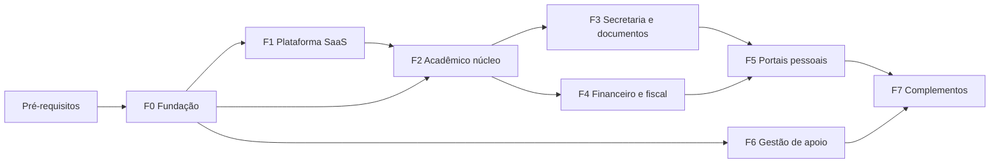

# TODO completo de implementação do SDD

Gerado por `inventario/gera_todo.py` a partir das 173 fichas do kit-starter e do plano de implementação (SDD, parte 20). Não editar à mão: regere depois de mudar o kit ou o SDD.

**Como usar:** siga as fases na ordem. Uma fase só começa quando as fases de que depende passaram no portão de passagem. Cada módulo tem a ficha de origem (`kit-starter/...`), os documentos do SDD que o regem e as telas pelo nome.

| Fase | Módulos | Telas |
|---|---|---|
| F0 Fundação | 16 | 48 |
| F1 Plataforma SaaS | 27 | 101 |
| F2 Acadêmico núcleo | 11 | 54 |
| F3 Secretaria e documentos | 7 | 26 |
| F4 Financeiro e fiscal da entidade | 18 | 45 |
| F5 Portais do professor, do aluno e dos responsáveis | 27 | 108 |
| F6 Gestão de apoio | 48 | 130 |
| F7 Complementos | 19 | 63 |
| **Total** | **173** | **575** |

## Pré-requisitos (antes da F0)

- [ ] Nomear o responsável técnico e o owner de cada módulo (SDD, documento 11, seção 5). Sem owner, nenhuma revisão de DDL acontece.
- [ ] Escolher o provedor de nuvem; com ele, o KMS ou HSM da chave-mestra (DP-11), o CDN (CAC-03) e o Redis (CAC-01).
- [ ] Comparar o código atual (`jeffersongontijo765/totustuussoftcloud.academic`) com o SDD v2 e decidir, por módulo, reaproveitar, refatorar ou reescrever. Pontos de base que mudam na v2:
    - [ ] Banco master, banco de identidade por entidade e banco por unidade (documento 03, D-16, D-19).
    - [ ] Conta global, vínculos e contexto no token (documento 06, seção 12).
    - [ ] Login único com OIDC e PKCE (D-22) e sessão opaca no navegador (DP-10).
    - [ ] Permissões `modulo.recurso.acao`, níveis 0 a 7 e default-deny (documento 78).
    - [ ] Auditoria com cadeia de hash (documento 29).
    - [ ] Sem JavaScript inline nem `on*=` (ADR-07, ACH-01).
- [ ] Escrever o contrato OpenAPI de cada módulo antes da implementação, no padrão do documento 04 (versão, autenticação, schema, idempotência, erros).
- [ ] Montar o pipeline de CI na ordem do documento 10, seção 4: segredos, lint e análise estática, dependências, testes, build com SBOM, verificação do artefato, migrações com plano de volta, homologação, testes de fumaça.
- [ ] Criar o ambiente de homologação com MariaDB 10.11 ou MySQL 8 em `utf8mb4` e rodar `python3 inventario/valida_ddl.py --socket <socket>` (278 tabelas, 0 erros esperado) e `python3 inventario/lint_ddl.py`.

---

## F0 — Fundação

Tenancy, identidade, permissões, auditoria, cofre, exclusão lógica, privacidade base, internacionalização, design system, pipeline e observabilidade.

### Infraestrutura da fundação

- [ ] Cadeia de middleware na ordem fixa (documento 02, seção 3): SecurityHeaders, RequestId, RateLimit por IP, Csrf, sessão e Auth, TenantContext, Authorize, Audit.
- [ ] Banco master e registro de bancos de unidade (`tenant_databases`); seleção de conexão pela unidade autorizada (documento 03, seção 1.1).
- [ ] Repositório base com filtro de tenant obrigatório; consulta sem filtro falha em teste (documento 02, seção 2).
- [ ] Exclusão lógica (`deleted_at`, `deleted_by`) e regra do DP-09 para tabela sem a coluna.
- [ ] Cofre `TotusTuus\Vault` com envelope de chaves e chave-mestra no KMS (ADR-05, DP-11); `FileVault` só em desenvolvimento.
- [ ] Integração entre módulos por eventos, com outbox e idempotência (documento 14).
- [ ] Cache com chave por tenant (documento 30).
- [ ] Internacionalização: inglês canônico, `pt-BR` e os demais locales com teste de paridade (documento 09).
- [ ] Design system no app: tokens, `bundle.css` e componentes (documento 08; repositório `design.system.totustuussoftcloud`).
- [ ] Observabilidade sem dado pessoal nos logs; métricas e alertas (documento 10, seção 7).
- [ ] Backup e restauração testados (documento 24, seção 1).

### Portão de passagem da fase

- [ ] Critérios de aceite dos módulos da fase marcados.
- [ ] Testes de isolamento de tenant e de autorização passando em CI.
- [ ] Definition of Done do documento 11, seção 2, em cada módulo.
- [ ] DDL revisado pelo owner e migração testada em homologação.

### Acesso (identidade, autenticação, sessão e autorização) — Desenvolvedor

Ficha: `kit-starter/desenvolvedor/seguranca-e-operacao/acesso.md` · SDD: documentos 31, 06, 19, 23

- [ ] Ler a ficha e os documentos do SDD; confirmar com o owner as regras e as pendências do módulo.
- [ ] Migração das tabelas do módulo a partir do DDL do SDD, revisada pelo owner, com plano de volta.
- [ ] Repositório e serviço com filtro de tenant; regras de negócio e estados da ficha.
- [ ] Contrato OpenAPI e endpoints no padrão do documento 04, com validação no servidor (documento 15).
- [ ] Permissões `modulo.recurso.acao` e papéis do documento 78; default-deny; separação de funções.
- [ ] Telas com o design system (documento 08):
    - [ ] Contas da plataforma
    - [ ] Sessões ativas
    - [ ] Papéis e permissões
    - [ ] Conta de emergência (break-glass)
- [ ] Auditoria das ações sensíveis (documento 29) e notificações, quando houver (documento 57).
- [ ] Textos por chave de internacionalização; acessibilidade WCAG 2.2 AA; 320 px sem rolagem horizontal.
- [ ] Testes: unitários, integração, isolamento de tenant, autorização e critérios de aceite do documento de origem.

### Auditoria — Desenvolvedor

Ficha: `kit-starter/desenvolvedor/seguranca-e-operacao/auditoria.md` · SDD: documentos 31, 29, 19, 18, 10, 07

- [ ] Ler a ficha e os documentos do SDD; confirmar com o owner as regras e as pendências do módulo.
- [ ] Migração das tabelas do módulo a partir do DDL do SDD, revisada pelo owner, com plano de volta.
- [ ] Repositório e serviço com filtro de tenant; regras de negócio e estados da ficha.
- [ ] Contrato OpenAPI e endpoints no padrão do documento 04, com validação no servidor (documento 15).
- [ ] Permissões `modulo.recurso.acao` e papéis do documento 78; default-deny; separação de funções.
- [ ] Telas com o design system (documento 08):
    - [ ] Trilha de auditoria
    - [ ] Integridade da cadeia
    - [ ] Exportação de auditoria
- [ ] Auditoria das ações sensíveis (documento 29) e notificações, quando houver (documento 57).
- [ ] Textos por chave de internacionalização; acessibilidade WCAG 2.2 AA; 320 px sem rolagem horizontal.
- [ ] Testes: unitários, integração, isolamento de tenant, autorização e critérios de aceite do documento de origem.

### Configurações do sistema — Desenvolvedor

Ficha: `kit-starter/desenvolvedor/seguranca-e-operacao/configuracoes-do-sistema.md` · SDD: documentos 31, 09, 12, 06, 04

- [ ] Ler a ficha e os documentos do SDD; confirmar com o owner as regras e as pendências do módulo.
- [ ] Migração das tabelas do módulo a partir do DDL do SDD, revisada pelo owner, com plano de volta.
- [ ] Repositório e serviço com filtro de tenant; regras de negócio e estados da ficha.
- [ ] Contrato OpenAPI e endpoints no padrão do documento 04, com validação no servidor (documento 15).
- [ ] Permissões `modulo.recurso.acao` e papéis do documento 78; default-deny; separação de funções.
- [ ] Telas com o design system (documento 08):
    - [ ] Configurações globais
    - [ ] Histórico de alterações
- [ ] Auditoria das ações sensíveis (documento 29) e notificações, quando houver (documento 57).
- [ ] Textos por chave de internacionalização; acessibilidade WCAG 2.2 AA; 320 px sem rolagem horizontal.
- [ ] Testes: unitários, integração, isolamento de tenant, autorização e critérios de aceite do documento de origem.

### MFA (autenticação multifator) — Desenvolvedor

Ficha: `kit-starter/desenvolvedor/seguranca-e-operacao/mfa.md` · SDD: documentos 31, 06, 16, 78, 05

- [ ] Ler a ficha e os documentos do SDD; confirmar com o owner as regras e as pendências do módulo.
- [ ] Migração das tabelas do módulo a partir do DDL do SDD, revisada pelo owner, com plano de volta.
- [ ] Repositório e serviço com filtro de tenant; regras de negócio e estados da ficha.
- [ ] Contrato OpenAPI e endpoints no padrão do documento 04, com validação no servidor (documento 15).
- [ ] Permissões `modulo.recurso.acao` e papéis do documento 78; default-deny; separação de funções.
- [ ] Telas com o design system (documento 08):
    - [ ] Política de MFA
    - [ ] Painel de MFA
    - [ ] Fatores da conta
- [ ] Auditoria das ações sensíveis (documento 29) e notificações, quando houver (documento 57).
- [ ] Textos por chave de internacionalização; acessibilidade WCAG 2.2 AA; 320 px sem rolagem horizontal.
- [ ] Testes: unitários, integração, isolamento de tenant, autorização e critérios de aceite do documento de origem.

### Privacidade e encarregado (DPO) da plataforma — Desenvolvedor

Ficha: `kit-starter/desenvolvedor/seguranca-e-operacao/privacidade-dpo.md` · SDD: documentos 31, 07, 32, 19

- [ ] Ler a ficha e os documentos do SDD; confirmar com o owner as regras e as pendências do módulo.
- [ ] Migração das tabelas do módulo a partir do DDL do SDD, revisada pelo owner, com plano de volta.
- [ ] Repositório e serviço com filtro de tenant; regras de negócio e estados da ficha.
- [ ] Contrato OpenAPI e endpoints no padrão do documento 04, com validação no servidor (documento 15).
- [ ] Permissões `modulo.recurso.acao` e papéis do documento 78; default-deny; separação de funções.
- [ ] Telas com o design system (documento 08):
    - [ ] Painel do DPO
    - [ ] Pedidos de titulares
    - [ ] Registro de tratamento (ROPA)
    - [ ] Incidentes de segurança
- [ ] Auditoria das ações sensíveis (documento 29) e notificações, quando houver (documento 57).
- [ ] Textos por chave de internacionalização; acessibilidade WCAG 2.2 AA; 320 px sem rolagem horizontal.
- [ ] Testes: unitários, integração, isolamento de tenant, autorização e critérios de aceite do documento de origem.

### Configurações da entidade — Gestão

Ficha: `kit-starter/gestao/configuracao-e-acesso/configuracoes-da-entidade.md` · SDD: documentos 56, 03, 09

- [ ] Ler a ficha e os documentos do SDD; confirmar com o owner as regras e as pendências do módulo.
- [ ] Migração das tabelas do módulo a partir do DDL do SDD, revisada pelo owner, com plano de volta.
- [ ] Repositório e serviço com filtro de tenant; regras de negócio e estados da ficha.
- [ ] Contrato OpenAPI e endpoints no padrão do documento 04, com validação no servidor (documento 15).
- [ ] Permissões `modulo.recurso.acao` e papéis do documento 78; default-deny; separação de funções.
- [ ] Telas com o design system (documento 08):
    - [ ] Configurações
- [ ] Auditoria das ações sensíveis (documento 29) e notificações, quando houver (documento 57).
- [ ] Textos por chave de internacionalização; acessibilidade WCAG 2.2 AA; 320 px sem rolagem horizontal.
- [ ] Testes: unitários, integração, isolamento de tenant, autorização e critérios de aceite do documento de origem.

### Privacidade da entidade — Gestão

Ficha: `kit-starter/gestao/configuracao-e-acesso/privacidade-da-entidade.md` · SDD: documentos 32, 07

- [ ] Ler a ficha e os documentos do SDD; confirmar com o owner as regras e as pendências do módulo.
- [ ] Migração das tabelas do módulo a partir do DDL do SDD, revisada pelo owner, com plano de volta.
- [ ] Repositório e serviço com filtro de tenant; regras de negócio e estados da ficha.
- [ ] Contrato OpenAPI e endpoints no padrão do documento 04, com validação no servidor (documento 15).
- [ ] Permissões `modulo.recurso.acao` e papéis do documento 78; default-deny; separação de funções.
- [ ] Telas com o design system (documento 08):
    - [ ] Painel do DPO
    - [ ] Pedidos do titular
    - [ ] Consentimentos
    - [ ] ROPA
    - [ ] Incidentes
- [ ] Auditoria das ações sensíveis (documento 29) e notificações, quando houver (documento 57).
- [ ] Textos por chave de internacionalização; acessibilidade WCAG 2.2 AA; 320 px sem rolagem horizontal.
- [ ] Testes: unitários, integração, isolamento de tenant, autorização e critérios de aceite do documento de origem.

### Unidades — Gestão

Ficha: `kit-starter/gestao/configuracao-e-acesso/unidades.md` · SDD: documentos 78, 03, 77

- [ ] Ler a ficha e os documentos do SDD; confirmar com o owner as regras e as pendências do módulo.
- [ ] Migração das tabelas do módulo a partir do DDL do SDD, revisada pelo owner, com plano de volta.
- [ ] Repositório e serviço com filtro de tenant; regras de negócio e estados da ficha.
- [ ] Contrato OpenAPI e endpoints no padrão do documento 04, com validação no servidor (documento 15).
- [ ] Permissões `modulo.recurso.acao` e papéis do documento 78; default-deny; separação de funções.
- [ ] Telas com o design system (documento 08):
    - [ ] Unidades
    - [ ] Unidade — edição
    - [ ] Pedir nova unidade
    - [ ] Consumo do plano
- [ ] Auditoria das ações sensíveis (documento 29) e notificações, quando houver (documento 57).
- [ ] Textos por chave de internacionalização; acessibilidade WCAG 2.2 AA; 320 px sem rolagem horizontal.
- [ ] Testes: unitários, integração, isolamento de tenant, autorização e critérios de aceite do documento de origem.

### Usuários — Gestão

Ficha: `kit-starter/gestao/configuracao-e-acesso/usuarios.md` · SDD: documentos 78, 06

- [ ] Ler a ficha e os documentos do SDD; confirmar com o owner as regras e as pendências do módulo.
- [ ] Migração das tabelas do módulo a partir do DDL do SDD, revisada pelo owner, com plano de volta.
- [ ] Repositório e serviço com filtro de tenant; regras de negócio e estados da ficha.
- [ ] Contrato OpenAPI e endpoints no padrão do documento 04, com validação no servidor (documento 15).
- [ ] Permissões `modulo.recurso.acao` e papéis do documento 78; default-deny; separação de funções.
- [ ] Telas com o design system (documento 08):
    - [ ] Usuários
    - [ ] Convidar usuário
    - [ ] Usuário — detalhe
    - [ ] Revisão de acesso
- [ ] Auditoria das ações sensíveis (documento 29) e notificações, quando houver (documento 57).
- [ ] Textos por chave de internacionalização; acessibilidade WCAG 2.2 AA; 320 px sem rolagem horizontal.
- [ ] Testes: unitários, integração, isolamento de tenant, autorização e critérios de aceite do documento de origem.

### Vínculos — Gestão

Ficha: `kit-starter/gestao/configuracao-e-acesso/vinculos.md` · SDD: documentos 06

- [ ] Ler a ficha e os documentos do SDD; confirmar com o owner as regras e as pendências do módulo.
- [ ] Migração das tabelas do módulo a partir do DDL do SDD, revisada pelo owner, com plano de volta.
- [ ] Repositório e serviço com filtro de tenant; regras de negócio e estados da ficha.
- [ ] Contrato OpenAPI e endpoints no padrão do documento 04, com validação no servidor (documento 15).
- [ ] Permissões `modulo.recurso.acao` e papéis do documento 78; default-deny; separação de funções.
- [ ] Telas com o design system (documento 08):
    - [ ] Vínculos
    - [ ] Vínculo de responsabilidade
    - [ ] Encerrar vínculo
- [ ] Auditoria das ações sensíveis (documento 29) e notificações, quando houver (documento 57).
- [ ] Textos por chave de internacionalização; acessibilidade WCAG 2.2 AA; 320 px sem rolagem horizontal.
- [ ] Testes: unitários, integração, isolamento de tenant, autorização e critérios de aceite do documento de origem.

### Arquitetura da plataforma educacional SaaS — Todos

Ficha: `kit-starter/transversal/arquitetura-da-plataforma.md` · SDD: documentos 02, 03, 06, 31, 78, 04

- [ ] Ler a ficha e os documentos do SDD; confirmar com o owner as regras e as pendências do módulo.
- [ ] Migração das tabelas do módulo a partir do DDL do SDD, revisada pelo owner, com plano de volta.
- [ ] Repositório e serviço com filtro de tenant; regras de negócio e estados da ficha.
- [ ] Contrato OpenAPI e endpoints no padrão do documento 04, com validação no servidor (documento 15).
- [ ] Permissões `modulo.recurso.acao` e papéis do documento 78; default-deny; separação de funções.
- [ ] Telas com o design system (documento 08):
    - [ ] Mapa da arquitetura
    - [ ] Saúde das camadas
- [ ] Auditoria das ações sensíveis (documento 29) e notificações, quando houver (documento 57).
- [ ] Textos por chave de internacionalização; acessibilidade WCAG 2.2 AA; 320 px sem rolagem horizontal.
- [ ] Testes: unitários, integração, isolamento de tenant, autorização e critérios de aceite do documento de origem.

### Build, procedência e SLSA — Todos

Ficha: `kit-starter/transversal/build-e-procedencia-slsa.md` · SDD: documentos 10, 11, 05, 28

- [ ] Ler a ficha e os documentos do SDD; confirmar com o owner as regras e as pendências do módulo.
- [ ] Migração das tabelas do módulo a partir do DDL do SDD, revisada pelo owner, com plano de volta.
- [ ] Repositório e serviço com filtro de tenant; regras de negócio e estados da ficha.
- [ ] Contrato OpenAPI e endpoints no padrão do documento 04, com validação no servidor (documento 15).
- [ ] Permissões `modulo.recurso.acao` e papéis do documento 78; default-deny; separação de funções.
- [ ] Telas com o design system (documento 08):
    - [ ] Pipeline de build
    - [ ] Gate de deploy
    - [ ] Cofre de segredos
- [ ] Auditoria das ações sensíveis (documento 29) e notificações, quando houver (documento 57).
- [ ] Textos por chave de internacionalização; acessibilidade WCAG 2.2 AA; 320 px sem rolagem horizontal.
- [ ] Testes: unitários, integração, isolamento de tenant, autorização e critérios de aceite do documento de origem.

### Exclusão lógica (soft delete) — Todos

Ficha: `kit-starter/transversal/exclusao-logica.md` · SDD: documentos 03, 19, 15, 29, 28

- [ ] Ler a ficha e os documentos do SDD; confirmar com o owner as regras e as pendências do módulo.
- [ ] Migração das tabelas do módulo a partir do DDL do SDD, revisada pelo owner, com plano de volta.
- [ ] Repositório e serviço com filtro de tenant; regras de negócio e estados da ficha.
- [ ] Contrato OpenAPI e endpoints no padrão do documento 04, com validação no servidor (documento 15).
- [ ] Permissões `modulo.recurso.acao` e papéis do documento 78; default-deny; separação de funções.
- [ ] Telas com o design system (documento 08):
    - [ ] Regras de exclusão por tabela
    - [ ] Pedido de restauração
    - [ ] Painel de exclusões e expurgos
- [ ] Auditoria das ações sensíveis (documento 29) e notificações, quando houver (documento 57).
- [ ] Textos por chave de internacionalização; acessibilidade WCAG 2.2 AA; 320 px sem rolagem horizontal.
- [ ] Testes: unitários, integração, isolamento de tenant, autorização e critérios de aceite do documento de origem.

### Navegação dos portais (sidebars e páginas) — Todos

Ficha: `kit-starter/transversal/navegacao-dos-portais.md` · SDD: documentos 31, 08, 78, 80, 12

- [ ] Ler a ficha e os documentos do SDD; confirmar com o owner as regras e as pendências do módulo.
- [ ] Migração das tabelas do módulo a partir do DDL do SDD, revisada pelo owner, com plano de volta.
- [ ] Repositório e serviço com filtro de tenant; regras de negócio e estados da ficha.
- [ ] Contrato OpenAPI e endpoints no padrão do documento 04, com validação no servidor (documento 15).
- [ ] Permissões `modulo.recurso.acao` e papéis do documento 78; default-deny; separação de funções.
- [ ] Telas com o design system (documento 08):
    - [ ] Matriz de navegação por portal
    - [ ] Checklist de layout
- [ ] Auditoria das ações sensíveis (documento 29) e notificações, quando houver (documento 57).
- [ ] Textos por chave de internacionalização; acessibilidade WCAG 2.2 AA; 320 px sem rolagem horizontal.
- [ ] Testes: unitários, integração, isolamento de tenant, autorização e critérios de aceite do documento de origem.

### Plano de implementação da v1 (fases e checklist) — Todos

Ficha: `kit-starter/transversal/plano-de-implementacao-v1.md` · SDD: documentos 03, 06, 29, 07, 55, 31

- [ ] Ler a ficha e os documentos do SDD; confirmar com o owner as regras e as pendências do módulo.
- [ ] Migração das tabelas do módulo a partir do DDL do SDD, revisada pelo owner, com plano de volta.
- [ ] Repositório e serviço com filtro de tenant; regras de negócio e estados da ficha.
- [ ] Contrato OpenAPI e endpoints no padrão do documento 04, com validação no servidor (documento 15).
- [ ] Permissões `modulo.recurso.acao` e papéis do documento 78; default-deny; separação de funções.
- [ ] Telas com o design system (documento 08):
    - [ ] Fases e tarefas
    - [ ] Checklist por módulo
- [ ] Auditoria das ações sensíveis (documento 29) e notificações, quando houver (documento 57).
- [ ] Textos por chave de internacionalização; acessibilidade WCAG 2.2 AA; 320 px sem rolagem horizontal.
- [ ] Testes: unitários, integração, isolamento de tenant, autorização e critérios de aceite do documento de origem.

### Teste de intrusão (pentest) — Todos

Ficha: `kit-starter/transversal/teste-de-intrusao.md` · SDD: documentos 24, 03, 06, 08, 29

- [ ] Ler a ficha e os documentos do SDD; confirmar com o owner as regras e as pendências do módulo.
- [ ] Migração das tabelas do módulo a partir do DDL do SDD, revisada pelo owner, com plano de volta.
- [ ] Repositório e serviço com filtro de tenant; regras de negócio e estados da ficha.
- [ ] Contrato OpenAPI e endpoints no padrão do documento 04, com validação no servidor (documento 15).
- [ ] Permissões `modulo.recurso.acao` e papéis do documento 78; default-deny; separação de funções.
- [ ] Telas com o design system (documento 08):
    - [ ] Plano de teste de intrusão
    - [ ] Achados do teste
    - [ ] Checklist de implementação
- [ ] Auditoria das ações sensíveis (documento 29) e notificações, quando houver (documento 57).
- [ ] Textos por chave de internacionalização; acessibilidade WCAG 2.2 AA; 320 px sem rolagem horizontal.
- [ ] Testes: unitários, integração, isolamento de tenant, autorização e critérios de aceite do documento de origem.

---

## F1 — Plataforma SaaS

Provisionamento, domínios, licenciamento, Editor de portais, CRM e financeiro da plataforma, suporte e operação.

### Portão de passagem da fase

- [ ] Critérios de aceite dos módulos da fase marcados.
- [ ] Testes de isolamento de tenant e de autorização passando em CI.
- [ ] Definition of Done do documento 11, seção 2, em cada módulo.
- [ ] DDL revisado pelo owner e migração testada em homologação.

### Comissões — Desenvolvedor

Ficha: `kit-starter/desenvolvedor/comercial-da-plataforma/comissoes.md` · SDD: documentos 22

- [ ] Ler a ficha e os documentos do SDD; confirmar com o owner as regras e as pendências do módulo.
- [ ] Migração das tabelas do módulo a partir do DDL do SDD, revisada pelo owner, com plano de volta.
- [ ] Repositório e serviço com filtro de tenant; regras de negócio e estados da ficha.
- [ ] Contrato OpenAPI e endpoints no padrão do documento 04, com validação no servidor (documento 15).
- [ ] Permissões `modulo.recurso.acao` e papéis do documento 78; default-deny; separação de funções.
- [ ] Telas com o design system (documento 08):
    - [ ] Metas
    - [ ] Acompanhamento
    - [ ] Regras de comissão
    - [ ] Relatório de comissão a pagar
- [ ] Auditoria das ações sensíveis (documento 29) e notificações, quando houver (documento 57).
- [ ] Textos por chave de internacionalização; acessibilidade WCAG 2.2 AA; 320 px sem rolagem horizontal.
- [ ] Testes: unitários, integração, isolamento de tenant, autorização e critérios de aceite do documento de origem.

### CRM da plataforma — Desenvolvedor

Ficha: `kit-starter/desenvolvedor/comercial-da-plataforma/crm-da-plataforma.md` · SDD: documentos 22, 78

- [ ] Ler a ficha e os documentos do SDD; confirmar com o owner as regras e as pendências do módulo.
- [ ] Migração das tabelas do módulo a partir do DDL do SDD, revisada pelo owner, com plano de volta.
- [ ] Repositório e serviço com filtro de tenant; regras de negócio e estados da ficha.
- [ ] Contrato OpenAPI e endpoints no padrão do documento 04, com validação no servidor (documento 15).
- [ ] Permissões `modulo.recurso.acao` e papéis do documento 78; default-deny; separação de funções.
- [ ] Telas com o design system (documento 08):
    - [ ] Painel comercial
    - [ ] Funil de oportunidades
    - [ ] Oportunidades
    - [ ] Atividades
    - [ ] Conversas dos canais
    - [ ] Relatórios
    - [ ] Configurações
- [ ] Auditoria das ações sensíveis (documento 29) e notificações, quando houver (documento 57).
- [ ] Textos por chave de internacionalização; acessibilidade WCAG 2.2 AA; 320 px sem rolagem horizontal.
- [ ] Testes: unitários, integração, isolamento de tenant, autorização e critérios de aceite do documento de origem.

### Leads — Desenvolvedor

Ficha: `kit-starter/desenvolvedor/comercial-da-plataforma/leads.md` · SDD: documentos 22

- [ ] Ler a ficha e os documentos do SDD; confirmar com o owner as regras e as pendências do módulo.
- [ ] Migração das tabelas do módulo a partir do DDL do SDD, revisada pelo owner, com plano de volta.
- [ ] Repositório e serviço com filtro de tenant; regras de negócio e estados da ficha.
- [ ] Contrato OpenAPI e endpoints no padrão do documento 04, com validação no servidor (documento 15).
- [ ] Permissões `modulo.recurso.acao` e papéis do documento 78; default-deny; separação de funções.
- [ ] Telas com o design system (documento 08):
    - [ ] Lista de leads
    - [ ] Ficha do lead
    - [ ] Drawer de lead
    - [ ] Alerta de possível duplicidade
- [ ] Auditoria das ações sensíveis (documento 29) e notificações, quando houver (documento 57).
- [ ] Textos por chave de internacionalização; acessibilidade WCAG 2.2 AA; 320 px sem rolagem horizontal.
- [ ] Testes: unitários, integração, isolamento de tenant, autorização e critérios de aceite do documento de origem.

### Propostas — Desenvolvedor

Ficha: `kit-starter/desenvolvedor/comercial-da-plataforma/propostas.md` · SDD: documentos 22, 77

- [ ] Ler a ficha e os documentos do SDD; confirmar com o owner as regras e as pendências do módulo.
- [ ] Migração das tabelas do módulo a partir do DDL do SDD, revisada pelo owner, com plano de volta.
- [ ] Repositório e serviço com filtro de tenant; regras de negócio e estados da ficha.
- [ ] Contrato OpenAPI e endpoints no padrão do documento 04, com validação no servidor (documento 15).
- [ ] Permissões `modulo.recurso.acao` e papéis do documento 78; default-deny; separação de funções.
- [ ] Telas com o design system (documento 08):
    - [ ] Propostas
    - [ ] Editor de proposta
    - [ ] Visualizar PDF
- [ ] Auditoria das ações sensíveis (documento 29) e notificações, quando houver (documento 57).
- [ ] Textos por chave de internacionalização; acessibilidade WCAG 2.2 AA; 320 px sem rolagem horizontal.
- [ ] Testes: unitários, integração, isolamento de tenant, autorização e critérios de aceite do documento de origem.

### Fechamento da empresa — Desenvolvedor

Ficha: `kit-starter/desenvolvedor/contabil-da-plataforma/fechamento-da-empresa.md` · SDD: documentos 31, 18, 22

- [ ] Ler a ficha e os documentos do SDD; confirmar com o owner as regras e as pendências do módulo.
- [ ] Migração das tabelas do módulo a partir do DDL do SDD, revisada pelo owner, com plano de volta.
- [ ] Repositório e serviço com filtro de tenant; regras de negócio e estados da ficha.
- [ ] Contrato OpenAPI e endpoints no padrão do documento 04, com validação no servidor (documento 15).
- [ ] Permissões `modulo.recurso.acao` e papéis do documento 78; default-deny; separação de funções.
- [ ] Telas com o design system (documento 08):
    - [ ] Painel contábil
    - [ ] Fechamento mensal
    - [ ] Conciliações pendentes
    - [ ] Histórico de reaberturas
- [ ] Auditoria das ações sensíveis (documento 29) e notificações, quando houver (documento 57).
- [ ] Textos por chave de internacionalização; acessibilidade WCAG 2.2 AA; 320 px sem rolagem horizontal.
- [ ] Testes: unitários, integração, isolamento de tenant, autorização e critérios de aceite do documento de origem.

### Plano de contas — Desenvolvedor

Ficha: `kit-starter/desenvolvedor/contabil-da-plataforma/plano-de-contas.md` · SDD: documentos 31, 18, 22, 71

- [ ] Ler a ficha e os documentos do SDD; confirmar com o owner as regras e as pendências do módulo.
- [ ] Migração das tabelas do módulo a partir do DDL do SDD, revisada pelo owner, com plano de volta.
- [ ] Repositório e serviço com filtro de tenant; regras de negócio e estados da ficha.
- [ ] Contrato OpenAPI e endpoints no padrão do documento 04, com validação no servidor (documento 15).
- [ ] Permissões `modulo.recurso.acao` e papéis do documento 78; default-deny; separação de funções.
- [ ] Telas com o design system (documento 08):
    - [ ] Plano de contas
    - [ ] Drawer de conta
    - [ ] Widgets
- [ ] Auditoria das ações sensíveis (documento 29) e notificações, quando houver (documento 57).
- [ ] Textos por chave de internacionalização; acessibilidade WCAG 2.2 AA; 320 px sem rolagem horizontal.
- [ ] Testes: unitários, integração, isolamento de tenant, autorização e critérios de aceite do documento de origem.

### Razão — Desenvolvedor

Ficha: `kit-starter/desenvolvedor/contabil-da-plataforma/razao.md` · SDD: documentos 31, 18, 22, 15

- [ ] Ler a ficha e os documentos do SDD; confirmar com o owner as regras e as pendências do módulo.
- [ ] Migração das tabelas do módulo a partir do DDL do SDD, revisada pelo owner, com plano de volta.
- [ ] Repositório e serviço com filtro de tenant; regras de negócio e estados da ficha.
- [ ] Contrato OpenAPI e endpoints no padrão do documento 04, com validação no servidor (documento 15).
- [ ] Permissões `modulo.recurso.acao` e papéis do documento 78; default-deny; separação de funções.
- [ ] Telas com o design system (documento 08):
    - [ ] Lançamentos contábeis
    - [ ] Drawer de lançamento
    - [ ] Importação assistida
    - [ ] Razão por conta
    - [ ] Aprovações de lançamento
- [ ] Auditoria das ações sensíveis (documento 29) e notificações, quando houver (documento 57).
- [ ] Textos por chave de internacionalização; acessibilidade WCAG 2.2 AA; 320 px sem rolagem horizontal.
- [ ] Testes: unitários, integração, isolamento de tenant, autorização e critérios de aceite do documento de origem.

### Tributos e obrigações fiscais da empresa — Desenvolvedor

Ficha: `kit-starter/desenvolvedor/contabil-da-plataforma/tributos-e-obrigacoes-fiscais-da-empresa.md` · SDD: documentos 31, 18, 22, 34

- [ ] Ler a ficha e os documentos do SDD; confirmar com o owner as regras e as pendências do módulo.
- [ ] Migração das tabelas do módulo a partir do DDL do SDD, revisada pelo owner, com plano de volta.
- [ ] Repositório e serviço com filtro de tenant; regras de negócio e estados da ficha.
- [ ] Contrato OpenAPI e endpoints no padrão do documento 04, com validação no servidor (documento 15).
- [ ] Permissões `modulo.recurso.acao` e papéis do documento 78; default-deny; separação de funções.
- [ ] Telas com o design system (documento 08):
    - [ ] Obrigações fiscais
    - [ ] Kanban de obrigações
    - [ ] Calendário fiscal
    - [ ] Retenções e tributos
    - [ ] Documentos fiscais
    - [ ] Drawer de obrigação
- [ ] Auditoria das ações sensíveis (documento 29) e notificações, quando houver (documento 57).
- [ ] Textos por chave de internacionalização; acessibilidade WCAG 2.2 AA; 320 px sem rolagem horizontal.
- [ ] Testes: unitários, integração, isolamento de tenant, autorização e critérios de aceite do documento de origem.

### Blocos — Desenvolvedor

Ficha: `kit-starter/desenvolvedor/editor-de-portais/blocos.md` · SDD: documentos ver a ficha

- [ ] Ler a ficha e os documentos do SDD; confirmar com o owner as regras e as pendências do módulo.
- [ ] Migração das tabelas do módulo a partir do DDL do SDD, revisada pelo owner, com plano de volta.
- [ ] Repositório e serviço com filtro de tenant; regras de negócio e estados da ficha.
- [ ] Contrato OpenAPI e endpoints no padrão do documento 04, com validação no servidor (documento 15).
- [ ] Permissões `modulo.recurso.acao` e papéis do documento 78; default-deny; separação de funções.
- [ ] Telas com o design system (documento 08):
    - [ ] Catálogo de blocos
    - [ ] Detalhe do bloco
- [ ] Auditoria das ações sensíveis (documento 29) e notificações, quando houver (documento 57).
- [ ] Textos por chave de internacionalização; acessibilidade WCAG 2.2 AA; 320 px sem rolagem horizontal.
- [ ] Testes: unitários, integração, isolamento de tenant, autorização e critérios de aceite do documento de origem.

### Layouts — Desenvolvedor

Ficha: `kit-starter/desenvolvedor/editor-de-portais/layouts.md` · SDD: documentos ver a ficha

- [ ] Ler a ficha e os documentos do SDD; confirmar com o owner as regras e as pendências do módulo.
- [ ] Migração das tabelas do módulo a partir do DDL do SDD, revisada pelo owner, com plano de volta.
- [ ] Repositório e serviço com filtro de tenant; regras de negócio e estados da ficha.
- [ ] Contrato OpenAPI e endpoints no padrão do documento 04, com validação no servidor (documento 15).
- [ ] Permissões `modulo.recurso.acao` e papéis do documento 78; default-deny; separação de funções.
- [ ] Telas com o design system (documento 08):
    - [ ] Lista de layouts
    - [ ] Editor de layout
    - [ ] Pré-visualização
- [ ] Auditoria das ações sensíveis (documento 29) e notificações, quando houver (documento 57).
- [ ] Textos por chave de internacionalização; acessibilidade WCAG 2.2 AA; 320 px sem rolagem horizontal.
- [ ] Testes: unitários, integração, isolamento de tenant, autorização e critérios de aceite do documento de origem.

### Páginas — Desenvolvedor

Ficha: `kit-starter/desenvolvedor/editor-de-portais/paginas.md` · SDD: documentos ver a ficha

- [ ] Ler a ficha e os documentos do SDD; confirmar com o owner as regras e as pendências do módulo.
- [ ] Migração das tabelas do módulo a partir do DDL do SDD, revisada pelo owner, com plano de volta.
- [ ] Repositório e serviço com filtro de tenant; regras de negócio e estados da ficha.
- [ ] Contrato OpenAPI e endpoints no padrão do documento 04, com validação no servidor (documento 15).
- [ ] Permissões `modulo.recurso.acao` e papéis do documento 78; default-deny; separação de funções.
- [ ] Telas com o design system (documento 08):
    - [ ] Lista de páginas
    - [ ] Editor de página
    - [ ] Histórico de versões
- [ ] Auditoria das ações sensíveis (documento 29) e notificações, quando houver (documento 57).
- [ ] Textos por chave de internacionalização; acessibilidade WCAG 2.2 AA; 320 px sem rolagem horizontal.
- [ ] Testes: unitários, integração, isolamento de tenant, autorização e critérios de aceite do documento de origem.

### Publicação e rollback — Desenvolvedor

Ficha: `kit-starter/desenvolvedor/editor-de-portais/publicacao-e-rollback.md` · SDD: documentos ver a ficha

- [ ] Ler a ficha e os documentos do SDD; confirmar com o owner as regras e as pendências do módulo.
- [ ] Migração das tabelas do módulo a partir do DDL do SDD, revisada pelo owner, com plano de volta.
- [ ] Repositório e serviço com filtro de tenant; regras de negócio e estados da ficha.
- [ ] Contrato OpenAPI e endpoints no padrão do documento 04, com validação no servidor (documento 15).
- [ ] Permissões `modulo.recurso.acao` e papéis do documento 78; default-deny; separação de funções.
- [ ] Telas com o design system (documento 08):
    - [ ] Fila de revisão
    - [ ] Publicação
    - [ ] Versões
- [ ] Auditoria das ações sensíveis (documento 29) e notificações, quando houver (documento 57).
- [ ] Textos por chave de internacionalização; acessibilidade WCAG 2.2 AA; 320 px sem rolagem horizontal.
- [ ] Testes: unitários, integração, isolamento de tenant, autorização e critérios de aceite do documento de origem.

### Rotas — Desenvolvedor

Ficha: `kit-starter/desenvolvedor/editor-de-portais/rotas.md` · SDD: documentos ver a ficha

- [ ] Ler a ficha e os documentos do SDD; confirmar com o owner as regras e as pendências do módulo.
- [ ] Migração das tabelas do módulo a partir do DDL do SDD, revisada pelo owner, com plano de volta.
- [ ] Repositório e serviço com filtro de tenant; regras de negócio e estados da ficha.
- [ ] Contrato OpenAPI e endpoints no padrão do documento 04, com validação no servidor (documento 15).
- [ ] Permissões `modulo.recurso.acao` e papéis do documento 78; default-deny; separação de funções.
- [ ] Telas com o design system (documento 08):
    - [ ] Lista de rotas
    - [ ] Editor de rota
- [ ] Auditoria das ações sensíveis (documento 29) e notificações, quando houver (documento 57).
- [ ] Textos por chave de internacionalização; acessibilidade WCAG 2.2 AA; 320 px sem rolagem horizontal.
- [ ] Testes: unitários, integração, isolamento de tenant, autorização e critérios de aceite do documento de origem.

### Financeiro da plataforma (contas a pagar e a receber da própria empresa) — Desenvolvedor

Ficha: `kit-starter/desenvolvedor/financeiro-da-plataforma/contas-a-pagar-e-a-receber-da-propria-empresa.md` · SDD: documentos 31, 71, 17, 20, 18

- [ ] Ler a ficha e os documentos do SDD; confirmar com o owner as regras e as pendências do módulo.
- [ ] Migração das tabelas do módulo a partir do DDL do SDD, revisada pelo owner, com plano de volta.
- [ ] Repositório e serviço com filtro de tenant; regras de negócio e estados da ficha.
- [ ] Contrato OpenAPI e endpoints no padrão do documento 04, com validação no servidor (documento 15).
- [ ] Permissões `modulo.recurso.acao` e papéis do documento 78; default-deny; separação de funções.
- [ ] Telas com o design system (documento 08):
    - [ ] Painel financeiro
    - [ ] Contas a pagar
    - [ ] Drawer de despesa
    - [ ] Drawer de pagamento
    - [ ] Pagamento em lote
    - [ ] Kanban de contas a pagar
    - [ ] Contas a receber
    - [ ] Contas e movimentação
    - [ ] Fluxo de caixa
    - [ ] Conciliação
    - [ ] Centros de custo
    - [ ] Taxas de split recebidas
    - [ ] DRE
    - [ ] Configurações
- [ ] Auditoria das ações sensíveis (documento 29) e notificações, quando houver (documento 57).
- [ ] Textos por chave de internacionalização; acessibilidade WCAG 2.2 AA; 320 px sem rolagem horizontal.
- [ ] Testes: unitários, integração, isolamento de tenant, autorização e critérios de aceite do documento de origem.

### Assinaturas — Desenvolvedor

Ficha: `kit-starter/desenvolvedor/plataforma-e-clientes/assinaturas.md` · SDD: documentos ver a ficha

- [ ] Ler a ficha e os documentos do SDD; confirmar com o owner as regras e as pendências do módulo.
- [ ] Migração das tabelas do módulo a partir do DDL do SDD, revisada pelo owner, com plano de volta.
- [ ] Repositório e serviço com filtro de tenant; regras de negócio e estados da ficha.
- [ ] Contrato OpenAPI e endpoints no padrão do documento 04, com validação no servidor (documento 15).
- [ ] Permissões `modulo.recurso.acao` e papéis do documento 78; default-deny; separação de funções.
- [ ] Telas com o design system (documento 08):
    - [ ] Assinaturas
    - [ ] Detalhe da assinatura
- [ ] Auditoria das ações sensíveis (documento 29) e notificações, quando houver (documento 57).
- [ ] Textos por chave de internacionalização; acessibilidade WCAG 2.2 AA; 320 px sem rolagem horizontal.
- [ ] Testes: unitários, integração, isolamento de tenant, autorização e critérios de aceite do documento de origem.

### Clientes (tenants) — Desenvolvedor

Ficha: `kit-starter/desenvolvedor/plataforma-e-clientes/clientes-tenants.md` · SDD: documentos ver a ficha

- [ ] Ler a ficha e os documentos do SDD; confirmar com o owner as regras e as pendências do módulo.
- [ ] Migração das tabelas do módulo a partir do DDL do SDD, revisada pelo owner, com plano de volta.
- [ ] Repositório e serviço com filtro de tenant; regras de negócio e estados da ficha.
- [ ] Contrato OpenAPI e endpoints no padrão do documento 04, com validação no servidor (documento 15).
- [ ] Permissões `modulo.recurso.acao` e papéis do documento 78; default-deny; separação de funções.
- [ ] Telas com o design system (documento 08):
    - [ ] Lista de clientes
    - [ ] Detalhe do cliente
    - [ ] Nova entidade
    - [ ] Saída de cliente
    - [ ] Painel de clientes
- [ ] Auditoria das ações sensíveis (documento 29) e notificações, quando houver (documento 57).
- [ ] Textos por chave de internacionalização; acessibilidade WCAG 2.2 AA; 320 px sem rolagem horizontal.
- [ ] Testes: unitários, integração, isolamento de tenant, autorização e critérios de aceite do documento de origem.

### Domínios — Desenvolvedor

Ficha: `kit-starter/desenvolvedor/plataforma-e-clientes/dominios.md` · SDD: documentos ver a ficha

- [ ] Ler a ficha e os documentos do SDD; confirmar com o owner as regras e as pendências do módulo.
- [ ] Migração das tabelas do módulo a partir do DDL do SDD, revisada pelo owner, com plano de volta.
- [ ] Repositório e serviço com filtro de tenant; regras de negócio e estados da ficha.
- [ ] Contrato OpenAPI e endpoints no padrão do documento 04, com validação no servidor (documento 15).
- [ ] Permissões `modulo.recurso.acao` e papéis do documento 78; default-deny; separação de funções.
- [ ] Telas com o design system (documento 08):
    - [ ] Domínios ativos
    - [ ] Verificar domínio próprio
    - [ ] Alertas de certificado
- [ ] Auditoria das ações sensíveis (documento 29) e notificações, quando houver (documento 57).
- [ ] Textos por chave de internacionalização; acessibilidade WCAG 2.2 AA; 320 px sem rolagem horizontal.
- [ ] Testes: unitários, integração, isolamento de tenant, autorização e critérios de aceite do documento de origem.

### Faturamento de clientes — Desenvolvedor

Ficha: `kit-starter/desenvolvedor/plataforma-e-clientes/faturamento-de-clientes.md` · SDD: documentos 34

- [ ] Ler a ficha e os documentos do SDD; confirmar com o owner as regras e as pendências do módulo.
- [ ] Migração das tabelas do módulo a partir do DDL do SDD, revisada pelo owner, com plano de volta.
- [ ] Repositório e serviço com filtro de tenant; regras de negócio e estados da ficha.
- [ ] Contrato OpenAPI e endpoints no padrão do documento 04, com validação no servidor (documento 15).
- [ ] Permissões `modulo.recurso.acao` e papéis do documento 78; default-deny; separação de funções.
- [ ] Telas com o design system (documento 08):
    - [ ] Faturas de clientes
    - [ ] Detalhe da fatura
- [ ] Auditoria das ações sensíveis (documento 29) e notificações, quando houver (documento 57).
- [ ] Textos por chave de internacionalização; acessibilidade WCAG 2.2 AA; 320 px sem rolagem horizontal.
- [ ] Testes: unitários, integração, isolamento de tenant, autorização e critérios de aceite do documento de origem.

### Licenciamento — Desenvolvedor

Ficha: `kit-starter/desenvolvedor/plataforma-e-clientes/licenciamento.md` · SDD: documentos ver a ficha

- [ ] Ler a ficha e os documentos do SDD; confirmar com o owner as regras e as pendências do módulo.
- [ ] Migração das tabelas do módulo a partir do DDL do SDD, revisada pelo owner, com plano de volta.
- [ ] Repositório e serviço com filtro de tenant; regras de negócio e estados da ficha.
- [ ] Contrato OpenAPI e endpoints no padrão do documento 04, com validação no servidor (documento 15).
- [ ] Permissões `modulo.recurso.acao` e papéis do documento 78; default-deny; separação de funções.
- [ ] Telas com o design system (documento 08):
    - [ ] Licenças por entidade
    - [ ] Catálogo de módulos licenciáveis
- [ ] Auditoria das ações sensíveis (documento 29) e notificações, quando houver (documento 57).
- [ ] Textos por chave de internacionalização; acessibilidade WCAG 2.2 AA; 320 px sem rolagem horizontal.
- [ ] Testes: unitários, integração, isolamento de tenant, autorização e critérios de aceite do documento de origem.

### Limites e consumo — Desenvolvedor

Ficha: `kit-starter/desenvolvedor/plataforma-e-clientes/limites-e-consumo.md` · SDD: documentos ver a ficha

- [ ] Ler a ficha e os documentos do SDD; confirmar com o owner as regras e as pendências do módulo.
- [ ] Migração das tabelas do módulo a partir do DDL do SDD, revisada pelo owner, com plano de volta.
- [ ] Repositório e serviço com filtro de tenant; regras de negócio e estados da ficha.
- [ ] Contrato OpenAPI e endpoints no padrão do documento 04, com validação no servidor (documento 15).
- [ ] Permissões `modulo.recurso.acao` e papéis do documento 78; default-deny; separação de funções.
- [ ] Telas com o design system (documento 08):
    - [ ] Consumo por entidade
    - [ ] Painel de consumo
- [ ] Auditoria das ações sensíveis (documento 29) e notificações, quando houver (documento 57).
- [ ] Textos por chave de internacionalização; acessibilidade WCAG 2.2 AA; 320 px sem rolagem horizontal.
- [ ] Testes: unitários, integração, isolamento de tenant, autorização e critérios de aceite do documento de origem.

### Provisionamento de entidade e unidade — Desenvolvedor

Ficha: `kit-starter/desenvolvedor/plataforma-e-clientes/provisionamento.md` · SDD: documentos ver a ficha

- [ ] Ler a ficha e os documentos do SDD; confirmar com o owner as regras e as pendências do módulo.
- [ ] Migração das tabelas do módulo a partir do DDL do SDD, revisada pelo owner, com plano de volta.
- [ ] Repositório e serviço com filtro de tenant; regras de negócio e estados da ficha.
- [ ] Contrato OpenAPI e endpoints no padrão do documento 04, com validação no servidor (documento 15).
- [ ] Permissões `modulo.recurso.acao` e papéis do documento 78; default-deny; separação de funções.
- [ ] Telas com o design system (documento 08):
    - [ ] Assistente de provisionamento
    - [ ] Fila de provisionamento
- [ ] Auditoria das ações sensíveis (documento 29) e notificações, quando houver (documento 57).
- [ ] Textos por chave de internacionalização; acessibilidade WCAG 2.2 AA; 320 px sem rolagem horizontal.
- [ ] Testes: unitários, integração, isolamento de tenant, autorização e critérios de aceite do documento de origem.

### Integrações globais (plataforma) — Desenvolvedor

Ficha: `kit-starter/desenvolvedor/seguranca-e-operacao/integracoes-globais.md` · SDD: documentos 31, 16, 04

- [ ] Ler a ficha e os documentos do SDD; confirmar com o owner as regras e as pendências do módulo.
- [ ] Migração das tabelas do módulo a partir do DDL do SDD, revisada pelo owner, com plano de volta.
- [ ] Repositório e serviço com filtro de tenant; regras de negócio e estados da ficha.
- [ ] Contrato OpenAPI e endpoints no padrão do documento 04, com validação no servidor (documento 15).
- [ ] Permissões `modulo.recurso.acao` e papéis do documento 78; default-deny; separação de funções.
- [ ] Telas com o design system (documento 08):
    - [ ] Integrações da plataforma
    - [ ] Configurar integração
    - [ ] Visualizar segredo de tenant
- [ ] Auditoria das ações sensíveis (documento 29) e notificações, quando houver (documento 57).
- [ ] Textos por chave de internacionalização; acessibilidade WCAG 2.2 AA; 320 px sem rolagem horizontal.
- [ ] Testes: unitários, integração, isolamento de tenant, autorização e critérios de aceite do documento de origem.

### Painel de bancos de dados — Desenvolvedor

Ficha: `kit-starter/desenvolvedor/seguranca-e-operacao/painel-de-bancos-de-dados.md` · SDD: documentos 31, 34, 29, 03, 16, 08

- [ ] Ler a ficha e os documentos do SDD; confirmar com o owner as regras e as pendências do módulo.
- [ ] Migração das tabelas do módulo a partir do DDL do SDD, revisada pelo owner, com plano de volta.
- [ ] Repositório e serviço com filtro de tenant; regras de negócio e estados da ficha.
- [ ] Contrato OpenAPI e endpoints no padrão do documento 04, com validação no servidor (documento 15).
- [ ] Permissões `modulo.recurso.acao` e papéis do documento 78; default-deny; separação de funções.
- [ ] Telas com o design system (documento 08):
    - [ ] Inventário de bancos
    - [ ] Migrações
    - [ ] Backups
    - [ ] Acesso técnico de emergência
- [ ] Auditoria das ações sensíveis (documento 29) e notificações, quando houver (documento 57).
- [ ] Textos por chave de internacionalização; acessibilidade WCAG 2.2 AA; 320 px sem rolagem horizontal.
- [ ] Testes: unitários, integração, isolamento de tenant, autorização e critérios de aceite do documento de origem.

### TI da plataforma — Desenvolvedor

Ficha: `kit-starter/desenvolvedor/seguranca-e-operacao/ti.md` · SDD: documentos 31, 36, 24, 10, 14

- [ ] Ler a ficha e os documentos do SDD; confirmar com o owner as regras e as pendências do módulo.
- [ ] Migração das tabelas do módulo a partir do DDL do SDD, revisada pelo owner, com plano de volta.
- [ ] Repositório e serviço com filtro de tenant; regras de negócio e estados da ficha.
- [ ] Contrato OpenAPI e endpoints no padrão do documento 04, com validação no servidor (documento 15).
- [ ] Permissões `modulo.recurso.acao` e papéis do documento 78; default-deny; separação de funções.
- [ ] Telas com o design system (documento 08):
    - [ ] Inventário de serviços
    - [ ] Backups e restauração
    - [ ] Certificados
    - [ ] Manutenção programada
    - [ ] Monitoramento
- [ ] Auditoria das ações sensíveis (documento 29) e notificações, quando houver (documento 57).
- [ ] Textos por chave de internacionalização; acessibilidade WCAG 2.2 AA; 320 px sem rolagem horizontal.
- [ ] Testes: unitários, integração, isolamento de tenant, autorização e critérios de aceite do documento de origem.

### Base de conhecimento da plataforma — Desenvolvedor

Ficha: `kit-starter/desenvolvedor/suporte/base-de-conhecimento.md` · SDD: documentos 31, 32, 27, 22, 80, 51

- [ ] Ler a ficha e os documentos do SDD; confirmar com o owner as regras e as pendências do módulo.
- [ ] Migração das tabelas do módulo a partir do DDL do SDD, revisada pelo owner, com plano de volta.
- [ ] Repositório e serviço com filtro de tenant; regras de negócio e estados da ficha.
- [ ] Contrato OpenAPI e endpoints no padrão do documento 04, com validação no servidor (documento 15).
- [ ] Permissões `modulo.recurso.acao` e papéis do documento 78; default-deny; separação de funções.
- [ ] Telas com o design system (documento 08):
    - [ ] Artigos
    - [ ] Editor de artigo
- [ ] Auditoria das ações sensíveis (documento 29) e notificações, quando houver (documento 57).
- [ ] Textos por chave de internacionalização; acessibilidade WCAG 2.2 AA; 320 px sem rolagem horizontal.
- [ ] Testes: unitários, integração, isolamento de tenant, autorização e critérios de aceite do documento de origem.

### Chamados dos clientes (suporte da plataforma) — Desenvolvedor

Ficha: `kit-starter/desenvolvedor/suporte/chamados-dos-clientes.md` · SDD: documentos 31, 32, 19, 22, 29

- [ ] Ler a ficha e os documentos do SDD; confirmar com o owner as regras e as pendências do módulo.
- [ ] Migração das tabelas do módulo a partir do DDL do SDD, revisada pelo owner, com plano de volta.
- [ ] Repositório e serviço com filtro de tenant; regras de negócio e estados da ficha.
- [ ] Contrato OpenAPI e endpoints no padrão do documento 04, com validação no servidor (documento 15).
- [ ] Permissões `modulo.recurso.acao` e papéis do documento 78; default-deny; separação de funções.
- [ ] Telas com o design system (documento 08):
    - [ ] Chamados dos clientes
    - [ ] Chamado — detalhe
    - [ ] SLA
- [ ] Auditoria das ações sensíveis (documento 29) e notificações, quando houver (documento 57).
- [ ] Textos por chave de internacionalização; acessibilidade WCAG 2.2 AA; 320 px sem rolagem horizontal.
- [ ] Testes: unitários, integração, isolamento de tenant, autorização e critérios de aceite do documento de origem.

### SLA do suporte da plataforma — Desenvolvedor

Ficha: `kit-starter/desenvolvedor/suporte/sla.md` · SDD: documentos 31, 32, 51, 57, 08, 29

- [ ] Ler a ficha e os documentos do SDD; confirmar com o owner as regras e as pendências do módulo.
- [ ] Migração das tabelas do módulo a partir do DDL do SDD, revisada pelo owner, com plano de volta.
- [ ] Repositório e serviço com filtro de tenant; regras de negócio e estados da ficha.
- [ ] Contrato OpenAPI e endpoints no padrão do documento 04, com validação no servidor (documento 15).
- [ ] Permissões `modulo.recurso.acao` e papéis do documento 78; default-deny; separação de funções.
- [ ] Telas com o design system (documento 08):
    - [ ] Regras de SLA
    - [ ] Painel de SLA
    - [ ] Calendário de dias úteis
- [ ] Auditoria das ações sensíveis (documento 29) e notificações, quando houver (documento 57).
- [ ] Textos por chave de internacionalização; acessibilidade WCAG 2.2 AA; 320 px sem rolagem horizontal.
- [ ] Testes: unitários, integração, isolamento de tenant, autorização e critérios de aceite do documento de origem.

---

## F2 — Acadêmico núcleo

Estrutura acadêmica, calendário, turmas e grade, matrícula e rematrícula, diário, boletim e conselho.

### Portão de passagem da fase

- [ ] Critérios de aceite dos módulos da fase marcados.
- [ ] Testes de isolamento de tenant e de autorização passando em CI.
- [ ] Definition of Done do documento 11, seção 2, em cada módulo.
- [ ] DDL revisado pelo owner e migração testada em homologação.

### Administração escolar (estrutura acadêmica) — Gestão

Ficha: `kit-starter/gestao/academico/administracao-escolar-estrutura-academica.md` · SDD: documentos 59, 17, 55

- [ ] Ler a ficha e os documentos do SDD; confirmar com o owner as regras e as pendências do módulo.
- [ ] Migração das tabelas do módulo a partir do DDL do SDD, revisada pelo owner, com plano de volta.
- [ ] Repositório e serviço com filtro de tenant; regras de negócio e estados da ficha.
- [ ] Contrato OpenAPI e endpoints no padrão do documento 04, com validação no servidor (documento 15).
- [ ] Permissões `modulo.recurso.acao` e papéis do documento 78; default-deny; separação de funções.
- [ ] Telas com o design system (documento 08):
    - [ ] Cursos
    - [ ] Curso — formulário
    - [ ] Disciplinas
    - [ ] Grade curricular
    - [ ] Projeto pedagógico (PPC)
    - [ ] Equivalências
    - [ ] Períodos letivos
    - [ ] Painel da estrutura
- [ ] Auditoria das ações sensíveis (documento 29) e notificações, quando houver (documento 57).
- [ ] Textos por chave de internacionalização; acessibilidade WCAG 2.2 AA; 320 px sem rolagem horizontal.
- [ ] Testes: unitários, integração, isolamento de tenant, autorização e critérios de aceite do documento de origem.

### Calendário e eventos — Gestão

Ficha: `kit-starter/gestao/academico/calendario-e-eventos.md` · SDD: documentos 58

- [ ] Ler a ficha e os documentos do SDD; confirmar com o owner as regras e as pendências do módulo.
- [ ] Migração das tabelas do módulo a partir do DDL do SDD, revisada pelo owner, com plano de volta.
- [ ] Repositório e serviço com filtro de tenant; regras de negócio e estados da ficha.
- [ ] Contrato OpenAPI e endpoints no padrão do documento 04, com validação no servidor (documento 15).
- [ ] Permissões `modulo.recurso.acao` e papéis do documento 78; default-deny; separação de funções.
- [ ] Telas com o design system (documento 08):
    - [ ] Calendário letivo
    - [ ] Eventos
    - [ ] Evento — formulário
    - [ ] Inscrições e presença
    - [ ] Aprovações
- [ ] Auditoria das ações sensíveis (documento 29) e notificações, quando houver (documento 57).
- [ ] Textos por chave de internacionalização; acessibilidade WCAG 2.2 AA; 320 px sem rolagem horizontal.
- [ ] Testes: unitários, integração, isolamento de tenant, autorização e critérios de aceite do documento de origem.

### Pedagógico (coordenação e diário) — Gestão

Ficha: `kit-starter/gestao/academico/pedagogico-coordenacao-e-diario.md` · SDD: documentos 61

- [ ] Ler a ficha e os documentos do SDD; confirmar com o owner as regras e as pendências do módulo.
- [ ] Migração das tabelas do módulo a partir do DDL do SDD, revisada pelo owner, com plano de volta.
- [ ] Repositório e serviço com filtro de tenant; regras de negócio e estados da ficha.
- [ ] Contrato OpenAPI e endpoints no padrão do documento 04, com validação no servidor (documento 15).
- [ ] Permissões `modulo.recurso.acao` e papéis do documento 78; default-deny; separação de funções.
- [ ] Telas com o design system (documento 08):
    - [ ] Painel pedagógico
    - [ ] Diários da unidade
    - [ ] Justificativas de falta
    - [ ] Reabrir diário
    - [ ] Alunos em risco
- [ ] Auditoria das ações sensíveis (documento 29) e notificações, quando houver (documento 57).
- [ ] Textos por chave de internacionalização; acessibilidade WCAG 2.2 AA; 320 px sem rolagem horizontal.
- [ ] Testes: unitários, integração, isolamento de tenant, autorização e critérios de aceite do documento de origem.

### Regras de aprovação (sistemas avaliativos, boletim e conselho de classe) — Gestão

Ficha: `kit-starter/gestao/academico/regras-de-aprovacao-sistemas-avaliativos-boletim-e-conselho.md` · SDD: documentos 59, 62

- [ ] Ler a ficha e os documentos do SDD; confirmar com o owner as regras e as pendências do módulo.
- [ ] Migração das tabelas do módulo a partir do DDL do SDD, revisada pelo owner, com plano de volta.
- [ ] Repositório e serviço com filtro de tenant; regras de negócio e estados da ficha.
- [ ] Contrato OpenAPI e endpoints no padrão do documento 04, com validação no servidor (documento 15).
- [ ] Permissões `modulo.recurso.acao` e papéis do documento 78; default-deny; separação de funções.
- [ ] Telas com o design system (documento 08):
    - [ ] Sistemas avaliativos
    - [ ] Boletins
    - [ ] Recuperação paralela
    - [ ] Conselho de classe
    - [ ] Resultado final
- [ ] Auditoria das ações sensíveis (documento 29) e notificações, quando houver (documento 57).
- [ ] Textos por chave de internacionalização; acessibilidade WCAG 2.2 AA; 320 px sem rolagem horizontal.
- [ ] Testes: unitários, integração, isolamento de tenant, autorização e critérios de aceite do documento de origem.

### Séries e turmas (grade de horários) — Gestão

Ficha: `kit-starter/gestao/academico/series-e-turmas-grade-de-horarios.md` · SDD: documentos 60

- [ ] Ler a ficha e os documentos do SDD; confirmar com o owner as regras e as pendências do módulo.
- [ ] Migração das tabelas do módulo a partir do DDL do SDD, revisada pelo owner, com plano de volta.
- [ ] Repositório e serviço com filtro de tenant; regras de negócio e estados da ficha.
- [ ] Contrato OpenAPI e endpoints no padrão do documento 04, com validação no servidor (documento 15).
- [ ] Permissões `modulo.recurso.acao` e papéis do documento 78; default-deny; separação de funções.
- [ ] Telas com o design system (documento 08):
    - [ ] Turmas
    - [ ] Turma — formulário
    - [ ] Salas
    - [ ] Grupos de horários
    - [ ] Montagem da grade
    - [ ] Publicar grade
    - [ ] Consultas
- [ ] Auditoria das ações sensíveis (documento 29) e notificações, quando houver (documento 57).
- [ ] Textos por chave de internacionalização; acessibilidade WCAG 2.2 AA; 320 px sem rolagem horizontal.
- [ ] Testes: unitários, integração, isolamento de tenant, autorização e critérios de aceite do documento de origem.

### Enturmação — Gestão

Ficha: `kit-starter/gestao/secretaria/enturmacao.md` · SDD: documentos 46, 60

- [ ] Ler a ficha e os documentos do SDD; confirmar com o owner as regras e as pendências do módulo.
- [ ] Migração das tabelas do módulo a partir do DDL do SDD, revisada pelo owner, com plano de volta.
- [ ] Repositório e serviço com filtro de tenant; regras de negócio e estados da ficha.
- [ ] Contrato OpenAPI e endpoints no padrão do documento 04, com validação no servidor (documento 15).
- [ ] Permissões `modulo.recurso.acao` e papéis do documento 78; default-deny; separação de funções.
- [ ] Telas com o design system (documento 08):
    - [ ] Enturmação
    - [ ] Pendentes de enturmação
    - [ ] Enturmação em lote
- [ ] Auditoria das ações sensíveis (documento 29) e notificações, quando houver (documento 57).
- [ ] Textos por chave de internacionalização; acessibilidade WCAG 2.2 AA; 320 px sem rolagem horizontal.
- [ ] Testes: unitários, integração, isolamento de tenant, autorização e critérios de aceite do documento de origem.

### Ficha cadastral — Gestão

Ficha: `kit-starter/gestao/secretaria/ficha-cadastral.md` · SDD: documentos 17, 06, 66

- [ ] Ler a ficha e os documentos do SDD; confirmar com o owner as regras e as pendências do módulo.
- [ ] Migração das tabelas do módulo a partir do DDL do SDD, revisada pelo owner, com plano de volta.
- [ ] Repositório e serviço com filtro de tenant; regras de negócio e estados da ficha.
- [ ] Contrato OpenAPI e endpoints no padrão do documento 04, com validação no servidor (documento 15).
- [ ] Permissões `modulo.recurso.acao` e papéis do documento 78; default-deny; separação de funções.
- [ ] Telas com o design system (documento 08):
    - [ ] Alunos
    - [ ] Ficha do aluno
    - [ ] Responsáveis
    - [ ] Documentos pessoais
- [ ] Auditoria das ações sensíveis (documento 29) e notificações, quando houver (documento 57).
- [ ] Textos por chave de internacionalização; acessibilidade WCAG 2.2 AA; 320 px sem rolagem horizontal.
- [ ] Testes: unitários, integração, isolamento de tenant, autorização e critérios de aceite do documento de origem.

### Matrículas — Gestão

Ficha: `kit-starter/gestao/secretaria/matriculas.md` · SDD: documentos 46, 31, 17

- [ ] Ler a ficha e os documentos do SDD; confirmar com o owner as regras e as pendências do módulo.
- [ ] Migração das tabelas do módulo a partir do DDL do SDD, revisada pelo owner, com plano de volta.
- [ ] Repositório e serviço com filtro de tenant; regras de negócio e estados da ficha.
- [ ] Contrato OpenAPI e endpoints no padrão do documento 04, com validação no servidor (documento 15).
- [ ] Permissões `modulo.recurso.acao` e papéis do documento 78; default-deny; separação de funções.
- [ ] Telas com o design system (documento 08):
    - [ ] Matrículas
    - [ ] Nova matrícula — balcão
    - [ ] Análise
    - [ ] Condicionais a vencer
    - [ ] Trancamento
    - [ ] Painel de matrículas
- [ ] Auditoria das ações sensíveis (documento 29) e notificações, quando houver (documento 57).
- [ ] Textos por chave de internacionalização; acessibilidade WCAG 2.2 AA; 320 px sem rolagem horizontal.
- [ ] Testes: unitários, integração, isolamento de tenant, autorização e critérios de aceite do documento de origem.

### Processo seletivo e lista de espera — Gestão

Ficha: `kit-starter/gestao/secretaria/processo-seletivo-e-lista-de-espera.md` · SDD: documentos 46

- [ ] Ler a ficha e os documentos do SDD; confirmar com o owner as regras e as pendências do módulo.
- [ ] Migração das tabelas do módulo a partir do DDL do SDD, revisada pelo owner, com plano de volta.
- [ ] Repositório e serviço com filtro de tenant; regras de negócio e estados da ficha.
- [ ] Contrato OpenAPI e endpoints no padrão do documento 04, com validação no servidor (documento 15).
- [ ] Permissões `modulo.recurso.acao` e papéis do documento 78; default-deny; separação de funções.
- [ ] Telas com o design system (documento 08):
    - [ ] Processos seletivos
    - [ ] Inscritos e classificação
    - [ ] Lista de espera
- [ ] Auditoria das ações sensíveis (documento 29) e notificações, quando houver (documento 57).
- [ ] Textos por chave de internacionalização; acessibilidade WCAG 2.2 AA; 320 px sem rolagem horizontal.
- [ ] Testes: unitários, integração, isolamento de tenant, autorização e critérios de aceite do documento de origem.

### Rematrículas — Gestão

Ficha: `kit-starter/gestao/secretaria/rematriculas.md` · SDD: documentos 46

- [ ] Ler a ficha e os documentos do SDD; confirmar com o owner as regras e as pendências do módulo.
- [ ] Migração das tabelas do módulo a partir do DDL do SDD, revisada pelo owner, com plano de volta.
- [ ] Repositório e serviço com filtro de tenant; regras de negócio e estados da ficha.
- [ ] Contrato OpenAPI e endpoints no padrão do documento 04, com validação no servidor (documento 15).
- [ ] Permissões `modulo.recurso.acao` e papéis do documento 78; default-deny; separação de funções.
- [ ] Telas com o design system (documento 08):
    - [ ] Janelas de rematrícula
    - [ ] Kanban de rematrícula
    - [ ] Não rematriculados
- [ ] Auditoria das ações sensíveis (documento 29) e notificações, quando houver (documento 57).
- [ ] Textos por chave de internacionalização; acessibilidade WCAG 2.2 AA; 320 px sem rolagem horizontal.
- [ ] Testes: unitários, integração, isolamento de tenant, autorização e critérios de aceite do documento de origem.

### Transferências — Gestão

Ficha: `kit-starter/gestao/secretaria/transferencias.md` · SDD: documentos 46

- [ ] Ler a ficha e os documentos do SDD; confirmar com o owner as regras e as pendências do módulo.
- [ ] Migração das tabelas do módulo a partir do DDL do SDD, revisada pelo owner, com plano de volta.
- [ ] Repositório e serviço com filtro de tenant; regras de negócio e estados da ficha.
- [ ] Contrato OpenAPI e endpoints no padrão do documento 04, com validação no servidor (documento 15).
- [ ] Permissões `modulo.recurso.acao` e papéis do documento 78; default-deny; separação de funções.
- [ ] Telas com o design system (documento 08):
    - [ ] Transferências
    - [ ] Nova transferência
    - [ ] Transferência entre unidades
    - [ ] Transferência externa
    - [ ] Reopção e aproveitamento de estudos
- [ ] Auditoria das ações sensíveis (documento 29) e notificações, quando houver (documento 57).
- [ ] Textos por chave de internacionalização; acessibilidade WCAG 2.2 AA; 320 px sem rolagem horizontal.
- [ ] Testes: unitários, integração, isolamento de tenant, autorização e critérios de aceite do documento de origem.

---

## F3 — Secretaria e documentos

Protocolo, emissão de documentos, gestão de documentos, livros e arquivo morto.

### Portão de passagem da fase

- [ ] Critérios de aceite dos módulos da fase marcados.
- [ ] Testes de isolamento de tenant e de autorização passando em CI.
- [ ] Definition of Done do documento 11, seção 2, em cada módulo.
- [ ] DDL revisado pelo owner e migração testada em homologação.

### Livros digitais e arquivo morto — Gestão

Ficha: `kit-starter/gestao/academico/livros-digitais-e-arquivo-morto.md` · SDD: documentos 67

- [ ] Ler a ficha e os documentos do SDD; confirmar com o owner as regras e as pendências do módulo.
- [ ] Migração das tabelas do módulo a partir do DDL do SDD, revisada pelo owner, com plano de volta.
- [ ] Repositório e serviço com filtro de tenant; regras de negócio e estados da ficha.
- [ ] Contrato OpenAPI e endpoints no padrão do documento 04, com validação no servidor (documento 15).
- [ ] Permissões `modulo.recurso.acao` e papéis do documento 78; default-deny; separação de funções.
- [ ] Telas com o design system (documento 08):
    - [ ] Livros de registro
    - [ ] Livro de atas
    - [ ] Arquivo morto
    - [ ] Eliminação
- [ ] Auditoria das ações sensíveis (documento 29) e notificações, quando houver (documento 57).
- [ ] Textos por chave de internacionalização; acessibilidade WCAG 2.2 AA; 320 px sem rolagem horizontal.
- [ ] Testes: unitários, integração, isolamento de tenant, autorização e critérios de aceite do documento de origem.

### Documentos administrativos (tramitação) — Gestão

Ficha: `kit-starter/gestao/gestao-de-documentos/documentos-administrativos-tramitacao.md` · SDD: documentos 54

- [ ] Ler a ficha e os documentos do SDD; confirmar com o owner as regras e as pendências do módulo.
- [ ] Migração das tabelas do módulo a partir do DDL do SDD, revisada pelo owner, com plano de volta.
- [ ] Repositório e serviço com filtro de tenant; regras de negócio e estados da ficha.
- [ ] Contrato OpenAPI e endpoints no padrão do documento 04, com validação no servidor (documento 15).
- [ ] Permissões `modulo.recurso.acao` e papéis do documento 78; default-deny; separação de funções.
- [ ] Telas com o design system (documento 08):
    - [ ] Caixa de entrada do setor
    - [ ] Documento — tramitação
    - [ ] Novo documento
- [ ] Auditoria das ações sensíveis (documento 29) e notificações, quando houver (documento 57).
- [ ] Textos por chave de internacionalização; acessibilidade WCAG 2.2 AA; 320 px sem rolagem horizontal.
- [ ] Testes: unitários, integração, isolamento de tenant, autorização e critérios de aceite do documento de origem.

### Documentos emitidos (modelos e emissão) — Gestão

Ficha: `kit-starter/gestao/gestao-de-documentos/documentos-emitidos-modelos-e-emissao.md` · SDD: documentos 54

- [ ] Ler a ficha e os documentos do SDD; confirmar com o owner as regras e as pendências do módulo.
- [ ] Migração das tabelas do módulo a partir do DDL do SDD, revisada pelo owner, com plano de volta.
- [ ] Repositório e serviço com filtro de tenant; regras de negócio e estados da ficha.
- [ ] Contrato OpenAPI e endpoints no padrão do documento 04, com validação no servidor (documento 15).
- [ ] Permissões `modulo.recurso.acao` e papéis do documento 78; default-deny; separação de funções.
- [ ] Telas com o design system (documento 08):
    - [ ] Documentos emitidos
    - [ ] Modelos
- [ ] Auditoria das ações sensíveis (documento 29) e notificações, quando houver (documento 57).
- [ ] Textos por chave de internacionalização; acessibilidade WCAG 2.2 AA; 320 px sem rolagem horizontal.
- [ ] Testes: unitários, integração, isolamento de tenant, autorização e critérios de aceite do documento de origem.

### Documentos recebidos (validação) — Gestão

Ficha: `kit-starter/gestao/gestao-de-documentos/documentos-recebidos-validacao.md` · SDD: documentos 54

- [ ] Ler a ficha e os documentos do SDD; confirmar com o owner as regras e as pendências do módulo.
- [ ] Migração das tabelas do módulo a partir do DDL do SDD, revisada pelo owner, com plano de volta.
- [ ] Repositório e serviço com filtro de tenant; regras de negócio e estados da ficha.
- [ ] Contrato OpenAPI e endpoints no padrão do documento 04, com validação no servidor (documento 15).
- [ ] Permissões `modulo.recurso.acao` e papéis do documento 78; default-deny; separação de funções.
- [ ] Telas com o design system (documento 08):
    - [ ] Fila de validação
    - [ ] Validar documento
    - [ ] Pendências por pessoa
- [ ] Auditoria das ações sensíveis (documento 29) e notificações, quando houver (documento 57).
- [ ] Textos por chave de internacionalização; acessibilidade WCAG 2.2 AA; 320 px sem rolagem horizontal.
- [ ] Testes: unitários, integração, isolamento de tenant, autorização e critérios de aceite do documento de origem.

### Serviços comuns (assinatura, protocolo e armazenamento) — Gestão

Ficha: `kit-starter/gestao/gestao-de-documentos/servicos-comuns-assinatura-protocolo-e-armazenamento.md` · SDD: documentos 54

- [ ] Ler a ficha e os documentos do SDD; confirmar com o owner as regras e as pendências do módulo.
- [ ] Migração das tabelas do módulo a partir do DDL do SDD, revisada pelo owner, com plano de volta.
- [ ] Repositório e serviço com filtro de tenant; regras de negócio e estados da ficha.
- [ ] Contrato OpenAPI e endpoints no padrão do documento 04, com validação no servidor (documento 15).
- [ ] Permissões `modulo.recurso.acao` e papéis do documento 78; default-deny; separação de funções.
- [ ] Telas com o design system (documento 08):
    - [ ] Assinaturas
    - [ ] Temporalidade
    - [ ] Armazenamento documental
- [ ] Auditoria das ações sensíveis (documento 29) e notificações, quando houver (documento 57).
- [ ] Textos por chave de internacionalização; acessibilidade WCAG 2.2 AA; 320 px sem rolagem horizontal.
- [ ] Testes: unitários, integração, isolamento de tenant, autorização e critérios de aceite do documento de origem.

### Emissão de documentos (gerador de documentos) — Gestão

Ficha: `kit-starter/gestao/secretaria/emissao-de-documentos.md` · SDD: documentos 48

- [ ] Ler a ficha e os documentos do SDD; confirmar com o owner as regras e as pendências do módulo.
- [ ] Migração das tabelas do módulo a partir do DDL do SDD, revisada pelo owner, com plano de volta.
- [ ] Repositório e serviço com filtro de tenant; regras de negócio e estados da ficha.
- [ ] Contrato OpenAPI e endpoints no padrão do documento 04, com validação no servidor (documento 15).
- [ ] Permissões `modulo.recurso.acao` e papéis do documento 78; default-deny; separação de funções.
- [ ] Telas com o design system (documento 08):
    - [ ] Emitir documento
    - [ ] Documentos emitidos
    - [ ] Modelos
    - [ ] Painel de assinaturas
    - [ ] Validação pública
    - [ ] Configuração de impressão
- [ ] Auditoria das ações sensíveis (documento 29) e notificações, quando houver (documento 57).
- [ ] Textos por chave de internacionalização; acessibilidade WCAG 2.2 AA; 320 px sem rolagem horizontal.
- [ ] Testes: unitários, integração, isolamento de tenant, autorização e critérios de aceite do documento de origem.

### Protocolo de atendimento — Gestão

Ficha: `kit-starter/gestao/secretaria/protocolo-de-atendimento.md` · SDD: documentos 31, 54, 17

- [ ] Ler a ficha e os documentos do SDD; confirmar com o owner as regras e as pendências do módulo.
- [ ] Migração das tabelas do módulo a partir do DDL do SDD, revisada pelo owner, com plano de volta.
- [ ] Repositório e serviço com filtro de tenant; regras de negócio e estados da ficha.
- [ ] Contrato OpenAPI e endpoints no padrão do documento 04, com validação no servidor (documento 15).
- [ ] Permissões `modulo.recurso.acao` e papéis do documento 78; default-deny; separação de funções.
- [ ] Telas com o design system (documento 08):
    - [ ] Protocolos
    - [ ] Novo protocolo — balcão
    - [ ] Protocolo — detalhe
    - [ ] Tipos de requerimento
    - [ ] Consulta pública
- [ ] Auditoria das ações sensíveis (documento 29) e notificações, quando houver (documento 57).
- [ ] Textos por chave de internacionalização; acessibilidade WCAG 2.2 AA; 320 px sem rolagem horizontal.
- [ ] Testes: unitários, integração, isolamento de tenant, autorização e critérios de aceite do documento de origem.

---

## F4 — Financeiro e fiscal da entidade

Mensalidades, títulos, cobrança, régua, conciliação, gateways e split, contas a pagar, caixa, DRE, contábil e fiscal, empenho.

### Portão de passagem da fase

- [ ] Critérios de aceite dos módulos da fase marcados.
- [ ] Testes de isolamento de tenant e de autorização passando em CI.
- [ ] Definition of Done do documento 11, seção 2, em cada módulo.
- [ ] DDL revisado pelo owner e migração testada em homologação.

### NFS-e — Gestão

Ficha: `kit-starter/gestao/contabil-e-fiscal-da-entidade/nfse.md` · SDD: documentos 18, 34

- [ ] Ler a ficha e os documentos do SDD; confirmar com o owner as regras e as pendências do módulo.
- [ ] Migração das tabelas do módulo a partir do DDL do SDD, revisada pelo owner, com plano de volta.
- [ ] Repositório e serviço com filtro de tenant; regras de negócio e estados da ficha.
- [ ] Contrato OpenAPI e endpoints no padrão do documento 04, com validação no servidor (documento 15).
- [ ] Permissões `modulo.recurso.acao` e papéis do documento 78; default-deny; separação de funções.
- [ ] Telas com o design system (documento 08):
    - [ ] Notas
    - [ ] Emitir
    - [ ] Cancelar
- [ ] Auditoria das ações sensíveis (documento 29) e notificações, quando houver (documento 57).
- [ ] Textos por chave de internacionalização; acessibilidade WCAG 2.2 AA; 320 px sem rolagem horizontal.
- [ ] Testes: unitários, integração, isolamento de tenant, autorização e critérios de aceite do documento de origem.

### Obrigações — Gestão

Ficha: `kit-starter/gestao/contabil-e-fiscal-da-entidade/obrigacoes.md` · SDD: documentos 26

- [ ] Ler a ficha e os documentos do SDD; confirmar com o owner as regras e as pendências do módulo.
- [ ] Migração das tabelas do módulo a partir do DDL do SDD, revisada pelo owner, com plano de volta.
- [ ] Repositório e serviço com filtro de tenant; regras de negócio e estados da ficha.
- [ ] Contrato OpenAPI e endpoints no padrão do documento 04, com validação no servidor (documento 15).
- [ ] Permissões `modulo.recurso.acao` e papéis do documento 78; default-deny; separação de funções.
- [ ] Telas com o design system (documento 08):
    - [ ] Calendário de obrigações
    - [ ] Entregas
- [ ] Auditoria das ações sensíveis (documento 29) e notificações, quando houver (documento 57).
- [ ] Textos por chave de internacionalização; acessibilidade WCAG 2.2 AA; 320 px sem rolagem horizontal.
- [ ] Testes: unitários, integração, isolamento de tenant, autorização e critérios de aceite do documento de origem.

### Plano de contas da entidade — Gestão

Ficha: `kit-starter/gestao/contabil-e-fiscal-da-entidade/plano-de-contas-da-entidade.md` · SDD: documentos 31, 18

- [ ] Ler a ficha e os documentos do SDD; confirmar com o owner as regras e as pendências do módulo.
- [ ] Migração das tabelas do módulo a partir do DDL do SDD, revisada pelo owner, com plano de volta.
- [ ] Repositório e serviço com filtro de tenant; regras de negócio e estados da ficha.
- [ ] Contrato OpenAPI e endpoints no padrão do documento 04, com validação no servidor (documento 15).
- [ ] Permissões `modulo.recurso.acao` e papéis do documento 78; default-deny; separação de funções.
- [ ] Telas com o design system (documento 08):
    - [ ] Plano de contas
    - [ ] Lançamentos
    - [ ] Fechamento de período
- [ ] Auditoria das ações sensíveis (documento 29) e notificações, quando houver (documento 57).
- [ ] Textos por chave de internacionalização; acessibilidade WCAG 2.2 AA; 320 px sem rolagem horizontal.
- [ ] Testes: unitários, integração, isolamento de tenant, autorização e critérios de aceite do documento de origem.

### Retenções — Gestão

Ficha: `kit-starter/gestao/contabil-e-fiscal-da-entidade/retencoes.md` · SDD: documentos 31, 26

- [ ] Ler a ficha e os documentos do SDD; confirmar com o owner as regras e as pendências do módulo.
- [ ] Migração das tabelas do módulo a partir do DDL do SDD, revisada pelo owner, com plano de volta.
- [ ] Repositório e serviço com filtro de tenant; regras de negócio e estados da ficha.
- [ ] Contrato OpenAPI e endpoints no padrão do documento 04, com validação no servidor (documento 15).
- [ ] Permissões `modulo.recurso.acao` e papéis do documento 78; default-deny; separação de funções.
- [ ] Telas com o design system (documento 08):
    - [ ] Retenções
- [ ] Auditoria das ações sensíveis (documento 29) e notificações, quando houver (documento 57).
- [ ] Textos por chave de internacionalização; acessibilidade WCAG 2.2 AA; 320 px sem rolagem horizontal.
- [ ] Testes: unitários, integração, isolamento de tenant, autorização e critérios de aceite do documento de origem.

### Tributos — Gestão

Ficha: `kit-starter/gestao/contabil-e-fiscal-da-entidade/tributos.md` · SDD: documentos 26, 34, 31

- [ ] Ler a ficha e os documentos do SDD; confirmar com o owner as regras e as pendências do módulo.
- [ ] Migração das tabelas do módulo a partir do DDL do SDD, revisada pelo owner, com plano de volta.
- [ ] Repositório e serviço com filtro de tenant; regras de negócio e estados da ficha.
- [ ] Contrato OpenAPI e endpoints no padrão do documento 04, com validação no servidor (documento 15).
- [ ] Permissões `modulo.recurso.acao` e papéis do documento 78; default-deny; separação de funções.
- [ ] Telas com o design system (documento 08):
    - [ ] Apurações
    - [ ] Parâmetros tributários
- [ ] Auditoria das ações sensíveis (documento 29) e notificações, quando houver (documento 57).
- [ ] Textos por chave de internacionalização; acessibilidade WCAG 2.2 AA; 320 px sem rolagem horizontal.
- [ ] Testes: unitários, integração, isolamento de tenant, autorização e critérios de aceite do documento de origem.

### Empenho — Gestão

Ficha: `kit-starter/gestao/empenho/empenho.md` · SDD: documentos 37

- [ ] Ler a ficha e os documentos do SDD; confirmar com o owner as regras e as pendências do módulo.
- [ ] Migração das tabelas do módulo a partir do DDL do SDD, revisada pelo owner, com plano de volta.
- [ ] Repositório e serviço com filtro de tenant; regras de negócio e estados da ficha.
- [ ] Contrato OpenAPI e endpoints no padrão do documento 04, com validação no servidor (documento 15).
- [ ] Permissões `modulo.recurso.acao` e papéis do documento 78; default-deny; separação de funções.
- [ ] Telas com o design system (documento 08):
    - [ ] Dotações
    - [ ] Empenhos
    - [ ] Nota de empenho
- [ ] Auditoria das ações sensíveis (documento 29) e notificações, quando houver (documento 57).
- [ ] Textos por chave de internacionalização; acessibilidade WCAG 2.2 AA; 320 px sem rolagem horizontal.
- [ ] Testes: unitários, integração, isolamento de tenant, autorização e critérios de aceite do documento de origem.

### Liquidação e pagamento (entidade pública) — Gestão

Ficha: `kit-starter/gestao/empenho/liquidacao-e-pagamento-so-entidade-publica.md` · SDD: documentos 37

- [ ] Ler a ficha e os documentos do SDD; confirmar com o owner as regras e as pendências do módulo.
- [ ] Migração das tabelas do módulo a partir do DDL do SDD, revisada pelo owner, com plano de volta.
- [ ] Repositório e serviço com filtro de tenant; regras de negócio e estados da ficha.
- [ ] Contrato OpenAPI e endpoints no padrão do documento 04, com validação no servidor (documento 15).
- [ ] Permissões `modulo.recurso.acao` e papéis do documento 78; default-deny; separação de funções.
- [ ] Telas com o design system (documento 08):
    - [ ] Liquidações
    - [ ] Pagamentos
- [ ] Auditoria das ações sensíveis (documento 29) e notificações, quando houver (documento 57).
- [ ] Textos por chave de internacionalização; acessibilidade WCAG 2.2 AA; 320 px sem rolagem horizontal.
- [ ] Testes: unitários, integração, isolamento de tenant, autorização e critérios de aceite do documento de origem.

### Caixa físico — Gestão

Ficha: `kit-starter/gestao/financeiro-da-entidade/caixa-fisico.md` · SDD: documentos 71

- [ ] Ler a ficha e os documentos do SDD; confirmar com o owner as regras e as pendências do módulo.
- [ ] Migração das tabelas do módulo a partir do DDL do SDD, revisada pelo owner, com plano de volta.
- [ ] Repositório e serviço com filtro de tenant; regras de negócio e estados da ficha.
- [ ] Contrato OpenAPI e endpoints no padrão do documento 04, com validação no servidor (documento 15).
- [ ] Permissões `modulo.recurso.acao` e papéis do documento 78; default-deny; separação de funções.
- [ ] Telas com o design system (documento 08):
    - [ ] Caixa do dia
- [ ] Auditoria das ações sensíveis (documento 29) e notificações, quando houver (documento 57).
- [ ] Textos por chave de internacionalização; acessibilidade WCAG 2.2 AA; 320 px sem rolagem horizontal.
- [ ] Testes: unitários, integração, isolamento de tenant, autorização e critérios de aceite do documento de origem.

### Centros de custo — Gestão

Ficha: `kit-starter/gestao/financeiro-da-entidade/centros-de-custo.md` · SDD: documentos 71, 55

- [ ] Ler a ficha e os documentos do SDD; confirmar com o owner as regras e as pendências do módulo.
- [ ] Migração das tabelas do módulo a partir do DDL do SDD, revisada pelo owner, com plano de volta.
- [ ] Repositório e serviço com filtro de tenant; regras de negócio e estados da ficha.
- [ ] Contrato OpenAPI e endpoints no padrão do documento 04, com validação no servidor (documento 15).
- [ ] Permissões `modulo.recurso.acao` e papéis do documento 78; default-deny; separação de funções.
- [ ] Telas com o design system (documento 08):
    - [ ] Centros de custo
    - [ ] Rateio
- [ ] Auditoria das ações sensíveis (documento 29) e notificações, quando houver (documento 57).
- [ ] Textos por chave de internacionalização; acessibilidade WCAG 2.2 AA; 320 px sem rolagem horizontal.
- [ ] Testes: unitários, integração, isolamento de tenant, autorização e critérios de aceite do documento de origem.

### Cheques — Gestão

Ficha: `kit-starter/gestao/financeiro-da-entidade/cheques.md` · SDD: documentos 71

- [ ] Ler a ficha e os documentos do SDD; confirmar com o owner as regras e as pendências do módulo.
- [ ] Migração das tabelas do módulo a partir do DDL do SDD, revisada pelo owner, com plano de volta.
- [ ] Repositório e serviço com filtro de tenant; regras de negócio e estados da ficha.
- [ ] Contrato OpenAPI e endpoints no padrão do documento 04, com validação no servidor (documento 15).
- [ ] Permissões `modulo.recurso.acao` e papéis do documento 78; default-deny; separação de funções.
- [ ] Telas com o design system (documento 08):
    - [ ] Cheques
- [ ] Auditoria das ações sensíveis (documento 29) e notificações, quando houver (documento 57).
- [ ] Textos por chave de internacionalização; acessibilidade WCAG 2.2 AA; 320 px sem rolagem horizontal.
- [ ] Testes: unitários, integração, isolamento de tenant, autorização e critérios de aceite do documento de origem.

### Cobrança — Gestão

Ficha: `kit-starter/gestao/financeiro-da-entidade/cobranca.md` · SDD: documentos 20, 34

- [ ] Ler a ficha e os documentos do SDD; confirmar com o owner as regras e as pendências do módulo.
- [ ] Migração das tabelas do módulo a partir do DDL do SDD, revisada pelo owner, com plano de volta.
- [ ] Repositório e serviço com filtro de tenant; regras de negócio e estados da ficha.
- [ ] Contrato OpenAPI e endpoints no padrão do documento 04, com validação no servidor (documento 15).
- [ ] Permissões `modulo.recurso.acao` e papéis do documento 78; default-deny; separação de funções.
- [ ] Telas com o design system (documento 08):
    - [ ] Cobranças
    - [ ] Transação — detalhe
    - [ ] Contestações
- [ ] Auditoria das ações sensíveis (documento 29) e notificações, quando houver (documento 57).
- [ ] Textos por chave de internacionalização; acessibilidade WCAG 2.2 AA; 320 px sem rolagem horizontal.
- [ ] Testes: unitários, integração, isolamento de tenant, autorização e critérios de aceite do documento de origem.

### Conciliação — Gestão

Ficha: `kit-starter/gestao/financeiro-da-entidade/conciliacao.md` · SDD: documentos 17, 20, 71

- [ ] Ler a ficha e os documentos do SDD; confirmar com o owner as regras e as pendências do módulo.
- [ ] Migração das tabelas do módulo a partir do DDL do SDD, revisada pelo owner, com plano de volta.
- [ ] Repositório e serviço com filtro de tenant; regras de negócio e estados da ficha.
- [ ] Contrato OpenAPI e endpoints no padrão do documento 04, com validação no servidor (documento 15).
- [ ] Permissões `modulo.recurso.acao` e papéis do documento 78; default-deny; separação de funções.
- [ ] Telas com o design system (documento 08):
    - [ ] Conciliação
    - [ ] Divergências
- [ ] Auditoria das ações sensíveis (documento 29) e notificações, quando houver (documento 57).
- [ ] Textos por chave de internacionalização; acessibilidade WCAG 2.2 AA; 320 px sem rolagem horizontal.
- [ ] Testes: unitários, integração, isolamento de tenant, autorização e critérios de aceite do documento de origem.

### Contas a pagar — Gestão

Ficha: `kit-starter/gestao/financeiro-da-entidade/contas-a-pagar.md` · SDD: documentos 71, 17

- [ ] Ler a ficha e os documentos do SDD; confirmar com o owner as regras e as pendências do módulo.
- [ ] Migração das tabelas do módulo a partir do DDL do SDD, revisada pelo owner, com plano de volta.
- [ ] Repositório e serviço com filtro de tenant; regras de negócio e estados da ficha.
- [ ] Contrato OpenAPI e endpoints no padrão do documento 04, com validação no servidor (documento 15).
- [ ] Permissões `modulo.recurso.acao` e papéis do documento 78; default-deny; separação de funções.
- [ ] Telas com o design system (documento 08):
    - [ ] Contas a pagar
    - [ ] Despesa — formulário
    - [ ] Aprovações
- [ ] Auditoria das ações sensíveis (documento 29) e notificações, quando houver (documento 57).
- [ ] Textos por chave de internacionalização; acessibilidade WCAG 2.2 AA; 320 px sem rolagem horizontal.
- [ ] Testes: unitários, integração, isolamento de tenant, autorização e critérios de aceite do documento de origem.

### Fluxo de caixa e DRE — Gestão

Ficha: `kit-starter/gestao/financeiro-da-entidade/fluxo-de-caixa-e-dre.md` · SDD: documentos 71

- [ ] Ler a ficha e os documentos do SDD; confirmar com o owner as regras e as pendências do módulo.
- [ ] Migração das tabelas do módulo a partir do DDL do SDD, revisada pelo owner, com plano de volta.
- [ ] Repositório e serviço com filtro de tenant; regras de negócio e estados da ficha.
- [ ] Contrato OpenAPI e endpoints no padrão do documento 04, com validação no servidor (documento 15).
- [ ] Permissões `modulo.recurso.acao` e papéis do documento 78; default-deny; separação de funções.
- [ ] Telas com o design system (documento 08):
    - [ ] Fluxo de caixa
    - [ ] DRE
- [ ] Auditoria das ações sensíveis (documento 29) e notificações, quando houver (documento 57).
- [ ] Textos por chave de internacionalização; acessibilidade WCAG 2.2 AA; 320 px sem rolagem horizontal.
- [ ] Testes: unitários, integração, isolamento de tenant, autorização e critérios de aceite do documento de origem.

### Gateways e split — Gestão

Ficha: `kit-starter/gestao/financeiro-da-entidade/gateways-e-split.md` · SDD: documentos 34

- [ ] Ler a ficha e os documentos do SDD; confirmar com o owner as regras e as pendências do módulo.
- [ ] Migração das tabelas do módulo a partir do DDL do SDD, revisada pelo owner, com plano de volta.
- [ ] Repositório e serviço com filtro de tenant; regras de negócio e estados da ficha.
- [ ] Contrato OpenAPI e endpoints no padrão do documento 04, com validação no servidor (documento 15).
- [ ] Permissões `modulo.recurso.acao` e papéis do documento 78; default-deny; separação de funções.
- [ ] Telas com o design system (documento 08):
    - [ ] Gateways
    - [ ] Split
    - [ ] Carteiras digitais e débito automático
- [ ] Auditoria das ações sensíveis (documento 29) e notificações, quando houver (documento 57).
- [ ] Textos por chave de internacionalização; acessibilidade WCAG 2.2 AA; 320 px sem rolagem horizontal.
- [ ] Testes: unitários, integração, isolamento de tenant, autorização e critérios de aceite do documento de origem.

### Mensalidades — Gestão

Ficha: `kit-starter/gestao/financeiro-da-entidade/mensalidades.md` · SDD: documentos 18, 26, 17

- [ ] Ler a ficha e os documentos do SDD; confirmar com o owner as regras e as pendências do módulo.
- [ ] Migração das tabelas do módulo a partir do DDL do SDD, revisada pelo owner, com plano de volta.
- [ ] Repositório e serviço com filtro de tenant; regras de negócio e estados da ficha.
- [ ] Contrato OpenAPI e endpoints no padrão do documento 04, com validação no servidor (documento 15).
- [ ] Permissões `modulo.recurso.acao` e papéis do documento 78; default-deny; separação de funções.
- [ ] Telas com o design system (documento 08):
    - [ ] Planos de pagamento
    - [ ] Mensalidades
    - [ ] Geração mensal
    - [ ] Descontos e bolsas
    - [ ] Painel de receita
- [ ] Auditoria das ações sensíveis (documento 29) e notificações, quando houver (documento 57).
- [ ] Textos por chave de internacionalização; acessibilidade WCAG 2.2 AA; 320 px sem rolagem horizontal.
- [ ] Testes: unitários, integração, isolamento de tenant, autorização e critérios de aceite do documento de origem.

### Régua de cobrança — Gestão

Ficha: `kit-starter/gestao/financeiro-da-entidade/regua.md` · SDD: documentos 18, 26

- [ ] Ler a ficha e os documentos do SDD; confirmar com o owner as regras e as pendências do módulo.
- [ ] Migração das tabelas do módulo a partir do DDL do SDD, revisada pelo owner, com plano de volta.
- [ ] Repositório e serviço com filtro de tenant; regras de negócio e estados da ficha.
- [ ] Contrato OpenAPI e endpoints no padrão do documento 04, com validação no servidor (documento 15).
- [ ] Permissões `modulo.recurso.acao` e papéis do documento 78; default-deny; separação de funções.
- [ ] Telas com o design system (documento 08):
    - [ ] Réguas
    - [ ] Execuções
    - [ ] Negociação e renegociação
- [ ] Auditoria das ações sensíveis (documento 29) e notificações, quando houver (documento 57).
- [ ] Textos por chave de internacionalização; acessibilidade WCAG 2.2 AA; 320 px sem rolagem horizontal.
- [ ] Testes: unitários, integração, isolamento de tenant, autorização e critérios de aceite do documento de origem.

### Títulos (contas a receber) — Gestão

Ficha: `kit-starter/gestao/financeiro-da-entidade/titulos.md` · SDD: documentos 17, 20, 71

- [ ] Ler a ficha e os documentos do SDD; confirmar com o owner as regras e as pendências do módulo.
- [ ] Migração das tabelas do módulo a partir do DDL do SDD, revisada pelo owner, com plano de volta.
- [ ] Repositório e serviço com filtro de tenant; regras de negócio e estados da ficha.
- [ ] Contrato OpenAPI e endpoints no padrão do documento 04, com validação no servidor (documento 15).
- [ ] Permissões `modulo.recurso.acao` e papéis do documento 78; default-deny; separação de funções.
- [ ] Telas com o design system (documento 08):
    - [ ] Títulos
    - [ ] Título — detalhe
    - [ ] Baixa manual
    - [ ] Estorno
- [ ] Auditoria das ações sensíveis (documento 29) e notificações, quando houver (documento 57).
- [ ] Textos por chave de internacionalização; acessibilidade WCAG 2.2 AA; 320 px sem rolagem horizontal.
- [ ] Testes: unitários, integração, isolamento de tenant, autorização e critérios de aceite do documento de origem.

---

## F5 — Portais do professor, do aluno e dos responsáveis

Classe, diário do professor, planos, portais pessoais e notificações.

### Portão de passagem da fase

- [ ] Critérios de aceite dos módulos da fase marcados.
- [ ] Testes de isolamento de tenant e de autorização passando em CI.
- [ ] Definition of Done do documento 11, seção 2, em cada módulo.
- [ ] DDL revisado pelo owner e migração testada em homologação.

### Agenda e comunicação — Aluno

Ficha: `kit-starter/aluno/agenda-e-comunicacao.md` · SDD: documentos 60, 58, 40, 57, 76

- [ ] Ler a ficha e os documentos do SDD; confirmar com o owner as regras e as pendências do módulo.
- [ ] Migração das tabelas do módulo a partir do DDL do SDD, revisada pelo owner, com plano de volta.
- [ ] Repositório e serviço com filtro de tenant; regras de negócio e estados da ficha.
- [ ] Contrato OpenAPI e endpoints no padrão do documento 04, com validação no servidor (documento 15).
- [ ] Permissões `modulo.recurso.acao` e papéis do documento 78; default-deny; separação de funções.
- [ ] Telas com o design system (documento 08):
    - [ ] Meu horário
    - [ ] Calendário e eventos
    - [ ] Aulas online
    - [ ] Notificações
    - [ ] Meu perfil
- [ ] Auditoria das ações sensíveis (documento 29) e notificações, quando houver (documento 57).
- [ ] Textos por chave de internacionalização; acessibilidade WCAG 2.2 AA; 320 px sem rolagem horizontal.
- [ ] Testes: unitários, integração, isolamento de tenant, autorização e critérios de aceite do documento de origem.

### Biblioteca — Aluno

Ficha: `kit-starter/aluno/biblioteca.md` · SDD: documentos 68

- [ ] Ler a ficha e os documentos do SDD; confirmar com o owner as regras e as pendências do módulo.
- [ ] Migração das tabelas do módulo a partir do DDL do SDD, revisada pelo owner, com plano de volta.
- [ ] Repositório e serviço com filtro de tenant; regras de negócio e estados da ficha.
- [ ] Contrato OpenAPI e endpoints no padrão do documento 04, com validação no servidor (documento 15).
- [ ] Permissões `modulo.recurso.acao` e papéis do documento 78; default-deny; separação de funções.
- [ ] Telas com o design system (documento 08):
    - [ ] Meus empréstimos
    - [ ] Reservas
    - [ ] Pesquisa de acervo
    - [ ] Multas
- [ ] Auditoria das ações sensíveis (documento 29) e notificações, quando houver (documento 57).
- [ ] Textos por chave de internacionalização; acessibilidade WCAG 2.2 AA; 320 px sem rolagem horizontal.
- [ ] Testes: unitários, integração, isolamento de tenant, autorização e critérios de aceite do documento de origem.

### Classe e diário — Aluno

Ficha: `kit-starter/aluno/classe-e-diario.md` · SDD: documentos 62, 61, 81

- [ ] Ler a ficha e os documentos do SDD; confirmar com o owner as regras e as pendências do módulo.
- [ ] Migração das tabelas do módulo a partir do DDL do SDD, revisada pelo owner, com plano de volta.
- [ ] Repositório e serviço com filtro de tenant; regras de negócio e estados da ficha.
- [ ] Contrato OpenAPI e endpoints no padrão do documento 04, com validação no servidor (documento 15).
- [ ] Permissões `modulo.recurso.acao` e papéis do documento 78; default-deny; separação de funções.
- [ ] Telas com o design system (documento 08):
    - [ ] Início do aluno
    - [ ] Minhas disciplinas
    - [ ] Disciplina
    - [ ] Entregar tarefa
    - [ ] Boletim
    - [ ] Presença
- [ ] Auditoria das ações sensíveis (documento 29) e notificações, quando houver (documento 57).
- [ ] Textos por chave de internacionalização; acessibilidade WCAG 2.2 AA; 320 px sem rolagem horizontal.
- [ ] Testes: unitários, integração, isolamento de tenant, autorização e critérios de aceite do documento de origem.

### Documentos — Aluno

Ficha: `kit-starter/aluno/documentos.md` · SDD: documentos 48, 31

- [ ] Ler a ficha e os documentos do SDD; confirmar com o owner as regras e as pendências do módulo.
- [ ] Migração das tabelas do módulo a partir do DDL do SDD, revisada pelo owner, com plano de volta.
- [ ] Repositório e serviço com filtro de tenant; regras de negócio e estados da ficha.
- [ ] Contrato OpenAPI e endpoints no padrão do documento 04, com validação no servidor (documento 15).
- [ ] Permissões `modulo.recurso.acao` e papéis do documento 78; default-deny; separação de funções.
- [ ] Telas com o design system (documento 08):
    - [ ] Emitir documento
    - [ ] Meus documentos
- [ ] Auditoria das ações sensíveis (documento 29) e notificações, quando houver (documento 57).
- [ ] Textos por chave de internacionalização; acessibilidade WCAG 2.2 AA; 320 px sem rolagem horizontal.
- [ ] Testes: unitários, integração, isolamento de tenant, autorização e critérios de aceite do documento de origem.

### Financeiro — Aluno

Ficha: `kit-starter/aluno/financeiro.md` · SDD: documentos 34, 20, 71

- [ ] Ler a ficha e os documentos do SDD; confirmar com o owner as regras e as pendências do módulo.
- [ ] Migração das tabelas do módulo a partir do DDL do SDD, revisada pelo owner, com plano de volta.
- [ ] Repositório e serviço com filtro de tenant; regras de negócio e estados da ficha.
- [ ] Contrato OpenAPI e endpoints no padrão do documento 04, com validação no servidor (documento 15).
- [ ] Permissões `modulo.recurso.acao` e papéis do documento 78; default-deny; separação de funções.
- [ ] Telas com o design system (documento 08):
    - [ ] Minhas faturas
    - [ ] Pagar
    - [ ] Comprovantes e segunda via
- [ ] Auditoria das ações sensíveis (documento 29) e notificações, quando houver (documento 57).
- [ ] Textos por chave de internacionalização; acessibilidade WCAG 2.2 AA; 320 px sem rolagem horizontal.
- [ ] Testes: unitários, integração, isolamento de tenant, autorização e critérios de aceite do documento de origem.

### Matrícula — Aluno

Ficha: `kit-starter/aluno/matricula.md` · SDD: documentos 46

- [ ] Ler a ficha e os documentos do SDD; confirmar com o owner as regras e as pendências do módulo.
- [ ] Migração das tabelas do módulo a partir do DDL do SDD, revisada pelo owner, com plano de volta.
- [ ] Repositório e serviço com filtro de tenant; regras de negócio e estados da ficha.
- [ ] Contrato OpenAPI e endpoints no padrão do documento 04, com validação no servidor (documento 15).
- [ ] Permissões `modulo.recurso.acao` e papéis do documento 78; default-deny; separação de funções.
- [ ] Telas com o design system (documento 08):
    - [ ] Rematrícula
    - [ ] Eletivas
- [ ] Auditoria das ações sensíveis (documento 29) e notificações, quando houver (documento 57).
- [ ] Textos por chave de internacionalização; acessibilidade WCAG 2.2 AA; 320 px sem rolagem horizontal.
- [ ] Testes: unitários, integração, isolamento de tenant, autorização e critérios de aceite do documento de origem.

### Privacidade — Aluno

Ficha: `kit-starter/aluno/privacidade.md` · SDD: documentos 07, 32

- [ ] Ler a ficha e os documentos do SDD; confirmar com o owner as regras e as pendências do módulo.
- [ ] Migração das tabelas do módulo a partir do DDL do SDD, revisada pelo owner, com plano de volta.
- [ ] Repositório e serviço com filtro de tenant; regras de negócio e estados da ficha.
- [ ] Contrato OpenAPI e endpoints no padrão do documento 04, com validação no servidor (documento 15).
- [ ] Permissões `modulo.recurso.acao` e papéis do documento 78; default-deny; separação de funções.
- [ ] Telas com o design system (documento 08):
    - [ ] Meus dados
    - [ ] Consentimentos
    - [ ] Solicitações LGPD
- [ ] Auditoria das ações sensíveis (documento 29) e notificações, quando houver (documento 57).
- [ ] Textos por chave de internacionalização; acessibilidade WCAG 2.2 AA; 320 px sem rolagem horizontal.
- [ ] Testes: unitários, integração, isolamento de tenant, autorização e critérios de aceite do documento de origem.

### Protocolos online — Aluno

Ficha: `kit-starter/aluno/protocolos-online.md` · SDD: documentos 31

- [ ] Ler a ficha e os documentos do SDD; confirmar com o owner as regras e as pendências do módulo.
- [ ] Migração das tabelas do módulo a partir do DDL do SDD, revisada pelo owner, com plano de volta.
- [ ] Repositório e serviço com filtro de tenant; regras de negócio e estados da ficha.
- [ ] Contrato OpenAPI e endpoints no padrão do documento 04, com validação no servidor (documento 15).
- [ ] Permissões `modulo.recurso.acao` e papéis do documento 78; default-deny; separação de funções.
- [ ] Telas com o design system (documento 08):
    - [ ] Meus protocolos
    - [ ] Novo requerimento
- [ ] Auditoria das ações sensíveis (documento 29) e notificações, quando houver (documento 57).
- [ ] Textos por chave de internacionalização; acessibilidade WCAG 2.2 AA; 320 px sem rolagem horizontal.
- [ ] Testes: unitários, integração, isolamento de tenant, autorização e critérios de aceite do documento de origem.

### Simulados — Aluno

Ficha: `kit-starter/aluno/simulados.md` · SDD: documentos 47

- [ ] Ler a ficha e os documentos do SDD; confirmar com o owner as regras e as pendências do módulo.
- [ ] Migração das tabelas do módulo a partir do DDL do SDD, revisada pelo owner, com plano de volta.
- [ ] Repositório e serviço com filtro de tenant; regras de negócio e estados da ficha.
- [ ] Contrato OpenAPI e endpoints no padrão do documento 04, com validação no servidor (documento 15).
- [ ] Permissões `modulo.recurso.acao` e papéis do documento 78; default-deny; separação de funções.
- [ ] Telas com o design system (documento 08):
    - [ ] Simulados agendados
    - [ ] Realizar prova
    - [ ] Resultado, gabarito e comentários
- [ ] Auditoria das ações sensíveis (documento 29) e notificações, quando houver (documento 57).
- [ ] Textos por chave de internacionalização; acessibilidade WCAG 2.2 AA; 320 px sem rolagem horizontal.
- [ ] Testes: unitários, integração, isolamento de tenant, autorização e critérios de aceite do documento de origem.

### Vida acadêmica — Aluno

Ficha: `kit-starter/aluno/vida-academica.md` · SDD: documentos 63, 65, 66, 42, 41, 43

- [ ] Ler a ficha e os documentos do SDD; confirmar com o owner as regras e as pendências do módulo.
- [ ] Migração das tabelas do módulo a partir do DDL do SDD, revisada pelo owner, com plano de volta.
- [ ] Repositório e serviço com filtro de tenant; regras de negócio e estados da ficha.
- [ ] Contrato OpenAPI e endpoints no padrão do documento 04, com validação no servidor (documento 15).
- [ ] Permissões `modulo.recurso.acao` e papéis do documento 78; default-deny; separação de funções.
- [ ] Telas com o design system (documento 08):
    - [ ] Ocorrências
    - [ ] Estágio e TCC
    - [ ] Portfólio
    - [ ] Preceptoria
    - [ ] Formulários e pesquisas
    - [ ] Pastoral
- [ ] Auditoria das ações sensíveis (documento 29) e notificações, quando houver (documento 57).
- [ ] Textos por chave de internacionalização; acessibilidade WCAG 2.2 AA; 320 px sem rolagem horizontal.
- [ ] Testes: unitários, integração, isolamento de tenant, autorização e critérios de aceite do documento de origem.

### Planos de aula e de ensino — Gestão

Ficha: `kit-starter/gestao/academico/planos-de-aula-e-de-ensino.md` · SDD: documentos 64

- [ ] Ler a ficha e os documentos do SDD; confirmar com o owner as regras e as pendências do módulo.
- [ ] Migração das tabelas do módulo a partir do DDL do SDD, revisada pelo owner, com plano de volta.
- [ ] Repositório e serviço com filtro de tenant; regras de negócio e estados da ficha.
- [ ] Contrato OpenAPI e endpoints no padrão do documento 04, com validação no servidor (documento 15).
- [ ] Permissões `modulo.recurso.acao` e papéis do documento 78; default-deny; separação de funções.
- [ ] Telas com o design system (documento 08):
    - [ ] Planos de ensino
    - [ ] Plano de ensino — revisão
    - [ ] Planos de aula
    - [ ] Pendências de plano
- [ ] Auditoria das ações sensíveis (documento 29) e notificações, quando houver (documento 57).
- [ ] Textos por chave de internacionalização; acessibilidade WCAG 2.2 AA; 320 px sem rolagem horizontal.
- [ ] Testes: unitários, integração, isolamento de tenant, autorização e critérios de aceite do documento de origem.

### Notificações — Gestão

Ficha: `kit-starter/gestao/configuracao-e-acesso/notificacoes.md` · SDD: documentos 57, 18, 75

- [ ] Ler a ficha e os documentos do SDD; confirmar com o owner as regras e as pendências do módulo.
- [ ] Migração das tabelas do módulo a partir do DDL do SDD, revisada pelo owner, com plano de volta.
- [ ] Repositório e serviço com filtro de tenant; regras de negócio e estados da ficha.
- [ ] Contrato OpenAPI e endpoints no padrão do documento 04, com validação no servidor (documento 15).
- [ ] Permissões `modulo.recurso.acao` e papéis do documento 78; default-deny; separação de funções.
- [ ] Telas com o design system (documento 08):
    - [ ] Modelos
    - [ ] Regras de envio
    - [ ] Envios
    - [ ] Preferências padrão
- [ ] Auditoria das ações sensíveis (documento 29) e notificações, quando houver (documento 57).
- [ ] Textos por chave de internacionalização; acessibilidade WCAG 2.2 AA; 320 px sem rolagem horizontal.
- [ ] Testes: unitários, integração, isolamento de tenant, autorização e critérios de aceite do documento de origem.

### Acompanhamento pedagógico — Professor

Ficha: `kit-starter/professor/acompanhamento-pedagogico.md` · SDD: documentos 63, 65, 42, 66, 41, 43

- [ ] Ler a ficha e os documentos do SDD; confirmar com o owner as regras e as pendências do módulo.
- [ ] Migração das tabelas do módulo a partir do DDL do SDD, revisada pelo owner, com plano de volta.
- [ ] Repositório e serviço com filtro de tenant; regras de negócio e estados da ficha.
- [ ] Contrato OpenAPI e endpoints no padrão do documento 04, com validação no servidor (documento 15).
- [ ] Permissões `modulo.recurso.acao` e papéis do documento 78; default-deny; separação de funções.
- [ ] Telas com o design system (documento 08):
    - [ ] Ocorrências
    - [ ] Orientandos
    - [ ] Preceptoria
    - [ ] Portfólio
    - [ ] Formulários
    - [ ] Pastoral
- [ ] Auditoria das ações sensíveis (documento 29) e notificações, quando houver (documento 57).
- [ ] Textos por chave de internacionalização; acessibilidade WCAG 2.2 AA; 320 px sem rolagem horizontal.
- [ ] Testes: unitários, integração, isolamento de tenant, autorização e critérios de aceite do documento de origem.

### Agenda e comunicação — Professor

Ficha: `kit-starter/professor/agenda-e-comunicacao.md` · SDD: documentos 60, 58, 40, 57, 76

- [ ] Ler a ficha e os documentos do SDD; confirmar com o owner as regras e as pendências do módulo.
- [ ] Migração das tabelas do módulo a partir do DDL do SDD, revisada pelo owner, com plano de volta.
- [ ] Repositório e serviço com filtro de tenant; regras de negócio e estados da ficha.
- [ ] Contrato OpenAPI e endpoints no padrão do documento 04, com validação no servidor (documento 15).
- [ ] Permissões `modulo.recurso.acao` e papéis do documento 78; default-deny; separação de funções.
- [ ] Telas com o design system (documento 08):
    - [ ] Meu horário
    - [ ] Calendário
    - [ ] Aulas online
    - [ ] Notificações
    - [ ] Meu perfil
- [ ] Auditoria das ações sensíveis (documento 29) e notificações, quando houver (documento 57).
- [ ] Textos por chave de internacionalização; acessibilidade WCAG 2.2 AA; 320 px sem rolagem horizontal.
- [ ] Testes: unitários, integração, isolamento de tenant, autorização e critérios de aceite do documento de origem.

### Biblioteca — Professor

Ficha: `kit-starter/professor/biblioteca.md` · SDD: documentos 68

- [ ] Ler a ficha e os documentos do SDD; confirmar com o owner as regras e as pendências do módulo.
- [ ] Migração das tabelas do módulo a partir do DDL do SDD, revisada pelo owner, com plano de volta.
- [ ] Repositório e serviço com filtro de tenant; regras de negócio e estados da ficha.
- [ ] Contrato OpenAPI e endpoints no padrão do documento 04, com validação no servidor (documento 15).
- [ ] Permissões `modulo.recurso.acao` e papéis do documento 78; default-deny; separação de funções.
- [ ] Telas com o design system (documento 08):
    - [ ] Pesquisa de acervo
    - [ ] Indicações de leitura
    - [ ] Meus empréstimos
- [ ] Auditoria das ações sensíveis (documento 29) e notificações, quando houver (documento 57).
- [ ] Textos por chave de internacionalização; acessibilidade WCAG 2.2 AA; 320 px sem rolagem horizontal.
- [ ] Testes: unitários, integração, isolamento de tenant, autorização e critérios de aceite do documento de origem.

### Classe — Professor

Ficha: `kit-starter/professor/classe.md` · SDD: documentos 81, 21, 59

- [ ] Ler a ficha e os documentos do SDD; confirmar com o owner as regras e as pendências do módulo.
- [ ] Migração das tabelas do módulo a partir do DDL do SDD, revisada pelo owner, com plano de volta.
- [ ] Repositório e serviço com filtro de tenant; regras de negócio e estados da ficha.
- [ ] Contrato OpenAPI e endpoints no padrão do documento 04, com validação no servidor (documento 15).
- [ ] Permissões `modulo.recurso.acao` e papéis do documento 78; default-deny; separação de funções.
- [ ] Telas com o design system (documento 08):
    - [ ] Minhas turmas
    - [ ] Turma — visão
    - [ ] Mural
    - [ ] Materiais
    - [ ] Tarefas
    - [ ] Entregas da tarefa
- [ ] Auditoria das ações sensíveis (documento 29) e notificações, quando houver (documento 57).
- [ ] Textos por chave de internacionalização; acessibilidade WCAG 2.2 AA; 320 px sem rolagem horizontal.
- [ ] Testes: unitários, integração, isolamento de tenant, autorização e critérios de aceite do documento de origem.

### Diário — Professor

Ficha: `kit-starter/professor/diario.md` · SDD: documentos 61, 64

- [ ] Ler a ficha e os documentos do SDD; confirmar com o owner as regras e as pendências do módulo.
- [ ] Migração das tabelas do módulo a partir do DDL do SDD, revisada pelo owner, com plano de volta.
- [ ] Repositório e serviço com filtro de tenant; regras de negócio e estados da ficha.
- [ ] Contrato OpenAPI e endpoints no padrão do documento 04, com validação no servidor (documento 15).
- [ ] Permissões `modulo.recurso.acao` e papéis do documento 78; default-deny; separação de funções.
- [ ] Telas com o design system (documento 08):
    - [ ] Diário da turma
    - [ ] Chamada
    - [ ] Conteúdo da aula
    - [ ] Notas
    - [ ] Plano de aula
    - [ ] Fechar diário
- [ ] Auditoria das ações sensíveis (documento 29) e notificações, quando houver (documento 57).
- [ ] Textos por chave de internacionalização; acessibilidade WCAG 2.2 AA; 320 px sem rolagem horizontal.
- [ ] Testes: unitários, integração, isolamento de tenant, autorização e critérios de aceite do documento de origem.

### Documentos e pessoal — Professor

Ficha: `kit-starter/professor/documentos-e-pessoal.md` · SDD: documentos 39, 34, 37

- [ ] Ler a ficha e os documentos do SDD; confirmar com o owner as regras e as pendências do módulo.
- [ ] Migração das tabelas do módulo a partir do DDL do SDD, revisada pelo owner, com plano de volta.
- [ ] Repositório e serviço com filtro de tenant; regras de negócio e estados da ficha.
- [ ] Contrato OpenAPI e endpoints no padrão do documento 04, com validação no servidor (documento 15).
- [ ] Permissões `modulo.recurso.acao` e papéis do documento 78; default-deny; separação de funções.
- [ ] Telas com o design system (documento 08):
    - [ ] Declarações
    - [ ] Contrato de trabalho
    - [ ] Holerites
    - [ ] Ponto
    - [ ] Plano de desenvolvimento (PDI)
- [ ] Auditoria das ações sensíveis (documento 29) e notificações, quando houver (documento 57).
- [ ] Textos por chave de internacionalização; acessibilidade WCAG 2.2 AA; 320 px sem rolagem horizontal.
- [ ] Testes: unitários, integração, isolamento de tenant, autorização e critérios de aceite do documento de origem.

### Protocolos e pedidos — Professor

Ficha: `kit-starter/professor/protocolos-e-pedidos.md` · SDD: documentos 31, 44

- [ ] Ler a ficha e os documentos do SDD; confirmar com o owner as regras e as pendências do módulo.
- [ ] Migração das tabelas do módulo a partir do DDL do SDD, revisada pelo owner, com plano de volta.
- [ ] Repositório e serviço com filtro de tenant; regras de negócio e estados da ficha.
- [ ] Contrato OpenAPI e endpoints no padrão do documento 04, com validação no servidor (documento 15).
- [ ] Permissões `modulo.recurso.acao` e papéis do documento 78; default-deny; separação de funções.
- [ ] Telas com o design system (documento 08):
    - [ ] Meus pedidos
    - [ ] Solicitar material
    - [ ] Reservar ambiente ou equipamento
    - [ ] Justificativa
- [ ] Auditoria das ações sensíveis (documento 29) e notificações, quando houver (documento 57).
- [ ] Textos por chave de internacionalização; acessibilidade WCAG 2.2 AA; 320 px sem rolagem horizontal.
- [ ] Testes: unitários, integração, isolamento de tenant, autorização e critérios de aceite do documento de origem.

### Relatórios — Professor

Ficha: `kit-starter/professor/relatorios.md` · SDD: documentos 69, 56

- [ ] Ler a ficha e os documentos do SDD; confirmar com o owner as regras e as pendências do módulo.
- [ ] Migração das tabelas do módulo a partir do DDL do SDD, revisada pelo owner, com plano de volta.
- [ ] Repositório e serviço com filtro de tenant; regras de negócio e estados da ficha.
- [ ] Contrato OpenAPI e endpoints no padrão do documento 04, com validação no servidor (documento 15).
- [ ] Permissões `modulo.recurso.acao` e papéis do documento 78; default-deny; separação de funções.
- [ ] Telas com o design system (documento 08):
    - [ ] Rendimento da turma
    - [ ] Ficha individual
- [ ] Auditoria das ações sensíveis (documento 29) e notificações, quando houver (documento 57).
- [ ] Textos por chave de internacionalização; acessibilidade WCAG 2.2 AA; 320 px sem rolagem horizontal.
- [ ] Testes: unitários, integração, isolamento de tenant, autorização e critérios de aceite do documento de origem.

### Simulados — Professor

Ficha: `kit-starter/professor/simulados.md` · SDD: documentos 47, 31

- [ ] Ler a ficha e os documentos do SDD; confirmar com o owner as regras e as pendências do módulo.
- [ ] Migração das tabelas do módulo a partir do DDL do SDD, revisada pelo owner, com plano de volta.
- [ ] Repositório e serviço com filtro de tenant; regras de negócio e estados da ficha.
- [ ] Contrato OpenAPI e endpoints no padrão do documento 04, com validação no servidor (documento 15).
- [ ] Permissões `modulo.recurso.acao` e papéis do documento 78; default-deny; separação de funções.
- [ ] Telas com o design system (documento 08):
    - [ ] Minhas questões
    - [ ] Editor de questão
    - [ ] Agendar simulado
    - [ ] Resultados da turma
- [ ] Auditoria das ações sensíveis (documento 29) e notificações, quando houver (documento 57).
- [ ] Textos por chave de internacionalização; acessibilidade WCAG 2.2 AA; 320 px sem rolagem horizontal.
- [ ] Testes: unitários, integração, isolamento de tenant, autorização e critérios de aceite do documento de origem.

### Acompanhamento — Pais e Responsáveis

Ficha: `kit-starter/responsaveis/acompanhamento.md` · SDD: documentos 62, 61, 63, 35, 57

- [ ] Ler a ficha e os documentos do SDD; confirmar com o owner as regras e as pendências do módulo.
- [ ] Migração das tabelas do módulo a partir do DDL do SDD, revisada pelo owner, com plano de volta.
- [ ] Repositório e serviço com filtro de tenant; regras de negócio e estados da ficha.
- [ ] Contrato OpenAPI e endpoints no padrão do documento 04, com validação no servidor (documento 15).
- [ ] Permissões `modulo.recurso.acao` e papéis do documento 78; default-deny; separação de funções.
- [ ] Telas com o design system (documento 08):
    - [ ] Início da família
    - [ ] Notas e boletim
    - [ ] Faltas
    - [ ] Ocorrências
    - [ ] Comunicados
    - [ ] Portaria
    - [ ] Tarefas
- [ ] Auditoria das ações sensíveis (documento 29) e notificações, quando houver (documento 57).
- [ ] Textos por chave de internacionalização; acessibilidade WCAG 2.2 AA; 320 px sem rolagem horizontal.
- [ ] Testes: unitários, integração, isolamento de tenant, autorização e critérios de aceite do documento de origem.

### Agenda e comunicação — Pais e Responsáveis

Ficha: `kit-starter/responsaveis/agenda-e-comunicacao.md` · SDD: documentos 60, 58, 43, 57, 76

- [ ] Ler a ficha e os documentos do SDD; confirmar com o owner as regras e as pendências do módulo.
- [ ] Migração das tabelas do módulo a partir do DDL do SDD, revisada pelo owner, com plano de volta.
- [ ] Repositório e serviço com filtro de tenant; regras de negócio e estados da ficha.
- [ ] Contrato OpenAPI e endpoints no padrão do documento 04, com validação no servidor (documento 15).
- [ ] Permissões `modulo.recurso.acao` e papéis do documento 78; default-deny; separação de funções.
- [ ] Telas com o design system (documento 08):
    - [ ] Horário dos filhos
    - [ ] Calendário e eventos
    - [ ] Autorizações
    - [ ] Notificações
    - [ ] Meu perfil
- [ ] Auditoria das ações sensíveis (documento 29) e notificações, quando houver (documento 57).
- [ ] Textos por chave de internacionalização; acessibilidade WCAG 2.2 AA; 320 px sem rolagem horizontal.
- [ ] Testes: unitários, integração, isolamento de tenant, autorização e critérios de aceite do documento de origem.

### Biblioteca e simulados — Pais e Responsáveis

Ficha: `kit-starter/responsaveis/biblioteca-e-simulados.md` · SDD: documentos 68, 47

- [ ] Ler a ficha e os documentos do SDD; confirmar com o owner as regras e as pendências do módulo.
- [ ] Migração das tabelas do módulo a partir do DDL do SDD, revisada pelo owner, com plano de volta.
- [ ] Repositório e serviço com filtro de tenant; regras de negócio e estados da ficha.
- [ ] Contrato OpenAPI e endpoints no padrão do documento 04, com validação no servidor (documento 15).
- [ ] Permissões `modulo.recurso.acao` e papéis do documento 78; default-deny; separação de funções.
- [ ] Telas com o design system (documento 08):
    - [ ] Empréstimos dos filhos
    - [ ] Desempenho em simulados
- [ ] Auditoria das ações sensíveis (documento 29) e notificações, quando houver (documento 57).
- [ ] Textos por chave de internacionalização; acessibilidade WCAG 2.2 AA; 320 px sem rolagem horizontal.
- [ ] Testes: unitários, integração, isolamento de tenant, autorização e critérios de aceite do documento de origem.

### Financeiro e matrícula — Pais e Responsáveis

Ficha: `kit-starter/responsaveis/financeiro-e-matricula.md` · SDD: documentos 34, 46, 26, 71

- [ ] Ler a ficha e os documentos do SDD; confirmar com o owner as regras e as pendências do módulo.
- [ ] Migração das tabelas do módulo a partir do DDL do SDD, revisada pelo owner, com plano de volta.
- [ ] Repositório e serviço com filtro de tenant; regras de negócio e estados da ficha.
- [ ] Contrato OpenAPI e endpoints no padrão do documento 04, com validação no servidor (documento 15).
- [ ] Permissões `modulo.recurso.acao` e papéis do documento 78; default-deny; separação de funções.
- [ ] Telas com o design system (documento 08):
    - [ ] Central financeira
    - [ ] Rematrícula online
    - [ ] Assinar contrato
- [ ] Auditoria das ações sensíveis (documento 29) e notificações, quando houver (documento 57).
- [ ] Textos por chave de internacionalização; acessibilidade WCAG 2.2 AA; 320 px sem rolagem horizontal.
- [ ] Testes: unitários, integração, isolamento de tenant, autorização e critérios de aceite do documento de origem.

### Privacidade e menores — Pais e Responsáveis

Ficha: `kit-starter/responsaveis/privacidade-e-menores.md` · SDD: documentos 32, 07

- [ ] Ler a ficha e os documentos do SDD; confirmar com o owner as regras e as pendências do módulo.
- [ ] Migração das tabelas do módulo a partir do DDL do SDD, revisada pelo owner, com plano de volta.
- [ ] Repositório e serviço com filtro de tenant; regras de negócio e estados da ficha.
- [ ] Contrato OpenAPI e endpoints no padrão do documento 04, com validação no servidor (documento 15).
- [ ] Permissões `modulo.recurso.acao` e papéis do documento 78; default-deny; separação de funções.
- [ ] Telas com o design system (documento 08):
    - [ ] Consentimentos
    - [ ] Dados dos filhos
    - [ ] Solicitações LGPD
- [ ] Auditoria das ações sensíveis (documento 29) e notificações, quando houver (documento 57).
- [ ] Textos por chave de internacionalização; acessibilidade WCAG 2.2 AA; 320 px sem rolagem horizontal.
- [ ] Testes: unitários, integração, isolamento de tenant, autorização e critérios de aceite do documento de origem.

### Protocolos da família — Pais e Responsáveis

Ficha: `kit-starter/responsaveis/protocolos-da-familia.md` · SDD: documentos 31, 46

- [ ] Ler a ficha e os documentos do SDD; confirmar com o owner as regras e as pendências do módulo.
- [ ] Migração das tabelas do módulo a partir do DDL do SDD, revisada pelo owner, com plano de volta.
- [ ] Repositório e serviço com filtro de tenant; regras de negócio e estados da ficha.
- [ ] Contrato OpenAPI e endpoints no padrão do documento 04, com validação no servidor (documento 15).
- [ ] Permissões `modulo.recurso.acao` e papéis do documento 78; default-deny; separação de funções.
- [ ] Telas com o design system (documento 08):
    - [ ] Protocolos
    - [ ] Novo requerimento
    - [ ] Autorizar saída antecipada
- [ ] Auditoria das ações sensíveis (documento 29) e notificações, quando houver (documento 57).
- [ ] Textos por chave de internacionalização; acessibilidade WCAG 2.2 AA; 320 px sem rolagem horizontal.
- [ ] Testes: unitários, integração, isolamento de tenant, autorização e critérios de aceite do documento de origem.

---

## F6 — Gestão de apoio

Pessoas e SST, suprimentos, patrimônio e frotas, contratos, terceiros, biblioteca, simulados, atendimento, CRM do tenant e operações internas da plataforma.

### Portão de passagem da fase

- [ ] Critérios de aceite dos módulos da fase marcados.
- [ ] Testes de isolamento de tenant e de autorização passando em CI.
- [ ] Definition of Done do documento 11, seção 2, em cada módulo.
- [ ] DDL revisado pelo owner e migração testada em homologação.

### Frotas da empresa — Desenvolvedor

Ficha: `kit-starter/desenvolvedor/operacoes-internas/frotas.md` · SDD: documentos 31, 80, 19, 16, 78

- [ ] Ler a ficha e os documentos do SDD; confirmar com o owner as regras e as pendências do módulo.
- [ ] Migração das tabelas do módulo a partir do DDL do SDD, revisada pelo owner, com plano de volta.
- [ ] Repositório e serviço com filtro de tenant; regras de negócio e estados da ficha.
- [ ] Contrato OpenAPI e endpoints no padrão do documento 04, com validação no servidor (documento 15).
- [ ] Permissões `modulo.recurso.acao` e papéis do documento 78; default-deny; separação de funções.
- [ ] Telas com o design system (documento 08):
    - [ ] Veículos da empresa
    - [ ] Reservas
    - [ ] Manutenções
- [ ] Auditoria das ações sensíveis (documento 29) e notificações, quando houver (documento 57).
- [ ] Textos por chave de internacionalização; acessibilidade WCAG 2.2 AA; 320 px sem rolagem horizontal.
- [ ] Testes: unitários, integração, isolamento de tenant, autorização e critérios de aceite do documento de origem.

### Patrimônio da empresa — Desenvolvedor

Ficha: `kit-starter/desenvolvedor/operacoes-internas/patrimonio.md` · SDD: documentos 31, 19, 03, 80, 78

- [ ] Ler a ficha e os documentos do SDD; confirmar com o owner as regras e as pendências do módulo.
- [ ] Migração das tabelas do módulo a partir do DDL do SDD, revisada pelo owner, com plano de volta.
- [ ] Repositório e serviço com filtro de tenant; regras de negócio e estados da ficha.
- [ ] Contrato OpenAPI e endpoints no padrão do documento 04, com validação no servidor (documento 15).
- [ ] Permissões `modulo.recurso.acao` e papéis do documento 78; default-deny; separação de funções.
- [ ] Telas com o design system (documento 08):
    - [ ] Bens da empresa
    - [ ] Depreciação
    - [ ] Inventário
    - [ ] Baixa de bem
- [ ] Auditoria das ações sensíveis (documento 29) e notificações, quando houver (documento 57).
- [ ] Textos por chave de internacionalização; acessibilidade WCAG 2.2 AA; 320 px sem rolagem horizontal.
- [ ] Testes: unitários, integração, isolamento de tenant, autorização e critérios de aceite do documento de origem.

### Suprimentos da empresa — Desenvolvedor

Ficha: `kit-starter/desenvolvedor/operacoes-internas/suprimentos-da-empresa.md` · SDD: documentos 31, 19, 15, 14, 34

- [ ] Ler a ficha e os documentos do SDD; confirmar com o owner as regras e as pendências do módulo.
- [ ] Migração das tabelas do módulo a partir do DDL do SDD, revisada pelo owner, com plano de volta.
- [ ] Repositório e serviço com filtro de tenant; regras de negócio e estados da ficha.
- [ ] Contrato OpenAPI e endpoints no padrão do documento 04, com validação no servidor (documento 15).
- [ ] Permissões `modulo.recurso.acao` e papéis do documento 78; default-deny; separação de funções.
- [ ] Telas com o design system (documento 08):
    - [ ] Requisições
    - [ ] Pedidos e cotações
    - [ ] Estoque
- [ ] Auditoria das ações sensíveis (documento 29) e notificações, quando houver (documento 57).
- [ ] Textos por chave de internacionalização; acessibilidade WCAG 2.2 AA; 320 px sem rolagem horizontal.
- [ ] Testes: unitários, integração, isolamento de tenant, autorização e critérios de aceite do documento de origem.

### Departamento pessoal da empresa (Pessoas) — Desenvolvedor

Ficha: `kit-starter/desenvolvedor/pessoas-da-plataforma/departamento-pessoal.md` · SDD: documentos 31, 39, 14, 22

- [ ] Ler a ficha e os documentos do SDD; confirmar com o owner as regras e as pendências do módulo.
- [ ] Migração das tabelas do módulo a partir do DDL do SDD, revisada pelo owner, com plano de volta.
- [ ] Repositório e serviço com filtro de tenant; regras de negócio e estados da ficha.
- [ ] Contrato OpenAPI e endpoints no padrão do documento 04, com validação no servidor (documento 15).
- [ ] Permissões `modulo.recurso.acao` e papéis do documento 78; default-deny; separação de funções.
- [ ] Telas com o design system (documento 08):
    - [ ] Colaboradores da empresa
    - [ ] Folha
    - [ ] Ponto
- [ ] Auditoria das ações sensíveis (documento 29) e notificações, quando houver (documento 57).
- [ ] Textos por chave de internacionalização; acessibilidade WCAG 2.2 AA; 320 px sem rolagem horizontal.
- [ ] Testes: unitários, integração, isolamento de tenant, autorização e critérios de aceite do documento de origem.

### Medicina e segurança do trabalho da empresa — Desenvolvedor

Ficha: `kit-starter/desenvolvedor/pessoas-da-plataforma/medicina-e-seguranca-do-trabalho-da-empresa.md` · SDD: documentos 31, 39, 52, 17, 22

- [ ] Ler a ficha e os documentos do SDD; confirmar com o owner as regras e as pendências do módulo.
- [ ] Migração das tabelas do módulo a partir do DDL do SDD, revisada pelo owner, com plano de volta.
- [ ] Repositório e serviço com filtro de tenant; regras de negócio e estados da ficha.
- [ ] Contrato OpenAPI e endpoints no padrão do documento 04, com validação no servidor (documento 15).
- [ ] Permissões `modulo.recurso.acao` e papéis do documento 78; default-deny; separação de funções.
- [ ] Telas com o design system (documento 08):
    - [ ] ASO
    - [ ] Ocorrências de SST
- [ ] Auditoria das ações sensíveis (documento 29) e notificações, quando houver (documento 57).
- [ ] Textos por chave de internacionalização; acessibilidade WCAG 2.2 AA; 320 px sem rolagem horizontal.
- [ ] Testes: unitários, integração, isolamento de tenant, autorização e critérios de aceite do documento de origem.

### Recursos humanos da empresa — Desenvolvedor

Ficha: `kit-starter/desenvolvedor/pessoas-da-plataforma/recursos-humanos.md` · SDD: documentos 31, 39, 41, 80, 22

- [ ] Ler a ficha e os documentos do SDD; confirmar com o owner as regras e as pendências do módulo.
- [ ] Migração das tabelas do módulo a partir do DDL do SDD, revisada pelo owner, com plano de volta.
- [ ] Repositório e serviço com filtro de tenant; regras de negócio e estados da ficha.
- [ ] Contrato OpenAPI e endpoints no padrão do documento 04, com validação no servidor (documento 15).
- [ ] Permissões `modulo.recurso.acao` e papéis do documento 78; default-deny; separação de funções.
- [ ] Telas com o design system (documento 08):
    - [ ] Recrutamento
    - [ ] Avaliações de desempenho
- [ ] Auditoria das ações sensíveis (documento 29) e notificações, quando houver (documento 57).
- [ ] Textos por chave de internacionalização; acessibilidade WCAG 2.2 AA; 320 px sem rolagem horizontal.
- [ ] Testes: unitários, integração, isolamento de tenant, autorização e critérios de aceite do documento de origem.

### Armazenamento de arquivos — Gestão

Ficha: `kit-starter/gestao/arquivos/armazenamento-de-arquivos.md` · SDD: documentos 21

- [ ] Ler a ficha e os documentos do SDD; confirmar com o owner as regras e as pendências do módulo.
- [ ] Migração das tabelas do módulo a partir do DDL do SDD, revisada pelo owner, com plano de volta.
- [ ] Repositório e serviço com filtro de tenant; regras de negócio e estados da ficha.
- [ ] Contrato OpenAPI e endpoints no padrão do documento 04, com validação no servidor (documento 15).
- [ ] Permissões `modulo.recurso.acao` e papéis do documento 78; default-deny; separação de funções.
- [ ] Telas com o design system (documento 08):
    - [ ] Arquivos
    - [ ] Arquivo — detalhe
    - [ ] Lixeira
    - [ ] Cota
- [ ] Auditoria das ações sensíveis (documento 29) e notificações, quando houver (documento 57).
- [ ] Textos por chave de internacionalização; acessibilidade WCAG 2.2 AA; 320 px sem rolagem horizontal.
- [ ] Testes: unitários, integração, isolamento de tenant, autorização e critérios de aceite do documento de origem.

### Chat — Gestão

Ficha: `kit-starter/gestao/atendimento/chat.md` · SDD: documentos 32, 31

- [ ] Ler a ficha e os documentos do SDD; confirmar com o owner as regras e as pendências do módulo.
- [ ] Migração das tabelas do módulo a partir do DDL do SDD, revisada pelo owner, com plano de volta.
- [ ] Repositório e serviço com filtro de tenant; regras de negócio e estados da ficha.
- [ ] Contrato OpenAPI e endpoints no padrão do documento 04, com validação no servidor (documento 15).
- [ ] Permissões `modulo.recurso.acao` e papéis do documento 78; default-deny; separação de funções.
- [ ] Telas com o design system (documento 08):
    - [ ] Conversas
    - [ ] Bots
- [ ] Auditoria das ações sensíveis (documento 29) e notificações, quando houver (documento 57).
- [ ] Textos por chave de internacionalização; acessibilidade WCAG 2.2 AA; 320 px sem rolagem horizontal.
- [ ] Testes: unitários, integração, isolamento de tenant, autorização e critérios de aceite do documento de origem.

### Helpdesk — Gestão

Ficha: `kit-starter/gestao/atendimento/helpdesk.md` · SDD: documentos 32, 31, 19

- [ ] Ler a ficha e os documentos do SDD; confirmar com o owner as regras e as pendências do módulo.
- [ ] Migração das tabelas do módulo a partir do DDL do SDD, revisada pelo owner, com plano de volta.
- [ ] Repositório e serviço com filtro de tenant; regras de negócio e estados da ficha.
- [ ] Contrato OpenAPI e endpoints no padrão do documento 04, com validação no servidor (documento 15).
- [ ] Permissões `modulo.recurso.acao` e papéis do documento 78; default-deny; separação de funções.
- [ ] Telas com o design system (documento 08):
    - [ ] Tickets
    - [ ] Ticket — detalhe
    - [ ] Filas e categorias
    - [ ] SLA
    - [ ] Base de conhecimento
- [ ] Auditoria das ações sensíveis (documento 29) e notificações, quando houver (documento 57).
- [ ] Textos por chave de internacionalização; acessibilidade WCAG 2.2 AA; 320 px sem rolagem horizontal.
- [ ] Testes: unitários, integração, isolamento de tenant, autorização e critérios de aceite do documento de origem.

### SAC — Gestão

Ficha: `kit-starter/gestao/atendimento/sac.md` · SDD: documentos 32

- [ ] Ler a ficha e os documentos do SDD; confirmar com o owner as regras e as pendências do módulo.
- [ ] Migração das tabelas do módulo a partir do DDL do SDD, revisada pelo owner, com plano de volta.
- [ ] Repositório e serviço com filtro de tenant; regras de negócio e estados da ficha.
- [ ] Contrato OpenAPI e endpoints no padrão do documento 04, com validação no servidor (documento 15).
- [ ] Permissões `modulo.recurso.acao` e papéis do documento 78; default-deny; separação de funções.
- [ ] Telas com o design system (documento 08):
    - [ ] SAC
- [ ] Auditoria das ações sensíveis (documento 29) e notificações, quando houver (documento 57).
- [ ] Textos por chave de internacionalização; acessibilidade WCAG 2.2 AA; 320 px sem rolagem horizontal.
- [ ] Testes: unitários, integração, isolamento de tenant, autorização e critérios de aceite do documento de origem.

### Tickets — Gestão

Ficha: `kit-starter/gestao/atendimento/tickets.md` · SDD: documentos 32

- [ ] Ler a ficha e os documentos do SDD; confirmar com o owner as regras e as pendências do módulo.
- [ ] Migração das tabelas do módulo a partir do DDL do SDD, revisada pelo owner, com plano de volta.
- [ ] Repositório e serviço com filtro de tenant; regras de negócio e estados da ficha.
- [ ] Contrato OpenAPI e endpoints no padrão do documento 04, com validação no servidor (documento 15).
- [ ] Permissões `modulo.recurso.acao` e papéis do documento 78; default-deny; separação de funções.
- [ ] Telas com o design system (documento 08):
    - [ ] Relatórios de SLA
- [ ] Auditoria das ações sensíveis (documento 29) e notificações, quando houver (documento 57).
- [ ] Textos por chave de internacionalização; acessibilidade WCAG 2.2 AA; 320 px sem rolagem horizontal.
- [ ] Testes: unitários, integração, isolamento de tenant, autorização e critérios de aceite do documento de origem.

### Acervo — Gestão

Ficha: `kit-starter/gestao/biblioteca/acervo.md` · SDD: documentos 68, 31

- [ ] Ler a ficha e os documentos do SDD; confirmar com o owner as regras e as pendências do módulo.
- [ ] Migração das tabelas do módulo a partir do DDL do SDD, revisada pelo owner, com plano de volta.
- [ ] Repositório e serviço com filtro de tenant; regras de negócio e estados da ficha.
- [ ] Contrato OpenAPI e endpoints no padrão do documento 04, com validação no servidor (documento 15).
- [ ] Permissões `modulo.recurso.acao` e papéis do documento 78; default-deny; separação de funções.
- [ ] Telas com o design system (documento 08):
    - [ ] Acervo
    - [ ] Obra — cadastro
    - [ ] Exemplares
    - [ ] Inventário e baixa
    - [ ] Perfis e prazos
- [ ] Auditoria das ações sensíveis (documento 29) e notificações, quando houver (documento 57).
- [ ] Textos por chave de internacionalização; acessibilidade WCAG 2.2 AA; 320 px sem rolagem horizontal.
- [ ] Testes: unitários, integração, isolamento de tenant, autorização e critérios de aceite do documento de origem.

### Biblioteca digital — Gestão

Ficha: `kit-starter/gestao/biblioteca/biblioteca-digital.md` · SDD: documentos 68

- [ ] Ler a ficha e os documentos do SDD; confirmar com o owner as regras e as pendências do módulo.
- [ ] Migração das tabelas do módulo a partir do DDL do SDD, revisada pelo owner, com plano de volta.
- [ ] Repositório e serviço com filtro de tenant; regras de negócio e estados da ficha.
- [ ] Contrato OpenAPI e endpoints no padrão do documento 04, com validação no servidor (documento 15).
- [ ] Permissões `modulo.recurso.acao` e papéis do documento 78; default-deny; separação de funções.
- [ ] Telas com o design system (documento 08):
    - [ ] Acervo digital
    - [ ] Licenças e acessos
- [ ] Auditoria das ações sensíveis (documento 29) e notificações, quando houver (documento 57).
- [ ] Textos por chave de internacionalização; acessibilidade WCAG 2.2 AA; 320 px sem rolagem horizontal.
- [ ] Testes: unitários, integração, isolamento de tenant, autorização e critérios de aceite do documento de origem.

### Empréstimos — Gestão

Ficha: `kit-starter/gestao/biblioteca/emprestimos.md` · SDD: documentos 68

- [ ] Ler a ficha e os documentos do SDD; confirmar com o owner as regras e as pendências do módulo.
- [ ] Migração das tabelas do módulo a partir do DDL do SDD, revisada pelo owner, com plano de volta.
- [ ] Repositório e serviço com filtro de tenant; regras de negócio e estados da ficha.
- [ ] Contrato OpenAPI e endpoints no padrão do documento 04, com validação no servidor (documento 15).
- [ ] Permissões `modulo.recurso.acao` e papéis do documento 78; default-deny; separação de funções.
- [ ] Telas com o design system (documento 08):
    - [ ] Balcão de circulação
    - [ ] Empréstimos ativos e atrasados
    - [ ] Empréstimo entre unidades
- [ ] Auditoria das ações sensíveis (documento 29) e notificações, quando houver (documento 57).
- [ ] Textos por chave de internacionalização; acessibilidade WCAG 2.2 AA; 320 px sem rolagem horizontal.
- [ ] Testes: unitários, integração, isolamento de tenant, autorização e critérios de aceite do documento de origem.

### Multas — Gestão

Ficha: `kit-starter/gestao/biblioteca/multas.md` · SDD: documentos 68

- [ ] Ler a ficha e os documentos do SDD; confirmar com o owner as regras e as pendências do módulo.
- [ ] Migração das tabelas do módulo a partir do DDL do SDD, revisada pelo owner, com plano de volta.
- [ ] Repositório e serviço com filtro de tenant; regras de negócio e estados da ficha.
- [ ] Contrato OpenAPI e endpoints no padrão do documento 04, com validação no servidor (documento 15).
- [ ] Permissões `modulo.recurso.acao` e papéis do documento 78; default-deny; separação de funções.
- [ ] Telas com o design system (documento 08):
    - [ ] Multas
    - [ ] Regras de multa
- [ ] Auditoria das ações sensíveis (documento 29) e notificações, quando houver (documento 57).
- [ ] Textos por chave de internacionalização; acessibilidade WCAG 2.2 AA; 320 px sem rolagem horizontal.
- [ ] Testes: unitários, integração, isolamento de tenant, autorização e critérios de aceite do documento de origem.

### Reservas — Gestão

Ficha: `kit-starter/gestao/biblioteca/reservas.md` · SDD: documentos 68

- [ ] Ler a ficha e os documentos do SDD; confirmar com o owner as regras e as pendências do módulo.
- [ ] Migração das tabelas do módulo a partir do DDL do SDD, revisada pelo owner, com plano de volta.
- [ ] Repositório e serviço com filtro de tenant; regras de negócio e estados da ficha.
- [ ] Contrato OpenAPI e endpoints no padrão do documento 04, com validação no servidor (documento 15).
- [ ] Permissões `modulo.recurso.acao` e papéis do documento 78; default-deny; separação de funções.
- [ ] Telas com o design system (documento 08):
    - [ ] Reservas
    - [ ] Salas de leitura
- [ ] Auditoria das ações sensíveis (documento 29) e notificações, quando houver (documento 57).
- [ ] Textos por chave de internacionalização; acessibilidade WCAG 2.2 AA; 320 px sem rolagem horizontal.
- [ ] Testes: unitários, integração, isolamento de tenant, autorização e critérios de aceite do documento de origem.

### CRM do tenant (captação, pré-cadastro, inscrição) — Gestão

Ficha: `kit-starter/gestao/comercial-e-admissoes/crm-do-tenant-captacao-pre-cadastro-inscricao.md` · SDD: documentos 22, 19

- [ ] Ler a ficha e os documentos do SDD; confirmar com o owner as regras e as pendências do módulo.
- [ ] Migração das tabelas do módulo a partir do DDL do SDD, revisada pelo owner, com plano de volta.
- [ ] Repositório e serviço com filtro de tenant; regras de negócio e estados da ficha.
- [ ] Contrato OpenAPI e endpoints no padrão do documento 04, com validação no servidor (documento 15).
- [ ] Permissões `modulo.recurso.acao` e papéis do documento 78; default-deny; separação de funções.
- [ ] Telas com o design system (documento 08):
    - [ ] Funil de captação
    - [ ] Leads
    - [ ] Lead — detalhe
    - [ ] Formulários embutidos
    - [ ] Campanhas e redes sociais
    - [ ] Painel
- [ ] Auditoria das ações sensíveis (documento 29) e notificações, quando houver (documento 57).
- [ ] Textos por chave de internacionalização; acessibilidade WCAG 2.2 AA; 320 px sem rolagem horizontal.
- [ ] Testes: unitários, integração, isolamento de tenant, autorização e critérios de aceite do documento de origem.

### Contratos de aluno — Gestão

Ficha: `kit-starter/gestao/contratos/contratos-de-aluno.md` · SDD: documentos 33, 26, 53

- [ ] Ler a ficha e os documentos do SDD; confirmar com o owner as regras e as pendências do módulo.
- [ ] Migração das tabelas do módulo a partir do DDL do SDD, revisada pelo owner, com plano de volta.
- [ ] Repositório e serviço com filtro de tenant; regras de negócio e estados da ficha.
- [ ] Contrato OpenAPI e endpoints no padrão do documento 04, com validação no servidor (documento 15).
- [ ] Permissões `modulo.recurso.acao` e papéis do documento 78; default-deny; separação de funções.
- [ ] Telas com o design system (documento 08):
    - [ ] Contratos de aluno
    - [ ] Modelos
- [ ] Auditoria das ações sensíveis (documento 29) e notificações, quando houver (documento 57).
- [ ] Textos por chave de internacionalização; acessibilidade WCAG 2.2 AA; 320 px sem rolagem horizontal.
- [ ] Testes: unitários, integração, isolamento de tenant, autorização e critérios de aceite do documento de origem.

### Contratos de fornecedor — Gestão

Ficha: `kit-starter/gestao/contratos/contratos-de-fornecedor.md` · SDD: documentos 33, 17

- [ ] Ler a ficha e os documentos do SDD; confirmar com o owner as regras e as pendências do módulo.
- [ ] Migração das tabelas do módulo a partir do DDL do SDD, revisada pelo owner, com plano de volta.
- [ ] Repositório e serviço com filtro de tenant; regras de negócio e estados da ficha.
- [ ] Contrato OpenAPI e endpoints no padrão do documento 04, com validação no servidor (documento 15).
- [ ] Permissões `modulo.recurso.acao` e papéis do documento 78; default-deny; separação de funções.
- [ ] Telas com o design system (documento 08):
    - [ ] Contratos
    - [ ] Contrato — detalhe
    - [ ] Vencimentos e renovações
- [ ] Auditoria das ações sensíveis (documento 29) e notificações, quando houver (documento 57).
- [ ] Textos por chave de internacionalização; acessibilidade WCAG 2.2 AA; 320 px sem rolagem horizontal.
- [ ] Testes: unitários, integração, isolamento de tenant, autorização e critérios de aceite do documento de origem.

### Contratos de pessoal — Gestão

Ficha: `kit-starter/gestao/contratos/contratos-de-pessoal.md` · SDD: documentos 33

- [ ] Ler a ficha e os documentos do SDD; confirmar com o owner as regras e as pendências do módulo.
- [ ] Migração das tabelas do módulo a partir do DDL do SDD, revisada pelo owner, com plano de volta.
- [ ] Repositório e serviço com filtro de tenant; regras de negócio e estados da ficha.
- [ ] Contrato OpenAPI e endpoints no padrão do documento 04, com validação no servidor (documento 15).
- [ ] Permissões `modulo.recurso.acao` e papéis do documento 78; default-deny; separação de funções.
- [ ] Telas com o design system (documento 08):
    - [ ] Contratos de pessoal
- [ ] Auditoria das ações sensíveis (documento 29) e notificações, quando houver (documento 57).
- [ ] Textos por chave de internacionalização; acessibilidade WCAG 2.2 AA; 320 px sem rolagem horizontal.
- [ ] Testes: unitários, integração, isolamento de tenant, autorização e critérios de aceite do documento de origem.

### Bens — Gestão

Ficha: `kit-starter/gestao/patrimonio-e-frotas/bens.md` · SDD: documentos 19

- [ ] Ler a ficha e os documentos do SDD; confirmar com o owner as regras e as pendências do módulo.
- [ ] Migração das tabelas do módulo a partir do DDL do SDD, revisada pelo owner, com plano de volta.
- [ ] Repositório e serviço com filtro de tenant; regras de negócio e estados da ficha.
- [ ] Contrato OpenAPI e endpoints no padrão do documento 04, com validação no servidor (documento 15).
- [ ] Permissões `modulo.recurso.acao` e papéis do documento 78; default-deny; separação de funções.
- [ ] Telas com o design system (documento 08):
    - [ ] Bens
    - [ ] Transferência e baixa
    - [ ] Inventário
- [ ] Auditoria das ações sensíveis (documento 29) e notificações, quando houver (documento 57).
- [ ] Textos por chave de internacionalização; acessibilidade WCAG 2.2 AA; 320 px sem rolagem horizontal.
- [ ] Testes: unitários, integração, isolamento de tenant, autorização e critérios de aceite do documento de origem.

### Depreciação — Gestão

Ficha: `kit-starter/gestao/patrimonio-e-frotas/depreciacao.md` · SDD: documentos 19

- [ ] Ler a ficha e os documentos do SDD; confirmar com o owner as regras e as pendências do módulo.
- [ ] Migração das tabelas do módulo a partir do DDL do SDD, revisada pelo owner, com plano de volta.
- [ ] Repositório e serviço com filtro de tenant; regras de negócio e estados da ficha.
- [ ] Contrato OpenAPI e endpoints no padrão do documento 04, com validação no servidor (documento 15).
- [ ] Permissões `modulo.recurso.acao` e papéis do documento 78; default-deny; separação de funções.
- [ ] Telas com o design system (documento 08):
    - [ ] Regras por categoria
    - [ ] Cálculo mensal
- [ ] Auditoria das ações sensíveis (documento 29) e notificações, quando houver (documento 57).
- [ ] Textos por chave de internacionalização; acessibilidade WCAG 2.2 AA; 320 px sem rolagem horizontal.
- [ ] Testes: unitários, integração, isolamento de tenant, autorização e critérios de aceite do documento de origem.

### Manutenção — Gestão

Ficha: `kit-starter/gestao/patrimonio-e-frotas/manutencao.md` · SDD: documentos 19

- [ ] Ler a ficha e os documentos do SDD; confirmar com o owner as regras e as pendências do módulo.
- [ ] Migração das tabelas do módulo a partir do DDL do SDD, revisada pelo owner, com plano de volta.
- [ ] Repositório e serviço com filtro de tenant; regras de negócio e estados da ficha.
- [ ] Contrato OpenAPI e endpoints no padrão do documento 04, com validação no servidor (documento 15).
- [ ] Permissões `modulo.recurso.acao` e papéis do documento 78; default-deny; separação de funções.
- [ ] Telas com o design system (documento 08):
    - [ ] Ordens
- [ ] Auditoria das ações sensíveis (documento 29) e notificações, quando houver (documento 57).
- [ ] Textos por chave de internacionalização; acessibilidade WCAG 2.2 AA; 320 px sem rolagem horizontal.
- [ ] Testes: unitários, integração, isolamento de tenant, autorização e critérios de aceite do documento de origem.

### Rotas (transporte escolar) — Gestão

Ficha: `kit-starter/gestao/patrimonio-e-frotas/rotas.md` · SDD: documentos 19

- [ ] Ler a ficha e os documentos do SDD; confirmar com o owner as regras e as pendências do módulo.
- [ ] Migração das tabelas do módulo a partir do DDL do SDD, revisada pelo owner, com plano de volta.
- [ ] Repositório e serviço com filtro de tenant; regras de negócio e estados da ficha.
- [ ] Contrato OpenAPI e endpoints no padrão do documento 04, com validação no servidor (documento 15).
- [ ] Permissões `modulo.recurso.acao` e papéis do documento 78; default-deny; separação de funções.
- [ ] Telas com o design system (documento 08):
    - [ ] Rotas
    - [ ] Alunos por rota
    - [ ] Viagens
- [ ] Auditoria das ações sensíveis (documento 29) e notificações, quando houver (documento 57).
- [ ] Textos por chave de internacionalização; acessibilidade WCAG 2.2 AA; 320 px sem rolagem horizontal.
- [ ] Testes: unitários, integração, isolamento de tenant, autorização e critérios de aceite do documento de origem.

### Veículos — Gestão

Ficha: `kit-starter/gestao/patrimonio-e-frotas/veiculos.md` · SDD: documentos 19

- [ ] Ler a ficha e os documentos do SDD; confirmar com o owner as regras e as pendências do módulo.
- [ ] Migração das tabelas do módulo a partir do DDL do SDD, revisada pelo owner, com plano de volta.
- [ ] Repositório e serviço com filtro de tenant; regras de negócio e estados da ficha.
- [ ] Contrato OpenAPI e endpoints no padrão do documento 04, com validação no servidor (documento 15).
- [ ] Permissões `modulo.recurso.acao` e papéis do documento 78; default-deny; separação de funções.
- [ ] Telas com o design system (documento 08):
    - [ ] Veículos
    - [ ] Reservas
    - [ ] Abastecimentos e multas
- [ ] Auditoria das ações sensíveis (documento 29) e notificações, quando houver (documento 57).
- [ ] Textos por chave de internacionalização; acessibilidade WCAG 2.2 AA; 320 px sem rolagem horizontal.
- [ ] Testes: unitários, integração, isolamento de tenant, autorização e critérios de aceite do documento de origem.

### Avaliação de desempenho — Gestão

Ficha: `kit-starter/gestao/pessoas-e-rh/avaliacao-de-desempenho.md` · SDD: documentos 39, 37

- [ ] Ler a ficha e os documentos do SDD; confirmar com o owner as regras e as pendências do módulo.
- [ ] Migração das tabelas do módulo a partir do DDL do SDD, revisada pelo owner, com plano de volta.
- [ ] Repositório e serviço com filtro de tenant; regras de negócio e estados da ficha.
- [ ] Contrato OpenAPI e endpoints no padrão do documento 04, com validação no servidor (documento 15).
- [ ] Permissões `modulo.recurso.acao` e papéis do documento 78; default-deny; separação de funções.
- [ ] Telas com o design system (documento 08):
    - [ ] Ciclos
    - [ ] Avaliações
    - [ ] PDI
- [ ] Auditoria das ações sensíveis (documento 29) e notificações, quando houver (documento 57).
- [ ] Textos por chave de internacionalização; acessibilidade WCAG 2.2 AA; 320 px sem rolagem horizontal.
- [ ] Testes: unitários, integração, isolamento de tenant, autorização e critérios de aceite do documento de origem.

### Férias — Gestão

Ficha: `kit-starter/gestao/pessoas-e-rh/ferias.md` · SDD: documentos 39

- [ ] Ler a ficha e os documentos do SDD; confirmar com o owner as regras e as pendências do módulo.
- [ ] Migração das tabelas do módulo a partir do DDL do SDD, revisada pelo owner, com plano de volta.
- [ ] Repositório e serviço com filtro de tenant; regras de negócio e estados da ficha.
- [ ] Contrato OpenAPI e endpoints no padrão do documento 04, com validação no servidor (documento 15).
- [ ] Permissões `modulo.recurso.acao` e papéis do documento 78; default-deny; separação de funções.
- [ ] Telas com o design system (documento 08):
    - [ ] Férias
- [ ] Auditoria das ações sensíveis (documento 29) e notificações, quando houver (documento 57).
- [ ] Textos por chave de internacionalização; acessibilidade WCAG 2.2 AA; 320 px sem rolagem horizontal.
- [ ] Testes: unitários, integração, isolamento de tenant, autorização e critérios de aceite do documento de origem.

### Folha — Gestão

Ficha: `kit-starter/gestao/pessoas-e-rh/folha.md` · SDD: documentos 39

- [ ] Ler a ficha e os documentos do SDD; confirmar com o owner as regras e as pendências do módulo.
- [ ] Migração das tabelas do módulo a partir do DDL do SDD, revisada pelo owner, com plano de volta.
- [ ] Repositório e serviço com filtro de tenant; regras de negócio e estados da ficha.
- [ ] Contrato OpenAPI e endpoints no padrão do documento 04, com validação no servidor (documento 15).
- [ ] Permissões `modulo.recurso.acao` e papéis do documento 78; default-deny; separação de funções.
- [ ] Telas com o design system (documento 08):
    - [ ] Competências
    - [ ] Processamento
    - [ ] Aprovação
    - [ ] Holerites
- [ ] Auditoria das ações sensíveis (documento 29) e notificações, quando houver (documento 57).
- [ ] Textos por chave de internacionalização; acessibilidade WCAG 2.2 AA; 320 px sem rolagem horizontal.
- [ ] Testes: unitários, integração, isolamento de tenant, autorização e critérios de aceite do documento de origem.

### HCM (departamento pessoal) — Gestão

Ficha: `kit-starter/gestao/pessoas-e-rh/hcm.md` · SDD: documentos 39, 17, 18

- [ ] Ler a ficha e os documentos do SDD; confirmar com o owner as regras e as pendências do módulo.
- [ ] Migração das tabelas do módulo a partir do DDL do SDD, revisada pelo owner, com plano de volta.
- [ ] Repositório e serviço com filtro de tenant; regras de negócio e estados da ficha.
- [ ] Contrato OpenAPI e endpoints no padrão do documento 04, com validação no servidor (documento 15).
- [ ] Permissões `modulo.recurso.acao` e papéis do documento 78; default-deny; separação de funções.
- [ ] Telas com o design system (documento 08):
    - [ ] Colaboradores
    - [ ] Ficha funcional
    - [ ] Admissão
    - [ ] Afastamentos
- [ ] Auditoria das ações sensíveis (documento 29) e notificações, quando houver (documento 57).
- [ ] Textos por chave de internacionalização; acessibilidade WCAG 2.2 AA; 320 px sem rolagem horizontal.
- [ ] Testes: unitários, integração, isolamento de tenant, autorização e critérios de aceite do documento de origem.

### Ponto — Gestão

Ficha: `kit-starter/gestao/pessoas-e-rh/ponto.md` · SDD: documentos 39

- [ ] Ler a ficha e os documentos do SDD; confirmar com o owner as regras e as pendências do módulo.
- [ ] Migração das tabelas do módulo a partir do DDL do SDD, revisada pelo owner, com plano de volta.
- [ ] Repositório e serviço com filtro de tenant; regras de negócio e estados da ficha.
- [ ] Contrato OpenAPI e endpoints no padrão do documento 04, com validação no servidor (documento 15).
- [ ] Permissões `modulo.recurso.acao` e papéis do documento 78; default-deny; separação de funções.
- [ ] Telas com o design system (documento 08):
    - [ ] Espelho de ponto
    - [ ] Ajustes
- [ ] Auditoria das ações sensíveis (documento 29) e notificações, quando houver (documento 57).
- [ ] Textos por chave de internacionalização; acessibilidade WCAG 2.2 AA; 320 px sem rolagem horizontal.
- [ ] Testes: unitários, integração, isolamento de tenant, autorização e critérios de aceite do documento de origem.

### SST (segurança e medicina do trabalho) — Gestão

Ficha: `kit-starter/gestao/pessoas-e-rh/sst.md` · SDD: documentos 39, 52, 17

- [ ] Ler a ficha e os documentos do SDD; confirmar com o owner as regras e as pendências do módulo.
- [ ] Migração das tabelas do módulo a partir do DDL do SDD, revisada pelo owner, com plano de volta.
- [ ] Repositório e serviço com filtro de tenant; regras de negócio e estados da ficha.
- [ ] Contrato OpenAPI e endpoints no padrão do documento 04, com validação no servidor (documento 15).
- [ ] Permissões `modulo.recurso.acao` e papéis do documento 78; default-deny; separação de funções.
- [ ] Telas com o design system (documento 08):
    - [ ] ASO e exames
    - [ ] CAT
    - [ ] EPI
    - [ ] PGR e NR
- [ ] Auditoria das ações sensíveis (documento 29) e notificações, quando houver (documento 57).
- [ ] Textos por chave de internacionalização; acessibilidade WCAG 2.2 AA; 320 px sem rolagem horizontal.
- [ ] Testes: unitários, integração, isolamento de tenant, autorização e critérios de aceite do documento de origem.

### Banco de questões — Gestão

Ficha: `kit-starter/gestao/simulados/banco-de-questoes.md` · SDD: documentos 47, 31, 19

- [ ] Ler a ficha e os documentos do SDD; confirmar com o owner as regras e as pendências do módulo.
- [ ] Migração das tabelas do módulo a partir do DDL do SDD, revisada pelo owner, com plano de volta.
- [ ] Repositório e serviço com filtro de tenant; regras de negócio e estados da ficha.
- [ ] Contrato OpenAPI e endpoints no padrão do documento 04, com validação no servidor (documento 15).
- [ ] Permissões `modulo.recurso.acao` e papéis do documento 78; default-deny; separação de funções.
- [ ] Telas com o design system (documento 08):
    - [ ] Questões
    - [ ] Questão — editor
    - [ ] Fila de revisão
- [ ] Auditoria das ações sensíveis (documento 29) e notificações, quando houver (documento 57).
- [ ] Textos por chave de internacionalização; acessibilidade WCAG 2.2 AA; 320 px sem rolagem horizontal.
- [ ] Testes: unitários, integração, isolamento de tenant, autorização e critérios de aceite do documento de origem.

### Correção — Gestão

Ficha: `kit-starter/gestao/simulados/correcao.md` · SDD: documentos 47

- [ ] Ler a ficha e os documentos do SDD; confirmar com o owner as regras e as pendências do módulo.
- [ ] Migração das tabelas do módulo a partir do DDL do SDD, revisada pelo owner, com plano de volta.
- [ ] Repositório e serviço com filtro de tenant; regras de negócio e estados da ficha.
- [ ] Contrato OpenAPI e endpoints no padrão do documento 04, com validação no servidor (documento 15).
- [ ] Permissões `modulo.recurso.acao` e papéis do documento 78; default-deny; separação de funções.
- [ ] Telas com o design system (documento 08):
    - [ ] Correções
    - [ ] Envio de folhas e OCR
    - [ ] Correção dissertativa
- [ ] Auditoria das ações sensíveis (documento 29) e notificações, quando houver (documento 57).
- [ ] Textos por chave de internacionalização; acessibilidade WCAG 2.2 AA; 320 px sem rolagem horizontal.
- [ ] Testes: unitários, integração, isolamento de tenant, autorização e critérios de aceite do documento de origem.

### Gabarito — Gestão

Ficha: `kit-starter/gestao/simulados/gabarito.md` · SDD: documentos 47

- [ ] Ler a ficha e os documentos do SDD; confirmar com o owner as regras e as pendências do módulo.
- [ ] Migração das tabelas do módulo a partir do DDL do SDD, revisada pelo owner, com plano de volta.
- [ ] Repositório e serviço com filtro de tenant; regras de negócio e estados da ficha.
- [ ] Contrato OpenAPI e endpoints no padrão do documento 04, com validação no servidor (documento 15).
- [ ] Permissões `modulo.recurso.acao` e papéis do documento 78; default-deny; separação de funções.
- [ ] Telas com o design system (documento 08):
    - [ ] Gabaritos
- [ ] Auditoria das ações sensíveis (documento 29) e notificações, quando houver (documento 57).
- [ ] Textos por chave de internacionalização; acessibilidade WCAG 2.2 AA; 320 px sem rolagem horizontal.
- [ ] Testes: unitários, integração, isolamento de tenant, autorização e critérios de aceite do documento de origem.

### Geração de provas — Gestão

Ficha: `kit-starter/gestao/simulados/geracao-de-provas.md` · SDD: documentos 47

- [ ] Ler a ficha e os documentos do SDD; confirmar com o owner as regras e as pendências do módulo.
- [ ] Migração das tabelas do módulo a partir do DDL do SDD, revisada pelo owner, com plano de volta.
- [ ] Repositório e serviço com filtro de tenant; regras de negócio e estados da ficha.
- [ ] Contrato OpenAPI e endpoints no padrão do documento 04, com validação no servidor (documento 15).
- [ ] Permissões `modulo.recurso.acao` e papéis do documento 78; default-deny; separação de funções.
- [ ] Telas com o design system (documento 08):
    - [ ] Provas
    - [ ] Gerar prova
- [ ] Auditoria das ações sensíveis (documento 29) e notificações, quando houver (documento 57).
- [ ] Textos por chave de internacionalização; acessibilidade WCAG 2.2 AA; 320 px sem rolagem horizontal.
- [ ] Testes: unitários, integração, isolamento de tenant, autorização e critérios de aceite do documento de origem.

### Ranking — Gestão

Ficha: `kit-starter/gestao/simulados/ranking.md` · SDD: documentos 47

- [ ] Ler a ficha e os documentos do SDD; confirmar com o owner as regras e as pendências do módulo.
- [ ] Migração das tabelas do módulo a partir do DDL do SDD, revisada pelo owner, com plano de volta.
- [ ] Repositório e serviço com filtro de tenant; regras de negócio e estados da ficha.
- [ ] Contrato OpenAPI e endpoints no padrão do documento 04, com validação no servidor (documento 15).
- [ ] Permissões `modulo.recurso.acao` e papéis do documento 78; default-deny; separação de funções.
- [ ] Telas com o design system (documento 08):
    - [ ] Ranking
    - [ ] Relatório por habilidade
- [ ] Auditoria das ações sensíveis (documento 29) e notificações, quando houver (documento 57).
- [ ] Textos por chave de internacionalização; acessibilidade WCAG 2.2 AA; 320 px sem rolagem horizontal.
- [ ] Testes: unitários, integração, isolamento de tenant, autorização e critérios de aceite do documento de origem.

### Almoxarifado (estoque) — Gestão

Ficha: `kit-starter/gestao/suprimentos-e-compras/almoxarifado.md` · SDD: documentos 19, 17

- [ ] Ler a ficha e os documentos do SDD; confirmar com o owner as regras e as pendências do módulo.
- [ ] Migração das tabelas do módulo a partir do DDL do SDD, revisada pelo owner, com plano de volta.
- [ ] Repositório e serviço com filtro de tenant; regras de negócio e estados da ficha.
- [ ] Contrato OpenAPI e endpoints no padrão do documento 04, com validação no servidor (documento 15).
- [ ] Permissões `modulo.recurso.acao` e papéis do documento 78; default-deny; separação de funções.
- [ ] Telas com o design system (documento 08):
    - [ ] Itens e saldos
    - [ ] Movimentos
    - [ ] Inventário
    - [ ] Endereçamento
- [ ] Auditoria das ações sensíveis (documento 29) e notificações, quando houver (documento 57).
- [ ] Textos por chave de internacionalização; acessibilidade WCAG 2.2 AA; 320 px sem rolagem horizontal.
- [ ] Testes: unitários, integração, isolamento de tenant, autorização e critérios de aceite do documento de origem.

### Cotação — Gestão

Ficha: `kit-starter/gestao/suprimentos-e-compras/cotacao.md` · SDD: documentos 17

- [ ] Ler a ficha e os documentos do SDD; confirmar com o owner as regras e as pendências do módulo.
- [ ] Migração das tabelas do módulo a partir do DDL do SDD, revisada pelo owner, com plano de volta.
- [ ] Repositório e serviço com filtro de tenant; regras de negócio e estados da ficha.
- [ ] Contrato OpenAPI e endpoints no padrão do documento 04, com validação no servidor (documento 15).
- [ ] Permissões `modulo.recurso.acao` e papéis do documento 78; default-deny; separação de funções.
- [ ] Telas com o design system (documento 08):
    - [ ] Cotações
    - [ ] Mapa comparativo
- [ ] Auditoria das ações sensíveis (documento 29) e notificações, quando houver (documento 57).
- [ ] Textos por chave de internacionalização; acessibilidade WCAG 2.2 AA; 320 px sem rolagem horizontal.
- [ ] Testes: unitários, integração, isolamento de tenant, autorização e critérios de aceite do documento de origem.

### Merenda — Gestão

Ficha: `kit-starter/gestao/suprimentos-e-compras/merenda.md` · SDD: documentos 17

- [ ] Ler a ficha e os documentos do SDD; confirmar com o owner as regras e as pendências do módulo.
- [ ] Migração das tabelas do módulo a partir do DDL do SDD, revisada pelo owner, com plano de volta.
- [ ] Repositório e serviço com filtro de tenant; regras de negócio e estados da ficha.
- [ ] Contrato OpenAPI e endpoints no padrão do documento 04, com validação no servidor (documento 15).
- [ ] Permissões `modulo.recurso.acao` e papéis do documento 78; default-deny; separação de funções.
- [ ] Telas com o design system (documento 08):
    - [ ] Cardápios
    - [ ] Gêneros e estoque
    - [ ] Distribuição
- [ ] Auditoria das ações sensíveis (documento 29) e notificações, quando houver (documento 57).
- [ ] Textos por chave de internacionalização; acessibilidade WCAG 2.2 AA; 320 px sem rolagem horizontal.
- [ ] Testes: unitários, integração, isolamento de tenant, autorização e critérios de aceite do documento de origem.

### Pedido — Gestão

Ficha: `kit-starter/gestao/suprimentos-e-compras/pedido.md` · SDD: documentos 17

- [ ] Ler a ficha e os documentos do SDD; confirmar com o owner as regras e as pendências do módulo.
- [ ] Migração das tabelas do módulo a partir do DDL do SDD, revisada pelo owner, com plano de volta.
- [ ] Repositório e serviço com filtro de tenant; regras de negócio e estados da ficha.
- [ ] Contrato OpenAPI e endpoints no padrão do documento 04, com validação no servidor (documento 15).
- [ ] Permissões `modulo.recurso.acao` e papéis do documento 78; default-deny; separação de funções.
- [ ] Telas com o design system (documento 08):
    - [ ] Pedidos
    - [ ] Recebimento
- [ ] Auditoria das ações sensíveis (documento 29) e notificações, quando houver (documento 57).
- [ ] Textos por chave de internacionalização; acessibilidade WCAG 2.2 AA; 320 px sem rolagem horizontal.
- [ ] Testes: unitários, integração, isolamento de tenant, autorização e critérios de aceite do documento de origem.

### Requisição — Gestão

Ficha: `kit-starter/gestao/suprimentos-e-compras/requisicao.md` · SDD: documentos 17, 19

- [ ] Ler a ficha e os documentos do SDD; confirmar com o owner as regras e as pendências do módulo.
- [ ] Migração das tabelas do módulo a partir do DDL do SDD, revisada pelo owner, com plano de volta.
- [ ] Repositório e serviço com filtro de tenant; regras de negócio e estados da ficha.
- [ ] Contrato OpenAPI e endpoints no padrão do documento 04, com validação no servidor (documento 15).
- [ ] Permissões `modulo.recurso.acao` e papéis do documento 78; default-deny; separação de funções.
- [ ] Telas com o design system (documento 08):
    - [ ] Requisições
    - [ ] Nova requisição
    - [ ] Aprovações
- [ ] Auditoria das ações sensíveis (documento 29) e notificações, quando houver (documento 57).
- [ ] Textos por chave de internacionalização; acessibilidade WCAG 2.2 AA; 320 px sem rolagem horizontal.
- [ ] Testes: unitários, integração, isolamento de tenant, autorização e critérios de aceite do documento de origem.

### Chamados — Terceiros

Ficha: `kit-starter/terceiros/chamados.md` · SDD: documentos 32, 35

- [ ] Ler a ficha e os documentos do SDD; confirmar com o owner as regras e as pendências do módulo.
- [ ] Migração das tabelas do módulo a partir do DDL do SDD, revisada pelo owner, com plano de volta.
- [ ] Repositório e serviço com filtro de tenant; regras de negócio e estados da ficha.
- [ ] Contrato OpenAPI e endpoints no padrão do documento 04, com validação no servidor (documento 15).
- [ ] Permissões `modulo.recurso.acao` e papéis do documento 78; default-deny; separação de funções.
- [ ] Telas com o design system (documento 08):
    - [ ] Meus chamados
    - [ ] Pedir acesso à unidade
- [ ] Auditoria das ações sensíveis (documento 29) e notificações, quando houver (documento 57).
- [ ] Textos por chave de internacionalização; acessibilidade WCAG 2.2 AA; 320 px sem rolagem horizontal.
- [ ] Testes: unitários, integração, isolamento de tenant, autorização e critérios de aceite do documento de origem.

### Configurações e integrações — Terceiros

Ficha: `kit-starter/terceiros/configuracoes-e-integracoes.md` · SDD: documentos 06, 38

- [ ] Ler a ficha e os documentos do SDD; confirmar com o owner as regras e as pendências do módulo.
- [ ] Migração das tabelas do módulo a partir do DDL do SDD, revisada pelo owner, com plano de volta.
- [ ] Repositório e serviço com filtro de tenant; regras de negócio e estados da ficha.
- [ ] Contrato OpenAPI e endpoints no padrão do documento 04, com validação no servidor (documento 15).
- [ ] Permissões `modulo.recurso.acao` e papéis do documento 78; default-deny; separação de funções.
- [ ] Telas com o design system (documento 08):
    - [ ] Dados da empresa
    - [ ] Responsáveis técnicos
    - [ ] Dados bancários
    - [ ] Integrações via API
- [ ] Auditoria das ações sensíveis (documento 29) e notificações, quando houver (documento 57).
- [ ] Textos por chave de internacionalização; acessibilidade WCAG 2.2 AA; 320 px sem rolagem horizontal.
- [ ] Testes: unitários, integração, isolamento de tenant, autorização e critérios de aceite do documento de origem.

### Documentos da empresa — Terceiros

Ficha: `kit-starter/terceiros/documentos-da-empresa.md` · SDD: documentos 38

- [ ] Ler a ficha e os documentos do SDD; confirmar com o owner as regras e as pendências do módulo.
- [ ] Migração das tabelas do módulo a partir do DDL do SDD, revisada pelo owner, com plano de volta.
- [ ] Repositório e serviço com filtro de tenant; regras de negócio e estados da ficha.
- [ ] Contrato OpenAPI e endpoints no padrão do documento 04, com validação no servidor (documento 15).
- [ ] Permissões `modulo.recurso.acao` e papéis do documento 78; default-deny; separação de funções.
- [ ] Telas com o design system (documento 08):
    - [ ] Documentos
    - [ ] Alertas de vencimento
- [ ] Auditoria das ações sensíveis (documento 29) e notificações, quando houver (documento 57).
- [ ] Textos por chave de internacionalização; acessibilidade WCAG 2.2 AA; 320 px sem rolagem horizontal.
- [ ] Testes: unitários, integração, isolamento de tenant, autorização e critérios de aceite do documento de origem.

### Faturamento de serviços — Terceiros

Ficha: `kit-starter/terceiros/faturamento-de-servicos.md` · SDD: documentos 34, 38

- [ ] Ler a ficha e os documentos do SDD; confirmar com o owner as regras e as pendências do módulo.
- [ ] Migração das tabelas do módulo a partir do DDL do SDD, revisada pelo owner, com plano de volta.
- [ ] Repositório e serviço com filtro de tenant; regras de negócio e estados da ficha.
- [ ] Contrato OpenAPI e endpoints no padrão do documento 04, com validação no servidor (documento 15).
- [ ] Permissões `modulo.recurso.acao` e papéis do documento 78; default-deny; separação de funções.
- [ ] Telas com o design system (documento 08):
    - [ ] Enviar nota
    - [ ] Pagamentos
    - [ ] Extrato
- [ ] Auditoria das ações sensíveis (documento 29) e notificações, quando houver (documento 57).
- [ ] Textos por chave de internacionalização; acessibilidade WCAG 2.2 AA; 320 px sem rolagem horizontal.
- [ ] Testes: unitários, integração, isolamento de tenant, autorização e critérios de aceite do documento de origem.

### Habilitação e acesso — Terceiros

Ficha: `kit-starter/terceiros/habilitacao-e-acesso.md` · SDD: documentos 38, 76

- [ ] Ler a ficha e os documentos do SDD; confirmar com o owner as regras e as pendências do módulo.
- [ ] Migração das tabelas do módulo a partir do DDL do SDD, revisada pelo owner, com plano de volta.
- [ ] Repositório e serviço com filtro de tenant; regras de negócio e estados da ficha.
- [ ] Contrato OpenAPI e endpoints no padrão do documento 04, com validação no servidor (documento 15).
- [ ] Permissões `modulo.recurso.acao` e papéis do documento 78; default-deny; separação de funções.
- [ ] Telas com o design system (documento 08):
    - [ ] Habilitação
    - [ ] Pessoas do prestador
    - [ ] Meu perfil
- [ ] Auditoria das ações sensíveis (documento 29) e notificações, quando houver (documento 57).
- [ ] Textos por chave de internacionalização; acessibilidade WCAG 2.2 AA; 320 px sem rolagem horizontal.
- [ ] Testes: unitários, integração, isolamento de tenant, autorização e critérios de aceite do documento de origem.

### Pedidos e contratos — Terceiros

Ficha: `kit-starter/terceiros/pedidos-e-contratos.md` · SDD: documentos 38, 33

- [ ] Ler a ficha e os documentos do SDD; confirmar com o owner as regras e as pendências do módulo.
- [ ] Migração das tabelas do módulo a partir do DDL do SDD, revisada pelo owner, com plano de volta.
- [ ] Repositório e serviço com filtro de tenant; regras de negócio e estados da ficha.
- [ ] Contrato OpenAPI e endpoints no padrão do documento 04, com validação no servidor (documento 15).
- [ ] Permissões `modulo.recurso.acao` e papéis do documento 78; default-deny; separação de funções.
- [ ] Telas com o design system (documento 08):
    - [ ] Pedidos
    - [ ] Contratos
- [ ] Auditoria das ações sensíveis (documento 29) e notificações, quando houver (documento 57).
- [ ] Textos por chave de internacionalização; acessibilidade WCAG 2.2 AA; 320 px sem rolagem horizontal.
- [ ] Testes: unitários, integração, isolamento de tenant, autorização e critérios de aceite do documento de origem.

### Prestação de serviço — Terceiros

Ficha: `kit-starter/terceiros/prestacao-de-servico.md` · SDD: documentos 38

- [ ] Ler a ficha e os documentos do SDD; confirmar com o owner as regras e as pendências do módulo.
- [ ] Migração das tabelas do módulo a partir do DDL do SDD, revisada pelo owner, com plano de volta.
- [ ] Repositório e serviço com filtro de tenant; regras de negócio e estados da ficha.
- [ ] Contrato OpenAPI e endpoints no padrão do documento 04, com validação no servidor (documento 15).
- [ ] Permissões `modulo.recurso.acao` e papéis do documento 78; default-deny; separação de funções.
- [ ] Telas com o design system (documento 08):
    - [ ] Ordens de serviço
    - [ ] Relatórios de execução
    - [ ] Cronograma
- [ ] Auditoria das ações sensíveis (documento 29) e notificações, quando houver (documento 57).
- [ ] Textos por chave de internacionalização; acessibilidade WCAG 2.2 AA; 320 px sem rolagem horizontal.
- [ ] Testes: unitários, integração, isolamento de tenant, autorização e critérios de aceite do documento de origem.

---

## F7 — Complementos

Aulas online, formulários, preceptoria, pastoral, agendamento, ocorrências, estágio e TCC, prontuário, relatórios e censo, importação, campos personalizados, integrações oficiais, acesso físico, TI da entidade e planejamento.

### Portão de passagem da fase

- [ ] Critérios de aceite dos módulos da fase marcados.
- [ ] Testes de isolamento de tenant e de autorização passando em CI.
- [ ] Definition of Done do documento 11, seção 2, em cada módulo.
- [ ] DDL revisado pelo owner e migração testada em homologação.

### Agendamento de ambientes e equipamentos — Gestão

Ficha: `kit-starter/gestao/academico/agendamento-de-ambientes-e-equipamentos.md` · SDD: documentos 44

- [ ] Ler a ficha e os documentos do SDD; confirmar com o owner as regras e as pendências do módulo.
- [ ] Migração das tabelas do módulo a partir do DDL do SDD, revisada pelo owner, com plano de volta.
- [ ] Repositório e serviço com filtro de tenant; regras de negócio e estados da ficha.
- [ ] Contrato OpenAPI e endpoints no padrão do documento 04, com validação no servidor (documento 15).
- [ ] Permissões `modulo.recurso.acao` e papéis do documento 78; default-deny; separação de funções.
- [ ] Telas com o design system (documento 08):
    - [ ] Recursos
    - [ ] Agenda de reservas
    - [ ] Aprovações
    - [ ] Ocupação
- [ ] Auditoria das ações sensíveis (documento 29) e notificações, quando houver (documento 57).
- [ ] Textos por chave de internacionalização; acessibilidade WCAG 2.2 AA; 320 px sem rolagem horizontal.
- [ ] Testes: unitários, integração, isolamento de tenant, autorização e critérios de aceite do documento de origem.

### Aulas online e reuniões ao vivo — Gestão

Ficha: `kit-starter/gestao/academico/aulas-online.md` · SDD: documentos 40

- [ ] Ler a ficha e os documentos do SDD; confirmar com o owner as regras e as pendências do módulo.
- [ ] Migração das tabelas do módulo a partir do DDL do SDD, revisada pelo owner, com plano de volta.
- [ ] Repositório e serviço com filtro de tenant; regras de negócio e estados da ficha.
- [ ] Contrato OpenAPI e endpoints no padrão do documento 04, com validação no servidor (documento 15).
- [ ] Permissões `modulo.recurso.acao` e papéis do documento 78; default-deny; separação de funções.
- [ ] Telas com o design system (documento 08):
    - [ ] Sessões
    - [ ] Configuração
    - [ ] Gravações
    - [ ] Presença online
- [ ] Auditoria das ações sensíveis (documento 29) e notificações, quando houver (documento 57).
- [ ] Textos por chave de internacionalização; acessibilidade WCAG 2.2 AA; 320 px sem rolagem horizontal.
- [ ] Testes: unitários, integração, isolamento de tenant, autorização e critérios de aceite do documento de origem.

### Estágio e TCC — Gestão

Ficha: `kit-starter/gestao/academico/estagio-e-tcc.md` · SDD: documentos 65

- [ ] Ler a ficha e os documentos do SDD; confirmar com o owner as regras e as pendências do módulo.
- [ ] Migração das tabelas do módulo a partir do DDL do SDD, revisada pelo owner, com plano de volta.
- [ ] Repositório e serviço com filtro de tenant; regras de negócio e estados da ficha.
- [ ] Contrato OpenAPI e endpoints no padrão do documento 04, com validação no servidor (documento 15).
- [ ] Permissões `modulo.recurso.acao` e papéis do documento 78; default-deny; separação de funções.
- [ ] Telas com o design system (documento 08):
    - [ ] Estágios
    - [ ] Estágio — cadastro
    - [ ] Horas e supervisão
    - [ ] TCC
    - [ ] Banca de defesa
    - [ ] Repositório de TCC
- [ ] Auditoria das ações sensíveis (documento 29) e notificações, quando houver (documento 57).
- [ ] Textos por chave de internacionalização; acessibilidade WCAG 2.2 AA; 320 px sem rolagem horizontal.
- [ ] Testes: unitários, integração, isolamento de tenant, autorização e critérios de aceite do documento de origem.

### Formulários e pesquisas — Gestão

Ficha: `kit-starter/gestao/academico/formularios-e-pesquisas.md` · SDD: documentos 41

- [ ] Ler a ficha e os documentos do SDD; confirmar com o owner as regras e as pendências do módulo.
- [ ] Migração das tabelas do módulo a partir do DDL do SDD, revisada pelo owner, com plano de volta.
- [ ] Repositório e serviço com filtro de tenant; regras de negócio e estados da ficha.
- [ ] Contrato OpenAPI e endpoints no padrão do documento 04, com validação no servidor (documento 15).
- [ ] Permissões `modulo.recurso.acao` e papéis do documento 78; default-deny; separação de funções.
- [ ] Telas com o design system (documento 08):
    - [ ] Formulários
    - [ ] Editor de formulário
    - [ ] Respostas e relatórios
- [ ] Auditoria das ações sensíveis (documento 29) e notificações, quando houver (documento 57).
- [ ] Textos por chave de internacionalização; acessibilidade WCAG 2.2 AA; 320 px sem rolagem horizontal.
- [ ] Testes: unitários, integração, isolamento de tenant, autorização e critérios de aceite do documento de origem.

### Gestão pastoral — Gestão

Ficha: `kit-starter/gestao/academico/gestao-pastoral.md` · SDD: documentos 43

- [ ] Ler a ficha e os documentos do SDD; confirmar com o owner as regras e as pendências do módulo.
- [ ] Migração das tabelas do módulo a partir do DDL do SDD, revisada pelo owner, com plano de volta.
- [ ] Repositório e serviço com filtro de tenant; regras de negócio e estados da ficha.
- [ ] Contrato OpenAPI e endpoints no padrão do documento 04, com validação no servidor (documento 15).
- [ ] Permissões `modulo.recurso.acao` e papéis do documento 78; default-deny; separação de funções.
- [ ] Telas com o design system (documento 08):
    - [ ] Agenda pastoral
    - [ ] Eventos e inscrições
    - [ ] Campanhas e ações sociais
    - [ ] Relatório agregado
- [ ] Auditoria das ações sensíveis (documento 29) e notificações, quando houver (documento 57).
- [ ] Textos por chave de internacionalização; acessibilidade WCAG 2.2 AA; 320 px sem rolagem horizontal.
- [ ] Testes: unitários, integração, isolamento de tenant, autorização e critérios de aceite do documento de origem.

### Ocorrências disciplinares — Gestão

Ficha: `kit-starter/gestao/academico/ocorrencias-disciplinares.md` · SDD: documentos 63

- [ ] Ler a ficha e os documentos do SDD; confirmar com o owner as regras e as pendências do módulo.
- [ ] Migração das tabelas do módulo a partir do DDL do SDD, revisada pelo owner, com plano de volta.
- [ ] Repositório e serviço com filtro de tenant; regras de negócio e estados da ficha.
- [ ] Contrato OpenAPI e endpoints no padrão do documento 04, com validação no servidor (documento 15).
- [ ] Permissões `modulo.recurso.acao` e papéis do documento 78; default-deny; separação de funções.
- [ ] Telas com o design system (documento 08):
    - [ ] Ocorrências
    - [ ] Nova ocorrência
    - [ ] Ocorrência — detalhe
    - [ ] Denúncia de violência
    - [ ] Painel
- [ ] Auditoria das ações sensíveis (documento 29) e notificações, quando houver (documento 57).
- [ ] Textos por chave de internacionalização; acessibilidade WCAG 2.2 AA; 320 px sem rolagem horizontal.
- [ ] Testes: unitários, integração, isolamento de tenant, autorização e critérios de aceite do documento de origem.

### Preceptoria — Gestão

Ficha: `kit-starter/gestao/academico/preceptoria.md` · SDD: documentos 42

- [ ] Ler a ficha e os documentos do SDD; confirmar com o owner as regras e as pendências do módulo.
- [ ] Migração das tabelas do módulo a partir do DDL do SDD, revisada pelo owner, com plano de volta.
- [ ] Repositório e serviço com filtro de tenant; regras de negócio e estados da ficha.
- [ ] Contrato OpenAPI e endpoints no padrão do documento 04, com validação no servidor (documento 15).
- [ ] Permissões `modulo.recurso.acao` e papéis do documento 78; default-deny; separação de funções.
- [ ] Telas com o design system (documento 08):
    - [ ] Programas e ciclos
    - [ ] Instrumentos
    - [ ] Relatório agregado
    - [ ] Alertas de divergência
    - [ ] Devoluções
- [ ] Auditoria das ações sensíveis (documento 29) e notificações, quando houver (documento 57).
- [ ] Textos por chave de internacionalização; acessibilidade WCAG 2.2 AA; 320 px sem rolagem horizontal.
- [ ] Testes: unitários, integração, isolamento de tenant, autorização e critérios de aceite do documento de origem.

### Prontuário e portfólio do aluno — Gestão

Ficha: `kit-starter/gestao/academico/prontuario-e-portfolio-do-aluno.md` · SDD: documentos 66

- [ ] Ler a ficha e os documentos do SDD; confirmar com o owner as regras e as pendências do módulo.
- [ ] Migração das tabelas do módulo a partir do DDL do SDD, revisada pelo owner, com plano de volta.
- [ ] Repositório e serviço com filtro de tenant; regras de negócio e estados da ficha.
- [ ] Contrato OpenAPI e endpoints no padrão do documento 04, com validação no servidor (documento 15).
- [ ] Permissões `modulo.recurso.acao` e papéis do documento 78; default-deny; separação de funções.
- [ ] Telas com o design system (documento 08):
    - [ ] Prontuário do aluno
    - [ ] Portfólio
    - [ ] Registro de acesso
- [ ] Auditoria das ações sensíveis (documento 29) e notificações, quando houver (documento 57).
- [ ] Textos por chave de internacionalização; acessibilidade WCAG 2.2 AA; 320 px sem rolagem horizontal.
- [ ] Testes: unitários, integração, isolamento de tenant, autorização e critérios de aceite do documento de origem.

### Relatórios acadêmicos e censo — Gestão

Ficha: `kit-starter/gestao/academico/relatorios-academicos-e-censo.md` · SDD: documentos 69, 56

- [ ] Ler a ficha e os documentos do SDD; confirmar com o owner as regras e as pendências do módulo.
- [ ] Migração das tabelas do módulo a partir do DDL do SDD, revisada pelo owner, com plano de volta.
- [ ] Repositório e serviço com filtro de tenant; regras de negócio e estados da ficha.
- [ ] Contrato OpenAPI e endpoints no padrão do documento 04, com validação no servidor (documento 15).
- [ ] Permissões `modulo.recurso.acao` e papéis do documento 78; default-deny; separação de funções.
- [ ] Telas com o design system (documento 08):
    - [ ] Catálogo de relatórios
    - [ ] Execuções
    - [ ] Censo escolar
    - [ ] CPA/SINAES
- [ ] Auditoria das ações sensíveis (documento 29) e notificações, quando houver (documento 57).
- [ ] Textos por chave de internacionalização; acessibilidade WCAG 2.2 AA; 320 px sem rolagem horizontal.
- [ ] Testes: unitários, integração, isolamento de tenant, autorização e critérios de aceite do documento de origem.

### Acesso físico e portaria — Gestão

Ficha: `kit-starter/gestao/configuracao-e-acesso/acesso-fisico-e-portaria.md` · SDD: documentos 35

- [ ] Ler a ficha e os documentos do SDD; confirmar com o owner as regras e as pendências do módulo.
- [ ] Migração das tabelas do módulo a partir do DDL do SDD, revisada pelo owner, com plano de volta.
- [ ] Repositório e serviço com filtro de tenant; regras de negócio e estados da ficha.
- [ ] Contrato OpenAPI e endpoints no padrão do documento 04, com validação no servidor (documento 15).
- [ ] Permissões `modulo.recurso.acao` e papéis do documento 78; default-deny; separação de funções.
- [ ] Telas com o design system (documento 08):
    - [ ] Portaria
    - [ ] Dispositivos
    - [ ] Biometria
    - [ ] Ocorrências de acesso
- [ ] Auditoria das ações sensíveis (documento 29) e notificações, quando houver (documento 57).
- [ ] Textos por chave de internacionalização; acessibilidade WCAG 2.2 AA; 320 px sem rolagem horizontal.
- [ ] Testes: unitários, integração, isolamento de tenant, autorização e critérios de aceite do documento de origem.

### Campos personalizados — Gestão

Ficha: `kit-starter/gestao/configuracao-e-acesso/campos-personalizados.md` · SDD: documentos 72

- [ ] Ler a ficha e os documentos do SDD; confirmar com o owner as regras e as pendências do módulo.
- [ ] Migração das tabelas do módulo a partir do DDL do SDD, revisada pelo owner, com plano de volta.
- [ ] Repositório e serviço com filtro de tenant; regras de negócio e estados da ficha.
- [ ] Contrato OpenAPI e endpoints no padrão do documento 04, com validação no servidor (documento 15).
- [ ] Permissões `modulo.recurso.acao` e papéis do documento 78; default-deny; separação de funções.
- [ ] Telas com o design system (documento 08):
    - [ ] Campos
    - [ ] Campo — formulário
- [ ] Auditoria das ações sensíveis (documento 29) e notificações, quando houver (documento 57).
- [ ] Textos por chave de internacionalização; acessibilidade WCAG 2.2 AA; 320 px sem rolagem horizontal.
- [ ] Testes: unitários, integração, isolamento de tenant, autorização e critérios de aceite do documento de origem.

### Importação de dados — Gestão

Ficha: `kit-starter/gestao/configuracao-e-acesso/importacao-de-dados.md` · SDD: documentos 70, 19

- [ ] Ler a ficha e os documentos do SDD; confirmar com o owner as regras e as pendências do módulo.
- [ ] Migração das tabelas do módulo a partir do DDL do SDD, revisada pelo owner, com plano de volta.
- [ ] Repositório e serviço com filtro de tenant; regras de negócio e estados da ficha.
- [ ] Contrato OpenAPI e endpoints no padrão do documento 04, com validação no servidor (documento 15).
- [ ] Permissões `modulo.recurso.acao` e papéis do documento 78; default-deny; separação de funções.
- [ ] Telas com o design system (documento 08):
    - [ ] Importações
    - [ ] Nova importação
    - [ ] Relatório de erros
- [ ] Auditoria das ações sensíveis (documento 29) e notificações, quando houver (documento 57).
- [ ] Textos por chave de internacionalização; acessibilidade WCAG 2.2 AA; 320 px sem rolagem horizontal.
- [ ] Testes: unitários, integração, isolamento de tenant, autorização e critérios de aceite do documento de origem.

### Integrações educacionais oficiais — Gestão

Ficha: `kit-starter/gestao/configuracao-e-acesso/integracoes-educacionais-oficiais.md` · SDD: documentos 74, 16

- [ ] Ler a ficha e os documentos do SDD; confirmar com o owner as regras e as pendências do módulo.
- [ ] Migração das tabelas do módulo a partir do DDL do SDD, revisada pelo owner, com plano de volta.
- [ ] Repositório e serviço com filtro de tenant; regras de negócio e estados da ficha.
- [ ] Contrato OpenAPI e endpoints no padrão do documento 04, com validação no servidor (documento 15).
- [ ] Permissões `modulo.recurso.acao` e papéis do documento 78; default-deny; separação de funções.
- [ ] Telas com o design system (documento 08):
    - [ ] Integrações
    - [ ] Configuração
    - [ ] Execuções e erros
- [ ] Auditoria das ações sensíveis (documento 29) e notificações, quando houver (documento 57).
- [ ] Textos por chave de internacionalização; acessibilidade WCAG 2.2 AA; 320 px sem rolagem horizontal.
- [ ] Testes: unitários, integração, isolamento de tenant, autorização e critérios de aceite do documento de origem.

### TI da entidade — Gestão

Ficha: `kit-starter/gestao/configuracao-e-acesso/ti-da-entidade.md` · SDD: documentos 36

- [ ] Ler a ficha e os documentos do SDD; confirmar com o owner as regras e as pendências do módulo.
- [ ] Migração das tabelas do módulo a partir do DDL do SDD, revisada pelo owner, com plano de volta.
- [ ] Repositório e serviço com filtro de tenant; regras de negócio e estados da ficha.
- [ ] Contrato OpenAPI e endpoints no padrão do documento 04, com validação no servidor (documento 15).
- [ ] Permissões `modulo.recurso.acao` e papéis do documento 78; default-deny; separação de funções.
- [ ] Telas com o design system (documento 08):
    - [ ] Ativos de TI
    - [ ] Licenças
    - [ ] Chamados de TI
    - [ ] Mudanças
- [ ] Auditoria das ações sensíveis (documento 29) e notificações, quando houver (documento 57).
- [ ] Textos por chave de internacionalização; acessibilidade WCAG 2.2 AA; 320 px sem rolagem horizontal.
- [ ] Testes: unitários, integração, isolamento de tenant, autorização e critérios de aceite do documento de origem.

### Planejamento acadêmico — Gestão

Ficha: `kit-starter/gestao/planejamento-academico-institucional-e-de-desenvolvimento/planejamento-academico.md` · SDD: documentos 37

- [ ] Ler a ficha e os documentos do SDD; confirmar com o owner as regras e as pendências do módulo.
- [ ] Migração das tabelas do módulo a partir do DDL do SDD, revisada pelo owner, com plano de volta.
- [ ] Repositório e serviço com filtro de tenant; regras de negócio e estados da ficha.
- [ ] Contrato OpenAPI e endpoints no padrão do documento 04, com validação no servidor (documento 15).
- [ ] Permissões `modulo.recurso.acao` e papéis do documento 78; default-deny; separação de funções.
- [ ] Telas com o design system (documento 08):
    - [ ] Ciclos de planejamento
    - [ ] Oferta e carga docente
- [ ] Auditoria das ações sensíveis (documento 29) e notificações, quando houver (documento 57).
- [ ] Textos por chave de internacionalização; acessibilidade WCAG 2.2 AA; 320 px sem rolagem horizontal.
- [ ] Testes: unitários, integração, isolamento de tenant, autorização e critérios de aceite do documento de origem.

### Planejamento de desenvolvimento de pessoas — Gestão

Ficha: `kit-starter/gestao/planejamento-academico-institucional-e-de-desenvolvimento/planejamento-de-desenvolvimento-de-pessoas.md` · SDD: documentos 37

- [ ] Ler a ficha e os documentos do SDD; confirmar com o owner as regras e as pendências do módulo.
- [ ] Migração das tabelas do módulo a partir do DDL do SDD, revisada pelo owner, com plano de volta.
- [ ] Repositório e serviço com filtro de tenant; regras de negócio e estados da ficha.
- [ ] Contrato OpenAPI e endpoints no padrão do documento 04, com validação no servidor (documento 15).
- [ ] Permissões `modulo.recurso.acao` e papéis do documento 78; default-deny; separação de funções.
- [ ] Telas com o design system (documento 08):
    - [ ] PDIs
    - [ ] PDI — detalhe
- [ ] Auditoria das ações sensíveis (documento 29) e notificações, quando houver (documento 57).
- [ ] Textos por chave de internacionalização; acessibilidade WCAG 2.2 AA; 320 px sem rolagem horizontal.
- [ ] Testes: unitários, integração, isolamento de tenant, autorização e critérios de aceite do documento de origem.

### Planejamento institucional — Gestão

Ficha: `kit-starter/gestao/planejamento-academico-institucional-e-de-desenvolvimento/planejamento-institucional.md` · SDD: documentos 37

- [ ] Ler a ficha e os documentos do SDD; confirmar com o owner as regras e as pendências do módulo.
- [ ] Migração das tabelas do módulo a partir do DDL do SDD, revisada pelo owner, com plano de volta.
- [ ] Repositório e serviço com filtro de tenant; regras de negócio e estados da ficha.
- [ ] Contrato OpenAPI e endpoints no padrão do documento 04, com validação no servidor (documento 15).
- [ ] Permissões `modulo.recurso.acao` e papéis do documento 78; default-deny; separação de funções.
- [ ] Telas com o design system (documento 08):
    - [ ] Plano
    - [ ] Indicadores
- [ ] Auditoria das ações sensíveis (documento 29) e notificações, quando houver (documento 57).
- [ ] Textos por chave de internacionalização; acessibilidade WCAG 2.2 AA; 320 px sem rolagem horizontal.
- [ ] Testes: unitários, integração, isolamento de tenant, autorização e critérios de aceite do documento de origem.

### Gráficos salvos — Gestão

Ficha: `kit-starter/gestao/relatorios-e-graficos/graficos-salvos.md` · SDD: documentos 31, 56

- [ ] Ler a ficha e os documentos do SDD; confirmar com o owner as regras e as pendências do módulo.
- [ ] Migração das tabelas do módulo a partir do DDL do SDD, revisada pelo owner, com plano de volta.
- [ ] Repositório e serviço com filtro de tenant; regras de negócio e estados da ficha.
- [ ] Contrato OpenAPI e endpoints no padrão do documento 04, com validação no servidor (documento 15).
- [ ] Permissões `modulo.recurso.acao` e papéis do documento 78; default-deny; separação de funções.
- [ ] Telas com o design system (documento 08):
    - [ ] Gráficos
    - [ ] Construtor
- [ ] Auditoria das ações sensíveis (documento 29) e notificações, quando houver (documento 57).
- [ ] Textos por chave de internacionalização; acessibilidade WCAG 2.2 AA; 320 px sem rolagem horizontal.
- [ ] Testes: unitários, integração, isolamento de tenant, autorização e critérios de aceite do documento de origem.

### Painéis — Gestão

Ficha: `kit-starter/gestao/relatorios-e-graficos/paineis.md` · SDD: documentos 31, 56, 69

- [ ] Ler a ficha e os documentos do SDD; confirmar com o owner as regras e as pendências do módulo.
- [ ] Migração das tabelas do módulo a partir do DDL do SDD, revisada pelo owner, com plano de volta.
- [ ] Repositório e serviço com filtro de tenant; regras de negócio e estados da ficha.
- [ ] Contrato OpenAPI e endpoints no padrão do documento 04, com validação no servidor (documento 15).
- [ ] Permissões `modulo.recurso.acao` e papéis do documento 78; default-deny; separação de funções.
- [ ] Telas com o design system (documento 08):
    - [ ] Painéis
- [ ] Auditoria das ações sensíveis (documento 29) e notificações, quando houver (documento 57).
- [ ] Textos por chave de internacionalização; acessibilidade WCAG 2.2 AA; 320 px sem rolagem horizontal.
- [ ] Testes: unitários, integração, isolamento de tenant, autorização e critérios de aceite do documento de origem.

---

## Portão de produção (por módulo)

Nenhum módulo vai para produção sem:

- [ ] Critérios de aceite do documento de origem marcados.
- [ ] Testes de isolamento de tenant e de autorização passando em CI (documentos 03, seção 7, e 06, seção 11).
- [ ] DDL revisado pelo owner e migração testada em homologação (documento 45, seção 7).
- [ ] Pendências jurídicas e de norma do módulo respondidas (documento 45, seções 3 e 4). Prazo marcado **[V]** ou **[P]** não entra em produção sem confirmação (documento 26, seção 3).
- [ ] Itens de homologação do módulo medidos (documento 45, seção 6).

Situação em 04/11/2026 (documento 45): 59 jurídicos sem decisão, 14 jurídicos já decididos pelo autor, 25 de conferência de norma, 12 de homologação e 44 de revisão do owner.
