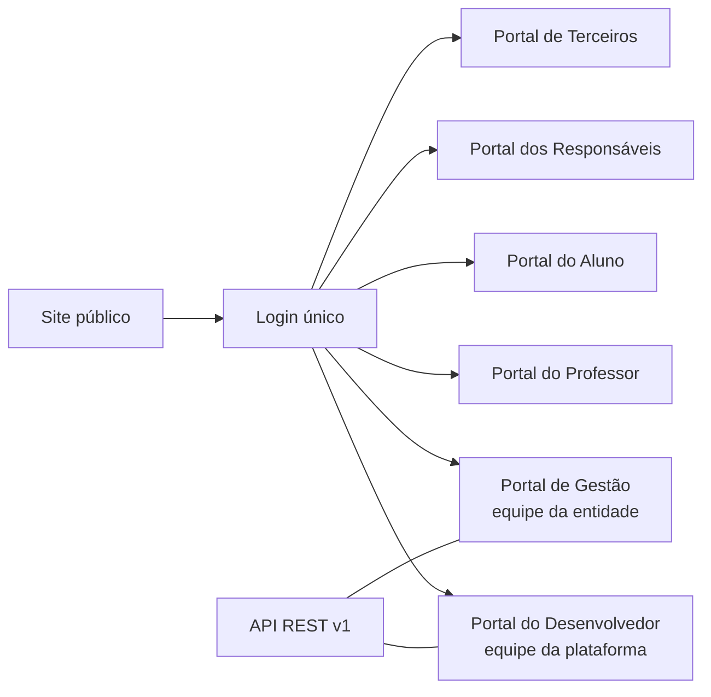

[Índice](README.md) · [Próxima parte](parte-02-arquitetura-e-tenancy.md)

<a id="parte-1"></a>

# Parte 1 — Visão e escopo

## Visão geral da parte 1

O TotusTuus SoftCloud é uma plataforma SaaS multi-tenant para escolas e instituições de ensino: mantenedoras, entidades e unidades. Ela tem seis portais e um site público, e uma API REST versionada ([01](#doc-01)).



**Regras principais**
- Escopo: web responsiva, sem aplicativo nativo. Gateways de pagamento existem como integração; a ativação em produção depende de contrato ([01](#doc-01), seção 5).
- Os módulos e a situação de cada um estão no catálogo ([12](#doc-12)). Os defeitos da v1 que não podem se repetir estão nos achados ([13](#doc-13)).
- Quando a v1 e a v2 divergem, vale a v2 ([00](#doc-00)).

<a id="doc-00"></a>

## 00 — SDD v2 — TotusTuus SoftCloud

> **Versão:** 2.0.0 · **Data:** 02/11/2026 · **Status:** rascunho para revisão (aguarda aprovação do autor)
> **Substitui:** a coleção v1 (documentos `01` a `12`, `SPEC-*`, `spec_*`, `*_completo`). A v1 foi incorporada a esta pasta em `anexo-v1/`, sem alteração de conteúdo, para que a v2 seja autocontida. Índice do anexo na seção 5.
> **Método:** Elephant-Goldfish Model (EGM) — brief de conceito, rascunho com o contexto do projeto e revisão por leitores sem contexto (ver [11-governanca-qualidade.md](parte-17-operacao-qualidade-testes-e-ti.md#doc-11)).

---

### 1. Como ler este SDD

Cada requisito e afirmação de estado usa uma das etiquetas abaixo. Afirmações sem etiqueta são requisitos.

| Etiqueta | Significado |
|---|---|
| **[Verificado]** | Confirmado diretamente em código ou configuração, com caminho citado. |
| **[Declarado]** | Afirmação de estado vinda da v1 ou de auditorias externas, ainda não reproduzida neste repositório. Não deve ser usada como prova de conformidade. |
| **[Planejado]** | Ainda não implementado. Tem dono e critério de aceite. |

Regra: nenhum item sai de **[Declarado]** para **[Verificado]** sem teste, comando reproduzível ou link para o artefato de evidência.

### 2. Conteúdo

| Doc | Assunto |
|---|---|
| [01-visao-escopo.md](#doc-01) | Produto, portais, escopo, fora de escopo, critérios de aceite |
| [02-arquitetura.md](parte-02-arquitetura-e-tenancy.md#doc-02) | Arquitetura, camadas, ordem de middleware, ADRs, dependências |
| [03-dominio-tenancy.md](parte-02-arquitetura-e-tenancy.md#doc-03) | Modelo de domínio, hierarquia multi-tenant, isolamento |
| [04-api.md](parte-02-arquitetura-e-tenancy.md#doc-04) | Contratos REST, autenticação de API, erros, paginação, webhooks |
| [05-seguranca.md](parte-04-seguranca-privacidade-e-auditoria.md#doc-05) | Modelo de ameaças, controles, critérios de aceite de segurança |
| [06-identidade-acesso.md](parte-03-identidade-acesso-e-permissoes.md#doc-06) | Autenticação, MFA, sessões, RBAC, contas privilegiadas |
| [07-privacidade-lgpd.md](parte-04-seguranca-privacidade-e-auditoria.md#doc-07) | Dados pessoais, bases legais, direitos do titular, incidentes |
| [08-frontend-design-system.md](parte-05-portais-navegacao-e-interface.md#doc-08) | Frontend progressivo, CSP, design system, acessibilidade |
| [09-internacionalizacao.md](parte-05-portais-navegacao-e-interface.md#doc-09) | i18n/l10n, locales, RTL |
| [10-implantacao-operacao.md](parte-17-operacao-qualidade-testes-e-ti.md#doc-10) | Ambientes, pipeline, segredos, backup, observabilidade, go-live |
| [11-governanca-qualidade.md](parte-17-operacao-qualidade-testes-e-ti.md#doc-11) | Processo de entrega, Definition of Done, gates, ADRs, revisão |
| [12-catalogo-modulos.md](#doc-12) | Catálogo dos módulos funcionais e status das especificações |
| [13-achados-v1.md](#doc-13) | Registro dos problemas encontrados na v1 e como a v2 os trata |
| [14-integracao-modulos.md](parte-02-arquitetura-e-tenancy.md#doc-14) | Integração entre módulos: donos de dados, eventos, outbox, contratos síncronos |
| [15-validacoes.md](parte-16-dados-validacoes-configuracoes-e-armazenamento.md#doc-15) | Validações: ordem, tipos de campo, CRUD, transações, uploads, catálogo de plataforma |
| D-19 | Pessoa única entre unidades de uma entidade: cadastro civil no banco de identidade da entidade (opção a); o master guarda só conta, vínculos e índice de pessoas. Ver [14](parte-02-arquitetura-e-tenancy.md#doc-14), seção 3. | **Adotada pela recomendação desta versão (02/11/2026). Mensagem anterior do autor, que colocava o cadastro civil no master, foi substituída. Confirmar.** |
| D-20 | Escopo do token: só o contexto ativo (entidade e unidade), nunca a lista de vínculos. Ver [06](parte-03-identidade-acesso-e-permissoes.md#doc-06), seção 12.3. | **Aprovada pelo autor em 02/11/2026.** |
| D-21 | Conta global única por e-mail verificado em toda a plataforma, com vínculos. Ver [06](parte-03-identidade-acesso-e-permissoes.md#doc-06), seção 12.6. | **Aprovada pelo autor em 02/11/2026.** |
| D-16 a D-18 | CRM: separação por banco (master para plataforma; banco de cada unidade para tenant, entidade + unidade); contas de canal oficiais da plataforma e do tenant; IA só com fonte cadastrada e opção de ticket sem IA. Ver [22](parte-06-plataforma-saas-clientes-dominios-licencas-e-crm.md#doc-22), seção 9. | Decididas pelo autor em 02/11/2026. |
| [30-cache.md](parte-02-arquitetura-e-tenancy.md#doc-30) | Cache: camadas, chaves com entidade e unidade, classes e validade, invalidação, o que nunca é cacheado |
| [31-matriz-portais-modulos.md](parte-05-portais-navegacao-e-interface.md#doc-31) | Matriz de módulos por portal, fronteiras (biblioteca × documentos, protocolo × CRM, financeiro e contábil plataforma × entidade), matrícula, simulados, logs, testes, segurança e auditoria por portal |
| [32-atendimento-privacidade-por-portal.md](parte-04-seguranca-privacidade-e-auditoria.md#doc-32) | Help desk e SAC (estados, SLA, portal do cliente), privacidade, consentimento, pedido de titular, ROPA, DPO, por portal |
| [33-contratos-por-portal.md](parte-12-suprimentos-patrimonio-frotas-contratos-e-terceiros.md#doc-33) | Contratos: tipos e donos, ciclo de vida, alçadas, assinatura, obrigações, perfis e páginas por portal |
| [34-pagamentos-fiscal-bancos-por-portal.md](parte-10-financeiro-pagamentos-e-fiscal.md#doc-34) | Gateways, split, notas fiscais (NFS-e, fornecedor), bancos (módulo "Bancos" é ferramenta de banco de dados e sai do escopo), Open Finance, carteiras, por portal |
| [35-acesso-e-seguranca-fisica-por-portal.md](parte-03-identidade-acesso-e-permissoes.md#doc-35) | Portaria, catracas, portas, visitantes, autorização de saída, biometria, câmeras (CFTV), por portal |
| [36-tecnologia-da-informacao-por-portal.md](parte-17-operacao-qualidade-testes-e-ti.md#doc-36) | TI da plataforma (desenvolvedor) e TI da entidade (gestão): ativos, chamados, mudanças, licenças, monitoramento, por portal |
| [29-auditoria.md](parte-04-seguranca-privacidade-e-auditoria.md#doc-29) | Auditoria: categorias, esquema do evento, integridade por cadeia de hash, acesso, mascaramento, retenção e alertas |
| [28-cobertura-ia-todos-os-modulos.md](parte-15-inteligencia-artificial.md#doc-28) | Posição de IA para todos os módulos do catálogo: Sim, Restrita ou Não, com limite e decisão humana |
| [27-inteligencia-artificial-e-portais.md](parte-15-inteligencia-artificial.md#doc-27) | IA por módulo e por portal: contratação por capacidade, gateway de IA, dados, limites por recurso, revisão humana, governança e testes. |
| [26-sdd-juridico-regulatorio.md](parte-18-juridico-e-regulatorio.md#doc-26) | SDD jurídico-regulatório: mapa de obrigações com grau de confiança, matriz de retenção, relação de consumo, consentimento por canal, educação, assinatura eletrônica, incidentes, acessibilidade, pagamentos, fiscal e SST. Não é parecer. |
| [25-dossie-juridico-e-lacunas.md](parte-18-juridico-e-regulatorio.md#doc-25) | Dossiê para o jurídico: análise das lacunas, 13 perguntas com norma a verificar e riscos. Não é parecer. |
| [24-operacao-continuidade-qualidade.md](parte-17-operacao-qualidade-testes-e-ti.md#doc-24) | Continuidade (RPO e RTO por banco), SLO, suporte, releases, testes, vulnerabilidade, contratos e lacunas do projeto (G-01 a G-20) |
| [23-dominios-provisionamento-ciclo-de-vida.md](parte-06-plataforma-saas-clientes-dominios-licencas-e-crm.md#doc-23) | Domínios (seis portais, autenticação e arquivos), sessão entre domínios, Editor de portais declarativo, provisionamento e saída de cliente. D-22 e D-23 aprovadas. D-24 superada por D-25. |
| D-25 | **Aprovada pelo autor em 02/11/2026: seis portais.** Desenvolvedor, gestão (SaaS), professor, aluno, responsáveis e terceiros. Módulos são seções dentro dos portais, não subdomínios. Autenticação e arquivos são serviços de infraestrutura. Ver [23](parte-06-plataforma-saas-clientes-dominios-licencas-e-crm.md#doc-23), seção 1. | Aprovada. |
| D-26 | **Aprovada pelo autor em 02/11/2026.** Login único; depois seleção de entidade e unidade; atalho direto se houver um único vínculo. Portais em endereços próprios (`portal-do-aluno`, etc.). Ver [23](parte-06-plataforma-saas-clientes-dominios-licencas-e-crm.md#doc-23), seção 1. D-24 superada por D-25. Proposta: a entidade vem do contexto do token (D-20); domínio próprio opcional por entidade aponta para um dos portais. | Aguarda decisão do autor. |
| [22-crm-canais-e-papeis.md](parte-06-plataforma-saas-clientes-dominios-licencas-e-crm.md#doc-22) | CRM em dois contextos (plataforma e tenant), canais de captação, papéis do CRM e papéis departamentais |
| [21-busca-e-armazenamento.md](parte-16-dados-validacoes-configuracoes-e-armazenamento.md#doc-21) | Busca full-text e armazenamento de arquivos: layout, upload e download seguros, metadados corrigidos, quarentena, expurgo e índice com permissão |
| [20-pagamentos-seguranca.md](parte-10-financeiro-pagamentos-e-fiscal.md#doc-20) | Pagamentos e recebimentos: escopo PCI, ledger, webhooks, Pix, boleto, estornos, conciliação e antifraude |
| [19-regras-modulos-3.md](parte-07-regras-gerais-dos-modulos-de-gestao.md#doc-19) | Regras dos demais módulos do catálogo, duplicidades e lacunas |
| [18-regras-modulos-2.md](parte-07-regras-gerais-dos-modulos-de-gestao.md#doc-18) | Regras de Cobrança, Notificações, Auditoria, RH e Contábil/Fiscal |
| [17-regras-modulos.md](parte-07-regras-gerais-dos-modulos-de-gestao.md#doc-17) | Regras de validação, estados e defeitos dos módulos Financeiro, Pessoas, Acadêmico, SMT, Suprimentos e Contratos |
| [16-integracoes-externas.md](parte-14-integracoes-e-importacao.md#doc-16) | Integrações externas de plataforma (master) e de tenant: catálogo, credenciais, ciclo de vida |

### 3. O que mudou em relação à v1

1. **Escopo de governança separado do produto.** A v1 misturava o produto com ferramentas de agentes de IA (`oh-my-opencode-slim`, `ag-kit`, `fable-method`, `mantis`) e instruções de instalação com `@latest`. A v2 mantém esses itens fora do SDD de produto. Ferramentas de desenvolvimento ficam em `11-governanca-qualidade.md`, com versão fixada.
2. **Sem dados pessoais nem identificadores operacionais.** A v1 listava e-mails reais de administradores e UUIDs da estrutura interna. A v2 remove esses dados; eles ficam no registro de seed privado.
3. **Referências verificáveis.** A v1 apontava para mais de 30 arquivos (`docs/security/…`, `docs/portais/…`, `.agents/skills/…`) que não estão nesta pasta. A v2 cita apenas caminhos que existem ou marca o item como externo.
4. **Afirmações de segurança com evidência.** Os números "0 críticos / 36 achados / 34 fixados" da v1 são **[Declarados]**. A v2 exige reprodução.
5. **Contradições corrigidas.** Ex.: "zero JavaScript inline" contra `onclick=` em [`sub_sidebar_itsm.php`](parte-17-operacao-qualidade-testes-e-ti.md#v1-sub-sidebar-itsm-php); "sem bibliotecas externas de runtime" contra CDN do Font Awesome. Detalhes em [13-achados-v1.md](#doc-13).
6. **Riscos de design corrigidos.** Ex.: rotação periódica de senha, bloqueio de conta por identificador (permite negação de serviço), vinculação rígida de sessão a IP, cookies `SameSite=Strict` em fluxos de navegação de primeira parte.

### 4. Princípios

1. **Default-deny.** Rota sem regra explícita é negada.
2. **Isolamento de tenant em toda consulta.** Filtro por tenant é obrigatório no repositório de dados, não só no controller.
3. **Segredos fora do código e fora do host da aplicação em produção.**
4. **Dados pessoais mínimos.** Coletar só o necessário; apagar ou anonimizar ao fim da retenção.
5. **Mudança rastreável.** Toda decisão relevante vira ADR; todo requisito tem critério de aceite testável.
6. **Português como idioma principal**, inglês como idioma canônico de chaves de código e i18n.

### 5. Decisões do autor (02/11/2026)

| # | Decisão | Opções | Onde |
|---|---|---|---|
| Busca por CPF | Permitida só com finalidade declarada por tenant, relatório de impacto, MFA recente, limites contra enumeração e auditoria de cada consulta. Ver [21](parte-16-dados-validacoes-configuracoes-e-armazenamento.md#doc-21), seção 6.8. Prazo de retenção da auditoria: pendente (jurídico). | **Aprovada pelo autor em 02/11/2026.** |
| D-13 a D-15 | Busca e armazenamento: MySQL FULLTEXT inicialmente com interface isolada; um bucket por ambiente com prefixo por tenant; OCR nesta versão, com texto de bucket sensível fora do índice. Ver [21](parte-16-dados-validacoes-configuracoes-e-armazenamento.md#doc-21), seção 9. | Decididas pelo autor em 02/11/2026. |
| D-10 a D-12 | Pagamentos: fluxo de recursos (conta do tenant; gateway da plataforma condicionado a parecer), centavos inteiros, MFA configurável com piso e limite padrão de R$ 1.000,00. Ver [20](parte-10-financeiro-pagamentos-e-fiscal.md#doc-20), seção 19, e [06](parte-03-identidade-acesso-e-permissoes.md#doc-06), seção 5. | Decidida pelo autor em 02/11/2026. |
| D-01 | Biblioteca de ícones. **Decidida: (a)**, self-host da licença Pro (ver [08](parte-05-portais-navegacao-e-interface.md#doc-08)). | (a) self-host da licença Pro; (b) migrar para biblioteca open source; (c) manter CDN apenas com licença confirmada | [08](parte-05-portais-navegacao-e-interface.md#doc-08) |
| D-02 | Cofre de segredos em produção. **Decidida: biblioteca própria** (`TotusTuus\Vault`), ver ADR-05. | (a) AWS KMS / Secrets Manager; (b) HashiCorp Vault; (c) provedor da nuvem contratada | [05](parte-04-seguranca-privacidade-e-auditoria.md#doc-05), [10](parte-17-operacao-qualidade-testes-e-ti.md#doc-10) |
| D-03 | Vínculo de sessão ao dispositivo. **Decidida: (b)**, token de dispositivo com revogação (ver [06](parte-03-identidade-acesso-e-permissoes.md#doc-06), seção 7). | (a) só User-Agent + sinal de risco; (b) token de dispositivo (`DeviceTrust`) com revogação; (c) nenhum além de idle/absolute | [06](parte-03-identidade-acesso-e-permissoes.md#doc-06) |
| D-04 | Recuperação de conta sem e-mail/SMS. **Decidida: e-mail verificado é obrigatório para cadastro e recuperação;** WhatsApp e Telegram ficam fora. | (a) códigos de recuperação de uso único; (b) passkey obrigatória para contas master; (c) suporte com verificação de identidade | [06](parte-03-identidade-acesso-e-permissoes.md#doc-06) |

Cada opção tem trade-offs e condições de falha descritos no documento indicado. O SDD não escolhe por padrão.

### Decisões aprovadas em 03/11/2026 (documentos 31 a 36)

O autor aprovou as propostas adotadas nos documentos 31 a 36. Itens que pedem valor, nome ou parecer continuam pendentes e estão listados abaixo.

| Documento | Aprovado | Ainda pendente |
|---|---|---|
| [31](parte-05-portais-navegacao-e-interface.md#doc-31) | Biblioteca separada de Documentos; protocolo como serviço de atendimento, fora do CRM comercial; financeiro e contábil da plataforma e da entidade em bancos separados; matrícula, simulados e auditoria com `portal` | Planejamento acadêmico, institucional e de desenvolvimento; empenho; permanência dos módulos financeiro, contábil, patrimônio, frotas, suprimentos e pessoas da plataforma; gabarito óptico; plano PRO |
| [32](parte-04-seguranca-privacidade-e-auditoria.md#doc-32) | Ticket como tipo de protocolo; módulo único de atendimento; consentimento por finalidade; pedido de titular com estados e verificação de identidade; DPO com painel próprio, sem operar o módulo que audita | Valores padrão de SLA; regra de categoria sensível; nomes dos DPOs; retenção de tickets; consentimento de menor de 13 anos (jurídico) |
| [33](parte-12-suprimentos-patrimonio-frotas-contratos-e-terceiros.md#doc-33) | Tipos de contrato com dono e portal de origem; aditivo segue o portal do contrato original; contrato com dado pessoal exige DPA antes da assinatura | Faixas de alçada; antecedência de alerta; provedor de assinatura eletrônica; cláusulas obrigatórias e forma de assinatura (jurídico) |
| [34](parte-10-financeiro-pagamentos-e-fiscal.md#doc-34) | Módulo Bancos removido do escopo; split mantido na opção (a), sem custódia; nota de fornecedor recebida e validada, não emitida; carteira digital como método do gateway, sem guardar token | Open Finance e débito automático (jurídico); NFS-e Nacional, cancelamento e guarda de XML (fiscal e jurídico); NFS-e da assinatura SaaS |
| [35](parte-03-identidade-acesso-e-permissoes.md#doc-35) | Biometria opcional, com alternativa sem biometria; template cifrado no banco da unidade; câmeras fora de áreas íntimas e com aviso; liberação de emergência sem rede | Prazo de retenção de imagem; escopo de biometria e reconhecimento facial (jurídico e RIPD); geolocalização na presença; fabricantes de catraca e porta |
| [36](parte-17-operacao-qualidade-testes-e-ti.md#doc-36) | TI da plataforma fora de qualquer portal de cliente; TI da entidade com ativo como vista do Patrimônio; chamados de TI no atendimento; mudança com aprovação de segundo papel; [`sub_sidebar_itsm.php`](parte-17-operacao-qualidade-testes-e-ti.md#v1-sub-sidebar-itsm-php) removido | Comitê de mudança e quórum; prazo de aprovação de mudança emergencial; manter ou remover monitoramento de equipamento da entidade |
| [37](parte-08-academico.md#doc-37) | Planejamento acadêmico, institucional e de desenvolvimento de pessoas; empenho para entidade pública. Análise, estados, regras, segregação, portais e estrutura de dados |
| [38](parte-12-suprimentos-patrimonio-frotas-contratos-e-terceiros.md#doc-38) | Portal de terceiros: prestadores por tipo (jurídico, contabilidade, cartório, alimentação, transporte escolar, transportadora, TI, limpeza, vigilância, uniformes, clínica de ASO, consultoria), com acesso limitado ao contrato |
| [39](parte-11-pessoas-departamento-pessoal-e-sst.md#doc-39) | Departamento pessoal, RH e medicina do trabalho: lacunas, separação de dado de saúde (RH sem CID), permissões corrigidas, por portal |
| [40](parte-08-academico.md#doc-40) | Aulas online e reuniões ao vivo: aula sem especificação na v1, menores (consentimento e gravação), presença, convidado externo, infraestrutura de mídia, por portal |
| [41](parte-08-academico.md#doc-41) | Formulários e pesquisas: motor compartilhado, anonimato com tabelas separadas, dado sensível, relatórios por grupo com mínimo |
| [42](parte-08-academico.md#doc-42) | Preceptoria: avaliação e autoavaliação, tutoria, PDI, evidências; conflito de nome com a navegação da v1 |
| [43](parte-08-academico.md#doc-43) | Gestão pastoral: eventos, missas e celebrações, escalas, intenções, ações sociais. Confissões só como horário público, sem registro de pessoa. Tradições configuráveis, com modo ecumênico |
| [44](parte-08-academico.md#doc-44) | Agendamento de ambientes e equipamentos (acadêmico): conflito de horário, prioridade, grade como bloqueio fixo, equipamento como bem patrimonial |
| [45](parte-19-pendencias-decisoes-e-rastreabilidade.md#doc-45) | Pendências consolidadas por responsável: autor, jurídico, norma, documento, homologação e owner. Refeita por auditoria completa dos docs 00 a 76 em 03/11/2026 |
| [46](parte-09-secretaria-matricula-e-documentos.md#doc-46) | Matrícula e rematrícula: estados, janela, condicional com prazo, não rematriculada, trancamento por nível, vaga com bloqueio de concorrência, por portal |
| [47](parte-08-academico.md#doc-47) | Simulados e correção de redação: perfis, OCR com revisão, nota da IA só como sugestão confirmada pelo professor, ranking por opção da unidade |
| [48](parte-09-secretaria-matricula-e-documentos.md#doc-48) | Gerador de documentos: editor de modelos, tipos, ciclo de emissão, validação pública sem dado pessoal, assinatura, por portal |
| [49](parte-17-operacao-qualidade-testes-e-ti.md#doc-49) | Logs de integração e de job, testes por portal, teste de isolamento por par, acessibilidade |
| [51](parte-16-dados-validacoes-configuracoes-e-armazenamento.md#doc-51) | DDL dos módulos novos e pendentes: atendimento, LGPD, contrato, acesso físico, formulários, preceptoria, pastoral, agendamento, sala de aula, matrícula e TI |
| [52](parte-11-pessoas-departamento-pessoal-e-sst.md#doc-52) | Medicina do trabalho: PCMSO, PGR, LTCAT, CIPA e ergonomia, com DDL e quem vê o quê |
| [50](parte-18-juridico-e-regulatorio.md#doc-50) | Pacote de 61 perguntas para jurídico e norma, com posição proposta por pergunta |
| [53](parte-12-suprimentos-patrimonio-frotas-contratos-e-terceiros.md#doc-53) | Pacote para jurídico: contratos, declarações, certidões, acervo escolar, termos, autorizações, atas e dossiês. 28 perguntas (DC-01 a DC-28) |
| [54](parte-09-secretaria-matricula-e-documentos.md#doc-54) | Gestão de documentos em três contextos: recebidos (validação), administrativos (tramitação) e emitidos (secretaria), com serviços comuns de assinatura, protocolo e armazenamento |
| [55](parte-08-academico.md#doc-55) | Verificação do acadêmico contra o menu do iScholar: cobertura, 13 lacunas em ordem de dependência, 4 decisões de produto |
| [56](parte-16-dados-validacoes-configuracoes-e-armazenamento.md#doc-56) | Configurações e relatórios: menus do iScholar comparados com o SDD, lacunas por grupo |
| [57](parte-13-atendimento-e-notificacoes.md#doc-57) | Notificações por portal: canais, preferências, targeting, templates, provedores e lacunas do módulo |
| [58](parte-08-academico.md#doc-58) | Calendário escolar e eventos: período, dia não letivo, eventos, inscrição, capacidade, certificado, por portal |
| [59](parte-08-academico.md#doc-59) | Estrutura acadêmica: tipos de curso, disciplinas, grades e PPC versionados, equivalências, períodos e sistemas avaliativos, por portal |
| [60](parte-08-academico.md#doc-60) | Turmas, cadastro de salas, enturmação, grupos de horários e grade de horários: conflitos de professor, turma e ambiente, publicação e consultas, por portal |
| [61](parte-08-academico.md#doc-61) | Diário escolar: aula, chamada por três formas, faltas, justificativas com prazo e aprovação, notas com versão, fechamento e reabertura, por portal |
| [62](parte-08-academico.md#doc-62) | Boletim parcial e oficial, regra de aprovação, recuperação paralela, conselho de classe com pauta, decisão e ata, por portal |
| [63](parte-08-academico.md#doc-63) | Ocorrências disciplinares e de convivência: tipos, gravidade, fluxo, medidas, contestação, sigilo e denúncia de violência, por portal. Separada de SST, portaria e saúde |
| [64](parte-08-academico.md#doc-64) | Planos de ensino (disciplina, turma e período, com critérios que batem com o sistema avaliativo) e planos de aula (por aula ou semana), com revisão, IA com revisão humana e PPP fora do módulo, por portal |
| [65](parte-08-academico.md#doc-65) | Estágio (obrigatório ou não, termo, horas, supervisão, avaliação) e TCC (orientação, estados, banca, versão final e repositório), por portal. Supervisor externo e membro de banca com conta no portal de terceiros |
| [66](parte-08-academico.md#doc-66) | Prontuário como visão sobre os documentos (sem cópia), seção restrita de saúde e apoio, histórico após saída, portfólio com avaliação, compartilhamento e exportação, por portal |
| [67](parte-08-academico.md#doc-67) | Livro de registro e livro de atas digitais com travamento, retificação e assinatura; arquivo morto com digitalização verificada por outra pessoa e eliminação só com termo, por portal |
| [68](parte-08-academico.md#doc-68) | Biblioteca separada de documentos: acervo e exemplares, perfis e prazos configurados pela escola, empréstimo, reserva, multa, inventário, biblioteca digital, salas via recursos e empréstimo entre unidades, por portal |
| [69](parte-08-academico.md#doc-69) | Relatórios: modelo comum (operacional, gerencial, regulatório), ciclo de geração e arquivo, catálogo por módulo, censo escolar com conferência e envio pela secretaria, formatos oficiais, por portal |
| [70](parte-14-integracoes-e-importacao.md#doc-70) | Importação e carga inicial: ordem por dependência, simulação, lote desfazível, idempotência, histórico sem cobrança retroativa nem aviso em massa, por portal |
| [71](parte-10-financeiro-pagamentos-e-fiscal.md#doc-71) | Financeiro completo (CFG-04): contas a pagar com rateio e aprovação, cheques recebidos e emitidos, caixa físico com fechamento, fluxo de caixa, DRE por regime escolhido, conciliação e por portal. Receita de aluno fica em 18 e 20 |
| [72](parte-16-dados-validacoes-configuracoes-e-armazenamento.md#doc-72) | Campos personalizados (CFG-06): definidos por entidade ou por unidade, valores no banco da unidade, só acrescentam, com classificação de dado e fora de saúde, prontuário e ocorrência, por portal |
| [73](parte-18-juridico-e-regulatorio.md#doc-73) | Resumo para o jurídico: 20 perguntas dos módulos acadêmicos e administrativos (docs 55 a 72), com posição proposta e documento de origem para cada uma |
| [74](parte-14-integracoes-e-importacao.md#doc-74) | Integrações educacionais oficiais: Educacenso (arquivo importado no INEP), SIGEP, SGP por API, sistema municipal (conflito em aberto) e Pé-de-Meia, com regra de canal oficial e de quem envia, por portal |
| [75](parte-05-portais-navegacao-e-interface.md#doc-75) | Análise por escopo (plataforma, entidade, unidade, módulo, global): busca, notificações, perfil e integrações internas e externas, com lacunas e decisões pendentes |
| [76](parte-05-portais-navegacao-e-interface.md#doc-76) | Meu perfil: uma tela em todos os portais, com dados, contato, endereço, segurança, preferências, consentimentos, histórico e pedido de titular. Regras de edição decididas em PER-04 e PER-05 |
| [77](parte-06-plataforma-saas-clientes-dominios-licencas-e-crm.md#doc-77) | Licenciamento: planos com limite de alunos definido pelo desenvolvedor, situações da assinatura, carência e comportamento ao exceder o limite |
| [78](parte-03-identidade-acesso-e-permissoes.md#doc-78) | Permissões completas: níveis de papel (0 a 7), escopos, papéis por portal, criação de entidade e unidade só pelo desenvolvedor, separação de funções |
| [79](parte-19-pendencias-decisoes-e-rastreabilidade.md#doc-79) | Rastreabilidade v1 → v2: para cada um dos 62 arquivos da v1 (em `anexo-v1/`), o destino na v2 e o que ainda não foi absorvido. Gerado por `inventario/gera_rastreabilidade.py` |
| [80](parte-19-pendencias-decisoes-e-rastreabilidade.md#doc-80) | Decisões tomadas por padrão, delegadas pelo autor em 04/11/2026 (melhor prática, mais segura, completa), com motivo e alternativa descartada |
| [81](parte-08-academico.md#doc-81) | Classe: mural de avisos, materiais de apoio e tarefas com entrega, por portal, com estados, regras, permissões e DDL (especifica o DP-06) |
| Decisões de configuração (CFG-01 a CFG-04) | Agenda iScholar fora do escopo. Foto com consentimento por aluno. Relatório de acesso do responsável com link de uso único. Financeiro completo, com cheques, caixa e DRE | [56](parte-16-dados-validacoes-configuracoes-e-armazenamento.md#doc-56), seção 8 |
| Notificações (NOT-02, NOT-03, NOT-05, NOT-06) | Silêncio 21h às 7h. Segunda aprovação acima de 500. Remetentes de saúde: secretaria, enfermagem, médico e coordenação. Push por aplicativo Android e iOS | [57](parte-13-atendimento-e-notificacoes.md#doc-57), seção 5 |
| Calendário e eventos escolares | Módulo próprio, nesta versão. Especificação pendente | [56](parte-16-dados-validacoes-configuracoes-e-armazenamento.md#doc-56), CFG-01 |

Correção aplicada: o módulo "Bancos" nos documentos [12](#doc-12) e [19](parte-07-regras-gerais-dos-modulos-de-gestao.md#doc-19) passa a ser ferramenta de banco de dados, fora do produto.

### Decisões de 03/11/2026, segunda rodada

| Decisão | Resposta | Documento |
|---|---|---|
| Módulo Bancos | Removido de produto. Painel de bancos de dados no portal do desenvolvedor, sem console SQL aberto | [34](parte-10-financeiro-pagamentos-e-fiscal.md#doc-34), seção 11 |
| Split | Mantido em (a). Lista de mudanças para (c) registrada | [34](parte-10-financeiro-pagamentos-e-fiscal.md#doc-34), seção 11 |
| Nota de fornecedor | Recebe e valida, sem emitir | [34](parte-10-financeiro-pagamentos-e-fiscal.md#doc-34), seção 5.3 |
| Portaria & Acesso | Mantido no portal do desenvolvedor, para acesso físico da própria empresa | [35](parte-03-identidade-acesso-e-permissoes.md#doc-35), seção 11 |
| Biometria, reconhecimento facial e câmeras | Escopo aprovado. Retenção de imagem: 30 dias, padrão inicial | [35](parte-03-identidade-acesso-e-permissoes.md#doc-35), seção 11 |
| Ticket como protocolo | Aprovado em parte: pedido com responsável e prazo recebe protocolo | [32](parte-04-seguranca-privacidade-e-auditoria.md#doc-32), seção 7 |
| SLA padrão | Aprovado: 1 h a 10 dias úteis por prioridade, ajustável por entidade | [32](parte-04-seguranca-privacidade-e-auditoria.md#doc-32), seção 7 |
| Faixas de alçada | Aprovadas como padrão inicial: até R$ 10.000; até R$ 100.000; acima | [33](parte-12-suprimentos-patrimonio-frotas-contratos-e-terceiros.md#doc-33), seção 12 |
| DPO | Plataforma: empresa desenvolvedora. Entidade: designado pela entidade, podendo ser a empresa por contrato | [32](parte-04-seguranca-privacidade-e-auditoria.md#doc-32), seção 7 |
| Planejamento e empenho | Analisados e implementados como módulos de tenant. Empenho só para entidade pública | [37](parte-08-academico.md#doc-37) |

### Análises de 03/11/2026, terceiros e pessoal

- **Terceiros por tipo** ([38](parte-12-suprimentos-patrimonio-frotas-contratos-e-terceiros.md#doc-38)): cada prestador tem contrato, pessoas com vínculo ligado ao contrato, serviços do pacote do tipo e unidades listadas. O acesso é a interseção de contrato vigente, serviço, unidade e papel. Teste de isolamento entre prestadores.
- **Pessoal, RH e SST** ([39](parte-11-pessoas-departamento-pessoal-e-sst.md#doc-39)): análise mostrou lacunas em folha, rescisão, recrutamento, PCMSO, PGR, LTCAT e CIPA, e uma falha de privacidade na v1: RH e gestão podiam gerenciar SST e ver CID. Proposta: RH e gestão veem só o resultado do ASO.

### Decisões de 03/11/2026, terceiros e pessoal

| Tema | Decisão | Onde |
|---|---|---|
| RH e Pessoas (HCM-01) | Módulos separados, vínculo por referência à pessoa | [39](parte-11-pessoas-departamento-pessoal-e-sst.md#doc-39), seção 11 |
| Permissão "SST — Gerenciar" (HCM-06) | Por papel e portal que precisa. Não é concedida a RH nem a gestão por cargo | [39](parte-11-pessoas-departamento-pessoal-e-sst.md#doc-39), seção 11 |
| HCM da plataforma e dos clientes (HCM-10) | Dois usos do mesmo módulo, isolados: empresa desenvolvedora (master) e cada entidade | [39](parte-11-pessoas-departamento-pessoal-e-sst.md#doc-39), seção 11 |
| Currículo de não contratado (HCM-09) | Incluído. Prazo a fixar pelo (jurídico) | [39](parte-11-pessoas-departamento-pessoal-e-sst.md#doc-39), seção 11 |
| Tipos de prestador (TER-01) | Tipos personalizados a partir de modelo-base, só com serviços do catálogo, com aprovação e auditoria | [38](parte-12-suprimentos-patrimonio-frotas-contratos-e-terceiros.md#doc-38), seção 11 |
| Rastro de localização do transporte (TER-02) | Incluído. Guarda só durante a viagem e prazo fixo depois. 30 dias depois da viagem, decidido em 03/11/2026. Parecer do (jurídico) pendente | [38](parte-12-suprimentos-patrimonio-frotas-contratos-e-terceiros.md#doc-38), seção 11 |
| Acesso remoto de TI (TER-08) | Incluído. Só com chamado aberto, dentro de janela, sessão gravada | [38](parte-12-suprimentos-patrimonio-frotas-contratos-e-terceiros.md#doc-38), seção 11 |
| Infraestrutura de aula online (LIV-05) | Mídia própria, com as melhores tecnologias. Operação a especificar em [10](parte-17-operacao-qualidade-testes-e-ti.md#doc-10) | [40](parte-08-academico.md#doc-40), seção 8 |
| Transcrição de aula com menor por IA (LIV-03) | Sim, pelo gateway de IA. Desligada por padrão, habilitada por unidade | [40](parte-08-academico.md#doc-40), seção 5 |
| Presença em aula online (LIV-04) | 40 minutos de tempo conectado, configurável por entidade | [40](parte-08-academico.md#doc-40), seção 6 |
| Convidado externo e diretor (LIV-06, LIV-07) | Entidade habilita externos com token de uso único. Diretor tem passe livre na unidade, com auditoria. Coordenador em aberto | [40](parte-08-academico.md#doc-40), seção 7 |
| Visual da sala (LIV-08) | Template do portal, layout de reunião estilo Zoom. Especificado em [08](parte-05-portais-navegacao-e-interface.md#doc-08), seção 9 | [40](parte-08-academico.md#doc-40), seção 4.4 |
| Operação de mídia (LIV-11) | Gravação em fragmentos cifrados de 60 s, com índice de fragmentos, manifesto e verificação de checksum | [10](parte-17-operacao-qualidade-testes-e-ti.md#doc-10), seção 10 |
| Coordenador em aula (LIV-07) | Pode observar aulas da unidade, com registro em auditoria | [40](parte-08-academico.md#doc-40), seção 7 |
| Consentimento de menor (LIV-01) | Pedido por cláusula do contrato com a instituição. Texto com o jurídico | [40](parte-08-academico.md#doc-40), seção 5 |


### 5. Anexo v1 (incorporado)

A coleção v1 está em anexo-v1/ (62 arquivos, sem alteração de conteúdo). Cada arquivo tem um status em [12-catalogo-modulos.md](#doc-12) (seções 2 a 4) e um destino na v2 em [79-rastreabilidade-v1-v2.md](parte-19-pendencias-decisoes-e-rastreabilidade.md#doc-79). O consolidado SDD-COMPLETO.md é gerado por `inventario/gera_sdd_completo.py`. Não é preciso consultar a pasta original fora deste repositório.

<a id="v1-sdd-mestre-php8-mvc-saas-md"></a>

### v1 — `sdd-mestre-php8-mvc-saas.md` (535 linhas)

> Situação na v2: Substituído por 00 e 02. Quando este texto diverge da v2, vale a v2.

> Esta especificação foi substituída por inteiro pelo documento indicado acima. O texto fica como histórico; para implementar, vale o documento da v2.

#### Visão do documento

Este documento define a Especificação de Design de Software (SDD) mestre para uma plataforma SaaS escalável, multi-entity, multi-unit e multi-user, construída em PHP 8 puro com arquitetura MVC, API RESTful, frontend progressivo com JavaScript `fetch`, design system com Tailwind 4.4 e estratégia de bibliotecas internas sem dependência de bibliotecas externas de runtime.[web:46][web:43][web:51]

O modelo de governança técnica deste projeto usa o `fable-method` como método principal de decisão, verificação e reporting; usa `oh-my-opencode-slim` como malha de agentes especialistas; usa `hallmark` para direção visual e prevenção de interfaces genéricas; usa `ag-kit` para workflows, memória e compressão de contexto; usa `agentic-awesome-skills` como catálogo complementar de skills; e integra `mantis` e skills dedicadas de segurança para auditoria contínua e validação das superfícies críticas do sistema.[attached_file:1][attached_file:2][attached_file:3][web:4][web:18]

#### Política de pré-instalação e bootstrap de skills

Antes de qualquer uso operacional do SDD, o ambiente de agentes deve verificar se as skills, plugins e configurações mínimas estão presentes. Se não estiverem, o processo deve interromper a execução funcional e primeiro instalar, configurar e validar o stack de agentes necessário.[web:44][web:46][web:51][web:55]

##### Regra obrigatória

Nenhum workflow do projeto pode assumir que `fable-method`, `oh-my-opencode-slim`, `ag-kit`, `hallmark`, `agentic-awesome-skills` ou integrações de segurança já estejam disponíveis. O processo deve sempre executar uma fase explícita de `agent environment bootstrap` antes da fase de planejamento, especificação ou implementação.[web:44][web:46][web:51]

##### Ordem de bootstrap

1. Verificar OpenCode CLI.
2. Instalar e configurar `oh-my-opencode-slim`.
3. Instalar `ag-kit` no projeto ou por setup compartilhado.
4. Instalar `fable-method` no host compatível.
5. Registrar `hallmark`, `agentic-awesome-skills`, `mantis` e skills proprietárias de segurança.
6. Validar autenticação, modelos, skills e agentes.
7. Somente então iniciar o loop do `fable-method`.

##### Checklist de verificação de ambiente

| Item | Verificação | Ação se ausente |
|---|---|---|
| OpenCode CLI | `opencode --version` responde | Instalar OpenCode CLI antes de prosseguir.[web:44][web:45] |
| oh-my-opencode-slim | Configuração presente e agentes respondem | Executar instalador e revalidar.[web:43][web:44][web:49] |
| AG Kit | `.agents/` ou setup equivalente presente | Rodar `npx @vudovn/ag-kit init`.[web:51][web:50] |
| fable-method | Plugin ou skills instalados | Instalar via plugin, script ou AGENTS.md.[web:46][web:47] |
| Model providers | `opencode auth login` concluído | Solicitar autenticação manual do usuário.[web:44][web:45] |
| Model registry | `opencode models --refresh` executado | Atualizar catálogo antes de uso.[web:43][web:44] |
| Agent health | `ping all agents` funciona | Corrigir config ou credenciais.[web:44][web:49][web:55] |
| Background subagents | flag experimental habilitada quando aplicável | Definir variável de ambiente apropriada.[web:43][web:55] |

#### Instalação e configuração das skills obrigatórias

##### 1. OpenCode CLI como pré-requisito

O `oh-my-opencode-slim` depende da presença do binário `opencode`, e a documentação de instalação recomenda verificar `opencode --version` antes de rodar o instalador.[web:44] Um guia de uso também destaca que mesmo quem usa OpenCode Desktop precisa do CLI instalado para que a instalação do plugin funcione corretamente.[web:45]

**Gate:** se `opencode --version` falhar, o processo deve parar e abrir uma tarefa de ambiente chamada `Install OpenCode CLI`.[web:44][web:45]

##### 2. Instalação do oh-my-opencode-slim

A instalação recomendada do `oh-my-opencode-slim` usa `bunx oh-my-opencode-slim@latest install`, com opções não interativas como `--no-tui --skills=yes` quando o projeto exigir padronização automática de setup.[web:43][web:44] A configuração gerada fica em `~/.config/opencode/oh-my-opencode-slim.json`, onde os modelos dos agentes devem ser revisados e ajustados ao stack disponível.[web:43][web:44]

Comandos de referência:

```bash
opencode --version
bunx oh-my-opencode-slim@latest install --no-tui --skills=yes
opencode auth login
opencode models --refresh
opencode
# dentro da sessão
ping all agents
```

Se o projeto usar a orquestração de background da linha V2, a documentação técnica também cita a necessidade de habilitar `OPENCODE_EXPERIMENTAL_BACKGROUND_SUBAGENTS=1` ou variável equivalente persistida no shell profile.[web:43][web:55]

##### 3. Instalação do AG Kit

O `ag-kit` pode ser inicializado no projeto com `npx @vudovn/ag-kit init`, o que injeta a pasta `.agents/` diretamente na base local do projeto.[web:51][web:50][web:54] Também existe opção de instalação global com `npm install -g @vudovn/ag-kit` seguida de `ag-kit init`, além de estratégia centralizada com symlink para reuso entre repositórios.[web:51]

Comandos de referência:

```bash
npx @vudovn/ag-kit init
# ou
npm install -g @vudovn/ag-kit
ag-kit init
```

**Gate:** se a pasta `.agents/` não existir após a execução, o ambiente deve ser considerado incompleto.[web:51][web:57]

##### 4. Instalação do fable-method

O `fable-method` pode ser instalado como plugin recomendado em Claude Code com `/plugin marketplace add Sahir619/fable-method` seguido de `/plugin install fable@fable-method`, ou como skills standalone por `git clone` mais `install.sh` no Linux/macOS e `install.ps1` no PowerShell do Windows.[web:46][web:47]

Comandos de referência para setup standalone:

```bash
git clone https://github.com/Sahir619/fable-method && bash fable-method/install.sh
```

No Windows PowerShell:

```powershell
git clone https://github.com/Sahir619/fable-method; .\fable-method\install.ps1
```

Quando o host não suportar instalação nativa de skills, o repositório também informa que `AGENTS.md` pode ser usado como método equivalente para qualquer agente ou harness compatível.[web:46][web:47]

##### 5. Registro do hallmark, agentic-awesome-skills e mantis

O `hallmark` entra como skill de direção visual e antítese de UI genérica.[web:18] O `agentic-awesome-skills` entra como catálogo amplo de skills reutilizáveis e deve ser conectado ao processo de seleção de capabilities por domínio.[web:4] O `mantis` e as skills proprietárias de segurança devem ser tratados como `security toolchain`, com localização, instalação e versionamento definidos pelo projeto em seu diretório de automação interna e validados no bootstrap antes do uso em auditorias.

Como nem todos esses componentes compartilham o mesmo método de instalação, o projeto deve manter um manifesto local chamado `docs/agent-stack/manifest.md` contendo:

- nome da skill ou plugin;
- origem;
- método de instalação;
- comando de atualização;
- versão/pino desejado;
- host compatível;
- critério de verificação pós-instalação.

#### Script lógico de bootstrap recomendado

O projeto deve manter um workflow ou script de verificação com a seguinte lógica operacional:

```text
START
  -> check opencode cli
  -> if missing: stop and request installation
  -> check oh-my-opencode-slim config
  -> if missing: install plugin and configure
  -> check provider auth
  -> if missing: require interactive auth
  -> refresh models
  -> check .agents folder
  -> if missing: initialize ag-kit
  -> check fable-method availability
  -> if missing: install via plugin/script/AGENTS.md
  -> check hallmark / mantis / security skills registry
  -> if missing: install or register according to local manifest
  -> run health checks
  -> if all green: allow SDD workflows
END
```

#### Política de configuração correta após instalação

Instalar não é suficiente; o ambiente precisa estar corretamente configurado antes de uso. O SDD passa a exigir as seguintes validações pós-instalação:

- `oh-my-opencode-slim` com preset escolhido e modelos compatíveis com orçamento e função de cada agente.[attached_file:2][web:43][web:52]
- autenticação de providers concluída por `opencode auth login`.[web:44][web:45]
- catálogo de modelos atualizado por `opencode models --refresh`.[web:43][web:44]
- agentes respondendo com `ping all agents`.[web:44][web:49][web:55]
- `ag-kit` presente no projeto e workflows reconhecidos.[web:51][web:54]
- `fable-method` acessível no host escolhido, seja por plugin, skills instaladas ou `AGENTS.md`.[web:46][web:47]
- skills de segurança registradas com owner técnico definido.


#### Code intelligence layer

O projeto deve incluir uma camada explícita de inteligência estrutural de código para apoiar review, análise de impacto e navegação assistida pelos agents. O `code-review-graph` entra aqui como ferramenta essencial para produzir um grafo local do repositório, manter atualizações incrementais e expor contexto mínimo via MCP para que os agents leiam somente o que importa em cada tarefa.[web:62][web:60][web:70]

##### Papel do code-review-graph

O `code-review-graph` deve ser tratado como dependência operacional do ecossistema de agents, não como utilitário opcional. Ele oferece visualização estrutural, blast-radius analysis, review context otimizado e ferramentas de busca/impacto que reduzem leitura inútil em codebases grandes.[web:62][web:66][web:70]

##### Regras de uso

- Antes de revisar código, os agents devem consultar o grafo para obter contexto mínimo.
- Antes de alterações relevantes, os agents devem obter o impacto provável da mudança.
- Antes de refatorações, os agents devem identificar dependências, callers, testes afetados e hotspots arquiteturais.
- Após mudanças, o grafo deve ser atualizado incrementalmente.
- Em revisões de PR e debugging, o grafo deve ser a primeira fonte de orientação estrutural.

##### Bootstrap obrigatório

Se o `code-review-graph` não estiver instalado, o pipeline de bootstrap deve instalá-lo e configurá-lo antes de habilitar qualquer workflow de review, refatoração ou análise estrutural.[web:58][web:62]

Comandos de referência:

```bash
pip install code-review-graph
code-review-graph install
code-review-graph build
code-review-graph status
```

Se o projeto usar suporte MCP, o SDD deve exigir a execução do instalador com a plataforma apropriada e a validação dos tools mínimos antes do uso pelos agents.[web:58][web:62]

##### Fluxo operacional com agents

1. Orchestrator define a tarefa.
2. `code-review-graph` fornece contexto mínimo e impacto.
3. Librarian ou Explorer consultam o grafo para localizar arquivos relevantes.
4. Oracle decide a estratégia.
5. Fixer altera apenas o necessário.
6. Fable-method verifica por observação.
7. Mantis audita qualquer superfície sensível antes do merge.

#### Objetivos do sistema

A plataforma deve servir como núcleo de um ecossistema educacional multi-tenant com capacidade de suportar múltiplas entidades, múltiplas unidades por entidade, múltiplos usuários por contexto e múltas camadas operacionais, incluindo Website, SaaS Admin e camada Developer.[attached_file:1][attached_file:2]

Os objetivos principais são:

- Permitir segregação forte de dados, configuração e branding por entidade.
- Permitir operação descentralizada por unidade, com controle contextual de usuários, permissões e fluxos.
- Expor API RESTful versionada para uso web, integrações e automações.
- Possibilitar frontends progressivos usando `fetch()` sobre contratos bem definidos.
- Garantir segurança, rastreabilidade, auditoria e escalabilidade horizontal desde a base da arquitetura.
- Padronizar internacionalização com inglês como idioma canônico e suporte a `en`, `pt-BR`, `es`, `fr`, `de`, `it`, `zh`, `ja`, `ru` e `ar`.[attached_file:2][attached_file:3]

#### Escopo funcional

##### Camadas do produto

###### 1. Website

Camada pública institucional e comercial, responsável por presença web, marketing, SEO, páginas públicas, onboarding, autenticação inicial, recuperação de acesso, central de ajuda e documentação pública do produto.

###### 2. SaaS Admin

Camada autenticada de operação do produto para superadministradores, administradores de entidade, gestores de unidade e usuários internos com funções específicas de negócio.

###### 3. Developer

Camada técnica voltada à administração avançada da plataforma, feature flags, API keys, webhooks, observabilidade, diagnósticos, jobs, integrações, trilhas de auditoria, inspeção de eventos e governança operacional do stack.

##### Requisitos macro de domínio

O sistema deve suportar:

- Multi-entity.
- Multi-unit.
- Multi-user.
- RBAC e políticas contextuais.
- Múltiplos idiomas e contextos regionais.
- Módulos independentes e composáveis.
- API-first com web progressivo.
- Auditoria de segurança e de negócio.
- Escalabilidade por decomposição modular e isolamento de contexto.

#### Princípios arquiteturais

##### Fundamentos

A arquitetura base deve seguir estes princípios:

- **PHP 8 puro**, sem framework full-stack externo.
- **MVC próprio**, com fronteira clara entre Controller, Service, Domain, Repository e View.
- **REST first**, com contratos JSON estáveis e versionados.
- **Frontend progressivo**, server-rendered como baseline e `fetch()` para experiências assíncronas.
- **Bibliotecas internas próprias**, com contratos bem definidos, testáveis e substituíveis.
- **Security by design**, com verificações explícitas em cada fase de entrega.
- **Scalability by partitioning**, ou seja, escalabilidade por particionamento de módulos, contexto, filas, storage e boundaries de tenancy.
- **Observability by default**, com logs estruturados, métricas, traces e trilhas de auditoria.

##### Estilo arquitetural

O sistema adota arquitetura modular monolítica no início, com boundaries rígidos entre domínios e contratos internos preparados para futura extração seletiva de serviços. Esse desenho reduz complexidade operacional precoce e ao mesmo tempo preserva evolução para cenários de alta escala.[attached_file:1][attached_file:2][attached_file:3]

##### Estratégia de escalabilidade

A escalabilidade do projeto deve ser pensada em cinco dimensões:

1. **Escalabilidade organizacional**: separação por domínio, equipe, módulo e ownership.
2. **Escalabilidade de dados**: chaves de segregação por entity e unit, particionamento lógico e preparação para sharding futuro.
3. **Escalabilidade de tráfego**: cache, filas, workers, leitura otimizada e desacoplamento de jobs intensivos.
4. **Escalabilidade de produto**: camadas Website, Admin e Developer desacopladas no nível de UX, ACL e endpoints.
5. **Escalabilidade de mudança**: bibliotecas internas, contratos versionados, testes e governança por verificação.

#### Governança por agentes e skills

##### Papel do fable-method

O `fable-method` deve atuar como skill governante do ciclo completo de criação do sistema, porque seu fluxo prescreve classificar o pedido, definir o que significa pronto, reunir evidências, decidir uma única recomendação, alterar o menor conjunto correto de artefatos, verificar por observação e reportar com honestidade.[attached_file:1][web:46]

No contexto deste projeto, ele será o gerente lógico do programa e deve controlar:

- Sequenciamento de fases do SDD.
- Critérios de aceite por documento e por módulo.
- Checklist de verificação antes de cada avanço.
- Reação a falhas, inconsistências e retrabalho.
- Encerramento de etapa somente após evidência observável.

##### Papel do oh-my-opencode-slim

O `oh-my-opencode-slim` deve ser usado como camada operacional de orquestração, delegando subtarefas a agentes como Orchestrator, Oracle, Librarian, Explorer, Designer, Fixer e, quando necessário, Council.[attached_file:2][web:43]

Distribuição recomendada:

| Agente | Responsabilidade |
|---|---|
| Orchestrator | Coordenar subtarefas, dependências, checkpoints e síntese final.[attached_file:2] |
| Oracle | Decisões arquiteturais, trade-offs, revisões críticas e debugging estratégico.[attached_file:2] |
| Librarian | Pesquisa externa, documentação, padrões, compliance, APIs e normas.[attached_file:2] |
| Explorer | Reconhecimento de codebase, inventário de módulos, dependências e superfícies.[attached_file:2] |
| Designer | UI/UX, design system, heurísticas visuais, layout e consistência.[attached_file:2] |
| Fixer | Implementações delimitadas, correções, testes e ajustes de baixo acoplamento.[attached_file:2] |
| Council | Revisões multiperspectiva para decisões caras e irreversíveis.[attached_file:2] |

##### Papel do hallmark

O `hallmark` deve orientar a camada visual do sistema, especialmente para impedir UI genérica, repetitiva ou com estética típica de “AI slop”, reforçando intencionalidade visual e design mais autoral.[web:18]

##### Papel do ag-kit

O `ag-kit` deve apoiar o programa com workflows como `/plan`, `/coordinate`, `/create`, `/verify` e `/test`, além de mecanismos de memória persistente e compressão de contexto para sessões longas de construção documental e implementação.[attached_file:3][web:51]

##### Papel do agentic-awesome-skills

O `agentic-awesome-skills` deve ser usado como catálogo complementar para selecionar skills especializadas de API, testes, documentação, auditoria, design, engenharia de dados, DevOps e workflows auxiliares necessários ao projeto.[web:4]

##### Papel do mantis e das skills de segurança

O `mantis`, junto com `totustuus-security-auditor` e `totustuus-security-auditor-v2`, deve compor a malha de segurança para secure review, threat modeling, surface analysis, hardening, auditoria de conformidade técnica e validação contínua de segurança ao longo do SDD e da implementação.[attached_file:1][attached_file:2]

#### Como o fable-method gerencia o loop de erro

##### Modelo de loop

O loop do `fable-method` não trata erro como exceção casual; ele trata erro como sinal de verificação falha, evidência incompleta, conflito de autoridade ou alteração acima do necessário. O método explicitamente define classificação inicial, verificação nomeada, coleta de evidência, decisão única, edição cirúrgica, verificação observável e relatório com caveats.[attached_file:1][web:46]

##### Fluxo do loop de erro neste projeto

1. **Classificar a falha**
   - erro de escopo;
   - erro de entendimento do requisito;
   - erro de implementação;
   - erro de teste;
   - erro de evidência insuficiente;
   - erro de autoridade conflitante, como documentação versus teste.

2. **Reafirmar o critério de done**
   - antes de corrigir, a skill deve reabrir o critério de aceite que falhou;
   - se o critério estiver mal definido, a etapa volta ao estado “plan-first”.

3. **Recolher evidência adicional limitada**
   - o método impõe busca limitada e evidência primária antes de mexer;
   - se não houver evidência suficiente, a entrega deve parar e escalar dúvida, em vez de “inventar” correção.[attached_file:1]

4. **Escolher uma única hipótese de correção**
   - evitar múltiplas correções especulativas em paralelo na mesma thread principal;
   - preferir a menor alteração correta possível.[attached_file:1]

5. **Executar correção cirúrgica**
   - alterar apenas os artefatos necessários;
   - preservar contratos estáveis e rastreabilidade.

6. **Verificar por observação**
   - rodar testes, checar comportamento, validar logs, revisar diffs, confirmar contexto de tenancy e autorização;
   - sem observação concreta, a correção não pode ser reportada como concluída.[attached_file:1]

7. **Aplicar limite de retries**
   - o método define limites rígidos para ciclos fracassados de verify; ao atingir o limite, ele interrompe a automação e devolve o problema com caveats claros.[attached_file:1]

#### Integração do mantis para auditoria de segurança

##### Objetivo

O `mantis` deve ser integrado ao SDD como mecanismo permanente de auditoria técnica, não como etapa isolada no final do projeto. Segurança deve existir como trilha paralela ao desenvolvimento do sistema.[attached_file:1][attached_file:2]

##### Pontos de integração

O SDD deve prever o `mantis` em quatro momentos:

1. **Durante arquitetura**
   - análise de superfícies de ataque;
   - threat modeling por módulo;
   - identificação de trust boundaries;
   - revisão de decisões críticas de autenticação, autorização, dados e integrações.

2. **Durante especificação**
   - revisão de requisitos de segurança por endpoint;
   - classificação de dados sensíveis;
   - matriz de controles por módulo;
   - exigências de logging e auditoria.

3. **Durante implementação**
   - secure review de controllers, services, auth, file handling, webhooks e admin tools;
   - validação de headers, sessões, tokens, input handling, rate limiting e segregação tenant-aware.

4. **Durante verificação e release**
   - auditoria de checklists de segurança;
   - análise de achados críticos, altos, médios e baixos;
   - bloqueio de release para achados críticos não mitigados.

##### Security gates no SDD

Propõe-se a seguinte política de gates:

| Gate | Momento | Aprovador técnico |
|---|---|---|
| SG-01 | Fechamento da arquitetura base | Oracle + Security Auditor |
| SG-02 | Fechamento do domínio Auth/ACL/Tenancy | Mantis + Security Auditor V2 |
| SG-03 | Antes da implementação de módulos sensíveis | Orchestrator + Mantis |
| SG-04 | Antes de homologação | Mantis + Fable Judge |
| SG-05 | Antes de release | Security Council |

#### Exemplo de fluxo entre Orchestrator e Designer

##### Cenário

Objetivo: criar a UI base do SaaS Admin para gestão de entidades, unidades e usuários, mantendo escalabilidade, consistência visual e baixa dívida de design.

##### Fluxo recomendado

1. **Orchestrator recebe a meta**
   - “Definir foundation UI do SaaS Admin para listas, formulários, dashboards, navegação contextual e estados vazios”.[attached_file:2]

2. **Orchestrator classifica a tarefa**
   - tarefa de produto webapp;
   - precisa design system, não só telas isoladas;
   - depende de regras de ACL, i18n e densidade informacional.

3. **Orchestrator aciona Designer**
   - entrega briefing contendo: público, camadas do sistema, módulos prioritários, padrão de densidade, acessibilidade, dark mode, RTL e necessidade anti-template.

4. **Designer usa hallmark + skills de webapp**
   - define design tokens;
   - estrutura side navigation, header, command surfaces, cards, tabelas, formulários, estados vazios e feedback patterns;
   - evita layout genérico repetitivo, usando linguagem visual consistente e funcional.[web:18]

5. **Designer retorna artefatos**
   - design principles;
   - token map;
   - component anatomy;
   - layout rules;
   - accessibility constraints;
   - guidelines para responsive e RTL.

6. **Orchestrator valida contra requisitos sistêmicos**
   - confere impacto em i18n;
   - confere aderência a módulos futuros;
   - confirma que a UI serve Website, Admin e Developer sem conflitar padrões essenciais.

7. **Oracle revisa trade-offs de arquitetura de front**
   - define limites entre renderização server-side e componentes assíncronos via `fetch`.

8. **Fixer implementa foundations delimitadas**
   - layout shell;
   - componentes base;
   - utilitários JS;
   - helpers de internacionalização visual.

9. **Mantis/Security revisa superfícies**
   - formulários, headers, upload widgets, feedback sensível, masking e ações privilegiadas.

10. **Fable-method verifica por observação**
    - renderização desktop/mobile;
    - consistência de tokens;
    - contraste;
    - comportamento em erro;
    - aderência a critérios de done.[attached_file:1]

#### Requisitos não funcionais focados em escalabilidade

##### Desempenho

- Tempo de resposta alvo para endpoints de leitura comuns: até 300 ms em p95 sob carga normal.
- Tempo de resposta alvo para endpoints autenticados críticos: até 500 ms em p95.
- Jobs pesados devem sair do request síncrono sempre que possível.
- Todas as listas grandes devem ser paginadas e filtráveis.
- Toda consulta multi-tenant deve usar predicados de segregação explícitos.

##### Escalabilidade horizontal

- Aplicação stateless sempre que possível no layer web.
- Sessões prontas para backend compartilhado.
- Filas desacopladas para tarefas assíncronas.
- Cache de leitura por contexto, entidade e idioma.
- Storage preparado para externalização futura.

##### Confiabilidade

- Logs estruturados por correlação.
- Retry policies delimitadas.
- Dead-letter queues para falhas assíncronas.
- Idempotência para endpoints de integração sensíveis.
- Health checks por camada.

##### Operabilidade

- Feature flags.
- Configuração por ambiente.
- Diagnostics mode restrito.
- Painéis de jobs, falhas, eventos e auditoria.
- Ferramentas de suporte a troubleshooting multi-tenant.

#### Modelo de domínio

##### Entidades principais

| Entidade | Descrição |
|---|---|
| Platform | Contexto global da solução SaaS. |
| Entity | Organização cliente com branding, regras e dados isolados. |
| Unit | Subdivisão operacional da entidade. |
| User | Identidade humana ou técnica autenticável. |
| Membership | Vínculo do usuário com entity/unit/contexto. |
| Role | Agrupamento de permissões. |
| Permission | Capacidade atômica autorizável. |
| Session | Sessão autenticada web. |
| ApiClient | Cliente técnico com credenciais e scopes. |
| AuditEvent | Registro imutável de ação relevante. |
| LocalePack | Recurso de idioma por domínio textual. |
| FeatureFlag | Controle de ativação progressiva. |
| WebhookEndpoint | Destino de eventos externos. |
| Job | Unidade assíncrona de processamento. |

#### Critérios de aceite adicionais do stack de skills

O SDD mestre só pode ser considerado operacional quando o ambiente de skills também estiver operacional. Isso exige:

- manifesto de stack mantido e versionado;
- bootstrap automatizado ou semiautomatizado documentado;
- health check de agentes executado com sucesso;
- fallback documentado para hosts alternativos;
- instruções de reinstalação e reset disponíveis.[web:44][web:49][web:51]

#### Artefatos derivados obrigatórios

Este SDD mestre deve originar, no mínimo:

- `docs/sdd/01-vision-scope.md`
- `docs/sdd/02-solution-architecture.md`
- `docs/sdd/03-domain-model.md`
- `docs/sdd/04-api-standards.md`
- `docs/sdd/05-security-architecture.md`
- `docs/sdd/06-i18n-l10n.md`
- `docs/sdd/07-design-system.md`
- `docs/sdd/08-observability-audit.md`
- `docs/sdd/09-test-strategy.md`
- `docs/sdd/10-delivery-governance.md`
- `docs/security/threat-model.md`
- `docs/security/control-matrix.md`
- `docs/security/findings-register.md`
- `docs/agent-stack/manifest.md`
- `docs/agent-stack/bootstrap.md`
- `docs/agent-stack/verification.md`

#### Encerramento operacional

O projeto deve ser conduzido como uma arquitetura modular governada por evidência, com escalabilidade planejada desde o modelo de domínio, dos contratos REST, da segregação tenant-aware, da observabilidade, da segurança e do próprio bootstrap do stack de agentes. O valor do conjunto de skills escolhido está justamente em combinar método explícito, orquestração multiagente, design intencional, workflows reusáveis, instalação verificável e auditoria contínua em vez de tratar cada entrega como geração isolada de código.[attached_file:1][attached_file:2][attached_file:3][web:4][web:18][web:44][web:46][web:51]

<a id="doc-01"></a>

## 01 — Visão e Escopo

> Parte do [SDD v2](#doc-00).

---

### 1. Visão

Plataforma SaaS multi-tenant para o ecossistema educacional: mantenedoras (grupos educacionais), instituições (entities) e unidades físicas (units), com usuários de cada nível. Entrega uma aplicação web responsiva e uma API REST versionada.

### 2. Superfícies do produto

| Superfície | Público | Conteúdo |
|---|---|---|
| **Site público** | Visitantes, contratantes | Institucional, SEO, onboarding, central de ajuda, SAC |
| **Portal administrativo SaaS** | Administradores de entidade e unidade | Gestão acadêmica, pessoas, financeiro e módulos funcionais |
| **Portal do desenvolvedor** | Equipe da plataforma (master) | Operação global, feature flags, chaves de API, webhooks, auditoria, jobs |
| **Portal do professor** | Docentes | Turmas, notas, frequência, materiais |
| **Portal do aluno** | Estudantes | Notas, agenda, documentos |
| **Portal dos pais e responsáveis** | Responsáveis legais | Acompanhamento, financeiro do aluno, comunicação |
| **Portal de terceiros** | Parceiros com acesso delegado | Acesso restrito por contrato e escopo |
| **API REST v1** | Integrações e clientes técnicos | Ver [04-api.md](parte-02-arquitetura-e-tenancy.md#doc-04) |

Número de portais: **6** (developer, SaaS acadêmico, professor, aluno, pais/responsáveis, terceiros), mais o site público.

### 3. Objetivos

1. Isolamento forte de dados, configuração e marca entre tenants.
2. Operação descentralizada por unidade, com permissões no contexto da unidade.
3. API versionada para o frontend, integrações e automações.
4. Segurança, rastreabilidade e privacidade desde o início, não como etapa posterior.
5. Internacionalização com inglês canônico e dez locales (ver [09](parte-05-portais-navegacao-e-interface.md#doc-09)).

### 4. Escopo desta versão

| Item | Situação |
|---|---|
| Site público, SaaS administrativo, portais, API v1 | **[Declarado]** na v1 como implementados em grande parte; percentuais por área não foram reproduzidos. |
| Módulos funcionais | Catálogo e status em [12-catalogo-modulos.md](#doc-12). |
| Autenticação, MFA, RBAC, sessões | Ver [06](parte-03-identidade-acesso-e-permissoes.md#doc-06). |
| LGPD e direitos do titular | Ver [07](parte-04-seguranca-privacidade-e-auditoria.md#doc-07). |

### 5. Fora de escopo

- Aplicativos nativos iOS e Android. Só web responsiva.
- Ativação de gateways de pagamento em produção. Adapters existem como integração; ativação depende de contrato e de revisão de segurança específica por provedor. A API expõe a criação de pagamento como contrato ([04](parte-02-arquitetura-e-tenancy.md#doc-04)); o que fica fora é a ativação do provedor.
- Escolha de provedor de nuvem. Ver [10](parte-17-operacao-qualidade-testes-e-ti.md#doc-10).
- Ferramentas de agentes de IA usadas pela equipe de desenvolvimento. Ficam em [11](parte-17-operacao-qualidade-testes-e-ti.md#doc-11) como ferramentas de processo, não como requisito do produto.

### 6. Critérios de aceite de escopo

- [ ] Toda rota da aplicação aponta para um controller existente (verificação automatizada).
- [ ] Views renderizam sem aviso com dados vazios.
- [ ] Nenhum endpoint sem regra de autorização explícita (default-deny, ver [05](parte-04-seguranca-privacidade-e-auditoria.md#doc-05)).
- [ ] Testes de isolamento de tenant passam em CI.
- [ ] Chaves de `en` e `pt-BR` completas; demais locales seguem o teste de paridade de [09](parte-05-portais-navegacao-e-interface.md#doc-09).

### 7. Métricas

As métricas da v1 (número de controllers, rotas, models, testes) **[Declaradas]** serão recalculadas por script em CI e publicadas como saída do pipeline, não como texto fixo no SDD.

<a id="v1-01-vision-scope-md"></a>

### v1 — `01-vision-scope.md` (62 linhas)

> Situação na v2: Substituído por 01. Quando este texto diverge da v2, vale a v2.

> Esta especificação foi substituída por inteiro pelo documento indicado acima. O texto fica como histórico; para implementar, vale o documento da v2.

> **Documento derivado do SDD mestre** (`docs/sdd-mestre-php8-mvc-saas.md`)
> **Data:** 04/08/2026 · **Status:** vigente

---

#### 1. Visão do produto

Plataforma SaaS multi-tenant para ecossistema educacional (multi-entity, multi-unit, multi-user), em PHP 8 puro com MVC próprio, API RESTful versionada, frontend progressivo com `fetch()`, design system Tailwind 4.4 e bibliotecas internas sem dependência de runtime externa.

Três camadas de produto:
1. **Website** — institucional/comercial (SEO, onboarding, central de ajuda).
2. **SaaS Admin** — operação do produto (superadmin, admin entidade, gestor unidade, usuários de negócio).
3. **Developer** — administração técnica (feature flags, API keys, webhooks, observabilidade, auditoria, jobs).

#### 2. Objetivos estratégicos

- Segregação forte de dados/configuração/branding por entity.
- Operação descentralizada por unit com controle contextual.
- API REST versionada para web, integrações e automações.
- Segurança, rastreabilidade, auditoria e escalabilidade horizontal desde a base.
- i18n: inglês canônico + en, pt-BR, es, fr, de, it, zh, ja, ru, ar (100% chaves em 10 locales — verificado 04/08/2026).

#### 3. Escopo — status real (04/08/2026)

| Escopo | Status | Evidência |
|--------|:------:|-----------|
| Website (home, topbar portais, SAC, FAQ, i18n) | ✅ ~95% | `resources/views/web/pages/home.php` + rotas web 2.461 |
| SaaS Admin (52 controllers admin) | ✅ ~90% | `app/Http/Controllers/Admin/` |
| Developer layer | 🟡 ~55% | `DeveloperController.php` 262 linhas + 8 views |
| API REST v1 | ✅ | `routes/api.php` 380 rotas + Api*Middleware |
| Portais (teacher/student/parents/thirdparty) | ✅ ~90% | 4 controllers + 96 views |
| Autenticação + IAM | ✅ ~90% | 33 classes Security + auth views |
| LGPD/Privacidade | ✅ ~85% | Privacy + PrivacyCompliance + compliance 62 views |
| i18n 10 locales | ✅ 100% chaves | testes I18n* passando |

#### 4. Fora do escopo (não incluso nesta versão)

- Aplicativos nativos iOS/Android (mobile web responsivo apenas).
- Integrações de gateway de pagamento em produção (adapters prontos: Asaas, MercadoPago, Pix, Stripe, PagSeguro — ativar via config).
- Infraestrutura cloud específica (documentada em `docs/DEPLOYMENT_TASK_PLAN.md`).

#### 5. Critérios de aceite de escopo

- [ ] Todas as rotas referenciam controllers existentes (php -l + smoke).
- [ ] Views renderizam sem warning com dados vazios (`?? []`).
- [ ] Testes PHPUnit dos módulos escopados passam.
- [ ] Nenhum endpoint sem middleware de autorização (default-deny).

#### 6. Métricas do projeto (04/08/2026)

| Métrica | Valor |
|---------|:-----:|
| Controllers Admin | 52 (até 5.254 linhas cada) |
| Views app/pages | ~1.600+ em 50+ dirs |
| Rotas | ~3.370 |
| Services | 14 dirs / 22 arquivos Billing |
| Models | 74 |
| Testes | 142+ |
| Middleware | 20 |
| Security classes | 33 |

<a id="doc-12"></a>

## 12 — Catálogo de Módulos

> Parte do [SDD v2](#doc-00). Status baseado na presença de especificação na pasta do SDD; implementação não foi verificada nesta versão.

---

### 1. Como usar

Cada módulo tem uma especificação de origem (v1). A v2 não reescreve todas as especificações de uma vez. Ela define o catálogo, o status e o caminho de consolidação. Ao tocar em um módulo, a especificação é revisada com o template dos documentos 01 a 11 antes da implementação.

Legenda de status: **Especificado** (há documento), **Revisar** (documento antigo ou duplicado), **Planejado** (sem documento).

### 2. Módulos

| Módulo | Especificação de origem (v1) | Status v2 | Observação |
|---|---|---|---|
| Acadêmico | [`spec_gestao_academica_completo.md`](parte-08-academico.md#v1-spec-gestao-academica-completo-md) | Especificado | Maior documento de módulo; quebrar por sub-domínio |
| Armazenamento | [`spec_gestao_armazenamento_completo.md`](parte-12-suprimentos-patrimonio-frotas-contratos-e-terceiros.md#v1-spec-gestao-armazenamento-completo-md), [`spec_object_storage_digital_assets.md`](parte-16-dados-validacoes-configuracoes-e-armazenamento.md#v1-spec-object-storage-digital-assets-md) | Revisar | Dois documentos com escopo sobreposto |
| Auditoria | [`spec_gestao_auditoria_completo.md`](parte-04-seguranca-privacidade-e-auditoria.md#v1-spec-gestao-auditoria-completo-md) | Especificado | Ligar a [05](parte-04-seguranca-privacidade-e-auditoria.md#doc-05) e [07](parte-04-seguranca-privacidade-e-auditoria.md#doc-07) |
| Autenticação | [`spec_gestao_autenticacao_completo.md`](parte-03-identidade-acesso-e-permissoes.md#v1-spec-gestao-autenticacao-completo-md) | Revisar | Substituído em parte por [06](parte-03-identidade-acesso-e-permissoes.md#doc-06); manter só o que é específico do módulo |
| Bancos (administração de banco de dados) | [`spec_gestao_bancos.md`](parte-19-pendencias-decisoes-e-rastreabilidade.md#v1-spec-gestao-bancos-md), [`spec_gestao_bancos_completo.md`](parte-19-pendencias-decisoes-e-rastreabilidade.md#v1-spec-gestao-bancos-completo-md) | Removido do escopo | Não é módulo de dados bancários: é ferramenta de banco de dados com console SQL. Fora do produto. Ver [34](parte-10-financeiro-pagamentos-e-fiscal.md#doc-34), seção 4 |
| Biblioteca acadêmica | [`spec_gestao_biblioteca_academica.md`](parte-08-academico.md#v1-spec-gestao-biblioteca-academica-md), [`spec_gestao_biblioteca_completo.md`](parte-08-academico.md#v1-spec-gestao-biblioteca-completo-md) | Revisar | Duplicado |
| Billing e cobrança | [`spec_gestao_billing_cobranca_mensalidades.md`](parte-10-financeiro-pagamentos-e-fiscal.md#v1-spec-gestao-billing-cobranca-mensalidades-md) | Especificado | Adapters de pagamento: revisão de segurança por provedor |
| Chat rápido e SAC | [`spec_chat_rapido_sac.md`](parte-13-atendimento-e-notificacoes.md#v1-spec-chat-rapido-sac-md), [`SPEC-HELPDESK.md`](parte-13-atendimento-e-notificacoes.md#v1-spec-helpdesk-md), [`spec_gestao_sac_base_conhecimento.md`](parte-13-atendimento-e-notificacoes.md#v1-spec-gestao-sac-base-conhecimento-md) | Revisar | Três documentos de atendimento |
| Client migration | [`client-migration-module-spec-completo.md`](parte-03-identidade-acesso-e-permissoes.md#v1-client-migration-module-spec-completo-md) | Especificado | Migração de dados entre tenants: exige revisão de isolamento |
| Contábil e fiscal | [`spec_gestao_contabil_fiscal_completo.md`](parte-10-financeiro-pagamentos-e-fiscal.md#v1-spec-gestao-contabil-fiscal-completo-md) | Especificado | Conformidade fiscal: **(jurídico/contábil)** |
| Contratos | [`spec_gestao_contratos_completo.md`](parte-12-suprimentos-patrimonio-frotas-contratos-e-terceiros.md#v1-spec-gestao-contratos-completo-md) | Especificado | |
| Cookies e sessões | [`spec_gestao_cookies_sessions.md`](parte-03-identidade-acesso-e-permissoes.md#v1-spec-gestao-cookies-sessions-md) | Revisar | Conteúdo coberto por [06](parte-03-identidade-acesso-e-permissoes.md#doc-06) |
| CRM e funil comercial | [`spec_crm_funil_comercial.md`](parte-06-plataforma-saas-clientes-dominios-licencas-e-crm.md#v1-spec-crm-funil-comercial-md) | Especificado | |
| Documentos | [`spec_gestao_documentos_completo.md`](parte-09-secretaria-matricula-e-documentos.md#v1-spec-gestao-documentos-completo-md), [`spec-builder-documentos-academicos.md`](parte-09-secretaria-matricula-e-documentos.md#v1-spec-builder-documentos-academicos-md) | Revisar | Duas especificações de documentos |
| Financeiro | [`spec_gestao_financeiro_completo.md`](parte-10-financeiro-pagamentos-e-fiscal.md#v1-spec-gestao-financeiro-completo-md) | Especificado | |
| Frotas | [`spec_gestao_frotas_completo.md`](parte-12-suprimentos-patrimonio-frotas-contratos-e-terceiros.md#v1-spec-gestao-frotas-completo-md) | Especificado | Módulo de escopo diferente do produto educacional: confirmar se entra nesta versão |
| Governança de integrações | [`spec_complementar_integracoes_governanca.md`](parte-14-integracoes-e-importacao.md#v1-spec-complementar-integracoes-governanca-md) | Especificado | Ligar a [04](parte-02-arquitetura-e-tenancy.md#doc-04) seção 7 |
| Interface de biblioteca (UI) | [`spec_gestao_biblioteca_completo.md`](parte-08-academico.md#v1-spec-gestao-biblioteca-completo-md) | Revisar | Título indica UI; separar da especificação de domínio |
| Layout de tickets | [`SPEC-LAYOUT-TICKET.md`](parte-13-atendimento-e-notificacoes.md#v1-spec-layout-ticket-md) | Especificado | |
| Logger | [`spec_gestao_logger_completo.md`](parte-04-seguranca-privacidade-e-auditoria.md#v1-spec-gestao-logger-completo-md) | Revisar | Ler [10](parte-17-operacao-qualidade-testes-e-ti.md#doc-10) seção 7 antes; retirar dados de log da especificação |
| Marketing e redes sociais | [`spec_gestao_marketing_redes_sociais.md`](parte-06-plataforma-saas-clientes-dominios-licencas-e-crm.md#v1-spec-gestao-marketing-redes-sociais-md) | Especificado | Consentimento ([07](parte-04-seguranca-privacidade-e-auditoria.md#doc-07)) |
| Notificações | [`spec_gestao_notificacoes.md`](parte-03-identidade-acesso-e-permissoes.md#v1-spec-gestao-notificacoes-md), [`spec_gestao_notificacoes_revisada.md`](parte-03-identidade-acesso-e-permissoes.md#v1-spec-gestao-notificacoes-revisada-md) | Revisar | Manter a revisada e arquivar a outra |
| Pessoas (HCM) | [`spec_gestao_pessoas_completo.md`](parte-11-pessoas-departamento-pessoal-e-sst.md#v1-spec-gestao-pessoas-completo-md) | Especificado | Dados de saúde e sensíveis: [07](parte-04-seguranca-privacidade-e-auditoria.md#doc-07) seção 2 |
| Patrimônio | [`spec_patrimonio_completo.md`](parte-12-suprimentos-patrimonio-frotas-contratos-e-terceiros.md#v1-spec-patrimonio-completo-md) | Especificado | |
| Preceptoria e autoavaliação | [`spec-gestao-preceptoria-autoavaliacao.md`](parte-08-academico.md#v1-spec-gestao-preceptoria-autoavaliacao-md) e "Preceptoria PRO" da navegação | Especificação parcial, reclassificada | [42](parte-08-academico.md#doc-42). Nome em conflito (seção 2) |
| Formulários e pesquisas (motor) | Sem especificação própria na v1. Editores de avaliação e questionários feitos à parte | Especificado em v2 | [41](parte-08-academico.md#doc-41). Usado por preceptoria, RH, pastoral e atendimento |
| Gestão pastoral PRO | Lista de nomes na navegação da v1, sem especificação | Especificado em v2 | [43](parte-08-academico.md#doc-43). Confissões só como horário público, sem registro de pessoa |
| Agendamento de ambientes e equipamentos | "Agendamento Espaços PRO" na navegação da v1, sem especificação | Especificado em v2 | [44](parte-08-academico.md#doc-44) |
| Aulas online e reuniões ao vivo | [`global_meeting_spec_v2_complete.md`](parte-08-academico.md#v1-global-meeting-spec-v2-complete-md) (v1, genérica) | Especificado em v2 | [40](parte-08-academico.md#doc-40). Mídia em [10](parte-17-operacao-qualidade-testes-e-ti.md#doc-10), seção 10 |
| Matrícula e rematrícula | [`spec_gestao_academica_completo.md`](parte-08-academico.md#v1-spec-gestao-academica-completo-md), seção 4 | Especificado em v2 | [46](parte-09-secretaria-matricula-e-documentos.md#doc-46). Fecha M-01 a M-09 |
| Simulados e correção de redação | [`spec_gestao_simulados_ia.md`](parte-08-academico.md#v1-spec-gestao-simulados-ia-md) | Especificado em v2 | [47](parte-08-academico.md#doc-47). Nota da IA é sugestão |
| Gerador de documentos | [`spec-builder-documentos-academicos.md`](parte-09-secretaria-matricula-e-documentos.md#v1-spec-builder-documentos-academicos-md), [`spec_gestao_documentos_completo.md`](parte-09-secretaria-matricula-e-documentos.md#v1-spec-gestao-documentos-completo-md) | Especificado em v2 | [48](parte-09-secretaria-matricula-e-documentos.md#doc-48). Une as duas especificações da v1 |
| Logs, testes e acessibilidade | Sem especificação na v1 | Especificado em v2 | [49](parte-17-operacao-qualidade-testes-e-ti.md#doc-49) |
| Privacidade global | [`spec_gestao_privacy_global_completo.md`](parte-04-seguranca-privacidade-e-auditoria.md#v1-spec-gestao-privacy-global-completo-md), [`spec-sub-sidebar-privacidade-lgpd.md`](parte-04-seguranca-privacidade-e-auditoria.md#v1-spec-sub-sidebar-privacidade-lgpd-md) | Revisar | Consolidar com [07](parte-04-seguranca-privacidade-e-auditoria.md#doc-07) |
| Recursos humanos | [`spec_gestao_rh_completo.md`](parte-11-pessoas-departamento-pessoal-e-sst.md#v1-spec-gestao-rh-completo-md) | Revisar | Sobrepõe-se a Pessoas (HCM); decidir fronteira |
| Segurança e medicina do trabalho | [`spec_gestao_seguranca_medicina_trabalho_completo.md`](parte-11-pessoas-departamento-pessoal-e-sst.md#v1-spec-gestao-seguranca-medicina-trabalho-completo-md) | Especificado | Dado de saúde ocupacional: sensível |
| Simulados com IA | [`spec_gestao_simulados_ia.md`](parte-08-academico.md#v1-spec-gestao-simulados-ia-md) | Especificado | Uso de IA: registrar provedor, dados enviados e retenção pelo provedor |
| Soft delete | [`spec-soft-delete-totustuus.md`](parte-16-dados-validacoes-configuracoes-e-armazenamento.md#v1-spec-soft-delete-totustuus-md) | Especificado | Regra transversal; referenciada em [03](parte-02-arquitetura-e-tenancy.md#doc-03) |
| Suprimentos | [`spec_gestao_suprimentos_v3_consolidado.md`](parte-12-suprimentos-patrimonio-frotas-contratos-e-terceiros.md#v1-spec-gestao-suprimentos-v3-consolidado-md) | Especificado | Versão "consolidado" pode ter absorvido v1 e v2 |
| TI e ITSM | [`spec_gestao_ti_completa.md`](parte-17-operacao-qualidade-testes-e-ti.md#v1-spec-gestao-ti-completa-md), [`sub_sidebar_itsm.php`](parte-17-operacao-qualidade-testes-e-ti.md#v1-sub-sidebar-itsm-php) | Revisar | O arquivo `.php` é código de view, não especificação. Mover para o repositório de código. |
| Build e SLSA | [`slsa-build-spec.md`](parte-17-operacao-qualidade-testes-e-ti.md#v1-slsa-build-spec-md) | Especificado | Ligar a [10](parte-17-operacao-qualidade-testes-e-ti.md#doc-10) |
| Penetration test | [`penetration-test-spec-v2.md`](parte-17-operacao-qualidade-testes-e-ti.md#v1-penetration-test-spec-v2-md) | Especificado | Ligar a [05](parte-04-seguranca-privacidade-e-auditoria.md#doc-05) seção 7 |
| Ensino (arquitetura SaaS educação) | [`spec_education_saas_architecture.md`](parte-02-arquitetura-e-tenancy.md#v1-spec-education-saas-architecture-md) | Revisar | Parte de [02](parte-02-arquitetura-e-tenancy.md#doc-02) e [03](parte-02-arquitetura-e-tenancy.md#doc-03) |
| Idiomas e seletor de locale | [`language_locale_selector_spec.md`](parte-16-dados-validacoes-configuracoes-e-armazenamento.md#v1-language-locale-selector-spec-md), [`06-i18n-l10n.md`](parte-03-identidade-acesso-e-permissoes.md#doc-06) | Revisar | Consolidar em [09](parte-05-portais-navegacao-e-interface.md#doc-09) |
| Chart builder | [`chart-builder-spec-complete.md`](parte-16-dados-validacoes-configuracoes-e-armazenamento.md#v1-chart-builder-spec-complete-md) | Especificado | |
| Reunião global | [`global_meeting_spec_v2_complete.md`](parte-08-academico.md#v1-global-meeting-spec-v2-complete-md) | Especificação genérica da v1, não aderente aos portais | Aula online e sessões com menores em [40](parte-08-academico.md#doc-40) |
| Tarefas | [`TASKS_SPECS.md`](parte-17-operacao-qualidade-testes-e-ti.md#v1-tasks-specs-md) | Revisar | Lista de tarefas, não especificação; converter em backlog |
| Tela de sidebar e navegação | [`12-portals-navigation-sidebar-pages-spec.md`](#doc-12) | Revisar | Parte de [08](parte-05-portais-navegacao-e-interface.md#doc-08) |

### 3. Arquivos que não são especificações

| Arquivo | Problema | Destino |
|---|---|---|
| `teste.html` | Página de teste com CDN | Remover ou mover para repositório de código como exemplo fora do build |
| [`sub_sidebar_itsm.php`](parte-17-operacao-qualidade-testes-e-ti.md#v1-sub-sidebar-itsm-php) | Código de view com `onclick=` | Repositório de código; ver ACH-01 em [13](#doc-13) |
| [`TASKS_SPECS.md`](parte-17-operacao-qualidade-testes-e-ti.md#v1-tasks-specs-md) | Lista de tarefas | Backlog de [11](parte-17-operacao-qualidade-testes-e-ti.md#doc-11) |

### 4. Documentos da v1 substituídos pela v2

| Documento da v1 | Substituto na v2 |
|---|---|
| [`01-vision-scope.md`](#doc-01) | [01](#doc-01) |
| [`02-solution-architecture.md`](parte-02-arquitetura-e-tenancy.md#doc-02) | [02](parte-02-arquitetura-e-tenancy.md#doc-02) |
| [`03-domain-model.md`](parte-02-arquitetura-e-tenancy.md#doc-03) | [03](parte-02-arquitetura-e-tenancy.md#doc-03) |
| [`04-api-standards.md`](parte-02-arquitetura-e-tenancy.md#doc-04) | [04](parte-02-arquitetura-e-tenancy.md#doc-04) |
| [`05-security-architecture.md`](parte-04-seguranca-privacidade-e-auditoria.md#doc-05) | [05](parte-04-seguranca-privacidade-e-auditoria.md#doc-05) |
| [`06-tenancy.md`](parte-03-identidade-acesso-e-permissoes.md#doc-06) | [03](parte-02-arquitetura-e-tenancy.md#doc-03) |
| [`06-i18n-l10n.md`](parte-03-identidade-acesso-e-permissoes.md#doc-06) | [09](parte-05-portais-navegacao-e-interface.md#doc-09) |
| [`07-identity-auth.md`](parte-04-seguranca-privacidade-e-auditoria.md#doc-07) | [06](parte-03-identidade-acesso-e-permissoes.md#doc-06) |
| [`08-privacy-lgpd.md`](parte-05-portais-navegacao-e-interface.md#doc-08) | [07](parte-04-seguranca-privacidade-e-auditoria.md#doc-07) |
| [`09-deployment-ops.md`](parte-05-portais-navegacao-e-interface.md#doc-09) | [10](parte-17-operacao-qualidade-testes-e-ti.md#doc-10) |
| [`10-governance-delivery.md`](parte-17-operacao-qualidade-testes-e-ti.md#doc-10) | [11](parte-17-operacao-qualidade-testes-e-ti.md#doc-11) |
| [`11-frontend-design-system-master-model.md`](parte-17-operacao-qualidade-testes-e-ti.md#doc-11) | [08](parte-05-portais-navegacao-e-interface.md#doc-08) |
| [`sdd-mestre-php8-mvc-saas.md`](#v1-sdd-mestre-php8-mvc-saas-md) | [00](#doc-00) e [02](parte-02-arquitetura-e-tenancy.md#doc-02) |

<a id="doc-13"></a>

## 13 — Achados da v1

> Parte do [SDD v2](#doc-00). Registro dos problemas encontrados ao analisar a v1 (pasta `sdd.totustuussoftcloud/`, 37 mil linhas em cerca de 60 arquivos) e o código de referência em `totustuussoftcloud/`.

Severidade: **Alta** = risco de segurança ou de dado pessoal; **Média** = contradição que leva a implementação errada; **Baixa** = manutenção.

Evidência: **[Verificado]** = conferido com grep ou leitura neste ciclo. **[Declarado]** = afirmação da v1 não reproduzida.

| ID | Sev. | Achado | Evidência | Tratamento na v2 |
|---|---|---|---|---|
| ACH-01 | Alta | A v1 afirma "zero JavaScript inline" e CSP com nonce, mas há atributos `on*=` em 311 arquivos de `resources/` e `app/` (padrão `on(click\|submit\|change)=`). A CSP com nonce não funciona com eles. | **[Verificado]** por grep: `grep -rlE ' on(click\|submit\|change)=\"' resources app` retornou 311 arquivos. Contagem pelo padrão amplo `\bon\w+\s*=` ainda pendente. | ADR-07; critério de aceite em [08](parte-05-portais-navegacao-e-interface.md#doc-08) |
| ACH-02 | Média | "Sem bibliotecas externas de runtime" contra Font Awesome por CDN e Tailwind "4.4". | **[Verificado]** em `teste.html` (CDN) | D-01 |
| ACH-03 | Alta | A v1 lista e-mails reais de administradores de plataforma e identificadores internos com UUID. O código também tem o e-mail de um administrador em `scripts/verify-portal-authorization.php` e `scratch/create_http_session.php`. | **[Verificado]** | Removido da v2; ver [03](parte-02-arquitetura-e-tenancy.md#doc-03) seção 2 |
| ACH-04 | Média | Mais de 30 referências a caminhos inexistentes na pasta do SDD (`docs/security/…`, `docs/portais/…`, `.agents/skills/…`). Os caminhos são do repositório de código, não desta pasta. | **[Verificado]** pela ausência na pasta | Referências internas da v2 só apontam para arquivos desta pasta |
| ACH-05 | Alta | `JWT_SECRET` existe no `.env` da aplicação, enquanto a v1 diz "HS256 bloqueado". Pode ser resíduo ou caminho ativo. | **[Verificado]** existência; uso **não verificado** | Confirmar uso e remover (ver [05](parte-04-seguranca-privacidade-e-auditoria.md#doc-05)) |
| ACH-06 | Alta | Pasta `scratch/` na raiz do código com 162 arquivos, incluindo script que cria sessão PHP real para a conta de desenvolvedor e imprime o ID de sessão. | **[Verificado]** | Fora do artefato e do repositório ou bloqueado por ambiente; [05](parte-04-seguranca-privacidade-e-auditoria.md#doc-05) seção 3 |
| ACH-07 | Média | Política de senha exige "rotatividade" periódica. | **[Declarado]** na v1 (doc 07) | Removido; [06](parte-03-identidade-acesso-e-permissoes.md#doc-06) seção 3 |
| ACH-08 | Média | Bloqueio por identificador (5 falhas/hora) permite negação de serviço contra qualquer conta conhecida. | **[Declarado]** na v1 (doc 04 e 07) | Atraso progressivo; [06](parte-03-identidade-acesso-e-permissoes.md#doc-06) seção 6 |
| ACH-09 | Média | Vínculo de sessão a IP "estrito" quebra usuários com IP trocado (rede móvel, CGNAT). | **[Declarado]** | Sinal de risco; D-03 |
| ACH-10 | Baixa | `SameSite=Strict` em cookie de sessão impede a sessão em navegação vinda de link externo (e-mail, portal de terceiros). | Análise de design | `SameSite=Lax`; [06](parte-03-identidade-acesso-e-permissoes.md#doc-06) seção 7 |
| ACH-11 | Alta | Prazo de comunicação de incidente de "72 h" para ANPD. O texto vigente da Resolução CD/ANPD nº 15/2024 fala em três dias úteis. | Análise documental | Corrigido em [07](parte-04-seguranca-privacidade-e-auditoria.md#doc-07) seção 8; confirmar com jurídico |
| ACH-12 | Alta | Cofre de arquivo (`FileVault`) como provedor de produção. Classes de KMS e HashiCorp existem, mas a produção depende de ativação. | **[Verificado]** existência das classes; **[Declarado]** uso em produção | ADR-05 (D-02: biblioteca própria); go-live bloqueado até a chave-mestra sair do host |
| ACH-13 | Alta | Pipeline e instruções com `npx @vudovn/ag-kit init`, `bunx oh-my-opencode-slim@latest install` e `git clone` de ferramenta de terceiros. Executa código de rede sem versão fixada. | **[Declarado]** na v1 (sdd-mestre) | Removido do fluxo de produção; [05](parte-04-seguranca-privacidade-e-auditoria.md#doc-05) seção 4 |
| ACH-14 | Média | [`sub_sidebar_itsm.php`](parte-17-operacao-qualidade-testes-e-ti.md#v1-sub-sidebar-itsm-php) e `teste.html` ficam na pasta de especificações. | **[Verificado]** | Movidos ou removidos; [12](#doc-12) seção 3 |
| ACH-15 | Baixa | Marcadores de citação de ferramenta (`[web:46]`, `[attached_file:1]`) em 7 arquivos. | **[Verificado]** | Removidos |
| ACH-16 | Média | Documentos duplicados ou com escopo sobreposto: `06-i18n-l10n` e `06-tenancy` com mesmo número; `bancos` ×2; `notificacoes` ×2; `biblioteca` ×2 (academica/completo); `autenticacao` vs `07-identity-auth`; `privacy_global` vs `08-privacy-lgpd`; mais de 40 módulos sem índice. | **[Verificado]** por nome | [12](#doc-12) |
| ACH-17 | Baixa | Datas inconsistentes: documentos dizem "04/08/2026" e o arquivo mais recente é de outubro. Métricas (controllers, rotas, testes) sem fonte. | **[Verificado]** pela leitura | Métricas geradas por CI ([01](#doc-01) seção 7) |
| ACH-18 | Média | Política de "zero inline JS" e exceção por "bibliotecas internas" aparecem em documentos diferentes sem reconciliação. | **[Verificado]** pela leitura | Uma regra só em [08](parte-05-portais-navegacao-e-interface.md#doc-08) |
| ACH-19 | Média | Arquivos de dados de execução (`uploads/`, `workspace/`, `storage/`, `node_modules/`, `vendor/`) estão na raiz do código. Sem garantia de exclusão do artefato. | **[Verificado]** presença; exclusão **não verificada** | Verificação no pipeline; [10](parte-17-operacao-qualidade-testes-e-ti.md#doc-10) seção 4 |
| ACH-21 | Alta | Tabela de fila de eventos da v1 (`sys_event_queue`) usa `entityid` e não tem `tenant_id`, violando o isolamento de [03](parte-02-arquitetura-e-tenancy.md#doc-03). | **[Verificado]** [`spec_complementar_integracoes_governanca.md`](parte-14-integracoes-e-importacao.md#v1-spec-complementar-integracoes-governanca-md), seção 8.1 | Modelo corrigido em [14](parte-02-arquitetura-e-tenancy.md#doc-14), seção 9 |
| ACH-22 | Média | Eventos da v1 sem módulo no nome (`employee.created`), com colisão possível entre módulos. | **[Verificado]** seção 4.1 da mesma spec | Nome `modulo.entidade.fato` em [14](parte-02-arquitetura-e-tenancy.md#doc-14), seção 4 |
| ACH-23 | Alta | A v1 não separa integrações de plataforma e de tenant; não há regra de credencial por tenant. | **[Verificado]** por leitura; a spec de integrações cita "master" uma vez | Definido em [16](parte-14-integracoes-e-importacao.md#doc-16) |
| ACH-24 | Alta | Não havia validação por transação, CRUD ou integração na v2; só regras genéricas. | Análise de cobertura da v2 | Padrão em [15](parte-16-dados-validacoes-configuracoes-e-armazenamento.md#doc-15); regras por módulo pendentes |
| ACH-25 | Alta | Nenhuma tabela de Financeiro e Acadêmico tem `tenant_id`; Pessoas e SMT usam `entityid`; Suprimentos isola por `entity_uuid`. | **[Verificado]** contagem de `tenant_id` nos DDL e nas queries | Correção T-01 em [17](parte-07-regras-gerais-dos-modulos-de-gestao.md#doc-17), seção 1 |
| ACH-26 | Média | Financeiro armazena `overdue` como estado, que depende de data. | **[Verificado]** [`spec_gestao_financeiro_completo.md`](parte-10-financeiro-pagamentos-e-fiscal.md#v1-spec-gestao-financeiro-completo-md), DDL de `financial_receivables` | Correção T-04 em [17](parte-07-regras-gerais-dos-modulos-de-gestao.md#doc-17), seção 2.3 |
| ACH-27 | Média | Acadêmico diz "CPF único por tenant", mas o DDL não tem tenant. | **[Verificado]** | Correção T-05 em [17](parte-07-regras-gerais-dos-modulos-de-gestao.md#doc-17) |
| ACH-28 | Média | Pessoas define contrato de experiência com texto contraditório: "máximo 90 dias (prorrogável 1× até 90 dias)". | **[Verificado]** [`spec_gestao_pessoas_completo.md`](parte-11-pessoas-departamento-pessoal-e-sst.md#v1-spec-gestao-pessoas-completo-md), linha 238 | Pendente jurídico, LAC-03 em [17](parte-07-regras-gerais-dos-modulos-de-gestao.md#doc-17) |
| ACH-29 | Alta | Suprimentos e Contratos não têm DDL na v1. | **[Verificado]** zero `CREATE TABLE` | T-02 em [17](parte-07-regras-gerais-dos-modulos-de-gestao.md#doc-17) |
| ACH-30 | Alta | Régua de cobrança prevê bloqueio do portal aos 90 dias de atraso, sem ressalva para menor de idade e documento obrigatório. | **[Verificado]** [`spec_gestao_billing_cobranca_mensalidades.md`](parte-10-financeiro-pagamentos-e-fiscal.md#v1-spec-gestao-billing-cobranca-mensalidades-md), seção 11 | Bloqueio parcial e parecer jurídico em [18](parte-07-regras-gerais-dos-modulos-de-gestao.md#doc-18), seção 2.6 |
| ACH-31 | Alta | Régua prevê negativação aos 30 dias e mensagens por SMS e WhatsApp sem base legal documentada. | **[Verificado]** mesma seção | Parecer em [18](parte-07-regras-gerais-dos-modulos-de-gestao.md#doc-18), seção 2.6 (LAC-07) |
| ACH-32 | Média | Cobrança armazena `overdue` e `viewed` como estado. | **[Verificado]** DDL `billing_invoices` | T-04, [18](parte-07-regras-gerais-dos-modulos-de-gestao.md#doc-18), seção 2.3 |
| ACH-33 | Média | RH e Pessoas descrevem o mesmo colaborador sem fronteira definida. | **[Verificado]** pelos índices das duas specs | T-07, [18](parte-07-regras-gerais-dos-modulos-de-gestao.md#doc-18), seção 4.1 |
| ACH-34 | Média | Auditoria não define imutabilidade nem cadeia de integridade; prevê expurgo e edição de registro. | **[Verificado]** [`spec_gestao_auditoria_completo.md`](parte-04-seguranca-privacidade-e-auditoria.md#v1-spec-gestao-auditoria-completo-md), seção 4 | [18](parte-07-regras-gerais-dos-modulos-de-gestao.md#doc-18), seção 4.2 |
| ACH-35 | Média | Quatro módulos da v1 descrevem o mesmo domínio: estoque em Armazenamento e Suprimentos; atendimento em três specs; Logger e Auditoria; Autenticação e 06. | **[Verificado]** pelo conteúdo | Seção 2 de [19](parte-07-regras-gerais-dos-modulos-de-gestao.md#doc-19) |
| ACH-36 | Média | Módulos com DDL sem `tenant_id`: CRM, Patrimônio, Frotas, Biblioteca e Armazenamento. | **[Verificado]** contagem nos DDL | T-01, [19](parte-07-regras-gerais-dos-modulos-de-gestao.md#doc-19), seção 1 |
| ACH-37 | Baixa | Privacidade global lista jurisdições fora do Brasil sem cliente que as justifique. | **[Verificado]** | LAC-15, [19](parte-07-regras-gerais-dos-modulos-de-gestao.md#doc-19), seção 4 |
| ACH-38 | Alta | A v1 não define o escopo PCI nem proíbe armazenar PAN ou CVV. Não há ledger de partidas dobradas, e cobrança usa `DECIMAL` sem regra de centavos. | **[Verificado]** ausência nas specs de cobrança e financeiro | [20](parte-10-financeiro-pagamentos-e-fiscal.md#doc-20), seções 3, 4 e 5 |
| ACH-39 | Alta | Webhook de pagamento sem regra de assinatura, deduplicação e consulta de confirmação na v1. | **[Verificado]** ausência em `04` e nas specs de cobrança | [20](parte-10-financeiro-pagamentos-e-fiscal.md#doc-20), seção 7 |
| ACH-40 | Alta | Modelo de armazenamento da v1 sem `tenant_id`, com `visibility = public` permitido e UUID gerado por `UUID()` (versão 1). | **[Verificado]** [`spec_object_storage_digital_assets.md`](parte-16-dados-validacoes-configuracoes-e-armazenamento.md#v1-spec-object-storage-digital-assets-md), seção 13 | Correções S-01 a S-10 em [21](parte-16-dados-validacoes-configuracoes-e-armazenamento.md#doc-21), seção 4.1 |
| ACH-41 | Média | Busca full-text citada em módulos (Biblioteca) sem motor, escopo de permissão nem regra para dado sensível. | **[Verificado]** por busca de termo nas specs | [21](parte-16-dados-validacoes-configuracoes-e-armazenamento.md#doc-21), seção 6 |
| ACH-20 | Média | `.rar` de backup de projeto e pastas de cópia estão na pasta de trabalho do repositório Git do usuário. | **[Verificado]** pelo `git status` | Mover para armazenamento de backup fora do repositório |

### Resumo

- **Alta:** ACH-01, 03, 05, 06, 11, 12, 13 — 7 itens.
- **Média:** ACH-02, 04, 07, 08, 09, 14, 16, 18, 19, 20 — 10 itens.
- **Baixa:** ACH-10, 15, 17 — 3 itens.

Nenhum item de severidade alta foi confirmado como explorado. A análise é de desenho e de configuração estática, não de teste dinâmico. Antes de tratar a v1 como "baixo risco", é preciso executar os testes de isolamento e uma varredura DAST.

---

---

[Índice](README.md) · [Próxima parte](parte-02-arquitetura-e-tenancy.md)
