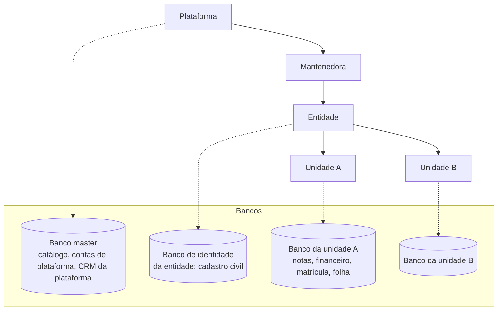
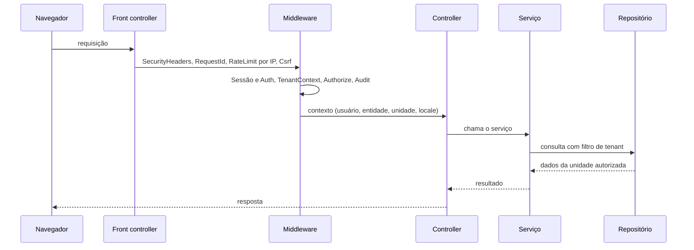

[Índice](README.md) · [Parte anterior](parte-01-visao-e-escopo.md) · [Próxima parte](parte-03-identidade-acesso-e-permissoes.md)

<a id="parte-2"></a>

# Parte 2 — Arquitetura e tenancy

## Visão geral da parte 2

Monólito modular em PHP 8, com um banco master da plataforma, um banco de identidade por entidade e um banco por unidade ([02](#doc-02), ADR-08; [03](#doc-03)).





**Regras principais**
- Controller não executa SQL; serviço recebe o contexto e não lê `$_SESSION`; repositório filtra por tenant em toda consulta ([02](#doc-02), seção 2).
- A ordem da cadeia de middleware é fixa e só muda por ADR ([02](#doc-02), seção 3).
- A API é versionada, com autenticação por token, schema de entrada e idempotência ([04](#doc-04)).
- Os módulos se integram por eventos, sem acesso direto ao banco do outro ([14](#doc-14)). O cache tem chave por tenant ([30](#doc-30)).

<a id="doc-02"></a>

## 02 — Arquitetura de Solução

> Parte do [SDD v2](parte-01-visao-e-escopo.md#doc-00).

---

### 1. Estilo

**Monólito modular** com fronteiras explícitas por domínio, preparado para extrair serviços só quando houver motivo medido (escala, equipe ou requisito de isolamento).

Stack declarada na v1: PHP 8.2+, MVC próprio, PDO com MySQL 8 ou MariaDB 10.6+, frontend com `fetch()`, CSS com Tailwind CSS.

### 2. Camadas

```
Navegador (HTML progressivo + fetch, cookies HttpOnly)
  └─ Front controller (public/index.php)
       └─ Roteador  →  cadeia de middleware  →  Controller
            └─ Serviços de domínio (app/Services/<dominio>)
                 └─ Repositórios / Models (app/Models, sempre com escopo de tenant)
                      └─ Acesso a dados (PDO, prepared statements)
```

Regras:

- Controller não executa SQL. Ele chama serviço.
- Serviço não lê `$_SERVER`, `$_COOKIE` nem `$_SESSION` diretamente. Recebe um `RequestContext` (usuário, tenant, unidade, locale).
- Repositório aplica filtro de tenant em toda consulta. Consulta sem filtro falha em teste.

### 3. Ordem da cadeia de middleware

Ordem obrigatória para rotas web. Qualquer alteração exige ADR.

1. `SecurityHeaders` — CSP com nonce, HSTS, X-Frame-Options, nosniff, COOP/CORP, Referrer-Policy, Permissions-Policy.
2. `RequestId` + `LogContext` — correlação de logs (sem PII).
3. `RateLimit` por IP — limite antes da autenticação, para conter tentativas de login e de API.
4. `Csrf` — token sincronizador + validação de `Origin`/`Sec-Fetch-Site`.
5. `SessionSecurity` (idle, absolute, token de dispositivo, D-03) e `Auth` — exige identidade válida (ou rota pública explícita).
6. `TenantContext` — resolve tenant, entidade e unidade; rejeita contexto que o usuário não possui.
7. `Authorize` — permissão `modulo.recurso.acao` (default-deny).
8. `RateLimit` por identificador e por tenant — aplicado pelos serviços de login e de API, depois da identidade (ver [05](parte-04-seguranca-privacidade-e-auditoria.md#doc-05)).
9. `Audit` — registra ação sensível (sucesso e falha).

Rotas de API adicionam `ApiAuth` (Bearer), `HmacAuth` (webhooks/integrações), `ApiSchema` (validação e limite de payload) e `Idempotency` em operações não idempotentes.

### 4. Componentes

| Componente | Responsabilidade | Local declarado (v1) |
|---|---|---|
| Router | Mapeia método + caminho para controller | `app/Http/Router.php` |
| Middleware | Ver seção 3 | `app/Http/Middleware/` |
| Segurança | Senhas, JWT, MFA, CSRF, rate limit, cifragem | `app/Security/` |
| Tenant | Contexto de tenant por requisição | `app/Tenant/TenantManager.php` |
| Logs e auditoria | `SystemLogger`, `AuditLogService`, `AlertEngine`, `MetricsCollector` | `app/Services/` |
| Filas | Workers assíncronos | `scripts/` (ver [10](parte-17-operacao-qualidade-testes-e-ti.md#doc-10)) |
| Armazenamento | Uploads fora do webroot, acesso por controller | `app/Services/Storage` (**[Planejado]** consolidar) |

### 5. Dependências

- **Runtime:** somente pacotes Composer com versão fixada em `composer.lock`. Sem `@latest`.
- **Frontend:** pacotes npm com `package-lock.json`. Build gera CSS e JS locais. Recurso externo só entra se a decisão D-01 o previr, com SRI e domínio da lista aprovada ([08](parte-05-portais-navegacao-e-interface.md#doc-08)).
- **Verificação:** `composer audit` e `npm audit` em CI, com falha em severidade alta ou crítica sem exceção registrada.
- **Proibido em pipeline de produção:** `npx <pkg>`, `bunx <pkg>`, `curl | sh` e instaladores que baixam o último release. A v1 citava esses comandos; a v2 os remove do fluxo de deploy.

### 6. ADRs

Data: 02/11/2026. Autor: responsável técnico (a nomear, ver [11](parte-17-operacao-qualidade-testes-e-ti.md#doc-11), seção 5). Status por ADR na última coluna.

| ADR | Decisão | Motivo | Status |
|---|---|---|---|
| ADR-01 | Monólito modular, não microsserviços | Menos superfície operacional; fronteiras preservam a extração futura | Aceita |
| ADR-02 | Namespaces PSR-4 `App\` e `TotusTuus\` | Bibliotecas internas testáveis e substituíveis | Aceita |
| ADR-03 | JWT só para clientes de API. Navegador usa sessão opaca no servidor | Revogação imediata e menos segredo exposto no cliente. A v1 usava JWT também no navegador com refresh rotativo | **Proposta (revisar)** |
| ADR-04 | Algoritmo de JWT fixo em RS256 (rejeitar HS256 e `none`) | Evita confusão de algoritmo | Aceita |
| ADR-05 | Biblioteca própria de cofre (`TotusTuus\Vault`), com a chave-mestra fora do host da aplicação em produção. `FileVault` só em desenvolvimento. | Segredo em arquivo no mesmo host anula a proteção. Biblioteca própria dá controle, mas exige revisão de criptografia (ver [05](parte-04-seguranca-privacidade-e-auditoria.md#doc-05), seção 2) | **Aceita (D-02). Pendente: onde a chave-mestra fica** |
| ADR-06 | Inglês canônico + locales traduzidos | Ver [09](parte-05-portais-navegacao-e-interface.md#doc-09) | Aceita |
| ADR-07 | Sem JavaScript inline e sem atributos `on*=` em HTML | Compatível com CSP estrita | Aceita |
| ADR-08 | Um banco master e um banco por unidade (entidade + unidade). Conexão escolhida pela unidade autorizada na requisição. | Isolamento físico de dados entre unidades e entre entidades. Custo: operação de muitos bancos e consolidação por evento | Aceita (D-16, 02/11/2026) |

### 7. Escalabilidade

- Camada web sem estado local. Sessão em banco ou Redis.
- Cache com chave por tenant (`tenant_id` obrigatório na chave).
- Uploads em armazenamento de objetos ou volume dedicado, fora do diretório público.
- Filas com idempotência por chave de evento; reprocessamento não gera efeito duplicado.

### 8. Riscos arquiteturais conhecidos

| Risco | Efeito | Tratamento |
|---|---|---|
| Controllers muito grandes (a v1 cita 5.254 linhas e 4.857 linhas) | Difícil revisar e testar | Extrair serviços; limite de tamanho em revisão de código (ver [11](parte-17-operacao-qualidade-testes-e-ti.md#doc-11)) |
| Módulos recentes sem teste | Regressão silenciosa | Gate de cobertura para código novo |
| Cofre de arquivo em produção | Vazamento de segredo com acesso ao host | ADR-05 e D-02 |
| Acoplamento de view com estado de sessão | Vazamento entre usuários em cache | Cache de página com chave de usuário ou sem cache para páginas autenticadas |

<a id="v1-02-solution-architecture-md"></a>

### v1 — `02-solution-architecture.md` (92 linhas)

> Situação na v2: Substituído por 02. Quando este texto diverge da v2, vale a v2.

> Esta especificação foi substituída por inteiro pelo documento indicado acima. O texto fica como histórico; para implementar, vale o documento da v2.

> **Documento derivado do SDD mestre** · **Data:** 04/08/2026

---

#### 1. Estilo arquitetural

**Monólito modular** com boundaries rígidos entre domínios, preparado para extração seletiva de serviços. PHP 8 puro, MVC próprio (`App\Http\Controllers`, `App\Services`, `App\Models`, `App\View`), REST-first com contratos JSON versionados (`/api/v1/...`).

#### 2. Camadas

```
Browser (Tailwind 4.4 + fetch())
  └─ Router (app/Http/Router.php) → Middleware chain (20 middlewares)
       └─ Controllers (app/Http/Controllers/{Admin,Api,Teacher,Student,Parents,Thirdparty})
            └─ Services (app/Services/*  — 14 domínios)
                 └─ Models (app/Models/* — 74)
                      └─ Database (app/Database/Connection — PDO)
```

##### Middleware chain (ordem)

`SecurityHeaders → SessionSecurity → Csrf → Auth → Authorize → StrictAuthorize → RateLimit → Audit → ApiSecurity/ApiSchema (API)`

#### 3. Tenancy

- `TenantManager::current()` (app/Tenant/TenantManager.php) — contexto global por request.
- Predicados explícitos `tenant_id` em todas as queries multi-tenant.
- `Auth::findUserByIdentifier` tenant-strict (cross-tenant login bloqueado — FD-05).
- `StrictAuthorizeMiddleware` default-deny + validação BOLA/BFLA/BOPLA (config/security.php authorization).
- `TenantRateLimiter` para rate limit por tenant+user.

#### 4. Frontend progressivo & Design System Master

- **Página Modelo de Referência Oficial:** `https://localhost/totustuussoftcloud/developer/settings/billing/modules` (view: `resources/views/app/pages/developer/modules.php`).
- **Especificação Canônica Completa de Navegação e Páginas:** `docs/sdd/12-portals-navigation-sidebar-pages-spec.md`.
- **Arquitetura Multi-Portal (6 Portais):**
  - Portal do Desenvolvedor (`docs/portais/portal-do-desenvolvedor-completo.md`)
  - SAAS Acadêmico (`docs/portais/saas-academico-completo.md`)
  - Portal do Professor (`docs/portais/portal-do-professor-completo.md`)
  - Portal do Aluno (`docs/portais/portal-do-aluno-completo.md`)
  - Portal dos Pais e Responsáveis (`docs/portais/portal-dos-pais-responsaveis-completo.md`)
  - Portal de Terceiros (`docs/portais/portal-de-terceiros-completo.md`)
- **Skills Normativas Aplicadas:**
  - `totustuus-layout-design/SKILL.md`: Checklist obrigatória de 21 itens, 5-View TABs (`KPI`, `Data Table`, `Cards/Grid`, `Kanban`, `Analytics/Charts`), 7 formatos de exportação, 3 drawers operacionais, colunas fixas e zero inline JS.
  - `totustuus-security-auditor-v3/SKILL.md`: ASVS Level 2, OWASP Top 10:2025, Attack Surface Management (ASM), AppSec testing (SAST/DAST/SCA), DevSecOps, pentest estruturado, bug bounty/VDP, isolamento tenant-strict, proteção contra BOLA/BFLA, Argon2id (OWASP 2025) e CSP Nonce universal.
- **Design System:** Supabase Theme Dark Emerald com paleta 3-Layer Dark (`#14171c` canvas, `#1a1d24` outer box, `#242832` surface/cards, `#10b981` emerald accent).
- **Padrão de Ícones:** **FontAwesome Pro 7.2 Light (`fa-light`)** em toda a interface (ações, tabelas, dropdowns e drawers).
- **Navegação Segmentada Unificada:** Segmented Pill Tabs (`.ud-tab-segmented`, `.ud-tab-btn`, `.ud-tab-badge`) suportando 5 visões (KPIs, Data Table, Grid/Cards, Kanban Swimlanes com drag-and-drop nativo, Analytics/Charts).
- **Toolbar & Exportação:** Dropdown de 7 formatos (CSV, XLSX, PDF, JSON, XML, SQL, TXT) com ícones uniformes em `fa-light` e badges `.ext`.
- **Ações e Sincronização:** Seção `$this->start('actions')` no cabeçalho (com timestamp `Synced: HH:MM:SS`) e botão de recarregamento AJAX dedicado na toolbar (`[ 🔄 Sincronizar ]`).
- **Bimoeda & i18n:** Suporte bimoeda USD/BRL e matriz de 10 locales (`en`, `pt-br`, `es`, `fr`, `de`, `it`, `zh`, `ja`, `ru`, `ar`) com auto-tradução.
- **Drawers Seguros:** Padrão Supabase com backdrop blur, validação em tempo real e destravamento por palavra-chave para ações críticas (`DELETE`/`ARCHIVE`).
- **Comunicação Assíncrona:** Requisições via `fetch()` nativo com cookies HttpOnly (`credentials: 'include'`), sem tokens no JS (A-001/A-004), e Nonce CSP em todos os scripts.

#### 5. Segurança (resumo)

Ver `docs/security/control-matrix.md` e `docs/security/findings-register.md`. Destaques: Argon2id OWASP 2025, JWT RS256, CSP+Trusted Types, MFA forte, LGPD instrumentado, audit trail completo, CI com composer audit + gitleaks + ZAP nightly.

#### 6. Observabilidade

- `SystemLogger` (app/Services/SystemLogger.php) — logs estruturados por correlação.
- `AuditLogService` — trilha de auditoria de negócio.
- `AlertEngine` — alertas (brute force, privilege escalation, mass export).
- `MetricsCollector` — métricas de sistema.
- `app/Http/SseResponse.php` — streaming de eventos (SSE) para logger em tempo real.

#### 7. Escalabilidade

- App stateless no layer web; sessões prontas para backend compartilhado (driver database).
- Filas assíncronas: `scripts/async_event_worker.php`, `scripts/async_backup.php`.
- Cache por contexto/tenant (`app/Services/Cache/`, `app/Security/TenantCacheVault.php`).
- Storage externalizável (uploads fora do webroot; imagens via `AssetPathMapper`).

#### 8. Decisões arquiteturais chave (ADR resumido)

| ADR | Decisão | Motivo |
|-----|---------|--------|
| ADR-01 | Monólito modular vs microservices | Reduz complexidade inicial, preserva boundaries para extração |
| ADR-02 | PSR-4 App\ + TotusTuus\ vendor/custom | Bibliotecas internas testáveis e substituíveis |
| ADR-03 | JWT RS256 obrigatório (HS256 bloqueado) | Previne forgery de token simétrico |
| ADR-04 | Vault abstraction (File→KMS/HashiCorp) | Secrets fora do código e do .env |
| ADR-05 | i18n inglês canônico + 10 locales | Internacionalização desde a base |

#### 9. Riscos arquiteturais atuais

| Risco | Mitigação |
|-------|-----------|
| Controllers gigantes (Logger 5.254, Academic 4.857) | Refatoração incremental em services — Onda C (dívida técnica) |
| Migration/IntegrationHub recém-criados sem testes | Criar testes — Onda C |
| Vault file-backed em prod | Ativar KMS/HashiCorp provider (backlog F-02) |

<a id="doc-03"></a>

## 03 — Domínio e Multi-Tenancy

> Parte do [SDD v2](parte-01-visao-e-escopo.md#doc-00).

---

### 1. Hierarquia

```
Plataforma (host)
 └─ Mantenedora (client)          — contratante do SaaS
     └─ Entidade (entity)         — instituição / razão social
         └─ Unidade (unit)        — campus, filial, polo
             └─ Usuários, papéis e vínculos
```

- A **plataforma** é um tenant reservado, identificado por código de seed. Seus administradores são **contas de plataforma** (ver [06](parte-03-identidade-acesso-e-permissoes.md#doc-06), seção 10), não usuários comuns com flag.
- Cada nível herda configuração do nível superior e pode sobrescrevê-la onde a política permitir.

### 1.1 Bancos de dados

**Decisão do autor (02/11/2026, D-16):** um banco por unidade. A entidade não tem banco próprio de dados operacionais.

**Banco master (desenvolvedor):**

- Nome lógico: `totustuus.matriz.bd`. Único, da plataforma.
- Contém: catálogo de entidades e unidades, registro de bancos (seção abaixo), contas de plataforma, conexões de integração de plataforma, CRM da plataforma ([22](parte-06-plataforma-saas-clientes-dominios-licencas-e-crm.md#doc-22)) e índice de pessoas (`person_id`, e-mail verificado).
- Não contém cadastro civil nem dado operacional de unidade. O cadastro civil fica no banco de identidade da entidade (D-19, [14](#doc-14), seção 3). Notas, financeiro, matrícula, folha e arquivos ficam no banco da unidade.

**Banco de unidade (um por entidade + unidade):**

- Nome lógico: `{entidade}.{unidade}.bd.{uuid}`. Exemplos:

| Entidade | Unidade | Número operacional | Nome lógico |
|---|---|---|---|
| Colégio Santo Antonio | Sede | 001 | `colegio-santo-antonio.sede.bd.{uuid}` |
| Colégio Santo Antonio | Mateus Leme | 002 | `colegio-santo-antonio.mateus-leme.bd.{uuid}` |
| Colégio Santo Agostinho | Sede | 003 | `colegio-santo-agostinho.sede.bd.{uuid}` |

- Nome físico no servidor: `tt_001`, `tt_002`, `tt_003`. O ponto do nome lógico não é usado no servidor, porque complica ferramentas, permissões e backup. O mapeamento fica no registro do master.
- Conteúdo: alunos, colaboradores, financeiro, acadêmico, CRM do tenant ([22](parte-06-plataforma-saas-clientes-dominios-licencas-e-crm.md#doc-22)), metadados de arquivos ([21](parte-16-dados-validacoes-configuracoes-e-armazenamento.md#doc-21)), auditoria local e outbox de eventos ([14](#doc-14)).

**Registro de bancos (no master):**

| Campo | Regra |
|---|---|
| `uuid` | UUIDv4 gerado pela aplicação |
| `entity_uuid`, `unit_uuid` | Obrigatórios; único por par entidade e unidade |
| `logical_name` | Único |
| `physical_name` | Único no servidor, no formato `tt_<seq>` |
| `seq` | Sequencial de três dígitos, único |
| `host` | Servidor onde o banco está |
| `status` | `ativo`, `migrando`, `suspenso` |
| `schema_version` | Versão de esquema aplicada |

**Resolução de conexão:**

1. Usuário autentica no master, com conta global ([06](parte-03-identidade-acesso-e-permissoes.md#doc-06), seção 12).
2. O master lista os vínculos ativos da conta (entidade, unidade e papel).
3. A requisição escolhe uma unidade. Sem unidade permitida, a resposta é `403`.
4. A conexão é aberta somente no banco dessa unidade.

**Consequências que dependem de decisão:**

- **Relatório consolidado da entidade** (todas as unidades): não é consulta entre bancos. É um modelo de leitura alimentado por eventos ([14](#doc-14)).
- **Pessoa única entre unidades** (D-06): bancos separados impedem unicidade direta. Ver D-19 em [14](#doc-14), seção 3.
- **Eventos entre unidades:** a outbox fica no banco da unidade emissora. A entrega ao consumidor de outra unidade passa por fila central, com destino por `unit_uuid`.
- **Migrações:** rodam em cada banco de unidade, com registro de versão por banco ([10](parte-17-operacao-qualidade-testes-e-ti.md#doc-10), seção 5).
- **Operação:** o número de bancos cresce com as unidades. Limites de conexão, backup e monitoramento são por banco.

**Testes:**

- Usuário com acesso à unidade 001 não lê dado da unidade 002, mesmo com identificador exato.
- Consulta que tenta trocar o banco por parâmetro é recusada.
- Migração que falha em um banco não bloqueia os demais, e o banco fica em `migrando` até concluir.

### 2. Identificadores

- Chaves públicas são **UUIDv4** gerados com CSPRNG (`random_bytes(16)`), nunca sequenciais.
- Identificadores internos de seed (códigos de tenant, entidade, unidade da plataforma) são definidos em **registro privado de seed**, não no SDD. A v1 reproduzia esses valores e os e-mails dos administradores; a v2 os remove (ver [13-achados-v1.md](parte-01-visao-e-escopo.md#doc-13), ACH-03).
- UUIDs nulos ou fixos só são permitidos em fixtures de teste, nunca em dados de produção.

### 3. Isolamento de tenant

Regras obrigatórias:

1. **Toda tabela multi-tenant tem `tenant_id` NOT NULL** e índice composto que começa por `tenant_id`.
2. **Toda consulta** aplica `tenant_id = :current` no repositório. Não existe consulta "global" sem uma classe de exceção nomeada e auditada.
3. **Chave de tenant vem do contexto autenticado**, nunca de cabeçalho ou parâmetro livre (`X-Tenant-ID` não é aceito como fonte de verdade). Na tela de entrada, o tenant informado por subdomínio ou formulário é validado contra a lista de hosts permitidos; host desconhecido retorna `404`.
4. **Conta global com vínculos.** A pessoa tem uma conta no master e recebe contexto de uma entidade e unidade só por vínculo ativo (ver [06](parte-03-identidade-acesso-e-permissoes.md#doc-06), seção 12). Autenticar não concede acesso a nenhuma unidade.
5. **Cache, filas, uploads e logs** carregam `tenant_id` na chave ou no registro.
6. **Teste de isolamento obrigatório:** para cada endpoint de leitura e escrita, um teste com usuário de tenant B tentando acessar recurso de tenant A deve retornar `404` (não `403`, para não revelar existência).

### 4. Escopo de unidade

- `UserUnit` limita o usuário a unidades específicas. Acesso `full` cobre todas as unidades da entidade.
- Permissões de unidade são avaliadas junto com a permissão de módulo. Permissão de módulo sem vínculo de unidade não basta para dados daquela unidade.

### 5. Configuração por tenant

| Configuração | Escopo | Observação |
|---|---|---|
| Marca (logo, cores, nome) | Entidade | Validação de imagem (ver [05](parte-04-seguranca-privacidade-e-auditoria.md#doc-05)) |
| Locale padrão e moeda | Entidade | Moeda USD/BRL é **[Declarado]**; outras moedas dependem de requisito |
| Política de senha e MFA | Mantenedora ou entidade | Não pode ser menos restritiva que a política da plataforma |
| Retenção de dados | Entidade | Mínimo e máximo definidos pela plataforma ([07](parte-04-seguranca-privacidade-e-auditoria.md#doc-07)) |
| Limites de API | Tenant | Ver [04](#doc-04) |

### 6. Regras de negócio transversais

- Exclusão é **lógica** por padrão (`deleted_at`). Exclusão física só pelo processo de retenção ou pedido do titular.
- Toda alteração de vínculo (papel, unidade, permissão) gera registro de auditoria com antes e depois.
- Um usuário pode ter vínculos em mais de um tenant, mas cada sessão opera em um único tenant por vez.

### 7. Testes de tenancy (critério de aceite)

- [ ] Matriz de isolamento: todos os endpoints × dois tenants × papéis relevantes.
- [ ] Teste de regressão para cada incidente de cross-tenant registrado.
- [ ] Teste de enumeração de identificadores (UUIDs de outro tenant não retornam dados nem mensagens diferentes de "não encontrado").

<a id="v1-03-domain-model-md"></a>

### v1 — `03-domain-model.md` (55 linhas)

> Situação na v2: Substituído por 03. Quando este texto diverge da v2, vale a v2.

> Esta especificação foi substituída por inteiro pelo documento indicado acima. O texto fica como histórico; para implementar, vale o documento da v2.

> **Documento derivado do SDD mestre** · **Data:** 04/08/2026

---

#### 1. Entidades nucleares (implementadas — app/Models/, 74 models)

| Entidade | Model | Descrição | Status |
|----------|-------|-----------|:------:|
| Platform | — (contexto global) | Plataforma SaaS | ✅ conceito |
| Entity/Organization | `Organization.php`, `OrganizationProfile.php`, `OrganizationBranding.php`, `OrganizationAddress.php`, `OrganizationUnit.php`, `OrganizationDocument.php`, `OrganizationIntegration.php`, `OrganizationMetric.php`, `OrganizationAuditLog.php` | Cliente com branding/dados isolados | ✅ |
| Unit | `Unit.php` | Subdivisão operacional | ✅ |
| User | `User.php` + perfil (UserProfile*, UserPhone/Email/Address/Family/Identity/Document) | Identidade humana/tech | ✅ |
| Membership | `UserMembership.php`, `UserUnit.php` | Vínculo user/entity/unit | ✅ |
| Role/Permission | `Role.php`, `Permission.php` | RBAC | ✅ |
| Session | `UserSession.php`, `UserSessionEvent.php` | Sessão autenticada web | ✅ |
| ApiClient | (via OrganizationIntegration/ThirdPartyIntegration) | Cliente técnico | ✅ |
| AuditEvent | `AuditLog.php`, `SecurityLog.php`, `SecurityEvent.php`, `DbAudit.php`, `AccessLog.php`, `ErrorLog.php` | Registros imutáveis | ✅ |
| LocalePack | (I18n service + testes) | Recursos de idioma | ✅ |
| FeatureFlag | — | Controle de ativação | 🔲 pendente (Developer layer) |
| WebhookEndpoint | `WebhookDispatcher` (Billing) + HmacAuthMiddleware | Destino de eventos | ✅ (parcial) |
| Job | `MigrationExecutionJob.php`, async_event_worker | Unidade assíncrona | ✅ (parcial) |

#### 2. Entidades por domínio (amostra representativa)

| Domínio | Models |
|---------|--------|
| Auth/IAM | User*, Role, Permission, UserMembership, UserUnit, Invitation, DeviceTrust, SecurityEvent, SecurityLog, AccessLog, AccessRequest, IdentityAutomation(+Log) |
| Privacy/LGPD | PrivacyConsentEvent, UserConsent, UserCookieConsent(+Item), CookieCatalog, CookieCategory, ConsentBannerVersion, TenantPrivacySetting |
| Migração | MigrationProject, MigrationSourceTable/Column, MigrationTableMapping/ColumnMapping/ValueMap, MigrationImport, MigrationExecutionJob, MigrationValidationRun, MigrationAuditLog, MigrationTargetTableCache |
| Reuniões | Meeting, MeetingParticipant, MeetingRecording |
| Acadêmico | AcademicPeriod + tables em migrations (cursos, turmas, matrículas, grade, etc.) |
| Billing | tables `billing_*` (plans, subscriptions, invoices, payments, discounts, automations, nfse, gateway config) |
| Notificações | NotificationChannel + tables `notification_*` |

#### 3. Convenções de modelo

- **Soft delete**: coluna `deleted_at` + `SoftDeleteService`/`SoftDeleteRegistry` (app/Services/SoftDeleteService.php) — ver `docs/spec-soft-delete-totustuus.md`.
- **UUID**: chaves `uuid` (char 36 ou binary 16) em todas as entidades expostas via API.
- **Tenancy**: coluna `tenant_id` em todas as tabelas multi-tenant (renomeada de `entity_id` em 14/07 — migração `2026_07_14_000003_rename_entity_id_to_tenant_id.php`).
- **Timestamps**: `created_at`/`updated_at` em tudo; `deleted_at` onde aplicável.
- **Auditoria**: `*AuditLog` por domínio sensível (OrganizationAuditLog, UserAuditLog, MigrationAuditLog).

#### 4. Falhas de modelo conhecidas

| Item | Ação |
|------|------|
| FeatureFlag não implementado | Criar model + tabela (Onda C — Developer layer) |
| WebhookEndpoint genérico | Billing tem WebhookDispatcher; generalizar para Integration Hub (Onda B) |
| Autofilia (self-reference) em Organization/Unit | Verificar necessidade futura |

#### 5. Rastreabilidade

Cada model referenciado nos specs `docs/Nova pasta/spec_gestao_*_completo.md`. O mapeamento spec→tabela é validado em `tests/ClientMigrationSchemaTest.php` (para migração) e nos testes por módulo.

<a id="v1-06-tenancy-md"></a>

### v1 — `06-tenancy.md` (95 linhas)

> Situação na v2: Substituído por 03. Quando este texto diverge da v2, vale a v2.

> Esta especificação foi substituída por inteiro pelo documento indicado acima. O texto fica como histórico; para implementar, vale o documento da v2.

> **Documento derivado do SDD mestre** · **Data:** 04/08/2026

---

#### 1. Hierarquia de contexto e Modelo de 3 Níveis

O TotusTuus SoftCloud adota uma arquitetura hierárquica multi-camadas que desacopla a **Provedora do SaaS (Host/Tenant 0)** das **Redes e Colégios Contratantes (Tenants Clientes)**:

```
Platform Host (TotusTuus SoftCloud — Provedora / Tenant 0)
 ├── Client (Mantenedora / Grupo Educacional / Pessoa Jurídica Contratante)
 │    └── Entity (Instituição de Ensino / Colégio / Razão Social Escolar)
 │         └── Unit (Filial Física / Campus / Polo Educacional)
 │              └── Users / Memberships / Roles (Escopo Escolar Local)
 └── Master Super Admins (Usuários de Plataforma — is_master_user = 1)
      └── Vínculo formal com a Unidade Matriz da Desenvolvedora (UN-MATRIZ-DEV)
```

---

#### 2. Cadastro Oficial da Empresa Desenvolvedora (Tenant 0 / Host Matriz)

A empresa operadora da nuvem e desenvolvedora da plataforma é cadastrada formalmente no banco Master (`totustuusdb`) sob identificadores criptográficos permanentes:

| Nível Hierárquico | Código | Razão Social / Nome | Tipo / Papel | UUIDv4 Criptográfico (RFC 4122) |
| :--- | :--- | :--- | :--- | :--- |
| **Cliente Provedor** | `CLI-TOTUSTUUS` | **TotusTuus SoftCloud Tecnologia da Informação Ltda** | Provedora do SaaS / Mantenedora | `d6930191-8bf9-42c4-88f6-a75ed8ba9bc1` |
| **Entidade da Desenvolvedora** | `ENT-DEV-MATRIZ` | **TotusTuus SoftCloud - Engenharia & Plataforma** | `developer` (Plataforma Tecnológica) | `8b5892fd-0fa3-4cff-ba81-80dd7cda0f65` |
| **Unidade Matriz** | `UN-MATRIZ-DEV` | **Sede Matriz - TotusTuus SoftCloud** | `headquarters` (Sede Operacional) | `6d16eac3-0d76-4549-8d86-f04582ad7ed5` |
| **Tenant Master** | `TNT-TOTUSTUUS` | **TotusTuus SoftCloud** | Banco Master (`totustuusdb`) | `4965aa14-484d-4965-8dcb-bff3f18ae6f2` |

##### Vínculo dos Superadministradores da Plataforma
* **Usuários:** `admin@totustuussoftcloud.com`, `jefferson@totustuussoftcloud.com`, `dev@totustuussoftcloud.com`.
* **Identidade:** `is_master_user = 1`, `type = 'admin'`, role `ROLE_ADMIN`.
* **Membros e Unidade:** Vinculados à Unidade Matriz (`UN-MATRIZ-DEV`) e Tenant Master (`TNT-TOTUSTUUS`) via `user_memberships` (persona: `ADMIN`) e `user_units` (acesso: `full`).
* **Acesso Direto:** Redirecionamento nativo para o Portal do Desenvolvedor (`/developer/dashboard`) sem necessidade de seleção de tenant escolar.

---

#### 3. Segurança de Identificadores (Mitigação de IDOR / OWASP)

* **Proibição de UUIDs Previsíveis/Nil (CWE-330):** É estritamente proibido o uso de UUIDs estáticos ou sequenciais como `00000000-0000-0000-0000-000000000001` no banco de dados Master ou em tenants. Todos os UUIDs devem ser gerados com **128 bits de entropia criptográfica** através de `\App\Support\Uuid::v4()`.
* **Proteção contra Enumeração:** A adoção de UUIDv4 randômicos impede que invasores tentem forjar requisições de API (`X-Tenant-ID`) adivinhando o identificador do tenant master.

---

#### 4. Mecanismos de tenancy implementados

| Mecanismo | Implementação | Evidência |
|-----------|---------------|-----------|
| Contexto global | `TenantManager::current()` (singleton por request) | `app/Tenant/TenantManager.php` |
| Isolamento de dados | `tenant_id` (renomeado de `entity_id` em 14/07) em todas as tabelas multi-tenant | migrations `2026_07_14_*_rename_entity_id_to_tenant_id.php` |
| Scoping automático | Predicados explícitos em services/querys (não confiar em default global) | `app/Services/*` |
| Auth tenant-strict | `Auth::findUserByIdentifier` valida membership do tenant alvo; cross-tenant login bloqueado | FD-05 fix |
| Autorização por tenant | `StrictAuthorizeMiddleware` + checks BOLA/BFLA/BOPLA | config/security.php `authorization` |
| Rate limit por tenant | `TenantRateLimiter` (user 10/h, tenant 60/h, tenant 300/d) | config/security.php `rate_limiting` |
| Cache por tenant | `TenantCacheVault` | `app/Security/TenantCacheVault.php` |
| Branding por tenant | `OrganizationBranding` (logo, cores, favicon, portal domains) | `app/Models/OrganizationBranding.php` |
| Domínios custom | Portal domains mapeados por tenant (www → tenant) | `OrganizationBranding` + routes |
| i18n por tenant | locale por tenant + por user | `TenantLocale`/i18n service |
| Auditoria por tenant | Logs de entidade com `tenant_id` | `OrganizationAuditLog`, `AuditLog` |

---

#### 5. Configurações por tenant

| Config | Model/Service |
|--------|---------------|
| Segurança | `TenantPrivacySetting` (mfa_required, session_timeout, lockout, password_policy) |
| Billing | `BillingSettings` + gateway config por tenant |
| Notificações | `NotificationChannel` por tenant |
| Integrações | `OrganizationIntegration` + `ThirdPartyIntegration` (credentials cifradas) |
| Feature flags | 🔲 pendente (Developer layer — Onda C) |

---

#### 6. Regras de negócio tenancy

1. **Dados**: nenhuma query multi-tenant sem `tenant_id` do contexto (auditável).
2. **Auth**: usuário só acessa tenancy onde tem membership ativa.
3. **Admin**: superadmin (plataforma) tem visão cruzada limitada e auditada; admin de entity não cruza entities.
4. **Uploads**: assets referenciados por tenant; path contém tenant-id ofuscado via `AssetPathMapper`.
5. **Import/Export**: migração (MigrationController) opera estritamente dentro do tenant origem/destino.
6. **Provisionamento de Colégios**: cada nova escola contratada gera um banco isolado (`tt_tenant_{short_id}`) e seus usuários acadêmicos residem estritamente dentro do respectivo banco de dados da escola.

---

#### 7. Testes de tenancy

- `tests/` — cobertura BOLA/BFLA/BOPLA.
- `tests/DeveloperPortalE2eTest.php` — 46 testes cobrindo navegação, autenticação e rotas administrativas do developer portal.
- `tests/TenantProvisioningHierarchyTest.php` — validação da hierarquia completa Client > Entity > Unit > TenantDatabase.
- `tests/ApiCrossTenantTest.php` — cobre proteção contra acesso cross-tenant na API.

<a id="doc-04"></a>

## 04 — API REST

> Parte do [SDD v2](parte-01-visao-e-escopo.md#doc-00). Controles de segurança detalhados em [05](parte-04-seguranca-privacidade-e-auditoria.md#doc-05).

---

### 1. Base e versionamento

- Base: `/api/v1/`. Mudança incompatível exige `/api/v2/` com controller próprio.
- Mudanças aditivas (campos novos opcionais, endpoints novos) são permitidas em v1.
- Remoção ou renomeação de campo exige período de depreciação de pelo menos 6 meses, com cabeçalho `Deprecation` e `Sunset` (RFC 9745 e RFC 8594).
- Documentação gerada a partir de anotações do código e publicada em `/api/docs` (**[Planejado]**: a v1 cita `docs/api-docs.php`, mas o arquivo não é verificado nesta versão).

### 2. Formato

- JSON em UTF-8. `Content-Type: application/json; charset=utf-8`.
- Limite de corpo: **1 MB** para JSON. Uploads têm rota própria com limite por tipo.
- Datas em ISO 8601 com fuso (`2026-11-02T14:00:00-03:00`) ou UTC (`Z`).

#### Envelope

Sucesso:

```json
{ "success": true, "data": { }, "meta": { "request_id": "..." } }
```

Erro:

```json
{
  "success": false,
  "error": { "code": "validation_failed", "message": "Mensagem segura para exibir", "details": [ ] },
  "meta": { "request_id": "..." }
}
```

- `message` nunca contém SQL, stack trace, caminho de arquivo ou nome de tabela.
- `details` só aparece em `validation_failed`, com campo e regra.

### 3. Códigos HTTP

| Código | Uso |
|---|---|
| 200 / 201 / 204 | Sucesso (201 com `Location`) |
| 400 | Requisição malformada |
| 401 | Não autenticado |
| 403 | Autenticado, sem permissão |
| 404 | Não existe **ou** pertence a outro tenant (evita enumeração) |
| 409 | Conflito de estado ou idempotência |
| 413 | Payload acima do limite |
| 422 | Validação de domínio |
| 429 | Limite de taxa (com `Retry-After`) |
| 500 | Erro interno (sem detalhes ao cliente) |

Códigos de erro estáveis: `validation_failed`, `unauthorized`, `forbidden`, `not_found`, `rate_limited`, `conflict`, `payload_too_large`, `internal`.

Mapeamento: `validation_failed` com `422` (campo inválido) ou `400` (corpo malformado); `unauthorized` com `401`; `forbidden` com `403`; `not_found` com `404`; `rate_limited` com `429`; `conflict` com `409`; `payload_too_large` com `413`; `internal` com `500`. Campo de filtro ou ordenação fora da lista branca retorna `422` com `validation_failed`.

### 4. Autenticação de API

| Mecanismo | Uso | Regras |
|---|---|---|
| Sessão (cookie) | Frontend do próprio sistema | Cookie `HttpOnly`, `Secure`, `SameSite=Lax` (ver [06](parte-03-identidade-acesso-e-permissoes.md#doc-06)). Requisições que mudam estado exigem CSRF. |
| Bearer JWT | Clientes técnicos registrados | Assinatura RS256; `exp` ≤ 15 min; `aud` e `iss` validados; `jti` consultado em lista de revogação; escopos explícitos. |
| HMAC (webhooks e integrações) | Entrega de eventos e chamadas de integração | Ver seção 7. |
| Chave de API | Integrações de baixo risco (somente leitura) | Armazenada como hash; exibida uma única vez; rotacionável; escopo e expiração obrigatórios. |

Nenhum token é aceito na query string. O endpoint de emissão de token e o grant OAuth2 para contas de serviço ainda não estão definidos: pendentes de ADR.

### 5. Autorização

1. `Auth` valida identidade.
2. `TenantContext` valida tenant e unidade.
3. `Authorize` exige permissão `modulo.recurso.acao`.
4. O serviço revalida o vínculo do recurso com o tenant (defesa em profundidade contra BOLA).
5. Campos sensíveis são filtrados por permissão de campo (BOPLA): o mesmo recurso pode ter visões diferentes.

### 6. Paginação, filtros e ordenação

- `?page=1&per_page=50`. `per_page` máximo **100**.
- Filtros no formato `filter[campo]=valor`. Campo fora de lista branca retorna `422`.
- Ordenação `sort=campo` ou `sort=-campo` somente em colunas da lista branca do recurso.
- Resposta paginada inclui `meta.page`, `meta.per_page` e `meta.total` (ou `meta.has_more` para listas grandes, sem contagem total).

### 7. Webhooks

Cabeçalhos de entrega:

- `X-Signature: sha256=<hex>` — HMAC-SHA256 do corpo bruto concatenado com timestamp (`{timestamp}.{corpo}`).
- `X-Timestamp` — epoch em segundos.
- `X-Nonce` — identificador único por entrega.
- `X-Event-Id` — idempotência no receptor.

Regras:

1. Receptor aceita timestamp com desvio de **até 300 s** e rejeita nonce já visto dentro dessa janela.
2. Comparação de assinatura com `hash_equals`.
3. Segredo por endpoint, com rotação que aceita dois segredos por até 24 h.
4. Entrega com retentativa exponencial e limite de tentativas; estado da entrega é consultável.
5. Endereço de destino só `https://`. Bloqueio de redes privadas e metadados de nuvem (anti-SSRF). Resolver o nome uma vez, conectar ao IP resolvido, validar esse IP contra redes privadas e não seguir redirecionamentos.

### 8. Idempotência

- Operações não idempotentes (criação de pagamento, envio de comunicação, matrícula) exigem `Idempotency-Key`.
- Chave armazenada com hash do método, caminho e corpo, por 24 h. Mesma chave com corpo diferente retorna `409`.

### 9. Limites de taxa

| Escopo | Limite inicial | Observação |
|---|---|---|
| API global por cliente | 60 req/min, rajada 10 | Valores de referência da v1; ajustar por medição |
| Login, MFA, recuperação | Atraso progressivo por identificador + limite por IP | Não bloquear conta inteira (ver [06](parte-03-identidade-acesso-e-permissoes.md#doc-06)) |
| Operações pesadas (exportação) | 5/h por usuário | Fila assíncrona com link de download temporário |

### 10. Checklist de aceite de endpoint

- [ ] Autenticação declarada na rota (ou rota pública listada).
- [ ] Permissão granular definida e testada (permitido e negado).
- [ ] Escopo de tenant na consulta e teste de cross-tenant.
- [ ] Validação de entrada com schema; payload ≤ limite.
- [ ] Envelope de resposta e códigos de erro da seção 2 e 3.
- [ ] Limite de taxa aplicado.
- [ ] Idempotência quando aplicável.
- [ ] Teste automatizado para o caminho de sucesso e para os dois principais erros.
- [ ] Entrada em `docs` gerada a partir do código.

<a id="v1-04-api-standards-md"></a>

### v1 — `04-api-standards.md` (78 linhas)

> Situação na v2: Substituído por 04. Quando este texto diverge da v2, vale a v2.

> Esta especificação foi substituída por inteiro pelo documento indicado acima. O texto fica como histórico; para implementar, vale o documento da v2.

> **Documento derivado do SDD mestre** · **Data:** 04/08/2026

---

#### 1. Contratos

- **Base:** `/api/v1/...`
- **Formato:** JSON.
- **Resposta padrão:**
```json
{ "success": true, "data": { ... }, "message": "ok" }
{ "success": false, "error": "code", "message": "descrição" }
```
- **Status HTTP:** 200/201/204/400/401/403/404/409/422/429/500.
- **Idempotência:** endpoints sensíveis usam `IdempotencyMiddleware` (chave = método+path+body hash) — ver `app/Http/Middleware/IdempotencyMiddleware.php`.

#### 2. Autenticação de API

| Mecanismo | Uso | Evidência |
|-----------|-----|-----------|
| Cookies HttpOnly (sessão) | Frontend web — `credentials: 'include'` | `assets/js/api.js` |
| JWT RS256 Bearer | Clientes técnicos | `config/jwt.php` |
| HMAC (X-Signature + X-Nonce ±300s) | Webhooks/integrações SAC | `app/Http/Middleware/HmacAuthMiddleware.php` |
| API keys | Integrações (OrganizationIntegration) | routes/integrations.php |

#### 3. Autorização de API

- `ApiAuthMiddleware` → valida autenticação.
- `ApiSecurityMiddleware` → headers/rate limit.
- `ApiSchemaMiddleware` → valida payload (schema, max 1MB).
- `StrictAuthorizeMiddleware` global default-deny; permissões via `AuthorizeMiddleware` (`admin.<module>.<action>`).
- Tenant scoping obrigatório (BOLA check).

#### 4. Versionamento e evolução

- Versionado no path (`/api/v1/`). Nova versão quebra → `/api/v2/` com controller dedicado.
- Mudanças aditivas são seguras na v1.
- `docs/api-docs.php` + `docs/api-docs-json.php` geram documentação (ApiDocsController).

#### 5. Rate limiting

| Escopo | Limite | Evidência |
|--------|--------|-----------|
| API global | 60/min, burst 10 | config/security.php api |
| Login/MFA/forgot/reset | por identificador (5/h) + IP lockout | RateLimitMiddleware |
| CNPJ/tenant | 10/h user, 60/h tenant, 300/d tenant | TenantRateLimiter |
| JWT | 100/h | config/jwt.php |

#### 6. Padrões de erro

- Erros genéricos em prod (`config/security.php` errors: sem stack, sem SQL).
- Códigos de erro estáveis (`validation_failed`, `unauthorized`, `forbidden`, `not_found`, `rate_limited`, `conflict`, `internal`).
- Logs de erro via SystemLogger sem PII.

#### 7. Paginação e filtros

- Listas grandes paginadas (`page`, `per_page` máx 100) e filtráveis.
- Ordenação por whitelist de colunas (anti-SQLi).
- Ex.: rotas `GET /api/v1/<resource>?page=1&per_page=50&filter[...]`.

#### 8. Webhooks

- Assinatura HMAC obrigatória (X-Signature, X-Nonce dedup → replay protegido, FD-29/FD-30).
- Delivery status rastreado (WebhookDeliveryApiTest).
- Integração com Integration Hub (Onda B) para gerenciamento de endpoints.

#### 9. Checklist de aceite de endpoint

- [ ] Autenticação (quando requerida) no middleware da rota.
- [ ] Autorização granular por permissão.
- [ ] Tenant scope explícito na query.
- [ ] Rate limit aplicável configurado.
- [ ] Input validado (schema) + payload ≤ 1MB.
- [ ] Resposta no contrato `{success, data, message}`.
- [ ] Idempotência para ações não-idempotentes.
- [ ] Teste PHPUnit quando crítico.

<a id="doc-14"></a>

## 14 — Integração entre Módulos

> Parte do [SDD v2](parte-01-visao-e-escopo.md#doc-00). Integrações com sistemas de terceiros ficam em [16](parte-14-integracoes-e-importacao.md#doc-16). Validação de entrada em [15](parte-16-dados-validacoes-configuracoes-e-armazenamento.md#doc-15).
> **Status:** proposta. Itens marcados **[Decisão pendente]** precisam de aprovação do autor antes da implementação.

---

### 1. Princípios

1. **Dono exclusivo.** Cada dado tem um único módulo dono. Outro módulo nunca lê nem grava na tabela desse dono.
2. **Leitura por contrato.** Um módulo lê dados de outro por uma interface de serviço versionada, com tenant obrigatório. Nunca por SQL direto.
3. **Escrita derivada por evento.** Quando a mudança em um módulo precisa gerar efeito em outro, o módulo dono publica um evento. O consumidor decide o que fazer.
4. **Tenant em tudo.** Evento, chamada e consumo carregam `tenant_id` e `entity_id`. Consumidor sem contexto de tenant rejeita a mensagem.
5. **Idempotência e auditoria.** Entrega duplicada não gera efeito duplicado. Toda ação entre módulos gera registro com ator, origem e correlação.
6. **Mínimo de dados.** Evento carrega identificadores e o estado mínimo. Dado pessoal e dado de saúde não viajam no payload (ver seção 8).

### 2. Estilos de comunicação

| Estilo | Quando usar | Garantia | Limites |
|---|---|---|---|
| **Evento assíncrono** (outbox + fila) | Efeito derivado em outro módulo; escrita que pode ser processada depois | At-least-once com consumidor idempotente | Atraso de segundos a minutos |
| **Comando síncrono** (serviço interno) | Validação curta que bloqueia a operação, por exemplo "a unidade existe e está ativa" | Resposta imediata | Timeout de 2 s; não encadear mais de dois saltos |
| **Consulta de projeção** (read model) | Listagem ou painel que combina dados de vários módulos | Dado pode estar defasado em poucos segundos | Nunca usada como fonte para decisão de escrita |

**[Decidida D-05 — aprovada com a proposta (02/11/2026)]** Padrão: eventos assíncronos para toda escrita derivada, comando síncrono só para validação, projeção para painéis. Alternativa: chamadas síncronas diretas entre serviços. Ela é mais simples de depurar, mas acopla a disponibilidade de um módulo à de outro. Condição de falha da alternativa: queda do módulo chamado derruba a operação do módulo chamador.

### 3. Dono dos dados compartilhados

| Entidade | Módulo dono | Consumidores principais | Regra |
|---|---|---|---|
| Pessoa (identidade civil: nome, documento, contato) | Pessoas (HCM) | Acadêmico, RH, Financeiro, Portal do aluno | Um `person_id` por pessoa por tenant. Nenhum outro módulo copia nome ou documento. |
| Vínculo de aluno | Acadêmico | Financeiro, Portal do aluno, Portal dos pais | Referencia `person_id`. |
| Vínculo de colaborador | RH | SMT, Suprimentos, Financeiro (folha) | Referencia `person_id`. |
| Responsável legal | Pessoas (família) | Acadêmico, Financeiro, Portal dos pais | Vínculo com aluno guardado no Acadêmico, dados civis no Pessoas. |
| Entidade, unidade, usuário, papel | Identidade (ver [06](parte-03-identidade-acesso-e-permissoes.md#doc-06)) | Todos | Só o módulo Identidade altera. |
| Centro de custo, cargo | Financeiro (centro de custo) e RH (cargo) | Suprimentos, RH | Código e nome são do dono; o consumidor guarda só o código. |
| Item de estoque e saldo | Suprimentos | SMT (EPI), Financeiro | Saldo só muda por movimento registrado. |
| Exame ocupacional e aptidão | SMT | RH | RH recebe só o status de aptidão, não o laudo. |
| Afastamento | RH | SMT, Financeiro (folha) | RH é o dono do afastamento; SMT referencia o CAT pelo ID. |
| Contrato e ata | Contratos | Suprimentos, Financeiro | Consumo de saldo é movimento no Contratos. |

**[Decidida D-06 — aprovada com a proposta (02/11/2026)]** Pessoa única: `person_id` único no Pessoas. Alternativa: cada módulo mantém a própria cópia de pessoa, com sincronização. A alternativa gera divergência de nome e documento entre módulos. Condição de falha da proposta: se o Pessoas ficar indisponível, nenhum módulo consegue criar vínculo novo. Mitigação: o Pessoas é consultado por comando de leitura, com cache por tenant de vida curta.

**[Decidida D-19 — pessoa única entre unidades, com cadastro civil no banco de identidade da entidade (opção a). Decisão proposta por esta versão em 02/11/2026 e adotada pelo autor. Substitui a decisão de manter o cadastro civil no master. Ver [06](parte-03-identidade-acesso-e-permissoes.md#doc-06), seção 12.]**

O master guarda somente conta, vínculos e índice de pessoas (`person_id` e e-mail verificado), sem dado civil. Cada entidade tem um banco de identidade com o cadastro civil cifrado. As unidades da entidade guardam apenas o `person_id`.

Motivos: limita o impacto de incidente a uma entidade, mantém a entidade como controladora do dado do aluno e facilita exportação e exclusão na saída do cliente.

**Salvaguardas obrigatórias:**

- Cadastro civil cifrado com chave da entidade (envelope, ADR-05 em [02](#doc-02)).
- Acesso ao banco de identidade só com vínculo ativo na entidade ([06](parte-03-identidade-acesso-e-permissoes.md#doc-06), seção 12.4).
- Auditoria de cada leitura do cadastro civil ([18](parte-07-regras-gerais-dos-modulos-de-gestao.md#doc-18), seção 4.2).
- Backup do banco de identidade separado e com teste de restauração.
- Relatório de impacto e aprovação do DPO antes da produção ([07](parte-04-seguranca-privacidade-e-auditoria.md#doc-07)).
- Teste de isolamento entre entidades, inclusive pelo identificador exato.

### 4. Catálogo de eventos de domínio

Nome: `<modulo>.<entidade>.<fato-no-passado>`, em inglês, minúsculo, com hífen. Exemplo: `hcm.employee.created`.

| Evento | Produtor | Consumidores | Efeito derivado |
|---|---|---|---|
| `hcm.employee.created` | RH | SMT, Suprimentos | SMT agenda exame admissional. Suprimentos abre onboarding de itens. |
| `hcm.employee.terminated` | RH | SMT, Suprimentos | SMT encerra exames pendentes. Suprimentos abre devolução de ativos. |
| `hcm.employee.department-changed` | RH | Suprimentos, Financeiro | Atualiza centro de custo nas requisições abertas. |
| `hcm.absence.created` | RH | SMT | SMT registra restrição de função, se houver. |
| `smt.exam.scheduled` | SMT | Notificações | Aviso ao colaborador. |
| `smt.exam.performed` | SMT | RH | RH atualiza status de aptidão do colaborador. |
| `smt.cat.created` | SMT | RH, Financeiro | RH abre afastamento. Financeiro registra evento de folha. |
| `suprimentos.epi.stock-minimum-reached` | Suprimentos | Suprimentos (compra), SMT | Gera solicitação de compra. SMT é avisado da indisponibilidade. |
| `suprimentos.supplier.blocked` | Suprimentos | Suprimentos (compra), Contratos | Bloqueia emissão de pedido ao fornecedor. |
| `smt.training.expired` | SMT | Notificações, RH | Aviso e bloqueio de função, conforme regra. |
| `suprimentos.request.approved` | Suprimentos | Financeiro | Cria obrigação a pagar. |
| `academico.matricula.efetivada` | Acadêmico | Financeiro, Notificações, Biblioteca | Gera a cobrança da primeira parcela. Avisa o aluno. Libera o acesso à biblioteca. ([46](parte-09-secretaria-matricula-e-documentos.md#doc-46)) |
| `diario.falta.registrada` | Diário | Notificações, Boletim | Aviso ao responsável a cada 5 faltas na disciplina. Atualiza a frequência do boletim. ([61](parte-08-academico.md#doc-61)) |
| `boletim.resultado.fechado` | Boletim | Matrícula, Notificações | Define avanço ou rematrícula. Avisa o responsável. ([62](parte-08-academico.md#doc-62)) |
| `ocorrencia.registrada` | Ocorrências | Notificações, Conselho | Aviso imediato se a gravidade for grave. Entra na pauta do conselho. ([63](parte-08-academico.md#doc-63)) |
| `biblioteca.multa.gerada` | Biblioteca | Financeiro | Gera fatura de multa. ([68](parte-08-academico.md#doc-68)) |
| `financeiro.titulo.pago` | Financeiro | Matrícula, Notificações | Libera o bloqueio parcial por inadimplência. Confirma o pagamento ao responsável. ([18](parte-07-regras-gerais-dos-modulos-de-gestao.md#doc-18)) |
| `calendario.dia.alterado` | Calendário | Turmas, Diário, Notificações | Recalcula o calendário da turma. Avisa os envolvidos. ([58](parte-08-academico.md#doc-58)) |
| `relatorio.envio.gerado` | Relatórios | Auditoria | Registra a geração do arquivo do censo. ([69](parte-08-academico.md#doc-69)) |

Eventos de módulos acadêmicos incluídos por decisão SRC-04, em 03/11/2026 ([75](parte-05-portais-navegacao-e-interface.md#doc-75), seção 5).

Os nomes da v1 (`employee.created`, `exam.performed` etc.) eram em inglês sem módulo. A v2 acrescenta o módulo no nome para evitar colisão.

#### 4.1 Envelope obrigatório

```json
{
  "event_id": "0190c2f4-7a1e-7b3c-9d2a-5c8e1f0a6b21",
  "event_type": "hcm.employee.created",
  "schema_version": 1,
  "occurred_at": "2026-11-02T14:03:11-03:00",
  "tenant_id": "…",
  "entity_id": "…",
  "unit_id": "…",
  "producer": "hcm",
  "actor_id": "…",
  "correlation_id": "…",
  "aggregate": { "type": "employee", "id": "…", "version": 7 },
  "payload": { }
}
```

Regras:

- `event_id` é UUID v7 ou v4, gerado pelo produtor. Serve de chave de idempotência.
- `schema_version` é incrementado a cada mudança incompatível do payload. O consumidor aceita a versão que suporta e rejeita as demais para revisão.
- `aggregate.version` permite descartar evento antigo que chegou depois de um mais novo.
- `payload` tem somente identificadores e campos de estado. Ver seção 8.

### 5. Outbox e entrega

1. O produtor grava a mudança de negócio e o evento na mesma transação do banco (tabela `outbox`).
2. Um processo relay lê a `outbox` em ordem, publica na fila e marca o registro como enviado.
3. O consumidor recebe a mensagem, verifica se `event_id` já foi processado (tabela `processed_events` com chave única por consumidor e evento) e só então aplica o efeito.
4. Se o efeito e o registro de `processed_events` estiverem na mesma transação, a entrega duplicada não repete o efeito.

#### 5.1 Estados

Estados da fila de envio: `pending` → `queued` → `sent` → `processed`. Estados de exceção: `rejected` (falha definitiva) e `cancelled` (cancelado por regra de negócio).

| Transição | Condição |
|---|---|
| `pending` → `queued` | Relay leu o registro |
| `queued` → `sent` | Fila confirmou recebimento |
| `sent` → `processed` | Consumidor confirmou o efeito |
| `sent` → `rejected` | Consumidor recusou (schema não suportado, regra violada) ou esgotou tentativas |
| `pending` ou `queued` → `cancelled` | Regra de negócio invalidou o evento antes do envio |

#### 5.2 Retentativa

- Backoff: 1 min, 5 min, 30 min, 2 h, 12 h. Máximo de 5 tentativas.
- Após a última tentativa, o evento vai para `rejected` e gera alerta ao responsável pelo módulo consumidor.
- Reprocessamento manual é permitido por ação de administrador com permissão `integracao.fila.reprocessar`, registrada em auditoria.

#### 5.3 Ordem

- Eventos do mesmo agregado (mesmo `aggregate.type` e `aggregate.id`) são consumidos em ordem de `aggregate.version`.
- Evento com versão menor que a já processada é marcado como `processed` sem efeito, com registro de descarte.

### 6. Contratos síncronos

- Cada módulo publica uma interface de serviço versionada (`Hcm\Contracts\EmployeeReader v1`).
- Toda chamada recebe o `TenantContext`. Chamada sem contexto lança erro antes de executar.
- Timeout de 2 s. Falha de timeout não é retentada automaticamente, porque a escrita pode não ter ocorrido.
- Circuit breaker por par chamador-chamado: após 5 falhas em 30 s, a chamada falha rápido por 60 s.
- Resposta de leitura não expõe campo que a permissão do chamador não cobre (mesma regra de BOPLA em [04](#doc-04), seção 5).

### 7. Integrações obrigatórias da v1

A v1 ([`spec_complementar_integracoes_governanca.md`](parte-14-integracoes-e-importacao.md#v1-spec-complementar-integracoes-governanca-md), seção 3) lista três integrações. A v2 define a forma de cada uma.

#### 7.1 RH ↔ SMT

- **Admissão:** `hcm.employee.created` gera agendamento de exame admissional no SMT.
- **Afastamento:** `hcm.absence.created` registra restrição quando o afastamento tem causa ocupacional.
- **Aptidão:** `smt.exam.performed` atualiza o status de aptidão no RH. O RH recebe status, não o laudo.
- **Evento eSocial** (S-2220, S-2230, S-2240): a montagem do XML é do SMT ou do RH, conforme a decisão de D-08 em [16](parte-14-integracoes-e-importacao.md#doc-16). A transmissão passa pela integração externa do tenant.

#### 7.2 SMT ↔ Suprimentos

- **Estoque mínimo de EPI:** `suprimentos.epi.stock-minimum-reached` gera solicitação de compra.
- **Bloqueio de fornecedor:** `suprimentos.supplier.blocked` ocorre quando CA vence ou documento fica inválido. A regra de bloqueio pertence ao Suprimentos, que consulta o SMT por contrato de leitura para saber o CA vigente.
- **Contrato e ata:** consumo de saldo é movimento no Contratos, disparado pelo Suprimentos.
- **Evidência de reposição e devolução:** registrada no Suprimentos com referência ao CA do SMT, sem duplicar o cadastro do EPI.

#### 7.3 RH ↔ Suprimentos

- **Onboarding e offboarding:** `hcm.employee.created` e `hcm.employee.terminated` abrem solicitações de itens e de devolução.
- **Centro de custo e cargo:** `hcm.employee.department-changed` atualiza as requisições em aberto. Requisição já aprovada mantém o centro de custo original, com registro da mudança.
- **Ativos entregues:** histórico no Suprimentos, com `person_id` como referência.

### 8. Dados pessoais e de saúde nos eventos

- Payload de evento carrega identificadores, status e datas. Nome, documento, e-mail e telefone **não** vão no payload. O consumidor busca esses dados por contrato de leitura, com permissão.
- Dado de saúde (laudo, CID, resultado de exame) **nunca** vai no payload. Vai somente o status (`apto`, `inapto`, `apto-com-restricao`) e o ID do exame.
- Evento com dado sensível tem retenção de fila de 7 dias. Após o processamento, o payload é apagado e fica só o registro de metadados.
- Logs de fila mostram tipo, ID, estado e tenant. Nunca o payload completo.

### 9. Modelo de dados da fila (correção da v1)

A v1 (`sys_event_queue`, seção 8.1) usa `entityid` e não tem `tenant_id`. Isso viola [03](#doc-03), seção 3. A v2 corrige o modelo:

```sql
CREATE TABLE integration_outbox (
  id              BIGINT UNSIGNED AUTO_INCREMENT PRIMARY KEY,
  event_id        CHAR(36)     NOT NULL,
  tenant_id       CHAR(36)     NOT NULL,
  entity_id       CHAR(36)     NOT NULL,
  unit_id         CHAR(36)     NULL,
  event_type      VARCHAR(120) NOT NULL,
  schema_version  SMALLINT UNSIGNED NOT NULL DEFAULT 1,
  aggregate_type  VARCHAR(60)  NOT NULL,
  aggregate_id    CHAR(36)     NOT NULL,
  aggregate_version INT UNSIGNED NOT NULL,
  payload         JSON         NOT NULL,
  status          ENUM('pending','queued','sent','processed','rejected','cancelled') NOT NULL DEFAULT 'pending',
  attempts        TINYINT UNSIGNED NOT NULL DEFAULT 0,
  next_attempt_at DATETIME(3)     NULL,
  last_error      VARCHAR(500) NULL,
  correlation_id  CHAR(36)     NOT NULL,
  actor_id        CHAR(36)     NULL,
  created_at      DATETIME(6)  NOT NULL DEFAULT CURRENT_TIMESTAMP(6),
  UNIQUE KEY uk_event (event_id),
  INDEX idx_tenant_status (tenant_id, status, next_attempt_at),
  INDEX idx_aggregate (tenant_id, aggregate_type, aggregate_id, aggregate_version)
) ENGINE=InnoDB DEFAULT CHARSET=utf8mb4;

CREATE TABLE integration_processed_events (
  consumer     VARCHAR(60) NOT NULL,
  event_id     CHAR(36)    NOT NULL,
  tenant_id    CHAR(36)    NOT NULL,
  processed_at DATETIME(6) NOT NULL DEFAULT CURRENT_TIMESTAMP(6),
  PRIMARY KEY (consumer, event_id)
) ENGINE=InnoDB DEFAULT CHARSET=utf8mb4;
```

Notas sobre o modelo:

- `payload` JSON é apagado após o processamento quando o evento tem dado sensível (seção 8). Nesse caso, a coluna é zerada por job, e o registro de metadados permanece.
- Os identificadores seguem UUID, conforme [03](#doc-03), seção 2. A v1 misturava `id`, `uuid` e `code`. A v2 usa UUID como identificador público e `id` interno numérico só para ordenação.

### 10. Observabilidade

- Métricas: profundidade da fila por tenant, idade do registro mais antigo em `pending`, taxa de `rejected`, latência de consumo.
- Alerta: `rejected` acima de 0 para evento de dado sensível; idade acima de 15 min para `pending`.
- Painel de integrações (API `GET /api/v1/integrations/queue`, da v1, seção 7.1) exige escopo de tenant e não mostra payload.

### 11. Testes obrigatórios

- Contrato: cada evento tem teste de payload com schema validado.
- Entrega duplicada: mesmo `event_id` processado duas vezes gera um efeito.
- Fora de ordem: versão 3 antes da versão 2 não sobrescreve estado.
- Falha de consumidor: retentativa e transição para `rejected` após 5 tentativas.
- Isolamento: evento de tenant A não é consumido por consumidor de tenant B.
- Dado sensível: payload de exame não contém laudo nem CID.

### 12. Critérios de aceite

- [ ] Todo evento do catálogo (seção 4) tem produtor, consumidores, schema e teste de contrato.
- [ ] Nenhum módulo lê tabela de outro módulo (verificação automatizada por lista de tabelas proibidas).
- [ ] Toda tabela de fila tem `tenant_id NOT NULL`.
- [ ] Nenhum payload de evento contém dado de saúde em texto.
- [ ] Reprocessamento manual é auditado.

<a id="doc-30"></a>

## 30 — Cache: Camadas, Chaves, Validade e Invalidação

> Parte do [SDD v2](parte-01-visao-e-escopo.md#doc-00). Isolamento por entidade e unidade em [03](#doc-03). Sessão e vínculos em [06](parte-03-identidade-acesso-e-permissoes.md#doc-06), seção 12. Filas em [14](#doc-14). Infraestrutura em [10](parte-17-operacao-qualidade-testes-e-ti.md#doc-10).
> **Status:** especificação proposta. Os valores de validade são iniciais e devem ser medidos em homologação.

---

### 1. Princípio

Cache é uma cópia derivada, nunca uma fonte de verdade. Duas regras definem tudo o que vem depois:

1. **Nenhum dado de cache pode mostrar informação de outro contexto.** A chave sempre inclui o contexto que o dado pertence.
2. **Dado de decisão de segurança ou financeira não é cacheado** ou é lido com validade mínima e revalidado antes da ação.

---

### 2. Camadas

| Camada | Onde | O que guarda | Validade padrão |
|---|---|---|---|
| Cache de aplicação | Redis (ou equivalente), por ambiente | Leituras de catálogo, configuração, contadores | Ver seção 4 |
| Cache de consulta | Dentro do banco da unidade | Resultados agregados de relatório | Ver seção 4 |
| Cache de borda | CDN | Apenas arquivos públicos e recursos estáticos versionados | Até a próxima versão |
| Cache de navegador | Navegador | Recursos estáticos com versão no nome | Longa, por versão |

Não existe cache de navegador para HTML autenticado nem para resposta de API autenticada ([08](parte-05-portais-navegacao-e-interface.md#doc-08), seção 2).

---

### 3. Chaves

Formato obrigatório:

```
{ambiente}:{entidade_uuid}:{unidade_uuid}:{classe}:{identificador}[:{escopo}]
```

| Componente | Regra |
|---|---|
| `ambiente` | `prod`, `hml`, `dev`. Chave de um ambiente não é lida por outro. |
| `entidade_uuid`, `unidade_uuid` | Obrigatórios para dado de unidade. Para dado de plataforma, usar `plataforma`. |
| `classe` | Ver seção 4 |
| `identificador` | Chave do objeto |
| `escopo` | Papel ou conta, quando a resposta depende de permissão. Ex.: `escopo=papel:coordenador`. |

Regras adicionais:

- Resposta que depende de permissão inclui o escopo na chave. Resposta sem escopo não depende de quem consulta.
- Chave sem entidade ou unidade é recusada pela biblioteca de cache. Não há exceção.
- Nenhum CPF, e-mail ou telefone aparece em chave. Usar hash HMAC.

---

### 4. Classes e validade

| Classe | Exemplo | Validade | Invalidação |
|---|---|---|---|
| Catálogo | Cursos, séries, locales, papéis padrão | 1 h | Por evento de alteração do catálogo |
| Configuração | Parâmetros do tenant, política de MFA | 5 min | Imediata ao alterar |
| Permissão | Vínculos e papéis da conta | 30 s | Imediata ao alterar vínculo ([06](parte-03-identidade-acesso-e-permissoes.md#doc-06), seção 12.4) |
| Contador | Quantidade de vagas, saldo de quota | Não cacheado ou 5 s | Por transação |
| Relatório agregado | Painel de indicadores | 5 min | Por evento do módulo de origem |
| Busca | Índice e resultados recentes | Conforme [21](parte-16-dados-validacoes-configuracoes-e-armazenamento.md#doc-21) | Por evento de indexação |
| Arquivo público | Imagem institucional | Até a próxima versão | Por nova versão |
| Sessão | Token e sessão | **Não é cache.** Fica na tabela de sessão ou no armazenamento de sessão. | Por revogação |

#### 4.1 Nunca cacheado

- Dado de pagamento, saldo de conta, status de cobrança antes da ação de pagamento ([20](parte-10-financeiro-pagamentos-e-fiscal.md#doc-20)).
- Cadastro civil de pessoa ([14](#doc-14), seção 3), exceto a referência `person_id`.
- Resposta autenticada de API ou de tela.
- Resultado de consulta por CPF ([21](parte-16-dados-validacoes-configuracoes-e-armazenamento.md#doc-21), seção 6.8). Cada consulta é nova e auditada.
- Dado de saúde.
- Segredo, token e credencial ([05](parte-04-seguranca-privacidade-e-auditoria.md#doc-05)).

---

### 5. Invalidação

- **Por evento:** a alteração publica evento no fluxo de [14](#doc-14). Consumidor de cache remove as chaves afetadas.
- **Por versão:** chave inclui uma versão do objeto. Alterar o objeto incrementa a versão. A chave antiga expira sozinha.
- **Por tempo:** validade mínima sempre. Nenhuma chave é permanente.
- **Limite de propagação:** invalidação chega em até 5 s. Para permissão, a regra da seção 4 (30 s) vale no pior caso, e a cópia do token é revalidada com `mv` ([06](parte-03-identidade-acesso-e-permissoes.md#doc-06), seção 12.4).

---

### 6. Proteção

| Ameaça | Controle |
|---|---|
| Vazamento entre contextos | Chave com entidade e unidade. Teste de regressão. |
| Envenenamento de cache | Só o próprio serviço grava. Dado externo não entra no cache sem validação. |
| Estouro de cache (stampede) | Recomputação com trava por chave. Validade com variação aleatória de até 10%. |
| Dado sensível em memória | Redis com autenticação, TLS e rede privada. Sem persistência em disco para classes com dado pessoal. |
| Cache de erro | Erro não é cacheado, salvo erro de "não encontrado" com validade de 30 s. |
| Chave previsível | Chave de dado de unidade inclui o UUID da unidade. Acesso por identificador adivinhado é negado pela autorização. |

---

### 7. Operação

- Métricas: taxa de acerto por classe, memória por ambiente, latência, invalidações por minuto.
- Alerta: taxa de acerto abaixo de 60% em classe de catálogo; uso de memória acima de 80%.
- Limpeza: nenhum comando de limpeza total em produção sem aprovação registrada.
- Ambientes: cache de homologação nunca é o de produção. Teste de isolamento roda com cache ligado.

---

### 8. Testes obrigatórios

- Dado da unidade A não aparece na consulta da unidade B, mesmo com identificador igual.
- Dado com escopo de papel não aparece para papel sem permissão.
- Alteração de vínculo reflete em até 30 s, e a requisição com token antigo é revalidada.
- Consulta por CPF nunca retorna do cache.
- Dado de saúde não entra em nenhuma chave de cache (varredura).
- Stampede: 1.000 requisições simultâneas em chave expirada geram uma recomputação.

---

### 9. Lacunas

| # | Lacuna | Dono |
|---|---|---|
| CAC-01 | Dimensionamento do Redis por ambiente e entidade. **Decisão do autor (03/11/2026):** dimensionar em homologação antes de produção. | Operação |
| CAC-02 | Validades medidas em homologação. **Decisão do autor (03/11/2026):** medir em homologação; os valores da seção 4 são o ponto de partida. | Responsável técnico |
| CAC-03 | Escolha do provedor de CDN | Operação |

---

### 10. Critérios de aceite

- [ ] Toda chave segue o formato da seção 3, validado pela biblioteca.
- [ ] Classes da seção 4.1 não são cacheadas (teste automatizado).
- [ ] Invalidação por evento testada para catálogo, configuração e permissão.
- [ ] Testes da seção 8 passando em CI.
- [ ] CAC-01 e CAC-02 medidas e registradas em homologação antes de produção.

## Especificações da v1 desta parte absorvidas no kit-starter ou sem destino

<a id="v1-spec-education-saas-architecture-md"></a>

### v1 — `spec_education_saas_architecture.md` (729 linhas)

> Situação na v2: Absorvido integralmente no kit-starter. Destino: ficha do kit-starter: `kit-starter/transversal/arquitetura-da-plataforma.md`. Quando este texto diverge da v2, vale a v2.

#### O que a v2 muda nesta especificação

Estas regras prevalecem sobre o texto da v1 que vem a seguir.

- **Arquitetura, camadas, middleware e ADRs:** o [02](#doc-02) prevalece.
- **Tenant, unidade e bancos:** o [03](#doc-03) prevalece (banco por unidade, master da plataforma, banco de identidade da entidade).
- **Identidade:** o [06](parte-03-identidade-acesso-e-permissoes.md#doc-06) prevalece (conta global, vínculos e contexto, seção 12).
- **Portais e módulos:** a matriz [31](parte-05-portais-navegacao-e-interface.md#doc-31) prevalece; papéis no [78](parte-03-identidade-acesso-e-permissoes.md#doc-78).
- **API:** o [04](#doc-04) prevalece.

#### Texto integral da v1

- Language Standard: Global English
- Architecture: Multi-entity | Multi-unit | Multi-user
- Stack: PHP 8 pure, fetch + API, no external libraries, Supabase template

---

#### 1. Purpose

This document defines the complete architecture specification for an education SaaS platform designed for multiple institutional clients, multiple internal units, and multiple user roles.

The goal is to provide a safe, scalable, maintainable, and enterprise-ready structure that avoids tenant leakage, permission confusion, and future refactoring problems.

---

#### 2. Platform Vision

The platform must support educational institutions of different sizes and models, including:

- Schools.
- Colleges.
- Universities.
- Training centers.
- EAD and online programs.
- After-school and prep courses.
- Hybrid institutions.

The platform must provide separate access experiences for internal management, students, parents or guardians, teachers, and third parties.

---

#### 3. Core Architecture Principles

##### 3.1 Global identity, contextual access

A user is a global identity. Access is never global by default. Access always depends on the active membership context.

##### 3.2 Multi-entity

Each customer institution is an entity. An entity is a tenant boundary.

##### 3.3 Multi-unit

Each entity may contain multiple units such as campuses, branches, schools, departments, or operational centers.

##### 3.4 Multi-user

Multiple users can belong to the same entity and unit, with different portal access and permissions.

##### 3.5 Portal separation

Each audience must have a dedicated portal and route structure.

##### 3.6 Security by default

The system must enforce least privilege, session isolation, strong authentication, auditability, and explicit access grants.

---

#### 4. Main Areas

##### 4.1 Management - Developer

This area is for platform administration and technical operations. It must be restricted to internal staff only.

Responsible for:

- Entity administration.
- Unit administration.
- User administration.
- Role and permission management.
- Subscription and feature configuration.
- Audit and security monitoring.
- System settings.
- Integrations.
- Logs and diagnostics.

##### 4.2 Management - Clients

This area is for the institution’s operational administrators.

Examples:

- School administration.
- College administration.
- University administration.
- Cursinho and EAD administration.

Responsible for:

- Institution users.
- Units.
- Staff.
- Students.
- Enrollments.
- Operational settings.
- Communication and workflows.

##### 4.3 Student Area

This area is for enrolled learners.

Responsible for:

- Dashboard.
- Profile.
- Enrollments.
- Classes.
- Attendance.
- Grades.
- Notifications.
- Documents.
- Requests.

##### 4.4 Guardians Area

This area is for parents, guardians, and responsible parties.

Responsible for:

- Student follow-up.
- Academic status.
- Financial or administrative notices, when allowed.
- Authorization and consent flows.
- Communication with the institution.

##### 4.5 Teacher Area

This area is for teachers, coordinators, and pedagogical staff.

Responsible for:

- Classes.
- Attendance.
- Grades.
- Planning.
- Communications.
- Materials.
- Reports.

##### 4.6 Third-Party Area

This area is for external partners such as accounting, legal, transport, and service providers.

Responsible for:

- Restricted documents.
- Requests.
- Deliverables.
- Contractual tasks.
- Controlled communication.

---

#### 5. Tenant Model

##### 5.1 Entity definition

An entity represents one client institution or one organizational tenant.

Examples:

- One school chain.
- One university group.
- One training company.
- One EAD provider.

##### 5.2 Unit definition

A unit is a substructure of an entity.

Examples:

- Campus.
- Branch.
- School.
- Building.
- Department.
- Administrative office.

##### 5.3 Tenant safety rules

- Every record that belongs to a tenant must be linked to an entity.
- Every record that belongs to a unit must also reference its parent entity.
- Cross-tenant access must never be decided in the frontend.
- Database queries must always filter by entity or by allowed global scope.

---

#### 6. Identity Model

##### 6.1 Global user

A user is a single identity in the platform. One user may have multiple memberships.

##### 6.2 Membership

Membership is the bridge between user, entity, unit, portal, and role.

Required membership fields:

- user_uuid.
- entity_uuid.
- unit_uuid.
- portal_code.
- role_code.
- status.
- is_default.
- starts_at.
- ends_at.

##### 6.3 Active context

At any time, the authenticated session must have one active membership context.

Active context must define:

- current entity.
- current unit.
- current portal.
- current role.
- current permissions.

##### 6.4 Context switching

If the user has more than one valid membership, the system must allow controlled switching through a dedicated endpoint and must log the change.

---

#### 7. Portal Structure

##### 7.1 Management - Developer portal

Route prefix: /dev

Access: internal platform staff only.

##### 7.2 Management - Clients portal

Route prefix: /admin

Access: institutional admins and authorized staff.

##### 7.3 Student portal

Route prefix: /student

Access: students only, with possible guardian-linked access to selected features.

##### 7.4 Guardians portal

Route prefix: /guardian

Access: parents, guardians, responsible parties.

##### 7.5 Teacher portal

Route prefix: /teacher

Access: teachers and pedagogical staff.

##### 7.6 Third-party portal

Route prefix: /partner

Access: external partners with limited scope.

---

#### 8. Functional Modules

##### 8.1 Authentication

- Login.
- Logout.
- Session refresh.
- Password reset.
- Invitation acceptance.
- MFA challenge.
- Recovery flows.

##### 8.2 Authorization

- Role-based access.
- Permission-based access.
- Portal-based access.
- Entity-based access.
- Unit-based access.
- Record-level restrictions.

##### 8.3 Identity governance

- Create user.
- Update user.
- Suspend user.
- Lock user.
- Restore user.
- Delete soft.
- Archive.
- Reassign memberships.

##### 8.4 Audit and security

- Audit logs.
- Failed login tracking.
- Security events.
- Session revocation.
- Device trust.
- Login history.

##### 8.5 Operational administration

- Users.
- Roles.
- Permissions.
- Units.
- Memberships.
- Invitations.
- Access requests.
- Notifications.
- Settings.

---

#### 9. Data Domains

##### 9.1 Platform domain

Contains global platform configuration, internal developer access, feature flags, subscriptions, and tenant administration.

##### 9.2 Academic domain

Contains students, guardians, teachers, classes, enrollments, attendance, grades, schedules, and materials.

##### 9.3 Institutional domain

Contains departments, administrative flows, staff, documents, internal tasks, and operational processes.

##### 9.4 Partner domain

Contains partner records, contracts, delivery flows, and restricted operational requests.

##### 9.5 Shared identity domain

Contains users, memberships, roles, permissions, sessions, audit logs, and security events.

---

#### 10. Database Architecture

##### 10.1 Required core tables

- users.
- entities.
- units.
- portals.
- roles.
- permissions.
- memberships.
- sessions.
- refresh_tokens.
- login_attempts.
- password_resets.
- mfa_factors.
- mfa_backup_codes.
- invitations.
- access_requests.
- audit_logs.
- security_events.
- device_trusts.
- feature_flags.
- settings.

##### 10.2 Core tenancy fields

Any tenant-owned table must include:

- entity_uuid.
- unit_uuid when applicable.
- created_at.
- updated_at.
- deleted_at when applicable.

##### 10.3 Relationship rules

- Users may exist without immediate membership only if invited or pending.
- Roles and permissions are global definitions.
- Memberships bind roles and permissions to a tenant context.
- Sessions must reference membership context.

---

#### 11. Security Architecture

##### 11.1 Password handling

- Use Argon2id.
- Never store plaintext.
- Never log passwords.
- Support rehash migration.

##### 11.2 Token strategy

- Short-lived access token.
- Rotating refresh token.
- Server-side revocation.
- Reuse detection.

##### 11.3 Session protection

- Bind session to context.
- Bind optional device fingerprint.
- Invalidate on logout.
- Invalidate on role or membership revocation.
- Support idle timeout and absolute timeout.

##### 11.4 Abuse protection

- Rate limiting.
- Temporary lockouts.
- Failed login tracking.
- Suspicious activity detection.

##### 11.5 MFA

- TOTP.
- Backup codes.
- Optional recovery-based second factor.

---

#### 12. API Architecture

##### 12.1 API principles

- JSON only.
- Versioned routes.
- Predictable response format.
- Clear HTTP status usage.
- Consistent error structure.

##### 12.2 Authentication endpoints

- POST /api/v1/auth/login
- POST /api/v1/auth/logout
- POST /api/v1/auth/refresh
- POST /api/v1/auth/forgot_password
- POST /api/v1/auth/reset_password
- POST /api/v1/auth/mfa/enroll
- POST /api/v1/auth/mfa/challenge
- GET /api/v1/auth/me
- GET /api/v1/auth/session
- POST /api/v1/auth/select_entity
- POST /api/v1/auth/select_unit
- POST /api/v1/auth/select_portal

##### 12.3 Administrative endpoints

- GET /api/v1/admin/users
- POST /api/v1/admin/users
- PUT /api/v1/admin/users/{uuid}
- GET /api/v1/admin/roles
- POST /api/v1/admin/roles
- GET /api/v1/admin/permissions
- POST /api/v1/admin/permissions
- GET /api/v1/admin/memberships
- POST /api/v1/admin/memberships
- GET /api/v1/admin/sessions
- POST /api/v1/admin/sessions/revoke
- GET /api/v1/admin/audit_logs
- GET /api/v1/admin/security_events

##### 12.4 Standard response format

Every response must include:

- success.
- message.
- data.
- errors.
- meta.
- request_id.

---

#### 13. Frontend Structure

##### 13.1 Portal frontends

Each portal must have its own route prefix, layout, navigation, permissions, and dashboard.

##### 13.2 Fetch integration

Frontend requests must use fetch with JSON bodies and standardized error handling.

##### 13.3 UI separation

Do not mix developer UI with client UI, student UI, guardian UI, teacher UI, or third-party UI.

##### 13.4 Shared components

Shared components may include:

- Input fields.
- Tables.
- Dialogs.
- Drawers.
- Tabs.
- Cards.
- Filters.
- Charts.
- Kanban boards.

---

#### 14. Page Structure

##### 14.1 Developer area pages

- dashboard.
- tenants.
- entities.
- units.
- users.
- memberships.
- roles.
- permissions.
- sessions.
- audit_logs.
- security_events.
- settings.
- feature_flags.
- integrations.

##### 14.2 Client management pages

- dashboard.
- students.
- guardians.
- teachers.
- staff.
- units.
- enrollments.
- classes.
- attendance.
- grades.
- communications.
- documents.
- requests.

##### 14.3 Student pages

- home_dashboard.
- profile.
- enrollments.
- schedule.
- attendance.
- grades.
- notifications.
- documents.
- requests.

##### 14.4 Guardian pages

- home_dashboard.
- linked_students.
- academic_followup.
- notifications.
- documents.
- requests.
- consent.

##### 14.5 Teacher pages

- home_dashboard.
- classes.
- attendance.
- grades.
- planning.
- materials.
- messages.
- reports.

##### 14.6 Third-party pages

- home_dashboard.
- requests.
- documents.
- tasks.
- communications.
- history.

---

#### 15. Naming Conventions

##### 15.1 PHP

- Classes in PascalCase.
- Methods in camelCase.
- Functions in camelCase or snake_case, but consistent.
- Files in snake_case.

##### 15.2 Database

- Tables in snake_case.
- Columns in snake_case.
- Foreign keys named with _uuid or _id consistently.

##### 15.3 Routes

- Route segments in lower-case snake_case.
- API version prefix required.

##### 15.4 UI names

- Pages and components in English.
- No mixed-language identifiers in code.

---

#### 16. Implementation Layers

##### 16.1 Presentation layer

Responsible for pages, forms, tables, drawers, charts, and user interaction.

##### 16.2 API layer

Responsible for request validation, response formatting, auth checks, and orchestration.

##### 16.3 Domain layer

Responsible for business rules, memberships, permissions, and workflows.

##### 16.4 Infrastructure layer

Responsible for database access, mail, logging, files, security primitives, and integrations.

---

#### 17. Governance Rules

##### 17.1 Internal governance

Internal staff must be able to review tenants, security events, sessions, and audit logs.

##### 17.2 Client governance

Clients must only see their own entity and allowed units.

##### 17.3 Educational governance

Student, guardian, teacher, and third-party access must always be constrained by context.

##### 17.4 Compliance governance

The platform must support retention, traceability, export, deletion, and privacy-safe handling of personal data.

---

#### 18. Non-Functional Requirements

- Secure by default.
- Maintainable code structure.
- High concurrent login performance.
- Easy tenant isolation.
- Extensible for new portals and roles.
- Compatible with multiple database backends.
- Easy to audit.
- Easy to automate.
- Clear separation between platform and client responsibilities.

---

#### 19. Acceptance Criteria

The architecture is complete when:

- Every user belongs to a clear identity model.
- Every access is contextual and explicit.
- Every portal is separated.
- Every entity is isolated.
- Every unit is traceable.
- Every session is bound to one context.
- Every security event is logged.
- Every endpoint is versioned.
- Every page has a single audience.
- Every query is tenant-safe.

---

#### 20. Recommended Build Order

##### Phase 1

- Core identity.
- Entity and unit model.
- Membership model.
- Authentication.
- Authorization.
- API base.
- Developer portal.

##### Phase 2

- Client management.
- Student portal.
- Guardian portal.
- Teacher portal.
- Third-party portal.
- Audit and security.

##### Phase 3

- Academic modules.
- Operational dashboards.
- Tables, drawers, and workflows.
- Notifications.
- Reports.

##### Phase 4

- Automation.
- Analytics.
- Hardening.
- Integrations.
- Advanced governance.

---

---

[Índice](README.md) · [Parte anterior](parte-01-visao-e-escopo.md) · [Próxima parte](parte-03-identidade-acesso-e-permissoes.md)
