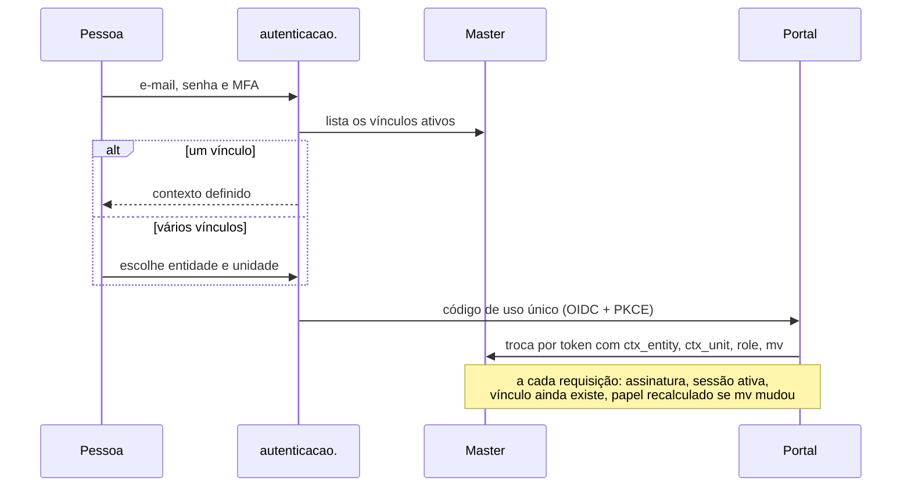

[Índice](README.md) · [Parte anterior](parte-02-arquitetura-e-tenancy.md) · [Próxima parte](parte-04-seguranca-privacidade-e-auditoria.md)

<a id="parte-3"></a>

# Parte 3 — Identidade, acesso e permissões

## Visão geral da parte 3

Cada pessoa tem uma conta global, ligada à entidade e à unidade por vínculos. O token leva só o contexto ativo, e o acesso é reavaliado a cada requisição ([06](#doc-06), seção 12).



**Regras principais**
- Login só no domínio de autenticação; os portais recebem um código de uso único ([06](#doc-06); D-22).
- Permissões no formato `modulo.recurso.acao`, com default-deny. Os níveis vão de 0 (próprio) a 7 (desenvolvedor) ([78](#doc-78), seção 2.1).
- Separação de funções: quem cria não aprova o mesmo objeto financeiro, de compra ou de consentimento ([78](#doc-78), seção 2.2).
- Só `platform.developer` cria entidade e unidade (L-02, [78](#doc-78), seção 3).
- Acesso físico (portaria, catracas, biometria) é tratado no [35](#doc-35).

<a id="doc-06"></a>

## 06 — Identidade, Autenticação e Autorização

> Parte do [SDD v2](parte-01-visao-e-escopo.md#doc-00). Controles gerais em [05](parte-04-seguranca-privacidade-e-auditoria.md#doc-05).

---

### 1. Tipos de identidade

| Identidade | Credencial | Observação |
|---|---|---|
| Conta de pessoa (global) | E-mail verificado + senha + MFA conforme política | Uma conta por pessoa, no master. Pode ter vínculos com várias entidades e unidades (seção 12). |
| Vínculo (`UserMembership`) | Não é credencial | Liga a conta a uma entidade, unidade e papel. Fica no master. |
| Conta de plataforma | Senha + **passkey obrigatória** (ver seção 10) | Não é um usuário comum com flag. Papel `platform.*` separado. |
| Conta de serviço | Credencial de cliente (OAuth2 client credentials) ou chave de API | Dona de escopos mínimos; sem login interativo |
| Convidado | Token de convite de uso único | Expira em 72 h; aceite registra consentimento |
| Dispositivo confiável | Token de dispositivo (D-03) | Revogável por usuário e por administrador |

### 2. Autenticação de usuário

Fluxo:

1. Recebe e-mail e senha na tela de entrada única da plataforma. A conta é global (seção 12). Não há tenant escolhido antes do login.
2. Aplica atraso progressivo por identificador e limite por IP (ver seção 6). Não bloqueia a conta.
3. Verifica senha com Argon2id (pepper quando ativo, ver [05](parte-04-seguranca-privacidade-e-auditoria.md#doc-05), seção 2).
4. Se MFA é exigida pela política, pede segundo fator.
5. Cria sessão opaca no servidor. Regenera o ID de sessão.
6. Grava evento de login (sucesso ou falha) em auditoria, sem a senha.

Mensagem de falha é sempre a mesma para identificador inexistente e senha errada.

### 3. Senhas

| Regra | Requisito | Base |
|---|---|---|
| Tamanho mínimo | 15 caracteres se a senha for o único fator; 8 se houver MFA | NIST SP 800-63B-4 (confirmar versão vigente antes do go-live) |
| Tamanho máximo | Pelo menos 64 caracteres aceitos | NIST SP 800-63B |
| Composição | Sem exigência de símbolos ou maiúsculas | NIST SP 800-63B |
| Rotação periódica | **Não exigida.** Trocar só com suspeita de comprometimento. | NIST SP 800-63B. A v1 exigia "rotatividade" (ACH-07) |
| Verificação de vazamento | Verificar contra lista de senhas vazadas (lista local ou API por prefixo de hash, sem enviar a senha) | NIST SP 800-63B |
| Armazenamento | Argon2id + pepper (ver [05](parte-04-seguranca-privacidade-e-auditoria.md#doc-05)) | OWASP |
| Redefinição | Token de uso único, expira em 30 min, invalida sessões ativas | — |

### 4. Recuperação de conta

E-mail verificado é o único canal de cadastro e de recuperação (decisão D-04, 02/11/2026). Sem e-mail verificado, o cadastro não é concluído. WhatsApp e Telegram não são canais de recuperação nem de MFA.

Regras:

- Recuperação não revela se a conta existe.
- Ao concluir recuperação, todas as sessões e tokens anteriores são revogados.
- Recuperação de **conta de plataforma** exige passkey registrada e aprovação de dois responsáveis de segurança, registrada em auditoria (ver seção 10).
- Perda de MFA: recuperação por e-mail verificado, com espera de 24 h e notificação em todos os canais cadastrados. Durante a espera, a conta não aceita troca de MFA. Para contas de plataforma, vale a seção 10.
- Usuário sem e-mail verificado não tem conta ativa (D-04).

### 5. MFA

| Método | Uso |
|---|---|
| TOTP | Aceito para usuários de tenant |
| Passkey / WebAuthn | Aceito para todos; **obrigatório** para conta de plataforma |
| Certificado de cliente (PKI) | Aceito para integrações e cenários institucionais |
| Código por e-mail, SMS, WhatsApp ou Telegram | **Configurável pelo tenant (D-12, decidida pelo autor em 02/11/2026), com piso obrigatório.** Ver quadro abaixo. |

**Política de MFA configurável (D-12):**

| Ação | Métodos aceitos | Observação |
|---|---|---|
| Login comum de usuário de tenant | TOTP, passkey, certificado, e-mail, SMS, WhatsApp ou Telegram, conforme configuração do tenant | Pelo menos um método. Recomendado: TOTP ou passkey. |
| Aprovação de estorno, baixa manual ou pagamento acima do limite | TOTP, passkey ou certificado | Canais de mensagem não são aceitos. |
| Conta de plataforma | Passkey obrigatória | Sem alteração pelo tenant. |
| Alteração de método de MFA | Fator forte já cadastrado, ou espera de 24 h com notificação em todos os canais | Impede troca de método por quem só tem acesso ao canal. |
| Recuperação de conta | E-mail verificado (D-04) | Inalterado. |

Riscos aceitos pela configuração: troca de chip (SIM swap) e phishing em tempo real para SMS e WhatsApp; sequestro de conta de mensagem para Telegram e WhatsApp. Por isso esses canais não aprovam operação financeira. Cada tenant que habilitar esses canais assume o risco por escrito no cadastro de política.

Histórico: a versão anterior desta seção proibia SMS e e-mail como fator. A decisão D-12 do autor substitui essa proibição por configuração com piso. NIST SP 800-63B classifica SMS como método restrito; o piso desta seção mantém canais de mensagem fora de operações financeiras e de contas privilegiadas.

Step-up: exige MFA recente (até 5 min) para exportação de dados pessoais, alteração de papel, alteração de MFA, alteração de dados bancários e ações sobre o tenant.

### 6. Limites de tentativa

- Por identificador: atraso progressivo (1 s, 2 s, 4 s … até 60 s) após 5 falhas em 15 min.
- Por IP: limite de 20 tentativas por 15 min com resposta `429`.
- Por dispositivo: sinal de risco, sem bloqueio automático.
- CAPTCHA a partir da 10ª falha por IP. Provedor escolhido em ADR próprio.
- **Sem bloqueio total de conta por falha de senha.** Bloqueio por identificador permite negação de serviço contra qualquer conta conhecida (ACH-08). Conta de plataforma recebe o mesmo atraso progressivo, com alerta em tempo real ao canal de segurança. Não há bloqueio.

### 7. Sessão

| Controle | Valor |
|---|---|
| Idle | 30 min |
| Absoluta | 12 h (usuário); 4 h (conta de plataforma) |
| Sessões simultâneas | 3 por usuário; a mais antiga é encerrada |
| Vínculo | **Token de dispositivo (D-03, decidida):** cookie `__Host-` com ID aleatório de 256 bits, registrado em `DeviceTrust` e revogável pelo usuário e pelo administrador. A sessão só é aceita com token de dispositivo válido. Login em dispositivo novo exige MFA e notifica o usuário. Mudança de User-Agent ou de IP gera sinal de risco e step-up, sem bloqueio automático por IP (ACH-09). |
| Cookie | `__Host-` prefixo, `HttpOnly`, `Secure`, `SameSite=Lax` |
| Logout | Revoga a sessão atual; "sair de todos" revoga todas |
| Evento | Criação, rotação, término e revogação registrados em `UserSessionEvent` |

### 8. Tokens de API

- Access token JWT RS256, `exp` ≤ 15 min. Claims e regras na seção 12.
- Refresh token somente para clientes técnicos. Rotação a cada uso; reutilização de refresh revogado encerra a família de tokens. Endpoint de emissão e grant ainda não definidos: pendentes de ADR.
- Revogação por `jti` em lista com TTL igual ao `exp`.
- Navegador não recebe JWT (ADR-03, aceita por padrão no DP-10 do [80](parte-19-pendencias-decisoes-e-rastreabilidade.md#doc-80)).

### 9. Autorização (RBAC com contexto)

- Permissão: `modulo.recurso.acao`, por exemplo `academico.nota.lancar`.
- Papéis são coleções de permissões. Permissões não são atribuídas diretamente ao usuário sem papel, exceto por exceção registrada com prazo.
- Escopo: tenant (obrigatório), unidade (quando aplicável), recurso (relação com o recurso, como turma do professor).
- Negação explícita tem precedência sobre concessão.
- Toda concessão e revogação de papel gera auditoria com justificativa obrigatória para papéis administrativos.
- Revisão de acesso: trimestral para papéis administrativos e de plataforma; anual para os demais.

### 10. Contas de plataforma (break-glass)

- Máximo de 5 contas de plataforma ativas.
- Passkey obrigatória. Conta sem passkey é desativada ao primeiro login após a migração.
- Uso de conta de plataforma gera alerta em tempo real para o canal de segurança.
- Conta de emergência (break-glass): credencial guardada offline em dois cofres físicos sob controle de duas pessoas; uso exige ticket e revisão em 24 h.
- Nenhum acesso de plataforma a dados de tenant sem registro de motivo e sem auditoria marcada.

### 11. Testes de identidade (critério de aceite)

- [ ] Conta autenticada sem vínculo com a unidade pedida não acessa dado dessa unidade, mesmo com token válido.
- [ ] Troca de contexto para unidade sem vínculo é recusada e registrada.
- [ ] Remoção de vínculo passa a valer na próxima requisição, sem esperar a expiração do token.
- [ ] Mensagem de erro idêntica para usuário inexistente e senha errada (diferença média de tempo menor que 20 ms em 200 amostras, mesmo ambiente).
- [ ] Sessão expira em idle e em absoluta.
- [ ] Regeneração de ID após login e após elevação.
- [ ] Token revogado é rejeitado.
- [ ] Refresh reutilizado encerra a família.
- [ ] Step-up exigido nas ações da seção 5.
- [ ] Conta de plataforma não entra sem passkey.

### 12. Conta global, vínculos e contexto de acesso

**Decisão do autor (02/11/2026):** uma pessoa pode estar em várias entidades e unidades, e o token de autenticação permite o acesso a elas. Esta seção define como isso funciona sem ampliar o que um token pode fazer.

**Status: D-19, D-20 e D-21 aprovadas pelo autor em 02/11/2026.**

#### 12.1 Três camadas

| Camada | Onde fica | Conteúdo |
|---|---|---|
| Conta | Master (`totustuus.matriz.bd`) | E-mail verificado, senha (Argon2id), fatores de MFA, sessões, tokens revogados |
| Vínculos | Master | Quais entidades e unidades a conta pode acessar, com qual papel |
| Pessoa | Banco de identidade da entidade, com cadastro civil cifrado (D-19, [14](parte-02-arquitetura-e-tenancy.md#doc-14), seção 3). O master guarda só `person_id` e e-mail verificado. O banco da unidade guarda só o `person_id`. | Nome, documento e contato civil (fora do master) |

Regra: o master guarda conta, vínculos e índice de pessoas. O cadastro civil fica no banco de identidade da entidade (D-19). Dados operacionais de unidade (notas, financeiro, matrícula) ficam no banco da unidade.

#### 12.2 Login

1. Usuário informa e-mail e senha. Se a conta existir, o sistema verifica MFA conforme a política do vínculo de maior exigência.
2. Após autenticar, o sistema lista os vínculos ativos da conta.
3. Se houver um único vínculo ativo (uma entidade e uma unidade), o contexto é esse e a pessoa vai direto para a página principal do portal. Se houver mais de um, a pessoa escolhe a entidade e depois a unidade (ver [23](parte-06-plataforma-saas-clientes-dominios-licencas-e-crm.md#doc-23), seção 1).
4. Um token é emitido para o contexto escolhido.

Sem vínculo ativo, a conta autentica mas não recebe contexto. A resposta é a mesma de conta sem acesso, sem revelar outras entidades.

#### 12.3 Conteúdo do token

| Claim | Conteúdo |
|---|---|
| `sub` | UUID da conta |
| `sid` | Identificador da sessão |
| `ctx_entity` | UUID da entidade ativa |
| `ctx_unit` | UUID da unidade ativa |
| `role` | Papel naquela unidade |
| `mv` | Versão dos vínculos no momento da emissão |
| `exp` | Até 15 min |
| `aud`, `iss` | Validados |

**Proposta (D-20):** o token leva apenas o contexto ativo, nunca a lista de vínculos. Motivos: tamanho do token, exposição de outras entidades a quem recebe o token e risco de token antigo manter acesso depois de um vínculo ser removido.

#### 12.4 Como o acesso é decidido em cada requisição

1. Valida assinatura, expiração, `aud` e `jti` não revogado.
2. Confere se `sid` está ativa.
3. Confere se o vínculo (`sub`, `ctx_entity`, `ctx_unit`) ainda existe e está ativo. A consulta usa cache de curta validade (até 30 s) e é invalidada na remoção do vínculo.
4. Se `mv` do token é anterior à versão atual dos vínculos, o papel é recalculado a partir do master, e não do token.
5. Seleciona o banco da unidade ([03](parte-02-arquitetura-e-tenancy.md#doc-03), seção 1.1).

Consequência: remover um vínculo tira o acesso na próxima requisição, mesmo com token ainda válido.

#### 12.5 Troca de contexto

- Endpoint próprio: troca para outra unidade da mesma conta. Exige vínculo ativo na unidade pedida.
- Emite novo token com o novo contexto. O token anterior é revogado.
- Troca para unidade sem vínculo: recusada e registrada em auditoria ([18](parte-07-regras-gerais-dos-modulos-de-gestao.md#doc-18), seção 4.2).
- Troca de entidade pode exigir MFA recente, conforme a política da entidade destino.

#### 12.6 E-mail único

A conta é única por e-mail verificado em toda a plataforma. A mesma pessoa em duas entidades usa a mesma conta e a mesma senha. Duas pessoas diferentes não podem usar o mesmo e-mail verificado.

**Proposta (D-21):** conta global única. Alternativa: conta por entidade, com o mesmo e-mail em contas diferentes. Condição de falha da alternativa: a pessoa precisa de uma senha por entidade, e a recuperação de conta fica duplicada.

#### 12.7 Substitui regras anteriores

- A regra "login restrito ao tenant do identificador" ([03](parte-02-arquitetura-e-tenancy.md#doc-03), seção 3, item 4) é substituída por esta seção. O risco que ela evitava, usar credencial de um tenant para entrar em outro, continua coberto: a conta só recebe contexto por vínculo.
- A seção 2 passo 1 não escolhe tenant antes do login.

#### 12.8 Testes

- Conta com vínculo na entidade A e sem vínculo na entidade B: não recebe contexto de B, mesmo com token de A.
- Token com `ctx_unit` de unidade sem vínculo ativo: recusado.
- Remoção de vínculo: acesso cortado na próxima requisição.
- Troca de contexto registrada em auditoria.
- E-mail já verificado em outra conta: cadastro recusado.

<a id="v1-07-identity-auth-md"></a>

### v1 — `07-identity-auth.md` (75 linhas)

> Situação na v2: Substituído por 06. Quando este texto diverge da v2, vale a v2.

> Esta especificação foi substituída por inteiro pelo documento indicado acima. O texto fica como histórico; para implementar, vale o documento da v2.

> **Documento derivado do SDD mestre** · **Data:** 04/08/2026
> **Auditado:** 10-11/07/2026 (34/36 fixados) · **Detalhes:** `docs/security/audit-2026-07-10.md`

---

#### 1. Identidade

| Identidade | Modelo | Descrição |
|------------|--------|-----------|
| **Super Admin Global (Master)** | `User` (`is_master_user = 1`, `type = 'admin'`) | Gestores globais da software house vinculados à Sede Matriz (`UN-MATRIZ-DEV`), acesso nativo ao Portal do Desenvolvedor |
| Humano (staff/teacher/student/parents) | `User` + `UserProfile*` | nome, avatar, bios, fones, emails, endereço, família, documentos |
| Técnico (serviço) | `OrganizationIntegration`/`ThirdPartyIntegration` | client_id/secret cifrados |
| Invitado | `Invitation` | convite com token de aceite, expiração, role |
| Dispositivo | `DeviceTrust` | confiança de dispositivo para MFA step-up |

#### 2. Fluxo de autenticação

```
Login → RateLimit(5/h/identificador) → Argon2id verify + pepper → 
MFA (se exigido) → WebAuthn/TOTP/cert → Session com idle 30min/absolute 12h/max 3
→ Regeneração de session id → AuditLog de login (sucesso e falha)
```

- Passwords com política: comprimento, complexidade, breach-check contra dicionário local, rotatividade.
- Password reset: token single-use, expiração curta, invalidar tokens antigos, lockout por tentativas.
- Logout em todos os dispositivos (blacklist jti + invalidação de sessões).

#### 3. MFA (forte)

| Método | Status |
|--------|--------|
| TOTP (app autenticador) | ✅ |
| WebAuthn/passkey | ✅ (WebAuthnManager) |
| Certificado (PKI) | ✅ (CertificateAuth) |
| Email/SMS/Tele | ❌ **rejeitados** (design decision — anti-SIM-swap/phishing) |

- Rate limit por device (5/h), jitter, lockout progressivo.
- Step-up para ações sensíveis (admin ops, mudança de segurança, exports).

#### 4. Autorização (RBAC)

- `Role` ↔ `Permission` (sintaxe `admin.<module>.<action>` e `portal.<modulo>.<acao>`).
- `UserMembership` liga user→tenant com role(s).
- `UserUnit` restringe a unidade.
- `AuthorizeMiddleware` (permissão), `StrictAuthorizeMiddleware` (default-deny + BOLA/BFLA/BOPLA), `AdminMiddleware`, `PortalMiddleware`.
- Delegation: `IdentityAutomation` (aprovações automáticas), `AccessRequest` (solicitação de acesso).

#### 5. Controles de sessão

- Idle 30 min, absolute 12 h, máx 3 sessões concorrentes, bind IP+UA.
- Cookie Secure+HttpOnly+SameSite=Strict, rotação a cada 5 min.
- JWT: RS256, exp curto, refresh rotativo com rotação de jti, blacklist para revogação.
- `UserSessionEvent` — trilha de eventos de sessão (criação, rotação, término, revogação).

#### 6. Padrões a evitar (não-negócios)

- Senhas em texto plano/hash fraco (proibido — Argon2id obrigatório).
- Tokens no JS/localStorage (proibido — cookies HttpOnly).
- HS256 para JWT (proibido — RS256).
- MFA fraca por SMS/email (proibido).
- Cross-tenant login (bloqueado por design — FD-05).

#### 7. Testes de identidade (já existentes)

- Autenticação com tenants e privilégios cruzados, reset de senha, guest tokens, device trust, idempotência de login — ver `tests/` (GAP_ANALYSIS_2026-08-04.md).

#### 8. Lacunas

| Lacuna | Ação |
|--------|------|
| SSO SAML/OIDC como IdP | Onda C (só SP WebAuthn hoje) |
| FIDO2 discovery (passkeys em browsers) | Melhoria contínua |
| Registro de users por tenant (self-service) | Existe via convite; reforçar rate limit |

<a id="doc-78"></a>

## 78 — Permissões, papéis e níveis de acesso por portal

> Parte do [SDD v2](parte-01-visao-e-escopo.md#doc-00). Estende [06](#doc-06), seção 9 (RBAC com contexto) e a seção 10 (contas de plataforma). Escopo de portais em [23](parte-06-plataforma-saas-clientes-dominios-licencas-e-crm.md#doc-23) e [31](parte-05-portais-navegacao-e-interface.md#doc-31).
> **Status:** aprovado pelo autor em 04/11/2026 (L-02, P-01, D-30 a D-33 e D-38 a D-43); D-44 e D-45 já estavam definidas nos documentos 31 e 22. Não há proposta em aberto neste documento.

---

### 1. Regras aprovadas pelo autor

| # | Regra | Origem |
|---|---|---|
| L-02 | Criar entidade e criar unidade é **exclusivo do papel `platform.developer`**. | Autor, 04/11/2026 |
| P-01 | O sistema de permissões é completo: papéis em níveis, com escopo, para todos os portais. | Autor, 04/11/2026 |

### 2. Modelo

- **Permissão:** `modulo.recurso.acao` (ex.: `academico.nota.lancar`), como em [06](#doc-06), seção 9.
- **Papel:** coleção de permissões, com **nível** e **escopo**.
- **Escopo:** `plataforma`, `entidade`, `unidade`, `turma` (para docentes), `proprio` (somente o próprio registro). Escopo mais estreito nunca amplia o papel.
- **Vínculo:** uma pessoa tem um ou mais vínculos (entidade, unidade, papel). Permissão efetiva é a união dos vínculos ativos, menos as negações.
- **Negação explícita** vence concessão ([06](#doc-06), seção 9).

#### 2.1 Níveis de papel (D-38, aprovada)

| Nível | Nome | O que faz | Exemplo |
|---|---|---|---|
| 0 | Próprio | Vê e atualiza só os próprios dados, quando permitido | Aluno, responsável, terceiro |
| 1 | Operador | Executa tarefas no escopo atribuído | Secretário, professor de turma |
| 2 | Coordenador | Gerencia tarefas de um conjunto de operadores e aprova o que é de nível 1 | Coordenador de turno |
| 3 | Gestor | Responde pela unidade inteira | Diretor de unidade |
| 4 | Administrador da entidade | Responde pela entidade: unidades, usuários e configurações, exceto criação de entidade ou unidade | Diretor geral |
| 5 | Operador da plataforma | Suporte, atendimento e operação, sem acesso a dado de entidade sem motivo registrado | Equipe de suporte |
| 6 | Gestor da plataforma | Operação da plataforma, planos e clientes, sem criar entidade ou unidade | Gerente de operação |
| 7 | Desenvolvedor | Criação de entidade e unidade (L-02), planos, limites, licenças e Editor de portais | `platform.developer` |

Regras de nível:
- Um papel só concede permissões do seu nível ou inferiores. Atribuir um papel de nível igual ou superior exige o aprovador de nível superior.
- Papéis de nível 3 e acima, e todos os da plataforma, exigem **justificativa** e **revisão trimestral** ([06](#doc-06), seção 9).
- Papéis de nível 0 a 2 têm revisão anual.

#### 2.2 Separação de funções (D-39, aprovada)

| Ação | Não pode ser feita pela mesma pessoa |
|---|---|
| Criar e aprovar mudança no Editor de portais: quem edita é `platform.builder` e quem aprova é `platform.developer` (D-33) | Sim ([23](parte-06-plataforma-saas-clientes-dominios-licencas-e-crm.md#doc-23), seção 3) |
| Lançar nota e aprovar a nota | Sim |
| Cadastrar fornecedor e aprovar pagamento | Sim |
| Criar usuário e conceder papel de nível 3 ou acima | Sim |
| Criar plano e aplicar plano a entidade | Sim |

### 3. Criação de entidade e unidade (L-02)

| Ação | Papel exigido | Verificação |
|---|---|---|
| Criar entidade | `platform.developer` | Passkey e sessão curta ([06](#doc-06), seção 10) |
| Criar unidade | `platform.developer` | Idem |
| Editar dados de entidade ou unidade já criadas | Administrador da entidade (nível 4), exceto código e domínio, que são do desenvolvedor | Auditoria |
| Desativar ou encerrar entidade | `platform.developer`, por saída de cliente ([23](parte-06-plataforma-saas-clientes-dominios-licencas-e-crm.md#doc-23), seção 5) | Confirmação digitando o nome |

Nenhum outro papel, inclusive de plataforma, cria ou remove entidade ou unidade. A regra vale também para API ([04](parte-02-arquitetura-e-tenancy.md#doc-04)): o endpoint de criação exige o papel no servidor, não só na tela.

### 4. Papéis por portal

Papéis listados por portal, com o nível máximo previsto. Permissões detalhadas por módulo são definidas em cada ficha de módulo.

#### 4.1 Portal do Desenvolvedor (plataforma)

| Papel | Nível | Escopo | Pode |
|---|---|---|---|
| `platform.developer` | 7 | plataforma | Criar entidade e unidade; planos, limites, licenças, Editor de portais |
| `platform.manager` | 6 | plataforma | Clientes, assinaturas, faturamento de clientes, domínios; sem criar entidade ou unidade |
| `platform.operator` | 5 | plataforma | Suporte e atendimento; consulta de cliente com motivo registrado |
| `platform.builder` | 7 | plataforma | Editor de portais, com passkey e sessão curta (mantido de [06](#doc-06), seção 9) |
| `platform.auditor` | 2 | plataforma | Leitura de auditoria e relatórios de conformidade |
| `platform.sales.sdr` | 1 | plataforma (leads) | Pré-vendas: qualificar, agendar demonstração, registrar interação (SDD 22, seção 4.1) |
| `platform.sales.ae` | 1 | plataforma (carteira própria) | Vendedor: criar proposta e avançar o funil até negociação (SDD 22, seção 4.1) |
| `platform.sales.manager` | 2 | plataforma (equipe comercial) | Gerente comercial: atribuir leads, aprovar desconto na alçada, ver funil da equipe (SDD 22, seção 4.1) |
| `platform.chatbot.operator` | 1 | plataforma (fila de conversas) | Atender, transferir e registrar conversas dos canais (SDD 22, seção 4.1) |
| `platform.customer_success` | 1 | plataforma (clientes ativos) | Acompanhar implantação e uso, sem alterar cobrança (SDD 22, seção 4.1) |
| `platform.finance` | 1 | plataforma (financeiro da empresa) | Papel **Financeiro** do [22](parte-06-plataforma-saas-clientes-dominios-licencas-e-crm.md#doc-22), seção 5, na empresa desenvolvedora: operar contas, despesas, pagamentos e conciliação (D-43) |
| `platform.finance.manager` | 2 | plataforma (financeiro da empresa) | Aprovar despesas e orçamento; segundo aprovador acima de R$ 10.000 (D-43, aprovada) |
| `platform.accounting` | 1 | plataforma (contábil da empresa) | Papel **Contábil** do [22](parte-06-plataforma-saas-clientes-dominios-licencas-e-crm.md#doc-22), seção 5: lançar, fechar período, exportar; não fecha período com lançamento que criou sem revisão (D-45) |
| `platform.fiscal` | 1 | plataforma (fiscal da empresa) | Papel **Fiscal** do [22](parte-06-plataforma-saas-clientes-dominios-licencas-e-crm.md#doc-22), seção 5: emitir e cancelar NFS-e, apurar tributos; cancelamento exige aprovação do contábil (D-45) |
| `platform.assets` | 1 | plataforma (patrimônio da empresa) | Cadastrar e movimentar bens; manutenção, inventário e seguro (DP-03, [80](parte-19-pendencias-decisoes-e-rastreabilidade.md#doc-80)) |
| `platform.assets.approver` | 2 | plataforma (patrimônio da empresa) | Aprovar transferência, descarte e manutenção acima do limite; não aprova o que registrou (DP-03) |
| `platform.fleet` | 1 | plataforma (frotas da empresa) | Veículos, motoristas, reservas, abastecimentos, viagens, multas e documentos (DP-03) |
| `platform.fleet.approver` | 2 | plataforma (frotas da empresa) | Aprovar reservas e ordens de manutenção; não aprova a própria reserva (DP-03) |
| `platform.purchasing` | 1 | plataforma (suprimentos da empresa) | Papel **Compras** do [22](parte-06-plataforma-saas-clientes-dominios-licencas-e-crm.md#doc-22), seção 5: cotação, pedido, cadastro de fornecedor |
| `platform.warehouse` | 1 | plataforma (suprimentos da empresa) | Papel **Almoxarifado** do [22](parte-06-plataforma-saas-clientes-dominios-licencas-e-crm.md#doc-22), seção 5: recebimento e movimento |
| `platform.purchasing.approver` | 2 | plataforma (suprimentos da empresa) | Papel **Aprovador de compras** do [22](parte-06-plataforma-saas-clientes-dominios-licencas-e-crm.md#doc-22), seção 5: aprova requisição na alçada; não é o solicitante |
| `platform.people` | 1 | plataforma (HCM da empresa) | Pessoas (DP): cadastro funcional, férias, afastamentos, ponto com motivo, rescisão, benefícios ([39](parte-11-pessoas-departamento-pessoal-e-sst.md#doc-39), HCM-01 e HCM-10) |
| `platform.payroll` | 1 | plataforma (HCM da empresa) | Papel **Folha** do [22](parte-06-plataforma-saas-clientes-dominios-licencas-e-crm.md#doc-22), seção 5: processar a folha; folha fechada não muda |
| `platform.payroll.approver` | 2 | plataforma (HCM da empresa) | Aprovar a folha; quem processa não aprova ([39](parte-11-pessoas-departamento-pessoal-e-sst.md#doc-39), seção 7) |
| `platform.hr` | 1 | plataforma (HCM da empresa) | Papel **RH** do [22](parte-06-plataforma-saas-clientes-dominios-licencas-e-crm.md#doc-22), seção 5, no escopo do HCM-01: recrutamento, onboarding, avaliação, clima, treinamento |
| `platform.sst.doctor` | 1 | plataforma (SST da empresa) | Médico do trabalho: ASO completo, prontuário, CID ([39](parte-11-pessoas-departamento-pessoal-e-sst.md#doc-39), HCM-06) |
| `platform.sst.technician` | 1 | plataforma (SST da empresa) | Técnico de SESMT: ocorrências, EPI, NR, PGR, CAT, sem diagnóstico ([39](parte-11-pessoas-departamento-pessoal-e-sst.md#doc-39), HCM-06) |
| `platform.security` | 5 | plataforma (segurança) | Papel **Segurança** do [22](parte-06-plataforma-saas-clientes-dominios-licencas-e-crm.md#doc-22), seção 5: investigar, bloquear conta, política de MFA, autorizar visualização de segredo de tenant com motivo; não concede permissão a si mesmo |
| `platform.dpo` | 5 | plataforma (privacidade) | Papel **Encarregado** do [22](parte-06-plataforma-saas-clientes-dominios-licencas-e-crm.md#doc-22), seção 5: relatório de impacto, pedidos de titular, ROPA, incidentes, painel do DPO (LGPD-07); não opera o módulo que audita |
| `platform.ops` | 5 | plataforma (infraestrutura) | Papel **TI / Operação** do [22](parte-06-plataforma-saas-clientes-dominios-licencas-e-crm.md#doc-22), seção 5: serviços, filas, backup, certificados, inventário de bancos, pedido de restauração e de acesso de emergência ([34](parte-10-financeiro-pagamentos-e-fiscal.md#doc-34), seção 4); sem acesso a dado pessoal de entidade |
| `platform.integration` | 6 | plataforma (integrações) | Configurar integrações de plataforma (`plataforma.integracao.*`, [16](parte-14-integracoes-e-importacao.md#doc-16), seção 1); nunca vê segredo de tenant em texto claro |

Aprovação técnica: migração em lote, restauração de backup e escrita em acesso de emergência exigem aprovação de `platform.developer` como segundo papel, por pessoa diferente de quem pediu ([34](parte-10-financeiro-pagamentos-e-fiscal.md#doc-34), seção 4).

#### 4.2 Portal de Gestão (SaaS da entidade)

| Papel | Nível | Escopo | Pode |
|---|---|---|---|
| `entity.admin` | 4 | entidade | Unidades, usuários, papéis até nível 3, configurações da entidade |
| `unit.manager` | 3 | unidade | Gestão da unidade: acadêmico, financeiro, pessoas, suprimentos |
| `unit.coordinator` | 2 | unidade | Coordenação de turno ou área; aprova tarefas de nível 1 |
| `unit.secretary` | 1 | unidade | Matrícula, documentos, protocolos |
| `unit.finance` | 1 | unidade | Títulos, cobrança, conciliação |
| `unit.hr` | 1 | unidade | Pessoas, folha, ponto |
| `unit.librarian` | 1 | unidade | Acervo, empréstimos |
| `unit.support` | 1 | unidade | Atendimento, SAC, tickets |
| `unit.auditor` | 2 | unidade | Leitura de auditoria da unidade |
| `unit.accounting` | 1 | unidade | Papel **Contábil** do [22](parte-06-plataforma-saas-clientes-dominios-licencas-e-crm.md#doc-22), seção 5: lançar, fechar período, exportar; não fecha período com lançamento que criou sem revisão |
| `unit.fiscal` | 1 | unidade | Papel **Fiscal** do [22](parte-06-plataforma-saas-clientes-dominios-licencas-e-crm.md#doc-22), seção 5: emitir e cancelar NFS-e, apurar tributos e retenções; cancelamento exige aprovação do contábil |
| `unit.finance.approver` | 2 | unidade | Aprovar despesa, estorno e baixa manual na alçada; não aprova o que lançou ([17](parte-07-regras-gerais-dos-modulos-de-gestao.md#doc-17), seção 2.4) |
| `unit.commercial` | 1 | unidade | Papel **Comercial** do [22](parte-06-plataforma-saas-clientes-dominios-licencas-e-crm.md#doc-22), seção 5, no CRM do tenant (seção 4.2): captação, pré-cadastro, proposta; não aprova desconto acima da alçada |
| `unit.purchasing` | 1 | unidade | Papel **Compras**: cotação, pedido, cadastro de fornecedor; não aprova a própria requisição nem recebe a própria compra |
| `unit.warehouse` | 1 | unidade | Papel **Almoxarifado**: recebimento e movimento; ajuste de estoque só com motivo e aprovação |
| `unit.purchasing.approver` | 2 | unidade | Papel **Aprovador de compras**: aprova requisição na alçada; não é o solicitante |
| `unit.assets` | 1 | unidade | Patrimônio da entidade: cadastro, movimentação, inventário ([19](parte-07-regras-gerais-dos-modulos-de-gestao.md#doc-19), seção 8) |
| `unit.assets.approver` | 2 | unidade | Aprovar transferência, baixa e manutenção acima do limite; não aprova o que registrou (DP-05) |
| `unit.fleet` | 1 | unidade | Frotas e rotas da entidade ([19](parte-07-regras-gerais-dos-modulos-de-gestao.md#doc-19), seção 9) |
| `unit.fleet.approver` | 2 | unidade | Aprovar reserva e ordem de manutenção de veículo; não aprova a própria (DP-05) |
| `unit.payroll` | 1 | unidade | Papel **Folha**: processar a folha; folha fechada não muda |
| `unit.payroll.approver` | 2 | unidade | Aprovar a folha; quem processa não aprova ([39](parte-11-pessoas-departamento-pessoal-e-sst.md#doc-39), seção 7) |
| `unit.sst.doctor` | 1 | unidade | Médico do trabalho: ASO, prontuário ocupacional, CID ([39](parte-11-pessoas-departamento-pessoal-e-sst.md#doc-39), seção 7; [52](parte-11-pessoas-departamento-pessoal-e-sst.md#doc-52)) |
| `unit.sst.technician` | 1 | unidade | SESMT: CAT, EPI, NR, PGR, ocorrências; sem diagnóstico |
| `unit.legal` | 2 | entidade | Papel **Jurídico**: parecer, bloqueio legal; leitura de contratos, documentos e auditoria; não altera contrato assinado |
| `entity.dpo` | 2 | entidade | Papel **Encarregado (DPO)** da entidade ([32](parte-04-seguranca-privacidade-e-auditoria.md#doc-32), seção 7): ROPA, pedidos de titular, incidentes, relatório de impacto; não opera o módulo que audita |
| `entity.security` | 3 | entidade | Papel **Segurança** da entidade: investigar, bloquear conta, política de MFA da entidade; não concede permissão a si mesmo |
| `unit.it.admin` | 2 | unidade | Administrador de TI da entidade ([36](parte-17-operacao-qualidade-testes-e-ti.md#doc-36), seção 6): ativos, licenças, chamados e mudanças; não aprova a própria mudança |
| `unit.it.technician` | 1 | unidade | Técnico de TI: atender chamados e incidentes; não altera contrato nem exclui ativo |
| `unit.it.change_approver` | 2 | unidade | Comitê de mudança: aprova ou recusa; não executa a mudança que aprovou |
| `unit.preceptoria.manager` | 2 | unidade | Gestão de preceptoria ([42](parte-08-academico.md#doc-42), seção 5): instrumentos, ciclos, programas, pesos, relatório agregado; não vê resposta individual nem anotação de tutoria |
| `unit.pastoral` | 1 | unidade | Equipe pastoral ([43](parte-08-academico.md#doc-43), seção 5): agenda, escala, evento, campanha e beneficiário da campanha; não vê anotação de acompanhamento alheia |
| `unit.reception` | 1 | unidade | Portaria e acesso físico ([35](#doc-35), seção 4): entradas e saídas, visitantes, autorizações de retirada |

Os papéis acima vêm dos papéis nomeados no [22](parte-06-plataforma-saas-clientes-dominios-licencas-e-crm.md#doc-22), seção 5, e nos documentos por portal; os códigos seguem a convenção desta seção (DP-05, [80](parte-19-pendencias-decisoes-e-rastreabilidade.md#doc-80)). A coordenação pedagógica usa `unit.coordinator`; a secretaria, `unit.secretary`.

#### 4.3 Portal do Professor

| Papel | Nível | Escopo | Pode |
|---|---|---|---|
| `teacher` | 1 | turma | Diário, materiais e avaliações **das próprias turmas**; nota só pelo docente da turma |
| `teacher.coordinator` | 2 | unidade | Aprova plano de aula e lançamentos de tarefa de nível 1 da unidade |

#### 4.4 Portal do Aluno

| Papel | Nível | Escopo | Pode |
|---|---|---|---|
| `student` | 0 | proprio | Ver e usar apenas os próprios dados: boletim, materiais, financeiro, protocolos |

#### 4.5 Portal dos Responsáveis

| Papel | Nível | Escopo | Pode |
|---|---|---|---|
| `guardian` | 0 | proprio (dependentes vinculados) | Ver e atuar pelos dependentes vinculados; dependente sem vínculo não aparece |

#### 4.6 Portal de Terceiros

| Papel | Nível | Escopo | Pode |
|---|---|---|---|
| `thirdparty` | 0 | proprio (contrato vinculado) | Ver contratos, entregas, faturas e solicitações da própria organização |
| `thirdparty.manager` | 1 | entidade (contrato) | Gestão de entregas e faturas do contrato vinculado |

### 5. Regras transversais (D-40, aprovada)

1. **Default-deny:** rota ou ação sem papel explícito é negada, como em [03](parte-02-arquitetura-e-tenancy.md#doc-03).
2. **Escopo verificado no servidor:** o escopo `turma`, `unidade` ou `proprio` é conferido em cada consulta, não só na tela.
3. **Papel por portal:** papel de um portal não dá acesso a outro, mesmo com a mesma conta ([23](parte-06-plataforma-saas-clientes-dominios-licencas-e-crm.md#doc-23), seção 2).
4. **Ações sensíveis com step-up:** exportação, alteração de papel e exclusão exigem autenticação recente ([06](#doc-06), seção 5).
5. **Revisão e expiração:** vínculo temporário tem data de fim. Vínculo vencido sai sozinho e gera auditoria.
6. **Auditoria:** toda concessão, revogação e mudança de papel gera registro com justificativa para níveis 3 e acima.

### 6. Decisões pendentes

| # | Decisão | Proposta | Alternativa |
|---|---|---|---|
| D-30 | Nomes e códigos dos papéis de gestão | Os códigos da seção 4. **Aprovada pelo autor em 04/11/2026.** | Nomes livres por entidade, mapeados para os níveis |
| D-31 | Papel de professor que também coordena | Dois papéis, um por portal. **Aprovada pelo autor em 04/11/2026.** | Um papel com acúmulo de escopo |
| D-32 | Papel do responsável com mais de um aluno | Escopo `proprio` com dependentes vinculados. **Aprovada pelo autor em 04/11/2026.** | Papel por aluno |
| D-33 | Papel que aprova a publicação no Editor de portais (diferente de quem editou) | `platform.developer` aprova o que o `platform.builder` edita. **Aprovada pelo autor em 04/11/2026.** | Papel de revisão separado, criado só para isso |
| D-38 | Níveis de papel | Oito níveis, de 0 (próprio) a 7 (desenvolvedor), com as regras da seção 2.1. **Aprovada pelo autor em 04/11/2026.** | Menos níveis, por exemplo 0, 1, 3, 4 e 7 |
| D-39 | Separação de funções | As cinco ações da seção 2.2. **Aprovada pelo autor em 04/11/2026.** | Lista definida por módulo |
| D-40 | Regras transversais | As seis regras da seção 5. **Aprovada pelo autor em 04/11/2026.** | Regras definidas por portal |
| D-41 | Códigos dos papéis comerciais da plataforma (SDD 22, seção 4.1) | Os cinco códigos `platform.sales.*`, `platform.chatbot.operator` e `platform.customer_success` da seção 4.1. **Aprovada pelo autor em 04/11/2026.** | Outros nomes, mantidos os níveis |
| D-42 | Cheques e caixa físico no financeiro da plataforma ([71](parte-10-financeiro-pagamentos-e-fiscal.md#doc-71), seções 5 e 6) | Não se aplicam à empresa desenvolvedora, até haver necessidade. **Aprovada pelo autor em 04/11/2026.** | Aplicam-se, como nas entidades |
| D-43 | Papéis do financeiro da plataforma | `platform.finance` (opera) e `platform.finance.manager` (aprova). **Aprovada pelo autor em 04/11/2026.** | Usar `platform.manager` para aprovar |
| D-44 | Tributos e obrigações fiscais da empresa desenvolvedora | **Já definido** na [31](parte-05-portais-navegacao-e-interface.md#doc-31), seção 3.3 (aprovada em 03/11/2026). Confirmado pelo autor em 04/11/2026: módulo incluído na área Contábil da plataforma | — |
| D-45 | Papéis do contábil e do fiscal da plataforma | **Já definido** no [22](parte-06-plataforma-saas-clientes-dominios-licencas-e-crm.md#doc-22), seção 5 (papéis Contábil e Fiscal, com segregação). Códigos: `platform.accounting` e `platform.fiscal` | — |

### 7. Critérios de aceite

- [ ] Somente `platform.developer` cria entidade e unidade, na tela e na API.
- [ ] Todo papel tem nível, escopo e lista de permissões.
- [ ] Papel de um portal não concede acesso a outro portal.
- [ ] Separação de funções aplicada nas ações da tabela 2.2.
- [ ] Revisão trimestral para níveis 3 e acima e para a plataforma; anual para os demais.
- [ ] Permissão validada no servidor, com teste de acesso negado por papel e por escopo.

<a id="doc-35"></a>

## 35 — Acesso Físico e Segurança: Portaria, Catracas, Câmeras, Portas e Biometria, por Portal

> Parte do [SDD v2](parte-01-visao-e-escopo.md#doc-00). Matriz de portais em [31](parte-05-portais-navegacao-e-interface.md#doc-31). Dado biométrico e de imagem em [07](parte-04-seguranca-privacidade-e-auditoria.md#doc-07) e [26](parte-18-juridico-e-regulatorio.md#doc-26). Retenção e expurgo em [21](parte-16-dados-validacoes-configuracoes-e-armazenamento.md#doc-21). Auditoria em [29](parte-04-seguranca-privacidade-e-auditoria.md#doc-29). Integração de hardware em [16](parte-14-integracoes-e-importacao.md#doc-16).
> **Status:** aprovada pelo autor em 03/11/2026, com as propostas adotadas. Itens sem valor definido continuam pendentes, criada em 03/11/2026. A v1 cita o tema em navegação e em integração, sem especificação própria. Itens **[Decisão do autor]** e **(jurídico)** dependem de resposta ou parecer.

---

### 1. Resposta direta

> **Leitura (04/11/2026):** esta tabela registra o que existia no SDD antes deste documento ser escrito. Os itens marcados como **Não** ou **Parcial** são especificados nas seções seguintes deste documento, exceto o que estiver listado na seção de pendências.

| Pergunta | Veredito |
|---|---|
| O módulo de acesso físico está completo? | **Não.** Não há especificação. A v1 cita "Portaria & Acesso" (desenvolvedor), "Portaria Escolar" (gestão), "Entradas e Saídas" (aluno e responsáveis) e "Gestão de Integração: Catracas" (terceiros), sem regra, DDL, estados ou teste |
| Está organizado por portal? | **Não.** Os nomes se repetem com sentidos diferentes (ver seção 2) |
| Reconhecimento facial e biometria? | **Sem regra.** É dado sensível (LGPD, art. 11). Pendência jurídica |
| Câmeras (CFTV)? | **Sem regra.** A v1 não tem especificação de câmera nem de retenção de imagem |
| Portas eletrônicas? | **Sem regra.** Só aparece como item de navegação |

---

### 2. Confusão de nomes a resolver

| Nome na v1 | Onde está | O que é de fato | Ação |
|---|---|---|---|
| "Gestão de Acesso" | Portal do desenvolvedor, Segurança & Acesso | Usuários, papéis, MFA, sessões (acesso **lógico**) | Manter. É [06](#doc-06) |
| "Portaria & Acesso" | Portal do desenvolvedor | Catracas, visitantes, crachás, encomendas (acesso **físico**), da plataforma | **Decidido** em 03/11/2026: mantido, para a própria empresa, quando tiver instalações com controle |
| "Portaria Escolar" | Gestão (SAAS acadêmico) | Acesso físico da escola: catraca, reconhecimento facial, visitantes, autorização de saída de aluno | Manter. Este documento |
| "Entradas e Saídas" | Portal do aluno e dos responsáveis | Histórico do próprio acesso e notificação de entrada e saída | Manter. Só leitura do próprio dado |
| "Gestão de Auditoria" | Portal do desenvolvedor | Logs de sistema e de operação | É [29](parte-04-seguranca-privacidade-e-auditoria.md#doc-29). Não é acesso físico |

**Regra:** "acesso" sem qualificação não aparece em documento. Usar "acesso lógico" ou "acesso físico".

---

### 3. Recursos do acesso físico

#### 3.1 Dispositivos

| Dispositivo | Função | Integração |
|---|---|---|
| Catraca | Registro de entrada e saída de pessoas | Driver do fabricante, por conector |
| Porta eletrônica | Liberação de porta com credencial | Driver do fabricante |
| Leitor de crachá (RFID ou código) | Identificação | Conector |
| Leitor biométrico ou facial | Identificação por biometria | Conector, **com regra da seção 5** |
| Câmera (CFTV) | Imagem do acesso e do ambiente | Stream ou gravador, **com regra da seção 6** |

Dispositivo é cadastrado por unidade. Um dispositivo não serve outra unidade, mesmo na mesma entidade.

#### 3.2 Visitantes

- Cadastro de visitante com documento, motivo, destino e autorização de quem recebe.
- Documento do visitante: só número mascarado no registro de acesso. Imagem do documento não é guardada, salvo regra específica **(jurídico)**.
- Visitante de menor de idade na escola: regra de autorização do responsável, não do visitante ([07](parte-04-seguranca-privacidade-e-auditoria.md#doc-07), seção 3).
- Validade: acesso temporário, com data e horário de fim.

#### 3.3 Autorização de saída de aluno

Requisito da v1 (Portaria Escolar). Regra proposta:

- Saída de aluno menor só com autorização registrada do responsável, por canal verificado, com data e horário.
- Quem retira o aluno é identificado (nome e documento mascarado) e comparado com a lista autorizada.
- Saída sem autorização gera alerta imediato à coordenação e ao responsável.
- Autorização tem validade. Expirada, não vale.

#### 3.4 Registro de entrada e saída

| Campo | Regra |
|---|---|
| Pessoa | Vínculo (aluno, professor, colaborador, visitante). Visitante não tem vínculo permanente. |
| Dispositivo | Identificador do dispositivo e da unidade |
| Direção | Entrada ou saída |
| Momento | Data e hora UTC ([29](parte-04-seguranca-privacidade-e-auditoria.md#doc-29), seção 2) |
| Método | Crachá, biometria, facial, manual |
| Resultado | Permitido, negado, manual |

Registro de entrada é dado de acesso. Retenção conforme seção 6.

---

### 4. Por portal

| Portal | Recurso | Escopo |
|---|---|---|
| Desenvolvedor | Acesso físico da própria plataforma, **se mantido** (seção 2) | Plataforma apenas |
| Gestão | Portaria completa: dispositivos, visitantes, autorização de saída, registros, câmeras, relatórios | Unidade, conforme permissão |
| Professor | Nenhum acesso físico próprio. Registro de entrada do próprio docente, se a unidade usa controle | Só o próprio registro |
| Aluno | Histórico de entradas e saídas, com horário. Notificação de atraso | Só o próprio histórico |
| Responsáveis | Entrada e saída dos dependentes em tempo real. Autorização de saída. Notificação | Só dependentes com vínculo ativo |
| Terceiros | Integração com fornecedor de catraca ou merenda (API). Sem acesso ao registro de pessoas | Só o contrato de integração ([16](parte-14-integracoes-e-importacao.md#doc-16)) |

**Regra:** o responsável não vê o registro de outro aluno, nem imagem de câmera, nem de visitante.

---

### 5. Biometria e reconhecimento facial

**Problema:** biometria e reconhecimento facial são dado pessoal **sensível** (LGPD, art. 5º, II e art. 11). Em escola, envolvem principalmente menores.

**Proposta mínima, até parecer:**

1. Biometria é **opcional**. A unidade oferece crachá ou código como alternativa, sem penalizar quem recusa.
2. O consentimento é específico para biometria, por escrito, com finalidade e prazo. Revogável.
3. Template biométrico (não a imagem) é guardado cifrado, no banco da unidade, com chave do cofre ([05](parte-04-seguranca-privacidade-e-auditoria.md#doc-05)). Nunca sai da unidade.
4. Não há reconhecimento facial contra base de terceiros nem compartilhamento com outra unidade.
5. Exclusão do template na saída da pessoa ou na revogação. Registro da exclusão sem o dado ([29](parte-04-seguranca-privacidade-e-auditoria.md#doc-29)).
6. Relatório de impacto (RIPD) antes de ativar.

**(jurídico)** Base legal e exigências para menores. Lacuna LGPD-04 em [32](parte-04-seguranca-privacidade-e-auditoria.md#doc-32).

**Decidido** em 03/11/2026: biometria entra no escopo como opcional, com RIPD antes de ativar.

---

### 6. Câmeras (CFTV) e imagem

**Problema:** câmera registra imagem de menores, de visitantes e de funcionários. A v1 não define nada sobre câmera.

**Proposta:**

| Regra | Detalhe |
|---|---|
| Finalidade | Segurança patrimonial e de pessoas. Sem finalidade pedagógica nem de avaliação de docente. |
| Local | Áreas comuns e acessos. **Não** em banheiro, vestiário, sala de descanso ou área de amamentação. |
| Aviso | Placa de aviso no local. Sinalização visível. |
| Acesso à imagem | Só a função de segurança da unidade, com motivo registrado. Visualização ao vivo e exportação são eventos auditados ([29](parte-04-seguranca-privacidade-e-auditoria.md#doc-29)). |
| Retenção | Prazo curto e fixo de **30 dias**, decidido em 03/11/2026. Expurgo automático. Exportação de trecho fica em armazenamento com acesso restrito. |
| Reconhecimento facial em imagem | Mesma regra da seção 5. Desligado por padrão. |
| Terceiros | Câmera de terceiro não é acessada pelo portal de terceiros. |

**(jurídico)** Prazo de retenção de imagem e aviso exigido.

---

### 7. Portas e controle de acesso ao prédio

- Porta eletrônica tem regra de abertura por horário e por perfil, configurada na unidade.
- Liberação de emergência (incêndio) abre a porta sem depender da rede. Evento registrado depois.
- Falha de rede: a porta opera em modo local, com lista de credenciais sincronizada. Lista local expira.
- Alteração de regra de porta exige MFA e dupla aprovação, como outras configurações de segurança ([31](parte-05-portais-navegacao-e-interface.md#doc-31), seção 4.3).

---

### 8. Relação com os outros módulos

| Módulo | Relação |
|---|---|
| Acadêmico | Presença por QR Code e geolocalização (v1, `spec_gestao_academica_completo`, seção 8.3). **Atenção:** geolocalização do aluno é dado pessoal sensível de localização. Precisa de consentimento e de regra de minimização ([07](parte-04-seguranca-privacidade-e-auditoria.md#doc-07)). Não há regra na v2 |
| Pessoas | Ponto eletrônico pode usar o registro de acesso. Não é fonte única |
| Patrimônio | QR e RFID são de bem, não de pessoa. Não usar a mesma tabela de acesso |
| Segurança do trabalho | Controle de acesso a área de risco. Fora deste documento |

---

### 9. Pendências

| # | Pendência | Tipo |
|---|---|---|
| ACC-01 | Portaria & Acesso da plataforma: manter ou retirar (seção 2) | **Decidido** em 03/11/2026: mantido, para a própria empresa (seção 11) |
| ACC-02 | Biometria e reconhecimento facial: escopo (seção 5) | **Decidido** em 03/11/2026 (seção 11). Parecer de (jurídico) pendente |
| ACC-03 | Retenção de imagem de câmera (seção 6) | **Decidido** em 03/11/2026: 30 dias. Parecer de (jurídico) pendente |
| ACC-04 | RIPD de biometria e de câmera | Documento e DPO |
| ACC-05 | Geolocalização em presença por QR Code | **Decidido** em 03/11/2026: a escola configura. Pode usar geolocalização ou outro método |
| ACC-06 | DDL de dispositivo, registro de acesso, autorização de saída e visitante | **Escrito** em [51](parte-16-dados-validacoes-configuracoes-e-armazenamento.md#doc-51), seção 4. Revisão do owner pendente (DDL-01) |
| ACC-07 | Conectores de catraca e porta | **Decidido** em 03/11/2026: protocolo aberto primeiro, fabricantes depois, sob demanda |
| ACC-08 | Modo de falha da porta e lista local (seção 7) | **Escrito** em [51](parte-16-dados-validacoes-configuracoes-e-armazenamento.md#doc-51), seção 4. Revisão do owner pendente (DDL-01) |

---

### 10. Critérios de aceite

- [ ] Dispositivo só atua na unidade à qual está cadastrado (teste de isolamento).
- [ ] Autorização de saída de menor sem registro gera bloqueio e alerta (teste).
- [ ] Biometria desligada por padrão; alternativa sem biometria disponível (teste).
- [ ] Nenhuma imagem de câmera aparece em portal de responsável, aluno ou terceiro (teste).
- [ ] Acesso à imagem gera evento de auditoria com motivo.
- [ ] Liberação de emergência funciona sem rede e gera evento depois.
- [ ] Itens **[Decisão do autor]** e **(jurídico)** respondidos ou marcados como pendentes no [00](parte-01-visao-e-escopo.md#doc-00).

### 11. Decisões de 03/11/2026

**ACC-01 (Portaria & Acesso da plataforma): mantido no portal do desenvolvedor.** Função: gerir o acesso físico e a portaria da própria empresa desenvolvedora, quando ela tiver instalações com controle (catraca, porta eletrônica, crachá, visitantes, câmeras, encomendas). Regras:

- Dados em banco master, separado de qualquer entidade.
- Acesso restrito à equipe de segurança da empresa. Nenhum cliente vê esse módulo.
- Sem instalação, o módulo fica desativado.

**ACC-02 (escopo de biometria, reconhecimento facial e câmeras): aprovado.** Regras da seção 5 e da seção 6 valem como escopo: biometria opcional, template cifrado, RIPD antes de ativar, sem reconhecimento facial contra base de terceiros, câmera sem áreas íntimas e com aviso.

**ACC-03 (prazo de retenção de imagem): 30 dias, padrão inicial.** Expurgo automático ao fim do prazo. Trecho exportado para investigação fica em armazenamento restrito, com prazo próprio e registro. **(jurídico)** confirmar antes de produção.

## Especificações da v1 desta parte absorvidas no kit-starter ou sem destino

<a id="v1-client-migration-module-spec-completo-md"></a>

### v1 — `client-migration-module-spec-completo.md` (1207 linhas)

> Situação na v2: Absorvido integralmente no kit-starter. Destino: ficha do kit-starter: `kit-starter/gestao/configuracao-e-acesso/importacao-de-dados.md`. Quando este texto diverge da v2, vale a v2.

#### O que a v2 muda nesta especificação

Estas regras prevalecem sobre o texto da v1 que vem a seguir.

- [70](parte-14-integracoes-e-importacao.md#doc-70); migração de clientes ([19](parte-07-regras-gerais-dos-modulos-de-gestao.md#doc-19), seção 13).

#### Texto integral da v1

#### 1. Document Control

- Document Name: Client Migration Module Specification
- Product Context: Multi-tenant SaaS platform using Supabase-inspired admin UX patterns
- Target Stack: PHP, Fetch API, MariaDB, JSON-based migration intake
- Language Standard: Global English
- Primary Audience: Product owner, backend engineers, frontend engineers, database engineers, QA, DevOps, security reviewers
- Module Type: Admin-only operational module
- Status: Draft v1.0

#### 2. Purpose

This module enables an administrator to onboard a new client that is migrating from a legacy system into the platform.

The client provides a structured JSON migration package containing source schema metadata, table definitions, field definitions, relationships when available, and optionally sample records or transformation hints. The module presents a dual-schema mapping workspace where the platform schema appears in one column and the client legacy schema appears in a second column, allowing controlled mapping of tables, columns, keys, enums, reference values, and transformation rules.

The module must support semi-automated matching so that the system proposes likely mappings first, and the administrator performs a review and final approval pass before execution.

#### 3. Goals

- Standardize onboarding migrations for new clients.
- Reduce manual mapping effort by auto-suggesting table and field matches.
- Preserve data integrity during legacy-to-platform conversion.
- Provide a visual schema exploration experience similar to a schema visualizer.
- Support repeatable, auditable, and reversible migration planning.
- Minimize migration errors caused by naming mismatches, datatype mismatches, enum drift, and broken foreign-key relationships.
- Produce a clear migration execution plan before any production write occurs.

#### 4. Non-Goals

- This module is not intended to replace raw DBA tooling for unrestricted database administration.
- This module is not a generic ETL studio for arbitrary third-party destinations.
- This module is not a no-code workflow engine.
- This module should not allow direct execution against production targets without validation, review, and authorization gates.

#### 5. Business Context

A new client often comes from a different software vendor, internal legacy application, spreadsheets, or custom databases. Their data model rarely matches the platform model one-to-one. The migration module must bridge this gap by creating explicit mappings between:

- Source tables and target tables.
- Source columns and target columns.
- Source coded values and target normalized values.
- Source relationships and target foreign keys.
- Source identifiers and target UUID or internal ID strategy.

The module must support highly structured enterprise onboarding where traceability, reproducibility, and compliance are mandatory.

#### 6. Primary Users

##### 6.1 Platform Super Admin

Can create migration projects, upload JSON packages, review schema suggestions, approve execution, monitor jobs, and download audit artifacts.

##### 6.2 Migration Analyst

Can inspect mappings, adjust transforms, validate referential integrity issues, run dry runs, and submit for approval.

##### 6.3 Client Technical Contact

May provide the JSON package and optionally review non-sensitive mapping previews, but should not have unrestricted administrative permissions by default.

##### 6.4 Compliance / Audit Reviewer

Can read migration logs, validation reports, and execution evidence.

#### 7. Module Scope

The module includes:

- Migration project creation.
- JSON import and schema parsing.
- Source schema visualization.
- Target schema visualization.
- Automated mapping suggestions.
- Manual mapping review and override.
- Transformation rule management.
- Validation engine.
- Dry run engine.
- Execution orchestration.
- Logging, audit, rollback metadata, and reporting.

#### 8. High-Level Workflow

1. Admin creates a new migration project.
2. Admin selects tenant/client context.
3. Admin uploads or pastes the JSON migration package.
4. System validates JSON structure and required metadata.
5. System parses source schema, tables, fields, indexes, relationships, enums, and source constraints.
6. System loads the current target platform schema from MariaDB metadata.
7. System renders a dual-column schema workspace.
8. System generates automatic table match suggestions.
9. System generates automatic column match suggestions within each mapped table pair.
10. Admin reviews unmatched, low-confidence, and conflict items.
11. Admin defines transforms, defaults, lookups, enum remaps, and key strategies.
12. System runs validation.
13. System runs dry run against staging or isolated migration schema.
14. Admin reviews reports.
15. Authorized admin approves live execution.
16. System executes migration in controlled phases.
17. System stores complete audit trail and post-migration report.

#### 9. Functional Overview

The module should behave like a Supabase-style schema visualizer plus a guided migration planner.

Core UX idea:

- Left workspace: full target system schema.
- Right workspace: full client source schema.
- Connection layer: visual lines or link cards showing mapped table pairs.
- Within a selected table pair: side-by-side field mapping grid.
- Confidence badges: auto-match confidence shown as High, Medium, Low.
- Review queue: unresolved or risky items listed separately.

#### 10. UI Architecture

##### 10.1 Main Screens

- Migration Projects List
- Create Migration Project
- Migration Project Overview
- Schema Visualizer and Mapping Workspace
- Field Mapping Editor
- Transformation Rules Editor
- Validation Report Screen
- Dry Run Results Screen
- Execution Console
- Audit and Reports Screen

##### 10.2 Migration Project Overview

Sections:

- Client identity
- Migration package metadata
- Source system name and version
- Source database type
- Import timestamp
- Mapping completion percentage
- Validation status
- Dry run status
- Execution status
- Last updated by
- Risk summary

##### 10.3 Schema Visualizer Workspace

Layout recommendation:

- Left panel: target schema tree
- Center canvas: mapping graph / relationship lines
- Right panel: source schema tree
- Bottom panel: details inspector or mapping queue
- Top bar: search, filter, confidence filter, status filter, auto-match actions, save draft, validate, dry run, execute

##### 10.4 Table Mapping View

Each side shows:

- Table name
- Schema/group
- Row estimate if available
- Primary key
- Foreign keys count
- Columns count
- Last import timestamp for source
- Tags such as core, financial, academic, identity, medical, lookup, audit

Actions:

- Map table
- Ignore table
- Mark table as derived
- Mark table as archival only
- Split source table into multiple target tables
- Merge multiple source tables into one target table

##### 10.5 Field Mapping View

Each row in the mapping grid should support:

- Target field name
- Target datatype
- Required flag
- Unique flag
- FK target if applicable
- Source field suggestion
- Source datatype
- Transform type
- Default value
- Null handling
- Confidence score
- Validation notes
- Approval status

#### 11. JSON Migration Package Specification

##### 11.1 Supported Input Modes

- JSON file upload.
- JSON paste in text area.
- SQL file upload.
- XML file upload.
- CSV file upload.
- XLS or XLSX file upload.
- API submission from secure client endpoint.

##### 11.2 Top-Level JSON Structure

```json
{
  "meta": {
    "source_system": "Legacy ERP",
    "source_version": "4.2.1",
    "database_type": "mysql",
    "exported_at": "2026-07-10T09:00:00Z",
    "timezone": "UTC",
    "locale": "en-US"
  },
  "client": {
    "external_client_code": "ACME-001",
    "client_name": "Acme Health Group"
  },
  "schema": {
    "tables": []
  },
  "data": {
    "tables": []
  },
  "mapping_hints": {
    "table_aliases": [],
    "field_aliases": [],
    "enum_maps": []
  }
}
```

##### 11.3 Minimum Required Source Schema Elements

- Source table name
- Source column name
- Source datatype
- Nullable flag if available
- Primary key indication if available
- Foreign key reference if available
- Source row count estimate if available

##### 11.4 Recommended Optional Elements

- Column description
- Friendly label
- Sample values
- Enum values
- Index metadata
- Relationship cardinality
- Legacy code meanings
- Deprecated field markers
- Source timezone metadata
- Source encoding metadata


#### 11.5 Additional Accepted Source Formats

The migration module must also accept the following source formats in addition to JSON:

- SQL scripts.
- XML files.
- CSV files.
- XLS or XLSX spreadsheets.

Each format must be converted into the same internal migration package model before mapping, validation, and execution. The UI must keep the same dual-schema workspace regardless of source format.

##### 11.6 Format-Specific Parsing Rules

- SQL: Parse DDL and optionally DML to extract tables, columns, constraints, indexes, and seed rows when allowed.
- XML: Parse hierarchical nodes into tabular source entities using configurable XPath or node-path rules.
- CSV: Infer headers, delimiters, quoting, encoding, and data types from uploaded files.
- XLS/XLSX: Read worksheet names, header rows, merged cells where relevant, and detect table-like ranges.

##### 11.7 Normalization Pipeline

All supported file types must be normalized into:

- source tables.
- source columns.
- sample values.
- relationship hints.
- enum/value candidates.
- metadata tags.

This normalization step must happen before auto-matching.

##### 11.8 Format Validation

The import layer must validate each format before parsing completes:

- SQL files must be checked for supported dialect and dangerous statements.
- XML files must be checked for well-formed structure.
- CSV files must be checked for delimiter consistency and header integrity.
- XLS/XLSX files must be checked for readable sheets and non-empty headers.


#### 12.1 Upload Security and File Integrity

All uploads must be treated as untrusted input until proven otherwise.

Requirements:

- Validate file extension, MIME type, and declared format.
- Enforce size limits per file type and per migration project.
- Store uploaded files in a temporary quarantine area before parsing.
- Scan files for malware or suspicious payloads when the pipeline supports it.
- Reject executable content, embedded scripts, and active content where applicable.
- Compute and store a checksum or hash for each uploaded file.
- Log upload source, uploader identity, timestamp, and correlation ID.
- Prevent public access to raw uploaded files.

#### 12.2 Parsing Error Handling

The parser must fail safely and return structured error feedback.

Error handling rules:

- Stop parsing immediately when a fatal format error is detected.
- Capture file name, format, project ID, and a stable error code.
- Include line, column, sheet, node, or statement references when available.
- Distinguish between recoverable warnings and blocking parsing errors.
- Store parsing errors in the migration audit trail.
- Keep the original upload untouched for review and reprocessing.

Recommended parser error categories:

- INVALID_JSON
- INVALID_XML
- INVALID_CSV_HEADER
- INVALID_CSV_DELIMITER
- INVALID_XLS_STRUCTURE
- UNSUPPORTED_SQL_DIALECT
- SQL_SYNTAX_ERROR
- EMPTY_FILE
- UNREADABLE_FILE
- INCONSISTENT_ENCODING

#### 12.3 Corrupted File Handling

The system must detect and isolate corrupted files before they enter the mapping workflow.

Corruption signals include:

- Truncated file content.
- Hash mismatch.
- Broken archive structure.
- Unreadable workbook sheets.
- Invalid XML tree structure.
- Incomplete CSV rows due to file damage.
- Missing table or worksheet metadata expected for the declared format.

When corruption is detected:

- Mark the upload as corrupted.
- Block parsing and mapping.
- Preserve technical evidence for audit.
- Notify the admin with a clear remediation message.
- Allow the user to re-upload a corrected file.

#### 12.4 Upload Threat Model

The module must protect against common upload threats:

- Path traversal.
- Content spoofing.
- Zip bombs or decompression abuse.
- Oversized payload attacks.
- Formula injection in spreadsheets.
- XML entity expansion abuse.
- SQL payloads containing destructive statements when disallowed.
- XSS through file names, sheet names, or legacy labels rendered in the UI.

#### 28.4 Mapping Workspace Wireframe

Textual wireframe for the mapping screen:

```text
+----------------------------------------------------------------------------------+
| Client Migration Workspace                                                       |
| [Project Name] [Import Format] [Status] [Validate] [Dry Run] [Approve] [Execute] |
+----------------------------------------------------------------------------------+
| Search Target... | Search Source... | Auto-Match Tables | Auto-Match Fields      |
| Confidence Filter | Show Unmapped | Show Conflicts | Show Corrupted | Save Draft  |
+----------------------------------------------------------------------------------+
| TARGET SYSTEM SCHEMA                     |     LINKING / REVIEW CANVAS            |
|------------------------------------------|----------------------------------------|
| Table A                                  |  Target Table A  ===>  Source Table X  |
|  - id                                   |  Match confidence badge                 |
|  - name                                 |  Suggested fields list                  |
|  - status                               |  Conflict notes                         |
|                                          |                                        |
| Table B                                  |  Target Table B  ===>  Source Table Y  |
|  - id                                   |  Auto-match accepted / rejected         |
|  - client_id                             |  Required fields missing                |
|  - created_at                            |  Enum remap suggestions                 |
|                                          |                                        |
| Table C                                  |  Table split / merge actions            |
|  - id                                   |  Relationship warnings                  |
|  - parent_id                             |  Dry-run preview link                   |
+----------------------------------------------------------------------------------+
| SOURCE CLIENT SCHEMA                                                             |
|------------------------------------------|----------------------------------------|
| Legacy Table X                           | Mapping Details                         |
|  - legacy_id                             | Target Field: name                      |
|  - full_name                             | Source Field: fullname                  |
|  - state_code                            | Transform: trim -> normalize_case       |
|                                          | Confidence: 92%                         |
| Legacy Table Y                           | Validation Notes                        |
|  - ext_id                               | Required field resolved                  |
|  - description                          | No FK issues                             |
+----------------------------------------------------------------------------------+
| Issues Queue: Missing field | Bad type | Unmapped enum | Corrupted file | SQL risk |
+----------------------------------------------------------------------------------+
```

#### 12. Metadata Extraction from Target System

The system must inspect MariaDB metadata and build an internal representation of the current platform schema, including:

- Tables
- Columns
- Types
- PKs
- FKs
- Unique constraints
- Indexes
- Default values
- Nullability
- Enum-like lookup references
- Standard audit columns
- Tenant isolation columns such as tenant_id, company_id, organization_id, school_id, unit_id when applicable

Recommended metadata sources:

- `information_schema.tables`
- `information_schema.columns`
- `information_schema.key_column_usage`
- `information_schema.referential_constraints`
- `information_schema.statistics`

#### 13. Auto-Matching Strategy

The module should provide automated suggestions but never fully trust them without review.

##### 13.1 Table Auto-Match Inputs

- Exact normalized name match
- Singular/plural normalization
- Prefix and suffix stripping
- Alias dictionary match
- Description similarity
- Shared key patterns
- Shared business-domain tags
- Similar column composition
- Similar foreign-key neighborhood
- Historical mappings from prior projects

##### 13.2 Column Auto-Match Inputs

- Exact normalized field name
- Alias dictionary match
- Datatype compatibility
- Length compatibility
- Nullability compatibility
- Enum similarity
- Sample value similarity
- Position relevance
- Parent table confidence
- Relationship context

##### 13.3 Confidence Scoring

Suggested confidence bands:

- High: 0.90 to 1.00
- Medium: 0.70 to 0.89
- Low: 0.40 to 0.69
- Reject / No Suggestion: below 0.40

##### 13.4 Matching Heuristics

Normalize names before comparison:

- Lowercase all names
- Remove accents
- Replace spaces, dashes, and dots with underscore
- Convert camelCase to snake_case
- Remove common prefixes like `tb_`, `tbl_`, `cad_`, `sys_`, `legacy_`
- Remove common suffixes like `_tbl`, `_temp`, `_backup`
- Singularize/pluralize candidate names

##### 13.5 Alias Dictionary

The system must support an internal dictionary for common business synonyms, for example:

| Source Term | Target Term |
|---|---|
| customer | client |
| user | person |
| class | course_class |
| doctor | professional |
| invoice | billing_document |
| branch | unit |
| company | organization |
| tenant | tenant |
| status_code | status |

This dictionary must be configurable by admins and reusable across projects.

##### 13.6 Historical Learning

The module should store approved mappings as reusable suggestions for future migrations, with safeguards so that historical mappings boost confidence but never silently override current project review.

#### 14. Supported Mapping Types

- One source table to one target table
- One source table to many target tables
- Many source tables to one target table
- Source field to target field
- Source computed field to target field
- Constant value to target field
- Generated UUID to target field
- Lookup remap to target foreign key
- Enum remap to normalized enum or lookup table
- Ignored source field
- Derived target field

#### 15. Transformation Rules

Each field mapping may include zero or more transforms executed in order.

##### 15.1 Transform Categories

- Trim whitespace
- Normalize case
- Remove formatting characters
- Date parsing and timezone conversion
- Numeric casting
- Boolean normalization
- Enum remapping
- String concatenation
- String split
- Reference lookup
- UUID generation
- Hashing when explicitly authorized for secrets or credentials
- Default fallback assignment
- Custom PHP transform hook

##### 15.2 Example Transform Pipeline

```json
{
  "target_field": "document_number",
  "source_field": "cpf_raw",
  "transforms": [
    { "type": "trim" },
    { "type": "digits_only" },
    { "type": "validate_document_br" },
    { "type": "assign_if_valid" }
  ]
}
```

##### 15.3 Custom Rules Governance

Custom transform hooks must be versioned, auditable, tenant-scoped where applicable, and approved before execution in production.

#### 16. Data Integrity Rules

The module must validate:

- Required target fields are satisfied.
- Target unique constraints are not violated.
- Foreign keys resolve successfully.
- Datatype casts are safe.
- Date formats are valid.
- Enum and lookup values are mapped.
- Duplicate records are detected according to configurable matching rules.
- Circular dependency handling is defined.
- Parent-child load order is respected.

#### 17. Referential Migration Planning

The execution engine must compute dependency order across mapped tables.

Recommended load phases:

1. Foundational lookups and reference tables
2. Core identities and organizations
3. Parent entities
4. Child entities
5. Bridge / many-to-many tables
6. Audit or historical extensions
7. Post-load reconciliation and backfilling

Where circular references exist, the engine should support staged inserts followed by deferred foreign-key resolution.

#### 18. Duplicate Resolution

The module must support duplicate handling strategies per entity type:

- Strict insert only
- Upsert by external ID
- Upsert by natural key
- Fuzzy review queue
- Manual conflict resolution
- Skip duplicates and log

Example duplicate keys:

- Email
- National ID
- Legacy external ID
- Organization code
- Composite natural key

#### 19. Validation Engine

##### 19.1 Validation Layers

- JSON structure validation
- Source schema semantic validation
- Target compatibility validation
- Table mapping completeness validation
- Field mapping completeness validation
- Transformation validation
- Referential integrity simulation
- Duplicate detection validation
- Security validation
- Execution readiness validation

##### 19.2 Validation Severity

- Error: blocks progression
- Warning: allows progression with approval
- Info: advisory only

##### 19.3 Example Errors

- Required target field has no mapped source or default.
- FK target cannot be resolved.
- Target enum has unmapped legacy value.
- Transform output type does not match target column type.
- Source table marked mapped but all columns unresolved.

#### 20. Dry Run Requirements

The module must support dry run execution before live migration.

Dry run outputs:

- Insert count by table
- Update count by table
- Skipped rows by rule
- Transformation failures
- Duplicate conflicts
- FK failures
- Sample before/after preview
- Execution duration estimate
- Rollback feasibility note

Dry run should execute against a safe isolated target, never directly against live tenant data.

#### 21. Live Execution Controls

##### 21.1 Preconditions

- Migration project status = Approved for Execution
- Validation status = Passed or Passed with approved warnings
- Dry run status = Passed
- Authorized role confirmation
- Optional second approver for high-risk clients
- Backup snapshot confirmation

##### 21.2 Execution Safety Controls

- Transaction batching
- Checkpoints per phase
- Idempotency token for job execution
- Pause and resume support
- Failure isolation by table batch
- Post-batch commit logging
- Retry policy with capped attempts
- Rollback metadata generation

#### 22. Audit and Compliance

Every migration action must be auditable.

Required audit records:

- Project creation
- JSON upload
- Schema parse version
- Mapping changes
- Auto-match suggestions accepted or rejected
- Validation runs
- Dry run runs
- Approval events
- Execution start and end
- Errors and exceptions
- User identity and timestamp for each action

Compliance considerations:

- Sensitive fields must be masked in previews where required.
- PII access must be role-controlled.
- Logs must avoid storing secrets in plain text.
- Audit data retention must follow platform policy.
- Exported reports must be traceable and integrity-protected.

#### 23. Security Requirements

- Admin-only or explicitly permissioned access.
- CSRF protection for state-changing endpoints.
- Strict server-side authorization checks.
- File upload validation for JSON MIME and size.
- Malware scanning if file upload pipeline supports it.
- Rate limiting on import endpoints.
- Output encoding in UI to prevent XSS from legacy labels or sample values.
- Signed action logs for sensitive approvals where applicable.
- Secrets and credentials must never be migrated in raw reversible form unless a separate approved security process exists.

#### 24. Suggested Status Model

##### 24.1 Project Status

- Draft
- Imported
- Mapping In Progress
- Validation Failed
- Ready for Dry Run
- Dry Run Failed
- Ready for Approval
- Approved
- Executing
- Partially Completed
- Completed
- Completed With Warnings
- Cancelled

##### 24.2 Mapping Status

- Unmapped
- Suggested
- Reviewed
- Approved
- Ignored
- Blocked

#### 25. Recommended Database Design

Suggested core tables for the migration module:

##### 25.1 `migration_projects`

- id
- tenant_id or platform scope field
- client_id
- name
- source_system
- source_version
- source_db_type
- status
- risk_level
- created_by
- approved_by
- executed_by
- created_at
- updated_at
- executed_at

##### 25.2 `migration_imports`

- id
- migration_project_id
- file_name
- file_hash
- import_format
- raw_json_path or blob reference
- parsed_schema_version
- imported_by
- imported_at

##### 25.3 `migration_source_tables`

- id
- migration_project_id
- source_table_name
- normalized_name
- description
- row_estimate
- primary_key_json
- metadata_json

##### 25.4 `migration_source_columns`

- id
- source_table_id
- source_column_name
- normalized_name
- source_data_type
- length_value
- precision_value
- scale_value
- nullable_flag
- default_value
- sample_values_json
- metadata_json

##### 25.5 `migration_target_tables_cache`

Cache snapshot of current platform schema at project creation time.

##### 25.6 `migration_table_mappings`

- id
- migration_project_id
- target_table_name
- source_table_id
- mapping_type
- confidence_score
- suggestion_source
- status
- approved_by
- approved_at
- notes

##### 25.7 `migration_column_mappings`

- id
- table_mapping_id
- target_column_name
- source_column_id
- transform_pipeline_json
- default_value_json
- null_strategy
- confidence_score
- status
- validation_notes

##### 25.8 `migration_value_maps`

For enum and lookup remaps.

##### 25.9 `migration_validation_runs`

- id
- migration_project_id
- run_type
- status
- summary_json
- started_at
- finished_at
- triggered_by

##### 25.10 `migration_execution_jobs`

- id
- migration_project_id
- idempotency_key
- environment
- execution_mode
- status
- progress_json
- error_summary_json
- started_at
- finished_at

##### 25.11 `migration_audit_logs`

- id
- migration_project_id
- actor_user_id
- action_type
- entity_type
- entity_id
- before_json
- after_json
- ip_address
- user_agent
- created_at

#### 26. API Design Proposal

Base namespace recommendation:

`/api/admin/migrations`

##### 26.1 Project Endpoints

- `POST /api/admin/migrations/projects`
- `GET /api/admin/migrations/projects`
- `GET /api/admin/migrations/projects/{id}`
- `PATCH /api/admin/migrations/projects/{id}`

##### 26.2 Import Endpoints

- `POST /api/admin/migrations/projects/{id}/import-json`
- `POST /api/admin/migrations/projects/{id}/parse`
- `GET /api/admin/migrations/projects/{id}/source-schema`
- `GET /api/admin/migrations/projects/{id}/target-schema`

##### 26.3 Mapping Endpoints

- `POST /api/admin/migrations/projects/{id}/auto-match-tables`
- `POST /api/admin/migrations/projects/{id}/auto-match-columns`
- `GET /api/admin/migrations/projects/{id}/table-mappings`
- `PUT /api/admin/migrations/projects/{id}/table-mappings/{mappingId}`
- `GET /api/admin/migrations/projects/{id}/column-mappings`
- `PUT /api/admin/migrations/projects/{id}/column-mappings/{mappingId}`
- `POST /api/admin/migrations/projects/{id}/value-maps`

##### 26.4 Validation and Execution Endpoints

- `POST /api/admin/migrations/projects/{id}/validate`
- `POST /api/admin/migrations/projects/{id}/dry-run`
- `POST /api/admin/migrations/projects/{id}/approve`
- `POST /api/admin/migrations/projects/{id}/execute`
- `POST /api/admin/migrations/projects/{id}/pause`
- `POST /api/admin/migrations/projects/{id}/resume`
- `GET /api/admin/migrations/projects/{id}/jobs`
- `GET /api/admin/migrations/projects/{id}/reports`

#### 27. Frontend Behavior Proposal

##### 27.1 Technology Notes

- PHP-rendered admin shell or PHP API backend with modular frontend pages
- Fetch API for async actions
- MariaDB as operational database
- Optional canvas or SVG layer for schema relationship drawing
- Search-first UX for large schemas

##### 27.2 Key Frontend Components

- Schema tree panel
- Table card
- Relationship line layer
- Mapping drawer
- Field mapping grid
- Confidence badge
- Validation issue list
- Diff viewer for before/after mapping changes
- Dry run summary widgets
- Execution log stream panel

##### 27.3 UX Expectations

- Fast filter by table name, domain tag, mapped status, confidence, relationship count
- Side-by-side synchronized scrolling option
- Click a target table highlights suggested source candidates
- Click a source table highlights suggested target candidates
- Selecting a mapping opens field-level details
- Unmatched required target fields must be visually prioritized
- Warnings should be grouped by severity and entity

#### 28. Schema Visualizer Requirements

The visualizer should emulate the clarity of a schema exploration tool.

##### 28.1 Visual Node Contents

Each table node should show:

- Table name
- Key icon for PK fields
- Distinct style for nullable vs non-nullable fields
- Unique markers
- FK markers
- Field datatype labels
- Optional row count estimate

##### 28.2 Visual Relationships

- Target schema relationships visible in one mode
- Source schema relationships visible in another mode
- Mapping lines between source and target tables visible in mapping mode
- Toggle clutter reduction for dense schemas
- Auto layout plus manual pinning

##### 28.3 Filters

- Show mapped only
- Show unmapped only
- Show warnings only
- Show high-risk only
- Show core domain only
- Search by table or column

#### 29. Automation Opportunities

The module should maximize automation while preserving human approval.

##### 29.1 Recommended Automatic Features

- Auto-detect table names using normalization rules
- Auto-detect columns using names, types, and samples
- Auto-suggest enum remaps from observed legacy values
- Auto-detect common audit fields like created_at, updated_at, deleted_at
- Auto-classify identity fields such as email, phone, national ID, external ID
- Auto-detect lookup tables by low cardinality and repeated references
- Auto-propose migration order based on FK graph
- Auto-generate default transforms for formatting cleanup

##### 29.2 Admin Fine-Tuning Layer

Automation should produce a first draft. The admin then performs a “fine comb” review focused on:

- Low confidence mappings
- Required target fields still unresolved
- Sensitive fields
- Complex relation splits and merges
- Enum and code translations
- Duplicates and ambiguous identities

#### 30. Matching Engine Proposal

A lightweight scoring engine can be implemented first, with future expansion to ML-assisted ranking.

##### 30.1 Initial Deterministic Scoring Example

Score components:

- 35% name similarity
- 20% alias dictionary hit
- 15% datatype compatibility
- 10% nullability compatibility
- 10% sample value pattern similarity
- 10% relationship neighborhood similarity

##### 30.2 Future Enhancements

- Project-history-assisted ranking
- Embedding-based semantic label similarity
- Domain-specific model packs for education, healthcare, finance
- Explainable suggestion cards showing why a match was proposed

#### 31. Error Handling

The module must provide explicit error messages and actionable next steps.

Examples:

- Invalid JSON format: show row/character hint when possible.
- Unsupported datatype: show source field and recommended custom transform.
- FK resolution failure: show missing parent mapping.
- Duplicate conflict: show matching rule and conflicting keys.
- Permission error: show missing role or approval state.

#### 32. Performance Requirements

- Must support large schemas with at least hundreds of tables and thousands of columns in the workspace.
- UI rendering should use virtualization for large lists.
- Schema layout should support lazy expansion by domain or module.
- Auto-match operations should run asynchronously with job progress.
- Heavy validation and dry run operations should run in background jobs.

#### 33. Observability Requirements

- Structured logs for every import, mapping update, validation run, and execution phase
- Correlation ID per migration project and per execution job
- Metrics for parse time, match time, validation error counts, execution throughput, failure rates
- Admin-visible timeline of major actions

#### 34. Notifications

Recommended notification events:

- Import completed
- Validation completed
- Dry run completed
- Approval required
- Execution started
- Execution paused
- Execution completed
- Execution failed

Delivery channels may include:

- In-app notifications
- Email for high-risk approvals
- Webhook for external orchestration

#### 35. Permissions Matrix

| Action | Super Admin | Migration Analyst | Client Technical Contact | Auditor |
|---|---|---|---|---|
| Create project | Yes | Yes | No | No |
| Upload JSON | Yes | Yes | Limited optional | No |
| Edit mappings | Yes | Yes | No by default | No |
| Run validation | Yes | Yes | No | No |
| Run dry run | Yes | Yes | No | No |
| Approve execution | Yes | Optional by policy | No | No |
| Execute live migration | Yes | Optional by policy | No | No |
| View audit logs | Yes | Yes | No | Yes |
| Download reports | Yes | Yes | Limited optional | Yes |

#### 36. Suggested Project States and Gates

| Stage | Required Conditions | Output |
|---|---|---|
| Import | Valid JSON package | Parsed source schema |
| Mapping | Table and field pairings reviewed | Saved mapping draft |
| Validation | Required fields and relationships checked | Validation report |
| Dry Run | Validation passed | Dry run report |
| Approval | Risk and report review completed | Approval record |
| Execution | Authorized approval present | Execution log and result report |

#### 37. Example Admin Review Checklist

- Are all mandatory target tables mapped or intentionally ignored?
- Are all required target fields mapped or provided by defaults/generators?
- Are all FK relationships resolvable?
- Are enum/code translations complete?
- Are duplicate rules defined for identity-bearing entities?
- Are sensitive fields handled securely?
- Has dry run completed without blocking errors?
- Has rollback and backup readiness been confirmed?

#### 38. Recommended Implementation Phases

##### Phase 1

- Create migration project
- Import JSON
- Parse source schema
- Snapshot target schema
- Basic table and column auto-match
- Manual review UI

##### Phase 2

- Transform pipelines
- Validation engine
- Dry run engine
- Reports and audit logs

##### Phase 3

- Advanced visualizer
- Historical mapping reuse
- Multi-table merge/split support
- Background job orchestration
- Approval workflow

##### Phase 4

- Domain templates by industry
- Semantic matching improvements
- External orchestration hooks
- Migration playbook library

#### 39. Acceptance Criteria

##### 39.1 Import

- Admin can create a migration project and upload a valid JSON package.
- System parses the source schema and stores a normalized internal representation.
- System shows parse errors clearly when package structure is invalid.

##### 39.2 Visualization

- Admin can view full target schema and full source schema side by side.
- Admin can search, filter, and inspect tables and fields from both sides.
- Admin can create, edit, and remove table mappings and column mappings.

##### 39.3 Automation

- System proposes automatic table and field mappings with visible confidence scores.
- System clearly differentiates accepted, suggested, rejected, and unresolved mappings.
- Admin can override any automatic suggestion.

##### 39.4 Validation and Execution

- System blocks execution when blocking validation errors exist.
- System supports dry run before live execution.
- System logs all critical actions and produces a migration report.

#### 40. Open Technical Decisions

- Whether raw imported JSON is stored in database, object storage, or both.
- Whether transform hooks are purely configuration-driven or can execute approved PHP classes.
- Whether execution uses direct SQL batches, ORM-assisted writes, or a dedicated migration worker service.
- Whether the visualizer is built with SVG, Canvas, or DOM-based layout engine.
- Whether approval requires one or two authorized users based on risk level.

#### 41. Recommended Next Deliverables

- UI wireframe spec for the schema visualizer and mapping workspace
- Database DDL spec for migration module tables
- API contract spec with request/response examples
- JSON schema definition for client migration package
- Validation rules catalog
- Execution engine technical design

#### 42. Summary Statement

This module should be treated as a controlled migration orchestration system, not just an import screen. The best implementation is a guided admin workspace that combines schema visualization, automatic matching, manual review, validation, dry run simulation, and audited execution so new client onboarding becomes faster, safer, and repeatable.

<a id="v1-spec-gestao-autenticacao-completo-md"></a>

### v1 — `spec_gestao_autenticacao_completo.md` (1001 linhas)

> Situação na v2: Absorvido integralmente no kit-starter. Destino: ficha do kit-starter: `kit-starter/desenvolvedor/seguranca-e-operacao/acesso.md`. Quando este texto diverge da v2, vale a v2.

#### O que a v2 muda nesta especificação

Estas regras prevalecem sobre o texto da v1 que vem a seguir.

- **O [06](#doc-06) prevalece em tudo** que as especificações da v1 duplicam ([19](parte-07-regras-gerais-dos-modulos-de-gestao.md#doc-19), seção 2): tipos de identidade, autenticação, senhas, recuperação de conta, limites de tentativa, sessão, tokens de API, RBAC com contexto, contas de plataforma (break-glass) e conta global com vínculos (seção 12). A v1 fica só com o que é específico de tela.
- **Cookies e sessões** ficam no [06](#doc-06); a especificação de cookies da v1 é aproveitada só no que não contradiz o 06.
- **Conta global por e-mail verificado** (D-21) e **token só com o contexto ativo** (D-20) ([06](#doc-06), seção 12).
- **Login só no domínio de autenticação**, com OIDC e PKCE (D-22, [23](parte-06-plataforma-saas-clientes-dominios-licencas-e-crm.md#doc-23), seção 2).
- **Papéis e níveis** conforme o [78](#doc-78); criação de entidade e unidade só por `platform.developer` (L-02).
- **Contas de plataforma:** no máximo 5 ativas, passkey obrigatória, alerta em tempo real a cada uso; break-glass com credencial offline em dois cofres ([06](#doc-06), seção 10).

#### Texto integral da v1

- Language Standard: Global English
- Architecture: Multi-entity | Multi-unit | Multi-user
- Stack: PHP 8 pure, fetch + API, no external libraries, Supabase template

---

#### 1. Document Purpose

This document defines the complete technical and functional specification for the authentication and access control module of the SaaS platform.

The module must support secure identity management, authentication, session control, authorization, auditability, and compliance-ready lifecycle management in a multi-entity, multi-unit, multi-user environment.

---

#### 2. System Scope

The authentication module is responsible for:

- User registration and invitation flows.
- Login and logout.
- Password recovery and password reset.
- Session management.
- Token issuance and validation.
- Multi-entity and multi-unit context resolution.
- Role-based and permission-based access control.
- Portal routing after authentication.
- Audit logs for all security-sensitive operations.
- Administrative controls for identity governance.

The module must not contain business-domain logic beyond identity, membership, and access control.

---

#### 3. Platform Standards

##### 3.1 Language standard

All namespaces, functions, classes, methods, variables, folders, routes, pages, table names, columns, and string identifiers must use English only.

Database names and route slugs must use snake_case, while PHP class names must use PascalCase.

##### 3.2 Technology constraints

Implementation must use:

- PHP 8.x.
- Native PHP extensions only.
- Fetch for all browser requests.
- API-first architecture.
- Supabase template conventions.
- No external libraries or Composer dependencies unless explicitly approved.

##### 3.3 Identifier standard

Every table should support:

- id: numeric internal primary key.
- uuid: global internal identifier.
- code: external/public identifier.

id must never be exposed in URLs or public-facing identifiers.

##### 3.4 Allowed PHP built-ins

The implementation may use:

- password_hash and password_verify.
- random_bytes.
- hash_hmac.
- hash_equals.
- openssl or sodium when available.
- PDO.
- session_* functions only if session-based support is explicitly enabled.

---

#### 4. Architectural Model

##### 4.1 Multi-entity

Each entity is isolated logically and operationally. A user can belong to more than one entity, but access must always be resolved through an active entity context.

##### 4.2 Multi-unit

Each entity may contain multiple units such as headquarters, branches, campuses, schools, or departments. A user may belong to one or more units, but unit access must always be explicit.

##### 4.3 Multi-user

The system must support many users per entity and unit. One identity may have different memberships, roles, and portal access across different contexts.

##### 4.4 Context-driven access

Every authenticated session must always know:

- Current entity.
- Current unit.
- Current portal.
- Current role.
- Current permission scope.
- Current membership reference.

##### 4.5 Identity separation

Identity data must be separated from business data. Authentication, authorization, membership, and audit must remain in the security layer.

##### 4.6 Session isolation

A session created in one entity or unit must not be valid in another entity or unit unless the active context is explicitly changed through a controlled endpoint and revalidated.

---

#### 5. User Portals

The system must support the following login destinations:

##### 5.1 Administrative portal

Used by:

- Super administrators.
- Entity administrators.
- Unit administrators.
- Managers.
- Support operators.
- Auditors.

##### 5.2 Teacher portal

Used by:

- Teachers.
- Coordinators.
- Academic assistants.
- Pedagogical staff.

##### 5.3 Student portal

Used by:

- Students.
- Apprentices.
- Enrolled learners.

##### 5.4 Parent portal

Used by:

- Parents.
- Guardians.
- Responsible parties.
- Authorized family contacts.

##### 5.5 Third-party portal

Used by:

- Suppliers.
- Transport companies.
- Legal offices.
- Notary offices.
- Service providers.
- Other external partners.

---

#### 6. Context Rules

##### 6.1 Membership as the source of truth

A membership defines where a user can operate. It must bind:

- user
- entity
- unit
- portal
- role

##### 6.2 Active session context

A session must bind to exactly one active context at a time:

- active entity.
- active unit.
- active portal.
- active role.
- active membership.

##### 6.3 Context switching

If a user has multiple valid memberships, the system must allow entity and unit switching through dedicated context-selection endpoints. Every switch must be audited.

##### 6.4 Default context resolution

If only one valid context exists, the system may auto-select it. If multiple valid contexts exist, the user must be prompted to choose.

##### 6.5 Selector precedence

Context resolution order must be:

1. Explicit request parameter.
2. Previously persisted last active context.
3. Default membership.
4. First valid membership by platform rule.

---

#### 7. Authentication Flows

##### 7.1 Login flow

1. User selects or is directed to a portal.
2. User submits credentials.
3. System validates identity, account status, portal eligibility, entity membership, unit membership, and MFA requirements.
4. System resolves valid contexts.
5. System issues session and tokens.
6. System logs the event.
7. System routes the user to the correct dashboard.

##### 7.2 Logout flow

1. User requests logout.
2. Session is revoked.
3. Refresh token is invalidated.
4. Audit entry is created.
5. Client clears state.

##### 7.3 Password recovery flow

1. User requests password recovery.
2. System rate-limits the request.
3. System creates a reset token.
4. Reset token is stored hashed.
5. Reset link is sent.
6. User sets a new password.
7. Old sessions are invalidated.

##### 7.4 MFA flow

1. User enrolls a factor.
2. System verifies initial proof.
3. System stores factor data securely.
4. On challenge, user submits code.
5. System validates and logs the result.

##### 7.5 Invite flow

1. Admin creates invitation.
2. Invitation is linked to entity, unit, portal, and role scope.
3. System sends invitation link.
4. User accepts invitation.
5. User sets password and optionally enrolls MFA.
6. Membership becomes active.

---

#### 8. Security Requirements

##### 8.1 Password policy

Passwords must:

- Have minimum length.
- Reject common passwords.
- Reject recent reuse.
- Be hashed with Argon2id.
- Never be logged or exposed in errors.

##### 8.2 Password hashing policy

The implementation must use password_hash with PASSWORD_ARGON2ID. The spec must allow environment-tuned cost parameters, but the chosen values must be documented in configuration.

##### 8.3 Session protection

The system must:

- Regenerate session after login.
- Invalidate sessions on logout.
- Revoke old tokens after refresh rotation.
- Prevent session fixation.
- Enforce idle and absolute timeout policies.

##### 8.4 Rate limiting

The system must throttle:

- Login attempts.
- Password reset requests.
- MFA attempts.
- Refresh token requests.
- Invitation resend requests.

##### 8.5 CSRF and cookies

If browser cookies are used for auth, they must be HttpOnly, Secure, and SameSite-restricted. State-changing endpoints must use CSRF protection.

##### 8.6 CORS policy

The API must only allow explicitly configured origins. Credentials may only be allowed when the origin is trusted and the request is authenticated by the chosen session model.

##### 8.7 Auditability

Every sensitive action must be logged:

- Login.
- Logout.
- Failed login.
- Password change.
- Password reset.
- MFA enrollment.
- Role change.
- Unit change.
- Entity change.
- Session revocation.
- Permission change.
- Context switch.

---

#### 9. Token and Session Model

##### 9.1 Access token

Use a short-lived access token with only safe claims. It must not expose sensitive personal data.

##### 9.2 Refresh token

Use a rotating refresh token with server-side revocation support. Store only hashed refresh tokens in the database.

##### 9.3 Session record

A session must include:

- user_uuid
- membership_uuid
- entity_uuid
- unit_uuid
- portal_code
- role_code
- device_fingerprint
- ip_address
- user_agent
- created_at
- last_seen_at
- expires_at
- revoked_at

##### 9.4 Token lifecycle

- Access token: short-lived.
- Refresh token: longer-lived, rotated on use.
- Reuse detection: mandatory.
- Revocation: mandatory.

##### 9.5 Token claims

Minimum safe claims:

- sub: user_uuid.
- mem: membership_uuid.
- ent: entity_uuid.
- unit: unit_uuid.
- por: portal_code.
- rol: role_code.
- iat: issued at.
- exp: expiry.
- jti: unique token id.

Sensitive claims must not be included.

##### 9.6 Refresh rotation policy

A refresh token must be single-use. When exchanged, the previous token must be invalidated and a new token issued. Reuse of a rotated token must revoke the entire session family.

---

#### 10. Authorization Model

##### 10.1 RBAC

Authorization must be role-based and permission-based. Deny-by-default is mandatory.

##### 10.2 Permission scope

Permissions may be scoped by:

- Portal.
- Module.
- Action.
- Entity.
- Unit.
- Record ownership.

##### 10.3 Sample permissions

- user_view
- user_create
- user_edit
- user_delete
- user_lock
- role_assign
- session_revoke
- audit_view
- login_force_mfa
- membership_manage

##### 10.4 Evaluation order

Authorization must be evaluated in this order:

1. User status.
2. Membership status.
3. Portal eligibility.
4. Entity scope.
5. Unit scope.
6. Role grants.
7. Permission grants.
8. Record-level constraint.

---

#### 11. MFA Requirements

##### 11.1 Supported methods

Initial supported methods:

- TOTP.
- Backup codes.
- Optional email OTP for recovery only, if policy allows.

##### 11.2 MFA enforcement

MFA is required for:

- Administrators.
- Sensitive actions.
- High-risk logins.
- New device logins.
- Suspicious IP or location changes.

##### 11.3 MFA recovery

MFA recovery must be auditable and stronger than normal login. Recovery must not weaken security controls.

##### 11.4 Backup codes

Backup codes must be generated securely, shown once, stored hashed, and marked as consumed when used.

---

#### 12. User Lifecycle

##### 12.1 Registration methods

- Manual creation.
- Invitation-based registration.
- Self-registration when allowed.
- External identity import.

##### 12.2 User profile

A user profile may contain:

- Personal data.
- Contact data.
- Document data.
- Authentication data.
- Portal eligibility.
- Entity memberships.
- Unit memberships.
- Device list.
- Session history.

##### 12.3 Status lifecycle

Supported statuses:

- Active.
- Pending.
- Invited.
- Suspended.
- Locked.
- Deleted.
- Archived.

##### 12.4 Membership lifecycle

Supported actions:

- Assign entity.
- Assign unit.
- Assign portal.
- Assign role.
- Revoke membership.
- Transfer membership.
- Clone access profile.

---

#### 13. Data Model

##### 13.1 Core tables

- users
- roles
- permissions
- user_roles
- role_permissions
- entities
- units
- memberships
- portals
- sessions
- refresh_tokens
- login_attempts
- password_resets
- mfa_factors
- mfa_backup_codes
- invitations
- access_requests
- audit_logs
- security_events
- device_trusts

##### 13.2 Mandatory fields pattern

Each table should generally include:

- id
- uuid
- code
- created_at
- updated_at
- deleted_at when applicable.

##### 13.3 Key relationships

- memberships links users to entities, units, portals, and roles.
- sessions reference active memberships.
- refresh_tokens reference sessions.
- audit_logs reference actor and target contexts.
- invitations create future memberships.

---

#### 14. Database Rules

##### 14.1 UUID strategy

UUID must be the global cross-context identifier for APIs, logs, and external references.

##### 14.2 Soft delete

Deleted rows must use deleted_at instead of physical deletion when the record must remain auditable.

##### 14.3 Indexing

Indexes must exist for:

- user_uuid.
- entity_uuid.
- unit_uuid.
- portal_code.
- role_code.
- session_token_hash.
- refresh_token_hash.
- created_at.
- status fields.

##### 14.4 Tenant safety

All entity-scoped and unit-scoped queries must include explicit scope filters. Cross-tenant access must never rely on client-side filtering.

---

#### 15. API Specification

##### 15.1 Public routes

- POST /api/v1/auth/login
- POST /api/v1/auth/logout
- POST /api/v1/auth/refresh
- POST /api/v1/auth/forgot_password
- POST /api/v1/auth/reset_password
- POST /api/v1/auth/mfa/enroll
- POST /api/v1/auth/mfa/challenge
- GET /api/v1/auth/session
- GET /api/v1/auth/me
- POST /api/v1/auth/select_entity
- POST /api/v1/auth/select_unit
- POST /api/v1/auth/select_portal

##### 15.2 Administrative routes

- GET /api/v1/admin/users
- POST /api/v1/admin/users
- PUT /api/v1/admin/users/{uuid}
- GET /api/v1/admin/sessions
- POST /api/v1/admin/sessions/revoke
- GET /api/v1/admin/audit_logs
- GET /api/v1/admin/security_events
- GET /api/v1/admin/memberships
- POST /api/v1/admin/roles
- POST /api/v1/admin/permissions

##### 15.3 Standard API response

All responses must include:

- success
- message
- data
- errors
- meta
- request_id

##### 15.4 Error handling

Use standard HTTP codes:

- 400 for validation failures.
- 401 for unauthenticated requests.
- 403 for forbidden requests.
- 404 for not found.
- 409 for conflicts.
- 422 for semantic validation failures.
- 429 for rate limits.
- 500 for unexpected errors.

##### 15.5 API headers

Requests and responses must support:

- Authorization.
- Content-Type.
- Accept.
- X-Request-Id.
- X-CSRF-Token when cookie session is enabled.

##### 15.6 API contracts

The spec must define request and response payloads for login, refresh, logout, forgot password, reset password, MFA challenge, entity selection, unit selection, and portal selection.

---

#### 16. Frontend Fetch Rules

##### 16.1 Request behavior

All frontend authentication requests must use fetch.

##### 16.2 Token storage

If tokens are returned to the browser, the access token must be kept in memory only. Refresh token handling must follow the selected security model and must not expose tokens in unsafe storage unless explicitly accepted by the security policy.

##### 16.3 Standard fetch flow

Each request must:

- Send required headers.
- Handle JSON serialization.
- Read JSON responses.
- React to 401 and 429 consistently.
- Refresh session when needed.

---

#### 17. UI Requirements

##### 17.1 Public pages

- login
- forgot_password
- reset_password
- mfa_challenge
- select_entity
- select_unit
- select_portal
- logout

##### 17.2 Administrative pages

- dashboard
- users
- users_create
- users_edit
- users_detail
- roles
- permissions
- memberships
- sessions
- devices
- login_attempts
- password_policies
- mfa_policies
- access_requests
- invitations
- audit_logs
- security_events
- settings

##### 17.3 Portal pages

- home_dashboard
- profile
- password_change
- session_history
- notifications
- help_center

---

#### 18. Controls Matrix

##### 18.1 Datatable controls

- Search.
- Filter.
- Sort.
- Pagination.
- Column visibility.
- CSV export.
- Bulk select.
- Bulk action.
- Row detail.
- Inline actions.

##### 18.2 Widget controls

- Refresh.
- Time range.
- Drilldown.
- Export.
- Pin.
- Hide.
- Compare.

##### 18.3 Chart controls

- Date range.
- Group by.
- Filter by portal.
- Filter by entity.
- Filter by unit.
- Download image.
- Download data.
- Toggle series.

##### 18.4 Drawer controls

- Open.
- Close.
- Save.
- Validate.
- Reset.
- Duplicate.
- Archive.

##### 18.5 Kanban controls

- Drag and drop.
- Assign user.
- Change state.
- Add note.
- Set priority.
- Resolve.
- Reopen.

---

#### 19. Dashboard Requirements

The dashboard must provide:

- Recent logins.
- Recent password changes.
- Active sessions.
- Pending invitations.
- Access requests.
- Locked accounts.
- MFA enrollment status.
- Audit events.
- Role assignments.
- Unit memberships.

It must also show:

- Total users.
- Active users.
- Suspended users.
- New registrations.
- Failed logins.
- Password reset requests.
- Active devices.
- Sessions by portal.
- Security alerts.
- Pending approvals.

Charts must include:

- Login volume by day.
- Failed login trend.
- Portal access distribution.
- Users by role.
- Users by unit.
- MFA adoption.
- Session activity over time.
- Access request status.

---

#### 20. Automation Requirements

##### 20.1 Authentication automations

- Automatic session expiry.
- Automatic token rotation.
- Automatic logout after inactivity.
- Automatic lock after brute-force threshold.
- Automatic password expiration warning.
- Automatic MFA challenge for risky events.
- Automatic role sync from membership changes.

##### 20.2 Operational automations

- Send email invitation.
- Send password reset email.
- Send approval request.
- Send security alert.
- Send login confirmation.
- Send suspicious login warning.
- Generate audit report.
- Generate access report.

##### 20.3 Governance automations

- Disable unused accounts.
- Flag stale accounts.
- Detect duplicate identities.
- Detect orphan memberships.
- Detect conflicting role assignments.
- Detect invalid portal access.

---

#### 21. Compliance and Privacy

The module must support:

- Least privilege.
- Access traceability.
- Data minimization.
- Session expiration.
- Identity lifecycle control.
- Export of security logs when needed.
- Privacy-safe handling of personal data.
- Retention and deletion policies.
- Data export on request where legally required.

---

#### 22. Non-Functional Requirements

- High performance under concurrent logins.
- Clear separation between auth and business modules.
- Secure by default.
- Maintainable code structure.
- Extensible for future MFA methods.
- Compatible with multi-database deployment.
- Ready for enterprise audit and security review.
- Compatible with Supabase template mapping.
- Compatible with pure PHP API delivery.

---

#### 23. Acceptance Criteria

The module is complete when:

- All portals authenticate correctly.
- Multi-entity and multi-unit selection works.
- Roles and permissions are enforced correctly.
- Sessions are isolated and revocable.
- Audit logs capture all security events.
- CRUD drawers are available for operational management.
- Widgets, charts, and Kanban boards are implemented.
- Security policies are enforced.
- Recovery and fallback flows work.
- All control pages are present and functional.
- API contracts are defined and implemented.
- Database schema is defined and implemented.
- Frontend fetch integration is defined.

---

#### 24. Implementation Priority

##### Phase 1

- Login.
- Logout.
- Session management.
- Password recovery.
- Entity and unit resolution.
- Role-based access.
- Core database schema.
- Core API contracts.

##### Phase 2

- MFA.
- Invitations.
- User management.
- Audit logs.
- Permissions management.
- Context switching.

##### Phase 3

- Widgets.
- Charts.
- CRUD drawers.
- Kanban boards.
- Automations.
- Admin dashboards.

##### Phase 4

- Advanced governance.
- Risk scoring.
- Device trust.
- Security analytics.
- Full operational hardening.

---

#### 25. Database Entities Appendix

##### 25.1 users

Stores identity and authentication profile.

##### 25.2 entities

Stores organization-level tenants.

##### 25.3 units

Stores units belonging to entities.

##### 25.4 memberships

Stores the access relationship between user, entity, unit, portal, and role.

##### 25.5 roles

Stores role definitions.

##### 25.6 permissions

Stores permission definitions.

##### 25.7 sessions

Stores active and revoked sessions.

##### 25.8 refresh_tokens

Stores hashed refresh token records.

##### 25.9 login_attempts

Stores failed and successful authentication attempts.

##### 25.10 password_resets

Stores password recovery flow records.

##### 25.11 mfa_factors

Stores MFA factor metadata.

##### 25.12 mfa_backup_codes

Stores hashed backup codes.

##### 25.13 audit_logs

Stores security and administrative events.

##### 25.14 device_trusts

Stores trusted device metadata.

---

#### 26. Final Definition

This specification is complete enough to serve as the master implementation document for the authentication module under the stated architecture and technology constraints.

<a id="v1-spec-gestao-cookies-sessions-md"></a>

### v1 — `spec_gestao_cookies_sessions.md` (474 linhas)

> Situação na v2: Absorvido integralmente no kit-starter. Destino: ficha do kit-starter: `kit-starter/desenvolvedor/seguranca-e-operacao/acesso.md`. Quando este texto diverge da v2, vale a v2.

#### O que a v2 muda nesta especificação

Estas regras prevalecem sobre o texto da v1 que vem a seguir.

- **O [06](#doc-06) prevalece em tudo** que as especificações da v1 duplicam ([19](parte-07-regras-gerais-dos-modulos-de-gestao.md#doc-19), seção 2): tipos de identidade, autenticação, senhas, recuperação de conta, limites de tentativa, sessão, tokens de API, RBAC com contexto, contas de plataforma (break-glass) e conta global com vínculos (seção 12). A v1 fica só com o que é específico de tela.
- **Cookies e sessões** ficam no [06](#doc-06); a especificação de cookies da v1 é aproveitada só no que não contradiz o 06.
- **Conta global por e-mail verificado** (D-21) e **token só com o contexto ativo** (D-20) ([06](#doc-06), seção 12).
- **Login só no domínio de autenticação**, com OIDC e PKCE (D-22, [23](parte-06-plataforma-saas-clientes-dominios-licencas-e-crm.md#doc-23), seção 2).
- **Papéis e níveis** conforme o [78](#doc-78); criação de entidade e unidade só por `platform.developer` (L-02).
- **Contas de plataforma:** no máximo 5 ativas, passkey obrigatória, alerta em tempo real a cada uso; break-glass com credencial offline em dois cofres ([06](#doc-06), seção 10).

#### Texto integral da v1

- Language Standard: Global English
#### Visão geral
Este documento define a especificação funcional e técnica do módulo **Cookies e Sessions** para uma plataforma SaaS enterprise multi-entity e multi-unit. O objetivo é centralizar o gerenciamento de sessões autenticadas, políticas de cookies, auditoria de acesso, automações de expiração e controles de segurança, com interfaces completas para operação, governança e conformidade LGPD.

#### Objetivos do módulo
- Gerenciar sessões de usuários, dispositivos e tokens de acesso.
- Controlar políticas de cookies por domínio, ambiente, unidade e entidade.
- Permitir auditoria detalhada de login, logout, renovação, revogação e anomalias.
- Oferecer dashboards com métricas, gráficos e widgets operacionais.
- Disponibilizar CRUD completo com drawers para criação, edição, visualização e revisão.
- Suportar Kanban operacional para triagem e tratamento de sessões suspeitas.
- Automatizar ações de expiração, revogação, limpeza e notificação.
- Garantir conformidade com segurança, rastreabilidade e LGPD.

#### Escopo funcional
##### Entidades principais
- CookiePolicy.
- Session.
- SessionDevice.
- SessionEvent.
- SessionRule.
- SessionAutomation.
- ConsentRecord.
- SecurityIncident.

##### Perfis de uso
- Administrador global.
- Administrador de entidade.
- Administrador de unidade.
- Time de segurança.
- Auditor.
- Suporte técnico.
- Usuário final autenticado.

#### Requisitos de negócio
- O sistema deve permitir configuração de políticas de cookies por ambiente, domínio e unidade.
- O sistema deve registrar todas as sessões autenticadas com metadados de dispositivo, IP, geolocalização, user agent e contexto de login.
- O sistema deve permitir revogação manual e automática de sessões.
- O sistema deve permitir visualização de consentimentos de cookies e histórico de aceite.
- O sistema deve suportar políticas de retenção e expiração por tipo de sessão e tipo de cookie.
- O sistema deve registrar ações administrativas em trilha de auditoria imutável.
- O sistema deve permitir bloqueio de sessão por risco, geolocalização incomum, múltiplos logins ou alteração de fingerprint.
- O sistema deve suportar alertas e automações baseadas em regras.

#### Regras de segurança
- Cookies sensíveis devem ser marcados como HttpOnly, Secure e SameSite adequadamente.
- Sessões devem possuir identificador aleatório de alta entropia.
- O sistema deve suportar rotação de sessão após autenticação e elevação de privilégio.
- O sistema deve invalidar sessões após logout, expiração, risco detectado ou revogação administrativa.
- O sistema deve registrar tentativa de uso de sessão expirada ou revogada.
- O sistema deve permitir políticas distintas por ambiente: local, homologação, produção.
- O sistema deve suportar limitação de taxa para operações sensíveis.

#### Páginas do módulo
##### 1. Dashboard de sessões
###### Componentes
- KPIs de sessões ativas, expiradas, revogadas e suspeitas.
- Gráfico de linhas com evolução de sessões por período.
- Gráfico de pizza por tipo de dispositivo.
- Gráfico de barras por unidade, entidade ou domínio.
- Widget de alertas críticos.
- Widget de sessões em risco.
- Widget de consentimentos pendentes.
- Widget de automações executadas hoje.

###### Controles
- Filtro por período.
- Filtro por entidade.
- Filtro por unidade.
- Filtro por ambiente.
- Filtro por status.
- Filtro por tipo de dispositivo.
- Exportar CSV/PDF.
- Atualizar dados.
- Alternar visualização resumida/detalhada.

##### 2. Sessões
###### Datatable
Colunas:
- ID.
- Usuário.
- Entidade.
- Unidade.
- Status.
- IP.
- País.
- Dispositivo.
- Browser.
- Sistema operacional.
- Criada em.
- Última atividade.
- Expira em.
- Risco.
- Ações.

###### Ações de linha
- Visualizar.
- Editar atributos administrativos.
- Revogar sessão.
- Forçar logout.
- Marcar como suspeita.
- Reprocessar risco.
- Ver histórico.

###### Drawer de sessão
Campos:
- Usuário.
- E-mail.
- Token hash.
- Session ID.
- IP inicial.
- IP atual.
- User agent.
- Fingerprint.
- Localização.
- Status.
- Origem do login.
- MFA aplicado.
- Escopo.
- Última renovação.
- Expiração.
- Motivo de revogação.
- Observações.

##### 3. Políticas de cookies
###### Datatable
Colunas:
- Nome.
- Domínio.
- Ambiente.
- Categoria.
- Obrigatório.
- Duração.
- SameSite.
- Secure.
- HttpOnly.
- Ativo.
- Última revisão.
- Ações.

###### Drawer de política
Campos:
- Nome da política.
- Domínio alvo.
- Entidade.
- Unidade.
- Ambiente.
- Categoria do cookie.
- Descrição.
- Duração em dias.
- SameSite.
- Secure.
- HttpOnly.
- Consentimento obrigatório.
- Banner exibido.
- Texto legal.
- Versão.
- Vigência.
- Status.

##### 4. Consentimentos
###### Datatable
Colunas:
- Usuário.
- Política.
- Status.
- Aceite em.
- Revogado em.
- IP.
- Canal.
- Versão.
- Ações.

###### Drawer de consentimento
Campos:
- Identificador do usuário.
- Política relacionada.
- Status.
- Timestamp de aceite.
- Canal de aceite.
- Versão exibida.
- Registro de prova.
- IP.
- User agent.
- Observações.

##### 5. Regras e automações
###### Datatable
Colunas:
- Nome.
- Tipo.
- Condição.
- Ação.
- Severidade.
- Ativo.
- Agenda.
- Última execução.
- Próxima execução.
- Ações.

###### Drawer de automação
Campos:
- Nome.
- Descrição.
- Gatilho.
- Condição lógica.
- Ação executada.
- Escopo.
- Limite de execução.
- Janela de execução.
- Severidade.
- Notificar por.
- Ativo.

##### 6. Auditoria
###### Datatable
Colunas:
- Data/hora.
- Usuário.
- Ação.
- Recurso.
- Resultado.
- IP.
- Origem.
- Correlation ID.
- Ações.

###### Filtros
- Período.
- Usuário.
- Entidade.
- Unidade.
- Ação.
- Resultado.
- IP.
- Recurso.

#### Widgets obrigatórios
- Total de sessões ativas.
- Sessões expirando em breve.
- Sessões suspeitas.
- Cookies obrigatórios ativos.
- Consentimentos pendentes.
- Revogações hoje.
- Alertas de risco.
- Automações falhas.

#### Charts obrigatórios
- Linha: sessões ao longo do tempo.
- Barras: sessões por unidade.
- Pizza: distribuição por dispositivo.
- Área: volume de eventos de sessão.
- Heatmap: horários de maior atividade.
- Funil: login, consentimento, sessão ativa, renovação, logout.

#### Kanban operacional
##### Colunas
- Novas suspeitas.
- Em análise.
- Aguardando ação.
- Revogadas.
- Resolved.
- Ignoradas.

##### Cards
Cada card deve exibir:
- Usuário.
- Tipo de risco.
- Severidade.
- IP.
- Unidade.
- Data/hora.
- Última ação.
- Responsável.

##### Ações no card
- Abrir drawer.
- Mover coluna.
- Reatribuir.
- Marcar como resolvido.
- Revogar sessão.
- Abrir incidente.

#### Controles gerais
- Busca global.
- Filtros avançados.
- Ordenação por qualquer coluna.
- Paginação.
- Seleção múltipla.
- Ações em lote.
- Exportação.
- Importação de regras.
- Atualização automática.
- Toggle de colunas.
- Modo compacto e expandido.
- Painel lateral de contexto.

#### Ações em lote
- Revogar múltiplas sessões.
- Marcar múltiplos consentimentos como revisados.
- Ativar/desativar políticas.
- Executar automações manualmente.
- Exportar evidências.
- Enviar notificações.
- Encaminhar para análise.

#### Fluxos principais
##### Login e criação de sessão
1. Usuário autentica.
2. Sistema valida credenciais e MFA.
3. Sistema cria sessão com fingerprint e metadados.
4. Sistema registra eventos de auditoria.
5. Sistema aplica política de cookies e consentimento.

##### Revogação de sessão
1. Operador seleciona a sessão.
2. Sistema exibe motivo e impacto.
3. Operador confirma revogação.
4. Sistema invalida token.
5. Sistema registra evento e notifica responsáveis.

##### Tratamento de risco
1. Motor de regras identifica anomalia.
2. Sessão é sinalizada.
3. Card é movido para Kanban.
4. Operador analisa dados.
5. Ação final é aplicada e auditada.

#### Automações
- Revogar sessão inativa por X minutos.
- Encerrar sessão após alteração de IP suspeita.
- Notificar login em novo dispositivo.
- Exigir reautenticação em ação crítica.
- Expirar cookies fora da política.
- Bloquear sessão após múltiplas falhas.
- Abrir incidente ao detectar risco alto.
- Enviar resumo diário de sessões e consentimentos.

#### Integrações
- Serviço de autenticação.
- Serviço de auditoria.
- Serviço de notificações.
- Serviço de risco e antifraude.
- Serviço de consentimento LGPD.
- Webhooks para incidentes.
- Logs centralizados.

#### Requisitos de API
##### Endpoints principais
- GET /sessions
- GET /sessions/{id}
- POST /sessions/{id}/revoke
- POST /sessions/{id}/flag
- POST /sessions/{id}/refresh
- GET /cookie-policies
- POST /cookie-policies
- PUT /cookie-policies/{id}
- DELETE /cookie-policies/{id}
- GET /consents
- POST /consents/{id}/revoke
- GET /automations
- POST /automations/{id}/run
- GET /audit-logs

#### Modelo de dados mínimo
##### Session
- id.
- user_id.
- entity_id.
- unit_id.
- status.
- ip_address.
- user_agent.
- device_type.
- browser.
- os.
- fingerprint.
- risk_score.
- created_at.
- last_activity_at.
- expires_at.
- revoked_at.
- revoked_reason.

##### CookiePolicy
- id.
- name.
- domain.
- environment.
- category.
- same_site.
- secure.
- http_only.
- duration_days.
- consent_required.
- banner_enabled.
- version.
- active.

##### ConsentRecord
- id.
- user_id.
- policy_id.
- status.
- accepted_at.
- revoked_at.
- ip_address.
- user_agent.
- evidence_hash.

#### UX/UI
- Layout com sidebar, topbar e área principal.
- Cards com status por cor e ícone.
- Drawers laterais para edição sem sair da página.
- Tabelas responsivas com colunas configuráveis.
- Kanban com drag and drop.
- Gráficos com legenda e tooltip.
- Estados vazios, loading e erro bem definidos.
- Confirmação para ações destrutivas.

#### Validações
- Campos obrigatórios devem ser validados no frontend e backend.
- Duração de cookie deve respeitar limites mínimos e máximos.
- Regra de SameSite deve aceitar apenas valores válidos.
- Revogação exige motivo quando em produção.
- Ações em lote devem exigir confirmação explícita.

#### Logs e auditoria
- Registrar quem executou a ação.
- Registrar data/hora com timezone.
- Registrar origem da requisição.
- Registrar antes e depois quando aplicável.
- Registrar falhas, exceções e tentativas indevidas.

#### Permissões
- Visualizar sessões.
- Revogar sessões.
- Gerenciar políticas.
- Gerenciar consentimentos.
- Executar automações.
- Visualizar auditoria.
- Exportar dados.
- Configurar regras de risco.

#### Critérios de aceite
- O módulo deve exibir dashboards com widgets e gráficos funcionais.
- O módulo deve permitir CRUD completo de cookies, sessões e automações.
- O módulo deve permitir Kanban para tratamento operacional.
- O módulo deve executar automações agendadas e manuais.
- O módulo deve registrar auditoria completa de ações críticas.
- O módulo deve suportar filtros, busca, exportação e ações em lote.
- O módulo deve estar pronto para uso multi-entity e multi-unit.

#### Entregáveis esperados
- Página de dashboard.
- Página de sessões.
- Página de políticas de cookies.
- Página de consentimentos.
- Página de automações.
- Página de auditoria.
- Painel Kanban.
- Drawers de cadastro, edição e detalhe.
- Gráficos e widgets operacionais.
- API backend documentada.

#### Observações técnicas
- Recomenda-se UUID como chave primária.
- Recomenda-se indexação por status, usuário, entidade, unidade e expiração.
- Recomenda-se soft delete para políticas e regras.
- Recomenda-se cache para consultas de dashboard.
- Recomenda-se separação de sessão ativa e evento histórico.
- Recomenda-se versionamento de políticas e consentimentos.

<a id="v1-spec-gestao-notificacoes-md"></a>

### v1 — `spec_gestao_notificacoes.md` (378 linhas)

> Situação na v2: Absorvido integralmente no kit-starter. Destino: ficha do kit-starter: `kit-starter/gestao/configuracao-e-acesso/notificacoes.md`. Quando este texto diverge da v2, vale a v2.

#### O que a v2 muda nesta especificação

Estas regras prevalecem sobre o texto da v1 que vem a seguir.

- [57](parte-13-atendimento-e-notificacoes.md#doc-57); estados e validações ([18](parte-07-regras-gerais-dos-modulos-de-gestao.md#doc-18), seção 3); consentimento por canal ([26](parte-18-juridico-e-regulatorio.md#doc-26), seção 5).

#### Texto integral da v1

- Language Standard: Global English
#### 1. Objetivo
A Gestão de Notificações centraliza a criação, segmentação, distribuição, acompanhamento e automação de notificações da plataforma multi-entity/multi-unit. O módulo deve suportar notificações operacionais, transacionais, informativas, críticas e automatizadas, com visão por entidade, unidade, canal, status e prioridade.

#### 2. Escopo
O módulo cobre:
- Criação e disparo de notificações manuais e automáticas.
- Gestão de filas, agendamentos, regras, canais e templates.
- Monitoramento de entrega, leitura, falhas e retry.
- Organização em board Kanban por estágio operacional.
- Dashboards com widgets e gráficos analíticos.
- CRUD completo em drawers para operação rápida.
- Controles de segurança, auditoria, LGPD e governança.

#### 3. Perfis de Acesso
- Super Admin.
- Admin da Entidade.
- Gestor da Unidade.
- Operador.
- Auditor/Compliance.
- Usuário Final.

#### 4. Regras Gerais
- Toda notificação deve possuir entidade, unidade, tipo, canal, prioridade, status e responsável.
- O sistema deve permitir escopo global, por entidade, por unidade e por público segmentado.
- Notificações críticas devem exigir confirmação de leitura quando aplicável.
- Notificações com falha devem entrar em fila de retry com política configurável.
- Toda alteração relevante deve ser registrada em auditoria.
- Campos sensíveis devem respeitar LGPD, mascaramento e retenção configurável.

#### 5. Entidades Principais
##### 5.1 Notification
Campos mínimos:
- id
- uuid
- entity_id
- unit_id
- title
- subject
- message
- type
- category
- priority
- channel
- target_audience
- sender_type
- sender_id
- status
- scheduled_at
- sent_at
- delivered_at
- read_at
- failed_at
- expires_at
- retry_count
- max_retries
- metadata
- created_by
- updated_by
- created_at
- updated_at
- deleted_at

##### 5.2 Notification Template
- id, uuid, entity_id, unit_id, name, code, channel, subject_template, body_template, variables_schema, active, created_at, updated_at.

##### 5.3 Notification Rule / Automation
- id, uuid, entity_id, unit_id, name, trigger_event, conditions, actions, cooldown, active, priority, created_at, updated_at.

##### 5.4 Notification Delivery Log
- id, notification_id, channel, provider, recipient, status, response_code, response_payload, attempt, sent_at, delivered_at, read_at, error_message.

##### 5.5 Notification Queue
- id, notification_id, scheduled_at, processed_at, locked_at, worker_id, status, retry_count.

#### 6. Páginas do Módulo
##### 6.1 Dashboard Geral
Objetivo: mostrar visão executiva das notificações.
Controles obrigatórios:
- Filtro por período.
- Filtro por entidade.
- Filtro por unidade.
- Filtro por canal.
- Filtro por prioridade.
- Filtro por status.
- Busca global.
- Exportação CSV/PDF.

Widgets obrigatórios:
- Total de notificações.
- Enviadas hoje.
- Pendentes na fila.
- Taxa de entrega.
- Taxa de leitura.
- Falhas últimas 24h.
- Retries em andamento.
- Notificações críticas.

Charts obrigatórios:
- Linha: volume por dia.
- Barra: notificações por status.
- Pizza ou donut: distribuição por canal.
- Barras empilhadas: sucesso vs falha por canal.
- Heatmap: volume por hora/dia.

##### 6.2 Lista de Notificações
Componente principal: datatable avançada.
Colunas:
- seleção.
- título.
- tipo.
- canal.
- prioridade.
- entidade.
- unidade.
- status.
- agendada para.
- enviada em.
- leitura.
- tentativas.
- responsável.
- ações.

Controles da datatable:
- pesquisa textual.
- filtros avançados.
- ordenação por coluna.
- paginação server-side.
- seleção múltipla.
- ações em lote.
- colunas configuráveis.
- densidade de visualização.
- salvar filtros favoritos.
- exportar lista.
- atualizar em tempo real.

Ações por linha:
- visualizar.
- editar.
- duplicar.
- reenviar.
- cancelar.
- marcar como lida.
- arquivar.
- excluir lógico.

##### 6.3 Criação e Edição
Formato: drawer lateral com etapas.
Seções obrigatórias:
- Dados básicos.
- Público-alvo.
- Conteúdo.
- Canal.
- Agendamento.
- Regras e automações.
- Revisão final.

Campos obrigatórios:
- título.
- assunto.
- mensagem.
- canal.
- prioridade.
- entidades/unidades de destino.
- tipo de disparo.
- data e hora agendada, se aplicável.
- template.
- anexos, se suportado.
- confirmação de leitura.
- expiração.

Validações:
- campos obrigatórios por canal.
- limite de caracteres por canal.
- preview de variáveis do template.
- bloqueio de envio sem público válido.

##### 6.4 Detalhe da Notificação
Conteúdo da página:
- resumo geral.
- timeline de eventos.
- histórico de entrega.
- destinatários.
- respostas e interações.
- logs técnicos.
- auditoria completa.
- dados de automação relacionada.

Ações:
- reenviar.
- cancelar agendamento.
- editar rascunho.
- gerar cópia.
- abrir incidente se falha crítica.

##### 6.5 Kanban Operacional
Colunas recomendadas:
- Rascunho.
- Em revisão.
- Agendada.
- Processando.
- Enviada.
- Entregue.
- Lida.
- Falhou.
- Arquivada.

Controles do Kanban:
- drag and drop.
- filtros por responsável, canal e prioridade.
- cards compactos e expandíveis.
- badges de status.
- contadores por coluna.
- ações rápidas no card.
- WIP limit por coluna.

##### 6.6 Automações
Página dedicada para regras automáticas.
Funcionalidades:
- criar automação.
- testar regra.
- simular disparo.
- habilitar/desabilitar.
- versionar regra.
- visualizar dependências.

Tipos de gatilhos:
- evento de cadastro.
- mudança de status.
- atraso.
- falha de processamento.
- aniversário.
- expiração.
- tarefa pendente.

Ações suportadas:
- criar notificação.
- notificar por canal específico.
- escalar para superior.
- abrir tarefa.
- registrar log.
- enviar para fila de retry.

##### 6.7 Controles e Governança
Página de configuração global.
Seções:
- canais habilitados.
- provedores externos.
- templates.
- limites de envio.
- rate limit.
- janelas de silêncio.
- política de retry.
- retenção de logs.
- assinatura e branding.
- permissões por perfil.
- políticas LGPD.
- trilha de auditoria.

#### 7. Widgets do Painel
Widgets mínimos obrigatórios:
- cards KPI com tendência.
- gráfico de leitura por canal.
- falhas por provedor.
- fila por prioridade.
- notificações críticas pendentes.
- tempo médio de entrega.
- SLA cumprido vs violado.
- atividade recente.

#### 8. Fluxos Principais
##### 8.1 Fluxo Manual
1. Usuário cria notificação.
2. Define público, canal e conteúdo.
3. Sistema valida regras.
4. Notificação entra em fila ou é enviada imediatamente.
5. Logs e métricas são atualizados.

##### 8.2 Fluxo Automático
1. Evento dispara automação.
2. Motor avalia condições.
3. Sistema gera notificação baseada em template.
4. Envio ocorre pelo canal definido.
5. Status e auditoria são persistidos.

##### 8.3 Fluxo de Falha
1. Provider retorna erro.
2. Sistema registra falha.
3. Retry é agendado conforme política.
4. Se exceder o limite, status vira falhou definitivo.
5. Caso crítico, abrir alerta interno.

#### 9. Requisitos Não Funcionais
- Escalabilidade horizontal.
- Baixa latência na fila.
- Processamento assíncrono.
- Observabilidade com logs, métricas e tracing.
- Segurança por JWT, CSRF, rate limiting e RBAC.
- Compatibilidade com multi-entity e multi-unit.
- Auditoria completa com retenção configurável.
- Suporte a internacionalização, fuso horário e formatos locais.

#### 10. Segurança e Compliance
- Mascaramento de dados sensíveis.
- Criptografia em repouso e em trânsito.
- Controle de acesso por perfil e escopo.
- Consentimento e base legal quando aplicável.
- Direito de exclusão/anonimização conforme LGPD.
- Registros de acesso e alteração.
- Bloqueio de canais não autorizados.

#### 11. API Suggested
##### Endpoints principais
- GET /notifications
- POST /notifications
- GET /notifications/{id}
- PUT /notifications/{id}
- DELETE /notifications/{id}
- POST /notifications/{id}/resend
- POST /notifications/{id}/cancel
- POST /notifications/{id}/mark-read
- GET /notification-templates
- POST /notification-templates
- GET /notification-rules
- POST /notification-rules
- GET /notification-queue
- GET /notification-logs
- GET /notification-dashboard

##### Padrões de resposta
- Paginação server-side.
- Filtros normalizados.
- Erros padronizados.
- IDs UUID.
- Auditoria automática.

#### 12. Layout UI Recomendado
- Topbar com busca global, filtros rápidos e ações primárias.
- Sidebar com Dashboard, Lista, Kanban, Automação, Templates, Logs e Configurações.
- Área central com cards, datatable e gráficos.
- Drawers laterais para CRUD rápido.
- Modal apenas para confirmações críticas.

#### 13. Critérios de Aceite
- Criar, editar, agendar, reenviar, cancelar e arquivar notificações.
- Visualizar notificações em tabela, cards e Kanban.
- Operar automações baseadas em eventos.
- Monitorar entrega, leitura, erro e retry.
- Gerenciar templates, regras, canais e permissões.
- Exibir dashboards com widgets e charts atualizados.
- Registrar auditoria e obedecer políticas de segurança e LGPD.

#### 14. Componentes Frontend
- NotificationDashboard
- NotificationDatatable
- NotificationDrawerForm
- NotificationKanbanBoard
- NotificationWidgets
- NotificationCharts
- NotificationAutomationBuilder
- NotificationTemplateManager
- NotificationDeliveryLogTable
- NotificationSettingsPanel

#### 15. Prioridades de Implementação
##### Fase 1
- Lista, drawer CRUD, detalhes, dashboard básico.

##### Fase 2
- Kanban, automações, templates, logs e alertas.

##### Fase 3
- métricas avançadas, SLA, auditoria ampliada, integrações externas.

#### 16. Observações Finais
O módulo deve ser projetado para operação intensiva, com foco em governança, produtividade e rastreabilidade. A interface precisa permitir navegação rápida entre visão analítica, ação operacional e configuração administrativa, sem perder consistência entre entidade e unidade.

<a id="v1-spec-gestao-notificacoes-revisada-md"></a>

### v1 — `spec_gestao_notificacoes_revisada.md` (642 linhas)

> Situação na v2: Absorvido integralmente no kit-starter. Destino: ficha do kit-starter: `kit-starter/gestao/configuracao-e-acesso/notificacoes.md`. Quando este texto diverge da v2, vale a v2.

#### O que a v2 muda nesta especificação

Estas regras prevalecem sobre o texto da v1 que vem a seguir.

- [57](parte-13-atendimento-e-notificacoes.md#doc-57); estados e validações ([18](parte-07-regras-gerais-dos-modulos-de-gestao.md#doc-18), seção 3); consentimento por canal ([26](parte-18-juridico-e-regulatorio.md#doc-26), seção 5).

#### Texto integral da v1

#### 1. Objetivo
A Gestão de Notificações centraliza a criação, segmentação, distribuição, acompanhamento e automação de notificações da plataforma multi-entity/multi-unit. O módulo deve suportar notificações operacionais, transacionais, informativas, críticas e automatizadas, com visão por entidade, unidade, canal, status, prioridade e origem do evento.

- Language Standard: Global English
#### 2. Princípios de Produto
- O módulo deve ser assíncrono por padrão.
- Toda notificação deve ser rastreável do evento de origem até o resultado final.
- O sistema deve ser seguro por padrão e configurável por escopo.
- A operação deve ser rápida, com baixa fricção para criação, revisão, envio e auditoria.
- O comportamento em falhas deve ser previsível, idempotente e observável.

#### 3. Escopo
O módulo cobre:
- Criação e disparo de notificações manuais e automáticas.
- Gestão de filas, agendamentos, regras, canais, templates e provedores.
- Monitoramento de entrega, leitura, falhas, retry e escalonamento.
- Organização em board Kanban por estágio operacional.
- Dashboards com widgets, métricas, alertas e gráficos analíticos.
- CRUD completo em drawers para operação rápida.
- Controles de segurança, auditoria, LGPD, governança e retenção.

#### 4. Perfis de Acesso
- Super Admin.
- Admin da Entidade.
- Gestor da Unidade.
- Operador.
- Auditor/Compliance.
- Usuário Final.

##### 4.1 Escopo de Permissão
O acesso deve considerar:
- Entidade.
- Unidade.
- Canal.
- Tipo de notificação.
- Ação permitida.
- Status do objeto.
- Sensibilidade do conteúdo.

##### 4.2 Regras Gerais de Acesso
- Toda ação sensível deve ser auditada.
- Usuário final só pode visualizar notificações permitidas ao seu contexto.
- Operador não pode alterar políticas globais sem permissão explícita.
- Auditor/Compliance deve ter acesso de leitura ampliado e sem poder de mutação.
- A API deve aplicar RBAC e, quando necessário, ABAC.

#### 5. Conceitos do Domínio
##### 5.1 Notification Event
Evento de domínio que dispara ou alimenta uma automação. Exemplo: novo cadastro, mudança de status, atraso, falha de processamento, mensagem recebida, tarefa pendente, aniversário, expiração.

##### 5.2 Notification Rule
Regra que associa eventos, condições e ações. Pode criar notificações, escalar, abrir tarefa, registrar log, acionar retry ou notificar em canal específico.

##### 5.3 Notification Template
Modelo parametrizado para título, assunto, corpo e variáveis por canal.

##### 5.4 Notification Instance
Registro concreto de uma notificação criada a partir de evento manual ou automático.

##### 5.5 Delivery Attempt
Tentativa individual de envio da notificação em um canal/provedor específico.

##### 5.6 Delivery Log
Registro técnico de processamento, bloqueio, envio, resposta do provedor, erro, retry e conclusão.

##### 5.7 Queue Item
Item enfileirado para processamento assíncrono com bloqueio, prioridade, agendamento e política de retry.

#### 6. Estados e Transições
##### 6.1 Estados Principais
- Draft.
- In Review.
- Scheduled.
- Queued.
- Processing.
- Sent.
- Delivered.
- Read.
- Failed.
- Archived.
- Cancelled.

##### 6.2 Transições Permitidas
- Draft -> In Review.
- In Review -> Scheduled.
- In Review -> Queued.
- Scheduled -> Queued.
- Queued -> Processing.
- Processing -> Sent.
- Sent -> Delivered.
- Delivered -> Read.
- Any active state -> Cancelled.
- Failed -> Queued quando houver retry válido.
- Any non-terminal state -> Archived quando permitido.

##### 6.3 Regras de Transição
- Transições inválidas devem ser rejeitadas com erro padronizado.
- Estados terminais não devem ser reabertos sem ação explícita autorizada.
- Cancelamento deve preservar histórico e auditoria.
- Reenvio deve criar nova tentativa sem sobrescrever evidências da tentativa anterior.

#### 7. Regras Gerais
- Toda notificação deve possuir entidade, unidade, tipo, canal, prioridade, status e responsável.
- O sistema deve permitir escopo global, por entidade, por unidade e por público segmentado.
- Notificações críticas devem exigir confirmação de leitura quando aplicável.
- Notificações com falha devem entrar em fila de retry com política configurável.
- Toda alteração relevante deve ser registrada em auditoria.
- Campos sensíveis devem respeitar LGPD, mascaramento e retenção configurável.
- Toda operação de envio deve ser idempotente.
- Toda entrega deve ser observável de ponta a ponta.

#### 8. Contratos de Evento
##### 8.1 Identificação do Evento
Cada evento deve possuir:
- event_name.
- event_version.
- event_id.
- source.
- occurred_at.
- entity_id.
- unit_id.
- actor_id.
- correlation_id.
- causation_id.
- payload.

##### 8.2 Versionamento
- Todo evento deve ter versão explícita.
- Alterações incompatíveis exigem nova versão.
- Consumidores devem suportar coexistência de versões por período de migração.

##### 8.3 Schema de Payload
- O payload deve ser validado por schema.
- Campos obrigatórios devem ser documentados por tipo de evento.
- Campos opcionais devem ter comportamento de fallback definido.
- O schema deve ser versionado junto ao evento.

##### 8.4 Convenção de Nomes
Exemplos:
- student.created.
- enrollment.status_changed.
- payment.overdue.
- message.received.
- task.assigned.
- automation.rule_triggered.

#### 9. Idempotência e Deduplicação
- Toda requisição de criação, disparo ou reprocessamento deve aceitar uma idempotency_key.
- Se a mesma chave for reapresentada, o sistema deve retornar o resultado anterior sem criar duplicidade.
- O worker deve deduplicar por combinação de event_id, notification_template_id e target context quando aplicável.
- Em reprocessamento, a tentativa anterior deve permanecer preservada como evidência.
- A deduplicação deve respeitar janela configurável por tipo de evento e canal.

#### 10. Retry, Backoff e Reprocessamento
- O sistema deve suportar retry configurável por notificação, canal e provedor.
- O backoff deve suportar estratégia fixa, exponencial ou híbrida.
- Deve existir limite máximo de tentativas por política.
- O retry deve respeitar janelas de silêncio, rate limits e prioridade.
- Falhas permanentes devem ser classificadas por tipo: validação, transporte, provedor, conteúdo, autorização, timeout ou desconhecida.

##### 10.1 Política de Retry
Campos mínimos:
- retry_policy_id.
- max_attempts.
- initial_delay_seconds.
- backoff_strategy.
- max_delay_seconds.
- jitter_enabled.
- active.

#### 11. Entidades Principais
##### 11.1 Notification
Campos mínimos:
- id.
- uuid.
- entity_id.
- unit_id.
- event_id.
- title.
- subject.
- message.
- type.
- category.
- priority.
- channel.
- target_audience.
- sender_type.
- sender_id.
- status.
- scheduled_at.
- queued_at.
- processing_at.
- sent_at.
- delivered_at.
- read_at.
- failed_at.
- expires_at.
- cancelled_at.
- retry_count.
- max_retries.
- idempotency_key.
- correlation_id.
- metadata.
- created_by.
- updated_by.
- created_at.
- updated_at.
- deleted_at.

##### 11.2 Notification Template
- id.
- uuid.
- entity_id.
- unit_id.
- name.
- code.
- channel.
- subject_template.
- body_template.
- variables_schema.
- locale.
- active.
- version.
- created_at.
- updated_at.

##### 11.3 Notification Rule / Automation
- id.
- uuid.
- entity_id.
- unit_id.
- name.
- trigger_event.
- trigger_version.
- conditions.
- actions.
- cooldown.
- priority.
- active.
- version.
- created_at.
- updated_at.

##### 11.4 Notification Delivery Log
- id.
- notification_id.
- channel.
- provider.
- recipient.
- status.
- response_code.
- response_payload.
- attempt.
- sent_at.
- delivered_at.
- read_at.
- locked_at.
- worker_id.
- error_type.
- error_message.
- created_at.

##### 11.5 Notification Queue
- id.
- notification_id.
- scheduled_at.
- processed_at.
- locked_at.
- lock_expires_at.
- worker_id.
- status.
- retry_count.
- priority.
- partition_key.
- created_at.
- updated_at.

##### 11.6 Notification Subscription
- id.
- uuid.
- entity_id.
- unit_id.
- user_id.
- channel.
- topic.
- consent_status.
- opt_in_at.
- opt_out_at.
- source.
- created_at.
- updated_at.

##### 11.7 Notification Provider
- id.
- uuid.
- name.
- code.
- channel.
- endpoint.
- credentials_ref.
- active.
- rate_limit.
- health_status.
- last_checked_at.
- created_at.
- updated_at.

#### 12. Validações de Dados
- Campos obrigatórios por canal devem ser validados antes do envio.
- Limites de caracteres por canal devem ser respeitados.
- Variáveis do template devem ser resolvidas antes do envio.
- Conteúdo sem público-alvo válido deve ser bloqueado.
- Anexos devem ser validados por tamanho, tipo e política de segurança.
- Conteúdo sensível deve ser mascarado quando aplicável.
- Datas devem respeitar timezone da entidade/unidade e timezone do usuário quando relevante.

#### 13. Canais e Provedores
##### 13.1 Canais Suportados
- In-app.
- Email.
- SMS.
- Push.
- WhatsApp, quando habilitado.
- Webhook interno, quando necessário.

##### 13.2 Regras por Canal
- In-app pode ser padrão para avisos internos.
- Email e SMS exigem validações adicionais de entrega e opt-in conforme política.
- Push depende de dispositivo/token válido.
- WhatsApp depende de provedor e template compatível.
- Webhook deve assinar a requisição e validar assinatura na recepção, quando aplicável.

##### 13.3 Gestão de Provedores
- Cada canal pode ter múltiplos provedores.
- Deve existir health check por provedor.
- Deve existir fallback configurável entre provedores do mesmo canal.
- Falhas repetidas devem desativar o roteamento automático para o provedor com health crítico.

#### 14. Fluxos Principais
##### 14.1 Fluxo Manual
1. Usuário cria notificação.
2. Define público, canal e conteúdo.
3. Sistema valida regras e permissões.
4. Notificação entra em fila ou é enviada imediatamente.
5. Logs, métricas e auditoria são atualizados.

##### 14.2 Fluxo Automático
1. Evento dispara automação.
2. Motor avalia condições e versão da regra.
3. Sistema gera notificação baseada em template.
4. Envio ocorre pelo canal definido.
5. Status, logs e auditoria são persistidos.

##### 14.3 Fluxo de Falha
1. Provider retorna erro ou timeout.
2. Sistema registra falha categorizada.
3. Retry é agendado conforme política.
4. Se exceder o limite, status vira falhou definitivo.
5. Caso crítico, abrir alerta interno e opcionalmente escalar.

##### 14.4 Fluxo de Cancelamento
1. Usuário autorizado solicita cancelamento.
2. Sistema valida se o estado permite cancelamento.
3. Itens ainda não processados são retirados da fila quando possível.
4. Logs preservam histórico da tentativa de cancelamento.
5. Auditoria registra autor, motivo e horário.

#### 15. Observabilidade
##### 15.1 Logs
- Todo processamento deve gerar logs estruturados.
- Logs devem incluir correlation_id, event_id, notification_id, provider e worker_id.
- Dados sensíveis devem ser redigidos.

##### 15.2 Métricas
- Total por período.
- Enviadas hoje.
- Pendentes na fila.
- Taxa de entrega.
- Taxa de leitura.
- Falhas últimas 24h.
- Retries em andamento.
- Tempo médio até envio.
- Tempo médio até entrega.
- Falhas por provedor.
- SLA cumprido versus violado.

##### 15.3 Tracing
- O tracing deve permitir acompanhar evento -> regra -> fila -> worker -> provedor -> resultado.
- O correlation_id deve ser propagado em toda a cadeia.

##### 15.4 Alertas
- Falha elevada por provedor.
- Crescimento anormal da fila.
- Aumento de retry.
- SLA violado.
- Worker parado ou sem heartbeat.
- Taxa de erro acima do limiar por canal.

#### 16. Segurança e Compliance
- Mascaramento de dados sensíveis.
- Criptografia em repouso e em trânsito.
- Controle de acesso por perfil e escopo.
- Consentimento e base legal quando aplicável.
- Direito de exclusão/anonimização conforme LGPD.
- Registros de acesso e alteração.
- Bloqueio de canais não autorizados.
- Rotação de segredos e credenciais.
- Segredos devem ser armazenados fora do código-fonte.
- Logs não devem expor tokens, documentos pessoais ou payload sensível completo.
- Anexos devem ser validados contra malware quando aplicável.

#### 17. Requisitos Não Funcionais
- Escalabilidade horizontal.
- Baixa latência na fila.
- Processamento assíncrono.
- Alta disponibilidade.
- Tolerância a falhas de provedor.
- Reprocessamento controlado.
- Compatibilidade com multi-entity e multi-unit.
- Auditoria completa com retenção configurável.
- Suporte a internacionalização, fuso horário e formatos locais.
- Backpressure sob carga elevada.
- Deploy sem downtime sempre que possível.

#### 18. Arquitetura de Execução
##### 18.1 Componentes
- API de gestão.
- API de automação.
- Worker de fila.
- Scheduler.
- Provider adapters.
- Rules engine.
- Audit logger.
- Metrics exporter.

##### 18.2 Separação de Responsabilidades
- A API valida e persiste intenções.
- O worker processa envio e retry.
- O scheduler dispara agendamentos.
- O rules engine avalia eventos e condições.
- Os adapters encapsulam integrações externas.

##### 18.3 Backpressure
- Quando a fila exceder limite, o sistema deve priorizar notificações críticas.
- Notificações de baixa prioridade podem ser adiadas conforme política.
- O sistema deve registrar saturação e acionar alerta operacional.

#### 19. API Suggested
##### 19.1 Endpoints Principais
- GET /notifications
- POST /notifications
- GET /notifications/{id}
- PUT /notifications/{id}
- DELETE /notifications/{id}
- POST /notifications/{id}/resend
- POST /notifications/{id}/cancel
- POST /notifications/{id}/mark-read
- GET /notification-templates
- POST /notification-templates
- GET /notification-rules
- POST /notification-rules
- GET /notification-queue
- GET /notification-logs
- GET /notification-dashboard
- GET /notification-subscriptions
- POST /notification-subscriptions
- GET /notification-providers
- POST /notification-providers

##### 19.2 Padrões de API
- Paginação server-side.
- Filtros normalizados.
- Erros padronizados.
- IDs UUID.
- Auditoria automática.
- Suporte a idempotency-key.
- Suporte a correlation-id.
- Respostas consistentes por endpoint.

##### 19.3 Erros Padronizados
- invalid_payload.
- unauthorized.
- forbidden.
- not_found.
- conflict.
- rate_limited.
- provider_unavailable.
- template_validation_failed.
- duplicate_request.
- retry_exhausted.

##### 19.4 Exemplo de Resposta
```json
{
  "success": false,
  "error": {
    "code": "template_validation_failed",
    "message": "Variável required_name ausente.",
    "details": {
      "field": "required_name"
    }
  },
  "correlation_id": "c-123"
}
```

#### 20. Modelos de Payload
##### 20.1 Evento de Exemplo
```json
{
  "event_name": "student.created",
  "event_version": "1.0",
  "event_id": "evt_01",
  "source": "core-school",
  "occurred_at": "2026-07-02T20:00:00-03:00",
  "entity_id": 10,
  "unit_id": 3,
  "actor_id": 99,
  "correlation_id": "cor_001",
  "causation_id": "cause_001",
  "payload": {
    "student_id": 123,
    "name": "Aluno Exemplo"
  }
}
```

##### 20.2 Criação de Notificação
```json
{
  "title": "Novo aluno cadastrado",
  "subject": "Aluno criado com sucesso",
  "message": "O aluno {{name}} foi cadastrado.",
  "type": "informational",
  "category": "academic",
  "priority": "normal",
  "channel": ["in_app", "email"],
  "target_audience": {
    "role": ["admin", "manager"]
  },
  "scheduled_at": null,
  "idempotency_key": "idem_001",
  "metadata": {
    "event_name": "student.created"
  }
}
```

##### 20.3 Regra de Automação
```json
{
  "name": "Boas-vindas novo aluno",
  "trigger_event": "student.created",
  "trigger_version": "1.0",
  "conditions": [
    { "field": "unit_id", "operator": "in", "value": [3, 4] }
  ],
  "actions": [
    { "type": "create_notification", "template_code": "student_welcome" }
  ],
  "cooldown": 300,
  "priority": 50,
  "active": true,
  "version": 1
}
```

#### 21. Testabilidade
##### 21.1 Tipos de Teste
- Testes unitários de validação, template e regra.
- Testes de integração com API, fila e banco.
- Testes de contrato para eventos e payloads.
- Testes de ponta a ponta para fluxos críticos.
- Testes de carga para fila, worker e dashboard.
- Testes de falha com provedor indisponível.
- Testes de segurança para autenticação, autorização e mascaramento.

##### 21.2 Cenários Mínimos
- Criar notificação manual.
- Agendar notificação.
- Disparar automação por evento.
- Validar template com variável ausente.
- Processar retry.
- Cancelar agendamento.
- Marcar como lida.
- Falha de provedor com fallback.
- Rate limit excedido.
- Idempotency key duplicada.

##### 21.3 Ambiente de Homologação
- Deve existir sandbox para provedores.
- Deve existir mock para envio e leitura.
- Deve existir dataset de teste com múltiplas entidades e unidades.
- Deve existir modo seguro para simular automações sem envio real.

#### 22. Critérios de Aceite
- Criar, editar, agendar, reenviar, cancelar, marcar como lida e arquivar notificações.
- Visualizar notificações em tabela, cards e Kanban.
- Operar automações baseadas em eventos com versionamento.
- Monitorar entrega, leitura, erro, retry e SLA.
- Gerenciar templates, regras, canais, provedores e permissões.
- Exibir dashboards com widgets e charts atualizados.
- Registrar auditoria e obedecer políticas de segurança e LGPD.
- Processar eventos de forma idempotente e observável.
- Suportar falha de provedor com retry e fallback.

#### 23. Componentes Frontend
- NotificationDashboard.
- NotificationDatatable.
- NotificationDrawerForm.
- NotificationKanbanBoard.
- NotificationWidgets.
- NotificationCharts.
- NotificationAutomationBuilder.
- NotificationTemplateManager.
- NotificationDeliveryLogTable.
- NotificationSettingsPanel.
- NotificationSubscriptionPanel.
- NotificationProviderPanel.

#### 24. Layout UI Recomendado
- Topbar com busca global, filtros rápidos e ações primárias.
- Sidebar com Dashboard, Lista, Kanban, Automação, Templates, Logs, Provedores e Configurações.
- Área central com cards, datatable e gráficos.
- Drawers laterais para CRUD rápido.
- Modal apenas para confirmações críticas.
- Estado de carregamento, vazio, erro e parcial devem ser tratados explicitamente.

#### 25. Prioridades de Implementação
##### Fase 1
- Lista, drawer CRUD, detalhes, dashboard básico, templates e logs.

##### Fase 2
- Kanban, automações, retry, alertas, provedores e métricas avançadas.

##### Fase 3
- SLA, auditoria ampliada, fallback multi-provedor, integrações externas e observabilidade avançada.

#### 26. Observações Finais
O módulo deve ser projetado para operação intensiva, com foco em governança, produtividade, rastreabilidade e resiliência. A interface precisa permitir navegação rápida entre visão analítica, ação operacional e configuração administrativa, sem perder consistência entre entidade e unidade. O comportamento técnico deve permanecer previsível sob falha, carga elevada e mudanças de versão.

---

---

[Índice](README.md) · [Parte anterior](parte-02-arquitetura-e-tenancy.md) · [Próxima parte](parte-04-seguranca-privacidade-e-auditoria.md)
