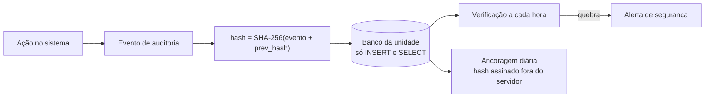

[Índice](README.md) · [Parte anterior](parte-03-identidade-acesso-e-permissoes.md) · [Próxima parte](parte-05-portais-navegacao-e-interface.md)

<a id="parte-4"></a>

# Parte 4 — Segurança, privacidade e auditoria

## Visão geral da parte 4

Segurança e privacidade fazem parte do desenho desde o início: segredos no cofre, dados pessoais mínimos e uma trilha de auditoria imutável ([05](#doc-05), [07](#doc-07), [29](#doc-29)).



**Regras principais**
- Nenhum segredo em texto claro; chave-mestra do cofre fora do host da aplicação ([05](#doc-05); ADR-05).
- LGPD: base legal registrada, minimização, direitos do titular com prazo, incidentes comunicados à ANPD ([07](#doc-07)).
- Auditoria com cadeia de hash, leitura que também gera evento e exportação com MFA ([29](#doc-29)).
- Atendimento (helpdesk e SAC) e privacidade por portal, com o DPO de cada entidade ([32](#doc-32)).

<a id="doc-05"></a>

## 05 — Segurança

> Parte do [SDD v2](parte-01-visao-e-escopo.md#doc-00). Identidade e acesso em [06](parte-03-identidade-acesso-e-permissoes.md#doc-06); privacidade em [07](#doc-07).

---

### 1. Postura

A v1 declara risco **baixo** e zero achados abertos de severidade média ou superior (**[Declarado]**, auditorias de 10 e 11/07/2026). Essa afirmação não é usada como base de decisão nesta versão. A v2 exige que cada controle tenha teste ou evidência reproduzível. Os achados verificados contra o código estão em [13-achados-v1.md](parte-01-visao-e-escopo.md#doc-13).

### 2. Controles

| Área | Requisito | Verificação |
|---|---|---|
| Senhas | Argon2id. Parâmetros mínimos do OWASP Password Storage Cheat Sheet: m = 19 MiB, t = 2, p = 1. **Parâmetros do produto (decisão do autor, 02/11/2026): m = 64 MiB, t = 4, p = 3.** Devem ser aceitos se o p95 de login, medido em hardware de produção, ficar abaixo de 500 ms. | **[Verificado]** `app/Security/Argon2idProfile.php` usa m = 64 MiB, t = 4, p = 2 (constante `THREADS`). **Pendente:** alinhar o código a p = 3. Teste de benchmark em CI. |
| Pepper de senha | Chave HMAC fora do banco, no cofre de segredos (ADR-05). Rotação com verificação dupla. | **[Planejado]** |
| Tokens | RS256 fixo. Rejeitar `alg` diferente, `none` e HS256. | **[Verificado parcial]**: `config/jwt.php` usa RS256 por padrão e bloqueia HS256 em produção, mas `JWT_SECRET` ainda é lido por código de proteção de ativos. Separar em segredo próprio por finalidade e não reutilizar o nome de JWT. |
| Sessão | Idle 30 min, absoluta 12 h, regeneração do ID após login e troca de privilégio. | Teste de integração. |
| Cookies | `HttpOnly`, `Secure`, `SameSite=Lax`, prefixo `__Host-` (ver [06](parte-03-identidade-acesso-e-permissoes.md#doc-06), seção 7). | Teste de cabeçalho. |
| CSRF | Token sincronizador por sessão + validação de `Origin` ou `Sec-Fetch-Site`. Dupla submissão é aceita só para API de cookie. | Teste automatizado. |
| CSP | `default-src 'self'`; `script-src 'self' 'nonce-…'`; sem `unsafe-inline`; sem `on*=` em HTML (ADR-07). Trusted Types em modo report-only antes de forçar. | **[Verificado parcial]**: ver ACH-01 em [13](parte-01-visao-e-escopo.md#doc-13). |
| Cabeçalhos | HSTS com `max-age` ≥ 1 ano em produção; `X-Content-Type-Options: nosniff`; `X-Frame-Options: DENY` ou `frame-ancestors 'none'`; `Referrer-Policy: strict-origin-when-cross-origin`; `Permissions-Policy` restritiva. | Teste de cabeçalho em CI. |
| Autorização | Default-deny. Toda rota com permissão ou rota pública explícita. | Teste que percorre o roteador e falha em rota sem regra. |
| Tenant | Ver [03](parte-02-arquitetura-e-tenancy.md#doc-03), seção 3. | Matriz de isolamento. |
| Rate limit | Por IP, por identificador (com atraso progressivo, não bloqueio total) e por tenant. | Teste de carga leve em CI. |
| Upload | Limite de tamanho; validação por assinatura do arquivo (magic bytes) e por lista branca de tipos; renomeação com UUID; antivírus quando disponível; servido por controller com `Content-Disposition` e `X-Content-Type-Options: nosniff`. Nunca dentro de diretório público. | Teste com arquivo renomeado (`.php` com conteúdo de imagem). |
| Imagens protegidas | Marca d'água e URL assinada com expiração para conteúdo restrito. | **[Planejado]** |
| SQL | Somente prepared statements. Ordenação e nomes de coluna em lista branca. | Análise estática (regra de SQL com interpolação). |
| Saída | Escapamento contextual em HTML, atributo, JavaScript e URL. | Teste de XSS automatizado. |
| Erros | `display_errors=0` em produção; resposta genérica; detalhe só no log interno. | Teste de configuração. |
| Logs | Sem senha, token, cookie, CPF, e-mail completo ou corpo de requisição sensível. Mascaramento na escrita. | Teste com dados sintéticos. |
| Criptografia em repouso | AES-256-GCM para dados sensíveis, chave derivada com HKDF e envelope com versão. | **[Declarado]**; teste de decifragem com rotação. |
| Biblioteca de cofre própria (D-02) | Primitivas de `libsodium` ou OpenSSL, sem algoritmo novo. Envelope cifrado com chave de dados; chave-mestra fora do host da aplicação e nunca no mesmo arquivo do envelope. Revisão externa de criptografia antes de produção. | **[Planejado]** |
| Criptografia em trânsito | TLS 1.2 mínimo, preferencialmente 1.3. | Teste externo com ferramenta de TLS, em homologação. |

### 3. Contas e ferramentas de desenvolvimento

- **Proibido em qualquer diretório implantado:** scripts que criam sessão para contas reais, que imprimem identificadores de sessão ou que desativam autenticação. A v1 inclui 162 arquivos em `scratch/` na raiz do código, entre eles scripts que criam sessão para a conta de desenvolvedor (ACH-06). Esses arquivos são removidos do repositório. Regra de CI proíbe qualquer script que crie sessão ou imprima identificador de sessão. IP de origem não é controle válido, porque é forjável atrás de proxy.
- Diretórios `uploads/`, `workspace/`, `storage/`, `node_modules/` e `vendor/` com dados de execução não entram no artefato de deploy. A exclusão é verificada no pipeline (ver [10](parte-17-operacao-qualidade-testes-e-ti.md#doc-10)).

### 4. Cadeia de suprimentos

| Controle | Regra |
|---|---|
| Versões | Pacotes com versão exata no lockfile. Nada de `latest`. |
| Instaladores de terceiros | Proibido executar em produção. Em desenvolvimento, versão fixada e checksum conferido antes da execução. |
| Auditoria | `composer audit` e `npm audit` em CI. Falha em alto ou crítico sem exceção registrada com prazo. |
| Segredos no código | `gitleaks` no pre-commit e no CI. Achado bloqueia merge. |
| SBOM | CycloneDX gerado por build: **[Planejado]**. Assinatura e procedência (SLSA) também são **[Planejado]**. |
| Ferramentas de IA e agentes | Versão fixada, revisão do código-fonte antes da instalação e sem permissão de escrita fora do repositório. Ver [11](parte-17-operacao-qualidade-testes-e-ti.md#doc-11). |

### 5. Modelo de ameaças (resumo STRIDE)

| Categoria | Ameaça | Controle principal |
|---|---|---|
| Spoofing | Login com credencial vazada; sessão roubada | Argon2id, MFA, breach-check, sessão com vínculo de dispositivo (D-03) |
| Tampering | Alteração de parâmetro de tenant ou preço | Tenant do contexto; validação no serviço; assinatura em webhook |
| Repudiation | Negar ação administrativa | Auditoria com ator, ação, alvo, antes/depois, IP e requisição |
| Information disclosure | Enumeração de IDs; vazamento de tenant; erro com SQL | UUID, 404 uniforme, erro genérico, filtro de campo |
| Denial of service | Bloqueio de conta por tentativas; exportação pesada; payload grande | Atraso progressivo; fila para exportação; limite de payload |
| Elevation of privilege | Acesso de professor a dados de outra unidade; conta master sem MFA | Default-deny; permissão de unidade; MFA obrigatória para conta de plataforma |

Ameaças adicionais que a v2 inclui: **SSRF** em webhooks e integrações (bloqueio de redes privadas), **CSV injection** em exportações (regra em [08](parte-05-portais-navegacao-e-interface.md#doc-08), seção 3) e **open redirect** em telas de login. Também: **injeção de prompt** em recursos com IA (dados de aluno enviados a provedor externo sem minimização; saída do provedor tratada como dado não confiável), **mass assignment** (campos de papel e de tenant não são aceitos do corpo da requisição) e **path traversal** em download (o caminho nunca vem do cliente; só o ID do arquivo).

### 6. Resposta a incidentes

| Severidade | Início do tratamento | Contenção | Comunicação interna |
|---|---|---|---|
| Crítica | 1 h | 4 h | Imediata ao responsável e à diretoria |
| Alta | 4 h | 24 h | Em até 8 h |
| Média | 1 dia útil | 7 dias | Relatório semanal |
| Baixa | 3 dias úteis | Próxima entrega | Registro no backlog |

- Runbook e modelo de comunicação à ANPD: ver [07](#doc-07), seção 8.
- Exercício de mesa semestral com registro.

### 7. Critérios de aceite de segurança (para cada release)

- [ ] Nenhum achado aberto de severidade alta ou crítica sem exceção aprovada.
- [ ] Testes de isolamento de tenant e de autorização passando.
- [ ] Varredura de dependências sem vulnerabilidades altas ou críticas.
- [ ] Varredura de segredos sem achados.
- [ ] Varredura dinâmica (DAST) em homologação, sem achado médio ou superior não tratado.
- [ ] Revisão de mudança em autenticação, autorização, cripto ou upload por pessoa com perfil de segurança.
- [ ] Nenhum arquivo de desenvolvimento no artefato de deploy.

<a id="v1-05-security-architecture-md"></a>

### v1 — `05-security-architecture.md` (69 linhas)

> Situação na v2: Substituído por 05. Quando este texto diverge da v2, vale a v2.

> Esta especificação foi substituída por inteiro pelo documento indicado acima. O texto fica como histórico; para implementar, vale o documento da v2.

> **Documento derivado do SDD mestre** · **Data:** 04/08/2026
> **Detalhes completos:** `docs/security/control-matrix.md`, `docs/security/findings-register.md`, `docs/threat-model-STRIDE.md`, `docs/MASTER_AUDIT_REPORT_2026-07-11.md`, `docs/security/audit-2026-07-10.md`

---

#### 1. Postura atual

- **Nível de risco: BAIXO** (auditorias 10-11/07/2026, validadas 04/08/2026).
- **36 achados** registrados → **34 FIXED**, 2 backlog (Vault KMS, SBOM).
- **0 críticos / 0 altos / 0 médios abertos.** CVSS residual máx 2.0.

#### 2. Principais controles (resumo)

| Área | Controle |
|------|----------|
| Senhas | Argon2id m=65536 (64MiB), t=4, p=2, hash 32B + salt 32B (sodium) + pepper HMAC-SHA256 via Vault |
| MFA | TOTP/WebAuthn/passkey/cert apenas (email/SMS/Tele rejeitados) |
| Tokens | JWT RS256 (HS256 bloqueado), blacklist jti, rotação de chaves, refresh rotativo |
| Sessão | idle 30min, absolute 12h, máx 3 concorrentes, bind IP+UA, regeneração pós-login |
| Cookies | Secure+HttpOnly+SameSite=Strict, rotação 5min |
| Headers | CSP nonce + Trusted Types, HSTS preload, XFO DENY, nosniff, COOP/CORP, Referrer-Policy, Permissions-Policy |
| CSRF | Double-submit + Origin/Referer |
| AuthZ | Default-deny global, BOLA/BFLA/BOPLA, RBAC por permissão, tenant scoping |
| Rate limit | Global + por identificador + por tenant + por IP |
| Uploads | MIME/magic/ext whitelist, rename, fora do webroot |
| Dados | AES-256-GCM + HKDF-SHA256 + envelope versionado |
| Secrets | Vault abstraction (FileVault ativo; KMS/HashiCorp prontos) |
| LGPD | Consentimento, DSR, DPO, breach 72h (ANPDReporter), sem PII em logs |

#### 3. Gates de segurança do SDD

| Gate | Momento | Aprovador |
|------|---------|-----------|
| SG-01 | Fechamento arquitetura base | Oracle + Security Auditor v3 |
| SG-02 | Fechamento Auth/ACL/Tenancy | Mantis + Security Auditor v3 |
| SG-03 | Antes de módulos sensíveis | Orchestrator + Mantis + Security Auditor v3 |
| SG-04 | Antes de homologação | Mantis + Fable Judge + Security Auditor v3 |
| SG-05 | Antes de release | Security Council + Security Auditor v3 |

**Estado:** SG-01..SG-04 validados; auditoria contínua e quality gates orientados a CI operando com a skill unificada `totustuus-security-auditor-v3` (`.agents/skills/totustuus-security-auditor-v3/SKILL.md`) cobrindo ASM, SAST, DAST, Argon2id, Multi-Tenancy e LGPD.

#### 4. Segurança por camada (implementação real)

- **app/Security/** (33 classes): PasswordManager, Argon2idProfile/Sodium, JWTManager, OAuthManager, WebAuthnManager, MFAManager, Totp, Base32, Csrf, RateLimiter, AuthorizationGuard, SessionSecurityService, RiskEngine, GeoLocationService, ClientIp, CspNonce, DataEncryption, KeyManager, TokenManager, Vault+Providers (File/HashiCorp/AwsKms), TenantCacheVault, ANPDReporter, AssetProtection, ImageProtection, AssetPathMapper, Ulid.
- **Middleware** (20): SecurityHeaders, Security, SessionSecurity, Csrf, Auth, Guest, Admin, Portal, Authorize, StrictAuthorize, ApiAuth, ApiSecurity, ApiSchema, RateLimit, Audit, HmacAuth, Idempotency, InstallToken, LogTruncation.

#### 5. Threat model

- STRIDE documentado em `docs/threat-model-STRIDE.md`.
- Superfícies: auth, API, CRUD genérico, uploads, webhooks, admin tools, tenancy.
- Mitigações ativas para cada categoria STRIDE (ver control-matrix).

#### 6. Resposta a incidentes

- `docs/security/incident-response-runbook.md` (tempos: crítico 1h, alto 4h, médio 24h, baixo 72h).
- `docs/security/breach-template-anpd.md` (LGPD Art. 48 — 72h ANPD).
- `ANPDReporter::report()` instrumentado.

#### 7. Melhorias planejadas (backlog)

| Item | Prioridade |
|------|-----------|
| Ativar AwsKmsVaultProvider/HashiCorpVaultProvider em produção (F-02) | Alta |
| SBOM + provenance no build (SLSA) | Média (Onda B) |
| CAPTCHA real (reCAPTCHA/Turnstile) — config já prevê `captcha_after_attempts` | Média |
| Expansão DAST (ZAP) | Média |
| Auditoria de secrets em CI (gitleaks já) + dependency scanning periódico | Baixa |

<a id="doc-07"></a>

## 07 — Privacidade e LGPD

> Parte do [SDD v2](parte-01-visao-e-escopo.md#doc-00). Este documento é técnico. Não substitui parecer jurídico. Pontos marcados **(jurídico)** precisam de confirmação antes do go-live.

---

### 1. Compromissos

1. Coletar apenas o dado necessário para uma finalidade declarada.
2. Informar o titular antes da coleta, em linguagem simples.
3. Responder às solicitações de direitos dentro do prazo legal.
4. Apagar ou anonimizar quando a finalidade acaba e não há obrigação legal de guarda.
5. Tratar dados de crianças e adolescentes com o melhor interesse, consentimento parental quando exigido e minimização reforçada. (Ecossistema educacional: **(jurídico)** confirmar bases por tipo de dado.)

### 2. Inventário de dados

Cada tabela com dado pessoal tem, no registro de dados (ROPA), os campos: finalidade, base legal, categoria do titular, categoria do dado, operador, prazo de retenção e medida de segurança.

| Categoria | Exemplos | Sensibilidade |
|---|---|---|
| Identificação | Nome, e-mail, telefone, documento (CPF, RG) | Alta. Documento de identificação tem acesso restrito por política; não é dado sensível no sentido do art. 5º, II, LGPD. |
| Família | Responsáveis, parentesco | Alta (menores) |
| Acadêmico | Notas, frequência, histórico | Média |
| Saúde | Laudos, deficiência, alergias | **Sensível** (art. 11 LGPD) |
| Financeiro | Cobrança, dados bancários | Alta |
| Acesso | Logs de sessão, IP, User-Agent | Média |

### 3. Bases legais

Matriz de base legal por finalidade. Status: **proposta, pendente de parecer jurídico**. Nenhuma linha é válida para produção antes da confirmação. Citações de artigos referem-se à LGPD (Lei 13.709/2018).

| Finalidade | Dado | Base proposta | Legislação setorial a confirmar | Confirmação |
|---|---|---|---|---|
| Matrícula e vínculo acadêmico | Identificação, responsáveis | Execução de contrato ou procedimentos preliminares (art. 7º, V); obrigação legal (art. 7º, II) | Normas de educação e de registro escolar | **(jurídico)** |
| Cobrança de mensalidades | Identificação, financeiro | Execução de contrato (art. 7º, V); exercício regular de direitos (art. 7º, VI) | Código de Defesa do Consumidor, quanto a cobrança e negativação | **(jurídico)** |
| Recursos humanos e folha | Identificação, salário, documentos trabalhistas | Obrigação legal (art. 7º, II) | CLT e normas do eSocial | **(jurídico)** |
| Segurança e medicina do trabalho | Dado de saúde ocupacional | Tutela da saúde (art. 11, II, f) ou obrigação legal (art. 11, II, a) | NRs do Ministério do Trabalho e Emprego | **(jurídico)** |
| Marketing | Contato | Consentimento (art. 7º, I), com revogação simples | Regras de envio de mensagens | **(jurídico)** |
| Segurança e logs | Acesso, IP, registro de ações | Legítimo interesse (art. 7º, IX), com teste de balanceamento documentado | Normas de segurança da informação | **(jurídico)** |
| Consulta por CPF ([21](parte-16-dados-validacoes-configuracoes-e-armazenamento.md#doc-21), seção 6.8) | Identificação | Mesma base da finalidade declarada pelo tenant, sem base própria | Conforme a finalidade | **(jurídico)** |

**Escopo de legislação:** esta matriz cobre a legislação brasileira. Não afirma conformidade com outras jurisdições. A plataforma só atende outro país após revisão específica (lacuna LAC-15 em [19](parte-07-regras-gerais-dos-modulos-de-gestao.md#doc-19)). "Atender toda a legislação" não é uma condição que este SDD possa certificar: é tarefa contínua do jurídico, com revisão a cada mudança normativa.

### 4. Direitos do titular

| Direito | Entrega | Prazo de referência |
|---|---|---|
| Confirmação e acesso | Exportação em formato legível e portável | 15 dias (art. 19 LGPD) |
| Correção | Edição com trilha de auditoria | Imediato quando possível |
| Anonimização, bloqueio ou eliminação | Processo de retenção | Conforme política e prazos legais |
| Portabilidade | JSON ou CSV | 15 dias |
| Revogação de consentimento | Efeito imediato nas finalidades dependentes | Imediato |
| Informação sobre compartilhamento | Lista de operadores e terceiros | 15 dias |

- Solicitação gera protocolo, registro e resposta por canal verificado.
- Exportação de dados pessoais exige step-up de autenticação (ver [06](parte-03-identidade-acesso-e-permissoes.md#doc-06)).
- Fluxo de pedido de titular para o responsável legal de menor segue a mesma regra, com verificação de vínculo.

### 5. Retenção

- Prazo por categoria definido pela plataforma. A entidade pode reduzir, não estender além do que a lei permite. **(jurídico)** confirmar prazos de guarda de documentos escolares.
- Job diário de expurgo com relatório. Eliminação física registra data e tipo, sem guardar o dado eliminado.
- Backups seguem a mesma regra: retenção de backup é limitada e documentada, e restauração de backup reaplica expurgos já executados.

### 6. Minimização nos logs

- Sem senha, token, cookie, CPF, dado de saúde ou corpo completo de requisição em log.
- E-mail e telefone mascarados (`j***@d***.com`).
- Logs de auditoria mantêm identificador interno do ator, não o nome.

### 7. Transferência e operadores

- Lista de operadores (provedores de e-mail, SMS, pagamento, nuvem) com contrato de tratamento de dados.
- Transferência internacional só para países com nível adequado ou com cláusulas-padrão. **(jurídico)**
- Integrações enviam somente os campos necessários ao contrato com o terceiro.

### 8. Incidentes e comunicação à ANPD

A v1 cita prazo de **72 horas**. A v2 corrige para o texto vigente: a Resolução CD/ANPD nº 15/2024 fixa o prazo de comunicação de incidente com risco ou dano relevante em **três dias úteis** a partir do conhecimento do incidente, e o art. 48 da LGPD exige comunicação ao titular. **(jurídico)** confirmar o prazo vigente antes de publicar o runbook.

Passos do runbook:

1. Conter e preservar evidências (sem alterar logs).
2. Avaliar: tipo de dado, volume de titulares, risco aos direitos, medidas aplicadas.
3. Comunicar internamente conforme severidade ([05](#doc-05), seção 6).
4. Comunicar à ANPD e aos titulares quando houver risco ou dano relevante, com conteúdo do modelo oficial.
5. Registrar o incidente, causa, ações e lições aprendidas.

### 9. Métricas de privacidade

| Métrica | Meta |
|---|---|
| Pedidos de titular atendidos no prazo | 100% |
| Dados com retenção vencida e não expurgados | 0 |
| Campos sensíveis em log (varredura) | 0 |
| Operadores sem contrato de tratamento | 0 |

### 10. Lacunas

Itens que a v1 listava como lacuna e que continuam abertos: ROPA completo por tabela, parecer de legítimo interesse, prazos de retenção aprovados, fluxo de consentimento para menores. Cada um tem dono e prazo no [backlog](parte-17-operacao-qualidade-testes-e-ti.md#doc-11).

<a id="v1-08-privacy-lgpd-md"></a>

### v1 — `08-privacy-lgpd.md` (66 linhas)

> Situação na v2: Substituído por 07. Quando este texto diverge da v2, vale a v2.

> Esta especificação foi substituída por inteiro pelo documento indicado acima. O texto fica como histórico; para implementar, vale o documento da v2.

> **Documento derivado do SDD mestre** · **Data:** 04/08/2026

---

#### 1. Compromisso

Tratamento de dados pessoais em conformidade com LGPD (Lei 13.709/2018), com bases legais, consentimento granular, DSR e instrumentação de incidentes 72h.

#### 2. Instrumentação implementada

| Funcionalidade | Implementação |
|----------------|---------------|
| Consentimento | `UserConsent`, `PrivacyConsentEvent` (consentimento explícito, revogável, com versão) |
| Cookie consent | `UserCookieConsent` + `UserCookieConsentItem`, `CookieCatalog`, `CookieCategory`, `ConsentBannerVersion` |
| Preferências de privacidade | `UserPrivacyPreferences`, `PrivacyPreference` |
| Config por tenant | `TenantPrivacySetting` (retenção, mfa_required, etc.) |
| DSR (dados pessoais) | `PrivacyDataSubjectRequest` + workflow (acesso, correção, portabilidade, eliminação, revogação, opor) |
| DPO | `PrivacyOfficer` (nome/contato por tenant) |
| Auditoria | `PrivacyAuditLog` + `PrivacyComplianceController` (compliance 62 views) |
| Incidentes | `ANPDReporter` + `docs/security/breach-template-anpd.md` (Art. 48, 72h) |
| Minimização | Logs sem PII (LogTruncation), retenção configurável |

#### 3. Bases legais (implementadas)

- Consentimento explícito (consent records versionados).
- Contrato/legítimo interesse (termos + política, com histórico).
- Obrigação legal (retenção fiscal, ANPD).
- Direitos: acesso, correção, portabilidade, eliminação, revogação, oposição, não-decisão automatizada.

#### 4. Ciclo de vida de dados

```
Coleta (consent/bases) → Armazenamento (cifrado AES-256-GCM; backups) →
Uso (tenant-scoped) → Compartilhamento (somente com consentimento; integrações) →
Retenção (config por tenant) → Eliminação (soft/hard delete; DSR)
```

#### 5. Dados pessoais sensíveis

- Biométricos (WebAuthn credenciais → cifradas em vault-adjacent storage).
- Documentos (upload com AccessControl + cifragem).
- Saúde/educação (grade, matrículas — tenant-scoped).
- Minors: consentimento parental (modelos `*Parent*`).

#### 6. Prazos de retenção (configurável por tenant)

- Sessões/logs: config (default em `config/security.php`).
- DSR: registro por 5 anos (obrigação legal).
- Dados não necessários: eliminados após DSR.

#### 7. Métricas

- **~85% implementado** (GAP_ANALYSIS_2026-08-04.md).
- Compliance views: 62 (módulo compliance).
- Testes: Privacy/Consent/Cookie/DSR test classes (ver tests/).

#### 8. Lacunas

| Lacuna | Ação |
|--------|------|
| DSR workflow de ponta-a-ponta com interface | Reforçar views (algumas existem) |
| Minimização automática (pseudo-anonimização) | Melhoria contínua |
| Mapeamento de dados (records of processing) | Criar documento de registro de operações (ROPA) |
| ANPD contactos por tenant preenchidos | Validar dados de `PrivacyOfficer` por tenant |

<a id="doc-29"></a>

## 29 — Auditoria: Registro, Integridade, Acesso e Retenção

> Parte do [SDD v2](parte-01-visao-e-escopo.md#doc-00). Princípios iniciais em [18](parte-07-regras-gerais-dos-modulos-de-gestao.md#doc-18), seção 4. Busca por CPF em [21](parte-16-dados-validacoes-configuracoes-e-armazenamento.md#doc-21), seção 6.8. Prazos em [26](parte-18-juridico-e-regulatorio.md#doc-26), seção 3. Bancos por entidade e unidade em [03](parte-02-arquitetura-e-tenancy.md#doc-03), seção 1.1.
> **Status:** especificação proposta. Este documento consolida a auditoria, que estava espalhada em 80 menções. Prazos marcados como pendentes dependem do jurídico ([25](parte-18-juridico-e-regulatorio.md#doc-25)).

---

### 1. O que a auditoria registra

Um evento de auditoria existe para responder: **quem fez o quê, em qual objeto, quando, de onde, com qual resultado e com que contexto.**

| Categoria | Exemplos | Obrigatório |
|---|---|---|
| Autenticação | Login, falha de login, bloqueio, troca de senha, MFA, sessão encerrada | Sim |
| Autorização | Troca de contexto, acesso negado, concessão e revogação de vínculo ou papel | Sim |
| Dado sensível | Leitura de cadastro civil, de ficha de saúde, de salário, de dado bancário | Sim |
| Alteração de dado | Criação, alteração e exclusão lógica ou física, com antes e depois | Sim |
| Exportação e download | Exportação de lista, download de arquivo, envio de relatório | Sim |
| Consulta por CPF | Consulta, resultado e finalidade ([21](parte-16-dados-validacoes-configuracoes-e-armazenamento.md#doc-21), seção 6.8) | Sim |
| Configuração | Alteração de política, de MFA, de canal, de integração, de feature flag | Sim |
| Pagamento e estorno | Cobrança, baixa, estorno, aprovação dupla ([20](parte-10-financeiro-pagamentos-e-fiscal.md#doc-20)) | Sim |
| Consentimento | Concessão, revogação e versão do texto aceito | Sim |
| Processo | Job, expurgo, migração, reprocessamento de fila, bloqueio legal | Sim |
| Leitura comum | Abertura de tela sem dado sensível | Não (só amostragem, se medido) |

Regra: se a ação altera estado, lê dado sensível ou tem efeito financeiro, a auditoria é obrigatória e **gravada antes da resposta**. Se a gravação falhar, a ação é recusada.

---

### 2. Formato do evento

Todo evento tem o mesmo esquema, em todos os módulos.

| Campo | Tipo | Regra |
|---|---|---|
| `event_id` | UUIDv4 | Gerado pela aplicação |
| `occurred_at` | DATETIME(6) UTC | Relógio sincronizado por NTP. Desvio acima de 1 s gera alerta. |
| `category` | Enum | Uma das categorias da seção 1 |
| `action` | Texto curto | Ex.: `student.grade.update`, `invoice.refund.approve` |
| `result` | Enum | `sucesso`, `negado`, `erro` |
| `actor_uuid` | UUID | Conta global ([06](parte-03-identidade-acesso-e-permissoes.md#doc-06), seção 12). `NULL` apenas para processos do sistema, com `actor_kind = sistema`. |
| `actor_kind` | Enum | `pessoa`, `sistema`, `integracao`, `suporte` |
| `portal` | Enum | Obrigatório. `desenvolvedor`, `gestao`, `professor`, `aluno`, `responsaveis`, `terceiros`, `publico`, `sistema`. Portal de onde a ação partiu ([31](parte-05-portais-navegacao-e-interface.md#doc-31), seção 5). Permite filtrar a auditoria por portal sem ler o objeto |
| `entity_uuid`, `unit_uuid` | UUID | Contexto do evento |
| `session_id` | UUID | Sessão que originou a ação |
| `object_type`, `object_uuid` | Texto e UUID | Objeto afetado |
| `before_hash`, `after_hash` | CHAR(64) | Hash do estado antes e depois. O conteúdo completo fica no campo `diff`, quando permitido. |
| `diff` | JSON | Campos alterados. Campos sensíveis aparecem mascarados ou ausentes. |
| `reason` | Texto | Obrigatório em estorno, reabertura, bloqueio legal, leitura de dado sensível fora da rotina e consulta por CPF com detalhe |
| `ip`, `user_agent` | Texto | User-agent truncado em 200 caracteres |
| `correlation_id` | UUID | Liga eventos de uma mesma operação e ao log técnico ([10](parte-17-operacao-qualidade-testes-e-ti.md#doc-10), seção 7) |
| `prev_hash`, `hash` | CHAR(64) | Cadeia de integridade (seção 4) |

Proibido no evento: senha, token, segredo, número de cartão, CVV, conteúdo completo de dado de saúde e CPF em texto. Usar hash HMAC quando for preciso identificar um CPF.

---

### 3. Onde fica

| Auditoria | Banco | Motivo |
|---|---|---|
| Ações de unidade (alunos, notas, financeiro, arquivos) | Banco da unidade | Acompanha o dado. Mesma retenção do dado. |
| Ações de identidade e de vínculo | Master | Autenticação e acesso são globais ([06](parte-03-identidade-acesso-e-permissoes.md#doc-06), seção 12) |
| Leitura de cadastro civil | Banco de identidade da entidade | Acompanha o cadastro ([14](parte-02-arquitetura-e-tenancy.md#doc-14), seção 3) |
| Ações da plataforma (Editor de portais, suporte, configuração global) | Master | Operação da plataforma |
| Processos e integrações | Banco da unidade ou master, conforme o escopo | Correlação por `correlation_id` |

Cópia de auditoria para armazenamento de longo prazo é feita por exportação diária assinada. Não é uma segunda fonte de verdade.

---

### 4. Integridade

1. **Cadeia de hash:** cada evento guarda `prev_hash`, o hash do evento anterior do mesmo banco e categoria. `hash = SHA-256(event canônico + prev_hash)`.
2. **Verificação:** job a cada hora recalcula a cadeia do último dia. Quebra gera alerta de segurança.
3. **Ancoragem:** o hash do último evento de cada dia é assinado e enviado a armazenamento separado, com a chave fora do servidor de dados ([05](#doc-05)).
4. **Imutabilidade no banco:** a conta da aplicação tem permissão de `INSERT` e `SELECT` na tabela de auditoria. Não tem `UPDATE` nem `DELETE`. Expurgo usa conta própria de processo de retenção, com registro.
5. **Correção:** erro em evento não é alterado. Gera evento de correção que referencia o original.

---

### 5. Acesso à auditoria

| Papel | Pode ver | Não pode ver |
|---|---|---|
| Auditor interno (segurança) | Todas as categorias, com mascaramento padrão | Conteúdo de dado de saúde, sem motivo registrado |
| Gestor da unidade | Eventos da própria unidade, exceto segurança da plataforma | Eventos de outra unidade |
| Encarregado (DPO) | Consultas por CPF, leituras de cadastro civil, pedidos de titular | Conteúdo de dado de saúde |
| Titular | Relatório sobre o próprio dado: quem consultou ou alterou, sem motivo livre de terceiros | Eventos de outras pessoas |
| Suporte da plataforma | Eventos técnicos e de sessão do chamado | Dado de aluno sem vínculo |

Regras:

- Toda leitura da auditoria gera evento de auditoria (`audit.read`).
- Exportação da auditoria exige MFA recente e motivo.
- Acesso à auditoria de outra entidade é impossível pela aplicação. Só é possível por processo jurídico, com registro fora do sistema.

---

### 6. Mascaramento

- CPF: `***.456.789-**` na listagem. Completo só com motivo.
- E-mail: `j***@d***.com`.
- Telefone: últimos quatro dígitos.
- Dado de saúde: presença e tipo do registro, sem conteúdo.
- Valor salarial: sem valor, só indicação de que foi alterado.

---

### 7. Retenção

| Categoria | Prazo | Situação |
|---|---|---|
| Registro de acesso (login, sessão, IP) | 6 meses | Base: Marco Civil, art. 15. Confirmar ([26](parte-18-juridico-e-regulatorio.md#doc-26), J-01). |
| Consulta por CPF | 24 horas | Decisão do autor. Conflito com o registro de acesso e com o relatório ao titular. Ver [25](parte-18-juridico-e-regulatorio.md#doc-25), Q-01. |
| Alteração de dado de unidade | Mesma retenção do dado | Ver [26](parte-18-juridico-e-regulatorio.md#doc-26), seção 3 |
| Pagamento e estorno | Prazo fiscal e de consumo | Confirmar ([26](parte-18-juridico-e-regulatorio.md#doc-26), seção 3) |
| Ação de plataforma | 5 anos | **Aprovado pelo autor em 03/11/2026.** Parecer jurídico ainda não registrado ([25](parte-18-juridico-e-regulatorio.md#doc-25)). |
| Evento de expurgo | Permanente | Registro do expurgo sem o dado |

Expurgo por job, com registro. Bloqueio legal impede expurgo do evento.

---

### 8. Alertas

| Alerta | Condição |
|---|---|
| Quebra de cadeia | Qualquer quebra |
| Gravação falhou | Qualquer falha de gravação de evento obrigatório |
| Leitura em volume | Leitura de dado sensível acima do padrão do usuário |
| Consulta por CPF | Padrão de varredura ([21](parte-16-dados-validacoes-configuracoes-e-armazenamento.md#doc-21), seção 6.8) |
| Acesso de suporte a dado de tenant | Qualquer acesso fora de chamado vinculado |
| Desvio de relógio | Mais de 1 s |

#### 8.1 Envio para central de segurança (AUD-03)

A integração é **opcional**. A auditoria do banco continua a fonte de verdade. A central de segurança (SIEM) recebe cópia, para correlação e alerta.

| Item | Regra |
|---|---|
| Da plataforma | Eventos de segurança do master (login, MFA, bloqueio, acesso negado, ação de plataforma, acesso de suporte) e os alertas desta seção vão para a central da empresa desenvolvedora |
| Da entidade | A entidade que tem central própria recebe só os eventos de segurança dela, por exportação assinada ou pelo webhook de saída da unidade (SRC-06). Nunca recebe evento de outra entidade nem da plataforma |
| Conteúdo | Evento com o mascaramento da seção 6. Pessoa identificada por `uuid`, sem CPF, e-mail ou nome. Sem dado de saúde, nota, valor salarial ou conteúdo de mensagem |
| Transporte | Só saída, da plataforma para a central, com TLS e assinatura do lote. A central não tem acesso de leitura ao banco |
| Falha | Falha de envio não bloqueia a ação do usuário. Os eventos ficam em fila e são reenviados na ordem, com o hash da cadeia (seção 4), para a central detectar lacuna |
| Log | O conector grava log de integração ([49](parte-17-operacao-qualidade-testes-e-ti.md#doc-49), seção 2.1) |
| Produto | Escolha do produto e teste de envio ficam para homologação, como em AUD-02 |

---

### 9. Testes obrigatórios

- Ação que altera dado grava evento antes da resposta. Falha na gravação recusa a ação.
- Evento não aceita `UPDATE` nem `DELETE` pela conta da aplicação.
- Quebra de cadeia é detectada.
- Evento não contém senha, token, CPF em texto nem dado de saúde (varredura).
- Usuário de uma unidade não lê auditoria de outra.
- Leitura da auditoria gera evento.
- Relatório ao titular não inclui motivo livre de terceiro.

---

### 10. Lacunas

| # | Lacuna | Dono |
|---|---|---|
| AUD-01 | Prazo de retenção de eventos de plataforma: **5 anos, aprovado pelo autor em 03/11/2026.** Registrar parecer jurídico quando houver ([25](parte-18-juridico-e-regulatorio.md#doc-25), Q-01). | Jurídico |
| AUD-02 | Armazenamento de longo prazo e ancoragem: **decidido pelo autor em 03/11/2026**, com a exportação diária assinada da seção 3. Escolha do produto concreto e teste de restauração ficam para homologação. | Operação |
| AUD-03 | Integração com central de segurança, se houver | **Escrito** em 03/11/2026, seção 8.1. Escolha do produto em homologação |
| AUD-04 | Campo `portal` no evento | **Feito** em 03/11/2026: incluído na seção 2 |

---

### 11. Critérios de aceite

- [ ] Todas as categorias da seção 1 implementadas e testadas.
- [ ] Esquema da seção 2 aplicado em todos os bancos (unidade, identidade e master).
- [ ] Cadeia de hash verificada diariamente, com alerta.
- [ ] Testes da seção 9 passando em CI.
- [ ] AUD-01 e AUD-02 decididas (03/11/2026). Produto de longo prazo escolhido e restauração testada antes de produção.

<a id="doc-32"></a>

## 32 — Atendimento (Help Desk, SAC), Privacidade, LGPD e Encarregado, por Portal

> Parte do [SDD v2](parte-01-visao-e-escopo.md#doc-00). Matriz de portais e fronteiras em [31](parte-05-portais-navegacao-e-interface.md#doc-31). Protocolo e canais em [22](parte-06-plataforma-saas-clientes-dominios-licencas-e-crm.md#doc-22) e [31](parte-05-portais-navegacao-e-interface.md#doc-31), seção 3.2. Base legal e direitos em [07](#doc-07). Incidentes em [07](#doc-07), seção 8, e [05](#doc-05), seção 6. Auditoria em [29](#doc-29).
> **Status:** aprovada pelo autor em 03/11/2026, com as propostas adotadas. Itens sem valor definido continuam pendentes, criada em 03/11/2026 a partir das especificações da v1 ([`SPEC-HELPDESK.md`](parte-13-atendimento-e-notificacoes.md#v1-spec-helpdesk-md), [`spec_chat_rapido_sac.md`](parte-13-atendimento-e-notificacoes.md#v1-spec-chat-rapido-sac-md), [`spec_gestao_sac_base_conhecimento.md`](parte-13-atendimento-e-notificacoes.md#v1-spec-gestao-sac-base-conhecimento-md), [`spec_gestao_privacy_global_completo.md`](#v1-spec-gestao-privacy-global-completo-md), [`spec-sub-sidebar-privacidade-lgpd.md`](#v1-spec-sub-sidebar-privacidade-lgpd-md)). Itens **[Decisão do autor]** dependem de resposta. Itens **(jurídico)** dependem de parecer ([25](parte-18-juridico-e-regulatorio.md#doc-25), [26](parte-18-juridico-e-regulatorio.md#doc-26)).
> **Premissa:** o pedido diz "pdo". Entendi como **DPO (encarregado)**. Se for outra coisa, avise.
> **Atualização de 03/11/2026:** o protocolo passa a ser serviço comum, usado também por documentos recebidos, administrativos e emitidos. Ver [54](parte-09-secretaria-matricula-e-documentos.md#doc-54), seção 5.

---

### 1. Estado atual na v2

| Assunto | O que a v2 tem | Falta |
|---|---|---|
| Help desk / SAC | Só a decisão de unificar em um módulo ([19](parte-07-regras-gerais-dos-modulos-de-gestao.md#doc-19), seção 7) e as regras de bot ([22](parte-06-plataforma-saas-clientes-dominios-licencas-e-crm.md#doc-22), seção 3) | Estados, transições, SLA, filas, categorias, portal do cliente, base de conhecimento, DDL |
| Privacidade e LGPD | Compromissos, inventário, bases legais, direitos, retenção, incidentes, métricas ([07](#doc-07)) | Fluxo de solicitação do titular com estados e prazo, gestão de consentimento por finalidade, registro de tratamento (ROPA) com DDL, transferência internacional, consentimento parental, painel do DPO |
| Encarregado (DPO) | Papel citado em [22](parte-06-plataforma-saas-clientes-dominios-licencas-e-crm.md#doc-22), seção 5, e em [29](#doc-29), seção 5 | Escopo do papel no sistema, fila de aprovação, relatório de impacto (RIPD), tarefas e prazos |

Conclusão: **nenhum dos quatro assuntos está completo na v2.** Os requisitos da v1 existem, mas não foram trazidos para a v2 com estados, DDL e critério de aceite.

---

### 2. Atendimento: Help Desk e SAC

#### 2.1 Modelo único

Um só módulo de atendimento. Help desk é a base. SAC, chat rápido e tickets de canal são **canais ou tipos** do mesmo registro. Cada solicitação tem número de protocolo ([31](parte-05-portais-navegacao-e-interface.md#doc-31), seção 3.2).

**Decisão proposta:** ticket é um tipo de protocolo. Todo ticket tem número de protocolo; nem todo protocolo é ticket (ex.: requerimento de 2ª chamada pode ser protocolo sem fila de atendimento). **Decidido** em 03/11/2026: ticket é tipo de protocolo em parte. Pedido com responsável e prazo recebe protocolo.

#### 2.2 Estados do ticket (da v1)

| Estado | Próximos estados permitidos |
|---|---|
| `novo` | `aberto`, `em_triagem`, `cancelado` |
| `aberto` | `em_triagem`, `em_atendimento`, `cancelado` |
| `em_triagem` | `em_atendimento`, `escalonado`, `cancelado` |
| `em_atendimento` | `aguardando_cliente`, `aguardando_terceiro`, `aguardando_aprovacao`, `em_pausa`, `resolvido`, `escalonado` |
| `aguardando_cliente`, `aguardando_terceiro`, `aguardando_aprovacao`, `em_pausa` | `em_atendimento` ou `resolvido` |
| `resolvido` | `fechado`, `reaberto` |
| `fechado` | `reaberto`, dentro da janela configurável |
| `reaberto` | `em_atendimento` |
| `escalonado` | `em_atendimento` |
| `cancelado`, `fechado` (sem reabertura) | Estados finais |

Regras:

- Estado `aguardando_*` pausa o contador de SLA conforme a regra de SLA (abaixo).
- Cada transição grava quem, quando e motivo quando o estado for `cancelado`, `escalonado` ou `reaberto`.
- Transição inválida é recusada pela aplicação ([15](parte-16-dados-validacoes-configuracoes-e-armazenamento.md#doc-15), seção 5), não só pela tela.

#### 2.3 SLA

Tipos (da v1): primeira resposta, próxima resposta, resolução, fechamento.

Aplicação: por entidade (tenant), por cliente, por fila, por tipo, por categoria e por prioridade. A regra mais específica vence.

**Proposta de valores iniciais:** definir por entidade, sem padrão universal. Valores padrão decididos em 03/11/2026: de 1 hora a 10 dias úteis por prioridade, ajustáveis por entidade. Sem valor definido, o ticket não recebe prazo, e o painel mostra "sem SLA".

Alerta: 80% do prazo consumido, e prazo estourado. Estouro entra no painel do gestor, não no portal do solicitante.

#### 2.4 Prioridade, categoria e fila

- Prioridade: baixa, média, alta, urgente. Urgente exige categoria que permita ([15](parte-16-dados-validacoes-configuracoes-e-armazenamento.md#doc-15)).
- Categoria: lista fechada por entidade. Ex.: secretaria, financeiro, biblioteca, TI, saúde.
- Fila: uma por categoria ou unidade. Atribuição automática por fila; redistribuição pelo coordenador.

#### 2.5 Canais

Conforme [22](parte-06-plataforma-saas-clientes-dominios-licencas-e-crm.md#doc-22), seção 2, com estas regras de atendimento:

- Opção "Abrir ticket" sem IA em todo ponto de atendimento (D-18).
- Texto do solicitante é guardado literal, nunca interpretado como instrução ([05](#doc-05)).
- Campos obrigatórios variam por tipo, conforme a v1 ([`SPEC-HELPDESK.md`](parte-13-atendimento-e-notificacoes.md#v1-spec-helpdesk-md), seção 7). Lista de campos padrão é fixa para todo tipo.

#### 2.6 Portal do cliente (solicitante)

- Abertura, acompanhamento, anexos, respostas públicas por padrão (v1, seção 12), consulta da base de conhecimento e avaliação do atendimento.
- Resposta interna (nota do atendente) nunca aparece no portal.
- Consulta pública por número e CPF, sem login, com limite de tentativas ([17](parte-07-regras-gerais-dos-modulos-de-gestao.md#doc-17), seção 3).

#### 2.7 Base de conhecimento

- Artigo tem autor, revisor, versão, data de revisão e público (interno, portal ou público).
- Artigo com dado pessoal não é publicado.
- Artigo que a IA sugere ao atendente passa pela regra de [27](parte-15-inteligencia-artificial.md#doc-27) (fonte cadastrada).

#### 2.8 Atendimento por portal

| Portal | Quem abre | Onde é atendido | Visibilidade |
|---|---|---|---|
| Desenvolvedor | Entidades (clientes da plataforma) | Suporte da plataforma | Tickets de clientes; sem dado de aluno sem chamado vinculado ([29](#doc-29), seção 8) |
| Gestão | Equipe da entidade e atendentes | Fila da categoria e da unidade | Conforme permissão da fila |
| Professor | Docente, para materiais, reservas, justificativas | Secretaria ou coordenação | Só o próprio ticket |
| Aluno | Aluno, para segunda chamada, declaração, dúvidas | Secretaria, biblioteca, financeiro | Só o próprio ticket |
| Responsáveis | Responsável legal, pelos dependentes | Secretaria, financeiro, coordenação | Só dependentes com vínculo ativo |
| Terceiros | Fornecedor, para manutenção e acesso | Operacional e compras | Só o próprio ticket |

#### 2.9 Bots

Bot de atendimento segue [22](parte-06-plataforma-saas-clientes-dominios-licencas-e-crm.md#doc-22), seção 3 e [31](parte-05-portais-navegacao-e-interface.md#doc-31), seção 3.7. Não resolve ticket de categoria sensível (saúde, denúncia, conflito) sem encaminhar para humano.

#### 2.10 Pendências do atendimento

| # | Pendência | Tipo |
|---|---|---|
| ATD-01 | Ticket como tipo de protocolo (seção 2.1) | **Aprovado em parte** em 03/11/2026: pedido com responsável e prazo recebe protocolo |
| ATD-02 | Valores padrão de SLA (seção 2.3) | **Decidido** em 03/11/2026: 1 hora a 10 dias úteis por prioridade, ajustável por entidade |
| ATD-03 | Retenção de tickets e de transcrição | (jurídico) — ver LAC-24 em [22](parte-06-plataforma-saas-clientes-dominios-licencas-e-crm.md#doc-22) |
| ATD-04 | DDL do módulo de atendimento (estados, SLA, canais, artigos) | **Escrito** em [51](parte-16-dados-validacoes-configuracoes-e-armazenamento.md#doc-51), seção 1. Revisão do owner pendente (DDL-01) |
| ATD-05 | Regra para categoria sensível e encaminhamento | **Decidido** em 03/11/2026: encaminha ao canal da entidade e restringe o acesso |

---

### 3. Privacidade e LGPD

#### 3.1 Princípio de organização

A privacidade tem **duas escalas**:

- **Plataforma:** governança da própria empresa como controladora (ROPA, RIPD, incidentes, DPO, contratos com clientes).
- **Entidade:** governança do tenant como controlador. A plataforma é operadora. Cada entidade tem o próprio DPO, o próprio registro de tratamento e os próprios pedidos de titular.

Essa separação segue [22](parte-06-plataforma-saas-clientes-dominios-licencas-e-crm.md#doc-22), seção 1, e [31](parte-05-portais-navegacao-e-interface.md#doc-31), seção 3.

#### 3.2 Consentimento

Cada consentimento registra: finalidade, canal, versão do texto, data de concessão, data de revogação e evidência. Já definido em `crm_consents` ([22](parte-06-plataforma-saas-clientes-dominios-licencas-e-crm.md#doc-22), seção 8). Falta generalizar:

| Regra | Detalhe |
|---|---|
| Finalidade separada | Cada finalidade tem consentimento próprio. Marketing não é condição de matrícula. |
| Revogação simples | Mesmo canal de concessão, sem barreira extra. Efeito imediato. |
| Consentimento não apagado | Revogação preenche `revoked_at`. Histórico fica. |
| Menor de 13 anos | Consentimento parental verificável antes da coleta. Método **(jurídico)**. |
| Menor de 18 e maior de 13 | Regra de [07](#doc-07), seção 3. Confirmar base por tipo de dado **(jurídico)**. |
| Termo de imagem | Consentimento específico por finalidade (site, redes, mural). Revogável. |

#### 3.3 Solicitação do titular

Fluxo, com estados e prazo (base em [07](#doc-07), seção 4):

| Estado | Ação |
|---|---|
| `recebida` | Protocolo gerado; prazo começa no recebimento |
| `identidade_pendente` | Verificação por canal verificado. Sem verificação, não há resposta. |
| `em_analise` | Atribuída a responsável. Avalia exceção legal. |
| `aguardando_dpo` | Pedido sensível ou com exceção: aprovação do DPO |
| `atendida` | Resposta entregue pelo canal verificado |
| `negada_com_motivo` | Recusa fundamentada, com a exceção legal citada **(jurídico)** |
| `encerrada` | Estado final |

Regras:

- Prazo de referência: 15 dias para confirmação e acesso, conforme [07](#doc-07), seção 4 **(jurídico)**. O sistema calcula o prazo e alerta com antecedência.
- Pedido de titular que é menor passa pelo responsável legal, com verificação de vínculo ([07](#doc-07), seção 4).
- Pedido recebido por atendimento vira ticket e protocolo (seção 2), com categoria `privacidade`.
- Exclusão respeita retenção legal e preservação probatória. Exceção é registrada com motivo ([31](parte-05-portais-navegacao-e-interface.md#doc-31)).

#### 3.4 Registro de tratamento (ROPA)

Cada tratamento tem: finalidade, base legal, categoria de titular, categoria de dado, operador, prazo de retenção, medida de segurança e local de armazenamento. [07](#doc-07), seção 2, exige o registro, mas não define a tabela.

**Pendência:** DDL do ROPA por escala (plataforma e entidade). Documento a criar.

#### 3.5 Incidentes

Já definido em [07](#doc-07), seção 8, com prazo de três dias úteis **(jurídico)**. Falta o registro estruturado: tipo de dado, volume de titulares, risco, comunicação à ANPD e aos titulares, medidas e lições. Esse é o modelo de [18](parte-07-regras-gerais-dos-modulos-de-gestao.md#doc-18), seção 4.

#### 3.6 Transferência e operadores

Lista de operadores e contrato de tratamento: [07](#doc-07), seção 7. Transferência internacional: **(jurídico)**. A v1 lista jurisdições de vários países ([`spec_gestao_privacy_global_completo.md`](#v1-spec-gestao-privacy-global-completo-md), seção 4); a v2 limita ao Brasil, conforme [07](#doc-07), seção 3, até haver cliente fora do país.

#### 3.7 Painel do DPO

O DPO precisa de:

- fila de pedidos de titular e de aprovação;
- prazos e alertas;
- incidentes em aberto;
- RIPD em andamento (lacuna G-05 em [25](parte-18-juridico-e-regulatorio.md#doc-25));
- trilha de decisão.

O DPO **não opera** o módulo que audita ([22](parte-06-plataforma-saas-clientes-dominios-licencas-e-crm.md#doc-22), seção 5). Ele vê o resultado, não altera o dado.

---

### 4. Privacidade por portal

| Portal | Recurso de privacidade | Escopo |
|---|---|---|
| Desenvolvedor | ROPA da plataforma, incidentes da plataforma, DPO da plataforma, contratos de operador com clientes | Plataforma apenas |
| Gestão | DPO da entidade, ROPA da entidade, pedidos de titular, consentimentos, termos de imagem, proteção de menores | Entidade e unidades conforme permissão |
| Professor | Próprias configurações de privacidade, consentimento de uso de imagem de turma | Só o próprio dado |
| Aluno | Dados cadastrais, solicitação LGPD, revogação de consentimento | Só o próprio dado |
| Responsáveis | Consentimento de imagem dos filhos, dados dos filhos, solicitação LGPD pelos dependentes | Só dependentes com vínculo ativo |
| Terceiros | Acordo de tratamento de dados (DPA), termo de confidencialidade | Só a própria empresa |

**Regra:** pedido de titular nunca é atendido por outro portal que não o do próprio titular ou do responsável verificado.

---

### 5. Pendências de privacidade e LGPD

| # | Pendência | Tipo |
|---|---|---|
| LGPD-01 | DDL do ROPA (plataforma e entidade) | **Escrito** em [51](parte-16-dados-validacoes-configuracoes-e-armazenamento.md#doc-51), seção 2. Revisão do owner pendente (DDL-01) |
| LGPD-02 | DDL do pedido de titular e seus estados (seção 3.3) | **Escrito** em [51](parte-16-dados-validacoes-configuracoes-e-armazenamento.md#doc-51), seção 2. Revisão do owner pendente (DDL-01) |
| LGPD-03 | Método de consentimento parental para menor de 13 anos | (jurídico) |
| LGPD-04 | Bases legais por tipo de dado escolar, incluindo menores | (jurídico), lacuna Q-03 a Q-08 em [25](parte-18-juridico-e-regulatorio.md#doc-25) |
| LGPD-05 | Transferência internacional, se houver cliente fora do Brasil | (jurídico) |
| LGPD-06 | Painel do DPO e RIPD (G-05) | Documento e (jurídico) |
| LGPD-07 | Quem é o DPO da plataforma e o de cada entidade | **Decidido** em 03/11/2026: plataforma é a empresa desenvolvedora. Entidade designa o seu, podendo contratar a empresa. Nomes a informar |
| LGPD-08 | Prazo de comunicação de incidente (três dias úteis, Resolução 15/2024) | (jurídico) confirmar vigência |

---

### 6. Critérios de aceite

- [ ] Ticket com estados e transições da seção 2.2, testados (transição inválida recusada).
- [ ] SLA aplicado por regra mais específica, com pausa em estados `aguardando_*`.
- [ ] Portal do cliente não mostra nota interna.
- [ ] Consentimento por finalidade, com revogação registrada sem apagar histórico.
- [ ] Pedido de titular com protocolo, prazo calculado e verificação de identidade antes de qualquer resposta.
- [ ] ROPA e incidentes com DDL e relatórios por escala.
- [ ] Cada portal mostra só o recurso da seção 4.
- [ ] Itens **[Decisão do autor]** e **(jurídico)** respondidos ou marcados como pendentes no [00](parte-01-visao-e-escopo.md#doc-00).

### 7. Decisões de 03/11/2026

**ATD-01 (ticket como protocolo): aprovado em parte.**

- Recebe número de protocolo todo pedido que tem responsável e prazo: requerimento, reclamação, solicitação de documento, pedido de titular, chamado de TI, chamado de manutenção.
- Não recebe protocolo a pergunta respondida pelo bot ou pela base de conhecimento, sem fila de atendimento. Se a pergunta virar pedido, recebe protocolo nesse momento.

**ATD-02 (valores padrão de SLA): aprovado.** Padrão inicial, ajustável por entidade dentro do limite do contrato:

| Prioridade | Primeira resposta | Resolução |
|---|---|---|
| Urgente | 1 hora | 4 horas |
| Alta | 4 horas | 2 dias úteis |
| Média | 1 dia útil | 5 dias úteis |
| Baixa | 2 dias úteis | 10 dias úteis |

Fechamento automático 3 dias úteis após `resolvido`, sem resposta do solicitante. Tempo em `aguardando_*` não conta.

**LGPD-07 (DPO): aprovado.**

- DPO da plataforma: a empresa desenvolvedora, por meio do encarregado indicado por ela. Ele aparece no painel do portal do desenvolvedor.
- DPO de cada entidade: designado pela própria entidade, como controladora. A entidade pode designar a empresa desenvolvedora por contrato. **(jurídico)** confirmar a forma de designação e de contato público.

## Especificações da v1 desta parte absorvidas no kit-starter ou sem destino

<a id="v1-spec-sub-sidebar-privacidade-lgpd-md"></a>

### v1 — `spec-sub-sidebar-privacidade-lgpd.md` (321 linhas)

> Situação na v2: Absorvido integralmente no kit-starter. Destino: ficha do kit-starter: `kit-starter/desenvolvedor/seguranca-e-operacao/privacidade-dpo.md`. Quando este texto diverge da v2, vale a v2.

#### O que a v2 muda nesta especificação

Estas regras prevalecem sobre o texto da v1 que vem a seguir.

- **O [07](#doc-07) e o [32](#doc-32), seções 3 a 5, prevalecem** ([19](parte-07-regras-gerais-dos-modulos-de-gestao.md#doc-19), seção 2: privacidade global consolidada no 07; cookies e sessões no 06).
- **DPO da plataforma** (LGPD-07, [32](#doc-32), seção 7): a empresa desenvolvedora, por encarregado indicado por ela, com painel no portal do desenvolvedor. Cada entidade designa o próprio DPO.
- **Painel do DPO** ([32](#doc-32), seção 3.7); **pedido do titular** (seção 3.3); **ROPA** (seção 3.4); **incidentes e comunicação à ANPD** ([07](#doc-07), seção 8).
- **Operadora:** a plataforma não usa dado de entidade fora do contrato de tratamento ([07](#doc-07), seção 7).
- **Separação de funções:** o DPO não opera o módulo que audita ([22](parte-06-plataforma-saas-clientes-dominios-licencas-e-crm.md#doc-22), seção 5).

#### Texto integral da v1

**Projeto:** TotusTuusSoftCloud  
**Módulo:** Privacy Compliance  
**Componente:** Sub-Sidebar de Navegação  
**Template Base:** Supabase Design System (`ui-patterns/InnerSideMenu`)  
**Versão:** 1.0.0  
**Status:** Draft  
**Autor:** Spec gerado para revisão técnica  
**Data:** Junho 2026

- Language Standard: Global English
---

#### 1. Contexto e Problema

O sub-sidebar atual do módulo de Privacidade & LGPD apresenta os seguintes problemas estruturais:

- **Hierarquia visual fraca:** títulos de grupo têm pouco contraste em relação aos itens, dificultando a escaneabilidade
- **Ordem não segue o fluxo operacional:** o usuário não consegue navegar na sequência lógica (ver → configurar → operar → governar → publicar)
- **Itens faltantes:** DPIA, Transferências Internacionais e Incidentes de Privacidade estão previstos na spec do módulo mas ausentes do menu
- **Redundância de dashboards:** "Dashboard", "Tenant Dashboard" e "Master Dashboard" aparecem como itens paralelos, quando deveriam ser contextos do mesmo painel
- **Estado ativo inconsistente:** o último item "Dashboard" do grupo LGPD Masking usa estilo diferente do padrão do template
- **Largura insuficiente:** itens como "Preferências de Cookies" ficam visualmente comprimidos

---

#### 2. Padrão de Referência — Supabase InnerSideMenu

O template Supabase utiliza os seguintes componentes de `ui-patterns/InnerSideMenu`:

| Componente | Uso |
|---|---|
| `InnerSideMenuCollapsible` | Wrapper de grupo colapsável |
| `InnerSideMenuCollapsibleTrigger` | Título clicável do grupo com chevron |
| `InnerSideMenuCollapsibleContent` | Container dos itens do grupo |
| `InnerSideMenuItem` | Item de navegação individual |
| `InnerSideMenuSeparator` | Linha divisória entre grupos |
| `InnerSideBarTitle` | Título estático (não colapsável) |
| `InnerSideBarFilters` + `InnerSideBarFilterSearchInput` | Campo de busca no topo |
| `InnerSideMenuItemLoading` | Skeleton de carregamento |
| `InnerSideBarEmptyPanel` | Estado vazio do menu |

##### Regras do padrão

- `defaultOpen={true}` apenas nos 2–3 grupos mais utilizados operacionalmente
- Demais grupos iniciam fechados (`defaultOpen={false}`) para reduzir altura total
- O campo de busca usa `InnerSideBarFilterSearchInput` — não um `<input>` customizado
- `InnerSideMenuSeparator` substitui bordas horizontais CSS manuais entre grupos
- Item ativo é controlado pelo componente via `isActive` prop ou rota ativa — **não** via classe CSS manual

---

#### 3. Arquitetura de Grupos e Ordem

A nova estrutura deve seguir o fluxo operacional: **ver → configurar → operar → governar → publicar**.

##### 3.1 Estrutura Completa

```
[Campo de busca — InnerSideBarFilterSearchInput]
  placeholder: "Buscar páginas de privacidade..."

────────────────────────────────────────────

VISÃO GERAL  (InnerSideBarTitle — estático, não colapsável)
  └─ Dashboard                          /admin/privacy/dashboard

[InnerSideMenuSeparator]

CONFORMIDADE LEGAL  (defaultOpen: true)
  ├─ Catálogo de Leis                   /admin/privacy/laws
  └─ Leis Aplicáveis                    /admin/privacy/applicability

[InnerSideMenuSeparator]

INVENTÁRIO & DIREITOS  (defaultOpen: true)
  ├─ RoPA                               /admin/privacy/ropa
  ├─ DSR                                /admin/privacy/dsr
  ├─ DPIA / Avaliações de Impacto       /admin/privacy/dpia       ← NOVO
  └─ DPO / Encarregado                  /admin/privacy/dpo

[InnerSideMenuSeparator]

CONSENTIMENTOS  (defaultOpen: true)
  ├─ Consentimentos                     /admin/privacy/consents
  ├─ Preferências de Cookies            /admin/privacy/cookies
  └─ Gerenciar Sessões                  /admin/privacy/sessions

[InnerSideMenuSeparator]

TRANSFERÊNCIAS & INCIDENTES  (defaultOpen: false)
  ├─ Transferências Internacionais      /admin/privacy/transfers   ← NOVO
  └─ Incidentes de Privacidade          /admin/privacy/incidents   ← NOVO

[InnerSideMenuSeparator]

POLÍTICAS  (defaultOpen: false)
  ├─ Políticas de Privacidade           /admin/privacy/policies
  └─ Policy Builder                     /admin/privacy/policy-builder

[InnerSideMenuSeparator]

LGPD MASKING  (defaultOpen: false)
  └─ Dashboard                          /admin/privacy/masking/dashboard
```

---

#### 4. Tratamento do Contexto de Dashboard (Tenant / Master)

O menu atual expõe três itens de dashboard separados:
- Dashboard
- Tenant Dashboard
- Master Dashboard

**Decisão de design:** esses três itens representam o **mesmo Dashboard** em contextos diferentes de visão, não três páginas distintas. A solução correta no padrão Supabase é um **seletor de contexto** acima do menu, e não itens paralelos no sidebar.

##### Implementação recomendada

Acima do `InnerSideMenuCollapsible` da seção "Visão Geral", adicionar um `<Select>` ou segmented control com as opções:

```
[Contexto: ▾]  ○ Meu Tenant   ○ Tenant Selecionado   ○ Master (Global)
```

O item "Dashboard" no menu aponta para a mesma rota `/admin/privacy/dashboard`, mas a view renderizada muda conforme o contexto selecionado via query param ou store global (`?context=master`).

---

#### 5. Itens Novos a Implementar

Os itens abaixo estão especificados na `privacy-compliance-spec.md` porém **ausentes do menu atual**:

| Item | Grupo | Rota | Permissão |
|---|---|---|---|
| DPIA / Avaliações de Impacto | Inventário & Direitos | `/admin/privacy/dpia` | `privacy:dpia:read` |
| Transferências Internacionais | Transferências & Incidentes | `/admin/privacy/transfers` | `privacy:transfers:manage` |
| Incidentes de Privacidade | Transferências & Incidentes | `/admin/privacy/incidents` | `privacy:incidents:read` |

---

#### 6. Especificação de Estado dos Grupos

| Grupo | `defaultOpen` | Justificativa |
|---|---|---|
| Visão Geral | estático (sem collapsible) | Dashboard é o ponto de entrada — sempre visível |
| Conformidade Legal | `true` | Configuração frequente em implantação inicial |
| Inventário & Direitos | `true` | Operação diária principal (DSR, RoPA) |
| Consentimentos | `true` | Operação diária frequente |
| Transferências & Incidentes | `false` | Uso eventual — abre quando necessário |
| Políticas | `false` | Uso eventual — geração e publicação de docs |
| LGPD Masking | `false` | Subproduto separado — uso específico |

---

#### 7. Ícones

Manter os ícones existentes onde já definidos. Para os itens novos, usar ícones do conjunto já adotado no projeto (Lucide ou similar):

| Item Novo | Ícone sugerido |
|---|---|
| DPIA / Avaliações de Impacto | `shield-alert` |
| Transferências Internacionais | `arrow-right-left` |
| Incidentes de Privacidade | `triangle-alert` |

---

#### 8. Implementação em Código — Estrutura JSX

```jsx
import {
  InnerSideMenuCollapsible,
  InnerSideMenuCollapsibleContent,
  InnerSideMenuCollapsibleTrigger,
  InnerSideMenuItem,
  InnerSideMenuSeparator,
  InnerSideBarTitle,
  InnerSideBarFilters,
  InnerSideBarFilterSearchInput,
} from 'ui-patterns/InnerSideMenu'

export function PrivacySidebarMenu({ currentPath }) {
  return (
    <Card className="min-w-60 bg-dash-sidebar py-4 flex flex-col gap-4 h-full">

      {/* Campo de busca */}
      <div className="px-3">
        <InnerSideBarFilters>
          <InnerSideBarFilterSearchInput
            name="privacy-search"
            placeholder="Buscar páginas de privacidade..."
            aria-labelledby="Buscar páginas"
          />
        </InnerSideBarFilters>
      </div>

      {/* VISÃO GERAL — estático */}
      <div className="px-3">
        <InnerSideBarTitle>Visão Geral</InnerSideBarTitle>
        <div className="mt-1">
          <InnerSideMenuItem href="/admin/privacy/dashboard" isActive={currentPath === '/admin/privacy/dashboard'}>
            Dashboard
          </InnerSideMenuItem>
        </div>
      </div>

      <InnerSideMenuSeparator />

      {/* CONFORMIDADE LEGAL */}
      <InnerSideMenuCollapsible defaultOpen>
        <InnerSideMenuCollapsibleTrigger title="Conformidade Legal" />
        <InnerSideMenuCollapsibleContent className="mt-1">
          <InnerSideMenuItem href="/admin/privacy/laws">Catálogo de Leis</InnerSideMenuItem>
          <InnerSideMenuItem href="/admin/privacy/applicability">Leis Aplicáveis</InnerSideMenuItem>
        </InnerSideMenuCollapsibleContent>
      </InnerSideMenuCollapsible>

      <InnerSideMenuSeparator />

      {/* INVENTÁRIO & DIREITOS */}
      <InnerSideMenuCollapsible defaultOpen>
        <InnerSideMenuCollapsibleTrigger title="Inventário & Direitos" />
        <InnerSideMenuCollapsibleContent className="mt-1">
          <InnerSideMenuItem href="/admin/privacy/ropa">RoPA</InnerSideMenuItem>
          <InnerSideMenuItem href="/admin/privacy/dsr">DSR</InnerSideMenuItem>
          <InnerSideMenuItem href="/admin/privacy/dpia">DPIA / Avaliações de Impacto</InnerSideMenuItem>
          <InnerSideMenuItem href="/admin/privacy/dpo">DPO / Encarregado</InnerSideMenuItem>
        </InnerSideMenuCollapsibleContent>
      </InnerSideMenuCollapsible>

      <InnerSideMenuSeparator />

      {/* CONSENTIMENTOS */}
      <InnerSideMenuCollapsible defaultOpen>
        <InnerSideMenuCollapsibleTrigger title="Consentimentos" />
        <InnerSideMenuCollapsibleContent className="mt-1">
          <InnerSideMenuItem href="/admin/privacy/consents">Consentimentos</InnerSideMenuItem>
          <InnerSideMenuItem href="/admin/privacy/cookies">Preferências de Cookies</InnerSideMenuItem>
          <InnerSideMenuItem href="/admin/privacy/sessions">Gerenciar Sessões</InnerSideMenuItem>
        </InnerSideMenuCollapsibleContent>
      </InnerSideMenuCollapsible>

      <InnerSideMenuSeparator />

      {/* TRANSFERÊNCIAS & INCIDENTES */}
      <InnerSideMenuCollapsible defaultOpen={false}>
        <InnerSideMenuCollapsibleTrigger title="Transferências & Incidentes" />
        <InnerSideMenuCollapsibleContent className="mt-1">
          <InnerSideMenuItem href="/admin/privacy/transfers">Transferências Internacionais</InnerSideMenuItem>
          <InnerSideMenuItem href="/admin/privacy/incidents">Incidentes de Privacidade</InnerSideMenuItem>
        </InnerSideMenuCollapsibleContent>
      </InnerSideMenuCollapsible>

      <InnerSideMenuSeparator />

      {/* POLÍTICAS */}
      <InnerSideMenuCollapsible defaultOpen={false}>
        <InnerSideMenuCollapsibleTrigger title="Políticas" />
        <InnerSideMenuCollapsibleContent className="mt-1">
          <InnerSideMenuItem href="/admin/privacy/policies">Políticas de Privacidade</InnerSideMenuItem>
          <InnerSideMenuItem href="/admin/privacy/policy-builder">Policy Builder</InnerSideMenuItem>
        </InnerSideMenuCollapsibleContent>
      </InnerSideMenuCollapsible>

      <InnerSideMenuSeparator />

      {/* LGPD MASKING */}
      <InnerSideMenuCollapsible defaultOpen={false}>
        <InnerSideMenuCollapsibleTrigger title="LGPD Masking" />
        <InnerSideMenuCollapsibleContent className="mt-1">
          <InnerSideMenuItem href="/admin/privacy/masking/dashboard">Dashboard</InnerSideMenuItem>
        </InnerSideMenuCollapsibleContent>
      </InnerSideMenuCollapsible>

    </Card>
  )
}
```

---

#### 9. Checklist de Implementação

- [ ] Substituir `<input>` de busca customizado por `InnerSideBarFilterSearchInput`
- [ ] Substituir bordas CSS manuais entre grupos por `InnerSideMenuSeparator`
- [ ] Remover "Tenant Dashboard" e "Master Dashboard" do menu; implementar seletor de contexto acima
- [ ] Mover "Catálogo de Leis" para antes de "Leis Aplicáveis" no grupo Conformidade Legal
- [ ] Adicionar item **DPIA / Avaliações de Impacto** em Inventário & Direitos
- [ ] Mover **DPO** para depois de DPIA (final do grupo Inventário & Direitos)
- [ ] Criar grupo **Transferências & Incidentes** com os dois itens novos
- [ ] Garantir que `defaultOpen` seja `false` nos grupos: Transferências & Incidentes, Políticas, LGPD Masking
- [ ] Padronizar estado ativo via prop `isActive` ou detecção de rota — remover CSS manual de estado ativo
- [ ] Adicionar ícones nos itens novos: `shield-alert`, `arrow-right-left`, `triangle-alert`
- [ ] Verificar largura mínima do sub-sidebar para acomodar "Preferências de Cookies" sem truncamento
- [ ] Testar em dark mode (padrão Supabase)
- [ ] Testar collapse/expand de todos os grupos
- [ ] Verificar acessibilidade: `aria-label` nos ícones, navegação por teclado, foco visível

---

#### 10. Rotas e Permissões por Item

| Item | Rota | Permissão |
|---|---|---|
| Dashboard | `/admin/privacy/dashboard` | `privacy:dashboard:read` |
| Catálogo de Leis | `/admin/privacy/laws` | `privacy:laws:read` |
| Leis Aplicáveis | `/admin/privacy/applicability` | `privacy:applicability:manage` |
| RoPA | `/admin/privacy/ropa` | `privacy:ropa:manage` |
| DSR | `/admin/privacy/dsr` | `privacy:dsr:read` |
| DPIA / Avaliações de Impacto | `/admin/privacy/dpia` | `privacy:dpia:read` |
| DPO / Encarregado | `/admin/privacy/dpo` | `privacy:dpo:manage` |
| Consentimentos | `/admin/privacy/consents` | `privacy:consents:read` |
| Preferências de Cookies | `/admin/privacy/cookies` | `privacy:consents:manage` |
| Gerenciar Sessões | `/admin/privacy/sessions` | `privacy:consents:manage` |
| Transferências Internacionais | `/admin/privacy/transfers` | `privacy:transfers:manage` |
| Incidentes de Privacidade | `/admin/privacy/incidents` | `privacy:incidents:read` |
| Políticas de Privacidade | `/admin/privacy/policies` | `privacy:policies:manage` |
| Policy Builder | `/admin/privacy/policy-builder` | `privacy:policies:manage` |
| LGPD Masking — Dashboard | `/admin/privacy/masking/dashboard` | `privacy:masking:read` |

<a id="v1-spec-gestao-auditoria-completo-md"></a>

### v1 — `spec_gestao_auditoria_completo.md` (731 linhas)

> Situação na v2: Absorvido integralmente no kit-starter. Destino: ficha do kit-starter: `kit-starter/desenvolvedor/seguranca-e-operacao/auditoria.md`. Quando este texto diverge da v2, vale a v2.

#### O que a v2 muda nesta especificação

Estas regras prevalecem sobre o texto da v1 que vem a seguir.

- **O [29](#doc-29) prevalece:** categorias, formato do evento, onde fica (ações da plataforma no master; ações de unidade no banco da unidade), integridade por cadeia de hash com verificação horária e ancoragem diária, imutabilidade (a aplicação só faz `INSERT` e `SELECT`), acesso por papel, mascaramento, retenção e alertas.
- **Auditoria × Logger** ([19](parte-07-regras-gerais-dos-modulos-de-gestao.md#doc-19), seção 2): a Auditoria é dona da trilha de negócio e de segurança ([18](parte-07-regras-gerais-dos-modulos-de-gestao.md#doc-18), seção 4); o logger técnico fica no [10](parte-17-operacao-qualidade-testes-e-ti.md#doc-10), seção 7. A especificação do Logger da v1 é absorvida só como referência técnica, sem dado pessoal nos logs ([07](#doc-07), seção 6).
- **Toda leitura gera evento** (`audit.read`); exportação exige MFA recente e motivo; auditoria de outra entidade é impossível pela aplicação ([29](#doc-29), seção 5).
- **Suporte da plataforma** vê eventos técnicos e de sessão do chamado, sem dado de aluno sem vínculo.

#### Texto integral da v1

- Language Standard: Global English
#### 1. Visão geral

O módulo de Auditoria centraliza rastreabilidade, conformidade, revisão de eventos, trilhas de alteração, investigação de incidentes, monitoramento de integridade e governança operacional para um SaaS multi-entidade, multi-unidade e multi-usuário.

Este módulo deve cobrir toda a jornada de auditoria da plataforma, incluindo:
- Eventos de acesso.
- Alterações em cadastros e configurações.
- Aprovações e rejeições operacionais.
- Logs de API.
- Logs de segurança.
- Logs de automação.
- Logs de integrações externas.
- Revisões por fila, kanban e status.
- Evidências de conformidade.
- Exportação e retenção de registros.
- Controles de privacidade, sigilo e LGPD/GDPR.

A auditoria deve ser consultável por filtros avançados, organizada em datatables de alta densidade, acompanhada por widgets operacionais, charts executivos, drawers CRUD para investigação e painéis Kanban para tratamento de ocorrências.

---

#### 2. Objetivos do módulo

- Garantir rastreabilidade completa de ações críticas.
- Permitir investigação rápida de incidentes.
- Expor trilhas de alteração antes/depois.
- Controlar acesso a registros sensíveis.
- Atender requisitos de compliance e governança.
- Reduzir risco operacional e fraude.
- Prover evidências para revisões internas e externas.
- Permitir correlação entre eventos, usuários, unidades e entidades.

---

#### 3. Escopo funcional

##### 3.1. Entidades principais
- Audit Log.
- Security Event.
- Access Event.
- Change Event.
- API Request Log.
- Automation Run Log.
- Integration Log.
- Evidence Record.
- Review Case.
- Audit Rule.
- Retention Policy.
- Exception/Alert.
- Correlation Session.

##### 3.2. Públicos do módulo
- Administrador do sistema.
- Gestor de unidade.
- Gestor de entidade.
- Auditor interno.
- Segurança da informação.
- Compliance/LGPD.
- Suporte técnico.
- Usuário final com permissão restrita de consulta.

---

#### 4. Páginas do módulo

##### 4.1. Dashboard de Auditoria
Página inicial com visão consolidada do ecossistema de auditoria.

###### Controles
- Filtro de período.
- Filtro por entidade.
- Filtro por unidade.
- Filtro por tipo de evento.
- Filtro por gravidade.
- Filtro por usuário.
- Filtro por módulo.
- Filtro por origem IP.
- Filtro por canal.
- Salvar filtro.
- Exportar dados.
- Atualização automática.
- Modo investigação.
- Modo compliance.

###### Widgets
- Total de eventos no período.
- Eventos críticos.
- Tentativas de acesso negadas.
- Alterações sensíveis.
- Incidentes abertos.
- APIs com erro.
- Automations com falha.
- Evidências pendentes.

###### Charts
- Eventos por dia.
- Eventos por tipo.
- Eventos críticos por módulo.
- Volume por entidade/unidade.
- Taxa de falhas por integração.
- Distribuição por usuário.
- Heatmap por horário.
- Linha de tendência de risco.

###### Seções
- Últimos eventos relevantes.
- Casos em investigação.
- Alertas ativos.
- Top usuários com maior volume de ações.
- Top módulos com maior incidência.

---

##### 4.2. Audit Trail
Página principal de consulta de trilhas de auditoria.

###### Datatable
Colunas:
- ID.
- Data/hora.
- Entidade.
- Unidade.
- Módulo.
- Recurso.
- Ação.
- Usuário.
- Perfil.
- Origem.
- IP.
- Resultado.
- Gravidade.
- Correlation ID.
- Status de revisão.

###### Controles
- Busca textual.
- Filtros por coluna.
- Ordenação persistente.
- Paginação server-side.
- Exportação CSV/XLSX/PDF.
- Copiar linha.
- Abrir drawer.
- Comparar versões.
- Marcar para revisão.
- Encaminhar para incidente.

###### Drawer CRUD
- Visualizar evento.
- Ver antes/depois.
- Ver payload.
- Ver headers.
- Ver metadados.
- Ver timeline correlacionada.
- Ver anexos/evidências.
- Marcar como revisado.
- Criar caso.
- Adicionar observação.

---

##### 4.3. Security Logs
Página dedicada a eventos de segurança.

###### Eventos
- Login bem-sucedido.
- Login negado.
- Logout.
- MFA validado.
- MFA falhou.
- Troca de senha.
- Reset de senha.
- Bloqueio de conta.
- Desbloqueio de conta.
- Troca de dispositivo.
- Detecção de sessão suspeita.
- Alteração de permissões.

###### Widgets
- Logins por hora.
- Falhas de autenticação.
- Contas bloqueadas.
- Dispositivos novos.
- Sessões anômalas.
- Alertas de brute force.

###### Controles
- Filtro por risco.
- Filtro por dispositivo.
- Filtro por geolocalização.
- Filtro por status.
- Filtro por MFA.
- Filtro por sessão.

---

##### 4.4. API Logs
Página para auditoria de chamadas REST.

###### Datatable
Colunas:
- Timestamp.
- Método.
- Endpoint.
- Status HTTP.
- Latência.
- Usuário.
- Client ID.
- Correlation ID.
- IP.
- Unidade.
- Entidade.
- Request size.
- Response size.
- Erro.

###### Controles
- Filtrar por endpoint.
- Filtrar por status.
- Filtrar por método.
- Filtrar por latência.
- Filtrar por cliente.
- Filtrar por token.
- Ver request body.
- Ver response body.
- Reexecutar em ambiente de teste.
- Abrir incidente.

###### Charts
- Requests por minuto.
- Distribuição de status HTTP.
- Latência média por endpoint.
- Top endpoints com erro.
- Erros por integração.

---

##### 4.5. Change History
Página de versionamento de registros críticos.

###### Escopo
- Usuários.
- Papéis.
- Permissões.
- Entidades.
- Unidades.
- Parâmetros.
- Configurações.
- Cadastro de terceiros.
- Regras de automação.
- Templates e layouts.

###### Drawer
- Versão atual.
- Versão anterior.
- Diff linha a linha.
- Autor da alteração.
- Motivo.
- Campo alterado.
- Valor antigo.
- Valor novo.
- Reverter versão.
- Registrar justificativa.

---

##### 4.6. Incidents
Página de gestão de incidentes de auditoria.

###### Kan Ban
Colunas:
- Novo.
- Em análise.
- Em contenção.
- Em correção.
- Em validação.
- Resolvido.
- Encerrado.

###### Cards
- ID do incidente.
- Severidade.
- Tipo.
- Impacto.
- SLA.
- Responsável.
- Relacionamento com evento.
- Prazo.
- Quantidade de evidências.

###### Controles
- Criar incidente.
- Atribuir responsável.
- Alterar severidade.
- Adicionar evidências.
- Mover etapa.
- Registrar ação corretiva.
- Encerrar com justificativa.
- Reabrir.

---

##### 4.7. Evidence Center
Página para armazenamento e consulta de evidências.

###### Itens
- Captura de tela.
- Arquivo PDF.
- Log bruto.
- Exportação CSV.
- Assinatura digital.
- Documento de justificativa.
- Anexos de incidente.
- Comprovantes externos.

###### Controles
- Upload.
- Download.
- Controle de retenção.
- Controle de acesso.
- Assinatura/hash.
- Versionamento.
- Vincular a incidente.
- Vincular a evento.

---

##### 4.8. Rules and Policies
Página de gerenciamento das regras de auditoria.

###### Regras
- Eventos obrigatórios.
- Limiares de risco.
- Alertas por tentativas repetidas.
- Alertas por alterações sensíveis.
- Alertas por acesso fora do horário.
- Alertas por IP suspeito.
- Alertas por exportação massiva.
- Alertas por falha de integração.

###### Controles
- Ativar/desativar regra.
- Prioridade.
- Severidade.
- Escopo por entidade/unidade.
- Canal de notificação.
- Janela de tempo.
- Ação automática.
- Exceções.

---

##### 4.9. Retention and Compliance
Página de gestão de retenção e conformidade.

###### Funções
- Política de retenção por tipo de evento.
- Política por categoria legal.
- Expurgo controlado.
- Anonimização.
- Mascaramento.
- Bloqueio de alteração.
- Exportação sob demanda.
- Registros para LGPD/GDPR.

###### Controles
- Criar política.
- Revisar política.
- Agendar expurgo.
- Aprovar retenção estendida.
- Exportar evidências.
- Registrar base legal.

---

#### 5. Datatables por página

##### 5.1. Padrão global
Toda datatable deve ter:
- Busca global.
- Filtros avançados.
- Ordenação por colunas.
- Paginação server-side.
- Estado salvo por usuário.
- Ações por linha.
- Seleção múltipla.
- Exportação.
- Colunas configuráveis.
- Resposta responsiva.

##### 5.2. Colunas padrão
- ID.
- UUID.
- Data.
- Usuário.
- Entidade.
- Unidade.
- Módulo.
- Ação.
- Severidade.
- Status.
- Origem.
- IP.
- Correlation ID.
- Observação.

---

#### 6. Widgets

##### 6.1. Widgets executivos
- Total de eventos.
- Total de eventos críticos.
- Total de acessos suspeitos.
- Total de alterações sensíveis.
- Total de incidentes.
- Total de evidências.
- Total de regras ativas.
- Taxa de conformidade.

##### 6.2. Widgets operacionais
- Eventos sem revisão.
- Casos em SLA.
- Falhas por integração.
- Alertas em aberto.
- Logs com erro.
- Sessões suspeitas.
- Ações em lote recentes.
- Exportações pendentes.

---

#### 7. Charts

##### 7.1. Gráficos obrigatórios
- Line chart de eventos no tempo.
- Bar chart de eventos por módulo.
- Donut chart por severidade.
- Area chart de risco acumulado.
- Heatmap de atividade por horário.
- Stacked bar por entidade/unidade.
- Sankey de origem → ação → resultado.
- Scatter de latência x volume para APIs.

##### 7.2. Objetivo dos gráficos
- Identificar picos de risco.
- Encontrar módulos problemáticos.
- Medir comportamento anômalo.
- Acompanhar incidentes por período.
- Apoiar comitês de segurança e compliance.

---

#### 8. Drawers CRUD

##### 8.1. Drawer de evento
Campos:
- Tipo de evento.
- Data/hora.
- Usuário.
- Entidade.
- Unidade.
- Ação.
- Recurso.
- Resultado.
- Gravidade.
- IP.
- User agent.
- Correlation ID.
- Payload.
- Before.
- After.
- Observação.

##### 8.2. Drawer de incidente
Campos:
- Título.
- Descrição.
- Severidade.
- Categoria.
- Status.
- Responsável.
- SLA.
- Datas.
- Evidências.
- Ações corretivas.

##### 8.3. Drawer de regra
Campos:
- Nome.
- Descrição.
- Evento alvo.
- Condição.
- Operador.
- Limite.
- Frequência.
- Canal.
- Ação automática.
- Escopo.

---

#### 9. Kan Ban

##### 9.1. Casos de uso
- Tratamento de incidentes.
- Revisão de alertas.
- Aprovação de exceções.
- Validação de expurgo.
- Investigação de logs suspeitos.

##### 9.2. Metadados do card
- Tipo.
- Severidade.
- Prazo.
- Responsável.
- Evidências.
- Tags.
- Unidade.
- Entidade.

##### 9.3. Ações do card
- Arrastar e soltar.
- Comentar.
- Anexar evidências.
- Reatribuir.
- Bloquear.
- Escalar.
- Encerrar.

---

#### 10. Automações

##### 10.1. Regras automáticas
- Criar incidente ao exceder limiar.
- Enviar alerta ao detectar acesso suspeito.
- Registrar evidência ao exportar dados.
- Marcar revisão obrigatória para evento sensível.
- Bloquear sessão em padrão anômalo.
- Notificar compliance em falha crítica.
- Gerar resumo diário.
- Gerar relatório semanal.

##### 10.2. Canais
- E-mail.
- Notificação interna.
- Webhook.
- Slack/Teams.
- SMS.
- Tarefa interna.

---

#### 11. Controles

##### 11.1. Controles globais
- Filtro de entidade.
- Filtro de unidade.
- Filtro de usuário.
- Filtro temporal.
- Filtro por severidade.
- Filtro por origem.
- Filtro por módulo.
- Filtro por tipo de ação.

##### 11.2. Controles de segurança
- Mascarar dados sensíveis.
- Bloquear exportação sem permissão.
- Registrar toda consulta.
- Controlar acesso por RBAC.
- Aplicar escopo por entidade/unidade.
- Registrar justificativa para acesso sensível.

##### 11.3. Controles de auditoria
- Aprovação de revisão.
- Aprovação de expurgo.
- Reabertura de incidente.
- Reclassificação de severidade.
- Reprocessamento de regra.
- Marcação de falso positivo.

---

#### 12. Gerenciamentos

##### 12.1. Gestão de perfis
- Administrador.
- Auditor.
- Compliance.
- Suporte.
- Gestor.
- Leitura restrita.

##### 12.2. Gestão de políticas
- Retenção.
- Expurgo.
- Segurança.
- Revisão.
- Alertas.
- Exportação.

##### 12.3. Gestão de integrações
- ERP.
- Identity provider.
- Webhooks.
- Monitoramento.
- SIEM.
- Ferramentas de BI.

##### 12.4. Gestão de evidências
- Coleta.
- Assinatura.
- Versionamento.
- Retenção.
- Consulta.
- Exportação.

---

#### 13. Permissões

##### 13.1. Acesso por perfil
- Visualizar auditoria.
- Exportar auditoria.
- Reverter alteração.
- Criar incidente.
- Aprovar expurgo.
- Configurar regra.
- Ver payload sensível.
- Ver antes/depois.
- Atribuir responsável.
- Encerrar caso.

##### 13.2. Restrições
- Usuários comuns não acessam payload sensível.
- Exportação massiva exige permissão especial.
- Reversão de alteração exige perfil elevado.
- Evidências criptografadas para dados protegidos.
- Logs com PII devem ser mascarados conforme política.

---

#### 14. Requisitos técnicos

##### 14.1. Backend
- PHP 8 puro.
- API REST.
- RBAC.
- Middleware de escopo por entidade/unidade.
- Logs imutáveis.
- Correlation ID por requisição.
- Hash de integridade por evento.

##### 14.2. Frontend
- Tailwind CSS 4.2.
- Supabase.
- DataTables responsivos.
- Drawers assíncronos.
- Kan Ban drag-and-drop.
- Charts com amCharts 5.

##### 14.3. Banco de dados
- MariaDB.
- Índices compostos por data, entidade, unidade, tipo e severidade.
- Particionamento por período quando necessário.
- Tabelas de retenção e purga.
- Colunas UUID para rastreabilidade.

---

#### 15. Segurança e compliance

- Registrar toda ação crítica.
- Aplicar princípio do menor privilégio.
- Mascarar dados pessoais sempre que possível.
- Logar acesso a registros sensíveis.
- Manter trilha imutável para auditoria.
- Proteger evidências com hash.
- Suportar retenção configurável.
- Atender LGPD/GDPR com base legal e minimização.
- Registrar consentimento quando aplicável.
- Garantir exportação e eliminação sob política.

---

#### 16. Páginas complementares

- Configurações de auditoria.
- Alertas e notificações.
- Relatórios executivos.
- Histórico de exportações.
- Trilha de revisão.
- Logs de retenção e expurgo.
- Configuração de integrações.
- Centro de evidências.
- Fila de incidentes.
- Painel de risco.

---

#### 17. Checklist de entrega

- Dashboard funcional.
- Datatables com filtros avançados.
- Widgets por domínio.
- Charts operacionais e executivos.
- Drawers CRUD completos.
- Kan Ban para incidentes.
- Automações configuráveis.
- Controles por perfil.
- Gestão de retenção.
- Exportação segura.
- Integrações e webhooks.
- Logs de integridade.
- Conformidade LGPD/GDPR.

---

#### 18. Critérios de aceite

- Cada evento crítico deve ser rastreável do início ao fim.
- Cada alteração sensível deve mostrar before/after.
- Cada incidente deve ter responsável e SLA.
- Cada exportação deve gerar log próprio.
- Cada acesso sensível deve ser auditável.
- Cada regra deve ser configurável por escopo.
- Cada evidência deve poder ser vinculada ao caso.
- O módulo deve operar com multi-entidade e multi-unidade sem vazamento de escopo.

<a id="v1-spec-gestao-logger-completo-md"></a>

### v1 — `spec_gestao_logger_completo.md` (1038 linhas)

> Situação na v2: Absorvido integralmente no kit-starter. Destino: ficha do kit-starter: `kit-starter/desenvolvedor/seguranca-e-operacao/auditoria.md`. Quando este texto diverge da v2, vale a v2.

#### O que a v2 muda nesta especificação

Estas regras prevalecem sobre o texto da v1 que vem a seguir.

- **O [29](#doc-29) prevalece:** categorias, formato do evento, onde fica (ações da plataforma no master; ações de unidade no banco da unidade), integridade por cadeia de hash com verificação horária e ancoragem diária, imutabilidade (a aplicação só faz `INSERT` e `SELECT`), acesso por papel, mascaramento, retenção e alertas.
- **Auditoria × Logger** ([19](parte-07-regras-gerais-dos-modulos-de-gestao.md#doc-19), seção 2): a Auditoria é dona da trilha de negócio e de segurança ([18](parte-07-regras-gerais-dos-modulos-de-gestao.md#doc-18), seção 4); o logger técnico fica no [10](parte-17-operacao-qualidade-testes-e-ti.md#doc-10), seção 7. A especificação do Logger da v1 é absorvida só como referência técnica, sem dado pessoal nos logs ([07](#doc-07), seção 6).
- **Toda leitura gera evento** (`audit.read`); exportação exige MFA recente e motivo; auditoria de outra entidade é impossível pela aplicação ([29](#doc-29), seção 5).
- **Suporte da plataforma** vê eventos técnicos e de sessão do chamado, sem dado de aluno sem vínculo.

#### Texto integral da v1

> **Projeto:** TotusTuusSoftCloud Premium V2  
> **Stack:** PHP 8 puro · Tailwind CSS 4.2 · Supabase · amCharts 5 · FontAwesome 7.2  
> **Padrão de IDs:** `id` (ordenação/JOINs) · `uuid` (interno entre bancos) · `code` (externo/APIs/URLs)  

- Language Standard: Global English
> **Última atualização:** 2026-06-08

---

#### Índice de Páginas

| # | Página | Rota | Arquivo PHP |
|---|--------|------|-------------|
| 1 | Dashboard | /admin/logger | logger/dashboard.php |
| 2 | Sessões de Usuários | /admin/logger/sessions | logger/sessions.php |
| 3 | Audit Trail | /admin/logger/audit-trail | logger/audit-trail.php |
| 4 | Security Logs | /admin/logger/security | logger/security.php |
| 5 | Login Attempts | /admin/logger/login-attempts | logger/login-attempts.php |
| 6 | System Events | /admin/logger/system-events | logger/system-events.php |
| 7 | Database Audits | /admin/logger/db-audits | logger/db-audits.php |
| 8 | Metrics | /admin/logger/metrics | logger/metrics.php |
| 9 | Alerts | /admin/logger/alerts | logger/alerts.php |
| 10 | **Kanban de Alertas** | /admin/logger/kanban | logger/kanban.php |
| 11 | **Automações** | /admin/logger/automations | logger/automations.php |
| 12 | **Controles** | /admin/logger/controls | logger/controls.php |
| 13 | **Gerenciamentos** | /admin/logger/management | logger/management.php |

---

#### Regras Globais de Padronização

##### Estrutura de Blocos por View (ordem obrigatória)
```
1. Header        → breadcrumb + título + botões de ação
2. Widgets       → 4 a 8 cards KPI com progress bar
3. DataTable     → toolbar + tabela + paginação + footer
4. Charts        → grid de gráficos amCharts 5
5. Drawers       → filtros, criação, edição, visualização
6. JS include    → <script src="/assets/js/logger/ttsc.admin.logger.{page}.js">
```

##### Padrão de Widget Card
```html
<div id="widget-{id}" class="ttsc-card ttsc-card-widget">
  <div class="ttsc-card-body d-flex align-items-center gap-3">
    <span class="ttsc-icon-wrap ttsc-bg-{color}-soft">
      <i class="fa-solid fa-{icon} ttsc-text-{color}"></i>
    </span>
    <div class="flex-grow-1">
      <div class="ttsc-widget-value" id="widget-{id}-value">—</div>
      <div class="ttsc-widget-label">{Label}</div>
      <div class="progress mt-1" style="height:4px">
        <div class="progress-bar bg-{color}" id="widget-{id}-bar" style="width:0%"></div>
      </div>
      <small class="ttsc-text-muted" id="widget-{id}-hint">{hint}</small>
    </div>
  </div>
</div>
```

##### Padrão de Toolbar DataTable
```html
<div class="ttsc-datatable-toolbar d-flex flex-wrap align-items-center gap-2">
  <!-- Busca -->
  <input type="search" id="search-{page}" class="form-control form-control-sm w-200px"
         placeholder="Buscar...">
  <!-- Filtros rápidos (chips/select) -->
  <select id="filter-{field}" class="form-select form-select-sm w-auto">...</select>
  <!-- Batch Actions (aparece ao selecionar linhas) -->
  <div id="batch-actions-{page}" class="d-none d-flex gap-2">
    <button class="btn btn-sm btn-light-danger" id="batch-delete-{page}">
      <i class="fa-solid fa-trash"></i> Excluir selecionados
    </button>
    <button class="btn btn-sm btn-light-primary" id="batch-export-{page}">
      <i class="fa-solid fa-file-export"></i> Exportar selecionados
    </button>
  </div>
  <!-- Exportar -->
  <div class="dropdown ms-auto">
    <button class="btn btn-sm btn-light dropdown-toggle">
      <i class="fa-solid fa-download"></i> Exportar
    </button>
    <ul class="dropdown-menu dropdown-menu-end">
      <li><a class="dropdown-item" data-export="csv">CSV</a></li>
      <li><a class="dropdown-item" data-export="xlsx">XLSX</a></li>
      <li><a class="dropdown-item" data-export="pdf">PDF</a></li>
      <li><a class="dropdown-item" data-export="json">JSON</a></li>
      <li><a class="dropdown-item" data-export="xml">XML</a></li>
      <li><a class="dropdown-item" data-export="sql">SQL</a></li>
      <li><a class="dropdown-item" data-export="txt">TXT</a></li>
    </ul>
  </div>
  <!-- Filtro Avançado -->
  <button class="btn btn-sm btn-light" data-drawer-toggle="drawer-filter-{page}">
    <i class="fa-solid fa-sliders"></i> Filtros
  </button>
</div>
```

##### Padrão amCharts 5 — Destroy/Recreate
```javascript
// Sempre destruir antes de recriar
if (window._charts && window._charts['{chartId}']) {
  window._charts['{chartId}'].dispose();
}
const root = am5.Root.new('{chartId}');
root.setThemes([am5themes_Animated.new(root)]);
window._charts = window._charts || {};
window._charts['{chartId}'] = root;
```

##### Padrão de Drawer (filtro/CRUD)
- **Pasta:** `/resources/app/partials/drawers/drawer/admin/logger/`
- **Include em:** `/resources/app/partials/drawer.php`
- **Largura:** `w-400px` (filtros) · `w-600px` (criação/edição) · `w-800px` (visualização/kanban)
- **Footer obrigatório:** botões Cancelar + Aplicar/Salvar com IDs `btn-{drawer}-cancel` e `btn-{drawer}-submit`

---

#### 1. Dashboard Logger

##### Header
- **Ícone:** `fa-solid fa-gauge-high` · cor `ttsc-text-primary`
- **Título:** Painel de Logger
- **Subtítulo:** Visão geral de todos os módulos de log e auditoria
- **Botões:** `Atualizar` (fa-rotate-right) · `Configurações` → drawer-config-dashboard

##### Widgets (linha 1 — visão geral)
| ID | Ícone | Título | Cor | Progress Label |
|----|-------|--------|-----|----------------|
| widget-sessions-active | fa-users | Sessões Ativas | primary | % do pico diário |
| widget-alerts-critical | fa-triangle-exclamation | Alertas Críticos | danger | % sem resolução |
| widget-login-failed-24h | fa-lock | Falhas de Login 24h | warning | % do limite |
| widget-events-today | fa-bolt | Eventos Hoje | info | vs. média diária |

##### Widgets (linha 2 — status dos módulos)
| ID | Ícone | Título | Cor | Progress Label |
|----|-------|--------|-----|----------------|
| widget-audit-records | fa-file-shield | Registros Audit Trail | success | % capacidade DB |
| widget-security-events | fa-shield-halved | Eventos de Segurança | danger | últimas 24h |
| widget-db-queries | fa-database | Queries Auditadas | secondary | % slow queries |
| widget-metrics-score | fa-chart-line | Score de Saúde | success | índice geral |

##### DataTable — Últimos Eventos (Feed Global)
| Coluna | Tipo | Alinhamento | Notas |
|--------|------|-------------|-------|
| # | checkbox | center | seleção batch |
| Módulo | badge | left | Sessions/Audit/Security/etc. |
| Tipo | badge-soft | left | info/warning/error/critical |
| Descrição | texto truncado | left | max 80 chars, tooltip full |
| Entidade | texto | left | entity_code |
| Usuário | avatar+texto | left | user_code + nome |
| IP | mono | center | — |
| Data/Hora | datetime | center | formato DD/MM/YYYY HH:mm:ss |
| Ações | botões | center | Ver, Ir ao módulo |

**SORT_FIELDS:** `module, type, user_code, ip_address, created_at`
**Filter Keys:** `module, type, date_range, user_uuid, entity_uuid`

##### Charts
| ID | Tipo amCharts 5 | Título | Grid |
|----|-----------------|--------|------|
| chart-events-timeline | XYChart (LineSeries) | Linha do Tempo de Eventos | col-12 |
| chart-modules-donut | PieChart (donut) | Eventos por Módulo | col-md-6 |
| chart-severity-bar | XYChart (ColumnSeries) | Eventos por Severidade | col-md-6 |

##### Drawers
- `drawer-config-dashboard.php` — ID: `drawer-config-dashboard` · w-400px
  - Período padrão de exibição (select: 24h/7d/30d)
  - Módulos visíveis (checkboxes)
  - Auto-refresh (toggle + intervalo em segundos)
  - Limite de registros no feed (number input)

---

#### 2. Sessões de Usuários

##### Header
- **Ícone:** `fa-solid fa-users` · cor `ttsc-text-primary`
- **Título:** Sessões de Usuários
- **Subtítulo:** Monitoramento de sessões ativas e históricas
- **Botões:** `Encerrar Todas` (fa-right-from-bracket, btn-danger) · `Filtros` → drawer-filter-sessions

##### Widgets
| ID | Ícone | Título | Cor | Progress Label |
|----|-------|--------|-----|----------------|
| widget-sessions-now | fa-circle-dot | Sessões Ativas Agora | success | % do pico |
| widget-sessions-today | fa-calendar-day | Sessões Hoje | primary | vs. ontem |
| widget-sessions-avg | fa-clock | Duração Média | info | min por sessão |
| widget-sessions-devices | fa-mobile-screen | Dispositivos Únicos | secondary | mobile vs. desktop |

##### DataTable
| Coluna | Tipo | Alinhamento | Notas |
|--------|------|-------------|-------|
| # | checkbox | center | — |
| code | mono | center | session code (externo) |
| Usuário | avatar+texto | left | user_code + nome completo |
| IP | mono | center | com flag de país |
| Dispositivo | ícone+texto | left | fa-mobile/fa-desktop/fa-tablet |
| Navegador | ícone+texto | left | — |
| Sistema Op. | texto | left | — |
| Início | datetime | center | — |
| Último Acesso | datetime | center | badge "Agora" se < 2min |
| Duração | timer | center | HH:mm:ss |
| Status | badge | center | Ativa/Encerrada/Expirada |
| Ações | botões | center | Ver Detalhes, Encerrar |

**SORT_FIELDS:** `code, user_code, ip_address, started_at, last_seen_at, duration, status`
**Filter Keys:** `status, device_type, date_range, user_uuid, ip_address`
**Batch Actions:** Encerrar Selecionadas · Exportar

##### Charts
| ID | Tipo | Título | Grid |
|----|------|--------|------|
| chart-sessions-active-line | XYChart (SmoothedXLineSeries) | Sessões Ativas por Hora | col-12 |
| chart-sessions-devices | PieChart (donut) | Sessões por Dispositivo | col-md-4 |
| chart-sessions-browsers | PieChart (donut) | Sessões por Navegador | col-md-4 |
| chart-sessions-os | PieChart (donut) | Sessões por Sistema Op. | col-md-4 |

##### Drawers
- `drawer-filter-sessions.php` — ID: `drawer-filter-sessions` · w-400px
  - Status (checkboxes: Ativa/Encerrada/Expirada)
  - Tipo de dispositivo (select)
  - Período (date range picker)
  - Usuário (input autocomplete → user_code)
  - IP (text input)
  - Footer: Limpar | Aplicar

- `drawer-view-session.php` — ID: `drawer-view-session` · w-800px
  - Informações completas da sessão
  - Timeline de ações na sessão
  - Mapa de geolocalização do IP
  - Botão Encerrar Sessão

---

#### 3. Audit Trail

##### Header
- **Ícone:** `fa-solid fa-file-shield` · cor `ttsc-text-success`
- **Título:** Audit Trail
- **Subtítulo:** Registro imutável de todas as ações no sistema
- **Botões:** `Exportar Relatório` (fa-file-export) · `Filtros` → drawer-filter-audit

##### Widgets
| ID | Ícone | Título | Cor | Progress Label |
|----|-------|--------|-----|----------------|
| widget-audit-total | fa-file-lines | Total de Registros | primary | crescimento mensal |
| widget-audit-today | fa-calendar-day | Ações Hoje | info | vs. média |
| widget-audit-creates | fa-plus-circle | Criações | success | % do total |
| widget-audit-deletes | fa-trash | Exclusões | danger | % do total |

##### DataTable
| Coluna | Tipo | Alinhamento | Notas |
|--------|------|-------------|-------|
| # | checkbox | center | — |
| code | mono | center | audit code externo |
| Usuário | avatar+texto | left | user_code + nome |
| Ação | badge | center | CREATE/UPDATE/DELETE/VIEW/EXPORT |
| Módulo | texto | left | — |
| Entidade | mono | left | entity_code |
| IP | mono | center | — |
| Antes | btn icon | center | fa-eye → abre modal diff |
| Depois | btn icon | center | fa-eye → abre modal diff |
| Data/Hora | datetime | center | — |
| Ações | botões | center | Ver Diff, Ver Detalhes |

**SORT_FIELDS:** `code, user_code, action, module, entity_code, created_at`
**Filter Keys:** `action, module, date_range, user_uuid, entity_uuid, entity_code`
**Batch Actions:** Exportar · Arquivar

##### Charts
| ID | Tipo | Título | Grid |
|----|------|--------|------|
| chart-audit-actions-bar | XYChart (ColumnSeries grouped) | Ações por Tipo (CREATE/UPDATE/DELETE) | col-md-8 |
| chart-audit-modules-donut | PieChart (donut) | Auditoria por Módulo | col-md-4 |
| chart-audit-timeline | XYChart (LineSeries) | Volume de Ações por Dia | col-12 |

##### Drawers
- `drawer-filter-audit.php` — w-400px
  - Ação (checkboxes multi)
  - Módulo (select)
  - Entidade (text input → entity_code)
  - Usuário (autocomplete)
  - Período (date range)
  - Footer: Limpar | Aplicar

- `drawer-view-audit.php` — w-800px
  - Header: ícone + código + badge de ação
  - Info do usuário + IP + timestamp
  - Diff visual: tabela Before/After com highlight de mudanças
  - JSON raw colapsável

---

#### 4. Security Logs

##### Header
- **Ícone:** `fa-solid fa-shield-halved` · cor `ttsc-text-danger`
- **Título:** Security Logs
- **Subtítulo:** Eventos de segurança, ameaças e anomalias detectadas
- **Botões:** `Criar Regra` → drawer-create-security-rule · `Filtros` → drawer-filter-security

##### Widgets
| ID | Ícone | Título | Cor | Progress Label |
|----|-------|--------|-----|----------------|
| widget-sec-critical | fa-skull-crossbones | Eventos Críticos | danger | últimas 24h |
| widget-sec-high | fa-triangle-exclamation | Eventos Alto | warning | últimas 24h |
| widget-sec-blocked | fa-ban | IPs Bloqueados | dark | total ativo |
| widget-sec-resolved | fa-circle-check | Resolvidos Hoje | success | % do total |

##### DataTable
| Coluna | Tipo | Alinhamento | Notas |
|--------|------|-------------|-------|
| # | checkbox | center | — |
| code | mono | center | — |
| Tipo de Evento | badge | left | Brute Force/SQLi/XSS/CSRF/etc. |
| Severidade | badge-soft | center | Critical/High/Medium/Low |
| IP Origem | mono | center | — |
| Usuário | texto | left | user_code ou "Anônimo" |
| Módulo Alvo | texto | left | — |
| Descrição | texto truncado | left | tooltip full |
| Status | badge | center | Aberto/Em Análise/Resolvido/Ignorado |
| Data/Hora | datetime | center | — |
| Ações | botões | center | Ver, Resolver, Ignorar, Bloquear IP |

**SORT_FIELDS:** `code, event_type, severity, ip_origin, user_code, status, created_at`
**Filter Keys:** `severity, event_type, status, date_range, ip_origin, user_uuid`
**Batch Actions:** Resolver Selecionados · Ignorar · Bloquear IPs · Exportar

##### Charts
| ID | Tipo | Título | Grid |
|----|------|--------|------|
| chart-sec-severity-donut | PieChart (donut) | Eventos por Severidade | col-md-4 |
| chart-sec-types-bar | XYChart (ColumnSeries) | Top 10 Tipos de Ataques | col-md-8 |
| chart-sec-timeline | XYChart (LineSeries stacked) | Eventos de Segurança por Dia | col-12 |

##### Drawers
- `drawer-filter-security.php` — w-400px
- `drawer-view-security.php` — w-800px (detalhes + timeline de análise)
- `drawer-create-security-rule.php` — w-600px
  - Nome da regra, Tipo de evento, Severidade
  - Condição (IP range, user_uuid, módulo alvo)
  - Ação automática (bloquear IP / criar alerta / notificar admin)
  - Status (ativo/inativo)
  - Footer: Cancelar | Salvar Regra

---

#### 5. Login Attempts

##### Header
- **Ícone:** `fa-solid fa-right-to-bracket` · cor `ttsc-text-warning`
- **Título:** Tentativas de Login
- **Subtítulo:** Monitoramento de acessos autenticados e falhos
- **Botões:** `Bloquear IP` → drawer-create-block · `Filtros` → drawer-filter-login

##### Widgets
| ID | Ícone | Título | Cor | Progress Label |
|----|-------|--------|-----|----------------|
| widget-login-success | fa-circle-check | Logins com Sucesso | success | hoje |
| widget-login-failed | fa-circle-xmark | Logins com Falha | danger | hoje |
| widget-login-blocked | fa-ban | IPs em Bloqueio | dark | total ativo |
| widget-login-rate | fa-percent | Taxa de Sucesso | info | % geral hoje |

##### DataTable
| Coluna | Tipo | Alinhamento | Notas |
|--------|------|-------------|-------|
| # | checkbox | center | — |
| code | mono | center | — |
| Usuário/Email | texto | left | tentativa de login |
| IP | mono | center | com flag |
| País | texto | left | via geo-IP |
| Tipo | badge | center | Sucesso/Falha/Bloqueado |
| Motivo da Falha | texto | left | Senha inválida/Conta bloqueada/2FA/etc. |
| User Agent | texto truncado | left | — |
| Tentativas Consec. | número badge | center | badge danger se > 3 |
| Data/Hora | datetime | center | — |
| Ações | botões | center | Ver, Bloquear IP, Liberar |

**SORT_FIELDS:** `code, user_identifier, ip_address, type, consecutive_attempts, created_at`
**Filter Keys:** `type, date_range, ip_address, user_identifier, country`
**Batch Actions:** Bloquear IPs · Exportar

##### Charts
| ID | Tipo | Título | Grid |
|----|------|--------|------|
| chart-login-success-fail | XYChart (ColumnSeries grouped) | Sucesso vs. Falha por Hora | col-md-8 |
| chart-login-countries | MapChart | Tentativas por País | col-md-4 |
| chart-login-timeline | XYChart (LineSeries) | Volume de Tentativas por Dia | col-12 |

##### Drawers
- `drawer-filter-login.php` — w-400px
- `drawer-view-login.php` — w-600px
- `drawer-create-block.php` — w-400px
  - IP ou range CIDR, Motivo, Duração (horas/dias/permanente), Observação

---

#### 6. System Events

##### Header
- **Ícone:** `fa-solid fa-bolt` · cor `ttsc-text-info`
- **Título:** System Events
- **Subtítulo:** Eventos internos do sistema, cron jobs e processos automatizados
- **Botões:** `Registrar Evento Manual` → drawer-create-event · `Filtros` → drawer-filter-events

##### Widgets
| ID | Ícone | Título | Cor | Progress Label |
|----|-------|--------|-----|----------------|
| widget-events-today | fa-bolt | Eventos Hoje | info | vs. ontem |
| widget-events-errors | fa-circle-exclamation | Erros de Sistema | danger | últimas 24h |
| widget-events-cron | fa-clock-rotate-left | Cron Jobs Executados | secondary | hoje |
| widget-events-pending | fa-hourglass-half | Eventos Pendentes | warning | fila atual |

##### DataTable
| Coluna | Tipo | Alinhamento | Notas |
|--------|------|-------------|-------|
| # | checkbox | center | — |
| code | mono | center | — |
| Tipo | badge | left | CRON/SYSTEM/APP/DEPLOY/MAINTENANCE |
| Categoria | badge-soft | left | Info/Warning/Error/Critical |
| Fonte | mono | left | nome do processo/serviço |
| Descrição | texto truncado | left | — |
| Duração | mono | center | ms ou segundos |
| Status | badge | center | Sucesso/Falha/Em execução |
| Data/Hora | datetime | center | — |
| Ações | botões | center | Ver Detalhes, Reexecutar |

**SORT_FIELDS:** `code, type, category, source, status, duration, created_at`
**Filter Keys:** `type, category, status, source, date_range`
**Batch Actions:** Exportar · Marcar como Lido · Excluir

##### Charts
| ID | Tipo | Título | Grid |
|----|------|--------|------|
| chart-events-type-donut | PieChart (donut) | Eventos por Tipo | col-md-4 |
| chart-events-status-bar | XYChart (ColumnSeries) | Status por Tipo de Evento | col-md-8 |
| chart-events-timeline | XYChart (LineSeries) | Volume de Eventos por Dia | col-12 |

##### Drawers
- `drawer-filter-events.php` — w-400px
- `drawer-view-event.php` — w-800px (stack trace, payload, logs detalhados)
- `drawer-create-event.php` — w-600px
  - Tipo, Categoria, Fonte, Descrição, Payload JSON (textarea), Status

---

#### 7. Database Audits

##### Header
- **Ícone:** `fa-solid fa-database` · cor `ttsc-text-secondary`
- **Título:** Database Audits
- **Subtítulo:** Auditoria de queries, alterações de schema e acessos diretos ao banco
- **Botões:** `Configurar Auditoria` → drawer-config-db · `Filtros` → drawer-filter-db

##### Widgets
| ID | Ícone | Título | Cor | Progress Label |
|----|-------|--------|-----|----------------|
| widget-db-queries-total | fa-magnifying-glass | Queries Hoje | primary | volume total |
| widget-db-slow-queries | fa-snail | Slow Queries | warning | acima de 500ms |
| widget-db-schema-changes | fa-table-list | Mudanças de Schema | danger | últimas 24h |
| widget-db-direct-access | fa-terminal | Acessos Diretos | dark | fora da app |

##### DataTable
| Coluna | Tipo | Alinhamento | Notas |
|--------|------|-------------|-------|
| # | checkbox | center | — |
| code | mono | center | — |
| Tipo | badge | center | SELECT/INSERT/UPDATE/DELETE/DDL |
| Tabela(s) | texto | left | tabelas envolvidas |
| Usuário DB | mono | left | usuário de conexão |
| Usuário App | texto | left | user_code |
| Duração | mono+badge | center | badge danger se slow |
| Rows Afetadas | número | center | — |
| Query | código truncado | left | click → drawer view |
| Data/Hora | datetime | center | — |
| Ações | botões | center | Ver Query, Analisar |

**SORT_FIELDS:** `code, type, table_name, db_user, app_user_code, duration, rows_affected, created_at`
**Filter Keys:** `type, table_name, is_slow, db_user, app_user_uuid, date_range`
**Batch Actions:** Exportar · Marcar como Revisado

##### Charts
| ID | Tipo | Título | Grid |
|----|------|--------|------|
| chart-db-query-types | PieChart (donut) | Queries por Tipo (DML/DDL) | col-md-4 |
| chart-db-slow-timeline | XYChart (LineSeries) | Slow Queries ao Longo do Dia | col-md-8 |
| chart-db-tables-bar | XYChart (BarSeries horizontal) | Top 10 Tabelas Mais Acessadas | col-12 |

##### Drawers
- `drawer-filter-db.php` — w-400px
- `drawer-view-db-query.php` — w-800px (query formatada, EXPLAIN plan, contexto)
- `drawer-config-db.php` — w-600px
  - Capturar slow queries (toggle + threshold ms)
  - Capturar DDL (toggle)
  - Capturar acessos diretos (toggle)
  - Tabelas excluídas da auditoria (multi-select)
  - Usuários DB auditados (multi-select)

---

#### 8. Metrics

##### Header
- **Ícone:** `fa-solid fa-chart-line` · cor `ttsc-text-success`
- **Título:** Metrics
- **Subtítulo:** Performance, disponibilidade e saúde do sistema
- **Botões:** `Configurar Alertas` → drawer-config-metrics · `Período` → dropdown (1h/24h/7d/30d)

##### Widgets
| ID | Ícone | Título | Cor | Progress Label |
|----|-------|--------|-----|----------------|
| widget-metrics-uptime | fa-circle-check | Uptime | success | % disponibilidade |
| widget-metrics-response | fa-gauge | Tempo Médio Resposta | info | ms média |
| widget-metrics-errors-rate | fa-circle-exclamation | Taxa de Erros | danger | % requisições |
| widget-metrics-throughput | fa-arrows-up-down | Throughput | primary | req/min |

##### DataTable — Snapshots de Métricas
| Coluna | Tipo | Alinhamento | Notas |
|--------|------|-------------|-------|
| # | checkbox | center | — |
| code | mono | center | — |
| Métrica | texto | left | nome da métrica |
| Valor | número+unidade | right | com unidade (ms/%, req/s) |
| Threshold Warning | número | right | amarelo se ultrapassado |
| Threshold Critical | número | right | vermelho se ultrapassado |
| Status | badge | center | Normal/Warning/Critical |
| Coletado em | datetime | center | — |
| Ações | botões | center | Ver Histórico, Configurar |

**SORT_FIELDS:** `code, metric_name, value, status, collected_at`
**Filter Keys:** `status, metric_name, date_range`

##### Charts
| ID | Tipo | Título | Grid |
|----|------|--------|------|
| chart-metrics-response-time | XYChart (AreaSeries) | Tempo de Resposta (ms) | col-12 |
| chart-metrics-error-rate | XYChart (LineSeries) | Taxa de Erros % | col-md-6 |
| chart-metrics-throughput | XYChart (ColumnSeries) | Throughput (req/min) | col-md-6 |
| chart-metrics-uptime-gauge | RadarChart (gauge) | Score de Uptime | col-md-4 |
| chart-metrics-cpu-memory | XYChart (LineSeries dual) | CPU vs. Memória % | col-md-8 |

##### Drawers
- `drawer-config-metrics.php` — w-600px
  - Lista de métricas ativas com thresholds configuráveis
  - Intervalo de coleta (select: 30s/1min/5min)
  - Alertas por métrica (toggle + threshold + canal de notificação)

---

#### 9. Alerts

##### Header
- **Ícone:** `fa-solid fa-bell` · cor `ttsc-text-warning`
- **Título:** Alerts
- **Subtítulo:** Central de alertas disparados e regras de monitoramento
- **Botões:** `Nova Regra` → drawer-create-alert-rule · `Filtros` → drawer-filter-alerts

##### Widgets
| ID | Ícone | Título | Cor | Progress Label |
|----|-------|--------|-----|----------------|
| widget-alerts-open | fa-bell-ring | Alertas Abertos | danger | sem resolução |
| widget-alerts-critical | fa-skull | Críticos | danger | alta prioridade |
| widget-alerts-resolving | fa-spinner | Em Resolução | warning | em andamento |
| widget-alerts-resolved-today | fa-bell-slash | Resolvidos Hoje | success | % do total |

##### DataTable
| Coluna | Tipo | Alinhamento | Notas |
|--------|------|-------------|-------|
| # | checkbox | center | — |
| code | mono | center | — |
| Regra | texto | left | nome da regra disparada |
| Severidade | badge | center | Critical/High/Medium/Low |
| Módulo Origem | badge-soft | left | — |
| Descrição | texto truncado | left | — |
| Responsável | avatar+texto | left | quem está resolvendo |
| Status | badge | center | Aberto/Em Análise/Resolvido/Ignorado |
| Disparado em | datetime | center | — |
| Resolvido em | datetime | center | — se aberto |
| Ações | botões | center | Ver, Assumir, Resolver, Ignorar |

**SORT_FIELDS:** `code, rule_name, severity, module, status, fired_at, resolved_at`
**Filter Keys:** `severity, status, module, rule_name, date_range, responsible_uuid`
**Batch Actions:** Resolver Selecionados · Ignorar · Atribuir Responsável · Exportar

##### Charts
| ID | Tipo | Título | Grid |
|----|------|--------|------|
| chart-alerts-severity | PieChart (donut) | Alertas por Severidade | col-md-4 |
| chart-alerts-modules | XYChart (BarSeries horizontal) | Alertas por Módulo | col-md-8 |
| chart-alerts-sla | XYChart (ColumnSeries) | Tempo Médio de Resolução (SLA) | col-12 |

##### Drawers
- `drawer-filter-alerts.php` — w-400px
- `drawer-view-alert.php` — w-800px (timeline de análise, responsáveis, histórico)
- `drawer-create-alert-rule.php` — w-600px
  - Nome da regra, Módulo, Condição (tipo evento / threshold / regex)
  - Severidade, Canais de notificação (email/webhook/slack)
  - Cooldown (evitar spam), Status (ativo/inativo)
  - Footer: Cancelar | Salvar Regra

---

#### 10. Kanban de Alertas

##### Header
- **Ícone:** `fa-solid fa-table-columns` · cor `ttsc-text-primary`
- **Título:** Kanban de Alertas
- **Subtítulo:** Gestão visual do fluxo de resolução de alertas
- **Botões:** `Filtrar` → drawer-filter-kanban · `Criar Alerta` → drawer-create-alert · `Exportar` dropdown

##### Widgets (topo)
| ID | Ícone | Título | Cor |
|----|-------|--------|-----|
| widget-kanban-open | fa-inbox | Abertos | danger |
| widget-kanban-analysis | fa-magnifying-glass | Em Análise | warning |
| widget-kanban-solving | fa-wrench | Em Resolução | info |
| widget-kanban-done | fa-circle-check | Concluídos Hoje | success |

##### Layout Kanban
```
┌─────────────────────────────────────────────────────────────────┐
│  [🔴 Abertos N]  [🟡 Em Análise N]  [🔵 Em Resolução N]  [✅ Resolvidos N]  [⚫ Ignorados N]
├──────────────┬────────────────┬──────────────────┬─────────────┬──────────────┤
│  Card Alert  │   Card Alert   │   Card Alert     │ Card Alert  │ Card Alert   │
│  Card Alert  │   Card Alert   │                  │ Card Alert  │              │
│  Card Alert  │                │                  │             │              │
│  [+ Adicionar]│               │                  │             │              │
└──────────────┴────────────────┴──────────────────┴─────────────┴──────────────┘
```

##### Card de Alerta (Kanban)
```html
<div class="ttsc-kanban-card" data-alert-uuid="{uuid}" draggable="true">
  <div class="d-flex justify-content-between align-items-start">
    <span class="ttsc-badge ttsc-badge-{severity}">{severity}</span>
    <span class="ttsc-text-muted fs-8">{code}</span>
  </div>
  <div class="ttsc-kanban-card-title mt-2">{rule_name}</div>
  <div class="ttsc-text-muted fs-8 mt-1">{module_origin}</div>
  <div class="ttsc-kanban-card-desc mt-1">{description truncated}</div>
  <hr class="my-2">
  <div class="d-flex justify-content-between align-items-center">
    <div class="ttsc-avatar-group"><!-- responsáveis --></div>
    <span class="fs-8 ttsc-text-muted"><i class="fa-regular fa-clock"></i> {fired_at}</span>
  </div>
  <div class="d-flex gap-1 mt-2">
    <button class="btn btn-xs btn-light" data-action="view"><i class="fa-solid fa-eye"></i></button>
    <button class="btn btn-xs btn-light-primary" data-action="assign"><i class="fa-solid fa-user-plus"></i></button>
    <button class="btn btn-xs btn-light-success" data-action="resolve"><i class="fa-solid fa-check"></i></button>
  </div>
</div>
```

##### Drag & Drop
- Arrastar card entre colunas muda `status` via API REST (PATCH /api/logger/alerts/{uuid}/status)
- Confirmação visual: animação de drop + toast de sucesso
- Restrição: não pode mover de "Resolvido" para "Aberto" sem permissão de superadmin

##### Drawers Kanban
- `drawer-filter-kanban.php` — w-400px
  - Severidade, Módulo, Responsável, Período
- `drawer-create-alert.php` — w-600px (igual ao drawer-create-alert da página Alerts)
- `drawer-view-alert-kanban.php` — w-800px (idêntico ao drawer-view-alert)

---

#### 11. Automações

##### Header
- **Ícone:** `fa-solid fa-robot` · cor `ttsc-text-primary`
- **Título:** Automações
- **Subtítulo:** Regras automáticas de resposta a eventos do logger
- **Botões:** `Nova Automação` → drawer-create-automation · `Logs de Execução` → drawer-automation-logs

##### Widgets
| ID | Ícone | Título | Cor | Progress Label |
|----|-------|--------|-----|----------------|
| widget-auto-active | fa-circle-play | Automações Ativas | success | total configuradas |
| widget-auto-triggered | fa-bolt | Disparadas Hoje | primary | vs. ontem |
| widget-auto-success | fa-circle-check | Executadas com Sucesso | success | % do total |
| widget-auto-failed | fa-circle-xmark | Com Falha | danger | necessitam atenção |

##### DataTable — Regras de Automação
| Coluna | Tipo | Alinhamento | Notas |
|--------|------|-------------|-------|
| # | checkbox | center | — |
| code | mono | center | — |
| Nome | texto | left | nome da automação |
| Gatilho | badge | left | tipo de evento que dispara |
| Condição | texto truncado | left | lógica da condição |
| Ação | badge-soft | left | bloquear IP/criar alerta/notificar/webhook |
| Módulo | texto | left | módulo alvo |
| Execuções | número | center | total histórico |
| Última Exec. | datetime | center | — |
| Status | toggle | center | ativo/inativo (edita inline) |
| Ações | botões | center | Editar, Testar, Logs, Excluir |

**SORT_FIELDS:** `code, name, trigger_type, action_type, module, executions, last_executed_at, status`
**Filter Keys:** `status, trigger_type, action_type, module`
**Batch Actions:** Ativar · Desativar · Excluir · Exportar

##### Charts
| ID | Tipo | Título | Grid |
|----|------|--------|------|
| chart-auto-triggers | PieChart (donut) | Automações por Tipo de Gatilho | col-md-4 |
| chart-auto-timeline | XYChart (ColumnSeries) | Execuções por Dia | col-md-8 |
| chart-auto-success-rate | XYChart (LineSeries) | Taxa de Sucesso ao Longo do Tempo | col-12 |

##### Drawers Automações
- `drawer-filter-automations.php` — w-400px
- `drawer-create-automation.php` — w-700px
  - **Seção: Identificação** — Nome, Descrição
  - **Seção: Gatilho** — Tipo de evento (select), Módulo alvo, Severidade mínima
  - **Seção: Condição** — Editor de condição (campo + operador + valor, multi-linha com AND/OR)
  - **Seção: Ação** — Tipo de ação (select múltipla):
    - Bloquear IP (duração)
    - Criar alerta (severidade)
    - Notificar por email (destinatários)
    - Webhook (URL + payload JSON)
    - Encerrar sessão do usuário
    - Executar cron específico
  - **Seção: Controle** — Cooldown entre disparos (min), Limite diário de execuções, Status (toggle)
  - Footer: Cancelar | Testar Regra | Salvar Automação

- `drawer-edit-automation.php` — w-700px (idêntico ao create com campos preenchidos)
- `drawer-automation-logs.php` — w-800px
  - DataTable de execuções: código, automação, gatilho, status, duração, data
  - Filtros: automação, status, período

---

#### 12. Controles

##### Header
- **Ícone:** `fa-solid fa-sliders` · cor `ttsc-text-dark`
- **Título:** Controles do Logger
- **Subtítulo:** Configurações de captura, retenção e controle de acesso ao módulo
- **Botões:** `Salvar Configurações` (fa-floppy-disk) · `Resetar Padrões` (fa-rotate-left, btn-light-warning)

##### Widgets
| ID | Ícone | Título | Cor | Progress Label |
|----|-------|--------|-----|----------------|
| widget-ctrl-storage | fa-hard-drive | Uso de Armazenamento | info | % utilizado |
| widget-ctrl-retention | fa-calendar-xmark | Retenção Ativa | secondary | dias configurados |
| widget-ctrl-modules | fa-toggle-on | Módulos Ativos | success | N de M módulos |
| widget-ctrl-last-cleanup | fa-broom | Última Limpeza | primary | data e hora |

##### Seções da Página de Controles

###### 12.1 Captura por Módulo
```
Tabela de toggles por módulo:
| Módulo | Capturar | Severidade Mín. | Sampling % | Ações |
```
- Toggle de ativação por módulo
- Select de severidade mínima para captura
- Slider de sampling (0-100%) para logs de alto volume
- Botão "Configurar" → drawer específico do módulo

###### 12.2 Políticas de Retenção
```
Tabela de retenção:
| Módulo | Retenção (dias) | Auto-archive | Auto-delete | Última Limpeza |
```
- Input numérico de retenção por módulo (1-3650 dias)
- Toggle de auto-archive (move para cold storage)
- Toggle de auto-delete (exclui após retenção)
- Botão "Executar Limpeza Agora" (abre confirmação)

###### 12.3 Controle de Acesso (ACL)
```
Tabela de permissões por role:
| Role | Dashboard | Sessions | Audit Trail | Security | DB Audits | ... |
```
- Checkbox grid: pode Visualizar / Exportar / Gerenciar por módulo por role
- Roles: SuperAdmin / Admin Tenant / Gestor / Auditor (read-only)

###### 12.4 Configurações Globais
- Timezone para timestamps dos logs (select)
- Formato de data na UI (DD/MM/YYYY ou YYYY-MM-DD)
- Nível de verbosidade global (Debug/Info/Warning/Error)
- Habilitar mascaramento de dados sensíveis nos logs (toggle + regex patterns)
- Habilitar LGPD compliance mode (toggle) → activa anonimização automática de IPs após X dias

##### DataTable — Histórico de Alterações de Controles
| Coluna | Tipo | Alinhamento |
|--------|------|-------------|
| Admin | avatar+texto | left |
| Configuração Alterada | texto | left |
| Valor Anterior | código | center |
| Novo Valor | código | center |
| Data/Hora | datetime | center |

##### Drawers Controles
- `drawer-module-capture-config.php` — w-600px (configuração detalhada por módulo)
- `drawer-retention-cleanup.php` — w-500px (confirmação de limpeza com estimativa de registros a excluir)
- `drawer-acl-role-detail.php` — w-700px (permissões detalhadas por role)

---

#### 13. Gerenciamentos

##### Header
- **Ícone:** `fa-solid fa-gears` · cor `ttsc-text-secondary`
- **Título:** Gerenciamento do Logger
- **Subtítulo:** Manutenção, exportações em massa, integrações e saúde do módulo
- **Botões:** `Exportar Tudo` → drawer-bulk-export · `Diagnóstico` → drawer-diagnostics

##### Widgets
| ID | Ícone | Título | Cor | Progress Label |
|----|-------|--------|-----|----------------|
| widget-mgmt-total-records | fa-table | Total de Registros | primary | todos os módulos |
| widget-mgmt-db-size | fa-database | Tamanho do BD Logger | info | GB utilizado |
| widget-mgmt-last-backup | fa-box-archive | Último Backup | success | data e hora |
| widget-mgmt-integrations | fa-plug | Integrações Ativas | secondary | N configuradas |

##### Abas da Página (tabs)
```html
<ul class="nav nav-tabs" id="mgmt-tabs">
  <li><a data-tab="backups">Backups & Arquivos</a></li>
  <li><a data-tab="integrations">Integrações</a></li>
  <li><a data-tab="scheduled">Tarefas Agendadas</a></li>
  <li><a data-tab="health">Saúde do Sistema</a></li>
  <li><a data-tab="lgpd">LGPD/Compliance</a></li>
</ul>
```

###### Aba: Backups & Arquivos
DataTable de backups:
| Coluna | Tipo | Notas |
|--------|------|-------|
| code | mono | — |
| Nome do Arquivo | texto | — |
| Módulo(s) | badges | quais módulos incluídos |
| Tamanho | texto | KB/MB/GB |
| Tipo | badge | Full/Incremental/Module |
| Status | badge | Completo/Falhou/Em Progresso |
| Criado em | datetime | — |
| Ações | botões | Download, Restaurar, Excluir |

Botões: `Novo Backup` → drawer-create-backup

###### Aba: Integrações
DataTable de integrações:
| Coluna | Tipo | Notas |
|--------|------|-------|
| code | mono | — |
| Nome | texto | — |
| Tipo | badge | Webhook/Syslog/SIEM/Email/Slack |
| URL/Endpoint | mono truncado | — |
| Eventos Enviados | badge | quais tipos de evento |
| Último Envio | datetime | — |
| Status | toggle | ativo/inativo |
| Ações | botões | Editar, Testar, Excluir |

Botões: `Nova Integração` → drawer-create-integration

###### Aba: Tarefas Agendadas
DataTable de cron jobs do logger:
| Coluna | Tipo | Notas |
|--------|------|-------|
| code | mono | — |
| Tarefa | texto | descrição da tarefa |
| Expressão Cron | mono | ex: 0 2 * * * |
| Próxima Exec. | datetime | — |
| Última Exec. | datetime | — |
| Status Último | badge | Sucesso/Falha |
| Status | toggle | ativo/inativo |
| Ações | botões | Editar, Executar Agora, Histórico |

###### Aba: Saúde do Sistema
- Checklist visual de status: banco, disco, integrações, crons, backups
- Cada item: ícone (fa-circle-check verde / fa-circle-xmark vermelho / fa-circle-half-stroke amarelo)
- Charts:
  - `chart-health-db-size` — XYChart (AreaSeries) — crescimento do BD ao longo de 30 dias
  - `chart-health-records-growth` — XYChart (LineSeries) — crescimento de registros por módulo

###### Aba: LGPD/Compliance
- Status de conformidade LGPD por módulo (tabela com badges Verde/Amarelo/Vermelho)
- Configuração de anonimização automática (IPs, emails, user agents após N dias)
- Relatório de titulares de dados (exportação de logs por user_uuid para direito de portabilidade)
- Registro de solicitações de exclusão (direito ao esquecimento): DataTable com solicitações, status, executor

##### Drawers Gerenciamento
- `drawer-bulk-export.php` — w-600px
  - Módulos a exportar (checkboxes)
  - Período (date range)
  - Formato (CSV/XLSX/JSON/XML/SQL)
  - Filtros adicionais por módulo
  - Footer: Cancelar | Gerar Exportação

- `drawer-diagnostics.php` — w-800px
  - Resultado de diagnóstico em tempo real (progress bars + status checks)
  - Sugestões automáticas de manutenção

- `drawer-create-backup.php` — w-500px
  - Módulos, tipo (Full/Incremental), compressão, destino

- `drawer-create-integration.php` — w-700px
  - Tipo, Nome, URL/endpoint, Headers, Eventos a enviar, Formato de payload, Autenticação

- `drawer-edit-integration.php` — w-700px

- `drawer-create-cron.php` — w-600px
  - Nome, Descrição, Expressão cron (com helper visual), Comando/função PHP, Timeout, Notificar em falha

---

#### Referência Global de Ícones (FontAwesome 7.2)

| Contexto | Classe FA |
|----------|-----------|
| Dashboard | fa-solid fa-gauge-high |
| Sessões | fa-solid fa-users |
| Audit Trail | fa-solid fa-file-shield |
| Security | fa-solid fa-shield-halved |
| Login Attempts | fa-solid fa-right-to-bracket |
| System Events | fa-solid fa-bolt |
| DB Audits | fa-solid fa-database |
| Metrics | fa-solid fa-chart-line |
| Alerts | fa-solid fa-bell |
| Kanban | fa-solid fa-table-columns |
| Automações | fa-solid fa-robot |
| Controles | fa-solid fa-sliders |
| Gerenciamento | fa-solid fa-gears |
| Criar/Adicionar | fa-solid fa-plus |
| Editar | fa-solid fa-pen-to-square |
| Excluir | fa-solid fa-trash |
| Ver/Detalhes | fa-solid fa-eye |
| Filtrar | fa-solid fa-sliders |
| Exportar | fa-solid fa-download |
| Importar | fa-solid fa-upload |
| Resolver/OK | fa-solid fa-circle-check |
| Bloquear | fa-solid fa-ban |
| Alerta/Warning | fa-solid fa-triangle-exclamation |
| Erro | fa-solid fa-circle-exclamation |
| Sucesso | fa-solid fa-circle-check |
| Info | fa-solid fa-circle-info |
| Encerrar sessão | fa-solid fa-right-from-bracket |
| IP/Rede | fa-solid fa-network-wired |
| Webhook | fa-solid fa-webhook |
| Backup | fa-solid fa-box-archive |
| LGPD | fa-solid fa-user-shield |
| Drag handle | fa-solid fa-grip-vertical |

---

#### Includes do drawer.php

```php
<?php
// Logger Module Drawers — /resources/app/partials/drawer.php
// ============================================================

// Dashboard
$this->fetch('drawers/drawer/admin/logger/drawer-config-dashboard.php');

// Sessions
$this->fetch('drawers/drawer/admin/logger/drawer-filter-sessions.php');
$this->fetch('drawers/drawer/admin/logger/drawer-view-session.php');

// Audit Trail
$this->fetch('drawers/drawer/admin/logger/drawer-filter-audit.php');
$this->fetch('drawers/drawer/admin/logger/drawer-view-audit.php');

// Security Logs
$this->fetch('drawers/drawer/admin/logger/drawer-filter-security.php');
$this->fetch('drawers/drawer/admin/logger/drawer-view-security.php');
$this->fetch('drawers/drawer/admin/logger/drawer-create-security-rule.php');

// Login Attempts
$this->fetch('drawers/drawer/admin/logger/drawer-filter-login.php');
$this->fetch('drawers/drawer/admin/logger/drawer-view-login.php');
$this->fetch('drawers/drawer/admin/logger/drawer-create-block.php');

// System Events
$this->fetch('drawers/drawer/admin/logger/drawer-filter-events.php');
$this->fetch('drawers/drawer/admin/logger/drawer-view-event.php');
$this->fetch('drawers/drawer/admin/logger/drawer-create-event.php');

// DB Audits
$this->fetch('drawers/drawer/admin/logger/drawer-filter-db.php');
$this->fetch('drawers/drawer/admin/logger/drawer-view-db-query.php');
$this->fetch('drawers/drawer/admin/logger/drawer-config-db.php');

// Metrics
$this->fetch('drawers/drawer/admin/logger/drawer-config-metrics.php');

// Alerts
$this->fetch('drawers/drawer/admin/logger/drawer-filter-alerts.php');
$this->fetch('drawers/drawer/admin/logger/drawer-view-alert.php');
$this->fetch('drawers/drawer/admin/logger/drawer-create-alert-rule.php');

// Kanban
$this->fetch('drawers/drawer/admin/logger/drawer-filter-kanban.php');
$this->fetch('drawers/drawer/admin/logger/drawer-create-alert.php');
$this->fetch('drawers/drawer/admin/logger/drawer-view-alert-kanban.php');

// Automações
$this->fetch('drawers/drawer/admin/logger/drawer-filter-automations.php');
$this->fetch('drawers/drawer/admin/logger/drawer-create-automation.php');
$this->fetch('drawers/drawer/admin/logger/drawer-edit-automation.php');
$this->fetch('drawers/drawer/admin/logger/drawer-automation-logs.php');

// Controles
$this->fetch('drawers/drawer/admin/logger/drawer-module-capture-config.php');
$this->fetch('drawers/drawer/admin/logger/drawer-retention-cleanup.php');
$this->fetch('drawers/drawer/admin/logger/drawer-acl-role-detail.php');

// Gerenciamento
$this->fetch('drawers/drawer/admin/logger/drawer-bulk-export.php');
$this->fetch('drawers/drawer/admin/logger/drawer-diagnostics.php');
$this->fetch('drawers/drawer/admin/logger/drawer-create-backup.php');
$this->fetch('drawers/drawer/admin/logger/drawer-create-integration.php');
$this->fetch('drawers/drawer/admin/logger/drawer-edit-integration.php');
$this->fetch('drawers/drawer/admin/logger/drawer-create-cron.php');
?>
```

---

#### Checklist de Implementação por Página

- [ ] Header com breadcrumb, título, subtítulo e botões de ação
- [ ] 4 widgets KPI com IDs únicos, ícones, cores e progress bar
- [ ] Toolbar: busca + filtros rápidos + batch actions + dropdown de exportação (7 formatos) + botão Filtros
- [ ] DataTable com todas as colunas especificadas, paginação e footer de contagem
- [ ] Todos os gráficos amCharts 5 com destroy pattern antes de recriar
- [ ] Todos os drawers criados na pasta correta e incluídos no drawer.php
- [ ] Arquivo JS IIFE separado: `/assets/js/logger/ttsc.admin.logger.{page}.js`
- [ ] SORT_FIELDS e filter keys declarados no JS
- [ ] Badges usando classe `ttsc-badge-soft` para estados
- [ ] IDs seguem padrão: `id` (interno) · `uuid` (referências) · `code` (exposto na UI/API)
- [ ] Compliance LGPD: dados sensíveis mascarados conforme configuração de Controles
- [ ] Permissões ACL verificadas antes de renderizar ações (editar/excluir/exportar)

<a id="v1-spec-gestao-privacy-global-completo-md"></a>

### v1 — `spec_gestao_privacy_global_completo.md` (345 linhas)

> Situação na v2: Absorvido integralmente no kit-starter. Destino: ficha do kit-starter: `kit-starter/desenvolvedor/seguranca-e-operacao/privacidade-dpo.md`. Quando este texto diverge da v2, vale a v2.

#### O que a v2 muda nesta especificação

Estas regras prevalecem sobre o texto da v1 que vem a seguir.

- **O [07](#doc-07) e o [32](#doc-32), seções 3 a 5, prevalecem** ([19](parte-07-regras-gerais-dos-modulos-de-gestao.md#doc-19), seção 2: privacidade global consolidada no 07; cookies e sessões no 06).
- **DPO da plataforma** (LGPD-07, [32](#doc-32), seção 7): a empresa desenvolvedora, por encarregado indicado por ela, com painel no portal do desenvolvedor. Cada entidade designa o próprio DPO.
- **Painel do DPO** ([32](#doc-32), seção 3.7); **pedido do titular** (seção 3.3); **ROPA** (seção 3.4); **incidentes e comunicação à ANPD** ([07](#doc-07), seção 8).
- **Operadora:** a plataforma não usa dado de entidade fora do contrato de tratamento ([07](#doc-07), seção 7).
- **Separação de funções:** o DPO não opera o módulo que audita ([22](parte-06-plataforma-saas-clientes-dominios-licencas-e-crm.md#doc-22), seção 5).

#### Texto integral da v1

- Language Standard: Global English
#### 1. Objetivo

Este documento define o módulo completo de privacidade, direitos do titular e governança regulatória para o SaaS multi-entidade, multi-unidade e multi-usuário. O módulo deve cobrir CCPA/CPRA, COPPA, PIPL, GDPR, LGPD, PDPA, APPI e PIPEDA com uma experiência consistente, auditável e segura.

O sistema deve operar em modelo **tenant-aware** e **unit-aware**, com isolamento por entidade e por unidade, respeitando as regras globais de privacidade, consentimento, retenção, retenção legal, preferências, solicitações de titulares e incidentes.

#### 2. Escopo

O módulo deve incluir:
- Catálogo regulatório por lei, país, jurisdição, tipo de dado e aplicabilidade.
- Gestão de consentimentos, preferências e revogação.
- Portal de solicitações do titular e workflow interno.
- Retenção, minimização, anonimização, exclusão e bloqueio técnico.
- Inventário de processamentos, terceiros, transferências internacionais e bases legais.
- Auditoria, trilha de decisão, relatórios e dashboards.
- Automações e kanban operacional para governança e DSR.

#### 3. Regras globais

1. Cada tenant pode possuir múltiplas entidades e múltiplas unidades.
2. Cada unidade pode ter contexto regulatório próprio, inclusive país, idioma, moeda e políticas ativas.
3. Toda operação deve registrar tenant, entity, unit, user, actor_type, source_ip, user_agent e correlation_id.
4. Nenhum tracking não essencial pode ser executado antes de consentimento válido, quando aplicável.
5. Dados devem ser coletados com finalidade explícita, minimização e retenção configurável.
6. A exclusão deve respeitar exceções legais, retenção obrigatória e necessidade de preservação probatória.
7. Todas as ações relevantes devem gerar auditoria imutável.

#### 4. Legislações suportadas

##### 4.1 CCPA/CPRA

Cobrir direito de saber, corrigir, excluir, opt-out de venda/compartilhamento, limitação de uso de informação sensível, non-discrimination, notice at collection, GPC e prazos de resposta. O módulo deve permitir registro de categorias de PI, fontes, finalidades, destinatários e retenção por categoria. A política deve suportar regras de “Do Not Sell or Share My Personal Information”.

##### 4.2 COPPA

Cobrir coleta de dados de menores de 13 anos, consentimento parental verificável, limitação de coleta, retenção reduzida, proibição de publicidade comportamental em contexto infantil e revisão de fluxos educacionais. O sistema deve bloquear coleta indevida em produtos classificados como child-directed ou mixed audience, quando aplicável.

##### 4.3 PIPL

Cobrir base legal, transparência, consentimento separado quando necessário, regras para dados sensíveis, DPIA/PIA, transferência internacional, deveres de processadores e controle sobre decisão automatizada. O sistema deve permitir segmentação da aplicação por residentes na China e regras adicionais para exportação de dados.

##### 4.4 GDPR

Cobrir licitude, transparência, minimização, limitação de finalidade, exatidão, limitação de conservação, integridade/confidencialidade, accountability, direitos do titular e bases legais. Deve suportar DSAR/DSR, resposta em 30 dias, breach notification, DPIA, RoPA, transferências e SCC/IDTA quando aplicável.

##### 4.5 LGPD

Cobrir bases legais, direitos do titular, consentimento, revogação, eliminação, anonimização, portabilidade, revisão de decisões automatizadas, RIPD quando necessário e comunicação de incidentes. O sistema deve suportar encarregado, registro de operações e justificativa por tratamento.

##### 4.6 PDPA

Cobrir versões por jurisdição, com destaque para modelos como Singapura e Tailândia, incluindo consentimento, finalidade, acesso/correção, proteção, retenção e transferência. O módulo deve tratar o PDPA como configuração por país/tenant e não como regra genérica única.

##### 4.7 APPI

Cobrir finalidade, notificação, consentimento, dados sensíveis, compartilhamento com terceiros, transferências internacionais, pseudonimização e direitos do titular. O sistema deve permitir regras específicas por residência do titular e por estabelecimento do operador.

##### 4.8 PIPEDA

Cobrir accountability, identificação de propósitos, consentimento, limitação de coleta, uso, divulgação e retenção, precisão, salvaguardas, abertura, acesso individual e contestação. O sistema deve permitir matrizes de retenção e consentimento por finalidade.

#### 5. Estrutura de páginas

##### 5.1 Dashboard principal

Exibir status geral de conformidade por lei, score por tenant, score por unit, consentimentos ativos, solicitações em aberto, incidentes, retenções vencidas e atividades de risco. Deve conter widgets de atalho, visão executiva e gráficos comparativos.

##### 5.2 Catálogo regulatório

Lista todas as leis com aplicabilidade, status, data de revisão, responsável, escopo geográfico, tipo de dados cobertos e ações pendentes. Deve permitir ativar, desativar, justificar inaplicabilidade e revisar automaticamente por periodicidade.

##### 5.3 Consentimentos

Lista registros de consentimento, revogações, prova de consentimento, versão da política, canal de coleta, finalidade, cookies e SDKs vinculados. Deve permitir busca por titular, unidade, campanha, dispositivo e origem.

##### 5.4 Solicitações do titular

Kanban e datatable para requests de acesso, correção, exclusão, portabilidade, oposição, limitação e revogação. Deve suportar SLA, status, verificação de identidade, anexos, comentários internos e exportação.

##### 5.5 Inventário e RoPA

Registro de tratamentos, finalidades, bases legais, categorias de dados, titulares, destinatários, retenção, transferências, sistemas e subprocessadores. Deve ser editável por entidade e unidade com trilha de revisão.

##### 5.6 Transferências internacionais

Lista fluxos de dados entre países, base de transferência, cláusulas aplicáveis, destinatários, riscos e data de revisão. Deve registrar exceções e aprovações de compliance.

##### 5.7 Retenção e descarte

Painel de políticas de retenção, cronogramas, exclusão lógica, anonimização, bloqueio legal e retenções obrigatórias. Deve mostrar pendências e filas automáticas de purge.

##### 5.8 Incidentes e violações

Registro de incidentes, classificação de severidade, risco aos titulares, notificação regulatória, medidas de contenção e lições aprendidas. Deve suportar workflow de 72h para GDPR/LGPD quando aplicável e prazos específicos por lei.

##### 5.9 DPO e governança

Central de responsáveis, encarregado, contatos, aprovação de políticas, comentários jurídicos, revisões periódicas e evidências de decisão. Deve incluir tarefas, prazos e checklist por norma.

#### 6. Datatable

##### 6.1 Requisitos gerais

Toda tabela deve suportar paginação, ordenação, filtros avançados, colunas configuráveis, pesquisa global, exportação CSV/XLSX/PDF, seleção em massa e ações por linha. Devem existir estados para vazio, carregando, erro, sem permissão, registros arquivados e filtros salvos.

##### 6.2 Colunas padrão por contexto

- ID interno.
- Código externo.
- Tenant.
- Entidade.
- Unidade.
- Lei/regulação.
- Status.
- Responsável.
- Data de criação.
- Última revisão.
- Próxima revisão.
- SLA.
- Risco.
- Ações.

##### 6.3 Filtros obrigatórios

- Por tenant, entidade e unidade.
- Por lei e jurisdição.
- Por status operacional.
- Por risco.
- Por período.
- Por responsável.
- Por tipo de titular.
- Por canal de coleta.
- Por versão da política.

#### 7. Widgets

##### 7.1 Widgets executivos

- Compliance score por lei.
- Consentimentos válidos vs revogados.
- Requests abertos por SLA.
- Incidentes por severidade.
- Retenção vencida.
- Transferências internacionais pendentes.
- Revisões vencidas.

##### 7.2 Widgets operacionais

- Queue de triagem DSR.
- Pendências de validação de identidade.
- Itens aguardando aprovação do DPO.
- Tarefas de atualização de política.
- Alertas de cookies sem consentimento.
- Processamentos sem base legal documentada.

##### 7.3 Widgets por unidade

Cada widget deve aceitar contexto unitário e mostrar ranking, alertas e tendências por unidade, com drill-down para entidade e tenant.

#### 8. Charts

##### 8.1 Gráficos obrigatórios

- Rosca de conformidade por lei.
- Linha de volume de requests por mês.
- Barras de incidentes por tipo.
- Heatmap de risco por unidade.
- Funil de solicitações por etapa.
- Área de consentimentos por origem.

##### 8.2 Interação

Todos os gráficos devem permitir filtro cruzado por tenant, entidade, unidade, período, lei e status. O clique em um elemento deve abrir o datatable já filtrado.

#### 9. CRUD drawers

##### 9.1 Drawer de lei

Campos para nome, sigla, jurisdição, aplicável, escopo, base legal, direitos cobertos, prazos, responsável e justificativa. Deve ter preview de impacto e bloqueio de salvar se faltar justificativa obrigatória.

##### 9.2 Drawer de consentimento

Campos para titular, finalidade, canal, versão da política, timestamp, prova, status, revogação e escopo. Deve mostrar histórico de alterações e origem técnica.

##### 9.3 Drawer de request

Campos para tipo, titular, identidade, prazo, status, evidências, anexos, resposta e exceções. Deve permitir atribuição, escalonamento e encerramento com justificativa.

##### 9.4 Drawer de incidente

Campos para categoria, severidade, sistemas afetados, dados impactados, titulares envolvidos, risco, notificação e medidas de contenção. Deve exigir análise de impacto e decisão jurídica.

#### 10. Kanban

##### 10.1 Colunas

- Novo.
- Em validação.
- Em execução.
- Aguardando aprovação.
- Aguardando resposta externa.
- Concluído.
- Bloqueado.

##### 10.2 Uso

O kanban deve ser usado para requests, incidentes, revisões de política, ações de remediação, aprovações de DPO e tarefas de retenção. Cada card deve carregar SLA, prioridade, lei relacionada e unidade responsável.

#### 11. Automações

##### 11.1 Consentimento

Bloquear tracking não essencial antes do opt-in. Revogar tags, pixels e SDKs ao mudar preferência. Registrar o evento e reprocessar a sessão atual quando necessário.

##### 11.2 Requests

Criar ticket automaticamente ao receber solicitação do titular. Classificar por lei, calcular prazo, atribuir fila e disparar lembretes antes do vencimento.

##### 11.3 Retenção

Executar jobs para expirar, anonimizar ou arquivar dados conforme política e exceções legais. Criar exceção automática quando houver litigação, obrigação legal ou hold administrativo.

##### 11.4 Incidentes

Abrir playbook de crise ao atingir severidade configurada. Gerar checklist de contenção, evidência, notificação e pós-incidente.

##### 11.5 Revisões

Agendar revisão periódica de políticas, bases legais, subprocessadores, transferências e inventário. Notificar responsáveis por unidade e por tenant.

#### 12. Controles

##### 12.1 Controles de acesso

- RBAC com permissões granulares.
- Escopo por tenant, entity e unit.
- Separação entre leitura, edição, aprovação e auditoria.
- Impedir edição de dados regulatórios por perfis não autorizados.

##### 12.2 Controles de segurança

- MFA para perfis sensíveis.
- Logs imutáveis.
- Criptografia em repouso e em trânsito.
- Máscara de dados sensíveis na interface.
- Timeout de sessão e reautenticação para ações críticas.

##### 12.3 Controles de privacidade

- Proof of consent.
- Opt-in/opt-out por finalidade.
- GPC quando aplicável.
- Minimized collection.
- Retenção configurável.
- Anonimização reversível apenas quando aprovada.

##### 12.4 Controles de governança

- Workflow de aprovação.
- Revisão dupla para exclusão massiva.
- Registro de justificativas.
- Versionamento de políticas.
- Assinatura eletrônica de aprovações internas.

#### 13. Gerenciamentos

##### 13.1 Gerenciamento de leis

Permitir ativar, desativar, editar aplicabilidade, registrar justificativa e revisar status de conformidade. O sistema deve mostrar o motivo da aplicabilidade por entidade e unidade.

##### 13.2 Gerenciamento de titulares

Permitir visualizar perfis, consentimentos, requests, preferências, categorias de dados, histórico e solicitações abertas. Deve existir relacionamento com múltiplas contas e múltiplos contextos de unidade.

##### 13.3 Gerenciamento de terceiros

Registrar operadores, subprocessadores, contratos, país, risco, base de transferência e revisão de DPA. Deve haver alerta de contrato vencido ou cláusula ausente.

##### 13.4 Gerenciamento de retenção

Permitir políticas por categoria de dado, finalidade, lei e unidade. Deve suportar retenção legal, retenção comercial e exclusão programada.

##### 13.5 Gerenciamento de templates

Manter templates de notice at collection, privacy policy, consent banners, request responses e incident notices por idioma e jurisdição.

#### 14. Estrutura de páginas completas

##### 14.1 Página Home

Dashboard executivo com widgets, gráficos, alertas e atalhos para requests, incidentes, políticas e retenção. Deve ter visão global e por unidade.

##### 14.2 Página Leis

Datatable principal de legislações, drawer de edição, filtros, score, justificativas e revisão. Deve permitir importação de baseline regulatório.

##### 14.3 Página Consentimentos

Lista de consentimentos, provas, revogações, origem, finalidade e ações em massa. Deve exibir alertas de consentimento expirado ou inválido.

##### 14.4 Página Requests

Kanban e datatable combinados, com SLA, atribuição, validação de identidade, resposta e exportação. Deve suportar busca por titular e por número de protocolo.

##### 14.5 Página Inventário

Gestão completa de processamento, bases legais, categorias, sistemas e subprocessadores. Deve incluir relatório exportável e histórico de revisão.

##### 14.6 Página Incidentes

Lista e fluxo de incidentes, severidade, prazos, notificações, evidências e ações corretivas. Deve suportar playbook e pós-incidente.

##### 14.7 Página Retenção

Cronogramas, filas de purge, holds e políticas por lei, entidade e unidade. Deve permitir simulação de impacto antes de executar exclusão.

##### 14.8 Página Relatórios

Relatórios por lei, unidade, entidade, período e tipo de evento. Deve exportar CSV, XLSX e PDF e registrar quem gerou cada relatório.

#### 15. Critérios de aceite

1. Todas as páginas devem funcionar com contexto multi-entidade, multi-unidade e multi-usuário.
2. Nenhum dado sensível pode ser processado sem regra explícita de proteção e auditoria.
3. Toda lei suportada deve ter aplicabilidade, justificativa e revisão.
4. Todo request deve ter trilha de status, SLA e resposta final.
5. Toda exclusão deve respeitar retenções e exceções legais.
6. Todo evento relevante deve ser auditado.
7. Todo widget e gráfico deve respeitar filtros de escopo.
8. Todo drawer e formulário deve validar permissão, contexto e obrigatoriedade legal.

#### 16. Entregáveis de implementação

- Banco de dados para leis, consentimentos, requests, inventário, incidentes, retenção e terceiros.
- API interna para compliance, consent, DSR, retention e incident handling.
- UI completa com datatable, widgets, gráficos, drawers e kanban.
- Jobs automáticos de retenção, alertas e revisão.
- Logs, auditoria e exportações.

#### 17. Observação final

A implementação deve nascer como padrão global, com configuração por jurisdição, e não como adaptação tardia. Em ambiente multi-entidade e multi-unidade, o módulo deve ser capaz de manter regras distintas por contexto sem quebrar a governança central.

---

---

[Índice](README.md) · [Parte anterior](parte-03-identidade-acesso-e-permissoes.md) · [Próxima parte](parte-05-portais-navegacao-e-interface.md)
