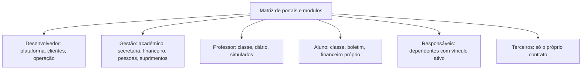

[Índice](README.md) · [Parte anterior](parte-04-seguranca-privacidade-e-auditoria.md) · [Próxima parte](parte-06-plataforma-saas-clientes-dominios-licencas-e-crm.md)

<a id="parte-5"></a>

# Parte 5 — Portais, navegação e interface

## Visão geral da parte 5

A matriz de portais define o que cada portal tem, quem é dono de cada dado e onde cada módulo aparece ([31](#doc-31)). A interface segue o design system ([08](#doc-08)).



**Regras principais**
- Sem JavaScript inline nem atributos `on*=`; tema claro e escuro; WCAG 2.2 AA; 320 px sem rolagem horizontal ([08](#doc-08)).
- Inglês canônico e dez locales, com teste de paridade de chaves ([09](#doc-09)).
- Busca, notificações e perfil respeitam o escopo de cada portal ([75](#doc-75), [76](#doc-76)).
- O portal de terceiros nunca mostra financeiro interno, contábil, folha ou dado de aluno ([31](#doc-31), seção 2.6).

<a id="doc-31"></a>

## 31 — Matriz de Portais, Fronteiras entre Módulos, Logs, Testes, Segurança e Auditoria

> Parte do [SDD v2](parte-01-visao-e-escopo.md#doc-00). Portais em [23](parte-06-plataforma-saas-clientes-dominios-licencas-e-crm.md#doc-23), seção 1. Catálogo em [12](parte-01-visao-e-escopo.md#doc-12). Auditoria em [29](parte-04-seguranca-privacidade-e-auditoria.md#doc-29). Testes em [24](parte-17-operacao-qualidade-testes-e-ti.md#doc-24), seção 5. Logs em [10](parte-17-operacao-qualidade-testes-e-ti.md#doc-10), seção 7. Fonte dos módulos por portal: a navegação da v1 ([12-portals-navigation-sidebar-pages-spec.md](parte-01-visao-e-escopo.md#doc-12), seção 4), agora reclassificada pelos seis portais da v2.
> **Status:** aprovada pelo autor em 03/11/2026, com as propostas adotadas. Itens sem valor definido continuam pendentes, criada em 03/11/2026 a partir de auditoria das especificações da v1. Itens marcados **[Decisão do autor]** dependem de resposta. Itens **[Sem especificação]** não têm fonte na v1 ou na v2.

---

### 1. Regras de organização

1. **Módulo tem um dono de dado.** Cada módulo pertence a um único domínio (plataforma ou entidade) e a um único banco ([03](parte-02-arquitetura-e-tenancy.md#doc-03), seção 1.1).
2. **Portal é tela, não dono.** Um portal mostra os módulos que o vínculo da pessoa permite. Nenhum portal guarda dado próprio além de preferências.
3. **Dois contextos não se misturam.** Operação da plataforma (portal do desenvolvedor) e operação de cada entidade (portal de gestão, professor, aluno, responsáveis, terceiros) usam bancos, papéis e módulos diferentes, mesmo quando o nome é igual (ex.: Financeiro, Contábil).
4. **Um nome, uma especificação.** Dois documentos que descrevem o mesmo módulo viram um só. O que sobra vai para o arquivo histórico.

---

### 2. Matriz por portal

Legenda de origem: **P** = plataforma (banco master); **E** = entidade/unidade (banco da unidade).

#### 2.1 Portal do Desenvolvedor (`desenvolvedor.`) — equipe da plataforma

| Área | Módulos | Contexto | Observação |
|---|---|---|---|
| Plataforma e clientes | Clientes (tenants), licenciamento, assinaturas, faturamento de clientes, limites e consumo, domínios, provisionamento | P | Ciclo de vida da seção 5 de [23](parte-06-plataforma-saas-clientes-dominios-licencas-e-crm.md#doc-23) |
| Editor de portais | Páginas, rotas, layouts, blocos, publicação e rollback | P | D-23. Chamado de "builder de portais" na v1. **Não é o editor de modelos do Gerador de documentos** (ver seção 3.4) Especificação: [23](parte-06-plataforma-saas-clientes-dominios-licencas-e-crm.md#doc-23), seção 3 (D-23) |
| Comercial da plataforma | CRM da plataforma, leads, propostas, comissões | P | [22](parte-06-plataforma-saas-clientes-dominios-licencas-e-crm.md#doc-22), seção 6.1. Não se mistura com o protocolo de atendimento (seção 3.2) |
| Financeiro da plataforma | Contas a pagar e a receber **da própria empresa** | P | **Decidido** em 03/11/2026: mantido para a gestão da própria empresa desenvolvedora. Especificação: [31](#doc-31), seção 3.3; [34](parte-10-financeiro-pagamentos-e-fiscal.md#doc-34), seção 3 (taxas de split) |
| Contábil da plataforma | Plano de contas, razão, fechamento da empresa, tributos e obrigações fiscais da empresa | P | Mesma decisão do financeiro. Tributos da empresa: seção 3.3, confirmado pelo autor em 04/11/2026. Especificação: [31](#doc-31), seção 3.3; [22](parte-06-plataforma-saas-clientes-dominios-licencas-e-crm.md#doc-22), seção 5 (papéis contábil e fiscal) |
| Operações internas | Patrimônio, frotas, suprimentos da empresa | P | **Decidido** em 03/11/2026: mantidos, como instâncias separadas dos módulos das entidades. Especificação: [19](parte-07-regras-gerais-dos-modulos-de-gestao.md#doc-19), seções 8 e 9; [80](parte-19-pendencias-decisoes-e-rastreabilidade.md#doc-80), DP-01 a DP-03 |
| Pessoas da plataforma | Departamento pessoal, recursos humanos, medicina e segurança do trabalho da empresa | P | Mesma decisão. O HCM das entidades não é o da plataforma. Três módulos separados, conforme HCM-01 e HCM-10 do [39](parte-11-pessoas-departamento-pessoal-e-sst.md#doc-39), seção 11 |
| Suporte | Chamados dos clientes, base de conhecimento, SLA | P | Seção 3.2. Especificação: [32](parte-04-seguranca-privacidade-e-auditoria.md#doc-32), seção 2 |
| Segurança e operação | Acesso, MFA, auditoria, privacidade (DPO), TI, configurações do sistema, integrações globais, painel de bancos de dados | P | [05](parte-04-seguranca-privacidade-e-auditoria.md#doc-05), [07](parte-04-seguranca-privacidade-e-auditoria.md#doc-07), [10](parte-17-operacao-qualidade-testes-e-ti.md#doc-10). Painel de bancos de dados: substitui o módulo Bancos (PAG-03, [34](parte-10-financeiro-pagamentos-e-fiscal.md#doc-34), seção 4) |

#### 2.2 Portal de Gestão (`gestao.`) — equipe administrativa da entidade

| Área | Módulos | Contexto | Observação |
|---|---|---|---|
| Acadêmico | Administração escolar (estrutura acadêmica), pedagógico (coordenação e diário), calendário e eventos, séries e turmas (grade de horários), regras de aprovação (sistemas avaliativos, boletim e conselho de classe), ocorrências disciplinares, planos de aula e de ensino, estágio e TCC, prontuário e portfólio do aluno, livros digitais e arquivo morto, preceptoria, gestão pastoral, aulas online, agendamento de ambientes e equipamentos, formulários e pesquisas, relatórios acadêmicos e censo | E | [17](parte-07-regras-gerais-dos-modulos-de-gestao.md#doc-17), seção 4; [55](parte-08-academico.md#doc-55); [58](parte-08-academico.md#doc-58) a [69](parte-08-academico.md#doc-69); [40](parte-08-academico.md#doc-40) a [44](parte-08-academico.md#doc-44). Itens explicitados em 04/11/2026 a partir da seção 7 e dos documentos por portal |
| Secretaria | Matrículas, rematrículas, transferências, enturmação, ficha cadastral, protocolo de atendimento, emissão de documentos, processo seletivo e lista de espera | E | Sub-área do acadêmico. Ver seções 3.2 e 3.5; [46](parte-09-secretaria-matricula-e-documentos.md#doc-46), [48](parte-09-secretaria-matricula-e-documentos.md#doc-48) |
| Gestão de documentos | Documentos recebidos (validação), documentos administrativos (tramitação), documentos emitidos (modelos e emissão), serviços comuns (assinatura, protocolo e armazenamento) | E | [54](parte-09-secretaria-matricula-e-documentos.md#doc-54). Ver também seções 3.1 e 3.4 |
| Simulados | Banco de questões, geração de provas, correção, gabarito, ranking | E | Ver seção 3.6. Especificação: [47](parte-08-academico.md#doc-47) |
| Biblioteca | Acervo, empréstimos, reservas, multas, biblioteca digital | E | Ver seção 3.1. Especificação: [68](parte-08-academico.md#doc-68) |
| Financeiro da entidade | Mensalidades, títulos, cobrança, régua, conciliação, centros de custo, contas a pagar, cheques, caixa físico, fluxo de caixa e DRE, gateways e split | E | [17](parte-07-regras-gerais-dos-modulos-de-gestao.md#doc-17), [18](parte-07-regras-gerais-dos-modulos-de-gestao.md#doc-18), [20](parte-10-financeiro-pagamentos-e-fiscal.md#doc-20), [34](parte-10-financeiro-pagamentos-e-fiscal.md#doc-34), [71](parte-10-financeiro-pagamentos-e-fiscal.md#doc-71) |
| Contábil e fiscal da entidade | Plano de contas da entidade, tributos, retenções, obrigações, NFSe | E | Ver seção 3.3. Especificação: [31](#doc-31), seção 3.3; [34](parte-10-financeiro-pagamentos-e-fiscal.md#doc-34), seção 5; [26](parte-18-juridico-e-regulatorio.md#doc-26), seção 11 |
| Comercial e admissões | CRM do tenant (captação, pré-cadastro, inscrição) | E | [22](parte-06-plataforma-saas-clientes-dominios-licencas-e-crm.md#doc-22), seção 6.2 |
| Pessoas e RH | HCM, folha, ponto, férias, avaliação de desempenho, SST | E | [18](parte-07-regras-gerais-dos-modulos-de-gestao.md#doc-18), seção 3; [39](parte-11-pessoas-departamento-pessoal-e-sst.md#doc-39); [52](parte-11-pessoas-departamento-pessoal-e-sst.md#doc-52) |
| Suprimentos e compras | Requisição, cotação, pedido, almoxarifado, merenda | E | [19](parte-07-regras-gerais-dos-modulos-de-gestao.md#doc-19), seção 2 |
| Patrimônio e frotas | Bens, depreciação, veículos, manutenção, rotas | E | [19](parte-07-regras-gerais-dos-modulos-de-gestao.md#doc-19), seções 8 e 9 |
| Contratos | Contratos de fornecedor, contratos de aluno, contratos de pessoal | E | [17](parte-07-regras-gerais-dos-modulos-de-gestao.md#doc-17), seção 7; [33](parte-12-suprimentos-patrimonio-frotas-contratos-e-terceiros.md#doc-33); [53](parte-12-suprimentos-patrimonio-frotas-contratos-e-terceiros.md#doc-53) |
| Atendimento | SAC, helpdesk, chat, tickets | E | Seção 3.7; [32](parte-04-seguranca-privacidade-e-auditoria.md#doc-32), seção 2 |
| Arquivos | Armazenamento de arquivos | E | [21](parte-16-dados-validacoes-configuracoes-e-armazenamento.md#doc-21) |
| Relatórios e gráficos | Painéis, gráficos salvos | E | Seção 3.8; [56](parte-16-dados-validacoes-configuracoes-e-armazenamento.md#doc-56), seção 3; [69](parte-08-academico.md#doc-69) |
| Configuração e acesso | Unidades, usuários, vínculos, privacidade da entidade, configurações da entidade, campos personalizados, notificações, integrações educacionais oficiais, importação de dados, acesso físico e portaria, TI da entidade | E | [06](parte-03-identidade-acesso-e-permissoes.md#doc-06); [32](parte-04-seguranca-privacidade-e-auditoria.md#doc-32), seção 3; [35](parte-03-identidade-acesso-e-permissoes.md#doc-35); [36](parte-17-operacao-qualidade-testes-e-ti.md#doc-36), seção 4; [56](parte-16-dados-validacoes-configuracoes-e-armazenamento.md#doc-56), seção 2; [57](parte-13-atendimento-e-notificacoes.md#doc-57); [70](parte-14-integracoes-e-importacao.md#doc-70); [72](parte-16-dados-validacoes-configuracoes-e-armazenamento.md#doc-72); [74](parte-14-integracoes-e-importacao.md#doc-74). Unidade só é criada por `platform.developer` (L-02); a gestão edita a unidade existente |
| Planejamento acadêmico, institucional e de desenvolvimento | Planejamento acadêmico, planejamento institucional, planejamento de desenvolvimento de pessoas | E | [37](parte-08-academico.md#doc-37), seções 2 a 4 (especificado em 03/11/2026, seção 3.9) |
| Empenho | Empenho, liquidação e pagamento (só entidade pública) | E | [37](parte-08-academico.md#doc-37), seção 5 (especificado em 03/11/2026, seção 3.9) |

#### 2.3 Portal do Professor (`portal-do-professor.`)

| Área | Módulos | Escopo |
|---|---|---|
| Classe | Turmas e disciplinas do próprio docente, mural, materiais, tarefas | Só turmas vinculadas. Especificação: [81](parte-08-academico.md#doc-81); regra de origem em [80](parte-19-pendencias-decisoes-e-rastreabilidade.md#doc-80), DP-06 |
| Diário | Frequência, conteúdo, notas, plano de aula | Só turmas vinculadas. Nota só pelo professor da turma ([22](parte-06-plataforma-saas-clientes-dominios-licencas-e-crm.md#doc-22), seção 5) |
| Simulados | Elaboração de questões, agendamento, resultados da turma | Questão passa por revisão antes de publicar (seção 3.6) Especificação: [47](parte-08-academico.md#doc-47), seção 7 |
| Biblioteca | Consulta de acervo, indicação de leitura | Somente leitura. Especificação: [68](parte-08-academico.md#doc-68), seção 11 |
| Protocolos e pedidos | Solicitação de material, reserva de laboratório, justificativa | Usa o serviço de protocolo (seção 3.2) Especificação: [31](#doc-31), seção 3.2; [44](parte-08-academico.md#doc-44) |
| Documentos e pessoal | Declarações, contrato de trabalho, holerite, ponto | Só dados do próprio docente. Especificação: [39](parte-11-pessoas-departamento-pessoal-e-sst.md#doc-39), seção 6; [34](parte-10-financeiro-pagamentos-e-fiscal.md#doc-34), seção 8 |
| Relatórios | Rendimento da turma, ficha individual | Só turmas vinculadas. Especificação: [69](parte-08-academico.md#doc-69), seção 6 |
| Agenda e comunicação | Horário e calendário das turmas, aulas online, notificações, meu perfil | Só turmas vinculadas. [58](parte-08-academico.md#doc-58), [60](parte-08-academico.md#doc-60), [40](parte-08-academico.md#doc-40), [57](parte-13-atendimento-e-notificacoes.md#doc-57), [76](#doc-76) (explicitado em 04/11/2026) |
| Acompanhamento pedagógico | Ocorrências da turma, orientação de estágio e TCC, preceptoria, portfólio dos alunos, formulários e pesquisas, pastoral | Só turmas e orientandos vinculados. [63](parte-08-academico.md#doc-63), [65](parte-08-academico.md#doc-65), [42](parte-08-academico.md#doc-42), [66](parte-08-academico.md#doc-66), [41](parte-08-academico.md#doc-41), [43](parte-08-academico.md#doc-43) (explicitado em 04/11/2026) |

#### 2.4 Portal do Aluno (`portal-do-aluno.`)

| Área | Módulos | Escopo |
|---|---|---|
| Classe e diário | Disciplinas, materiais, entregas, boletim, presença | Só o próprio aluno. Especificação: [61](parte-08-academico.md#doc-61), seção 7; [62](parte-08-academico.md#doc-62), seção 7; [81](parte-08-academico.md#doc-81) |
| Simulados | Simulados agendados, realização de prova, gabarito e comentários | Só simulados do próprio aluno. Especificação: [47](parte-08-academico.md#doc-47), seção 7 |
| Biblioteca | Empréstimos, prazos, renovação, pesquisa de acervo | Só os próprios empréstimos. Especificação: [68](parte-08-academico.md#doc-68), seção 11 |
| Protocolos online | Requerimento de segunda chamada, declaração de matrícula | Usa o serviço de protocolo. Especificação: [31](#doc-31), seção 3.2 |
| Documentos | Boletim oficial, histórico, declarações | Emissão pelo aluno conforme regra de [21](parte-16-dados-validacoes-configuracoes-e-armazenamento.md#doc-21) e seção 3.5 |
| Matrícula | Confirmação para o ano seguinte, eletivas, rematrícula | Seção 3.5. Especificação: [46](parte-09-secretaria-matricula-e-documentos.md#doc-46), seção 6 |
| Financeiro | Mensalidades, boleto, PIX, comprovantes | Só títulos do próprio aluno. Especificação: [34](parte-10-financeiro-pagamentos-e-fiscal.md#doc-34), seção 8; [20](parte-10-financeiro-pagamentos-e-fiscal.md#doc-20) |
| Privacidade | Dados cadastrais, solicitações LGPD | [07](parte-04-seguranca-privacidade-e-auditoria.md#doc-07) |
| Agenda e comunicação | Horário da turma, calendário e eventos, aulas online, notificações, meu perfil | Só o próprio aluno. [58](parte-08-academico.md#doc-58), [60](parte-08-academico.md#doc-60), [40](parte-08-academico.md#doc-40), [57](parte-13-atendimento-e-notificacoes.md#doc-57), [76](#doc-76) (explicitado em 04/11/2026) |
| Vida acadêmica | Ocorrências próprias, estágio e TCC, portfólio, preceptoria, formulários e pesquisas, pastoral | Só o próprio aluno. [63](parte-08-academico.md#doc-63), [65](parte-08-academico.md#doc-65), [66](parte-08-academico.md#doc-66), [42](parte-08-academico.md#doc-42), [41](parte-08-academico.md#doc-41), [43](parte-08-academico.md#doc-43) (explicitado em 04/11/2026) |

#### 2.5 Portal dos Pais e Responsáveis (`portal-dos-responsaveis.`)

| Área | Módulos | Escopo |
|---|---|---|
| Acompanhamento | Notas, faltas, ocorrências, comunicados, entradas e saídas da portaria | Só dependentes com vínculo ativo de responsabilidade. Especificação: [61](parte-08-academico.md#doc-61), [62](parte-08-academico.md#doc-62), [63](parte-08-academico.md#doc-63), [35](parte-03-identidade-acesso-e-permissoes.md#doc-35), seção 4, [57](parte-13-atendimento-e-notificacoes.md#doc-57) |
| Biblioteca e simulados | Empréstimos e desempenho dos filhos | Somente leitura. Especificação: [68](parte-08-academico.md#doc-68), seção 11; [47](parte-08-academico.md#doc-47), seção 7 |
| Protocolos da família | Mudança de turno, saída antecipada, documentos | Usa o serviço de protocolo. Especificação: [31](#doc-31), seção 3.2 |
| Financeiro e matrícula | Faturas dos filhos, PIX, rematrícula online, assinatura do contrato | Seção 3.5. Bloqueio parcial por inadimplência ([26](parte-18-juridico-e-regulatorio.md#doc-26), seção 3) |
| Privacidade e menores | Consentimento de imagem, dados dos filhos | Regra de menor de idade em [07](parte-04-seguranca-privacidade-e-auditoria.md#doc-07) |
| Agenda e comunicação | Horário e calendário dos dependentes, eventos e autorizações, notificações, meu perfil | Só dependentes com vínculo ativo. [58](parte-08-academico.md#doc-58), [60](parte-08-academico.md#doc-60), [43](parte-08-academico.md#doc-43), [57](parte-13-atendimento-e-notificacoes.md#doc-57), [76](#doc-76) (explicitado em 04/11/2026) |

#### 2.6 Portal de Terceiros (`portal-de-terceiros.`)

| Área | Módulos | Escopo |
|---|---|---|
| Faturamento de serviços | Emissão e envio de NF-e de serviço, acompanhamento de pagamento, extrato | Só o próprio fornecedor. Especificação: [38](parte-12-suprimentos-patrimonio-frotas-contratos-e-terceiros.md#doc-38); [34](parte-10-financeiro-pagamentos-e-fiscal.md#doc-34), seções 5 e 8 |
| Pedidos e contratos | Pedidos de compra pendentes, contratos em vigor | Só o próprio fornecedor. Especificação: [38](parte-12-suprimentos-patrimonio-frotas-contratos-e-terceiros.md#doc-38), seção 4; [33](parte-12-suprimentos-patrimonio-frotas-contratos-e-terceiros.md#doc-33), seção 9 |
| Documentos da empresa | Certidões, contrato social, alvarás, seguro | Só o próprio fornecedor. Validade com alerta. Especificação: [38](parte-12-suprimentos-patrimonio-frotas-contratos-e-terceiros.md#doc-38), seção 5 |
| Prestação de serviço | Ordens de serviço, relatórios de execução, cronograma | Só ordens do próprio fornecedor. Especificação: [38](parte-12-suprimentos-patrimonio-frotas-contratos-e-terceiros.md#doc-38), seção 3 |
| Chamados | Abertura de chamado de manutenção, solicitação de acesso à unidade | Usa o módulo de atendimento (seção 3.7) Especificação: [32](parte-04-seguranca-privacidade-e-auditoria.md#doc-32), seção 2.8; [35](parte-03-identidade-acesso-e-permissoes.md#doc-35), seção 4 |
| Configurações e integrações | Dados da empresa, responsáveis técnicos, dados bancários, integrações via API | Dados bancários exigem confirmação por MFA. Especificação: [38](parte-12-suprimentos-patrimonio-frotas-contratos-e-terceiros.md#doc-38), seção 6; [06](parte-03-identidade-acesso-e-permissoes.md#doc-06), seção 8 |
| Habilitação e acesso | Cadastro e habilitação do prestador, pessoas e papéis do prestador, tipo de prestador, meu perfil | [38](parte-12-suprimentos-patrimonio-frotas-contratos-e-terceiros.md#doc-38), seções 2 a 6; [76](#doc-76) (explicitado em 04/11/2026) |

**Regra:** o portal de terceiros nunca mostra financeiro interno, contábil, folha ou dado de aluno.

---

### 3. Fronteiras entre módulos

#### 3.1 Biblioteca × Gestão de Documentos

**Problema encontrado:** a especificação [`spec_gestao_biblioteca_completo.md`](parte-08-academico.md#v1-spec-gestao-biblioteca-completo-md) (UI enterprise) inclui páginas de gestão de usuários, perfis, auditoria, integrações e **"Gestão de Documentos e Anexos"** (página 14). Isso mistura o acervo da biblioteca com o cofre de documentos da entidade.

**Decisão proposta:**

| Módulo | Dono | Guarda | Não guarda |
|---|---|---|---|
| Biblioteca | Acervo, exemplar, empréstimo, reserva, multa | Metadados do acervo; arquivo digital do acervo via [21](parte-16-dados-validacoes-configuracoes-e-armazenamento.md#doc-21) | Documento oficial de aluno ou de funcionário |
| Gestão de documentos | Documento oficial, versão, assinatura, validação, modelo | Declarações, históricos, certidões, contratos assinados | Exemplar físico, empréstimo |

A página 14 da UI de biblioteca sai dela. A "Interface de biblioteca (UI)" do catálogo deixa de ser módulo e passa a ser componentes de [08](#doc-08). As páginas 6 a 13 da UI são padrões de tela, não módulos.

#### 3.2 Protocolo × CRM comercial × Atendimento

Não encontrei na v1 um módulo chamado "CRM protocolo". O protocolo aparece em:

- Secretaria (número e senha, consulta pública por número e CPF) — [`spec_gestao_academica_completo.md`](parte-08-academico.md#v1-spec-gestao-academica-completo-md), seção 6.2;
- Gestão de documentos e validações;
- Serviços do portal do aluno, do professor e dos responsáveis;
- Direitos do titular (solicitação LGPD com protocolo — [07](parte-04-seguranca-privacidade-e-auditoria.md#doc-07));
- Segurança e medicina do trabalho (protocolo de CAT ou INSS).

**Decisão proposta:** o **protocolo é um serviço transversal**, dono em Atendimento. Ele gera número único, status, prazo e trilha. Ele **não pertence ao CRM**:

| | CRM comercial (plataforma e tenant) | Protocolo |
|---|---|---|
| Objeto | Lead, oportunidade, proposta, matrícula em andamento | Pedido ou solicitação com número |
| Quem abre | Vendedor, admissões, canal de captação | Pessoa que pede algo (aluno, responsável, professor, titular, fornecedor) |
| Consulta pública | Não | Sim, por número e CPF, com limite de tentativas ([17](parte-07-regras-gerais-dos-modulos-de-gestao.md#doc-17), seção 3) |

**Regra de separação:** nenhum protocolo guarda dado comercial, e nenhum lead recebe número de protocolo. Quando um lead vira matrícula, o protocolo de matrícula é um pedido separado, vinculado ao lead.

#### 3.3 Financeiro e contábil: plataforma × entidade

| Assunto | Plataforma (portal do desenvolvedor) | Entidade (portal de gestão) |
|---|---|---|
| Receita | Assinaturas dos clientes ([20](parte-10-financeiro-pagamentos-e-fiscal.md#doc-20)) | Mensalidades e serviços de alunos |
| Despesa | Da própria empresa | Da entidade (fornecedor, folha) |
| Contábil | Plano de contas da empresa | Plano de contas da entidade, com centro de custo por unidade |
| Tributos | Da empresa | Retenções e apurações da entidade ([19](parte-07-regras-gerais-dos-modulos-de-gestao.md#doc-19) e v1 [`spec_gestao_contabil_fiscal_completo.md`](parte-10-financeiro-pagamentos-e-fiscal.md#v1-spec-gestao-contabil-fiscal-completo-md), seção 6.5) |

**Proposta:** o módulo Financeiro e o Contábil são o mesmo código com dois donos de dado (banco master e banco de cada unidade). **Decidido** em 03/11/2026: a plataforma precisa dos módulos contábil e financeiro para a própria empresa.

#### 3.4 Builder: três significados

O termo "builder" aparece em três lugares e pode confundir:

| Nome | Dono | Função | Documento |
|---|---|---|---|
| Builder de portais | Plataforma | Páginas e layouts declarativos | [23](parte-06-plataforma-saas-clientes-dominios-licencas-e-crm.md#doc-23), seção 3 |
| Builder de documentos | Entidade (Gestão de documentos) | Modelos de documento com variáveis e emissão em PDF | [`spec-builder-documentos-academicos.md`](parte-09-secretaria-matricula-e-documentos.md#v1-spec-builder-documentos-academicos-md) (26 seções) |
| Builder de automações | Entidade (Automações) | Regras de disparo | [`spec_gestao_biblioteca_completo.md`](parte-08-academico.md#v1-spec-gestao-biblioteca-completo-md), página 7 |

**Ação (feita em 03/11/2026, MOD-12):** na v2 os nomes são "Editor de portais" ([23](parte-06-plataforma-saas-clientes-dominios-licencas-e-crm.md#doc-23)), "Gerador de documentos", com o "editor de modelos" ([48](parte-09-secretaria-matricula-e-documentos.md#doc-48)), e "Automações". O termo "builder" fica só nos nomes de arquivo da v1 e no código do papel `platform.builder`.

**Gerador de documentos:** especificado em [48](parte-09-secretaria-matricula-e-documentos.md#doc-48) (MOD-07), a partir da v1, que cobre tipos documentais, tamanhos de papel, cabeçalho e rodapé, variáveis, condicionais, fluxo de emissão, auditoria e LGPD. Os itens abaixo eram a lista do que faltava e estão cobertos lá:

- Lista de tipos documentais com retenção de cada um (ligada a [07](parte-04-seguranca-privacidade-e-auditoria.md#doc-07), seção 5).
- Emissão só de modelo aprovado. Versão emitida é imutável.
- Número de protocolo da emissão (seção 3.2).
- Assinatura: [26](parte-18-juridico-e-regulatorio.md#doc-26), seção 6.

#### 3.5 Matrícula e rematrícula

A v2 tem só os estados da matrícula em [17](parte-07-regras-gerais-dos-modulos-de-gestao.md#doc-17) (`pre_matricula`, `ativa`, `trancada`, `concluida`, `cancelada`, `transferida`). A v1 ([`spec_gestao_academica_completo.md`](parte-08-academico.md#v1-spec-gestao-academica-completo-md)) tem mais: kanban de rematrícula, wizard, prazo de 7 dias, lembrete, "não rematriculado" após 30 dias, matrícula condicional com prazo e trancamento com motivo e protocolo.

**Lacunas do fluxo, a incluir na v2:**

| # | Passo ou regra | Origem na v1 | Estado na v2 |
|---|---|---|---|
| M-01 | Janela de rematrícula por série e unidade, com abertura e fechamento | Acadêmico, kanban | Não definido |
| M-02 | Wizard do responsável ou aluno: dados, documentos, escolha de turma e eletivas, contrato, pagamento | Portal dos responsáveis e do aluno | Não definido |
| M-03 | Vaga com reserva e bloqueio de concorrência | [15](parte-16-dados-validacoes-configuracoes-e-armazenamento.md#doc-15), seção 7 | Definido |
| M-04 | Matrícula condicional com prazo e expiração | Ações automáticas, v1 linha 1181 | Não definido |
| M-05 | Não rematriculado após 30 dias: estado e aviso | Ações automáticas, v1 linha 1175 | Não definido |
| M-06 | Trancamento com motivo, aprovação por níveis e protocolo | Requerimentos, v1 seção 15 | Não definido |
| M-07 | Transferência e enturmação | Secretaria digital | Não definido |
| M-08 | Documento obrigatório pendente bloqueia a matrícula? Regra por tipo | v1 linha 1176 | Não definido. Ver [26](parte-18-juridico-e-regulatorio.md#doc-26) |
| M-09 | Assinatura do contrato de matrícula e pagamento da primeira parcela | Portal dos responsáveis | Parcial em [20](parte-10-financeiro-pagamentos-e-fiscal.md#doc-20) |

#### 3.6 Simulados

A v2 tem só a regra de IA em [19](parte-07-regras-gerais-dos-modulos-de-gestao.md#doc-19), seção 12, e a linha da tabela em [28](parte-15-inteligencia-artificial.md#doc-28). Faltam:

- **Banco de questões**, com origem, autoria, revisão e situação (`rascunho`, `revisada`, `publicada`, `arquivada`).
- **Geração de prova** por perfil (ENEM, vestibular, interna) e gabarito.
- **Gabarito óptico**: a v1 cita, mas não há especificação do leitor. **Decidido** em 03/11/2026: as duas opções, próprio e de terceiro, por configuração da entidade.
- **Correção por IA**. **Conflito:** a v1 ([`spec_gestao_simulados_ia.md`](parte-08-academico.md#v1-spec-gestao-simulados-ia-md), seção "Correção automática por IA") tem como saída "nota final estimada". A v2 proíbe nota final dada só pela IA ([27](parte-15-inteligencia-artificial.md#doc-27), princípio 2 e seção 5.11). Ação: a v2 fica com a regra da [27](parte-15-inteligencia-artificial.md#doc-27). A nota da IA é sugestão; o professor confirma.
- **Anonimização** do aluno enviado ao provedor de IA ([19](parte-07-regras-gerais-dos-modulos-de-gestao.md#doc-19), seção 12).
- **Relatórios por portal**: professor vê a turma; aluno vê as próprias provas; responsável vê os filhos; gestor vê a unidade.
- **Plano**: a v1 marca o simulado como "PRO" no portal de gestão. **Decidido** em 03/11/2026: o PRO libera correção por IA e ranking.

#### 3.7 Atendimento: SAC, helpdesk, chat e bots

Há três especificações separadas, todas em "Revisar" no catálogo:

- [`spec_chat_rapido_sac.md`](parte-13-atendimento-e-notificacoes.md#v1-spec-chat-rapido-sac-md): chat rápido e abertura de ticket no SAC.
- [`SPEC-HELPDESK.md`](parte-13-atendimento-e-notificacoes.md#v1-spec-helpdesk-md): helpdesk com SLA, base de conhecimento e portal do cliente.
- [`spec_gestao_sac_base_conhecimento.md`](parte-13-atendimento-e-notificacoes.md#v1-spec-gestao-sac-base-conhecimento-md).

**Decisão proposta (já adotada na v1 do catálogo):** um módulo único de atendimento, com helpdesk como base ([19](parte-07-regras-gerais-dos-modulos-de-gestao.md#doc-19), seção 2). Os canais (chat do site, WhatsApp, Telegram, Instagram, Messenger, telefone e presencial) são entradas desse módulo, com as regras de [22](parte-06-plataforma-saas-clientes-dominios-licencas-e-crm.md#doc-22), seção 2.

**Bots.** Há dois tipos e não podem ser confundidos:

| Bot | Dono | Regra |
|---|---|---|
| Bot de captação (CRM) | CRM da plataforma ou do tenant | [22](parte-06-plataforma-saas-clientes-dominios-licencas-e-crm.md#doc-22), seção 3 |
| Bot de atendimento (SAC) | Atendimento | Mesma regra de IA: fonte cadastrada, humano para o resto, opção "Abrir ticket" sem IA (D-18) |

A reunião global ([`global_meeting_spec_v2_complete.md`](parte-08-academico.md#v1-global-meeting-spec-v2-complete-md)) menciona proteção contra bot em entrada pública, sem módulo de bot. Não é um terceiro tipo.

Pendente: a v2 ainda não tem DDL do atendimento consolidado (T-02 em [19](parte-07-regras-gerais-dos-modulos-de-gestao.md#doc-19)).

#### 3.8 Gráficos e painéis

[`chart-builder-spec-complete.md`](parte-16-dados-validacoes-configuracoes-e-armazenamento.md#v1-chart-builder-spec-complete-md) (16 seções: consulta, renderização, painéis, API, segurança, exportação, tempo real) está marcado como "Especificado" no catálogo, mas a v2 não tem regra para ele.

**Proposta:**

- O construtor de gráfico é **componente compartilhado** ([08](#doc-08)), não módulo de domínio.
- Cada gráfico salvo pertence a um portal e a um contexto (plataforma, entidade ou unidade). Nenhum gráfico mostra dado fora do escopo de quem o abriu.
- Consulta passa pela mesma camada de permissão das telas. A consulta não tem acesso direto ao banco.
- Gráfico de dado sensível (CPF, saúde, salário) não é exportável sem motivo e sem auditoria ([29](parte-04-seguranca-privacidade-e-auditoria.md#doc-29)).
- Painel com dado pessoal entra no cache só com a regra de [30](parte-02-arquitetura-e-tenancy.md#doc-30), seção 4.

#### 3.9 Módulos sem especificação

| Nome | Onde aparece | Situação |
|---|---|---|
| Planejamento acadêmico | Pedido do autor | Não há especificação na v1 nem na v2. **Decidido** em 03/11/2026: analisado e implementado em [37](parte-08-academico.md#doc-37). |
| Planejamento institucional | Pedido do autor | Idem |
| Planejamento de desenvolvimento | Pedido do autor. A v1 cita "Plano de Desenvolvimento Individual" no PRO de preceptoria | Idem. Se o termo for o PDI, ele fica em preceptoria ([19](parte-07-regras-gerais-dos-modulos-de-gestao.md#doc-19), seção 11) |
| Empenho | Pedido do autor. A v1 não traz o termo como módulo | Empenho é fase da despesa pública (empenho, liquidação, pagamento). Só se aplica se a entidade for órgão público. **Decidido** em 03/11/2026: só para entidade pública. |
| Secretaria como módulo | v1 tem "Secretaria Digital" e "Secretaria Acadêmica" | Não é módulo próprio. É sub-área do acadêmico (seção 2.2) |
| Tributos como módulo | v1 tem "Retenção Tributária" e "Retenções e Tributos" | Não é módulo próprio. Fica em contábil e fiscal |

---

### 4. Logs, testes, segurança e auditoria por portal

#### 4.1 Logs

**Estado na v2:** [10](parte-17-operacao-qualidade-testes-e-ti.md#doc-10), seção 7 define log estruturado em JSON com `request_id`, `tenant_id` e nível, sem PII. [29](parte-04-seguranca-privacidade-e-auditoria.md#doc-29) define a auditoria. Não há especificação de logs por portal.

| Canal de log | Conteúdo | Portais | Retenção | Estado |
|---|---|---|---|---|
| Aplicação | Erros, desempenho, requisição | Todos | 90 dias ([10](parte-17-operacao-qualidade-testes-e-ti.md#doc-10)) | Definido |
| Segurança | Login, falha, bloqueio, MFA, acesso negado | Todos | Conforme [29](parte-04-seguranca-privacidade-e-auditoria.md#doc-29), seção 7 | Definido |
| Auditoria de negócio | Alteração de dado, leitura sensível, exportação | Todos | Conforme [29](parte-04-seguranca-privacidade-e-auditoria.md#doc-29) | Definido. Campo `portal` incluído em [29](parte-04-seguranca-privacidade-e-auditoria.md#doc-29), seção 2 (AUD-04) |
| Integração | Chamada a provedor, webhook, falha de conector | Gestão, desenvolvedor | 90 dias (LOG-03) | **Especificado** em [49](parte-17-operacao-qualidade-testes-e-ti.md#doc-49), seção 2 |
| Job e fila | Processamento, reprocessamento, expurgo | Plataforma e entidade | 90 dias (LOG-03) | **Especificado** em [49](parte-17-operacao-qualidade-testes-e-ti.md#doc-49), seção 3 |
| Logger técnico (módulo `spec_gestao_logger_completo`) | — | — | — | Revisar: retirar dados de log da especificação, conforme o catálogo |

**Lacunas:** LOG-01 a LOG-03 (seção 5).

#### 4.2 Testes

[24](parte-17-operacao-qualidade-testes-e-ti.md#doc-24), seção 5 define a estratégia geral. Falta a matriz por portal. Cada portal precisa de um conjunto mínimo:

| Portal | Teste de isolamento | Teste de permissão | Teste de fluxo principal | Teste de acessibilidade |
|---|---|---|---|---|
| Desenvolvedor | O Editor de portais publica só para o escopo escolhido | Publicação não é aprovada pelo próprio editor (D-23) | Criar entidade e unidade (provisionamento, seção 4 de [23](parte-06-plataforma-saas-clientes-dominios-licencas-e-crm.md#doc-23)) | Telas de leitura |
| Gestão | Cross-tenant e cross-unidade | Papel sem permissão não vê o módulo | Matrícula, cobrança, emissão de documento | Telas principais |
| Professor | Só turmas vinculadas | Nota só pelo professor da turma | Lançar nota e frequência | Diário |
| Aluno | Só os próprios dados | Não vê nota de outro aluno | Realizar simulado, rematrícula | Telas principais |
| Responsáveis | Só dependentes com vínculo ativo | Vínculo revogado perde acesso em até 30 s ([30](parte-02-arquitetura-e-tenancy.md#doc-30), seção 4) | Pagar fatura e rematricular | Telas principais |
| Terceiros | Só o próprio fornecedor | Sem acesso a financeiro interno | Emitir NF-e de serviço | Telas principais |

Itens de teste comuns: fluxo ponta a ponta por portal a cada release, varredura de log sem PII, e varredura de auditoria sem segredo ([29](parte-04-seguranca-privacidade-e-auditoria.md#doc-29), seção 9).

**Lacunas:** TST-01 a TST-03 (seção 5).

#### 4.3 Segurança por portal

[05](parte-04-seguranca-privacidade-e-auditoria.md#doc-05) é genérico. Falta o que muda entre portais:

| Portal | Autenticação | Sessão | Dados e restrições especiais |
|---|---|---|---|
| Desenvolvedor | Senha e passkey obrigatória ([06](parte-03-identidade-acesso-e-permissoes.md#doc-06), seção 10) | Curta; reautenticação antes de publicar | Acesso ao Editor de portais é registrado; sem acesso a dado de cliente sem chamado ([29](parte-04-seguranca-privacidade-e-auditoria.md#doc-29), seção 8) |
| Gestão | Senha e MFA conforme política da entidade ([06](parte-03-identidade-acesso-e-permissoes.md#doc-06), seção 5) | Padrão | Consulta por CPF com finalidade ([21](parte-16-dados-validacoes-configuracoes-e-armazenamento.md#doc-21), seção 6.8) |
| Professor | Senha e MFA conforme política | Padrão | Dado de aluno só das turmas |
| Aluno | Senha e MFA opcional por política | Padrão | Dado de menor de idade: regra de [07](parte-04-seguranca-privacidade-e-auditoria.md#doc-07) e [26](parte-18-juridico-e-regulatorio.md#doc-26) |
| Responsáveis | Senha e MFA obrigatório para pagamento ([20](parte-10-financeiro-pagamentos-e-fiscal.md#doc-20), seção 19.2) | Padrão | Vínculo de responsabilidade verificado; dado do filho é de acesso restrito |
| Terceiros | Senha e MFA obrigatório | Curta | Escopo contratual; sem financeiro interno; dados bancários exigem MFA |

**Lacuna de segurança:** o portal dos responsáveis não tem regra de verificação do vínculo de responsabilidade legal. Ver SEG-01 (seção 5).

#### 4.4 Auditoria por portal

[29](parte-04-seguranca-privacidade-e-auditoria.md#doc-29), seção 2 tem o esquema do evento, mas **não tem o campo `portal`**. A v1 exige o campo (`spec` de navegação, seção 6 — `audit_logs` com `portal`). Sem ele não é possível separar a auditoria do portal do desenvolvedor da auditoria do portal de gestão.

**Correção proposta:** incluir `portal` (enum: `desenvolvedor`, `gestao`, `professor`, `aluno`, `responsaveis`, `terceiros`, `sistema`) na tabela de campos de [29](parte-04-seguranca-privacidade-e-auditoria.md#doc-29), seção 2.

---

### 5. Lacunas e decisões pendentes

| # | Assunto | Tipo | Dono |
|---|---|---|---|
| MOD-01 | Módulos Financeiro, Contábil, Patrimônio, Frotas, Suprimentos e Pessoas da plataforma: manter ou remover | **Decidido** em 03/11/2026: mantidos, para a gestão da própria empresa desenvolvedora | Autor |
| MOD-02 | Planejamento acadêmico, institucional e de desenvolvimento: definir ou remover | **Decidido** em 03/11/2026: analisado e implementado ([37](parte-08-academico.md#doc-37)) | Autor |
| MOD-03 | Empenho: aplicável ou não | **Decidido** em 03/11/2026: só para entidade pública ([37](parte-08-academico.md#doc-37)) | Autor, jurídico |
| MOD-04 | Gabarito óptico: próprio ou terceiro | **Decidido** em 03/11/2026: as duas opções, próprio e de terceiro, por configuração da entidade | Autor |
| MOD-05 | Plano que muda o simulado (PRO) | **Decidido** em 03/11/2026: o PRO libera correção por IA e ranking | Comercial |
| MOD-06 | Nota de IA em simulado | **Decidido** em 03/11/2026: a IA sugere, e o professor e a coordenação pedagógica confirmam. Nada chega ao aluno sem aprovação | Autor |
| MOD-07 | Especificação de Gerador de documentos na v2 | **Escrito** em [48](parte-09-secretaria-matricula-e-documentos.md#doc-48). Revisão do owner pendente | Owner de Gestão de documentos |
| MOD-08 | Especificação de Simulados na v2 (banco, prova, correção, relatórios) | **Escrito** em [47](parte-08-academico.md#doc-47). Revisão do owner pendente | Owner de Simulados |
| MOD-09 | Especificação de Matrícula e rematrícula (M-01 a M-09) | **Escrito** em [46](parte-09-secretaria-matricula-e-documentos.md#doc-46). Revisão do owner pendente | Owner de Acadêmico |
| MOD-10 | Remover a página de gestão de documentos da UI da biblioteca | **Escrito** em [68](parte-08-academico.md#doc-68), seção 1: a página sai da UI da biblioteca | Owner de Biblioteca |
| MOD-11 | Unificar Atendimento (SAC, helpdesk, chat) com DDL | **Escrito** em [32](parte-04-seguranca-privacidade-e-auditoria.md#doc-32), com DDL em [51](parte-16-dados-validacoes-configuracoes-e-armazenamento.md#doc-51), seção 1 | Owner de Atendimento |
| MOD-12 | Renomear os três "builders" (seção 3.4) | **Feito** em 03/11/2026: Editor de portais em [23](parte-06-plataforma-saas-clientes-dominios-licencas-e-crm.md#doc-23), editor de modelos em [48](parte-09-secretaria-matricula-e-documentos.md#doc-48) | Autor |
| LOG-01 | Especificação de logs de integração | **Escrito** em [49](parte-17-operacao-qualidade-testes-e-ti.md#doc-49), seção 2 | Integrações |
| LOG-02 | Especificação de logs de job e fila | **Escrito** em [49](parte-17-operacao-qualidade-testes-e-ti.md#doc-49), seção 3 | Operação |
| LOG-03 | Retenção de logs de integração e de job | **Decidido** em 03/11/2026: 90 dias | Autor |
| TST-01 | Conjunto de testes por portal (seção 4.2) em CI | **Escrito** em [49](parte-17-operacao-qualidade-testes-e-ti.md#doc-49), seção 4 | QA |
| TST-02 | Teste de isolamento para cada par portal e módulo | **Escrito** em [49](parte-17-operacao-qualidade-testes-e-ti.md#doc-49), seção 5 | QA |
| TST-03 | Teste de acessibilidade por portal | **Escrito** em [49](parte-17-operacao-qualidade-testes-e-ti.md#doc-49), seção 6 | Frontend |
| SEG-01 | Regra de verificação do vínculo de responsabilidade legal | **Decidido** em 03/11/2026: documento e vínculo cadastrado pela escola. Parecer do jurídico pendente | Autor, jurídico |
| AUD-04 | Adicionar campo `portal` ao evento de auditoria | **Feito** em [29](parte-04-seguranca-privacidade-e-auditoria.md#doc-29), seção 2, campo `portal` | Segurança |

---

### 6. Critérios de aceite

- [ ] Cada módulo tem um dono de dado e um portal de entrada documentados.
- [ ] Nenhum documento de módulo descreve o mesmo domínio que outro.
- [ ] Protocolo, CRM e Atendimento têm fronteiras escritas e testadas.
- [ ] Financeiro e contábil da plataforma e da entidade não compartilham banco.
- [ ] Matrícula, rematrícula e simulados têm regra de validação completa (MOD-08, MOD-09).
- [ ] Logs, testes, segurança e auditoria têm regra por portal (seção 4).
- [ ] Campo `portal` presente em toda auditoria.
- [ ] Itens **[Decisão do autor]** respondidos ou marcados como pendentes no [00](parte-01-visao-e-escopo.md#doc-00).

---

### 7. Módulos adicionados em 03/11/2026

Estes módulos ganharam especificação própria. Cada um tem seu portal e seu dono de dado na matriz da seção 2:

| Módulo | Documento | Dono de dado | Portal principal |
|---|---|---|---|
| Aulas online e reuniões ao vivo | [40](parte-08-academico.md#doc-40) | Entidade (unidade) | Professor e aluno |
| Formulários e pesquisas | [41](parte-08-academico.md#doc-41) | Módulo que criou o formulário | Gestão |
| Preceptoria | [42](parte-08-academico.md#doc-42) | Entidade (unidade) | Preceptor e residente |
| Gestão pastoral | [43](parte-08-academico.md#doc-43) | Entidade (unidade) | Equipe pastoral |
| Agendamento de ambientes e equipamentos | [44](parte-08-academico.md#doc-44) | Entidade (unidade) | Professor e responsável |
| Matrícula e rematrícula | [46](parte-09-secretaria-matricula-e-documentos.md#doc-46) | Entidade (unidade) | Secretaria e responsável |
| Simulados e correção por IA | [47](parte-08-academico.md#doc-47) | Entidade (unidade) | Professor e aluno |
| Gerador de documentos | [48](parte-09-secretaria-matricula-e-documentos.md#doc-48) | Entidade (unidade) | Secretaria |
| Logs, testes e acessibilidade | [49](parte-17-operacao-qualidade-testes-e-ti.md#doc-49) | Plataforma | Desenvolvedor |
| Medicina do trabalho | [52](parte-11-pessoas-departamento-pessoal-e-sst.md#doc-52) | Entidade (unidade) | Médico e SESMT |

Os DDL de todos esses módulos estão em [51](parte-16-dados-validacoes-configuracoes-e-armazenamento.md#doc-51).

<a id="doc-08"></a>

## 08 — Frontend e Design System

> Parte do [SDD v2](parte-01-visao-e-escopo.md#doc-00). Segurança de cabeçalhos e CSP em [05](parte-04-seguranca-privacidade-e-auditoria.md#doc-05).

---

### 1. Abordagem

Interface progressiva: páginas renderizadas no servidor, com melhoria por JavaScript para interações (`fetch()`, filtros, modais). A aplicação funciona com JavaScript desligado nas telas de leitura e de formulário.

### 2. Regras de segurança do frontend

1. **Sem JavaScript inline** e **sem atributos de evento inline** (`onclick`, `onchange`, `onsubmit` etc.). Eventos são ligados em arquivos `.js` externos. (ADR-07.)
2. **Scripts com nonce** gerado por requisição. Sem `unsafe-inline` nem `unsafe-eval`.
3. **Sem tokens em `localStorage` ou `sessionStorage`.** Autenticação por cookie `HttpOnly`.
4. **Requisições** com `credentials: 'same-origin'` (ou `'include'` apenas em domínio de API documentado).
5. **Conteúdo do usuário** é escapado no servidor e, quando inserido pelo cliente, com `textContent` ou sanitizador com lista branca. Nunca `innerHTML` com dado não confiável.
6. **Service worker** (`sw.js`) não cacheia respostas autenticadas nem endpoints de API.
7. **Dependências de terceiros** ficam no próprio domínio (ver seção 4).

### 3. Layout e navegação

- Navegação lateral por contexto: principal (ícones) e sub-navegação por módulo, com busca.
- Telas de lista seguem um padrão único: cabeçalho com ações, barra de filtros, tabela ou cartões, paginação, exportação.
- Visões alternativas (KPIs, tabela, cartões, kanban, gráficos) são opcionais por tela e não podem ocultar dados que a permissão do usuário permite ver.
- Exportação: CSV, XLSX, PDF, JSON. XML, SQL e TXT da v1 **[Declarado]** entram só com requisito de negócio, porque exportar SQL e XML de dados pessoais amplia a superfície de vazamento.
- Exportação de CSV neutraliza células que começam com `=`, `+`, `@`, tabulação ou retorno de carro. Números negativos são exportados como número, sem prefixo (ver [05](parte-04-seguranca-privacidade-e-auditoria.md#doc-05)).
- Ações destrutivas: confirmação com digitação do nome do objeto, não de uma palavra genérica. Ação de arquivamento não usa a mesma confirmação que exclusão.

### 4. Design system

- Tokens de cor, espaçamento e tipografia em variáveis CSS, com tema claro e escuro.
- Tema da v1 (**[Declarado]**): paleta escura com fundo `#14171c`, superfícies `#1a1d24` e `#242832`, acento `#10b981`. Os valores são tokens de referência, não constantes espalhadas no código.
- Contraste mínimo WCAG 2.2 AA: texto normal 4.5:1, texto grande e componentes de interface 3:1. Verificação automatizada em CI.
- Foco visível em todo controle interativo. Navegação completa por teclado.
- Tamanho mínimo de alvo de toque: 24×24 CSS px (WCAG 2.2 AA, 2.5.8), recomendado 44×44 em telas de uso móvel.

#### Ícones (decisão D-01)

A v1 declara Font Awesome Pro 7.2 "Light" em toda a interface e carrega o Font Awesome de CDN (versão gratuita 7.0.0 em `teste.html`). Problemas:

- A licença Pro não permite servir os arquivos a partir de CDN público sem assinatura válida. Licença confirmada pelo autor em 03/11/2026: permite servir os arquivos do próprio domínio.
- A v1 diz "sem bibliotecas externas de runtime" e, ao mesmo tempo, depende de CDN.

Opções para o autor escolher:

| Opção | Mecanismo | Trade-off | Falha quando |
|---|---|---|---|
| (a) Self-host da licença Pro | Arquivos copiados para `assets/vendor/` no build | Mantém o visual atual; exige revisar termos de licença de redistribuição | Licença não cobre uso em aplicação web hospedada por terceiros |
| (b) Biblioteca open source | Ícones SVG locais, licença MIT/ISC | Sem custo recorrente; pode exigir ajuste visual em ícones específicos | Equipe não aceita mudança visual |
| (c) CDN com licença confirmada | `<link>` externo com SRI (`integrity`) | Depende de terceiro; CSP precisa liberar o domínio | Domínio do CDN sai do ar ou a licença expira |

**Decisão do autor (02/11/2026): opção (a).** O Font Awesome Pro é servido do próprio domínio a partir de `assets/fonts/fontawesome.v7.2.0/` (já presente no projeto). Nenhum CDN de ícones em produção. Condição: confirmar, nos termos da licença, que ela cobre a hospedagem da aplicação para os tenants. Caso não cubra, a decisão volta para (b).

### 5. Desempenho

- Orçamento: LCP ≤ 2,5 s e INP ≤ 200 ms no percentil 75 em rede 4G simulada para telas de lista.
- Imagens com `width`/`height`, `loading="lazy"` abaixo da dobra e formato moderno quando suportado.
- JavaScript carregado por tela, não global. Sem bibliotecas de runtime que dupliquem recursos nativos.
- Tailwind CSS compilado no build, com somente as classes usadas (purge). Sem CDN do Tailwind em produção.

### 6. Responsividade

- Layout funciona de 320 px de largura sem rolagem horizontal da página. Tabelas largas rolam dentro do próprio componente.
- Teste manual em tela de 320 px, 375 px e 1280 px em cada release de tela nova.

### 7. Telas de referência

A v1 aponta uma página de módulos como referência visual oficial, com endereço de `localhost`. Referências não devem apontar para ambiente local. A v2 mantém um catálogo de telas de referência em homologação, com captura de tela versionada no repositório de design.

### 8. Critérios de aceite de frontend

- [ ] Nenhum `on*=` em HTML e nenhum `<script>` inline (verificação automatizada).
- [ ] Nenhum recurso externo sem SRI e fora da lista de domínios aprovados (lista publicada após a decisão D-01).
- [ ] Contraste verificado por ferramenta em cada tema.
- [ ] Teste de teclado para fluxo de criação e edição.
- [ ] Textos vindos de chaves de i18n, sem texto fixo em PT ou EN no código.
- [ ] Tela testada em 320 px, 375 px e 1280 px.

---

### 9. Template de sala de aula e reunião

Decidido em 03/11/2026 ([40](parte-08-academico.md#doc-40), seção 4.4). A sala usa o template do portal em que a pessoa está, com layout de reunião estilo Zoom. Não há identidade visual própria da sala.

#### 9.1 Regiões

| Região | Conteúdo | Comportamento |
|---|---|---|
| Barra superior | Nome da sessão, tempo decorrido, indicador de gravação, sair | Fixa. Indicador de gravação nunca some enquanto ela durar |
| Área de vídeo | Grade de participantes. Quem fala tem destaque | Em telas pequenas, uma coluna. Em telas largas, grade ajustada ao número de participantes |
| Painel lateral | Participantes e chat, em abas alternáveis | Em telas pequenas, vira aba em tela cheia, não coluna |
| Barra de ação | Microfone, câmera, compartilhar tela, levantar a mão, sair | Fixa na parte inferior. Botões com rótulo, não só ícone |

#### 9.2 Estados e regras visuais

- Microfone, câmera e gravação têm estado comunicado por ícone **e** texto. Cor não é o único indicador.
- Gravação ativa tem marca visível e textual, e o aviso de gravação aparece ao entrar.
- Estado de aluno com câmera desligada é mostrado como avatar com nome, sem imagem.
- Participante na sala de espera aparece para o moderador com nome e botão de admitir.

#### 9.3 Temas e identidade

- Usa os tokens de cor do portal ([08](#doc-08), seção 4), nos temas claro e escuro do portal.
- O estilo escuro com verde-esmeralda da v1 não é obrigatório.
- Textos vêm de chaves de i18n ([09](#doc-09)).

#### 9.4 Teclado e acessibilidade

- Atalhos para microfone, câmera e sair, com lista visível de atalhos.
- Ordem de foco: barra superior, área de vídeo, painel lateral, barra de ação.
- Anúncio de entrada e saída de participante para leitor de tela, sem repetir a cada atualização de vídeo.

#### 9.5 Critérios de aceite

- [ ] Sala testada em 320 px, 375 px e 1280 px, sem rolagem horizontal.
- [ ] Estado de microfone e câmera legível sem cor (teste de contraste e de leitura por texto).
- [ ] Indicador de gravação visível em todo o período de gravação (teste).
- [ ] Sala usa tokens do portal nos dois temas.
- [ ] Todo o fluxo de entrar, falar e sair funciona só com teclado.

<a id="v1-11-frontend-design-system-master-model-md"></a>

### v1 — `11-frontend-design-system-master-model.md` (260 linhas)

> Situação na v2: Substituído por 08. Quando este texto diverge da v2, vale a v2.

> Esta especificação foi substituída por inteiro pelo documento indicado acima. O texto fica como histórico; para implementar, vale o documento da v2.

> **Documento derivado do SDD Mestre** · **Data:** 05/09/2026 (atualizado)  
> **Página de Referência / Gold Standard:** `https://localhost/totustuussoftcloud/developer/commercial`  
> **Arquivo Fonte Master:** `resources/views/app/pages/developer/commercial.php`
> **Controller:** `app/Http/Controllers/Admin/DeveloperController.php` (método `commercial`)  
> **Rota:** `/developer/commercial` registrada em `routes/web.php`, nav configurada em `app/Config/sidebar-nav.php` (chave `commercial`)

---

#### 1. Visão Geral & Modelo de Referência

A página do **Commercial Workspace** (`/developer/commercial`) é estabelecida como o **Modelo Arquitetural Master (Gold Standard)** para todas as telas administrativas, operacionais, analíticas e de gestão do ecossistema TotusTuus SoftCloud.

Qualquer nova tela, refatoração de módulo ou componente deve seguir estritamente a arquitetura, padrões visuais, convenções de ícones e comportamentos assíncronos estabelecidos nesta página.

> [!IMPORTANT]
> **Antecedente:** Esta página substitui `/developer/settings/billing/modules` (`modules.php`) como referência canônica. O `code.html` original também não é mais a autoridade. O Commercial Workspace foi escolhido por representar o layout mais completo do ecossistema, com suporte nativo a i18n (10 idiomas, RTL apenas para árabe `ar`, `en-gb` como alias de inglês), formatação monetária via `Intl.NumberFormat`, sistema de temas dark/light com engine próprio, e a estrutura completa de 5 visões com drawers, kanban e analytics.

---

#### 2. Padrões de Design System (Supabase Theme 3-Layer Dark)

##### 2.1 Paleta de Cores em 3 Camadas (Dark Mode)
- **Layer 1 (Canvas Principal):** `#14171c`
- **Layer 2 (Containers & Outer Boxes):** `#1a1d24` com borda `#282c37`
- **Layer 3 (Cards, Tabelas & Modais):** `#242832` com borda `#323745`
- **Cor Primária de Destaque (Accent):** `#10b981` (Supabase Emerald)
- **Texto Principal:** `#f3f4f6` (Light: `#18181b`)
- **Texto Secundário / Muted:** `#9ca3af` (Light: `#71717a`)

##### 2.2 Tipografia & Espaçamento
- **Fonte Geral:** Sans-serif moderna (Inter / Circular fallback)
- **Fonte Numérica / Telemetria:** Monospace (`Source Code Pro` / `var(--font-mono)`)
- **Wrapper Principal:** Padding `18px 24px`, espaçamento `gap: 8px` vertical entre seções.

---

#### 3. Padrão de Iconografia Oficial (FontAwesome Pro 7.2 Light)

> [!IMPORTANT]
> Todos os ícones do sistema devem utilizar obrigatoriamente o prefixo **`fa-light`**, conforme a biblioteca FontAwesome Pro 7.2 instalada em `assets/`.

##### Exemplos Canônicos:
- **Sincronização / Refresh:** `<i class="fa-light fa-arrows-rotate"></i>`
- **Histórico / Timestamp:** `<i class="fa-light fa-clock-rotate-left"></i>`
- **Filtros Avançados:** `<i class="fa-light fa-filter"></i>`
- **Exportação:** `<i class="fa-light fa-file-export"></i>`
- **Novo Registro / CTA:** `<i class="fa-light fa-plus"></i>`
- **Voltar / Navegação:** `<i class="fa-light fa-arrow-left"></i>`
- **Formatos de Arquivo:** `fa-light fa-file-csv`, `fa-light fa-file-excel`, `fa-light fa-file-pdf`, `fa-light fa-file-code`, `fa-light fa-code`, `fa-light fa-database`, `fa-light fa-file-lines`.

---

#### 4. Sistema de Navegação em 5 Visões (Segmented Pill Tabs)

A página canônica `/developer/commercial` controla as 5 visões com botões `.tab-btn` (ids `tab-btn-<view>`, contadores em `.tab-badge`) e views correspondentes em `#view-<view>` (`view-kpi`, `view-table`, `view-cards`, `view-kanban`, `view-analytics`):

```html
<div class="inline-flex p-1 bg-slate-200/75 rounded-2xl border border-slate-200 text-xs font-medium text-slate-600 gap-1 overflow-x-auto">
    <button id="tab-btn-kpi" type="button" onclick="switchCommercialTab('kpi')" class="tab-btn is-active px-3.5 py-1.5 rounded-xl ...">
        <i class="fa-light fa-chart-simple text-xs"></i>
        <span>KPI</span>
        <span class="tab-badge px-1.5 py-0.5 bg-slate-300 text-slate-700 rounded-full text-[10px]">10</span>
    </button>
    <button id="tab-btn-table" type="button" onclick="switchCommercialTab('table')" class="tab-btn px-3.5 py-1.5 rounded-xl ...">
        <i class="fa-light fa-table-list text-emerald-600 text-xs"></i>
        <span>Data Table</span>
        <span class="tab-badge ..."><?= $totalDeals ?></span>
    </button>
    <button id="tab-btn-cards" type="button" onclick="switchCommercialTab('cards')" class="tab-btn ...">
        <i class="fa-light fa-border-all text-xs"></i>
        <span>Cards / Grid</span>
    </button>
    <button id="tab-btn-kanban" type="button" onclick="switchCommercialTab('kanban')" class="tab-btn ...">
        <i class="fa-light fa-bars-progress text-xs"></i>
        <span>Kanban Board</span>
    </button>
    <button id="tab-btn-analytics" type="button" onclick="switchCommercialTab('analytics')" class="tab-btn ...">
        <i class="fa-light fa-chart-line text-xs"></i>
        <span>Analytics</span>
    </button>
</div>
```

O alternador é definido na própria view e exportado no `window` (também como alias `window.switchChassisTab`, usado pelo shell):

```js
function switchCommercialTab(tabName) {
  const tabs = ['kpi', 'table', 'cards', 'kanban', 'analytics'];
  tabs.forEach(function (t) {
    document.getElementById('view-' + t).style.display = (t === tabName ? 'block' : 'none');
    document.getElementById('tab-btn-' + t).className = 'tab-btn ... ' +
      (t === tabName ? 'bg-white text-slate-900 shadow-sm font-semibold is-active' : 'text-slate-600 bg-transparent font-normal');
  });
  document.getElementById('main-viewport')?.scrollTo({ top: 0, behavior: 'smooth' });
}
window.switchCommercialTab = switchCommercialTab;
window.switchChassisTab = switchCommercialTab;
```

> [!NOTE]
> **Duas variantes coexistem no repositório.** O padrão `.ud-tab-segmented` + `.ud-tab-btn` + `data-view`/`data-target` (handler global por delegação de click em `assets/js/app.js`) é o chassis usado pelas demais páginas de módulo (`academic/*`, `accounting/*`, `databases/*`). A página canônica `/developer/commercial` **não** usa esse markup: ela usa `.tab-btn` + `switchCommercialTab()` acima. Ao copiar para uma nova tela, escolha **uma** das duas variantes e mantenha `#view-<nome>` ↔ `tab-btn-<nome>` em sincronia.

> [!IMPORTANT]
> O texto das abas nasce em **EN** no markup (base `en`); rótulos traduzidos entram apenas via `__('key', 'group', 'Fallback')` com entrada em `lang/{locale}/developer.php`.

---

#### 5. Toolbar & Dropdown de Exportação Universal (7 Formatos)

O menu de exportação padronizado deve oferecer 7 formatos com cor uniforme de ícone em Esmeralda (`#10b981`) e badge de extensão:

```html
<div class="export-dd" id="toolbarExportDropdown">
    <button type="button" class="qa-customize-btn" id="btnToggleExportDD">
        <i class="fa-light fa-file-export text-emerald-500"></i>
        <span>Exportar</span>
        <i class="fa-light fa-chevron-down text-[9px] text-muted ml-0.5"></i>
    </button>
    <div class="dd-menu" id="toolbarExportDDMenu">
        <div class="item" data-export-format="csv"><i class="fa-light fa-file-csv text-emerald-500"></i> CSV<span class="ext">.csv</span></div>
        <div class="item" data-export-format="xlsx"><i class="fa-light fa-file-excel text-emerald-500"></i> XLSX<span class="ext">.xlsx</span></div>
        <div class="item" data-export-format="pdf"><i class="fa-light fa-file-pdf text-emerald-500"></i> PDF<span class="ext">.pdf</span></div>
        <div class="sep"></div>
        <div class="item" data-export-format="json"><i class="fa-light fa-file-code text-emerald-500"></i> JSON<span class="ext">.json</span></div>
        <div class="item" data-export-format="xml"><i class="fa-light fa-code text-emerald-500"></i> XML<span class="ext">.xml</span></div>
        <div class="item" data-export-format="sql"><i class="fa-light fa-database text-emerald-500"></i> SQL<span class="ext">.sql</span></div>
        <div class="item" data-export-format="txt"><i class="fa-light fa-file-lines text-emerald-500"></i> TXT<span class="ext">.txt</span></div>
    </div>
</div>
```

---

#### 6. Prevenção de Duplicação de Ações & Sincronização AJAX

> [!NOTE]
> **Padrão de integração futura ao shell.** O snippet abaixo NÃO é código copiado do `commercial.php` (que é uma página standalone). É o padrão que deve ser aplicado quando as páginas forem migradas para o layout compartilhado via `main.php` e `$this->start()`/`$this->end()`.

Para evitar conflito entre o recarregamento total da página e o recarregamento assíncrono:

1. **No Cabeçalho (Breadcrumb):** Declarar a seção `actions` da view:
   ```php
   <?php $this->start('actions') ?>
   <div class="flex items-center gap-2">
       <span class="text-xs font-mono text-muted hidden sm:inline-flex items-center gap-1.5 px-2.5 py-1 rounded-lg border border-border bg-surface">
           <i class="fa-light fa-clock-rotate-left text-[11px] text-emerald-500"></i>
           <span>Synced:</span>
           <strong id="ttscLastSync" class="text-fg"><?= date('H:i:s') ?></strong>
       </span>
       <a href="<?= url('/developer/dashboard') ?>" class="qa-customize-btn">
           <i class="fa-light fa-arrow-left text-xs"></i> <span>Portal</span>
       </a>
   </div>
   <?php $this->end() ?>
   ```

2. **Na Toolbar da Tabela:** Botão específico para requisição AJAX assíncrona:
   ```html
   <button type="button" class="qa-customize-btn" id="btnReloadTable" title="Sincronizar dados via AJAX">
       <i class="fa-light fa-arrows-rotate text-emerald-500" id="iconReloadTable"></i>
       <span>Sincronizar</span>
   </button>
   ```

---

#### 7. Suporte Bimoeda & Matriz i18n (10 Idiomas)

- **Moedas Nativas:** Suporte dinâmico a USD ($) e BRL (R$) com conversão baseada em taxa de câmbio configurável e alternador no topo (`#btnCurrBrl` / `#btnCurrUsd`).
- **10 Idiomas:** Geração automática e persistência de matriz de tradução: `en`, `pt-br`, `es`, `fr`, `de`, `it`, `zh`, `ja`, `ru`, `ar`.
- **Serviço de Tradução:** Integração transparente via `App\Services\I18n\TranslationService`.

---

#### 8. Drawers Seguros (Safe Delete & Impact Assessment)

Ações destrutivas ou de arquivamento utilizam drawers com verificação de segurança (estilo Supabase/GitHub):
- **Impact Assessment:** Mostra número de planos afetados e garantia de *Grace Period*.
- **Desbloqueio Seguro:** Campo de digitação de palavra-chave (`DELETE` ou `ARCHIVE`) com validação reativa e proteção contra duplo clique.

---

#### 9. Checklist de Conformidade para Novas Telas

Conforme estabelecido em `totustuus-layout-design/SKILL.md` e detalhado no [SDD 12 — Especificação de Portais, Navegação e Páginas](parte-01-visao-e-escopo.md#doc-12), toda tela desenvolvida nos 6 portais (`Developer`, `SaaS Acadêmico`, `Professor`, `Aluno`, `Pais/Responsáveis`, `Terceiros`) deve cumprir integralmente a checklist de 21 itens:

| Requisito | Padrão Esperado | Status |
|---|---|---|
| **1. Base em Inglês** | Código, comentários, variáveis, chaves e fallbacks primários em EN | Obrigatório |
| **2. 100% Funcional** | Sem erros de console JS, requisições quebradas ou elementos estáticos | Obrigatório |
| **3. Banco de Dados** | Integridade referencial, UUIDs e predicado estrito `tenant_id` | Obrigatório |
| **4. Migrations** | Versionadas e automatizadas em `database/migrations/` | Obrigatório |
| **5. 5-View TABs** | 5 visões (`kpi` │ `table` │ `cards` │ `kanban` │ `analytics`) com `#view-*` ↔ `tab-btn-*` sincronizados (padrão da canônica §4) — ou o chassis `.ud-tab-segmented` das demais páginas | Obrigatório |
| **6. Aba KPI Ativa** | Aba KPI selecionada por padrão e renderizada instantaneamente | Obrigatório |
| **7. Botões & Toolbar** | Input com debounce + filtros select + dropdown 7 formatos + CTA Emerald | Obrigatório |
| **8. Analytics / Charts** | Chart.js 4.4 (Line, Bar, Doughnut) com paleta Dark Emerald | Obrigatório |
| **9. Integrações** | APIs bancárias, PIX, Asaas, SEFAZ e webhooks | Obrigatório |
| **10. i18n / l10n** | Função `__('key', 'group', 'Fallback')` nos 10 idiomas do sistema | Obrigatório |
| **11. Stepper Drawers** | Painel lateral deslizante com stepper de 5 passos (`.drawer-step-grid`) | Obrigatório |
| **12. LGPD & Privacidade**| Mascaramento PII na UI e trilhas de auditoria para visualizações | Obrigatório |
| **13. Automações** | Rotinas assíncronas, webhooks e alertas em tempo real | Obrigatório |
| **14. Segurança** | Sem BOLA/IDOR, SQLi, XSS, CSRF e com Nonce CSP universal | Obrigatório |
| **15. Testes** | Cobertura de testes unitários e de integração em `tests/` | Obrigatório |
| **16. Colunas Sticky** | Coluna check (`left:0`) e ações (`right:0`) com `position: sticky; z-index:10` | Obrigatório |
| **17. Botões CRUD** | No mínimo 3 botões na tabela: 👁️ View, ✏️ Edit, 🗑️ Delete (`text-red-500`) | Obrigatório |
| **18. 3 Drawers** | View Drawer + Create/Edit 5-Step Drawer + Exclusão com keyword `"DELETE"` | Obrigatório |
| **19. Paginação Universal**| Paginação completa na Tabela e nos Grids de Cards (independente por grid) | Obrigatório |
| **20. Zero Inline JS** | Zero `onclick`/`onchange`/`oninput`; 100% via `data-action` e delegação | Obrigatório |
| **21. Kanban Drag & Drop**| HTML5 nativo (`draggable="true"`), indicador `.drag-over` e update otimista | Obrigatório |

Para a relação completa de todas as sidebars, sub-sidebars, accordions e páginas dos 6 portais, consulte o [SDD 12 — Especificação de Portais, Navegação e Páginas](parte-01-visao-e-escopo.md#doc-12).

---

#### 10. Guardrails de Propagação a partir de /developer/commercial

Ao derivar novas páginas ou refatorar existentes a partir do Commercial Workspace, os seguintes guardrails são mandatórios:

##### 10.1 Copiar estrutura e interações, NÃO copiar hardcodes

- **Estrutura a copiar:** Hierarquia visual (rail → sub-sidebar → header → segmented tabs → toolbar → view panes → drawers), padrão de 5 visões, padrão de 3 drawers (View/Create-Edit/Delete), batch action bar, pagination, kanban drag-and-drop.
- **Hardcodes a NÃO copiar:**
  - Wrapper transitório `tComm('key', 'Default')` — em migração para `__('key', 'group', 'Fallback')` do `TranslationService`. Não replicar o wrapper nem arrays inline de tradução.
  - Valores monetários fixos (`R$ 35.000,00`) — usar `formatCurrency()` ou `Intl.NumberFormat`.
  - Datas fixas — usar formatação via locale do projeto.
  - Cores hardcoded em inline styles — usar tokens CSS (`var(--accent)`, `var(--fg)`, etc.).
  - Dados mockados de oportunidades — conectar a dados reais via controller.

##### 10.2 i18n / l10n — Verificar antes de propagar

- O Commercial usa `tComm()` como wrapper transitório para arrays inline de traduções. Este wrapper está em migração para o `__('key', 'group', 'Fallback')` padronizado via `TranslationService`. Novas páginas devem usar diretamente `__()` — não replicar `tComm()` nem arrays inline.
- **10 idiomas obrigatórios:** `en`, `pt-br`, `es`, `fr`, `de`, `it`, `zh`, `ja`, `ru`, `ar`.
- **RTL árabe:** A página define `dir="rtl"` para `ar`. Qualquer layout derivado deve suportar `rtl` via CSS (usar `margin-inline-start`/`end` em vez de `margin-left`/`right`).
- **Persistência de idioma:** O Commercial lê `$_GET['locale']` — a propagação deve respeitar o `cookie`/`session` de idioma do usuário via `locale_init.php`.

##### 10.3 Formatação monetária, data e locale

- Usar `Intl.NumberFormat` com `style: 'currency'` e a moeda do locale ativo.
- **Não** copiar formatação hardcoded (`number_format($val, 2, ',', '.')`) — usar `formatCurrency()` do projeto.
- Datas via `Intl.DateTimeFormat` ou `Carbon` com locale.

##### 10.4 Estados JS e drawers

- O Commercial tem extenso inline JS. Ao propagar a estrutura, migrar lógica para arquivos JS dedicados (`assets/js/ttsc.<modulo>.js`) com delegação via `data-action`.
- Drawers devem seguir o padrão: backdrop + panel + head/body/foot + stepper quando aplicável.
- **Verificar antes de propagar:** Que os drawers abrem/fecham corretamente, que o stepper funciona, que a validação de delete com keyword está ativa.

##### 10.5 Autenticação e acesso

- A rota `/developer/commercial` requer autenticação (session middleware). Não foi possível acessar via ferramentas externas sem credenciais — a verificação visual depende de runtime autenticado.
- Qualquer página derivada herda o mesmo middleware de autenticação e isolamento de tenant.

##### 10.6 O que NÃO fazer

- Não copiar inline `<style>` bloco — usar classes CSS compartilhadas de `ttsc.css` / `ttsc.supabase.css`.
- Não copiar inline JS — usar `data-action` + delegação em JS externo.
- Não copiar SVGs de bandeiras inline — usar asset externo ou componente reutilizável.
- Não inventar observações de browser — declarar explicitamente quando uma verificação requer autenticação.

<a id="doc-09"></a>

## 09 — Internacionalização e Localização

> Parte do [SDD v2](parte-01-visao-e-escopo.md#doc-00).

---

### 1. Locales

| Código | Idioma | Situação |
|---|---|---|
| `en` | Inglês (canônico) | Fonte de todas as chaves |
| `pt-BR` | Português (Brasil) | Locale padrão do produto |
| `es`, `fr`, `de`, `it`, `zh`, `ja`, `ru`, `ar` | Demais idiomas | Tradução por fornecedor com revisão nativa |

A v1 declara 100% de chaves em dez locales, verificado em 04/08/2026 por testes. **[Declarado]**: a v2 exige que o teste seja executado em CI, e o número é gerado pelo teste, não digitado no SDD.

### 2. Regras

1. Chave canônica em inglês, em `snake.case` com namespace por módulo: `academico.nota.salvar`.
2. Nenhum texto visível fixo no código ou em template.
3. Plural e gênero por ICU MessageFormat. Não concatenar fragmentos de frase.
4. Datas, horas, números e moeda por `Intl` do locale. Moeda do tenant é independente do idioma.
5. Fallback: idioma do usuário → idioma do tenant → `en`. Chave ausente em locale não canônico gera aviso em CI, não erro em produção.
6. Ordem de precedência do locale: preferência do usuário > parâmetro de locale do tenant > cabeçalho `Accept-Language` > padrão do produto.
7. Variável `APP_LOCALE` forçada (uso em instalação dedicada) desativa a troca pelo usuário e deve aparecer no painel de configuração.

### 3. RTL (árabe)

- `dir="rtl"` no elemento `html` quando o locale é `ar`.
- Propriedades lógicas em CSS (`margin-inline-start`, `inline-end`) no lugar de esquerda e direita.
- Ícones direcionais (setas, avanço) espelhados; ícones de marca e de mídia não.
- Teste visual em RTL para cada tela nova.

### 4. Governança de tradução

- Fornecedor de tradução com contrato de confidencialidade. Texto de tela não contém dado pessoal real.
- Glossário por idioma com termos do domínio educacional (matrícula, mantenedora, unidade etc.).
- Revisão nativa antes de publicar. Tradução automática não é publicada sem revisão.
- Mudança de texto em `en` gera tarefa de tradução para os demais locales com prazo.

### 5. Critérios de aceite

- [ ] Teste de paridade: todas as chaves de `en` existem nos dez locales ou têm marca de pendência explícita.
- [ ] Teste de placeholders: mesmos parâmetros em todos os locales.
- [ ] Teste de layout em `ar` em telas de formulário e tabela.
- [ ] Nenhum texto fixo detectado por varredura do código de views.

<a id="doc-75"></a>

## 75 — Análise por Escopo: Busca, Notificações, Perfil e Integrações

> Parte do [SDD v2](parte-01-visao-e-escopo.md#doc-00). Análise de cobertura dos quatro temas por escopo: portal do desenvolvedor (plataforma), entidade, unidade, módulo e global. Não cria regra nova para o que já está especificado. Aponta o que falta e o que precisa de decisão.
> Documentos de referência: busca e armazenamento em [21](parte-16-dados-validacoes-configuracoes-e-armazenamento.md#doc-21); notificações em [57](parte-13-atendimento-e-notificacoes.md#doc-57); integrações externas em [16](parte-14-integracoes-e-importacao.md#doc-16); integrações internas e eventos em [14](parte-02-arquitetura-e-tenancy.md#doc-14); identidade, sessões e MFA em [06](parte-03-identidade-acesso-e-permissoes.md#doc-06); preferências de comunicação em [32](parte-04-seguranca-privacidade-e-auditoria.md#doc-32), seção 3.2; integrações educacionais em [74](parte-14-integracoes-e-importacao.md#doc-74).
> **Status:** análise, criada em 03/11/2026. Todas as decisões do autor desta análise foram respondidas em 03/11/2026 (seção 7).

---

### 1. Resposta direta

> **Leitura (04/11/2026):** esta tabela registra o que existia no SDD antes deste documento ser escrito. Os itens marcados como **Não** ou **Parcial** são especificados nas seções seguintes deste documento, exceto o que estiver listado na seção de pendências.

| Tema | Veredito |
|---|---|
| Busca | **Parcial.** O motor, a permissão e o isolamento estão em [21](parte-16-dados-validacoes-configuracoes-e-armazenamento.md#doc-21), seção 6. Não há especificação da busca global por portal nem do que cada perfil pode buscar |
| Notificações | **Coberto** em [57](parte-13-atendimento-e-notificacoes.md#doc-57), com canais, preferências, público por escopo e portal. Falta ligar aos eventos dos módulos novos |
| Perfil (conta do usuário) | **Lacuna.** Existe em pedaços: sessões e MFA em [06](parte-03-identidade-acesso-e-permissoes.md#doc-06), consentimentos em [32](parte-04-seguranca-privacidade-e-auditoria.md#doc-32), preferências em [57](parte-13-atendimento-e-notificacoes.md#doc-57). Não há uma especificação de "meu perfil" |
| Integrações externas | **Coberto para plataforma e entidade** em [16](parte-14-integracoes-e-importacao.md#doc-16), e para o padrão educacional em [74](parte-14-integracoes-e-importacao.md#doc-74). Falta o nível de unidade |
| Integrações internas | **Parcial.** Catálogo de eventos em [14](parte-02-arquitetura-e-tenancy.md#doc-14), seção 4, só para RH, SMT, suprimentos, financeiro e contratos. Os módulos acadêmicos, de notificação e de documentos novos não têm eventos |

---

### 2. Busca, por escopo

| Escopo | O que deve existir | Situação | Onde |
|---|---|---|---|
| **Portal do desenvolvedor** | Busca por conta de cliente, entidade e unidade, só por metadados e status. Sem dado de tenant | **Lacuna.** Nada define o que o desenvolvedor pode buscar | [31](#doc-31) diz que não vê dado de entidade. Falta regra de busca |
| **Entidade** | Busca de pessoas, registros e documentos da entidade, conforme o papel | Coberto pela regra geral de permissão | [21](parte-16-dados-validacoes-configuracoes-e-armazenamento.md#doc-21), seção 6.3 |
| **Unidade** | Mesmo que entidade, limitado à unidade | Coberto pela regra geral | [21](parte-16-dados-validacoes-configuracoes-e-armazenamento.md#doc-21), seção 6.3 |
| **Módulo** | Quais campos cada módulo indexa | Parcial. Seção 6.1 da [21](parte-16-dados-validacoes-configuracoes-e-armazenamento.md#doc-21) lista campos gerais. Falta por módulo | Ver [21](parte-16-dados-validacoes-configuracoes-e-armazenamento.md#doc-21) e os docs de módulo |
| **Global (topbar, Ctrl+K)** | Busca única que mistura módulos, respeitando permissão | **Lacuna.** A v1 cita "busca global" em quase todos os módulos, sem regra de composição | Ausente na v2 |
| **Por portal** | Professor busca só as turmas dele. Aluno busca só o próprio conteúdo. Responsável busca só dependentes | **Lacuna.** A regra existe em cada portal, mas não há matriz de busca | [31](#doc-31) |

**Pontos a decidir:**
- **SRC-01 Decidido** em 03/11/2026: o portal do desenvolvedor busca entidade e unidade só por nome, CNPJ e status da conta, sem dado pessoal nem acadêmico.
- **SRC-02 Decidido** em 03/11/2026: a busca global agrupa os resultados por módulo, cada um filtrado pela permissão.
- **SRC-03 Mantido:** o log de busca guarda só o hash do termo ([21](parte-16-dados-validacoes-configuracoes-e-armazenamento.md#doc-21), seção 6.6).

---

### 3. Notificações, por escopo

| Escopo | Situação | Onde |
|---|---|---|
| Plataforma (desenvolvedor) | Coberto: comunicado de manutenção e cobrança, por e-mail e in-app | [57](parte-13-atendimento-e-notificacoes.md#doc-57), seção 4 |
| Entidade | Coberto: público da entidade, com aprovação acima de 500 | [57](parte-13-atendimento-e-notificacoes.md#doc-57), seção 3.4 |
| Unidade | Coberto: público da unidade | [57](parte-13-atendimento-e-notificacoes.md#doc-57), seção 3.4 |
| Turma | Coberto | [57](parte-13-atendimento-e-notificacoes.md#doc-57), seção 3.4 |
| Módulo | Parcial. Os avisos de cada módulo estão nos docs de módulo, mas não há catálogo de avisos por módulo | [57](parte-13-atendimento-e-notificacoes.md#doc-57), seção 4 |
| Global | Coberto pelas regras de canal e de silêncio | [57](parte-13-atendimento-e-notificacoes.md#doc-57), seção 3.3 |

**Lacuna:** os avisos dos módulos novos (ocorrência, boletim, conselho, estágio, TCC, biblioteca, financeiro novo, censo) não estão no catálogo de eventos da [14](parte-02-arquitetura-e-tenancy.md#doc-14). Sem evento, a notificação não dispara. Ver seção 5.

---

### 4. Perfil (conta do usuário)

Hoje o "perfil" está espalhado. Itens existentes:

| Item | Onde está |
|---|---|
| Sessões simultâneas (3 por usuário) | [06](parte-03-identidade-acesso-e-permissoes.md#doc-06), seção 3 |
| Dispositivos confiáveis e token de dispositivo | [06](parte-03-identidade-acesso-e-permissoes.md#doc-06), seção 7 |
| MFA e passkey | [06](parte-03-identidade-acesso-e-permissoes.md#doc-06), seção 5 |
| Recuperação de conta | [06](parte-03-identidade-acesso-e-permissoes.md#doc-06), seção 4 |
| Consentimentos por finalidade | [32](parte-04-seguranca-privacidade-e-auditoria.md#doc-32), seção 3.2 |
| Preferências de canal e de silêncio | [57](parte-13-atendimento-e-notificacoes.md#doc-57), seção 3.3 |
| Idioma | [09](#doc-09) |

**Lacunas:**
- **PER-01:** não há tela nem regra de "meu perfil": quais dados civis o próprio usuário edita, e quais exigem aprovação (nome, CPF, endereço, responsável).
- **PER-02:** não há foto e avatar, nem a regra de quem vê a foto (ver [35](parte-03-identidade-acesso-e-permissoes.md#doc-35), seção 6, para foto em relatório).
- **PER-03:** não há histórico de alterações do próprio perfil para o usuário ver.

**Pontos a decidir:**
- **PER-04 Decidido** em 03/11/2026: o próprio usuário altera contato e endereço sem aprovação. Nome, CPF e vínculo exigem aprovação da secretaria.
- **PER-05 Decidido** em 03/11/2026: o perfil mostra o histórico de alterações ao próprio usuário, sem valor antigo de dado sensível.

---

### 5. Integrações internas e eventos

Catálogo atual: RH, SMT, suprimentos, financeiro e contratos ([14](parte-02-arquitetura-e-tenancy.md#doc-14), seção 4).

**Lacuna:** os módulos novos ainda não têm evento. Lista proposta, para cada um, o evento principal e o consumidor:

| Módulo | Evento | Consumidor | Documento |
|---|---|---|---|
| Acadêmico (matrícula) | `academico.matricula.efetivada` | Financeiro, Notificações, Biblioteca | [46](parte-09-secretaria-matricula-e-documentos.md#doc-46) |
| Diário | `diario.falta.registrada` | Notificações (aviso), Boletim | [61](parte-08-academico.md#doc-61) |
| Boletim | `boletim.resultado.fechado` | Matrícula (rematrícula), Notificações | [62](parte-08-academico.md#doc-62) |
| Ocorrência | `ocorrencia.registrada` (grave) | Notificações, Conselho | [63](parte-08-academico.md#doc-63) |
| Biblioteca | `biblioteca.multa.gerada` | Financeiro | [68](parte-08-academico.md#doc-68) |
| Financeiro | `financeiro.titulo.pago` | Matrícula (bloqueio parcial), Notificações | [18](parte-07-regras-gerais-dos-modulos-de-gestao.md#doc-18) |
| Calendário | `calendario.dia.alterado` | Turmas, Diário, Notificações | [58](parte-08-academico.md#doc-58) |
| Censo | `relatorio.envio.gerado` | Auditoria | [69](parte-08-academico.md#doc-69) |

**Regra:** o nome segue o padrão de [14](parte-02-arquitetura-e-tenancy.md#doc-14), seção 4: `<modulo>.<entidade>.<fato>`.

**Pontos a decidir:**
- **SRC-04 Decidido** em 03/11/2026: os eventos da lista acima entram nesta versão, no catálogo de [14](parte-02-arquitetura-e-tenancy.md#doc-14), seção 4.

---

### 6. Integrações externas, por escopo

| Escopo | Situação | Onde |
|---|---|---|
| Plataforma (desenvolvedor) | Coberto: e-mail, SMS, armazenamento, antivírus, captcha, cobrança, backup, monitoramento | [16](parte-14-integracoes-e-importacao.md#doc-16), seção 2 |
| Entidade | Coberto: gateway, ERP, NFS-e, eSocial, SSO, webhook, legado | [16](parte-14-integracoes-e-importacao.md#doc-16), seção 3 |
| Educacional oficial | Coberto: Educacenso, SIGEP, SGP, Pé-de-Meia, sistema municipal (conflito em aberto) | [74](parte-14-integracoes-e-importacao.md#doc-74) |
| **Unidade** | Coberto para gateway de pagamento, por decisão SRC-05: um gateway primário por unidade, dentro da entidade. Atualizados [16](parte-14-integracoes-e-importacao.md#doc-16) e [34](parte-10-financeiro-pagamentos-e-fiscal.md#doc-34). Outras integrações por unidade ainda não especificadas | SRC-05 |
| Módulo | Parcial. Cada módulo fala com o externo do seu jeito (portaria com catraca, TI com monitoramento) | [35](parte-03-identidade-acesso-e-permissoes.md#doc-35), [36](parte-17-operacao-qualidade-testes-e-ti.md#doc-36) |
| Global | Coberto: webhook de saída | [04](parte-02-arquitetura-e-tenancy.md#doc-04), seção 7 |

**Pontos a decidir:**
- **SRC-05 Decidido** em 03/11/2026: um gateway primário por unidade, dentro da entidade.
- **SRC-06 Decidido** em 03/11/2026: o webhook de saída é configurado por unidade, com endpoint e segredo HMAC próprios.

---

### 7. Pendências

| # | Pendência | Tipo |
|---|---|---|
| SRC-01 | Busca do portal do desenvolvedor: só nome, CNPJ e status (seção 2) | **Decidido** em 03/11/2026 |
| SRC-02 | Busca global: agrupa por módulo, cada um filtrado pela permissão (seção 2) | **Decidido** em 03/11/2026 |
| SRC-03 | Termo de busca no log (seção 2) | Mantido: hash |
| SRC-04 | Eventos dos módulos acadêmicos nesta versão (seção 5) | **Decidido** em 03/11/2026: sim |
| SRC-05 | Gateway por unidade ou por entidade (seção 6) | **Decidido** em 03/11/2026: por unidade. Docs 16, 34 e 46 atualizados |
| SRC-06 | Webhook por unidade ou por entidade (seção 6) | **Decidido** em 03/11/2026: por unidade |
| PER-01 | Tela e regra de "meu perfil" (seção 4) | **Escrito** em [76](#doc-76). Campos decididos em PER-04 |
| PER-02 | Foto e avatar (seção 4) | **Decidido** em 03/11/2026: foto opcional, para a mesma unidade (PER-06 de [76](#doc-76)) |
| PER-03 | Histórico de alterações do perfil para o usuário (seção 4) | **Escrito** em [76](#doc-76), seções 2 e 3, a partir de PER-05 |
| PER-04 | Campos civis sem aprovação (seção 4) | **Decidido** em 03/11/2026: contato e endereço. Nome, CPF e vínculo pedem aprovação da secretaria |
| PER-05 | Histórico para o usuário (seção 4) | **Decidido** em 03/11/2026: sim, sem valor antigo de dado sensível |

---

### 8. Critérios de aceite desta análise

- [ ] Cada tema tem uma linha por escopo (plataforma, entidade, unidade, módulo, global).
- [ ] Cada lacuna tem código e está na seção 7.
- [ ] Nenhuma decisão [Decisão do autor] vira regra sem resposta.

<a id="doc-76"></a>

## 76 — Meu Perfil, por Portal

> Parte do [SDD v2](parte-01-visao-e-escopo.md#doc-00). Fecha PER-01 da análise do [75](#doc-75). Cada pessoa tem um perfil, em todos os portais, com a mesma tela. Segurança e sessões em [06](parte-03-identidade-acesso-e-permissoes.md#doc-06). Preferências de canal e silêncio em [57](parte-13-atendimento-e-notificacoes.md#doc-57), seção 3.3. Consentimentos em [32](parte-04-seguranca-privacidade-e-auditoria.md#doc-32), seção 3.2. Idioma em [09](#doc-09). Pedido de titular em [32](parte-04-seguranca-privacidade-e-auditoria.md#doc-32). Auditoria em [29](parte-04-seguranca-privacidade-e-auditoria.md#doc-29).
> **Status:** especificação proposta, criada em 03/11/2026. Campos editáveis decididos em PER-04 e PER-05 (doc 75). Itens **[Decisão do autor]** ou **(proposta)** indicam o que ainda depende de resposta.

---

### 1. Resposta direta

> **Leitura (04/11/2026):** esta tabela registra o que existia no SDD antes deste documento ser escrito. Os itens marcados como **Não** ou **Parcial** são especificados nas seções seguintes deste documento, exceto o que estiver listado na seção de pendências.

| Pergunta | Veredito |
|---|---|
| Existe tela de perfil? | **Não na v2.** Os pedaços existem em outros documentos |
| Quem tem perfil? | Toda pessoa com conta, em qualquer portal |
| Quem edita o quê? | Contato e endereço, o próprio usuário. Nome, CPF e vínculo, com aprovação |

---

### 2. Seções

Uma única tela, com estas seções:

| Seção | Conteúdo | Origem |
|---|---|---|
| Dados pessoais | Nome, CPF, nascimento, documento, vínculo | Cadastro civil ([06](parte-03-identidade-acesso-e-permissoes.md#doc-06)) |
| Contato | Telefone e e-mail verificado | [06](parte-03-identidade-acesso-e-permissoes.md#doc-06), seção 4 |
| Endereço | Endereço completo | Cadastro civil |
| Segurança | Senha, MFA, passkey, sessões, dispositivos | [06](parte-03-identidade-acesso-e-permissoes.md#doc-06), seções 3, 5 e 7 |
| Preferências de aviso | Canal por tipo e horário de silêncio | [57](parte-13-atendimento-e-notificacoes.md#doc-57), seção 3.3 |
| Consentimentos | Finalidades aceitas e revogação | [32](parte-04-seguranca-privacidade-e-auditoria.md#doc-32), seção 3.2 |
| Idioma | Idioma da interface | [09](#doc-09) |
| Histórico de alterações | O que mudou, quando e por quem | Decisão PER-05 |
| Meus dados | Pedido de cópia ou de eliminação | [32](parte-04-seguranca-privacidade-e-auditoria.md#doc-32) |

---

### 3. Regras de edição

- **Contato e endereço:** o próprio usuário altera e a mudança vale na hora. Decisão PER-04.
- **Nome, CPF e vínculo:** o usuário pede. A secretaria aprova ou recusa, com motivo, em até 5 dias úteis. Decisões PER-04 e PER-08.
- **E-mail:** alteração exige verificação do novo endereço ([06](parte-03-identidade-acesso-e-permissoes.md#doc-06), seção 4).
- **Histórico:** mostra quando e o que mudou. Não mostra o valor anterior de dado sensível. Decisão PER-05.
- **Auditoria:** toda alteração gera evento, com o campo `portal` ([29](parte-04-seguranca-privacidade-e-auditoria.md#doc-29)).

---

### 4. Foto

Foto é opcional. Aparece para pessoas com vínculo na mesma unidade. **Decidido** em 03/11/2026 (PER-06). Não aparece em relatório sem consentimento específico ([56](parte-16-dados-validacoes-configuracoes-e-armazenamento.md#doc-56), CFG-02).

---

### 5. Por portal

| Portal | Perfil | Pode editar | Não pode |
|---|---|---|---|
| **Desenvolvedor** | Sim, da equipe da empresa | Contato e segurança da própria conta | Ver perfil de cliente |
| **Gestão, coordenação, secretaria, financeiro** | Sim | Contato e endereço. Pede alteração civil | Editar o perfil de outra pessoa sem papel próprio |
| **Professor** | Sim | Contato, endereço e preferências | Editar dados de vínculo |
| **Aluno** | Sim | Contato, endereço e preferências | Editar dados de vínculo sem pedido |
| **Responsáveis** | Sim | Contato, endereço e preferências | Editar dados do dependente |
| **Terceiros** | Sim, da conta do prestador | Contato e segurança da própria conta | Ver perfil de outro prestador |

---

### 6. Pendências

| # | Pendência | Tipo |
|---|---|---|
| PER-06 | Foto: opcional, para a mesma unidade (seção 4) | **Decidido** em 03/11/2026 |
| PER-07 | DDL: pedido de alteração civil e histórico. **Escrito** em [51](parte-16-dados-validacoes-configuracoes-e-armazenamento.md#doc-51), seção 15.18. Revisão do owner pendente | Documento |
| PER-08 | Prazo para a secretaria responder a pedido de alteração civil (seção 3) | **Decidido** em 03/11/2026: 5 dias úteis |

---

### 7. Critérios de aceite

- [ ] Contato alterado pelo próprio usuário vale sem aprovação (teste).
- [ ] Nome, CPF ou vínculo alterado pelo usuário fica pendente de aprovação (teste).
- [ ] Histórico não mostra valor anterior de dado sensível (varredura).
- [ ] Usuário não vê perfil de outra pessoa sem papel próprio (teste de isolamento).
- [ ] Itens **[Decisão do autor]** e **(proposta)** respondidos ou marcados como pendentes no [00](parte-01-visao-e-escopo.md#doc-00).

## Especificações da v1 desta parte absorvidas no kit-starter ou sem destino

<a id="v1-12-portals-navigation-sidebar-pages-spec-md"></a>

### v1 — `12-portals-navigation-sidebar-pages-spec.md` (279 linhas)

> Situação na v2: Absorvido integralmente no kit-starter. Destino: ficha do kit-starter: `kit-starter/transversal/navegacao-dos-portais.md`. Quando este texto diverge da v2, vale a v2.

#### O que a v2 muda nesta especificação

Estas regras prevalecem sobre o texto da v1 que vem a seguir.

- **Matriz de portais, áreas e módulos:** a [31](#doc-31) prevalece; itens da v1 fora da matriz não entram no menu sem passar pela matriz.
- **Layout, componentes e acessibilidade:** o [08](#doc-08) prevalece; o checklist de 21 itens da v1 (seção 13) vale onde não contradiz o 08.
- **Menu por permissão:** item sem permissão não aparece e a rota responde 404 ou 403 (default-deny, [78](parte-03-identidade-acesso-e-permissoes.md#doc-78), seção 5).
- **Itens só citados na v1** (mural, materiais, tarefas) ganharam regra no DP-06 ([80](parte-19-pendencias-decisoes-e-rastreabilidade.md#doc-80)).
- **`sub_sidebar_itsm.php`** é código de view com `onclick=` (ACH-01) e não é especificação ([12](parte-01-visao-e-escopo.md#doc-12), seção 3).

#### Texto integral da v1

> **Documento Derivado do SDD Mestre** · **Data:** 05/09/2026  
> **Status:** Aprovado / Normativo  
> **Conformidade de Design:** `totustuus-layout-design/SKILL.md` (Checklist de 21 Itens / Supabase 3-Layer Dark Emerald)  
> **Conformidade de Segurança:** `totustuus-security-auditor-v3/SKILL.md` (ASVS Level 2, OWASP Top 10:2025, STRIDE, ASM, Argon2id, Tenant-Strict, Zero Inline JS)

---

#### 1. Visão Geral e Fundamentação

Este documento estabelece a Especificação de Design de Software (SDD) canônica para a implementação das **Sidebars Principais**, **Sub-Sidebars Modulares com Accordions** e **Páginas Completas** em todo o ecossistema TotusTuus SoftCloud.

O desenho arquitetural é derivado das **6 especificações definitivas de portais**:
1. Portal do Desenvolvedor Completo (`/developer/*`)
2. SAAS Acadêmico Completo (`/admin/*`, `/academic/*`, `/app/*`)
3. Portal do Professor Completo (`/teacher/*`)
4. Portal do Aluno Completo (`/student/*`)
5. Portal dos Pais e Responsáveis Completo (`/parents/*`, `/guardian/*`)
6. Portal de Terceiros Completo (`/thirdparty/*`)

---

#### 2. Princípios Globais de Implementação

1. **Contexto Estrito de Domínio**: Cada página deve exibir **única e exclusivamente** os dados, indicadores (KPIs), colunas, cards e telemetria pertinentes ao seu assunto (vedado copiar dados genéricos entre telas).
2. **Padrão 5-View Supabase Dark Emerald**: Toda página de gestão implementa o container unificado `.tb-card` com abas segmentadas em pílula (`.ud-tab-segmented`):
   - **`KPI` (Overview)**: Ativa por padrão ao carregar a página.
   - **`Data Table`**: Tabela com scroll horizontal, busca debounced, filtros e colunas fixas (`.col-check`, `.col-actions`).
   - **`Cards / Grid`**: Grade de cartões de entidades com paginação independente.
   - **`Kanban Board`**: Quadro em 4 estágios com Drag & Drop HTML5 nativo e atualização otimista.
   - **`Analytics / Charts`**: Visualizações Chart.js 4.4 específicas (barras, linhas e doughnut).
3. **Exportação Universal em 7 Formatos**: Dropdown padronizado com CSV, XLSX, PDF, JSON, XML, SQL Dump e TXT.
4. **Operação 100% via Drawers Laterais**:
   - **Drawer de Leitura (View)**: Exibição de detalhes e metadados.
   - **Drawer de Criação/Edição (Stepper de 5 Passos)**: `Geral` $\rightarrow$ `Configurações` $\rightarrow$ `Parâmetros` $\rightarrow$ `Segurança` $\rightarrow$ `Revisão`.
   - **Drawer de Exclusão (Delete)**: Destravamento do botão perigoso apenas após digitação exata da palavra-chave `"DELETE"`.
5. **Segurança e Zero Inline JS**:
   - **Zero `onclick`, `onchange`, `oninput`**. Todos os eventos usam `data-action="..."` capturados por delegação no `document`.
   - Script tag com atributo `nonce="<?= \App\Security\CspNonce::get() ?>"`.
   - Isolamento de Tenant estrito: nunca aceitar `tenant_id` do cliente em requisições de modificação.
   - Prevenção rigorosa de BOLA/IDOR na abertura e submissão de dados dos Drawers.

---

#### 3. Arquitetura de Navegação: Sidebars & Sub-Sidebars

##### 3.1 Camada de Configuração Central (`app/Config/sidebar-nav.php`)
A navegação do sistema é governada por uma matriz PHP canônica que registra todos os portais e módulos com:
- `sidebarId`: ID DOM único para controle de visibilidade.
- `i18nGroup`: Domínio de tradução no `TranslationService`.
- `key` e `title`: Chave de localização e título padrão.
- `icon`: Ícone oficial FontAwesome Pro 7.2 Light (`fa-light`).
- `sections`: Lista de seções/accordions, suportando:
  - Links diretos no topo (`'isDirect' => true`): Renderizados sem botão de toggle ou seta, funcionando como link direto para a página de visão geral do módulo.
  - Grupos de Accordion normais: Expansíveis com múltiplos itens, preservando expansão automática com base no `currentUrl`.

##### 3.2 Sub-Sidebar Partial (`resources/views/app/partials/sub_sidebar.php`)
O componente parcial do sub-sidebar implementa:
- Detecção da rota atual via `SidebarRouter::path()`.
- Destaque ativo (`.is-active`, `aria-current="page"`).
- Internacionalização dinâmica em 10 idiomas com fallback (`__('key', 'group', 'Fallback')`).
- Isolamento de busca client-side de menus com atalho `Ctrl+K`.

---

#### 4. Matriz Completa dos 6 Portais

##### 4.1 Portal do Desenvolvedor (`/developer/*`)

| Seção Principal (Sidebar) | Módulo / Sub-Sidebar | Accordions & Páginas Requisitadas |
|---|---|---|
| **Portal do Desenvolvedor** | Dashboard | Métricas do Cluster, Nós Ativos, Uptime, APM |
| **Plataforma & Locatários** | Clientes (Tenants) | **Visão Geral Clientes (Tenants)** (Direto)<br>▸ *CLIENTES / TENANTS*: Clientes / Escolas<br>▸ *Comercial e Cobrança*: Licenciamento e Planos, Assinaturas e Renovações, Faturamento e Cobranças, Pagamentos e Transações, Créditos, Descontos e Cupons<br>▸ *Contrato e Provisionamento*: Módulos e Recursos Contratados, Limites e Consumo, Domínios e Subdomínios, Onboarding e Migrações<br>▸ *Administração do Tenant*: Administradores e Acessos, Integrações e APIs, Comunicação e Notificações<br>▸ *Governança e Operação*: Suporte e Solicitações, Auditoria e Conformidade, Configurações |
| | System Builder & Portais | Portais e Aplicações, Navegação e Menus, Páginas e Rotas, Layouts e Templates, Temas e Identidade Visual, Componentes e Widgets, Formulários e Jornadas, Conteúdo, Localização (10 Locales), Feature Flags, Publicação e Auditoria |
| **Gestão & Negócios** | Administrativo | Empresas Desenvolvedoras, Unidades e Filiais, Departamentos, Cargos, Organograma, Governança, Contratos Administrativos, Riscos |
| | Comercial | Catálogo de Produtos e Planos, Módulos/Add-ons, Tabelas de Preço, CRM, Leads, Oportunidades, Propostas, Comissões |
| | Marketing | Campanhas, Landing Pages, Formulários de Captura, Automações de E-mail, Tracking & Pixel, ROI e Leads |
| | Contábil | Plano de Contas, Lançamentos Contábeis, Balancetes, Razão, Fechamento Contábil, DRE, SPED, Conciliação |
| | Documentos | Documentos Corporativos, Contratos Internos, Assinaturas Digitais, Políticas e Normas, Templates |
| | Eventos | Calendário Corporativo, Eventos Técnicos, Hackathons, Treinamentos Internos, Participantes |
| | Financeiro | Contas a Pagar, Contas a Receber, Fluxo de Caixa, DRE Financeiro, Bancos e Contas, Conciliação Bancária |
| | Projetos | Roadmap do Produto, Sprints e Backlog, Quadro Kanban, Milestones, Tarefas Técnicas, Apontamento de Horas |
| | Qualidade & Testes | Casos de Teste, Execuções Automatizadas, Relatórios de Cobertura, Bugs e Defeitos, Pentests e Varreduras |
| **Pessoas & RH** | Departamento Pessoal | Admissões, Folha de Pagamento, Férias, Rescisões, eSocial, Benefícios, Controle de Ponto |
| | Recursos Humanos | Recrutamento e Seleção, Avaliação de Desempenho, Clima Organizacional, Treinamento e Desenvolvimento |
| | Medicina do Trabalho | ASO e Exames Ocupacionais, PCMSO, PGR, CAT, Laudos de Ergonomia e Insalubridade |
| **Operações & Logística** | Suprimentos | Requisições de Compra, Cotações, Pedidos de Compra, Fornecedores Homologados |
| | Armazenamento (WMS) | Almoxarifados, Locais de Estoque, Itens e SKUs, Entradas, Saídas, Lotes e Validades, Inventário |
| | Frotas | Veículos Corporativos, Manutenções, Abastecimentos, Multas e Sinistros, Rotas e Checklists |
| | Patrimônio | Bens Patrimoniais, Plaquetas/Tombamento, Depreciação, Transferências, Termos de Cautela |
| **Segurança & Acesso** | Portaria & Acesso | Catracas e Bloqueios, Visitantes, Crachás/Biometria, Encomendas e Correspondências |
| | Gestão de Acesso | Usuários, Papéis e Perfis (RBAC), Permissões Granulares, Sessões Ativas, MFA e Chaves WebAuthn |
| | Gestão de Auditoria | Logs de Sistema, Trilha de Operações (Quem/Onde/Quando), Mudanças em BD, Tentativas de Invasão |
| | Gestão de Privacidade | DPO / Encarregado, Registro de Atividades (ROPA), Consentimentos, Requisições DSR, Incidentes LGPD |
| | Gestão de TI | Infraestrutura em Nuvem, Clusters Kubernetes, Bancos de Dados, DNS, Certificados TLS, Backups |
| **Entidade & Unidades** | Configurações da Entidade | Dados Cadastrais da Mantenedora, Unidades Operacionais, Certidões e Documentos Regulatórios |
| **Suporte** | Gestão de Tickets | Fila de Chamados, SLA, Atendimento Helpdesk, Base de Conhecimento, Avaliações CSAT |
| **Configurações & Sistema**| Configurações do Sistema | Parâmetros Globais, Logs do Servidor, Filas/Workers, Cache Redis, Manutenção Programada |
| | Gestão de Integração | Webhooks, Chaves de API, Conectores Bancários, SEFAZ / Prefeituras, Gateways de E-mail/SMS |

---

##### 4.2 SAAS Acadêmico (`/admin/*`, `/academic/*`)

| Seção Principal (Sidebar) | Módulo / Sub-Sidebar | Accordions & Páginas Requisitadas |
|---|---|---|
| **SAAS Acadêmico** | Dashboard | KPIs de Matrículas, Adimplência Escolar, Frequência Global, Ocorrências |
| **Ensino & Acadêmico** | Administração Escolar | Estrutura Acadêmica, Calendário Letivo, Séries e Turmas, Horários de Aula, Regras de Aprovação |
| | Gestão de Documentos | Declarações Escolares, Certificados, Boletins, Históricos Oficiais, Protocolos e Validações |
| | Gestão de Eventos | Feiras de Ciências, Festividades, Reuniões de Pais, Jogos Internos, Inscrições e Certificados |
| | Gestão Pedagógica | Matriz Curricular, Planos de Aula, Conteúdos e Trilhas, Banco de Avaliações, Conselho de Classe |
| | Secretaria Digital | Matrículas e Rematrículas, Transferências, Enturmação, Ficha Médica/Cadastral, Protocolos |
| | Biblioteca | Acervo Físico e Digital, Empréstimos, Reservas, Controle de Atrasos e Multas, Catálogo AACR2 |
| | Relatórios Acadêmicos | Boletim de Desempenho, Mapa de Notas e Faltas, Ata de Resultados Finais, Censo Escolar MEC |
| **Módulos PRO** | Simulados PRO | Banco de Questões ENEM/Vestibulares, Geração de Provas, Correção TRI, Gabarito Óptico, Rankings |
| | Gestão Pastoral PRO | Acompanhamento Espiritual, Encontros de Jovens, Ações Sociais, Confissões, Capelania Escolar |
| | Preceptoria PRO | Tutoria Individual de Alunos, Metas Acadêmicas, Plano de Desenvolvimento Individual (PDI) |
| | Projetos PRO | Feiras de Inovação, Clubes de Robótica, Iniciação Científica, Tarefas e Marcos dos Alunos |
| | Agendamento Espaços PRO | Laboratórios de Ciências/Informática, Quadras, Auditórios, Salas Multimídia, Termos de Uso |
| **Gestão & Negócios** | Comercial / Matrículas | Funil de Captação de Alunos, Visitas Agendadas, Bolsas de Estudo, Conversão de Leads |
| | Contábil Escolar | Centro de Custo por Unidade, Contabilidade Integrada, Livro Razão, Retenção Tributária |
| | Financeiro Escolar | Mensalidades Escolares, Carnês/Boletos, Cobrança Recorrente PIX/Cartão, Renegociação, Régua |
| **Pessoas & RH** | Corpo Docente & Pessoal | Quadro de Professores, Atribuição de Aulas, Grade Horária, Ponto Eletrônico, Licenças |
| **Operações & Logística** | Suprimentos & Merenda | Alimentação Escolar / Cardápio Nutricional, Uniformes, Materiais Didáticos, Compras |
| | Transporte Escolar | Rotas de Ônibus/Vans, Motoristas Credenciados, Alunos por Ponto, Rastreamento de Trajeto |
| **Segurança & Acesso** | Portaria Escolar | Reconhecimento Facial / Catracas, Autorização de Saída com Responsáveis, Visitantes |
| | Gestão de Privacidade | LGPD Escolar, Proteção de Dados de Menores, Termos de Imagem, Consentimentos |
| **Instituição & Unidades**| Configurações Escolares | Dados do MEC/INEP, Dados da Entidade Mantenedora, Unidades e Campi, Brasão e Cores |

---

##### 4.3 Portal do Professor (`/teacher/*`)

| Seção Principal (Sidebar) | Módulo / Sub-Sidebar | Accordions & Páginas Requisitadas |
|---|---|---|
| **Portal do Professor** | Dashboard do Docente | Aulas de Hoje, Alertas de Pendências, Próximas Avaliações, Mensagens da Coordenação |
| **Ensino & Acadêmico** | Classe de Aula | Minhas Turmas e Disciplinas, Mural de Avisos, Materiais de Apoio, Trabalhos e Tarefas |
| | Diário Escolar | Lançamento de Frequência Diária, Registro de Conteúdos Lecionados, Lançamento de Notas |
| | Eventos & Calendário | Calendário de Aulas, Reuniões Pedagógicas, Plantão de Dúvidas, Datas de Provas |
| | Notificações | Comunicados da Direção, Mensagens para Turmas, Avisos Importantes |
| | Biblioteca do Professor | Acervo Técnico Pedagógico, Livros Adotados, Indicação de Leituras |
| | Simulados | Elaboração de Questões, Agendamento de Simulados, Resultados da Turma |
| | Relatórios do Docente | Rendimento por Turma, Ficha de Acompanhamento Individual, Mapa Comparativo |
| **Serviços** | Protocolos & Pedidos | Solicitação de Materiais, Reserva de Equipamentos/Laboratórios, Justificativas |
| | Documentos | Diplomas e Certificados do Professor, Contratos de Trabalho, Declarações |
| | Privacidade | Minhas Configurações de Privacidade, Consentimentos e Termos de Uso |
| **Financeiro & Carreira** | Ponto & Frequência | Registro de Ponto Docente, Histórico de Marcações, Horas-Aula Cumpridas |
| | Holerites & Rendimentos | Contracheques / Holerites Mensais, Informe de Rendimentos, Benefícios |

---

##### 4.4 Portal do Aluno (`/student/*`)

| Seção Principal (Sidebar) | Módulo / Sub-Sidebar | Accordions & Páginas Requisitadas |
|---|---|---|
| **Portal do Aluno** | Dashboard do Aluno | Horário das Aulas, Próximas Entregas, Últimas Notas Lançadas, Avisos do Dia |
| **Ensino & Acadêmico** | Classe de Aula | Minhas Disciplinas, Aulas e Conteúdos, Download de Materiais, Envio de Trabalhos |
| | Diário Escolar | Boletim Online, Histórico Parcial de Notas, Percentual de Presença por Disciplina |
| | Entradas e Saídas | Histórico de Acesso na Catraca/Portaria, Registro de Presença com Horário |
| | Eventos | Feiras, Campeonatos, Excursões, Calendário Acadêmico |
| | Notificações | Avisos da Coordenação, Notificações dos Professores, Lembretes de Provas |
| | Biblioteca | Livros Emprestados, Prazo de Devolução, Renovação Online, Pesquisa de Acervo |
| | Simulados & Testes | Simulados Agendados, Realização de Provas Online, Gabaritos e Comentários |
| **Serviços** | Protocolos Online | Requerimento de 2ª Chamada, Solicitação de Declaração de Matrícula, Carteirinha |
| | Documentos | Boletins Oficiais em PDF, Histórico Escolar, Termos e Declarações |
| | Privacidade | Meus Dados Cadastrais, Solicitações de Privacidade LGPD |
| **Financeiro** | Financeiro do Aluno | Mensalidades, Segunda Via de Boletos, Código PIX Copia e Cola, Comprovantes |
| | Matrícula Online | Confirmação de Matrícula para o Próximo Ano, Escolha de Eletivas e Trilhas |

---

##### 4.5 Portal dos Pais e Responsáveis (`/parents/*` ou `/guardian/*`)

| Seção Principal (Sidebar) | Módulo / Sub-Sidebar | Accordions & Páginas Requisitadas |
|---|---|---|
| **Portal dos Pais** | Dashboard Familiar | Seletor de Filho/Dependente, Resumo de Notas, Faltas da Semana, Boletos a Vencer |
| **Ensino & Acompanhamento**| Classe & Atividades | Tarefas de Casa dos Filhos, Materiais Didáticos, Comunicados dos Professores |
| | Diário Escolar | Notas e Avaliações de Cada Dependente, Boletim Escolar, Ocorrências Disciplinares |
| | Entradas e Saídas | Registro em Tempo Real de Entrada/Saída na Portaria, Notificação de Atraso |
| | Eventos & Reuniões | Agendamento de Atendimento com Professores, Reuniões de Pais, Festividades |
| | Notificações | Avisos da Diretoria, Notificações de Saúde/Enfermaria, Avisos Gerais |
| | Biblioteca | Empréstimos Ativos dos Filhos, Prazos de Devolução e Multas Pendentes |
| | Simulados | Desempenho dos Filhos nos Simulados, Análise Comparativa e Evolução |
| **Serviços & Protocolos** | Protocolos da Família | Solicitação de Mudança de Turno, Autorização de Saída Antecipada, Documentos |
| | Documentação | Contratos de Prestação de Serviços Educacionais, Declarações de Quitação |
| | Privacidade & Menores | Consentimento de Uso de Imagem, Gerenciamento de Dados Pessoais dos Filhos |
| **Financeiro & Matrícula**| Central Financeira | Faturas e Mensalidades de Todos os Filhos, Pagamento via PIX Instantâneo, Carnê |
| | Matrícula & Contrato | Rematrícula Online dos Filhos, Assinatura Digital do Contrato de Matrícula |

---

##### 4.6 Portal de Terceiros / Parceiros (`/thirdparty/*`)

| Seção Principal (Sidebar) | Módulo / Sub-Sidebar | Accordions & Páginas Requisitadas |
|---|---|---|
| **Portal de Terceiros** | Dashboard do Fornecedor | Faturas a Receber, Pedidos de Compra Pendentes, Contratos em Vigor, Mensagens |
| **Financeiro & Cobrança** | Faturamento de Serviços | Emissão e Upload de NF-e de Serviços, Acompanhamento de Liquidação Bancária, Extrato |
| **Serviços & Operações** | Documentos da Empresa | Certidões Negativas (CNDs), Contrato Social, Alvarás e Licenças, Seguro |
| | Prestação de Serviços | Ordens de Serviço (OS), Relatórios de Execução de Obra/Manutenção, Cronograma |
| | Solicitações & Chamados | Abertura de Chamados com a Manutenção Escolar, Solicitação de Acesso à Unidade |
| **Entidade & Governança** | Configurações do Fornecedor| Dados Cadastrais da Empresa, Responsáveis Técnicos, Dados Bancários |
| | Gestão de Integração | Integrações via API (Catracas, Fornecimento de Merenda, Livraria), Webhooks |
| | Privacidade & Segurança | Acordo de Processamento de Dados (DPA), Termo de Confidencialidade e LGPD |

---

#### 5. Padrão Arquitetural de Páginas (Checklist 21 Itens de Layout)

Toda página nos 6 portais deve ser implementada com fidelidade ao modelo Master:

```
[ Banner de Contexto: Folder Tree + Nome do Accordion + Título da Página + Badge de Domínio Exclusivo ]

[ Card Master Unificado (.tb-card) ]
  ├── Header da Toolbar:
  │    ├── Segmented Pill Tabs: [ KPI (Ativo) ] [ Data Table ] [ Cards / Grid ] [ Kanban ] [ Analytics / Charts ]
  │    └── Ações: [ Dropdown Exportar (7 formatos) ] [ + Novo Registro ]
  │
  ├── Visão 1: KPI Overview
  │    ├── Grid responsivo de 4 a 6 KPI tiles com minibarras CSS/SVG e tendências
  │    └── Caixa de Destaques Operacionais e Governança do domínio
  │
  ├── Visão 2: Data Table
  │    ├── Barra de Ferramentas: Busca com Debounce (200ms) + Select de Status + Reset
  │    ├── Barra de Ações em Lote (Batch Bar): Contagem de seleção, Exportar e Excluir
  │    ├── Tabela: Coluna checkbox fixa à esquerda (.col-check) + Colunas de dados + Ações fixas à direita (.col-actions)
  │    │    └── Botões de ação mínimos: [ 👁️ Ver ] [ ✏️ Editar ] [ 🗑️ Excluir ]
  │    └── Barra de Paginação: Mostrando X-Y de Z, botões de página (‹‹ ‹ 1 2 3 › ››) e Seletor Por Página (5, 10, 25, 50)
  │
  ├── Visão 3: Cards / Grid
  │    ├── Grid responsivo de cartões com status badges temáticos e botões de ação
  │    └── Paginação independente do grid (cards por página: 6, 12, 24)
  │
  ├── Visão 4: Kanban Board
  │    ├── 4 Estágios de fluxo de trabalho operacional do domínio
  │    ├── Cards arrastáveis (draggable="true") com identificador, tag de cor, título e descrição
  │    └── Eventos HTML5 Drag & Drop delegados, com classe .drag-over na coluna e atualização otimista de contadores
  │
  └── Visão 5: Analytics & Charts
       ├── Gráfico 1: Barras ou Linhas com Chart.js 4.4 para volumetria do domínio
       └── Gráfico 2: Doughnut / Rosca para composição percentual de categorias

[ Drawers Laterais Supabase (Modais Deslizantes) ]
  ├── Drawer 1: Visualização de Detalhes (Read-Only)
  ├── Drawer 2: Cadastro / Edição com Stepper de 5 Passos (Geral → Configurações → Parâmetros → Segurança → Revisão)
  └── Drawer 3: Exclusão Segura com Destravamento por Digitação Obrigatória de "DELETE"
```

---

#### 6. Governança de Segurança e Auditoria (Skills de Segurança)

Para cada página e rota especificada nos 6 portais, os seguintes requisitos de segurança são mandatórios:

1. **Prevenção de BOLA / IDOR**:
   - Abertura de Drawer de visualização, edição ou exclusão deve obrigatoriamente validar se o recurso pertence ao `tenant_id` ativo da sessão.
2. **Segurança de Autenticação e Hashing**:
   - Todas as senhas da plataforma utilizam **Argon2id** (OWASP 2025: $m=65536, t=4, p=1$).
3. **Isolamento Multi-Tenant**:
   - Queries preparadas PDO vinculam explicitamente `WHERE tenant_id = ? AND deleted_at IS NULL`.
4. **Política de Scripts e CSP Nonce**:
   - Proibição absoluta de manipuladores inline (`onclick`, `onchange`).
   - Todos os scripts embutidos utilizam `nonce="<?= \App\Security\CspNonce::get() ?>"`.
5. **Trilha de Auditoria Universal**:
   - Qualquer mutação realizada pelos Drawers registra evento estruturado em `audit_logs` contendo: `user_id`, `tenant_id`, `portal`, `action`, `entity_type`, `entity_id`, `ip_address`, `user_agent` e `payload_diff` (antes/depois).
6. **LGPD / Proteção de PII**:
   - CPF, e-mails, telefones e dados de saúde/menores mascarados na interface por padrão, com botão de revelação auditado.

---

#### 7. Roteiro e Estratégia de Entrega dos Portais

A implementação física das páginas segue o padrão de catálogo e serviço modular:
1. **Configuração de Navegação**: Registro no arquivo `app/Config/sidebar-nav.php`.
2. **Camada de Serviço e Catálogo**: Criação de `PageService` de domínio (como `TenantPageService`, `AcademicPageService`, `TeacherPageService`, etc.) contendo KPIs reais, colunas, itens estruturados, estágios kanban e configurações analíticas de gráficos.
3. **Controladores**: Despacho no Controller correspondente resolvendo sub-caminhos e alimentando a view.
4. **Views**: Renderização sob o padrão 5-View Supabase Dark Emerald.
5. **Garantia de Qualidade**: Validação contínua através do suite `tests/SidebarNavConfigTest.php` e testes de renderização.

---

---

[Índice](README.md) · [Parte anterior](parte-04-seguranca-privacidade-e-auditoria.md) · [Próxima parte](parte-06-plataforma-saas-clientes-dominios-licencas-e-crm.md)
