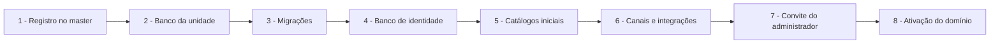
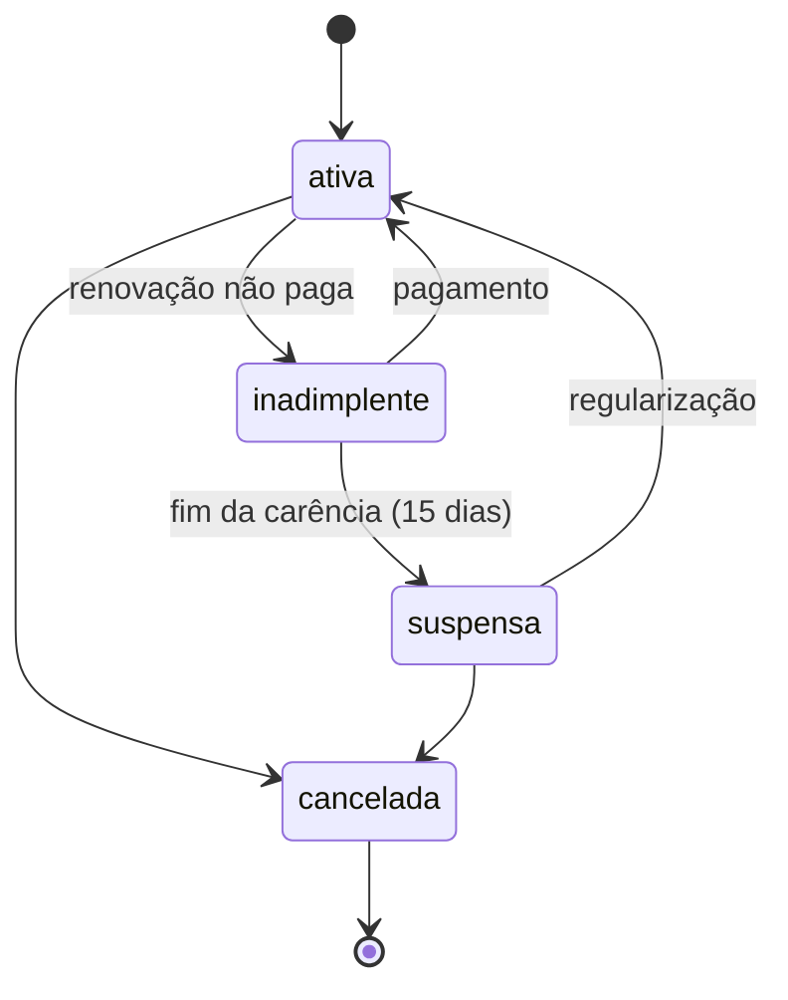

[Índice](README.md) · [Parte anterior](parte-05-portais-navegacao-e-interface.md) · [Próxima parte](parte-07-regras-gerais-dos-modulos-de-gestao.md)

<a id="parte-6"></a>

# Parte 6 — Plataforma SaaS: clientes, domínios, licenças e CRM

## Visão geral da parte 6

A plataforma cria entidades e unidades em etapas idempotentes, controla planos com limite de alunos e mantém um CRM próprio, separado do CRM de cada entidade ([23](#doc-23), [77](#doc-77), [22](#doc-22)).





**Regras principais**
- Falha em qualquer etapa deixa a entidade em `provisionando`, sem acesso; a retomada é registrada ([23](#doc-23), seção 4).
- A saída do cliente tem sete etapas: pedido, suspensão, exportação, retenção legal, encerramento, expurgo e certificado ([23](#doc-23), seção 5).
- Cada plano tem limite de alunos; acima do limite, novas matrículas ativas são bloqueadas ([77](#doc-77)).
- São dois CRMs: o da plataforma (vender o SaaS) e o do tenant (captar alunos). Nenhum lead cruza de um para o outro ([22](#doc-22), seção 1).

<a id="doc-23"></a>

## 23 — Domínios, Editor de portais, Autenticação, Provisionamento e Ciclo de Vida

> Parte do [SDD v2](parte-01-visao-e-escopo.md#doc-00). Identidade em [06](parte-03-identidade-acesso-e-permissoes.md#doc-06), seção 12. Bancos em [03](parte-02-arquitetura-e-tenancy.md#doc-03), seção 1.1. Operação em [10](parte-17-operacao-qualidade-testes-e-ti.md#doc-10). Operação contínua, backup e testes em [24](parte-17-operacao-qualidade-testes-e-ti.md#doc-24).
> **Status:** D-22, D-23 e D-24 aprovadas pelo autor em 02/11/2026. Esta seção cobre pontos que estavam no projeto sem registro: a arquitetura de subdomínios (Editor de portais e autenticação), o provisionamento de entidade e unidade e a saída de um cliente. Decisões D-22 a D-24 (seção 6) foram aprovadas em 02/11/2026.

---

### 1. Mapa de domínios

**Decisão D-25 (02/11/2026): seis portais.** Módulos não são subdomínios. Cada portal reúne os módulos que o usuário tem permissão de usar.

| Domínio | Portal | Quem acessa |
|---|---|---|
| `totustuussoftcloud.com.br` | Site institucional e CRM da plataforma. Não é portal de uso. | Público; equipe comercial |
| `desenvolvedor.totustuussoftcloud.com.br` | Portal do Desenvolvedor, com o Editor de portais como área restrita (papel `platform.builder`) | Equipe da plataforma |
| `gestao.totustuussoftcloud.com.br` | Portal SaaS de gestão: acadêmico, simulados, projetos, contábil, financeiro, biblioteca, arquivos, protocolo, suprimentos, frotas, pessoas, atendimento e acesso. Cada módulo aparece conforme o vínculo. | Usuários administrativos da entidade |
| `portal-do-professor.totustuussoftcloud.com.br` | Portal do Professor | Docentes |
| `portal-do-aluno.totustuussoftcloud.com.br` | Portal do Aluno | Estudantes |
| `portal-dos-responsaveis.totustuussoftcloud.com.br` | Portal dos Pais e Responsáveis | Responsáveis legais |
| `portal-de-terceiros.totustuussoftcloud.com.br` | Portal de Terceiros | Parceiros com acesso restrito |
| `autenticacao.totustuussoftcloud.com.br` | Serviço de login. Infraestrutura, não é portal. | Todos |
| `arquivos.totustuussoftcloud.com.br` | Serviço de arquivos sem tela, com origem separada. Infraestrutura. | Sistema |

Todos os endereços têm um único nível antes de `totustuussoftcloud.com.br`, para que o certificado curinga cubra todos. Por isso os portais usam hífen (`portal-do-aluno`), e não pontos.

**Fluxo de entrada (D-26, aprovada em 02/11/2026):**

1. A pessoa informa e-mail e senha no portal escolhido. A conta é a mesma em todos os portais.
2. Se a conta tiver um único vínculo ativo, com uma entidade e uma unidade, o sistema vai direto para a página principal do portal.
3. Se houver mais de uma entidade, a pessoa escolhe a entidade. Depois, se houver mais de uma unidade nela, escolhe a unidade.
4. Se a conta não tiver vínculo com o portal acessado, a tela mostra que não há acesso a esse portal, sem listar outras entidades ou unidades.
5. Trocar de entidade ou unidade depois do login emite novo token com o contexto escolhido (D-20). O endereço do portal não muda.

O subdomínio por entidade do D-24 é **superado** por D-25. O endereço da entidade fica pendente em D-26 ([00](parte-01-visao-e-escopo.md#doc-00)).

Regras gerais:

1. Cada domínio tem cookie próprio. Nenhum cookie de sessão é compartilhado com domínio pai (ver seção 2).
2. Todo redirecionamento após login usa lista de destinos permitidos por conta. Destino fora da lista é recusado. Isso evita redirecionamento aberto.
3. Certificado curinga para `*.totustuussoftcloud.com.br`, com renovação automática e alerta a 14 dias do vencimento ([10](parte-17-operacao-qualidade-testes-e-ti.md#doc-10), seção 7).
4. Domínio próprio da entidade exige verificação de posse (registro DNS) e certificado emitido para ele. Sem verificação, o domínio não é ativado.
5. O host da requisição é validado contra a lista de domínios ativos. Host desconhecido recebe `404` ([03](parte-02-arquitetura-e-tenancy.md#doc-03), seção 3).

### 2. Sessão entre domínios

**Proposta (D-22):** OpenID Connect com código de autorização e PKCE.

- O login acontece só em `autenticacao.`.
- O domínio de destino recebe um código de uso único, troca por tokens e cria a própria sessão.
- Um domínio comprometido não acessa a sessão de outro.
- Logout propaga para todos os domínios com sessão ativa.

Alternativa: cookie compartilhado em `.totustuussoftcloud.com.br`. É mais simples, mas qualquer subdomínio comprometido recebe o cookie de todos. Não recomendado.

### 3. Editor de portais: a superfície mais sensível

O Editor de portais (chamado de "builder" na v1; nome decidido em MOD-12) altera páginas e rotas que valem para todas as entidades. O código do papel continua `platform.builder`, para não mudar as permissões já escritas em [06](parte-03-identidade-acesso-e-permissoes.md#doc-06). Um erro ou um acesso indevido afeta todos os clientes. Por isso, ele tem regras próprias.

**Proposta (D-23):** o Editor de portais altera apenas definições declarativas: páginas, rotas, layout, blocos aprovados e configuração. Não aceita PHP, JavaScript ou HTML livre.

| Controle | Regra |
|---|---|
| Acesso | Papel `platform.builder`, passkey obrigatória ([06](parte-03-identidade-acesso-e-permissoes.md#doc-06), seção 10) e sessão de curta duração. |
| Implantação | Sistema separado do produto, em outro grupo de servidores. Falha do Editor de portais não afeta os clientes. |
| Publicação | Rascunho → revisão por segundo papel → publicação. Quem edita não aprova a própria mudança. |
| Versão | Toda publicação gera versão imutável. Rollback volta a uma versão anterior em um clique, com registro. |
| Escopo | Mudança pode ser publicada para todas as entidades, para um grupo ou para uma entidade. Padrão: uma entidade, depois o grupo. |
| Validação | Definição é validada por esquema antes de publicar. Bloco fora do catálogo é recusado. |
| Conteúdo | Texto exibido passa pelo escape do sistema ([08](parte-05-portais-navegacao-e-interface.md#doc-08)). Nenhum script é aceito. |
| Auditoria | Cada edição, aprovação e publicação gera registro ([18](parte-07-regras-gerais-dos-modulos-de-gestao.md#doc-18), seção 4.2). |
| Teste | Publicação passa por teste de fumaça das telas afetadas antes de ir para produção. |

**Motivo do limite:** código livre no Editor de portais transforma uma conta comprometida em execução de código em todos os clientes. A versão declarativa mantém o mesmo ganho de produtividade com um teto de dano bem menor.

### 4. Provisionamento de entidade e unidade

Criar uma entidade ou unidade é uma operação de várias etapas. Cada etapa é idempotente e pode ser retomada. A entidade só fica ativa ao final.

| Ordem | Etapa | Verificação |
|---|---|---|
| 1 | Registro da entidade e das unidades no master | Código e domínio únicos |
| 2 | Criação do banco da unidade (`tt_NNN`) e registro em `tenant_databases` | Banco criado com o nome registrado |
| 3 | Aplicação das migrações ao banco da unidade | `schema_version` igual à versão atual |
| 4 | Criação do banco de identidade da entidade, se ainda não existir (D-19) | Vazio e cifrado com a chave da entidade |
| 5 | Carga inicial de catálogos (locales, papéis padrão, categorias) | Conferência por contagem |
| 6 | Configuração de canais e integrações, por credencial própria do tenant ([16](parte-14-integracoes-e-importacao.md#doc-16)) | Teste de conexão, sem ativação automática |
| 7 | Criação do primeiro administrador da entidade, por convite | Convite com validade de 72 h ([06](parte-03-identidade-acesso-e-permissoes.md#doc-06)) |
| 8 | Ativação do domínio e da entidade | Teste de fumaça no domínio |

Regras:

- Falha em qualquer etapa deixa a entidade em `provisionando`, sem acesso de usuário. Retomada ou cancelamento são ações com registro.
- Cancelamento antes da ativação remove o banco criado e o registro de bancos. A remoção é verificada.
- Provisionamento não copia dado de outra entidade. Modelos padrão são sementes independentes.

### 5. Saída de cliente (desprovisionamento)

Um cliente que sai da plataforma precisa de um fluxo próprio, com prazos e registro. Ele é também um direito do titular.

| Etapa | Ação | Prazo de referência |
|---|---|---|
| 1. Pedido | Registro do pedido pelo administrador da entidade, com confirmação de identidade (MFA recente) | Imediato |
| 2. Suspensão | Entidade fica somente leitura. Novos vínculos e cobranças são bloqueados. | Imediato |
| 3. Exportação | Pacote com dados de titulares e de operação, em formato legível e portável ([07](parte-04-seguranca-privacidade-e-auditoria.md#doc-07), seção 4). Entrega cifrada, com link de validade curta. | Até 15 dias |
| 4. Retenção legal | Dados que a lei exige guardar ficam em banco de retenção, com acesso restrito e prazo registrado. | Conforme a finalidade ([07](parte-04-seguranca-privacidade-e-auditoria.md#doc-07), seção 5) |
| 5. Encerramento | Vínculos revogados. Domínio desativado. Sessões encerradas. | Após a exportação |
| 6. Expurgo | Banco da unidade e banco de identidade removidos. Arquivos expurgados. Backups expiram no prazo de retenção de backup. | Conforme política |
| 7. Registro final | Certificado de encerramento com o que foi exportado, retido e expurgado | Imediato após o expurgo |

Pendência: o prazo de guarda para retenção legal depende do jurídico (matriz de retenção, [26](parte-18-juridico-e-regulatorio.md#doc-26), seção 3).

### 6. Decisões propostas

| # | Decisão | Proposta | Alternativa e condição de falha |
|---|---|---|---|
| D-22 | Sessão entre domínios | OIDC com código e PKCE (seção 2) | Cookie compartilhado: mais simples, mas um subdomínio comprometido expõe os demais |
| D-23 | Escopo do Editor de portais | Só definições declarativas, com publicação revisada e rollback (seção 3) | Código livre: mais poder, mas uma conta comprometida afeta todas as entidades |
| D-24 | Endereço do tenant | Subdomínio por entidade, mais domínio próprio opcional com verificação (seção 1) | Seleção de entidade na tela de login: mais simples, mas a marca fica menos separada |

Estas decisões foram aprovadas pelo autor em 02/11/2026, com as propostas indicadas.

### 7. Critérios de aceite

- [ ] Cada domínio tem cookie próprio, sem compartilhamento com o domínio pai.
- [ ] Redirecionamento após login passa pela lista de destinos da conta.
- [ ] Editor de portais publica somente definições validadas, com revisão de segundo papel e rollback.
- [ ] Provisionamento retomável; cancelamento remove o que foi criado.
- [ ] Saída de cliente com exportação, retenção legal, expurgo e certificado.
- [ ] D-22 a D-24 decididas e registradas.

<a id="doc-77"></a>

## 77 — Licenciamento, planos, assinaturas e limites

> Parte do [SDD v2](parte-01-visao-e-escopo.md#doc-00). Complementa [16](parte-14-integracoes-e-importacao.md#doc-16) (cobrança da assinatura do SaaS) e [20](parte-10-financeiro-pagamentos-e-fiscal.md#doc-20) (pagamentos). Permissões em [78](parte-03-identidade-acesso-e-permissoes.md#doc-78).
> **Status:** aprovado pelo autor em 04/11/2026 (L-01 e D-27 a D-29, D-34 a D-37). Não há proposta em aberto neste documento.

---

### 1. Regras aprovadas pelo autor

| # | Regra | Origem |
|---|---|---|
| L-01 | Cada plano tem um **limite de alunos**, definido pelo desenvolvedor da plataforma. | Autor, 04/11/2026 |
| L-02 | Criar entidade e criar unidade é **exclusivo do papel de desenvolvedor** (`platform.developer`). Nenhum outro papel cria entidade ou unidade. | Autor, 04/11/2026 |

### 2. Modelo de plano

| Campo | Regra | Situação |
|---|---|---|
| Nome e código | Únicos na plataforma. | D-34 (aprovada) |
| Limite de alunos | Número inteiro, definido pelo desenvolvedor. Contabiliza **alunos com matrícula ativa** em qualquer unidade da entidade. | L-01 (aprovada) |
| Módulos incluídos | Lista de módulos licenciados para o plano. Entidade sem o módulo não vê o item no portal. | D-35 (aprovada) (ver [23](#doc-23), seção 1) |
| Ciclo de cobrança | Mensal ou anual, definido por plano. | D-29 (aprovada) |
| Preço | Definido pelo desenvolvedor, por plano, em moeda única da plataforma. | D-29 (aprovada) |
| Situação | Ativo, descontinuado. Plano descontinuado não aceita novas assinaturas, e as existentes seguem até a renovação. | D-36 (aprovada) |

### 3. Assinatura da entidade

- Uma entidade tem **uma assinatura ativa** por vez, vinculada a um plano.
- Mudança de plano: efeito na data definida pelo desenvolvedor. Aumento de limite pode ser imediato; redução só vale na renovação, sem remover alunos já matriculados.
- Cobrança de assinatura: integrada ao provedor de pagamento, sem dado bancário no sistema ([16](parte-14-integracoes-e-importacao.md#doc-16), seção 2.1).

#### 3.1 Situações da assinatura (D-37, aprovada)

| Situação | Quando | Efeito |
|---|---|---|
| `ativa` | Pagamento em dia | Operação normal |
| `inadimplente` | Renovação não paga após o vencimento | Acesso de leitura por período de carência; novas matrículas bloqueadas |
| `suspensa` | Fim da carência sem pagamento, ou pedido do desenvolvedor | Somente leitura, como em [23](#doc-23), seção 5 |
| `cancelada` | Cancelamento solicitado ou fim do processo de saída | Início do fluxo de saída de cliente |

Prazo de carência: **15 dias**, ajustável pelo desenvolvedor por plano (D-28, aprovada).

### 4. Limite de alunos (L-01)

- **Contagem:** alunos com matrícula ativa, somados em todas as unidades da entidade. Matrícula cancelada, trancada ou concluída não conta.
- **Verificação:** a cada nova matrícula ativa e, em lote, uma vez por dia para conferência.
- **Ao atingir 90%:** aviso aos administradores da entidade e ao desenvolvedor.
- **Ao exceder o limite:** **bloqueio de novas matrículas ativas** (D-27, aprovada) até que o plano seja ampliado ou o número de alunos caia. Dados existentes não são alterados nem bloqueados.
- **Alternativa:** permitir o excedente por período de tolerância, com cobrança adicional. Descartada pela D-27.

### 5. Decisões pendentes

| # | Decisão | Proposta | Alternativa |
|---|---|---|---|
| D-27 | Comportamento ao exceder o limite de alunos | Bloquear novas matrículas ativas (seção 4). **Aprovada pelo autor em 04/11/2026.** | Tolerância com cobrança adicional |
| D-28 | Prazo de carência por inadimplência | 15 dias, por plano. **Aprovada pelo autor em 04/11/2026.** | Prazo único para todos os planos |
| D-29 | Preço e ciclo por plano | Definidos pelo desenvolvedor, por plano. **Aprovada pelo autor em 04/11/2026.** | Preço único da plataforma |
| D-34 | Nome e código do plano | Únicos na plataforma (seção 2). **Aprovada pelo autor em 04/11/2026.** | Únicos por grupo de planos |
| D-35 | Módulos incluídos no plano | Lista de módulos por plano; entidade sem o módulo não vê o item no portal (seção 2). **Aprovada pelo autor em 04/11/2026.** | Todos os módulos em todos os planos, com limite só de alunos |
| D-36 | Situação do plano | Ativo ou descontinuado; descontinuado não aceita novas assinaturas (seção 2). **Aprovada pelo autor em 04/11/2026.** | Plano pode ser excluído |
| D-37 | Situações da assinatura | Ativa, inadimplente, suspensa, cancelada, com os efeitos da seção 3.1. **Aprovada pelo autor em 04/11/2026.** | Só ativa e cancelada |

### 6. Critérios de aceite

- [ ] Plano com limite de alunos obrigatório, definido pelo desenvolvedor.
- [ ] Contagem de alunos com matrícula ativa, somada por entidade, verificada na matrícula e em lote.
- [ ] Aviso a 90% e bloqueio de novas matrículas acima do limite (D-27).
- [ ] Mudança de plano com efeito na data definida, sem remover alunos.
- [ ] Situações da assinatura refletidas na navegação e nas ações (D-28 e D-37).
- [ ] Nenhum dado bancário no sistema (ver [16](parte-14-integracoes-e-importacao.md#doc-16)).

<a id="doc-22"></a>

## 22 — CRM: Dois Contextos, Canais de Captação e Papéis

> Parte do [SDD v2](parte-01-visao-e-escopo.md#doc-00). Substitui e amplia a v1 [`spec_crm_funil_comercial.md`](#v1-spec-crm-funil-comercial-md) (ver [19](parte-07-regras-gerais-dos-modulos-de-gestao.md#doc-19), seção 6). Integrações de canal em [16](parte-14-integracoes-e-importacao.md#doc-16). Consentimento e papéis de LGPD em [07](parte-04-seguranca-privacidade-e-auditoria.md#doc-07). Permissões em [06](parte-03-identidade-acesso-e-permissoes.md#doc-06). Pagamentos em [20](parte-10-financeiro-pagamentos-e-fiscal.md#doc-20). Chatbots e captação usam a mesma camada de mensagens descrita aqui.
> **Interpretação:** "papilanes" foi lido como **papéis** (perfis de usuário e de operação). Se a intenção for outra, esta seção será revisada.
> **Status:** D-16, D-17 e D-18 decididas pelo autor em 02/11/2026 (seção 9).

---

### 1. Dois CRMs, não um

Existem dois CRMs com donos, leads e finalidades diferentes. Misturá-los seria erro de dados e de LGPD.

| Aspecto | CRM da plataforma (vendas do SaaS) | CRM do tenant (captação de alunos) |
|---|---|---|
| Quem vende | TotusTuus SoftCloud | Colégio, faculdade ou instituição (tenant) |
| Quem é o lead | Instituição ou empresa que pode contratar o SaaS | Aluno, responsável ou candidato |
| Dono dos dados (controlador, LGPD) | Plataforma | Tenant |
| Papel da plataforma sobre os dados | Controlador | Operadora, quando a plataforma executa o canal para o tenant |
| Funil | Pré-venda, demonstração, proposta, contrato, implantação | Interesse, contato, pré-cadastro, inscrição, documentos, matrícula |
| Dados pessoais típicos | Nome do decisor, e-mail corporativo, telefone comercial | Nome do aluno e do responsável, telefone, e-mail, série de interesse |
| Dados que nunca entram | Dado de aluno de tenant | Dado comercial da plataforma, preço negociado com outro tenant |
| Banco | **Banco master** (`totustuus.matriz.bd`) | **Banco da unidade** (um por entidade + unidade, ver [03](parte-02-arquitetura-e-tenancy.md#doc-03), seção 1.1) |

**Regra de separação:** nenhum registro de tenant aparece no CRM da plataforma, e nenhum registro do CRM da plataforma aparece em tenant. A ligação entre os dois é apenas o contrato comercial.

**Operação pela plataforma de canal de tenant:** quando o chatbot da plataforma atende o aluno de um tenant, a plataforma atua como operadora. Isso exige contrato de tratamento de dados entre plataforma e tenant ([07](parte-04-seguranca-privacidade-e-auditoria.md#doc-07), seção 7).

---

### 2. Canais

#### 2.1 CRM da plataforma

| Canal | Entrada | Identidade capturada | Atendimento | Consentimento |
|---|---|---|---|---|
| Chatbot no site (totustuussoftcloud.com.br) | Widget no site institucional | E-mail corporativo, telefone, nome, instituição | Bot com handoff para vendedor | Aviso e aceite antes de coletar |
| Chatbot WhatsApp | Número oficial da plataforma | Número de telefone | Bot com handoff | Opt-in na primeira mensagem |
| Chatbot Telegram | Bot oficial da plataforma | Identificador do usuário e, se fornecido, telefone | Bot com handoff | Opt-in na primeira mensagem |
| Chatbot Instagram | Conta oficial, mensagem direta | Identificador da conta | Bot com handoff | Opt-in e aviso de que o contato é registrado |
| Chatbot Messenger | Página oficial | Identificador da página | Bot com handoff | Opt-in e aviso de que o contato é registrado |
| Telefone | Ligação recebida ou feita | Número e nome informado | Vendedor | Aviso de gravação, quando houver gravação |
| Presencial | Evento, visita, feira | Cartão ou formulário em papel digitalizado | Vendedor | Termo no formulário, com aceite |

#### 2.2 CRM do tenant (captação de alunos)

| Canal | Entrada | Identidade capturada | Atendimento | Consentimento |
|---|---|---|---|---|
| Formulário embutido no site do tenant (iframe ou script) | Página do tenant, com origem permitida | Nome, telefone, e-mail, série de interesse | Equipe de admissões | Aceite com finalidade, na própria página |
| Chatbot WhatsApp do tenant | Número do tenant ([16](parte-14-integracoes-e-importacao.md#doc-16), D-07) | Número de telefone | Bot do tenant com handoff | Opt-in na primeira mensagem |
| Chatbot Telegram do tenant | Bot do tenant | Identificador e telefone, se fornecido | Bot com handoff | Opt-in |
| Chatbot Instagram do tenant | Conta do tenant | Identificador da conta | Bot com handoff | Opt-in |
| Chatbot Messenger do tenant | Página do tenant | Identificador da página | Bot com handoff | Opt-in |
| Telefone | Central do tenant | Número e nome | Atendente | Aviso de gravação |
| Presencial | Visita, feira, open day | Ficha de inscrição | Atendente | Termo de consentimento na ficha |

**Regra comum a todos os canais:** a captura começa só depois do aviso de finalidade. Lead sem consentimento de contato para a finalidade informada fica em estado `sem_consentimento` e não recebe mensagem de marketing.

---

### 3. Regras por canal

| Regra | Aplicação |
|---|---|
| Identificação de bot | O chatbot se identifica como automático na primeira mensagem e oferece transferência para humano. |
| Dados que o bot não coleta | Dado de saúde, CPF completo, número de cartão, senha e documento de imagem. Quando necessário para a matrícula, o coleta acontece em formulário autenticado. |
| Pagamento | Nenhum pagamento é feito no chat. O bot envia link de pagamento ([20](parte-10-financeiro-pagamentos-e-fiscal.md#doc-20)). |
| Opt-out | Palavra de saída reconhecida em todos os canais (`PARAR`, `SAIR`). Efeito imediato sobre marketing. |
| Horário e frequência | Limite de mensagens proativas por lead e por dia. Mensagem de cobrança segue a régua de [18](parte-07-regras-gerais-dos-modulos-de-gestao.md#doc-18), seção 2.6. |
| Transcrição | Guardada como interação do lead, com retenção configurável por tenant ([07](parte-04-seguranca-privacidade-e-auditoria.md#doc-07), seção 5). |
| Gravação de ligação | Só com aviso no início e registro do consentimento. |
| Mensagem de terceiro | Nunca encaminhar a conversa a outro lead ou a outro tenant. |
| Políticas das plataformas | Cada canal cumpre as regras de uso da plataforma de mensagens (WhatsApp Business, Telegram Bot API, Meta para Instagram e Messenger). Mudança de regra vira tarefa de adequação. |
| Chatbot com IA (D-18) | A IA responde **somente com base em fonte cadastrada** (catálogo de cursos, preços, calendário, FAQ aprovada). Pergunta fora da fonte não recebe resposta inventada: é encaminhada para humano. Preço, bolsa, prazo ou condição nunca saem de fonte não cadastrada. |
| Abertura de ticket sem IA (D-18) | Todo ponto de atendimento oferece a opção "Abrir ticket" por menu fixo, sem interpretação por IA. O ticket é criado no módulo de atendimento ([19](parte-07-regras-gerais-dos-modulos-de-gestao.md#doc-19), seção 7) com categoria escolhida no menu e texto digitado pelo contato, guardado como texto literal. Esse caminho funciona mesmo com IA desligada. |
| Injeção de instrução | Texto do lead é dado, nunca instrução ao bot. Teste contra tentativa de alterar o comportamento do bot ([05](parte-04-seguranca-privacidade-e-auditoria.md#doc-05)). |

---

### 4. Papéis do CRM

#### 4.1 CRM da plataforma

| Papel | Escopo | Pode | Não pode |
|---|---|---|---|
| Pré-vendas (SDR) | Leads da plataforma | Qualificar, agendar demonstração, registrar interação | Fechar proposta, alterar preço, ver contrato |
| Vendedor (AE) | Leads e oportunidades atribuídos a ele | Criar proposta, avançar funil até negociação | Aprovar desconto acima da alçada, alterar contrato assinado |
| Gerente comercial | Equipe | Atribuir leads, aprovar desconto dentro da alçada, ver funil da equipe | Aprovar a própria proposta |
| Operador de chatbot | Conversas em atendimento | Atender, transferir, registrar | Acessar carteira fora da fila |
| Sucesso do cliente | Clientes ativos (tenants) | Acompanhar implantação e uso | Alterar cobrança |

#### 4.2 CRM do tenant

| Papel | Escopo | Pode | Não pode |
|---|---|---|---|
| Atendente de admissões | Leads da unidade | Atender, registrar interação, agendar visita | Exportar base, ver dado de matrícula de outro aluno |
| Coordenador de admissões | Leads de todas as unidades permitidas | Redistribuir, ver funil, configurar régua de contato | Alterar a finalidade de consentimento |
| Gestor comercial da entidade | Entidade | Ver indicadores, configurar canais | Ver dado pessoal além da lista de leads com permissão de exportação |
| Operador de bot do tenant | Conversas do canal | Atender e transferir | Editar a base de conhecimento do bot sem permissão |
| Responsável pela unidade | Unidade | Ver funil da unidade | Ver outra unidade |

---

### 5. Papéis dos departamentos

Papéis internos da organização que usa o sistema (plataforma ou tenant). Cada papel define acesso a módulos. Os nomes de permissão seguem `modulo.recurso.acao` ([06](parte-03-identidade-acesso-e-permissoes.md#doc-06), seção 9).

| Papel | Módulos principais | Permissões-chave | Segregação de funções |
|---|---|---|---|
| **Financeiro** | Financeiro, Cobrança, Pagamentos | Emitir e baixar títulos; solicitar estorno; conciliar | Não aprova o próprio estorno |
| **Contábil** | Contábil e Fiscal, Financeiro (leitura) | Lançar, fechar período, exportar para ERP | Não fecha período com lançamento que criou sem revisão |
| **Fiscal** | Contábil e Fiscal, Cobrança (NFSe) | Emitir e cancelar NFSe, apurar tributos | Cancelamento exige aprovação do contábil |
| **Comercial** | CRM (conforme 4.1 ou 4.2), Contratos (leitura) | Criar proposta, negociar | Não aprova desconto acima da alçada |
| **Compras** | Suprimentos (requisição, pedido, cotação), Contratos | Criar cotação e pedido; cadastrar fornecedor | Não aprova a própria requisição; não recebe a própria compra |
| **Almoxarifado** | Suprimentos (estoque) | Registrar recebimento e movimento | Não ajusta estoque sem motivo e aprovação |
| **Aprovador de compras** | Suprimentos | Aprovar requisição dentro da alçada | Não é o solicitante |
| **RH** | HCM (Pessoas e RH) | Cadastrar colaborador, férias, afastamento | Campos salariais só com permissão própria |
| **Folha** | HCM (folha) | Processar folha | Folha fechada não é alterada |
| **SMT** | Segurança e medicina do trabalho | Registrar ASO, CAT, EPI | Resultado de exame só por profissional responsável |
| **Acadêmico (secretaria)** | Acadêmico | Matrícula, documentos | Nota só pelo professor da turma |
| **Professor** | Acadêmico (turmas próprias) | Lançar nota, presença, diário | Só turmas vinculadas |
| **Jurídico** | Contratos, Documentos, Auditoria (leitura) | Parecer, bloqueio legal | Não altera contrato assinado |
| **Encarregado (DPO)** | Privacidade, Auditoria, Busca por CPF | Relatório de impacto, relatório ao titular, aprovação de finalidade | Não opera o módulo que audita |
| **Segurança** | Auditoria, Configuração de MFA, Cofre (leitura de status) | Investigar, bloquear conta | Não concede permissão a si mesmo |
| **TI / Operação** | Infraestrutura, filas, monitoramento | Operar serviços | Sem acesso a dado pessoal de tenant |

**Regra geral de segregação:** nenhuma pessoa cria e aprova o mesmo objeto financeiro, de compra ou de consentimento. A aplicação verifica isso, não só o processo.

---

### 6. Funil e estados

#### 6.1 CRM da plataforma

Leads: `novo` → `contatado` → `qualificado` → `demonstracao` → `proposta` → `negociacao` → `ganho` ou `perdido`.
Após ganho: `implantacao` → `ativo`.

Estados de lead descartado: `desqualificado`, `sem_consentimento`, `duplicado`.

#### 6.2 CRM do tenant

Leads: `interessado` → `contatado` → `pre_cadastro` → `inscrito` → `documentos_pendentes` → `matriculado`.
Estado de saída: `desistente`, `sem_consentimento`, `duplicado`.

Regras:

- "Fechado perdido" exige motivo (preço, concorrência, sem vaga, timing ou outro), como já definido na v1.
- Lead `matriculado` nunca volta a `interessado`. Novo interesse gera novo lead, vinculado ao anterior.
- Vaga do curso é reservada só em `inscrito`, com bloqueio de concorrência ([15](parte-16-dados-validacoes-configuracoes-e-armazenamento.md#doc-15), seção 7).

---

### 7. Captura por formulário embutido

- Origem permitida: lista de domínios cadastrada por tenant. Outro domínio não recebe o envio.
- O formulário é carregado de origem da plataforma com `frame-ancestors` limitado aos domínios permitidos.
- Campos mínimos. A série de interesse é lista fechada.
- Proteção contra robô: desafio antes do envio, sem terceiro não aprovado.
- Aceite de finalidade e de contato antes do envio, com texto e versão registrados.
- Confirmação por e-mail ou WhatsApp quando marketing estiver marcado (duplo opt-in).
- Nenhum script de terceiro na página do formulário além dos aprovados ([08](parte-05-portais-navegacao-e-interface.md#doc-08), seção 2).

---

### 8. Dados

Tabelas mínimas. Todas com `tenant_id` (no CRM da plataforma, `tenant_id` aponta para a própria plataforma).

```sql
CREATE TABLE crm_leads (
  id              BIGINT UNSIGNED AUTO_INCREMENT PRIMARY KEY,
  uuid            CHAR(36)     NOT NULL,
  tenant_id       CHAR(36)     NOT NULL,
  context         ENUM('plataforma','tenant') NOT NULL,
  origin_channel  ENUM('site','formulario','whatsapp','telegram','instagram','messenger','telefone','presencial','indicacao') NOT NULL,
  owner_uuid      CHAR(36)     NULL,
  unit_id         CHAR(36)     NULL,
  name            VARCHAR(150) NOT NULL,
  phone_e164      VARCHAR(20)  NULL,
  email           VARCHAR(254) NULL,
  email_hash      CHAR(64)     NULL,
  phone_hash      CHAR(64)     NULL,
  status          VARCHAR(40)  NOT NULL,
  lost_reason     VARCHAR(60)  NULL,
  created_at      DATETIME(6)  NOT NULL DEFAULT CURRENT_TIMESTAMP(6),
  UNIQUE KEY uk_lead_uuid (uuid),
  INDEX idx_tenant_status (tenant_id, context, status),
  INDEX idx_tenant_phone (tenant_id, phone_hash),
  INDEX idx_tenant_email (tenant_id, email_hash)
) ENGINE=InnoDB DEFAULT CHARSET=utf8mb4;

CREATE TABLE crm_consents (
  id              BIGINT UNSIGNED AUTO_INCREMENT PRIMARY KEY,
  uuid            CHAR(36)     NOT NULL,
  tenant_id       CHAR(36)     NOT NULL,
  lead_id         BIGINT UNSIGNED NOT NULL,
  purpose         ENUM('contato_comercial','marketing','admissao','cobranca','gravacao_ligacao') NOT NULL,
  channel         VARCHAR(20)  NOT NULL,
  text_version    VARCHAR(40)  NOT NULL,
  granted_at      DATETIME(6)  NOT NULL,
  revoked_at      DATETIME(6)  NULL,
  evidence_ref    VARCHAR(255) NULL,
  UNIQUE KEY uk_consent_uuid (uuid),
  INDEX idx_lead_purpose (tenant_id, lead_id, purpose),
  FOREIGN KEY (lead_id) REFERENCES crm_leads(id)
) ENGINE=InnoDB DEFAULT CHARSET=utf8mb4;
```

Notas:

- `email_hash` e `phone_hash` são HMAC com pepper, para deduplicação e busca exata ([15](parte-16-dados-validacoes-configuracoes-e-armazenamento.md#doc-15), seção 2). Dado em claro é cifrado conforme [05](parte-04-seguranca-privacidade-e-auditoria.md#doc-05).
- Consentimento nunca é apagado. Revogação preenche `revoked_at`.
- Interações (mensagens, ligações, visitas) vão para tabela própria, com canal, direção e referência à transcrição. A transcrição segue a retenção do tenant.
- Deduplicação: mesmo `phone_hash` ou `email_hash` dentro do mesmo `tenant_id` e contexto gera alerta de possível duplicidade, sem fusão automática.

---

### 9. Decisões

| # | Decisão | Proposta | Alternativa e condição de falha |
|---|---|---|---|
| D-16 | Separação dos CRMs | **Decidida:** CRM da plataforma no banco master; CRM do tenant no banco de cada unidade (entidade + unidade). | — |
| D-17 | Contas de canal (WhatsApp, Telegram, Instagram, Messenger) | **Decidida:** no CRM da plataforma, contas oficiais da plataforma. No CRM do tenant, contas do próprio tenant, conforme D-07 ([16](parte-14-integracoes-e-importacao.md#doc-16), seção 6). | — |
| D-18 | Uso de IA no chatbot | **Decidida:** IA só com fonte cadastrada; pergunta fora da fonte vai para humano; sempre disponível a opção "Abrir ticket" sem IA (seção 3) | — |

---

### 10. Lacunas

| # | Lacuna | Dono sugerido | Situação em 04/11/2026 |
|---|---|---|---|
| LAC-21 | Texto de aceite de finalidade por contexto | Jurídico | Aberta (jurídico) |
| LAC-22 | Limite de mensagens proativas por canal | Comercial, Jurídico | Parcial: padrão seguro provisório DP-08 ([80](parte-19-pendencias-decisoes-e-rastreabilidade.md#doc-80)); o limite por canal continua dependendo do jurídico |
| LAC-23 | Alçada de desconto do CRM da plataforma | Comercial | Resolvida por padrão: DP-07 ([80](parte-19-pendencias-decisoes-e-rastreabilidade.md#doc-80)). Parâmetro sem valor inventado; até a configuração, todo desconto fora da regra passa pelo gerente comercial |
| LAC-24 | Retenção de transcrição e de gravação de ligação | Jurídico, DPO | Aberta (jurídico): ATD-03 ([32](parte-04-seguranca-privacidade-e-auditoria.md#doc-32)) |
| LAC-25 | Contrato de operadora entre plataforma e tenant para atendimento de canal | Jurídico | Aberta (jurídico) |

---

### 11. Critérios de aceite

- [ ] Nenhum lead de tenant aparece no CRM da plataforma, e o contrário (teste de isolamento).
- [ ] Todo canal da seção 2 tem regra de consentimento antes da primeira mensagem proativa.
- [ ] Todo papel das seções 4 e 5 tem permissões testadas, incluindo as restrições.
- [ ] Segregação de funções testada nas operações financeiras, de compra e de consentimento.
- [ ] Chatbot se identifica como automático e transfere para humano.
- [ ] Formulário embutido só envia para origem permitida.

## Especificações da v1 desta parte absorvidas no kit-starter ou sem destino

<a id="v1-spec-crm-funil-comercial-md"></a>

### v1 — `spec_crm_funil_comercial.md` (244 linhas)

> Situação na v2: Absorvido integralmente no kit-starter. Destino: ficha do kit-starter: `kit-starter/gestao/comercial-e-admissoes/crm-do-tenant-captacao-pre-cadastro-inscricao.md`. Quando este texto diverge da v2, vale a v2.

#### O que a v2 muda nesta especificação

Estas regras prevalecem sobre o texto da v1 que vem a seguir.

- Dois CRMs, não um ([22](#doc-22), seção 1); consentimento por canal ([26](parte-18-juridico-e-regulatorio.md#doc-26), seção 5).

#### Texto integral da v1

**Projeto:** TotusTuusSoftCloud — SaaS Multi-Entidade · Multi-Unidade · Multi-Usuário
**Módulo:** CRM / Sales Pipeline / Admissions
**Stack:** PHP 8 puro · MariaDB · Tailwind CSS 4.2 · Supabase · amCharts 5
**Padrão de ID:** `id` (ordenação) · `uuid` (interno) · `code` (externo)
**Status:** Draft — gap identificado (conecta Marketing → Processo Seletivo → Matrícula)

- Language Standard: Global English

---

#### 1. Objetivo

Centralizar a jornada comercial completa, do lead gerado (Marketing) até a conversão em cliente/aluno matriculado, com pipeline de vendas, metas por vendedor/unidade, forecast, follow-up automatizado e atribuição de origem. Preenche a lacuna entre o módulo de Marketing (que gera leads) e o módulo Acadêmico (que trata do Processo Seletivo já com candidato inscrito).

#### 2. Escopo funcional

- Cadastro e qualificação de leads.
- Pipeline de oportunidades (kanban multi-etapa configurável).
- Atribuição automática de leads por regra (round-robin, território, origem).
- Atividades comerciais: ligações, e-mails, reuniões, tarefas.
- Metas e comissionamento por vendedor/unidade.
- Forecast de conversão e receita.
- Campanhas e origem de leads (integração com Marketing).
- Propostas comerciais e follow-up.
- Perda de oportunidade com motivo estruturado.
- Conversão para matrícula (handoff ao módulo Acadêmico) ou para contrato (handoff ao módulo Contratos).

#### 3. Perfis de acesso

| Perfil | Permissões |
|---|---|
| Gestor Comercial | Visão total, metas, relatórios, redistribuição de leads |
| Vendedor/Consultor | Pipeline próprio, atividades, propostas |
| Marketing | Cadastro de campanhas, visão de origem de leads |
| Recepção/SDR | Qualificação inicial de leads (pré-vendas) |
| Financeiro | Consulta de propostas fechadas para faturamento |

#### 4. Páginas do módulo

```
/crm/dashboard
/crm/leads                    — Lista de leads (datatable)
/crm/leads/:uuid               — Ficha do lead / timeline
/crm/pipeline                  — Kanban de oportunidades
/crm/opportunities             — Lista de oportunidades (datatable)
/crm/opportunities/:uuid       — Detalhe da oportunidade
/crm/activities                — Agenda de atividades comerciais
/crm/proposals                 — Propostas emitidas
/crm/goals                     — Metas e comissionamento
/crm/campaigns                 — Campanhas e origem
/crm/reports                   — Relatórios de funil e conversão
/crm/settings                  — Pipelines, motivos de perda, regras de atribuição
```

#### 5. Dashboard

##### Widgets
- Total de leads no período.
- Leads não atribuídos.
- Oportunidades abertas.
- Taxa de conversão (lead → matrícula/venda).
- Ticket médio.
- Receita em pipeline (forecast).
- Atividades atrasadas.
- Tempo médio de ciclo de venda.

##### Charts
- Funil: Lead → Qualificado → Proposta → Negociação → Fechado.
- Linha: novos leads por semana/mês.
- Donut: leads por origem/campanha.
- Barras: conversão por vendedor.
- Barras: motivos de perda mais frequentes.

#### 6. Leads — Datatable

Colunas: nome · telefone/e-mail · origem · campanha · curso/produto de interesse · responsável · status (novo/em contato/qualificado/desqualificado/convertido) · data criação · última interação · ações.

##### Drawer CRUD — Lead
- Dados de contato · origem (orgânico/pago/indicação/evento) · campanha vinculada.
- Curso/produto/unidade de interesse.
- Responsável atribuído (manual ou automático por regra).
- Score de qualificação (BANT ou customizado).
- Histórico de interações (timeline).
- Botão "Converter em Oportunidade".

#### 7. Pipeline — Kanban de Oportunidades

##### Colunas (configuráveis por pipeline)
Novo → Qualificação → Proposta Enviada → Negociação → Fechado Ganho → Fechado Perdido

##### Card
- Nome do lead/empresa · valor estimado · responsável · próxima atividade agendada · dias na etapa · badge de prioridade.

##### Regras
- Drag and drop com log de transição de etapa.
- Etapa "Fechado Perdido" exige motivo obrigatório (select configurável: preço, concorrência, sem orçamento, timing, outro).
- Etapa "Fechado Ganho" dispara automação de handoff (matrícula ou contrato).
- Múltiplos pipelines por tipo de produto/unidade (ex.: pipeline Educação Básica vs. pipeline Cursos Livres).

#### 8. Atividades Comerciais

- Tipos: ligação, e-mail, reunião, WhatsApp, tarefa.
- Agenda por vendedor com lembretes.
- Registro de resultado da atividade (contato feito/não atendeu/reagendado).
- Vínculo obrigatório a um lead ou oportunidade.

#### 9. Propostas Comerciais

- Geração de proposta em PDF a partir de template configurável.
- Itens de proposta com valores, descontos e condições.
- Status: rascunho / enviada / visualizada / aceita / recusada / expirada.
- Assinatura eletrônica opcional (integração com módulo de Contratos).

#### 10. Metas e Comissionamento

- Meta mensal/trimestral por vendedor e por unidade.
- Acompanhamento de realizado vs. meta (gauge/progress).
- Regra de comissão configurável (percentual fixo, escalonado, por produto).
- Relatório de comissão a pagar (integração com Financeiro/RH).

#### 11. Campanhas e Origem

- Cadastro de campanhas com custo, período e canal.
- Cálculo de CAC (custo de aquisição) por campanha.
- Vínculo com módulo de Marketing (UTM, tags de origem).

#### 12. Automações

- Atribuir lead automaticamente por regra (round-robin, território, disponibilidade).
- Notificar vendedor de lead sem contato em X horas (SLA de primeiro atendimento).
- Mover oportunidade para "Perdido" automaticamente após N dias sem atividade.
- Disparar e-mail de nutrição para leads não qualificados.
- Ao "Fechado Ganho", criar matrícula (Acadêmico) ou contrato (Contratos) automaticamente com dados da oportunidade.
- Alertar gestor quando meta do vendedor estiver em risco (< 70% aos 20 dias do período).

#### 13. Integrações

- **Marketing**: origem de lead, campanhas, UTM.
- **Acadêmico**: handoff para Processo Seletivo/Matrícula ao fechar oportunidade educacional.
- **Contratos**: handoff para geração de contrato ao fechar oportunidade B2B.
- **Financeiro/Billing**: geração de proposta que vira fatura/assinatura.
- **Notificações**: lembretes de atividade, alertas de SLA.
- **Auditoria**: mudança de etapa, atribuição, perda e conversão.

#### 14. Modelo de dados mínimo

```sql
CREATE TABLE crm_leads (
  id BIGINT UNSIGNED AUTO_INCREMENT PRIMARY KEY,
  uuid CHAR(36) NOT NULL UNIQUE DEFAULT (UUID()),
  code VARCHAR(30) NOT NULL UNIQUE,
  entity_id BIGINT UNSIGNED NOT NULL,
  unit_id BIGINT UNSIGNED,
  name VARCHAR(150) NOT NULL,
  email VARCHAR(150),
  phone VARCHAR(30),
  source VARCHAR(60),
  campaign_id BIGINT UNSIGNED NULL,
  interest_product VARCHAR(150),
  owner_user_id BIGINT UNSIGNED,
  score TINYINT UNSIGNED DEFAULT 0,
  status ENUM('new','contacted','qualified','disqualified','converted') DEFAULT 'new',
  created_at DATETIME DEFAULT CURRENT_TIMESTAMP,
  updated_at DATETIME ON UPDATE CURRENT_TIMESTAMP,
  deleted_at DATETIME NULL
) ENGINE=InnoDB DEFAULT CHARSET=utf8mb4;

CREATE TABLE crm_opportunities (
  id BIGINT UNSIGNED AUTO_INCREMENT PRIMARY KEY,
  uuid CHAR(36) NOT NULL UNIQUE DEFAULT (UUID()),
  code VARCHAR(30) NOT NULL UNIQUE,
  lead_id BIGINT UNSIGNED NOT NULL,
  pipeline_id BIGINT UNSIGNED NOT NULL,
  stage VARCHAR(60) NOT NULL DEFAULT 'new',
  estimated_value DECIMAL(12,2),
  owner_user_id BIGINT UNSIGNED,
  probability TINYINT UNSIGNED DEFAULT 0,
  expected_close_date DATE,
  status ENUM('open','won','lost') DEFAULT 'open',
  lost_reason VARCHAR(120) NULL,
  closed_at DATETIME NULL,
  created_at DATETIME DEFAULT CURRENT_TIMESTAMP,
  updated_at DATETIME ON UPDATE CURRENT_TIMESTAMP,
  FOREIGN KEY (lead_id) REFERENCES crm_leads(id)
) ENGINE=InnoDB DEFAULT CHARSET=utf8mb4;

CREATE TABLE crm_activities (
  id BIGINT UNSIGNED AUTO_INCREMENT PRIMARY KEY,
  uuid CHAR(36) NOT NULL UNIQUE DEFAULT (UUID()),
  opportunity_id BIGINT UNSIGNED NULL,
  lead_id BIGINT UNSIGNED NULL,
  type ENUM('call','email','meeting','whatsapp','task') NOT NULL,
  scheduled_at DATETIME,
  completed_at DATETIME NULL,
  outcome VARCHAR(100) NULL,
  owner_user_id BIGINT UNSIGNED,
  notes TEXT,
  created_at DATETIME DEFAULT CURRENT_TIMESTAMP
) ENGINE=InnoDB DEFAULT CHARSET=utf8mb4;

CREATE TABLE crm_proposals (
  id BIGINT UNSIGNED AUTO_INCREMENT PRIMARY KEY,
  uuid CHAR(36) NOT NULL UNIQUE DEFAULT (UUID()),
  opportunity_id BIGINT UNSIGNED NOT NULL,
  total_value DECIMAL(12,2),
  status ENUM('draft','sent','viewed','accepted','declined','expired') DEFAULT 'draft',
  pdf_path VARCHAR(500),
  sent_at DATETIME NULL,
  responded_at DATETIME NULL,
  created_at DATETIME DEFAULT CURRENT_TIMESTAMP,
  FOREIGN KEY (opportunity_id) REFERENCES crm_opportunities(id)
) ENGINE=InnoDB DEFAULT CHARSET=utf8mb4;

CREATE TABLE crm_goals (
  id BIGINT UNSIGNED AUTO_INCREMENT PRIMARY KEY,
  uuid CHAR(36) NOT NULL UNIQUE DEFAULT (UUID()),
  owner_user_id BIGINT UNSIGNED NOT NULL,
  unit_id BIGINT UNSIGNED,
  period VARCHAR(7) NOT NULL COMMENT 'YYYY-MM',
  target_value DECIMAL(12,2) NOT NULL,
  achieved_value DECIMAL(12,2) DEFAULT 0,
  commission_rule JSON,
  created_at DATETIME DEFAULT CURRENT_TIMESTAMP
) ENGINE=InnoDB DEFAULT CHARSET=utf8mb4;
```

#### 15. API REST (principais)

- `GET/POST /api/v1/crm/leads` · `POST /api/v1/crm/leads/{uuid}/convert`
- `GET/POST /api/v1/crm/opportunities` · `PATCH /api/v1/crm/opportunities/{uuid}/stage`
- `POST /api/v1/crm/opportunities/{uuid}/win` · `POST /api/v1/crm/opportunities/{uuid}/lose`
- `GET/POST /api/v1/crm/activities`
- `GET/POST /api/v1/crm/proposals` · `POST /api/v1/crm/proposals/{uuid}/send`
- `GET /api/v1/crm/goals` · `GET /api/v1/crm/reports/funnel`

#### 16. Critérios de aceite

- Lead flui do cadastro até a conversão sem perda de contexto.
- Kanban de pipeline reflete mudança de etapa com auditoria.
- Perda de oportunidade sempre exige motivo estruturado.
- Handoff automático para Acadêmico/Contratos funciona ao fechar "Ganho".
- Dashboard exibe funil e conversão em tempo real.
- Metas e comissão calculadas corretamente por vendedor/período.

<a id="v1-spec-gestao-marketing-redes-sociais-md"></a>

### v1 — `spec_gestao_marketing_redes_sociais.md` (350 linhas)

> Situação na v2: Absorvido integralmente no kit-starter. Destino: ficha do kit-starter: `kit-starter/gestao/comercial-e-admissoes/crm-do-tenant-captacao-pre-cadastro-inscricao.md`. Quando este texto diverge da v2, vale a v2.

#### O que a v2 muda nesta especificação

Estas regras prevalecem sobre o texto da v1 que vem a seguir.

- Dois CRMs, não um ([22](#doc-22), seção 1); consentimento por canal ([26](parte-18-juridico-e-regulatorio.md#doc-26), seção 5).

#### Texto integral da v1

- Language Standard: Global English
#### Objetivo
Definir o módulo completo de Marketing com redes sociais integradas, automação avançada, operação multicanal, governança corporativa e analytics em uma plataforma SaaS multi-empresa e multi-unidade.

#### Escopo
O módulo deve cobrir planejamento, produção, agendamento, publicação, monitoramento, interação, automação, relatórios e governança de marketing e social media em um único ecossistema operacional.

#### Princípios
- Operação omnichannel com visão unificada por empresa, unidade, canal e campanha.
- Execução rápida com datatables, drawers, Kanban e ações em massa.
- Automação orientada a eventos com rastreabilidade total.
- Governança com aprovação, auditoria, compliance e permissões granulares.
- Analytics acionável com widgets, charts e relatórios exportáveis.

#### Páginas do módulo
##### 1. Dashboard Executivo
Visão consolidada com KPIs, funil, performance por canal, alertas, aprovações pendentes e atalhos operacionais.

##### 2. Campanhas
Gestão completa de campanhas de marketing, mídia paga, inbound, outbound e campanhas sociais.

##### 3. Redes Sociais Integradas
Gestão de contas conectadas, publicações, interações, inbox unificada, escuta social e agendamento.

##### 4. Conteúdo e Ativos
Biblioteca de criativos, templates, vídeos, artes, documentos, versões e aprovações.

##### 5. Automação
Fluxos automáticos, regras, eventos, condições, ações, logs e testes.

##### 6. Calendário Editorial
Planejamento de conteúdos, campanhas, posts, stories, reels, lives e eventos.

##### 7. Kanban Operacional
Fluxos de produção, revisão, aprovação, publicação e follow-up.

##### 8. Leads e Conversão
Gestão de leads, qualificação, atribuição, origem, status e conversão.

##### 9. Relatórios e BI
Análises, comparativos, exportações, dashboards analíticos e agendamento de relatórios.

##### 10. Configurações e Governança
Integrações, permissões, tags, listas, compliance, auditoria e parâmetros gerais.

#### Dashboard Executivo
##### Objetivo
Oferecer visão rápida de desempenho e prioridades do marketing e social media.

##### Widgets obrigatórios
- Leads gerados hoje.
- Leads convertidos.
- Campanhas ativas.
- Posts agendados.
- Publicações com falha.
- Menções não respondidas.
- DMs pendentes.
- Aprovações aguardando.
- Orçamento consumido.
- ROI por canal.
- Taxa de abertura e clique.
- Engajamento por rede.

##### Charts
- Linha: evolução de leads, engajamento e conversões.
- Barras: performance por canal, campanha e unidade.
- Funil: jornada do lead.
- Rosca: distribuição por origem, status e rede social.
- Área: orçamento versus gasto ao longo do tempo.
- Heatmap: engajamento por dia e horário.
- Radar: comparação de canais sociais.

##### Controles
- Filtro por período.
- Filtro por empresa, unidade, usuário, canal, campanha e status.
- Comparação com período anterior.
- Atualização manual e automática.
- Exportação PDF, CSV e XLSX.

#### Campanhas
##### Objetivo
Gerenciar campanhas com ciclo completo de criação, aprovação, execução e análise.

##### DataTable
Colunas: nome, tipo, canal, objetivo, público, orçamento, gasto, conversões, ROI, status, responsável, início, fim, atualização, ações.

##### Drawer CRUD
Campos: nome, descrição, tipo, objetivo, canal, empresa, unidade, orçamento, datas, público, tags, responsáveis, mídia vinculada, UTM, aprovação.

##### Controles
- Criar, editar, duplicar e arquivar.
- Pausar e reativar.
- Enviar para aprovação.
- Vincular a posts e automações.
- Ações em massa.
- Observações e anexos.

##### Estados
Rascunho, Em revisão, Aprovada, Ativa, Pausada, Encerrada, Arquivada.

#### Redes Sociais Integradas
##### Objetivo
Centralizar contas sociais, publicações, interações e monitoramento.

##### Subpáginas
- Contas conectadas.
- Inbox unificada.
- Agendador de publicações.
- Social listening.
- Comentários e menções.
- Templates e respostas rápidas.
- Performance por rede.

##### DataTable — Contas Conectadas
Colunas: rede, conta, perfil, unidade, status da conexão, token, validade, permissões, última sincronização, ações.

##### DataTable — Publicações
Colunas: título, rede, tipo, campanha, agendamento, status, autor, aprovador, métricas, ações.

##### DataTable — Inbox Unificada
Colunas: origem, contato, mensagem, tipo, sentimento, prioridade, responsável, status, última interação, ações.

##### Drawer CRUD — Publicação
Campos: título, texto, mídia, legenda, hashtags, link, rede, data/hora, recorrência, campanha, unidade, aprovação, UTM, CTA.

##### Drawer CRUD — Conta
Campos: rede, nome da conta, URL, credenciais/tokens, permissões, webhook, status, unidade, observações.

##### Controles
- Conectar/desconectar conta.
- Renovar token.
- Agendar, publicar agora ou salvar rascunho.
- Reaproveitar conteúdo.
- Responder comentários e DMs.
- Criar resposta rápida.
- Marcar como lido, pendente ou resolvido.
- Transferir atendimento.
- Bloquear, silenciar ou priorizar contato.

##### Estados
Rascunho, Agendado, Em aprovação, Publicado, Falha, Reagendado, Arquivado.

#### Conteúdo e Ativos
##### Objetivo
Gerenciar toda a produção criativa reutilizável.

##### DataTable
Colunas: nome, tipo, formato, tamanho, campanha, versão, status, autor, aprovação, ações.

##### Controles
- Upload múltiplo.
- Pré-visualização.
- Versionamento.
- Aprovação e reprovação.
- Tags e categorias.
- Reutilização em campanhas e posts.

#### Automação
##### Objetivo
Permitir automações completas com eventos, condições e ações multicanal.

##### DataTable
Colunas: nome, gatilho, condição, ação, canal, status, execuções, sucesso, falhas, último disparo.

##### Drawer CRUD — Fluxo
Campos: nome, descrição, evento gatilho, filtros, condições, ramificações, ações, tempo de espera, retries, canal, unidade, aprovação, logs.

##### Gatilhos
- Lead criado.
- Lead qualificado.
- Comentário recebido.
- DM recebida.
- Menção detectada.
- Post publicado.
- Conteúdo aprovado.
- Campanha aprovada.
- Formulário enviado.
- Link clicado.
- Compra realizada.
- Carrinho abandonado.

##### Ações
- Responder automaticamente.
- Criar tarefa.
- Notificar equipe.
- Atribuir responsável.
- Mover Kanban.
- Registrar evento.
- Publicar conteúdo.
- Enviar e-mail, WhatsApp ou notificação.
- Escalar para humano.

##### Controles
- Testar fluxo.
- Ativar, pausar e duplicar.
- Versionar fluxos.
- Simular eventos.
- Ver logs e auditoria.
- Aprovação antes de ativação.

##### Estados
Rascunho, Em teste, Aguardando aprovação, Ativa, Pausada, Erro, Encerrada.

#### Calendário Editorial
##### Objetivo
Planejar publicações, campanhas e eventos por canal e unidade.

##### Controles
- Visões diária, semanal e mensal.
- Arrastar e soltar itens.
- Filtrar por rede, campanha, usuário e status.
- Bloquear datas críticas.
- Vincular ao fluxo de aprovação.
- Reagendar itens com falha.

##### Tipos de item
Post, story, reel, live, vídeo, campanha, evento, lembrete, ação promocional.

#### Kanban Operacional
##### Objetivo
Acompanhar execução de conteúdo, campanhas e aprovações.

##### Colunas sugeridas
Backlog, Em produção, Em revisão, Em aprovação, Agendado, Publicado, Medindo resultados, Encerrado.

##### Controles
- Drag and drop.
- WIP limit.
- Responsável por card.
- Comentários, anexos e checklist.
- Etiquetas e prioridade.
- Histórico de movimentações.

#### Leads e Conversão
##### Objetivo
Gerenciar captação, qualificação e conversão de leads.

##### DataTable
Colunas: nome, empresa, contato, origem, campanha, score, estágio, responsável, prioridade, último contato, próximo passo, status.

##### Drawer CRUD
Campos: nome, email, telefone, empresa, cargo, origem, campanha, tags, score, consentimento, observações, histórico.

##### Controles
- Importar e exportar.
- Deduplicar.
- Qualificar e converter.
- Reatribuir responsável.
- Registrar interações.

#### Relatórios e BI
##### Objetivo
Oferecer análises estratégicas e operacionais.

##### Charts
- Linha de tendência.
- Barras por canal.
- Funil de conversão.
- Rosca por rede social.
- Área de orçamento.
- Heatmap de engajamento.

##### Controles
- Drill-down.
- Filtros avançados.
- Comparação de períodos.
- Exportação agendada.
- Compartilhamento por permissão.

#### Configurações e Governança
##### Objetivo
Garantir padronização, segurança e rastreabilidade.

##### Controles
- Perfis de acesso.
- Permissões por ação e por canal.
- Trilhas de auditoria.
- Integrações externas.
- Webhooks e chaves de API.
- Lista de palavras bloqueadas.
- Regras de consentimento LGPD.
- Templates aprovados.
- Políticas de retenção.

#### Regras de negócio
- Todo registro deve pertencer a empresa e unidade.
- Toda publicação precisa de canal e status de execução.
- Toda automação precisa de log e versionamento.
- Toda interação social precisa de rastreabilidade.
- Alterações críticas exigem auditoria.
- Campanhas com orçamento acima do limite exigem aprovação.
- Exclusão física deve ser evitada; usar arquivamento ou soft delete.

#### Permissões sugeridas
- Visualizar.
- Criar.
- Editar.
- Excluir.
- Aprovar.
- Publicar.
- Responder interações.
- Gerenciar contas sociais.
- Executar automações.
- Gerenciar integrações.
- Exportar relatórios.
- Ver auditoria.

#### Integrações sugeridas
- Instagram.
- Facebook.
- LinkedIn.
- X.
- YouTube.
- TikTok.
- WhatsApp Business.
- CRM.
- E-mail marketing.
- Analytics.
- Webhooks.
- API pública.

#### Estrutura de navegação
- Dashboard.
- Campanhas.
- Redes Sociais.
- Conteúdo.
- Automação.
- Calendário.
- Kanban.
- Leads.
- Relatórios.
- Configurações.

#### Critérios de aceite
- Todas as páginas principais devem existir e estar funcionalmente completas.
- Social media deve permitir contas conectadas, inbox, publicação e monitoramento.
- Automações devem cobrir eventos, condições, ações e logs.
- Widgets e charts devem refletir dados em tempo real ou quase real.
- Kanban e drawers devem permitir operação sem troca de página.
- Relatórios devem exportar e comparar períodos.

#### Entregáveis esperados
- Especificação funcional completa.
- Estrutura de páginas e navegação.
- Lista de componentes UI.
- Regras de negócio e permissões.
- Fluxos de automação e status.
- Base para implementação frontend e backend.

---

---

[Índice](README.md) · [Parte anterior](parte-05-portais-navegacao-e-interface.md) · [Próxima parte](parte-07-regras-gerais-dos-modulos-de-gestao.md)
