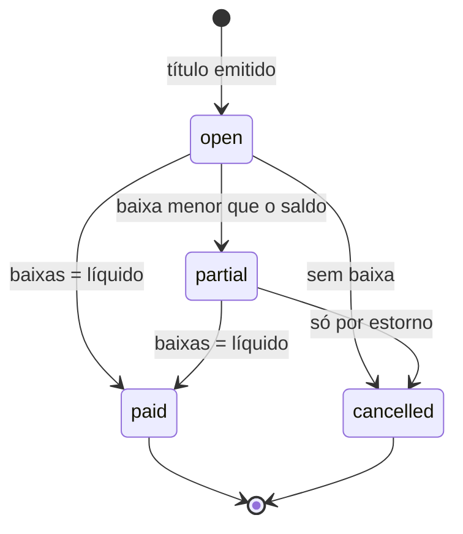

[Índice](README.md) · [Parte anterior](parte-06-plataforma-saas-clientes-dominios-licencas-e-crm.md) · [Próxima parte](parte-08-academico.md)

# Parte 7 — Regras gerais dos módulos de gestão

## Visão geral da parte 7

Estes documentos trazem as regras de base de financeiro, pessoas, acadêmico, segurança do trabalho, suprimentos, contratos, cobrança, notificações, auditoria e dos módulos que vieram da v1 ([17](#doc-17), [18](#doc-18), [19](#doc-19)). As partes seguintes detalham cada área.

**Regras principais**
- "Atrasado" não é estado: é filtro calculado sobre `open` e `partial` com vencimento passado ([17](#doc-17), seção 2.3).
- Despesa acima de R$ 10.000 exige segundo aprovador; o solicitante não aprova a própria ([17](#doc-17), seção 2.4).
- Duplicidades da v1 resolvidas: suprimentos é dono do estoque; auditoria é dona da trilha; autenticação consolidada no [06](parte-03-identidade-acesso-e-permissoes.md#doc-06); um único módulo de atendimento ([19](#doc-19), seção 2).

## 17 — Regras de Validação dos Módulos Prioritários

> Parte do [SDD v2](parte-01-visao-e-escopo.md#doc-00). Padrão de validação em [15](parte-16-dados-validacoes-configuracoes-e-armazenamento.md#doc-15). Eventos e dono de dados em [14](parte-02-arquitetura-e-tenancy.md#doc-14). Tipos de campo em [15](parte-16-dados-validacoes-configuracoes-e-armazenamento.md#doc-15), seção 2.
> **Fonte:** especificações da v1 citadas em cada módulo. Onde a v1 não define a regra, o item aparece como **[Pendente]** e precisa de confirmação do owner.
> **Escopo:** módulos Financeiro, Pessoas (HCM), Acadêmico, SMT, Suprimentos e Contratos. Os demais módulos do [catálogo](parte-01-visao-e-escopo.md#doc-12) seguem a mesma estrutura em versões futuras deste documento.

---

### 1. Defeitos transversais da v1

Estes defeitos aparecem em mais de um módulo. Eles têm de ser corrigidos antes de qualquer implementação.

| ID | Defeito | Onde | Correção obrigatória |
|---|---|---|---|
| T-01 | Nenhuma tabela tem `tenant_id`. Contagem: 0 ocorrências em Financeiro (11 tabelas) e Acadêmico (22 tabelas). Pessoas e SMT usam `entityid`, sem `tenant_id`. Suprimentos isola por `entity_uuid` e `unit_uuid`. | Todos | Adicionar `tenant_id CHAR(36) NOT NULL` e índice composto que começa por `tenant_id`. Ver [03](parte-02-arquitetura-e-tenancy.md#doc-03), seção 3. |
| T-02 | Suprimentos e Contratos não têm DDL. Só descrição de tela. | Suprimentos, Contratos | Escrever o DDL antes da implementação, no padrão da seção 4 de [15](parte-16-dados-validacoes-configuracoes-e-armazenamento.md#doc-15). |
| T-03 | Campos de chave interna com nomes diferentes (`id`, `uuid`, `code`, `entity_uuid`, `entityid`). | Todos | Padronizar: `id` numérico interno, `uuid` público, `tenant_id`, `entity_id`, `unit_id`. |
| T-04 | Estado derivado armazenado como estado. Ex.: `overdue` (Atrasado) está no `ENUM` de status, mas depende de data. | Financeiro | Status armazenado só com fatos. "Atrasado" é calculado por `due_date < hoje` com status `open` ou `partial`. |
| T-05 | Regras de unicidade dizem "por tenant" mas o DDL não tem tenant. | Acadêmico | Restrição composta `(tenant_id, cpf_hash)`. |
| T-06 | Status em inglês no banco e em português na tela. | Financeiro | Código e banco em inglês; rótulos pelo sistema de i18n ([09](parte-05-portais-navegacao-e-interface.md#doc-09)). |

### 2. Financeiro

#### 2.1 Entidades com DDL na v1

`financial_receivables`, `financial_payables`, `financial_transactions`, contas bancárias, centros de custo, orçamentos e outras (11 tabelas). Valores em `DECIMAL(15,2)` e taxas em `DECIMAL(5,4)`. Esses tipos estão corretos.

#### 2.2 Campos e regras

| Campo | Tipo (v1) | Regra |
|---|---|---|
| `gross_amount` | DECIMAL(15,2) | Maior que zero. |
| `discount_amount` | DECIMAL(15,2) | Zero ou positivo; não pode ser maior que `gross_amount`. |
| `interest_rate`, `fine_rate` | DECIMAL(5,4) | Entre 0 e 1 (0% a 100%). Ajustar para percentual na tela, não no banco. |
| `net_amount` | DECIMAL(15,2) | **Calculado pelo servidor** e validado: `gross - discount + juros + multa`. Gravado com a regra de arredondamento do tenant ([15](parte-16-dados-validacoes-configuracoes-e-armazenamento.md#doc-15), seção 4.2). Diferença é `422`. |
| `issue_date`, `due_date` | DATE | `due_date` não anterior a `issue_date`. |
| `payment_date` | DATE | Não pode ser futura na baixa. Não pode ser anterior a `issue_date`. |
| `amount_paid` | DECIMAL(15,2) | Maior que zero na baixa. Não pode exceder o saldo do título. |
| `installment_number`, `total_installments` | SMALLINT | `installment_number` entre 1 e `total_installments`. |
| `parent_id` | BIGINT | Aponta para o título-mãe do mesmo tenant. Parcelas não são títulos independentes para estorno. |
| `status` | ENUM | Ver seção 2.3. |
| `category_id`, `cost_center_id`, `bank_account_id` | BIGINT | Existem no tenant e estão ativos na data de lançamento. |
| `approval_status` (pagar) | ENUM | Ver seção 2.4. |

#### 2.3 Estados do título

Estados armazenados: `open`, `partial`, `paid`, `cancelled`.

| De | Para | Condição |
|---|---|---|
| `open` | `partial` | Baixa menor que o saldo. |
| `open` ou `partial` | `paid` | Soma das baixas igual ao líquido. |
| `open` ou `partial` | `cancelled` | Sem baixa registrada. Com baixa, só por estorno. |
| `paid` | `cancelled` | Não permitido. Estorno gera movimento novo. |

"Atrasado" (`overdue`) não é estado. É filtro calculado: `status IN (open, partial) AND due_date < data de referência`. Resolve T-04.

#### 2.4 Aprovação de despesa

- `approval_status` `pending` bloqueia a baixa.
- Solicitante não pode aprovar a própria despesa. Regra da v1 em Suprimentos vale aqui também.
- Aprovação acima de R$ 10.000 exige segundo aprovador. Decidido pelo autor em 03/11/2026.

#### 2.5 Conciliação bancária

A v1 define matching automático (seção 7.5):

| Regra | Classificação |
|---|---|
| Valor exato e data ± 1 dia | Match automático, confiança alta |
| Valor exato e data ± 3 dias | Match sugerido, confiança média |
| Valor ± R$ 0,01 e data ± 1 dia | Match sugerido |
| Sem match | Pendente manual |

**[Pendente]** A regra de R$ 0,01 é tolerância de arredondamento. Ela deve ser parâmetro do tenant, e não constante. Um lançamento só pode ser conciliado uma vez: `financial_transactions.status = matched` impede novo vínculo.

#### 2.6 Idempotência

- Baixa e emissão de cobrança exigem chave de idempotência ([15](parte-16-dados-validacoes-configuracoes-e-armazenamento.md#doc-15), seção 4).
- Importação de extrato OFX é idempotente pelo hash da linha (data, valor, descrição, identificador do banco).

#### 2.7 Testes específicos

- Título com desconto maior que o bruto: `422`.
- Baixa de valor maior que o saldo: `422`.
- Duas baixas com a mesma chave de idempotência: um movimento.
- Título pago com estorno: novo movimento, original inalterado.

### 3. Pessoas (HCM)

#### 3.1 Entidades

Colaborador, cargo, faixa salarial, documentos, ponto, férias, afastamentos, treinamentos, folha, recrutamento e onboarding (12 tabelas na v1). O cadastro de pessoa civil deve ser único (decisão D-06, [14](parte-02-arquitetura-e-tenancy.md#doc-14), seção 3).

#### 3.2 Campos e regras (v1, seção 4 e 2)

| Campo | Regra |
|---|---|
| CPF | Formato e dígito verificador ([15](parte-16-dados-validacoes-configuracoes-e-armazenamento.md#doc-15), seção 2). Mascarado na lista. Único por tenant. |
| RG, PIS/NIS | Formato por tipo de documento **[Pendente: regra por UF para RG]**. |
| Data de nascimento | Não futura. Idade mínima para vínculo **[Pendente: regra legal por tipo de vínculo]**. |
| CTPS | Obrigatória para vínculo CLT. |
| Salário base | Maior que o piso da categoria. Campo restrito: só quem tem permissão `hcm.salario.ler` vê. |
| Experiência (contrato de experiência) | A v1 diz "máximo 90 dias (prorrogável 1× até 90 dias)". Esse texto é contraditório: duas prorrogações somariam mais de 90 dias. **[Pendente: confirmação jurídica da CLT, art. 445]**. |
| Documento anexado | PDF, JPEG ou PNG; máximo 10 MB. Versão e validade obrigatórias para documento com vencimento. |
| Treinamento obrigatório | Alerta 30 dias antes do vencimento. |

#### 3.3 Estados

| Entidade | Estados |
|---|---|
| Colaborador | `ativo`, `afastado`, `desligado` (transições por evento de RH) |
| Vaga | `aberta`, `pausada`, `preenchida`, `cancelada` |
| Candidato | conforme pipeline do Kanban; cada etapa tem entrada e saída declaradas |
| Folha | `em_processamento`, `fechada`, `paga`. Folha fechada não é alterada; correção é folha complementar. |

#### 3.4 Dados sensíveis

- Dado de saúde (tipo sanguíneo, alergias) do SMT: criptografado, conforme a v1 (ver seção 5.1).
- Salário: campo restrito; o listado não exibe o valor sem permissão.
- Folha: só o próprio colaborador vê o holerite; RH vê os de sua unidade.

#### 3.5 Integrações

- `hcm.employee.created`, `hcm.employee.terminated`, `hcm.employee.department-changed`, `hcm.absence.created` ([14](parte-02-arquitetura-e-tenancy.md#doc-14), seção 4).

### 4. Acadêmico

#### 4.1 Entidades

Matrícula, aluno, turma, disciplina, diário, avaliação, plano de aula, plano de ensino, conselho de classe, estágio, documentos da secretaria, presença (22 tabelas na v1).

#### 4.2 Campos e regras (v1, seções 4 a 9)

| Campo | Regra |
|---|---|
| CPF do aluno ou candidato | Único por tenant. Busca antes de cadastrar; alerta de matrícula duplicada (v1, seção 4.2). |
| Documentos pessoais | Versionados, com data de upload, validade, responsável e hash de integridade (v1, seção 5). |
| Matrícula | Um vínculo ativo por aluno e turma. Vaga disponível com bloqueio de concorrência ([15](parte-16-dados-validacoes-configuracoes-e-armazenamento.md#doc-15), seção 7). |
| Trancamento | Prazo máximo de um ano letivo, configurável por curso. Decidido pelo autor em 03/11/2026 ([46](parte-09-secretaria-matricula-e-documentos.md#doc-46), MAT-02). |
| Nota | Dentro da faixa do método de avaliação; período de lançamento aberto. |
| Presença por QR Code | Válido por 5 minutos por padrão, configurável pela escola. Decidido pelo autor em 03/11/2026. Geolocalização só com consentimento, conforme [07](parte-04-seguranca-privacidade-e-auditoria.md#doc-07). |
| Horas de atividade complementar | Status `pendente_validacao`, `validado`, `recusado`. Total validado nunca ultrapassa o limite do curso. |
| Estágio | CNPJ válido da empresa concedente. Apólice de seguro com validade. |
| Protocolo de atendimento | Consulta pública por número e CPF, sem login, com limite de tentativas. |

#### 4.3 Estados

| Entidade | Estados |
|---|---|
| Matrícula | `pre_matricula`, `ativa`, `trancada`, `concluida`, `cancelada`, `transferida` |
| Diário | `aberto`, `fechado`, `reaberto` (com justificativa) |
| Estágio | `solicitado`, `ativo`, `concluido`, `cancelado` |

#### 4.4 Segurança específica

- Dados de aluno menor de idade: acesso do responsável legal, com vínculo verificado ([07](parte-04-seguranca-privacidade-e-auditoria.md#doc-07), seção 1).
- Diário e notas: professor vê só as turmas em que está vinculado.

### 5. SMT (Segurança e Medicina do Trabalho)

#### 5.1 Entidades

Funcionário e ASO, PCMSO, PGR/GHE, LTCAT, CAT, EPI, treinamentos NR, afastamentos, CIPA.

#### 5.2 Campos e regras (v1, seções 4 a 12)

| Campo | Regra |
|---|---|
| Ficha de saúde | Dado sensível. Criptografado. Acesso restrito a profissional de saúde e ao próprio colaborador. |
| ASO | Tipo (admissional, periódico, retorno, mudança, demissional) obrigatório. Resultado somente por profissional responsável. |
| CAT | Data do acidente não futura. Testemunhas por CPF válido. Emissão exige ocorrência registrada. |
| EPI | CA com validade. Entrega com registro de assinatura (FIEPI). Estoque não negativo. |
| Treinamento NR | Validade obrigatória quando a NR exige reciclagem. |
| Afastamento | Data fim não anterior à início. Sobreposição com afastamento ativo é recusada. |
| GHE | Pertence a um PGR ativo do tenant. |

#### 5.3 Estados

| Entidade | Estados |
|---|---|
| CAT | `emitida`, `em_investigacao`, `encerrada` |
| EPI (entrega) | `entregue`, `devolvido`, `extraviado` |
| Plano de ação | `aberto`, `em_andamento`, `concluido`, `vencido` (calculado por prazo) |

#### 5.4 Integrações

- SMT consome `hcm.employee.created` para agendar exame admissional.
- SMT publica `smt.exam.performed`, `smt.cat.created`, `smt.training.expired` ([14](parte-02-arquitetura-e-tenancy.md#doc-14), seção 4).
- Transmissão de eSocial (S-2220, S-2230, S-2240) conforme decisão D-08 ([16](parte-14-integracoes-e-importacao.md#doc-16), seção 6).

### 6. Suprimentos

#### 6.1 Entidades

Requisição, aprovação, cotação, pedido de compra, recebimento, divergência, almoxarifado, itens críticos, fornecedor, avaliação de fornecedor, contrato e ata (sem DDL na v1, ver T-02).

#### 6.2 Regras de negócio (v1, seções 6.2 e 9)

| Regra | Descrição |
|---|---|
| Autoaprovação | Bloqueada acima da faixa da política. |
| Solicitante e aprovador | Não podem ser a mesma pessoa em cenários sensíveis. |
| Pedido | Só emitido por usuário com permissão. |
| Fornecedor bloqueado | Não recebe pedido nem recebimento quando a política exige. |
| Edição após encerramento | Bloqueada. |
| Cotações | Número mínimo por faixa de valor. Fonte única só com justificativa. Motivo da adjudicação registrado. |
| Comparativo | Snapshot gravado no fechamento da cotação. |
| Estoque | Movimento que deixaria saldo negativo é recusado, salvo item de consumo sob encomenda. |
| Divergência de recebimento | Tipo obrigatório (quantidade, item incorreto, avaria, validade, lote, documento fiscal, atraso). |

#### 6.3 Estados

| Entidade | Estados |
|---|---|
| Requisição | `rascunho`, `em_aprovacao`, `aprovada`, `reprovada`, `cancelada` |
| Pedido | `emitido`, `em_transito`, `recebido_parcial`, `recebido`, `cancelado` |
| Fornecedor | `ativo`, `bloqueado`, `inativo` |

#### 6.4 Campos mínimos a definir

Como a v1 não tem DDL, os campos de requisição, pedido, item e fornecedor precisam ser escritos antes. Lista mínima proposta:

- Requisição: solicitante, unidade, centro de custo, itens (item, quantidade, unidade de medida), valor estimado, justificativa, data limite de SLA.
- Item: código, descrição, unidade de medida, estoque mínimo, estoque atual, fornecedor preferencial.
- Fornecedor: CNPJ válido, situação documental, validade de certificados, situação (`ativo`, `bloqueado`).

### 7. Contratos

#### 7.1 Entidades

Contrato, parte, valor, vigência, cláusula, obrigação, aprovação, assinatura, aditivo, solicitação contratual (sem DDL na v1, ver T-02).

#### 7.2 Regras de negócio (v1, seções 8, 10 e 12)

| Regra | Descrição |
|---|---|
| Edição após assinatura | Bloqueada, exceto por aditivo. |
| Alteração estrutural após assinatura | Gera aditivo. |
| Parte | CPF ou CNPJ válido; duplicidade por documento bloqueada. |
| Contratação | Bloqueada com documentação vencida. |
| Anexo obrigatório | Avanço de etapa bloqueado sem o documento obrigatório. |
| Parecer | Jurídico obrigatório por tipo de contrato. Financeiro obrigatório acima de faixa **[Pendente: faixa]**. |
| Cláusula obrigatória | Lista por tipo de contrato; ausência bloqueia envio para assinatura. |

#### 7.3 Estados

| Entidade | Estados |
|---|---|
| Contrato | `negociacao`, `aprovacao`, `assinado`, `vigente`, `em_renovacao`, `encerrado`, `cancelado` |
| Aditivo | `rascunho`, `aprovado`, `assinado` |
| Solicitação contratual | `aberta`, `em_validacao`, `bloqueada`, `concluida` |

#### 7.4 Validação de datas

- Vigência: data fim posterior à data início.
- Renovação automática: aviso antes do vencimento, com prazo em dias configurável. Padrão de 60 dias, decidido pelo autor em 03/11/2026.

### 8. Lacunas abertas

| # | Lacuna | Dono sugerido | Situação em 04/11/2026 |
|---|---|---|---|
| LAC-01 | Faixas de valor para aprovação de despesa e contrato | Financeiro | Resolvida pelo autor em 03/11/2026: despesa acima de R$ 10.000 exige segundo aprovador ([17](#doc-17), seção 2.4); faixas de contrato até R$ 10.000, de R$ 10.000 a R$ 100.000 e acima de R$ 100.000 ([33](parte-12-suprimentos-patrimonio-frotas-contratos-e-terceiros.md#doc-33), seção 4) |
| LAC-02 | Regra de RG por UF e idade mínima por vínculo | Pessoas | Aberta |
| LAC-03 | Prazo de experiência (CLT art. 445) | Jurídico | Aberta (jurídico) |
| LAC-04 | Prazo de trancamento por curso e validade de QR Code | Acadêmico | Resolvida pelo autor em 03/11/2026: QR Code de 5 minutos ([17](#doc-17), seção 4.2); trancamento de até um ano letivo, configurável por curso ([46](parte-09-secretaria-matricula-e-documentos.md#doc-46), MAT-02) |
| LAC-05 | Campos e DDL de Suprimentos e Contratos | Suprimentos, Contratos | Resolvida: DDL de suprimentos em [51](parte-16-dados-validacoes-configuracoes-e-armazenamento.md#doc-51), seção 16, e de contratos em [51](parte-16-dados-validacoes-configuracoes-e-armazenamento.md#doc-51), seção 3. Aguarda revisão do owner (DDL-01) |
| LAC-06 | Tolerância de conciliação como parâmetro do tenant | Financeiro | Resolvida: parâmetro da entidade ([71](parte-10-financeiro-pagamentos-e-fiscal.md#doc-71), seção 9) |

### 9. Critérios de aceite

- [ ] Todas as tabelas dos módulos têm `tenant_id NOT NULL` e índice composto por ele (T-01).
- [ ] Nenhum estado calculado é armazenado como estado (T-04).
- [ ] Cada regra marcada **[Pendente]** tem dono e data na seção 8 deste documento.
- [ ] Suprimentos e Contratos têm DDL escrito (T-02).
- [ ] Cada módulo tem tabela de transição de estado para as entidades com status.

## 18 — Regras de Validação: Cobrança, Notificações, Auditoria, RH e Contábil/Fiscal

> Parte do [SDD v2](parte-01-visao-e-escopo.md#doc-00). Continua [17](#doc-17). Padrão em [15](parte-16-dados-validacoes-configuracoes-e-armazenamento.md#doc-15). Eventos e dono de dados em [14](parte-02-arquitetura-e-tenancy.md#doc-14). Integrações de cobrança em [16](parte-14-integracoes-e-importacao.md#doc-16).
> **Fonte:** especificações da v1 citadas em cada módulo. Regras não definidas na v1 aparecem como **[Pendente]**.

---

### 1. Defeitos transversais

| ID | Defeito | Onde | Correção |
|---|---|---|---|
| T-01 | Sem `tenant_id`. Contagem nos DDL: Cobrança (9 tabelas) e Auditoria (0 tabelas com DDL, mas referências a tenant ausentes). | Cobrança, Auditoria | `tenant_id` NOT NULL e índice composto ([03](parte-02-arquitetura-e-tenancy.md#doc-03)). |
| T-02 | RH e Contábil/Fiscal sem DDL. | RH, Contábil | DDL antes da implementação. |
| T-04 | Estado calculado armazenado. Cobrança tem `overdue` e `viewed` no `ENUM` de `billing_invoices.status`. `overdue` depende de data; `viewed` é fato de evento. | Cobrança | Ver seção 2.3. |
| T-07 | Duplicidade de módulo. RH e Pessoas (HCM) cobrem o mesmo colaborador, com ficha, treinamento, férias e afastamento. | RH, Pessoas | Decidir a fronteira. Proposta na seção 4.1. |

### 2. Cobrança e Mensalidades

#### 2.1 Entidades com DDL na v1

`billing_plans`, `billing_subscriptions`, `billing_invoices`, `billing_payments`, `billing_discounts`, `billing_automations`, `billing_nfse`, `billing_collection_rules` e uma tabela de régua. Valores em `DECIMAL(12,2)` e alíquota de ISS em `DECIMAL(5,4)`. Esses tipos estão corretos. Os valores em `DECIMAL(12,2)` limitam a fatura a R$ 9,99 bilhões, o que basta.

#### 2.2 Campos e regras

| Campo | Regra |
|---|---|
| `plans.base_amount` | Maior ou igual a zero. |
| `plans.min_amount`, `max_amount` | `min_amount ≤ base_amount ≤ max_amount`, quando informados. |
| `subscriptions.negotiated_amount` | Dentro de `[min_amount, max_amount]` do plano, quando houver faixa. |
| `subscriptions.discount_percent` | Entre 0 e 100. |
| `invoices.gross_amount` | Maior que zero. |
| `invoices.net_amount` | **Calculado pelo servidor:** `gross - discount + fine + interest`. Diferença é `422` ([17](#doc-17), seção 2.2). |
| `invoices.paid_amount` | Não pode exceder `net_amount` sem registro de crédito. |
| `payments.amount` | Maior que zero. Soma das baixas por fatura não pode exceder o saldo. |
| `discounts.value` | Maior que zero. Para `modality = percent`, até 100. |
| `nfse.iss_amount` | Calculado: `iss_base × iss_rate`. Diferença é `422`. |
| `nfse.iss_base` | Não pode exceder `gross_amount - deductions`. |

#### 2.3 Estados da fatura

A v1 define: `draft`, `pending`, `sent`, `viewed`, `paid`, `partial`, `overdue`, `negotiated`, `cancelled`, `refunded`.

Proposta de correção (T-04):

| Estado armazenado | Significado |
|---|---|
| `draft` | Não emitida |
| `issued` | Emitida e enviada ao devedor (substitui `pending`, `sent`) |
| `partial` | Baixa parcial |
| `paid` | Quitada |
| `negotiated` | Substituída por acordo; original preservado |
| `cancelled` | Cancelada antes de pagamento |
| `refunded` | Estornada, com movimento de estorno |

Calculados, não armazenados:

- `viewed`: existe registro em `invoice_views`.
- `overdue`: `status IN (issued, partial) AND due_date < data de referência`.

Transições:

| De | Para | Condição |
|---|---|---|
| `draft` | `issued` | Valor e vencimento válidos; aprovação se a política exigir |
| `issued` ou `partial` | `paid` | Soma das baixas igual a `net_amount` |
| `issued` | `partial` | Baixa menor que o saldo |
| `issued` ou `partial` | `negotiated` | Acordo registrado com nova fatura vinculada |
| `paid` | `refunded` | Estorno pelo gateway ou registro manual com motivo; novo movimento |
| `draft` ou `issued` | `cancelled` | Sem baixa registrada |

#### 2.4 Pagamento e baixa

- Baixa com `write_off_type = automatic` só pode ser feita por retorno do gateway com assinatura validada ([16](parte-14-integracoes-e-importacao.md#doc-16), seção 8).
- Baixa manual exige `write_off_type = manual`, motivo e permissão `cobranca.baixa.manual`. Acima de R$ 1.000, exige segundo aprovador. Configurável por unidade. Decidido pelo autor em 03/11/2026.
- Pagamento duplicado com o mesmo `NSU/TID` é recusado. Chave única por `gateway + NSU/TID`.
- Pagamento não pode ser registrado em fatura `cancelled` ou `refunded`.

#### 2.5 Descontos e bolsas

- Desconto por pontualidade só se aplica se o pagamento ocorrer até a data limite do plano.
- Regras combinadas: a política de acumulatividade define se dois descontos somam. Não acumulam: vale o maior. Configurável por entidade. Decidido pelo autor em 03/11/2026.
- Bolsa e isenção exigem documento anexado e data de validade ([15](parte-16-dados-validacoes-configuracoes-e-armazenamento.md#doc-15), seção 4.3).

#### 2.6 Régua de cobrança: pontos que exigem parecer

A v1 define sete etapas de cobrança, de D+1 a D+90, com canais e ações ([`spec_gestao_billing_cobranca_mensalidades.md`](parte-10-financeiro-pagamentos-e-fiscal.md#v1-spec-gestao-billing-cobranca-mensalidades-md), seção 11). Três pontos precisam de parecer antes de implementar:

| Etapa | Ação na v1 | Risco | Tratamento proposto |
|---|---|---|---|
| D+10 SMS e e-mail; D+5 WhatsApp | Cobrança por canal de mensagem | Consentimento e LGPD ([07](parte-04-seguranca-privacidade-e-auditoria.md#doc-07)) | **(jurídico)** base legal da comunicação de cobrança. Canal só para titular que informou o contato para esse fim. |
| D+30 aviso de negativação | Inclusão em cadastro de inadimplentes | Exige notificação prévia e regras do cadastro de crédito | **(jurídico)** prazo e forma de notificação antes da negativação. |
| D+90 bloqueio de acesso ao portal | Bloqueio do portal do aluno | Interrupção de serviço educacional a menor de idade | **(jurídico)** bloqueio não deve impedir acesso a documentos obrigatórios nem a matrícula de menor. Propor bloqueio parcial. |

#### 2.7 Nota fiscal de serviço (NFSe)

- Emissão só para fatura `paid` ou `partial`, conforme política municipal **[Pendente: regra por município]**.
- Status `pending` → `processing` → `issued` ou `rejected`. `cancelled` só a partir de `issued`, com o cancelamento transmitido ao município.
- Integração com o município é externa ([16](parte-14-integracoes-e-importacao.md#doc-16), seção 3). Resposta de rejeição guarda o código de erro do município.

#### 2.8 Testes específicos

- Fatura com desconto acima do bruto: `422`.
- Dois pagamentos com o mesmo NSU/TID: um movimento.
- Fatura `paid` tentando ser cancelada: `409`.
- Desconto de pontualidade após a data limite: não aplicado.
- Régua no D+90 com aluno menor e documento obrigatório pendente: bloqueio parcial.

### 3. Notificações

#### 3.1 Estados (v1, seção 6, validada)

A v1 define: `draft`, `in_review`, `scheduled`, `queued`, `processing`, `sent`, `delivered`, `read`, `failed`, `archived`, `cancelled`.

As transições da v1 estão corretas e são adotadas. Regras adicionais:

| Regra | Detalhe |
|---|---|
| Estados terminais | `read`, `archived`, `cancelled` não voltam sem ação explícita autorizada. |
| Reenvio | Cria nova tentativa. Não sobrescreve a anterior. |
| Cancelamento | Preserva histórico e auditoria. |
| Falha | Classificada por tipo: validação, transporte, provedor, conteúdo, autorização, timeout ou desconhecida. Só transporte e timeout são retentados. |

#### 3.2 Validações de envio

- Campos obrigatórios por canal validados antes do envio: e-mail exige endereço verificado; SMS e WhatsApp exigem número em E.164 ([15](parte-16-dados-validacoes-configuracoes-e-armazenamento.md#doc-15), seção 2).
- Conteúdo sem público-alvo válido é bloqueado.
- Anexo validado por tamanho, tipo e política de segurança ([15](parte-16-dados-validacoes-configuracoes-e-armazenamento.md#doc-15), seção 4.3).
- Toda operação de envio é idempotente pela `idempotency_key`.
- Payload validado por schema. Campo obrigatório documentado por tipo de evento.

#### 3.3 Dados sensíveis

- Notificação de saúde ou de RH não mostra diagnóstico nem valor de salário no corpo. Mostra aviso e link autenticado.
- Corpo de mensagem guardado com retenção configurável ([07](parte-04-seguranca-privacidade-e-auditoria.md#doc-07)).

### 4. Auditoria

#### 4.1 Fronteira com RH e Pessoas (T-07)

Proposta: RH e Pessoas são **um único módulo HCM** com submódulos. O cadastro de colaborador, a ficha e o vínculo ficam em Pessoas. Férias, afastamento, treinamento, ponto e folha ficam em RH/HCM. Essa é a decisão a confirmar.

#### 4.2 Regras de auditoria

| Regra | Detalhe |
|---|---|
| Imutabilidade | Registro de auditoria não é alterado nem apagado por usuário. Correção gera novo registro referenciando o original. |
| Integridade | Cada registro guarda hash SHA-256 do conteúdo e do registro anterior do mesmo tenant (cadeia). Quebra da cadeia gera alerta. |
| Expurgo | Só por job de retenção, com aprovação para retenção estendida, e deixa um registro do expurgo. |
| Mascaramento | Campo pessoal mascarado na visualização; valor completo só com permissão e motivo. |
| Acesso | Leitura da auditoria é ela própria auditada. |
| Eventos obrigatórios | Login, falha de login, bloqueio, alteração de permissão, exportação, acesso a dado sensível, consulta por CPF ([21](parte-16-dados-validacoes-configuracoes-e-armazenamento.md#doc-21), seção 6.8), alteração de política. |

Esses pontos reforçam [05](parte-04-seguranca-privacidade-e-auditoria.md#doc-05), seção 2, e [07](parte-04-seguranca-privacidade-e-auditoria.md#doc-07), seção 6.

### 5. RH (fronteira com Pessoas)

Conforme a proposta da seção 4.1, as regras abaixo são do submódulo RH/HCM.

| Regra | Detalhe |
|---|---|
| Bloqueio por documento faltante | Afastamento, férias ou admissão são bloqueados se documento obrigatório não estiver anexado (v1, seção 7). |
| Treinamento obrigatório | Pendente bloqueia a função ou a tarefa, conforme regra do cargo (v1, seção 5.2). |
| Edição em campo sensível | Bloqueada sem permissão específica (v1, seção 3.3). |
| Visibilidade | Gestor vê só a própria equipe; RH vê a unidade; nenhum perfil vê salário de outro sem permissão (v1, seção 3.2). |
| Férias | Fim não anterior ao início; período não pode exceder o direito acumulado **[Pendente: regra CLT art. 130 e fracionamento]**. |
| Afastamento | Sobreposição com afastamento ativo é recusada. |

**Defeito:** a v1 não tem DDL do RH (T-02). Sem DDL, as regras acima não podem ser testadas.

### 6. Contábil e Fiscal

#### 6.1 Controles de período (v1, seção 11.1)

| Regra | Detalhe |
|---|---|
| Período fechado | Edição e exclusão de lançamento bloqueadas. Correção só por lançamento de ajuste no período aberto, com motivo. |
| Competência | Data do lançamento dentro da competência declarada; competência inválida é `422`. |
| Fechamento | Bloqueado com pendência aberta de aprovação ou de conciliação. |
| Correção | Sempre com motivo obrigatório (v1, seção 8.1). |
| Aprovação automática | Só por regra cadastrada e auditada (v1, seção 10). |

#### 6.2 Estados

| Entidade | Estados |
|---|---|
| Período | `aberto`, `em_fechamento`, `fechado`, `reaberto` (com justificativa e permissão administrativa) |
| Lançamento | `rascunho`, `em_validacao`, `aprovado`, `estornado` |
| Obrigação fiscal | `pendente`, `transmitida`, `paga`, `em_atraso` (calculado por data) |

**Defeito:** sem DDL (T-02). Não há campos, tipos de valor nem chaves definidos para validar. **Resolvido em 04/11/2026:** DDL em [51](parte-16-dados-validacoes-configuracoes-e-armazenamento.md#doc-51), seção 18.

### 7. Lacunas

| # | Lacuna | Dono sugerido | Situação em 04/11/2026 |
|---|---|---|---|
| LAC-07 | Parecer sobre base legal, negativação e bloqueio de portal (seção 2.6) | Jurídico | Aberta (jurídico). Ver [26](parte-18-juridico-e-regulatorio.md#doc-26), seção 4 |
| LAC-08 | Limite de valor para baixa manual e aprovação de desconto | Financeiro | Resolvida: baixa manual acima de R$ 1.000 exige segundo aprovador ([18](#doc-18), seção 2.4). Limite de aprovação de desconto: padrão DP-07 ([80](parte-19-pendencias-decisoes-e-rastreabilidade.md#doc-80)) |
| LAC-09 | Política de acumulatividade de descontos | Financeiro | Resolvida: descontos não acumulam, vale o maior, configurável por entidade ([18](#doc-18), seção 2.5) |
| LAC-10 | Regra de NFSe por município | Fiscal | Parcial: regras gerais em [34](parte-10-financeiro-pagamentos-e-fiscal.md#doc-34), seção 5. Regra de cada município depende do provedor (homologação) |
| LAC-11 | Fronteira RH/Pessoas (seção 4.1) | Produto | Resolvida: um módulo HCM com submódulos ([39](parte-11-pessoas-departamento-pessoal-e-sst.md#doc-39), seção 2) |
| LAC-12 | Regra CLT de férias e fracionamento | Jurídico, RH | Aberta (jurídico): HCM-03 ([39](parte-11-pessoas-departamento-pessoal-e-sst.md#doc-39)) |
| LAC-13 | DDL de RH e Contábil/Fiscal | RH, Contábil | Resolvida: DDL de pessoas e RH em [51](parte-16-dados-validacoes-configuracoes-e-armazenamento.md#doc-51), seção 17, e de contábil e fiscal em [51](parte-16-dados-validacoes-configuracoes-e-armazenamento.md#doc-51), seção 18. Aguarda revisão do owner (DDL-01) |

### 8. Critérios de aceite

- [ ] Todas as tabelas de Cobrança têm `tenant_id NOT NULL` (T-01).
- [ ] `overdue` e `viewed` saem de `status` e passam a ser calculados (T-04).
- [ ] Régua de cobrança com parecer jurídico registrado antes de ativar cada etapa (LAC-07).
- [ ] Auditoria com cadeia de hash e registros imutáveis (seção 4.2).
- [ ] RH e Contábil com DDL escrito (T-02).

## 19 — Regras de Validação: Demais Módulos do Catálogo

> Parte do [SDD v2](parte-01-visao-e-escopo.md#doc-00). Continua [17](#doc-17) e [18](#doc-18). Padrão em [15](parte-16-dados-validacoes-configuracoes-e-armazenamento.md#doc-15). Catálogo em [12](parte-01-visao-e-escopo.md#doc-12).
> **Escopo deste documento:** módulos restantes com regras de validação identificadas na v1. Onde a v1 não define DDL, a seção do módulo lista as regras encontradas e o que falta. Não é uma especificação campo a campo.

---

### 1. Defeitos transversais

| ID | Defeito | Módulos afetados | Correção |
|---|---|---|---|
| T-01 | Sem `tenant_id` nos DDL. Contagem: CRM (5 tabelas), Patrimônio (12), Frotas (13), Biblioteca (5), Armazenamento (17). | Esses módulos | `tenant_id` NOT NULL e índice composto ([03](parte-02-arquitetura-e-tenancy.md#doc-03)). |
| T-02 | Sem DDL: Documentos, Marketing, SAC/Helpdesk, Simulados IA, Preceptoria, Privacidade global. | Esses módulos | DDL antes da implementação. |
| T-04 | Valor derivado armazenado como valor atual. Ex.: Patrimônio guarda `current_value`, que depende de depreciação. | Patrimônio | Armazenar o último cálculo com data e método. Recalcular, não sobrescrever. |
| T-07 | Duplicidade. Ver seção 2. | Vários | Uma especificação por domínio. |

### 2. Duplicidades a resolver

| Módulo A | Módulo B | Sobreposição | Proposta |
|---|---|---|---|
| Armazenamento (estoque, 17 tabelas) | Suprimentos (almoxarifado) | Saldo, movimento, estoque mínimo, rastreabilidade por lote | Suprimentos é dono de estoque e movimento. Armazenamento é renomeado para sistema de arquivos e documentos, sem estoque. **Decidido** em 03/11/2026. |
| Logger | Auditoria | Registro de eventos, bloqueio de IP, alertas de segurança | Auditoria é dona de trilha de negócio e de segurança ([18](#doc-18), seção 4). Logger técnico fica em [10](parte-17-operacao-qualidade-testes-e-ti.md#doc-10), seção 7. |
| Autenticação (v1, 1.001 linhas) | 06 e 07 | Login, sessão, MFA, senha | Consolidar em [06](parte-03-identidade-acesso-e-permissoes.md#doc-06). A especificação de módulo perde o conteúdo que duplica 06. |
| Privacidade global | 07 e Cookies e sessões | Direitos do titular, consentimento, cookies | Consolidar em [07](parte-04-seguranca-privacidade-e-auditoria.md#doc-07). Cookies e sessões fica em 06. |
| Bancos (administração de banco de dados, 305 linhas) | Financeiro (contas bancárias) | Nenhuma: são assuntos diferentes | Bancos sai do escopo. Dados bancários ficam no Financeiro. Ver [34](parte-10-financeiro-pagamentos-e-fiscal.md#doc-34), seção 4. |
| SAC, Chat rápido, Helpdesk | Entre si | Atendimento e tickets | Um único módulo de atendimento. Helpdesk é a base. Proposta na seção 7. |
| Biblioteca acadêmica e Biblioteca completo | Entre si | Acervo, empréstimo, multa | Uma especificação. Escolher a mais recente como base. |

### 3. Documentos

| Regra | Detalhe |
|---|---|
| Edição após assinatura | Bloqueada. Só nova versão autorizada (v1, linhas 255 e 380). |
| Download restrito | Bloqueado para documento marcado como restrito (v1, linha 298). |
| Rejeição | Exige motivo obrigatório (v1, linha 386). |
| Versão | Cada versão guarda hash SHA-256 do arquivo e autor. |
| Retenção | Por política, com expurgo registrado ([07](parte-04-seguranca-privacidade-e-auditoria.md#doc-07)). |
| Arquivo | Validação de tipo e tamanho por campo ([15](parte-16-dados-validacoes-configuracoes-e-armazenamento.md#doc-15), seção 4.3). |

**Pendente:** DDL (T-02). Lista de tipos de documento e prazo de retenção por tipo.

### 4. Privacidade global

A v1 descreve modelo tenant-aware e unit-aware (linha 8) e cobre direitos do titular, consentimento parental e múltiplas jurisdições. As regras já estão em [07](parte-04-seguranca-privacidade-e-auditoria.md#doc-07). Pontos que faltam:

| Regra | Detalhe |
|---|---|
| Menor de 13 anos | Consentimento parental verificável antes de coletar (v1, linha 39). Verificação do responsável por canal verificado. **(jurídico)** para validar o método. |
| Jurisdições | A v1 cita Singapura, Tailândia e outras. **[Pendente]** A plataforma opera no Brasil; a lista de jurisdições só entra se houver cliente fora do Brasil. |
| Exclusão | Respeita retenção legal e necessidade de preservação probatória (v1, linha 28). Registro de exceção com motivo. |

**Defeito:** a v1 é uma lista de princípios, sem DDL nem campos. Não é possível validar. Proposta: reduzir a [07](parte-04-seguranca-privacidade-e-auditoria.md#doc-07) e tirar a lista de jurisdições do escopo desta versão.

### 5. Armazenamento (estoque)

Este módulo é tratado como estoque, por causa do conteúdo. Ver seção 2.

| Regra | Detalhe |
|---|---|
| Saldo | Nunca negativo, bloqueio na API (linha 54). |
| Rastreabilidade | Lote, série ou validade obrigatório para item controlado (linha 57). |
| Bloqueio de item | Status `Bloqueado` impede movimento. Motivo registrado. |
| Movimento | Quantidade obrigatória e maior que zero. |

**Pendente:** os 17 DDL precisam da fronteira com Suprimentos (seção 2) antes de validar.

### 6. CRM e funil comercial

| Entidade | Estados (DDL) | Regra |
|---|---|---|
| Lead | `new`, `contacted`, `qualified`, `disqualified`, `converted` | Conversão cria oportunidade. |
| Oportunidade | `open`, `won`, `lost` | `estimated_value DECIMAL(12,2)`, maior ou igual a zero. |
| Atividade | — | Vínculo obrigatório a lead ou oportunidade (linha 106). |

- "Fechado perdido" exige motivo obrigatório (linha 97): preço, concorrência, sem orçamento, timing ou outro.
- Lead convertido não volta a `new`.
- **Defeito:** sem `tenant_id` (T-01). Lead contém dado pessoal de terceiro. Base legal de contato comercial precisa de parecer ([07](parte-04-seguranca-privacidade-e-auditoria.md#doc-07)).

### 7. Atendimento (SAC, Chat rápido, Helpdesk)

Três especificações descrevem o mesmo tipo de solicitação. A v1 do Helpdesk cita tenant 23 vezes e define obrigatoriedade dinâmica por tipo (linhas 142 e 340).

Regras do Helpdesk:

| Regra | Detalhe |
|---|---|
| Campos obrigatórios | Variam por tipo de solicitação (linha 142). |
| Campos padrão | Lista fixa para todo tipo (seção 8.1). |
| Retenção | Política e expurgo (linha 791). |
| Canais | Obrigatórios por tipo (seção 6.1). |

**Proposta:** um módulo de atendimento. Helpdesk como base. SAC e Chat rápido viram canais ou tipos de solicitação.

**Pendente:** DDL (T-02).

### 8. Patrimônio

#### 8.1 Entidades com DDL (12 tabelas)

Categorias de ativo, ativos e demais. Valores em `DECIMAL(15,2)` e taxa em `DECIMAL(8,4)`. Os tipos estão adequados.

#### 8.2 Regras

| Campo | Regra |
|---|---|
| `acquisition_value` | Maior que zero. Não altera após a aquisição, salvo correção com motivo. |
| `residual_value` | Não negativo; não maior que `acquisition_value`. |
| `dep_method` | Lista fechada: `linear`, `accelerated`, `degressive`, `unit`. |
| `dep_rate` | Entre 0 e 100%, conforme método. |
| `current_value` | Calculado. Não é campo editável. Ver T-04. |
| Baixa | Ativo baixado não recebe depreciação nem movimento. |

**Pendente:** regra de depreciação por categoria, aprovada pela contabilidade.

### 9. Frotas

| Regra | Detalhe |
|---|---|
| CNH do motorista | Vencida bloqueia a reserva e exibe alerta (linha 422). |
| Conflito de horário | Bloqueia a reserva do veículo (linha 421). |
| Veículo em manutenção | Bloqueia; sugere veículo alternativo (linha 423). |
| Tacógrafo | Validade obrigatória quando aplicável (linha 240). |
| Consumo | Calculado a partir de litros e quilometragem. Não editável (linha 580). |
| Abastecimento | Litros obrigatório e maior que zero (linha 612). |

**Defeito:** 13 DDL sem `tenant_id` (T-01). Consumo "calculado" aparece como campo de entrada em outra tela (linha 215). Padronizar como calculado.

### 10. Biblioteca acadêmica

| Regra | Detalhe |
|---|---|
| Multa | Multa em aberto ou item atrasado bloqueia novo empréstimo (linhas 39 e 109). |
| Renovação | Bloqueada se o item tiver reserva pendente (linha 164). |
| Reserva | Check-in obrigatório para validar a reserva (linha 151). |
| Responsável | Vê empréstimos e multas do filho vinculado, somente leitura (linha 28). |
| Status do item | `active`, `archived`, `lost`. |

**Defeito:** 5 DDL sem `tenant_id` (T-01).

### 11. Preceptoria e autoavaliação

| Regra | Detalhe |
|---|---|
| Pergunta | Tipo, peso e obrigatoriedade configuráveis (linha 38). |
| Condicional | Pergunta pode depender de outra (linha 260). |
| Avaliação fechada | Não pode ser editada (linha 263). |
| Anonimato | **[Pendente]** Avaliação de preceptor deve ser anônima para o avaliado, com regra de mínimo de respostas por grupo para não identificar a pessoa. |

**Pendente:** DDL (T-02).

### 12. Simulados com IA

| Regra | Detalhe |
|---|---|
| Auditoria | Obrigatória em notas e revisões (linha 610). |
| Conteúdo gerado | Revisão humana antes de publicar **[Pendente: regra de quem revisa]**. |
| Dados enviados ao provedor | Só o conteúdo do simulado, sem dado pessoal do aluno. Registrar o provedor e a retenção dele ([16](parte-14-integracoes-e-importacao.md#doc-16)). |

**Defeito:** sem DDL (T-02). Sem definição de como o aluno é identificado nas respostas enviadas à IA.

### 13. Client migration

| Regra | Detalhe |
|---|---|
| Checksum | Hash de cada arquivo enviado (linha 316). Divergência é erro (linha 353). |
| Segredos | Credenciais não são migradas em texto. Hash ou recadastro (linha 553). |
| Idempotência | Token por execução de job (linha 687) e chave por registro (linha 869). |
| Isolamento | Migração de dados entre tenants exige revisão de isolamento ([17](#doc-17), seção 1). |

**Defeito:** sem DDL (T-02).

### 14. Soft delete

| Regra | Detalhe |
|---|---|
| Colunas | `deleted_at`, `deleted_by` em toda tabela soft-deletable (seção 3.1). |
| Validação pré-exclusão | Obrigatória. Ex.: aluno com matrícula ativa não pode ser excluído (linha 111). |
| Expurgo | Hard delete após N dias configurados por entidade, por job (linha 56). |
| Testes | Restauração e expurgo testados (seção 4.2). |

**Conflito:** o expurgo do soft delete precisa respeitar a imutabilidade da auditoria ([18](#doc-18), seção 4.2). Registro de auditoria não é expurgado por soft delete.

### 15. Marketing e redes sociais

| Regra | Detalhe |
|---|---|
| Publicação | Campos de título, texto, rede, data e aprovação obrigatórios (linha 126). |
| Aprovação | Publicação só após aprovação de quem tem permissão (fluxo de aprovação). |
| Datas críticas | Bloqueadas para publicação (linha 214). |
| Palavras bloqueadas | Lista de termos que impede publicação (linha 282). |
| Contato | Bloquear, silenciar ou priorizar contato respeita consentimento ([07](parte-04-seguranca-privacidade-e-auditoria.md#doc-07)). |

**Defeito:** sem DDL (T-02). Sem tenant. **Resolvido em 04/11/2026:** DDL com `unidade_uuid` em [51](parte-16-dados-validacoes-configuracoes-e-armazenamento.md#doc-51), seção 19.

### 16. Bancos

Removido do escopo ([34](parte-10-financeiro-pagamentos-e-fiscal.md#doc-34), seção 4). As regras da v1 (alteração por pipeline, backup, TLS) valem para a ferramenta de operação, que fica fora do produto.

### 17. Autenticação (módulo de origem)

A especificação v1 (1.001 linhas) já exige Argon2id e refresh token armazenado com hash (linhas 267, 272 e 329). Está alinhada com [06](parte-03-identidade-acesso-e-permissoes.md#doc-06). Não há regra nova a acrescentar. O módulo deve ser consolidado em 06 (seção 2).

### 18. Lacunas

| # | Lacuna | Dono sugerido | Situação em 04/11/2026 |
|---|---|---|---|
| LAC-14 | Fronteira Armazenamento/Suprimentos (seção 2) | Produto | Resolvida ([19](#doc-19), seção 2) |
| LAC-15 | Lista de jurisdições da privacidade (seção 4) | Jurídico | Resolvida: só legislação brasileira ([07](parte-04-seguranca-privacidade-e-auditoria.md#doc-07), seção 3) |
| LAC-16 | Anonimato na avaliação de preceptor (seção 11) | Acadêmico | Resolvida: anônima, mínimo de 2 respostas por grupo ([42](parte-08-academico.md#doc-42), PRE-03) |
| LAC-17 | Regra de revisão humana de conteúdo gerado por IA (seção 12) | Acadêmico, Jurídico | Resolvida: a IA sugere e a pessoa decide ([27](parte-15-inteligencia-artificial.md#doc-27), princípio 2) |
| LAC-18 | Regra de depreciação por categoria (seção 8) | Contabilidade | Resolvida por padrão: DP-02 ([80](parte-19-pendencias-decisoes-e-rastreabilidade.md#doc-80)) |
| LAC-19 | Módulo de atendimento único (seção 7) | Produto | Resolvida: modelo único de ticket ([32](parte-04-seguranca-privacidade-e-auditoria.md#doc-32), seção 2.1) |
| LAC-20 | DDL de Documentos, Marketing, Atendimento, Simulados, Preceptoria, Privacidade | Owners | Resolvida: DDL de documentos ([51](parte-16-dados-validacoes-configuracoes-e-armazenamento.md#doc-51), seção 12; [54](parte-09-secretaria-matricula-e-documentos.md#doc-54), seção 10), atendimento ([51](parte-16-dados-validacoes-configuracoes-e-armazenamento.md#doc-51), seção 1), privacidade ([51](parte-16-dados-validacoes-configuracoes-e-armazenamento.md#doc-51), seção 2), preceptoria ([51](parte-16-dados-validacoes-configuracoes-e-armazenamento.md#doc-51), seção 6), simulados ([51](parte-16-dados-validacoes-configuracoes-e-armazenamento.md#doc-51), seção 15) e marketing ([51](parte-16-dados-validacoes-configuracoes-e-armazenamento.md#doc-51), seção 19). Aguarda revisão do owner |

### 19. Critérios de aceite

- [ ] Cada módulo do catálogo tem uma seção aqui ou em 17 e 18, ou está marcado como duplicado.
- [ ] Duplicidades da seção 2 têm decisão registrada.
- [ ] Todo DDL tem `tenant_id NOT NULL` (T-01).
- [ ] Valor derivado não é campo editável (T-04).

---

---

[Índice](README.md) · [Parte anterior](parte-06-plataforma-saas-clientes-dominios-licencas-e-crm.md) · [Próxima parte](parte-08-academico.md)
