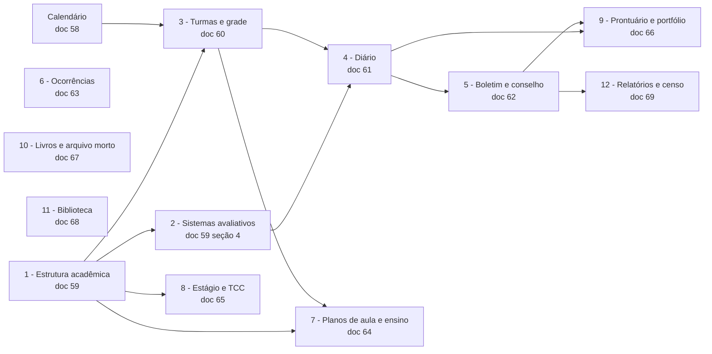
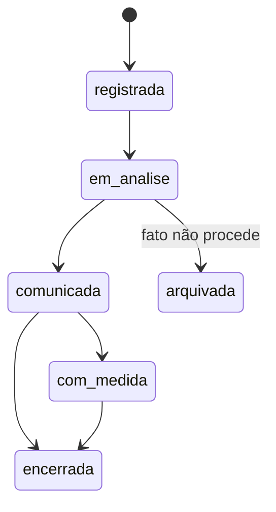
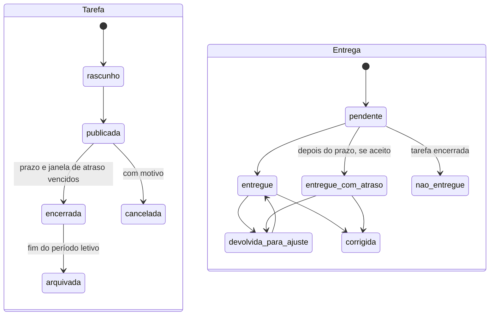

[Índice](README.md) · [Parte anterior](parte-07-regras-gerais-dos-modulos-de-gestao.md) · [Próxima parte](parte-09-secretaria-matricula-e-documentos.md)

<a id="parte-8"></a>

# Parte 8 — Acadêmico

## Visão geral da parte 8

O acadêmico é especificado em ordem de dependência: estrutura, sistemas avaliativos, turmas e grade, diário, boletim e conselho, e os demais módulos ([55](#doc-55), seção 3).





**Regras principais**
- Os três níveis de ensino estão no escopo: básico, técnico e superior, com TCC e CPA/SINAES (ACA-01, ACA-02).
- Grade publicada só muda por nova versão; turma aponta para curso, grade e versão ([59](#doc-59), [60](#doc-60)).
- Nota só pelo professor da turma; diário fechado só reabre pela coordenação, com motivo ([61](#doc-61)).
- Ocorrência tem relato sigiloso e dado de terceiro protegido ([63](#doc-63)).
- A Classe (mural, materiais e tarefas) tem nota de tarefa no diário só quando a tarefa é avaliação ([81](#doc-81)).
- Aulas online, formulários, preceptoria, pastoral, agendamento, simulados e planejamento estão nos documentos [40](#doc-40) a [44](#doc-44), [47](#doc-47) e [37](#doc-37).

<a id="doc-55"></a>

## 55 — Verificação do Acadêmico: Cobertura, Lacunas e Ordem de Fechamento

> Parte do [SDD v2](parte-01-visao-e-escopo.md#doc-00). Referência de comparação: menu do sistema iScholar, colado pelo autor em 03/11/2026, e o mapa de páginas acadêmico da v1 ([`spec_gestao_academica_completo.md`](#v1-spec-gestao-academica-completo-md), seção 2). Regras já existentes em [17](parte-07-regras-gerais-dos-modulos-de-gestao.md#doc-17), seção 4. Matrícula em [46](parte-09-secretaria-matricula-e-documentos.md#doc-46). Agendamento em [44](#doc-44). Sala online em [40](#doc-40). Documentos em [48](parte-09-secretaria-matricula-e-documentos.md#doc-48) e [54](parte-09-secretaria-matricula-e-documentos.md#doc-54). Simulados em [47](#doc-47). Preceptoria em [42](#doc-42).
> **Veredito:** o acadêmico **não está completo**. A parte de matrícula, documentos e salas está especificada. A estrutura acadêmica, a grade de horários, notas, frequência, diário, conselho de classe e planos pedagógicos estão só citados.

---

### 1. Resposta direta

Atualizado em 04/11/2026: os itens que esta verificação marcava como lacuna foram especificados nos documentos 58 a 70. A tabela abaixo aponta onde cada um está.

| Pergunta | Veredito |
|---|---|
| Matrícula e rematrícula estão completas? | **Sim**, em [46](parte-09-secretaria-matricula-e-documentos.md#doc-46), com estados, janelas, condicional e trancamento |
| Estrutura acadêmica (cursos, grades, disciplinas, períodos, calendário) está especificada? | **Sim**, em [59](#doc-59) e [58](#doc-58) |
| Notas, boletim e aprovação? | **Sim**, em [61](#doc-61), seção 5, e [62](#doc-62) |
| Frequência, faltas e justificativas? | **Sim**, em [61](#doc-61), seções 3 e 4 |
| Diário, planos de aula e de ensino? | **Sim**, em [61](#doc-61) e [64](#doc-64) |
| Ocorrências disciplinares? | **Sim**, em [63](#doc-63) |
| Conselho de classe, recuperação paralela, portfólio? | **Sim**, em [62](#doc-62) (conselho e recuperação) e [66](#doc-66) (portfólio) |
| Estágio, TCC? | **Sim**, em [65](#doc-65) |
| Livros digitais (registro e atas)? | **Sim**, em [67](#doc-67) |
| Relatórios acadêmicos e censo? | **Sim**, em [69](#doc-69) |

---

### 2. Mapa: menu iScholar × SDD

Itens do menu de referência, na ordem em que aparecem.

#### 2.1 Coordenação

| Item do iScholar | Cobertura no SDD | Situação |
|---|---|---|
| Empresas | Empresa e unidades: [03](parte-02-arquitetura-e-tenancy.md#doc-03) | Coberto no modelo de tenant |
| Unidades escolares | [03](parte-02-arquitetura-e-tenancy.md#doc-03), [44](#doc-44) | Coberto |
| Salas de aula | [44](#doc-44) | Coberto |
| Cursos | [59](#doc-59), seção 3.1 | Coberto |
| Grupos de horários | [60](#doc-60), seção 3 | Coberto |
| Disciplinas | [59](#doc-59), seção 3.2 | Coberto |
| Grades curriculares | [59](#doc-59), seções 3.3 e 3.5 (equivalência) | Coberto |
| Períodos letivos | [59](#doc-59), seção 3.6 | Coberto |
| Funcionários | [39](parte-11-pessoas-departamento-pessoal-e-sst.md#doc-39) | Coberto como RH |
| Documentos (pendentes) | [54](parte-09-secretaria-matricula-e-documentos.md#doc-54), contexto A | Coberto |
| Sistemas avaliativos | [59](#doc-59), seção 4 | Coberto |
| Calendários escolares | [58](#doc-58) | Coberto |
| Planos de pagamento | [18](parte-07-regras-gerais-dos-modulos-de-gestao.md#doc-18) e [26](parte-18-juridico-e-regulatorio.md#doc-26) | Coberto no financeiro |

#### 2.2 Secretaria

| Item do iScholar | Cobertura no SDD | Situação |
|---|---|---|
| Turmas | [60](#doc-60), seção 2; enturmação em [46](parte-09-secretaria-matricula-e-documentos.md#doc-46), M-07 | Coberto |
| Responsáveis | [46](parte-09-secretaria-matricula-e-documentos.md#doc-46), [07](parte-04-seguranca-privacidade-e-auditoria.md#doc-07) | Coberto no vínculo |
| Alunos | [17](parte-07-regras-gerais-dos-modulos-de-gestao.md#doc-17), seção 4.2; prontuário em [66](#doc-66) | Coberto |
| Matrículas | [46](parte-09-secretaria-matricula-e-documentos.md#doc-46) | Coberto |
| Alunos potenciais | [22](parte-06-plataforma-saas-clientes-dominios-licencas-e-crm.md#doc-22), leads | Coberto no CRM |
| Modelos de documentos | [48](parte-09-secretaria-matricula-e-documentos.md#doc-48) | Coberto |
| Ocorrências | [63](#doc-63) | Coberto |
| Solicitações | [32](parte-04-seguranca-privacidade-e-auditoria.md#doc-32) e [46](parte-09-secretaria-matricula-e-documentos.md#doc-46) | Coberto pelo protocolo |
| Agenda de eventos | [58](#doc-58), seção 5 | Coberto |
| Processos seletivos | [46](parte-09-secretaria-matricula-e-documentos.md#doc-46), seção 4 | Coberto |
| Gabaritos | [47](#doc-47) e [31](parte-05-portais-navegacao-e-interface.md#doc-31), seção 3.6 (leitor próprio ou de terceiro) | Coberto |
| Secretaria digital (portal externo) | [46](parte-09-secretaria-matricula-e-documentos.md#doc-46), [48](parte-09-secretaria-matricula-e-documentos.md#doc-48) | Coberto |
| Relatórios | [69](#doc-69) e [56](parte-16-dados-validacoes-configuracoes-e-armazenamento.md#doc-56), seção 4 | Coberto |

#### 2.3 Diário escolar

| Item do iScholar | Cobertura no SDD | Situação |
|---|---|---|
| Notas | [61](#doc-61), seção 5; boletim e aprovação em [62](#doc-62) | Coberto |
| Aulas (conteúdo) | [61](#doc-61), seção 2; planos em [64](#doc-64) | Coberto |
| Faltas | [61](#doc-61), seções 3 e 4 | Coberto |
| Relatórios | [69](#doc-69) e [56](parte-16-dados-validacoes-configuracoes-e-armazenamento.md#doc-56), seção 5 | Coberto |

#### 2.4 Outros módulos do menu

| Item | Cobertura | Situação |
|---|---|---|
| Financeiro (parcelas, cobrança, conciliação, NF, cheques, cartões, estoque) | [18](parte-07-regras-gerais-dos-modulos-de-gestao.md#doc-18), [20](parte-10-financeiro-pagamentos-e-fiscal.md#doc-20), [34](parte-10-financeiro-pagamentos-e-fiscal.md#doc-34) | Coberto no financeiro. Cheques e estoque de cantina não têm especificação |
| Centros de custo | [71](parte-10-financeiro-pagamentos-e-fiscal.md#doc-71), seções 3 e 4 (rateio por centro de custo em lançamento e despesa) | Coberto como atributo; sem cadastro próprio especificado |
| Controle patrimonial | [19](parte-07-regras-gerais-dos-modulos-de-gestao.md#doc-19), seção 8 | Coberto |
| Catraca | [35](parte-03-identidade-acesso-e-permissoes.md#doc-35) | Coberto |
| Biblioteca (bibliografias, empréstimos e reservas) | [68](#doc-68) | Coberto |
| Administração (usuários, grupos, integrações, importação, notificações) | [06](parte-03-identidade-acesso-e-permissoes.md#doc-06), [16](parte-14-integracoes-e-importacao.md#doc-16), [19](parte-07-regras-gerais-dos-modulos-de-gestao.md#doc-19), seção 13; importação em [70](parte-14-integracoes-e-importacao.md#doc-70) | Coberto |
| Ischolar Intelligence | [27](parte-15-inteligencia-artificial.md#doc-27) e [28](parte-15-inteligencia-artificial.md#doc-28) | Coberto |

---

### 3. Lacunas do acadêmico, em ordem de dependência

As lacunas abaixo se apoiam umas nas outras. Por isso a ordem importa.

| Ordem | Módulo a especificar | Depende de | Itens do menu que cobre | Situação em 04/11/2026 |
|---|---|---|---|---|
| 1 | **Estrutura acadêmica**: cursos, disciplinas, grades curriculares, períodos letivos, calendário e tipos de curso | Nada | Cursos, disciplinas, grades, períodos, calendários | Especificado em [59](#doc-59) e [58](#doc-58) |
| 2 | **Sistemas avaliativos**: escalas, método de média, recuperação, conceitos, regra de aprovação | 1 | Sistemas avaliativos | Especificado em [59](#doc-59), seção 4 |
| 3 | **Turmas e grade de horários**: criação de turma, grupos de horários, enturmação, quadro de aulas | 1 | Turmas, grupos de horários | Especificado em [60](#doc-60) |
| 4 | **Diário**: chamada, faltas, justificativa, notas por período, conteúdo da aula, fechamento | 2 e 3 | Notas, aulas, faltas, relatórios do diário | Especificado em [61](#doc-61) |
| 5 | **Boletim e conselho de classe**: boletim, aprovação final, recuperação paralela, ata de conselho | 4 | Boletim, conselho de classe, recuperação paralela | Especificado em [62](#doc-62) |
| 6 | **Ocorrências disciplinares**: registro, fluxo, notificação ao responsável, sigilo | Nada | Ocorrências | Especificado em [63](#doc-63) |
| 7 | **Planos de aula e de ensino**: planos por disciplina, revisão pela coordenação | 1 e 3 | Plano de aula, plano de ensino | Especificado em [64](#doc-64) |
| 8 | **Estágio e TCC** | 1 | Estágio, TCC | Especificado em [65](#doc-65) |
| 9 | **Prontuário e portfólio do aluno** | 4 e 5 | Perfil e prontuário do aluno, portfólio | Especificado em [66](#doc-66) |
| 10 | **Livros digitais e arquivo morto**: livro de registro, arquivo digitalizado | 54 | Livro de registro, arquivo morto | Especificado em [67](#doc-67) |
| 11 | **Biblioteca**: acervo, empréstimo e reserva | Nada | Bibliografias, empréstimos | Especificado em [68](#doc-68) |
| 12 | **Relatórios e censo** | 1 a 10 | Relatórios de cada módulo | Especificado em [69](#doc-69) |
| 13 | **Importação de dados** de sistema anterior | 1 a 4 | Importação | Especificado em [70](parte-14-integracoes-e-importacao.md#doc-70) |

---

### 4. Decisões necessárias

Estas são de produto. Não as tomo sozinho.

| # | Decisão | Opções |
|---|---|---|
| ACA-01 | Escopo: o SDD cobre ensino básico, técnico, superior, ou os três? | **Decidido** em 03/11/2026: os três níveis. Inclui TCC e CPA/SINAES, a confirmar em ACA-02 |
| ACA-02 | TCC e CPA/SINAES entram nesta versão? | **Decidido** em 03/11/2026: sim, entram. TCC em [65](#doc-65) e CPA em [69](#doc-69) |
| ACA-03 | Estágio: obrigatório para o curso ou só opcional? | **Decidido** em 03/11/2026: obrigatório quando o curso exigir |
| ACA-04 | Ordem de fechamento da seção 3 | **Decidido** em 03/11/2026: confirmada |

---

### 5. Critérios para dizer que o acadêmico está completo

- [ ] Cada item do menu de referência (seção 2) tem um documento de origem.
- [ ] Cada módulo da seção 3 tem estados, regra de portal, DDL e critérios de aceite.
- [ ] Notas, frequência e boletim têm regra de cálculo testada com caso real.
- [ ] Importação tem validação de origem e relatório de rejeitados.
- [ ] Pareceres de jurídico e norma sobre histórico, guarda de registro e prazos estão respondidos.

<a id="doc-59"></a>

## 59 — Estrutura Acadêmica, por Portal: Cursos, Disciplinas, Grades, Períodos e Sistemas Avaliativos

> Parte do [SDD v2](parte-01-visao-e-escopo.md#doc-00). Primeira lacuna da ordem de fechamento de [55](#doc-55), seção 3. Escopo decidido: os três níveis, básico, técnico e superior (ACA-01). Calendário letivo em [58](#doc-58). Matrícula e enturmação em [46](parte-09-secretaria-matricula-e-documentos.md#doc-46). Regras de nota e de frequência em [17](parte-07-regras-gerais-dos-modulos-de-gestao.md#doc-17), seção 4. Plano pedagógico em [55](#doc-55), item 7. Auditoria em [29](parte-04-seguranca-privacidade-e-auditoria.md#doc-29).
> **Status:** especificação proposta, criada em 03/11/2026. Fecha a lacuna 1 do acadêmico. Pontos que dependem de norma de ensino estão marcados **(verificar)**.

---

### 1. Resposta direta

> **Leitura (04/11/2026):** esta tabela registra o que existia no SDD antes deste documento ser escrito. Os itens marcados como **Não** ou **Parcial** são especificados nas seções seguintes deste documento, exceto o que estiver listado na seção de pendências.

| Pergunta | Veredito |
|---|---|
| Cursos, disciplinas e grades estão especificados? | **Não.** Aparecem como nomes de entidades em [17](parte-07-regras-gerais-dos-modulos-de-gestao.md#doc-17), seção 4.1 |
| Versão de grade e de PPC? | **Não.** A v1 cita PPC versionado, sem regra de vigência |
| Sistemas avaliativos? | **Não.** A v1 cita escalas e tipos de avaliação em configuração, sem regra |
| Equivalência entre cursos? | **Não.** A v1 cita mapa de equivalência, sem regra |

---

### 2. Tipos de curso

| Tipo | Nível | Exige |
|---|---|---|
| Educação infantil | Básico | Idade. Avaliação sem objetivo de promoção (LDB, art. 31, I). 800 horas anuais em 200 dias, 4 horas diárias no turno parcial e 7 no integral (art. 31, II e III) |
| Ensino fundamental | Básico | Série. 800 horas anuais em 200 dias letivos (LDB, art. 24, I). Pelo menos 4 horas diárias de aula efetiva, salvo noturno (art. 34) |
| Ensino médio | Básico | Série ou itinerário. Duração mínima de 3 anos (art. 35). 1.000 horas anuais em 200 dias, com ampliação progressiva até 1.400 (art. 24, I e § 1º). Formação geral básica de pelo menos 2.400 horas, ou 2.100 no técnico (art. 35-C) |
| Curso técnico de nível médio | Técnico | Eixo tecnológico, carga horária, estágio se o curso exigir. Forma **integrada** (matrícula única, para quem concluiu o fundamental), **concomitante** (matrículas distintas, na mesma ou em outra instituição) ou **subsequente** (para quem concluiu o médio) (LDB, arts. 36-B e 36-C). Segue as diretrizes do CNE, as normas do sistema de ensino e o Catálogo Nacional de Cursos Técnicos (arts. 36-B, § 1º, e 42-A, § 3º). Pode ter etapas com certificado de qualificação (art. 36-D, parágrafo único) |
| Formação inicial e continuada | Técnico | Qualificação profissional (LDB, art. 39, § 2º, I). Matrícula pela capacidade de aproveitamento, não necessariamente pela escolaridade (art. 42) |
| Graduação tecnológica | Superior | Organizada pelas diretrizes do CNE e pelo Catálogo Nacional de Cursos Superiores de Tecnologia (LDB, arts. 39, § 3º, e 42-A, § 3º) |
| Graduação | Superior | Créditos ou carga horária, atividades complementares, TCC se o curso exigir. Ano letivo de pelo menos 200 dias de trabalho acadêmico (art. 47). Carga horária pela diretriz curricular de cada curso **(verificar)** |
| Pós-graduação lato sensu | Superior | Especialização ou aperfeiçoamento, para diplomado em graduação (LDB, art. 44, III). Carga horária, trabalho final |
| Pós-graduação stricto sensu | Superior | Mestrado ou doutorado (art. 44, III) |
| Curso sequencial e extensão | Superior | Abertos conforme requisitos da instituição; o sequencial exige ensino médio concluído (art. 44, I e IV) |
| Curso livre | Livre | Sem regra de grade oficial |

Tipo de curso define quais campos são obrigatórios. Não há campo fixo comum a todos.

**Publicação no superior** (LDB, art. 47, § 1º, com a Lei 13.168/2015): antes de cada período letivo, a instituição publica programas, componentes curriculares, duração, requisitos, qualificação dos professores, recursos e critérios de avaliação, em página com o título "Grade e Corpo Docente", em toda propaganda eletrônica e em local visível. A página traz a data da última atualização, é publicada até um mês antes das aulas e é atualizada a cada semestre ou ano. O sistema gera essa página a partir da grade e dos docentes do curso e avisa o aluno de mudança até o início das aulas.

---

### 3. Entidades e regras

#### 3.1 Curso

- Tem tipo, nome, código, carga horária total, duração prevista e situação.
- Situação: `rascunho`, `ativo`, `suspenso`, `extinto`. Curso extinto não recebe nova matrícula, mas mantém o histórico dos alunos.
- Ato de autorização ou reconhecimento do curso, quando exigido, é anexo com validade **(verificar)**.

#### 3.2 Disciplina

- Catálogo por entidade. Campos: código, nome, carga horária, tipo (obrigatória, optativa, eletiva, estágio, TCC, atividade complementar).
- Pré-requisito é lista de disciplinas, com regra de cumprimento.
- Disciplina em uso não é excluída. Só pode ficar `inativa`.

#### 3.3 Grade curricular

- Grade pertence a um curso e tem **vigência**: data de início e, quando houver, data de fim.
- Estados: `rascunho`, `vigente`, `substituida`.
- Grade vigente não muda. Mudança gera nova versão, e os alunos já matriculados permanecem na versão em que entraram. A migração para a nova versão é autorizada pela coordenação e executada pela secretaria, com registro.
- Cada item da grade tem: disciplina, período ou semestre, carga horária, pré-requisitos e se é obrigatório.

#### 3.4 Projeto pedagógico (PPC)

- Versionado, por curso. Mesma regra de vigência da grade.
- Contém objetivos, perfil, organização e regras de avaliação. O texto final é aprovado pelo órgão colegiado da entidade ([37](#doc-37), PLN-01) **(verificar)**.

#### 3.5 Equivalência entre cursos

- Mapa de disciplinas entre duas grades, com equivalência total, parcial ou sem equivalência.
- Equivalência é usada por reopção de curso ([46](parte-09-secretaria-matricula-e-documentos.md#doc-46), seção 5) e por aproveitamento de estudos.
- Equivalência não é automática sem registro. Cada equivalência tem responsável e data.

#### 3.6 Períodos letivos

- Período pertence ao calendário da unidade ([58](#doc-58)): bimestre, trimestre, semestre ou módulo.
- Estados: `planejado`, `aberto`, `em_fechamento`, `fechado`, `reaberto` (com justificativa).
- Período fechado não aceita lançamento de nota nem de frequência, salvo reabertura autorizada ([17](parte-07-regras-gerais-dos-modulos-de-gestao.md#doc-17), seção 4.3).

---

### 4. Sistemas avaliativos

Cada curso usa um sistema avaliativo. Um sistema define:

| Elemento | Opções | Regra |
|---|---|---|
| Escala | Numérica (ex.: 0 a 10), conceitual (ex.: A a E), percentual | Uma escala por sistema |
| Tipos de avaliação | Prova, trabalho, seminário, atividade prática, autoavaliação | Cada tipo tem peso |
| Método de média | Aritmética ou ponderada | Pesos somam 100% por período |
| Recuperação | Paralela, final, ou ambas | Nota de recuperação substitui ou compõe a média, conforme o sistema |
| Nota mínima de aprovação | Valor da escala | Por sistema |
| Frequência mínima | Percentual de presença | 75% do total de horas letivas no fundamental e no médio (LDB, art. 24, VI). 60% na pré-escola (art. 31, IV). No superior, a frequência de alunos e professores é obrigatória, salvo nos programas de educação a distância (art. 47, § 3º, texto literal conferido). A LDB não fixa percentual para o superior: o valor vem do regimento da instituição e é configurado por curso. O valor fica no sistema avaliativo, com esses mínimos como piso |
| Aprovação por conselho | Sim ou não | Casos fora da regra passam por conselho de classe ([55](#doc-55), item 5) |

**Regras:**

- Nota fora da escala é recusada.
- Sistema avaliativo em uso não muda. Mudança gera nova versão, aplicada ao próximo período.
- Arredondamento padrão: uma casa decimal, arredondando para cima a partir de 0,05. A entidade pode definir outra regra, registrada no próprio sistema avaliativo.

---

### 5. Por portal

| Portal | Pode | Não pode | Origem |
|---|---|---|---|
| **Desenvolvedor** | Publicar modelos de curso e de sistema avaliativo, sem dado | Ver grade, PPC ou dado de entidade | P |
| **Gestão** | Criar e aprovar cursos, grades, PPC e sistemas avaliativos. Definir vigência | Alterar grade vigente sem nova versão | E |
| **Coordenação pedagógica** | Montar grade, disciplinas, equivalências e PPC. Propor sistema avaliativo | Publicar PPC sem aprovação do colegiado | E |
| **Secretaria** | Consultar grade e sistema. Cadastrar período letivo e equivalência aprovada | Criar disciplina ou grade | E |
| **Professor** | Ver grade e sistema das próprias disciplinas | Alterar grade ou sistema | E |
| **Aluno** | Ver grade da própria matrícula e o sistema avaliativo do curso | Ver grade de outro curso | E |
| **Responsáveis** | Ver grade e sistema do dependente | Ver grade de outro aluno | E, só dependentes com vínculo ativo |
| **Terceiros** | Nada | Qualquer item da estrutura | E |

---

### 6. Integrações

| Módulo | Relação |
|---|---|
| Calendário ([58](#doc-58)) | Período letivo pertence ao calendário |
| Matrícula ([46](parte-09-secretaria-matricula-e-documentos.md#doc-46)) | Matrícula aponta para curso, grade e versão |
| Diário ([17](parte-07-regras-gerais-dos-modulos-de-gestao.md#doc-17)) | Nota e frequência seguem o sistema avaliativo do curso |
| Conselho de classe ([55](#doc-55), item 5) | Aprovação fora da regra |
| Estágio e TCC ([55](#doc-55), item 8) | Disciplinas do tipo estágio e TCC |
| Agendamento ([44](#doc-44)) | Turma e disciplina reservam ambiente |
| Relatórios ([56](parte-16-dados-validacoes-configuracoes-e-armazenamento.md#doc-56)) | Grade curricular e sistema avaliativo |

---

### 7. Pendências

| # | Pendência | Tipo |
|---|---|---|
| EST-01 | Frequência mínima de aprovação por nível de ensino (seção 4) | **Conferido** em 03/11/2026: 75% no fundamental e no médio (LDB, art. 24, VI) e 60% na pré-escola (art. 31, IV). No superior, a LDB só torna a frequência obrigatória (art. 47, § 3º) e não fixa percentual: vale o regimento da instituição, configurado por curso |
| EST-02 | Carga horária mínima por nível, e regra de créditos no superior (seção 2) | **Conferido** em parte em 03/11/2026: educação básica na LDB (arts. 24, 31, 34 e 35-C). Superior depende da diretriz de cada curso **(verificar)** |
| EST-03 | Tipos de curso e nomenclatura do ensino técnico e superior, conforme norma do sistema de ensino | **Conferido** em 03/11/2026: LDB, arts. 36-B a 36-D, 39, 42, 42-A e 44 (seção 2). Os catálogos CNCT e CNCST entram como tabela de referência carregada do MEC |
| EST-04 | Arredondamento padrão das notas | **Decidido** em 03/11/2026: uma casa decimal, arredondando para cima a partir de 0,05. A entidade pode trocar |
| EST-05 | Autorização de migração de aluno entre versões da grade | **Decidido** em 03/11/2026: a coordenação autoriza, e a secretaria executa a migração com autorização registrada |
| EST-06 | Ato de autorização e reconhecimento do curso: formato e validade (seção 3.1) | (jurídico) |
| EST-07 | DDL das tabelas: curso, disciplina, grade, item de grade, PPC, equivalência, período e sistema avaliativo | **Escrito** em [51](parte-16-dados-validacoes-configuracoes-e-armazenamento.md#doc-51), seção 15.3. Revisão do owner pendente (DDL-01) |

---

### 8. Critérios de aceite

- [ ] Grade vigente não muda; mudança gera nova versão (teste).
- [ ] Matrícula aponta para a versão da grade em que entrou (teste).
- [ ] Disciplina em uso não é excluída, só inativada (teste).
- [ ] Nota fora da escala do sistema é recusada (teste).
- [ ] Período fechado não aceita lançamento (teste).
- [ ] Equivalência sem responsável e data não é usada em aproveitamento (teste).
- [ ] Itens **(verificar)**, **(jurídico)** e **[Decisão do autor]** respondidos ou marcados como pendentes no [00](parte-01-visao-e-escopo.md#doc-00).

<a id="doc-58"></a>

## 58 — Calendário Escolar e Eventos, por Portal

> Parte do [SDD v2](parte-01-visao-e-escopo.md#doc-00). Decidido em 03/11/2026: o módulo entra nesta versão, como módulo próprio (CFG-01 e decisão de calendário em [56](parte-16-dados-validacoes-configuracoes-e-armazenamento.md#doc-56)). Períodos letivos e enturmação em [55](#doc-55). Reserva de ambiente em [44](#doc-44). Inscrição por formulário em [41](#doc-41). Público por targeting em [57](parte-13-atendimento-e-notificacoes.md#doc-57), seção 3.4. Certificado de evento em [53](parte-12-suprimentos-patrimonio-frotas-contratos-e-terceiros.md#doc-53), DC-19. Eventos pastorais em [43](#doc-43). Reunião de pais 1:1 em [40](#doc-40). Auditoria em [29](parte-04-seguranca-privacidade-e-auditoria.md#doc-29).
> **Status:** especificação proposta, criada em 03/11/2026. Fecha a lacuna de calendário e eventos. Itens **(verificar)** e **[Decisão do autor]** são indicados onde aparecem.

---

### 1. Resposta direta

> **Leitura (04/11/2026):** esta tabela registra o que existia no SDD antes deste documento ser escrito. Os itens marcados como **Não** ou **Parcial** são especificados nas seções seguintes deste documento, exceto o que estiver listado na seção de pendências.

| Pergunta | Veredito |
|---|---|
| Existe especificação de calendário na v2? | **Não.** Só citado em [44](#doc-44) e [51](parte-16-dados-validacoes-configuracoes-e-armazenamento.md#doc-51) |
| Eventos escolares têm regra? | **Só em partes.** Pastoral em [43](#doc-43), reunião 1:1 em [40](#doc-40) |
| Feriado e recesso bloqueiam aula e reserva? | **Não especificado.** Tratado só como bloqueio em [44](#doc-44) |

---

### 2. Escopo

Entram:

- Calendário letivo por unidade: períodos, dias letivos, recessos e feriados.
- Calendário por turma, derivado do calendário da unidade.
- Eventos escolares: festividades, feiras, reuniões de pais coletivas, jogos internos, formaturas e outros eventos da unidade.
- Inscrição em evento, com capacidade e prazo.
- Certificado de participação em evento.
- Agenda pública de eventos para os portais.

Não entram:

- Agenda pessoal de cada usuário (CFG-01).
- Eventos pastorais, que seguem [43](#doc-43), mas aparecem no mesmo calendário da unidade.
- Reunião 1:1 com responsável, que segue [40](#doc-40).

---

### 3. Entidades

| Entidade | Função |
|---|---|
| Calendário letivo | Ano ou semestre da unidade, com períodos e dias letivos |
| Período letivo | Bimestre, trimestre, semestre ou módulo, com datas de início e fim |
| Dia não letivo | Feriado, recesso, ponto facultativo ou dia de planejamento |
| Evento | Ocorrência com data, horário, local, público e responsável |
| Inscrição | Participação de pessoa em evento, por formulário ([41](#doc-41)) |
| Certificado | Documento de participação, sem valor de documento oficial ([53](parte-12-suprimentos-patrimonio-frotas-contratos-e-terceiros.md#doc-53), DC-19) |

---

### 4. Regras do calendário

1. **Calendário letivo é da unidade.** Cada unidade tem o seu, dentro do calendário da entidade.
2. **Dia não letivo bloqueia aula e reserva.** Aula não pode ser agendada em dia não letivo. Reserva de ambiente também é bloqueada ([44](#doc-44), seção 3.2), salvo evento que o próprio calendário autorize.
3. **Mudança de calendário após início do período** exige aprovação da diretoria, da coordenação pedagógica ou da secretaria, conforme o fluxo configurado pela entidade. Gera aviso aos envolvidos e recalcula o calendário da turma. Aulas já dadas não são alteradas.
4. **Calendário por turma** é derivado do calendário da unidade, mais os eventos que atingem a turma. Não é cópia editável.
5. **Feriado nacional, estadual ou municipal** entra por três caminhos: cadastro pela secretaria, importação de site oficial ou cadastro assistido por IA. Em todos, a fonte fica registrada, e a pessoa confirma antes de salvar, como em [27](parte-15-inteligencia-artificial.md#doc-27). Feriado municipal pode não se aplicar à unidade, por configuração.
6. **Recesso e férias escolares** ficam a critério do sistema de ensino e da escola. A LDB não fixa recesso nem férias. O calendário se adapta às peculiaridades locais, inclusive climáticas e econômicas, sem reduzir as horas letivas (art. 23, § 2º). Na escola do campo, acompanha o ciclo agrícola (art. 28, II). Ao publicar o calendário, o sistema confere o mínimo de 200 dias letivos e as horas do nível ([59](#doc-59), seção 2). Conferido em 03/11/2026 no texto da LDB (Lei 9.394/1996, planalto.gov.br) (CAL-01).

---

### 5. Eventos

#### 5.1 Estados

`rascunho` → `publicado` → `em_andamento` → `encerrado`, com `cancelado` a partir de `rascunho` ou `publicado`.

- Evento publicado não muda data nem local sem aviso aos inscritos.
- Cancelamento exige motivo e gera aviso pelo canal de [57](parte-13-atendimento-e-notificacoes.md#doc-57).
- Evento encerrado não recebe inscrição.

#### 5.2 Regras

| Regra | Detalhe |
|---|---|
| Local | Reserva de ambiente pelo módulo de [44](#doc-44), com prioridade de evento (3) |
| Público | Definido por targeting de [57](parte-13-atendimento-e-notificacoes.md#doc-57), seção 3.4. Nunca lista aberta |
| Inscrição | Por formulário de [41](#doc-41). Capacidade e prazo definidos pelo evento |
| Capacidade | Inscrição acima da capacidade vai para lista de espera |
| Menor de idade | Participação de menor exige autorização do responsável, como em [43](#doc-43), seção 6 |
| Custo | Evento com custo gera cobrança pelo financeiro ([18](parte-07-regras-gerais-dos-modulos-de-gestao.md#doc-18)). Sem cobrança, não gera |
| Certificado | Emitido para quem tiver presença registrada. Presença de evento segue o registro próprio do evento |

#### 5.3 Tipos de evento

| Tipo | Exemplo | Regra específica |
|---|---|---|
| Festividade | Festa junina, dia da família | Público amplo, sem inscrição |
| Feira | Feira de ciências | Inscrição de expositor, com avaliação por formulário |
| Reunião coletiva | Reunião de pais por série | Público por série, com confirmação de presença |
| Esportivo | Jogos internos | Inscrição de equipe, com ambiente reservado |
| Formatura | Formatura de turma | Convite a responsáveis, com ambiente reservado |
| Pastoral | Missa, celebração, encontro | Regras de [43](#doc-43) |

---

### 6. Por portal

| Portal | Pode | Não pode | Origem |
|---|---|---|---|
| **Desenvolvedor** | Publicar modelos de calendário-padrão, sem dado | Ver calendário ou evento de entidade | P |
| **Gestão** | Definir calendário letivo, feriados, recesso e eventos da unidade. Aprovar evento com público acima de 500 ([57](parte-13-atendimento-e-notificacoes.md#doc-57), seção 3.4) | Alterar calendário de outra unidade | E |
| **Secretaria** | Cadastrar períodos, dias não letivos, eventos e inscrições. Emitir certificado | Publicar evento sem aprovação da gestão, quando o evento exigir | E |
| **Coordenação** | Criar evento pedagógico da unidade, como reunião de pais e conselho | Criar evento fora da unidade | E |
| **Professor** | Ver calendário das próprias turmas. Propor evento da turma para a coordenação | Publicar evento sem aprovação | E |
| **Aluno** | Ver calendário e eventos das próprias turmas. Inscrever-se onde houver inscrição aberta | Ver inscrição de colega | E |
| **Responsáveis** | Ver calendário e eventos dos dependentes. Inscrever dependente, com autorização | Ver inscrição de outra família | E, só dependentes com vínculo ativo |
| **Terceiros** | Ver o evento do próprio contrato, como buffet ou som ([38](parte-12-suprimentos-patrimonio-frotas-contratos-e-terceiros.md#doc-38)) | Ver público, inscrição ou calendário de turma | E |

---

### 7. Integrações

| Módulo | Relação |
|---|---|
| Acadêmico ([55](#doc-55)) | Períodos letivos e enturmação dependem do calendário |
| Agendamento ([44](#doc-44)) | Dia não letivo bloqueia reserva. Evento reserva ambiente |
| Formulários ([41](#doc-41)) | Inscrição e pesquisa de satisfação |
| Notificações ([57](parte-13-atendimento-e-notificacoes.md#doc-57)) | Aviso de evento, cancelamento e lembrete |
| Documentos ([48](parte-09-secretaria-matricula-e-documentos.md#doc-48)) | Certificado de participação |
| Financeiro ([18](parte-07-regras-gerais-dos-modulos-de-gestao.md#doc-18)) | Cobrança de evento com custo |
| Pastoral ([43](#doc-43)) | Eventos pastorais no mesmo calendário |

---

### 8. Pendências

| # | Pendência | Tipo |
|---|---|---|
| CAL-01 | Recesso e férias escolares: regra da legislação do sistema de ensino (regra 6) | **Conferido** em 03/11/2026: LDB, art. 23, § 2º, e art. 28, II. Não há prazo fixo de recesso na lei. Calendário configurável pela escola |
| CAL-02 | Carga de feriados nacionais, estaduais e municipais | **Decidido** em 03/11/2026: três formas de cadastro: pela secretaria, por importação de site oficial e por cadastro assistido por IA. Em todas, a fonte é registrada e a pessoa confirma antes de salvar |
| CAL-03 | Mudança de calendário após o início do período | **Decidido** em 03/11/2026: aprovação pela diretoria, pela coordenação pedagógica e pela secretaria, com fluxo configurável pela entidade |
| CAL-04 | Certificado de evento: prazo de guarda | (jurídico) |
| CAL-05 | DDL das tabelas de calendário, período, dia não letivo, evento, inscrição e certificado | **Escrito** em [51](parte-16-dados-validacoes-configuracoes-e-armazenamento.md#doc-51), seção 15.2. Revisão do owner pendente (DDL-01) |

---

### 9. Critérios de aceite

- [ ] Aula não pode ser agendada em dia não letivo (teste).
- [ ] Reserva de ambiente é recusada em dia não letivo, salvo evento que o autorize (teste de integração com [44](#doc-44)).
- [ ] Calendário da turma muda quando o da unidade muda, e aulas já dadas não mudam (teste).
- [ ] Evento com público fora do targeting permitido é recusado (teste de isolamento).
- [ ] Inscrição acima da capacidade vai para lista de espera (teste).
- [ ] Certificado só é emitido para presença registrada (teste).
- [ ] Itens **(verificar)**, **(jurídico)** e **[Decisão do autor]** respondidos ou marcados como pendentes no [00](parte-01-visao-e-escopo.md#doc-00).

<a id="doc-60"></a>

## 60 — Turmas, Enturmação e Grade de Horários, por Portal

> Parte do [SDD v2](parte-01-visao-e-escopo.md#doc-00). Segunda e terceira lacunas da ordem de [55](#doc-55), seção 3. Estrutura de curso e grade em [59](#doc-59). Calendário e dias não letivos em [58](#doc-58). Enturmação e vagas em [46](parte-09-secretaria-matricula-e-documentos.md#doc-46), M-03 e M-07. Salas e reservas em [44](#doc-44). Carga docente em [37](#doc-37), PLN-05. Aula online em [40](#doc-40). Aviso de mudança em [57](parte-13-atendimento-e-notificacoes.md#doc-57).
> **Status:** especificação proposta, criada em 03/11/2026. Fecha as lacunas de turma e de grade de horários. A v1 tem as páginas `classes/list`, `classes/schedule`, `schedule/builder` e `schedule/rooms`, sem regra.

---

### 1. Resposta direta

> **Leitura (04/11/2026):** esta tabela registra o que existia no SDD antes deste documento ser escrito. Os itens marcados como **Não** ou **Parcial** são especificados nas seções seguintes deste documento, exceto o que estiver listado na seção de pendências.

| Pergunta | Veredito |
|---|---|
| Turma tem regra? | **Não.** Aparece só em [46](parte-09-secretaria-matricula-e-documentos.md#doc-46), M-07, como destino de enturmação |
| Grade de horários tem regra? | **Não.** A v1 tem um construtor de horários, sem regra de conflito |
| Conflito de professor, sala e turma? | **Não.** Só a regra de sala de [44](#doc-44) |
| Carga do professor? | **Parcial.** Limite de 40 horas-aula por semana em [37](#doc-37), PLN-05 |

---

### 2. Turma

#### 2.1 Cadastro

Uma turma pertence a: unidade, curso, versão da grade, período letivo e turno.

| Campo | Regra |
|---|---|
| Código | Único na unidade e no período |
| Série ou módulo | Pertence à grade. Não é texto livre |
| Turno | Manhã, tarde, noite, integral ou EAD |
| Capacidade | Número de vagas. Matrícula não passa da capacidade ([46](parte-09-secretaria-matricula-e-documentos.md#doc-46), M-03) |
| Sala de referência | Ambiente padrão de [44](#doc-44), quando houver |
| Professor regente | Um por turma, quando a norma exigir |
| Professores por disciplina | Um por disciplina e por turma |

#### 2.2 Cadastro de salas

Sala é o ambiente físico onde a aula acontece. Usa o mesmo registro de recurso de [44](#doc-44), `recursos` do tipo `ambiente`. Não há cadastro paralelo de sala.

| Campo | Regra |
|---|---|
| Código e nome | Únicos na unidade |
| Tipo | Sala de aula, laboratório, auditório, quadra, sala multimídia, sala de reunião, sala de atendimento |
| Capacidade de aula | Número de lugares para aula. Turma maior que a capacidade é recusada na grade |
| Andar e bloco | Para orientação e para o aviso de mudança de sala |
| Recursos fixos | Projetor, quadro, ar-condicionado, acessibilidade, bancadas, computadores |
| Acessibilidade | Indicação de acesso para pessoa com deficiência. Turma com aluno que precisa dessa acessibilidade só é alocada em sala que a tenha |
| Reservável | Sim ou não. Sala de aula fixa na grade não é reservável para uso avulso |
| Status | `ativa`, `manutencao`, `inativa` |

**Regras:**

- Sala em `manutencao` não recebe aula nem reserva, com data prevista de retorno. Aula afetada é remanejada com aviso ([57](parte-13-atendimento-e-notificacoes.md#doc-57)).
- Sala `inativa` não aparece na grade nova. Não é excluída se houver histórico de aula.
- Cadastro e alteração de sala geram evento de auditoria ([29](parte-04-seguranca-privacidade-e-auditoria.md#doc-29)).
- Inativar sala com aula futura exige remanejamento antes.

**Quem cadastra:** secretaria e coordenação cadastram. Gestão aprova inativação e manutenção prolongada.

#### 2.3 Estados

`planejada` → `aberta` → `em_andamento` → `encerrada`, com `cancelada` a partir de `planejada` ou `aberta`.

- Turma `aberta` recebe matrícula.
- Turma `encerrada` não recebe lançamento de nota nem de frequência.
- Turma sem alunos ao abrir o período é `cancelada`, com aviso à coordenação.

#### 2.4 Enturmação

- Aluno matriculado é enturmado em uma turma da própria grade vigente ([59](#doc-59), seção 3.3).
- Enturmação passa da capacidade? Recusada. Vai para lista de espera ([46](parte-09-secretaria-matricula-e-documentos.md#doc-46), seção 4).
- Transferência de turma segue M-07 de [46](parte-09-secretaria-matricula-e-documentos.md#doc-46), com aprovação da coordenação.

---

### 3. Grupos de horários

Grupo de horários é o modelo de tempo da unidade: os blocos de aula, com início e fim, por turno.

- Um grupo tem blocos ordenados: número, início, fim e intervalo.
- Um grupo é usado por várias turmas do mesmo turno.
- Mudança de bloco em grupo usado por turma em andamento só vale para o período seguinte.

---

### 4. Grade de horários

#### 4.1 Aula

Cada aula da grade tem: turma, disciplina, professor, bloco do grupo de horários, dia da semana, ambiente e tipo (presencial, online, híbrida, EAD).

#### 4.2 Regras de conflito

A grade não é salva com conflito. As regras são:

| Conflito | Regra |
|---|---|
| Professor em duas aulas no mesmo bloco | Recusado |
| Turma em duas aulas no mesmo bloco | Recusado |
| Ambiente em duas aulas no mesmo bloco | Recusado. Usa a regra de sobreposição de [44](#doc-44), seção 3.2 |
| Aula em dia não letivo | Recusada. Regra de [58](#doc-58), seção 4 |
| Professor acima de 40 horas-aula por semana | Aviso, não bloqueio. Limite por unidade, PLN-05 de [37](#doc-37) |
| Aula ou exame no domingo, com professor de escola particular | Recusado. CLT, art. 319, conferido em 03/11/2026 ([39](parte-11-pessoas-departamento-pessoal-e-sst.md#doc-39), seção 3.4). Em escola pública, vale o estatuto do ente |
| Aula online sem ambiente físico | Permitida. Não reserva sala. Segue [40](#doc-40) |
| Disciplina sem professor habilitado | Recusada. Habilitação é cadastro do professor |

#### 4.3 Publicação

- Grade é montada em `rascunho` e revisada pela coordenação.
- Publicação torna a grade `vigente` para o período.
- Grade publicada não muda sem nova versão. Mudança de um período em andamento gera aviso aos alunos e professores afetados ([57](parte-13-atendimento-e-notificacoes.md#doc-57)) com 5 dias úteis de antecedência.
- Troca emergencial de professor não altera a versão: é uma substituição registrada, com data e motivo.

#### 4.4 Consultas

| Consulta | Quem vê |
|---|---|
| Horário da turma | Turma: aluno e responsáveis. Professor da turma. Coordenação |
| Horário do professor | O próprio professor. Coordenação e secretaria |
| Horário da semana da unidade | Gestão, coordenação e secretaria |
| Ocupação de sala | Gestão, coordenação e secretaria ([44](#doc-44)) |

---

### 5. Por portal

| Portal | Pode | Não pode | Origem |
|---|---|---|---|
| **Desenvolvedor** | Publicar modelo de grupo de horários, sem dado | Ver turma ou grade de entidade | P |
| **Gestão** | Aprovar grade, abrir e encerrar turma, ver ocupação da unidade | Alterar grade publicada sem nova versão | E |
| **Coordenação** | Montar turmas, enturmar, montar e publicar grade, autorizar troca de professor | Publicar grade com conflito | E |
| **Secretaria** | Enturmar com autorização, cadastrar sala de referência, consultar grade | Criar turma ou aula | E |
| **Professor** | Ver o próprio horário e o horário das turmas em que leciona. Pedir troca de aula | Alterar grade. Ver horário de outro professor | E |
| **Aluno** | Ver o horário da turma | Ver horário de outra turma | E |
| **Responsáveis** | Ver o horário da turma do dependente | Ver horário de outra turma | E, só dependentes com vínculo ativo |
| **Terceiros** | Nada | Qualquer item do horário | E |

---

### 6. Integrações

| Módulo | Relação |
|---|---|
| Estrutura acadêmica ([59](#doc-59)) | Turma aponta para curso, grade e versão |
| Calendário ([58](#doc-58)) | Dia letivo e período |
| Matrícula ([46](parte-09-secretaria-matricula-e-documentos.md#doc-46)) | Enturmação e vaga |
| Agendamento ([44](#doc-44)) | Sala de cada aula e conflito de ambiente |
| Aula online ([40](#doc-40)) | Aula com sala virtual |
| Carga docente ([37](#doc-37)) | Limite de 40 horas-aula por semana |
| Diário ([55](#doc-55), item 4) | Chamada e nota pertencem à turma e à aula |
| Notificações ([57](parte-13-atendimento-e-notificacoes.md#doc-57)) | Aviso de mudança de horário |

---

### 7. Pendências

| # | Pendência | Tipo |
|---|---|---|
| TUR-01 | Teto de 40 horas-aula por professor na grade | **Decidido** em 03/11/2026: vale como aviso na grade, não bloqueio. A unidade ajusta o valor |
| TUR-02 | Turno de aula integral e de EAD | **Decidido** em 03/11/2026: integral é turno próprio. EAD não tem turno físico, só sala virtual |
| TUR-03 | Aviso de mudança de grupo de horários em turma em andamento | **Decidido** em 03/11/2026: 5 dias úteis de antecedência |
| TUR-04 | Carga horária mínima de aula e de intervalo, por nível de ensino | **Conferido** em parte em 03/11/2026: pelo menos 4 horas diárias de aula efetiva no fundamental, salvo noturno (LDB, art. 34); 4 horas no parcial e 7 no integral na educação infantil (art. 31, III). A LDB não trata de intervalo: regra do sistema de ensino ou da escola **(verificar)** |
| TUR-05 | DDL das tabelas: turma, enturmação, grupo de horários, aula, grade publicada e substituição. Cadastro de sala usa `recursos` de [51](parte-16-dados-validacoes-configuracoes-e-armazenamento.md#doc-51), seção 8 | **Escrito** em [51](parte-16-dados-validacoes-configuracoes-e-armazenamento.md#doc-51), seção 15.4. Revisão do owner pendente (DDL-01). Sala usa `recursos` da seção 8 |

---

### 8. Critérios de aceite

- [ ] Grade com conflito de professor, turma ou ambiente não é salva (teste).
- [ ] Aula em dia não letivo é recusada (teste de integração com [58](#doc-58)).
- [ ] Enturmação acima da capacidade vai para lista de espera (teste).
- [ ] Turma com aluno que precisa de acessibilidade não é alocada em sala sem ela (teste).
- [ ] Sala em manutenção não recebe aula nova (teste).
- [ ] Grade publicada não muda sem nova versão (teste).
- [ ] Professor não vê horário de outro professor (teste de isolamento).
- [ ] Troca emergencial de professor é registrada sem nova versão de grade (teste).
- [ ] Itens **(verificar)**, **(jurídico)** e **[Decisão do autor]** respondidos ou marcados como pendentes no [00](parte-01-visao-e-escopo.md#doc-00).

<a id="doc-61"></a>

## 61 — Diário Escolar, por Portal: Chamada, Faltas, Justificativas, Notas e Conteúdo

> Parte do [SDD v2](parte-01-visao-e-escopo.md#doc-00). Quarta lacuna da ordem de [55](#doc-55), seção 3. Turma, aula e grade em [60](#doc-60). Sistema avaliativo e frequência mínima em [59](#doc-59), seção 4. Chamada por QR Code e sala online em [17](parte-07-regras-gerais-dos-modulos-de-gestao.md#doc-17), seção 4, e [40](#doc-40). Períodos em [59](#doc-59), seção 3.6. Aviso ao responsável em [57](parte-13-atendimento-e-notificacoes.md#doc-57). Relatórios do diário em [56](parte-16-dados-validacoes-configuracoes-e-armazenamento.md#doc-56), seção 5. Auditoria em [29](parte-04-seguranca-privacidade-e-auditoria.md#doc-29).
> **Status:** especificação proposta, criada em 03/11/2026. Fecha a lacuna do diário. Pontos que dependem de norma ou de decisão do autor estão marcados.

---

### 1. Resposta direta

> **Leitura (04/11/2026):** esta tabela registra o que existia no SDD antes deste documento ser escrito. Os itens marcados como **Não** ou **Parcial** são especificados nas seções seguintes deste documento, exceto o que estiver listado na seção de pendências.

| Pergunta | Veredito |
|---|---|
| Chamada tem regra? | **Parcial.** QR Code e manual em [17](parte-07-regras-gerais-dos-modulos-de-gestao.md#doc-17). Falta regra de registro por aula |
| Faltas e justificativas? | **Não.** Só o nome "faltas" e "justificadas" no menu de referência |
| Lançamento de nota? | **Parcial.** Regra de faixa e de período aberto em [17](parte-07-regras-gerais-dos-modulos-de-gestao.md#doc-17) |
| Conteúdo da aula? | **Não.** Só citado como plano de aula em [55](#doc-55) |
| Fechamento e reabertura? | **Parcial.** Estados `aberto`, `fechado`, `reaberto` em [17](parte-07-regras-gerais-dos-modulos-de-gestao.md#doc-17) |

---

### 2. Aula

Cada aula da grade ([60](#doc-60), seção 4) gera uma **aula realizada** no diário. A aula tem:

- Turma, disciplina, professor, data e bloco.
- Conteúdo ministrado, com texto livre e referência ao plano de aula.
- Estado: `planejada`, `realizada`, `cancelada`, `reposicao`.

**Regras:**

- Só o professor da disciplina na turma registra a aula.
- Aula cancelada não conta na frequência. Exige motivo.
- Aula de reposição é aula nova, com data própria. Não substitui a original.
- Conteúdo não lançado até o fim do período aparece no relatório de pendências ([56](parte-16-dados-validacoes-configuracoes-e-armazenamento.md#doc-56), seção 5).

---

### 3. Chamada

#### 3.1 Formas de registro

| Forma | Quando | Regra |
|---|---|---|
| Manual | Padrão | Presente, falta, ou justificada, por aluno |
| QR Code | Presencial | Código válido pelo tempo configurado (5 minutos por padrão, decidido em 03/11/2026). Presença sem QR vira pendência |
| Sala online | Aula online | Presença pelo tempo conectado e confirmação, conforme [40](#doc-40), seção 6 |

**Regra geral:** a chamada é lançada na aula, com correção até o fim do dia útil seguinte. **Decidido** em 03/11/2026 (DIA-05). Lançamento fora do prazo exige justificativa da coordenação.

#### 3.2 Presença pendente

Aluno sem registro, em aula que usou QR ou sala online, fica como **pendência de chamada**. Não vira falta sem revisão do professor.

---

### 4. Faltas e justificativas

#### 4.1 Falta

- Falta é registrada por aluno, por aula. Não por dia.
- Falta é contada por disciplina, e por período no total de frequência.

#### 4.2 Justificativa

| Regra | Detalhe |
|---|---|
| Tipos | Lista padrão da plataforma, ajustável pela escola. Decidido em 03/11/2026 |
| Prazo | 5 dias úteis após a falta, ajustável pela escola. Decidido em 03/11/2026 |
| Documento | Anexo quando o tipo exigir. Armazenado como documento recebido ([54](parte-09-secretaria-matricula-e-documentos.md#doc-54), contexto A) |
| Quem aprova | Coordenação. Professor não aprova justificativa de própria aula |
| Efeito | A LDB não prevê abono geral de falta: a falta justificada continua contando para o mínimo de 75% (art. 24, VI). A exceção da LDB é a falta por motivo religioso com atividade alternativa, que regulariza a frequência (art. 7º-A, § 2º). Regimes especiais de lei própria, como exercícios domiciliares, entram como exceção configurada **(verificar)** |
| Negativa | Sempre com motivo. Aluno ou responsável recebe o aviso ([57](parte-13-atendimento-e-notificacoes.md#doc-57)) |

#### 4.3 Aviso de falta

- Falta acima do limite de alerta da escola gera aviso ao responsável ([57](parte-13-atendimento-e-notificacoes.md#doc-57)).
- O aviso informa a disciplina e a quantidade de faltas. Não informa motivo clínico.
- Falta de saúde justificada por atestado não aparece com diagnóstico no aviso ([57](parte-13-atendimento-e-notificacoes.md#doc-57), seção 3.5).
- **Conselho Tutelar:** a escola notifica ao Conselho Tutelar do município a relação dos alunos com faltas acima de 30% do percentual permitido em lei (LDB, art. 12, VIII). O sistema gera a lista por período para a secretaria enviar. A forma de cálculo e a periodicidade ficam em DIA-09 **(verificar)**.

---

### 5. Notas

#### 5.1 Lançamento

- Nota é lançada por avaliação, na escala e com o peso do sistema avaliativo ([59](#doc-59), seção 4).
- Só o professor da disciplina na turma lança nota.
- Nota fora da escala é recusada.
- Nota lançada é `lançada`. Correção gera nova versão com motivo, e a anterior fica no histórico.

#### 5.2 Média e recuperação

- Média por disciplina e por período, pelo método do sistema avaliativo.
- Aluno abaixo da média entra em recuperação conforme a regra do sistema. A nota de recuperação aplica-se conforme o sistema.
- Recuperação paralela e conselho de classe seguem [55](#doc-55), item 5.

#### 5.3 Período

Lançamento de nota e de chamada só com período `aberto` ([59](#doc-59), seção 3.6). Reabertura exige justificativa e autorização da coordenação pedagógica (DIA-04).

---

### 6. Fechamento do diário

- Diário fecha por turma e disciplina, ao fim do período.
- Diário fechado não aceita chamada, nota ou conteúdo.
- Reabertura exige justificativa e autorização da coordenação pedagógica. Fica em auditoria ([29](parte-04-seguranca-privacidade-e-auditoria.md#doc-29)).
- Fechamento sem todas as notas gera pendência, não bloqueio. **Decidido** em 03/11/2026 (DIA-07).

---

### 7. Por portal

| Portal | Pode | Não pode | Origem |
|---|---|---|---|
| **Desenvolvedor** | Nada sobre diário de entidade | Ver diário, nota, falta ou conteúdo | P |
| **Gestão** | Ver relatórios do diário e indicadores de frequência | Lançar nota ou chamada. Autorizar reabertura, que é da coordenação | E |
| **Coordenação** | Aprovar justificativa. Autorizar lançamento fora do prazo e reabertura. Ver diário de todas as turmas da unidade | Lançar nota pelo professor | E |
| **Secretaria** | Consultar diário. Emitir relatórios. Cadastrar tipos de justificativa | Lançar nota ou aprovar justificativa | E |
| **Professor** | Fazer chamada, lançar nota e conteúdo das próprias turmas. Ver o diário das próprias turmas | Lançar em turma em que não leciona. Aprovar justificativa da própria aula | E |
| **Aluno** | Ver as próprias notas, faltas e justificativas. Enviar justificativa com anexo | Ver nota ou falta de colega | E |
| **Responsáveis** | Ver as notas e faltas do dependente. Enviar justificativa | Ver diário de outra turma | E, só dependentes com vínculo ativo |
| **Terceiros** | Nada | Qualquer item do diário | E |

---

### 8. Pendências

| # | Pendência | Tipo |
|---|---|---|
| DIA-01 | Tipos de justificativa de falta | **Decidido** em 03/11/2026: lista padrão da plataforma (atestado médico, motivo familiar, luto, convocação oficial, atividade escolar, outro), que a escola ajusta |
| DIA-02 | Prazo para apresentar justificativa | **Decidido** em 03/11/2026: 5 dias úteis, ajustável pela escola |
| DIA-03 | Falta justificada conta ou não na frequência, por nível de ensino (seção 4.2) | **Conferido** em parte em 03/11/2026: a LDB não prevê abono geral (art. 24, VI). A exceção é o art. 7º-A. Regimes especiais de lei própria **(verificar)** |
| DIA-04 | Quem autoriza reabertura de diário e lançamento fora do prazo | **Decidido** em 03/11/2026: coordenação pedagógica, com justificativa e registro. A secretaria executa |
| DIA-05 | Prazo de correção da chamada após a aula (seção 3.1) | **Decidido** em 03/11/2026: até o fim do dia útil seguinte |
| DIA-06 | Limite de falta que gera aviso ao responsável (seção 4.3) | **Decidido** em 03/11/2026: a cada 5 faltas na disciplina |
| DIA-07 | Fechamento sem todas as notas: pendência ou bloqueio (seção 6) | **Decidido** em 03/11/2026: pendência, sem bloqueio |
| DIA-08 | DDL: aula, chamada, falta, justificativa, lançamento de nota e conteúdo | **Escrito** em [51](parte-16-dados-validacoes-configuracoes-e-armazenamento.md#doc-51), seção 15.5. Revisão do owner pendente (DDL-01) |
| DIA-09 | Lista de alunos para o Conselho Tutelar (LDB, art. 12, VIII): base do cálculo de "30% do percentual permitido" e periodicidade do envio (seção 4.3) | (verificar) |

---

### 9. Critérios de aceite

- [ ] Professor de outra turma não lança chamada nem nota (teste de isolamento).
- [ ] Presença pendente de QR não vira falta sem revisão (teste).
- [ ] Nota fora da escala é recusada (teste).
- [ ] Correção de nota gera nova versão com motivo (teste).
- [ ] Diário fechado não aceita lançamento, e reabertura fica em auditoria (teste).
- [ ] Aviso de falta não traz diagnóstico (varredura).
- [ ] Itens **(verificar)**, **(jurídico)** e **[Decisão do autor]** respondidos ou marcados como pendentes no [00](parte-01-visao-e-escopo.md#doc-00).

<a id="doc-81"></a>

## 81 — Classe: Mural, Materiais e Tarefas, por Portal

> Parte do [SDD v2](parte-01-visao-e-escopo.md#doc-00). Especifica o que o [80](parte-19-pendencias-decisoes-e-rastreabilidade.md#doc-80), DP-06, decidiu por padrão. A matriz ([31](parte-05-portais-navegacao-e-interface.md#doc-31), seções 2.3 a 2.5) põe a Classe nos portais do professor, do aluno e dos responsáveis.
> **Status:** especificação criada em 04/11/2026. Não há especificação na v1 além da citação na navegação ([12-portals-navigation-sidebar-pages-spec.md](parte-01-visao-e-escopo.md#doc-12)).

---

### 1. Resposta direta

| Pergunta | Veredito |
|---|---|
| O que é a Classe? | O espaço de cada turma e disciplina com três recursos: mural de avisos, materiais de apoio e tarefas com entrega |
| Quem publica? | O professor da turma e a coordenação da unidade |
| Quem vê? | Os alunos da turma e os responsáveis com vínculo ativo, cada um no próprio portal |
| A nota da tarefa entra no diário? | Só quando a tarefa é uma avaliação do sistema avaliativo da turma ([59](#doc-59), seção 4) |
| A IA corrige a tarefa? | Não. A IA pode sugerir; o professor decide ([27](parte-15-inteligencia-artificial.md#doc-27), princípio 2) |

---

### 2. Escopo

Dentro: aviso no mural, comentário em aviso, material de apoio, tarefa, entrega do aluno, correção e devolução.

Fora, porque têm documento próprio:

- Chamada, conteúdo da aula e notas do período: [61](#doc-61).
- Boletim, aprovação e conselho: [62](#doc-62).
- Plano de aula e de ensino: [64](#doc-64).
- Aula ao vivo e gravação: [40](#doc-40).
- Prova e simulado: [47](#doc-47).

---

### 3. Entidades e campos

#### 3.1 Aviso do mural

| Campo | Regra |
|---|---|
| Turma e disciplina | Obrigatórias. O aviso pertence a uma turma; aviso para várias turmas gera um aviso por turma |
| Título | Obrigatório, até 160 caracteres |
| Texto | Obrigatório, até 5.000 caracteres, com o escape do sistema ([08](parte-05-portais-navegacao-e-interface.md#doc-08)) |
| Anexos | Até 5 arquivos, pelo armazenamento ([21](parte-16-dados-validacoes-configuracoes-e-armazenamento.md#doc-21), seção 3) |
| Comentários | Desligados por padrão. O autor liga por aviso |
| Fixado | Opcional. No máximo 3 avisos fixados por turma |
| Publicação | Imediata ou agendada |

#### 3.2 Material de apoio

| Campo | Regra |
|---|---|
| Turma e disciplina | Obrigatórias |
| Título e descrição | Título obrigatório, até 160 caracteres |
| Tipo | Arquivo, link externo ou referência à biblioteca ([68](#doc-68)) |
| Arquivo | Pelo armazenamento, com antivírus antes de ficar disponível e limite de tamanho de [21](parte-16-dados-validacoes-configuracoes-e-armazenamento.md#doc-21), seção 3.9 |
| Link externo | Só `https`. Abre em nova aba, sem envio de dado do aluno |
| Aula vinculada | Opcional, para ligar o material à aula do diário |

#### 3.3 Tarefa

| Campo | Regra |
|---|---|
| Turma e disciplina | Obrigatórias |
| Título e instruções | Obrigatórios |
| Anexos | Até 10 arquivos |
| Abertura e prazo | Prazo obrigatório e posterior à abertura |
| Forma de entrega | Texto, arquivo ou os dois; tipos de arquivo aceitos pela tarefa, dentro dos permitidos em [21](parte-16-dados-validacoes-configuracoes-e-armazenamento.md#doc-21) |
| Aceita atraso | Sim ou não. Se sim, até quando |
| É avaliação | Sim ou não. Se sim, aponta para a avaliação do período no sistema avaliativo ([59](#doc-59), seção 4) e a escala de nota vem dele |
| Público | A turma inteira, ou alunos escolhidos (atividade de recuperação, adaptação) |

#### 3.4 Entrega

| Campo | Regra |
|---|---|
| Aluno e tarefa | Obrigatórios; uma entrega por aluno e tarefa, com versões |
| Conteúdo | Texto e arquivos, conforme a forma de entrega |
| Data e hora | Gravadas pelo servidor, em UTC, exibidas no fuso da unidade |
| Atraso | Calculado: entregue depois do prazo. Não é digitado |
| Correção | Nota (quando é avaliação), comentário e arquivo de devolução |

---

### 4. Estados



| Entidade | Estados |
|---|---|
| Aviso | `rascunho`, `agendado`, `publicado`, `arquivado` |
| Material | `processando` (antivírus), `disponivel`, `bloqueado` (falha no antivírus), `arquivado` |
| Tarefa | `rascunho`, `publicada`, `encerrada`, `cancelada`, `arquivada` |
| Entrega | `pendente`, `entregue`, `entregue_com_atraso`, `devolvida_para_ajuste`, `corrigida`, `nao_entregue` |

`nao_entregue` e `entregue_com_atraso` são calculados pelo prazo e gravados pelo job de encerramento da tarefa, com registro ([18](parte-07-regras-gerais-dos-modulos-de-gestao.md#doc-18), T-04).

---

### 5. Regras

#### 5.1 Mural

1. Só o professor da turma ou a coordenação da unidade publica na turma.
2. Comentários ficam desligados por padrão. Quando ligados, só alunos da turma e o autor comentam; o autor pode ocultar comentário, com registro.
3. Foto ou vídeo em que apareça aluno só com termo de imagem ativo daquele aluno para a finalidade "mural" ([32](parte-04-seguranca-privacidade-e-auditoria.md#doc-32), seção 3.2). Sem termo, o envio é recusado com aviso ao autor.
4. Aviso publicado não é editado sem deixar versão: a edição gera nova versão e mostra "editado".

#### 5.2 Materiais

1. Arquivo só fica disponível depois do antivírus. Falha bloqueia o material e avisa o autor.
2. Material é visível só para a turma e para os responsáveis dos alunos dela.
3. Download e abertura são registrados, sem guardar o conteúdo.

#### 5.3 Tarefas e entregas

1. Entrega depois do prazo só é aceita se a tarefa aceitar atraso, até o limite definido. Depois disso, o envio é recusado.
2. O professor pode prorrogar o prazo para um aluno, com motivo. A prorrogação fica no histórico da entrega.
3. A nota da tarefa só é lançada pelo professor da turma ([22](parte-06-plataforma-saas-clientes-dominios-licencas-e-crm.md#doc-22), seção 5).
4. Tarefa marcada como avaliação lança a nota na avaliação do diário ([61](#doc-61), seção 5) só quando o professor confirma a correção. Diário fechado bloqueia a alteração ([61](#doc-61), seção 6).
5. Tarefa que não é avaliação não entra no diário nem no boletim.
6. Sugestão de correção por IA é recurso contratado. A sugestão aparece como sugestão e precisa de confirmação do professor ([27](parte-15-inteligencia-artificial.md#doc-27)).
7. Aluno menor não vê entrega de colega. Responsável não envia entrega pelo dependente.

---

### 6. Por portal

| Portal | Pode | Não pode | Origem |
|---|---|---|---|
| **Desenvolvedor** | Publicar modelos de tarefa e de aviso, sem dado | Ver aviso, material, tarefa ou entrega de entidade | P |
| **Gestão** | Ver painel agregado da unidade: tarefas publicadas, entregas no prazo, atrasos por turma | Ver o conteúdo das entregas sem papel de coordenação | E |
| **Coordenação** | Publicar aviso para turmas da unidade; ver tarefas e entregas da unidade; ocultar conteúdo impróprio, com registro | Lançar nota de tarefa | E |
| **Secretaria** | Nada nesta área | Ver ou publicar | E |
| **Professor** | Publicar aviso, material e tarefa nas próprias turmas; corrigir, devolver e prorrogar | Ver turma em que não leciona | E |
| **Aluno** | Ver aviso e material da turma; entregar tarefa; ver a própria correção; comentar quando ligado | Ver entrega de colega | E |
| **Responsáveis** | Ver aviso, material, tarefas, prazos e situação da entrega dos dependentes | Entregar pelo dependente; ver entrega de outro aluno | E, só dependentes com vínculo ativo |
| **Terceiros** | Nada | Qualquer item da Classe | E |

Permissões: `classe.aviso.publicar`, `classe.aviso.moderar`, `classe.material.publicar`, `classe.tarefa.publicar`, `classe.tarefa.corrigir`, `classe.tarefa.prorrogar`, `classe.entrega.enviar`, `classe.painel.ver`. Papéis em [78](parte-03-identidade-acesso-e-permissoes.md#doc-78), seções 4.2 a 4.5.

---

### 7. Notificações

Pelo módulo de notificações ([57](parte-13-atendimento-e-notificacoes.md#doc-57)), respeitando preferência e horário de silêncio:

| Evento | Quem recebe |
|---|---|
| Aviso publicado | Alunos da turma; responsáveis, se a preferência deles incluir comunicados |
| Tarefa publicada | Alunos do público da tarefa |
| Prazo em 24 horas, sem entrega | Aluno; responsável do menor |
| Entrega devolvida para ajuste | Aluno |
| Correção publicada | Aluno; responsável do menor |
| Material bloqueado pelo antivírus | Autor |

---

### 8. Privacidade, auditoria e retenção

- Entrega é dado do aluno: acesso pelo professor da turma, pela coordenação e pelo próprio aluno; responsável vê a situação e a correção do dependente.
- Publicação, edição, ocultação, correção, prorrogação e lançamento no diário geram evento de auditoria ([29](parte-04-seguranca-privacidade-e-auditoria.md#doc-29)).
- **Retenção (proposta, [Pendente: jurídico]):** avisos e materiais até o fim do período letivo e mais 1 ano, depois arquivamento; entregas de tarefas avaliativas até o fim do período letivo e mais 2 anos, porque a nota resultante é registro de vida escolar ([26](parte-18-juridico-e-regulatorio.md#doc-26), seção 3), mas o arquivo da entrega não é. Nenhum prazo entra em produção sem a confirmação do jurídico.

---

### 9. Integrações

| Módulo | Relação |
|---|---|
| Turmas ([60](#doc-60)) | A Classe existe por turma e disciplina; aluno da turma é o público |
| Diário ([61](#doc-61)) | Nota de tarefa avaliativa; material ligado à aula |
| Sistema avaliativo ([59](#doc-59)) | Escala e avaliação do período |
| Armazenamento ([21](parte-16-dados-validacoes-configuracoes-e-armazenamento.md#doc-21)) | Arquivos, antivírus, versões |
| Notificações ([57](parte-13-atendimento-e-notificacoes.md#doc-57)) | Avisos e lembretes |
| IA ([27](parte-15-inteligencia-artificial.md#doc-27)) | Sugestão de correção, quando contratada |

---

### 10. DDL

Convenções do [51](parte-16-dados-validacoes-configuracoes-e-armazenamento.md#doc-51): MySQL 8 ou MariaDB 10.6, `utf8mb4`, horários em UTC, banco da unidade, exclusão lógica.

```sql
CREATE TABLE classe_avisos (
  id              BIGINT UNSIGNED AUTO_INCREMENT PRIMARY KEY,
  uuid            CHAR(36) NOT NULL UNIQUE,
  unidade_uuid    CHAR(36) NOT NULL,
  turma_uuid      CHAR(36) NOT NULL,
  disciplina_uuid CHAR(36) NOT NULL,
  autor_uuid      CHAR(36) NOT NULL,
  titulo          VARCHAR(160) NOT NULL,
  texto           TEXT NOT NULL,
  comentarios_ligados TINYINT(1) NOT NULL DEFAULT 0,
  fixado          TINYINT(1) NOT NULL DEFAULT 0,
  estado          ENUM('rascunho','agendado','publicado','arquivado') NOT NULL DEFAULT 'rascunho',
  publicar_em     DATETIME(3) NULL,
  versao          INT UNSIGNED NOT NULL DEFAULT 1,
  created_at      DATETIME(3) NOT NULL DEFAULT CURRENT_TIMESTAMP(3),
  updated_at      DATETIME(3) NULL,
  deleted_at      DATETIME(3) NULL,
  deleted_by      CHAR(36) NULL,
  INDEX ix_aviso_turma (unidade_uuid, turma_uuid, estado, publicar_em)
) ENGINE=InnoDB DEFAULT CHARSET=utf8mb4;

CREATE TABLE classe_aviso_comentarios (
  id              BIGINT UNSIGNED AUTO_INCREMENT PRIMARY KEY,
  uuid            CHAR(36) NOT NULL UNIQUE,
  aviso_uuid      CHAR(36) NOT NULL,
  autor_uuid      CHAR(36) NOT NULL,
  texto           VARCHAR(2000) NOT NULL,
  oculto          TINYINT(1) NOT NULL DEFAULT 0,
  oculto_por      CHAR(36) NULL,
  oculto_motivo   VARCHAR(255) NULL,
  created_at      DATETIME(3) NOT NULL DEFAULT CURRENT_TIMESTAMP(3),
  deleted_at      DATETIME(3) NULL,
  deleted_by      CHAR(36) NULL,
  INDEX ix_coment_aviso (aviso_uuid, created_at)
) ENGINE=InnoDB DEFAULT CHARSET=utf8mb4;

CREATE TABLE classe_materiais (
  id              BIGINT UNSIGNED AUTO_INCREMENT PRIMARY KEY,
  uuid            CHAR(36) NOT NULL UNIQUE,
  unidade_uuid    CHAR(36) NOT NULL,
  turma_uuid      CHAR(36) NOT NULL,
  disciplina_uuid CHAR(36) NOT NULL,
  autor_uuid      CHAR(36) NOT NULL,
  titulo          VARCHAR(160) NOT NULL,
  descricao       TEXT NULL,
  tipo            ENUM('arquivo','link','biblioteca') NOT NULL,
  arquivo_uuid    CHAR(36) NULL,          -- storage_files.uuid (doc 21, seção 4.3)
  url_externa     VARCHAR(2048) NULL,     -- só https
  aula_uuid       CHAR(36) NULL,
  estado          ENUM('processando','disponivel','bloqueado','arquivado') NOT NULL DEFAULT 'processando',
  created_at      DATETIME(3) NOT NULL DEFAULT CURRENT_TIMESTAMP(3),
  deleted_at      DATETIME(3) NULL,
  deleted_by      CHAR(36) NULL,
  INDEX ix_material_turma (unidade_uuid, turma_uuid, estado)
) ENGINE=InnoDB DEFAULT CHARSET=utf8mb4;

CREATE TABLE classe_tarefas (
  id              BIGINT UNSIGNED AUTO_INCREMENT PRIMARY KEY,
  uuid            CHAR(36) NOT NULL UNIQUE,
  unidade_uuid    CHAR(36) NOT NULL,
  turma_uuid      CHAR(36) NOT NULL,
  disciplina_uuid CHAR(36) NOT NULL,
  autor_uuid      CHAR(36) NOT NULL,
  titulo          VARCHAR(160) NOT NULL,
  instrucoes      TEXT NOT NULL,
  abre_em         DATETIME(3) NOT NULL,
  prazo_em        DATETIME(3) NOT NULL,
  aceita_atraso_ate DATETIME(3) NULL,
  forma_entrega   ENUM('texto','arquivo','texto_e_arquivo') NOT NULL,
  e_avaliacao     TINYINT(1) NOT NULL DEFAULT 0,
  avaliacao_uuid  CHAR(36) NULL,          -- avaliação do período no diário
  publico         ENUM('turma','alunos_escolhidos') NOT NULL DEFAULT 'turma',
  estado          ENUM('rascunho','publicada','encerrada','cancelada','arquivada') NOT NULL DEFAULT 'rascunho',
  cancelada_motivo VARCHAR(255) NULL,
  created_at      DATETIME(3) NOT NULL DEFAULT CURRENT_TIMESTAMP(3),
  deleted_at      DATETIME(3) NULL,
  deleted_by      CHAR(36) NULL,
  CONSTRAINT ck_tarefa_prazo CHECK (prazo_em > abre_em),
  INDEX ix_tarefa_turma (unidade_uuid, turma_uuid, estado, prazo_em)
) ENGINE=InnoDB DEFAULT CHARSET=utf8mb4;

CREATE TABLE classe_tarefa_publico (
  tarefa_uuid     CHAR(36) NOT NULL,
  aluno_uuid      CHAR(36) NOT NULL,
  prazo_prorrogado_em DATETIME(3) NULL,
  prorrogacao_motivo  VARCHAR(255) NULL,
  PRIMARY KEY (tarefa_uuid, aluno_uuid)
) ENGINE=InnoDB DEFAULT CHARSET=utf8mb4;

CREATE TABLE classe_entregas (
  id              BIGINT UNSIGNED AUTO_INCREMENT PRIMARY KEY,
  uuid            CHAR(36) NOT NULL UNIQUE,
  unidade_uuid    CHAR(36) NOT NULL,
  tarefa_uuid     CHAR(36) NOT NULL,
  aluno_uuid      CHAR(36) NOT NULL,
  versao          INT UNSIGNED NOT NULL DEFAULT 1,
  texto           TEXT NULL,
  entregue_em     DATETIME(3) NULL,
  estado          ENUM('pendente','entregue','entregue_com_atraso','devolvida_para_ajuste','corrigida','nao_entregue') NOT NULL DEFAULT 'pendente',
  nota            DECIMAL(6,2) NULL,      -- só quando a tarefa é avaliação
  comentario_correcao TEXT NULL,
  corrigida_por   CHAR(36) NULL,
  corrigida_em    DATETIME(3) NULL,
  lancada_no_diario_em DATETIME(3) NULL,
  created_at      DATETIME(3) NOT NULL DEFAULT CURRENT_TIMESTAMP(3),
  deleted_at      DATETIME(3) NULL,
  deleted_by      CHAR(36) NULL,
  UNIQUE KEY ux_entrega (tarefa_uuid, aluno_uuid),
  INDEX ix_entrega_estado (unidade_uuid, tarefa_uuid, estado)
) ENGINE=InnoDB DEFAULT CHARSET=utf8mb4;

CREATE TABLE classe_entrega_arquivos (
  entrega_uuid    CHAR(36) NOT NULL,
  versao          INT UNSIGNED NOT NULL,
  arquivo_uuid    CHAR(36) NOT NULL,      -- storage_files.uuid
  PRIMARY KEY (entrega_uuid, versao, arquivo_uuid)
) ENGINE=InnoDB DEFAULT CHARSET=utf8mb4;
```

Antes da migração, este DDL passa pela revisão do owner do módulo e pelo teste de migração (DDL-01 e DDL-02, [45](parte-19-pendencias-decisoes-e-rastreabilidade.md#doc-45), seção 7).

---

### 11. Pendências

| Código | Pendência | Responsável |
|---|---|---|
| CLA-01 | Prazos de retenção de avisos, materiais e entregas (seção 8) | Jurídico |
| CLA-02 | Revisão do DDL pelo owner do acadêmico e teste de migração | Owner do módulo |

---

### 12. Critérios de aceite

- [ ] Professor só publica e corrige nas turmas em que leciona; tentativa em outra turma responde 404.
- [ ] Aviso com imagem de aluno sem termo de imagem ativo é recusado.
- [ ] Material só fica disponível depois do antivírus; falha deixa o material `bloqueado`.
- [ ] Entrega depois do prazo e fora da janela de atraso é recusada pelo servidor.
- [ ] Nota de tarefa não avaliativa nunca aparece no diário nem no boletim.
- [ ] Nota de tarefa avaliativa só entra no diário depois da confirmação do professor, e nunca com o diário fechado.
- [ ] Responsável vê só os dependentes com vínculo ativo e não envia entrega.
- [ ] Todas as ações da seção 8 geram evento de auditoria.

<a id="doc-62"></a>

## 62 — Boletim, Aprovação, Recuperação e Conselho de Classe, por Portal

> Parte do [SDD v2](parte-01-visao-e-escopo.md#doc-00). Quinta lacuna da ordem de [55](#doc-55), seção 3. Depende do diário ([61](#doc-61)), da turma ([60](#doc-60)) e do sistema avaliativo ([59](#doc-59), seção 4). Atas e boletim como documento em [53](parte-12-suprimentos-patrimonio-frotas-contratos-e-terceiros.md#doc-53), DC-17 a DC-18, e em [48](parte-09-secretaria-matricula-e-documentos.md#doc-48). Validação pública em [48](parte-09-secretaria-matricula-e-documentos.md#doc-48), seção 6. Ocorrências, item 6 de [55](#doc-55), alimentam a pauta do conselho, mas ainda não têm especificação. Aviso de resultado em [57](parte-13-atendimento-e-notificacoes.md#doc-57). Regras de matrícula por resultado em [46](parte-09-secretaria-matricula-e-documentos.md#doc-46). Auditoria em [29](parte-04-seguranca-privacidade-e-auditoria.md#doc-29).
> **Status:** especificação proposta, criada em 03/11/2026. Fecha a lacuna 5 do acadêmico. Pontos que dependem de norma ou de decisão do autor estão marcados.

---

### 1. Resposta direta

> **Leitura (04/11/2026):** esta tabela registra o que existia no SDD antes deste documento ser escrito. Os itens marcados como **Não** ou **Parcial** são especificados nas seções seguintes deste documento, exceto o que estiver listado na seção de pendências.

| Pergunta | Veredito |
|---|---|
| Boletim tem regra? | **Não.** Aparece só como documento do portal do aluno em [31](parte-05-portais-navegacao-e-interface.md#doc-31), seção 3 |
| Aprovação final tem regra? | **Parcial.** Nota dentro da faixa em [15](parte-16-dados-validacoes-configuracoes-e-armazenamento.md#doc-15). Regra de aprovação por nota e frequência não está especificada |
| Recuperação paralela? | **Não.** Só citada como tipo de avaliação em [59](#doc-59), seção 4 |
| Conselho de classe? | **Não.** Só citado como entidade em [17](parte-07-regras-gerais-dos-modulos-de-gestao.md#doc-17), seção 4.1, e como ata em [53](parte-12-suprimentos-patrimonio-frotas-contratos-e-terceiros.md#doc-53), DC-18 |
| Ata e assinatura? | **Parcial.** Quem assina a ata de conselho está em DC-18. Ata de resultados finais em DC-17 |

---

### 2. Boletim

#### 2.1 Conteúdo

O boletim reúne, por aluno e por período:

- Identificação do aluno, da turma, do curso, da versão da grade e do período letivo.
- Por disciplina: avaliações com nota, peso e data, média do período, total de aulas, faltas e percentual de frequência.
- Situação da disciplina: `aprovado`, `recuperacao`, `reprovado_nota`, `reprovado_frequencia`, `aprovado_conselho`, `em_andamento`.
- Versão do sistema avaliativo aplicada. Mudança posterior do sistema não altera o boletim já emitido.
- Resultado final do período, quando o período estiver fechado.

#### 2.2 Tipos de emissão

| Tipo | Quando | Valor |
|---|---|---|
| Parcial | Durante o período, a qualquer momento | Informativo. Traz a marca "parcial, sem valor oficial". Não é documento de [48](parte-09-secretaria-matricula-e-documentos.md#doc-48) |
| Oficial | Depois do fechamento do período e da ata do conselho, se houver | Documento oficial, com código de validação e QR. Vai para o contexto C de [54](parte-09-secretaria-matricula-e-documentos.md#doc-54) |
| Segunda via | A pedido, depois da emissão oficial | Indica que é reemissão e mantém a data de origem, como em DC-14 ([53](parte-12-suprimentos-patrimonio-frotas-contratos-e-terceiros.md#doc-53)) |

**Regras:**

- Boletim oficial só é emitido com período `fechado` ([59](#doc-59), seção 3.6).
- Boletim oficial traz código de validação pública. Pela regra DC-13, a validação mostra tipo, data, situação e entidade. Não mostra nota.
- Alteração de nota depois do boletim oficial gera nova versão do boletim, com aviso ao aluno e ao responsável ([57](parte-13-atendimento-e-notificacoes.md#doc-57)). A versão anterior fica no histórico.

---

### 3. Aprovação final

#### 3.1 Regra

Para cada disciplina, a situação final segue esta ordem:

1. **Frequência** abaixo do mínimo do sistema avaliativo: `reprovado_frequencia`. Valor mínimo por nível de ensino em [59](#doc-59), EST-01: 75% na educação básica (LDB, art. 24, VI).
2. **Média** igual ou acima da nota mínima de aprovação: `aprovado`.
3. **Média** abaixo da nota mínima, mas acima do piso de recuperação do sistema: `recuperacao`. A recuperação é feita conforme a seção 4.
4. **Média** abaixo do piso de recuperação: `reprovado_nota`.
5. **Caso fora da regra** (por exemplo, média abaixo do mínimo em disciplina com regra especial): vai ao conselho, seção 5. Pode resultar em `aprovado_conselho` ou `reprovado_nota`, com justificativa registrada.

O resultado do período combina as disciplinas conforme a regra do sistema avaliativo. Se a regra exigir aprovação em todas as disciplinas, uma disciplina reprovada reprova o período. O sistema não decide a combinação sozinho, porque ela muda por escola e por norma **(verificar)**.

#### 3.2 Regras

- A situação é calculada pela regra da versão do sistema vigente no período, e gravada com o número da versão.
- Situação gravada só muda por conselho ou por reabertura autorizada. Recálculo sem reabertura gera aviso à coordenação, não mudança silenciosa.
- Aluno transferido ou trancado no período não recebe situação final. Fica com a situação parcial e com o motivo.

---

### 4. Recuperação paralela

- Aluno com situação `recuperacao` faz avaliação de recuperação durante o período letivo, dentro do calendário da unidade ([58](#doc-58)).
- A nota de recuperação é lançada como avaliação do tipo recuperação, com peso definido no sistema avaliativo.
- A nota resultante segue a regra do sistema: **substitui** a média ou **compõe** com ela ([59](#doc-59), seção 4). **Decidido** em 03/11/2026: as duas opções existem, e a instituição escolhe no sistema avaliativo.
- Recuperação só é lançada com período aberto, pelo professor da disciplina, como as demais notas ([61](#doc-61), seção 5).
- Aluno que não fez a recuperação fica com a situação do início da recuperação, sem nova média.

---

### 5. Conselho de classe

#### 5.1 Convocação e pauta

- O conselho é convocado pela coordenação pedagógica, por turma e por período. Pode haver conselho intermediário, sem decisão de resultado.
- A pauta é gerada pelo sistema com os alunos em situação de atenção:
  - média abaixo da nota mínima;
  - frequência a menos de 5 pontos percentuais do mínimo. **Decidido** em 03/11/2026;
  - alunos com recuperação pendente;
  - ocorrências do período ([55](#doc-55), item 6), quando a especificação de ocorrências estiver pronta.
- A coordenação pode incluir ou retirar alunos da pauta, com justificativa.

#### 5.2 Participantes

| Papel | Participa | Vota ou decide |
|---|---|---|
| Coordenação pedagógica | Sim | Preside |
| Professores da turma | Sim | Opinam. A decisão do caso é da reunião |
| Secretaria | Sim | Registra. Não vota |
| Gestão | A convite | Não decide resultado de aluno |
| Responsáveis e aluno | Não participam da reunião | Podem enviar parecer por escrito antes da reunião. **Decidido** em 03/11/2026 |

#### 5.3 Decisão

- A decisão é registrada por aluno e por disciplina, com a situação, a justificativa e o nome de quem decidiu.
- Aprovação fora da regra (seção 3.1, item 5) exige justificativa escrita.
- Decisão de conselho não pode ser tomada sem quórum mínimo de maioria dos membros. **Decidido** em 03/11/2026.
- Parecer de professor sobre aluno com dado de saúde, pastoral ou atendimento sensível não entra na ata. Fica em registro restrito aos participantes e à direção ([53](parte-12-suprimentos-patrimonio-frotas-contratos-e-terceiros.md#doc-53), DC-27).

#### 5.4 Ata

- A ata é gerada do registro do conselho: data, turma, pauta, presentes, decisões por aluno e justificativas.
- Assinada pelo presidente e pelo secretário, conforme DC-18 ([53](parte-12-suprimentos-patrimonio-frotas-contratos-e-terceiros.md#doc-53)). Não exige assinatura de todos os presentes.
- Ata assinada entra no acervo da secretaria ([54](parte-09-secretaria-matricula-e-documentos.md#doc-54), contexto B ou C, conforme o tipo).
- Ata sem assinatura fica como rascunho. Não gera resultado final.

---

### 6. Fechamento e reabertura do resultado

- O fechamento do período (diário, [61](#doc-61), seção 6) gera o resultado final por aluno, segundo a seção 3.
- Fechamento com conselho pendente: o período fecha, e a falta de ata assinada fica como pendência para a coordenação. **Decidido** em 03/11/2026.
- Reabertura do resultado exige justificativa e autorização da coordenação. A secretaria executa. Nova versão do resultado é gravada, com o anterior no histórico ([61](#doc-61), seção 6).
- Resultado final alimenta a matrícula do período seguinte: aprovado avança, reprovado segue a regra de rematrícula de [46](parte-09-secretaria-matricula-e-documentos.md#doc-46).
- Mudança de resultado depois da rematrícula gera aviso à secretaria, que decide sobre o vínculo.

---

### 7. Por portal

| Portal | Pode | Não pode | Origem |
|---|---|---|---|
| **Desenvolvedor** | Publicar modelo de ata e de boletim, sem dado | Ver boletim, resultado ou ata de entidade | P |
| **Gestão** | Ver indicadores de aprovação e reprovação, ver atas da unidade | Alterar resultado. Decidir conselho de aluno | E |
| **Coordenação** | Convocar conselho, montar pauta, presidir, decidir resultado fora da regra, autorizar reabertura | Lançar nota pelo professor | E |
| **Secretaria** | Emitir boletim oficial, registrar ata, executar reabertura autorizada, emitir segunda via | Decidir resultado de aluno | E |
| **Professor** | Ver boletim parcial das próprias turmas. Opinar no conselho. Lançar recuperação | Decidir resultado. Ver boletim de turma de que não é professor | E |
| **Aluno** | Ver o próprio boletim, parcial e oficial, e a situação. Baixar boletim oficial | Ver ata. Ver boletim de colega | E |
| **Responsáveis** | Ver boletim do dependente, parcial e oficial. Ver a situação | Ver ata ou parecer. Ver boletim de outro aluno | E, só dependentes com vínculo ativo |
| **Terceiros** | Nada | Qualquer item do boletim ou do conselho | E |

---

### 8. Integrações

| Módulo | Relação |
|---|---|
| Diário ([61](#doc-61)) | Notas, faltas e fechamento alimentam o boletim |
| Estrutura ([59](#doc-59)) | Sistema avaliativo define média, mínimo, recuperação e frequência |
| Calendário ([58](#doc-58)) | Período de recuperação e de conselho |
| Ocorrências ([55](#doc-55), item 6) | Entram na pauta do conselho |
| Documentos ([48](parte-09-secretaria-matricula-e-documentos.md#doc-48), [54](parte-09-secretaria-matricula-e-documentos.md#doc-54)) | Boletim oficial, ata e segunda via |
| Matrícula ([46](parte-09-secretaria-matricula-e-documentos.md#doc-46)) | Resultado final define avanço ou rematrícula |
| Notificações ([57](parte-13-atendimento-e-notificacoes.md#doc-57)) | Aviso de resultado, de conselho e de boletim disponível |

---

### 9. Pendências

| # | Pendência | Tipo |
|---|---|---|
| BOL-01 | Frequência mínima para aprovação, por nível de ensino (seção 3.1, item 1) | **Conferido** em 03/11/2026 com EST-01 de [59](#doc-59): 75% na educação básica. Superior segue EST-01 |
| BOL-02 | Regra de combinação do resultado do período (seção 3.1, último parágrafo) | (verificar) |
| BOL-03 | Recuperação: substitui ou compõe a média (seção 4) | **Decidido** em 03/11/2026: a instituição escolhe no sistema avaliativo |
| BOL-04 | Pareceres por escrito de responsáveis e alunos antes do conselho (seção 5.2) | **Decidido** em 03/11/2026: sim, por escrito |
| BOL-05 | Quórum mínimo do conselho (seção 5.3) | **Decidido** em 03/11/2026: maioria dos membros |
| BOL-06 | Fechamento com conselho pendente: bloqueia ou marca pendência (seção 6) | **Decidido** em 03/11/2026: marca pendência |
| BOL-07 | Frequência para alerta no conselho (seção 5.1) | **Decidido** em 03/11/2026: 5 pontos acima do mínimo |
| BOL-08 | Prazo de guarda de boletim e de ata | (jurídico). Mesmo ponto de DC-17 em [53](parte-12-suprimentos-patrimonio-frotas-contratos-e-terceiros.md#doc-53) |
| BOL-09 | Piso de recuperação: nota mínima para entrar em recuperação (seção 3.1, item 3). O sistema avaliativo de [59](#doc-59) ainda não define esse valor | **Decidido** em 03/11/2026: a escola define o valor no sistema avaliativo, sem padrão da plataforma |
| BOL-10 | DDL das tabelas: boletim, resultado por disciplina, recuperação, pauta, reunião, decisão e ata | **Escrito** em [51](parte-16-dados-validacoes-configuracoes-e-armazenamento.md#doc-51), seção 15.6. Revisão do owner pendente (DDL-01) |

---

### 10. Critérios de aceite

- [ ] Resultado calculado com a versão do sistema avaliativo vigente no período, e a versão fica gravada (teste).
- [ ] Mudança de sistema avaliativo não altera boletim já emitido (teste).
- [ ] Boletim parcial não é aceito como documento oficial (teste).
- [ ] Validação pública do boletim não mostra nota (teste de DC-13).
- [ ] Aprovação fora da regra sem justificativa escrita é recusada (teste).
- [ ] Ata sem assinatura não gera resultado final (teste).
- [ ] Parecer com dado de saúde ou pastoral não aparece na ata (varredura).
- [ ] Aluno ou responsável não vê boletim de outro aluno (teste de isolamento).
- [ ] Itens **(verificar)**, **(jurídico)** e **[Decisão do autor]** respondidos ou marcados como pendentes no [00](parte-01-visao-e-escopo.md#doc-00).

<a id="doc-63"></a>

## 63 — Ocorrências Disciplinares e de Convivência, por Portal

> Parte do [SDD v2](parte-01-visao-e-escopo.md#doc-00). Sexta lacuna da ordem de [55](#doc-55), seção 3. Alimenta a pauta do conselho ([62](#doc-62), seção 5.1). Aviso ao responsável em [57](parte-13-atendimento-e-notificacoes.md#doc-57). Dado sensível e regra de saúde em [18](parte-07-regras-gerais-dos-modulos-de-gestao.md#doc-18), seção 3.3. Pedido de revisão pelo atendimento em [32](parte-04-seguranca-privacidade-e-auditoria.md#doc-32). Decisão disciplinar fora da IA em [27](parte-15-inteligencia-artificial.md#doc-27), seção 5.1. Ocorrência de segurança do trabalho, que é outra coisa, em [39](parte-11-pessoas-departamento-pessoal-e-sst.md#doc-39) e [52](parte-11-pessoas-departamento-pessoal-e-sst.md#doc-52). Ocorrência de portaria em [35](parte-03-identidade-acesso-e-permissoes.md#doc-35). Auditoria em [29](parte-04-seguranca-privacidade-e-auditoria.md#doc-29).
> **Status:** especificação proposta, criada em 03/11/2026. Fecha a lacuna 6 do acadêmico. Pontos que dependem de norma ou de decisão do autor estão marcados.

---

### 1. Resposta direta

> **Leitura (04/11/2026):** esta tabela registra o que existia no SDD antes deste documento ser escrito. Os itens marcados como **Não** ou **Parcial** são especificados nas seções seguintes deste documento, exceto o que estiver listado na seção de pendências.

| Pergunta | Veredito |
|---|---|
| Ocorrência disciplinar tem regra? | **Não.** Só aparece como lacuna em [55](#doc-55) e em [56](parte-16-dados-validacoes-configuracoes-e-armazenamento.md#doc-56) |
| Há ocorrência em outro contexto? | **Sim, em três.** Ocorrência de SST em [39](parte-11-pessoas-departamento-pessoal-e-sst.md#doc-39) e [52](parte-11-pessoas-departamento-pessoal-e-sst.md#doc-52). Ocorrência de portaria em [35](parte-03-identidade-acesso-e-permissoes.md#doc-35). Ocorrência de frota em outro módulo. Nenhum deles é disciplinar |
| Pode ser misturada com esses? | **Não.** Cada tipo tem tabela, regra e permissão próprias |
| A v1 tem algo? | **Só o esqueleto:** entidade `occurrences`, timeline no perfil do aluno, API de registro, kanban de tratamento e aviso ao responsável para ocorrência grave |

---

### 2. O que é e o que não é

**É:** registro de um fato observado, com data, local, pessoas envolvidas e relato objetivo, e o encaminhamento que a escola deu.

**Não é:**

- **Julgamento de caráter.** O relato descreve o fato. Não usa rótulo sobre a pessoa.
- **Registro de saúde.** Atendimento de enfermaria, de crise ou de lesão segue o registro de saúde do aluno, com restrição de acesso ([18](parte-07-regras-gerais-dos-modulos-de-gestao.md#doc-18), seção 3.3). Não entra aqui.
- **Denúncia de violência contra o aluno.** Esse caso segue a seção 6.3. Não é tratado como disciplina.
- **Saída ou atraso na portaria.** Segue [35](parte-03-identidade-acesso-e-permissoes.md#doc-35).

---

### 3. Tipos e gravidade

#### 3.1 Tipos

| Tipo | Exemplo |
|---|---|
| Convivência | Desrespeito entre alunos, briga, uso de linguagem ofensiva |
| Conduta em aula | Atrapalhar a aula, sair sem autorização, recusar atividade |
| Segurança | Brincadeira perigosa, objeto perigoso, acesso a área restrita |
| Integridade acadêmica | Fraude em avaliação, plágio, falsificação de documento |
| Uso de meio digital | Mensagem ofensiva, imagem sem autorização, perfil falso |
| Outro | Descrição livre, com justificativa |

**Decidido** em 03/11/2026 (OCO-01): lista padrão da plataforma, que a escola ajusta (inclui, renomeia ou desativa tipo). É o mesmo critério de DIA-01 em [61](#doc-61).

#### 3.2 Gravidade

| Gravidade | Efeito |
|---|---|
| Leve | Registro e comunicação ao responsável pelo canal padrão |
| Média | Registro, comunicação e conversa com a coordenação |
| Grave | Aviso imediato ao responsável e à coordenação ([57](parte-13-atendimento-e-notificacoes.md#doc-57)). Entra na pauta do conselho |
| Gravíssima | Aviso imediato à direção e à coordenação. Pode haver afastamento, decidido pela direção ou pela coordenação (seção 5.3) |

A gravidade é escolhida por quem registra e pode ser alterada pela coordenação com justificativa. A IA não sugere gravidade ([27](parte-15-inteligencia-artificial.md#doc-27), seção 5.1).

---

### 4. Registro e fluxo

#### 4.1 Campos do registro

| Campo | Regra |
|---|---|
| Alunos envolvidos | Um ou mais, com vínculo ativo na turma ou na unidade |
| Data e hora do fato | Não pode ser futura. Pode ser anterior ao registro, com motivo se passar de 2 dias úteis. **Decidido** em 03/11/2026 |
| Local | Lista da unidade ([44](#doc-44)) ou texto livre |
| Relato | Texto objetivo. Sem juízo sobre caráter. Sem dado de outro aluno além do necessário |
| Testemunhas | Opcional. Registradas como pessoa do cadastro, quando houver |
| Anexos | Fotos, prints ou documentos, com limite de tamanho. Imagem de outro aluno, que é menor, não é mostrada no aviso. Segue a regra de imagem de menor de [40](#doc-40) |
| Gravidade e tipo | Seção 3 |

#### 4.2 Estados

`registrada` → `em_analise` → `comunicada` → `com_medida` → `encerrada`, com `arquivada` quando o fato não procede.

- `registrada`: quem registrou ainda pode corrigir o relato. Depois de `comunicada`, correção vira nova versão.
- `em_analise`: a coordenação confirma o fato e pode ouvir o aluno e a testemunha.
- `comunicada`: o responsável recebe o aviso ([57](parte-13-atendimento-e-notificacoes.md#doc-57)), sem o relato de terceiros (seção 6.2).
- `com_medida`: medida educativa registrada (seção 5).
- `encerrada`: medida cumprida ou sem medida.
- `arquivada`: fato não confirmado. Permanece no histórico, com motivo.

#### 4.3 Regras do fluxo

- Ocorrência não pode ser excluída. Só `arquivada`, com motivo.
- Toda mudança de estado gera evento de auditoria ([29](parte-04-seguranca-privacidade-e-auditoria.md#doc-29)).
- Ocorrência grave vai direto para `comunicada`, sem esperar análise, para o responsável ser avisado a tempo.

---

### 5. Medidas e contestação

#### 5.1 Medidas educativas

Medida educativa é a resposta pedagógica: conversa, orientação, plano de convivência, reparação, acompanhamento com a equipe pedagógica. Cada medida tem responsável, prazo e resultado.

#### 5.2 Contestação

- O responsável pode contestar a ocorrência pelo atendimento ([32](parte-04-seguranca-privacidade-e-auditoria.md#doc-32)), dentro do prazo.
- Contestação não suspende a medida educativa, salvo decisão da direção.
- Resposta à contestação é registrada, com motivo, e a versão da ocorrência fica no histórico.
- Prazo de contestação: 5 dias úteis, como o prazo de justificativa de falta ([61](#doc-61), DIA-02). **Decidido** em 03/11/2026.

#### 5.3 Afastamento

- Suspensão de aula ou afastamento de atividade é decisão da direção ou da coordenação, registrada com fundamento e prazo. **Decidido** em 03/11/2026.
- Antes de aplicar, a escola ouve o aluno e o responsável, e comunica por escrito.
- O regime de afastamento, o prazo máximo e a forma de comunicação dependem da legislação do sistema de ensino **(jurídico)**.
- Afastamento não gera falta para o aluno sem decisão da direção sobre o efeito na frequência **(verificar)**.

---

### 6. Sigilo e dados

#### 6.1 Quem vê o relato

| Papel | Vê o relato | Vê a medida | Vê a contestação |
|---|---|---|---|
| Quem registrou | Sim, o próprio registro | Sim | Não |
| Coordenação | Sim | Sim | Sim |
| Direção | Sim | Sim | Sim |
| Secretaria | Não | Não | Não |
| Professor da turma | Só o que registrou | Não | Não |
| Aluno envolvido | Não | Sim, a medida que lhe cabe | Não |
| Responsável do aluno | Não | Sim, a medida e a comunicação | Sim, a própria contestação |

#### 6.2 Dado de terceiro

- O relato pode citar outros alunos. Ao aviso ao responsável, ele não é mostrado. Mostra-se só o tipo, a data e a medida.
- Relato com dado de saúde ou de conduta de outro aluno fica em campo restrito ([18](parte-07-regras-gerais-dos-modulos-de-gestao.md#doc-18), seção 3.3).

#### 6.3 Denúncia de violência

- Relato de violência, abuso, maus-tratos ou exploração contra o aluno **não entra como ocorrência disciplinar**.
- Abre protocolo próprio, com encaminhamento imediato à direção e ao canal que a legislação indicar **(jurídico)**. Ex.: conselho tutelar.
- O registro fica com acesso restrito à direção. Nenhum aviso automático é enviado ao suposto agressor.
- A IA não atua nesse caso ([27](parte-15-inteligencia-artificial.md#doc-27)).

#### 6.4 Armazenamento

- O relato sensível é cifrado na aplicação, como as anotações sensíveis de [51](parte-16-dados-validacoes-configuracoes-e-armazenamento.md#doc-51).
- Acesso ao relato gera evento de auditoria com motivo ([29](parte-04-seguranca-privacidade-e-auditoria.md#doc-29)).

---

### 7. Relação com outros módulos

| Módulo | Relação |
|---|---|
| Conselho de classe ([62](#doc-62)) | Ocorrências do período entram na pauta. Ocorrência não decide resultado sozinha |
| Notificações ([57](parte-13-atendimento-e-notificacoes.md#doc-57)) | Aviso ao responsável, com canal por gravidade |
| Atendimento ([32](parte-04-seguranca-privacidade-e-auditoria.md#doc-32)) | Contestação por protocolo |
| Documentos ([48](parte-09-secretaria-matricula-e-documentos.md#doc-48), [54](parte-09-secretaria-matricula-e-documentos.md#doc-54)) | Declaração de comportamento e transferência só se a escola configurar. Ver OCO-04 |
| Boletim ([62](#doc-62)) | Ocorrência não entra no boletim, salvo decisão em OCO-04 |
| Matrícula ([46](parte-09-secretaria-matricula-e-documentos.md#doc-46)) | Ocorrência não impede rematrícula. Medida de desligamento segue a norma **(jurídico)** |
| Pastoral ([43](#doc-43)) | Confissão e acompanhamento espiritual não viram ocorrência |
| Preceptoria ([42](#doc-42)) | Não se aplica. Fica separada |

---

### 8. Por portal

| Portal | Pode | Não pode | Origem |
|---|---|---|---|
| **Desenvolvedor** | Publicar lista padrão de tipos e modelo de medida, sem dado | Ver ocorrência, relato ou medida de entidade | P |
| **Gestão** | Ver indicadores agregados: quantidade por tipo e gravidade, sem nome | Ver relato. Decidir medida disciplinar de aluno | E |
| **Direção** | Ver tudo. Decidir afastamento | Alterar relato de outro registro sem motivo | E |
| **Coordenação** | Ver tudo da unidade. Confirmar fato, aplicar medida, alterar gravidade com justificativa, decidir afastamento | Alterar relato de outro registro sem motivo | E |
| **Secretaria** | Ver o status e a comunicação enviada. Gerar documento autorizado | Ver relato. Registrar ocorrência | E |
| **Professor** | Registrar ocorrência das próprias turmas. Ver o próprio registro | Ver ocorrência de outra turma. Ver medida | E |
| **Aluno** | Ver a medida que lhe cabe. Enviar contestação por atendimento, se permitido | Ver relato ou ocorrência de colega | E |
| **Responsáveis** | Ver a comunicação, a medida e a própria contestação do dependente | Ver relato, nome de outro aluno ou registro de violência | E, só dependentes com vínculo ativo |
| **Terceiros** | Nada | Qualquer item de ocorrência | E |

---

### 9. Pendências

| # | Pendência | Tipo |
|---|---|---|
| OCO-01 | Lista padrão de tipos e gravidades (seção 3) | **Decidido** em 03/11/2026: lista padrão da plataforma, que a escola ajusta |
| OCO-02 | Quem aplica afastamento (seção 5.3) | **Decidido** em 03/11/2026: direção ou coordenação. Forma, prazo máximo e comunicação do afastamento seguem a legislação (jurídico), seção 5.3 |
| OCO-03 | Prazo de contestação do responsável (seção 5.2) | **Decidido** em 03/11/2026: 5 dias úteis |
| OCO-04 | Ocorrência aparece no boletim ou em declaração de comportamento? (seções 6 e 7) | **Decidido** em 03/11/2026: não |
| OCO-05 | Responsável vê relato ou só comunicação e medida (seção 6.1) | **Decidido** em 03/11/2026: só comunicação e medida |
| OCO-06 | Protocolo de violência: canal e prazo de encaminhamento (seção 6.3) | (jurídico) |
| OCO-07 | Prazo de guarda de ocorrência e de medida | (jurídico) |
| OCO-08 | Efeito de afastamento na frequência (seção 5.3) | (verificar) |
| OCO-09 | DDL das tabelas: ocorrência, versão do relato, envolvido, medida, contestação e evento de acesso ao relato | **Escrito** em [51](parte-16-dados-validacoes-configuracoes-e-armazenamento.md#doc-51), seção 15.8. Revisão do owner pendente (DDL-01) |

---

### 10. Critérios de aceite

- [ ] Ocorrência não é excluída, só arquivada com motivo (teste).
- [ ] Professor de outra turma não vê nem registra ocorrência (teste de isolamento).
- [ ] Responsável não vê relato nem nome de outro aluno no aviso (varredura do aviso e teste de isolamento).
- [ ] Ocorrência grave gera aviso imediato ao responsável e à coordenação (teste com [57](parte-13-atendimento-e-notificacoes.md#doc-57)).
- [ ] Relato de violência não entra como ocorrência disciplinar e não gera aviso ao suposto agressor (teste).
- [ ] IA não sugere gravidade nem medida (teste de [27](parte-15-inteligencia-artificial.md#doc-27), seção 5.1).
- [ ] Acesso ao relato gera evento de auditoria (teste).
- [ ] Itens **(verificar)**, **(jurídico)** e **[Decisão do autor]** respondidos ou marcados como pendentes no [00](parte-01-visao-e-escopo.md#doc-00).

<a id="doc-64"></a>

## 64 — Planos de Ensino e de Aula, por Portal

> Parte do [SDD v2](parte-01-visao-e-escopo.md#doc-00). Sétima lacuna da ordem de [55](#doc-55), seção 3. Depende de estrutura acadêmica ([59](#doc-59), disciplina e sistema avaliativo) e de turma e grade ([60](#doc-60)). O conteúdo realizado é registrado no diário ([61](#doc-61), seção 2). Geração de rascunho por IA em [27](parte-15-inteligencia-artificial.md#doc-27), seção 5. Aviso de plano pendente em [57](parte-13-atendimento-e-notificacoes.md#doc-57). Acervo de bibliografia em [56](parte-16-dados-validacoes-configuracoes-e-armazenamento.md#doc-56), item de biblioteca. Projeto político-pedagógico e PPC em [59](#doc-59), seção 3.4 e [37](#doc-37), PLN-01. Auditoria em [29](parte-04-seguranca-privacidade-e-auditoria.md#doc-29).
> **Status:** especificação proposta, criada em 03/11/2026. Fecha a lacuna 7 do acadêmico. A v1 tem `lesson_plans` e `teaching_plans` ([`spec_gestao_academica_completo.md`](#v1-spec-gestao-academica-completo-md), seções 7.1 e 7.2). Esta versão corrige um erro da v1: o projeto político-pedagógico (PPP) não é plano de aula.

---

### 1. Resposta direta

> **Leitura (04/11/2026):** esta tabela registra o que existia no SDD antes deste documento ser escrito. Os itens marcados como **Não** ou **Parcial** são especificados nas seções seguintes deste documento, exceto o que estiver listado na seção de pendências.

| Pergunta | Veredito |
|---|---|
| Plano de ensino tem regra? | **Não.** A v1 tem campos e DDL, sem regra de vigência, versão nem alinhamento com avaliação |
| Plano de aula tem regra? | **Não.** A v1 tem campos, status e um alerta de envio atrasado, sem regra de revisão |
| Fluxo de aprovação? | **Parcial.** A v1 tem professor → coordenação, mas inclui diretor para PPP, que não é plano de aula |
| Ligação com o diário? | **Não.** Só o diário cita "referência ao plano de aula" ([61](#doc-61), seção 2) |
| Ligação com a avaliação? | **Não.** A v1 tem "avaliações previstas" no plano de aula, sem vínculo com o sistema avaliativo |

---

### 2. Dois documentos, com relação entre eles

```
Plano de ensino (disciplina + turma + período)
   └── unidades ou módulos de conteúdo
         └── Plano de aula (por aula ou por semana)
               └── Aula realizada no diário (o que foi ministrado)
```

- **Plano de ensino** é o compromisso do professor para a disciplina naquela turma e naquele período. É aprovado pela coordenação.
- **Plano de aula** detalha uma aula ou uma semana dentro do plano de ensino. O professor prepara e a coordenação revisa.
- **Aula realizada** é o que foi ministrado, no diário. Pode diferir do plano. A diferença não é erro, mas é registrada.

**PPP fora deste módulo.** O projeto político-pedagógico da escola é um documento institucional, aprovado pelo colegiado, com o PPC de cada curso em [59](#doc-59), seção 3.4. A v1 o põe como tipo de plano de aula, com aprovação de diretor. Essa mistura é removida. Ver PLA-01.

---

### 3. Plano de ensino

#### 3.1 Campos

| Campo | Regra |
|---|---|
| Disciplina e turma | Vinculados. Um plano por disciplina, turma e período letivo |
| Professor | Quem leciona a disciplina na turma ([60](#doc-60), seção 2.1) |
| Ementa | Vem do catálogo de disciplina ([59](#doc-59), seção 3.2). Não é editada no plano |
| Objetivos gerais e específicos | Texto |
| Conteúdo por unidade ou módulo | Lista ordenada. Cada item tem número, título, carga horária prevista e aulas previstas |
| Metodologia | Texto |
| Critérios de avaliação | Avaliações previstas com tipo, peso e data. A soma dos pesos é a do sistema avaliativo ([59](#doc-59), seção 4). Diferença bloqueia o envio |
| Bibliografia básica e complementar | Referências. Quando o item existir no acervo, referencia o acervo (item de biblioteca de [55](#doc-55)) |
| Versão | Número, incrementado a cada aprovação de alteração |

#### 3.2 Estados

`rascunho` → `enviado` → `aprovado`, com `devolvido` a partir de `enviado`. Aprovado não é editado: alteração gera nova versão, que volta a `enviado`.

- **Regra de critério:** alteração de critério de avaliação em período `aberto` exige justificativa e aviso aos alunos da turma ([57](parte-13-atendimento-e-notificacoes.md#doc-57)).
- **Regra de conteúdo:** alteração de conteúdo já ministrado não é aceita. Só o conteúdo ainda não ministrado muda.

#### 3.3 Prazo

- Plano de ensino é enviado antes do início do período letivo. Prazo definido pelo calendário da unidade ([58](#doc-58)).
- Plano não aprovado até o início do período não bloqueia aula. Gera pendência para a coordenação.

---

### 4. Plano de aula

#### 4.1 Campos

| Campo | Regra |
|---|---|
| Plano de ensino | Obrigatório. Plano de aula sem plano de ensino aprovado não é criado |
| Aula ou semana | Ligada à grade ([60](#doc-60), seção 4). Uma aula ou um intervalo de semana |
| Unidade ou módulo do plano de ensino | Obrigatório. O conteúdo vem da unidade |
| Objetivos específicos da aula | Texto |
| Conteúdo previsto | Texto, com link para o conteúdo da unidade |
| Metodologia e recursos | Texto e arquivos. Arquivos seguem [21](parte-16-dados-validacoes-configuracoes-e-armazenamento.md#doc-21) |
| Avaliação prevista | Se houver, vira avaliação prevista do diário. Mesmo tipo e peso do plano de ensino |
| Alinhamento com competências | Na educação básica, o currículo tem base nacional comum obrigatória (LDB, art. 26, e art. 9º, IV). **Decidido** em 03/11/2026 (PLA-04): o plano de ensino indica as competências da BNCC; no plano de aula, a indicação é opcional, porque a lei trata do currículo, não de cada aula |

#### 4.2 Estados e prazo

`rascunho` → `enviado` → `aprovado`, com `devolvido`.

- **Prazo de envio:** o plano de aula é enviado 5 dias antes da aula, com alerta ao professor e à coordenação. **Decidido** em 03/11/2026, igual à regra da v1 ([`spec_gestao_academica_completo.md`](#v1-spec-gestao-academica-completo-md), linha 1182).
- **Aula sem plano aprovado:** a aula acontece. O sistema registra pendência de planejamento, sem bloquear o diário.

#### 4.3 Conteúdo realizado

- O diário registra o conteúdo ministrado ([61](#doc-61), seção 2). Ele pode ser diferente do plano.
- Conteúdo previsto e não ministrado aparece como pendente no fechamento do período. O professor decide se reagenda para outra aula. Não há reagendamento automático. **Decidido** em 03/11/2026.
- A diferença entre previsto e realizado aparece no relatório de planejamento ([56](parte-16-dados-validacoes-configuracoes-e-armazenamento.md#doc-56), seção 5).

---

### 5. Revisão

- A coordenação aprova ou devolve o plano, com comentário obrigatório na devolução.
- Plano devolvido volta para `rascunho`. O professor responde no próprio plano, sem criar outro.
- Aprovação é registrada com data e pessoa. Fica em auditoria ([29](parte-04-seguranca-privacidade-e-auditoria.md#doc-29)).
- A coordenação não edita o conteúdo do professor. Ela pode devolver ou aprovar.

---

### 6. Inteligência artificial

- A IA gera rascunho de plano de ensino e de plano de aula a partir da ementa, do material e da grade ([27](parte-15-inteligencia-artificial.md#doc-27), seção 5).
- Rascunho gerado por IA não é enviado sem revisão do professor. Ele é marcado como gerado por IA até o professor aprovar o texto.
- IA não aprova plano.

---

### 7. Por portal

| Portal | Pode | Não pode | Origem |
|---|---|---|---|
| **Desenvolvedor** | Publicar modelo de plano de ensino e de aula, sem dado | Ver plano de entidade | P |
| **Gestão** | Ver indicador: planos aprovados por período e por disciplina. Ver pendência de planejamento | Editar ou aprovar plano | E |
| **Coordenação** | Ver todos os planos da unidade. Aprovar ou devolver. Ver pendência de planejamento | Editar conteúdo do professor | E |
| **Secretaria** | Ver status dos planos da unidade | Criar, editar ou aprovar | E |
| **Professor** | Criar e editar os próprios planos enquanto não aprovados. Ver os planos das próprias turmas | Editar plano aprovado sem nova versão. Ver plano de outra disciplina | E |
| **Aluno** | Ver o plano de ensino publicado da própria turma e os planos de aula aprovados: ementa, critérios, cronograma de conteúdo, bibliografia | Ver plano em rascunho ou devolvido | E |
| **Responsáveis** | Ver o plano de ensino publicado do dependente | Ver plano de aula. Ver plano de outra turma | E, só dependentes com vínculo ativo |
| **Terceiros** | Nada | Qualquer item de plano | E |

---

### 8. Integrações

| Módulo | Relação |
|---|---|
| Estrutura ([59](#doc-59)) | Ementa vem do catálogo. Critérios seguem o sistema avaliativo |
| Turmas e grade ([60](#doc-60)) | Plano de aula liga a aula da grade |
| Diário ([61](#doc-61)) | Conteúdo realizado e avaliação prevista |
| Calendário ([58](#doc-58)) | Prazo de envio e período |
| Notificações ([57](parte-13-atendimento-e-notificacoes.md#doc-57)) | Aviso de plano devolvido, de plano pendente e de alteração de critério |
| IA ([27](parte-15-inteligencia-artificial.md#doc-27)) | Rascunho com revisão humana |
| Relatórios ([56](parte-16-dados-validacoes-configuracoes-e-armazenamento.md#doc-56)) | Planejado versus ministrado |

---

### 9. Pendências

| # | Pendência | Tipo |
|---|---|---|
| PLA-01 | PPP sai do plano de aula e vai para documento institucional ([59](#doc-59), seção 3.4) | **Decidido** em 03/11/2026: sai do plano de aula |
| PLA-02 | Aluno vê o plano de aula aprovado da própria turma (seção 7) | **Decidido** em 03/11/2026: sim |
| PLA-03 | Prazo de envio do plano de aula antes da aula (seção 4.2) | **Decidido** em 03/11/2026: 5 dias antes |
| PLA-04 | Alinhamento com BNCC e DCN na educação básica, e se é obrigatório (seção 4.1) | **Conferido** em 03/11/2026: base nacional comum obrigatória no currículo (LDB, art. 26 e art. 9º, IV). **Decidido** em 03/11/2026: BNCC obrigatória no plano de ensino e opcional no plano de aula |
| PLA-05 | Quem aprova o plano de ensino (seção 3.2) | **Decidido** em 03/11/2026: coordenação pedagógica |
| PLA-06 | Conteúdo previsto e não ministrado: reagendar automático ou só pendência (seção 4.3) | **Decidido** em 03/11/2026: só pendência |
| PLA-07 | DDL: plano de ensino, unidade, plano de aula, versão, revisão e pendência de planejamento | **Escrito** em [51](parte-16-dados-validacoes-configuracoes-e-armazenamento.md#doc-51), seção 15.9. Revisão do owner pendente (DDL-01) |

---

### 10. Critérios de aceite

- [ ] Soma dos pesos no plano de ensino diferente do sistema avaliativo bloqueia o envio (teste).
- [ ] Plano aprovado não muda sem nova versão (teste).
- [ ] Alteração de conteúdo já ministrado é recusada (teste).
- [ ] Plano de aula sem plano de ensino aprovado não é criado (teste).
- [ ] Aula sem plano aprovado não é bloqueada, e gera pendência (teste).
- [ ] Rascunho de IA não é enviado sem revisão do professor (teste de [27](parte-15-inteligencia-artificial.md#doc-27), seção 5).
- [ ] Professor não edita plano de outra disciplina (teste de isolamento).
- [ ] Itens **(verificar)**, **(jurídico)** e **[Decisão do autor]** respondidos ou marcados como pendentes no [00](parte-01-visao-e-escopo.md#doc-00).

<a id="doc-65"></a>

## 65 — Estágio e TCC, por Portal

> Parte do [SDD v2](parte-01-visao-e-escopo.md#doc-00). Oitava lacuna da ordem de [55](#doc-55), seção 3. Depende da estrutura acadêmica ([59](#doc-59), tipos de disciplina e carga horária). Decisão ACA-03: estágio obrigatório quando o curso exigir. TCC entra nesta versão (ACA-02, decidido em 03/11/2026). Campos de estágio já citados em [17](parte-07-regras-gerais-dos-modulos-de-gestao.md#doc-17), seção 4.2. Convênio com empresa concedente em [33](parte-12-suprimentos-patrimonio-frotas-contratos-e-terceiros.md#doc-33). Motor de formulários para avaliação em [41](#doc-41). Convidado externo com link de uso único em [40](#doc-40). Assinatura de termo e de ata em [54](parte-09-secretaria-matricula-e-documentos.md#doc-54), seção 5. Resultado no boletim em [62](#doc-62). Campo de estágio da preceptoria, que é outra coisa, em [42](#doc-42). Auditoria em [29](parte-04-seguranca-privacidade-e-auditoria.md#doc-29).
> **Status:** especificação proposta, criada em 03/11/2026. Fecha a lacuna 8 do acadêmico. A v1 tem `internships` e `thesis_works` ([`spec_gestao_academica_completo.md`](#v1-spec-gestao-academica-completo-md), seções 9 e 10). Pontos que dependem de norma ou de decisão do autor estão marcados.

---

### 1. Resposta direta

> **Leitura (04/11/2026):** esta tabela registra o que existia no SDD antes deste documento ser escrito. Os itens marcados como **Não** ou **Parcial** são especificados nas seções seguintes deste documento, exceto o que estiver listado na seção de pendências.

| Pergunta | Veredito |
|---|---|
| Estágio tem regra? | **Parcial.** Campos e estados em [17](parte-07-regras-gerais-dos-modulos-de-gestao.md#doc-17) (CNPJ, apólice, `solicitado`, `ativo`, `concluido`, `cancelado`). Sem regra de horas, supervisão e avaliação |
| TCC tem regra? | **Não.** Só a entidade `thesis_works` da v1, sem regra de orientação, banca nem versão final |
| Banca de defesa? | **Não.** Só citada na v1, com composição e nota, sem regra |
| Termo e ata? | **Parcial.** Termo e ata são documentos de [54](parte-09-secretaria-matricula-e-documentos.md#doc-54). Falta regra de quem assina |

---

### 2. Estágio

#### 2.1 Tipos

| Tipo | Regra |
|---|---|
| Obrigatório | Exigido pelo curso ([59](#doc-59), seção 2). Sem ele, o aluno não conclui. Decidido em ACA-03 |
| Não obrigatório | Opcional, acrescido à carga horária regular (Lei 11.788/2008, art. 2º, § 2º). Bolsa ou outra contraprestação e auxílio-transporte são obrigatórios (art. 12). Seguro contra acidentes pessoais é obrigatório em todo estágio (art. 9º, IV). No obrigatório, a instituição pode assumir o seguro (art. 9º, § 1º) |

#### 2.2 Cadastro

| Campo | Regra |
|---|---|
| Aluno e curso | Aluno com matrícula ativa. Curso que exige estágio tem carga horária obrigatória ([59](#doc-59), disciplina do tipo estágio) |
| Empresa concedente | CNPJ válido, nome, endereço e contrato de convênio vigente ([33](parte-12-suprimentos-patrimonio-frotas-contratos-e-terceiros.md#doc-33)). Regra de [17](parte-07-regras-gerais-dos-modulos-de-gestao.md#doc-17) |
| Supervisor da empresa | Pessoa da empresa concedente, com conta no portal de terceiros (seção 6) |
| Professor orientador | Professor habilitado na disciplina de estágio da turma |
| Período | Início, fim previsto e fim real. Dentro do período letivo ([58](#doc-58)) |
| Carga horária | Definida no projeto do curso (Lei 11.788/2008, art. 2º, § 1º) e combinada por semana. Limite: 4 h por dia e 20 h por semana na educação especial e nos anos finais do fundamental na EJA; 6 h por dia e 30 h por semana no superior, no médio e no técnico de nível médio; até 40 h por semana em período sem aula presencial, se o projeto do curso prever (art. 10). Em período de avaliação, cai pelo menos à metade (art. 10, § 2º). No mesmo concedente, até 2 anos, salvo pessoa com deficiência (art. 11). O sistema recusa termo acima desses limites |
| Termo de compromisso | Assinado por aluno, empresa e instituição. Gerado pelo sistema ([54](parte-09-secretaria-matricula-e-documentos.md#doc-54)) |
| Apólice de seguro | Arquivo, com validade. Regra de [17](parte-07-regras-gerais-dos-modulos-de-gestao.md#doc-17) |

#### 2.3 Estados

`solicitado` → `ativo` → `concluido`, com `interrompido` e `cancelado`.

- `solicitado` para `ativo` só com termo assinado pelas três partes e apólice válida.
- `concluido` só com horas cumpridas, relatório final e avaliação do supervisor e do orientador.
- `interrompido` tem motivo registrado. Não conta como horas concluídas. Pode voltar a `ativo` por nova versão do termo.
- `cancelado` antes de `ativo`. Depois de `ativo`, é `interrompido`.

#### 2.4 Supervisão e horas

- O orientador registra visitas de supervisão, com data e observação.
- O aluno envia relatórios periódicos, com atividades desenvolvidas, em prazo não superior a 6 meses (Lei 11.788/2008, art. 7º, IV). Estágio de 1 ano ou mais dá direito a recesso de 30 dias, remunerado quando há bolsa (art. 13).
- Horas são registradas pelo aluno e confirmadas pelo supervisor da empresa.
- Alerta quando as horas do mês ficam 20% abaixo do previsto. Decidido em ETC-07. Alerta ao aluno e ao orientador ([57](parte-13-atendimento-e-notificacoes.md#doc-57)).

#### 2.5 Avaliação e resultado

- Avaliação de estágio tem duas partes: supervisor da empresa e orientador. Cada uma é um formulário ([41](#doc-41)).
- A nota final segue o método do sistema avaliativo ([59](#doc-59), seção 4). A v1 usa média das avaliações.
- Resultado `aprovado` ou `reprovado` entra no resultado do período ([62](#doc-62)).
- Declaração de conclusão de estágio segue [48](parte-09-secretaria-matricula-e-documentos.md#doc-48). Não sai sem resultado registrado.

---

### 3. TCC

#### 3.1 Tipos e escopo

Tipos: TCC, monografia, projeto final e artigo. Aplica-se a cursos que exigem trabalho final ([59](#doc-59), seção 2, graduação). Entra nesta versão: **decidido** em 03/11/2026 (ACA-02).

#### 3.2 Cadastro

| Campo | Regra |
|---|---|
| Aluno, curso e tipo | Aluno com matrícula ativa no curso |
| Título | Pode ser provisório. Muda com versão registrada |
| Orientador | Professor habilitado, da lista de professores do curso |
| Coorientador | Opcional. Mesma regra de habilitação |
| Linha de pesquisa | Lista configurável por curso |
| Datas | Início e entrega prevista. Entrega prevista é o prazo |
| Termo de orientação | Assinado pelo aluno e pelo orientador. Gerado pelo sistema |

#### 3.3 Estados

`em_orientacao` → `submetido` → `em_banca` → `aprovado` | `aprovado_com_ressalvas` | `reprovado`, com `reformulacao` a partir de `em_banca`.

- `reformulacao` volta a `submetido` depois da nova versão, com prazo definido pela banca.
- `aprovado_com_ressalvas` exige versão final com as correções. Sem ela, o trabalho não é encerrado.
- `reprovado` encerra o trabalho. Nova tentativa segue a regra do curso **(verificar)**.

#### 3.4 Prazo

- Aviso ao aluno e ao orientador 30 dias antes da entrega prevista, como a regra 17 da v1 ([`spec_gestao_academica_completo.md`](#v1-spec-gestao-academica-completo-md), linha 1183).
- Entrega atrasada não muda o estado sozinha. A coordenação decide sobre a prorrogação, com justificativa.

#### 3.5 Banca de defesa

| Regra | Detalhe |
|---|---|
| Composição | Orientador e dois membros, internos ou externos. Coorientador não entra na nota |
| Membro externo | Cadastro com nome, titulação e instituição. Tem conta no portal de terceiros (seção 6) |
| Agendamento | Data, hora e local. Local é sala reservada ([44](#doc-44)) ou link de sala online com convidado externo ([40](#doc-40)) |
| Avaliação | Cada membro lança nota e parecer, por formulário. Nota só é vista depois que todos lançaram |
| Nota final | Média ponderada, com pesos configurados pela escola |
| Resultado | Conforme seção 3.3 |
| Ata | Gerada do registro da defesa. Assinada pela banca ([54](parte-09-secretaria-matricula-e-documentos.md#doc-54)) |

#### 3.6 Versão final e repositório

- Versão final em PDF e no formato que a escola definir.
- Publicação em repositório institucional depende de autorização do aluno e das regras de direito autoral **(jurídico)**. Sem autorização, o trabalho fica no acervo restrito.
- Trabalho com dado pessoal de pesquisa segue [07](parte-04-seguranca-privacidade-e-auditoria.md#doc-07).

---

### 4. Por portal

| Portal | Pode | Não pode | Origem |
|---|---|---|---|
| **Desenvolvedor** | Publicar modelo de termo e de ata, sem dado | Ver estágio, TCC ou banca de entidade | P |
| **Gestão** | Ver indicadores: estágios ativos, TCCs por status, prazos vencidos. Aprovar convênio com empresa concedente ([33](parte-12-suprimentos-patrimonio-frotas-contratos-e-terceiros.md#doc-33)) | Avaliar aluno ou aprovar resultado | E |
| **Coordenação** | Aprovar estágio e TCC. Autorizar prorrogação. Montar banca. Ver todos da unidade | Lançar nota de avaliação de outro professor | E |
| **Secretaria** | Cadastrar estágio e TCC aprovados. Emitir declaração e termo. Guardar a versão final | Aprovar ou avaliar | E |
| **Professor orientador** | Ver e acompanhar os próprios orientandos. Registrar visitas. Avaliar. Participar da banca | Ver orientando de outro professor | E |
| **Aluno** | Ver o próprio estágio ou TCC. Enviar relatórios e versões. Ver resultado | Ver avaliação de colega ou nota de banca | E |
| **Responsáveis** | Ver status e resultado do dependente, quando houver | Ver relatório ou avaliação | E, só dependentes com vínculo ativo |
| **Empresa concedente (supervisor)** | Pelo portal de terceiros: avaliar e confirmar horas do próprio estagiário | Ver outros estagiários. Ver a instituição | Terceiros |
| **Membro externo de banca** | Pelo portal de terceiros: lançar a avaliação da própria banca | Ver outras bancas ou a nota dos colegas antes do fim | Terceiros |
| **Terceiros** | Só os itens liberados pelo próprio vínculo | Qualquer outro item | E |

---

### 5. Integrações

| Módulo | Relação |
|---|---|
| Estrutura ([59](#doc-59)) | Estágio e TCC são disciplinas do curso. Carga horária e tipos |
| Diário ([61](#doc-61)) | Visitas e avaliações de orientação seguem o diário, quando houver |
| Boletim e resultado ([62](#doc-62)) | Resultado do estágio e do TCC |
| Contratos ([33](parte-12-suprimentos-patrimonio-frotas-contratos-e-terceiros.md#doc-33)) | Convênio com empresa concedente |
| Documentos ([48](parte-09-secretaria-matricula-e-documentos.md#doc-48), [54](parte-09-secretaria-matricula-e-documentos.md#doc-54)) | Termo, ata, declaração de conclusão e histórico |
| Formulários ([41](#doc-41)) | Avaliação do supervisor e do orientador, e da banca |
| Agendamento ([44](#doc-44)) e aula online ([40](#doc-40)) | Defesa em sala ou por link |
| Notificações ([57](parte-13-atendimento-e-notificacoes.md#doc-57)) | Prazo, horas abaixo do esperado, resultado |

---

### 6. Pessoas de fora do sistema

Supervisor da empresa e membro externo de banca têm conta no portal de terceiros ([38](parte-12-suprimentos-patrimonio-frotas-contratos-e-terceiros.md#doc-38)), com acesso só aos próprios itens. Não veem dados de outros estudantes nem de outras bancas. Decidido em ETC-04. A conta é criada pela secretaria, com verificação de e-mail ([06](parte-03-identidade-acesso-e-permissoes.md#doc-06)).

---

### 7. Pendências

| # | Pendência | Tipo |
|---|---|---|
| ETC-01 | Limite semanal e total de jornada de estágio (seção 2.2) | **Conferido** em 03/11/2026: Lei 11.788/2008, arts. 10 e 11 |
| ETC-02 | Estágio não obrigatório: bolsa, auxílio e benefício (seção 2.1) | Texto da lei conferido em 03/11/2026 (Lei 11.788/2008, arts. 9º, 12 e 13) e registrado na seção 2.1. Parecer do (jurídico) pendente |
| ETC-03 | Carga horária mínima de estágio obrigatório por curso (seção 2.1) | **Conferido** em 03/11/2026: a lei não fixa horas e remete ao projeto do curso (Lei 11.788/2008, art. 2º, § 1º). O valor fica no curso, em [59](#doc-59) |
| ETC-04 | Supervisor de empresa e membro externo acessam (seção 6) | **Decidido** em 03/11/2026: conta no portal de terceiros |
| ETC-05 | Publicação de TCC em repositório: autorização do aluno e prazo de acesso (seção 3.6) | (jurídico) |
| ETC-06 | Verificação de similaridade (plágio) no TCC | **Decidido** em 03/11/2026: não nesta versão |
| ETC-07 | Percentual de horas mensais abaixo do esperado para alerta (seção 2.4) | **Decidido** em 03/11/2026: 20% abaixo do previsto |
| ETC-08 | Nova tentativa de TCC reprovado (seção 3.3) | (verificar) |
| ETC-09 | DDL das tabelas: estágio, horas, relatório, supervisão, TCC, versão, banca e avaliação | **Escrito** em [51](parte-16-dados-validacoes-configuracoes-e-armazenamento.md#doc-51), seção 15.10. Revisão do owner pendente (DDL-01) |

---

### 8. Critérios de aceite

- [ ] Estágio não vira `ativo` sem termo assinado pelas três partes e apólice válida (teste).
- [ ] Estágio `concluido` sem avaliação do supervisor e do orientador é recusado (teste).
- [ ] Supervisor de empresa não vê outro estagiário, e membro externo não vê outra banca (teste de isolamento).
- [ ] Nota da banca não aparece antes de todos os membros lançarem (teste).
- [ ] Versão final sem autorização do aluno não vai para o repositório público (teste).
- [ ] Declaração de conclusão não sai sem resultado registrado (teste).
- [ ] Itens **(verificar)**, **(jurídico)** e **[Decisão do autor]** respondidos ou marcados como pendentes no [00](parte-01-visao-e-escopo.md#doc-00).

<a id="doc-66"></a>

## 66 — Prontuário e Portfólio do Aluno, por Portal

> Parte do [SDD v2](parte-01-visao-e-escopo.md#doc-00). Nona lacuna da ordem de [55](#doc-55), seção 3. Depende do diário ([61](#doc-61)) e do boletim ([62](#doc-62)). Documentos recebidos e emitidos ficam em [54](parte-09-secretaria-matricula-e-documentos.md#doc-54), contextos A e C. O prontuário é uma visão sobre eles, sem cópia. Armazenamento, hash e OCR em [21](parte-16-dados-validacoes-configuracoes-e-armazenamento.md#doc-21). Ocorrências em [63](#doc-63). Acesso a dado sensível e campos bloqueados em [18](parte-07-regras-gerais-dos-modulos-de-gestao.md#doc-18), seção 3.3, e [38](parte-12-suprimentos-patrimonio-frotas-contratos-e-terceiros.md#doc-38). Dados de menor e imagem em [40](#doc-40) e [07](parte-04-seguranca-privacidade-e-auditoria.md#doc-07). Auditoria em [29](parte-04-seguranca-privacidade-e-auditoria.md#doc-29).
> **Status:** especificação proposta, criada em 03/11/2026. Fecha a lacuna 9 do acadêmico. A v1 tem `student_records` e `student_portfolios` ([`spec_gestao_academica_completo.md`](#v1-spec-gestao-academica-completo-md), seções 5.3, 7.5 e 16). Pontos que dependem de norma ou de decisão do autor estão marcados.

---

### 1. Resposta direta

> **Leitura (04/11/2026):** esta tabela registra o que existia no SDD antes deste documento ser escrito. Os itens marcados como **Não** ou **Parcial** são especificados nas seções seguintes deste documento, exceto o que estiver listado na seção de pendências.

| Pergunta | Veredito |
|---|---|
| Prontuário tem regra? | **Parcial.** Documentos com versão, validade, responsável e hash em [17](parte-07-regras-gerais-dos-modulos-de-gestao.md#doc-17) e [54](parte-09-secretaria-matricula-e-documentos.md#doc-54). Falta a visão do prontuário e as seções de dado de saúde |
| Acesso ao prontuário? | **Não.** A v1 dá leitura à coordenação sem limitar seção. Pela regra de dado sensível, isso não basta |
| Portfólio tem regra? | **Não.** A v1 tem campos e tipos de evidência, sem regra de compartilhamento nem de exportação |
| Dado de saúde e necessidade específica? | **Não.** A v1 não tem seção. Acessibilidade aparece em [60](#doc-60), seção 2.2 |

---

### 2. Prontuário

#### 2.1 Princípio: visão, não cópia

O prontuário é a página do aluno que reúne, por seção, o que já existe em outro lugar. Cada documento tem um único armazenamento e uma única origem. O prontuário mostra e linka.

| Seção | Origem | Como aparece |
|---|---|---|
| Documentos pessoais | Contexto A, recebidos ([54](parte-09-secretaria-matricula-e-documentos.md#doc-54)) | Lista de documentos com validade, status e versão |
| Documentos acadêmicos | Contexto C, emitidos, e histórico externo recebido | Histórico interno, diplomas anteriores e histórico externo |
| Histórico acadêmico | Diário e boletim ([61](#doc-61), [62](#doc-62)) | Só leitura. Não é editado no prontuário |
| Contratos e termos | Contratos ([33](parte-12-suprimentos-patrimonio-frotas-contratos-e-terceiros.md#doc-33)) e termos de [65](#doc-65) | Contrato pedagógico, aditivos, termo de estágio, termo LGPD |
| Requerimentos e protocolos | Atendimento ([32](parte-04-seguranca-privacidade-e-auditoria.md#doc-32)) e matrícula ([46](parte-09-secretaria-matricula-e-documentos.md#doc-46)) | Todos os requerimentos e respostas |
| Comunicações | Notificações ([57](parte-13-atendimento-e-notificacoes.md#doc-57)) | Correspondência oficial enviada e recebida |
| Ocorrências | [63](#doc-63) | Só comunicação e medida, conforme OCO-05 |
| Saúde e apoio | Seção própria (seção 2.3) | Restrita |

#### 2.2 Regras gerais

- Cada documento do prontuário tem data de envio, validade, responsável, versão e hash de integridade ([54](parte-09-secretaria-matricula-e-documentos.md#doc-54)). Nova versão não apaga a anterior.
- Documento vencido aparece com aviso. Não é removido sem prazo de guarda ([26](parte-18-juridico-e-regulatorio.md#doc-26), N-10).
- O prontuário não tem campo de edição livre para dado que já é de outro módulo.

#### 2.3 Saúde e apoio educacional

Esta seção é restrita. Inclui:

- Laudo ou relatório de necessidade educacional específica, quando houver.
- Plano de apoio ou de acessibilidade, com o recurso que a escola disponibilizou.
- Restrição alimentar ou medicamento de uso escolar.
- Registro de atendimento de enfermaria.

**Regras:**

- Diagnóstico e CID ficam visíveis para coordenação, secretaria, enfermagem e médico da escola. Decidido em 03/11/2026 (PRT-01). Os demais portais não veem.
- Medicamento de uso escolar tem validade e autorização do responsável, com documento no contexto A.
- Acesso à seção gera evento de auditoria com motivo ([29](parte-04-seguranca-privacidade-e-auditoria.md#doc-29)).
- A seção não é enviada para terceiros. Empresa de transporte e de alimentação recebem só o que a regra de contrato permite ([38](parte-12-suprimentos-patrimonio-frotas-contratos-e-terceiros.md#doc-38), seção 5).

#### 2.4 Histórico após saída

- Aluno transferido, trancado ou desligado mantém o prontuário com acesso restrito à secretaria e à coordenação.
- Prazo de guarda segue o acervo escolar ([26](parte-18-juridico-e-regulatorio.md#doc-26), seção 3, N-10). **(jurídico)**

---

### 3. Portfólio

#### 3.1 Evidências

| Campo | Regra |
|---|---|
| Aluno e disciplina | Um portfólio por aluno e disciplina, com período letivo |
| Evidência | Texto, imagem, arquivo, link ou vídeo |
| Quem publica | O aluno, pelo portal. Ou o professor, por material de aula |
| Imagem ou vídeo com outra pessoa | Só com autorização do responsável, quando o aluno é menor. Mesma regra de [40](#doc-40) |
| Dado pessoal de terceiro | Evidência com dado de outra pessoa é recusada ou anonimizada antes de publicar, como em [42](#doc-42), seção 6 |

#### 3.2 Avaliação

- O professor avalia o portfólio com comentário e nota qualitativa. Nota qualitativa não entra no cálculo da média sem regra do sistema avaliativo ([59](#doc-59), seção 4).
- O aluno vê a avaliação depois de publicada. Antes, o portfólio fica em rascunho.

#### 3.3 Compartilhamento e exportação

- Para aluno maior de idade, o aluno decide compartilhar com o responsável.
- Para aluno menor de idade, o responsável vê o portfólio sempre, sem depender do aluno. Decidido em 03/11/2026 (PRT-02).
- Exportação em PDF é feita pelo próprio aluno, com a data e a identificação do aluno. A escola não exporta portfólio para terceiros sem pedido por escrito do aluno ou do responsável.
- Exportação registra evento de auditoria.

---

### 4. Por portal

| Portal | Pode | Não pode | Origem |
|---|---|---|---|
| **Desenvolvedor** | Publicar modelo de prontuário e de portfólio, sem dado | Ver prontuário, saúde ou portfólio de entidade | P |
| **Gestão** | Ver indicador: prontuários completos, documentos vencidos, portfólios publicados | Ver seção de saúde. Ver documento pessoal | E |
| **Coordenação** | Ver o prontuário, inclusive a seção de saúde com CID e diagnóstico. Ver portfólio da unidade | Editar histórico | E |
| **Secretaria** | Gerir documentos pessoais e acadêmicos, requerimentos e comunicações. Ver a seção de saúde, inclusive CID | Editar avaliação do portfólio | E |
| **Enfermagem e médico da escola** | Ver e registrar a seção de saúde e apoio | Ver histórico de notas ou ocorrência, sem necessidade | E |
| **Professor** | Ver o portfólio da própria disciplina. Avaliar. Publicar material de aula | Ver prontuário. Ver portfólio de outra disciplina | E |
| **Aluno** | Ver o próprio prontuário, exceto saúde restrita. Publicar e exportar o próprio portfólio. Ver a avaliação | Ver portfólio ou prontuário de colega | E |
| **Responsáveis** | Ver documentos e comunicações do dependente. Ver o portfólio do dependente menor sempre, e do maior se ele compartilhar | Ver CID ou diagnóstico. Ver portfólio de outro aluno | E, só dependentes com vínculo ativo |
| **Terceiros** | Nada | Qualquer item do prontuário ou do portfólio | E |

---

### 5. Integrações

| Módulo | Relação |
|---|---|
| Documentos ([54](parte-09-secretaria-matricula-e-documentos.md#doc-54)) | Origem de documentos pessoais, acadêmicos e de termo |
| Armazenamento ([21](parte-16-dados-validacoes-configuracoes-e-armazenamento.md#doc-21)) | Arquivo, hash, OCR de digitalização |
| Diário e boletim ([61](#doc-61), [62](#doc-62)) | Histórico acadêmico só para leitura |
| Acessibilidade ([60](#doc-60), seção 2.2) | Sala com recurso de acessibilidade |
| Ocorrências ([63](#doc-63)) | Comunicação e medida |
| Atendimento ([32](parte-04-seguranca-privacidade-e-auditoria.md#doc-32)) e matrícula ([46](parte-09-secretaria-matricula-e-documentos.md#doc-46)) | Requerimentos e protocolos |
| Notificações ([57](parte-13-atendimento-e-notificacoes.md#doc-57)) | Aviso de documento vencido, de portfólio avaliado e de comunicação |

---

### 6. Pendências

| # | Pendência | Tipo |
|---|---|---|
| PRT-01 | CID e diagnóstico: quem vê (seção 2.3) | **Decidido** em 03/11/2026: coordenação, secretaria, enfermagem e médico da escola. **Atenção:** a regra de mínimo de dado usada em [18](parte-07-regras-gerais-dos-modulos-de-gestao.md#doc-18), seção 3.3, e em [52](parte-11-pessoas-departamento-pessoal-e-sst.md#doc-52) restringe CID a quem trata o paciente. Vale rever com o (jurídico) (PRT-07) |
| PRT-02 | Portfólio de menor: responsável vê sem o aluno compartilhar (seção 3.3) | **Decidido** em 03/11/2026: sim, sempre para menor |
| PRT-07 | Revisão jurídica do acesso da secretaria e da coordenação ao CID (PRT-01), à luz da minimização de dado | (jurídico) |
| PRT-03 | Guarda do prontuário após saída do aluno (seção 2.4). Mesmo ponto de N-10 | (jurídico) |
| PRT-04 | Imagem de menor em portfólio: autorização e prazo (seção 3.1). Mesmo ponto de LIV-13 de [40](#doc-40) | (jurídico) |
| PRT-05 | Restrição alimentar e medicamento de uso escolar: documento e validade exigidos (seção 2.3) | (verificar) |
| PRT-06 | DDL das tabelas: seção de prontuário, vínculo com documento, portfólio, evidência, avaliação e compartilhamento | **Escrito** em [51](parte-16-dados-validacoes-configuracoes-e-armazenamento.md#doc-51), seção 15.11. Revisão do owner pendente (DDL-01) |

---

### 7. Critérios de aceite

- [ ] Prontuário não guarda cópia de documento de outro contexto (teste de integridade: um documento, uma origem).
- [ ] Professor e responsável não veem CID nem diagnóstico (teste de isolamento e varredura de resposta).
- [ ] Documento vencido aparece com aviso, sem ser removido (teste).
- [ ] Aluno transferido mantém prontuário com acesso restrito (teste).
- [ ] Portfólio em rascunho não aparece para o responsável (teste).
- [ ] Evidência com dado de terceiro é recusada ou anonimizada antes de publicar (teste).
- [ ] Exportação de portfólio gera evento de auditoria (teste).
- [ ] Itens **(verificar)**, **(jurídico)** e **[Decisão do autor]** respondidos ou marcados como pendentes no [00](parte-01-visao-e-escopo.md#doc-00).

<a id="doc-67"></a>

## 67 — Livros Digitais e Arquivo Morto, por Portal

> Parte do [SDD v2](parte-01-visao-e-escopo.md#doc-00). Décima lacuna da ordem de [55](#doc-55), seção 3. Depende dos documentos de [54](parte-09-secretaria-matricula-e-documentos.md#doc-54) e do registro de matrícula de [46](parte-09-secretaria-matricula-e-documentos.md#doc-46). Atas de conselho em [62](#doc-62) e [53](parte-12-suprimentos-patrimonio-frotas-contratos-e-terceiros.md#doc-53), DC-17 e DC-18. Armazenamento, hash e OCR em [21](parte-16-dados-validacoes-configuracoes-e-armazenamento.md#doc-21). Cadeia de integridade em [18](parte-07-regras-gerais-dos-modulos-de-gestao.md#doc-18), seção 3. Assinatura e ICP-Brasil em [54](parte-09-secretaria-matricula-e-documentos.md#doc-54), seção 5, e [48](parte-09-secretaria-matricula-e-documentos.md#doc-48). Guarda e eliminação em [26](parte-18-juridico-e-regulatorio.md#doc-26), seção 6, e [07](parte-04-seguranca-privacidade-e-auditoria.md#doc-07). Auditoria em [29](parte-04-seguranca-privacidade-e-auditoria.md#doc-29).
> **Status:** especificação proposta, criada em 03/11/2026. Fecha a lacuna 10 do acadêmico. A v1 tem `book-registry`, `meeting-book` e `digital-archive` ([`spec_gestao_academica_completo.md`](#v1-spec-gestao-academica-completo-md), seções 6.4 a 6.6). Esta versão mantém o que a v1 tem e acrescenta as regras de imutabilidade, separação de funções e eliminação.

---

### 1. Resposta direta

> **Leitura (04/11/2026):** esta tabela registra o que existia no SDD antes deste documento ser escrito. Os itens marcados como **Não** ou **Parcial** são especificados nas seções seguintes deste documento, exceto o que estiver listado na seção de pendências.

| Pergunta | Veredito |
|---|---|
| Livro de registro tem regra? | **Parcial.** A v1 tem campos, numeração e travamento. Faltam regra de correção, de separação de funções e de exportação |
| Livro de atas tem regra? | **Parcial.** A v1 tem estados e numeração. Faltam regras de ata retificadora e de assinatura |
| Arquivo morto tem regra? | **Parcial.** A v1 tem localização física, digitalização e empréstimo. Faltam regra de verificação, de original e de eliminação |
| Guarda e eliminação? | **Não.** Depende do jurídico ([26](parte-18-juridico-e-regulatorio.md#doc-26), J-04) |

---

### 2. Livro de registro

#### 2.1 Conteúdo

- Um registro por matrícula efetivada.
- Campos: número de ordem, nome do aluno, curso, série ou módulo, data da matrícula, situação e identificação de quem assinou.
- CPF do aluno no livro: sim, como na v1. **Decidido** em 03/11/2026 (ARQ-01).

#### 2.2 Numeração e travamento

- Número de ordem é sequencial por livro e por unidade. Não é reaproveitado, mesmo se a matrícula for cancelada.
- Registro é travado quando o livro é publicado. Alteração depois disso não edita o registro: gera **nota de retificação** com motivo, data e autor. Ver ARQ-05.
- Cada registro guarda hash do conteúdo e do registro anterior, como a cadeia de [18](parte-07-regras-gerais-dos-modulos-de-gestao.md#doc-18), seção 3.1.

#### 2.3 Geração e envio

- Livro é gerado em PDF, com numeração de páginas e cabeçalho da unidade.
- Exportação para o órgão do sistema de ensino da entidade, no formato que a norma exigir **(verificar)**. A v1 cita envio ao MEC e SIED. A referência do órgão é configurada por unidade ([26](parte-18-juridico-e-regulatorio.md#doc-26), seção 6).

---

### 3. Livro de atas

#### 3.1 O que entra

Atas de conselho de classe ([62](#doc-62), seção 5), de reunião e de assembleia. Não entra ata com dado de saúde, pastoral ou de conduta de aluno: esses ficam no registro restrito de cada módulo ([63](#doc-63), seção 6).

#### 3.2 Estados

`rascunho` → `em_assinatura` → `assinado` → `publicado`.

- `rascunho`: pode ser editado pelo autor.
- `em_assinatura`: travado para edição. Todos os participantes assinam individualmente.
- `assinado`: todas as assinaturas registradas. Não tem número final ainda.
- `publicado`: recebe número sequencial e data. Não é alterado. Correção é ata retificadora, que aponta a original.

#### 3.3 Regras

- Número e data de criação são imutáveis depois de publicado.
- Ata sem todas as assinaturas exigidas não sai de `em_assinatura`.
- Assinatura segue o tipo de documento: assinatura simples ou ICP-Brasil, conforme a lista do jurídico ([54](parte-09-secretaria-matricula-e-documentos.md#doc-54), seção 5; N-12 de [50](parte-18-juridico-e-regulatorio.md#doc-50)).
- Impressão em layout oficial da unidade.

---

### 4. Arquivo morto

#### 4.1 O que é

Acervo de documentos de alunos que já saíram ou de documentos sem uso corrente. Inclui papel original e a versão digitalizada. Não é o prontuário de aluno ativo ([66](#doc-66)).

#### 4.2 Cadastro físico

| Campo | Regra |
|---|---|
| Localização | Caixa, pasta e prateleira, com código único na unidade |
| Tipo e período | Tipo de documento, aluno ou turma, ano letivo, período |
| Situação | `apenas_fisico`, `digitalizado`, `digitalizado_verificado` |
| Empréstimo | Quem retirou, data, prazo e devolução. Empréstimo em atraso aparece para a secretaria |

#### 4.3 Digitalização e verificação

- Digitalização gera PDF ou imagem, com hash e data.
- Quem digitaliza não verifica. A verificação é feita por outra pessoa, com registro de quem verificou. Mesmo padrão de separação de funções de [51](parte-16-dados-validacoes-configuracoes-e-armazenamento.md#doc-51).
- Só documento `digitalizado_verificado` pode ser usado como cópia oficial. Ver ARQ-03 para o original.
- Busca no texto digitalizado segue [21](parte-16-dados-validacoes-configuracoes-e-armazenamento.md#doc-21). Texto de documento sensível não entra no índice ([21](parte-16-dados-validacoes-configuracoes-e-armazenamento.md#doc-21), D-13).

#### 4.4 Eliminação

- Nenhum documento físico é descartado pelo sistema. O sistema só registra a eliminação, quando a escola a decide.
- Eliminação só depois do prazo de guarda do tipo de documento ([26](parte-18-juridico-e-regulatorio.md#doc-26), seção 6; N-10) **(jurídico)**.
- Eliminação gera termo com lista do que foi eliminado, data e responsável. O termo não guarda o conteúdo.

---

### 5. Por portal

| Portal | Pode | Não pode | Origem |
|---|---|---|---|
| **Desenvolvedor** | Publicar modelo de livro de registro e de ata, sem dado | Ver livro, ata ou arquivo de entidade | P |
| **Gestão** | Ver indicadores: livros publicados, documentos digitalizados e verificados, empréstimos em atraso | Publicar livro. Ver conteúdo do arquivo | E |
| **Coordenação** | Assinar atas. Ver atas da unidade. Ver arquivo morto (leitura) | Publicar livro de registro. Eliminar documento | E |
| **Secretaria** | Gerar e publicar livro de registro. Cadastrar, digitalizar e controlar empréstimo do arquivo | Verificar a própria digitalização. Eliminar sem termo autorizado | E |
| **Verificador** (funcionário designado pela secretaria) | Verificar documento digitalizado por outra pessoa | Digitalizar o mesmo documento | E |
| **Professor** | Assinar ata em que participou | Ver livro de registro ou arquivo | E |
| **Aluno** | Pedir cópia de documento do próprio arquivo, por requerimento ([46](parte-09-secretaria-matricula-e-documentos.md#doc-46)) | Ver arquivo de colega ou livro | E |
| **Responsáveis** | Pedir cópia de documento do dependente, por requerimento | Ver livro ou ata | E, só dependentes com vínculo ativo |
| **Terceiros** | Nada | Qualquer item de livro ou arquivo | E |

---

### 6. Pendências

| # | Pendência | Tipo |
|---|---|---|
| ARQ-01 | CPF do aluno no livro de registro (seção 2.1) | **Decidido** em 03/11/2026: sim, como na v1. A norma que o exige segue em conferência (ARQ-04) |
| ARQ-02 | Prazo de guarda por tipo de documento e de livro (seção 4.4). Mesmo ponto de N-10 e J-04 | (jurídico) |
| ARQ-03 | O original em papel pode ser eliminado depois de digitalizado e verificado (seção 4.3) | (jurídico) |
| ARQ-04 | Formato e órgão de envio do livro de registro por tipo de sistema de ensino (seção 2.3) | (verificar) |
| ARQ-05 | Correção de registro publicado (seção 2.2) | **Decidido** em 03/11/2026: nota de retificação, sem reabrir o livro |
| ARQ-06 | Assinatura de ata: simples ou ICP-Brasil, por tipo de ata. Mesmo ponto de N-12 | (jurídico) |
| ARQ-07 | DDL das tabelas: livro, registro, ata, participante e assinatura, arquivo, localização, empréstimo, digitalização e termo de eliminação | **Escrito** em [51](parte-16-dados-validacoes-configuracoes-e-armazenamento.md#doc-51), seção 15.12. Revisão do owner pendente (DDL-01) |

---

### 7. Critérios de aceite

- [ ] Número de ordem do livro não é reaproveitado (teste).
- [ ] Registro publicado não é editado; correção gera nota de retificação (teste).
- [ ] Ata em `em_assinatura` não é alterada (teste).
- [ ] Ata publicada mantém número e data (teste).
- [ ] Documento digitalizado não é verificado pela mesma pessoa que o digitalizou (teste).
- [ ] Documento físico não é eliminado pelo sistema sem termo (teste).
- [ ] Aluno não vê arquivo ou livro de colega (teste de isolamento).
- [ ] Itens **(verificar)**, **(jurídico)** e **[Decisão do autor]** respondidos ou marcados como pendentes no [00](parte-01-visao-e-escopo.md#doc-00).

<a id="doc-68"></a>

## 68 — Biblioteca (Acervo, Empréstimos, Reservas, Multas e Salas de Leitura), por Portal

> Parte do [SDD v2](parte-01-visao-e-escopo.md#doc-00). Décima primeira lacuna da ordem de [55](#doc-55), seção 3. Fronteira com Gestão de Documentos em [31](parte-05-portais-navegacao-e-interface.md#doc-31), seção 3.1: biblioteca e documentos são módulos separados. Multas viram cobrança em [18](parte-07-regras-gerais-dos-modulos-de-gestao.md#doc-18). Aquisição em [17](parte-07-regras-gerais-dos-modulos-de-gestao.md#doc-17), suprimentos. Patrimônio e baixa em [19](parte-07-regras-gerais-dos-modulos-de-gestao.md#doc-19), seção 8. Salas de leitura usam o cadastro de recursos de [44](#doc-44) e [60](#doc-60), seção 2.2. Avisos de prazo em [57](parte-13-atendimento-e-notificacoes.md#doc-57). Busca no acervo em [21](parte-16-dados-validacoes-configuracoes-e-armazenamento.md#doc-21), seção 6. Bibliografia do plano em [64](#doc-64). Auditoria em [29](parte-04-seguranca-privacidade-e-auditoria.md#doc-29).
> **Status:** especificação proposta, criada em 03/11/2026. Fecha a lacuna 11 do acadêmico. A referência de domínio é [`spec_gestao_biblioteca_academica.md`](#v1-spec-gestao-biblioteca-academica-md) (v1, Draft). O [`spec_gestao_biblioteca_completo.md`](#v1-spec-gestao-biblioteca-completo-md) é design de interface e não é usado aqui, conforme [31](parte-05-portais-navegacao-e-interface.md#doc-31), seção 3.1.

---

### 1. Resposta direta

> **Leitura (04/11/2026):** esta tabela registra o que existia no SDD antes deste documento ser escrito. Os itens marcados como **Não** ou **Parcial** são especificados nas seções seguintes deste documento, exceto o que estiver listado na seção de pendências.

| Pergunta | Veredito |
|---|---|
| Biblioteca tem especificação na v2? | **Não.** Só citada como módulo em [31](parte-05-portais-navegacao-e-interface.md#doc-31) e como lacuna em [56](parte-16-dados-validacoes-configuracoes-e-armazenamento.md#doc-56) |
| Domínio na v1? | **Sim, em rascunho.** Acervo, exemplar, empréstimo, reserva, multa, inventário, salas e biblioteca digital. Tem modelo de dados e API |
| Separada de documentos? | **Sim**, em [31](parte-05-portais-navegacao-e-interface.md#doc-31). A página de gestão de documentos sai da UI da biblioteca |
| Problemas da v1 a corrigir? | **Sim:** tabelas sem `tenant_id` (T-01), seção 3 numerada duas vezes, salas de leitura duplicadas do agendamento, aquisição duplicada de suprimentos |

---

### 2. Escopo

Entra: catálogo (livros, periódicos, mídias, e-books e TCCs), exemplares com código de barras, empréstimo e devolução, renovação, reserva com fila, multas, inventário, baixa e descarte, biblioteca digital e indicadores.

Não entra:

- **Documento oficial** de aluno ou funcionário. É [54](parte-09-secretaria-matricula-e-documentos.md#doc-54).
- **Arquivo morto** de documentos escolares. É [67](#doc-67).
- **Pedido de compra** do acervo. Fica em suprimentos (BIB-03).
- **Cobrança de multa.** Gera fatura no financeiro, como em [18](parte-07-regras-gerais-dos-modulos-de-gestao.md#doc-18).
- **Sala de reunião e de aula.** Usa o cadastro de recursos de [44](#doc-44).

---

### 3. Acervo e exemplares

- **Item** é a obra: título, autores, ISBN ou ISSN, editora, edição, ano, idioma, categoria e sinopse.
- **Exemplar** é a cópia física: código de barras único, localização (estante e prateleira), estado de conservação e situação.
- **Situação do exemplar:** `disponivel`, `emprestado`, `reservado`, `em_manutencao`, `baixado`.
- **Item digital** tem arquivo, licença e número de licenças simultâneas (seção 8).
- **Tombamento:** código de tombamento é único na unidade. O acervo fica só no módulo de biblioteca, com valor de aquisição. Não entra no patrimônio (BIB-02).

---

### 4. Perfis e prazos

| Perfil | Empréstimos simultâneos | Prazo | Renovação |
|---|---|---|---|
| Aluno | 3 itens | 7 dias | Até 2 vezes, se não houver reserva de outro usuário |
| Professor | 5 itens | 30 dias | Mesma regra do aluno |
| Servidor | 5 itens | 30 dias | Mesma regra do aluno |

**Regra:** os valores da tabela são o ponto de partida de toda unidade nova. A escola altera por perfil e por categoria de item. **Decidido** em 03/11/2026 (BIB-04).

---

### 5. Empréstimo, devolução e reserva

#### 5.1 Empréstimo

- Só com usuário com vínculo ativo: matrícula ativa para aluno, vínculo ativo para professor e servidor ([46](parte-09-secretaria-matricula-e-documentos.md#doc-46) e [39](parte-11-pessoas-departamento-pessoal-e-sst.md#doc-39)).
- Bloqueado com multa em aberto ou item atrasado.
- Retirada com busca por código de barras ou título. Confirmação de retirada pode ser assinada, se a escola exigir.

#### 5.2 Renovação

- Bloqueada se o item tiver reserva pendente de outro usuário.
- As renovações são contadas no empréstimo. Depois do limite, só devolução.

#### 5.3 Reserva

- Fila por item indisponível. Quando o exemplar volta, o próximo da fila é avisado ([57](parte-13-atendimento-e-notificacoes.md#doc-57)).
- Reserva tem prazo de retirada. Expirado, passa ao próximo da fila.

#### 5.4 Devolução

- Devolução dentro da tolerância baixa a multa automaticamente.
- Exemplar devolvido em estado danificado vira `em_manutencao` até a avaliação do bibliotecário.

---

### 6. Multas

- Valor por dia de atraso e teto por item são configurados pela escola, por categoria.
- Multa confirmada gera fatura no financeiro ([18](parte-07-regras-gerais-dos-modulos-de-gestao.md#doc-18)). A baixa da fatura volta para a biblioteca.
- Isenção exige justificativa e aprovação do bibliotecário ou da coordenação (BIB-06). Quem isenta não isenta a própria multa.
- O responsável financeiro vê só valor e situação da multa, sem título do livro. Regra de [31](parte-05-portais-navegacao-e-interface.md#doc-31) e da v1.

---

### 7. Inventário e baixa

- Inventário por estante, setor ou geral. Contagem com leitor de código de barras ou QR.
- Divergências (não encontrado, fora do lugar) geram relatório.
- Baixa por extravio exige aprovação do bibliotecário. Como o acervo não é patrimônio (BIB-02), a baixa não passa pelo patrimônio.
- Doação e descarte seguem regra própria: lista, termo e aprovação da gestão. Descarte de obra rara exige justificativa.

---

### 8. Biblioteca digital

- E-books e PDFs com licença de uso. Quando a licença tem limite, o número de empréstimos simultâneos é controlado e expira sozinho.
- Leitura embutida, sem download quando a licença exigir.
- Marca d'água com identificação do leitor é dado pessoal. Só com base legal confirmada (BIB-05).
- Histórico de leitura é dado do aluno. Não aparece para professor nem responsável.

---

### 9. Salas de leitura

- Salas e cabines são recursos de [44](#doc-44), com capacidade e regra de reserva. Não há cadastro de sala próprio na biblioteca.
- Reserva por aluno ou professor, com horário e duração máxima.
- Check-in obrigatório para validar a reserva.

---

### 10. Empréstimo entre unidades

- Unidades têm banco próprio ([03](parte-02-arquitetura-e-tenancy.md#doc-03)). Empréstimo entre unidades exige transferência de registro, não consulta direta ao banco da outra unidade.
- **Decidido** em 03/11/2026 (BIB-01): o empréstimo é pedido pela unidade de destino e aprovado pela unidade de origem. Só o registro do exemplar e do usuário é transferido.

---

### 11. Por portal

| Portal | Pode | Não pode | Origem |
|---|---|---|---|
| **Desenvolvedor** | Ver métricas agregadas de uso, sem dado de acervo ou empréstimo | Ver acervo, empréstimo, multa ou histórico de leitura | P |
| **Gestão** | Ver indicadores e relatórios de circulação. Aprovar baixa e descarte | Emprestar, isentar multa ou editar acervo sem perfil de biblioteca | E |
| **Bibliotecário** (perfil da unidade) | Gerir acervo, empréstimo, multa, inventário, salas e biblioteca digital | Aprovar a própria isenção de multa | E |
| **Auxiliar de biblioteca** (perfil da unidade) | Emprestar e devolver. Lançar reserva | Gerir acervo. Isentar multa | E |
| **Coordenação** | Ver relatórios de uso por curso e disciplina | Editar acervo ou empréstimo | E |
| **Professor** | Consultar catálogo. Emprestar com prazo próprio. Reservar sala. Ver os próprios empréstimos | Ver empréstimo ou multa de outro usuário | E |
| **Aluno** | Consultar catálogo. Emprestar, reservar e renovar. Ver as próprias multas. Biblioteca digital | Ver empréstimo ou histórico de leitura de colega | E |
| **Responsáveis** | Ver empréstimos e multas do dependente, só leitura | Pagar, isentar ou ver título e histórico de leitura | E, só dependentes com vínculo ativo |
| **Responsável financeiro** (função dentro de responsáveis) | Ver valor e situação da multa do aluno sob sua responsabilidade, com link para quitar no financeiro | Ver título, categoria ou histórico | E |
| **Terceiros** | Nada por padrão. Acesso só por permissão explícita da entidade | Qualquer item sem permissão | E |

---

### 12. Integrações

| Módulo | Relação |
|---|---|
| Acadêmico ([46](parte-09-secretaria-matricula-e-documentos.md#doc-46), [60](#doc-60)) | Validação de matrícula ativa. Turma e disciplina para relatórios |
| Pessoas ([39](parte-11-pessoas-departamento-pessoal-e-sst.md#doc-39)) | Vínculo ativo de professor e servidor |
| Financeiro ([18](parte-07-regras-gerais-dos-modulos-de-gestao.md#doc-18)) | Fatura de multa e baixa |
| Suprimentos ([17](parte-07-regras-gerais-dos-modulos-de-gestao.md#doc-17)) | Aquisição: pedido de compra e nota fiscal |
| Patrimônio ([19](parte-07-regras-gerais-dos-modulos-de-gestao.md#doc-19), seção 8) | Baixa de item patrimonial |
| Recursos ([44](#doc-44)) | Salas e cabines |
| Plano de ensino ([64](#doc-64)) | Bibliografia referencia o acervo quando o item existe |
| Busca ([21](parte-16-dados-validacoes-configuracoes-e-armazenamento.md#doc-21)) | Busca no acervo, com o escopo de permissão |
| Notificações ([57](parte-13-atendimento-e-notificacoes.md#doc-57)) | Vencimento, atraso, reserva liberada |
| Relatórios ([56](parte-16-dados-validacoes-configuracoes-e-armazenamento.md#doc-56), seção 7) | Circulação e busca geral de bibliografia |

---

### 13. Pendências

| # | Pendência | Tipo |
|---|---|---|
| BIB-01 | Empréstimo entre unidades (seção 10) | **Decidido** em 03/11/2026: sim, com pedido e aprovação da origem |
| BIB-02 | O acervo é patrimônio ou fica só na biblioteca (seções 3 e 7) | **Decidido** em 03/11/2026: só na biblioteca. Confirmar com (contábil) a classificação do acervo |
| BIB-03 | Aquisição do acervo (seção 2) | **Decidido** em 03/11/2026: pelo suprimentos, com pedido de compra e nota fiscal |
| BIB-04 | Limites, prazos e renovações por perfil (seção 4) | **Decidido** em 03/11/2026: valor inicial da plataforma, que a escola ajusta |
| BIB-05 | Marca d'água de leitura digital com identificação do leitor: base legal e licença do editor (seção 8) | (jurídico) |
| BIB-06 | Quem pode isentar multa (seção 6) | **Decidido** em 03/11/2026: bibliotecário ou coordenação, sem isentar a própria multa |
| BIB-07 | Guarda de histórico de leitura e de empréstimo, e prazo de eliminação | (jurídico) |
| BIB-08 | DDL: reescrever com `unidade_uuid`, chave interna e `uuid` do padrão de [51](parte-16-dados-validacoes-configuracoes-e-armazenamento.md#doc-51). Corrige T-01 | **Escrito** em [51](parte-16-dados-validacoes-configuracoes-e-armazenamento.md#doc-51), seção 15.13. Revisão do owner pendente (DDL-01). Corrige T-01 |

---

### 14. Critérios de aceite

- [ ] Empréstimo com multa em aberto é recusado (teste).
- [ ] Reserva é liberada ao próximo da fila na devolução (teste).
- [ ] Renovação com reserva de outro usuário é recusada (teste).
- [ ] Usuário sem vínculo ativo não empresta (teste de integração com [46](parte-09-secretaria-matricula-e-documentos.md#doc-46)).
- [ ] Responsável não vê título nem histórico de leitura (teste de isolamento).
- [ ] Responsável financeiro não vê título nem categoria (varredura da API de multa).
- [ ] Bibliotecário não isenta a própria multa (teste).
- [ ] Empréstimo entre unidades não consulta o banco da outra unidade (teste de isolamento).
- [ ] Itens **(verificar)**, **(jurídico)** e **[Decisão do autor]** respondidos ou marcados como pendentes no [00](parte-01-visao-e-escopo.md#doc-00).

<a id="doc-69"></a>

## 69 — Relatórios, Exportações Regulatórias e Censo, por Portal

> Parte do [SDD v2](parte-01-visao-e-escopo.md#doc-00). Décima segunda lacuna da ordem de [55](#doc-55), seção 3. Regra geral de relatórios e lacunas do menu iScholar em [56](parte-16-dados-validacoes-configuracoes-e-armazenamento.md#doc-56), seções 3 a 7. Cada relatório depende do módulo que tem o dado, e por isso este documento só fecha o modelo comum e o catálogo. Documento oficial com código de validação em [48](parte-09-secretaria-matricula-e-documentos.md#doc-48), seção 6. Minimização em [07](parte-04-seguranca-privacidade-e-auditoria.md#doc-07). Integração de envio em [16](parte-14-integracoes-e-importacao.md#doc-16). Auditoria em [29](parte-04-seguranca-privacidade-e-auditoria.md#doc-29). Relatórios de estágio e TCC em [65](#doc-65), e de conselho em [62](#doc-62).
> **Status:** especificação proposta, criada em 03/11/2026. Fecha a lacuna 12 do acadêmico. A v1 tem relatórios de desempenho, frequência e regulatórios na API ([`spec_gestao_academica_completo.md`](#v1-spec-gestao-academica-completo-md), seção 15 e API). Pontos que dependem de norma ou de decisão do autor estão marcados.

---

### 1. Resposta direta

> **Leitura (04/11/2026):** esta tabela registra o que existia no SDD antes deste documento ser escrito. Os itens marcados como **Não** ou **Parcial** são especificados nas seções seguintes deste documento, exceto o que estiver listado na seção de pendências.

| Pergunta | Veredito |
|---|---|
| Modelo comum de relatório? | **Parcial.** A regra geral está em [56](parte-16-dados-validacoes-configuracoes-e-armazenamento.md#doc-56), seção 3. Faltam ciclo de geração, arquivo e formatos |
| Catálogo por módulo? | **Parcial.** Seção 3 deste documento. Cada item depende do módulo de origem |
| Censo escolar? | **Não.** Não há especificação na v1 nem na v2 |
| Formatos oficiais (ficha SEE, recadastramento, SINAES)? | **Não.** Dependem de decisão CFG-05 e de ACA-02 |

---

### 2. Modelo comum

#### 2.1 Tipos

| Tipo | Uso | Exemplo |
|---|---|---|
| Operacional | Lista do dia ou do período | Lista de presença, aniversariantes, empréstimos em atraso |
| Gerencial | Totais e indicadores | Desempenho por disciplina, frequência por turma, inadimplência |
| Regulatório | Formato exigido por órgão | Censo escolar, ficha SEE, relatório SINAES |

#### 2.2 Ciclo

1. **Pedido.** O usuário escolhe o relatório e o filtro, dentro do próprio escopo ([56](parte-16-dados-validacoes-configuracoes-e-armazenamento.md#doc-56), regra 3).
2. **Geração.** Abaixo do limite de linhas, a geração é imediata. Acima dele, é fila, com aviso quando pronta ([57](parte-13-atendimento-e-notificacoes.md#doc-57)). Limite: REL-04.
3. **Arquivo.** O resultado é um arquivo com data, filtro, autor, hash e versão do layout.
4. **Download.** Só pelo autor do pedido, ou por quem tem o mesmo escopo, pelo período de validade.
5. **Expiração.** Arquivo expira e sai do armazenamento. O pedido e o filtro ficam no histórico.

#### 2.3 Formatos

| Formato | Uso |
|---|---|
| Tela | Padrão. Sem arquivo |
| PDF | Para imprimir ou arquivar. Com cabeçalho da unidade e data |
| CSV e planilha | Para análise. Sem formatação |
| Layout oficial | Só para regulatório, na forma exigida pelo órgão |

#### 2.4 Regras

- **Escopo da tela.** Relatório não mostra dado que a tela de origem não mostra ([56](parte-16-dados-validacoes-configuracoes-e-armazenamento.md#doc-56), regra 3).
- **Minimização.** Só os campos necessários. Aniversariantes usa mês e dia ([56](parte-16-dados-validacoes-configuracoes-e-armazenamento.md#doc-56), regra 4).
- **Grupo pequeno.** Indicador de grupo com menos de 2 pessoas não é mostrado, como em [41](#doc-41), seção 3.
- **Sem segredo.** Senha, token e link de uso único não aparecem em relatório. Ver [56](parte-16-dados-validacoes-configuracoes-e-armazenamento.md#doc-56), regra 7 e CFG-03.
- **Foto.** Relatório com foto só com consentimento específico ([56](parte-16-dados-validacoes-configuracoes-e-armazenamento.md#doc-56), CFG-02).
- **Auditoria.** Geração e download geram evento com o portal, o filtro e o número de linhas ([29](parte-04-seguranca-privacidade-e-auditoria.md#doc-29)).
- **Relatório programado.** O envio automático vai só para usuários com vínculo ativo na entidade. Não há envio a e-mail externo. **Decidido** em 03/11/2026 (REL-06).

---

### 3. Catálogo por módulo

| Módulo | Relatórios principais | Tipo | Documento de origem |
|---|---|---|---|
| Matrícula | Matrículas, matrículas ativas, comparação entre períodos, duplicidade de matrícula, vagas por turma | Gerencial e operacional | [46](parte-09-secretaria-matricula-e-documentos.md#doc-46) |
| Estrutura | Grade curricular, sistema avaliativo, PPC vigente | Operacional | [59](#doc-59) |
| Turmas | Total de alunos por turma e unidade, capa de pasta, ocupação | Operacional e gerencial | [60](#doc-60) |
| Grade | Horário da turma, do professor e da semana | Operacional | [60](#doc-60), seção 4.4 |
| Diário | Lista de presença, faltas consecutivas, justificadas, notas, planejado versus ministrado | Operacional e gerencial | [61](#doc-61) |
| Boletim | Abaixo da média, reprovados, ata de resultados finais | Gerencial e regulatório | [62](#doc-62) |
| Planos | Conteúdo não lançado, planejado versus ministrado | Gerencial | [64](#doc-64) |
| Estágio e TCC | Estágios, horas, TCCs por status, defesas | Gerencial | [65](#doc-65) |
| Ocorrências | Quantidade por tipo e gravidade, sem nome | Gerencial | [63](#doc-63) |
| Prontuário | Documentos vencidos, prontuários incompletos | Operacional | [66](#doc-66) |
| Livros | Livros publicados, arquivo digitalizado e verificado | Gerencial | [67](#doc-67) |
| Biblioteca | Circulação, empréstimos em atraso, busca de bibliografia | Operacional e gerencial | [68](#doc-68) |
| Financeiro | Recebimento, inadimplência, contas, caixa, DRE, fluxo de caixa | Gerencial e regulatório | [18](parte-07-regras-gerais-dos-modulos-de-gestao.md#doc-18), [34](parte-10-financeiro-pagamentos-e-fiscal.md#doc-34) |
| Calendário e eventos | Calendário letivo, inscritos, certificados emitidos | Operacional | [58](#doc-58) |
| Notificações | Entregas, falhas, leitura (sem corpo de mensagem) | Gerencial | [57](parte-13-atendimento-e-notificacoes.md#doc-57), NOT-08 |
| Salas | Ocupação e reservas | Gerencial | [44](#doc-44) |
| Avaliação institucional (CPA) | Resultados por dimensão do SINAES | Regulatório | [55](#doc-55), ACA-02 (decidido: entra nesta versão) |

---

### 4. Censo escolar

#### 4.1 O que é

Levantamento anual de dados da escola, com alunos, turmas, professores, unidade e infraestrutura, enviado ao órgão do sistema de ensino. O layout e o prazo mudam por ano e por esfera **(verificar)**.

#### 4.2 Fonte

| Dado | Vem de |
|---|---|
| Alunos e matrículas | [46](parte-09-secretaria-matricula-e-documentos.md#doc-46) |
| Turmas, turno e grade | [60](#doc-60) |
| Professores e vínculo | [39](parte-11-pessoas-departamento-pessoal-e-sst.md#doc-39) e [60](#doc-60) |
| Infraestrutura (salas) | [44](#doc-44) e [60](#doc-60), seção 2.2 |
| Estrutura do curso | [59](#doc-59) |

#### 4.3 Regras

- **Geração é da secretaria.** Gestão confere antes do envio. **Decidido** em 03/11/2026 (REL-03).
- **Conferência antes do envio.** O sistema lista inconsistências (aluno sem turma, turma sem professor, sala sem capacidade). Não corrige sozinho. A secretaria corrige no módulo de origem.
- **Versão enviada é registrada.** Ao enviar, o sistema grava o arquivo, o hash, a data e o layout usado. Reenvio gera nova versão.
- **Envio é ação da secretaria.** O sistema gera o arquivo no layout oficial do Educacenso. A secretaria confere, baixa e importa no sistema do INEP. A plataforma não acessa o sistema do INEP por conta própria. Ver [74](parte-14-integracoes-e-importacao.md#doc-74), seção 3.1.
- **Layout por ano.** Cada layout é uma versão. Relatório antigo não é regerado com layout novo sem aviso.

---

### 5. Formatos oficiais

| Formato | Quem exige | Situação |
|---|---|---|
| Censo escolar | Órgão federal, por esfera | Seção 4. Layout e prazo **(verificar)** |
| Ficha de matrícula SEE | Secretaria estadual | Formato **a confirmar** (CFG-05) |
| Ficha de recadastramento | Escola ou secretaria | Formato **a confirmar** (CFG-05) |
| Relatório SINAES e CPA | Ensino superior | Entra nesta versão (ACA-02, decidido em 03/11/2026) |
| Histórico escolar e livro de registro | Sistema de ensino | Já em [48](parte-09-secretaria-matricula-e-documentos.md#doc-48) e [67](#doc-67) |

---

### 6. Por portal

| Portal | Pode | Não pode | Origem |
|---|---|---|---|
| **Desenvolvedor** | Publicar modelos de relatório e de layout, sem dado | Ver relatório ou arquivo de entidade | P |
| **Gestão** | Ver gerenciais de toda a entidade. Conferir o censo e aprovar o envio | Gerar operacional de aluno. Ver arquivo de regulatório antes do envio | E |
| **Coordenação** | Ver relatórios gerenciais e operacionais da unidade, no escopo de pedagógico | Enviar censo. Ver relatório financeiro | E |
| **Secretaria** | Gerar operacionais e regulatórios da unidade. Gerar e enviar censo, com conferência da gestão | Gerar financeiro. Enviar sem conferência | E |
| **Financeiro** (perfil da unidade) | Gerar relatórios financeiros, incluindo caixa e DRE | Ver dado pedagógico além do necessário | E |
| **Professor** | Ver lista de presença e de notas das próprias turmas | Relatório de outra turma ou unidade | E |
| **Aluno** | Ver o próprio histórico e boletim, quando a regra permitir | Relatório de turma ou de colega | E |
| **Responsáveis** | Ver o boletim e a frequência do dependente | Relatório de turma | E, só dependentes com vínculo ativo |
| **Terceiros** | Nada | Qualquer relatório | E |

---

### 7. Pendências

| # | Pendência | Tipo |
|---|---|---|
| REL-01 | Layout e prazo do censo, por esfera e por ano (seção 4.1) | (verificar) |
| REL-02 | Prazo de guarda do arquivo gerado de relatório regulatório | (jurídico) |
| REL-03 | Quem envia o censo (seção 4.3) | **Decidido** em 03/11/2026: a secretaria envia, com conferência da gestão |
| REL-04 | Limite de linhas para geração imediata (seção 2.2) | Técnico. Proposta a validar em homologação |
| REL-05 | Formatos oficiais de cada unidade (seção 5) | **Decidido** em 03/11/2026 (CFG-05): censo, ficha SEE e SINAES. Ficha de recadastramento fica para configuração da unidade |
| REL-06 | Relatório programado: destinos (seção 2.4) | **Decidido** em 03/11/2026: só usuários com vínculo na entidade |
| REL-07 | DDL: modelo de relatório, pedido, execução, arquivo gerado, agendamento e envio regulatório | **Escrito** em [51](parte-16-dados-validacoes-configuracoes-e-armazenamento.md#doc-51), seção 15.14. Revisão do owner pendente (DDL-01) |

---

### 8. Critérios de aceite

- [ ] Relatório não mostra dado que a tela de origem não mostra (teste de isolamento).
- [ ] Senha, token e link de uso único não aparecem em nenhum relatório (varredura).
- [ ] Exportação gera evento de auditoria com portal, filtro e número de linhas (teste).
- [ ] Censo não é enviado sem ação da secretaria (teste).
- [ ] Inconsistência do censo aparece como lista, sem correção automática (teste).
- [ ] Arquivo regulatório guarda layout, versão, hash e data do envio (teste).
- [ ] Arquivo expirado sai do armazenamento (teste).
- [ ] Itens **(verificar)**, **(jurídico)** e **[Decisão do autor]** respondidos ou marcados como pendentes no [00](parte-01-visao-e-escopo.md#doc-00).

<a id="doc-40"></a>

## 40 — Aulas Online e Reuniões ao Vivo, por Portal

> Parte do [SDD v2](parte-01-visao-e-escopo.md#doc-00). Matriz de portais em [31](parte-05-portais-navegacao-e-interface.md#doc-31). Portais e domínios em [23](parte-06-plataforma-saas-clientes-dominios-licencas-e-crm.md#doc-23). Presença e frequência em [17](parte-07-regras-gerais-dos-modulos-de-gestao.md#doc-17). Dado de menor, consentimento e gravação em [07](parte-04-seguranca-privacidade-e-auditoria.md#doc-07) e [26](parte-18-juridico-e-regulatorio.md#doc-26). Gateway de IA em [27](parte-15-inteligencia-artificial.md#doc-27). Auditoria em [29](parte-04-seguranca-privacidade-e-auditoria.md#doc-29). Retenção em [21](parte-16-dados-validacoes-configuracoes-e-armazenamento.md#doc-21). Pendências de acesso físico e geolocalização em [35](parte-03-identidade-acesso-e-permissoes.md#doc-35), seção 9.
> **Status:** análise e especificação proposta, criada em 03/11/2026 a partir de [`global_meeting_spec_v2_complete.md`](#v1-global-meeting-spec-v2-complete-md) (620 linhas, v1) e das partes de chamada e EAD de [`spec_gestao_academica_completo.md`](#v1-spec-gestao-academica-completo-md) (seção 8.3 e linhas 596–612). Itens **[Decisão do autor]** e **(jurídico)** dependem de resposta ou parecer. Não é parecer.

---

### 1. Resposta direta

> **Leitura (04/11/2026):** esta tabela registra o que existia no SDD antes deste documento ser escrito. Os itens marcados como **Não** ou **Parcial** são especificados nas seções seguintes deste documento, exceto o que estiver listado na seção de pendências.

| Pergunta | Veredito |
|---|---|
| Aula online está especificada como módulo? | **Não.** A v1 não tem módulo de aula online. O único texto é a especificação genérica de reunião ao vivo, com um caso de uso "Live class" (seção 5.2) |
| Está organizada por portal? | **Não.** A especificação de reunião não conhece os seis portais. Usa papéis genéricos (`teacher`, `student`, `parent_guardian`, `guest`) e não diz o que cada um vê |
| Trata de menores? | **Não.** Aluno é tratado como adulto. Não há consentimento de responsável, nem bloqueio de gravação, nem limite de câmera |
| Gravação e transcrição têm regra de privacidade? | **Parcial.** Diz "sob permissão explícita" e "conforme política do tenant", sem padrão nem base legal |
| Presença em aula online é regra? | **Não.** Tem registro de entrada e saída, sem regra de frequência válida nem correção pelo professor |
| Infraestrutura de mídia é definida? | **Não na v2.** A v1 cita WebRTC, SFU, serviço de gravação e armazenamento de mídia, sem decisão de construir ou contratar |
| A v2 cita o módulo como especificado? | **Corrigir.** O catálogo ([12](parte-01-visao-e-escopo.md#doc-12)) marca "Reunião global" como "Especificado", mas o arquivo é da v1 e não foi adaptado. Status correto: **especificação genérica, não aderente** |

---

### 2. O que existe na v1

| Fonte | O que diz | Limite |
|---|---|---|
| [`global_meeting_spec_v2_complete.md`](#v1-global-meeting-spec-v2-complete-md) | Reunião, sala, chat, sala de espera, presença, gravação, transcrição, relatórios, auditoria, RBAC por tenant e unidade | Genérica. Não separa aula de reunião de pais, de reunião pedagógica e de reunião administrativa como regras diferentes |
| Mesmo arquivo, seção 5.2 | "Live class": professor abre sessão para um grupo de alunos, com controle de áudio, vídeo, chat e ordem de fala | Não diz quem pode entrar além da turma, nem o que acontece com aluno fora da turma |
| [`spec_gestao_academica_completo.md`](#v1-spec-gestao-academica-completo-md), seção 8.3 | Chamada por QR Code, por geolocalização no modo EAD e por IP e horário de acesso ao "LMS" | Cita um LMS que não tem especificação. Geolocalização já está pendente em [35](parte-03-identidade-acesso-e-permissoes.md#doc-35) (ACC-05) |
| [`spec_gestao_academica_completo.md`](#v1-spec-gestao-academica-completo-md), Conselho de Classe | Campo `meeting_link` na reunião do conselho | Sem regra de acesso nem de gravação |
| [`12-portals-navigation-sidebar-pages-spec.md`](parte-01-visao-e-escopo.md#doc-12) (v1) | "Calendário de Aulas" (professor), "Aulas e Conteúdos" (aluno), "Aulas de Hoje" (dashboard do professor) | Não há item de sala ao vivo na navegação. A aula é tratada como calendário e conteúdo |

**Conclusão:** a v1 tem a sala ao vivo (genérica) e o calendário de aulas, mas não liga os dois. Não há um lugar onde a aula online se encontre com a turma, a presença e o portal do aluno.

---

### 3. Problemas encontrados

1. **Aluno tratado como adulto.** A v1 não exige consentimento do responsável para aula com menor, nem para gravação ou transcrição ([26](parte-18-juridico-e-regulatorio.md#doc-26): consentimento específico e em destaque, LGPD art. 14).
2. **Gravação por padrão do tenant.** A política de retenção é "por tenant", sem valor padrão. Uma escola sem configuração gravaria sem prazo.
3. **Transcrição sem freio.** A v1 gera transcrição "de áudio ao vivo, se habilitado". Não diz se a transcrição de aula com menores sai para um provedor de IA. Pela regra da v2 ([27](parte-15-inteligencia-artificial.md#doc-27)), dado de menor não sai do sistema sem finalidade e base definidas.
4. **Convidado sem regra de portal.** O papel `guest` existe na v1 (acesso por token assinado e expirável), mas não há portal para ele. Não se sabe quem é, o que vê nem por quanto tempo.
5. **Responsável sem limite.** O responsável entra em reunião 1:1 com o professor. Não há regra que impeça o acesso a sala de aula de outros alunos ou a gravação da turma.
6. **Presença por conexão.** A v1 registra tempo conectado e marca presença "manual ou automática". Tempo conectado não prova que o aluno assistiu.
7. **Câmera de aluno menor.** A v1 dá controle de vídeo ao professor, sem padrão de câmera desligada para alunos nem regra de exposição de imagem de menor a outros alunos.
8. **Dois sistemas de presença sem ponte.** A chamada presencial (QR, geolocalização) e a presença em aula online usam tabelas diferentes na v1. Não há regra de qual vale para a frequência oficial.
9. **Infraestrutura sem decisão.** SFU, serviço de gravação e armazenamento de mídia são descritos como unidades de implantação, sem dizer se a entidade contrata um provedor de vídeo ou se a plataforma opera a sua própria. Essa escolha muda o papel LGPD (operador) e o custo.
10. **Modelo de dados conflita com [03].** A v1 cria tabelas `tenants` e `users` no mesmo esquema da sala. Pela v2, cada entidade e unidade tem o seu banco, e a identidade fica no master ([03](parte-02-arquitetura-e-tenancy.md#doc-03), seção 1.1). Essas tabelas devem sair do banco da unidade.
11. **Padrão visual não adotado.** A v1 pede interface escura estilo Supabase com verde-esmeralda. A v2 não define esse padrão em [08](parte-05-portais-navegacao-e-interface.md#doc-08). Decidir se a sala segue o padrão do portal ou um próprio.

---

### 4. Modelo proposto

#### 4.1 Tipos de sessão

Cada sessão tem um tipo. O tipo define quem pode entrar, se pode gravar e se gera presença.

| Tipo | Quem entra | Gravação | Gera presença | Gera transcrição |
|---|---|---|---|---|
| Aula da turma | Professor e alunos da turma, com vínculo ativo | Desligada por padrão. Só com permissão da entidade e consentimento (seção 5) | Sim, pela regra da seção 6 | Desligada por padrão |
| Reunião professor e responsável | Professor e o responsável com vínculo ao aluno | Desligada por padrão. Só com consentimento do próprio responsável | Não | Desligada |
| Reunião pedagógica ou administrativa | Membros convidados da equipe | Só com permissão da gestão | Não | Só com aviso a todos |
| Convidado externo (palestra, banca) | Convidado com token de uso único, para uma só sessão | Só com aviso e permissão da gestão | Não | Não |

#### 4.2 Estados da sessão

`agendada` → `aberta` (sala liberada) → `em_andamento` → `encerrada`, com `cancelada` a partir de `agendada`. Sessão `encerrada` não reabre. Uma nova sessão é criada se a aula voltar.

#### 4.3 Entrada

- Entrada só com autenticação do portal, exceto o convidado externo, que entra com token.
- Sala de espera obrigatória para convidado e responsável. Aluno entra direto se estiver na lista da turma.
- Token de entrada assinado e com validade curta. Link de sessão não serve para outra sessão.
- Tentativa de entrada fora da turma ou do vínculo gera evento de segurança e é recusada.

---

#### 4.4 Interface da sala

**Decidido pelo autor em 03/11/2026.** A sala usa o template do portal, com a mesma identidade visual, e layout de reunião estilo Zoom:

- Grade de vídeo no centro, com destaque para quem fala.
- Painel lateral com participantes e chat, alternável.
- Barra superior de ação: microfone, câmera, compartilhar tela, levantar a mão, gravação e sair.
- Indicador visível de gravação e de sessão em andamento.

O estilo escuro com verde-esmeralda da v1 não é obrigatório. O template e os componentes da sala estão em [08](parte-05-portais-navegacao-e-interface.md#doc-08), seção 9.

---

### 5. Gravação, transcrição e consentimento

**Regra padrão:** nenhuma sessão com aluno é gravada por padrão.

| Regra | Detalhe |
|---|---|
| Permissão | A entidade habilita a gravação por unidade. O professor inicia a gravação por sessão, com aviso visível na sala |
| Consentimento | Para aluno menor, consentimento do responsável, específico e registrado, antes da gravação ([26](parte-18-juridico-e-regulatorio.md#doc-26)). Sem consentimento, o aluno entra na aula sem ser gravado, ou não entra, conforme a regra da entidade **(jurídico)** |
| Aviso | Todos veem o aviso de gravação ao entrar, e o aviso fica visível enquanto ela durar |
| Acesso à gravação | Só a gestão e o professor da turma. Responsável vê só a gravação da própria sessão de reunião 1:1. Aluno não vê gravação de aula dos colegas |
| Download | Bloqueado por padrão. Quando habilitado, gera evento de auditoria ([29](parte-04-seguranca-privacidade-e-auditoria.md#doc-29)) |
| Transcrição | Desligada por padrão. Pode ser enviada a provedor de IA, **decidido pelo autor em 03/11/2026**, sempre pelo gateway de IA ([27](parte-15-inteligencia-artificial.md#doc-27)), com registro da chamada. A entidade habilita por unidade. Só existe se a sessão tiver gravação permitida, conforme o consentimento da regra acima |
| Retenção | Padrão proposto: **30 dias** para gravação e transcrição, com expurgo automático. Valor a confirmar **(jurídico)** |
| Exclusão a pedido | Gravação e transcrição apagadas a pedido do titular ou do responsável, quando a lei permitir. Registro da exclusão sem o dado |

---

### 6. Presença em aula online

A regra de presença precisa de três pontos: quem conta, quanto tempo conta e quem corrige.

| Regra | Proposta |
|---|---|
| Base | Presença conta com **40 minutos** de tempo conectado. O valor é configurável por entidade, com 40 minutos como padrão. Decidido pelo autor em 03/11/2026 |
| Interação | Além do tempo, o aluno registra presença ativa por uma das formas: resposta a pergunta de checagem, ou confirmação por código mostrado pelo professor. Sem interação, o sistema marca **presença pendente** |
| Presença pendente | Vira falta só após revisão do professor |
| Correção | O professor corrige com motivo. A correção vai para auditoria com antes e depois |
| Frequência oficial | A frequência oficial é o registro da chamada em [17](parte-07-regras-gerais-dos-modulos-de-gestao.md#doc-17), com a presença online como uma das origens. Origem fica registrada no registro de frequência |
| Geolocalização | Não usada para aula online. A v1 propõe GPS para EAD. Pendente em [35](parte-03-identidade-acesso-e-permissoes.md#doc-35), ACC-05 |
| Câmera | Aluno entra com câmera desligada por padrão. O professor não obriga câmera ligada, por ser dado de imagem de menor sem finalidade pedagógica |

---

### 7. Por portal

| Portal | Pode | Não pode | Origem |
|---|---|---|---|
| **Desenvolvedor** | Ver saúde técnica da plataforma: uso de sala, falhas de conexão, filas de gravação, sem identidade nem conteúdo | Entrar em sala, ver gravação, ver transcrição, ver nome de participante | P |
| **Gestão** | Agendar sessões da unidade, criar e encerrar sala, ver presença consolidada, gerenciar permissão de gravação, ver relatórios e auditoria. **Diretor da unidade** entra em qualquer sessão da unidade, com passe livre. **Coordenador** entra para observar aulas da unidade. Ambos com registro em auditoria | Entrar em sala de aula sem ser moderador, convidado, diretor ou coordenador da unidade. Baixar gravação sem evento de auditoria | E |
| **Professor** | Criar e conduzir aula da própria turma, controlar microfone, câmera e chat, admitir da sala de espera, iniciar gravação com permissão, corrigir presença com motivo | Criar sessão para turma que não leciona, ver aula de outra turma, baixar gravação sem permissão | E |
| **Aluno** | Entrar na aula da própria turma no horário, ver a própria presença, ver a gravação quando liberada pela entidade | Entrar em turma sem vínculo, ver lista de participantes além do próprio nome, ver gravação de colegas, gravar, baixar | E |
| **Responsáveis** | Entrar na reunião 1:1 com o professor do próprio dependente, ver a própria gravação de reunião, receber aviso de sessão | Entrar em aula de turma, ver presença da turma, ver dado de outro aluno, entrar sem sala de espera | E, só dependentes com vínculo ativo |
| **Terceiros** | Ver integração técnica com o provedor de vídeo, se a entidade contratar um, sem conteúdo de sessão | Ver sessão, participante, gravação ou transcrição | E, pelo contrato de integração ([38](parte-12-suprimentos-patrimonio-frotas-contratos-e-terceiros.md#doc-38)) |
| **Convidado externo** | Entrar em uma sessão com token de uso único, se a entidade habilitar a opção de externos | Ver outras sessões, o portal da entidade, ou dados de participantes | Fora dos seis portais. Decidido pelo autor em 03/11/2026: a entidade pode habilitar externos |

**Regra de isolamento:** um portal nunca recebe dado de sessão de outra turma, de outra unidade ou de outra entidade. Teste de varredura de resposta por papel.

---

### 8. Infraestrutura de mídia

| Opção | Descrição | Efeito |
|---|---|---|
| A. Provedor de vídeo contratado | A entidade ou a plataforma contrata um provedor de vídeo, com contrato de operador | Menos operação. Exige contrato de operador com cláusulas de dado de menor e de localização dos dados **(jurídico)** |
| B. Própria mídia | Plataforma opera SFU e gravação próprios | Mais controle. Exige operação de mídia, monitoramento e custo de infraestrutura, que a v2 ainda não especifica ([10](parte-17-operacao-qualidade-testes-e-ti.md#doc-10)) |

**Decidido pelo autor em 03/11/2026: opção B, mídia própria, com as melhores tecnologias disponíveis.** A plataforma opera a sua própria SFU, o serviço de gravação e o armazenamento de mídia. A escolha de cada componente open source é feita em homologação, com critério de maturidade, segurança e desempenho, e registrada em [10](parte-17-operacao-qualidade-testes-e-ti.md#doc-10). Consequências:

- A plataforma passa a ser a operadora direta do dado de sessão. Cifração em trânsito e em repouso, isolamento de mídia por entidade e unidade, e registro de acesso são obrigatórios desde o primeiro lançamento ([05](parte-04-seguranca-privacidade-e-auditoria.md#doc-05)).
- Operação de mídia (SFU, gravação em fragmentos, armazenamento, capacidade e monitoramento) está especificada em [10](parte-17-operacao-qualidade-testes-e-ti.md#doc-10), seção 10.
- As integrações de mídia saem de [16](parte-14-integracoes-e-importacao.md#doc-16) e passam a ser componentes internos. Cabe um contrato de operador só se algum componente de terceiro for usado.
- Gravação fica sob a mesma guarda de [21](parte-16-dados-validacoes-configuracoes-e-armazenamento.md#doc-21) para arquivos. O expurgo automático da seção 5 precisa rodar no armazenamento de mídia.

---

### 9. Correções nos documentos

Correções abaixo. A de [12](parte-01-visao-e-escopo.md#doc-12) já foi aplicada. As demais são propostas e dependem da aprovação do autor.

| Onde | Correção |
|---|---|
| [12](parte-01-visao-e-escopo.md#doc-12), linha "Reunião global" | Trocar "Especificado" por "Especificação genérica da v1. Aderente só após [40](#doc-40)" |
| [31](parte-05-portais-navegacao-e-interface.md#doc-31), matriz por portal | Incluir a aula online como módulo de entidade (E), ligado à turma e não ao módulo de comunicação |
| [28](parte-15-inteligencia-artificial.md#doc-28) | Marcar aula online e reunião como **Não** para transcrição e resumo de sessão com menor, até parecer |
| [`global_meeting_spec_v2_complete.md`](#v1-global-meeting-spec-v2-complete-md) (v1) | Não editar. Este documento substitui a parte de aula. A parte de reunião administrativa segue a v1 com as regras da seção 4 |

---

### 10. Pendências

| # | Pendência | Tipo |
|---|---|---|
| LIV-01 | Consentimento de responsável para gravação e para entrada de aluno menor sem gravação (seção 5). Pedido por cláusula do contrato com a instituição | (jurídico). Texto da cláusula a cargo do jurídico |
| LIV-02 | Prazo de retenção de gravação e transcrição, padrão 30 dias (seção 5) | (jurídico). Padrão de 30 dias até parecer |
| LIV-03 | Transcrição de aula com menor pode sair para provedor de IA (seção 5) | **Decidido: sim**, pelo gateway de IA. Consentimento (LIV-01) continua valendo |
| LIV-04 | Tempo conectado para presença (seção 6) | **Decidido: 40 minutos**, configurável por entidade |
| LIV-05 | Infraestrutura de mídia (seção 8) | **Decidido: mídia própria**, com as melhores tecnologias |
| LIV-11 | Operação de mídia: SFU, gravação em fragmentos, armazenamento e mapeamento | **Feito:** [10](parte-17-operacao-qualidade-testes-e-ti.md#doc-10), seção 10 |
| LIV-06 | Convidado externo (seção 7) | **Decidido:** a entidade habilita a opção. Quem entra usa token de uso único |
| LIV-07 | Coordenador entra em aula para observar (seção 7) | **Decidido:** sim, com registro em auditoria |
| LIV-08 | Padrão visual da sala (seção 4.4) | **Decidido:** template do portal, layout de reunião |
| LIV-12 | Template e componentes da sala | **Feito:** [08](parte-05-portais-navegacao-e-interface.md#doc-08), seção 9 |
| LIV-13 | Valores de capacidade: fragmento de 60 segundos (**decidido** em 03/11/2026), bitrate, salas por nó e limite de perda de pacote | Medir em homologação e registrar em [10](parte-17-operacao-qualidade-testes-e-ti.md#doc-10), seção 10 |
| LIV-09 | Geolocalização em EAD (seção 6) | **Decidido** em 03/11/2026 por ACC-05 de [35](parte-03-identidade-acesso-e-permissoes.md#doc-35): a escola configura |
| LIV-10 | Modelo de dados da sala, sem tabelas `tenants` e `users` no banco da unidade | **Escrito** em [51](parte-16-dados-validacoes-configuracoes-e-armazenamento.md#doc-51), seção 9. Revisão do owner pendente (DDL-01) |

---

### 11. Critérios de aceite

- [ ] Aluno de turma A não entra em sessão da turma B (teste de isolamento).
- [ ] Sessão com aluno menor não grava sem consentimento registrado (teste).
- [ ] Transcrição desligada por padrão; sessão com menor não envia dado a provedor de IA sem parecer (teste).
- [ ] Câmera do aluno começa desligada (teste).
- [ ] Responsável não entra em aula de turma e não vê presença de outros alunos (teste de varredura).
- [ ] Gravação baixada gera evento de auditoria com motivo (teste).
- [ ] Presença pendente não vira falta sem revisão do professor (teste).
- [ ] Token de convidado expira e não serve para outra sessão (teste).
- [ ] Itens **(jurídico)** e **[Decisão do autor]** respondidos ou marcados como pendentes no [00](parte-01-visao-e-escopo.md#doc-00).

<a id="doc-41"></a>

## 41 — Formulários e Pesquisas (motor compartilhado, estilo Google Forms e Microsoft Forms)

> Parte do [SDD v2](parte-01-visao-e-escopo.md#doc-00). Consumidores: [42](#doc-42) (avaliações), [43](#doc-43) (inscrições e pesquisas), [39](parte-11-pessoas-departamento-pessoal-e-sst.md#doc-39) (questionário de saída e clima), [32](parte-04-seguranca-privacidade-e-auditoria.md#doc-32) (CSAT do atendimento). Captura de lead continua em [22](parte-06-plataforma-saas-clientes-dominios-licencas-e-crm.md#doc-22), seção 7. Dado sensível em [07](parte-04-seguranca-privacidade-e-auditoria.md#doc-07). Auditoria em [29](parte-04-seguranca-privacidade-e-auditoria.md#doc-29). Retenção em [21](parte-16-dados-validacoes-configuracoes-e-armazenamento.md#doc-21).
> **Status:** especificação proposta, criada em 03/11/2026. A v1 não tem motor de formulários próprio. Há "Gerador de autoavaliação" e "Editor de avaliação" na preceptoria, "formulário dinâmico por tipo" e "questionário de saída" no RH, e "Formulários e Jornadas" no System Builder. Cada um foi feito à parte. Itens **[Decisão do autor]** e **(jurídico)** dependem de resposta ou parecer.

---

### 1. Resposta direta

> **Leitura (04/11/2026):** esta tabela registra o que existia no SDD antes deste documento ser escrito. Os itens marcados como **Não** ou **Parcial** são especificados nas seções seguintes deste documento, exceto o que estiver listado na seção de pendências.

| Pergunta | Veredito |
|---|---|
| Existe motor de formulários na v2? | **Não.** Cada módulo que precisa de formulário teria o seu. Isso duplica regra de anonimato, versão e relatório |
| Quem precisa? | Preceptoria, RH, pastoral, atendimento (CSAT), secretaria (pesquisa de satisfação) e professor (pesquisa de turma) |
| Captura de lead é o mesmo produto? | **Não.** Captura de lead é função do CRM ([22](parte-06-plataforma-saas-clientes-dominios-licencas-e-crm.md#doc-22)). O motor pode ser usado, mas a regra de origem permitida e de aceite continua a de 22 |
| Pode ser anônimo? | **Sim, com regra própria.** Resposta anônima não guarda identificador. Relatório por grupo só aparece acima de um mínimo de respostas |

**Decisão de desenho:** um motor único, com donos diferentes. O formulário pertence ao módulo que o criou (ex.: preceptoria). O motor fornece construção, publicação, convite, resposta, anonimato e relatório.

---

### 2. Recursos

#### 2.1 Construção

| Recurso | Regra |
|---|---|
| Seções | Agrupam perguntas. Cada seção tem título e descrição |
| Tipos de pergunta | Texto curto, texto longo, escolha única, múltipla escolha, escala (1 a N, com rótulos nas pontas), data, hora, número, arquivo (com limite de tipo e tamanho, ver [21](parte-16-dados-validacoes-configuracoes-e-armazenamento.md#doc-21)), nota (estrelas), matriz (linhas × colunas) |
| Obrigatoriedade | Por pergunta |
| Lógica condicional | Mostra ou oculta pergunta ou seção conforme resposta anterior. Só para perguntas de escolha e escala. Ciclo de dependência é recusado ao publicar |
| Pontuação | Opcional. Cada opção tem valor. O cálculo é do módulo consumidor, não do motor |
| Modelos | Modelos globais publicados pela plataforma (sem dado) e modelos de cada entidade |
| Cópia | Duplicar formulário gera nova versão em rascunho |
| Pré-visualização | Sempre disponível, sem gravar resposta |

#### 2.2 Publicação e convite

| Forma | Quem responde | Regra |
|---|---|---|
| Convite nominal | Pessoa convidada, com vínculo ativo | Token de uso único, com validade. Identifica quem respondeu |
| Link aberto da unidade | Qualquer pessoa com vínculo do público-alvo | Exige login do portal. Sem login, não responde |
| Convite a convidado externo | Pessoa sem vínculo | Só se a entidade habilitar externos (decidido em [40](#doc-40), seção 7). Token de uso único, anônimo por padrão |

Regra geral: link aberto sem login não existe. Quem responde sem vínculo entra só por convite.

#### 2.3 Estados

`rascunho` → `publicado` → `encerrado` → `arquivado`. Formulário publicado não muda pergunta. Mudança exige nova versão. Respostas ficam ligadas à versão em que foram dadas.

`em_andamento` (prazo aberto) e `atrasado` (prazo vencido com convites sem resposta) são **calculados** a partir de data e de convites, sem coluna de estado ([18](parte-07-regras-gerais-dos-modulos-de-gestao.md#doc-18), T-04).

---

### 3. Anonimato

Esta é a regra mais sensível do motor.

1. **Tabelas separadas.** `convites` guarda quem foi convidado e se respondeu (`respondido_em`). `respostas` guarda o conteúdo. Não há chave que une as duas em formulário anônimo.
2. **Token.** O convite tem token aleatório. Só o hash do token é gravado. O token não aparece em log.
3. **Sem metadado identificador.** Resposta anônima não grava IP, user agent nem `user_id`. O log de acesso registra só o evento de "resposta recebida", sem vínculo com a pessoa.
4. **Mínimo de respostas por grupo.** Relatório por grupo (turma, unidade, tópico) só aparece com **no mínimo 2 respostas** no grupo. Decidido pelo autor em 03/11/2026. Abaixo disso, o grupo é agregado com o grupo de nível superior ou fica oculto.
5. **Comentário livre.** Campo de texto livre em formulário anônimo é exibido só em lista sem vínculo com grupo pequeno. Antes de exibir, o sistema procura nomes próprios e números de telefone e mascara, com revisão humana antes de publicar o relatório.

**Atende:** LAC-16 em [19](parte-07-regras-gerais-dos-modulos-de-gestao.md#doc-19), seção 11 (anonimato na avaliação de preceptor).

---

### 4. Dado sensível

Formulário pode coletar dado sensível (religião, saúde, orientação, origem étnica, filiação sindical). Regras:

- O formulário declara a categoria sensível **antes** de publicar. Sem a declaração, o campo não aceita tipo sensível.
- Coleta de dado sensível exige base legal: consentimento específico, registrado, ou outra base indicada pelo jurídico ([26](parte-18-juridico-e-regulatorio.md#doc-26)).
- Resposta com dado sensível tem acesso restrito ao papel que criou o formulário. Gestão vê só o agregado, nunca a resposta individual, salvo regra do módulo consumidor.
- Exportação de resposta com dado sensível gera evento de auditoria com motivo.
- Dado sensível não aparece em payload de evento ([14](parte-02-arquitetura-e-tenancy.md#doc-14), seção 8).

---

### 5. Relatórios

| Relatório | Regra |
|---|---|
| Resumo por pergunta | Contagem e percentual. Escala com média. Gráfico de barras para escolha, linha para série temporal |
| Cruzamento por grupo | Só acima do mínimo da seção 3 |
| Comparação entre versões | Compara a mesma pergunta em versões diferentes, com aviso de mudança de texto |
| Exportação | CSV e PDF. Mesma regra de anonimato. Gera evento de auditoria |
| Painel | Taxa de resposta, atrasos e convites pendentes. Sem conteúdo |

---

### 6. Por portal

| Portal | Pode | Não pode | Origem |
|---|---|---|---|
| **Desenvolvedor** | Publicar modelos globais, sem resposta. Ver uso agregado do motor | Ver resposta de qualquer entidade | P |
| **Gestão** | Criar, publicar, convidar, encerrar, ver relatório agregado, exportar com auditoria | Ver resposta nominal de formulário anônimo. Ver resposta de dado sensível sem papel do módulo de origem | E |
| **Professor** | Criar pesquisa para a própria turma (ex.: satisfação com a disciplina). Ver relatório da turma acima do mínimo | Pesquisa sobre colega ou ver resposta de outra turma | E |
| **Aluno** | Responder o que foi convidado. Ver a própria resposta enquanto o formulário não encerrar, quando não for anônimo | Ver resposta de colegas. Responder duas vezes em formulário de resposta única | E |
| **Responsáveis** | Responder pesquisa de família e avaliação de atendimento, por convite | Responder em nome de dependente maior de idade. Ver resposta de outra família | E |
| **Terceiros** | Nada, por padrão. Fornecedor só responde se o contrato prever pesquisa de avaliação de serviço | Ver resposta de qualquer outra pessoa | E, [38](parte-12-suprimentos-patrimonio-frotas-contratos-e-terceiros.md#doc-38) |
| **Convidado externo** | Responder com convite de uso único | Ver qualquer relatório | Fora dos seis portais, pela regra de [40](#doc-40) |

---

### 7. Modelo de dados proposto

Tabelas no banco da unidade. Horários em UTC. `utf8mb4`.

```sql
CREATE TABLE formularios (
  id              BIGINT UNSIGNED AUTO_INCREMENT PRIMARY KEY,
  uuid            CHAR(36) NOT NULL UNIQUE,
  modulo_origem   VARCHAR(40) NOT NULL,        -- preceptoria, rh, pastoral, atendimento, ...
  titulo          VARCHAR(200) NOT NULL,
  unidade_uuid    CHAR(36) NOT NULL,
  anonimo         TINYINT(1) NOT NULL DEFAULT 0,
  categoria_sensivel TINYINT(1) NOT NULL DEFAULT 0,
  resposta_unica  TINYINT(1) NOT NULL DEFAULT 1,
  estado          ENUM('rascunho','publicado','encerrado','arquivado') NOT NULL,
  versao          INT UNSIGNED NOT NULL DEFAULT 1,
  abre_em         DATETIME(3) NULL,
  fecha_em        DATETIME(3) NULL,
  created_by      CHAR(36) NOT NULL,
  created_at      DATETIME(3) NOT NULL DEFAULT CURRENT_TIMESTAMP,
  deleted_at      DATETIME(3) NULL,
  INDEX ix_form_unidade (unidade_uuid, estado)
) ENGINE=InnoDB DEFAULT CHARSET=utf8mb4;

CREATE TABLE formulario_perguntas (
  id              BIGINT UNSIGNED AUTO_INCREMENT PRIMARY KEY,
  formulario_id   BIGINT UNSIGNED NOT NULL,
  versao          INT UNSIGNED NOT NULL,
  secao           VARCHAR(120) NULL,
  ordem           INT UNSIGNED NOT NULL,
  tipo            ENUM('texto_curto','texto_longo','escolha_unica','multipla','escala','data','hora','numero','arquivo','nota','matriz') NOT NULL,
  enunciado       TEXT NOT NULL,
  obrigatoria     TINYINT(1) NOT NULL DEFAULT 0,
  condicao        JSON NULL,                   -- {"pergunta_id": n, "valor": "..."}
  sensivel        TINYINT(1) NOT NULL DEFAULT 0,
  UNIQUE KEY ux_pergunta_ordem (formulario_id, versao, ordem),
  CONSTRAINT fk_pergunta_form FOREIGN KEY (formulario_id) REFERENCES formularios (id)
) ENGINE=InnoDB DEFAULT CHARSET=utf8mb4;

CREATE TABLE formulario_convites (
  id              BIGINT UNSIGNED AUTO_INCREMENT PRIMARY KEY,
  formulario_id   BIGINT UNSIGNED NOT NULL,
  token_hash      CHAR(64) NOT NULL UNIQUE,    -- SHA-256 do token. Nunca o token
  destinatario_uuid CHAR(36) NULL,             -- NULL em formulário anônimo
  expira_em       DATETIME(3) NOT NULL,
  respondido_em   DATETIME(3) NULL,
  CONSTRAINT fk_convite_form FOREIGN KEY (formulario_id) REFERENCES formularios (id)
) ENGINE=InnoDB DEFAULT CHARSET=utf8mb4;

CREATE TABLE formulario_respostas (
  id              BIGINT UNSIGNED AUTO_INCREMENT PRIMARY KEY,
  uuid            CHAR(36) NOT NULL UNIQUE,
  formulario_id   BIGINT UNSIGNED NOT NULL,
  versao          INT UNSIGNED NOT NULL,
  respondido_em   DATETIME(3) NOT NULL,
  respondente_uuid CHAR(36) NULL,              -- NULL em formulário anônimo
  respostas       JSON NOT NULL,               -- {"pergunta_uuid": valor}
  CONSTRAINT fk_resposta_form FOREIGN KEY (formulario_id) REFERENCES formularios (id)
) ENGINE=InnoDB DEFAULT CHARSET=utf8mb4;
```

**Regras do modelo:**

- Em formulário anônimo, `destinatario_uuid` e `respondente_uuid` ficam `NULL`. Não é preenchimento omitido, é regra. Teste de banco garante isso.
- Resposta é imutável. Correção gera nova resposta com motivo, e a anterior fica marcada como `substituida`. Essa coluna não está no DDL acima e entra na próxima revisão do modelo.
- `respostas` em JSON tem validação de schema contra a versão do formulário na gravação ([15](parte-16-dados-validacoes-configuracoes-e-armazenamento.md#doc-15), seção 4).

---

### 8. Integração

| Consumidor | Uso | Dono do dado |
|---|---|---|
| Preceptoria ([42](#doc-42)) | Autoavaliação, avaliação do preceptor, comparação | Preceptoria |
| RH ([39](parte-11-pessoas-departamento-pessoal-e-sst.md#doc-39)) | Questionário de saída, clima, avaliação de desempenho | RH |
| Pastoral ([43](#doc-43)) | Inscrição em encontro, pesquisa de ação social | Pastoral |
| Atendimento ([32](parte-04-seguranca-privacidade-e-auditoria.md#doc-32)) | CSAT ao fechar protocolo | Atendimento |
| CRM ([22](parte-06-plataforma-saas-clientes-dominios-licencas-e-crm.md#doc-22)) | Captura de lead. Regras de origem e aceite continuam de 22 | CRM |

Formulário não envia resposta a módulo consumidor. O consumidor lê a resposta por contrato, com permissão do próprio módulo.

---

### 9. Pendências

| # | Pendência | Tipo |
|---|---|---|
| FRM-01 | Mínimo de respostas por grupo para relatório: 2 | **Decidido** em 03/11/2026 |
| FRM-02 | Revisão humana de comentário livre antes de exibir (seção 3, item 5) | **Decidido** em 03/11/2026: sempre revisado por pessoa. Parecer de (jurídico) pendente |
| FRM-03 | Base legal para coleta de dado sensível em formulário (seção 4) | (jurídico) |
| FRM-04 | Modelos globais iniciais: quem aprova | **Decidido** em 03/11/2026: a equipe da empresa desenvolvedora aprova antes de publicar |
| FRM-05 | Coluna `substituida` e demais detalhes do DDL (seção 7) | **Escrito** em [51](parte-16-dados-validacoes-configuracoes-e-armazenamento.md#doc-51), seção 5. Revisão do owner pendente (DDL-01) |
| FRM-06 | Prazo de guarda de resposta de formulário, por tipo | (jurídico) |

---

### 10. Critérios de aceite

- [ ] Formulário anônimo não grava `respondente_uuid` nem `destinatario_uuid` (teste de banco).
- [ ] Token de convite gravado só como hash (teste).
- [ ] Relatório de grupo abaixo do mínimo não aparece (teste).
- [ ] Formulário com dado sensível não publica sem a declaração de categoria (teste).
- [ ] Link aberto sem login não responde (teste).
- [ ] Resposta publicada não muda de versão (teste).
- [ ] Ciclo de condição é recusado ao publicar (teste).
- [ ] Itens **(jurídico)** e **[Decisão do autor]** respondidos ou marcados como pendentes no [00](parte-01-visao-e-escopo.md#doc-00).

<a id="doc-42"></a>

## 42 — Preceptoria e Autoavaliação, por Portal

> Parte do [SDD v2](parte-01-visao-e-escopo.md#doc-00). Motor de formulários em [41](#doc-41). Anonimato em [41](#doc-41), seção 3. Regras já existentes em [19](parte-07-regras-gerais-dos-modulos-de-gestao.md#doc-19), seção 11. Estágio e campos de prática em [17](parte-07-regras-gerais-dos-modulos-de-gestao.md#doc-17). Planejamento de desenvolvimento de colaborador em [37](#doc-37), seção 4. Terceiros (campo de estágio) em [38](parte-12-suprimentos-patrimonio-frotas-contratos-e-terceiros.md#doc-38). Auditoria em [29](parte-04-seguranca-privacidade-e-auditoria.md#doc-29).
> **Status:** análise e especificação proposta, criada em 03/11/2026 a partir de [`spec-gestao-preceptoria-autoavaliacao.md`](#v1-spec-gestao-preceptoria-autoavaliacao-md) (409 linhas, v1) e da linha "Preceptoria PRO" de [`12-portals-navigation-sidebar-pages-spec.md`](parte-01-visao-e-escopo.md#doc-12) (v1, seção 4.2). Itens **[Decisão do autor]** e **(verificar)** dependem de resposta ou de conferência de norma. Não é parecer.

---

### 1. Resposta direta

> **Leitura (04/11/2026):** esta tabela registra o que existia no SDD antes deste documento ser escrito. Os itens marcados como **Não** ou **Parcial** são especificados nas seções seguintes deste documento, exceto o que estiver listado na seção de pendências.

| Pergunta | Veredito |
|---|---|
| A preceptoria está especificada? | **Em parte.** A v1 tem especificação de avaliação e autoavaliação. Não tem DDL (T-02), não tem regra de portal além de telas, e a navegação usa o mesmo nome para outra coisa |
| Está organizada por portal? | **Não.** A v1 descreve telas, mas não diz quem vê o quê entre preceptor, residente, gestão e campo de estágio |
| Tem todas as ferramentas? | **Não.** Falta tutoria com registro de encontros, metas com prazo, PDI com plano, evidências com validação, e vínculo com carga de prática |
| Avaliação de preceptor é anônima? | **Pendente.** Regra de anonimato ainda aberta (LAC-16). Proposta em [41](#doc-41), seção 3 |
| Usa o motor de formulários? | **Deve usar.** A v1 construiu um editor próprio de perguntas, que duplica [41](#doc-41) |

---

### 2. Conflito de nome

| Nome na v1 | Onde | O que é de fato | Decisão proposta |
|---|---|---|---|
| "Preceptoria e autoavaliação médica" | Especificação completa | Avaliação de residente ou estagiário por preceptor, e autoavaliação do próprio residente | Módulo **Preceptoria**, parte A |
| "Preceptoria PRO" | Navegação, seção 4.2 | Tutoria individual de alunos, metas acadêmicas e PDI | Módulo **Preceptoria**, parte B |
| "Plano de Desenvolvimento Individual" | Navegação de preceptoria, e também [37](#doc-37) seção 4 para colaborador | PDI do aluno ou do residente em preceptoria. PDI do colaborador fica em RH | Separado por dono: aluno em preceptoria, colaborador em RH |

**Decidido:** é um módulo só, chamado Preceptoria. A parte A é avaliação e autoavaliação: o instrumento, o ciclo, as respostas e os pesos. A parte B é acompanhamento: tutoria, metas, PDI e evidências. As duas valem para os mesmos residentes e alunos, com a mesma pessoa como preceptor ou tutor.

---

### 3. Preceptoria, parte A: avaliação e autoavaliação

#### 3.1 Instrumento

| Campo | Regra |
|---|---|
| Tipo | Autoavaliação, avaliação do preceptor, ou híbrido (as duas, com comparação) |
| Vínculo | Programa, especialidade, unidade e período. Um instrumento pode valer para mais de um programa |
| Tópicos | Conhecimento clínico, raciocínio clínico, conduta, comunicação, ética, segurança do paciente, procedimentos, organização do trabalho, consciência de limites |
| Peso | Por tópico e por pergunta, configurável. Soma dos pesos de tópicos fecha em 100% |
| Versão | Instrumento publicado não muda. Mudança gera versão nova ([41](#doc-41), seção 2.3) |
| Modelos | Modelos da plataforma, sem dado. Entidade copia e ajusta |

Pergunta com tipo, peso, obrigatoriedade, ordem, competência e dependência condicional. O motor de [41](#doc-41) faz a construção. Esta seção define só o que é de preceptoria.

#### 3.2 Ciclo de avaliação

Um ciclo agrupa instrumentos e participantes em um período. Estados do ciclo: `planejado` → `aberto` → `em_revisao` → `encerrado`.

Estados de cada avaliação individual (guardados em coluna):

`rascunho` → `enviada_pelo_residente` → `em_avaliacao_preceptor` → `em_revisao` → `devolvida` ou `concluida`.

`atrasada` é calculada por prazo, sem coluna ([18](parte-07-regras-gerais-dos-modulos-de-gestao.md#doc-18), T-04).

#### 3.3 Cálculo

Regra da v1, mantida:

- Nota da pergunta = resposta normalizada.
- Nota do tópico = média ponderada das perguntas.
- Nota do instrumento = média ponderada dos tópicos.
- Nota final = combinação de autoavaliação e avaliação do preceptor, com pesos configuráveis por programa.

A nota final junta as duas notas: a do próprio residente e a do preceptor. **Decidido pelo autor em 03/11/2026:** o peso de cada nota é definido ao criar a autoavaliação, e não há valor padrão fixo. O exemplo da v1 (40% autoavaliação e 60% preceptor) serve só de referência.

Regra que não muda: divergência entre autoavaliação e avaliação do preceptor acima de limiar gera alerta e tarefa de revisão. Limiar configurável por programa.

#### 3.4 Regras de negócio

- Avaliação fechada não é editada. Resposta enviada fica versionada.
- Autoavaliação e avaliação do preceptor coexistem no mesmo ciclo.
- Avaliação do preceptor é **anônima para o residente**, pela regra de [41](#doc-41), seção 3. A autoavaliação é identificada.
- Relatório de preceptor, por grupo de residentes, só aparece acima do mínimo de respostas.
- Nota abaixo da meta do programa gera plano de desenvolvimento (parte B), por regra, mas não é publicada sem revisão do preceptor.

---

### 4. Preceptoria, parte B: tutoria e PDI

#### 4.1 Tutoria

| Recurso | Regra |
|---|---|
| Encontro de tutoria | Data, duração, presença, tópicos, encaminhamentos. Registro feito pelo tutor |
| Anotações | Anotação do tutor é do tutor. Não é visível ao residente, salvo quando o tutor publica como parecer |
| Encaminhamento | Vira tarefa ao responsável pelo encaminhamento (ex.: coordenação, saúde mental, secretaria) |
| Sigilo | Registro de tutoria com menção a saúde ou a dificuldade pessoal é dado sensível. Acesso restrito ao tutor e à coordenação, com auditoria ([07](parte-04-seguranca-privacidade-e-auditoria.md#doc-07), seção 2) |

#### 4.2 Metas e PDI

| Recurso | Regra |
|---|---|
| Meta | Texto, prazo, indicador, responsável e status: `planejada`, `em_andamento`, `atingida`, `nao_atingida`, `cancelada` |
| PDI | Plano que agrupa metas, com ações e prazos. Assinado pelo residente e pelo preceptor |
| Revisão | Revisão periódica com data e parecer. Cada revisão é uma versão do PDI |
| Vínculo | Meta pode ligar a competência da avaliação (parte A) |

#### 4.3 Evidências

Arquivo ou link anexado a uma resposta ou meta (certificado, registro de procedimento, relatório de caso). Regras:

- Evidência com dado de paciente é recusada. O residente anonimiza antes de anexar, e o sistema bloqueia nomes e registros de prontuário no texto.
- Evidência é validada pelo preceptor. Estado: `enviada`, `validada`, `recusada`.
- Armazenamento segue [21](parte-16-dados-validacoes-configuracoes-e-armazenamento.md#doc-21). Retenção pelo prazo do programa **(verificar)**.

---

### 5. Por portal

| Portal | Pode | Não pode | Origem |
|---|---|---|---|
| **Desenvolvedor** | Publicar modelos de instrumento, sem dado | Ver avaliação, PDI ou tutoria de qualquer entidade | P |
| **Gestão** | Criar instrumento, ciclo, programa e pesos. Ver relatório agregado. Gerenciar alertas de divergência. Aprovar devolução. Exportar com auditoria | Ver resposta individual de avaliação do preceptor. Ver anotação de tutoria. Ver PDI sem vínculo de coordenação | E |
| **Preceptor** | Responder avaliação dos seus residentes. Registrar tutoria e metas dos seus tutorados. Validar evidência. Devolver ou aprovar | Ver residente sem vínculo ativo no programa. Ver avaliação de outro preceptor | E |
| **Residente / aluno** | Responder autoavaliação. Ver a própria avaliação depois da conclusão. Ver PDI e metas. Enviar evidência | Ver avaliação de colega. Ver anotação de tutoria. Ver resposta de avaliação de preceptor, que é anônima | E |
| **Responsáveis** | Nada, por padrão. Residente é adulto | Ver avaliação, PDI, tutoria | E. Para aluno **menor** em preceptoria de tutoria, ver regra de consentimento abaixo |
| **Campo de estágio (terceiro)** | Os dados necessários para supervisionar cada estagiário do próprio campo: nome, frequência na prática, metas de prática, avaliação de desempenho na prática e ocorrências do campo | Tutoria, anotação, PDI, avaliação de outro campo e dado de saúde além de apto ou inapto para a prática | E, pelo contrato em [38](parte-12-suprimentos-patrimonio-frotas-contratos-e-terceiros.md#doc-38) |

**Menor de idade:** tutoria de aluno menor em preceptoria de tutoria (parte B) exige consentimento do responsável para o registro de tutoria com dado sensível. Sem consentimento, o registro fica limitado a dado de acompanhamento acadêmico ([26](parte-18-juridico-e-regulatorio.md#doc-26)) **(jurídico)**.

---

### 6. Integrações

| Módulo | Integração |
|---|---|
| Formulários ([41](#doc-41)) | Motor de construção, convite, resposta e relatório |
| Acadêmico ([17](parte-07-regras-gerais-dos-modulos-de-gestao.md#doc-17)) | Programa, turma, matrícula do residente, carga de prática |
| Agendamento ([44](#doc-44)) | Sala de tutoria e de avaliação prática, quando houver |
| RH ([39](parte-11-pessoas-departamento-pessoal-e-sst.md#doc-39)) | Só para preceptor que também é colaborador da entidade. O PDI do colaborador não fica aqui |
| Terceiros ([38](parte-12-suprimentos-patrimonio-frotas-contratos-e-terceiros.md#doc-38)) | Campo de estágio, pela regra de contrato |

---

### 7. Pendências

| # | Pendência | Tipo |
|---|---|---|
| PRE-01 | Preceptoria com partes A e B (seção 2) | **Decidido** em 03/11/2026 |
| PRE-02 | Peso entre autoavaliação e preceptor (seção 3.3) | **Decidido** em 03/11/2026: definido ao criar a autoavaliação |
| PRE-03 | Anonimato da avaliação de preceptor e mínimo de respostas (LAC-16) | **Decidido** em 03/11/2026: anônima, com mínimo de 2 respostas por grupo ([41](#doc-41), FRM-01) |
| PRE-04 | Regra de regulamento de residência e avaliação por programa | (verificar) |
| PRE-05 | Prazo de guarda de avaliação, tutoria e PDI | (jurídico) |
| PRE-06 | Consentimento para tutoria de aluno menor com dado sensível (seção 5) | (jurídico) |
| PRE-07 | Campo de estágio como terceiro: os dados necessários para supervisão (seção 5) | **Decidido** em 03/11/2026 |
| PRE-08 | DDL de instrumento, ciclo, avaliação, tutoria, meta, PDI e evidência | **Escrito** em [51](parte-16-dados-validacoes-configuracoes-e-armazenamento.md#doc-51), seção 6. Revisão do owner pendente (DDL-01) |

---

### 8. Critérios de aceite

- [ ] Residente não vê avaliação do preceptor, que é anônima, e não vê anotação de tutoria (teste).
- [ ] Preceptor não vê residente fora do programa dele (teste de isolamento).
- [ ] Relatório de preceptor abaixo do mínimo de respostas não aparece (teste).
- [ ] Avaliação concluída não é editada, e resposta enviada fica versionada (teste).
- [ ] Divergência acima do limiar gera tarefa de revisão (teste).
- [ ] Evidência com dado de paciente é recusada (teste).
- [ ] Campo de estágio não vê avaliação de estagiário de outro campo (teste de isolamento).
- [ ] Itens **(verificar)**, **(jurídico)** e **[Decisão do autor]** respondidos ou marcados como pendentes no [00](parte-01-visao-e-escopo.md#doc-00).

<a id="doc-43"></a>

## 43 — Gestão Pastoral, por Portal (eventos, missas e celebrações, ações sociais)

> Parte do [SDD v2](parte-01-visao-e-escopo.md#doc-00). Matriz de portais em [31](parte-05-portais-navegacao-e-interface.md#doc-31). Formulários de inscrição e pesquisa em [41](#doc-41). Espaços e equipamentos em [44](#doc-44). Eventos da escola em [17](parte-07-regras-gerais-dos-modulos-de-gestao.md#doc-17). Dado sensível em [07](parte-04-seguranca-privacidade-e-auditoria.md#doc-07) e [26](parte-18-juridico-e-regulatorio.md#doc-26). Doações e receitas em [33](parte-12-suprimentos-patrimonio-frotas-contratos-e-terceiros.md#doc-33) e [34](parte-10-financeiro-pagamentos-e-fiscal.md#doc-34). Terceiros em [38](parte-12-suprimentos-patrimonio-frotas-contratos-e-terceiros.md#doc-38). Auditoria em [29](parte-04-seguranca-privacidade-e-auditoria.md#doc-29).
> **Status:** análise e especificação proposta, criada em 03/11/2026. A v1 tem a Gestão Pastoral só como lista de nomes na navegação ("Gestão Pastoral PRO", seção 4.2 de [`12-portals-navigation-sidebar-pages-spec.md`](parte-01-visao-e-escopo.md#doc-12)), sem especificação. Missas e celebrações não aparecem na v1. Itens **[Decisão do autor]** e **(jurídico)** dependem de resposta ou parecer. Não é parecer.

---

### 1. Resposta direta

> **Leitura (04/11/2026):** esta tabela registra o que existia no SDD antes deste documento ser escrito. Os itens marcados como **Não** ou **Parcial** são especificados nas seções seguintes deste documento, exceto o que estiver listado na seção de pendências.

| Pergunta | Veredito |
|---|---|
| A gestão pastoral está especificada? | **Não.** Existe só a lista de nomes: Acompanhamento Espiritual, Encontros de Jovens, Ações Sociais, Confissões, Capelania Escolar |
| Eventos, missas e celebrações? | **Não.** A v1 tem "Festividades" em Gestão de Eventos, mas não tem agenda litúrgica, escala de celebrantes nem intenções |
| Ações sociais? | **Não.** O nome aparece, sem cadastro de beneficiário, campanha, entrega ou doação |
| Organizada por portal? | **Não.** Nenhum portal é definido |
| Há risco de privacidade? | **Sim, alto.** "Confissões" e "Acompanhamento Espiritual" tratam de convicção religiosa e de vida íntima. "Ações Sociais" trata de situação de vulnerabilidade |

---

### 2. Itens de alto risco

#### 2.1 Confissões: mantido só como horário público

Confissão é sacramento. Um sistema que registra que alguém se confessou, com quem e quando, guarda dado sensível de convicção religiosa e uma informação que a própria instituição não deveria ter. Não há regra segura que torne isso aceitável.

**Decidido pelo autor em 03/11/2026: manter, com regra própria.** O sistema não registra confissão: não guarda quem se confessou, quando, nem presença, nem conteúdo. Não existe campo de pessoa nem de conteúdo ligado a confissão em nenhuma tabela. Na agenda de celebrações (seção 3), o horário de confissão aparece como horário público do local, sem vínculo com pessoa. Só aparece quando a tradição estiver habilitada (seção 3.5).

Pedido para registrar confissão, por qualquer portal, é recusado pelo sistema.

#### 2.2 Acompanhamento espiritual: restrito ao acompanhante

Anotação sobre vida espiritual, dúvidas de fé, luto ou crise pessoal é dado sensível (LGPD, art. 5º, II e art. 11). Regras:

- Adesão voluntária. O aluno ou o responsável (se menor) aceita por escrito, com finalidade e prazo.
- Só o acompanhante cadastrado vê as anotações. Coordenação, direção e RH não veem o conteúdo.
- Sem exportação, sem relatório com nome, sem envio a terceiro.
- Anotação pode ser retirada pelo titular, com exclusão do conteúdo e registro da exclusão sem o dado ([29](parte-04-seguranca-privacidade-e-auditoria.md#doc-29)).
- Se houver risco à integridade do aluno, o acompanhante aciona o canal definido pela entidade ([35](parte-03-identidade-acesso-e-permissoes.md#doc-35) e [32](parte-04-seguranca-privacidade-e-auditoria.md#doc-32)). A anotação em si não é repassada automaticamente.

#### 2.3 Ações sociais: beneficiário é dado de vulnerabilidade

Cadastro de família ou pessoa atendida, renda, moradia, situação de desemprego ou de saúde é dado sensível ou de alto risco. Regras na seção 5.

---

### 3. Eventos e celebrações

#### 3.1 Agenda pastoral

| Tipo | Exemplo | Regra |
|---|---|---|
| Missa | Missa de domingo, missa de unidade, missa de formatura | Data, horário, local, celebrante |
| Celebração | Celebração da Palavra, bênção, ato ecumênico, oração | Mesmo modelo. Tipo define a escala litúrgica |
| Evento | Retiro, encontro de jovens, festa junina, feira solidária | Pode ter inscrição, capacidade, custo e certificado |
| Atividade de capelania | Atendimento de capelão, visita, reunião de pastoral | Agenda do capelão. Não é lançada como presença de aluno |

Local de celebração é reservado pelo módulo de [44](#doc-44). Capela, auditório e pátio aparecem como ambiente.

#### 3.2 Escala litúrgica

| Função | Regra |
|---|---|
| Celebrante | Vinculado à agenda. Pessoa de fora da entidade é cadastrada como convidado, com documento só quando exigido pela norma do local |
| Leitor, ministro, coroinha, músico | Escala por celebração, com confirmação |
| Coroinha ou menor de idade | Só com consentimento do responsável, e sem imagem de criança publicada sem autorização expressa |
| Substituição | Troca registrada, com motivo. Substituto confirmado |

#### 3.3 Intenções de missa

Intenção é um pedido de oração por alguém. Costuma citar nome de pessoa, falecida ou doente.

| Regra | Detalhe |
|---|---|
| Campo | Texto livre limitado a nome e uma frase. Dado de saúde não é registrado, mesmo quando o pedido cita doença |
| Visibilidade | Só a equipe pastoral. Não aparece em portal de aluno, responsável ou terceiro |
| Retenção | Excluída após a celebração e um período fixo, a definir **(jurídico)** |
| Publicação | Lista de intenções só é impressa ou exibida com autorização de quem fez o pedido |

#### 3.4 Inscrição e presença em eventos

- Inscrição por formulário ([41](#doc-41)), com capacidade e prazo.
- Presença em evento de pastoral não é presença acadêmica, a não ser que o evento seja marcado como atividade curricular pela entidade.
- Certificado de participação é emitido pelo módulo de documentos da secretaria ([17](parte-07-regras-gerais-dos-modulos-de-gestao.md#doc-17)).

---

#### 3.5 Tradições religiosas (ecumênico)

**Decidido pelo autor em 03/11/2026:** a pastoral é configurável por entidade, para atender escolas de qualquer tradição.

| Regra | Detalhe |
|---|---|
| Tradições habilitadas | A entidade escolhe as tradições que atende: católica, evangélica, espírita, judaica, islâmica, ortodoxa e outras. Pode escolher mais de uma |
| Modo ecumênico | Opção própria, para atividades que reúnem várias tradições: oração, bênção, ato inter-religioso. Não usa sacramento de uma tradição específica |
| Tipos por tradição | Cada tradição define os tipos de celebração e os papéis da escala. Ex.: confissão só aparece para a tradição que a pratica |
| Participação | Opcional para aluno. Não há obrigação de participar de celebração de tradição diferente da própria |
| Menor | Participação de menor em celebração segue a regra da seção 6 |
| Dado de convicção | A tradição do aluno não é coletada. Quando for necessária para uma escala ou atividade, é campo opcional, com consentimento, e visível só à equipe pastoral |

### 4. Ações sociais

| Recurso | Regra |
|---|---|
| Campanha | Título, período, meta (ex.: arrecadar 200 cestas), responsável, prestação de contas |
| Doação | Valor, data, doador (identificado ou anônimo), destino. Lançada no financeiro como receita, com origem registrada ([34](parte-10-financeiro-pagamentos-e-fiscal.md#doc-34)). Doação anônima não grava identificador |
| Beneficiário | Cadastro mínimo: nome, responsável pelo núcleo familiar, contato, número de pessoas. Sem renda detalhada, salvo quando a campanha exige, com base legal |
| Entrega | Data, item, quantidade, quem recebeu. Sem dado de saúde |
| Triagem | Critério escrito por campanha. Decisão registrada com quem decidiu |
| Prestação de contas | Relatório agregado. Sem nome de beneficiário |

**Minimização:** campanha que não precisa de renda não a coleta. A regra é da campanha, não do sistema.

**Retenção:** cadastro de beneficiário tem prazo após o último atendimento, a definir **(jurídico)**. Enquanto não houver prazo, o cadastro não é expurgado automaticamente, e o registro fica marcado para revisão.

**Menor de idade:** ação com criança segue consentimento do responsável (seção 6).

---

### 5. Por portal

| Portal | Pode | Não pode | Origem |
|---|---|---|---|
| **Desenvolvedor** | Nada sobre o conteúdo. Modelos de escala e de campanha, sem dado | Ver qualquer dado pastoral de entidade | P |
| **Gestão** | Ver agenda pastoral, aprovar evento, ver relatório agregado de ações e doações, gerenciar escalas | Ver intenção, anotação de acompanhamento, cadastro de beneficiário ou dado de doador identificado sem papel do módulo | E |
| **Equipe pastoral** (capelão, coordenador, voluntário) | Gerenciar agenda, escala, evento, campanha e cadastro de beneficiário dentro da campanha | Ver anotação de acompanhamento que não é a sua. Exportar beneficiário sem auditoria | E |
| **Professor** | Ver agenda de celebração e evento da escola. Confirmar presença na própria escala, se for leitor ou convidado | Ver escala de outra pessoa, intenção ou beneficiário | E |
| **Aluno** | Ver agenda, inscrever-se em evento e em campanha, aceitar escala de leitura | Ver anotação de acompanhamento, intenção, beneficiário ou doação de colega | E |
| **Responsáveis** | Ver agenda, autorizar participação de dependente menor, inscrever-se em campanha como família | Ver anotação, intenção, escala de outro aluno ou cadastro de outra família | E, só dependentes com vínculo ativo |
| **Terceiros** | Fornecedor de evento (buffet, som, decoração) vê só a data, o local e a quantidade, pelo contrato em [38](parte-12-suprimentos-patrimonio-frotas-contratos-e-terceiros.md#doc-38). Pode ser cadastrado como tipo personalizado (TER-01) | Ver escala, intenção, beneficiário ou presença | E |

---

### 6. Menores de idade

- Evento com participação de menor exige autorização do responsável, registrada, com validade.
- Encontro de jovens é atividade com menor. Decidido pelo autor em 03/11/2026: o contato de adulto com menor é só em grupo, com dois adultos presentes. Contato individual não é permitido, nem com aviso ao responsável.
- Imagem de menor em evento não é publicada sem autorização específica do responsável ([35](parte-03-identidade-acesso-e-permissoes.md#doc-35), seção 6, e [26](parte-18-juridico-e-regulatorio.md#doc-26)).

---

### 7. Modelo de dados proposto

Tabelas no banco da unidade. Não é o DDL final.

| Tabela | Conteúdo | Sensibilidade |
|---|---|---|
| `pastoral_agenda` | Tipo, data, local, celebrante, estado | Normal |
| `pastoral_escala` | Função, pessoa, celebração, confirmação, substituição | Normal |
| `pastoral_intencao` | Nome e frase. Sem dado de saúde. Retenção curta | Sensível |
| `pastoral_acompanhamento` | Anotação. Acesso só do acompanhante. Sem exportação | Sensível |
| `pastoral_campanha` | Campanha, meta, período, responsável | Normal |
| `pastoral_beneficiario` | Cadastro mínimo, criptografado nos campos pessoais | Sensível |
| `pastoral_entrega` | Item, quantidade, data. Vínculo ao beneficiário | Pessoal |
| `pastoral_doacao` | Valor, data, doador ou anônimo. Vínculo ao financeiro | Pessoal |

Campos de `pastoral_acompanhamento` e `pastoral_beneficiario` são cifrados na aplicação, com chave do cofre ([05](parte-04-seguranca-privacidade-e-auditoria.md#doc-05)).

---

### 8. Pendências

| # | Pendência | Tipo |
|---|---|---|
| PAS-01 | Confissões: mantido só como horário público (seção 2.1) | **Decidido** em 03/11/2026 |
| PAS-02 | Acompanhamento espiritual: adesão voluntária e visibilidade só do acompanhante (seção 2.2) | **Decidido** em 03/11/2026. Parecer de (jurídico) pendente |
| PAS-03 | Retenção de intenção de missa (seção 3.3) | (jurídico) |
| PAS-04 | Retenção de cadastro de beneficiário (seção 4) | (jurídico) |
| PAS-05 | Consentimento de menor para evento, escala e imagem (seção 6) | (jurídico) |
| PAS-06 | Campanhas com renda: base legal de coleta (seção 4) | (jurídico) |
| PAS-07 | Contato adulto e menor em encontro de jovens: só em grupo, com dois adultos | **Decidido** em 03/11/2026 |
| PAS-08 | Tradições religiosas (seção 3.5) | **Decidido:** configurável por entidade, com modo ecumênico |
| PAS-09 | Aviso de risco ao aluno: coordenação pedagógica e psicólogo, sem o conteúdo da anotação (seção 2.2) | **Decidido** em 03/11/2026 |
| PAS-10 | DDL das tabelas da seção 7 | **Escrito** em [51](parte-16-dados-validacoes-configuracoes-e-armazenamento.md#doc-51), seção 7. Revisão do owner pendente (DDL-01) |

---

### 9. Critérios de aceite

- [ ] Não existe registro de confissão em nenhuma tela, tabela ou log (varredura).
- [ ] Anotação de acompanhamento não aparece para gestão, RH, responsável ou terceiro (teste de isolamento).
- [ ] Intenção não aparece fora da equipe pastoral (teste).
- [ ] Doação anônima não grava identificador (teste de banco).
- [ ] Menor não entra em evento sem autorização registrada e válida (teste).
- [ ] Relatório de ação social não traz nome de beneficiário (varredura).
- [ ] Exportação de beneficiário gera evento de auditoria com motivo (teste).
- [ ] Itens **(jurídico)** e **[Decisão do autor]** respondidos ou marcados como pendentes no [00](parte-01-visao-e-escopo.md#doc-00).

<a id="doc-44"></a>

## 44 — Agendamento de Ambientes e Equipamentos, por Portal (Acadêmico)

> Parte do [SDD v2](parte-01-visao-e-escopo.md#doc-00). Turmas em [17](parte-07-regras-gerais-dos-modulos-de-gestao.md#doc-17). Aulas online, que não ocupam ambiente físico, em [40](#doc-40). Equipamento como bem patrimonial em [19](parte-07-regras-gerais-dos-modulos-de-gestao.md#doc-19), seção 8. Chamados de manutenção em [36](parte-17-operacao-qualidade-testes-e-ti.md#doc-36). Matriz de portais em [31](parte-05-portais-navegacao-e-interface.md#doc-31). Auditoria em [29](parte-04-seguranca-privacidade-e-auditoria.md#doc-29).
> **Status:** especificação proposta, criada em 03/11/2026. A v1 tem "Agendamento Espaços PRO" (laboratórios, quadras, auditórios, salas multimídia, termos de uso) só como item de navegação, em [`12-portals-navigation-sidebar-pages-spec.md`](parte-01-visao-e-escopo.md#doc-12), seção 4.2. Não há especificação, DDL nem regra de conflito. Itens **[Decisão do autor]** dependem de resposta.

---

### 1. Resposta direta

> **Leitura (04/11/2026):** esta tabela registra o que existia no SDD antes deste documento ser escrito. Os itens marcados como **Não** ou **Parcial** são especificados nas seções seguintes deste documento, exceto o que estiver listado na seção de pendências.

| Pergunta | Veredito |
|---|---|
| Há gestão de agendamento de ambientes na v2? | **Não.** Só aparece "reserva de laboratório" como exemplo de pedido no portal do professor ([31](parte-05-portais-navegacao-e-interface.md#doc-31), seção 2) |
| Há gestão de equipamentos? | **Não.** Equipamento não é reservável em nenhum documento |
| Há regra de conflito? | **Não.** Dois professores podem reservar a mesma sala no mesmo horário |
| Liga com a grade horária? | **Não.** A aula da grade e a reserva avulsa são tratadas como coisas separadas, quando deveriam competir pelo mesmo ambiente |

---

### 2. Recursos

#### 2.1 Ambientes

| Tipo | Exemplos | Atributos |
|---|---|---|
| Sala de aula | Sala 12, sala 3º ano | Capacidade, recursos fixos (projetor, quadro, ar-condicionado), andar |
| Laboratório | Ciências, informática, robótica | Capacidade, bancadas, equipamentos fixos, exigência de responsável técnico |
| Espaço esportivo | Quadra, campo | Capacidade, horário de uso permitido, bloqueio por chuva |
| Auditório e salão | Auditório, salão de eventos, capela | Capacidade, palco, uso para evento externo |
| Sala de reunião e de atendimento | Sala de reunião, sala de tutoria, sala de atendimento | Capacidade, privacidade |
| Biblioteca | Sala de estudo em grupo | Regra da biblioteca ([17](parte-07-regras-gerais-dos-modulos-de-gestao.md#doc-17)) |

#### 2.2 Equipamentos

| Tipo | Exemplos | Regra |
|---|---|---|
| Móvel e portátil | Notebook, tablet, projetor portátil, caixa de som, câmera | Reservável por unidade. Retirada com termo de responsabilidade |
| Kit | Kit de microscópio com 10 peças, kit robótica | Reservado como um item. Peças conferidas na devolução |
| Fixo | Lousa digital, projetor de sala | Não reservável. Aparece só como recurso do ambiente |

Equipamento reservável é um bem patrimonial. O cadastro é o mesmo do patrimônio ([19](parte-07-regras-gerais-dos-modulos-de-gestao.md#doc-19), seção 8), com a marca "reservável". Não se cria um segundo cadastro de equipamento. Equipamento de TI segue [36](parte-17-operacao-qualidade-testes-e-ti.md#doc-36).

#### 2.3 Finalidade da reserva

| Origem | Prioridade | Exemplo |
|---|---|---|
| Grade horária (aula) | 1. Fixa, não cancelável por reserva | Aula do 3º ano B na sala 12, segunda, 7h30 |
| Prova e simulado | 2 | Prova de recuperação, simulado ENEM |
| Evento institucional | 3 | Feira de ciências, formatura |
| Pastoral ([43](#doc-43)) | 3 | Missa na capela |
| Preceptoria e tutoria ([42](#doc-42)) | 4 | Sala de tutoria |
| Reunião administrativa | 4 | Reunião de coordenação |
| Uso avulso de professor ou responsável | 5 | Grupo de estudo, ensaio, agendamento liberado pela gestão |

Prioridade só decide conflito entre reservas em aberto. Reserva de prioridade menor não é cancelada automaticamente. A regra é de aviso e de remanejamento, com aprovação.

---

### 3. Reserva

#### 3.1 Estados

`solicitada` → `aprovada` → `em_uso` → `concluida`, com `recusada`, `cancelada` e `nao_utilizada` como saídas.

- `nao_utilizada`: reserva aprovada sem check-in até **15 minutos** depois do início. Libera o ambiente automaticamente. Valor de 15 minutos, configurável por unidade. Decidido pelo autor em 03/11/2026
- Check-in e check-out são feitos pelo responsável da reserva, no portal.

#### 3.2 Regras

| Regra | Detalhe |
|---|---|
| Aprovação | Professor reserva direto, sem aprovação, se o ambiente estiver livre e dentro do limite. Responsável reserva só ambiente liberado pela gestão. Só a gestão cancela reserva de outra pessoa. Decidido pelo autor em 03/11/2026 |
| Sem sobreposição | Duas reservas aprovadas não ocupam o mesmo ambiente no mesmo horário. Checagem dentro de transação, com bloqueio do registro do ambiente, porque MySQL não tem restrição de sobreposição de intervalo |
| Grade horária | Horário de aula é bloqueio fixo. Reserva avulsa não cabe nele |
| Capacidade | Número de participantes não passa a capacidade do ambiente |
| Antecedência | Solicitação com antecedência mínima por tipo. Decidido em 03/11/2026: 50 minutos, configurável por unidade |
| Limite | Sem limite semanal de reservas avulsas de professor. Decidido pelo autor em 03/11/2026 |
| Recorrência | Reserva semanal, com exceções. Cada ocorrência é reservada separadamente, e conflito em uma não cancela as outras |
| Fuso | Horário em UTC no banco, exibido no fuso da unidade |
| Bloqueio | Manutenção, feriado, chuva e uso institucional bloqueiam o ambiente. Bloqueio aparece na checagem de conflito |
| Cancelamento | Pelo responsável ou pela gestão, com motivo. Cancelamento de reserva aprovada menos de 24 h antes exige aprovação da gestão. Decidido pelo autor em 03/11/2026 |

#### 3.3 Equipamento

| Regra | Detalhe |
|---|---|
| Retirada | Termo de responsabilidade aceito no portal. Data, item e responsável |
| Devolução | Conferência de estado e de peças. Problema gera chamado de manutenção ([36](parte-17-operacao-qualidade-testes-e-ti.md#doc-36)) |
| Atraso | Após o prazo, aviso ao responsável. Sem bloqueio automático de conta de aluno |
| Equipamento em manutenção | Bloqueado para reserva, com motivo e data prevista |
| Vínculo com ambiente | Equipamento pode ser reservado junto com o ambiente (ex.: projetor portátil para sala sem projetor fixo) |

---

### 4. Por portal

| Portal | Pode | Não pode | Origem |
|---|---|---|---|
| **Desenvolvedor** | Nada sobre ambiente de entidade | Ver reserva de qualquer entidade | P |
| **Gestão** | Cadastrar ambiente e equipamento, definir regra de antecedência, liberar ambientes para responsáveis, cancelar qualquer reserva, ver ocupação, aplicar bloqueio | Alterar grade horária sem passar pelo módulo de grade | E |
| **Professor** | Ver ambientes e equipamentos da unidade. Agendar e reservar ambiente e equipamento para a própria turma e para uso próprio, dentro do limite. Retirar equipamento. Ver a própria reserva e a agenda do ambiente | Reservar ambiente de aula de outra turma. Cancelar reserva de outro professor | E |
| **Aluno** | Ver a agenda pública dos ambientes. Não reserva nenhum ambiente nem equipamento | Reservar qualquer ambiente ou equipamento | E |
| **Responsáveis** | Agendar somente os ambientes que a gestão liberou para eles. Ver a própria reserva | Reservar ambiente não liberado. Reservar equipamento. Ver reserva de outra pessoa | E |
| **Terceiros** | Fornecedor de evento vê a reserva do evento e o ambiente reservado, sem agenda de aulas | Ver agenda de turma, aluno ou professor | E, pelo contrato em [38](parte-12-suprimentos-patrimonio-frotas-contratos-e-terceiros.md#doc-38) |

---

### 5. Integrações

| Módulo | Relação |
|---|---|
| Grade horária ([17](parte-07-regras-gerais-dos-modulos-de-gestao.md#doc-17)) | Aula é bloqueio fixo. Mudança de grade gera reserva de remanejamento |
| Simulados ([31](parte-05-portais-navegacao-e-interface.md#doc-31)) | Prova presencial reserva sala e pode reservar equipamento |
| Pastoral ([43](#doc-43)) | Missa e evento em capela, auditório e pátio |
| Preceptoria ([42](#doc-42)) | Sala de tutoria e de avaliação prática |
| Patrimônio e TI ([19](parte-07-regras-gerais-dos-modulos-de-gestao.md#doc-19), seção 8; [36](parte-17-operacao-qualidade-testes-e-ti.md#doc-36)) | Equipamento é o mesmo bem. Manutenção gera chamado |
| Eventos ([17](parte-07-regras-gerais-dos-modulos-de-gestao.md#doc-17)) | Feira, formatura e reunião de pais reservam ambiente pelo mesmo motor |
| Aulas online ([40](#doc-40)) | Não reserva ambiente físico. A sala virtual é separada |

---

### 6. Modelo de dados proposto

Não é o DDL final. Horários em UTC, `utf8mb4`.

| Tabela | Campos principais |
|---|---|
| `recursos` | `uuid`, `unidade_uuid`, `tipo` (ambiente, equipamento, kit), `nome`, `capacidade`, `reservavel`, `estado` (ativo, manutencao, inativo), `patrimonio_uuid` (quando for bem) |
| `recurso_composicao` | `kit_uuid`, `item_uuid`, `quantidade`. Liga kit a peças |
| `reservas` | `uuid`, `unidade_uuid`, `origem_tipo`, `origem_uuid`, `solicitante_uuid`, `inicio_utc`, `fim_utc`, `estado`, `prioridade`, `motivo_cancelamento` |
| `reserva_recursos` | `reserva_id`, `recurso_id`, `quantidade`, `retirada_em`, `devolucao_em`, `estado_devolucao` |
| `bloqueios` | `recurso_id`, `inicio_utc`, `fim_utc`, `motivo` (manutencao, feriado, uso_institucional) |

Verificação de conflito: consulta de `reservas` aprovadas e `bloqueios` sobrepostos ao intervalo, dentro de transação com bloqueio do registro de `recursos`.

---

### 7. Pendências

| # | Pendência | Tipo |
|---|---|---|
| AMB-01 | Tempo de `nao_utilizada`: 15 min (seção 3.1) | **Decidido** em 03/11/2026 |
| AMB-02 | Antecedência mínima: 50 minutos, configurável por unidade (seção 3.2) | **Decidido** em 03/11/2026 |
| AMB-03 | Aluno reservar: não reserva. Professor reserva direto; responsável reserva só o que for liberado (seção 4) | **Decidido** em 03/11/2026 |
| AMB-04 | Limite semanal de reserva avulsa de professor | **Decidido** em 03/11/2026: sem limite. Conflito e antecedência continuam valendo |
| AMB-05 | Cancelamento com menos de 24 h: aprovação da gestão (seção 3.2) | **Decidido** em 03/11/2026: sim, exige aprovação |
| AMB-06 | Termo de responsabilidade de equipamento: texto e guarda | (jurídico) |
| AMB-07 | Regra de uso de espaço esportivo por menor fora do horário escolar | (jurídico) |
| AMB-08 | DDL das tabelas da seção 6, com teste de conflito concorrente | **Escrito** em [51](parte-16-dados-validacoes-configuracoes-e-armazenamento.md#doc-51), seção 8. Revisão do owner pendente (DDL-01) |

---

### 8. Critérios de aceite

- [ ] Duas reservas aprovadas não ocupam o mesmo ambiente no mesmo horário, mesmo em solicitações simultâneas (teste de concorrência).
- [ ] Reserva avulsa não sobrepõe horário de aula da grade (teste).
- [ ] Número de participantes não passa a capacidade do ambiente (teste).
- [ ] Reserva sem check-in libera o ambiente no tempo configurado (teste).
- [ ] Equipamento em manutenção não aceita reserva (teste).
- [ ] Equipamento reservável é o mesmo registro do patrimônio (teste de integridade).
- [ ] Professor não reserva ambiente de outra turma (teste de isolamento).
- [ ] Itens **(jurídico)** e **[Decisão do autor]** respondidos ou marcados como pendentes no [00](parte-01-visao-e-escopo.md#doc-00).

<a id="doc-47"></a>

## 47 — Simulados e Correção de Redação, por Portal

> Parte do [SDD v2](parte-01-visao-e-escopo.md#doc-00). Matriz em [31](parte-05-portais-navegacao-e-interface.md#doc-31), seção 2, e pendências MOD-05, MOD-06 e MOD-08. Gateway de IA e regras de nota por IA em [27](parte-15-inteligencia-artificial.md#doc-27). Formulários de pesquisa em [41](#doc-41). Agendamento de sala de prova em [44](#doc-44). Dado de aluno e de menor em [07](parte-04-seguranca-privacidade-e-auditoria.md#doc-07). Armazenamento de redação e imagem em [21](parte-16-dados-validacoes-configuracoes-e-armazenamento.md#doc-21). Auditoria em [29](parte-04-seguranca-privacidade-e-auditoria.md#doc-29).
> **Status:** especificação proposta, criada em 03/11/2026 a partir de [`spec_gestao_simulados_ia.md`](#v1-spec-gestao-simulados-ia-md) (v1, seções de escopo, perfis, fluxo, correção, OCR e automações). Fecha MOD-08 da [31](parte-05-portais-navegacao-e-interface.md#doc-31). Itens **[Decisão do autor]** e **(jurídico)** dependem de resposta.

---

### 1. Resposta direta

> **Leitura (04/11/2026):** esta tabela registra o que existia no SDD antes deste documento ser escrito. Os itens marcados como **Não** ou **Parcial** são especificados nas seções seguintes deste documento, exceto o que estiver listado na seção de pendências.

| Pergunta | Veredito |
|---|---|
| O simulado está completo? | **Em parte.** A v1 tem escopo, perfis (ENEM, MEC, Harvard, custom), fluxo, OCR, correção por IA, rubricas, kanban e relatórios. Não tem estados, DDL, nem regra de quem publica e de quem confirma a nota |
| Há conflito com regra da v2? | **Sim.** A v1 gera "nota final estimada" pela IA. A v2 decide que a IA sugere e o professor confirma (MOD-06) |
| Está organizado por portal? | **Não.** A v1 não diz o que o aluno vê antes e depois da correção |
| Há item excluído? | **Sim.** Proctoring com biometria e reconhecimento facial estão fora do escopo, conforme a v1 e a regra de [35](parte-03-identidade-acesso-e-permissoes.md#doc-35) |

---

### 2. Decisões já tomadas que se aplicam aqui

- **MOD-05 (decidido):** o plano PRO libera correção por IA e ranking. O plano básico tem simulado e gabarito.
- **MOD-06 (decidido):** a IA sugere nota e feedback. O professor e a coordenação pedagógica confirmam. Nada chega ao aluno sem aprovação.
- **MOD-04 (decidido):** gabarito óptico pode ser próprio ou de terceiro, por configuração da entidade.

---

### 3. Perfis de prova

| Perfil | Uso | Regra |
|---|---|---|
| ENEM | Preparação com estrutura do exame, redação dissertativo-argumentativa e competências | Rubrica e competências do perfil, versionadas. Tema central obrigatório |
| MEC | Correção rápida, com envio por foto ou PDF | Mesma estrutura de envio, rubrica simplificada |
| Harvard | Redação analítica longa | Rubrica própria, com peso maior para profundidade crítica |
| Custom | Vestibular, concurso, curso interno | Entidade cria a rubrica. Sem nome de exame oficial sem direito de uso |

Perfil publicado não muda. Mudança gera nova versão, como em [41](#doc-41), seção 2.3.

---

### 4. Estados

**Simulado:** `rascunho` → `publicado` → `em_aplicacao` → `encerrado` → `arquivado`.

**Redação:** `enviada` → `ocr_em_andamento` → `ocr_concluido` ou `revisao_ocr` → `em_correcao_ia` → `sugerida_pela_ia` → `em_revisao_professor` → `confirmada` ou `devolvida`.

- `revisao_ocr`: confiança baixa ou página ilegível. Pede novo envio ou leitura manual.
- `devolvida`: o professor pede reprocessamento ou nova entrega. Registrada com motivo.
- Prazo vencido é calculado, não gravado ([18](parte-07-regras-gerais-dos-modulos-de-gestao.md#doc-18), T-04).

---

### 5. Entrada: envio, OCR e fallback

| Etapa | Regra |
|---|---|
| Upload | Imagem, PDF digitalizado, PDF com texto selecionável, ou texto digitado. Tamanho e tipo são validados na entrada ([21](parte-16-dados-validacoes-configuracoes-e-armazenamento.md#doc-21)) |
| Conversão | PDF é separado em páginas. Cada página guarda a ordem |
| OCR | Motor de código aberto com versão fixada, em ADR próprio, como na [21](parte-16-dados-validacoes-configuracoes-e-armazenamento.md#doc-21), seção 3.10 |
| Confiança | Abaixo do limite configurável, a redação vai para `revisao_ocr`. Limite padrão a definir (SIM-03) |
| Falha em várias páginas | Abre ticket de análise no atendimento ([32](parte-04-seguranca-privacidade-e-auditoria.md#doc-32)) |

**Dado do aluno na imagem:** a foto da redação pode conter nome e documento do aluno. O sistema recorta o cabeçalho e guarda o nome só como vínculo, não no texto enviado à IA.

---

### 6. Correção por IA

#### Entrada enviada ao gateway

- Texto transcrito, sem nome e sem identificador do aluno.
- Rubrica ativa e perfil de prova.
- Tema.

Histórico do aluno não é enviado. A comparação com o histórico é feita pelo sistema, depois da resposta.

#### Saída guardada

- Nota por competência e nota total **sugerida**. A v1 chama de "nota final estimada". Na v2 o nome é **nota sugerida**.
- Feedback textual por competência.
- Alerta de fuga do tema e de incoerência.
- Versão do modelo e do prompt, e o hash da entrada.

#### Regras

- A IA não grava nota final. Só o professor ou a coordenação confirma ([27](parte-15-inteligencia-artificial.md#doc-27)).
- Reprocessamento com prompt revisado cria nova versão, sem apagar a anterior.
- Toda chamada passa pelo gateway de IA, com registro ([27](parte-15-inteligencia-artificial.md#doc-27), seção 3).

---

### 7. Por portal

| Portal | Pode | Não pode | Origem |
|---|---|---|---|
| **Desenvolvedor** | Publicar perfis-modelo, sem dado de aluno | Ver redação ou nota de qualquer entidade | P |
| **Gestão** | Criar perfil custom, ver relatórios agregados, ver kanban da unidade, exportar com auditoria | Ver redação individual sem papel de correção. Alterar nota confirmada sem motivo | E |
| **Professor** | Montar simulado para a própria turma, publicar, revisar sugestão da IA, confirmar ou devolver nota, ver relatório da turma | Ver simulado ou redação de outra turma. Confirmar a própria redação, se for aluno | E |
| **Coordenação pedagógica** | Ver relatório consolidado, confirmar nota em revisão, aprovar reprocessamento | Editar questão de simulado já publicado | E |
| **Aluno** | Enviar redação dentro do prazo, ver a nota e o feedback depois de confirmados. Ver o próprio ranking, se a unidade publicar | Ver nota da IA antes da confirmação. Ver redação de colega. Ver ranking nominal de colegas sem opção da unidade | E |
| **Responsáveis** | Ver a nota confirmada do dependente e o relatório do simulado | Ver redação do dependente com dado de terceiro. Ver outro aluno | E, só dependentes com vínculo ativo |
| **Terceiros** | Nada, por padrão | Ver simulado, redação ou nota | E, [38](parte-12-suprimentos-patrimonio-frotas-contratos-e-terceiros.md#doc-38) |

**Aluno e nota da IA:** a regra de MOD-06 vale para qualquer nota. A IA nunca aparece ao aluno como nota.

---

### 8. Relatórios e ranking

- Relatório por competência, por turma e por unidade, com média e distribuição. Abaixo do mínimo de respostas da [41](#doc-41), seção 3, o grupo não aparece.
- Ranking é do plano PRO (MOD-05). Mostra posição com nome só se a unidade permitir. O padrão é não expor nome de colega.
- Exportação de notas gera evento de auditoria ([29](parte-04-seguranca-privacidade-e-auditoria.md#doc-29)).

---

### 9. Automações

- Publicar simulado: aviso à turma, com data de abertura e fechamento.
- Receber redação: OCR automático.
- Concluir OCR com confiança suficiente: correção por IA.
- Confiança baixa: `revisao_ocr` e aviso ao professor.
- Confirmar nota: aviso ao aluno.
- Nota abaixo da meta da rubrica: trilha de reforço, com sugestão de atividade para o professor aprovar.
- Encerrar simulado: relatório consolidado.

---

### 10. Retenção e segurança

- Redação original (imagem e PDF) segue o prazo de guarda de documentos escolares, a definir **(jurídico)**.
- Texto transcrito segue o mesmo prazo.
- Sem proctoring biométrico e sem reconhecimento facial, como na v1.
- Gravação de vídeo de prova é fora do escopo.

---

### 11. Pendências

| # | Pendência | Tipo |
|---|---|---|
| SIM-01 | Prazo de guarda de redação original e de transcrição (seção 10) | (jurídico) |
| SIM-02 | Uso de nome de exame oficial (ENEM e outros) no perfil, e a permissão de uso | (jurídico) |
| SIM-03 | Limite padrão de confiança do OCR, abaixo do qual vai para revisão | **Decidido** em 03/11/2026: 80% |
| SIM-04 | Ranking (seção 8) | **Decidido** em 03/11/2026: vários tipos de ranking e de análise, escolhidos pela unidade. Nome do aluno aparece só no ranking da própria turma |
| SIM-05 | Quem aprova a trilha de reforço após nota baixa | **Decidido** em 03/11/2026: a escola configura. Pode ser o professor, a coordenação ou os dois. Prazo padrão de 15 dias para refazer a atividade, ajustável pela escola |
| SIM-06 | Nomenclatura da nota da IA | **Decidido** em 03/11/2026: "nota sugerida", para professor e aluno |
| SIM-07 | DDL de simulado, perfil, questão, redação, OCR, correção e rubrica | **Escrito** em [51](parte-16-dados-validacoes-configuracoes-e-armazenamento.md#doc-51), seção 15.19. Revisão do owner pendente (DDL-01) |

---

### 12. Critérios de aceite

- [ ] Aluno não vê nota sugerida pela IA antes da confirmação (teste).
- [ ] Nota confirmada não muda sem motivo e sem evento de auditoria (teste).
- [ ] Texto enviado ao gateway não contém nome nem identificador do aluno (varredura).
- [ ] Redação de uma turma não aparece para professor de outra turma (teste de isolamento).
- [ ] OCR com confiança abaixo do limite vai para `revisao_ocr` (teste).
- [ ] Ranking não mostra nome de colega sem a opção da unidade (teste).
- [ ] Itens **(jurídico)** e **[Decisão do autor]** respondidos ou marcados como pendentes no [00](parte-01-visao-e-escopo.md#doc-00).

<a id="doc-37"></a>

## 37 — Planejamento (Acadêmico, Institucional, de Desenvolvimento) e Empenho

> Parte do [SDD v2](parte-01-visao-e-escopo.md#doc-00). Matriz de portais em [31](parte-05-portais-navegacao-e-interface.md#doc-31), seção 3.9. Acadêmico em [17](parte-07-regras-gerais-dos-modulos-de-gestao.md#doc-17). Pessoas em [18](parte-07-regras-gerais-dos-modulos-de-gestao.md#doc-18), seção 3. Contábil e fiscal em [18](parte-07-regras-gerais-dos-modulos-de-gestao.md#doc-18), seção 4. Financeiro em [17](parte-07-regras-gerais-dos-modulos-de-gestao.md#doc-17), seção 2. Auditoria em [29](parte-04-seguranca-privacidade-e-auditoria.md#doc-29). Validação em [15](parte-16-dados-validacoes-configuracoes-e-armazenamento.md#doc-15).
> **Status:** especificação proposta, criada em 03/11/2026 a partir da decisão do autor de "analisar e implementar". Não há especificação anterior na v1 para estes módulos. Itens **(verificar)** citam norma que precisa de conferência antes da implementação. Não é parecer.

---

### 1. Análise

| Item | Situação na v1 | Análise | Decisão |
|---|---|---|---|
| Planejamento acadêmico | Termo ausente como módulo. Há planejamento de aula no diário | Planejamento de oferta, grade, turmas, vagas e carga docente é necessário para matrícula e para a folha de docentes | Implementar como módulo de tenant |
| Planejamento institucional | Termo ausente | Corresponde ao plano de desenvolvimento institucional da entidade: missão, metas, indicadores e ações. Instituições de ensino superior têm esse plano por exigência regulatória **(verificar)** | Implementar como módulo de tenant |
| Planejamento de desenvolvimento | Termo ausente. Há "plano de desenvolvimento individual" na preceptoria ([19](parte-07-regras-gerais-dos-modulos-de-gestao.md#doc-19), seção 11) | Entendido como plano de desenvolvimento de pessoas (carreira e formação). O plano individual de preceptoria é caso particular e continua na preceptoria | Implementar como módulo de tenant, ligado a Pessoas |
| Empenho | Termo ausente | Empenho é o ato que reserva dotação orçamentária antes da despesa pública. Só se aplica a entidade que é órgão público ou que mantém contabilidade pública **(verificar)**: Lei 4.320/1964, arts. 58 a 65 | Implementar como módulo de tenant, ativado só por entidade pública |

**Separação:** o planejamento é gestão e não tem valor financeiro próprio. O empenho é execução de despesa. Os dois não compartilham tabela. O planejamento institucional pode prever recursos, mas o valor comprometido só existe no empenho.

---

### 2. Planejamento acadêmico

#### 2.1 Entidades

| Entidade | Função |
|---|---|
| Período letivo | Intervalo com datas, unidade e situação |
| Oferta | Disciplina ou série oferecida em um período, com vagas e carga horária |
| Turma planejada | Divisão da oferta, com professor previsto e sala |
| Carga docente | Horas previstas por professor em cada período |
| Previsão de matrícula | Quantidade esperada por oferta, a partir de rematrícula e captação ([31](parte-05-portais-navegacao-e-interface.md#doc-31), seção 3.5) |

#### 2.2 Estados

`rascunho` → `em_revisao` → `aprovado` → `publicado` → `encerrado`. `publicado` é o estado que alimenta matrícula. Oferta publicada não é editada. Alteração gera revisão.

#### 2.3 Regras

- Turma publicada com vaga zero não aceita matrícula.
- Carga docente prevista acima do limite contratual do professor gera alerta antes da publicação. O limite vem de [18](parte-07-regras-gerais-dos-modulos-de-gestao.md#doc-18), seção 3.
- Professor sem disciplina habilitada não é atribuído à oferta ([17](parte-07-regras-gerais-dos-modulos-de-gestao.md#doc-17), seção 4).
- Oferta publicada só é alterada com motivo e aprovação de segundo papel.
- Período encerrado é somente leitura.

---

### 3. Planejamento institucional

#### 3.1 Entidades

| Entidade | Função |
|---|---|
| Plano institucional | Documento com período (ex.: cinco anos), missão e valores |
| Objetivo | Meta de longo prazo dentro do plano |
| Indicador | Medida com fórmula, fonte, unidade e periodicidade |
| Ação | Tarefa com responsável, prazo e orçamento previsto |
| Acompanhamento | Registro periódico de resultado de indicador |

#### 3.2 Estados

Plano: `rascunho` → `em_revisao` → `aprovado` → `vigente` → `encerrado`. Ação: `planejada` → `em_andamento` → `concluida` ou `cancelada`.

#### 3.3 Regras

- Objetivo sem indicador não é aprovado.
- Indicador sem fonte de dado definida não é aprovado. A fonte é um módulo do sistema ou um campo informado com responsável.
- Ação sem responsável não entra em `em_andamento`.
- Acompanhamento é imutável. Correção gera novo registro com referência ao anterior.
- Plano aprovado tem versão. Mudança de meta gera nova versão, com aprovação registrada.
- Aprovação final do plano é de órgão colegiado da entidade **(verificar)** exigência da regulação do setor. O sistema registra a ata e o órgão aprovador.

#### 3.4 Ligação com orçamento

Ação com orçamento previsto informa a dotação, mas não empenha. Para executar a despesa, a ação gera solicitação de compra ([19](parte-07-regras-gerais-dos-modulos-de-gestao.md#doc-19), seção 2) ou, em entidade pública, solicitação de empenho (seção 5).

---

### 4. Planejamento de desenvolvimento de pessoas

#### 4.1 Entidades

| Entidade | Função |
|---|---|
| Plano de desenvolvimento | Por colaborador, com período e metas de formação e carreira |
| Ação de formação | Curso, treinamento ou certificação, com carga horária |
| Trilha | Conjunto de ações para um cargo |
| Avaliação de competência | Resultado por competência, vinculado ao ciclo de avaliação de desempenho |

#### 4.2 Estados

Plano: `rascunho` → `pactuado` → `em_execucao` → `concluido`. Pactuado exige assinatura do colaborador e do gestor. Ação de formação: `prevista` → `realizada` → `comprovada`.

#### 4.3 Regras

- Plano sem assinatura do colaborador não entra em execução.
- Ação `realizada` sem comprovante não vira `comprovada`.
- Carga horária comprovada alimenta o registro de formação do colaborador ([18](parte-07-regras-gerais-dos-modulos-de-gestao.md#doc-18), seção 3).
- Avaliação de competência não altera nota de desempenho. Os dois são registros separados.
- Dado de saúde ou de afastamento não entra no plano ([07](parte-04-seguranca-privacidade-e-auditoria.md#doc-07), seção 2).

---

### 5. Empenho (entidade pública)

**Ativação:** o módulo só é habilitado para entidade que declara natureza pública. A declaração é feita pelo administrador da entidade, com MFA, e registrada em auditoria.

#### 5.1 Entidades

| Entidade | Função |
|---|---|
| Dotação | Valor autorizado por rubrica, exercício e unidade |
| Empenho | Reserva de dotação para uma despesa, com credor, valor e origem |
| Liquidação | Confirmação de que o bem ou serviço foi entregue, com documento comprobatório |
| Pagamento | Saída financeira, sempre posterior à liquidação |
| Anulação | Reversão parcial ou total de empenho, com motivo |
| Restos a pagar | Empenho que passa para o exercício seguinte |

#### 5.2 Modalidades

Conferido em 03/11/2026 no texto da Lei 4.320/1964 (planalto.gov.br):

| Modalidade | Base |
|---|---|
| Ordinário | Valor certo. A lei não usa o nome: é o caso comum, sem regra própria |
| Por estimativa | Despesa cujo montante não se pode determinar (art. 60, § 2º) |
| Global | Despesa contratual ou outra sujeita a parcelamento (art. 60, § 3º) |

- Empenho é o ato de autoridade competente que cria a obrigação de pagamento (art. 58). Não há despesa sem prévio empenho (art. 60), salvo dispensa da nota em lei específica (art. 60, § 1º).
- Cada empenho gera a **nota de empenho**, com credor, especificação, valor e dedução do saldo da dotação (art. 61). O sistema emite a nota com esses campos obrigatórios.
- O empenho não excede o crédito concedido (art. 59).
- **Liquidação** apura origem e objeto, valor exato e credor, com base no contrato, na nota de empenho e no comprovante de entrega ou serviço (art. 63). Pagamento só depois da liquidação regular e por **ordem de pagamento** da autoridade competente, em documento processado pela contabilidade (arts. 62 e 64).
- **Município, último mês do mandato do prefeito:** não empenha mais que um duodécimo da despesa prevista, nem assume compromisso para depois do mandato, salvo calamidade pública comprovada. Empenho em desacordo é nulo (art. 59, §§ 1º a 4º). O sistema bloqueia acima do duodécimo nesse mês, com data do fim do mandato cadastrada pela entidade, e aceita exceção só com o decreto de calamidade anexado.
- Normas do tribunal de contas de cada estado e o texto compilado da lei, com alterações posteriores, **(verificar)**.

#### 5.3 Estados

Empenho: `emitido` → `liquidado` → `pago`. Pode ir para `anulado` (parcial ou total) antes de `pago`. Empenho não pago até 31 de dezembro vai para `restos_a_pagar`, separado em **processado** (já liquidado) e **não processado** (não liquidado) (Lei 4.320/1964, art. 36). Empenho de crédito plurianual não liquidado só vira restos a pagar no último ano de vigência do crédito (art. 36, parágrafo único).

#### 5.4 Regras

- Empenho não pode exceder a dotação disponível da rubrica, na data de emissão.
- Liquidação exige documento comprobatório (nota fiscal, recibo ou contrato) vinculado.
- Pagamento exige liquidação. Sem liquidação, a aplicação recusa o pagamento.
- Anulação exige motivo e aprovação de segundo papel. Quem emite não aprova.
- Pagamento segue a regra de pagamento de [20](parte-10-financeiro-pagamentos-e-fiscal.md#doc-20) e de [34](parte-10-financeiro-pagamentos-e-fiscal.md#doc-34).
- Período fechado não recebe novo empenho.
- Toda emissão, liquidação, pagamento e anulação gera evento de auditoria ([29](parte-04-seguranca-privacidade-e-auditoria.md#doc-29)).

#### 5.5 Segregação

| Ação | Papel que executa | Papel que aprova |
|---|---|---|
| Emitir empenho | Financeiro | Contador |
| Liquidar | Responsável pelo recebimento | Financeiro |
| Pagar | Financeiro | Gestor executivo acima da faixa 2 de [33](parte-12-suprimentos-patrimonio-frotas-contratos-e-terceiros.md#doc-33) |
| Anular | Financeiro | Contador e gestor executivo |

---

### 6. Portais

| Portal | Planejamento acadêmico | Planejamento institucional | Desenvolvimento de pessoas | Empenho |
|---|---|---|---|---|
| Desenvolvedor | Nenhum | Plano institucional da própria empresa, se houver | Nenhum | Nenhum |
| Gestão | Completo, por permissão | Completo, por permissão | Completo, por permissão | Completo, para entidade pública, por permissão |
| Professor | Carga e turmas próprias, somente leitura | Nenhum | Plano próprio | Nenhum |
| Aluno | Oferta publicada e calendário, somente leitura | Nenhum | Nenhum | Nenhum |
| Responsáveis | Calendário e oferta publicada, somente leitura | Nenhum | Nenhum | Nenhum |
| Terceiros | Nenhum | Nenhum | Nenhum | Recebe pagamento liquidado. Ver [34](parte-10-financeiro-pagamentos-e-fiscal.md#doc-34), seção 8 |

---

### 7. Integrações

| Origem | Destino | Evento |
|---|---|---|
| Planejamento acadêmico | Acadêmico | Oferta publicada |
| Planejamento acadêmico | Pessoas | Carga docente aprovada |
| Planejamento acadêmico | Financeiro | Previsão de receita por oferta |
| Planejamento institucional | Suprimentos | Solicitação de compra a partir de ação |
| Planejamento de desenvolvimento | Pessoas | Formação comprovada |
| Empenho | Contábil e fiscal | Empenho, liquidação, pagamento, anulação |
| Empenho | Financeiro | Pagamento |

Todos os eventos seguem [14](parte-02-arquitetura-e-tenancy.md#doc-14), com outbox e consumidor idempotente.

---

### 8. Estrutura de dados mínima

Tabelas com `tenant_id` e índice composto ([03](parte-02-arquitetura-e-tenancy.md#doc-03)). Valores monetários em centavos ([20](parte-10-financeiro-pagamentos-e-fiscal.md#doc-20), seção 4).

```sql
CREATE TABLE plan_strategic_goals (
  id           BIGINT UNSIGNED AUTO_INCREMENT PRIMARY KEY,
  uuid         CHAR(36)     NOT NULL,
  tenant_id    CHAR(36)     NOT NULL,
  plan_id      BIGINT UNSIGNED NOT NULL,
  title        VARCHAR(200) NOT NULL,
  status       VARCHAR(30)  NOT NULL,
  owner_uuid   CHAR(36)     NULL,
  created_at   DATETIME(6)  NOT NULL DEFAULT CURRENT_TIMESTAMP(6),
  UNIQUE KEY uk_goal_uuid (uuid),
  INDEX idx_tenant_plan (tenant_id, plan_id, status)
) ENGINE=InnoDB DEFAULT CHARSET=utf8mb4;

CREATE TABLE budget_commitments (
  id              BIGINT UNSIGNED AUTO_INCREMENT PRIMARY KEY,
  uuid            CHAR(36)     NOT NULL,
  tenant_id       CHAR(36)     NOT NULL,
  unit_id         CHAR(36)     NOT NULL,
  fiscal_year     SMALLINT     NOT NULL,
  budget_line     VARCHAR(40)  NOT NULL,
  modality        ENUM('ordinario','estimativo','global') NOT NULL,
  creditor_uuid   CHAR(36)     NOT NULL,
  amount_cents    BIGINT       NOT NULL,
  status          VARCHAR(30)  NOT NULL,
  supporting_doc  VARCHAR(255) NULL,
  created_by      CHAR(36)     NOT NULL,
  approved_by     CHAR(36)     NULL,
  created_at      DATETIME(6)  NOT NULL DEFAULT CURRENT_TIMESTAMP(6),
  UNIQUE KEY uk_commitment_uuid (uuid),
  INDEX idx_tenant_year_line (tenant_id, fiscal_year, budget_line),
  CHECK (amount_cents > 0),
  CHECK (created_by <> approved_by)
) ENGINE=InnoDB DEFAULT CHARSET=utf8mb4;
```

Notas:

- `CHECK (created_by <> approved_by)` garante a segregação. A aplicação também valida, para dar mensagem clara.
- Liquidação e pagamento são tabelas próprias, com chave para o empenho, e não colunas de `budget_commitments`.
- Restos a pagar processado ou não processado não é coluna: sai da existência de liquidação do empenho em 31 de dezembro (seção 5.3).
- Dotação é tabela própria, por exercício e rubrica. A soma de empenhos ativos não pode passar da dotação. Essa regra é validada na transação de emissão.

---

### 9. Pendências

| # | Pendência | Tipo |
|---|---|---|
| PLN-01 | Obrigação de plano institucional e órgão colegiado aprovador, por tipo de entidade | (verificar) |
| PLN-02 | Lei 4.320/1964 e normas do órgão de controle para o empenho | **Conferido** em parte em 03/11/2026: Lei 4.320/1964, arts. 36 e 58 a 65 (seção 5.2). Faltam as normas do tribunal de contas e o texto compilado **(verificar)** |
| PLN-03 | Lista de rubricas padrão | **Decidido** em 03/11/2026: a empresa desenvolvedora define, com modelo por tipo de entidade. A entidade pode ajustar |
| PLN-04 | Quem declara a natureza pública da entidade | **Decidido** em 03/11/2026: a gestão da entidade declara, com o ato anexado |
| PLN-05 | Limite de carga docente por professor (ligado a [18](parte-07-regras-gerais-dos-modulos-de-gestao.md#doc-18), seção 3) | **Decidido** em 03/11/2026: definido por unidade, com aviso acima de 40 horas-aula por semana |

---

### 10. Critérios de aceite

- [ ] Oferta publicada com vaga zero não aceita matrícula (teste).
- [ ] Objetivo sem indicador e ação sem responsável não avançam de estado (teste).
- [ ] Empenho acima da dotação é recusado na transação (teste de concorrência).
- [ ] Pagamento sem liquidação é recusado (teste).
- [ ] Quem emite um empenho não o aprova (teste de segregação, com `CHECK`).
- [ ] Módulo de empenho invisível para entidade que não declarou natureza pública (teste).
- [ ] Itens **(verificar)** conferidos antes da implementação.

## Especificações da v1 desta parte absorvidas no kit-starter ou sem destino

<a id="v1-global-meeting-spec-v2-complete-md"></a>

### v1 — `global_meeting_spec_v2_complete.md` (620 linhas)

> Situação na v2: Absorvido integralmente no kit-starter. Destino: ficha do kit-starter: `kit-starter/gestao/academico/aulas-online.md`. Quando este texto diverge da v2, vale a v2.

#### O que a v2 muda nesta especificação

Estas regras prevalecem sobre o texto da v1 que vem a seguir.

- Gravação só com aviso e consentimento conforme a seção 13 (5).
- Presença online segue a regra da seção 13 (6) e alimenta o diário ([61](#doc-61)).

#### Texto integral da v1

**Product:** TotusTuusSoftCloud  
**Template:** Supabase-style UI/UX  
**Language:** Global English  
**Version:** 2.0.0  
**Status:** Complete technical specification

#### 1. Executive Summary

This module delivers a secure, scalable, global real-time meeting and live streaming platform for education and institutional communication. It supports teacher-parent meetings, live classes, pedagogical meetings, internal administrative sessions, one-to-one conversations, webinars, and hybrid events.

The specification assumes an enterprise SaaS environment with multi-tenant isolation, per-unit access control, strict auditability, and international naming standards. All technical artifacts must follow English naming, `snake_case` database conventions, and Supabase-inspired UI patterns.

#### 2. Product Principles

- Global English first.
- Security by default.
- Privacy by design.
- Multi-tenant isolation.
- Scalable real-time architecture.
- Education-friendly UX.
- Auditability for every sensitive action.
- Open standards and vendor-neutral design.

#### 3. Scope

##### 3.1 Included

- Meeting creation and scheduling.
- Instant and recurring sessions.
- Live audio and video.
- Screen sharing.
- Chat and attachments.
- Waiting room and host moderation.
- Presence and attendance tracking.
- Recording and transcript generation.
- Reports and audit logs.
- Notifications and reminders.
- Admin policies and retention controls.

##### 3.2 Excluded in this version

- Native mobile apps.
- Advanced AI meeting agent.
- External marketplace integrations.
- Full white-label domain routing.
- Hardware room system integration.

#### 4. Roles and Actors

- `system_admin`
- `tenant_admin`
- `unit_admin`
- `coordinator`
- `teacher`
- `student`
- `parent_guardian`
- `moderator`
- `guest`

#### 5. Business Use Cases

##### 5.1 Teacher and parent meeting

A teacher schedules a one-to-one meeting with a parent or guardian, shares a secure access link, and controls entry through a waiting room. The system records attendance, duration, and optional notes.

##### 5.2 Live class

A teacher opens a class session for a specific group of students. Students join with role-based permissions, and the teacher controls audio, video, chat, screen sharing, and participation order.

##### 5.3 Pedagogical session

A coordinator schedules a meeting with multiple teachers to discuss planning, student performance, or institutional topics. Notes, files, and outcomes can be attached to the session record.

##### 5.4 Internal meeting

An internal meeting supports administrative work, policy discussion, operational planning, and sensitive coordination inside the institution.

#### 6. Functional Requirements

##### 6.1 Meeting management

- Create, edit, cancel, restore, and duplicate meetings.
- Support one-time and recurring meetings.
- Support meeting templates.
- Support meeting categories and tags.
- Allow host, co-host, moderator, and participant roles.
- Support default rules by tenant and unit.

##### 6.2 Access control

- Require authentication for internal users.
- Allow external access only with signed, expiring tokens.
- Support manual approval from waiting room.
- Block unauthorized reuse of join links.
- Prevent cross-tenant access.
- Apply unit-level restrictions when configured.

##### 6.3 Live communication

- Audio streaming.
- Video streaming.
- Adaptive quality switching.
- Screen sharing.
- File sharing.
- Public and private chat.
- Reactions.
- Raise hand.
- Presenter spotlight.
- Host controls.

##### 6.4 Attendance and participation

- Track join time, leave time, and total connected time.
- Mark attendance manually or automatically.
- Distinguish viewer, speaker, and presenter participation.
- Export attendance reports.
- Record participation events for compliance.

##### 6.5 Recording and transcript

- Start and stop recording under explicit permission.
- Store recordings securely.
- Generate transcript from recorded or live audio if enabled.
- Link transcript to the meeting record.
- Support retention and deletion policies.

##### 6.6 Notifications

- Meeting invitation email.
- Reminder before start.
- Join confirmation.
- Meeting started notice.
- Meeting ended notice.
- Recording available notice.
- Transcript ready notice.

#### 7. Non-Functional Requirements

- Low latency in real-time communication.
- Horizontal scalability.
- High availability.
- Graceful reconnection.
- Browser compatibility.
- Mobile responsive web support.
- Secure media transport.
- Strong observability.
- International time zone support.
- Operational resilience under load.

#### 8. UI/UX Requirements

##### 8.1 Visual system

- Supabase-style dark-first interface.
- Emerald accent color.
- Minimal cards and clean tables.
- Collapsible navigation groups.
- Strong empty states.
- Compact action bars.
- Consistent status badges.

##### 8.2 Screen structure

- Dashboard.
- Meetings list.
- Calendar view.
- Create meeting.
- Meeting details.
- Live meeting room.
- Participants panel.
- Recordings library.
- Transcript page.
- Reports page.
- Settings and policies.
- Audit logs.

##### 8.3 Live room layout

- Main video grid.
- Active speaker focus.
- Side panel for chat and participants.
- Top action bar.
- Status indicators.
- Responsive mobile fallback.

#### 9. System Architecture

##### 9.1 High-level layers

- Presentation layer.
- Application layer.
- API layer.
- Realtime signaling layer.
- Media layer.
- Recording pipeline.
- Notification pipeline.
- Storage layer.
- Audit and analytics layer.

##### 9.2 Media architecture

- WebRTC for media transport.
- SFU for group sessions.
- Optional P2P for very small sessions.
- Signaling over secure WebSocket or equivalent.
- Recording as asynchronous media job.
- Separate storage for artifacts and metadata.

##### 9.3 Suggested deployment units

- API service.
- Realtime signaling service.
- Media gateway service.
- Recording worker service.
- Notification worker service.
- Audit/logging service.
- Database cluster.
- Object storage for media.

#### 10. Domain Model

##### 10.1 Core entities

- `tenants`
- `units`
- `users`
- `user_memberships`
- `meetings`
- `meeting_templates`
- `meeting_rules`
- `meeting_invites`
- `meeting_participants`
- `meeting_rooms`
- `meeting_sessions`
- `meeting_presence`
- `meeting_chat_messages`
- `meeting_attachments`
- `meeting_reactions`
- `meeting_polls`
- `meeting_whiteboards`
- `meeting_recordings`
- `meeting_transcripts`
- `meeting_audit_logs`
- `meeting_exports`

##### 10.2 Identifier strategy

- `id`: internal technical primary key.
- `uuid`: public external identifier.
- `code`: human-readable business code.

##### 10.3 Core meeting fields

- `id`
- `uuid`
- `code`
- `tenant_id`
- `unit_id`
- `created_by_user_id`
- `host_user_id`
- `meeting_type`
- `title`
- `description`
- `scheduled_start_at`
- `scheduled_end_at`
- `actual_start_at`
- `actual_end_at`
- `timezone`
- `status`
- `visibility`
- `access_policy`
- `waiting_room_enabled`
- `chat_enabled`
- `screen_share_enabled`
- `recording_enabled`
- `transcript_enabled`
- `max_participants`
- `created_at`
- `updated_at`
- `deleted_at`

#### 11. Database Design

##### 11.1 Recommended schema rules

- Use English names only.
- Use `snake_case` consistently.
- Add indexes for tenant scope, status, scheduled time, and public UUID.
- Use soft delete where operationally useful.
- Use timestamps in UTC.
- Keep audit tables append-only.

##### 11.2 Example tables

###### `meetings`

- `id` bigint unsigned primary key.
- `uuid` char(36) unique.
- `code` varchar(50) unique.
- `tenant_id` bigint unsigned indexed.
- `unit_id` bigint unsigned nullable indexed.
- `created_by_user_id` bigint unsigned.
- `host_user_id` bigint unsigned.
- `meeting_type` varchar(50).
- `title` varchar(255).
- `description` text.
- `scheduled_start_at` datetime.
- `scheduled_end_at` datetime.
- `actual_start_at` datetime nullable.
- `actual_end_at` datetime nullable.
- `timezone` varchar(64).
- `status` varchar(30).
- `visibility` varchar(30).
- `access_policy` varchar(30).
- `waiting_room_enabled` tinyint(1).
- `chat_enabled` tinyint(1).
- `screen_share_enabled` tinyint(1).
- `recording_enabled` tinyint(1).
- `transcript_enabled` tinyint(1).
- `max_participants` int unsigned.
- `created_at` datetime.
- `updated_at` datetime.
- `deleted_at` datetime nullable.

###### `meeting_participants`

- `id` bigint unsigned primary key.
- `uuid` char(36) unique.
- `meeting_id` bigint unsigned indexed.
- `user_id` bigint unsigned nullable.
- `display_name` varchar(255).
- `email` varchar(255) nullable.
- `role` varchar(30).
- `join_status` varchar(30).
- `joined_at` datetime nullable.
- `left_at` datetime nullable.
- `mute_state` varchar(30).
- `camera_state` varchar(30).
- `hand_raised` tinyint(1).
- `attendance_state` varchar(30).
- `created_at` datetime.
- `updated_at` datetime.

###### `meeting_recordings`

- `id` bigint unsigned primary key.
- `uuid` char(36) unique.
- `meeting_id` bigint unsigned indexed.
- `storage_provider` varchar(50).
- `storage_path` varchar(500).
- `file_name` varchar(255).
- `mime_type` varchar(100).
- `file_size` bigint unsigned.
- `duration_seconds` int unsigned.
- `status` varchar(30).
- `created_at` datetime.
- `updated_at` datetime.

###### `meeting_audit_logs`

- `id` bigint unsigned primary key.
- `uuid` char(36) unique.
- `tenant_id` bigint unsigned indexed.
- `meeting_id` bigint unsigned nullable indexed.
- `actor_user_id` bigint unsigned nullable indexed.
- `event_type` varchar(100).
- `event_name` varchar(100).
- `event_payload` json.
- `ip_address` varchar(45).
- `user_agent` varchar(255).
- `created_at` datetime.

#### 12. API Specification

##### 12.1 Meetings

- `POST /api/v1/meetings`
- `GET /api/v1/meetings`
- `GET /api/v1/meetings/{uuid}`
- `PATCH /api/v1/meetings/{uuid}`
- `DELETE /api/v1/meetings/{uuid}`
- `POST /api/v1/meetings/{uuid}/duplicate`
- `POST /api/v1/meetings/{uuid}/start`
- `POST /api/v1/meetings/{uuid}/end`
- `POST /api/v1/meetings/{uuid}/cancel`

##### 12.2 Participation

- `POST /api/v1/meetings/{uuid}/join-token`
- `POST /api/v1/meetings/{uuid}/join`
- `POST /api/v1/meetings/{uuid}/leave`
- `GET /api/v1/meetings/{uuid}/participants`
- `PATCH /api/v1/meetings/{uuid}/participants/{participant_uuid}`
- `DELETE /api/v1/meetings/{uuid}/participants/{participant_uuid}`

##### 12.3 Realtime collaboration

- `POST /api/v1/meetings/{uuid}/chat/messages`
- `GET /api/v1/meetings/{uuid}/chat/messages`
- `POST /api/v1/meetings/{uuid}/screen-share/start`
- `POST /api/v1/meetings/{uuid}/screen-share/stop`
- `POST /api/v1/meetings/{uuid}/reactions`
- `POST /api/v1/meetings/{uuid}/polls`

##### 12.4 Recording and transcript

- `POST /api/v1/meetings/{uuid}/recordings/start`
- `POST /api/v1/meetings/{uuid}/recordings/stop`
- `GET /api/v1/meetings/{uuid}/recordings`
- `GET /api/v1/meetings/{uuid}/transcript`
- `POST /api/v1/meetings/{uuid}/transcript/generate`

##### 12.5 Reports and audit

- `GET /api/v1/meetings/{uuid}/report`
- `GET /api/v1/meetings/{uuid}/presence`
- `GET /api/v1/meetings/{uuid}/audit-logs`
- `GET /api/v1/meetings/{uuid}/exports`

#### 13. Realtime Event Contract

##### 13.1 Event channels

- `meeting.joined`
- `meeting.left`
- `meeting.started`
- `meeting.ended`
- `meeting.chat_message.created`
- `meeting.participant.muted`
- `meeting.participant.kicked`
- `meeting.reaction.created`
- `meeting.hand_raised`
- `meeting.recording.started`
- `meeting.recording.stopped`
- `meeting.transcript.ready`

##### 13.2 Payload standards

- Use JSON.
- Include `tenant_uuid`, `meeting_uuid`, `actor_uuid`, `event_name`, `created_at`.
- Keep payloads minimal and versioned.
- Never expose internal secrets in events.

#### 14. Security Specification

##### 14.1 Authentication

- Use secure token-based auth.
- Support MFA for privileged roles.
- Session hardening for internal users.
- Optional SSO integration.

##### 14.2 Authorization

- Enforce RBAC and tenant scope.
- Support policy checks by role and context.
- Protect all admin and moderation actions.

##### 14.3 Media security

- Encrypt media transport.
- Sign room join tokens.
- Limit token lifetime.
- Restrict access to recordings.
- Control download permissions.

##### 14.4 Abuse prevention

- Rate limiting.
- Bot protection on public joins.
- Chat moderation and profanity filtering if enabled.
- Suspicious activity logs.

#### 15. Privacy and Compliance

- Consent-based recording policies.
- Data retention policies by tenant.
- Right-to-access support.
- Right-to-delete support where legally allowed.
- Audit trails for sensitive actions.
- Configurable regional policy packs.

#### 16. Storage and Retention

##### 16.1 Storage types

- Metadata in relational database.
- Media files in object storage.
- Logs in append-only audit store.
- Transcripts in searchable text storage.

##### 16.2 Retention defaults

- Meeting metadata: per tenant policy.
- Recordings: per tenant policy.
- Transcripts: per tenant policy.
- Audit logs: long-term retention.

#### 17. Error Handling

- Invalid token.
- Expired join link.
- Meeting not found.
- Meeting not started.
- Room full.
- User not authorized.
- Recording unavailable.
- Network interruption.
- Media negotiation failure.

All errors must return structured English messages and machine-readable codes.

#### 18. Observability

- Application logs.
- Security logs.
- Audit logs.
- Metrics for join success, video quality, participant counts, and recording status.
- Alerting for downtime or session failures.

#### 19. Testing Requirements

- Unit tests for domain rules.
- Integration tests for APIs.
- Realtime event tests.
- Authorization tests.
- Load tests for concurrent sessions.
- Browser compatibility tests.
- Recovery tests for disconnection and reconnection.
- Security validation tests.

#### 20. Deployment Requirements

- Separate environments for development, staging, and production.
- Feature flags for recording, transcript, and AI functions.
- Rolling deployment support.
- Health checks for each service.
- Backup and restore strategy.
- Object storage lifecycle rules.

#### 21. Project Structure

##### 21.1 Suggested folders

- `app/`
- `app/modules/meeting/`
- `app/modules/meeting/controllers/`
- `app/modules/meeting/services/`
- `app/modules/meeting/repositories/`
- `app/modules/meeting/models/`
- `app/modules/meeting/events/`
- `app/modules/meeting/policies/`
- `app/modules/meeting/views/`
- `core/`
- `config/`
- `routes/`
- `storage/`
- `docs/`
- `tests/`

#### 22. Acceptance Criteria

- All UI, database, and API names are in English.
- The interface follows Supabase-style design principles.
- Meetings can be created, scheduled, joined, moderated, recorded, and reported.
- The module supports education workflows end to end.
- Tenant isolation is enforced everywhere.
- Audit trails are complete.
- The system is ready for global deployment.

#### 23. Delivery Checklist

- DDL script.
- API contract.
- Realtime event contract.
- UI screens.
- Security checklist.
- Compliance checklist.
- Test plan.
- Deployment checklist.
- Logging and monitoring checklist.
- Documentation index.

#### 24. Appendix — Recommended Enums

##### `meeting_status`

- `draft`
- `scheduled`
- `live`
- `ended`
- `canceled`
- `archived`

##### `participant_role`

- `host`
- `co_host`
- `moderator`
- `speaker`
- `listener`
- `guest`

##### `access_policy`

- `private`
- `tenant_only`
- `invite_only`
- `token_required`
- `public_link`

##### `join_status`

- `waiting`
- `approved`
- `joined`
- `rejected`
- `left`

<a id="v1-spec-gestao-preceptoria-autoavaliacao-md"></a>

### v1 — `spec-gestao-preceptoria-autoavaliacao.md` (409 linhas)

> Situação na v2: Absorvido integralmente no kit-starter. Destino: ficha do kit-starter: `kit-starter/gestao/academico/preceptoria.md`. Quando este texto diverge da v2, vale a v2.

#### O que a v2 muda nesta especificação

Estas regras prevalecem sobre o texto da v1 que vem a seguir.

- Avaliação do preceptor é anônima para o residente (seção 13, 5).
- Campo de estágio (terceiro) vê só o mínimo para supervisionar (seção 13, 5; [38](parte-12-suprimentos-patrimonio-frotas-contratos-e-terceiros.md#doc-38)).

#### Texto integral da v1

- Language Standard: Global English
#### Visão geral

O módulo de **Gestão de Preceptoria e Autoavaliação Médica** organiza avaliações por ciclos, tópicos, perguntas e respostas, com foco em acompanhamento formativo, feedback estruturado e evolução de competências. Ele cobre o fluxo completo de **avaliação -> tópicos -> perguntas -> respostas**, com autoavaliação do profissional, avaliação do preceptor e consolidação de indicadores. [web:1][web:9]

O desenho abaixo foi pensado para um SaaS enterprise multi-entity/multi-unit, com controle por unidade, perfis de acesso, trilhas de auditoria e automações de acompanhamento. [web:5][web:7]

#### Objetivos do módulo

- Permitir criação de instrumentos de avaliação por especialidade, unidade, programa ou turma. [web:1]
- Estruturar o processo em avaliação, tópicos, perguntas e respostas, com pontuação, comentários e evidências. [web:1][web:4]
- Suportar autoavaliação médica, avaliação do preceptor e comparação entre ambas. [web:1][web:9]
- Disponibilizar gestão visual com datatables, widgets, charts, kanban, drawers e automações. [web:3][web:6]
- Garantir rastreabilidade, segurança, controle de acesso e conformidade com regras de privacidade. [web:5]

#### Entidades principais

- Avaliação.
- Tópico de avaliação.
- Pergunta.
- Resposta.
- Ciclo de avaliação.
- Participante.
- Preceptor.
- Autoavaliação.
- Avaliação do preceptor.
- Competência.
- Evidência/anexo.
- Regra de automação.
- Log de auditoria. [web:1][web:4][web:5]

#### Fluxo funcional

1. O administrador ou coordenador cria uma avaliação. [web:1]
2. A avaliação é dividida em tópicos. [web:1]
3. Cada tópico contém perguntas configuráveis por tipo, peso e obrigatoriedade. [web:1][web:4]
4. O médico responde a autoavaliação. [web:4]
5. O preceptor responde a avaliação correspondente. [web:1]
6. O sistema consolida as respostas, gera indicadores e compara autoavaliação versus avaliação do preceptor. [web:1][web:9]
7. Automations disparam alertas, tarefas ou encaminhamentos quando houver divergências, atraso ou baixa performance. [web:3][web:5]

#### Estrutura do domínio

##### Avaliação

Representa o formulário ou instrumento principal. Deve ter:
- Título.
- Descrição.
- Unidade.
- Programa.
- Especialidade.
- Status.
- Versão.
- Período de vigência.
- Público-alvo.
- Tipo: autoavaliação, preceptoria ou híbrida. [web:1][web:9]

##### Tópicos

Agrupam perguntas por tema:
- Conhecimento técnico.
- Raciocínio clínico.
- Comunicação.
- Ética.
- Postura profissional.
- Segurança do paciente.
- Procedimentos.
- Auto conhecimento. [web:4][web:7]

##### Perguntas

Cada pergunta deve suportar:
- Texto.
- Tipo de resposta.
- Peso.
- Obrigatória ou opcional.
- Ordem.
- Tags de competência.
- Critério de pontuação.
- Ajuda contextual.
- Dependência lógica de resposta anterior. [web:1][web:4]

##### Respostas

Devem aceitar:
- Nota numérica.
- Texto livre.
- Opção única.
- Múltipla escolha.
- Escala Likert.
- Arquivo/anexo.
- Observação do preceptor.
- Auto comentário do médico. [web:1][web:4]

#### Tipos de autoavaliação médica

O módulo deve contemplar autoavaliação médica com foco em:
- Conhecimento clínico.
- Conduta e tomada de decisão.
- Relacionamento interpessoal.
- Organização do trabalho.
- Comunicação com equipe e paciente.
- Gestão do tempo.
- Postura ética.
- Consciência de limites e necessidade de supervisão.
- Reconhecimento de pontos fortes e pontos de melhoria. [web:4][web:7]

#### Páginas do sistema

##### Dashboard geral

Deve conter:
- Widgets de avaliações abertas, pendentes, concluídas e atrasadas. [web:9]
- Gráfico de evolução de notas por período. [web:9]
- Gráfico de comparação autoavaliação x preceptor. [web:9]
- Lista de alertas e divergências críticas. [web:5]
- Atalhos para criar avaliação, tópico, pergunta e ciclo. [web:3]

##### Lista de avaliações

Datatable com:
- Nome.
- Tipo.
- Unidade.
- Especialidade.
- Status.
- Período.
- Total de respondentes.
- Percentual concluído.
- Ações. [web:9]

Controles:
- Filtro por unidade.
- Filtro por período.
- Filtro por status.
- Filtro por especialidade.
- Busca global.
- Exportação CSV/PDF.
- Ações em massa. [web:9]

##### Editor de avaliação

Tela principal para montar a estrutura:
- Cabeçalho da avaliação.
- Aba de tópicos.
- Aba de perguntas.
- Aba de regras.
- Aba de preview.
- Aba de publicações. [web:1]

##### Gerador de autoavaliação

Tela para montar a autoavaliação médica com:
- Tópicos organizados por competência.
- Perguntas editáveis.
- Ordenação por drag and drop.
- Tipos de resposta.
- Regras de obrigatoriedade.
- Critério de cálculo de resultado final. [web:1][web:4]

##### Tela do respondente

Fluxo de resposta com:
- Barra de progresso.
- Salvamento automático.
- Indicação de pendência.
- Navegação por tópico.
- Validação por pergunta.
- Upload de evidência.
- Resumo final antes do envio. [web:1]

##### Tela do preceptor

Inclui:
- Visualização das respostas do médico.
- Campo de avaliação paralela.
- Comparação lado a lado.
- Campo de feedback por tópico.
- Campo de feedback geral.
- Aprovação, devolução ou solicitação de revisão. [web:1][web:9]

##### Kanban de acompanhamento

Colunas sugeridas:
- Rascunho.
- Em aplicação.
- Em preenchimento.
- Em revisão.
- Devolvido.
- Concluído.
- Atrasado. [web:3]

Cada card mostra:
- Nome do avaliado.
- Ciclo.
- Tópico atual.
- Percentual concluído.
- Responsável.
- Prazo.
- Alertas. [web:3]

#### Componentes obrigatórios

##### Datatable

Deve suportar:
- Paginação server-side.
- Busca textual.
- Ordenação por coluna.
- Filtros avançados.
- Seleção múltipla.
- Ações em lote.
- Colunas configuráveis.
- Exportação. [web:9]

##### Widgets

Widgets recomendados:
- Total de avaliações ativas.
- Avaliações em atraso.
- Média geral por competência.
- Divergência média auto x preceptor.
- Taxa de conclusão.
- Número de alertas ativos. [web:9]

##### Charts

Gráficos obrigatórios:
- Linha: evolução temporal das notas.
- Barra: comparação por tópico.
- Radar: perfil de competência.
- Pizza/donut: status das avaliações.
- Heatmap: tópicos x unidades. [web:9]

##### CRUD drawers

Usar drawers laterais para:
- Criar/editar avaliação.
- Criar/editar tópico.
- Criar/editar pergunta.
- Ver resposta.
- Registrar feedback.
- Configurar automação. [web:1][web:3]

##### Kanban

Deve permitir:
- Drag and drop.
- Filtros por unidade e ciclo.
- WIP limits.
- Regras por coluna.
- Atualização em tempo real. [web:3]

#### Regras de negócio

- Uma avaliação pode ter múltiplos tópicos.
- Um tópico pode ter múltiplas perguntas.
- Uma pergunta pode ser obrigatória ou condicional.
- Autoavaliação e avaliação do preceptor podem coexistir no mesmo ciclo.
- O resultado final pode ser ponderado por peso de tópico, peso da pergunta e peso da origem da resposta.
- Avaliações fechadas não podem ser editadas.
- Respostas enviadas devem ficar versionadas.
- Toda alteração deve registrar auditoria. [web:5][web:7]

#### Modelo de cálculo

Sugestão:
- Nota da pergunta = resposta normalizada.
- Nota do tópico = média ponderada das perguntas.
- Nota da avaliação = média ponderada dos tópicos.
- Nota final = combinação entre autoavaliação e preceptoria, com pesos configuráveis. [web:1][web:4]

Exemplo:
- Autoavaliação: 40%.
- Preceptoria: 60%.
- Divergência superior a limite gera alerta. [web:1]

#### Automações

Regras possíveis:
- Se avaliação atrasar, notificar médico e preceptor.
- Se divergência entre auto e preceptor exceder limiar, abrir tarefa de revisão.
- Se nota final for abaixo de meta, criar plano de desenvolvimento.
- Se avaliação for concluída, consolidar relatório e notificar os envolvidos. [web:3][web:5]

Eventos:
- evaluation.created.
- evaluation.published.
- response.started.
- response.submitted.
- review.completed.
- divergence.detected.
- evaluation.closed. [web:3]

#### Controles administrativos

- Gerenciar unidades.
- Gerenciar perfis e permissões.
- Gerenciar modelos de avaliação.
- Gerenciar pesos e fórmulas de cálculo.
- Gerenciar regras de automação.
- Gerenciar retenção de dados.
- Gerenciar auditoria e logs. [web:5][web:7]

#### API sugerida

- POST /evaluations.
- GET /evaluations.
- GET /evaluations/:id.
- PATCH /evaluations/:id.
- POST /evaluations/:id/publish.
- POST /evaluations/:id/close.
- POST /evaluations/:id/topics.
- POST /topics/:id/questions.
- POST /responses.
- PATCH /responses/:id.
- POST /responses/:id/submit.
- POST /reviews/:id.
- GET /dashboards/medical-preceptorship.
- GET /reports/evaluation-summary. [web:1][web:9]

#### Banco de dados

Tabelas centrais:
- evaluations.
- evaluation_topics.
- evaluation_questions.
- evaluation_answers.
- evaluation_cycles.
- evaluation_participants.
- evaluation_reviews.
- competencies.
- automation_rules.
- audit_logs. [web:5][web:7]

Campos importantes:
- uuid.
- unit_id.
- status.
- version.
- created_by.
- updated_by.
- deleted_at.
- metadata json.
- score_numeric.
- score_weighted. [web:5]

#### Segurança e compliance

- Controle de acesso por papel e unidade.
- Registro de auditoria em todas as ações sensíveis.
- Sanitização de respostas livres.
- Proteção contra CSRF e XSS.
- Criptografia de dados sensíveis.
- Políticas de retenção e anonimização. [web:5]

#### Estrutura de telas completas

##### 1. Gestão de Avaliações
- Lista.
- Criar.
- Editar.
- Duplicar.
- Publicar.
- Encerrar.
- Arquivar.

##### 2. Gestão de Tópicos
- Lista.
- Criar.
- Editar.
- Reordenar.
- Vincular competência.
- Definir peso.

##### 3. Gestão de Perguntas
- Lista.
- Criar.
- Editar.
- Reordenar.
- Definir tipo.
- Definir regra condicional.
- Definir resposta obrigatória.

##### 4. Gestão de Respostas
- Visualizar.
- Corrigir.
- Revisar.
- Comparar auto x preceptor.
- Exportar.

##### 5. Gestão de Autoavaliação médica
- Configurar instrumento.
- Aplicar.
- Responder.
- Consolidar.
- Analisar gaps.
- Gerar plano de desenvolvimento.

#### O que pode entrar na próxima versão

- OpenAPI completo.
- SQL migration completo.
- Mockup textual de cada página.
- Layout em React/Next.js ou Vue.
- Documento técnico para backend em PHP 8.
- Documento de regras de cálculo por especialidade. [web:1][web:9]

<a id="v1-spec-gestao-academica-completo-md"></a>

### v1 — `spec_gestao_academica_completo.md` (1382 linhas)

> Situação na v2: Absorvido integralmente no kit-starter. Destino: ficha do kit-starter: `kit-starter/gestao/academico/administracao-escolar-estrutura-academica.md`. Quando este texto diverge da v2, vale a v2.

#### O que a v2 muda nesta especificação

Estas regras prevalecem sobre o texto da v1 que vem a seguir.

- Turma aponta sempre para curso, grade e **versão** da grade ([60](#doc-60), seção 6).
- Grade publicada não é editada: mudança gera nova versão; alunos ficam na versão em que entraram.
- Período letivo depende do calendário da unidade ([58](#doc-58)); nota só é lançada dentro do período aberto ([17](parte-07-regras-gerais-dos-modulos-de-gestao.md#doc-17), seção 4.2).
- Sistemas avaliativos ficam na ficha regras de aprovação.

#### Texto integral da v1

**Produto:** TotusTuus SoftCloud Education
**Módulo:** Academic Management (ACM)
**Segmento:** Instituições de ensino (escolas, faculdades, universidades, cursos livres, EAD, híbrido)
**Versão:** 2.0 — Revisão completa com gaps SGE + SIS + SIGAA
**Stack:** PHP 8 puro · JavaScript · Tailwind CSS 4.2 · amCharts 5 · MariaDB
**Arquitetura:** SaaS multi-tenant · multi-entity · multi-unit · database-per-unit
**Padrão de tabelas:** `id` (PK ordenação) · `uuid` (ID interno) · `code` (ID externo)
**Nomenclatura:** Internacional (inglês · snake_case)

- Language Standard: Global English
---

#### 1. VISÃO GERAL DO MÓDULO

O módulo Academic Management centraliza toda a operação acadêmica da instituição: matrículas, turmas, currículo, notas, frequência, horários, calendário, ocorrências e documentos. É o núcleo do produto educacional, consumido por todos os outros módulos (Billing, CRM, LMS, DMS, HCM).

##### 1.1 Perfis de Acesso (RBAC)

| Perfil         | Sigla | Permissões-chave                                              |
|----------------|-------|---------------------------------------------------------------|
| Super Admin    | SA    | Acesso total a todas as entidades/unidades                    |
| Admin Unidade  | AU    | Gestão completa da unidade vinculada                          |
| Coordenador    | CO    | Cursos, turmas, horários, notas, frequência, conselho         |
| Secretaria     | SE    | Matrículas, documentos, requerimentos, comunicados, protocolo |
| Professor      | PR    | Diário de classe, notas, frequência, plano de aula            |
| Aluno          | AL    | Portal self-service: notas, freq., horários, docs, solicitações|
| Responsável    | RE    | Consulta boletim, frequência, comunicados (ensino básico)     |
| CPA            | CP    | Avaliação institucional, relatórios SINAES                    |

---

#### 2. MAPA DE PÁGINAS

```
/academic
├── dashboard
├── enrollments
│   ├── list
│   ├── new                            # Wizard matrícula manual
│   ├── online                         # Portal matrícula online (self-service)
│   ├── selective-process              # Processo seletivo / vestibular
│   ├── pre-enrollment                 # Pré-matrícula + lista de espera
│   ├── conditional                    # Matrícula condicional
│   ├── renewals                       # Rematrículas (Kanban)
│   ├── transfers                      # Transferências
│   ├── lock                           # Trancamento com motivo + protocolo
│   ├── course-change                  # Reopção de curso
│   ├── credit-recognition             # Aproveitamento de estudos
│   └── complementary-hours            # Creditação de atividades complementares
├── students
│   ├── list
│   ├── profile/:uuid
│   ├── documents
│   └── record/:uuid                   # Prontuário digital do aluno
├── courses
│   ├── list
│   ├── curriculum/:uuid               # Grade curricular
│   ├── curriculum-equivalence         # Mapa de equivalência entre cursos
│   ├── subjects
│   └── ppc/:uuid                      # Projeto Pedagógico de Curso (versionado)
├── classes
│   ├── list
│   ├── schedule/:uuid
│   └── diary/:uuid                    # Diário de turma + diário por disciplina
├── class-diary                        # Diário por disciplina (separado)
│   ├── list
│   ├── view/:uuid
│   └── print/:uuid                    # Impressão layout oficial
├── grades
│   ├── input
│   ├── report-cards
│   └── approvals
├── attendance
│   ├── input                          # Chamada normal + QR Code + geolocalização EAD
│   ├── absences
│   └── justifications
├── schedule
│   ├── builder
│   └── rooms
├── calendar
│   ├── events
│   ├── holidays
│   └── periods
├── occurrences
│   ├── list
│   └── kanban
├── requests
│   ├── list
│   └── kanban
├── secretariat                        # Secretaria Acadêmica (módulo completo)
│   ├── queue                          # Fila virtual + atendimento presencial
│   ├── protocol                       # Protocolo de atendimento (número + senha)
│   ├── attendance-history             # Histórico de atendimentos
│   ├── documents-emission             # Emissão de documentos oficiais
│   │   ├── school-record              # Histórico escolar layout MEC
│   │   ├── enrollment-declaration     # Declaração de matrícula (ICP-Brasil)
│   │   ├── completion-certificate     # Certidão de conclusão
│   │   └── second-copies              # 2ª via de documentos
│   ├── digital-archive               # Arquivo morto / digitalização
│   ├── book-registry                  # Livro de registro digital
│   └── meeting-book                   # Livro de atas digitais
├── pedagogical                        # Coordenação Pedagógica
│   ├── lesson-plans                   # Plano de aula (PPP + semanal/bimestral)
│   ├── teaching-plans                 # Plano de ensino por disciplina
│   ├── class-council                  # Conselho de classe estruturado
│   ├── student-portfolio              # Portfólio do aluno
│   ├── parallel-recovery              # Recuperação paralela
│   └── institutional-evaluation      # Avaliação institucional CPA/SINAES
├── internship                         # Estágio curricular
│   ├── list
│   ├── supervision
│   └── reports
├── thesis                             # TCC / Trabalho final
│   ├── list
│   ├── guidance
│   └── defense
├── complementary-activities           # Atividades complementares
│   ├── list
│   └── validation
├── teachers
│   ├── list
│   └── workload
├── student-portal                     # Portal do Aluno (self-service)
├── teacher-portal                     # Portal do Professor
├── reports
│   ├── performance
│   ├── attendance-report
│   └── regulatory
└── settings
    ├── grade-scales
    ├── evaluation-types
    ├── academic-periods
    ├── course-types
    └── document-types
```

---

#### 3. DASHBOARD — `/academic/dashboard`

##### 3.1 Widgets KPI (topo — 6 cards)

| Widget                    | Valor          | Tendência | Ícone              |
|---------------------------|----------------|-----------|---------------------|
| Total de Alunos Ativos    | count          | vs. mês anterior | graduation-cap |
| Matrículas no Mês         | count          | vs. mês anterior | file-plus      |
| Taxa de Frequência Média  | %              | semana atual | calendar-check |
| Índice de Aprovação       | %              | período atual | check-circle   |
| Requerimentos Pendentes   | count          | urgentes em destaque | inbox   |
| Ocorrências Abertas       | count          | críticas em vermelho | alert-triangle |

##### 3.2 Widgets Operacionais (segunda linha — 4 cards)

| Widget                       | Descrição                                              |
|------------------------------|--------------------------------------------------------|
| Próximas Avaliações          | Lista das 5 próximas provas agendadas                  |
| Turmas com Baixa Frequência  | Turmas abaixo de 75% na semana                         |
| Alunos em Risco              | Alunos com nota < mínimo ou falta crítica              |
| Eventos do Calendário        | Mini-calendário com próximos eventos (7 dias)          |

##### 3.3 Charts amCharts 5

| # | Gráfico                         | Tipo              | Dados                                          |
|---|---------------------------------|-------------------|------------------------------------------------|
| 1 | Matrículas por Mês              | Line (dual axis)  | Novas matrículas x Cancelamentos por mês       |
| 2 | Distribuição por Curso          | Donut             | Alunos por curso/área                          |
| 3 | Frequência por Turma            | Bar Grouped       | % frequência por turma nas últimas 4 semanas   |
| 4 | Desempenho por Disciplina       | Bar Horizontal    | Média de notas por disciplina                  |
| 5 | Alunos por Status               | Stacked Bar       | Ativo / Trancado / Desistente / Concluído      |
| 6 | Evolução de Notas               | Area Spline       | Média geral por bimestre/semestre              |

##### 3.4 Kanban do Dashboard — Requerimentos do Dia

**Colunas:** `Recebido` → `Em Análise` → `Aguardando Doc.` → `Resolvido` → `Negado`

Cada card exibe: tipo de requerimento, nome do aluno, data, responsável.

---

#### 4. MATRÍCULAS — `/academic/enrollments`

##### 4.1 Lista de Matrículas — Datatable

| Coluna           | Tipo      | Detalhe                                      |
|------------------|-----------|----------------------------------------------|
| #                | checkbox  | Seleção múltipla                             |
| Code             | badge     | Código externo da matrícula                  |
| Aluno            | avatar+nome | Foto + nome completo                       |
| Curso            | texto     | Nome do curso                                |
| Turma            | badge     | Código e turno da turma                      |
| Período Letivo   | texto     | Ex.: 2026/1                                  |
| Data Matrícula   | data      | dd/mm/aaaa                                   |
| Status           | badge-color | Ativo / Trancado / Transferido / Concluído / Cancelado / Condicional |
| Tipo             | badge     | Regular / Especial / Transferência / EAD     |
| Responsável Fin. | texto     | Nome do resp. financeiro                     |
| Ações            | botões    | Ver, Editar, Trancar, Cancelar, Histórico    |

**Filtros:** Período letivo · Curso · Turma · Turno · Status · Tipo · Data inicial/final
**Ações em lote:** Gerar boletos · Exportar · Trancamento em massa · Imprimir lista
**Totalizador no rodapé:** Total de registros · Ativos · Trancados · Cancelados

##### 4.2 Wizard — Nova Matrícula Manual (6 etapas)

**Etapa 1 — Busca/Cadastro do Aluno**
- Busca por CPF / nome / código
- Se não encontrado: mini-formulário de pré-cadastro (nome, CPF, e-mail, nascimento, telefone)
- Validação: CPF único por tenant, alerta de matrícula duplicada

**Etapa 2 — Dados da Matrícula**
- Curso (select com busca) · Modalidade · Turma · Turno · Período letivo
- Data de início · Tipo: Regular / Especial / Transferência / Condicional
- Se Condicional: campo "pendência" (financeira / documental) + prazo de regularização
- Observações

**Etapa 3 — Dados do Responsável (se menor)**
- Nome completo · CPF / RG · Parentesco · Contato · Endereço (CEP + ViaCEP)

**Etapa 4 — Plano Financeiro**
- Plano de pagamento · Desconto (tipo + motivo) · Data de vencimento
- Forma de pagamento preferida · Preview das parcelas

**Etapa 5 — Documentos**
- Upload drag-and-drop · Tipos obrigatórios por curso
- Status por documento: Enviado / Pendente / Aprovado / Recusado

**Etapa 6 — Contrato e LGPD**
- Geração de contrato pedagógico digital (PDF)
- Assinatura eletrônica do aluno/responsável (ICP-Brasil ou assinatura simples)
- Aceite do termo LGPD (checkbox com texto completo)
- Botão: Finalizar e Gerar Protocolo de Matrícula

##### 4.3 Portal de Matrícula Online — `/academic/enrollments/online`

Self-service para aluno/responsável acessar via portal externo:

- **Passo 1:** Login ou cadastro com CPF
- **Passo 2:** Seleção de curso e turno desejado
- **Passo 3:** Verificação de vagas em tempo real (se sem vaga → entra em lista de espera)
- **Passo 4:** Upload de documentos obrigatórios
- **Passo 5:** Plano financeiro e pagamento da taxa de matrícula (PIX/Boleto)
- **Passo 6:** Assinatura do contrato digital + aceite LGPD
- **Passo 7:** Confirmação com número de protocolo gerado automaticamente
- Status em tempo real: Em análise / Documentação pendente / Aprovada / Condicional

##### 4.4 Processo Seletivo / Vestibular — `/academic/enrollments/selective-process`

**Datatable de Inscrições:**

| Coluna           | Detalhe                                              |
|------------------|------------------------------------------------------|
| Code             | Código da inscrição                                  |
| Candidato        | Nome + CPF                                           |
| Curso pretendido | Nome do curso                                        |
| Modalidade prova | Presencial / Online / Análise de histórico           |
| Status           | Inscrito / Confirmado / Ausente / Aprovado / Reprovado / Em espera |
| Nota             | Nota do processo seletivo (se aplicável)             |
| Classificação    | Posição no ranking                                   |
| Ações            | Ver, Chamar para matrícula, Mover para espera        |

**Drawer — Configurar Processo Seletivo:**
- Nome do processo · Curso(s) alvo · Período letivo destino
- Datas: inscrição, prova, resultado, matrícula
- Total de vagas · Vagas por cotas (se configurado)
- Modalidade de seleção: Prova / ENEM / Histórico / Entrevista / Múltipla
- Taxa de inscrição (link para Billing)

**Kanban do Processo:**
`Inscrito` → `Confirmado` → `Prova Realizada` → `Aprovado` → `Matrícula Efetuada` → `Desistiu`

##### 4.5 Pré-matrícula / Lista de Espera — `/academic/enrollments/pre-enrollment`

- Registro de candidatos em lista de espera por curso/turno
- Ordem de prioridade configurável: data de inscrição / nota / cotas / critério manual
- Notificação automática ao candidato quando vaga abrir
- Prazo de resposta do candidato (ex.: 48h para confirmar)
- Status: Aguardando vaga / Notificado / Confirmou / Desistiu / Expirou

##### 4.6 Trancamento — `/academic/enrollments/lock`

- Busca do aluno · Matrícula vinculada
- Motivo do trancamento (select configurável: pessoal, financeiro, saúde, militar, outro)
- Descrição complementar (textarea)
- Prazo máximo de trancamento (conforme regimento)
- Geração automática de protocolo de trancamento (PDF)
- Status: Trancado com prazo definido de retorno

##### 4.7 Reopção de Curso — `/academic/enrollments/course-change`

- Aluno origem + curso/turma origem
- Curso/turma destino (select)
- Justificativa
- Análise de equivalência curricular automática (disciplinas cursadas vs. grade destino)
- Aprovação pelo coordenador (workflow)
- Geração de nova matrícula vinculada à anterior

##### 4.8 Aproveitamento de Estudos — `/academic/enrollments/credit-recognition`

- Upload do histórico externo (PDF)
- Tabela de disciplinas externas x disciplinas da grade (mapeamento manual/automático)
- Status por disciplina: Aproveitado / Não aproveitado / Pendente análise
- Aprovação do coordenador + geração de parecer formal

##### 4.9 Atividades Complementares — `/academic/enrollments/complementary-hours`

- Registro de atividade: tipo (evento, curso, projeto, extensão, publicação)
- Carga horária declarada · Documento comprobatório (upload)
- Status: Pendente validação / Validado / Recusado
- Totalizador de horas validadas vs. horas exigidas pelo curso
- Aprovação pelo coordenador

---

#### 5. ALUNOS — `/academic/students`

##### 5.1 Lista de Alunos — Datatable

| Coluna             | Tipo        | Detalhe                                        |
|--------------------|-------------|------------------------------------------------|
| #                  | checkbox    | Seleção múltipla                               |
| Code               | badge       | Código do aluno                                |
| Aluno              | avatar+nome | Foto + nome completo                           |
| CPF                | texto       | Mascarado: ***.***.***-**                      |
| Turma Atual        | badge       | Código + turno                                 |
| Curso              | texto       | Nome do curso                                  |
| Contato            | ícones      | E-mail, telefone, WhatsApp                     |
| Freq. Atual        | progress-bar| % de frequência no período                     |
| Média Atual        | badge-color | Média geral (verde/amarelo/vermelho)            |
| Status             | badge-color | Ativo / Trancado / Desistente / Concluído      |
| Ações              | botões      | Perfil, Notas, Frequência, Documentos, Ocorrências |

##### 5.2 Perfil do Aluno — `/academic/students/profile/:uuid`

**Tabs:**
- Overview: KPIs (freq, média, ranking, créditos, horas complementares)
- Histórico Acadêmico: tabela de disciplinas, notas e status por período
- Frequência: gráfico de presença + lista de faltas + justificativas
- Documentos: grid com status por documento
- Ocorrências: timeline de ocorrências
- Requerimentos: histórico de solicitações
- Financeiro: resumo + link para Billing
- Notas: boletim interativo por período
- Portfólio: evidências de aprendizagem
- Estágio: situação do estágio curricular
- TCC: situação do trabalho final
- Atividades Complementares: horas acumuladas
- Comunicações: histórico de mensagens

##### 5.3 Prontuário Digital do Aluno — `/academic/students/record/:uuid`

Pasta digital completa do aluno (digital twin do prontuário físico):

- **Seção Documentos Pessoais:** RG, CPF, certidão de nascimento, comprovante residência, foto (versionados)
- **Seção Documentos Acadêmicos:** histórico externo, diplomas anteriores, histórico interno gerado pelo sistema
- **Seção Contratos:** contrato pedagógico assinado, aditivos, termos LGPD
- **Seção Requerimentos:** todos os requerimentos e respostas archivados
- **Seção Comunicações:** correspondências oficiais enviadas/recebidas
- **Controle de versão:** cada documento tem data upload, validade, responsável e hash de integridade
- **Acesso:** Secretaria (leitura/escrita) · Coordenador (leitura) · Aluno (leitura dos seus próprios docs)
- **Digitalização:** upload de documentos físicos digitalizados com OCR opcional

---

#### 6. SECRETARIA ACADÊMICA — `/academic/secretariat`

##### 6.1 Fila Virtual + Atendimento Presencial — `/academic/secretariat/queue`

**Painel de Senhas:**
- Emissão de senha pelo totem ou portal do aluno (tipo de atendimento: matrícula, documentos, requerimento, financeiro, informações)
- Exibição da fila atual com estimativa de espera
- Chamada de senha pela secretaria (interface de guichê)
- Transferência de senha entre atendentes
- Status: Aguardando / Em atendimento / Atendido / Desistiu

**Histórico de Atendimento:**
| Coluna        | Detalhe                                      |
|---------------|----------------------------------------------|
| Senha         | Número sequencial + tipo                     |
| Aluno         | Nome + código                                |
| Atendente     | Nome do funcionário                          |
| Tipo          | Categoria do atendimento                     |
| Início        | Hora de chamada                              |
| Duração       | Tempo de atendimento                         |
| Resolução     | Resumo da resolução + requerimento gerado    |
| Status        | Atendido / Pendente retorno / Encaminhado    |

##### 6.2 Protocolo de Atendimento — `/academic/secretariat/protocol`

- Geração de número de protocolo para qualquer demanda presencial ou online
- Formato: `ANO-UNIDADE-SEQUENCIAL` (ex.: 2026-BH-004521)
- Vinculação a requerimento, matrícula ou documento emitido
- QR Code no comprovante físico para consulta de status
- Consulta pública de protocolo (portal externo, sem login, por número + CPF)

##### 6.3 Emissão de Documentos Oficiais — `/academic/secretariat/documents-emission`

###### 6.3.1 Histórico Escolar — layout oficial MEC (Res. CNE/CEB)

- Gerador de PDF com layout conforme resolução CNE/CEB vigente
- Campos: dados da instituição (MEC), dados do aluno, disciplinas por período, notas, frequência, situação, carga horária, carimbo/assinatura do diretor
- Assinatura digital com certificado ICP-Brasil (integração com token ou arquivo .pfx)
- Geração individual e em lote (por turma/período)
- QR Code de autenticidade embutido no PDF
- Registro de emissão em `document_emissions` (quem solicitou, quem emitiu, data, hash do PDF)

###### 6.3.2 Declaração de Matrícula

- Template configurável por unidade
- Campos: dados do aluno, curso, turma, período, data de matrícula, validade da declaração
- Assinatura digital ICP-Brasil (mesma integração)
- Modalidade: para fins de imposto de renda, bolsa, estágio, outros (select)
- Emissão pelo aluno via portal (self-service, sem precisar ir à secretaria)

###### 6.3.3 Certidão de Conclusão (pós-EAD)

- Emissão após conclusão de curso EAD ou módulo
- Layout com dados de conclusão, carga horária, data, código verificador
- Assinatura digital + QR Code de verificação pública
- Registro em `certificates`

###### 6.3.4 Segunda Via de Documentos

- Listagem de todos os documentos já emitidos para o aluno
- Reemissão com novo número de protocolo e carimbo "2ª VIA"
- Taxa de segunda via (integração com Billing, se configurado)

##### 6.4 Arquivo Morto / Digitalização — `/academic/secretariat/digital-archive`

- Cadastro de documentos físicos (caixas, pastas, prateleiras) com localização física
- Upload da versão digitalizada (PDF/imagem)
- Indexação por: tipo, aluno, turma, ano letivo, período
- Status: Apenas físico / Digitalizado / Digitalizado e verificado
- Busca full-text nos documentos digitalizados
- Controle de empréstimo de documentos físicos (quem retirou, data, devolução)

##### 6.5 Livro de Registro Digital — `/academic/secretariat/book-registry`

- Registro oficial de matrículas (equivalente ao livro físico exigido pelo MEC)
- Campos: número de ordem, nome aluno, CPF, curso, data matrícula, assinatura
- Geração do livro em PDF (formato oficial, numeração sequencial)
- Travamento de registros após publicação (imutável, com hash)
- Exportação para envio ao MEC/SIED

##### 6.6 Livro de Atas Digitais — `/academic/secretariat/meeting-book`

- Registro de atas de reuniões, conselhos de classe, assembleias
- Editor de texto rico (formatação básica)
- Participantes: select de usuários do sistema com assinatura digital individual
- Status: Rascunho / Em assinatura / Assinado / Publicado
- Numeração sequencial e data de criação imutáveis após publicação
- Impressão em layout oficial

---

#### 7. COORDENAÇÃO PEDAGÓGICA — `/academic/pedagogical`

##### 7.1 Plano de Aula — `/academic/pedagogical/lesson-plans`

**Datatable:**

| Coluna         | Detalhe                                        |
|----------------|------------------------------------------------|
| Professor      | Nome + avatar                                  |
| Disciplina     | Nome da disciplina                             |
| Turma          | Código da turma                                |
| Tipo           | Semanal / Bimestral / Anual (PPP)              |
| Período        | Bimestre/semestre de referência                |
| Status         | Rascunho / Enviado / Aprovado / Devolvido      |
| Ações          | Ver, Aprovar, Devolver, Comentar               |

**Drawer — Criar/Editar Plano de Aula:**
- Professor (auto-fill se perfil Professor) · Disciplina · Turma · Período
- Tipo: Semanal / Bimestral / PPP (Projeto Político Pedagógico)
- Objetivos gerais e específicos
- Conteúdo programático (editor rich text por aula/semana)
- Metodologia e estratégias de ensino
- Recursos didáticos previstos (lista com links/arquivos)
- Avaliações previstas (tipo + data + peso)
- Referências bibliográficas (básica + complementar)
- Alinhamento à BNCC/DCN (campo de competências vinculadas)
- Workflow de aprovação: Professor → Coordenador → (Diretor se PPP)

##### 7.2 Plano de Ensino por Disciplina — `/academic/pedagogical/teaching-plans`

- Ementa da disciplina
- Objetivos gerais e específicos
- Conteúdo programático por unidade/módulo
- Metodologia de ensino
- Critérios de avaliação (fórmulas e pesos)
- Bibliografia básica e complementar (normas ABNT)
- Carga horária teórica vs. prática
- Vinculação ao PPC do curso
- Versão: versionamento completo (histórico de alterações)
- Publicação no portal do aluno (toggle)

##### 7.3 Conselho de Classe — `/academic/pedagogical/class-council`

**Agendamento:**
- Data · Hora · Local / Link videoconferência
- Turma(s) alvo
- Participantes convocados (professores + coordenador + diretor)
- Pauta pré-definida (template configurável)

**Durante o Conselho:**
- Lista de alunos com: média atual, frequência atual, status de risco
- Campo de parecer individual por aluno (texto)
- Deliberações por aluno: Aprovado / Reprovado / Recuperação / Progressão parcial
- Campo de observações gerais da turma

**Pós-Conselho:**
- Ata gerada automaticamente com dados da reunião, participantes e deliberações
- Assinatura digital de todos os participantes
- Publicação no livro de atas digitais
- Notificação aos pais/responsáveis dos alunos com deliberação especial (toggle)

##### 7.4 Projeto Pedagógico de Curso (PPC) — `/academic/courses/ppc/:uuid`

- Documento estruturado por seções (justificativa, objetivos, perfil egresso, estrutura curricular, metodologia, avaliação, corpo docente, infraestrutura)
- Editor rich text por seção com formatação e inserção de tabelas
- Versionamento completo: cada publicação gera nova versão numerada
- Histórico de versões com diff visual (seção alterada destacada)
- Workflow de aprovação: Coordenador → Diretor → Conselho Acadêmico
- Status: Em elaboração / Em aprovação / Vigente / Substituído
- Exportação em PDF (layout MEC)
- Vinculação com grade curricular vigente

##### 7.5 Portfólio do Aluno — `/academic/pedagogical/student-portfolio`

- Por aluno e por disciplina/período
- Tipos de evidência: texto, imagem, arquivo, link, vídeo
- Publicado pelo aluno (via portal) ou pelo professor
- Avaliação do portfólio pelo professor (comentário + nota qualitativa)
- Compartilhamento opcional com responsável
- Exportação como PDF para uso externo (emprego, concurso)

##### 7.6 Recuperação Paralela — `/academic/pedagogical/parallel-recovery`

- Alunos elegíveis (abaixo da média configurada)
- Atribuição de atividades de recuperação por disciplina
- Prazo de entrega + responsável (professor)
- Status da atividade: Pendente / Entregue / Avaliado
- Nova nota registrada e impacto na média calculado automaticamente
- Notificação ao aluno e responsável

##### 7.7 Avaliação Institucional (CPA/SINAES) — `/academic/pedagogical/institutional-evaluation`

- Criação de formulários de autoavaliação (builder de formulário)
- Público-alvo: alunos / professores / técnico-administrativos / comunidade
- Período de coleta configurável
- Exibição no portal do aluno/professor (banner de aviso)
- Dashboard de resultados em tempo real (charts amCharts)
- Relatório consolidado por dimensão SINAES
- Exportação para submissão ao e-MEC

---

#### 8. DIÁRIO ESCOLAR / DIÁRIO DE CLASSE

##### 8.1 Diário de Turma — `/academic/classes/diary/:uuid`

(já existente na v1 — mantido com as melhorias abaixo)

**Melhorias v2:**
- Registro de professor substituto eventual (campo "docente eventual" com nome + motivo)
- Vinculação de aulas de reposição ao calendário acadêmico
- Campo de habilidades/competências por aula (multi-select vinculado à BNCC/DCN)
- Campo de recursos didáticos utilizados (links + arquivos anexos)
- Assinatura digital do diário ao fechar a aula (certificado do professor)
- Impressão em layout oficial (frente e verso conforme padrão estadual)
- Alerta automático se diário não fechado em 48h após a aula

##### 8.2 Diário por Disciplina — `/academic/class-diary`

Diário separado por disciplina (diferente do diário de turma):

**Datatable:**

| Coluna         | Detalhe                                              |
|----------------|------------------------------------------------------|
| Disciplina     | Nome da disciplina                                   |
| Professor      | Nome + avatar                                        |
| Turma          | Código da turma                                      |
| Período        | Período letivo                                       |
| Aulas Dadas    | X de Y planejadas                                    |
| % Cumprimento  | Progress bar                                         |
| Status         | Em andamento / Concluído / Atrasado                  |
| Ações          | Abrir diário, Imprimir, Assinar                      |

**Visualização do Diário por Disciplina:**
- Tabela de aulas: data · conteúdo ministrado · habilidades/competências · recursos · assinatura
- Chamada integrada (presença por aluno por aula)
- Conteúdo programático alinhado à BNCC/DCN (marcação de cobertura)
- Substituição de professor: campo para docente eventual + justificativa
- Aula de reposição: marcação + vínculo com evento no calendário
- Fechamento da aula: assinatura digital com certificado do professor
- Impressão: layout oficial verso/anverso com dados da instituição e do professor

##### 8.3 Chamada por QR Code e Geolocalização — `/academic/attendance/input`

**Modo QR Code (presencial):**
- Professor gera QR Code único por aula (válido por X minutos, configurável)
- Aluno escaneia com câmera do celular → registro automático de presença
- Antifraude: QR Code expira + vinculação ao IP/dispositivo
- Alunos que não escanearam: aparecem como falta pendente para revisão manual

**Modo Geolocalização (EAD/híbrido):**
- Check-in do aluno via portal/app com coordenadas GPS
- Raio configurável (ex.: dentro de 500m da instituição)
- Para EAD: confirmação por IP + horário de acesso à plataforma LMS

**Modo Manual (padrão):**
- Toggle Presente / Falta / Justificada por aluno na tabela

**Consolidado Legal (LDBEN):**
- Cálculo automático de % frequência por aluno por disciplina
- Alerta em 3 níveis: Atenção (abaixo de 85%) · Crítico (abaixo de 80%) · Legal (abaixo de 75%)
- Relatório de risco de reprovação por frequência (threshold 25% de faltas = LDBEN)

---

#### 9. ESTÁGIO CURRICULAR — `/academic/internship`

##### 9.1 Lista de Estágios

| Coluna         | Detalhe                                              |
|----------------|------------------------------------------------------|
| Aluno          | Nome + avatar                                        |
| Curso          | Curso vinculado                                      |
| Empresa        | Nome da empresa concedente                           |
| Supervisor     | Professor supervisor                                 |
| Início / Fim   | Datas do estágio                                     |
| Horas          | Horas cumpridas vs. exigidas                         |
| Status         | Em andamento / Concluído / Interrompido / Aprovado   |

##### 9.2 Drawer — Cadastrar Estágio

- Aluno (busca) · Curso · Tipo: Obrigatório / Não obrigatório
- Empresa concedente: CNPJ + nome + endereço + contato do supervisor empresarial
- Professor supervisor (select)
- Datas: início, fim previsto, fim real
- Carga horária exigida pelo curso · CH semanal combinada
- Termo de compromisso de estágio (upload ou geração pelo sistema)
- Apólice de seguro (upload + validade)

##### 9.3 Supervisão e Relatórios

- Professor supervisor lança visitas de supervisão (data + observações)
- Aluno envia relatórios periódicos (upload PDF + descrição de atividades)
- Avaliação do estágio: professor supervisor + supervisor empresarial (formulário)
- Nota final do estágio calculada pela média das avaliações
- Geração de declaração de conclusão de estágio

---

#### 10. TCC / TRABALHO FINAL — `/academic/thesis`

##### 10.1 Lista de TCCs

| Coluna         | Detalhe                                              |
|----------------|------------------------------------------------------|
| Aluno          | Nome + avatar                                        |
| Curso          | Curso vinculado                                      |
| Título         | Título do trabalho (editável)                        |
| Orientador     | Professor orientador                                 |
| Coorientador   | Opcional                                             |
| Entrega prevista | Data limite                                        |
| Status         | Em orientação / Submetido / Em banca / Aprovado / Reprovado / Reformulação |

##### 10.2 Drawer — Cadastrar TCC

- Aluno (busca) · Curso · Tipo: TCC / Monografia / Projeto final / Artigo
- Título (provisório inicialmente)
- Orientador (select de professores habilitados)
- Coorientador (opcional)
- Linha de pesquisa (select configurável por curso)
- Data de início · Data de entrega prevista
- Geração de termo de orientação (PDF com assinatura digital)

##### 10.3 Banca de Defesa

- Agendamento da defesa: data · hora · local / link
- Composição da banca: orientador + 2 membros (internos ou externos)
- Membro externo: cadastro de nome + titulação + instituição
- Formulário de avaliação por membro (nota + parecer)
- Nota final: média ponderada configurável
- Resultado: Aprovado / Aprovado com ressalvas / Reprovado
- Ata de defesa gerada automaticamente + assinatura digital da banca
- Entrega da versão final: upload PDF + DOC (repositório)

---

#### 11. CURSOS — `/academic/courses`

##### 11.1 Lista de Cursos — Datatable (sem alteração da v1)

##### 11.2 Grade Curricular — `/academic/courses/curriculum/:uuid` (sem alteração da v1)

##### 11.3 Equivalência Curricular — `/academic/courses/curriculum-equivalence`

- Mapa de equivalência entre cursos da mesma instituição
- Tabela: disciplina curso A ↔ disciplina curso B + status (equivalente total / parcial / não equivalente)
- Usado no processo de reopção de curso e aproveitamento de estudos
- Aprovação pelo coordenador

##### 11.4 Projeto Pedagógico de Curso (PPC) — detalhado na seção 7.4

---

#### 12. TURMAS, NOTAS, FREQUÊNCIA, HORÁRIOS, CALENDÁRIO, OCORRÊNCIAS, REQUERIMENTOS

_(Seções 12–18: mantidas da v1 com as melhorias registradas nas seções de Diário e Secretaria acima)_

##### 12.1 Melhorias no Diário de Classe (seção 8 deste spec)
##### 12.2 Requerimentos — Workflow Multi-nível

Além do fluxo básico já existente, adicionar:

- Configuração de workflow por tipo de requerimento (ex.: trancamento requer aprovação do coordenador antes da secretaria efetivar)
- Níveis de aprovação: 1 (secretaria) / 2 (secretaria + coordenador) / 3 (secretaria + coord. + diretor)
- SLA diferente por nível
- Notificação a cada mudança de nível
- Delegação de aprovação (aprovador temporário)

---

#### 13. PORTAIS DE ACESSO

##### 13.1 Portal do Aluno (Self-Service) — `/academic/student-portal`

Área exclusiva do aluno, acessada com login próprio:

- **Dashboard:** notas atuais, frequência atual, avisos importantes, próximas avaliações
- **Boletim:** visualização por período letivo (tabela + gráfico evolução)
- **Frequência:** detalhamento de faltas por disciplina + status de risco
- **Horários:** grade horária da semana atual
- **Calendário:** eventos e prazos importantes
- **Documentos:** solicitação e download de histórico, declarações (self-service)
- **Requerimentos:** abertura e acompanhamento de solicitações
- **Matrícula Online:** acesso ao wizard de rematrícula
- **Contrato:** visualização e download do contrato pedagógico
- **Portfólio:** upload de evidências de aprendizagem
- **TCC/Estágio:** acompanhamento do status
- **Atividades Complementares:** registro e acompanhamento de horas
- **Notificações:** histórico de mensagens recebidas
- **Protocolo:** consulta de status de protocolos abertos

##### 13.2 Portal do Professor — `/academic/teacher-portal`

Área exclusiva do professor:

- **Dashboard:** turmas do dia, aulas pendentes, diários não fechados, alertas
- **Diário de Classe:** acesso rápido ao diário por disciplina/turma
- **Chamada:** lançamento de chamada com QR Code ou manual
- **Notas:** lançamento e consulta de notas
- **Plano de Aula:** criação e envio para aprovação
- **Plano de Ensino:** cadastro e edição
- **Portfólio:** avaliação de portfólios dos alunos
- **TCC:** orientação + avaliação de bancas
- **Estágio:** supervisão e relatórios
- **Conselho de Classe:** participação e assinatura de atas
- **Comunicados:** envio de mensagens para alunos/turmas
- **Horários:** visualização da grade pessoal
- **Carga Horária:** resumo semanal/mensal

---

#### 14. PROFESSORES — `/academic/teachers` _(sem alteração da v1)_

---

#### 15. RELATÓRIOS — `/academic/reports`

##### 15.1–15.3 _(mantidos da v1)_

##### 15.4 Relatórios Adicionais v2

- **Relatório de Estágios:** alunos em estágio, horas cumpridas, empresas parceiras
- **Relatório de TCC:** status por curso, orientadores, defesas realizadas
- **Relatório de Atividades Complementares:** horas por aluno, tipos mais realizados
- **Relatório de Conselho de Classe:** deliberações por turma/período
- **Relatório CPA:** resultados de avaliação institucional por dimensão
- **Relatório de Equivalências:** aproveitamentos concedidos por curso

---

#### 16. BANCO DE DADOS — NOVAS TABELAS (v2)

```sql
-- Prontuário do Aluno
CREATE TABLE student_records (
  id              BIGINT UNSIGNED AUTO_INCREMENT PRIMARY KEY,
  uuid            CHAR(36) NOT NULL UNIQUE,
  student_uuid    CHAR(36) NOT NULL,
  document_type   VARCHAR(100) NOT NULL,
  file_path       VARCHAR(500) NOT NULL,
  file_hash       CHAR(64) NOT NULL,
  version         TINYINT UNSIGNED DEFAULT 1,
  valid_until     DATE NULL,
  uploaded_by     CHAR(36) NOT NULL,
  status          ENUM('pending','approved','rejected','expired') DEFAULT 'pending',
  created_at      DATETIME DEFAULT CURRENT_TIMESTAMP,
  deleted_at      DATETIME NULL
);

-- Protocolo de Atendimento
CREATE TABLE service_protocols (
  id              BIGINT UNSIGNED AUTO_INCREMENT PRIMARY KEY,
  uuid            CHAR(36) NOT NULL UNIQUE,
  code            VARCHAR(50) NOT NULL UNIQUE,
  student_uuid    CHAR(36) NOT NULL,
  unit_uuid       CHAR(36) NOT NULL,
  type            ENUM('enrollment','document','request','financial','information','other') NOT NULL,
  channel         ENUM('counter','portal','email','whatsapp','phone') NOT NULL,
  attendant_uuid  CHAR(36),
  request_uuid    CHAR(36) NULL,
  notes           TEXT NULL,
  status          ENUM('open','in_progress','resolved','cancelled') DEFAULT 'open',
  opened_at       DATETIME DEFAULT CURRENT_TIMESTAMP,
  resolved_at     DATETIME NULL,
  created_at      DATETIME DEFAULT CURRENT_TIMESTAMP
);

-- Fila Virtual
CREATE TABLE service_queue (
  id              BIGINT UNSIGNED AUTO_INCREMENT PRIMARY KEY,
  uuid            CHAR(36) NOT NULL UNIQUE,
  unit_uuid       CHAR(36) NOT NULL,
  ticket_number   VARCHAR(20) NOT NULL,
  student_uuid    CHAR(36),
  service_type    VARCHAR(100) NOT NULL,
  priority        TINYINT UNSIGNED DEFAULT 5,
  status          ENUM('waiting','called','in_service','done','skipped') DEFAULT 'waiting',
  issued_at       DATETIME DEFAULT CURRENT_TIMESTAMP,
  called_at       DATETIME NULL,
  finished_at     DATETIME NULL,
  attendant_uuid  CHAR(36) NULL
);

-- Processo Seletivo
CREATE TABLE selective_processes (
  id              BIGINT UNSIGNED AUTO_INCREMENT PRIMARY KEY,
  uuid            CHAR(36) NOT NULL UNIQUE,
  code            VARCHAR(50) NOT NULL UNIQUE,
  name            VARCHAR(255) NOT NULL,
  period_uuid     CHAR(36) NOT NULL,
  selection_type  ENUM('exam','enem','history','interview','multiple') NOT NULL,
  registration_start DATE,
  registration_end   DATE,
  exam_date          DATE NULL,
  result_date        DATE NULL,
  enrollment_start   DATE,
  enrollment_end     DATE,
  total_vacancies    SMALLINT UNSIGNED,
  status          ENUM('draft','open','closed','finished') DEFAULT 'draft',
  created_at      DATETIME DEFAULT CURRENT_TIMESTAMP,
  deleted_at      DATETIME NULL
);

-- Candidatos do Processo Seletivo
CREATE TABLE selective_candidates (
  id                  BIGINT UNSIGNED AUTO_INCREMENT PRIMARY KEY,
  uuid                CHAR(36) NOT NULL UNIQUE,
  process_uuid        CHAR(36) NOT NULL,
  name                VARCHAR(255) NOT NULL,
  cpf                 VARCHAR(14) NOT NULL,
  email               VARCHAR(255),
  phone               VARCHAR(20),
  course_uuid         CHAR(36) NOT NULL,
  score               DECIMAL(5,2) NULL,
  rank_position       SMALLINT UNSIGNED NULL,
  status              ENUM('registered','confirmed','absent','approved','rejected','waitlisted','enrolled') DEFAULT 'registered',
  created_at          DATETIME DEFAULT CURRENT_TIMESTAMP
);

-- Pré-matrícula / Lista de Espera
CREATE TABLE pre_enrollments (
  id              BIGINT UNSIGNED AUTO_INCREMENT PRIMARY KEY,
  uuid            CHAR(36) NOT NULL UNIQUE,
  student_uuid    CHAR(36) NOT NULL,
  course_uuid     CHAR(36) NOT NULL,
  class_uuid      CHAR(36) NULL,
  period_uuid     CHAR(36) NOT NULL,
  priority_order  SMALLINT UNSIGNED,
  notified_at     DATETIME NULL,
  expires_at      DATETIME NULL,
  status          ENUM('waiting','notified','confirmed','declined','expired') DEFAULT 'waiting',
  created_at      DATETIME DEFAULT CURRENT_TIMESTAMP
);

-- Matrícula Condicional
CREATE TABLE conditional_enrollments (
  id              BIGINT UNSIGNED AUTO_INCREMENT PRIMARY KEY,
  uuid            CHAR(36) NOT NULL UNIQUE,
  enrollment_uuid CHAR(36) NOT NULL,
  condition_type  ENUM('financial','documentary','other') NOT NULL,
  description     TEXT,
  deadline        DATE NOT NULL,
  resolved_at     DATETIME NULL,
  status          ENUM('pending','resolved','expired') DEFAULT 'pending',
  created_at      DATETIME DEFAULT CURRENT_TIMESTAMP
);

-- Plano de Aula
CREATE TABLE lesson_plans (
  id              BIGINT UNSIGNED AUTO_INCREMENT PRIMARY KEY,
  uuid            CHAR(36) NOT NULL UNIQUE,
  teacher_uuid    CHAR(36) NOT NULL,
  subject_uuid    CHAR(36) NOT NULL,
  class_uuid      CHAR(36) NOT NULL,
  period_uuid     CHAR(36) NOT NULL,
  type            ENUM('weekly','bimonthly','annual','ppp') NOT NULL,
  objectives      TEXT,
  content         JSON,
  methodology     TEXT,
  resources       JSON,
  bibliography    TEXT,
  bncc_alignment  JSON NULL,
  status          ENUM('draft','submitted','approved','returned') DEFAULT 'draft',
  reviewed_by     CHAR(36) NULL,
  reviewed_at     DATETIME NULL,
  created_at      DATETIME DEFAULT CURRENT_TIMESTAMP,
  updated_at      DATETIME DEFAULT CURRENT_TIMESTAMP ON UPDATE CURRENT_TIMESTAMP,
  deleted_at      DATETIME NULL
);

-- Plano de Ensino
CREATE TABLE teaching_plans (
  id              BIGINT UNSIGNED AUTO_INCREMENT PRIMARY KEY,
  uuid            CHAR(36) NOT NULL UNIQUE,
  subject_uuid    CHAR(36) NOT NULL,
  teacher_uuid    CHAR(36) NOT NULL,
  period_uuid     CHAR(36) NOT NULL,
  syllabus        TEXT,
  objectives      TEXT,
  content         JSON,
  methodology     TEXT,
  evaluation_criteria TEXT,
  bibliography_basic TEXT,
  bibliography_complementary TEXT,
  version         TINYINT UNSIGNED DEFAULT 1,
  is_published    TINYINT(1) DEFAULT 0,
  status          ENUM('draft','submitted','approved') DEFAULT 'draft',
  created_at      DATETIME DEFAULT CURRENT_TIMESTAMP,
  updated_at      DATETIME DEFAULT CURRENT_TIMESTAMP ON UPDATE CURRENT_TIMESTAMP,
  deleted_at      DATETIME NULL
);

-- Conselho de Classe
CREATE TABLE class_councils (
  id              BIGINT UNSIGNED AUTO_INCREMENT PRIMARY KEY,
  uuid            CHAR(36) NOT NULL UNIQUE,
  class_uuid      CHAR(36) NOT NULL,
  period_uuid     CHAR(36) NOT NULL,
  scheduled_at    DATETIME NOT NULL,
  location        VARCHAR(255),
  meeting_link    VARCHAR(500) NULL,
  agenda          TEXT,
  general_notes   TEXT NULL,
  status          ENUM('scheduled','in_progress','done','cancelled') DEFAULT 'scheduled',
  minutes_uuid    CHAR(36) NULL,
  created_at      DATETIME DEFAULT CURRENT_TIMESTAMP
);

-- Deliberações do Conselho por Aluno
CREATE TABLE council_deliberations (
  id              BIGINT UNSIGNED AUTO_INCREMENT PRIMARY KEY,
  uuid            CHAR(36) NOT NULL UNIQUE,
  council_uuid    CHAR(36) NOT NULL,
  enrollment_uuid CHAR(36) NOT NULL,
  opinion         TEXT,
  decision        ENUM('approved','failed','recovery','partial_progression','other') NOT NULL,
  notified        TINYINT(1) DEFAULT 0,
  created_at      DATETIME DEFAULT CURRENT_TIMESTAMP
);

-- Diário por Disciplina
CREATE TABLE subject_diaries (
  id              BIGINT UNSIGNED AUTO_INCREMENT PRIMARY KEY,
  uuid            CHAR(36) NOT NULL UNIQUE,
  subject_uuid    CHAR(36) NOT NULL,
  class_uuid      CHAR(36) NOT NULL,
  teacher_uuid    CHAR(36) NOT NULL,
  period_uuid     CHAR(36) NOT NULL,
  lesson_date     DATE NOT NULL,
  content_taught  TEXT,
  competencies    JSON NULL,
  resources_used  JSON NULL,
  substitute_uuid CHAR(36) NULL,
  is_makeup       TINYINT(1) DEFAULT 0,
  makeup_ref_uuid CHAR(36) NULL,
  signed_at       DATETIME NULL,
  signed_by       CHAR(36) NULL,
  cert_hash       CHAR(64) NULL,
  is_closed       TINYINT(1) DEFAULT 0,
  created_at      DATETIME DEFAULT CURRENT_TIMESTAMP,
  updated_at      DATETIME DEFAULT CURRENT_TIMESTAMP ON UPDATE CURRENT_TIMESTAMP
);

-- Estágio
CREATE TABLE internships (
  id                  BIGINT UNSIGNED AUTO_INCREMENT PRIMARY KEY,
  uuid                CHAR(36) NOT NULL UNIQUE,
  enrollment_uuid     CHAR(36) NOT NULL,
  type                ENUM('mandatory','voluntary') DEFAULT 'mandatory',
  company_name        VARCHAR(255) NOT NULL,
  company_cnpj        VARCHAR(18),
  company_supervisor  VARCHAR(255),
  teacher_supervisor  CHAR(36) NOT NULL,
  start_date          DATE NOT NULL,
  end_date_expected   DATE NOT NULL,
  end_date_actual     DATE NULL,
  required_hours      SMALLINT UNSIGNED,
  completed_hours     SMALLINT UNSIGNED DEFAULT 0,
  final_grade         DECIMAL(5,2) NULL,
  status              ENUM('active','completed','interrupted','approved') DEFAULT 'active',
  created_at          DATETIME DEFAULT CURRENT_TIMESTAMP,
  deleted_at          DATETIME NULL
);

-- TCC
CREATE TABLE thesis_works (
  id              BIGINT UNSIGNED AUTO_INCREMENT PRIMARY KEY,
  uuid            CHAR(36) NOT NULL UNIQUE,
  enrollment_uuid CHAR(36) NOT NULL,
  type            ENUM('tcc','monograph','final_project','article') NOT NULL,
  title           VARCHAR(500),
  advisor_uuid    CHAR(36) NOT NULL,
  co_advisor_uuid CHAR(36) NULL,
  research_line   VARCHAR(255) NULL,
  start_date      DATE,
  deadline        DATE,
  defense_date    DATE NULL,
  final_grade     DECIMAL(5,2) NULL,
  status          ENUM('in_progress','submitted','in_defense','approved','failed','revision') DEFAULT 'in_progress',
  created_at      DATETIME DEFAULT CURRENT_TIMESTAMP,
  deleted_at      DATETIME NULL
);

-- Atividades Complementares
CREATE TABLE complementary_activities (
  id              BIGINT UNSIGNED AUTO_INCREMENT PRIMARY KEY,
  uuid            CHAR(36) NOT NULL UNIQUE,
  enrollment_uuid CHAR(36) NOT NULL,
  type            ENUM('event','course','project','extension','publication','other') NOT NULL,
  description     TEXT NOT NULL,
  hours_declared  SMALLINT UNSIGNED NOT NULL,
  hours_validated SMALLINT UNSIGNED NULL,
  document_path   VARCHAR(500),
  validated_by    CHAR(36) NULL,
  validated_at    DATETIME NULL,
  status          ENUM('pending','validated','rejected') DEFAULT 'pending',
  created_at      DATETIME DEFAULT CURRENT_TIMESTAMP,
  deleted_at      DATETIME NULL
);

-- PPC (Projeto Pedagógico de Curso)
CREATE TABLE course_ppcs (
  id              BIGINT UNSIGNED AUTO_INCREMENT PRIMARY KEY,
  uuid            CHAR(36) NOT NULL UNIQUE,
  course_uuid     CHAR(36) NOT NULL,
  version         TINYINT UNSIGNED DEFAULT 1,
  content         JSON NOT NULL,
  status          ENUM('draft','in_approval','current','replaced') DEFAULT 'draft',
  approved_by     CHAR(36) NULL,
  approved_at     DATETIME NULL,
  replaces_uuid   CHAR(36) NULL,
  created_at      DATETIME DEFAULT CURRENT_TIMESTAMP
);

-- Portfólio do Aluno
CREATE TABLE student_portfolios (
  id              BIGINT UNSIGNED AUTO_INCREMENT PRIMARY KEY,
  uuid            CHAR(36) NOT NULL UNIQUE,
  enrollment_uuid CHAR(36) NOT NULL,
  subject_uuid    CHAR(36) NULL,
  period_uuid     CHAR(36) NOT NULL,
  type            ENUM('text','image','file','link','video') NOT NULL,
  title           VARCHAR(255) NOT NULL,
  description     TEXT NULL,
  file_path       VARCHAR(500) NULL,
  external_url    VARCHAR(500) NULL,
  teacher_comment TEXT NULL,
  qualitative_grade VARCHAR(10) NULL,
  is_public       TINYINT(1) DEFAULT 0,
  created_at      DATETIME DEFAULT CURRENT_TIMESTAMP,
  deleted_at      DATETIME NULL
);

-- Recuperação Paralela
CREATE TABLE parallel_recoveries (
  id              BIGINT UNSIGNED AUTO_INCREMENT PRIMARY KEY,
  uuid            CHAR(36) NOT NULL UNIQUE,
  enrollment_uuid CHAR(36) NOT NULL,
  subject_uuid    CHAR(36) NOT NULL,
  teacher_uuid    CHAR(36) NOT NULL,
  activity_desc   TEXT NOT NULL,
  deadline        DATE NOT NULL,
  submitted_at    DATETIME NULL,
  new_score       DECIMAL(5,2) NULL,
  status          ENUM('pending','submitted','graded') DEFAULT 'pending',
  created_at      DATETIME DEFAULT CURRENT_TIMESTAMP
);

-- Livro de Registro Digital
CREATE TABLE registry_books (
  id              BIGINT UNSIGNED AUTO_INCREMENT PRIMARY KEY,
  uuid            CHAR(36) NOT NULL UNIQUE,
  unit_uuid       CHAR(36) NOT NULL,
  order_number    INT UNSIGNED NOT NULL,
  enrollment_uuid CHAR(36) NOT NULL,
  registered_at   DATE NOT NULL,
  registered_by   CHAR(36) NOT NULL,
  record_hash     CHAR(64) NOT NULL,
  is_locked       TINYINT(1) DEFAULT 0,
  created_at      DATETIME DEFAULT CURRENT_TIMESTAMP
);

-- Livro de Atas Digitais
CREATE TABLE meeting_books (
  id              BIGINT UNSIGNED AUTO_INCREMENT PRIMARY KEY,
  uuid            CHAR(36) NOT NULL UNIQUE,
  unit_uuid       CHAR(36) NOT NULL,
  type            ENUM('council','assembly','pedagogical','other') NOT NULL,
  title           VARCHAR(255) NOT NULL,
  content         LONGTEXT,
  meeting_date    DATE NOT NULL,
  participants    JSON,
  status          ENUM('draft','signing','signed','published') DEFAULT 'draft',
  record_hash     CHAR(64) NULL,
  created_by      CHAR(36) NOT NULL,
  created_at      DATETIME DEFAULT CURRENT_TIMESTAMP
);

-- Avaliação Institucional (CPA)
CREATE TABLE institutional_evaluations (
  id              BIGINT UNSIGNED AUTO_INCREMENT PRIMARY KEY,
  uuid            CHAR(36) NOT NULL UNIQUE,
  title           VARCHAR(255) NOT NULL,
  target_audience ENUM('students','teachers','staff','community') NOT NULL,
  start_date      DATE NOT NULL,
  end_date        DATE NOT NULL,
  form_schema     JSON NOT NULL,
  status          ENUM('draft','active','closed','published') DEFAULT 'draft',
  created_at      DATETIME DEFAULT CURRENT_TIMESTAMP
);

-- Equivalência Curricular
CREATE TABLE curriculum_equivalences (
  id                  BIGINT UNSIGNED AUTO_INCREMENT PRIMARY KEY,
  uuid                CHAR(36) NOT NULL UNIQUE,
  source_course_uuid  CHAR(36) NOT NULL,
  source_subject_uuid CHAR(36) NOT NULL,
  target_course_uuid  CHAR(36) NOT NULL,
  target_subject_uuid CHAR(36) NOT NULL,
  equivalence_type    ENUM('full','partial','none') DEFAULT 'full',
  approved_by         CHAR(36) NULL,
  created_at          DATETIME DEFAULT CURRENT_TIMESTAMP
);
```

---

#### 17. AUTOMAÇÕES (v2 — ampliadas)

| #  | Gatilho                                           | Ação                                                          | Canal                    |
|----|---------------------------------------------------|---------------------------------------------------------------|--------------------------|
| 1  | Aluno com freq. abaixo do threshold               | Notificar responsável + registrar alerta                      | E-mail / WhatsApp        |
| 2  | Aluno com média abaixo do mínimo                  | Criar tarefa para coordenador + notificar aluno               | Sistema + E-mail         |
| 3  | Nova ocorrência grave registrada                  | Notificar responsável + coordenador imediatamente             | WhatsApp / E-mail / Push |
| 4  | Requerimento sem atendimento no SLA               | Escalar para coordenador + alerta no dashboard                | Sistema                  |
| 5  | Prazo de rematrícula a 7 dias                     | Enviar lembrete ao aluno e responsável financeiro             | E-mail / WhatsApp / SMS  |
| 6  | Nota lançada e publicada                          | Notificar aluno + atualizar boletim no portal                 | Push / E-mail            |
| 7  | Diário de classe não fechado 48h após aula        | Alertar professor + coordenador                               | Sistema + E-mail         |
| 8  | Conflito de horário detectado no builder          | Bloquear publicação + notificar coordenador                   | Sistema                  |
| 9  | Aluno sem matrícula 30 dias após prazo            | Mover para "Não Rematriculado" no kanban + CRM                | Sistema                  |
| 10 | Documento de matrícula vencido / pendente         | Notificar aluno e secretaria                                  | E-mail / WhatsApp        |
| 11 | Início de período letivo                          | Gerar turmas a partir do modelo do período anterior           | Sistema (batch)          |
| 12 | Fim de período letivo                             | Calcular situação final de todos os alunos e gerar atas       | Sistema (batch)          |
| 13 | Novo aluno cadastrado                             | Disparar fluxo de boas-vindas (e-mail + checklist docs)       | E-mail / Portal          |
| 14 | Vaga disponível na lista de espera                | Notificar candidato + iniciar contagem regressiva             | E-mail / WhatsApp / SMS  |
| 15 | Prazo de matrícula condicional vencido            | Alertar secretaria + mudar status para "Condicional expirada" | Sistema + E-mail         |
| 16 | Plano de aula não enviado 5 dias antes da aula    | Alertar professor + coordenador                               | Sistema + E-mail         |
| 17 | TCC com prazo de entrega a 30 dias                | Notificar aluno + orientador                                  | E-mail / Portal          |
| 18 | Estágio com horas abaixo do esperado (% mensal)   | Alertar aluno + supervisor                                    | Sistema + E-mail         |
| 19 | Conselho de classe agendado (48h antes)           | Lembrete a todos os participantes                             | E-mail / WhatsApp        |
| 20 | Avaliação CPA aberta                              | Notificar público-alvo com link de acesso                     | E-mail / Portal / Push   |
| 21 | Período de avaliação CPA encerrado                | Gerar relatório consolidado e notificar CPA                   | Sistema + E-mail         |
| 22 | Requerimento aprovado em todos os níveis          | Notificar aluno + gerar documento automaticamente             | E-mail / Portal          |

---

#### 18. CONTROLES GLOBAIS (sem alteração da v1)

Todos os módulos incluem na toolbar superior:
- Filtros avançados (drawer lateral com estado persistido)
- Colunas visíveis (toggle por usuário com persistência)
- Exportação: CSV · Excel · PDF · Imprimir
- Importação em lote: CSV com validação e relatório de erros
- Busca global no módulo (shortcut Ctrl+K)
- Ações em lote (habilitadas somente quando há itens selecionados)
- Paginação configurável: 10 / 25 / 50 / 100 por página
- Reload (botão atualizar sem reload de página via fetch)

##### Controles de Auditoria
- Toda criação, edição e exclusão registrada em `audit_logs`
- Campos: `user_uuid` · `action` · `table_name` · `record_uuid` · `old_data (JSON)` · `new_data (JSON)` · `ip` · `user_agent` · `created_at`
- Exclusão lógica obrigatória: campo `deleted_at` em todas as entidades

---

#### 19. CHECKLIST DE COBERTURA — SGE + SIS + SIGAA

| Funcionalidade                                      | v1  | v2  |
|-----------------------------------------------------|-----|-----|
| Histórico escolar layout MEC (CNE/CEB)              | ❌  | ✅  |
| Declaração de matrícula c/ assinatura ICP-Brasil    | ❌  | ✅  |
| Protocolo de atendimento presencial (senha + fila)  | ❌  | ✅  |
| Arquivo morto / digitalização documentos físicos    | ❌  | ✅  |
| Certidão de conclusão (pós-EAD)                     | ❌  | ✅  |
| Prontuário digital do aluno                         | ❌  | ✅  |
| Requerimentos — workflow de aprovação multi-nível   | parcial | ✅ |
| Documentos — rastreio versão + data validade        | ❌  | ✅  |
| Atendimento ao público — fila virtual + histórico   | ❌  | ✅  |
| Livro de registro digital                           | ❌  | ✅  |
| Livro de atas digitais                              | ❌  | ✅  |
| Plano de aula (PPP + semanal/bimestral)             | ❌  | ✅  |
| Plano de ensino por disciplina                      | ❌  | ✅  |
| Conselho de classe estruturado                      | parcial | ✅ |
| PPC versionado                                      | ❌  | ✅  |
| Avaliação institucional CPA/SINAES                  | ❌  | ✅  |
| Portfólio do aluno                                  | ❌  | ✅  |
| Recuperação paralela                                | ❌  | ✅  |
| Estágio curricular                                  | ❌  | ✅  |
| TCC / Trabalho final                                | ❌  | ✅  |
| Grade curricular — mapa de equivalência             | ❌  | ✅  |
| Diário por disciplina (separado do de turma)        | ❌  | ✅  |
| Conteúdo programático BNCC/DCN por aula             | ❌  | ✅  |
| Habilidades/competências por aula                   | ❌  | ✅  |
| Recursos didáticos por aula                         | ❌  | ✅  |
| Assinatura digital diário (certificado professor)   | ❌  | ✅  |
| Impressão diário layout oficial (frente/verso)      | ❌  | ✅  |
| Substituição professor — registro docente eventual  | ❌  | ✅  |
| Aula de reposição — vínculo calendário + diário     | ❌  | ✅  |
| Chamada por QR Code                                 | ❌  | ✅  |
| Chamada por geolocalização (EAD)                    | ❌  | ✅  |
| Frequência — consolidado legal LDBEN (25%)          | parcial | ✅ |
| Portal de matrícula online (self-service)           | ❌  | ✅  |
| Processo seletivo / vestibular                      | ❌  | ✅  |
| Pré-matrícula + lista de espera + prioridade        | ❌  | ✅  |
| Matrícula condicional (financeira/documental)       | ❌  | ✅  |
| Aproveitamento de estudos (histórico externo)       | ❌  | ✅  |
| Creditação de atividades complementares             | ❌  | ✅  |
| Trancamento com motivo + protocolo formal           | parcial | ✅ |
| Reopção de curso (mudança interna)                  | ❌  | ✅  |
| Contrato pedagógico digital (assinatura eletrônica) | parcial | ✅ |
| Wizard de matrícula — assinatura + termo LGPD       | parcial | ✅ |
| Portal do Aluno (self-service)                      | ❌  | ✅  |
| Portal do Professor                                 | ❌  | ✅  |
| Atividades Complementares                           | ❌  | ✅  |


#### 20. API REST ENDPOINTS PRINCIPAIS

##### 20.1 Padrão de resposta

Todas as rotas seguem o padrão:

```json
{
  "status": "success",
  "data": {},
  "meta": {
    "page": 1,
    "per_page": 25,
    "total": 150
  },
  "errors": null
}
```

##### 20.2 Endpoints principais

| Método | Rota | Descrição | Permissão |
|---|---|---|---|
| GET | /api/v1/academic/dashboard | KPIs e widgets do dashboard | AU, CO, SE |
| GET | /api/v1/enrollments | Listar matrículas com filtros | AU, SE |
| POST | /api/v1/enrollments | Criar nova matrícula | SE, AU |
| GET | /api/v1/enrollments/:uuid | Detalhe da matrícula | AU, SE, AL |
| PUT | /api/v1/enrollments/:uuid | Atualizar matrícula | SE, AU |
| PATCH | /api/v1/enrollments/:uuid/status | Alterar status | AU, CO |
| GET | /api/v1/students | Listar alunos | AU, CO, SE |
| POST | /api/v1/students | Criar aluno | SE, AU |
| GET | /api/v1/students/:uuid | Perfil completo do aluno | AU, CO, SE, AL |
| PUT | /api/v1/students/:uuid | Atualizar dados do aluno | SE, AU |
| GET | /api/v1/courses | Listar cursos | ALL |
| POST | /api/v1/courses | Criar curso | AU |
| GET | /api/v1/courses/:uuid/curriculum | Grade curricular do curso | CO, AU |
| PUT | /api/v1/courses/:uuid/curriculum | Atualizar grade curricular | CO, AU |
| POST | /api/v1/classes | Criar turma | AU, CO |
| GET | /api/v1/classes/:uuid/diary | Diário de classe | PR, CO |
| POST | /api/v1/attendance | Registrar chamada | PR, SE |
| GET | /api/v1/attendance/class/:uuid | Frequência por turma | PR, CO, AU |
| GET | /api/v1/grades/enrollment/:uuid | Notas do aluno | AU, CO, PR, AL |
| POST | /api/v1/grades | Lançar nota | PR |
| PATCH | /api/v1/grades/:uuid/publish | Publicar nota | CO, AU |
| GET | /api/v1/schedule/class/:uuid | Grade de horários da turma | ALL |
| POST | /api/v1/schedule | Criar/salvar grade de horários | CO, AU |
| GET | /api/v1/calendar/events | Listar eventos do calendário | ALL |
| POST | /api/v1/calendar/events | Criar evento | AU, CO, SE |
| GET | /api/v1/occurrences | Listar ocorrências | AU, CO, SE |
| POST | /api/v1/occurrences | Registrar ocorrência | PR, SE, CO |
| PATCH | /api/v1/occurrences/:uuid/status | Atualizar status | CO, AU |
| GET | /api/v1/requests | Listar requerimentos | AU, SE |
| POST | /api/v1/requests | Criar requerimento | SE, AL, AU |
| PATCH | /api/v1/requests/:uuid/status | Atualizar status | SE, CO |
| GET | /api/v1/reports/performance | Relatório de desempenho | AU, CO, SE |
| GET | /api/v1/reports/attendance | Relatório de frequência | AU, CO, SE |
| GET | /api/v1/reports/regulatory | Relatórios regulatórios | AU, SA |
| GET | /api/v1/students/:uuid/data-export | Exportação de dados pessoais | AU, SE, AL |
| DELETE | /api/v1/students/:uuid | Exclusão lógica / anonimização agendada | AU, SE |
```

## 21. SEGURANÇA E LGPD

- Dados sensíveis de alunos, responsáveis e saúde são criptografados em repouso.
- Acesso à API exige autenticação JWT e validação de tenant em todas as rotas.
- O sistema aplica RBAC rígido para dados de menores e documentos restritos.
- Exportações de dados pessoais geram registro obrigatório em `audit_logs`.
- Consentimento de uso de dados e imagem é coletado no fluxo de matrícula.
- Alunos desligados entram em política de retenção configurável com anonimização posterior.
- O sistema oferece direito de portabilidade e exportação completa dos dados do titular.
- Exclusão lógica é imediata, com anonimização agendada conforme política da instituição.

## 22. REQUISITOS NÃO FUNCIONAIS

| Requisito | Especificação |
|---|---|
| Performance | Listagens com até 10.000 registros devem responder em até 800ms.
| Paginação | Cursor-based para listas grandes e offset para relatórios.
| Cache | Redis para KPIs do dashboard com TTL de 5 minutos.
| Upload | Máximo de 10MB por arquivo, aceitando PDF, JPG, PNG e DOCX.
| Concorrência | Optimistic locking no lançamento de notas para evitar duplo clique.
| Acessibilidade | WCAG 2.1 AA, contraste adequado, navegação por teclado e ARIA.
| Multi-tenant | Isolamento completo por unidade, com queries sempre filtradas.
| Auditoria | 100% das ações críticas auditadas.
| Internacionalização | Formatação de datas e números por tenant.
| Offline-first | Diário de classe com fila local em IndexedDB para reenvio.

## 23. CHECKLIST DE ENTREGA

### Backend

- REST API versionada em `/api/v1`.
- RBAC com 7 perfis e matriz de permissões.
- Automações com triggers configuráveis.
- Geração de PDFs para boletim, declaração, histórico e atas.
- Fila de notificações para e-mail, WhatsApp, push e SMS.

### Frontend

- Dashboard com KPIs, widgets e gráficos.
- Datatables com filtros, paginação e ações em lote.
- Drawers CRUD completos em todas as entidades.
- Wizards para matrícula e montagem de grade.
- Kanban para rematrículas, ocorrências, requerimentos e justificativas.
- Responsividade mobile, tablet e desktop.

### Banco

- Padrão `id`, `uuid`, `code`.
- Índices em FKs e campos de busca frequente.
- Constraints de integridade referencial.
- Migrations versionadas.
- Seeds para configurações padrão.

### Qualidade e conformidade

- Cobertura de audit logs em 100% das ações críticas.
- Campos LGPD: `consent_at`, `consent_ip`, `deleted_at`, `anonymized_at`.
- Testes de isolamento multi-tenant.
- Validação de conflito de horários.
- Validação de pré-requisitos na grade curricular.

<a id="v1-spec-gestao-biblioteca-academica-md"></a>

### v1 — `spec_gestao_biblioteca_academica.md` (275 linhas)

> Situação na v2: Absorvido integralmente no kit-starter. Destino: ficha do kit-starter: `kit-starter/gestao/biblioteca/acervo.md`. Quando este texto diverge da v2, vale a v2.

#### O que a v2 muda nesta especificação

Estas regras prevalecem sobre o texto da v1 que vem a seguir.

- Fronteira com gestão de documentos ([31](parte-05-portais-navegacao-e-interface.md#doc-31), seção 3.1).

#### Texto integral da v1

**Projeto:** TotusTuusSoftCloud — SaaS Multi-Entidade · Multi-Unidade · Multi-Usuário
**Módulo:** Academic Library / Circulation Management
**Stack:** PHP 8 puro · MariaDB · Tailwind CSS 4.2 · Supabase · amCharts 5
**Padrão de ID:** `id` (ordenação) · `uuid` (interno) · `code` (externo)
**Status:** Draft — gap identificado (não confundir com `spec_gestao_biblioteca_completo.md`, que é um design system de componentes UI)

- Language Standard: Global English

---

#### 1. Objetivo

Gerenciar o acervo físico e digital das unidades educacionais: catalogação, aquisição, empréstimo, devolução, reserva, multas, inventário e leitura digital, integrado ao módulo Acadêmico (alunos, professores, turmas) e ao módulo Financeiro (multas).

#### 2. Access Levels & Portal Boundaries

Este módulo é consumido por múltiplos portais da plataforma. Cada nível acessa **apenas seu recorte**, nunca a administração completa do acervo.

| Nível | Portal | Acesso neste módulo |
|---|---|---|
| Desenvolvedor (SaaS) | `/dev` | Nenhum acesso a dados de acervo/empréstimo. Apenas métricas agregadas de uso (ex.: nº de bibliotecas ativas por entidade) para suporte/billing da plataforma. |
| Entidade/Unidade (Bibliotecário/Admin) | `/admin/library` | Acesso total: catalogação, empréstimos, multas, inventário, relatórios. Escopo travado à própria entidade/unidade. |
| Site público (venda do SaaS) | — | Nenhum acesso. Não relacionado à venda da plataforma. |
| Professor | `/teacher/library` | Consulta ao catálogo, empréstimo próprio (prazo estendido), reserva de sala. **Não vê** empréstimos de outros usuários nem multas de terceiros. |
| Aluno | `/student/library` | Consulta ao catálogo, empréstimo/reserva/renovação **do próprio usuário**, biblioteca digital, próprias multas. |
| Terceiros | `/partner` | Sem acesso por padrão. Pode ser habilitado pontualmente (ex.: biblioteca comunitária) via permissão explícita da entidade. |
| Pais/Responsáveis (pedagógico) | `/guardian/library` | **Somente leitura**: empréstimos ativos e multas do(s) filho(s) vinculado(s). Não pode consultar catálogo geral fora do contexto do filho nem editar/pagar multa aqui. |
| Responsável Financeiro | `/payer/library` (ou aba financeira dedicada) | **Somente leitura financeira**: valor e status de multas vinculadas ao aluno sob sua responsabilidade de pagamento, com link direto para quitação no módulo Billing. **Não vê** título do livro, categoria ou histórico de leitura — apenas o valor e a referência da multa, para preservar privacidade pedagógica. |

**Regra de segregação:** a API deve expor endpoints diferentes por portal (`/api/v1/library/*` para admin vs. `/api/v1/me/library/*` para aluno/professor vs. `/api/v1/guardian/library/*` vs. `/api/v1/payer/library/fines` — este último retorna apenas `{fine_uuid, amount, status, due_date}`, sem join com `lib_items`).

#### 3. Escopo funcional

- Catalogação de itens (livros, periódicos, mídias, e-books, TCCs).
- Empréstimo e devolução com regras por perfil (aluno, professor, servidor).
- Reserva de itens indisponíveis com fila de espera.
- Renovação automática e manual.
- Multas por atraso e bloqueio de novo empréstimo.
- Inventário de acervo (contagem física, divergências).
- Doações e descarte de itens.
- Empréstimo entre unidades (malote/interbibliotecas).
- Sala de leitura / reserva de espaço físico.
- Biblioteca digital: e-books, PDFs protegidos, streaming de leitura.
- Indicadores de uso do acervo por curso/disciplina.

#### 3. Perfis de acesso

| Perfil | Permissões |
|---|---|
| Bibliotecário | CRUD completo, empréstimos, multas, inventário |
| Auxiliar de Biblioteca | Empréstimo/devolução, sem gestão de acervo |
| Professor | Empréstimo com prazo estendido, reserva de sala |
| Aluno | Consulta, empréstimo próprio, reserva, renovação self-service |
| Coordenador | Relatórios de uso por curso/disciplina |
| Financeiro | Consulta de multas vinculadas ao aluno |

#### 4. Páginas do módulo

```
/library/dashboard
/library/catalog                  — Catálogo de itens (datatable)
/library/catalog/:uuid             — Ficha catalográfica
/library/loans                     — Empréstimos ativos e histórico
/library/reservations              — Reservas e fila de espera
/library/fines                     — Multas
/library/inventory                 — Inventário do acervo
/library/rooms                     — Reserva de salas de leitura/estudo
/library/digital                   — Biblioteca digital (e-books)
/library/reports                   — Relatórios de circulação
/library/settings                  — Regras de empréstimo, categorias, editoras
```

#### 5. Dashboard

##### Widgets
- Total de itens no acervo.
- Empréstimos ativos.
- Empréstimos em atraso.
- Reservas pendentes.
- Multas em aberto (R$).
- Itens mais emprestados (top 5).
- Taxa de devolução no prazo.
- Novos itens catalogados no mês.

##### Charts
- Linha: empréstimos por mês.
- Donut: acervo por categoria (Literatura, Didático, Periódico, Mídia, E-book).
- Barras: circulação por curso/disciplina.
- Heatmap: horários de maior movimento no balcão.

#### 6. Catálogo — Datatable

Colunas: código de tombamento · título · autor · ISBN/ISSN · categoria · editora · exemplares totais · exemplares disponíveis · localização física (estante/prateleira) · status · ações.

##### Drawer — Ficha Catalográfica (CRUD)
Abas:
- **Dados Gerais**: título, subtítulo, autor(es), ISBN/ISSN, editora, edição, ano, idioma, categoria (CDD/CDU opcional), sinopse, capa (upload).
- **Exemplares**: lista de exemplares físicos com código de barras individual, estado de conservação, localização, status (disponível/emprestado/reservado/em manutenção/baixado).
- **Digital**: arquivo e-book/PDF protegido, licença de uso, número de licenças simultâneas, DRM opcional.
- **Aquisição**: fornecedor, nota fiscal, valor de aquisição, data de entrada, forma (compra/doação).
- **Histórico**: timeline de empréstimos do item.

#### 7. Empréstimos

##### Regras de negócio
- Prazo de empréstimo configurável por perfil (ex.: aluno 7 dias, professor 30 dias).
- Limite de itens simultâneos por perfil.
- Bloqueio automático de novo empréstimo se houver multa em aberto ou item atrasado.
- Renovação permitida até N vezes, exceto se houver reserva de outro usuário para o item.
- Devolução gera baixa automática de multa quando dentro do prazo de tolerância.

##### Datatable de Empréstimos
Colunas: código do empréstimo · usuário · item · data empréstimo · data prevista devolução · data devolução real · status (ativo/atrasado/devolvido/perdido) · multa gerada · ações.

##### Drawer — Novo Empréstimo
- Buscar usuário (aluno/professor/servidor) por matrícula/nome.
- Buscar item por código de barras (scanner) ou título.
- Data de devolução calculada automaticamente pela regra do perfil.
- Confirmação de retirada (assinatura digital opcional).

#### 8. Reservas

- Fila de espera por item indisponível.
- Notificação automática quando item é devolvido e liberado para o próximo da fila.
- Prazo de retirada da reserva (ex.: 48h), expirando automaticamente.

#### 9. Multas

##### Regras
- Valor por dia de atraso configurável por categoria de item.
- Teto máximo de multa por item.
- Geração automática de fatura no módulo Financeiro/Billing quando multa é confirmada.
- Isenção de multa mediante justificativa aprovada pelo bibliotecário.

##### Datatable de Multas
Colunas: usuário · item · dias de atraso · valor · status (pendente/pago/isento) · data geração · ações.

#### 10. Inventário do Acervo

- Criação de inventário por estante/setor ou geral.
- Contagem via leitor de código de barras/QR.
- Relatório de divergências (item não encontrado, item fora de lugar).
- Aprovação de baixa por extravio.

#### 11. Salas de Leitura / Estudo

- Cadastro de salas/cabines com capacidade.
- Reserva por aluno/professor com horário e duração máxima.
- Calendário de ocupação (dia/semana).
- Check-in obrigatório para validar reserva.

#### 12. Biblioteca Digital

- Upload de e-books com DRM/watermark dinâmico por usuário.
- Controle de licenças simultâneas (empréstimo digital com expiração automática).
- Leitor embutido (visualização sem download quando exigido por licença).
- Histórico de leitura e progresso.

#### 13. Automações

- Notificar usuário 2 dias antes do vencimento do empréstimo.
- Notificar usuário no dia do vencimento e em D+1, D+3 de atraso.
- Bloquear renovação automática se item tiver reserva pendente.
- Liberar reserva expirada e notificar o próximo da fila.
- Gerar relatório mensal de circulação por curso.
- Sincronizar baixa de multa com módulo Financeiro/Billing.

#### 14. Integrações

- **Acadêmico**: validação de matrícula ativa do aluno antes de permitir empréstimo.
- **RH/Pessoas**: validação de vínculo ativo do professor/servidor.
- **Financeiro/Billing**: geração e baixa de fatura de multa.
- **Notificações**: envio de lembretes por e-mail/push/WhatsApp.
- **Auditoria**: toda ação de empréstimo, devolução, baixa e isenção deve ser auditada.

#### 15. Modelo de dados mínimo

```sql
CREATE TABLE lib_items (
  id BIGINT UNSIGNED AUTO_INCREMENT PRIMARY KEY,
  uuid CHAR(36) NOT NULL UNIQUE DEFAULT (UUID()),
  code VARCHAR(30) NOT NULL UNIQUE,
  entity_id BIGINT UNSIGNED NOT NULL,
  unit_id BIGINT UNSIGNED NOT NULL,
  title VARCHAR(300) NOT NULL,
  authors JSON,
  isbn VARCHAR(20),
  category VARCHAR(80),
  publisher VARCHAR(150),
  edition VARCHAR(50),
  publish_year YEAR,
  language VARCHAR(30),
  synopsis TEXT,
  cover_path VARCHAR(500),
  total_copies INT UNSIGNED DEFAULT 1,
  available_copies INT UNSIGNED DEFAULT 1,
  is_digital TINYINT(1) DEFAULT 0,
  digital_file_path VARCHAR(500),
  digital_license_count INT UNSIGNED,
  status ENUM('active','archived','lost') DEFAULT 'active',
  created_at DATETIME DEFAULT CURRENT_TIMESTAMP,
  deleted_at DATETIME NULL
) ENGINE=InnoDB DEFAULT CHARSET=utf8mb4;

CREATE TABLE lib_copies (
  id BIGINT UNSIGNED AUTO_INCREMENT PRIMARY KEY,
  uuid CHAR(36) NOT NULL UNIQUE DEFAULT (UUID()),
  item_id BIGINT UNSIGNED NOT NULL,
  barcode VARCHAR(50) NOT NULL UNIQUE,
  location VARCHAR(100),
  condition_status ENUM('new','good','damaged','lost') DEFAULT 'good',
  status ENUM('available','loaned','reserved','maintenance','disposed') DEFAULT 'available',
  FOREIGN KEY (item_id) REFERENCES lib_items(id)
) ENGINE=InnoDB DEFAULT CHARSET=utf8mb4;

CREATE TABLE lib_loans (
  id BIGINT UNSIGNED AUTO_INCREMENT PRIMARY KEY,
  uuid CHAR(36) NOT NULL UNIQUE DEFAULT (UUID()),
  code VARCHAR(30) NOT NULL UNIQUE,
  copy_id BIGINT UNSIGNED NOT NULL,
  user_id BIGINT UNSIGNED NOT NULL,
  user_type ENUM('student','teacher','staff') NOT NULL,
  loaned_at DATETIME NOT NULL,
  due_at DATE NOT NULL,
  returned_at DATETIME NULL,
  renewals_count TINYINT UNSIGNED DEFAULT 0,
  status ENUM('active','overdue','returned','lost') DEFAULT 'active',
  fine_id BIGINT UNSIGNED NULL,
  created_at DATETIME DEFAULT CURRENT_TIMESTAMP
) ENGINE=InnoDB DEFAULT CHARSET=utf8mb4;

CREATE TABLE lib_reservations (
  id BIGINT UNSIGNED AUTO_INCREMENT PRIMARY KEY,
  uuid CHAR(36) NOT NULL UNIQUE DEFAULT (UUID()),
  item_id BIGINT UNSIGNED NOT NULL,
  user_id BIGINT UNSIGNED NOT NULL,
  queue_position SMALLINT UNSIGNED,
  status ENUM('waiting','ready','expired','fulfilled','cancelled') DEFAULT 'waiting',
  notified_at DATETIME NULL,
  expires_at DATETIME NULL,
  created_at DATETIME DEFAULT CURRENT_TIMESTAMP
) ENGINE=InnoDB DEFAULT CHARSET=utf8mb4;

CREATE TABLE lib_fines (
  id BIGINT UNSIGNED AUTO_INCREMENT PRIMARY KEY,
  uuid CHAR(36) NOT NULL UNIQUE DEFAULT (UUID()),
  loan_id BIGINT UNSIGNED NOT NULL,
  user_id BIGINT UNSIGNED NOT NULL,
  days_late INT UNSIGNED,
  amount DECIMAL(10,2),
  status ENUM('pending','paid','waived') DEFAULT 'pending',
  billing_invoice_uuid CHAR(36) NULL,
  created_at DATETIME DEFAULT CURRENT_TIMESTAMP
) ENGINE=InnoDB DEFAULT CHARSET=utf8mb4;
```

#### 16. API REST (principais)

- `GET/POST /api/v1/library/items`
- `GET /api/v1/library/items/{uuid}/copies`
- `POST /api/v1/library/loans` · `POST /api/v1/library/loans/{uuid}/return` · `POST /api/v1/library/loans/{uuid}/renew`
- `POST /api/v1/library/reservations` · `POST /api/v1/library/reservations/{uuid}/cancel`
- `GET /api/v1/library/fines` · `POST /api/v1/library/fines/{uuid}/waive`
- `POST /api/v1/library/inventory` · `POST /api/v1/library/inventory/{uuid}/count`
- `GET /api/v1/library/rooms/availability` · `POST /api/v1/library/rooms/bookings`

#### 17. Critérios de aceite

- Empréstimo, devolução e renovação funcionam com regras por perfil.
- Reserva libera automaticamente para o próximo da fila.
- Multa é gerada e sincronizada com o módulo Financeiro/Billing.
- Inventário identifica divergências corretamente.
- Biblioteca digital respeita limite de licenças simultâneas.
- Todas as ações críticas são auditadas.

<a id="v1-spec-gestao-biblioteca-completo-md"></a>

### v1 — `spec_gestao_biblioteca_completo.md` (1182 linhas)

> Situação na v2: Absorvido integralmente no kit-starter. Destino: ficha do kit-starter: `kit-starter/gestao/biblioteca/acervo.md`. Quando este texto diverge da v2, vale a v2.

#### O que a v2 muda nesta especificação

Estas regras prevalecem sobre o texto da v1 que vem a seguir.

- Fronteira com gestão de documentos ([31](parte-05-portais-navegacao-e-interface.md#doc-31), seção 3.1).

#### Texto integral da v1

- Language Standard: Global English
Documento de especificação funcional e estrutural para uma biblioteca de páginas, blocos e componentes reutilizáveis voltada a sistemas SaaS administrativos, operacionais e analíticos. O escopo cobre DataTables, widgets, charts, CRUD em drawers, Kanban, automações, controles e páginas de gerenciamento completas, com foco em consistência de design system, acessibilidade, segurança operacional e alta reutilização entre módulos.[cite:1]

#### Objetivo

Esta biblioteca deve servir como base única para construção de backoffice, painéis operacionais, módulos administrativos, fluxos transacionais e interfaces analíticas, reduzindo divergência visual e técnica entre produtos.[cite:1]

A arquitetura da biblioteca deve priorizar composição por blocos, estados previsíveis, responsividade, acessibilidade, performance e capacidade de extensão por domínio, como financeiro, educacional, saúde, CRM, estoque, suporte e compliance.[cite:1]

#### Princípios da biblioteca

- Design system centralizado com tokens de cor, espaçamento, tipografia, radius, sombra e estados interativos.[cite:1]
- Componentes stateless na camada visual e integração por adapters para dados, autenticação, permissão e telemetria.[cite:1]
- Todos os blocos devem prever estados de loading, vazio, erro, sucesso, bloqueado por permissão e somente leitura.[cite:1]
- Toda ação crítica deve suportar confirmação, auditoria e feedback transacional claro.[cite:1]
- Os componentes devem funcionar em tema claro e escuro, desktop e mobile, com foco inicial em desktop administrativo.[cite:1]

#### Estrutura macro da biblioteca

A biblioteca deve ser organizada em sete camadas principais, permitindo adoção incremental por equipes diferentes.[cite:1]

##### 1. Foundations

- Tokens de cor semântica.
- Tipografia.
- Grid e spacing.
- Iconografia.
- Elevação.
- Motion.
- Breakpoints.
- Acessibilidade.
- Internacionalização.
- Estados globais.[cite:1]

##### 2. Átomos

- Button.
- IconButton.
- Input.
- Textarea.
- Select.
- MultiSelect.
- Checkbox.
- Radio.
- Switch.
- Tag.
- Badge.
- Avatar.
- Tooltip.
- Divider.
- Tabs.
- Breadcrumb.
- Pagination.
- EmptyState.
- Skeleton.
- Alert.[cite:1]

##### 3. Moléculas

- Search bar.
- Filter bar.
- Date range picker.
- Field group.
- Inline validation block.
- KPI card.
- Stat block.
- Action group.
- Upload area.
- Row actions.
- Table toolbar.
- Quick filters.
- Step header.
- Audit snippet.[cite:1]

##### 4. Organismos

- DataTable full.
- Form drawer.
- Detail drawer.
- Side panel.
- Modal de confirmação.
- Kanban board.
- Widget containers.
- Dashboard sections.
- Automation builder.
- Permission matrix.
- Activity timeline.
- Comment thread.
- Bulk action panel.[cite:1]

##### 5. Templates

- Listagem com filtros.
- Dashboard analítico.
- CRUD master-detail.
- Gestão por Kanban.
- Tela de automações.
- Tela de configurações.
- Tela de permissões.
- Tela de auditoria.
- Tela de detalhes de entidade.[cite:1]

##### 6. Pages

Cada página deve ser empacotada como blueprint completo, com áreas, componentes, estados, eventos, permissões, ações e contratos de integração.[cite:1]

##### 7. Domain packs

Pacotes opcionais por domínio, como alunos, pacientes, contratos, tickets, usuários, unidades, convênios, pagamentos, estoque, documentos e consentimentos.[cite:1]

#### Convenções globais

##### Layout base

Toda página deve seguir a seguinte estrutura visual.[cite:1]

1. Header da página com título, subtítulo, breadcrumbs e ações primárias.
2. Barra contextual com filtros, busca, segmentadores, chips e ações secundárias.
3. Conteúdo principal em grid responsivo.
4. Painéis auxiliares opcionais, como resumo, auditoria ou atalhos.
5. Rodapé contextual com contagem, paginação, seleção ou status da operação.[cite:1]

##### Estados obrigatórios por componente

Cada componente de alto nível deve suportar, no mínimo, os estados abaixo.[cite:1]

| Estado | Obrigatório | Comportamento |
|---|---|---|
| Loading | Sim | Skeleton ou spinner contextual sem quebrar layout. [cite:1] |
| Empty | Sim | Mensagem clara, CTA e orientação do próximo passo. [cite:1] |
| Error | Sim | Erro amigável, código opcional, ação de retry. [cite:1] |
| Success | Sim | Feedback visual e textual após operação. [cite:1] |
| Disabled | Sim | Bloqueio visual e semântico. [cite:1] |
| Read only | Sim | Visualização sem affordance de edição. [cite:1] |
| Permission denied | Sim | Mensagem de acesso restrito e trilha de solicitação. [cite:1] |

##### Telemetria mínima

Todo bloco acionável deve permitir instrumentação de eventos como view, click, submit, error, retry, export, import, approve, reject, drag, drop, reorder e bulk_action.[cite:1]

##### Segurança operacional

A biblioteca deve prever hooks para mascaramento de dados sensíveis, bloqueio por escopo, confirmação de ações destrutivas, trilha de auditoria e política de visibilidade por role, tenant, unidade e entidade.[cite:1]

#### Módulo 1 — DataTable completo

O DataTable é um dos pilares da biblioteca e deve ser entregue em versão enterprise, cobrindo cenários simples e densos.[cite:1]

##### Objetivos do DataTable

- Exibir grandes volumes de registros.
- Permitir busca, filtro, ordenação e paginação.
- Suportar seleção em massa e ações em lote.
- Expor colunas configuráveis por contexto e perfil.
- Ser reutilizável em qualquer entidade de negócio.[cite:1]

##### Estrutura visual do DataTable

- Toolbar superior.
- Linha de filtros rápidos.
- Área de tabela.
- Cabeçalho com ordenação.
- Coluna de seleção opcional.
- Coluna de ações fixada à direita.
- Rodapé com paginação e resumo.[cite:1]

##### Controles obrigatórios

- Campo de busca global.
- Filtros avançados.
- Ordenação por coluna.
- Redimensionamento de coluna.
- Reordenação de colunas.
- Toggle de visibilidade de colunas.
- Fixação de colunas críticas.
- Paginação server-side ou client-side.
- Seletor de densidade da tabela.
- Seletor de quantidade por página.
- Exportar CSV/XLSX/PDF quando permitido.
- Importar quando aplicável.
- Ações em massa.
- Reset de filtros.
- Saved views.[cite:1]

##### Tipos de coluna suportados

| Tipo | Uso |
|---|---|
| Texto | Nome, título, descrição curta. [cite:1] |
| Identificador | Código, UUID parcial, protocolo. [cite:1] |
| Status | Badge colorido com legenda semântica. [cite:1] |
| Data/hora | Criação, atualização, vencimento. [cite:1] |
| Valor monetário | Faturamento, saldo, custo. [cite:1] |
| Percentual | Conversão, taxa, conclusão. [cite:1] |
| Usuário | Avatar, nome, cargo. [cite:1] |
| Relação | Unidade, turma, contrato, categoria. [cite:1] |
| Booleano | Ativo, verificado, bloqueado. [cite:1] |
| Progresso | Barra linear com label. [cite:1] |
| Tag list | Etiquetas múltiplas. [cite:1] |
| Ações | Ver, editar, duplicar, excluir, mais ações. [cite:1] |

##### Funcionalidades avançadas

- Persistência de preferências de visualização por usuário.
- Seleção por página e seleção global por resultado filtrado.
- Inline row expansion para detalhes rápidos.
- Group by por campos categóricos.
- Colunas calculadas.
- Virtualização para datasets extensos.
- Modo comparação entre linhas.
- Indicadores de alteração recente ou anomalia.
- Linha clicável configurável sem conflitar com botões internos.[cite:1]

##### Estados da tabela

- Sem registros iniciais.
- Sem resultado após filtros.
- Carregando primeira página.
- Carregando nova página.
- Erro na consulta.
- Modo bulk ativo.
- Linhas parcialmente indisponíveis por permissão.[cite:1]

##### Ações de linha obrigatórias

- Visualizar.
- Editar.
- Duplicar.
- Arquivar ou inativar.
- Excluir com confirmação.
- Abrir histórico.
- Abrir auditoria.
- Mais ações contextuais.[cite:1]

##### Saved views do DataTable

Cada tabela importante deve permitir salvar visões com os seguintes campos.[cite:1]

- Nome da view.
- Escopo pessoal ou compartilhado.
- Colunas visíveis.
- Ordenação aplicada.
- Filtros ativos.
- Densidade.
- Agrupamentos.
- Pin de colunas.
- View padrão.[cite:1]

#### Módulo 2 — Widgets

Widgets são blocos compactos para dashboards, home operacionais e resumos de entidades.[cite:1]

##### Tipos obrigatórios de widget

- KPI numérico.
- KPI comparativo com delta.
- Lista curta.
- Timeline.
- Alerta operacional.
- Meta e progresso.
- Ranking.
- Distribuição por categoria.
- Heat summary.
- Próximos vencimentos.
- Pendências por SLA.
- Atividade recente.[cite:1]

##### Estrutura mínima do widget

- Cabeçalho com título, subtítulo e menu.
- Conteúdo principal.
- Rodapé opcional com link, insight ou atualização.
- Estado de loading, erro e vazio.[cite:1]

##### Controles obrigatórios dos widgets

- Seleção de período.
- Refresh manual.
- Expandir para tela completa ou detalhe.
- Menu contextual.
- Drill-down quando houver granularidade.
- Indicador de última atualização.
- Compartilhar ou copiar link quando aplicável.[cite:1]

##### Widgets recomendados para dashboard principal

| Widget | Conteúdo | Ações |
|---|---|---|
| Receita/volume | Valor atual, delta, tendência. [cite:1] | Ver relatório, alterar período. [cite:1] |
| Pendências | Total aberto por prioridade. [cite:1] | Abrir fila filtrada. [cite:1] |
| SLA | Dentro e fora do prazo. [cite:1] | Ver detalhes. [cite:1] |
| Usuários ativos | Total e crescimento. [cite:1] | Abrir analytics. [cite:1] |
| Erros recentes | Incidentes e severidade. [cite:1] | Ver log ou auditoria. [cite:1] |
| Automações | Execuções, falhas, taxa de sucesso. [cite:1] | Abrir automações. [cite:1] |

#### Módulo 3 — Charts

Os charts devem ser integrados ao design system, legíveis em dashboards densos e com boa experiência de drill-down.[cite:1]

##### Tipos obrigatórios

- Line chart.
- Bar chart.
- Stacked bar.
- Area chart.
- Donut chart.
- Pie apenas quando estritamente necessário.
- Horizontal bar.
- Heatmap.
- Funnel.
- Scatter.
- Mixed chart.
- Sparkline.[cite:1]

##### Controles obrigatórios para charts

- Alterar período.
- Alterar granularidade, por dia, semana, mês, trimestre.
- Seleção de série.
- Mostrar ou ocultar legenda.
- Tooltip detalhado.
- Exportar imagem ou dados.
- Drill-down por ponto ou segmento.
- Reset de zoom.
- Comparar com período anterior.
- Meta/linha de referência.
- Toggle absoluto versus percentual.[cite:1]

##### Regras de UX

- Não depender só de cor para diferenciar séries.
- Sempre exibir unidade de medida.
- Evitar pizza com muitas categorias.
- Em telas pequenas, priorizar sparklines, barras horizontais e resumos textuais.
- Todo gráfico deve ter fallback textual dos principais insights.[cite:1]

##### Cards analíticos compostos

A biblioteca deve oferecer cards híbridos combinando KPI, chart e tabela resumida.[cite:1]

Exemplos.

- Receita mensal com delta, sparkline e top 3 origens.
- Tickets por status com donut e SLA médio.
- Ocupação por unidade com heatmap e ranking lateral.[cite:1]

#### Módulo 4 — CRUD Drawers

CRUD drawers são painéis laterais para criação, edição, visualização rápida e ações transacionais sem navegação disruptiva.[cite:1]

##### Tipos de drawer

- Create drawer.
- Edit drawer.
- View drawer.
- Clone drawer.
- Approval drawer.
- Side detail drawer.[cite:1]

##### Estrutura padrão do drawer

1. Header com título, entidade, status e ações rápidas.
2. Corpo com formulário ou resumo estruturado.
3. Footer fixo com ações primárias e secundárias.
4. Área opcional de auditoria resumida.
5. Banner contextual para erros, alertas ou dependências.[cite:1]

##### Controles obrigatórios

- Fechar.
- Salvar.
- Salvar e continuar.
- Salvar e novo.
- Cancelar.
- Confirmar saída com alterações não salvas.
- Próximo e anterior quando houver navegação entre registros.
- Duplicar.
- Excluir ou arquivar quando permitido.[cite:1]

##### Recursos obrigatórios de formulário

- Validação inline.
- Máscaras configuráveis.
- Ajuda contextual.
- Campos condicionais.
- Seções expansíveis.
- Stepper interno para formulários longos.
- Autosave opcional.
- Uploads.
- Relacionamentos pesquisáveis.
- Tags.
- Checklists.
- Notas internas.
- Histórico resumido.[cite:1]

##### Estados obrigatórios

- Novo registro.
- Edição.
- Somente leitura.
- Aprovando.
- Rejeitando.
- Bloqueado por conflito de edição.
- Carregando dados de apoio.
- Erro de validação de servidor.[cite:1]

##### Seções padrão recomendadas em drawers complexos

| Seção | Conteúdo |
|---|---|
| Dados principais | Nome, código, descrição, status. [cite:1] |
| Classificação | Categoria, tipo, tags, origem. [cite:1] |
| Relacionamentos | Unidade, responsável, cliente, grupo. [cite:1] |
| Regras | Limites, flags, parâmetros. [cite:1] |
| Arquivos | Anexos e evidências. [cite:1] |
| Auditoria | Criado por, atualizado por, timeline curta. [cite:1] |

#### Módulo 5 — Kanban

O Kanban deve atender fluxos operacionais com grande volume, múltiplas colunas e regras de transição.[cite:1]

##### Estrutura do board

- Header do board.
- Filtros e visão.
- Colunas configuráveis.
- Cards arrastáveis.
- Rodapé por coluna com contagem e ações.
- Painel lateral de detalhes opcional.[cite:1]

##### Controles obrigatórios

- Busca.
- Filtro por responsável.
- Filtro por status, prioridade, unidade, data e tags.
- Agrupar por pipeline, time ou categoria.
- Expandir ou colapsar colunas.
- Limite visual de WIP.
- Drag and drop com regras de negócio.
- Quick add card.
- Quick edit card.
- Abrir drawer detalhado.
- Ordenação interna da coluna.
- Modo fullscreen.[cite:1]

##### Conteúdo mínimo do card Kanban

- Título.
- ID ou protocolo.
- Status ou etapa.
- Responsável.
- Prazo ou idade.
- Prioridade.
- Tags.
- Indicador de bloqueio.
- Indicador de comentários ou anexos.[cite:1]

##### Regras obrigatórias do Kanban

- Validação antes da mudança de etapa.
- Confirmação para etapas críticas.
- Bloqueio de drop por permissão ou pré-condição.
- Registro de auditoria no drag and drop.
- Atualização otimista com rollback em caso de erro.
- Visualização mobile alternativa, como lista por etapa.[cite:1]

#### Módulo 6 — Automações

A área de automações deve permitir criação, monitoramento, versionamento e governança de regras operacionais.[cite:1]

##### Páginas obrigatórias de automação

1. Lista de automações.
2. Builder de automação.
3. Histórico de execuções.
4. Catálogo de gatilhos e ações.
5. Logs e falhas.
6. Configurações globais.[cite:1]

##### Componentes obrigatórios do builder

- Nome da automação.
- Descrição.
- Status ativo/inativo.
- Escopo da automação.
- Trigger selector.
- Condições.
- Operadores lógicos.
- Ações encadeadas.
- Delay ou agendamento.
- Simulação/teste.
- Versionamento.
- Publicar/rascunho.
- Guardrails e limites.[cite:1]

##### Tipos de gatilho

- Criação de registro.
- Atualização de campo.
- Mudança de status.
- Data programada.
- Webhook recebido.
- Evento manual.
- Inatividade.
- Meta atingida ou violada.[cite:1]

##### Tipos de ação

- Atualizar campo.
- Enviar e-mail.
- Enviar notificação in-app.
- Criar tarefa.
- Atribuir responsável.
- Mover etapa.
- Gerar documento.
- Chamar webhook.
- Abrir aprovação.
- Inserir comentário interno.[cite:1]

##### Controles obrigatórios de governança

- Duplicar automação.
- Versionar.
- Ativar/desativar.
- Testar com payload exemplo.
- Ver impacto estimado.
- Ver histórico.
- Reprocessar falhas.
- Limites de execução.
- Escopo por tenant, unidade ou entidade.[cite:1]

##### Tabela de execuções

A tabela de execuções deve conter no mínimo: ID, automação, trigger, entidade, horário, duração, resultado, tentativas, originador e ação de detalhes.[cite:1]

#### Módulo 7 — Controles

Controles representam interfaces de comando, filtragem, interação e configuração fina.[cite:1]

##### Grupos de controles obrigatórios

- Inputs de texto.
- Inputs numéricos.
- Date e time controls.
- Range controls.
- Select simples.
- Select remoto.
- MultiSelect.
- TreeSelect.
- Checkbox e radio groups.
- Switches.
- Segment controls.
- Botões com split action.
- Toggle groups.
- Chips e tags.
- Upload controls.
- Rich text básico.
- Color/status selector quando permitido pelo domínio.[cite:1]

##### Requisitos comuns dos controles

- Label.
- Hint.
- Placeholder.
- Estado obrigatório.
- Estado inválido.
- Estado desabilitado.
- Estado leitura.
- Mensagem de erro.
- Suporte a teclado.
- Ajuda contextual.[cite:1]

##### Controles avançados necessários

- Filtro por data relativa, hoje, ontem, últimos 7 dias, mês atual.
- Campo de busca com debounce.
- Select com paginação remota.
- Selector de entidade com avatar e metadados.
- Controle de permissões por checkbox matrix.
- Reorder list.
- Dual list transfer.
- Cron expression helper para automações.[cite:1]

#### Módulo 8 — Gerenciamentos

Gerenciamentos são páginas completas para operação administrativa e estratégica do sistema.[cite:1]

##### Tipos obrigatórios de páginas de gerenciamento

- Gestão de usuários.
- Gestão de perfis e permissões.
- Gestão de unidades/filiais.
- Gestão de entidades de negócio.
- Gestão de categorias e taxonomias.
- Gestão de integrações.
- Gestão de automações.
- Gestão de notificações.
- Gestão de auditoria e logs.
- Gestão de configurações globais.
- Gestão de documentos e anexos.
- Gestão de filas e pendências.[cite:1]

#### Páginas completas obrigatórias

Abaixo estão os blueprints completos mínimos para a biblioteca.

#### Página 1 — Dashboard Executivo

##### Objetivo

Exibir visão consolidada do negócio e permitir navegação rápida para áreas críticas.[cite:1]

##### Blocos obrigatórios

- Header com período, unidade, escopo e ações.
- Linha de KPIs principais.
- Grid de widgets analíticos.
- Chart de tendência principal.
- Ranking ou distribuição.
- Feed de alertas.
- Lista de pendências críticas.
- Atalhos operacionais.[cite:1]

##### Controles obrigatórios

- Período.
- Unidade.
- Segmento.
- Comparar com período anterior.
- Atualizar dados.
- Exportar visão.
- Compartilhar link interno.[cite:1]

##### Estados necessários

- Sem dados do período.
- Carregando dashboard.
- Dados parciais com falha em um widget.
- Acesso limitado por escopo.[cite:1]

#### Página 2 — Listagem Mestre com DataTable

##### Objetivo

Servir como página padrão para qualquer entidade com operação massiva.[cite:1]

##### Estrutura

- Header.
- Toolbar com busca e filtros.
- Quick filters.
- Tabela principal.
- Painel de bulk actions.
- Paginação e resumo.[cite:1]

##### Controles obrigatórios

- Novo registro.
- Exportar.
- Importar.
- Salvar view.
- Editar colunas.
- Reset filtros.
- Seleção em massa.[cite:1]

##### Variações obrigatórias

- Entidade simples.
- Entidade com relações.
- Entidade sensível com colunas mascaradas.
- Entidade arquivável.[cite:1]

#### Página 3 — Detalhe de Entidade

##### Objetivo

Apresentar visão 360 da entidade sem perder contexto operacional.[cite:1]

##### Seções obrigatórias

- Cabeçalho com identidade do registro.
- Resumo geral.
- Dados principais.
- Relacionamentos.
- Timeline.
- Anexos.
- Auditoria.
- Ações rápidas.
- Blocos analíticos ou operacionais relacionados.[cite:1]

##### Controles obrigatórios

- Editar.
- Duplicar.
- Arquivar.
- Excluir.
- Compartilhar referência.
- Abrir histórico.
- Abrir logs relacionados.[cite:1]

#### Página 4 — CRUD com Drawer

##### Objetivo

Permitir manipulação rápida de registros a partir da listagem.[cite:1]

##### Fluxos obrigatórios

- Criar a partir da listagem.
- Editar sem sair da página.
- Visualizar detalhes curtos.
- Salvar e permanecer no contexto.
- Retomar edição interrompida.[cite:1]

##### Controles obrigatórios

- Dirty state guard.
- Validação inline.
- Navegação por seções.
- Upload.
- Relacionamentos remotos.
- Rodapé fixo com CTA principal.[cite:1]

#### Página 5 — Kanban Operacional

##### Objetivo

Gerenciar pipelines operacionais, comerciais ou de atendimento.[cite:1]

##### Blocos obrigatórios

- Header de pipeline.
- Filtros rápidos.
- Métricas do board.
- Colunas com cards.
- Drawer lateral.
- Indicadores de SLA e bloqueios.[cite:1]

##### Controles obrigatórios

- Alterar board.
- Filtrar responsáveis.
- Adicionar card.
- Arrastar e soltar.
- Ver detalhes.
- Alternar para visão lista.[cite:1]

#### Página 6 — Gestão de Automações

##### Objetivo

Centralizar desenho, governança e observabilidade das automações.[cite:1]

##### Blocos obrigatórios

- Listagem de automações.
- Filtros por status, trigger e escopo.
- Cards de saúde das execuções.
- Histórico recente.
- CTA para nova automação.[cite:1]

##### Controles obrigatórios

- Nova automação.
- Duplicar.
- Ativar/desativar.
- Testar.
- Publicar.
- Ver logs.
- Reprocessar falhas.[cite:1]

#### Página 7 — Builder de Automação

##### Objetivo

Permitir criação visual e governada de regras.[cite:1]

##### Seções obrigatórias

- Metadados da automação.
- Trigger.
- Condições.
- Fluxo de ações.
- Testes.
- Versionamento.
- Publicação.[cite:1]

##### Controles obrigatórios

- Adicionar condição.
- Agrupar lógica.
- Adicionar ação.
- Reordenar ações.
- Testar payload.
- Validar dependências.
- Salvar rascunho.
- Publicar versão.[cite:1]

#### Página 8 — Gestão de Usuários

##### Objetivo

Administrar usuários, convites, status e vínculos com segurança.[cite:1]

##### Seções obrigatórias

- DataTable de usuários.
- Filtros por status, role, unidade e origem.
- Drawer de criação/edição.
- Bloco de convites pendentes.
- Bloco de atividade recente.
- Ações em lote.[cite:1]

##### Controles obrigatórios

- Convidar usuário.
- Ativar/desativar.
- Resetar acesso.
- Reenviar convite.
- Vincular unidade.
- Alterar perfil.
- Exportar.[cite:1]

#### Página 9 — Perfis e Permissões

##### Objetivo

Gerenciar RBAC e escopos operacionais.[cite:1]

##### Blocos obrigatórios

- Lista de perfis.
- Drawer de perfil.
- Matriz de permissões.
- Escopos por tenant, unidade e recurso.
- Resumo de impacto do perfil.[cite:1]

##### Controles obrigatórios

- Criar perfil.
- Clonar perfil.
- Editar permissões.
- Comparar perfis.
- Publicar alteração.
- Ver usuários impactados.[cite:1]

#### Página 10 — Auditoria e Logs

##### Objetivo

Expor rastreabilidade operacional e de segurança.[cite:1]

##### Blocos obrigatórios

- DataTable de eventos.
- Filtros por ator, ação, recurso, data e severidade.
- Timeline lateral.
- JSON viewer ou payload viewer.
- Exportação permitida por perfil.[cite:1]

##### Controles obrigatórios

- Buscar por ID.
- Filtrar intervalo.
- Ver diff.
- Ver contexto.
- Copiar referência.
- Exportar resultados.[cite:1]

#### Página 11 — Configurações Gerais

##### Objetivo

Concentrar parâmetros sistêmicos com segurança e clareza.[cite:1]

##### Seções obrigatórias

- Geral.
- Branding.
- Notificações.
- Integrações.
- Segurança.
- Privacidade.
- Parametrizações avançadas.[cite:1]

##### Controles obrigatórios

- Navegação por tabs ou sidebar interna.
- Modo edição seguro.
- Controle de dirty state.
- Histórico resumido.
- Validação por seção.
- Salvar por bloco ou página.[cite:1]

#### Página 12 — Central de Notificações e Pendências

##### Objetivo

Exibir tarefas, alertas, aprovações e itens críticos em uma fila acionável.[cite:1]

##### Blocos obrigatórios

- Cards de resumo.
- Filtros por tipo, prioridade, origem e vencimento.
- Lista ou tabela de pendências.
- Ações rápidas.
- Timeline resumida.[cite:1]

##### Controles obrigatórios

- Marcar como lido.
- Resolver.
- Delegar.
- Abrir detalhe.
- Filtrar minhas pendências.
- Ordenar por urgência.[cite:1]

#### Página 13 — Gestão de Integrações

##### Objetivo

Administrar conectores, credenciais, eventos e status de sincronização.[cite:1]

##### Seções obrigatórias

- Lista de integrações.
- Status cards.
- Histórico de sync.
- Logs de erro.
- Drawer de credenciais/configuração.
- Teste de conexão.[cite:1]

##### Controles obrigatórios

- Conectar.
- Desconectar.
- Testar.
- Reprocessar.
- Ver logs.
- Renovar credencial.[cite:1]

#### Página 14 — Gestão de Documentos e Anexos

##### Objetivo

Gerenciar arquivos vinculados a entidades com rastreabilidade.[cite:1]

##### Blocos obrigatórios

- Lista ou grid de arquivos.
- Preview.
- Filtros por tipo, entidade, data, autor.
- Upload drawer.
- Histórico de versões.[cite:1]

##### Controles obrigatórios

- Upload múltiplo.
- Substituir versão.
- Baixar.
- Compartilhar referência.
- Vincular entidade.
- Excluir com confirmação.[cite:1]

#### Padrões transversais por página

##### Header padrão

Todo header de página deve conter os itens abaixo quando aplicável.[cite:1]

- Breadcrumb.
- Título.
- Descrição curta.
- Badge de status.
- Última atualização.
- Ações primárias.
- Menu de overflow.[cite:1]

##### Barra de filtros padrão

- Busca global.
- Filtros principais.
- Chips ativos.
- Contador de filtros.
- Limpar filtros.
- Salvar view.[cite:1]

##### Bulk actions padrão

- Selecionados.
- Limpar seleção.
- Exportar.
- Alterar status.
- Atribuir.
- Arquivar.
- Excluir quando permitido.[cite:1]

##### Timeline padrão

A timeline deve suportar eventos de negócio, sistema e auditoria, com tipo, ator, timestamp, resumo, detalhe expandível e ação de cópia de referência.[cite:1]

#### Contratos de integração recomendados

A biblioteca deve padronizar interfaces de integração para facilitar o consumo por frontends diferentes.[cite:1]

##### Contrato mínimo de listagem

```ts
interface ListResponse<T> {
  data: T[];
  total: number;
  page: number;
  perPage: number;
  filters?: Record<string, unknown>;
  sort?: { field: string; direction: 'asc' | 'desc' }[];
  meta?: Record<string, unknown>;
}
```

##### Contrato mínimo de opção remota

```ts
interface RemoteOption {
  id: string | number;
  label: string;
  description?: string;
  avatar?: string;
  meta?: Record<string, unknown>;
  disabled?: boolean;
}
```

##### Contrato de evento de auditoria

```ts
interface AuditEvent {
  id: string;
  actor: string;
  action: string;
  resource: string;
  resourceId: string;
  timestamp: string;
  summary: string;
  details?: unknown;
  severity?: 'info' | 'warning' | 'critical';
}
```

#### Permissões e escopos

Todo blueprint deve permitir composição com camadas de autorização.[cite:1]

##### Tipos mínimos de escopo

- Tenant.
- Unidade.
- Papel.
- Recurso.
- Ação.
- Campo sensível.
- Operação em lote.[cite:1]

##### Comportamentos obrigatórios por permissão

- Esconder ação quando necessário.
- Desabilitar ação quando a existência da feature puder ser conhecida.
- Exibir motivo do bloqueio em tooltip ou helper text.
- Mascarar dados sensíveis parcialmente.
- Exigir dupla confirmação para ações críticas.[cite:1]

#### Acessibilidade

A biblioteca deve nascer acessível por padrão.[cite:1]

##### Requisitos mínimos

- Navegação por teclado.
- Focus visible consistente.
- Labels e descrições para inputs.
- ARIA para componentes compostos quando necessário.
- Contraste adequado.
- Mensagens de erro associadas ao campo.
- Toasts não exclusivos para feedback crítico.
- Drag and drop com alternativa por teclado quando aplicável.[cite:1]

#### Responsividade

Em mobile, a biblioteca deve preservar operação essencial sem tentar replicar toda a densidade desktop.[cite:1]

##### Estratégias mínimas

- Tabelas com horizontal scroll ou modo cards.
- Drawers full-screen em telas pequenas.
- Widgets empilhados em uma coluna.
- Kanban alternando para listas por etapa.
- Toolbars quebradas em menus contextuais.[cite:1]

#### Performance

##### Requisitos mínimos

- Virtualização para tabelas extensas.
- Lazy loading em widgets pesados.
- Debounce em buscas remotas.
- Memoização para colunas e filtros complexos.
- Atualização parcial de widgets e charts.
- Skeletons ao invés de reflow bruto.[cite:1]

#### Convenção de diretórios sugerida

```txt
/ui-library
  /foundations
  /atoms
  /molecules
  /organisms
  /templates
  /pages
  /domain-packs
  /hooks
  /adapters
  /types
  /tokens
  /docs
```

#### Checklist de aceite por página

| Item | Obrigatório |
|---|---|
| Header completo | Sim [cite:1] |
| Estados de loading/empty/error | Sim [cite:1] |
| Controle de permissão | Sim [cite:1] |
| Telemetria | Sim [cite:1] |
| Responsividade | Sim [cite:1] |
| Acessibilidade | Sim [cite:1] |
| Feedback transacional | Sim [cite:1] |
| Auditoria em ações críticas | Sim [cite:1] |
| Documentação de props e eventos | Sim [cite:1] |

#### Entregáveis esperados da biblioteca

- Catálogo visual dos componentes.
- Guia de uso por contexto.
- Specs funcionais por página.
- Contratos de integração.
- Mapa de permissões.
- Guidelines de acessibilidade.
- Guidelines de telemetria.
- Exemplos de composição por domínio.[cite:1]

#### Roadmap sugerido de implementação

##### Fase 1

- Foundations.
- Controles base.
- DataTable.
- Drawers CRUD.
- Widgets KPI.
- Charts principais.[cite:1]

##### Fase 2

- Kanban.
- Automações.
- Permissões.
- Auditoria.
- Integrações.[cite:1]

##### Fase 3

- Domain packs.
- Saved views avançadas.
- Personalização por perfil.
- Templates analíticos avançados.[cite:1]

#### Critério final de qualidade

A biblioteca só deve ser considerada pronta quando uma equipe conseguir montar qualquer tela administrativa relevante combinando templates, organismos e contratos padrão, sem redesenhar controles básicos e sem criar divergência estrutural entre módulos.[cite:1]

<a id="v1-spec-gestao-simulados-ia-md"></a>

### v1 — `spec_gestao_simulados_ia.md` (683 linhas)

> Situação na v2: Absorvido integralmente no kit-starter. Destino: ficha do kit-starter: `kit-starter/gestao/simulados/banco-de-questoes.md`. Quando este texto diverge da v2, vale a v2.

#### O que a v2 muda nesta especificação

Estas regras prevalecem sobre o texto da v1 que vem a seguir.

- Questão passa por revisão antes de publicar ([31](parte-05-portais-navegacao-e-interface.md#doc-31), seção 3.6).
- IA só sugere; nota final nunca é só da IA ([27](parte-15-inteligencia-artificial.md#doc-27)).

#### Texto integral da v1

- Language Standard: Global English
#### Visão geral

Este módulo atende a gestão completa de simulados de provas, com foco principal em correção automática de redações via IA, suportando perfis de prova como ENEM, MEC, Harvard e perfis customizados. O sistema deve funcionar em ambiente multi-tenant e multi-unidade, com segregação de dados por instituição, unidade, turma e usuário.

O objetivo é centralizar criação, aplicação, correção, auditoria e acompanhamento pedagógico dos simulados, reduzindo o tempo de correção e aumentando a precisão do feedback ao aluno.

---

#### Objetivos do produto

- Criar simulados com perfis prontos e configuráveis.
- Permitir redação digital, manuscrita via imagem e envio em PDF.
- Executar OCR para transcrição automática do conteúdo.
- Aplicar correção automática por IA com rubricas configuráveis.
- Fornecer feedback detalhado por competência e por critério.
- Exibir dashboards, widgets, datatables, charts e fluxos Kanban.
- Permitir revisão humana, override de nota e auditoria completa.
- Integrar automações de notificações, trilhas de reforço e reprocessamento.

---

#### Escopo funcional

##### Inclui

- Gestão de simulados.
- Gestão de perfis de prova.
- Gestão de questões objetivas.
- Gestão de redações.
- Upload de imagens e PDFs.
- OCR e extração de texto.
- Correção por IA.
- Rubricas e competências.
- Relatórios analíticos.
- Dashboard operacional.
- Kanban de correções.
- Automações e notificações.
- Controle de permissões e auditoria.

##### Não inclui

- Marketplace de questões.
- Correção humana terceirizada.
- Proctoring com biometria.
- Reconhecimento facial avançado.
- Banco público de temas externos sem curadoria.

---

#### Perfis de prova

##### ENEM

Perfil com estrutura inspirada no exame ENEM, incluindo redação dissertativo-argumentativa, competências avaliativas, tema central e trilha de feedback por competência.

##### MEC

Perfil orientado a preparação e correção automatizada, com foco em praticidade, correção rápida e fluxo de envio por foto ou PDF.

##### Harvard

Perfil avançado para redações analíticas, argumentativas e dissertativas longas, com rubricas próprias, maior peso de profundidade crítica e clareza textual.

##### Custom

Perfil livre para vestibulares, concursos, cursos internos e simulados proprietários.

---

#### Requisitos de páginas

##### 1. Dashboard principal

O dashboard deve apresentar visão executiva e operacional do módulo.

###### Widgets obrigatórios

- Total de simulados criados.
- Total de simulados publicados.
- Total de redações enviadas.
- Total de redações corrigidas por IA.
- Redações pendentes de revisão humana.
- Tempo médio de OCR.
- Tempo médio de correção por IA.
- Taxa de sucesso de OCR.
- Taxa de aprovação por competência.
- Média geral por turma.
- Evolução mensal.
- Alertas críticos.

###### Gráficos obrigatórios

- Linha de evolução das notas.
- Barras de redações por status.
- Pizza de distribuição por perfil de prova.
- Heatmap de competências mais fracas.
- Funil de processamento OCR → IA → revisão → publicação.

###### Ações rápidas

- Novo simulado.
- Nova rubrica.
- Revisar redações pendentes.
- Criar tema.
- Exportar relatório.

---

##### 2. Lista de simulados

###### Datatable obrigatória

A listagem deve conter:

- Nome do simulado.
- Perfil de prova.
- Unidade.
- Turma.
- Status.
- Data de abertura.
- Data de encerramento.
- Total de alunos inscritos.
- Total de redações recebidas.
- Média geral.
- Ações.

###### Controles

- Busca global.
- Filtros por status, perfil, unidade, turma e período.
- Ordenação por coluna.
- Paginação.
- Exportação CSV/PDF.
- Ações em massa.
- Duplicar simulado.
- Arquivar.
- Publicar.
- Encerrar.

###### CRUD drawer

O cadastro e edição devem acontecer preferencialmente em drawer lateral com:

- Nome.
- Descrição.
- Perfil de prova.
- Unidade.
- Turma(s).
- Datas.
- Regras de envio.
- Configurações de correção.
- Regras de pontuação.
- Status.

---

##### 3. Perfis de prova

###### Lista

- Nome.
- Tipo.
- Base de correção.
- Competências.
- Peso da redação.
- Peso de questões objetivas.
- Status.

###### Configuração

- Número de questões.
- Tempo total.
- Tempo por seção.
- Peso da redação.
- Rubrica associada.
- Modelo de feedback.
- Regra de revisão humana.
- Integração com automações.

###### Ações

- Criar perfil.
- Editar perfil.
- Clonar perfil.
- Arquivar perfil.
- Associar rubrica.

---

##### 4. Redações

###### Lista principal

- Aluno.
- Simulado.
- Perfil.
- Status do OCR.
- Status da correção IA.
- Nota estimada.
- Revisão humana.
- Data de envio.
- Data de processamento.
- Ações.

###### Status possíveis

- Pendente.
- Em OCR.
- Texto extraído.
- Em correção.
- Corrigida.
- Em revisão.
- Aprovada.
- Reprovada.
- Reprocessar.

###### Funcionalidades

- Visualizar imagem/PDF original.
- Comparar original vs transcrito.
- Editar transcrição.
- Reprocessar OCR.
- Reprocessar correção.
- Aprovar correção.
- Ajustar nota manualmente.
- Adicionar comentário do professor.

---

##### 5. Tela de correção

A tela de correção deve ser o núcleo operacional do módulo.

###### Seções

- Cabeçalho com aluno, simulado e status.
- Visualização do arquivo enviado.
- Transcrição OCR lado a lado.
- Rubrica de avaliação.
- Nota por competência.
- Explicação gerada pela IA.
- Pontos fortes.
- Pontos de melhoria.
- Sugestão de reescrita.
- Campo para revisão humana.
- Campo para override de nota.
- Histórico de versões da correção.

###### Controles

- Aprovar correção.
- Salvar rascunho.
- Reprocessar.
- Marcar para revisão.
- Aplicar override.
- Registrar observação.
- Enviar feedback ao aluno.

---

##### 6. Kanban de correções

O Kanban deve organizar o fluxo de redações por status.

###### Colunas

- Recebidas.
- OCR em andamento.
- Transcritas.
- Em correção IA.
- Em revisão humana.
- Aprovadas.
- Reprocessar.

###### Regras

- Drag and drop permitido conforme permissão.
- Atualização automática de status.
- Indicadores de SLA por coluna.
- Filtros por unidade, turma e professor.

---

##### 7. Rubricas e competências

###### Cadastro de rubricas

- Nome.
- Tipo de prova.
- Descrição.
- Competências avaliadas.
- Peso por competência.
- Critérios de aprovação.
- Templates de feedback.

###### Exemplo de competências

- Aderência ao tema.
- Estrutura textual.
- Coesão.
- Coerência.
- Argumentação.
- Norma culta.
- Proposta de intervenção.

---

##### 8. Relatórios

###### Relatórios obrigatórios

- Desempenho por aluno.
- Desempenho por turma.
- Desempenho por unidade.
- Evolução por período.
- Média por competência.
- Correlação entre OCR e revisão humana.
- Taxa de reprocessamento.
- Tempo médio de correção.

###### Exportações

- PDF.
- CSV.
- Excel.
- Imagem do gráfico.

---

#### Fluxo de negócio

1. Admin cria um perfil de prova.
2. Professor monta um simulado.
3. Simulado é publicado para uma turma.
4. O aluno envia a redação por imagem, PDF ou texto.
5. O sistema executa OCR.
6. O texto é normalizado.
7. A IA corrige com base na rubrica.
8. O professor pode revisar e ajustar.
9. O feedback é entregue ao aluno.
10. Os dados entram nos relatórios e dashboards.

---

#### Correção automática por IA

##### Entrada

- Texto OCR.
- Redação digitada.
- Rubrica ativa.
- Perfil de prova.
- Histórico do aluno.

##### Saída

- Nota final estimada.
- Nota por competência.
- Classificação de qualidade.
- Feedback textual.
- Observações técnicas.
- Alertas de fuga ao tema.
- Sinalização de incoerências.

##### Regras da IA

- Não sobrescrever automaticamente nota final quando o modo humano estiver ativo.
- Sempre registrar versão da resposta da IA.
- Permitir reprocessamento com prompt revisado.
- Guardar evidência da entrada usada.
- Manter trilha de auditoria.

---

#### OCR e ingestão de PDF

##### Cenários suportados

- Foto de folha manuscrita.
- PDF digitalizado.
- PDF com texto selecionável.
- Imagem isolada por página.

##### Etapas

1. Upload.
2. Validação de formato.
3. Conversão e extração de páginas.
4. Pré-processamento de imagem.
5. OCR.
6. Normalização.
7. Conferência da confiança.
8. Envio para IA.

##### Critérios de fallback

- Se confiança baixa, marcar para revisão manual.
- Se arquivo ilegível, solicitar novo envio.
- Se OCR falhar em múltiplas páginas, criar ticket de análise.

---

#### Automações

- Ao publicar simulado, notificar turma.
- Ao receber redação, iniciar OCR automaticamente.
- Ao concluir OCR, disparar correção por IA.
- Ao detectar baixa confiança, enviar para revisão.
- Ao concluir correção, notificar aluno e professor.
- Ao identificar nota baixa, criar trilha de reforço.
- Ao encerrar simulado, gerar relatório consolidado.

---

#### Requisitos de interface

##### DataTables

As tabelas devem ter:

- Busca global.
- Filtro avançado.
- Ordenação por coluna.
- Paginação.
- Seleção múltipla.
- Ações em massa.
- Colunas configuráveis.
- Estado persistido por usuário.

##### Widgets

- Cards de KPI.
- Estado vazio com CTA.
- Indicadores com cores semânticas.
- Alarmes de SLA.
- Contadores de fila.

##### Charts

- Linha.
- Barra.
- Donut.
- Radar de competências.
- Funil de processamento.
- Heatmap.

##### Drawers CRUD

Usar drawers para:

- Novo simulado.
- Nova rubrica.
- Nova competência.
- Novo tema.
- Revisão de correção.
- Override de nota.

---

#### Permissões

##### Perfis

- Super Admin.
- Admin da instituição.
- Coordenador.
- Professor.
- Corretor.
- Aluno.

##### Ações controladas

- Criar simulado.
- Publicar simulado.
- Corrigir redação.
- Revisar correção.
- Exportar relatório.
- Ajustar nota.
- Gerenciar rubricas.
- Gerenciar perfis.

---

#### Auditoria e logs

Registrar eventos de:

- Criação de simulado.
- Alteração de perfil.
- Upload de redação.
- Início de OCR.
- Finalização de OCR.
- Correção por IA.
- Revisão humana.
- Override de nota.
- Envio de feedback.
- Reprocessamento.

Campos mínimos de auditoria:

- Usuário.
- Data e hora.
- Ação.
- Entidade afetada.
- Antes.
- Depois.
- Origem da requisição.

---

#### Modelo de dados

##### Tabelas principais

- tenants
- units
- classrooms
- users
- exam_profiles
- rubrics
- rubric_competencies
- simulations
- simulation_classrooms
- prompts
- essays
- essay_files
- ocr_jobs
- ai_corrections
- correction_versions
- feedbacks
- notifications
- audit_logs
- automation_jobs

##### Relacionamentos

- Um tenant possui várias unidades.
- Uma unidade possui várias turmas.
- Um simulado pertence a um tenant, unidade e turma.
- Uma redação pertence a um aluno e a um simulado.
- Uma redação possui múltiplas versões de correção.
- Uma rubrica possui várias competências.
- Um job OCR pode gerar uma ou mais tentativas de processamento.

---

#### APIs

##### Simulados

- `GET /api/simulations`
- `POST /api/simulations`
- `GET /api/simulations/{id}`
- `PUT /api/simulations/{id}`
- `DELETE /api/simulations/{id}`
- `POST /api/simulations/{id}/publish`
- `POST /api/simulations/{id}/archive`

##### Redações

- `GET /api/essays`
- `POST /api/essays`
- `GET /api/essays/{id}`
- `POST /api/essays/{id}/ocr`
- `POST /api/essays/{id}/correct`
- `POST /api/essays/{id}/review`
- `POST /api/essays/{id}/override`

##### Rubricas

- `GET /api/rubrics`
- `POST /api/rubrics`
- `PUT /api/rubrics/{id}`
- `DELETE /api/rubrics/{id}`

##### Relatórios

- `GET /api/reports/simulations`
- `GET /api/reports/essays`
- `GET /api/reports/performance`

---

#### Requisitos não funcionais

- Tempo de resposta da interface abaixo de 300 ms em telas críticas.
- Processamento assíncrono para OCR e IA.
- Suporte a filas e retries.
- Logs estruturados.
- Escalabilidade horizontal.
- Controle de acesso por tenant.
- LGPD por design.
- Backup e recuperação.
- Observabilidade com métricas e tracing.

---

#### Segurança

- Autenticação JWT ou sessão segura.
- RBAC por perfil.
- CSRF em ações sensíveis.
- Rate limiting em upload e correção.
- Sanitização de texto enviado por usuário.
- Criptografia em repouso para arquivos sensíveis.
- Assinatura de URLs temporárias para arquivos.
- Auditoria obrigatória em notas e revisões.

---

#### Custos estimados

Os custos devem ser calculados separadamente para OCR e IA, pois cada etapa tem modelo de cobrança próprio. APIs OCR modernas costumam cobrar por página ou imagem processada, enquanto APIs de IA cobram por volume de tokens ou por chamada, dependendo do modelo [web:17][web:18][web:20][web:26][web:29].

##### Estratégia de custo

- OCR apenas quando houver imagem ou PDF escaneado.
- Correção por IA apenas após validação do OCR.
- Cache de resultados de transcrição e correção.
- Reprocessamento manual apenas sob demanda.
- Batch processing para reduzir custo unitário.

##### Observação operacional

Como os preços mudam por provedor e por modelo, a camada de configuração deve permitir trocar o fornecedor de OCR e o fornecedor de IA sem alterar o core do sistema [web:18][web:20][web:26][web:29].

---

#### Critérios de aceite

- É possível criar e publicar simulados com perfil ENEM, MEC, Harvard e custom.
- O aluno consegue enviar redação por imagem, PDF ou texto.
- O sistema executa OCR automaticamente.
- A IA gera correção com nota por competência.
- O professor consegue revisar e sobrescrever a correção.
- O dashboard exibe métricas e gráficos em tempo real.
- O Kanban organiza o fluxo operacional.
- Toda ação crítica fica auditada.

---

#### Prioridade de implementação

##### Fase 1

- Cadastro de perfis.
- Cadastro de rubricas.
- Upload de redações.
- OCR básico.
- Correção por IA.

##### Fase 2

- Dashboard.
- Datatables avançados.
- Kanban.
- Relatórios.
- Notificações.

##### Fase 3

- Automações avançadas.
- Reprocessamento inteligente.
- Trilhas de reforço.
- Otimização de custos.
- Suporte multi-tenant completo.

---

#### Entregáveis finais

- Especificação funcional completa.
- Fluxos de UI.
- Modelo de dados.
- Contratos de API.
- Regras de negócio.
- Requisitos de segurança.
- Estratégia de custos.
- Pipeline OCR + IA.

---

---

[Índice](README.md) · [Parte anterior](parte-07-regras-gerais-dos-modulos-de-gestao.md) · [Próxima parte](parte-09-secretaria-matricula-e-documentos.md)
