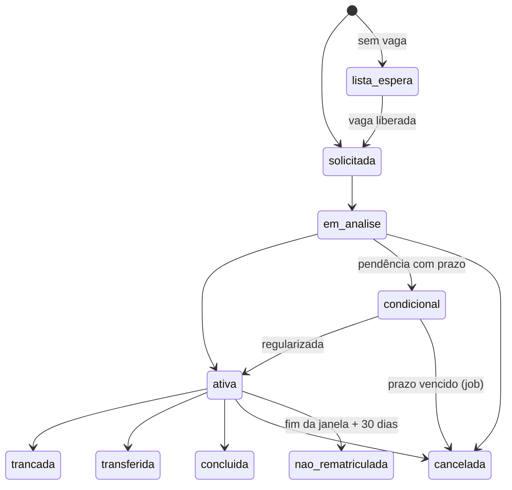
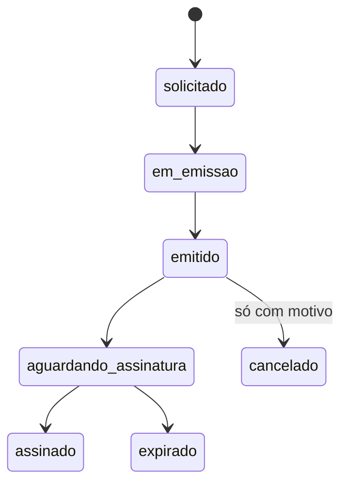

[Índice](README.md) · [Parte anterior](parte-08-academico.md) · [Próxima parte](parte-10-financeiro-pagamentos-e-fiscal.md)

<a id="parte-9"></a>

# Parte 9 — Secretaria, matrícula e documentos

## Visão geral da parte 9

A secretaria conduz a matrícula do pedido à efetivação, emite documentos a partir de modelos aprovados e gere os documentos em três contextos: recebidos, administrativos e emitidos ([46](#doc-46), [48](#doc-48), [54](#doc-54)).





**Regras principais**
- Vaga reservada na transação de confirmação; empate na última vaga gera uma matrícula e uma lista de espera ([46](#doc-46), M-03).
- Sem contrato e termo de LGPD assinados, a matrícula não passa de `em_analise` ([46](#doc-46), M-08).
- Documento emitido não é editado; correção gera documento novo e o anterior é cancelado ([48](#doc-48), seção 4).

<a id="doc-46"></a>

## 46 — Matrícula e Rematrícula, por Portal (Acadêmico)

> Parte do [SDD v2](parte-01-visao-e-escopo.md#doc-00). Matriz em [31](parte-05-portais-navegacao-e-interface.md#doc-31). Regras de validação de matrícula em [15](parte-16-dados-validacoes-configuracoes-e-armazenamento.md#doc-15), seção 7, e em [17](parte-07-regras-gerais-dos-modulos-de-gestao.md#doc-17), seção 4. Bloqueio parcial por inadimplência em [26](parte-18-juridico-e-regulatorio.md#doc-26), seção 3. Contrato de matrícula em [33](parte-12-suprimentos-patrimonio-frotas-contratos-e-terceiros.md#doc-33). Pagamento da matrícula em [34](parte-10-financeiro-pagamentos-e-fiscal.md#doc-34). Protocolo de atendimento em [32](parte-04-seguranca-privacidade-e-auditoria.md#doc-32). Documentos exigidos e LGPD em [07](parte-04-seguranca-privacidade-e-auditoria.md#doc-07). Auditoria em [29](parte-04-seguranca-privacidade-e-auditoria.md#doc-29).
> **Status:** especificação proposta, criada em 03/11/2026 a partir de [`spec_gestao_academica_completo.md`](parte-08-academico.md#v1-spec-gestao-academica-completo-md) (seções 4.1 a 4.9 e 4.3 do portal online). Fecha M-01 a M-09 da [31](parte-05-portais-navegacao-e-interface.md#doc-31). Itens **(jurídico)** e **[Decisão do autor]** dependem de resposta.

---

### 1. Resposta direta

> **Leitura (04/11/2026):** esta tabela registra o que existia no SDD antes deste documento ser escrito. Os itens marcados como **Não** ou **Parcial** são especificados nas seções seguintes deste documento, exceto o que estiver listado na seção de pendências.

| Pergunta | Veredito |
|---|---|
| A matrícula está completa na v1? | **Em parte.** Tem telas (lista, wizard de 6 etapas, portal online, processo seletivo, lista de espera, trancamento, reopção, aproveitamento e atividades complementares). Não tem estados, regra de transição nem DDL completo |
| Está organizada por portal? | **Parcialmente.** O portal online existe. A v1 não diz o que o responsável vê antes e depois da matrícula, nem o que a secretaria pode alterar depois de ativa |
| Há conflito de regra? | **Sim.** "CPF único por tenant" (v1) está errado: a regra é por entidade, com banco por unidade ([03](parte-02-arquitetura-e-tenancy.md#doc-03)). Trancamento "conforme regimento" não tem valor |
| Rematrícula está especificada? | **Não.** A v1 só cita "Rematrícula Online" na navegação e um aviso de 30 dias. M-01 a M-05 não têm regra |

---

### 2. Estados da matrícula

| Estado | Significado | Entra por |
|---|---|---|
| `lista_espera` | Candidato sem vaga, na ordem de prioridade | Pré-matrícula (4.5 da v1) |
| `solicitada` | Pedido feito, aguardando análise | Wizard ou portal online |
| `em_analise` | Documentos ou pagamento em verificação | Secretaria |
| `condicional` | Aceita com pendência financeira ou documental e prazo para regularizar | Análise |
| `ativa` | Matrícula efetivada, com contrato assinado | Análise ou condicional regularizada |
| `trancada` | Suspensa a pedido, com prazo de retorno | Trancamento aprovado |
| `transferida` | Saiu para outra turma ou unidade | Transferência |
| `concluida` | Ciclo encerrado | Conclusão |
| `cancelada` | Desistência ou não regularização | Pedido ou expiração |
| `nao_rematriculada` | Aluno ativo que não confirmou a rematrícula dentro do prazo | Job diário (M-05) |

**Transições:** `solicitada` → `em_analise` → `ativa` ou `condicional` ou `cancelada`. `condicional` → `ativa` ou `cancelada` (ao vencer o prazo). `ativa` → `trancada`, `transferida`, `concluida` ou `cancelada`. `trancada` → `ativa` (retorno) ou `cancelada`.

Estado calculado não é gravado. Prazo vencido de condicional é calculado por data e vira `cancelada` por job, com registro ([18](parte-07-regras-gerais-dos-modulos-de-gestao.md#doc-18), T-04).

---

### 3. Regras por item da matriz

#### M-01 Janela de rematrícula por série e unidade

- A unidade define a janela por série e por curso: abertura, fechamento e prazo de confirmação.
- Fora da janela, a rematrícula não aceita confirmação. A tela informa a data de abertura.
- Kanban de rematrícula na gestão: `não iniciada`, `em preenchimento`, `confirmada`, `em pendência`, `não rematriculada`.

#### M-02 Wizard do responsável ou aluno

Etapas do portal, em ordem: dados do aluno e do responsável; escolha de turma e eletivas; documentos; plano financeiro; contrato e aceite de LGPD; pagamento da primeira parcela. Cada etapa salva e pode ser retomada.

- Aluno maior de idade faz o próprio wizard. Menor é feito pelo responsável com vínculo ativo.
- Eletiva só aparece se a grade do curso tiver vaga e pré-requisito cumprido.

#### M-03 Vaga com reserva e bloqueio de concorrência

Já definido em [15](parte-16-dados-validacoes-configuracoes-e-armazenamento.md#doc-15), seção 7. A vaga é reservada na transação de confirmação. Duas confirmações simultâneas para a última vaga resultam em uma matrícula e uma `lista_espera`.

#### M-04 Matrícula condicional com prazo e expiração

- Condicional é aceita com pendência financeira ou documental, e recebe prazo de regularização configurável por unidade.
- Ao vencer o prazo, a matrícula vai para `cancelada` por job, com aviso ao responsável e registro. A vaga volta para a lista de espera.
- Condicional não dá acesso ao contrato de turma até a regularização. Dá acesso à documentação pendente e ao pagamento.

#### M-05 Não rematriculado após 30 dias

- Aluno ativo que não confirmou rematrícula até o fim da janela, mais 30 dias, vai para `nao_rematriculada`.
- Aviso ao responsável em até 2 dias úteis após o fim da janela, e novo aviso aos 30 dias.
- Não é cancelamento. A vaga só é liberada com decisão da secretaria.

#### M-06 Trancamento com motivo, aprovação por níveis e protocolo

- Motivo escolhido na lista (pessoal, financeiro, saúde, militar, outro), com texto complementar quando for "outro".
- Aprovação por níveis: coordenação pedagógica para trancamento até o prazo do regimento, e secretaria mais direção acima desse prazo.
- Gera protocolo. O prazo máximo do trancamento vem do regimento de cada curso (pendência abaixo).
- Trancamento com dado de saúde segue o acesso restrito de [43](parte-08-academico.md#doc-43), seção 2.2, e não aparece no portal de terceiros.

#### M-07 Transferência e enturmação

- Transferência de turma dentro da mesma unidade: aprovada pela coordenação, com verificação de vaga e de pré-requisito.
- Transferência entre unidades da mesma entidade: exige matrícula nova na unidade de destino, com histórico transferido por registro, não por cópia.
- Enturmação: lista de alunos por turma, gerada pela secretaria, com vagas e bloqueio pela regra de M-03.

#### M-08 Documento obrigatório pendente

Proposta, por tipo de documento:

| Tipo | Efeito de pendência |
|---|---|
| Documento de identidade do aluno e do responsável | Matrícula fica `condicional`, com prazo |
| Histórico escolar anterior (para série final ou transferência) | Matrícula fica `condicional`, com prazo |
| Comprovante de vacinação, quando exigido pela norma da unidade | Matrícula fica `condicional`, com prazo |
| Termo de LGPD e contrato | Sem assinatura, a matrícula não passa de `em_analise` |

**(jurídico):** lista de documentos obrigatórios por nível de ensino e se algum pode bloquear, e não apenas condicionar.

#### M-09 Assinatura do contrato e pagamento da primeira parcela

- Contrato de matrícula é gerado no wizard e assinado pelo responsável (menor) ou pelo aluno (maior), com o provedor de assinatura da [33](parte-12-suprimentos-patrimonio-frotas-contratos-e-terceiros.md#doc-33), seção 4.
- Primeira parcela é cobrada pelo gateway da unidade ([34](parte-10-financeiro-pagamentos-e-fiscal.md#doc-34)). Sem pagamento, a matrícula fica `condicional`, com o prazo da M-04.
- Inadimplente de outro período continua com acesso à rematrícula, à documentação e à comunicação com a família, pelo bloqueio parcial de [26](parte-18-juridico-e-regulatorio.md#doc-26), seção 3.

---

### 4. Processo seletivo e lista de espera

Mantidos da v1 (4.4 e 4.5), com estas regras:

- Candidato em lista de espera recebe aviso quando abrir vaga, com prazo de resposta configurável (48 horas na v1).
- Sem resposta no prazo, o candidato vai para `cancelada` e a vaga passa ao próximo, em ordem de prioridade.
- Ordem de prioridade: data de inscrição, nota, cota ou critério manual, configurável por processo.
- Cota de vaga é campo do processo, com regra de comprovação documental ([17](parte-07-regras-gerais-dos-modulos-de-gestao.md#doc-17), seção 4).

---

### 5. Reopção, aproveitamento e atividades complementares

Mantidos da v1 (4.7 a 4.9). Regras de estado:

- **Reopção de curso:** nova matrícula vinculada à anterior. A anterior vai para `transferida`.
- **Aproveitamento de estudos:** cada disciplina tem estado `aproveitada`, `não aproveitada` ou `pendente`. O parecer é emitido pelo coordenador e vira documento da secretaria ([17](parte-07-regras-gerais-dos-modulos-de-gestao.md#doc-17)).
- **Atividade complementar:** `pendente_validacao`, `validada` ou `recusada`. Só horas validadas contam para a conclusão.

---

### 6. Por portal

| Portal | Pode | Não pode | Origem |
|---|---|---|---|
| **Desenvolvedor** | Nada sobre matrícula de entidade | Ver matrícula, aluno ou responsável | P |
| **Gestão** | Abrir e fechar janela de rematrícula, ver kanban, aprovar trancamento acima do prazo, emitir declaração, cancelar matrícula com motivo | Alterar matrícula ativa sem registro de motivo. Ver documento de saúde sem o papel do módulo | E |
| **Secretaria** | Analisar, condicionar, efetivar, transferir, enturmar, emitir protocolo | Efetivar sem contrato e sem documento do responsável, quando exigidos | E |
| **Coordenação pedagógica** | Aprovar trancamento até o prazo do regimento, aprovar reopção e aproveitamento | Aprovar trancamento acima do prazo sem a secretaria | E |
| **Professor** | Ver a lista da própria turma, após enturmação | Matricular, trancar ou ver documento de matrícula | E |
| **Aluno maior** | Fazer o próprio wizard, rematrícula e eletivas. Ver a própria situação | Ver matrícula de outro aluno. Alterar matrícula ativa | E |
| **Responsável** | Fazer o wizard de dependente, rematrícula, pagamento da primeira parcela e assinatura. Ver a situação de cada dependente | Ver matrícula de outro aluno. Confirmar rematrícula sem vínculo ativo | E, só dependentes com vínculo ativo |
| **Terceiros** | Nada, por padrão | Ver matrícula, aluno ou responsável | E |

---

### 7. Modelo de dados proposto

Não é o DDL final. Tabelas no banco da unidade, horários em UTC.

| Tabela | Campos principais |
|---|---|
| `matriculas` | `uuid`, `aluno_uuid`, `turma_uuid`, `periodo_letivo`, `tipo` (regular, especial, transferencia, condicional, ead), `estado`, `solicitada_em`, `prazo_regularizacao_em`, `motivo_estado`, `created_by`. Unicidade de vínculo ativo por aluno e período |
| `matricula_pendencias` | `matricula_uuid`, `tipo` (financeira, documental), `documento_tipo`, `prazo_em`, `resolvida_em` |
| `janelas_rematricula` | `unidade_uuid`, `serie`, `curso_uuid`, `abre_em`, `fecha_em`, `prazo_confirmacao_dias` |
| `trancamentos` | `matricula_uuid`, `motivo`, `descricao`, `solicitado_em`, `retorno_previsto_em`, `estado`, `protocolo_uuid` |
| `transferencias` | `matricula_origem_uuid`, `matricula_destino_uuid`, `tipo` (turma, curso, unidade), `aprovado_por`, `aprovado_em` |
| `vagas_reserva` | `turma_uuid`, `matricula_uuid`, `reservada_em`, `expira_em`. Índice único em (`turma_uuid`, `matricula_uuid`) |
| `lista_espera` | `processo_uuid`, `candidato_uuid`, `prioridade`, `estado`, `notificado_em`, `expira_em` |

Regra: `vagas_reserva` é o que impede concorrência. A confirmação de matrícula consome a vaga dentro de transação com bloqueio da turma.

---

### 8. Pendências

| # | Pendência | Tipo |
|---|---|---|
| MAT-01 | Lista de documentos obrigatórios por nível e se algum pode bloquear, não só condicionar (M-08) | (jurídico) |
| MAT-02 | Prazo máximo de trancamento (M-06) | **Decidido** em 03/11/2026: um ano letivo, configurável por curso |
| MAT-03 | Prazo de regularização de matrícula condicional (M-04) | **Decidido** em 03/11/2026: 15 dias, ajustável por unidade |
| MAT-04 | Aviso de não rematrícula: 2 dias úteis após a janela e 30 dias depois (M-05) | **Decidido** em 03/11/2026 |
| MAT-05 | "CPF único por tenant" da v1 passa a ser "CPF único por entidade", com verificação entre unidades ([03](parte-02-arquitetura-e-tenancy.md#doc-03)) | **Decidido** em 03/11/2026 |
| MAT-06 | Níveis de aprovação de trancamento: coordenação até o regimento, secretaria e direção acima (M-06) | **Decidido** em 03/11/2026 |
| MAT-07 | DDL das tabelas da seção 7, com teste de concorrência em vagas | **Escrito** em [51](parte-16-dados-validacoes-configuracoes-e-armazenamento.md#doc-51), seção 10. Revisão do owner pendente (DDL-01) |

---

### 9. Critérios de aceite

- [ ] Duas confirmações simultâneas para a última vaga geram uma matrícula e uma `lista_espera` (teste de concorrência).
- [ ] Matrícula condicional vencida vai para `cancelada` e libera a vaga (teste).
- [ ] Rematrícula fora da janela é recusada com a data de abertura (teste).
- [ ] Aluno sem vínculo ativo não vê matrícula de outro aluno (teste de isolamento).
- [ ] Responsável vê só dependentes com vínculo ativo (teste de isolamento).
- [ ] Inadimplente de outro período mantém rematrícula, documentação e comunicação (teste, conforme [26](parte-18-juridico-e-regulatorio.md#doc-26)).
- [ ] Trancamento gera protocolo e registro de aprovação por nível (teste).
- [ ] Itens **(jurídico)** e **[Decisão do autor]** respondidos ou marcados como pendentes no [00](parte-01-visao-e-escopo.md#doc-00).

<a id="doc-48"></a>

## 48 — Gerador de Documentos, por Portal

> Parte do [SDD v2](parte-01-visao-e-escopo.md#doc-00). Emissão de documento oficial da secretaria em [17](parte-07-regras-gerais-dos-modulos-de-gestao.md#doc-17) e [46](#doc-46). Assinatura digital em [33](parte-12-suprimentos-patrimonio-frotas-contratos-e-terceiros.md#doc-33), seção 4, e decisão CTR-06. Biblioteca e acervo, separados, em [31](parte-05-portais-navegacao-e-interface.md#doc-31), seção 3. Armazenamento e checksum em [21](parte-16-dados-validacoes-configuracoes-e-armazenamento.md#doc-21). Auditoria em [29](parte-04-seguranca-privacidade-e-auditoria.md#doc-29). Consulta pública e dado mínimo em [07](parte-04-seguranca-privacidade-e-auditoria.md#doc-07).
> **Status:** especificação proposta, criada em 03/11/2026 e verificada contra a v1 no mesmo dia (seção 11). **Escopo:** apenas documentos emitidos pela secretaria (contexto C de [54](#doc-54)). Documentos recebidos e administrativos têm regras próprias a partir de [`spec-builder-documentos-academicos.md`](#v1-spec-builder-documentos-academicos-md) (editor de modelos, chamado de builder na v1: layout, variáveis, condicionais) e [`spec_gestao_documentos_completo.md`](#v1-spec-gestao-documentos-completo-md) (tipos, ciclo de vida, assinatura, permissões). Fecha MOD-07 da [31](parte-05-portais-navegacao-e-interface.md#doc-31). Itens **(jurídico)**, **(verificar)** e **[Decisão do autor]** dependem de resposta.

---

### 1. Resposta direta

> **Leitura (04/11/2026):** esta tabela registra o que existia no SDD antes deste documento ser escrito. Os itens marcados como **Não** ou **Parcial** são especificados nas seções seguintes deste documento, exceto o que estiver listado na seção de pendências.

| Pergunta | Veredito |
|---|---|
| O gerador de documentos está especificado? | **Em parte.** O editor de modelos (layout, papel, margens, cabeçalho, rodapé, variáveis, condicionais) está bem descrito. Falta DDL, regra de emissão, validação pública e a separação entre gerador e gestão de documentos |
| Há duplicidade? | **Sim.** A v1 tem duas especificações de documentos, uma do editor de modelos (builder) e outra de gestão. Este documento une as duas |
| Está organizado por portal? | **Não.** A v1 não diz quem pode solicitar, quem emite e quem vê |
| Biblioteca e documentos se misturam? | **Não, por decisão.** A biblioteca tem acervo e empréstimo. Documento é emitido pela secretaria. Ver [31](parte-05-portais-navegacao-e-interface.md#doc-31), seção 3 |

---

### 2. Separação de responsabilidades

| Parte | Função | Dono |
|---|---|---|
| Editor de modelos | Desenha o modelo: papel, margens, cabeçalho, corpo, rodapé, variáveis, condicionais | Gestão de documentos |
| Catálogo de tipos | Declaração, histórico, certificado, termo, ata, comunicado, contrato e outros | Gestão de documentos |
| Emissão | Gera o arquivo final a partir de um modelo publicado e de dados do aluno, pessoa ou entidade | Secretaria ou módulo de origem |
| Assinatura | Assina o arquivo emitido | Serviço de assinatura ([33](parte-12-suprimentos-patrimonio-frotas-contratos-e-terceiros.md#doc-33)) |
| Validação pública | Confirma autenticidade por código ou QR, sem dado pessoal além do mínimo | Gestão de documentos |

---

### 3. Tipos de documento

Tipos da v1 mantidos: declaração de matrícula, declaração de frequência, declaração de conclusão, declaração de quitação, histórico escolar, certidão de conclusão, segunda via, aditivo e contrato.

Tipos previstos na v1 e mantidos como expansão: termo de responsabilidade, requerimento, autorização, boleto com instruções, comunicado institucional, certificado, ata, relatório acadêmico, ficha cadastral, dossiê do aluno e declaração personalizada.

Cada tipo tem:

- Modelo publicado e versionado.
- Lista de variáveis obrigatórias.
- Quem pode solicitar e quem pode emitir.
- Se exige assinatura e de quem.
- Prazo de validade, quando houver.

---

### 4. Ciclo de vida do documento emitido

`solicitado` → `em_emissao` → `emitido` → `aguardando_assinatura` → `assinado` ou `expirado` ou `cancelado`.

- `solicitado`: pedido do aluno, responsável, professor ou da própria secretaria, com protocolo ([32](parte-04-seguranca-privacidade-e-auditoria.md#doc-32)).
- `emitido` sem assinatura: disponível para download, com código de validação.
- `expirado`: quando o documento tem validade e ela venceu. Calculado por data ([18](parte-07-regras-gerais-dos-modulos-de-gestao.md#doc-18), T-04).
- `cancelado`: só com motivo e evento de auditoria. O arquivo continua guardado.

Documento emitido não é editado. Correção gera novo documento, e o anterior vai para `cancelado`.

---

### 5. Editor de modelos: regras de modelo

| Regra | Detalhe |
|---|---|
| Papel | Presets A4 e ofício, com configuração de tamanho personalizado. Unidade em mm, cm ou pt |
| Margens e recuos | Por página, com recuo de primeira linha e de parágrafo |
| Cabeçalho e rodapé | Campos fixos da entidade (nome, CNPJ, endereço, logotipo) e paginação |
| Variáveis | Grupos mínimos: aluno, responsável, turma, curso, matrícula, entidade, unidade, data. Variável sem dado na emissão bloqueia a emissão e aponta o campo |
| Condicionais | Bloco aparece só se a condição for verdadeira. Ex.: bloco de bolsa só se houver bolsa |
| Repetições | Lista de disciplinas, de notas ou de parcelas, com cabeçalho repetido por página |
| Publicação | Modelo só é publicado depois de revisão. Publicado não muda ([41](parte-08-academico.md#doc-41), seção 2.3) |

Modelo não contém código executável. Condicional e repetição são interpretadas por um motor de regras limitado.

---

### 6. Validação pública

- Cada documento emitido tem código de validação e QR apontando para uma página pública.
- A página confirma: tipo, data de emissão, situação atual (válido, expirado, cancelado) e a entidade emissora.
- A página **não** mostra nome do aluno, CPF ou nota. Para confirmar a pessoa, o consultante informa o código e a data de nascimento, e a consulta é limitada por taxa ([23](parte-06-plataforma-saas-clientes-dominios-licencas-e-crm.md#doc-23)).
- Cada consulta gera evento de auditoria sem o dado consultado.

---

### 7. Por portal

| Portal | Pode | Não pode | Origem |
|---|---|---|---|
| **Desenvolvedor** | Publicar modelos-padrão, sem dado | Ver documento emitido de qualquer entidade | P |
| **Gestão** | Criar e publicar modelo, cancelar documento com motivo, ver relatório de emissão | Emitir sem papel de secretaria | E |
| **Secretaria** | Solicitar, emitir, assinar (quando for o caso), reemitir, cancelar com motivo | Alterar modelo publicado | E |
| **Professor** | Solicitar documento de sua turma, ex.: declaração de frequência de aluno da turma | Emitir histórico ou documento oficial. Ver documento de outro aluno | E |
| **Aluno maior** | Solicitar e baixar os próprios documentos, com código de validação | Ver documento de outro aluno. Cancelar documento emitido | E |
| **Responsável** | Solicitar e baixar documentos de dependente com vínculo ativo | Ver documento de dependente sem vínculo. Cancelar documento emitido | E |
| **Terceiros** | Ver um documento emitido para ele, quando o contrato prevê (ex.: cartório recebe certidão) | Ver outros documentos | E, [38](parte-12-suprimentos-patrimonio-frotas-contratos-e-terceiros.md#doc-38) |
| **Público (consulta)** | Validar código e situação | Ver dado pessoal, nota ou conteúdo | Fora dos portais, seção 6 |

---

### 8. Assinatura

- Documento que exige assinatura passa por `aguardando_assinatura` até todos os signatários assinarem.
- Provedor de assinatura: decisão CTR-06, aceitar provedores de terceiros e ter assinatura digital própria.
- Assinatura de documento oficial depende de exigência de cada tipo. Conferido em 03/11/2026 na Lei 14.063/2020 (planalto.gov.br):
  - **Níveis:** simples (identifica o signatário), avançada (certificado fora da ICP-Brasil ou outro meio aceito pelas partes, ligado ao signatário de forma unívoca e que detecta alteração) e qualificada (certificado ICP-Brasil) (art. 4º). O modelo de documento guarda o **nível mínimo** exigido, e o sistema recusa assinatura abaixo dele.
  - **Âmbito:** a lei vale para interações com ente público e dentro dele (art. 2º). Não vale entre particulares (art. 2º, parágrafo único, II, a). Cada Poder e ente define o nível mínimo por ato próprio (art. 5º). Por isso, em escola pública o nível de cada tipo vem do ato do ente, configurado pela entidade.
  - **Qualificada obrigatória:** atos de chefes de Poder e de titulares de órgão autônomo, nota fiscal eletrônica (salvo pessoa física e MEI), transferência e registro de imóvel, e demais casos em lei (art. 5º, § 2º). Atestado médico eletrônico e receita de controle especial também (art. 13). Em conflito entre normas, prevalece a qualificada (art. 5º, § 5º).
  - A lei não trata de diploma nem de histórico. A regra do diploma e do histórico digital do superior (normas do MEC) **(verificar)**.
  - **Entre particulares** (MP 2.200-2/2001, art. 10, conferido em 03/11/2026): documento assinado com certificado ICP-Brasil presume-se verdadeiro em relação ao signatário (§ 1º). Outro meio de comprovação de autoria e integridade vale se admitido pelas partes ou aceito por quem recebe o documento (§ 2º). Por isso, contrato e termo entre a escola privada e a família podem usar assinatura avançada, com a aceitação registrada no próprio contrato.
- O arquivo assinado guarda o checksum do conteúdo emitido ([21](parte-16-dados-validacoes-configuracoes-e-armazenamento.md#doc-21)).

---

### 9. Pendências

| # | Pendência | Tipo |
|---|---|---|
| DOC-01 | Quais tipos exigem assinatura com certificado ICP-Brasil (seção 8) | **Conferido** em parte em 03/11/2026: níveis e casos obrigatórios na Lei 14.063/2020, arts. 2º, 4º, 5º e 13. MP 2.200-2/2001, art. 10, conferida. Faltam as normas do MEC para diploma e histórico digital **(verificar)**. Lista final por tipo com o (jurídico) |
| DOC-02 | Prazo de guarda de cada tipo emitido (histórico, declaração, certidão) | (jurídico) |
| DOC-03 | Layout oficial do histórico escolar, conforme norma do sistema de ensino (Res. CNE/CEB, citada na v1) | (verificar) |
| DOC-04 | Validade de declaração, por tipo | **Decidido** em 03/11/2026: 90 dias quando o tipo não define prazo |
| DOC-05 | Limite de consultas públicas de validação por código, por minuto | **Decidido** em 03/11/2026: 10 por minuto por endereço |
| DOC-06 | DDL de tipo, modelo, versão, documento emitido, assinatura e validação | **Escrito** em [51](parte-16-dados-validacoes-configuracoes-e-armazenamento.md#doc-51), seção 12. Revisão do owner pendente (DDL-01) |

---

### 10. Critérios de aceite

- [ ] Modelo com variável sem dado não emite e aponta o campo (teste).
- [ ] Modelo publicado não muda, e correção gera novo documento (teste).
- [ ] Consulta pública não retorna nome, CPF ou nota (varredura).
- [ ] Responsável não baixa documento de dependente sem vínculo ativo (teste de isolamento).
- [ ] Cancelamento de documento exige motivo e gera evento de auditoria (teste).
- [ ] Itens **(jurídico)**, **(verificar)** e **[Decisão do autor]** respondidos ou marcados como pendentes no [00](parte-01-visao-e-escopo.md#doc-00).

---

### 11. Verificação contra a v1 e lacunas fechadas

Verificado em 03/11/2026 contra [`spec-builder-documentos-academicos.md`](#v1-spec-builder-documentos-academicos-md) e [`spec_gestao_documentos_completo.md`](#v1-spec-gestao-documentos-completo-md). A versão anterior deste documento cobria o núcleo (tipos, ciclo, editor de modelos, validação e portais), mas deixava de fora itens da v1. Os itens abaixo foram incluídos nas seções 12 a 19.

| Item da v1 | Situação antes | Onde agora |
|---|---|---|
| Aprovação de modelo, com revisor distinto de quem criou | Faltava | Seção 12 |
| Regras de elegibilidade com severidades | Faltava | Seção 13 |
| Emissão em lote | Faltava | Seção 14 |
| Revogação como ato separado do cancelamento | Faltava | Seção 15 |
| Biblioteca de componentes reutilizáveis | Faltava | Seção 16 |
| Configuração de impressão | Faltava | Seção 17 |
| Auditoria: lista completa de ações | Parcial | Seção 18 |
| Automações e painel de assinaturas | Faltava | Seção 19 |
| Interface da API e DDL | Faltava | Seções 20 e 21 |

---

### 12. Aprovação de modelo

Estados do modelo: `rascunho` → `em_revisao` → `publicado` → `arquivado`.

- Quem cria o modelo não aprova o próprio modelo. A regra é verificada no banco, com a mesma técnica do `CHECK (created_by <> approved_by)` de [37](parte-08-academico.md#doc-37).
- A revisão confere layout, variáveis e regras. Não confere o texto jurídico, que é responsabilidade do jurídico da entidade.
- Modelo publicado não muda. Mudança gera nova versão em `rascunho`.

---

### 13. Elegibilidade para emissão

Cada tipo de documento tem regras de elegibilidade. A regra roda antes da geração.

| Tipo de regra | Exemplo | Severidade |
|---|---|---|
| Vínculo | Declaração de matrícula só para matrícula ativa | Bloqueante |
| Vigência | Aditivo só com contrato vigente | Bloqueante |
| Situação financeira | Declaração de quitação só sem parcela vencida | Bloqueante |
| Solicitação | Transferência só com pedido deferido | Bloqueante |
| Cadastro incompleto | Campo opcional do modelo vazio | Alerta |
| Dado desatualizado | Endereço com mais de um ano | Informativa |

Bloqueante impede a emissão e mostra o motivo. Alerta permite emitir com confirmação. Informativa só aparece no preview.

---

### 14. Emissão em lote

- A secretaria seleciona um tipo e um conjunto de alunos, por turma, série ou filtro.
- O sistema roda a elegibilidade para cada aluno e separa: emitidos, bloqueados e com alerta.
- Lote gera um protocolo por documento, não um protocolo único.
- Falha em um aluno não cancela o lote. O relatório final lista o que falhou e o motivo.
- O lote tem limite de tamanho por execução, e roda em fila ([14](parte-02-arquitetura-e-tenancy.md#doc-14)).

---

### 15. Revogação

Revogação é diferente de cancelamento:

- **Cancelamento:** o documento foi emitido por erro, antes de ser usado. Sai da validação com o motivo.
- **Revogação:** o documento foi emitido corretamente, mas a situação mudou (ex.: matrícula cancelada depois da declaração). A validação pública mostra "revogado" e a data.

Os dois exigem motivo e evento de auditoria. O arquivo nunca é apagado.

---

### 16. Componentes reutilizáveis

Biblioteca por entidade, com componentes como cabeçalho institucional, rodapé de autenticação, bloco de assinatura da secretaria, tabela de disciplinas, caixa de LGPD e termo de ciência.

Cada componente tem nome, categoria, versão, estrutura, estilos, variáveis esperadas, dependências e escopo (entidade ou unidade). Alterar um componente gera nova versão. Os modelos que usam o componente escolhem a versão na publicação.

---

### 17. Configuração de impressão

| Recurso | Regra |
|---|---|
| Margens espelhadas | Para documento frente e verso |
| Altura de cabeçalho e rodapé | Fixa em milímetros, por modelo |
| Quebra de página | Bloco não se divide entre páginas quando marcado |
| Fonte | Embutida no PDF. Fonte não embutida bloqueia a emissão |
| Assinatura visível | Campo de assinatura com área reservada, na última página |
| Número de página | Formato "página X de Y" em todas as páginas |

O PDF é gerado com a mesma versão do modelo que foi publicada na data da emissão.

---

### 18. Auditoria: ações obrigatórias

Toda ação gera evento em [29](parte-04-seguranca-privacidade-e-auditoria.md#doc-29), com os campos da seção 2 daquele documento e o campo `portal`:

criação de tipo · criação de modelo · edição de versão · envio para revisão · aprovação · publicação · preview · emissão · emissão em lote · reemissão · cancelamento · revogação · validação pública · download · alteração de regra · alteração de componente.

Validação pública registra a consulta sem o dado consultado ([29](parte-04-seguranca-privacidade-e-auditoria.md#doc-29), seção 6).

---

### 19. Automações e painel de assinaturas

- Documento aguardando assinatura há 3 dias: lembrete ao signatário.
- Documento expirado sem assinatura: aviso à secretaria, com opção de reenviar.
- Modelo em revisão há 5 dias úteis: lembrete ao revisor.
- Painel da secretaria: documentos aguardando assinatura, por signatário, e expirados. Gráfico de assinaturas concluídas por mês.

Prazos de lembrete são valores iniciais, ajustáveis pela entidade.

---

### 20. Interface da API

| Método | Caminho | Função |
|---|---|---|
| GET, POST | `/documentos/tipos` | Listar e criar tipo |
| PUT | `/documentos/tipos/{uuid}` | Editar tipo |
| GET, POST | `/documentos/modelos` | Listar e criar modelo |
| POST | `/documentos/modelos/{uuid}/versoes` | Nova versão |
| POST | `/documentos/modelos/{uuid}/revisao` | Enviar para revisão |
| POST | `/documentos/modelos/{uuid}/publicacao` | Publicar (aprovador distinto do criador) |
| POST | `/documentos/emissoes` | Emitir um documento |
| POST | `/documentos/emissoes/lote` | Emitir em lote |
| POST | `/documentos/emissoes/{uuid}/cancelamento` | Cancelar, com motivo |
| POST | `/documentos/emissoes/{uuid}/revogacao` | Revogar, com motivo |
| GET | `/validar/{codigo}` | Validação pública, sem dado pessoal |

Todos os endpoints exigem permissão por ação e escopo. A validação pública tem limite de consultas (DOC-05).

---

### 21. DDL

As tabelas do módulo estão em [51](parte-16-dados-validacoes-configuracoes-e-armazenamento.md#doc-51), seção 12 (tipos, modelos, versões, emissões, validação, revogação e componentes). Este documento não repete o DDL.

---

### 22. Pendências desta verificação

| # | Pendência | Tipo |
|---|---|---|
| DOC-07 | Prazos de lembrete de assinatura e de revisão (seção 19) | Valor inicial, ajustável |
| DOC-08 | Limite de tamanho do lote (seção 14) | Operação, em homologação |

<a id="doc-54"></a>

## 54 — Gestão de Documentos: Três Contextos e Serviços Comuns

> Parte do [SDD v2](parte-01-visao-e-escopo.md#doc-00). Substitui a visão de "gestão de documentos" como bloco único que aparecia em [31](parte-05-portais-navegacao-e-interface.md#doc-31), seção 3.1. Emissão de documentos pela secretaria, detalhada em [48](#doc-48). Armazenamento e retenção em [21](parte-16-dados-validacoes-configuracoes-e-armazenamento.md#doc-21). Protocolo e atendimento em [32](parte-04-seguranca-privacidade-e-auditoria.md#doc-32). Assinatura de contratos em [33](parte-12-suprimentos-patrimonio-frotas-contratos-e-terceiros.md#doc-33), seção 5. Auditoria em [29](parte-04-seguranca-privacidade-e-auditoria.md#doc-29). Pacotes jurídicos em [50](parte-18-juridico-e-regulatorio.md#doc-50) e [53](parte-12-suprimentos-patrimonio-frotas-contratos-e-terceiros.md#doc-53).
> **Status:** decisão de arquitetura, criada em 03/11/2026. Não centralizar: cada contexto tem dono, regras e portal próprios. O que é comum fica em serviços, sem compartilhar tabelas de negócio.

---

### 1. Os três contextos

| Contexto | O que é | Quem origina | Quem cuida | Exemplos |
|---|---|---|---|---|
| **A. Documentos recebidos** | Arquivos enviados a instituição para análise e validação | Responsáveis, alunos, candidatos, fornecedores | Secretaria, RH, compras | Certidão de nascimento, RG do responsável, histórico de escola anterior, alvará do fornecedor |
| **B. Documentos administrativos** | Documentos internos de gestão, com tramitação e aprovação | Equipe da instituição | Gestão e administração | Ata de reunião de diretoria, ofício, circular, processo administrativo, política interna |
| **C. Documentos emitidos** | Documentos gerados pela instituição a partir de modelo, para uma pessoa ou uma organização | Secretaria | Secretaria | Declaração, histórico, boletim, certidão, contrato, termo |

Os três contextos não se misturam. Um documento pertence a um contexto, e o contexto define regras, estados, portal de acesso e prazo de guarda.

---

### 2. Contexto A: documentos recebidos

#### 2.1 O que o contexto faz

- Recebe arquivo enviado pelo portal (responsável, aluno, candidato ou fornecedor).
- Confere o arquivo: formato, tamanho, legibilidade e tipo declarado.
- Valida o conteúdo por pessoa habilitada. A validação registra quem validou, quando e o resultado.
- Vincula o arquivo a um cadastro ou a um processo: matrícula, cadastro de fornecedor, candidatura.
- Controla vencimento, quando o documento tem validade (ex.: alvará, seguro, certidão).

#### 2.2 Estados

`enviado` → `em_analise` → `aprovado` ou `recusado` ou `pendente_correcao`.

- `recusado` exige motivo. O remetente recebe o motivo e pode reenviar.
- `pendente_correcao` tem prazo. Vencido o prazo, o processo vinculado é tratado conforme a regra do processo (ex.: matrícula condicional, em [46](#doc-46)).
- `vencido` é calculado por data ([18](parte-07-regras-gerais-dos-modulos-de-gestao.md#doc-18), T-04), não gravado.

#### 2.3 Regras

- Documento de menor é enviado pelo responsável com vínculo ativo.
- Imagem de documento de identidade é guardada cifrada, com acesso restrito à validação. Número completo aparece mascarado nas telas ([07](parte-04-seguranca-privacidade-e-auditoria.md#doc-07)).
- Documento recebido não é emitido. Nunca gera código de validação pública.
- Validação não é automática por padrão. Automação de leitura (OCR) só sugere, e a pessoa confirma ([21](parte-16-dados-validacoes-configuracoes-e-armazenamento.md#doc-21), seção 3.10).

#### 2.4 Retenção

Prazo por tipo de documento, vinculado ao processo que originou o envio. Documento de matrícula segue o prazo de guarda escolar **(jurídico, [50](parte-18-juridico-e-regulatorio.md#doc-50), J-05 e N-10)**. Documento de fornecedor segue o prazo do contrato.

---

### 3. Contexto B: documentos administrativos

#### 3.1 O que o contexto faz

- Cria documento interno com modelo ou em formato livre.
- Tramita: envia para análise, aprovação e assinatura de quem deve aprovar.
- Mantém versões. Versão aprovada não muda.
- Arquiva ao fim da tramitação, com prazo de guarda.

#### 3.2 Estados

`rascunho` → `em_tramitacao` → `aprovado` → `arquivado`, com `reprovado` como saída de `em_tramitacao`.

- Quem cria não aprova o próprio documento. Regra verificada no banco, como em [48](#doc-48), seção 12.
- Documento aprovado pode ser assinado. A assinatura usa o serviço comum da seção 5.

#### 3.3 Regras

- Documento administrativo não é visível a alunos e responsáveis, salvo quando a gestão publica um comunicado, que é contexto C ou um comunicado específico ([53](parte-12-suprimentos-patrimonio-frotas-contratos-e-terceiros.md#doc-53), DC-26).
- Ata de conselho ou de diretoria com dado sensível tem acesso restrito aos participantes ([53](parte-12-suprimentos-patrimonio-frotas-contratos-e-terceiros.md#doc-53), DC-27).
- Documento de processo administrativo público segue a lei de processo do ente. Conferido em 03/11/2026 na Lei 9.784/1999 (planalto.gov.br), que vale para a administração federal (art. 1º). Ente estadual e municipal segue lei própria, configurada pela entidade **(verificar)** por ente. Regras da lei federal que o sistema aplica quando a entidade escolher esse regime:
  - **Forma:** ato escrito, em português, com data, local e assinatura da autoridade (art. 22, § 1º). Páginas numeradas em sequência e rubricadas (art. 22, § 4º): no processo digital, o sistema numera cada peça e guarda o hash.
  - **Prazos:** 5 dias quando não houver prazo próprio, prorrogável até o dobro com justificativa (art. 24). Decisão em até 30 dias após a instrução, prorrogável uma vez com motivo (art. 49). Recurso em 10 dias da ciência (art. 59), com reconsideração em 5 dias e no máximo três instâncias (arts. 56 e 57). Contagem exclui o dia do começo e inclui o do vencimento, que passa ao dia útil seguinte sem expediente (art. 66). O sistema calcula e mostra o vencimento.
  - **Intimação:** com antecedência mínima de 3 dias úteis e o conteúdo do art. 26, § 1º. Registro da ciência no processo.
  - **Motivação:** obrigatória quando o ato nega ou limita direito, impõe sanção, decide recurso ou anula ato (art. 50). O sistema exige o campo de motivação nesses tipos de decisão.

---

### 4. Contexto C: documentos emitidos

Detalhado em [48](#doc-48). Resumo do que o contexto tem e não tem:

- Tem: modelo versionado, elegibilidade, emissão individual e em lote, código de validação pública, revogação, cancelamento.
- Não tem: recebimento de arquivo do usuário. O único arquivo que entra é o anexo de assinatura, dentro do fluxo de assinatura.
- Documento emitido é imutável. Correção gera novo documento.

---

### 5. Serviços comuns

Estes serviços são usados pelos três contextos. Não guardam regra de negócio de nenhum contexto.

| Serviço | Função | Quem usa | Onde é especificado |
|---|---|---|---|
| **Armazenamento** | Guarda arquivos cifrados, com checksum e prazo de retenção. Cada contexto tem seu prefixo e sua política | A, B, C | [21](parte-16-dados-validacoes-configuracoes-e-armazenamento.md#doc-21) |
| **Assinatura** | Coleta assinaturas de uma ou mais partes, na ordem definida, e guarda a evidência. Aceita provedores de terceiros e a assinatura própria, conforme CTR-06 | B e C, e contratos | [33](parte-12-suprimentos-patrimonio-frotas-contratos-e-terceiros.md#doc-33), seção 5 |
| **Protocolo** | Gera o número de protocolo de qualquer pedido ou documento. Número único por unidade | A (envio), B (tramitação), C (emissão) | [32](parte-04-seguranca-privacidade-e-auditoria.md#doc-32) |
| **Auditoria** | Registra cada ação com o contexto e o portal | A, B e C | [29](parte-04-seguranca-privacidade-e-auditoria.md#doc-29) |
| **Validação pública** | Confirma autenticidade por código. Só para documento emitido ou assinado | C e B (assinados) | [48](#doc-48), seção 6 |

**Regra de uso dos serviços:** o contexto chama o serviço e recebe o resultado. Não lê tabela de outro contexto.

---

### 6. Por portal

| Portal | Contexto A (recebidos) | Contexto B (administrativos) | Contexto C (emitidos) |
|---|---|---|---|
| **Desenvolvedor** | Nada | Nada, salvo documentos da própria empresa | Publica modelos-padrão, sem dado |
| **Gestão** | Consulta o que foi aprovado, sem a imagem, salvo papel de validação | Cria, tramita, aprova e arquiva | Acompanha emissão e relatório |
| **Secretaria** | Valida, aprova ou recusa; vincula ao processo | Não tramita (salvo se for setor da própria secretaria) | Emite, assina e revoga com motivo |
| **Professor** | Nada | Lê documento de tramitação em que é parte | Solicita documento de sua turma |
| **Aluno maior e responsável** | Envia e acompanha o próprio documento e o de dependente com vínculo ativo | Nada | Solicita e baixa o próprio documento |
| **Fornecedor (terceiros)** | Envia documentos da empresa, com validade e alerta | Nada | Recebe documento emitido para ele, quando o contrato prevê |
| **Público** | Nada | Nada | Valida código, sem dado pessoal |

---

### 7. Como os contextos se encontram

Exemplo de fluxo completo, em matrícula:

1. **A:** responsável envia certidão de nascimento. A secretaria valida e aprova.
2. **Matrícula:** a aprovação libera o passo de documentos do wizard ([46](#doc-46), M-08).
3. **C:** a secretaria emite o contrato de matrícula pelo modelo publicado.
4. **Assinatura:** o contrato passa pelo serviço comum de assinatura, com o responsável como signatário.
5. **Protocolo:** cada etapa recebe número de protocolo pelo serviço comum.
6. **Auditoria:** cada etapa grava o contexto e o portal.

Ata de conselho de classe (B) pode gerar declaração de encaminhamento (C), mas o vínculo é de referência: a ata não é copiada para dentro do documento emitido.

---

### 8. O que muda nos documentos existentes

| Documento | Mudança |
|---|---|
| [31](parte-05-portais-navegacao-e-interface.md#doc-31), seção 3.1 | "Gestão de documentos" vira três contextos. Ver seção 1 deste documento |
| [48](#doc-48) | Escopo restrito ao contexto C. Não recebe arquivo do usuário |
| [21](parte-16-dados-validacoes-configuracoes-e-armazenamento.md#doc-21) | Prefixo e prazo de retenção por contexto |
| [33](parte-12-suprimentos-patrimonio-frotas-contratos-e-terceiros.md#doc-33), seção 5 | Assinatura passa a ser serviço comum |
| [32](parte-04-seguranca-privacidade-e-auditoria.md#doc-32) | Protocolo passa a ser serviço comum |

---

### 9. Pendências

| # | Pendência | Tipo |
|---|---|---|
| GD-01 | Validação de documento recebido | **Decidido** em 03/11/2026: secretaria valida, com dupla conferência para documento de identidade |
| GD-02 | Prazo de guarda de documento recebido, por tipo (matrícula, fornecedor, candidato) | (jurídico) |
| GD-03 | Tramitação de documento administrativo | **Decidido** em 03/11/2026: o sistema deve permitir criar o fluxo de aprovação por tipo de documento, com níveis configuráveis |
| GD-04 | Formato e tamanho máximo de arquivo recebido, por contexto | Operação, em homologação |
| GD-05 | Leitura automática (OCR) de documento recebido | **Decidido** em 03/11/2026: só sugere, e a pessoa confirma |
| GD-06 | Documento administrativo de entidade pública: regra de processo administrativo | **Conferido** em parte em 03/11/2026: Lei 9.784/1999 para o federal (seção 3.3). Falta a lei de cada estado e município **(verificar)** |
| GD-07 | DDL dos contextos A e B e das tabelas compartilhadas de protocolo e assinatura | **Feito** em 03/11/2026: seção 10 |
| GD-08 | Revisão do DDL pelo owner de cada contexto e teste de migração | Owner e operação |

---

### 10. DDL dos contextos e serviços comuns (GD-07)

Convenções de [51](parte-16-dados-validacoes-configuracoes-e-armazenamento.md#doc-51): MySQL 8 ou MariaDB 10.6, `utf8mb4`, horários em UTC, `unidade_uuid` em toda tabela de unidade. Cada contexto tem prefixo próprio, para que as tabelas fiquem separadas.

```sql
-- Contexto A: documentos recebidos
CREATE TABLE recebidos_envios (
  id              BIGINT UNSIGNED AUTO_INCREMENT PRIMARY KEY,
  uuid            CHAR(36) NOT NULL UNIQUE,
  unidade_uuid    CHAR(36) NOT NULL,
  origem          ENUM('responsavel','aluno','candidato','fornecedor') NOT NULL,
  remetente_uuid  CHAR(36) NOT NULL,
  pessoa_uuid     CHAR(36) NULL,
  tipo_documento  VARCHAR(60) NOT NULL,
  processo_tipo   ENUM('matricula','cadastro_fornecedor','candidatura','outro') NOT NULL,
  processo_uuid   CHAR(36) NULL,
  arquivo_uuid    CHAR(36) NOT NULL,
  arquivo_sha256  CHAR(64) NOT NULL,
  validade_em     DATE NULL,
  estado          ENUM('enviado','em_analise','aprovado','recusado','pendente_correcao','substituido') NOT NULL,
  motivo_estado   VARCHAR(500) NULL,
  protocolo_uuid  CHAR(36) NOT NULL,
  created_at      DATETIME(3) NOT NULL DEFAULT CURRENT_TIMESTAMP(3),
  deleted_at      DATETIME(3) NULL,
  INDEX ix_envio_processo (unidade_uuid, processo_tipo, processo_uuid),
  INDEX ix_envio_validade (unidade_uuid, validade_em)
) ENGINE=InnoDB DEFAULT CHARSET=utf8mb4;

CREATE TABLE recebidos_validacoes (
  id              BIGINT UNSIGNED AUTO_INCREMENT PRIMARY KEY,
  envio_id        BIGINT UNSIGNED NOT NULL,
  validador_uuid  CHAR(36) NOT NULL,
  etapa           TINYINT UNSIGNED NOT NULL,
  resultado       ENUM('aprovado','recusado') NOT NULL,
  motivo          VARCHAR(500) NULL,
  validado_em     DATETIME(3) NOT NULL DEFAULT CURRENT_TIMESTAMP(3),
  UNIQUE KEY ux_validacao_etapa (envio_id, etapa),
  CONSTRAINT fk_validacao_envio FOREIGN KEY (envio_id) REFERENCES recebidos_envios (id)
) ENGINE=InnoDB DEFAULT CHARSET=utf8mb4;

-- Contexto B: documentos administrativos
CREATE TABLE admin_documentos (
  id              BIGINT UNSIGNED AUTO_INCREMENT PRIMARY KEY,
  uuid            CHAR(36) NOT NULL UNIQUE,
  unidade_uuid    CHAR(36) NOT NULL,
  tipo            VARCHAR(60) NOT NULL,
  titulo          VARCHAR(200) NOT NULL,
  estado          ENUM('rascunho','em_tramitacao','reprovado','aprovado','arquivado') NOT NULL,
  versao_aprovada INT UNSIGNED NULL,
  criado_por_uuid CHAR(36) NOT NULL,
  arquivo_uuid    CHAR(36) NULL,
  protocolo_uuid  CHAR(36) NULL,
  guarda_ate      DATE NULL,
  deleted_at      DATETIME(3) NULL,
  INDEX ix_admin_estado (unidade_uuid, estado)
) ENGINE=InnoDB DEFAULT CHARSET=utf8mb4;

CREATE TABLE admin_fluxos (
  id              BIGINT UNSIGNED AUTO_INCREMENT PRIMARY KEY,
  unidade_uuid    CHAR(36) NOT NULL,
  tipo            VARCHAR(60) NOT NULL,
  nivel           TINYINT UNSIGNED NOT NULL,
  papel_aprovador VARCHAR(60) NOT NULL,
  UNIQUE KEY ux_fluxo_nivel (unidade_uuid, tipo, nivel)
) ENGINE=InnoDB DEFAULT CHARSET=utf8mb4;

CREATE TABLE admin_tramitacoes (
  id              BIGINT UNSIGNED AUTO_INCREMENT PRIMARY KEY,
  documento_id    BIGINT UNSIGNED NOT NULL,
  nivel           TINYINT UNSIGNED NOT NULL,
  aprovador_uuid  CHAR(36) NOT NULL,
  resultado       ENUM('pendente','aprovado','reprovado') NOT NULL,
  decidido_em     DATETIME(3) NULL,
  motivo          VARCHAR(500) NULL,
  CONSTRAINT fk_tramitacao_documento FOREIGN KEY (documento_id) REFERENCES admin_documentos (id)
) ENGINE=InnoDB DEFAULT CHARSET=utf8mb4;

-- Serviços comuns
CREATE TABLE protocolos (
  id              BIGINT UNSIGNED AUTO_INCREMENT PRIMARY KEY,
  uuid            CHAR(36) NOT NULL UNIQUE,
  unidade_uuid    CHAR(36) NOT NULL,
  numero          VARCHAR(30) NOT NULL,
  contexto        ENUM('atendimento','recebido','administrativo','emitido') NOT NULL,
  referencia_uuid CHAR(36) NOT NULL,
  criado_em       DATETIME(3) NOT NULL DEFAULT CURRENT_TIMESTAMP(3),
  UNIQUE KEY ux_protocolo_numero (unidade_uuid, numero),
  INDEX ix_protocolo_referencia (referencia_uuid)
) ENGINE=InnoDB DEFAULT CHARSET=utf8mb4;

CREATE TABLE assinaturas_pedidos (
  id              BIGINT UNSIGNED AUTO_INCREMENT PRIMARY KEY,
  uuid            CHAR(36) NOT NULL UNIQUE,
  unidade_uuid    CHAR(36) NOT NULL,
  contexto        ENUM('administrativo','emitido','contrato') NOT NULL,
  documento_uuid  CHAR(36) NOT NULL,
  arquivo_sha256  CHAR(64) NOT NULL,
  estado          ENUM('pendente','concluido','cancelado','expirado') NOT NULL,
  expira_em       DATETIME(3) NULL,
  created_at      DATETIME(3) NOT NULL DEFAULT CURRENT_TIMESTAMP(3),
  INDEX ix_assinatura_documento (documento_uuid)
) ENGINE=InnoDB DEFAULT CHARSET=utf8mb4;

CREATE TABLE assinaturas_signatarios (
  id              BIGINT UNSIGNED AUTO_INCREMENT PRIMARY KEY,
  pedido_id       BIGINT UNSIGNED NOT NULL,
  ordem           TINYINT UNSIGNED NOT NULL,
  pessoa_uuid     CHAR(36) NULL,
  papel           VARCHAR(40) NOT NULL,
  provedor        VARCHAR(40) NOT NULL,
  tipo            ENUM('simples','avancada','qualificada_icp_brasil') NOT NULL,
  estado          ENUM('pendente','assinado','recusado','expirado') NOT NULL,
  evidencia_hash  CHAR(64) NULL,
  assinado_em     DATETIME(3) NULL,
  UNIQUE KEY ux_signatario_ordem (pedido_id, ordem),
  CONSTRAINT fk_signatario_pedido FOREIGN KEY (pedido_id) REFERENCES assinaturas_pedidos (id)
) ENGINE=InnoDB DEFAULT CHARSET=utf8mb4;
```

**Regras do DDL:**

- `recebidos_validacoes` tem uma linha por etapa. A constraint `ux_validacao_etapa` impede repetir a mesma etapa. A regra de dupla conferência, que exige pessoa diferente na segunda etapa, é de aplicação.
- `protocolos` guarda os quatro contextos. É o único lugar onde o número é gerado, e a referência aponta para o objeto de origem, sem copiar dado.
- `assinaturas_pedidos` é usado por documentos administrativos, emitidos e contratos. A ordem de assinatura é a constraint `ux_signatario_ordem`.
- O documento emitido (contexto C) está em [51](parte-16-dados-validacoes-configuracoes-e-armazenamento.md#doc-51), seção 12, e não é repetido aqui.

---

### 11. Critérios de aceite

- [ ] Documento recebido (A) nunca gera código de validação pública (teste).
- [ ] Quem criou um documento administrativo não aprova o próprio (teste de constraint).
- [ ] Documento emitido (C) não aceita upload de arquivo do usuário (teste).
- [ ] Documento administrativo não aparece para aluno ou responsável (teste de isolamento).
- [ ] Cada etapa do fluxo da seção 7 gera protocolo e evento de auditoria com o contexto (teste de integração).
- [ ] Contexto não lê tabela de outro contexto (verificação de código).

## Especificações da v1 desta parte absorvidas no kit-starter ou sem destino

<a id="v1-spec-builder-documentos-academicos-md"></a>

### v1 — `spec-builder-documentos-academicos.md` (896 linhas)

> Situação na v2: Absorvido integralmente no kit-starter. Destino: ficha do kit-starter: `kit-starter/gestao/secretaria/emissao-de-documentos.md`. Quando este texto diverge da v2, vale a v2.

#### O que a v2 muda nesta especificação

Estas regras prevalecem sobre o texto da v1 que vem a seguir.

- Modelo só é usado depois de aprovado; documento emitido é imutável e só é revogado com motivo (seção 13, 12 e 15).
- Editor de modelos do gerador **não é** o Editor de portais ([31](parte-05-portais-navegacao-e-interface.md#doc-31), seção 3.4).

#### Texto integral da v1

Documento funcional e técnico para criação, configuração, versionamento, renderização, emissão e validação de qualquer documento acadêmico, administrativo, financeiro ou contratual, com suporte a builder visual, layout de impressão avançado, múltiplos tamanhos de papel, cabeçalho, rodapé, margens, identação, paginação e regras de negócio.

- Language Standard: Global English
Baseado na tela observada em **Secretaria > Modelos de documentos**, com filtros por período letivo, unidade, turma e aluno, e agrupamento por tipo documental como aditivo, contratos e declarações. [cite:1]

[image:1]

#### 1. Visão geral

O módulo deve permitir que a instituição crie, mantenha e emita documentos padronizados a partir de modelos reutilizáveis, parametrizados e versionados. A tela atual indica um catálogo de modelos por tipo documental com contexto acadêmico por período, unidade, turma e aluno, o que exige um motor de geração contextual e rastreável. [cite:1]

O objetivo não é apenas armazenar arquivos, mas prover uma plataforma de **Document Template Management + Document Builder + Rendering Engine + Issuance Workflow**, capaz de atender desde uma declaração simples até contratos complexos com assinatura, QR code, múltiplas páginas e requisitos formais de impressão.

#### 2. Objetivos do módulo

- Padronizar todos os documentos institucionais.
- Eliminar edição manual repetitiva em Word, LibreOffice ou editores externos.
- Permitir criação de modelos com baixa dependência técnica.
- Garantir versionamento, aprovação e trilha de auditoria.
- Possibilitar emissão individual ou em lote.
- Suportar layout profissional de impressão e PDF.
- Adaptar o mesmo builder para qualquer formato de papel.
- Atender cenários multiunidade, multicurso e multientidade.

#### 3. Escopo funcional

O módulo deve cobrir:

- Tipos documentais.
- Modelos documentais.
- Versionamento de modelos.
- Builder visual e técnico.
- Biblioteca de variáveis.
- Regras condicionais.
- Pré-visualização responsiva e de impressão.
- Emissão individual.
- Emissão em lote.
- Geração de PDF.
- Cabeçalho e rodapé configuráveis.
- Assinatura e autenticação.
- Validação pública.
- Revogação e reemissão.
- Auditoria completa.

#### 4. Tipos documentais suportados

A lista inicial deve incluir, no mínimo, os tipos mostrados na tela atual, como aditivo, contratos, declaração de conclusão de curso, declaração de frequência, declaração de matrícula, declaração de quitação, declaração de transferência e etiqueta do aluno. [cite:1]

Também deve aceitar expansão para:

- Termos de responsabilidade.
- Requerimentos.
- Autorizações.
- Boletos acompanhados de instruções.
- Comunicados institucionais.
- Certificados.
- Atas.
- Relatórios acadêmicos.
- Fichas cadastrais.
- Dossiês do aluno.
- Declarações personalizadas.

#### 5. Arquitetura conceitual

O módulo deve ser dividido em componentes independentes:

- **Document Type Service**: cadastro e política por tipo documental.
- **Template Catalog Service**: cadastro de modelos e escopos.
- **Template Version Service**: snapshots, histórico, rollback e comparação.
- **Document Builder Service**: edição visual/técnica do layout.
- **Rendering Engine**: interpretação do template e geração final.
- **Rule Engine**: validação de elegibilidade e lógica condicional.
- **Issuance Service**: emissão, protocolo e fila de processamento.
- **Signature Service**: integração com assinatura eletrônica/digital.
- **Validation Service**: consulta pública por QR/token/código.
- **Audit Service**: trilha completa de eventos.
- **Storage Service**: persistência dos arquivos gerados e seus checksums.

#### 6. Builder universal de documentos

O builder é o núcleo do módulo. Ele deve ser capaz de construir qualquer documento institucional sem depender de edição externa, usando composição visual por blocos e modo avançado por markup/template.

##### 6.1 Modos do builder

O builder deve possuir dois modos interoperáveis:

1. **Modo visual**
   - Edição por blocos.
   - Arrastar e soltar.
   - Painel de propriedades.
   - Guias visuais para margens e grid.
   - Preview imediato.

2. **Modo técnico**
   - HTML/CSS controlado.
   - DSL/template engine com variáveis.
   - Regras condicionais.
   - Estruturas de repetição.
   - CSS de impressão avançado.

3. **Modo híbrido**
   - Usuário monta no visual.
   - Usuário técnico refina no markup.
   - Sistema mantém estrutura sem perda de compatibilidade.

##### 6.2 Blocos base do builder

O builder deve oferecer blocos reutilizáveis:

- Título.
- Subtítulo.
- Parágrafo.
- Texto rico.
- Lista ordenada.
- Lista não ordenada.
- Tabela.
- Linha horizontal.
- Espaçador.
- Quebra de página.
- Imagem.
- Logo.
- QR code.
- Código de barras.
- Assinatura.
- Carimbo.
- Selo.
- Caixa de destaque.
- Campo variável.
- Grupo condicional.
- Repetidor.
- Colunas.
- Bloco de identificação institucional.
- Bloco de identificação do aluno.
- Rodapé institucional.
- Cabeçalho institucional.
- Bloco livre HTML.

##### 6.3 Áreas estruturais do documento

Cada documento deve ser composto por zonas independentes:

- Área da página.
- Cabeçalho.
- Corpo.
- Rodapé.
- Margem superior.
- Margem inferior.
- Margem esquerda.
- Margem direita.
- Área imprimível.
- Área de notas internas não impressas.

##### 6.4 Camadas do layout

O builder deve suportar camadas lógicas:

- Fundo.
- Conteúdo principal.
- Elementos fixos.
- Elementos repetidos por página.
- Marcas de segurança.
- Marca d’água.
- Overlay de preview.

#### 7. Suporte universal a tamanhos de papel

O builder deve permitir configurar qualquer formato de papel, com presets e modo customizado.

##### 7.1 Presets obrigatórios

- A0
- A1
- A2
- A3
- A4
- A5
- A6
- Carta (Letter)
- Ofício
- Legal
- Executivo
- Tabloide
- Envelope padrões institucionais
- Etiquetas personalizadas

##### 7.2 Configuração de papel

Campos obrigatórios:

- Nome do preset.
- Largura.
- Altura.
- Unidade de medida.
- Orientação: retrato ou paisagem.
- Sangria opcional.
- Área segura.
- Escala de renderização.
- DPI de preview.
- DPI de exportação.

##### 7.3 Unidades de medida aceitas

- mm
- cm
- in
- px
- pt

##### 7.4 Requisitos funcionais do motor de página

- Converter qualquer unidade para uma base interna padronizada.
- Preservar proporção e posicionamento no preview.
- Separar preview de tela do layout real de impressão.
- Permitir presets por modelo e por versão.
- Suportar documentos de página única e multipágina.

##### 7.5 Exemplo de configuração JSON

```json
{
  "page": {
    "size": "A4",
    "width": 210,
    "height": 297,
    "unit": "mm",
    "orientation": "portrait",
    "bleed": 0,
    "safeArea": 5,
    "dpiPreview": 96,
    "dpiExport": 300
  }
}
```

#### 8. Margens, recuos, alinhamento e identação

O builder deve permitir controle fino de composição tipográfica e de impressão.

##### 8.1 Configuração de margens da página

Campos:

- Margem superior.
- Margem inferior.
- Margem esquerda.
- Margem direita.
- Margem espelhada para frente e verso.
- Margem específica da primeira página.
- Margem específica de páginas pares/ímpares.

##### 8.2 Configuração de recuos e identação

Campos:

- Recuo do primeiro parágrafo.
- Recuo esquerdo do bloco.
- Recuo direito do bloco.
- Espaçamento antes.
- Espaçamento depois.
- Entrelinha.
- Alinhamento horizontal.
- Alinhamento vertical do bloco.
- Controle de hifenização.
- Justificado, esquerda, centro, direita.

##### 8.3 Regras tipográficas

- Permitir estilo por bloco e por classe.
- Permitir herança de estilo institucional.
- Permitir tabulações.
- Permitir grid de baseline opcional.
- Permitir controle de órfãs e viúvas em impressão.
- Permitir evitar quebra dentro de blocos críticos.

##### 8.4 Exemplo de estilo do corpo

```json
{
  "contentStyle": {
    "fontFamily": "Times New Roman",
    "fontSize": 12,
    "lineHeight": 1.5,
    "textAlign": "justify",
    "firstLineIndent": 1.25,
    "indentUnit": "cm",
    "spacingBefore": 0,
    "spacingAfter": 0.25,
    "spacingUnit": "cm"
  }
}
```

#### 9. Cabeçalho e rodapé

O sistema deve oferecer builder específico para cabeçalho e rodapé, desacoplado do corpo do documento.

##### 9.1 Capacidades do cabeçalho

- Logo institucional.
- Nome da instituição.
- CNPJ.
- Endereço.
- Unidade emissora.
- Linha decorativa.
- Título da seção.
- Número do documento.
- Data de emissão.
- Cabeçalho diferente na primeira página.
- Cabeçalho diferente em páginas pares/ímpares.

##### 9.2 Capacidades do rodapé

- Texto institucional.
- Endereço/contato.
- Autenticação e QR code.
- Número da página.
- Total de páginas.
- Código de validação.
- Rodapé legal.
- Assinatura institucional.
- Observação de validade.

##### 9.3 Campos configuráveis

- Altura do cabeçalho.
- Altura do rodapé.
- Distância da margem.
- Repetir em todas as páginas.
- Mostrar apenas na primeira página.
- Mostrar apenas na última página.
- Mostrar em páginas pares/ímpares.
- Sobrepor ou reservar área fixa.

##### 9.4 Placeholders de paginação

- `{{ page.number }}`
- `{{ page.total }}`
- `{{ document.validation_code }}`
- `{{ document.issue_date }}`

##### 9.5 Regras de layout

- Cabeçalho e rodapé devem reservar espaço real na área imprimível.
- O corpo não pode colidir com cabeçalho/rodapé.
- O preview deve mostrar claramente a caixa útil da página.

#### 10. Configuração avançada de impressão

O módulo precisa suportar impressão profissional e PDF confiável.

##### 10.1 Recursos obrigatórios

- CSS de impressão por template.
- `@page` configurável.
- Quebra de página manual e automática.
- Evitar quebra dentro de tabela ou assinatura.
- Repetição de cabeçalho de tabela.
- Marcas de corte opcionais.
- Escala de impressão controlada.
- Modo frente e verso.
- Margens espelhadas.
- Página inicial distinta.

##### 10.2 Propriedades a suportar

- `page-break-before`
- `page-break-after`
- `page-break-inside`
- `break-before`
- `break-after`
- `break-inside`
- `orphans`
- `widows`
- `@page`

##### 10.3 Exemplo conceitual

```css
@page {
  size: A4 portrait;
  margin: 20mm 15mm 25mm 20mm;
}

.section-no-break {
  break-inside: avoid;
}

.signature-block {
  page-break-inside: avoid;
}
```

#### 11. Biblioteca de variáveis e placeholders

O builder deve expor variáveis organizadas por domínio de negócio.

##### 11.1 Grupos mínimos

- Instituição.
- Mantenedora.
- Unidade.
- Curso.
- Turma.
- Período letivo.
- Aluno.
- Matrícula.
- Contrato.
- Financeiro.
- Responsável.
- Documento.
- Usuário emissor.
- Data/hora.
- Assinaturas.
- Configurações customizadas.

##### 11.2 Exemplos

- `{{ instituicao.nome }}`
- `{{ unidade.nome }}`
- `{{ aluno.nome_completo }}`
- `{{ aluno.cpf }}`
- `{{ matricula.numero }}`
- `{{ curso.nome }}`
- `{{ turma.nome }}`
- `{{ periodo_letivo.descricao }}`
- `{{ contrato.numero }}`
- `{{ financeiro.saldo_aberto }}`
- `{{ document.protocol }}`
- `{{ document.validation_code }}`
- `{{ issuer.nome }}`

##### 11.3 Requisitos

- Autocomplete por grupo.
- Descrição funcional da variável.
- Tipo da variável.
- Exemplo de valor.
- Indicação de campo sensível.
- Validação de placeholder inexistente.
- Aviso quando a variável não existir no contexto selecionado.

#### 12. Condicionais, repetições e lógica de template

O builder deve suportar lógica suficiente para compor documentos complexos.

##### 12.1 Condicionais

Exemplos:

```twig

<p>O aluno encontra-se regularmente matriculado.</p>

```

##### 12.2 Repetições

```twig

<tr>
  <td>{{ disciplina.nome }}</td>
  <td>{{ disciplina.carga_horaria }}</td>
  <td>{{ disciplina.nota_final }}</td>
</tr>

```

##### 12.3 Regras obrigatórias

- Comparações simples e compostas.
- Operadores lógicos.
- Formatação de datas, números e moeda.
- Funções auxiliares seguras.
- Blocos ocultos quando vazios.
- Fallbacks de valor.

#### 13. Componentes reutilizáveis

O sistema deve permitir biblioteca de componentes reutilizáveis por tenant.

##### Exemplos

- Cabeçalho institucional padrão.
- Rodapé de autenticação padrão.
- Bloco de assinatura da secretaria.
- Bloco de contrato financeiro.
- Tabela padrão de disciplinas.
- Caixa legal de LGPD.
- Termo padrão de ciência.

Cada componente deve ter:

- Nome.
- Categoria.
- Versão.
- HTML/estrutura.
- Estilos.
- Variáveis esperadas.
- Dependências.
- Escopo.

#### 14. Regras de negócio para emissão

Como a tela atual permite filtrar por período letivo, unidade, turma e aluno, a emissão precisa ser contextual e dirigida por dados acadêmicos antes da geração do documento. [cite:1]

##### Exemplos de elegibilidade

- Declaração de matrícula apenas para matrícula ativa.
- Declaração de frequência apenas com vínculo vigente.
- Declaração de quitação apenas sem débitos vencidos.
- Aditivo apenas com contrato vigente.
- Transferência apenas com solicitação deferida.
- Etiqueta do aluno apenas com vínculo válido ou cadastro ativo.

##### Severidades

- Bloqueante.
- Alerta.
- Informativa.

#### 15. Fluxos do usuário

##### 15.1 Criar tipo documental

1. Acessar Secretaria > Modelos de documentos. [cite:1]
2. Clicar em Cadastrar. [cite:1]
3. Informar nome, categoria, escopo e políticas.
4. Salvar o tipo.

##### 15.2 Criar modelo

1. Selecionar o tipo documental.
2. Criar novo modelo.
3. Definir escopo, vigência e formato de papel.
4. Abrir builder.
5. Montar cabeçalho, corpo e rodapé.
6. Inserir variáveis.
7. Configurar regras.
8. Salvar rascunho.

##### 15.3 Publicar modelo

1. Enviar para revisão.
2. Aprovador revisa layout e regras.
3. Publicar versão.
4. Modelo passa a ficar disponível para emissão.

##### 15.4 Emitir documento individual

1. Selecionar período, unidade, turma e aluno. [cite:1]
2. Selecionar o tipo documental desejado. [cite:1]
3. Sistema resolve o modelo aplicável.
4. Executa regras de elegibilidade.
5. Exibe preview.
6. Confirma emissão.
7. Gera PDF e protocolo.
8. Registra auditoria.

##### 15.5 Emitir em lote

1. Selecionar turma, unidade, curso ou filtro customizado.
2. Selecionar tipo documental.
3. Executar validações.
4. Enfileirar processamento.
5. Gerar resultado com sucessos e falhas.

#### 16. Estrutura da interface do builder

##### 16.1 Layout da tela

A interface deve conter:

- Barra superior com ações.
- Painel esquerdo de blocos.
- Área central de canvas/página.
- Painel direito de propriedades.
- Barra inferior de zoom, grade e páginas.
- Alternância entre preview tela e preview impressão.

##### 16.2 Barra superior

- Salvar.
- Salvar versão.
- Validar.
- Pré-visualizar.
- Testar com aluno.
- Aprovar.
- Publicar.
- Duplicar.
- Exportar definição.
- Importar definição.

##### 16.3 Painel esquerdo

- Blocos.
- Variáveis.
- Componentes reutilizáveis.
- Estrutura do documento.
- Páginas.

##### 16.4 Painel direito

Propriedades contextuais do elemento selecionado:

- Dimensões.
- Posição.
- Fonte.
- Cor.
- Borda.
- Margem.
- Padding.
- Recuo.
- Quebra.
- Visibilidade condicional.
- Fonte de dados.
- Repetição.

#### 17. Modelo de dados

##### 17.1 Entidades principais

- `document_types`
- `document_models`
- `document_model_versions`
- `document_layout_definitions`
- `document_layout_blocks`
- `document_layout_assets`
- `document_variables_catalog`
- `document_rules`
- `document_approvals`
- `document_issuances`
- `document_issuance_files`
- `document_validation_tokens`
- `document_revocations`
- `document_audit_logs`
- `document_components_library`

##### 17.2 Campos sugeridos para layout versionado

###### document_layout_definitions

- id
- model_version_id
- page_size
- page_width
- page_height
- unit
- orientation
- margin_top
- margin_right
- margin_bottom
- margin_left
- mirrored_margins
- header_height
- footer_height
- content_schema_json
- print_css
- preview_css
- builder_schema_json
- created_at

###### document_layout_blocks

- id
- layout_definition_id
- parent_block_id nullable
- block_type
- zone
- sort_order
- x
- y
- width
- height
- style_json
- content_json
- visibility_rule_json
- repeat_rule_json

#### 18. API sugerida

##### Tipos

- `GET /api/document-types`
- `POST /api/document-types`
- `PUT /api/document-types/{id}`

##### Modelos

- `GET /api/document-models`
- `POST /api/document-models`
- `GET /api/document-models/{id}`
- `PUT /api/document-models/{id}`
- `POST /api/document-models/{id}/version`
- `POST /api/document-models/{id}/publish`

##### Builder

- `GET /api/document-models/{id}/builder`
- `PUT /api/document-models/{id}/builder`
- `POST /api/document-models/{id}/validate-layout`
- `POST /api/document-models/{id}/preview`
- `POST /api/document-models/{id}/preview-print`

##### Emissão

- `POST /api/documents/issue`
- `POST /api/documents/issue-batch`
- `GET /api/documents/issuances`
- `GET /api/documents/issuances/{id}`
- `POST /api/documents/issuances/{id}/revoke`

##### Validação pública

- `GET /public/document-validation/{code}`

#### 19. Segurança, LGPD e governança

O módulo deve tratar documentos acadêmicos e cadastrais, o que exige governança forte sobre acesso, visualização e emissão, especialmente porque a tela atual é contextualizada por aluno e unidade. [cite:1]

##### Requisitos obrigatórios

- RBAC por ação e escopo.
- Separação por tenant.
- Restrição por unidade.
- Logs imutáveis.
- Hash do documento emitido.
- Máscara de dados sensíveis em telas públicas.
- Criptografia de dados sensíveis em repouso.
- Registro de base legal e finalidade, quando aplicável.
- Política de retenção e descarte.

#### 20. Auditoria

Toda ação deve ser registrada:

- criação de tipo;
- criação de modelo;
- edição de versão;
- aprovação;
- publicação;
- preview;
- emissão;
- reemissão;
- revogação;
- validação pública;
- download;
- alteração de regras.

Campos mínimos:

- entidade;
- id da entidade;
- ação;
- usuário;
- data/hora;
- IP;
- before/after;
- unidade;
- tenant;
- correlation id.

#### 21. Requisitos não funcionais

##### Performance

- Preview individual em até 2 segundos em cenários comuns.
- Geração síncrona simples em até 5 segundos.
- Emissão em lote assíncrona.
- Layout com paginação estável.

##### Confiabilidade

- Idempotência na emissão.
- Retry seguro em tarefas assíncronas.
- Não duplicar protocolo.
- Snapshot completo do payload usado na emissão.

##### Escalabilidade

- Filas para geração de lote.
- Storage desacoplado.
- Cache de variáveis institucionais.
- Render workers horizontais.

#### 22. Critérios de aceite do builder

O builder será considerado pronto quando:

- Permitir criar modelo sem ferramenta externa.
- Suportar A0, A1, A2, A3, A4, A5, Carta e formatos customizados.
- Permitir configurar orientação, margens e área imprimível.
- Permitir cabeçalho e rodapé independentes.
- Permitir identação, recuo, entrelinha e alinhamento por bloco.
- Permitir preview fiel do papel.
- Permitir quebras de página controladas.
- Permitir PDF multipágina estável.
- Permitir variáveis, condicionais e repetições.
- Permitir salvar e versionar layouts.
- Permitir emissão real por aluno/unidade/período.
- Permitir validação e auditoria completas.

#### 23. Roadmap recomendado

##### Fase 1

- Cadastro de tipos.
- Cadastro de modelos.
- Builder básico com A4/A3/Carta.
- Variáveis.
- Preview.
- Geração de PDF.
- Emissão individual.

##### Fase 2

- Versionamento avançado.
- Cabeçalho e rodapé por página.
- Condicionais e repetições.
- Emissão em lote.
- Validação pública.
- Revogação.

##### Fase 3

- Assinatura digital.
- Componentes reutilizáveis avançados.
- Editor técnico completo.
- Frentes e versos com margens espelhadas.
- Templates institucionais compartilhados entre unidades.

#### 24. Recomendação de implementação

Para um SaaS educacional multiunidade, a melhor abordagem é manter o documento emitido como artefato imutável, o template como ativo versionado e o builder como uma definição estruturada serializável em JSON, separada da renderização final.

A implementação recomendada é:

- Builder salvo em `builder_schema_json`.
- Estilo salvo em `style_json` por bloco.
- Template lógico salvo em `content_schema_json`.
- Exportação final em HTML de impressão + PDF.
- Render service isolado com fila para lote.
- Snapshot integral do payload da emissão.

#### 25. Exemplo de definição serializada do builder

```json
{
  "document": {
    "type": "DECLARACAO_MATRICULA",
    "version": "3.0.0"
  },
  "page": {
    "size": "A4",
    "orientation": "portrait",
    "unit": "mm",
    "width": 210,
    "height": 297,
    "margins": {
      "top": 20,
      "right": 15,
      "bottom": 25,
      "left": 20
    },
    "header": {
      "enabled": true,
      "height": 25,
      "repeatEveryPage": true
    },
    "footer": {
      "enabled": true,
      "height": 18,
      "repeatEveryPage": true
    }
  },
  "content": [
    {
      "type": "paragraph",
      "style": {
        "fontSize": 12,
        "textAlign": "justify",
        "firstLineIndent": 12.5,
        "lineHeight": 1.5
      },
      "value": "Declaramos que {{ aluno.nome_completo }} está regularmente matriculado(a)..."
    }
  ]
}
```

#### 26. Fechamento técnico

A tela observada já aponta corretamente para um catálogo de modelos documentais por tipo, mas a evolução ideal é transformar esse ponto em um subsistema completo de **gestão documental com builder universal**, suportando documentos simples, formais, extensos, multipágina e institucionalmente validados. [cite:1]

O grande diferencial do módulo deve ser unir três camadas no mesmo produto: governança do modelo, liberdade de composição visual e confiabilidade de emissão/impressão. Isso permite que a secretaria opere documentos do dia a dia, enquanto jurídico, financeiro e administração mantêm controle formal sobre versões, layout e validade.

<a id="v1-spec-gestao-documentos-completo-md"></a>

### v1 — `spec_gestao_documentos_completo.md` (546 linhas)

> Situação na v2: Absorvido integralmente no kit-starter. Destino: ficha do kit-starter: `kit-starter/gestao/gestao-de-documentos/servicos-comuns-assinatura-protocolo-e-armazenamento.md`. Quando este texto diverge da v2, vale a v2.

#### O que a v2 muda nesta especificação

Estas regras prevalecem sobre o texto da v1 que vem a seguir.

- Serviços comuns e DDL dos contextos ([54](#doc-54), seções 5 e 10); o que muda nos documentos existentes (seção 8).

#### Texto integral da v1

- Language Standard: Global English
#### 1. Objetivo do módulo

O módulo de **Gestão de Documentos** deve centralizar cadastro, organização, tramitação, aprovação, assinatura digital, arquivamento e auditoria de documentos físicos e digitais, com suporte completo a fluxo operacional, segurança e conformidade.

#### 2. Escopo funcional

##### 2.1 Tipos de documento
- Documentos internos.
- Documentos externos.
- Contratos.
- Ofícios.
- Procurações.
- Políticas e procedimentos.
- Requisições.
- Relatórios.
- Documentos com assinatura digital.
- Documentos sem assinatura digital.

##### 2.2 Ciclo de vida
- Rascunho.
- Em revisão.
- Aguardando aprovação.
- Aguardando assinatura.
- Assinado.
- Publicado.
- Arquivado.
- Expirado.
- Cancelado.
- Rejeitado.

##### 2.3 Capacidades centrais
- Upload, indexação e versionamento.
- Busca avançada e filtros combinados.
- Fluxo de aprovação e assinatura.
- Controle de acesso por perfil, unidade e entidade.
- Histórico, trilha de auditoria e logs.
- Automação de tarefas e alertas.
- Gestão por Kanban e lista.
- Indicadores e dashboards.

#### 3. Páginas do módulo

##### 3.1 Dashboard principal
**Objetivo:** visão executiva e operacional do ambiente documental.

**Widgets:**
- Total de documentos.
- Documentos pendentes por status.
- Documentos aguardando assinatura.
- Documentos vencendo em X dias.
- Documentos com SLA estourado.
- Documentos arquivados por período.
- Volume de upload por dia.
- Taxa de aprovação.
- Taxa de rejeição.
- Assinaturas pendentes por aprovador.

**Charts:**
- Linha: volume de documentos por tempo.
- Barras: documentos por status.
- Pizza: distribuição por tipo.
- Donut: documentos com e sem assinatura digital.
- Área: evolução de assinaturas concluídas.
- Heatmap: atividade por dia da semana e hora.

**Controles:**
- Filtros por entidade, unidade, tipo, status, período, responsável e prioridade.
- Atalho para novo documento.
- Atalho para iniciar fluxo.
- Atalho para documentos vencidos.
- Exportação CSV/PDF.
- Atualização automática.

##### 3.2 Lista de documentos
**Objetivo:** visualização tabular robusta para operação diária.

**Datatable com colunas:**
- Checkbox de seleção.
- Código.
- Título.
- Tipo.
- Categoria.
- Status.
- Assinatura digital.
- Versão.
- Responsável.
- Unidade.
- Entidade.
- Criado em.
- Atualizado em.
- Validade.
- Prioridade.
- SLA.
- Ações.

**Recursos do datatable:**
- Ordenação por qualquer coluna.
- Paginação.
- Busca global.
- Busca por colunas.
- Filtros salvos.
- Agrupamento por status, tipo ou unidade.
- Colunas configuráveis.
- Multi-select.
- Ações em massa.
- Exportar CSV, XLSX e PDF.
- Pin de colunas.
- Lazy loading.

**Ações por linha:**
- Visualizar.
- Editar.
- Duplicar.
- Enviar para revisão.
- Solicitar assinatura.
- Aprovar.
- Rejeitar.
- Arquivar.
- Reabrir.
- Cancelar.
- Ver histórico.
- Baixar arquivo.
- Gerenciar permissões.

##### 3.3 Cadastro de documento
**Objetivo:** criar e editar documentos com controle de metadados e anexos.

**Campos principais:**
- Título.
- Código interno.
- Tipo.
- Categoria.
- Subcategoria.
- Descrição.
- Tags.
- Unidade.
- Entidade.
- Responsável.
- Solicitante.
- Data de emissão.
- Data de validade.
- Confidencialidade.
- Nível de acesso.
- Requer assinatura digital.
- Requer aprovação.
- Observações.

**Campos de arquivo:**
- Upload principal.
- Anexos complementares.
- Versão inicial.
- Formato aceito.
- Preview.

**Campos de fluxo:**
- Roteiro de aprovação.
- Roteiro de assinatura.
- Prazo por etapa.
- Prioridade.
- SLA.

##### 3.4 Drawer de CRUD
**Objetivo:** criação e edição rápida sem sair da lista.

**Seções do drawer:**
- Dados básicos.
- Classificação.
- Arquivos.
- Fluxo.
- Assinatura.
- Permissões.
- Auditoria resumida.

**Comportamentos:**
- Salvar rascunho.
- Salvar e continuar editando.
- Salvar e iniciar fluxo.
- Salvar e anexar outro arquivo.
- Validação inline.
- Autosave opcional.
- Histórico de mudanças no próprio drawer.

##### 3.5 Visualização detalhada
**Objetivo:** página completa do documento.

**Blocos da página:**
- Cabeçalho com título, status e ações.
- Resumo do documento.
- Preview do arquivo.
- Timeline de eventos.
- Histórico de versões.
- Aprovações.
- Assinaturas.
- Comentários.
- Anexos.
- Permissões.
- Auditoria.

**Ações no cabeçalho:**
- Editar.
- Baixar.
- Compartilhar.
- Solicitar revisão.
- Solicitar assinatura.
- Aprovar.
- Rejeitar.
- Arquivar.
- Cancelar.
- Criar nova versão.

##### 3.6 Kanban
**Objetivo:** acompanhar o fluxo documental por estágio.

**Colunas sugeridas:**
- Rascunho.
- Em revisão.
- Aguardando aprovação.
- Aguardando assinatura.
- Em assinatura.
- Concluído.
- Arquivado.
- Rejeitado.

**Cards com:**
- Título.
- Tipo.
- Responsável.
- Prazo.
- Alertas.
- Ícone de assinatura.
- Indicador de prioridade.
- Última atualização.

**Interações:**
- Drag and drop.
- Filtro por responsável.
- Filtro por unidade.
- Filtro por tipo.
- Atalhos de ação no card.
- Expansão rápida do card.

##### 3.7 Assinatura digital
**Objetivo:** controlar documentos que exigem assinatura eletrônica/digital.

**Funcionalidades:**
- Marcar documento como assinável.
- Definir signatários em ordem ou paralelos.
- Exibir status de cada assinatura.
- Capturar evidências da assinatura.
- Validar certificado.
- Registrar IP, data, hora e trilha.
- Bloquear edição após assinatura, conforme política.
- Reenvio de solicitação.
- Expiração de pedido de assinatura.

**Estados de assinatura:**
- Não iniciado.
- Enviado.
- Visualizado.
- Em andamento.
- Assinado.
- Recusado.
- Expirado.
- Revogado.

##### 3.8 Automações
**Objetivo:** reduzir trabalho manual com regras de negócio.

**Automations examples:**
- Ao subir documento, classificar automaticamente por tipo via regra.
- Ao atingir status “Aguardando assinatura”, notificar signatários.
- Ao vencer prazo, gerar alerta e escalar.
- Ao aprovar, mover para próximo estágio.
- Ao rejeitar, devolver ao solicitante com motivo.
- Ao expirar validade, arquivar automaticamente.
- Ao criar nova versão, invalidar versão anterior.
- Ao anexar documento sensível, aplicar nível de acesso restrito.

**Tipos de automação:**
- Baseada em evento.
- Baseada em tempo.
- Baseada em condição.
- Baseada em regra de classificação.
- Baseada em SLA.

##### 3.9 Controles
**Objetivo:** governança e segurança do módulo.

**Controles obrigatórios:**
- Permissões por papel.
- Permissões por entidade.
- Permissões por unidade.
- Controle de leitura, edição, exclusão, aprovação, assinatura e exportação.
- Máscara de campos sensíveis.
- Bloqueio de download em documentos restritos.
- Watermark no preview e exportação.
- Expiração de links compartilhados.
- Auditoria de acesso.
- Versionamento imutável.
- Retenção por política.
- Lock de documento em workflow.
- Dupla validação para ações críticas.

##### 3.10 Gerenciamentos
**Objetivo:** administrar a estrutura documental.

**Subáreas:**
- Tipos de documento.
- Categorias e subcategorias.
- Modelos e templates.
- Tags.
- Status e transições.
- Regras de SLA.
- Níveis de confidencialidade.
- Papéis e permissões.
- Assinantes.
- Integrações externas.
- Políticas de retenção.
- Logs e auditoria.

#### 4. Estrutura de páginas

##### 4.1 Navegação
- Dashboard.
- Documentos.
- Kanban.
- Assinaturas.
- Aprovações.
- Categorias.
- Templates.
- Automações.
- Auditoria.
- Configurações.

##### 4.2 Rotas sugeridas
- `/documentos`
- `/documentos/novo`
- `/documentos/:id`
- `/documentos/:id/editar`
- `/documentos/:id/versoes`
- `/documentos/:id/auditoria`
- `/documentos/kanban`
- `/documentos/assinaturas`
- `/documentos/aprovacoes`
- `/documentos/automacoes`
- `/documentos/configuracoes`

#### 5. Widgets essenciais

- Total de documentos ativos.
- Pendências por usuário.
- Assinaturas atrasadas.
- Fluxos em andamento.
- Documentos por vencimento.
- Documentos por unidade.
- Documentos por categoria.
- Últimas movimentações.
- Alertas críticos.
- Documentos sensíveis.
- Aprovações recentes.
- Uploads recentes.

#### 6. Charts recomendados

- Linha: criação de documentos ao longo do tempo.
- Barras verticais: documentos por status.
- Barras horizontais: documentos por unidade.
- Pizza: distribuição por tipo.
- Donut: com assinatura vs sem assinatura.
- Radar: desempenho por área.
- Funil: etapa de aprovação.
- Heatmap: atividade por horário.
- Área empilhada: crescimento por categoria.

#### 7. Regras de negócio

- Documento com assinatura digital não pode ser editado após assinatura final, exceto nova versão autorizada.
- Documentos confidenciais exigem permissão explícita para leitura e download.
- Toda ação crítica deve ser registrada em auditoria.
- Toda mudança de status deve respeitar transições válidas.
- Documento vencido deve gerar alerta e política de tratamento.
- Documentos arquivados ficam somente leitura.
- Rejeição deve exigir motivo obrigatório.
- A exclusão física deve ser substituída por exclusão lógica, salvo política especial.
- Deve existir rastreabilidade completa de versões.

#### 8. Permissões sugeridas

- `document.view`
- `document.create`
- `document.edit`
- `document.delete`
- `document.export`
- `document.archive`
- `document.approve`
- `document.reject`
- `document.sign`
- `document.manage_permissions`
- `document.manage_workflow`
- `document.manage_templates`
- `document.manage_automations`
- `document.view_audit`

#### 9. Estados e feedbacks

##### Estados de interface
- Loading.
- Empty state.
- Error state.
- Permission denied.
- Draft saved.
- Action success.
- Action failed.
- Syncing signature.
- File uploading.
- Processing preview.

##### Feedbacks obrigatórios
- Toasts.
- Confirm dialog para ações destrutivas.
- Banner para pendências críticas.
- Badge por status.
- Alertas por SLA.

#### 10. Validações

- Título obrigatório.
- Tipo obrigatório.
- Arquivo obrigatório para documentos publicados.
- Assinante obrigatório quando assinatura digital estiver ativa.
- Fluxo obrigatório quando aprovação for requerida.
- Data de validade não pode ser anterior à emissão.
- Campos sensíveis precisam de justificativa quando exigido.
- Regras de transição devem ser respeitadas.
- Upload deve validar extensão, tamanho e integridade.

#### 11. Auditoria e rastreabilidade

Registrar:
- Criação.
- Edição.
- Troca de status.
- Upload e remoção de anexos.
- Visualização de documento sensível.
- Download.
- Exportação.
- Aprovação.
- Rejeição.
- Assinatura.
- Reabertura.
- Arquivamento.
- Cancelamento.
- Mudança de permissão.
- Alteração de automação.

Cada evento deve guardar:
- Usuário.
- Data/hora.
- IP.
- Unidade.
- Entidade.
- Ação.
- Dados antes/depois.
- Correlation ID.

#### 12. Componentes front-end

- DataTable avançada.
- Drawer CRUD.
- Modal de confirmação.
- Modal de assinatura.
- Modal de compartilhamento.
- Preview de documento.
- Timeline.
- Kanban board.
- Badge de status.
- KPI cards.
- Chart cards.
- Tabs de detalhes.
- Comment thread.
- Permission matrix.
- Version list.
- Audit log table.
- Workflow stepper.

#### 13. Integrações

- Serviço de assinatura digital.
- Storage de arquivos.
- OCR/indexação.
- Notificações por e-mail.
- Notificações in-app.
- Webhooks.
- API para integrações externas.
- SSO/IdP, se aplicável.
- Logs centralizados.
- Antivírus/scan de upload.

#### 14. MVP e evolução

##### MVP
- Cadastro de documentos.
- Lista com datatable.
- Preview.
- Upload.
- Versionamento.
- Aprovação simples.
- Assinatura digital básica.
- Kanban.
- Dashboard.
- Auditoria.

##### Evolução
- OCR.
- Busca full-text.
- Classificação automática.
- Regras avançadas de automação.
- SLA por perfil.
- Compartilhamento externo seguro.
- Templates dinâmicos.
- Assinatura múltipla em fluxo paralelo.
- Expiração e retenção automatizada.

#### 15. Critérios de aceite

- O usuário consegue criar, editar, visualizar e arquivar documentos com segurança.
- O sistema suporta documentos com e sem assinatura digital.
- A lista suporta filtros, busca, exportação e ações em massa.
- O Kanban reflete o fluxo real do documento.
- As automações disparam corretamente por evento e tempo.
- As permissões impedem acesso indevido.
- Toda ação crítica é auditável.
- Os dashboards exibem indicadores confiáveis e atualizados.

#### 16. Observação de implementação

Para sua stack, esse módulo pode ser implementado com:
- Backend com API REST bem versionada.
- Banco com tabelas para documentos, versões, assinaturas, aprovações, auditoria, automações e permissões.
- Frontend com páginas modulares, drawers, tabs e componentes reutilizáveis.
- Storage separado para binários.
- Índice de busca para metadados e texto extraído.
- Camada de workflow para transições e automações.

---

---

[Índice](README.md) · [Parte anterior](parte-08-academico.md) · [Próxima parte](parte-10-financeiro-pagamentos-e-fiscal.md)
