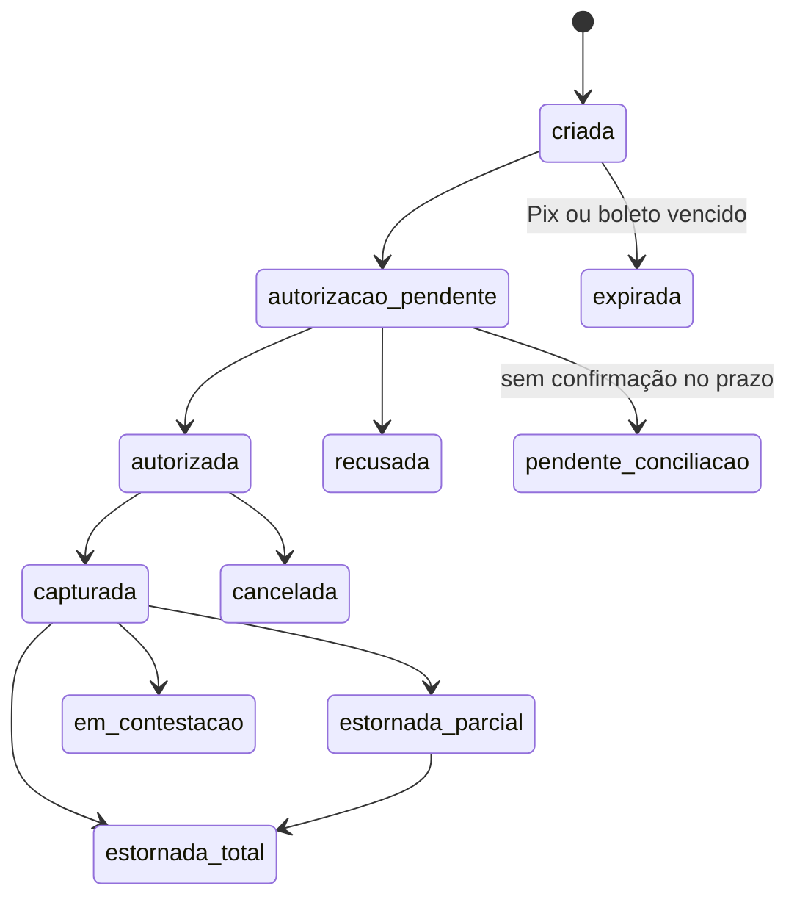

[Índice](README.md) · [Parte anterior](parte-09-secretaria-matricula-e-documentos.md) · [Próxima parte](parte-11-pessoas-departamento-pessoal-e-sst.md)

<a id="parte-10"></a>

# Parte 10 — Financeiro, pagamentos e fiscal

## Visão geral da parte 10

Todo movimento financeiro passa por um ledger, com valores em centavos inteiros, e cada pagamento tem um ciclo de vida com transições validadas ([20](#doc-20)).



**Regras principais**
- `capturada` nunca volta para `autorizada`; só estorno ou chargeback ([20](#doc-20), seção 6.2).
- O sistema fica fora do escopo PCI: cartão só pelo provedor ([20](#doc-20), seção 3).
- Gateway e contingência por unidade; split quando adotado; NFS-e da entidade e da plataforma ([34](#doc-34)).
- Contas a pagar, cheques, caixa físico, fluxo de caixa, DRE e conciliação ([71](#doc-71)).
- Valores legais e tributários são parâmetros obrigatórios; sem eles, a apuração fica bloqueada ([80](parte-19-pendencias-decisoes-e-rastreabilidade.md#doc-80)).

<a id="doc-20"></a>

## 20 — Pagamentos e Recebimentos: Segurança, Validação e Conformidade

> Parte do [SDD v2](parte-01-visao-e-escopo.md#doc-00). Integrações com gateways em [16](parte-14-integracoes-e-importacao.md#doc-16), seção 8. Validação geral em [15](parte-16-dados-validacoes-configuracoes-e-armazenamento.md#doc-15). Regras de cobrança em [18](parte-07-regras-gerais-dos-modulos-de-gestao.md#doc-18), seção 2. Criptografia e cofre em [05](parte-04-seguranca-privacidade-e-auditoria.md#doc-05).
> **Status:** requisitos de segurança e de validação. Decisões de fluxo de recursos (seção 2) precisam de aprovação do autor. Conformidade PCI DSS e BCB exige parecer antes da produção.

---

### 1. Princípios

1. **Nenhum dado de cartão toca os servidores da plataforma.** Captura é feita pelos campos hospedados do provedor (iframe ou SDK), e o sistema recebe só um token.
2. **O valor é sempre calculado no servidor.** O valor enviado pelo navegador é ignorado e comparado. Diferença é recusada.
3. **Toda movimentação de dinheiro passa por um ledger de partidas dobradas, somente de inserção.** Saldo é derivado do ledger, nunca editado.
4. **Todo evento de provedor é autenticado antes de qualquer efeito.** Webhook sem assinatura válida não altera estado.
5. **Toda operação é idempotente.** Repetir uma chamada, um webhook ou um job não gera segundo efeito financeiro.
6. **Privilégio mínimo e separação de funções.** Quem cria um estorno não o aprova. Quem configura a conta do gateway não consulta o cartão de um pagador.
7. **Falha fecha, não abre.** Em dúvida sobre status, a operação fica `pendente_conciliacao`, sem liberar produto nem recurso.

### 2. Fluxo de recursos

**[Decidida D-10, seção 19]** Quem recebe o dinheiro?

| Opção | Mecanismo | Vantagem | Risco e condição de falha |
|---|---|---|---|
| (a) Conta do tenant no gateway (**proposta**) | Cada entidade tem a própria conta no provedor (D-07). O dinheiro vai direto para ela. A plataforma só registra. | Plataforma não custodia recursos. Menor exigência regulatória. | Depende de o tenant manter a conta e as credenciais. A plataforma precisa conciliar contas que não controla diretamente. |
| (b) Conta da plataforma com repasse | A plataforma recebe e repassa ao tenant. | Um único ponto de conciliação. | A plataforma passa a custodiar recursos de terceiros. Exige autorização de instituição de pagamento ou arranjo com instituição autorizada. **(jurídico)** Falha de repasse vira passivo da plataforma. |
| (c) Split no provedor | O provedor divide o pagamento entre a plataforma (taxa) e o tenant. | Taxa automática, sem custódia da plataforma. | Depende de suporte do provedor e de contrato de subcontas. |

Padrão desta versão: (a). A plataforma não guarda saldo de tenant. Se a escolha for (b) ou (c), esta seção será revisada.

### 3. Escopo PCI DSS

Objetivo: manter a plataforma no menor escopo possível (SAQ A ou equivalente).

| Requisito | Regra |
|---|---|
| Número do cartão (PAN) | Nunca transita, nunca é gravado, nunca é logado. Captura só pelo campo hospedado do provedor. |
| CVV / CVC | Nunca é gravado em nenhum momento, nem criptografado, nem em memória além da autorização. |
| Token | Armazenado. Formato `provider_token_id`. Sem utilidade fora do provedor e da conta do tenant. |
| Dado exibido | Somente marca, final (4 dígitos), validade mês/ano e nome parcial, quando o provedor devolve. |
| Página de pagamento | Carregada apenas de origem permitida. Política CSP restrita a `frame-src` e `script-src` do provedor, com SRI ([08](parte-05-portais-navegacao-e-interface.md#doc-08), seção 2). |
| Logs e erros | Filtro que remove qualquer sequência de 13 a 19 dígitos com validação de Luhn antes de gravar log ou enviar erro. |
| Auditoria | Registra tokens mascarados e identificadores, nunca dados brutos de cartão. |
| Dados de teste | Cartões de teste do provedor apenas em ambiente `sandbox` ([16](parte-14-integracoes-e-importacao.md#doc-16), seção 4). |

**Verificação:** varredura automatizada do código, dos logs e do banco por padrão de PAN antes de cada release.

### 4. Valor e moeda

| Regra | Detalhe |
|---|---|
| Representação | **[Decidida D-11, seção 19]** Inteiros em centavos (`BIGINT`, por exemplo `1234` = R$ 12,34). A v1 usa `DECIMAL(12,2)`, que é aceitável para exibição, mas arredondamento em cálculo de juros e multa pode gerar diferença de centavo. Converter para centavos antes de qualquer cálculo. |
| Cálculo | Juros, multa e desconto calculados no servidor, com regra de arredondamento única do tenant ([15](parte-16-dados-validacoes-configuracoes-e-armazenamento.md#doc-15), seção 4.2). |
| Comparação | Valor cobrado deve ser igual ao valor da fatura calculado no momento da cobrança. Diferença é recusada. |
| Moeda | Só a moeda da conta do tenant. Moeda diferente é `422`. |
| Limites | Mínimo e máximo por meio de pagamento, configurados por tenant. Valor acima do limite exige step-up de MFA. Padrão de R$ 1.000 por operação, confirmado pelo autor em 03/11/2026. |
| Valor negativo | Nunca em cobrança. Crédito é lançamento próprio. |

### 5. Ledger

Todo movimento de dinheiro, inclusive taxa, estorno e chargeback, gera partidas dobradas em tabela append-only.

```sql
CREATE TABLE payment_ledger_entries (
  id              BIGINT UNSIGNED AUTO_INCREMENT PRIMARY KEY,
  uuid            CHAR(36)     NOT NULL,
  tenant_id       CHAR(36)     NOT NULL,
  transaction_id  CHAR(36)     NOT NULL,
  account_code    VARCHAR(40)  NOT NULL,
  direction       ENUM('debit','credit') NOT NULL,
  amount_cents    BIGINT UNSIGNED NOT NULL,
  currency        CHAR(3)      NOT NULL,
  posted_at       DATETIME(6)  NOT NULL DEFAULT CURRENT_TIMESTAMP(6),
  created_by      CHAR(36)     NULL,
  UNIQUE KEY uk_uuid (uuid),
  INDEX idx_tenant_tx (tenant_id, transaction_id),
  INDEX idx_tenant_account (tenant_id, account_code, posted_at)
) ENGINE=InnoDB DEFAULT CHARSET=utf8mb4;
```

Regras:

- Tabela sem `UPDATE` nem `DELETE` para a aplicação. Permissão de banco concedida só `INSERT` e `SELECT`.
- Cada transação tem soma de débitos igual à soma de créditos, verificada na mesma transação de banco. Divergência reverte a operação.
- Correção é lançamento de estorno, nunca alteração.
- Saldo de conta é consulta agregada, com cache invalidado a cada inserção.
- `amount_cents` é sempre positivo. Direção indica o sinal.

### 6. Ciclo de vida da transação

#### 6.1 Estados

| Estado | Significado |
|---|---|
| `criada` | Intenção registrada, sem chamada ao provedor |
| `autorizacao_pendente` | Enviada ao provedor, aguardando resposta |
| `autorizada` | Aprovada, ainda não capturada (cartão com captura posterior) |
| `capturada` | Dinheiro confirmado pelo provedor |
| `recusada` | Negada pelo provedor ou antifraude. Motivo código do provedor. |
| `expirada` | Pix ou boleto passou do vencimento sem pagamento |
| `estornada_parcial` / `estornada_total` | Estorno registrado no ledger |
| `em_contestacao` | Chargeback aberto |
| `pendente_conciliacao` | Status não confirmado dentro do prazo |
| `cancelada` | Cancelada antes de captura |

Transições válidas são as da tabela. Qualquer outra é `409` e gera alerta.

#### 6.2 Regras de transição

- `capturada` nunca volta para `autorizada`. Só estorno ou chargeback.
- `estornada_total` exige soma dos estornos igual ao valor capturado.
- `estornada_parcial` acumula até o valor capturado. Acima disso, `422`.
- `pendente_conciliacao` expira em 24 h e vai para análise humana, sem liberar o produto.

### 7. Webhooks e confirmação

| Regra | Detalhe |
|---|---|
| Assinatura | Validada com o método do provedor, usando o segredo da conexão do tenant ([16](parte-14-integracoes-e-importacao.md#doc-16), seção 4). Assinatura inválida: resposta `401`, nenhum efeito, alerta. |
| Janela | Timestamp com tolerância de 300 s, quando o provedor envia timestamp. |
| Deduplicação | Chave única por `provider + event_id`. Repetido: resposta `200` sem efeito. |
| Resposta | `200` após gravar na fila. Processamento assíncrono ([14](parte-02-arquitetura-e-tenancy.md#doc-14), seção 5). |
| Ordem | Eventos da mesma transação aplicados por versão de estado. Evento antigo registrado e descartado. |
| Consulta de confirmação | Webhook não é a única fonte. Job consulta provedor para transações em `autorizacao_pendente` depois de N minutos. |
| Origem | IP de origem do provedor, quando publicado, é verificado como controle adicional, não como único controle. |

### 8. Cartão

- Autorização com 3DS2 obrigatório acima de valor configurado e para transações de risco alto pelo antifraude do provedor.
- Captura posterior à autorização tem prazo máximo configurado pelo provedor. Autorização vencida é cancelada automaticamente.
- Cartão tokenizado não é reaproveitado entre tenants.
- Tentativas recusadas: limite de 5 por cartão e 10 por IP em 15 min. Acima disso, bloqueio temporário.
- Cadastro de cartão recorrente (assinatura) exige consentimento registrado, com texto e data.

### 9. Pix

| Regra | Detalhe |
|---|---|
| Cobrança | `txid` único por tenant e conta. Valor fixo na criação. Expiração obrigatória. |
| Reuso | QR expirado não é reaberto. Nova cobrança gera novo `txid`. |
| Confirmação | Webhook do provedor e consulta por `txid` na conciliação. |
| Valor pago | Diferente do valor da cobrança: pagamento parcial ou excedente vai para pendência, nunca é aceito silenciosamente. |
| Chave Pix | Chave do recebedor cadastrada na conta do tenant. Não é dado pessoal do pagador. |

### 10. Boleto

| Regra | Detalhe |
|---|---|
| Identificador | `nosso_numero` único por tenant e convênio. |
| Cancelamento | Só antes do pagamento. Após pagamento, é estorno. |
| Pagamento após vencimento | Aceito conforme regra do provedor, com juros e multa calculados no servidor e validados contra o valor pago. Diferença gera pendência. |
| Registro | Baixa por retorno de arquivo ou webhook, assinado. Arquivo de retorno validado por checksum e por número de linhas. |

### 11. Estornos e contestações

- Estorno exige permissão `pagamento.estorno.solicitar` e aprovação por outra pessoa com `pagamento.estorno.aprovar`.
- Estorno acima de limite configurado exige MFA recente (ver [06](parte-03-identidade-acesso-e-permissoes.md#doc-06), seção 5).
- Prazo de estorno respeita a janela do provedor e do meio de pagamento. Fora do prazo, só por crédito em conta, com aprovação dupla.
- Chargeback abre estado `em_contestacao` e reserva o valor no ledger, em conta de bloqueio.
- Evidências de contestação são arquivos com validação de tipo e tamanho ([15](parte-16-dados-validacoes-configuracoes-e-armazenamento.md#doc-15), seção 4.3), com prazo do provedor controlado por alerta.

### 12. Conciliação

- Diária, por conta de gateway: extrato do provedor contra o ledger.
- Diferença de valor, de quantidade ou de status gera item na fila de conciliação, com alerta ao financeiro.
- Conciliação não corrige sozinha. Ajuste é lançamento com motivo e aprovação.
- Relatório de conciliação fica disponível para auditoria e não contém dado de cartão.

### 13. Antifraude e abuso

| Controle | Regra |
|---|---|
| Velocidade | Limite de tentativas por cartão, IP, pagador e conta de tenant (seção 8). |
| Lista de bloqueio | Cartão, e-mail e IP bloqueados por motivo registrado, com revisão. |
| Score do provedor | Transação acima do limite de risco é recusada ou vai para revisão, conforme configuração do tenant. |
| Padrão anômalo | Muitas recusas seguidas de um mesmo pagador gera alerta, não bloqueio automático de conta. |

### 14. Acesso e segregação de funções

| Papel | Pode | Não pode |
|---|---|---|
| Operador financeiro | Consultar cobranças e recebimentos | Estornar, alterar valor, ver token completo |
| Gestor financeiro | Solicitar estorno e aprovar até o limite | Aprovar o próprio pedido |
| Administrador do tenant | Configurar conta de gateway (com MFA) | Ver segredo em texto claro |
| Equipe da plataforma | Ver status e erros resumidos | Ver cartão, token ou segredo de tenant. Acesso excepcional segue [06](parte-03-identidade-acesso-e-permissoes.md#doc-06), seção 10. |

### 15. Segurança de dados e logs

- Dados de pagador tratados conforme [07](parte-04-seguranca-privacidade-e-auditoria.md#doc-07). CPF do pagador é exigido só quando o meio de pagamento exigir, e é cifrado.
- Logs de pagamento: identificador da transação, valor, estado, código do provedor. Sem PAN, CVV, token em claro, segredo de webhook ou chave Pix completa.
- Erro retornado ao cliente: código e mensagem genérica. Mensagem do provedor é traduzida, nunca repassada crua.
- Comunicação com o provedor: TLS 1.2 mínimo, validação de certificado, sem redirecionamento.

### 16. Monitoramento e alertas

| Alerta | Condição |
|---|---|
| Assinatura inválida | Qualquer ocorrência |
| Divergência de ledger | Qualquer ocorrência |
| Conciliação com diferença | Qualquer ocorrência acima de zero |
| Transição inválida | Qualquer ocorrência |
| Recusas acima do normal | Taxa de recusa acima de limite configurado por tenant |
| Estorno incomum | Volume ou valor acima da média do tenant |
| Webhook sem processamento | Mais de 5 min em fila |
| Chargeback aberto | Prazo de resposta em 3 dias |

### 17. Incidentes de pagamento

- Suspeita de vazamento de token ou de segredo de gateway: revogação imediata no provedor e rotação ([16](parte-14-integracoes-e-importacao.md#doc-16), seção 5.3). Suspensão automática da conexão.
- Suspeita de PAN em log ou banco: tratar como incidente de dados ([07](parte-04-seguranca-privacidade-e-auditoria.md#doc-07), seção 8) e acionar o provedor e a equipe de conformidade.
- Notificação ao provedor e ao tenant conforme contrato.

### 18. Testes obrigatórios

- PAN de teste nunca aparece em log, banco ou resposta de erro (varredura automatizada).
- Webhook com assinatura adulterada, com timestamp antigo e sem assinatura são recusados sem efeito.
- Webhook repetido não gera segundo lançamento.
- Valor enviado pelo cliente diferente do calculado é recusado.
- Estorno acima do capturado é recusado.
- Aprovador igual ao solicitante é recusado.
- Ledger não aceita `UPDATE` e `DELETE` pela conta da aplicação.
- Pix expirado não aceita pagamento.
- Boleto cancelado após pagamento é recusado.
- Conciliação com diferença gera item e alerta, sem ajuste automático.
- Tentativas acima do limite bloqueiam temporariamente.

### 19. Decisões pendentes

| # | Decisão | Proposta |
|---|---|---|
| D-10 | Fluxo de recursos | **Decidida:** (a) conta do tenant no gateway, sem custódia pela plataforma. O tenant pode usar gateway de terceiro ou gateway operado pela plataforma. Gateway operado pela plataforma é **condicionado a parecer jurídico** sobre arranjo de pagamento, porque o recurso passaria pela plataforma (seção 2). |
| D-11 | Representação de valor | **Decidida:** inteiros em centavos (seção 4). |
| D-12 | Limite de valor e MFA para operações | **Decidida pelo autor em 02/11/2026: MFA configurável por tenant, com piso.** Limite padrão definido pelo autor: operação acima de R$ 1.000,00 exige MFA forte e aprovação dupla. Valor ajustável por tenant, com piso não reduzível pelo tenant. Métodos e piso na seção 5 de [06](parte-03-identidade-acesso-e-permissoes.md#doc-06). |

#### 19.1 D-10: gateway da plataforma

Se o tenant contratar o gateway da plataforma, a conta do provedor fica no nome da plataforma e o recurso passa por ela antes de chegar ao tenant. Isso caracteriza custódia. Até o parecer jurídico, a plataforma não oferece essa opção. O tenant contrata gateway de terceiro, em conta própria, conectada por [16](parte-14-integracoes-e-importacao.md#doc-16), seção 4.

Parecer necessário: enquadramento como arranjo de pagamento, exigências do Banco Central, responsabilidade por repasse e por estorno, e contrato com o tenant.

#### 19.2 D-12: regras aplicadas

- MFA forte (TOTP, passkey ou certificado) para aprovação de estorno, baixa manual e pagamento acima do limite.
- Canais de mensagem (e-mail, SMS, WhatsApp, Telegram) nunca aprovam operação financeira.
- Limite padrão de R$ 1.000,00 por operação, com MFA forte e aprovação dupla acima dele. O tenant pode reduzir o limite, nunca aumentar acima do piso da plataforma. O piso do aumento fica **[Pendente]** com o autor.
- Alteração do limite e do método de MFA gera registro de auditoria e notificação em todos os canais cadastrados.

### 20. Pareceres necessários

| Tema | Responsável |
|---|---|
| Enquadramento de arranjo de pagamento (se D-10 não for (a)) | Jurídico, com parecer do BCB |
| Escopo e nível PCI DSS e questionário SAQ | Segurança e provedor |
| Prazos de estorno e chargeback por meio | Financeiro e jurídico |
| Consentimento para cobrança recorrente | Jurídico |

### 21. Critérios de aceite

- [ ] Nenhum dado de cartão é armazenado ou logado (varredura).
- [ ] Todo webhook passa por validação de assinatura antes de qualquer efeito.
- [ ] Todo valor é calculado e comparado no servidor.
- [ ] Ledger somente de inserção, com verificação de partidas dobradas.
- [ ] Estorno com segregação de funções e limite de MFA.
- [ ] Conciliação diária com alerta.
- [ ] Testes da seção 18 passando em CI.
- [ ] Pareceres da seção 20 registrados antes de produção.

<a id="doc-34"></a>

## 34 — Pagamentos, Gateways, Split, Notas Fiscais, Bancos e Carteiras, por Portal

> Parte do [SDD v2](parte-01-visao-e-escopo.md#doc-00). Segurança de pagamento em [20](#doc-20). Integrações e credenciais em [16](parte-14-integracoes-e-importacao.md#doc-16). Cobrança e NFS-e em [18](parte-07-regras-gerais-dos-modulos-de-gestao.md#doc-18). Matriz de portais em [31](parte-05-portais-navegacao-e-interface.md#doc-31).
> **Status:** aprovada pelo autor em 03/11/2026, com as propostas adotadas. Itens sem valor definido continuam pendentes, criada em 03/11/2026. Itens **[Decisão do autor]** dependem de resposta. Itens **(jurídico)** dependem de parecer (arranjo de pagamento, nota fiscal, Open Finance). Não é parecer.

---

### 1. Resposta direta

| Assunto | Estado na v2 | Veredito |
|---|---|---|
| Gateways de pagamento | Lista de adapters em [16](parte-14-integracoes-e-importacao.md#doc-16), seção 3. Segurança em [20](#doc-20) | **Completa** desde 03/11/2026: EFÍ incluída, um gateway primário por unidade (SRC-05) e contingência na seção 2.3 (PAG-01). Fonte da lista: [`spec_gestao_billing_cobranca_mensalidades.md`](#v1-spec-gestao-billing-cobranca-mensalidades-md), seção 17.1 |
| Split de pagamento | Opção (c) em [20](#doc-20), seção 2. Não decidida | **Incompleta.** Sem decisão, sem modelo de subconta, sem regra de taxa |
| Emissão de nota fiscal | [16](parte-14-integracoes-e-importacao.md#doc-16) (NFS-e por município) e [18](parte-07-regras-gerais-dos-modulos-de-gestao.md#doc-18), seção 2.7 | **Incompleta.** Faltam NFS-e Nacional, cancelamento, XML e PDF, certificado, nota da plataforma e nota de terceiros |
| Bancos | Módulo "Bancos" tratado como dados bancários em [19](parte-07-regras-gerais-dos-modulos-de-gestao.md#doc-19), seções 2 e 16 | **Errado.** Ver seção 4 |
| Carteiras digitais e débito automático | Não há especificação | **Ausente** |
| Open Finance | Não há especificação na v2. A v1 cita em [`spec_gestao_billing_cobranca_mensalidades.md`](#v1-spec-gestao-billing-cobranca-mensalidades-md) | **Ausente** |

---

### 2. Gateways de pagamento

#### 2.1 Lista consolidada

| Provedor | Métodos | Credencial (v1) | Origem |
|---|---|---|---|
| Asaas | Pix, boleto, cartão, carteira | Chave de API, identificador de carteira, URL de webhook | v1 billing, 17.1 |
| Mercado Pago | Pix, boleto, cartão | Access token, chave pública | v1 billing, 17.1 |
| PagSeguro | Boleto, cartão, Pix | Token, e-mail, modo sandbox | v1 billing, 17.1 |
| Gerencianet / EFÍ | Pix, boleto | Client ID, client secret, certificado Pix (.p12 ou .pem) | v1 billing, 17.1. Incluído na v2 em 03/11/2026 (PAG-01) |
| Stripe | Cartão | Chave secreta, chave pública, segredo de webhook | v1 billing, 17.1 |

**Regras que faltam na v2:**

- Certificado Pix (.p12 ou .pem) é segredo. Fica no cofre ([05](parte-04-seguranca-privacidade-e-auditoria.md#doc-05), seção 2), nunca no banco comum.
- Modo sandbox não pode ser ativado em produção. O sistema recusa a credencial de teste em ambiente de produção.
- Contingência: quando o gateway primário cai, o sistema não troca de provedor sozinho. Troca é decisão do financeiro, com registro. Regra completa na seção 2.3.
- Teste de conectividade com resultado imediato (v1, 17.1) é permitido, mas não grava o dado de teste.

#### 2.2 Gateway por escala

| Escala | Quem configura | Conta de quem | Fonte |
|---|---|---|---|
| Entidade (cobrança de alunos) | Administrador da entidade, com MFA | Entidade | [20](#doc-20), opção (a) |
| Plataforma (cobrança de clientes SaaS) | Financeiro da plataforma | Plataforma | [20](#doc-20), seção 19.1 |

Gateway da plataforma que recebe por conta de entidade é custódia. Só existe se o parecer de [20](#doc-20) for favorável.

#### 2.3 Gateway por unidade e contingência (PAG-01)

Cada unidade tem **um gateway primário** (SRC-05). A unidade pode cadastrar **um gateway de contingência**, de outro provedor, com conta da própria entidade.

| Situação | Regra |
|---|---|
| Primário saudável | Toda cobrança nova sai pelo primário |
| Primário com falha | O monitor marca o provedor como degradado depois de 3 falhas seguidas de criação de cobrança ou de 5 minutos sem resposta ([20](#doc-20), seção 16). O financeiro da unidade recebe aviso |
| Troca para contingência | Decisão do financeiro da unidade, com MFA e motivo. Vale só para cobrança nova. Fica na auditoria ([29](parte-04-seguranca-privacidade-e-auditoria.md#doc-29)) |
| Cobrança já emitida | Continua no gateway que a emitiu. Não é cancelada nem reemitida em outro provedor, para não haver dois boletos ou dois Pix válidos para o mesmo título |
| Webhook e conciliação | Cada gateway concilia as próprias cobranças. A conciliação diária roda para os dois enquanto houver cobrança aberta em algum deles ([20](#doc-20), seção 12) |
| Volta ao primário | Decisão do financeiro, com registro, depois de teste de conectividade aprovado |
| Sem contingência cadastrada | A unidade aceita só os meios manuais ([71](#doc-71): caixa e cheque) até o primário voltar |

**Regras gerais:**

- Os dois gateways da unidade não podem ser do mesmo provedor. Contingência no mesmo provedor não protege de queda do provedor.
- A credencial de cada gateway fica no cofre, separada por unidade ([05](parte-04-seguranca-privacidade-e-auditoria.md#doc-05), seção 2). Certificado Pix da EFÍ segue a mesma regra.
- Unidades da mesma entidade podem usar provedores diferentes. A troca numa unidade não afeta as outras.
- O provedor que emitiu cada título fica gravado no título. Relatório de recebimento mostra o provedor por título.

---

### 3. Split de pagamento

**Estado:** opção (c) em [20](#doc-20), seção 2. Padrão desta versão é a opção (a): cada entidade tem a própria conta, sem custódia da plataforma.

**Se o split for adotado**, a especificação precisa de:

| Item | Regra proposta |
|---|---|
| Subconta | Cada entidade tem uma subconta no provedor, com identificador de carteira guardado. O identificador é dado de configuração, não segredo, mas fica vinculado à entidade. |
| Taxa | Percentual ou valor fixo da plataforma, por contrato. Gravado no momento da cobrança. Não muda retroativamente. |
| Divisão | Valor bruto, taxa, valor líquido da entidade e valor da plataforma gravados no lançamento do ledger ([20](#doc-20), seção 4). |
| Estorno | Estorno devolve da subconta da entidade e da plataforma na proporção gravada. Taxa estornada só se o contrato permitir. |
| Conciliação | Diária por subconta, contra o extrato do provedor ([20](#doc-20), seção 12). |
| Falha parcial | Se o provedor confirma uma parte, a diferença vira item de conciliação. Nunca é lançada automaticamente. |
| Contrato | Subcontas e taxa exigem contrato com o provedor e com a entidade. **(jurídico)** |

**Por portal:**

- Desenvolvedor: visão de taxas recebidas por entidade e por período.
- Gestão: visão do líquido recebido e do que foi retido como taxa.
- Responsáveis e aluno: aparecem só o valor pago e o estado. Taxa nunca aparece para o pagador.

**Decidido** em 03/11/2026: split em duas formas, automática e pelo gateway. Entidade sem fins lucrativos: mesmo split, com taxa da plataforma menor.

---

### 4. Módulo "Bancos": achado crítico

Os dois arquivos [`spec_gestao_bancos.md`](parte-19-pendencias-decisoes-e-rastreabilidade.md#v1-spec-gestao-bancos-md) e [`spec_gestao_bancos_completo.md`](parte-19-pendencias-decisoes-e-rastreabilidade.md#v1-spec-gestao-bancos-completo-md) têm 305 linhas cada e são **idênticos em conteúdo**. Não tratam de dados bancários de alunos, entidades ou fornecedores. Tratam de **gestão de bancos de dados**:

- inventário e descoberta de instâncias;
- console SQL com histórico, snippets e favoritos;
- migrações;
- backup e restauração;
- replicação e alta disponibilidade;
- visualizador de esquema;
- monitoramento.

A v2 classifica esse arquivo como "dados bancários" ([12](parte-01-visao-e-escopo.md#doc-12), linha 21; [19](parte-07-regras-gerais-dos-modulos-de-gestao.md#doc-19), linha 25) e propõe que ele vire um conector de extrato. **Essa leitura está errada.**

**Risco:** um console SQL e uma ferramenta de migração expostos a usuários de entidade, em um SaaS multi-tenant, dão acesso direto ao banco de todos os clientes. Isso anula o isolamento de [03](parte-02-arquitetura-e-tenancy.md#doc-03).

**Decisão proposta:**

1. Remover o módulo "Bancos" do produto. Ele é ferramenta de operação e não entra no catálogo de módulos.
2. Se a equipe de operação precisar da ferramenta, ela roda fora do produto, com acesso restrito à rede de operação ([10](parte-17-operacao-qualidade-testes-e-ti.md#doc-10)), sem acesso pelos portais.
3. Dados bancários (conta de entidade, conta de fornecedor, conta para repasse) vivem no módulo **Financeiro**, com a regra de MFA para alteração ([31](parte-05-portais-navegacao-e-interface.md#doc-31), seção 4.3).

**Decidido** em 03/11/2026: módulo Bancos removido do escopo.

---

### 5. Nota fiscal

#### 5.1 Quem emite, por escala e por portal

| Nota | Quem emite | Portal de origem | Estado |
|---|---|---|---|
| NFS-e de mensalidade e serviço educacional | Entidade, por município | Gestão | Parcial. Ver 5.2 |
| NFS-e da assinatura SaaS (plataforma cobra a entidade) | Plataforma | Desenvolvedor | **Ausente.** Precisa de especificação própria |
| NF-e de serviço de fornecedor (terceiros) | Fornecedor, no próprio sistema ou no município | Terceiros | Conflito. Ver 5.3 |
| NF-e de produto (SEFAZ) | — | Desenvolvedor (v1, "Gestão de integração") | **Fora de escopo.** Não há venda de produto no escopo. Confirmar |

#### 5.2 Regras da NFS-e (entidade)

Já definido: emissão só para fatura paga ou parcial, conforme regra municipal; estados `pending`, `processing`, `issued`, `rejected`, `cancelled`; cancelamento transmitido ao município ([18](parte-07-regras-gerais-dos-modulos-de-gestao.md#doc-18), seção 2.7).

Faltam:

- **NFS-e Nacional** (padrão ABRASF e nacional, citado na v1). Lista de municípios que usam cada padrão. **(jurídico)** e fiscal.
- **Certificado digital A1 ou A3** da entidade: guardado no cofre, nunca em arquivo ([16](parte-14-integracoes-e-importacao.md#doc-16), seção 3).
- **Cancelamento:** prazo e justificativa exigidos pelo município. Cancelamento após o prazo exige processo fiscal, não ação do operador.
- **Reenvio** de nota rejeitada: só após correção do motivo. Nota rejeitada não é reemitida com o mesmo número.
- **Guarda:** XML e PDF guardados pelo prazo fiscal **(jurídico)**, com hash ([21](parte-16-dados-validacoes-configuracoes-e-armazenamento.md#doc-21)).
- **Pagamento e nota:** emissão automática após pagamento é opcional. Se for automática, a nota tem o valor do pagamento confirmado, não o valor da fatura.
- **Tomador:** dado do responsável financeiro. Se o tomador tem dado pessoal, o campo segue a regra de [07](parte-04-seguranca-privacidade-e-auditoria.md#doc-07).

#### 5.3 Nota do fornecedor (terceiros)

A v1 ([`12-portals-navigation-sidebar-pages-spec.md`](parte-01-visao-e-escopo.md#doc-12), portal de terceiros, "Emissão e Upload de NF-e de Serviços") diz que o portal **emite** a nota. Isso não se sustenta: a nota é emitida pelo prestador, no município ou no seu sistema.

**Proposta:** o portal de terceiros **recebe e valida** a nota (XML, valor, tomador, competência), vincula à ordem de compra e ao pagamento, e não emite. Qualquer mudança de "emissão" para "envio" passa por revisão **(jurídico)** e fiscal.

**Decidido** em 03/11/2026: o portal de terceiros recebe e valida, sem emitir.

---

### 6. Bancos, Open Finance e débito automático

| Recurso | Quem usa | Regra proposta |
|---|---|---|
| Conta bancária da entidade | Financeiro da entidade | Cadastro no Financeiro. Alteração exige MFA e dupla aprovação |
| Conta bancária da plataforma | Financeiro da plataforma | Mesma regra, no portal do desenvolvedor |
| Dados bancários de fornecedor | Compras, terceiros | Terceiros cadastra. Compras aprova. Alteração gera alerta de possível fraude |
| Conciliação por extrato (OFX) | Financeiro | Já em [17](parte-07-regras-gerais-dos-modulos-de-gestao.md#doc-17), seção 2.5 |
| Open Finance (leitura de extrato, consentimento) | Financeiro | Só com consentimento do titular da conta e regra do Open Finance. **(jurídico)**. Não especificado |
| Débito automático | Responsáveis | Autorização do pagador, revogável. Regra de cobrança em [18](parte-07-regras-gerais-dos-modulos-de-gestao.md#doc-18). **(jurídico)** |

---

### 7. Carteiras digitais

**Estado:** ausente. Não há especificação de carteira digital (Apple Pay, Google Pay, carteira do provedor).

**Proposta mínima:** carteira digital é um **método de pagamento do gateway**, não módulo. O sistema não guarda token de carteira. Cada carteira aceita só o que o provedor suporta. Pagamento por carteira segue [20](#doc-20), inclusive 3-D Secure.

**Decidido** em 03/11/2026: Pix e cartão pelo gateway da unidade, sem carteira própria.

---

### 8. Pagamento por portal

| Portal | Pagamento | Recurso |
|---|---|---|
| Desenvolvedor | Cobrança de clientes SaaS; recebimento da plataforma | Gateway da plataforma (com parecer), NFS-e da plataforma (ausente), taxas |
| Gestão | Cobrança de alunos e fornecedores; configuração do gateway | Gateway da entidade, split (se adotado), NFS-e da entidade, conciliação |
| Professor | Nenhum pagamento recebido. Holerite e pagamento de salário fora do escopo deste módulo | Só consulta do próprio holerite ([31](parte-05-portais-navegacao-e-interface.md#doc-31), seção 2.3) |
| Aluno | Pagar mensalidade: Pix, boleto, cartão | Cobrança, comprovante, segunda via |
| Responsáveis | Pagar fatura dos filhos; débito automático | Mesmos métodos, central financeira, débito automático (se aprovado) |
| Terceiros | Receber pagamento; enviar nota | Extrato, status da liquidação, envio de NF-e (seção 5.3), dados bancários com MFA |

**Regra:** nenhum portal, exceto Gestão e Desenvolvedor, mostra taxa, split ou conta de recebimento da entidade.

---

### 9. Pendências

| # | Pendência | Tipo |
|---|---|---|
| PAG-01 | Incluir EFÍ e regra de contingência entre gateways (seção 2) | **Escrito** em 03/11/2026: EFÍ na seção 2.1 e contingência na seção 2.3 |
| PAG-02 | Split: duas formas, automática e pelo gateway. Entidade sem fins lucrativos: mesmo split, com taxa da plataforma menor. Classificação da entidade (pública, particular, sem fins lucrativos) define só a taxa e a forma de cobrança (seção 3) | **Decidido** em 03/11/2026 |
| PAG-03 | Remover módulo "Bancos" de escopo e corrigir [12](parte-01-visao-e-escopo.md#doc-12) e [19](parte-07-regras-gerais-dos-modulos-de-gestao.md#doc-19) (seção 4) | **Decidido** em 03/11/2026: removido. Correção de [12](parte-01-visao-e-escopo.md#doc-12) e [19](parte-07-regras-gerais-dos-modulos-de-gestao.md#doc-19) é documento |
| PAG-04 | NFS-e Nacional, cancelamento, guarda de XML (seção 5.2) | (jurídico) e fiscal |
| PAG-05 | NFS-e da assinatura SaaS (plataforma) | Documento e (jurídico) |
| PAG-06 | Nota do fornecedor: recebe e valida, não emite (seção 5.3) | **Decidido** em 03/11/2026: só recebe e valida |
| PAG-07 | Open Finance e débito automático | (jurídico) |
| PAG-08 | Carteira digital: escopo e provedor (seção 7) | **Decidido** em 03/11/2026: Pix e cartão pelo gateway da entidade, sem carteira própria |
| PAG-09 | Corrigir a referência de fonte da lista de gateways: a lista vem de [`spec_gestao_billing_cobranca_mensalidades.md`](#v1-spec-gestao-billing-cobranca-mensalidades-md) (v1), não de [01](parte-01-visao-e-escopo.md#doc-01) | **Feito** em 03/11/2026 na tabela de origem |

---

### 10. Critérios de aceite

- [ ] Todo gateway tem credencial no cofre e nenhuma em texto claro (teste de varredura, [20](#doc-20)).
- [ ] Credencial de sandbox recusada em produção (teste).
- [ ] Nota emitida só para pagamento confirmado; nota rejeitada não é reemitida com o mesmo número.
- [ ] Módulo "Bancos" fora do catálogo de módulos e fora dos portais.
- [ ] Taxa e split, se adotados, gravados no lançamento e conciliados por subconta.
- [ ] Itens **[Decisão do autor]** e **(jurídico)** respondidos ou marcados como pendentes no [00](parte-01-visao-e-escopo.md#doc-00).

### 11. Decisões de 03/11/2026

**PAG-02 (split): mantido na opção (a).** Mudanças necessárias se a opção (c) for adotada no futuro, listadas para análise:

| Documento | Mudança se (c) fosse adotado |
|---|---|
| [16](parte-14-integracoes-e-importacao.md#doc-16), seção 3 | Gateway passa a ter subconta por entidade e identificador de carteira vinculado |
| [20](#doc-20), seção 2 e seção 19 (D-10) | Opção (c) vira a decisão; padrão (a) é revogado; parecer deixa de ser condição |
| [20](#doc-20), seção 4 | Lançamento grava valor bruto, taxa, valor líquido da entidade e valor da plataforma |
| [20](#doc-20), seção 12 | Conciliação diária por subconta, além da conta de gateway |
| [18](parte-07-regras-gerais-dos-modulos-de-gestao.md#doc-18), seção 2 | Baixa divide o pagamento; estorno devolve nas duas subcontas |
| [31](parte-05-portais-navegacao-e-interface.md#doc-31) e [23](parte-06-plataforma-saas-clientes-dominios-licencas-e-crm.md#doc-23) | Portal do desenvolvedor passa a mostrar taxas recebidas por entidade |
| Jurídico | Contrato com o provedor para subconta; contrato de taxa com cada entidade |
| Operação | Teste de suporte do provedor a subcontas antes de qualquer contratação |

Enquanto (a) vigora, nenhuma dessas mudanças entra em produção.

**PAG-03 (módulo Bancos): removido do escopo de produto.** Substituição: painel de operação no portal do desenvolvedor, descrito abaixo. Não é módulo de tenant e não é console SQL aberto.

**Painel de bancos de dados (portal do desenvolvedor)**

| Recurso | Regra |
|---|---|
| Inventário | Lista dos bancos: master, cada banco de unidade, cada banco de identidade. Versão do esquema, tamanho e última restauração testada. |
| Migrações | Estado por unidade. Migração em lote só com plano de volta e aprovação de segundo papel. |
| Backup | Estado e prazo de cada backup. Restauração só por pedido com dupla aprovação, em ambiente isolado. |
| Consulta técnica | Não existe console SQL no painel comum. Acesso técnico direto só por procedimento de emergência: passkey, motivo e chamado vinculado, sessão de tempo limitado, leitura por padrão, escrita só com dupla aprovação. Cada comando é gravado e mascarado conforme [29](parte-04-seguranca-privacidade-e-auditoria.md#doc-29). |
| Dado pessoal | Qualquer consulta que atinja dado pessoal exige motivo e gera evento de auditoria. |
| Clientes | Nenhum portal de entidade vê este painel. |

Motivo: um console SQL acessível sem controle reduz o isolamento entre clientes a uma senha. O painel cobre a gestão de todos os bancos sem expor o conteúdo deles.

<a id="doc-71"></a>

## 71 — Financeiro Completo, por Portal: Pagamentos, Cheques, Caixa, Fluxo, DRE e Conciliação

> Parte do [SDD v2](parte-01-visao-e-escopo.md#doc-00). Decisão CFG-04 em [56](parte-16-dados-validacoes-configuracoes-e-armazenamento.md#doc-56), seção 8: escopo financeiro completo, com cheques, caixa, DRE e fluxo de caixa. Este documento fecha o que faltava. Já especificado em outros documentos e só referenciado aqui: títulos, parcelas e descontos em [18](parte-07-regras-gerais-dos-modulos-de-gestao.md#doc-18); cobrança e gateway em [20](#doc-20); NFS-e, split e nota de fornecedor em [34](#doc-34); contratos em [33](parte-12-suprimentos-patrimonio-frotas-contratos-e-terceiros.md#doc-33); regras de conciliação e aprovação em [17](parte-07-regras-gerais-dos-modulos-de-gestao.md#doc-17), seção 2. Financeiro da própria empresa desenvolvedora em [31](parte-05-portais-navegacao-e-interface.md#doc-31). Orçamento e empenho em [37](parte-08-academico.md#doc-37). Relatórios financeiros em [69](parte-08-academico.md#doc-69). Auditoria em [29](parte-04-seguranca-privacidade-e-auditoria.md#doc-29).
> **Status:** especificação proposta, criada em 03/11/2026. Fecha a lacuna financeira de [56](parte-16-dados-validacoes-configuracoes-e-armazenamento.md#doc-56), seções 6 e 8. A v1 tem [`spec_gestao_financeiro_completo.md`](#v1-spec-gestao-financeiro-completo-md) com contas a pagar, fluxo de caixa, conciliação, centros de custo, orçamentos, DRE e inadimplência. Esta versão corrige o que a v1 deixa solto: regime do DRE, cheques e caixa.

---

### 1. Resposta direta

> **Leitura (04/11/2026):** esta tabela registra o que existia no SDD antes deste documento ser escrito. Os itens marcados como **Não** ou **Parcial** são especificados nas seções seguintes deste documento, exceto o que estiver listado na seção de pendências.

| Pergunta | Veredito |
|---|---|
| Receitas de alunos (títulos, parcelas, cobrança)? | **Coberto** em [18](parte-07-regras-gerais-dos-modulos-de-gestao.md#doc-18) e [20](#doc-20) |
| Contas a pagar? | **Parcial.** Aprovação e rateio na v1 e em [17](parte-07-regras-gerais-dos-modulos-de-gestao.md#doc-17), seção 2.4. Falta regra de pagamento em lote |
| Cheques (recebidos e emitidos)? | **Não.** Só como forma de pagamento na v1 |
| Caixa (físico e fechamento)? | **Não.** Só como tipo de conta bancária na v1 |
| Fluxo de caixa e DRE? | **Parcial.** Tela e fórmula na v1. Falta regime, linha de DRE e fechamento |
| Conciliação? | **Coberto** em [17](parte-07-regras-gerais-dos-modulos-de-gestao.md#doc-17), seção 2.5, e [20](#doc-20), seção 12 |

---

### 2. Divisão de dono

| Assunto | Dono | Documento |
|---|---|---|
| Título, parcela, desconto, cobrança de aluno | Financeiro da entidade | [18](parte-07-regras-gerais-dos-modulos-de-gestao.md#doc-18) |
| Gateway, ledger, webhook, Pix, boleto | Financeiro da entidade, com provedor | [20](#doc-20) |
| Conta a pagar, fornecedor, rateio | Financeiro da entidade | Este documento, seção 4 |
| Cheque | Financeiro da entidade | Este documento, seção 5 |
| Caixa físico | Financeiro da entidade, operado na unidade | Este documento, seção 6 |
| Fluxo de caixa e DRE | Financeiro da entidade | Este documento, seções 7 e 8 |
| Conciliação | Financeiro da entidade | [17](parte-07-regras-gerais-dos-modulos-de-gestao.md#doc-17), seção 2.5 |
| NFS-e, split, nota de fornecedor | Financeiro e fiscal | [34](#doc-34) |
| Financeiro da empresa desenvolvedora | Plataforma | [31](parte-05-portais-navegacao-e-interface.md#doc-31) |

---

### 3. Contas e movimentação

- **Conta** é o lugar onde o dinheiro está: conta corrente, poupança, gateway, carteira digital (como método do gateway, [34](#doc-34)) ou caixa físico.
- Cada movimentação tem conta, data, valor, categoria financeira, centro de custo, origem e estado.
- Estados de movimentação: `previsto`, `lancado`, `conciliado`, `estornado`. Não há estado de atraso gravado: atraso é filtro calculado por data, como em [17](parte-07-regras-gerais-dos-modulos-de-gestao.md#doc-17), seção 2.3 (T-04).
- Lançamento conciliado não é alterado. Correção é estorno e novo lançamento, com motivo.

---

### 4. Contas a pagar

#### 4.1 Regras

- Despesa tem fornecedor, categoria, centro de custo, vencimento e valor.
- Rateio por centro de custo: a soma dos percentuais é 100%. Diferença bloqueia o lançamento.
- Aprovação: pendente bloqueia a baixa. Solicitante não aprova a própria despesa. Acima de R$ 10.000 exige segundo aprovador. Decidido em 03/11/2026, [17](parte-07-regras-gerais-dos-modulos-de-gestao.md#doc-17), seção 2.4.
- Despesa com nota fiscal de fornecedor é recebida e validada pelo portal de terceiros ([38](parte-12-suprimentos-patrimonio-frotas-contratos-e-terceiros.md#doc-38)) e não é emitida aqui ([34](#doc-34)).

#### 4.2 Pagamento

- Pagamento em lote: seleção de despesas aprovadas da mesma conta, com total conferido antes da confirmação.
- Pagamento tem chave de idempotência ([15](parte-16-dados-validacoes-configuracoes-e-armazenamento.md#doc-15), seção 4). Reenvio não paga duas vezes.
- Pagamento por cheque segue a seção 5.

---

### 5. Cheques

- **Decidido** em 03/11/2026 (FIN-02): cheque é aceito como forma de pagamento de aluno, com limite por cheque configurado pela escola.

#### 5.1 Cheque recebido

| Estado | Significado |
|---|---|
| `recebido` | Recebido na unidade, com dados conferidos |
| `custodiado` | Guardado para depósito |
| `depositado` | Enviado para compensação, em conta indicada |
| `compensado` | Dinheiro entrou. Gera movimentação |
| `devolvido` | Não compensado. Volta ao titular como título em aberto, com motivo |
| `substituido` | Trocado por outra forma, com registro |

#### 5.2 Cheque emitido

| Estado | Significado |
|---|---|
| `emitido` | Preenchido e aprovado |
| `entregue` | Enviado ao favorecido |
| `compensado` | Pago. Gera movimentação |
| `cancelado` | Cancelado com motivo. Não reaproveita número |

#### 5.3 Regras

- Número de cheque emitido é único por conta. Cancelado não é reaproveitado.
- Cheque recebido devolvido gera aviso ao responsável pela cobrança ([57](parte-13-atendimento-e-notificacoes.md#doc-57)). Não gera multa sem a regra de [18](parte-07-regras-gerais-dos-modulos-de-gestao.md#doc-18).
- Custódia física: a guarda do cheque recebido segue regra própria **(jurídico)**. Ver FIN-06.

---

### 6. Caixa físico

- Cada caixa é uma conta do tipo caixa, com um operador por vez.
- **Abertura:** saldo inicial conferido pelo operador. Diferença é registrada.
- **Movimentação:** recebimentos em dinheiro, cheques e cartões. Sangria e suprimento exigem motivo e aprovação de quem a escola indicar.
- **Fechamento:** contagem pelo operador. Diferença entre o contado e o calculado vai para a coordenação do financeiro, com motivo. **Decidido** em 03/11/2026 (FIN-05): sem tolerância. Qualquer diferença vai para a coordenação.
- Caixa fechado não recebe lançamento. Reabertura exige justificativa e aprovação.
- Fechamento gera relatório de caixa, com recebimentos por forma.

---

### 7. Fluxo de caixa

- **Realizado:** movimentações lançadas e conciliadas, por conta e por data.
- **Projetado:** títulos a receber e contas a pagar em aberto, pela data de vencimento. Não grava nada: é consulta.
- **Diário:** entradas, saídas e saldo por dia, com a linha de saldo projetado.
- Projeção usa somente títulos com estado válido. Estorno e título cancelado saem da projeção.

---

### 8. DRE

#### 8.1 Estrutura

- Cada categoria financeira aponta para uma linha da DRE. Categoria sem linha não entra no demonstrativo e aparece como pendência.
- Centro de custo é filtro, não linha.
- A DRE tem as linhas da v1 (receita bruta, deduções, receita líquida, custos, despesas, resultado), com o detalhamento que a entidade configurar.

#### 8.2 Regime

- A DRE pode ser por **caixa** (pelo que foi pago e recebido) ou por **competência** (pelo período a que o valor se refere).
- **Decidido** em 03/11/2026 (FIN-01): a DRE é por competência. A escolha é por entidade e não muda no meio do exercício. Lançamento de caixa entra no período a que se refere.

---

#### 8.3 Orçamento

**Decidido** em 03/11/2026 (FIN-07): o orçamento fica no financeiro.

- Orçamento é por centro de custo e categoria, por mês e por exercício. Estado: `rascunho`, `aprovado`, `encerrado`.
- Orçado versus realizado: o realizado vem dos lançamentos da seção 4 e da seção 3. Não é digitado.
- Desvio acima do limite configurado pela escola gera aviso à gestão. O aviso não bloqueia lançamento.
- Orçamento aprovado não muda. Ajuste é nova versão, com aprovação da gestão.

### 9. Conciliação

Regras já definidas em [17](parte-07-regras-gerais-dos-modulos-de-gestao.md#doc-17), seção 2.5, e [20](#doc-20), seção 12. Reforço:

- Tolerância de arredondamento é parâmetro da entidade, não constante ([17](parte-07-regras-gerais-dos-modulos-de-gestao.md#doc-17), LAC-06).
- Conciliação não ajusta sozinha. Diferença vira item de conciliação e o ajuste é lançamento com motivo e aprovação.
- Extrato OFX é importado com hash por linha, para não duplicar.

---

### 10. Inadimplência e fiscal

- Inadimplência, régua e cadastro de inadimplente seguem [18](parte-07-regras-gerais-dos-modulos-de-gestao.md#doc-18) e [26](parte-18-juridico-e-regulatorio.md#doc-26). Comunicação prévia por escrito antes de qualquer cadastro (CDC, art. 43, §2º) **(jurídico)**.
- Comprovante de IRPF do pagador: regra fiscal a confirmar (FIN-03).
- NFS-e de mensalidade e de serviço seguem [34](#doc-34).

---

### 11. Por portal

| Portal | Pode | Não pode | Origem |
|---|---|---|---|
| **Desenvolvedor** | Ver e gerir o financeiro da própria empresa, separado da entidade | Ver financeiro de entidade | P |
| **Gestão** | Ver tudo: DRE, fluxo, inadimplência, caixa. Aprovar despesa e fechamento de caixa | Operar caixa. Lançar pagamento sem aprovação | E |
| **Financeiro** (perfil da unidade) | Operar contas, cheques, caixa, pagamentos, conciliação. Gerar relatório financeiro | Aprovar a própria despesa. Aprovar a própria diferença de caixa | E |
| **Coordenação** | Ver o financeiro da unidade, em leitura | Lançar ou aprovar lançamento | E |
| **Secretaria** | Receber pagamento de aluno na unidade, em caixa de atendimento. Emitir boleto e segunda via | Pagar despesa. Ver DRE | E |
| **Professor** | Nada | Qualquer item financeiro | E |
| **Aluno** | Ver e pagar os próprios títulos. Ver comprovantes e informe de pagamento | Ver título de colega | E |
| **Responsáveis** | Ver e pagar faturas dos dependentes. Ver comprovantes | Ver título de outra família | E, só dependentes com vínculo ativo |
| **Terceiros** (fornecedores) | Ver a própria conta a receber, enviar nota e acompanhar o pagamento | Ver outros fornecedores ou o caixa | E |

---

### 12. Pendências

| # | Pendência | Tipo |
|---|---|---|
| FIN-01 | DRE por caixa ou por competência (seção 8.2) | **Decidido** em 03/11/2026: competência |
| FIN-02 | Cheque como forma de pagamento de aluno (seção 5) | **Decidido** em 03/11/2026: aceito, com limite por cheque configurado pela escola |
| FIN-03 | Comprovante de IRPF do pagador: obrigação, formato e prazo (seção 10) | (verificar) |
| FIN-04 | "Parcelas de serviços financeiros" do menu iScholar (seção 1) | **Decidido** em 03/11/2026: não se aplica. Sai do escopo |
| FIN-05 | Tolerância de diferença de caixa (seção 6) | **Decidido** em 03/11/2026: sem tolerância |
| FIN-06 | Guarda física de cheque recebido e prazo (seção 5.3) | (jurídico) |
| FIN-07 | Orçamento orçado versus realizado (seção 8.3) | **Decidido** em 03/11/2026: no financeiro |
| FIN-08 | DDL: contas, movimentação, cheque, caixa, fechamento, rateio, categoria e linha de DRE | **Escrito** em [51](parte-16-dados-validacoes-configuracoes-e-armazenamento.md#doc-51), seção 15.16. Revisão do owner pendente (DDL-01) |

---

### 13. Critérios de aceite

- [ ] Rateio de centro de custo com soma diferente de 100% é recusado (teste).
- [ ] Solicitante não aprova a própria despesa (teste).
- [ ] Pagamento repetido com a mesma chave não paga duas vezes (teste de idempotência).
- [ ] Cheque cancelado não reaproveita número (teste).
- [ ] Caixa fechado não recebe lançamento (teste).
- [ ] Projeção não grava nada (teste).
- [ ] Categoria sem linha de DRE aparece como pendência, não some (teste).
- [ ] Responsável não vê título de outra família (teste de isolamento).
- [ ] Itens **(verificar)**, **(jurídico)** e **[Decisão do autor]** respondidos ou marcados como pendentes no [00](parte-01-visao-e-escopo.md#doc-00).

## Especificações da v1 desta parte absorvidas no kit-starter ou sem destino

<a id="v1-spec-gestao-billing-cobranca-mensalidades-md"></a>

### v1 — `spec_gestao_billing_cobranca_mensalidades.md` (1433 linhas)

> Situação na v2: Absorvido integralmente no kit-starter. Destino: ficha do kit-starter: `kit-starter/gestao/financeiro-da-entidade/mensalidades.md`. Quando este texto diverge da v2, vale a v2.

#### O que a v2 muda nesta especificação

Estas regras prevalecem sobre o texto da v1 que vem a seguir.

- Estados da fatura ([18](parte-07-regras-gerais-dos-modulos-de-gestao.md#doc-18), seção 2.3); valor em centavos inteiros ([20](#doc-20), seção 4).
- Multa, juros e reajuste dentro do limite legal ([26](parte-18-juridico-e-regulatorio.md#doc-26), seção 4.3).
- Geração idempotente: reprocessar não duplica fatura ([17](parte-07-regras-gerais-dos-modulos-de-gestao.md#doc-17), seção 2.6).

#### Texto integral da v1

**Versão:** 1.0  
**Status:** Draft Funcional Completo  
**Módulo:** Billing / Subscriptions / Receivables  
**Contexto:** SaaS multi-entidade, multi-unidade e multi-usuário — banco segregado por entidade/unidade  
**Padrão de Identidade:** `id` (PK ordenação) · `uuid` (global) · `code` (negócio, ex.: `INV-2026-000001`)  
**Stack:** PHP 8 puro · MariaDB · Tailwind CSS 4.2 · Supabase · amCharts 5 · fetch API  
**Prefixo CSS:** `ttsc-` (substituindo `kt-`)  
**Naming:** inglês snake_case em banco/código; português nos labels de UI  

- Language Standard: Global English
---

#### Índice

1. [Visão Geral e Objetivos](#1-visão-geral-e-objetivos)
2. [Arquitetura e Banco de Dados](#2-arquitetura-e-banco-de-dados)
3. [Mapa de Páginas](#3-mapa-de-páginas)
4. [Dashboard — Cobrança e Mensalidades](#4-dashboard--cobrança-e-mensalidades)
5. [Gestão de Planos e Tabelas de Preço](#5-gestão-de-planos-e-tabelas-de-preço)
6. [Gestão de Assinaturas](#6-gestão-de-assinaturas)
7. [Cobrança — Faturas e Boletos](#7-cobrança--faturas-e-boletos)
8. [Mensalidades — Gestão Escolar](#8-mensalidades--gestão-escolar)
9. [Pagamentos e Baixas](#9-pagamentos-e-baixas)
10. [Descontos, Bolsas e Isenções](#10-descontos-bolsas-e-isenções)
11. [Inadimplência e Régua de Cobrança](#11-inadimplência-e-régua-de-cobrança)
12. [Kanban de Cobranças](#12-kanban-de-cobranças)
13. [Automações e Régua Inteligente](#13-automações-e-régua-inteligente)
14. [Notas Fiscais de Serviço (NFSe)](#14-notas-fiscais-de-serviço-nfse)
15. [Conciliação Bancária](#15-conciliação-bancária)
16. [Relatórios e Exportações](#16-relatórios-e-exportações)
17. [Configurações do Módulo](#17-configurações-do-módulo)
18. [APIs REST — Endpoints](#18-apis-rest--endpoints)
19. [Schema SQL](#19-schema-sql)
20. [RBAC — Permissões por Perfil](#20-rbac--permissões-por-perfil)
21. [Auditoria e LGPD](#21-auditoria-e-lgpd)
22. [Critérios de Aceite](#22-critérios-de-aceite)

---

#### 1. Visão Geral e Objetivos

##### 1.1 Escopo
O módulo **Billing / Cobrança e Mensalidades** gerencia todo o ciclo financeiro de receita da instituição:
- Planos e tabelas de preço configuráveis por unidade
- Assinaturas e contratos de mensalidade por aluno/responsável
- Emissão de faturas (boleto, Pix, cartão, débito automático)
- Controle de inadimplência com régua de cobrança automatizada
- Integração com NFSe (Nota Fiscal de Serviço Eletrônica)
- Conciliação bancária e baixa automática de pagamentos
- Dashboards, KPIs e relatórios gerenciais

##### 1.2 Objetivos de Negócio
| Objetivo | Métrica-alvo |
|---|---|
| Reduzir inadimplência | < 5% da carteira ativa |
| Automatizar cobranças | ≥ 80% das faturas emitidas sem intervenção |
| Conciliação bancária automatizada | ≥ 95% de match automático |
| Emissão de NFSe | < 2 min após confirmação de pagamento |
| Prazo de baixa de boleto | ≤ 2 horas após pagamento |

##### 1.3 Integrações Externas
- **Gateways:** PagSeguro, Mercado Pago, Asaas, Gerencianet/EFÍ, Stripe
- **NFSe:** Prefeituras via API (padrão ABRASF / NFS-e Nacional)
- **Banco Central:** Open Finance (extrato, PIX, débito automático)
- **Email/SMS/WhatsApp:** Envio de faturas e notificações
- **ERP Financeiro:** Lançamentos contábeis automáticos

---

#### 2. Arquitetura e Banco de Dados

##### 2.1 Multi-tenant
- Cada unidade possui banco físico próprio (`dbcoldev01`, `dbcolsec01`, etc.)
- O `db_core` armazena planos globais, gateways e configurações master
- Conexão resolvida em runtime via `TenantResolver` → `ConnectionManager`
- Todas as queries filtradas por `unit_id` + `entity_id`

##### 2.2 Convenções de Banco
- Tabelas: `snake_case` em inglês, prefixo por domínio (`billing_`, `payment_`, `invoice_`)
- PKs: `id BIGINT UNSIGNED AUTO_INCREMENT`
- UUID global: `uuid CHAR(36) NOT NULL UNIQUE DEFAULT (UUID())`
- Código de negócio: `code VARCHAR(30) NOT NULL UNIQUE` (ex.: `INV-2026-000001`)
- Soft delete: `deleted_at DATETIME NULL DEFAULT NULL`
- Auditoria: `created_by`, `updated_by`, `deleted_by` (FK → users.id)
- Timestamps: `created_at`, `updated_at` em `DATETIME DEFAULT CURRENT_TIMESTAMP`

---

#### 3. Mapa de Páginas

```
/billing/
├── dashboard                          → Dashboard principal
├── plans/
│   ├── index                          → Lista de planos
│   └── pricing-tables                 → Tabelas de preço
├── subscriptions/
│   ├── index                          → Lista de assinaturas
│   └── [uuid]/details                 → Detalhe da assinatura
├── invoices/
│   ├── index                          → Faturas (datatable)
│   ├── generate                       → Geração em lote
│   └── [uuid]/view                    → Visualizar fatura
├── tuitions/
│   ├── index                          → Mensalidades (datatable)
│   ├── matrix                         → Matriz de mensalidades por turma
│   └── negotiation                    → Negociação e parcelamento
├── payments/
│   ├── index                          → Pagamentos recebidos
│   ├── write-off                      → Baixa manual
│   └── conciliation                   → Conciliação bancária
├── discounts/
│   ├── index                          → Descontos e bolsas
│   └── scholarships                   → Gestão de bolsas
├── delinquency/
│   ├── index                          → Painel de inadimplência
│   └── collection-rules               → Régua de cobrança
├── kanban                             → Kanban de cobranças
├── automations/
│   ├── index                          → Lista de automações
│   └── [uuid]/logs                    → Logs de execução
├── nfse/
│   ├── index                          → Notas fiscais emitidas
│   └── config                         → Configuração NFSe
├── conciliation/
│   └── index                          → Conciliação bancária
├── reports/
│   ├── revenue                        → Relatório de receita
│   ├── delinquency-aging              → Aging de inadimplência
│   ├── cash-flow                      → Fluxo de caixa
│   └── forecast                       → Previsão de recebimento
└── settings/
    ├── gateways                       → Configuração de gateways
    ├── payment-methods                → Métodos de pagamento
    ├── due-dates                      → Calendário de vencimentos
    └── notifications                  → Templates de notificação
```

---

#### 4. Dashboard — Cobrança e Mensalidades

**Arquivo:** `/resources/views/pages/billing/dashboard/index.php`  
**Rota:** `GET /billing/dashboard`

##### 4.1 Toolbar e Breadcrumb
```
Início > Billing > Dashboard
[Botão: Gerar Faturas em Lote]  [Botão: Exportar]  [Filtro: Período ▼]  [Filtro: Unidade ▼]
```

##### 4.2 Widgets KPI — Linha 1 (Cards Estatísticos)

| Widget | Valor exibido | Ícone | Cor | Tendência |
|---|---|---|---|---|
| Receita Prevista (mês) | R$ 248.500,00 | `ki-dollar` | azul | ↑ +5,2% vs mês ant. |
| Receita Realizada | R$ 198.200,00 | `ki-check-circle` | verde | ↑ +3,1% |
| A Receber (em aberto) | R$ 50.300,00 | `ki-time` | laranja | ↓ -2,4% |
| Inadimplência | 4,8% | `ki-warning` | vermelho | ↓ -0,6pp |
| Faturas Emitidas | 1.240 | `ki-document` | roxo | — |
| Boletos Vencidos | 87 | `ki-close-circle` | vermelho | ↑ +12 hoje |

Cada card: valor principal, variação percentual vs período anterior, link para drilldown, tooltip com fórmula de cálculo.

##### 4.3 Widgets KPI — Linha 2 (Indicadores Operacionais)

| Widget | Descrição |
|---|---|
| **Taxa de Cobrança Automática** | % de faturas emitidas sem intervenção manual |
| **Tempo Médio de Pagamento** | Média de dias entre emissão e quitação |
| **Taxa de Conversão PIX** | % de boletos convertidos para PIX |
| **NFSe Emitidas** | Quantidade de notas fiscais emitidas no período |
| **Conciliação Pendente** | Qtd. transações aguardando match |
| **Automações Ativas** | Qtd. e status das automações em execução |

##### 4.4 Charts amCharts 5

###### Chart 1 — Receita Mensal (Coluna empilhada + linha de meta)
```
Tipo: XYChart (ColumnSeries empilhado + LineSeries)
Eixo X: meses (jan–dez)
Séries: Mensalidades | Outros Serviços | Multas/Juros
Linha: Meta mensal (tracejada)
Interatividade: tooltip detalhado, zoom, exportar PNG/CSV
```

###### Chart 2 — Aging de Inadimplência (Barras horizontais)
```
Tipo: XYChart horizontal
Faixas: 1-30d | 31-60d | 61-90d | 91-180d | +180d
Valor: R$ e % da carteira
Cor: gradiente verde→vermelho por faixa de risco
```

###### Chart 3 — Distribuição por Método de Pagamento (Donut)
```
Tipo: PieChart (donut)
Fatias: Boleto | PIX | Cartão Crédito | Cartão Débito | Débito Automático | Outros
Legenda: percentual e valor absoluto
```

###### Chart 4 — Fluxo de Caixa Previsto vs Realizado (Linha dupla)
```
Tipo: XYChart (LineSeries duplo)
Período: 30 dias rolling
Série 1: Previsto (tracejado azul)
Série 2: Realizado (sólido verde)
Área: fill entre as linhas (desvio)
```

###### Chart 5 — Funil de Cobrança (Funnel)
```
Tipo: SlicedChart (FunnelSeries)
Etapas: Fatura Emitida → Enviada → Visualizada → Paga → Atrasada → Negociada → Cancelada
```

###### Chart 6 — Heatmap de Vencimentos (Calendar Heatmap)
```
Tipo: XYChart com CellSeries
Eixo X: dias do mês
Eixo Y: semanas
Cor: intensidade = valor a vencer por dia
Tooltip: lista de faturas do dia
```

##### 4.5 Datatable — Faturas Recentes
Colunas: `#Code` | `Aluno/Responsável` | `Tipo` | `Vencimento` | `Valor` | `Status` | `Método` | `Ações`

Filtros inline: Status (chips) | Período | Unidade | Método de Pagamento

Ações por linha: Ver | Enviar | Baixar | Cancelar | Reenviar

##### 4.6 Seção — Alertas e Ações Rápidas
```
┌─────────────────────────────────────────────────────┐
│ ⚠  87 boletos venceram hoje          [Ver lista]   │
│ 🔔 12 automações falharam nas 2h     [Ver logs]    │
│ ✅ R$ 18.200 conciliados agora        [Detalhar]    │
│ 📄 34 NFSe pendentes de emissão      [Emitir]      │
└─────────────────────────────────────────────────────┘
```

---

#### 5. Gestão de Planos e Tabelas de Preço

**Arquivo:** `/resources/views/pages/billing/plans/index.php`  
**Rota:** `GET /billing/plans`

##### 5.1 Datatable de Planos

Colunas: `Code` | `Nome do Plano` | `Tipo` (Mensalidade/Serviço/Matrícula/Avulso) | `Valor Base` | `Periodicidade` | `Vigência` | `Status` | `Assinantes` | `Ações`

Filtros: Tipo | Status | Periodicidade | Faixa de valor (range slider)

Ações: Editar | Duplicar | Desativar | Tabela de Preços | Histórico

##### 5.2 CRUD Drawer — Plano

**Trigger:** Botão `Novo Plano` ou ícone Editar na linha  
**Largura:** 600px  
**Título dinâmico:** "Novo Plano" | "Editar Plano"

###### Campos do Drawer

**Aba: Dados Gerais**
| Campo | Tipo | Regras |
|---|---|---|
| Nome do Plano | text | required, max:120 |
| Código (code) | text | required, unique, uppercase, auto-sugerido |
| Descrição | textarea | max:500 |
| Tipo | select | Mensalidade / Serviço / Matrícula / Material / Avulso |
| Periodicidade | select | Mensal / Bimestral / Trimestral / Semestral / Anual / Único |
| Valor Base | money | required, ≥ 0 |
| Valor Mínimo | money | opcional |
| Valor Máximo | money | opcional |
| Moeda | select | BRL / USD (default BRL) |
| Status | toggle | Ativo / Inativo |
| Vigência Início | date | required |
| Vigência Fim | date | opcional |
| Aplicável a | multiselect | Alunos / Responsáveis / Empresas |
| Nível de Ensino | multiselect | EI / EF1 / EF2 / EM / Superior / Livre |
| Observações | textarea | max:1000 |

**Aba: Composição de Valor**
- Tabela de itens: Serviço | Quantidade | Valor Unitário | Desconto | Total
- Botão `+ Adicionar Item`
- Totalizador automático

**Aba: Regras de Desconto**
- Desconto pontualidade (%) — dias antes do vencimento
- Desconto irmão (%) — por número de dependentes
- Desconto convênio (%) — vinculado a empresa/associação
- Desconto bolsa (%) — vinculado a programa de bolsa
- Regras combinadas: checkboxes de acumulatividade

**Aba: Configuração de Cobrança**
| Campo | Tipo |
|---|---|
| Método de cobrança padrão | select (Boleto/PIX/Cartão/Débito Auto.) |
| Dia de vencimento padrão | number (1–28) |
| Dias de tolerância | number |
| Juros ao mês (%) | decimal |
| Multa (%) | decimal |
| Máximo de parcelas | number |
| Gerar NFSe automático | toggle |
| Gateway de pagamento | select |

**Rodapé do Drawer:** `[Cancelar]` `[Salvar Rascunho]` `[Salvar e Publicar]`

##### 5.3 Página — Tabelas de Preço

**Arquivo:** `/resources/views/pages/billing/plans/pricing-tables.php`

- Datatable com filtros por nível, turno, ano letivo
- Importação via CSV/Excel com validação e preview
- Exportação em XLSX
- Versioning: cada tabela tem version_number e effective_date
- Comparativo entre duas versões (diff visual lado a lado)

---

#### 6. Gestão de Assinaturas

**Arquivo:** `/resources/views/pages/billing/subscriptions/index.php`  
**Rota:** `GET /billing/subscriptions`

##### 6.1 Datatable de Assinaturas

Colunas: `Code` | `Aluno` | `Responsável Financeiro` | `Plano` | `Valor` | `Próx. Vencimento` | `Status` | `Gateway` | `Parcelas` | `Ações`

Filtros: Status | Plano | Unidade | Turma | Período | Gateway

Ações: Ver Detalhes | Editar | Suspender | Cancelar | Histórico | Gerar Fatura Avulsa

##### 6.2 CRUD Drawer — Assinatura

**Largura:** 700px

**Aba: Dados da Assinatura**
| Campo | Tipo | Regras |
|---|---|---|
| Aluno | autocomplete | busca por nome/matrícula/CPF, required |
| Responsável Financeiro | autocomplete | busca por nome/CPF, required |
| Plano | select | required |
| Data de Início | date | required |
| Data de Término | date | opcional (NULL = indeterminado) |
| Valor Negociado | money | pode diferir do plano |
| Desconto aplicado (%) | decimal | 0–100 |
| Motivo do desconto | text | required se desconto > 0 |
| Dia de vencimento | number | 1–28 |
| Número de parcelas | number | 1–24 |
| Método de pagamento | select | |
| Gateway | select | |
| Observação interna | textarea | |

**Aba: Parcelas Geradas**
- Tabela preview de parcelas: nº | vencimento | valor | desconto | valor final | status
- Botão "Regenerar Parcelas"
- Edição inline de vencimento e valor por parcela
- Total do contrato em destaque

**Aba: Responsáveis**
- Responsável financeiro principal
- Responsáveis adicionais (co-devedores)
- E-mails e telefones de cobrança

**Aba: Histórico de Status**
- Timeline de mudanças de status com data, usuário e motivo

##### 6.3 Página Detalhe da Assinatura

**Arquivo:** `/resources/views/pages/billing/subscriptions/detail.php`

Seções:
- Header: identificação do aluno + status badge + ações rápidas
- Cards KPI: total contrato | pago | em aberto | atrasado
- Tabela de parcelas com status por linha
- Timeline de eventos (pagamentos, notificações, ajustes)
- Aba Documentos: contrato assinado, comprovantes
- Aba Comunicações: histórico de e-mails/SMS/WhatsApp enviados

---

#### 7. Cobrança — Faturas e Boletos

**Arquivo:** `/resources/views/pages/billing/invoices/index.php`  
**Rota:** `GET /billing/invoices`

##### 7.1 Toolbar
```
[+ Nova Fatura]  [⚡ Gerar em Lote]  [📤 Exportar]  [🖨 Imprimir Selecionadas]
Filtros: Status | Vencimento | Método | Gateway | Unidade | Turma | Responsável
```

##### 7.2 Datatable de Faturas

Colunas: `Selecionar` | `Code` | `Aluno` | `Responsável` | `Descrição` | `Emissão` | `Vencimento` | `Valor` | `Desconto` | `Valor Final` | `Status` | `Método` | `Pago em` | `Ações`

**Status (badges coloridos):**
- `draft` — Rascunho (cinza)
- `pending` — Pendente (azul)
- `sent` — Enviado (roxo)
- `overdue` — Vencido (laranja)
- `paid` — Pago (verde)
- `partial` — Parcialmente Pago (amarelo)
- `cancelled` — Cancelado (vermelho)
- `refunded` — Estornado (rosa)
- `negotiated` — Negociado (índigo)

Seleção múltipla → ações em lote: Enviar | Cancelar | Reenviar | Exportar PDF | Gerar NFSe

##### 7.3 CRUD Drawer — Fatura Avulsa

**Largura:** 650px  
**Título:** "Nova Fatura" | "Editar Fatura"

| Campo | Tipo | Regras |
|---|---|---|
| Tipo de Fatura | select | Mensalidade / Matrícula / Material / Serviço / Multa / Avulso |
| Aluno | autocomplete | required |
| Responsável Financeiro | autocomplete | required |
| Assinatura vinculada | autocomplete | opcional |
| Descrição | text | required, max:200 |
| Competência (mês/ano) | month | required |
| Data de Emissão | date | default hoje |
| Data de Vencimento | date | required |
| Valor Bruto | money | required |
| Desconto (R$ ou %) | money/pct | toggle R$/% |
| Acréscimos | money | juros + multa calculados |
| Valor Final | money | readonly, calculado |
| Método de Pagamento | select | |
| Gateway | select | |
| Observação | textarea | |
| Enviar ao responsável | checkbox | default marcado |
| Gerar NFSe | checkbox | |

**Itens da Fatura (tabela):**
- Serviço | Qtd | Valor Unit. | Desconto | Total
- Botão `+ Item`

##### 7.4 Página — Geração em Lote

**Arquivo:** `/resources/views/pages/billing/invoices/generate.php`

**Wizard em 4 passos:**

**Passo 1 — Seleção de Alunos**
- Filtros: Unidade | Turma | Nível | Situação de matrícula | Plano
- Datatable de seleção múltipla com checkbox
- Preview: qtd selecionados, valor estimado total

**Passo 2 — Parâmetros da Cobrança**
- Competência | Vencimento | Método | Gateway
- Aplicar desconto de pontualidade? (toggle + dias)
- Gerar NFSe automaticamente? (toggle)

**Passo 3 — Revisão e Confirmação**
- Tabela de preview das faturas a gerar
- Alertas: alunos sem responsável financeiro, plano não configurado
- Total de faturas | Valor total

**Passo 4 — Processamento**
- Barra de progresso em tempo real (WebSocket/SSE)
- Log de erros inline
- Resumo final: sucesso | erros | ignorados

---

#### 8. Mensalidades — Gestão Escolar

**Arquivo:** `/resources/views/pages/billing/tuitions/index.php`  
**Rota:** `GET /billing/tuitions`

##### 8.1 Controles de Filtro Avançados

```
Turma ▼  |  Nível ▼  |  Turno ▼  |  Situação ▼  |  Mês/Ano ▼  |  Status Financeiro ▼
[🔍 Buscar por aluno/CPF/matrícula]
```

##### 8.2 Datatable de Mensalidades

Colunas: `Matrícula` | `Aluno` | `Turma` | `Plano` | `Valor Base` | `Desconto` | `Valor Final` | `Vencimento` | `Status` | `Dias Atraso` | `Multa/Juros` | `Método` | `Ações`

Totalizador por coluna (rodapé): soma de valor base, descontos, valor final, multa acumulada

**Exportação:** Excel (XLSX) | PDF | CSV | Impressão

##### 8.3 Matriz de Mensalidades por Turma

**Arquivo:** `/resources/views/pages/billing/tuitions/matrix.php`

- Grid: linhas = alunos, colunas = meses (jan–dez)
- Célula colorida por status: verde=pago, amarelo=a vencer, laranja=vencido, vermelho=inadimplente
- Click na célula: drawer rápido com detalhes da fatura
- Exportação do grid completo
- Totais por linha (aluno) e por coluna (mês)
- Legenda de cores no header

##### 8.4 Negociação e Parcelamento

**Arquivo:** `/resources/views/pages/billing/tuitions/negotiation.php`

**CRUD Drawer — Negociação**
| Campo | Tipo |
|---|---|
| Faturas selecionadas | tabela readonly |
| Total em débito | money readonly |
| Tipo de negociação | select (Parcelamento / Desconto / Renegociação) |
| Número de parcelas novas | number |
| Desconto concedido (%) | decimal |
| Entrada | money |
| Vencimento 1ª parcela | date |
| Motivo / justificativa | textarea |
| Aprovador | select (usuário com perfil Gestor+) |
| Documentos anexos | file upload |

Preview das novas parcelas antes de confirmar.

---

#### 9. Pagamentos e Baixas

**Arquivo:** `/resources/views/pages/billing/payments/index.php`  
**Rota:** `GET /billing/payments`

##### 9.1 Datatable de Pagamentos

Colunas: `Code` | `Fatura` | `Aluno` | `Data Pagamento` | `Valor Pago` | `Desconto` | `Juros/Multa` | `Método` | `Gateway` | `NSU/TID` | `Comprovante` | `Tipo Baixa` | `Ações`

Filtros: Período | Método | Gateway | Tipo de Baixa (Auto/Manual) | Unidade

##### 9.2 Drawer — Baixa Manual

| Campo | Tipo | Regras |
|---|---|---|
| Fatura | autocomplete | required |
| Data do Pagamento | date | required |
| Valor Pago | money | required |
| Desconto concedido | money | |
| Juros/Multa cobrados | money | |
| Acréscimos | money | |
| Método de Pagamento | select | required |
| Gateway | select | |
| NSU / TID / Código | text | |
| Banco / Conta | select | |
| Comprovante | file | PDF/JPG/PNG, max 10MB |
| Observação | textarea | |
| Gerar NFSe? | checkbox | |

##### 9.3 Conciliação Bancária

**Arquivo:** `/resources/views/pages/billing/payments/conciliation.php`

**Layout em 3 colunas:**
```
┌──────────────────────┬──────────┬──────────────────────┐
│  Extrato Bancário    │  Match   │  Faturas em Aberto   │
│  (OFX/CSV importado) │  Status  │  (sistema)           │
├──────────────────────┼──────────┼──────────────────────┤
│ Data | Valor | Desc  │ ✅/⚠/❌  │ Code | Aluno | Valor │
│ Drag or click match  │          │ Filtros avançados    │
└──────────────────────┴──────────┴──────────────────────┘
```

Funcionalidades:
- Importação OFX / CSV / CNAB 240 / CNAB 400
- Match automático por valor + data + identificador
- Match manual por drag-and-drop
- Regras de conciliação configuráveis
- Histórico de conciliações por data/banco
- Relatório de pendências

---

#### 10. Descontos, Bolsas e Isenções

**Arquivo:** `/resources/views/pages/billing/discounts/index.php`

##### 10.1 Datatable de Descontos

Colunas: `Code` | `Tipo` | `Nome` | `Percentual/Valor` | `Planos` | `Vigência` | `Beneficiários` | `Status` | `Ações`

**Tipos de Desconto:**
- Pontualidade (automático por data)
- Irmão / Dependente
- Convênio Empresarial
- Funcionário da Instituição
- Bolsa Social / PROUNI
- Bolsa Mérito Acadêmico
- Isenção Total
- Desconto Negociado (manual, aprovação)
- Desconto Campanha

##### 10.2 CRUD Drawer — Desconto/Bolsa

| Campo | Tipo |
|---|---|
| Nome do Desconto | text |
| Tipo | select |
| Modalidade | select (% / R$ fixo) |
| Valor | decimal |
| Planos aplicáveis | multiselect |
| Acumulável com outros? | toggle |
| Requer aprovação? | toggle |
| Aprovador responsável | select |
| Documentação exigida | multiselect (checkboxes) |
| Vigência início/fim | date range |
| Cota máxima de beneficiários | number |
| Critérios de elegibilidade | textarea |
| Status | toggle |

##### 10.3 Gestão de Bolsas

**Arquivo:** `/resources/views/pages/billing/discounts/scholarships.php`

- Datatable de beneficiários de bolsa com status de renovação
- Widget: % de bolsas concedidas vs cota disponível
- Workflow de aprovação: Solicitado → Em análise → Aprovado → Ativo → Renovação pendente → Expirado
- Documentos de comprovação por beneficiário
- Alertas de bolsas a vencer em 30/60/90 dias

---

#### 11. Inadimplência e Régua de Cobrança

**Arquivo:** `/resources/views/pages/billing/delinquency/index.php`  
**Rota:** `GET /billing/delinquency`

##### 11.1 Widgets de Inadimplência

| Widget | Conteúdo |
|---|---|
| **Total Inadimplente** | R$ e % da carteira |
| **Aging 1–30 dias** | Qtd alunos + valor |
| **Aging 31–90 dias** | Qtd alunos + valor |
| **Aging 91–180 dias** | Qtd alunos + valor |
| **Aging +180 dias** | Qtd alunos + valor (risco crítico) |
| **Taxa de Recuperação** | % recuperado no mês |

##### 11.2 Chart — Evolução da Inadimplência

```
Tipo: XYChart linha dupla
Séries: % Inadimplência (eixo Y esquerdo) + R$ Recuperado (eixo Y direito)
Período: 12 meses rolling
```

##### 11.3 Datatable de Inadimplentes

Colunas: `Aluno` | `Turma` | `Responsável` | `Contato` | `Faturas` | `Valor Total` | `Maior Atraso` | `Faixa Aging` | `Última Ação` | `Régua` | `Ações`

Ações: Ligar | Enviar Mensagem | Negociar | Acionar Régua | Bloquear Acesso | Ver Histórico

##### 11.4 Régua de Cobrança — Configuração

**Arquivo:** `/resources/views/pages/billing/delinquency/collection-rules.php`

**CRUD Drawer — Régua de Cobrança**
| Campo | Tipo |
|---|---|
| Nome da Régua | text |
| Descrição | textarea |
| Planos aplicáveis | multiselect |
| Disparar a partir de X dias de atraso | number |
| Status | toggle |

**Etapas da Régua (configuráveis):**

Cada etapa: D+X dias | Canal (E-mail/SMS/WhatsApp/Ligação/Carta) | Template | Ação automática | Próxima etapa

Exemplo de régua padrão:
| Etapa | Dia | Canal | Ação |
|---|---|---|---|
| 1 | D+1 | E-mail | Lembrete amigável |
| 2 | D+5 | WhatsApp | Aviso de atraso |
| 3 | D+10 | SMS + E-mail | Notificação formal |
| 4 | D+20 | Ligação automática | Proposta de negociação |
| 5 | D+30 | E-mail jurídico | Aviso de negativação |
| 6 | D+60 | Carta registrada | Notificação extrajudicial |
| 7 | D+90 | Sistema | Bloquear acesso ao portal |

---

#### 12. Kanban de Cobranças

**Arquivo:** `/resources/views/pages/billing/kanban/index.php`  
**Rota:** `GET /billing/kanban`

##### 12.1 Colunas do Kanban

| Coluna | Status | Cor | Descrição |
|---|---|---|---|
| 📋 Rascunho | `draft` | cinza | Faturas não enviadas |
| 📤 Enviado | `sent` | azul | Enviado ao responsável |
| 👁 Visualizado | `viewed` | roxo | Responsável abriu |
| ⏰ A Vencer | `pending` | amarelo | Vence em ≤ 5 dias |
| ❌ Vencido | `overdue` | laranja | Passou do vencimento |
| 🤝 Negociando | `negotiating` | índigo | Em processo de negociação |
| ✅ Pago | `paid` | verde | Quitado |
| 🚫 Cancelado | `cancelled` | vermelho | Cancelado/Inativo |

##### 12.2 Controles do Kanban

**Toolbar:**
```
[Filtro: Unidade ▼]  [Filtro: Turma ▼]  [Filtro: Responsável ▼]
[Período ▼]  [🔍 Buscar]  [⚙ Configurar Colunas]  [📊 Modo Lista]
```

**Cards no Kanban:**
```
┌─────────────────────────────┐
│ 👤 João da Silva            │
│ 📚 3º Ano A                 │
│ 📅 Vence: 15/06/2026        │
│ 💰 R$ 850,00                │
│ [PIX] [Boleto]              │
│ 🔴 3 dias de atraso         │
│ ──────────────────          │
│ [Ver] [Enviar] [Negociar]   │
└─────────────────────────────┘
```

##### 12.3 Interatividade
- Drag & drop de cards entre colunas com confirmação de mudança de status
- Click no card: drawer lateral com detalhes da fatura
- Ações rápidas no hover: Enviar lembrete | Baixar | Negociar
- Contador e total financeiro no header de cada coluna
- Scroll infinito ou paginação por coluna
- Modo compacto (lista) / modo expandido (cards)

---

#### 13. Automações e Régua Inteligente

**Arquivo:** `/resources/views/pages/billing/automations/index.php`  
**Rota:** `GET /billing/automations`

##### 13.1 Datatable de Automações

Colunas: `Code` | `Nome` | `Tipo` | `Gatilho` | `Última Execução` | `Próxima Execução` | `Sucesso` | `Erros` | `Status` | `Ações`

##### 13.2 CRUD Drawer — Automação

**Aba: Configuração Geral**
| Campo | Tipo |
|---|---|
| Nome da Automação | text |
| Descrição | textarea |
| Tipo | select (ver abaixo) |
| Status | toggle Ativo/Pausado |
| Prioridade | select (Alta/Média/Baixa) |
| Responsável | select usuário |

**Tipos de Automação:**
1. **Geração de Faturas** — automática por plano/data
2. **Envio de Boleto/PIX** — X dias antes do vencimento
3. **Lembrete de Vencimento** — D-5, D-2, D-1
4. **Notificação de Atraso** — conforme régua de cobrança
5. **Baixa Automática** — retorno de gateway (webhook)
6. **Emissão de NFSe** — após confirmação de pagamento
7. **Renegociação Automática** — proposta após X dias
8. **Bloqueio de Acesso** — inadimplência > X dias
9. **Relatório Automático** — envio de resumo periódico
10. **Conciliação Bancária** — OFX importado automaticamente

**Aba: Gatilho (Trigger)**
| Campo | Tipo |
|---|---|
| Tipo de Gatilho | select (Cron / Evento / Webhook / Manual) |
| Expressão Cron | text (com validador visual) |
| Evento disparador | select (Fatura criada / Pagamento / Vencimento / etc.) |
| Condições adicionais | builder visual (campo + operador + valor) |

**Aba: Ação**
| Campo | Tipo |
|---|---|
| Canal de envio | multiselect (Email/SMS/WhatsApp/Push) |
| Template de mensagem | select |
| Variáveis disponíveis | lista de tokens {{nome}}, {{valor}}, etc. |
| Preview do template | área de renderização |
| Ação no sistema | select (Atualizar status / Bloquear / Gerar doc) |

**Aba: Filtros de Público**
- Unidades | Planos | Status de inadimplência | Faixa de valor | Tags de aluno

**Aba: Logs**
- Tabela: Data | Status | Público impactado | Mensagens enviadas | Erros
- Link para detalhe por execução

##### 13.3 Página de Logs de Automação

**Arquivo:** `/resources/views/pages/billing/automations/logs.php`

- Timeline de execuções
- Detalhamento por registro processado
- Reprocessar erros individualmente
- Exportar log em CSV

---

#### 14. Notas Fiscais de Serviço (NFSe)

**Arquivo:** `/resources/views/pages/billing/nfse/index.php`  
**Rota:** `GET /billing/nfse`

##### 14.1 Datatable de NFSe

Colunas: `Número NF` | `Aluno/Tomador` | `Competência` | `Serviço` | `Valor` | `ISS` | `Data Emissão` | `Status` | `XML` | `PDF` | `Ações`

**Status NFSe:** Pendente | Processando | Emitida | Cancelada | Rejeitada (com erro)

##### 14.2 Drawer — Emissão Manual NFSe

| Campo | Tipo |
|---|---|
| Fatura vinculada | autocomplete |
| Tomador (Nome/CNPJ/CPF) | autocomplete |
| Endereço do tomador | form address |
| Código do Serviço LC116 | select |
| Discriminação do Serviço | textarea |
| Competência | month |
| Valor do Serviço | money readonly |
| Deduções | money |
| Base de Cálculo ISS | money readonly |
| Alíquota ISS (%) | decimal |
| ISS a Reter? | toggle |
| Regime Especial | select |
| Informações Complementares | textarea |

##### 14.3 Configuração NFSe

**Arquivo:** `/resources/views/pages/billing/nfse/config.php`

- Dados da empresa prestadora (razão, CNPJ, IM, CNAE)
- Configuração por prefeitura (API endpoint, certificado A1)
- Alíquotas de ISS por serviço
- Regime tributário
- E-mail padrão de envio da NF ao tomador
- Teste de integração com prefeitura

---

#### 15. Conciliação Bancária

**Arquivo:** `/resources/views/pages/billing/conciliation/index.php`

##### 15.1 Widgets de Conciliação

| Widget | Valor |
|---|---|
| Transações Importadas | Qtd no período |
| Match Automático | Qtd + % |
| Match Manual | Qtd |
| Pendentes | Qtd + R$ (alerta) |
| Saldo Extrato | R$ |
| Saldo Sistema | R$ |
| Diferença | R$ (deve ser zero) |

##### 15.2 Importação de Extrato

- Upload de arquivo: OFX / CSV / CNAB 240 / CNAB 400
- Preview automático antes de importar
- Validação de duplicidade
- Histórico de importações

##### 15.3 Regras de Conciliação Automática

**CRUD Drawer — Regra**
| Campo | Tipo |
|---|---|
| Nome da Regra | text |
| Campo de match | select (Valor / Descrição / NSU / Código de barras) |
| Tolerância de valor (R$) | decimal |
| Tolerância de data (dias) | number |
| Prioridade | number |
| Status | toggle |

---

#### 16. Relatórios e Exportações

**Arquivo:** `/resources/views/pages/billing/reports/`

##### 16.1 Relatório de Receita

**Filtros:** Período | Unidade | Plano | Nível | Método | Status

**Seções:**
- KPIs no topo: Previsto | Realizado | Inadimplente | Cancelado
- Chart de receita mensal (coluna)
- Chart de composição por tipo (donut)
- Datatable detalhado com exportação

##### 16.2 Aging de Inadimplência

- Faixas: 1-30 / 31-60 / 61-90 / 91-180 / +180 dias
- Filtros: Unidade | Turma | Nível | Responsável
- Exportação para cobrança terceirizada (CSV padrão)

##### 16.3 Relatório de Fluxo de Caixa

- Previsto x Realizado por dia/semana/mês
- Gráfico de linha dupla amCharts 5
- Tabela com entradas por data

##### 16.4 Previsão de Recebimento (Forecast)

- Projeção baseada em histórico + faturas em aberto
- Cenários: Otimista / Realista / Conservador
- Chart de área com bandas de confiança

##### 16.5 Exportações Disponíveis em Todas as Telas
- Excel (XLSX) — formatado com totais
- CSV — padrão UTF-8 BOM para Excel BR
- PDF — layout relatório com logo da instituição
- Impressão direta

---

#### 17. Configurações do Módulo

**Arquivo:** `/resources/views/pages/billing/settings/`

##### 17.1 Gateways de Pagamento

**Arquivo:** `gateways.php`

Datatable: Gateway | Ambiente | Status | Webhooks | Última sync | Ações

**Drawer — Configurar Gateway:**
- Asaas: API Key | Carteira | Webhook URL
- PagSeguro: Token | E-mail | Sandbox toggle
- Mercado Pago: Access Token | Public Key
- Gerencianet/EFÍ: Client ID | Client Secret | Certificado PIX (upload .p12/.pem)
- Stripe: Secret Key | Publishable Key | Webhook Secret
- Teste de conectividade com resultado imediato

##### 17.2 Métodos de Pagamento

**Arquivo:** `payment-methods.php`

- Ativar/desativar por método: Boleto | PIX | Cartão Crédito | Cartão Débito | Débito Automático | Transferência | Dinheiro
- Configurar juros e multa por método
- Configurar prazo de compensação

##### 17.3 Calendário de Vencimentos

**Arquivo:** `due-dates.php`

- Definir dias úteis vs dias corridos
- Feriados cadastrados (federal + estadual + municipal)
- Regra de vencimento em final de semana/feriado: avançar ou recuar
- Dias de vencimento padrão por plano

##### 17.4 Templates de Notificação

**Arquivo:** `notifications.php`

| Template | Canal | Variáveis |
|---|---|---|
| Fatura emitida | E-mail, WhatsApp | {{nome}}, {{valor}}, {{vencimento}}, {{link}} |
| Lembrete vencimento | SMS, E-mail | {{dias_restantes}}, {{link_boleto}} |
| Fatura vencida | E-mail, WhatsApp | {{dias_atraso}}, {{multa}}, {{juros}} |
| Pagamento confirmado | E-mail, WhatsApp | {{valor_pago}}, {{data_pagamento}} |
| Negociação aprovada | E-mail | {{parcelas}}, {{novo_vencimento}} |
| NFSe emitida | E-mail | {{numero_nf}}, {{link_nfse}} |

- Editor HTML inline para e-mail
- Preview em dispositivo (desktop/mobile)
- Variáveis disponíveis com documentação

---

#### 18. APIs REST — Endpoints

**Base URL:** `/api/v1/billing/`  
**Auth:** Bearer JWT — header `Authorization: Bearer {token}`  
**Rate Limit:** 120 req/min por usuário

##### 18.1 Planos
| Método | Endpoint | Descrição |
|---|---|---|
| GET | `/plans` | Listar planos (paginado) |
| POST | `/plans` | Criar plano |
| GET | `/plans/{uuid}` | Detalhar plano |
| PUT | `/plans/{uuid}` | Atualizar plano |
| DELETE | `/plans/{uuid}` | Soft delete |
| GET | `/plans/{uuid}/pricing` | Tabela de preços do plano |

##### 18.2 Assinaturas
| Método | Endpoint | Descrição |
|---|---|---|
| GET | `/subscriptions` | Listar assinaturas |
| POST | `/subscriptions` | Criar assinatura |
| GET | `/subscriptions/{uuid}` | Detalhar |
| PUT | `/subscriptions/{uuid}` | Atualizar |
| POST | `/subscriptions/{uuid}/suspend` | Suspender |
| POST | `/subscriptions/{uuid}/cancel` | Cancelar |
| GET | `/subscriptions/{uuid}/invoices` | Faturas da assinatura |

##### 18.3 Faturas
| Método | Endpoint | Descrição |
|---|---|---|
| GET | `/invoices` | Listar faturas |
| POST | `/invoices` | Criar fatura |
| POST | `/invoices/batch` | Geração em lote |
| GET | `/invoices/{uuid}` | Detalhar |
| PUT | `/invoices/{uuid}` | Atualizar |
| POST | `/invoices/{uuid}/send` | Enviar ao responsável |
| POST | `/invoices/{uuid}/cancel` | Cancelar |
| POST | `/invoices/{uuid}/write-off` | Baixa manual |
| GET | `/invoices/{uuid}/pdf` | Download PDF |

##### 18.4 Pagamentos
| Método | Endpoint | Descrição |
|---|---|---|
| GET | `/payments` | Listar pagamentos |
| POST | `/payments` | Registrar pagamento manual |
| GET | `/payments/{uuid}` | Detalhar |
| POST | `/payments/{uuid}/refund` | Estornar |
| POST | `/webhooks/{gateway}` | Webhook do gateway |

##### 18.5 Descontos e Bolsas
| Método | Endpoint | Descrição |
|---|---|---|
| GET | `/discounts` | Listar descontos |
| POST | `/discounts` | Criar desconto |
| PUT | `/discounts/{uuid}` | Atualizar |
| DELETE | `/discounts/{uuid}` | Soft delete |
| GET | `/scholarships` | Listar bolsas |
| POST | `/scholarships` | Conceder bolsa |
| PUT | `/scholarships/{uuid}/renew` | Renovar bolsa |

##### 18.6 NFSe
| Método | Endpoint | Descrição |
|---|---|---|
| GET | `/nfse` | Listar notas |
| POST | `/nfse` | Emitir nota |
| GET | `/nfse/{uuid}` | Detalhar |
| POST | `/nfse/{uuid}/cancel` | Cancelar nota |
| GET | `/nfse/{uuid}/pdf` | Download PDF |
| GET | `/nfse/{uuid}/xml` | Download XML |

##### 18.7 Automações
| Método | Endpoint | Descrição |
|---|---|---|
| GET | `/automations` | Listar automações |
| POST | `/automations` | Criar automação |
| PUT | `/automations/{uuid}` | Atualizar |
| POST | `/automations/{uuid}/run` | Executar manualmente |
| POST | `/automations/{uuid}/pause` | Pausar |
| GET | `/automations/{uuid}/logs` | Logs de execução |

##### 18.8 Payload Padrão de Resposta
```json
{
  "success": true,
  "data": { ... },
  "meta": {
    "page": 1,
    "per_page": 25,
    "total": 1240,
    "last_page": 50
  },
  "errors": null,
  "timestamp": "2026-06-07T03:00:00-03:00"
}
```

---

#### 19. Schema SQL

##### 19.1 Tabelas do Banco de Unidade

```sql
-- PLANOS
CREATE TABLE billing_plans (
    id BIGINT UNSIGNED NOT NULL AUTO_INCREMENT,
    uuid CHAR(36) NOT NULL DEFAULT (UUID()),
    code VARCHAR(30) NOT NULL,
    name VARCHAR(120) NOT NULL,
    description TEXT,
    type ENUM('tuition','enrollment','material','service','fee','other') NOT NULL,
    periodicity ENUM('monthly','bimonthly','quarterly','semiannual','annual','one_time') NOT NULL,
    base_amount DECIMAL(12,2) NOT NULL DEFAULT 0.00,
    min_amount DECIMAL(12,2),
    max_amount DECIMAL(12,2),
    currency CHAR(3) NOT NULL DEFAULT 'BRL',
    status ENUM('active','inactive','archived') NOT NULL DEFAULT 'active',
    valid_from DATE NOT NULL,
    valid_until DATE,
    metadata JSON,
    created_by BIGINT UNSIGNED,
    updated_by BIGINT UNSIGNED,
    deleted_by BIGINT UNSIGNED,
    created_at DATETIME DEFAULT CURRENT_TIMESTAMP,
    updated_at DATETIME DEFAULT CURRENT_TIMESTAMP ON UPDATE CURRENT_TIMESTAMP,
    deleted_at DATETIME NULL,
    PRIMARY KEY (id),
    UNIQUE KEY uk_plans_uuid (uuid),
    UNIQUE KEY uk_plans_code (code),
    INDEX idx_plans_status (status),
    INDEX idx_plans_type (type)
);

-- ASSINATURAS
CREATE TABLE billing_subscriptions (
    id BIGINT UNSIGNED NOT NULL AUTO_INCREMENT,
    uuid CHAR(36) NOT NULL DEFAULT (UUID()),
    code VARCHAR(30) NOT NULL,
    student_id BIGINT UNSIGNED NOT NULL,
    payer_id BIGINT UNSIGNED NOT NULL,
    plan_id BIGINT UNSIGNED NOT NULL,
    negotiated_amount DECIMAL(12,2) NOT NULL,
    discount_percent DECIMAL(5,2) DEFAULT 0.00,
    discount_reason TEXT,
    due_day TINYINT UNSIGNED NOT NULL DEFAULT 10,
    installments SMALLINT UNSIGNED DEFAULT 12,
    payment_method ENUM('boleto','pix','credit_card','debit_card','direct_debit','transfer','cash') NOT NULL,
    gateway_id BIGINT UNSIGNED,
    gateway_subscription_id VARCHAR(120),
    status ENUM('active','suspended','cancelled','completed','pending') NOT NULL DEFAULT 'pending',
    starts_at DATE NOT NULL,
    ends_at DATE,
    cancelled_at DATETIME,
    cancellation_reason TEXT,
    metadata JSON,
    created_by BIGINT UNSIGNED,
    updated_by BIGINT UNSIGNED,
    deleted_at DATETIME NULL,
    created_at DATETIME DEFAULT CURRENT_TIMESTAMP,
    updated_at DATETIME DEFAULT CURRENT_TIMESTAMP ON UPDATE CURRENT_TIMESTAMP,
    PRIMARY KEY (id),
    UNIQUE KEY uk_sub_uuid (uuid),
    UNIQUE KEY uk_sub_code (code),
    INDEX idx_sub_student (student_id),
    INDEX idx_sub_status (status),
    INDEX idx_sub_plan (plan_id)
);

-- FATURAS
CREATE TABLE billing_invoices (
    id BIGINT UNSIGNED NOT NULL AUTO_INCREMENT,
    uuid CHAR(36) NOT NULL DEFAULT (UUID()),
    code VARCHAR(30) NOT NULL,
    subscription_id BIGINT UNSIGNED,
    student_id BIGINT UNSIGNED NOT NULL,
    payer_id BIGINT UNSIGNED NOT NULL,
    type ENUM('tuition','enrollment','material','service','fine','other') NOT NULL,
    description VARCHAR(200) NOT NULL,
    competence_month TINYINT UNSIGNED,
    competence_year SMALLINT UNSIGNED,
    issue_date DATE NOT NULL,
    due_date DATE NOT NULL,
    gross_amount DECIMAL(12,2) NOT NULL,
    discount_amount DECIMAL(12,2) DEFAULT 0.00,
    fine_amount DECIMAL(12,2) DEFAULT 0.00,
    interest_amount DECIMAL(12,2) DEFAULT 0.00,
    net_amount DECIMAL(12,2) NOT NULL,
    paid_amount DECIMAL(12,2) DEFAULT 0.00,
    payment_method ENUM('boleto','pix','credit_card','debit_card','direct_debit','transfer','cash'),
    gateway_id BIGINT UNSIGNED,
    gateway_invoice_id VARCHAR(120),
    barcode VARCHAR(100),
    pix_key VARCHAR(200),
    pix_qrcode TEXT,
    boleto_url VARCHAR(500),
    status ENUM('draft','pending','sent','viewed','paid','partial','overdue','negotiated','cancelled','refunded') NOT NULL DEFAULT 'draft',
    sent_at DATETIME,
    paid_at DATETIME,
    cancelled_at DATETIME,
    nfse_id BIGINT UNSIGNED,
    metadata JSON,
    created_by BIGINT UNSIGNED,
    updated_by BIGINT UNSIGNED,
    deleted_at DATETIME NULL,
    created_at DATETIME DEFAULT CURRENT_TIMESTAMP,
    updated_at DATETIME DEFAULT CURRENT_TIMESTAMP ON UPDATE CURRENT_TIMESTAMP,
    PRIMARY KEY (id),
    UNIQUE KEY uk_inv_uuid (uuid),
    UNIQUE KEY uk_inv_code (code),
    INDEX idx_inv_student (student_id),
    INDEX idx_inv_due_date (due_date),
    INDEX idx_inv_status (status),
    INDEX idx_inv_competence (competence_year, competence_month)
);

-- PAGAMENTOS
CREATE TABLE billing_payments (
    id BIGINT UNSIGNED NOT NULL AUTO_INCREMENT,
    uuid CHAR(36) NOT NULL DEFAULT (UUID()),
    code VARCHAR(30) NOT NULL,
    invoice_id BIGINT UNSIGNED NOT NULL,
    paid_at DATETIME NOT NULL,
    amount DECIMAL(12,2) NOT NULL,
    discount_amount DECIMAL(12,2) DEFAULT 0.00,
    fine_amount DECIMAL(12,2) DEFAULT 0.00,
    interest_amount DECIMAL(12,2) DEFAULT 0.00,
    net_amount DECIMAL(12,2) NOT NULL,
    payment_method ENUM('boleto','pix','credit_card','debit_card','direct_debit','transfer','cash') NOT NULL,
    gateway_id BIGINT UNSIGNED,
    gateway_payment_id VARCHAR(120),
    nsu VARCHAR(60),
    tid VARCHAR(60),
    write_off_type ENUM('automatic','manual') NOT NULL DEFAULT 'automatic',
    bank_account_id BIGINT UNSIGNED,
    receipt_path VARCHAR(500),
    conciliation_id BIGINT UNSIGNED,
    notes TEXT,
    created_by BIGINT UNSIGNED,
    created_at DATETIME DEFAULT CURRENT_TIMESTAMP,
    PRIMARY KEY (id),
    UNIQUE KEY uk_pay_uuid (uuid),
    INDEX idx_pay_invoice (invoice_id),
    INDEX idx_pay_paid_at (paid_at),
    INDEX idx_pay_gateway (gateway_payment_id)
);

-- DESCONTOS
CREATE TABLE billing_discounts (
    id BIGINT UNSIGNED NOT NULL AUTO_INCREMENT,
    uuid CHAR(36) NOT NULL DEFAULT (UUID()),
    code VARCHAR(30) NOT NULL,
    name VARCHAR(120) NOT NULL,
    type ENUM('punctuality','sibling','agreement','employee','scholarship','merit','exemption','negotiated','campaign') NOT NULL,
    modality ENUM('percent','fixed') NOT NULL DEFAULT 'percent',
    value DECIMAL(10,2) NOT NULL,
    is_cumulative TINYINT(1) DEFAULT 0,
    requires_approval TINYINT(1) DEFAULT 0,
    approver_id BIGINT UNSIGNED,
    max_beneficiaries INT UNSIGNED,
    valid_from DATE,
    valid_until DATE,
    criteria TEXT,
    status ENUM('active','inactive') NOT NULL DEFAULT 'active',
    created_by BIGINT UNSIGNED,
    updated_by BIGINT UNSIGNED,
    deleted_at DATETIME NULL,
    created_at DATETIME DEFAULT CURRENT_TIMESTAMP,
    updated_at DATETIME DEFAULT CURRENT_TIMESTAMP ON UPDATE CURRENT_TIMESTAMP,
    PRIMARY KEY (id),
    UNIQUE KEY uk_disc_uuid (uuid),
    UNIQUE KEY uk_disc_code (code)
);

-- AUTOMAÇÕES DE COBRANÇA
CREATE TABLE billing_automations (
    id BIGINT UNSIGNED NOT NULL AUTO_INCREMENT,
    uuid CHAR(36) NOT NULL DEFAULT (UUID()),
    code VARCHAR(30) NOT NULL,
    name VARCHAR(120) NOT NULL,
    description TEXT,
    type ENUM('invoice_generation','send_boleto','due_reminder','overdue_notification','auto_write_off','nfse_emission','renegotiation','access_block','report','bank_conciliation') NOT NULL,
    trigger_type ENUM('cron','event','webhook','manual') NOT NULL,
    cron_expression VARCHAR(60),
    trigger_event VARCHAR(80),
    conditions JSON,
    action_config JSON,
    audience_filters JSON,
    status ENUM('active','paused','error') NOT NULL DEFAULT 'active',
    last_run_at DATETIME,
    next_run_at DATETIME,
    run_count INT UNSIGNED DEFAULT 0,
    error_count INT UNSIGNED DEFAULT 0,
    priority ENUM('high','medium','low') DEFAULT 'medium',
    created_by BIGINT UNSIGNED,
    updated_by BIGINT UNSIGNED,
    created_at DATETIME DEFAULT CURRENT_TIMESTAMP,
    updated_at DATETIME DEFAULT CURRENT_TIMESTAMP ON UPDATE CURRENT_TIMESTAMP,
    PRIMARY KEY (id),
    UNIQUE KEY uk_aut_uuid (uuid)
);

-- NOTAS FISCAIS (NFSe)
CREATE TABLE billing_nfse (
    id BIGINT UNSIGNED NOT NULL AUTO_INCREMENT,
    uuid CHAR(36) NOT NULL DEFAULT (UUID()),
    invoice_id BIGINT UNSIGNED,
    numero VARCHAR(20),
    serie VARCHAR(5),
    payer_id BIGINT UNSIGNED NOT NULL,
    service_code VARCHAR(20),
    service_description TEXT,
    competence_month TINYINT UNSIGNED,
    competence_year SMALLINT UNSIGNED,
    gross_amount DECIMAL(12,2) NOT NULL,
    deductions DECIMAL(12,2) DEFAULT 0.00,
    iss_base DECIMAL(12,2) NOT NULL,
    iss_rate DECIMAL(5,4) NOT NULL,
    iss_amount DECIMAL(12,2) NOT NULL,
    iss_retained TINYINT(1) DEFAULT 0,
    status ENUM('pending','processing','issued','cancelled','rejected') NOT NULL DEFAULT 'pending',
    issue_date DATETIME,
    cancel_date DATETIME,
    verification_code VARCHAR(50),
    pdf_path VARCHAR(500),
    xml_path VARCHAR(500),
    gateway_response JSON,
    error_message TEXT,
    created_by BIGINT UNSIGNED,
    created_at DATETIME DEFAULT CURRENT_TIMESTAMP,
    updated_at DATETIME DEFAULT CURRENT_TIMESTAMP ON UPDATE CURRENT_TIMESTAMP,
    PRIMARY KEY (id),
    UNIQUE KEY uk_nfse_uuid (uuid),
    INDEX idx_nfse_invoice (invoice_id),
    INDEX idx_nfse_status (status)
);

-- RÉGUA DE COBRANÇA
CREATE TABLE billing_collection_rules (
    id BIGINT UNSIGNED NOT NULL AUTO_INCREMENT,
    uuid CHAR(36) NOT NULL DEFAULT (UUID()),
    name VARCHAR(120) NOT NULL,
    description TEXT,
    trigger_after_days TINYINT UNSIGNED NOT NULL DEFAULT 1,
    status ENUM('active','inactive') NOT NULL DEFAULT 'active',
    created_by BIGINT UNSIGNED,
    created_at DATETIME DEFAULT CURRENT_TIMESTAMP,
    PRIMARY KEY (id)
);

CREATE TABLE billing_collection_rule_steps (
    id BIGINT UNSIGNED NOT NULL AUTO_INCREMENT,
    rule_id BIGINT UNSIGNED NOT NULL,
    step_order TINYINT UNSIGNED NOT NULL,
    day_offset TINYINT UNSIGNED NOT NULL,
    channel ENUM('email','sms','whatsapp','call','letter','system') NOT NULL,
    template_id BIGINT UNSIGNED,
    system_action ENUM('none','block_access','send_to_legal','propose_negotiation') DEFAULT 'none',
    PRIMARY KEY (id),
    INDEX idx_steps_rule (rule_id)
);
```

---

#### 20. RBAC — Permissões por Perfil

| Funcionalidade | Super Admin | Admin Entidade | Gestor Unidade | Coord. Financeiro | Operador | Consulta |
|---|---|---|---|---|---|---|
| Dashboard Billing | ✅ | ✅ | ✅ | ✅ | ✅ | ✅ (readonly) |
| Criar/Editar Planos | ✅ | ✅ | ❌ | ❌ | ❌ | ❌ |
| Criar Assinaturas | ✅ | ✅ | ✅ | ✅ | ✅ | ❌ |
| Gerar Faturas em Lote | ✅ | ✅ | ✅ | ✅ | ❌ | ❌ |
| Baixa Manual | ✅ | ✅ | ✅ | ✅ | ❌ | ❌ |
| Cancelar Faturas | ✅ | ✅ | ✅ | ❌ | ❌ | ❌ |
| Conceder Desconto > 30% | ✅ | ✅ | ❌ | ❌ | ❌ | ❌ |
| Negociação/Parcelamento | ✅ | ✅ | ✅ | ✅ | ❌ | ❌ |
| Emitir NFSe | ✅ | ✅ | ✅ | ✅ | ✅ | ❌ |
| Cancelar NFSe | ✅ | ✅ | ✅ | ❌ | ❌ | ❌ |
| Configurar Gateways | ✅ | ✅ | ❌ | ❌ | ❌ | ❌ |
| Configurar Automações | ✅ | ✅ | ✅ | ❌ | ❌ | ❌ |
| Conciliação Bancária | ✅ | ✅ | ✅ | ✅ | ❌ | ❌ |
| Ver Relatórios | ✅ | ✅ | ✅ | ✅ | ❌ | ✅ |
| Exportar Dados | ✅ | ✅ | ✅ | ✅ | ❌ | ❌ |
| Acessar Dados LGPD | ✅ | ✅ | ❌ | ❌ | ❌ | ❌ |

---

#### 21. Auditoria e LGPD

##### 21.1 Eventos Auditados (audit_logs)

| Evento | Dados Capturados |
|---|---|
| `invoice.created` | invoice_id, student_id, amount, user_id, ip |
| `invoice.sent` | invoice_id, channel, recipient |
| `invoice.paid` | invoice_id, payment_id, amount, gateway |
| `invoice.cancelled` | invoice_id, reason, user_id |
| `payment.manual_write_off` | payment_id, invoice_id, amount, user_id |
| `discount.granted` | discount_id, student_id, value, approver_id |
| `scholarship.approved` | scholarship_id, student_id, approver_id |
| `nfse.issued` | nfse_id, invoice_id, numero, user_id |
| `nfse.cancelled` | nfse_id, reason, user_id |
| `automation.executed` | automation_id, affected_count, errors |
| `gateway.configured` | gateway_id, user_id (sem dados sensíveis) |
| `data.exported` | endpoint, filters, user_id, ip, record_count |

##### 21.2 Proteção de Dados (LGPD/GDPR)

- **Dados financeiros** classificados como sensíveis — acesso restrito por perfil
- **CPF/CNPJ** mascarados em interfaces de menor privilégio (`***.xxx.xxx-**`)
- **Dados de cartão** NUNCA armazenados localmente (PCI DSS compliance via gateway tokenização)
- **Exportações** registradas em audit_log com justificativa obrigatória
- **Retenção:** dados financeiros retidos por 10 anos (obrigação fiscal)
- **Consentimento:** responsável financeiro deve consentir envio de cobranças por canal digital (LGPD art. 7)
- **Anonimização:** após cancelamento e expiração de retenção, dados pessoais anonimizados

---

#### 22. Critérios de Aceite

##### 22.1 Funcionais
- [ ] Dashboard carrega em < 2s com 10.000+ faturas
- [ ] Geração em lote de 500+ faturas em < 60s com feedback em tempo real
- [ ] Kanban suporta drag & drop com confirmação de status
- [ ] Automações executam no horário configurado com tolerância ≤ 5min
- [ ] Baixa automática via webhook processa em < 30s após confirmação do gateway
- [ ] NFSe emitida em < 2min após acionamento
- [ ] Conciliação automática com match ≥ 95% em base padrão
- [ ] Todos os formulários validam client-side E server-side
- [ ] Exportações funcionam para Excel/CSV/PDF em todas as telas de listagem

##### 22.2 Segurança
- [ ] Todas as rotas verificam permissão RBAC antes de processar
- [ ] Webhooks de gateway validados por assinatura HMAC
- [ ] Dados de cartão nunca trafegam pelo backend (tokenização no frontend via SDK do gateway)
- [ ] Chaves de API de gateway armazenadas criptografadas (AES-256)
- [ ] Rate limiting ativo em todos os endpoints da API
- [ ] Audit log gravado para cada operação financeira crítica

##### 22.3 UX / Interface
- [ ] Todos os drawers têm loading state, tratamento de erro e feedback de sucesso
- [ ] Datatable com paginação server-side, busca e ordenação por coluna
- [ ] Charts responsivos para telas ≥ 768px
- [ ] Kanban responsivo com scroll horizontal em mobile
- [ ] Ações em lote sempre precedidas de modal de confirmação com contagem de registros
- [ ] Status badges consistentes com o design system ttsc-/Supabase

##### 22.4 Performance
- [ ] Queries indexadas por unit_id, status, due_date, student_id
- [ ] Cache de dashboard KPIs com TTL de 5 minutos
- [ ] Paginação server-side em todos os datatables (max 50 registros/página)
- [ ] Lazy load de charts (só renderiza quando visível no viewport)

---

*Documento gerado em: 2026-06-07 — TotusTuusSoftCloud — Módulo: Billing / Cobrança e Mensalidades*

<a id="v1-spec-gestao-contabil-fiscal-completo-md"></a>

### v1 — `spec_gestao_contabil_fiscal_completo.md` (294 linhas)

> Situação na v2: Absorvido integralmente no kit-starter. Destino: ficha do kit-starter: `kit-starter/gestao/contabil-e-fiscal-da-entidade/plano-de-contas-da-entidade.md`. Quando este texto diverge da v2, vale a v2.

#### O que a v2 muda nesta especificação

Estas regras prevalecem sobre o texto da v1 que vem a seguir.

- Fronteira plataforma × entidade ([31](parte-05-portais-navegacao-e-interface.md#doc-31), seção 3.3); controles de período ([18](parte-07-regras-gerais-dos-modulos-de-gestao.md#doc-18), seção 6).

#### Texto integral da v1

- Language Standard: Global English
#### 1. Objetivo do módulo
Este documento especifica o módulo Contábil e Fiscal completo para o SaaS TotusTuusSoftCloud, cobrindo páginas, controles, componentes de UI, automações, regras operacionais e integrações necessárias para operação empresarial em ambiente multi-tenant, multi-unidade e multi-usuário. A estrutura segue o padrão do projeto com PHP 8 puro, sem bibliotecas externas, usando identificadores `id`, `uuid` e `code` para ordenação, identidade interna e exposição externa. [cite:1][cite:2]

#### 2. Escopo funcional
O módulo deve cobrir escrituração, apuração, validação, conferência, emissão, fechamento, monitoramento e auditoria de rotinas contábeis e fiscais. O objetivo é permitir operação diária, fechamento mensal, revisão gerencial e rastreabilidade total de alterações, aprovações e integrações. [cite:2]

##### 2.1 Áreas cobertas
- Plano de contas.
- Lançamentos contábeis.
- Centros de custo e rateios.
- Livros, balancetes e demonstrações.
- Obrigações fiscais e apurações.
- Notas, documentos e retenções.
- Conciliações, pendências e exceções.
- Aprovações, alertas e auditoria. [cite:2]

#### 3. Estrutura de páginas
Abaixo está a estrutura completa sugerida de páginas para o módulo, com foco em cobertura operacional e controle gerencial. Cada página deve existir em versão de listagem, detalhe, criação/edição, histórico e trilha de auditoria quando aplicável. [cite:2]

| Página | Finalidade | Tipo de controle principal |
|---|---|---|
| Dashboard | Visão executiva contábil/fiscal | Widgets, charts, KPIs |
| Plano de Contas | Cadastro e hierarquia | Datatable, drawer CRUD, árvore |
| Lançamentos Contábeis | Escrituração manual e importada | Datatable, drawer, validação |
| Rateios e Centros de Custo | Distribuição analítica | Datatable, kanban de pendências |
| Fechamento Contábil | Controle do ciclo mensal | Kanban, checklist, automações |
| Obrigações Fiscais | Controle de entregas e apurações | Datatable, alertas, status |
| Documentos Fiscais | NF, XML, eventos e anexos | Datatable, preview, drawers |
| Retenções e Tributos | Regras e apurações tributárias | Datatable, charts, alertas |
| Conciliações | Bancária, contábil e fiscal | Datatable, kanban, automações |
| Relatórios Gerenciais | Análises e exportações | Charts, filtros, widgets |
| Aprovações | Workflow de revisão | Kanban, filas, decisões |
| Auditoria e Logs | Rastreabilidade completa | Datatable, timeline, filtros |

#### 4. Padrão de páginas
Toda página do módulo deve obedecer ao mesmo padrão visual e funcional para reduzir curva de aprendizado e facilitar manutenção. O layout recomendado é: cabeçalho com título, breadcrumbs, actions primárias, barra de filtros, widgets de resumo, área principal em datatable ou kanban, drawer lateral para detalhes e seção final para auditoria e histórico. [cite:1][cite:2]

##### 4.1 Controles globais por página
- Filtro por período.
- Filtro por unidade, entidade e filial.
- Filtro por status.
- Busca textual com debounce.
- Exportação CSV, PDF e XLSX.
- Botão de importar dados.
- Botão de recarregar.
- Seletor de colunas visíveis.
- Ações em massa.
- Botão de criar novo registro.
- Atalho para auditoria e histórico. [cite:2]

#### 5. Dashboard contábil/fiscal
O dashboard deve ser o painel central de controle da operação, com visão executiva, operacional e de exceções. Ele precisa responder rápido à pergunta: o que está certo, o que está pendente, o que venceu e o que precisa de ação imediata. [cite:2]

##### 5.1 Widgets obrigatórios
- Total de lançamentos do período.
- Total de documentos fiscais processados.
- Pendências de conciliação.
- Obrigações vencendo em até 7 dias.
- Obrigações em atraso.
- Valor total apurado por tributo.
- Saldo contábil consolidado.
- Alertas críticos abertos.
- Itens aguardando aprovação.
- Fechamentos mensais concluídos versus pendentes. [cite:2]

##### 5.2 Charts recomendados
- Linha de lançamentos por dia.
- Barra de tributos apurados por competência.
- Donut de status de obrigações.
- Coluna de documentos por tipo.
- Área de evolução de pendências.
- Radar opcional de conformidade por domínio. [cite:1][cite:3]

#### 6. Datatables por página
Cada datatable deve ter paginação, ordenação, filtros avançados, seleção em massa, colunas configuráveis, ações de linha, exportação e carregamento assíncrono. Sempre que houver risco de duplicidade ou inconsistência, o datatable deve mostrar status operacional e trilha de origem do dado. [cite:2]

##### 6.1 Plano de Contas
Colunas: `code`, `nome`, `tipo`, `grupo`, `nível`, `natureza`, `ativo`, `padrão`, `atualizado em`, `ações`. [cite:2]

##### 6.2 Lançamentos Contábeis
Colunas: `data`, `competência`, `documento`, `histórico`, `conta débito`, `conta crédito`, `centro de custo`, `valor`, `origem`, `status`, `ações`. [cite:2]

##### 6.3 Obrigações Fiscais
Colunas: `obrigação`, `período`, `tributo`, `vencimento`, `status`, `responsável`, `competência`, `protocolo`, `ações`. [cite:2]

##### 6.4 Documentos Fiscais
Colunas: `número`, `série`, `tipo`, `emitente`, `destinatário`, `data`, `valor`, `imposto`, `status`, `xml`, `ações`. [cite:2]

##### 6.5 Retenções e Tributos
Colunas: `tributo`, `base`, `alíquota`, `valor calculado`, `valor retido`, `diferença`, `competência`, `status`, `ações`. [cite:2]

##### 6.6 Conciliações
Colunas: `origem`, `conta`, `competência`, `valor sistema`, `valor externo`, `diferença`, `status`, `tratativa`, `ações`. [cite:2]

##### 6.7 Aprovações
Colunas: `item`, `tipo`, `solicitante`, `etapa`, `aprovador`, `prazo`, `status`, `prioridade`, `ações`. [cite:2]

##### 6.8 Auditoria e Logs
Colunas: `data`, `usuário`, `ação`, `módulo`, `entidade`, `antes`, `depois`, `origem`, `ip`, `ações`. [cite:2]

#### 7. Widgets por área
Os widgets devem servir como indicadores de estado e gatilhos de ação, não apenas como elementos visuais. Cada widget deve ter título, valor principal, tendência, período de referência e link de drill-down. [cite:2]

##### 7.1 Widgets do Plano de Contas
- Contas ativas.
- Contas analíticas.
- Contas sintéticas.
- Contas sem movimentação.
- Contas com inconsistência de vínculo. [cite:2]

##### 7.2 Widgets de Lançamentos
- Lançamentos pendentes de revisão.
- Lançamentos rejeitados.
- Lançamentos automatizados.
- Lançamentos por origem.
- Lançamentos com divergência. [cite:2]

##### 7.3 Widgets de Obrigações
- Próximas obrigações.
- Obrigações vencidas.
- Obrigações entregues.
- Obrigações com protocolo.
- Obrigações em análise. [cite:2]

##### 7.4 Widgets de Conciliação
- Pendências abertas.
- Diferença total conciliável.
- Diferenças críticas.
- Conciliações automáticas.
- Conciliações manuais. [cite:2]

#### 8. Drawers CRUD
Os drawers devem ser o padrão para criar, editar, visualizar e corrigir registros sem sair da página principal. Eles precisam abrir lateralmente, manter contexto, suportar abas internas e exibir validações em tempo real. [cite:1][cite:2]

##### 8.1 Conteúdo obrigatório do drawer
- Identificação principal.
- Dados fiscais ou contábeis essenciais.
- Campos obrigatórios com máscara.
- Campos condicionais por tipo.
- Histórico de alterações.
- Anexos e documentos relacionados.
- Validações e alertas.
- Ações rápidas: salvar, salvar e novo, cancelar, duplicar, inativar. [cite:2]

##### 8.2 Tipos de drawers
- Cadastro simples.
- Cadastro hierárquico.
- Edição completa.
- Visualização detalhada.
- Aprovação/reprovação.
- Correção com motivo obrigatório.
- Importação assistida. [cite:2]

#### 9. Kanban operacional
O kanban deve ser usado sempre que o fluxo tiver etapas claras e mutáveis, como revisão, validação, aprovação, envio, pendência e encerramento. Ele deve suportar drag and drop, contadores por coluna, prioridade visual e bloqueios por permissão. [cite:2]

##### 9.1 Kanbans recomendados
- Fechamento contábil mensal.
- Obrigações fiscais.
- Conciliações pendentes.
- Aprovações de lançamento.
- Tratativa de inconsistências.

##### 9.2 Colunas padrão
- Novo.
- Em análise.
- Em validação.
- Pendente de ajuste.
- Aguardando aprovação.
- Concluído.
- Rejeitado. [cite:2]

#### 10. Automações
As automações devem reduzir trabalho manual, evitar atraso e impedir que processos críticos dependam de conferência humana tardia. O módulo precisa permitir regras agendadas, disparos por evento e automações condicionais por status, competência, valor, prazo e tipo de documento. [cite:2]

##### 10.1 Automações mínimas
- Geração de alerta antes do vencimento.
- Marcação de atraso automático.
- Aprovação automática por regra.
- Bloqueio de fechamento com pendência aberta.
- Sugestão de conta contábil por histórico.
- Classificação automática por natureza.
- Importação e triagem de documentos.
- Reprocessamento de inconsistências.
- Envio de notificações por status crítico.
- Registro automático em trilha de auditoria. [cite:2]

#### 11. Controles e validações
O módulo deve impedir inconsistências operacionais, tributárias e de segurança com validações em cadastro, lançamento, aprovação e fechamento. As regras precisam ser explícitas e rastreáveis, com mensagens objetivas para o usuário e registro técnico para auditoria. [cite:2]

##### 11.1 Controles obrigatórios
- Bloqueio de edição em período fechado.
- Permissão por perfil, unidade e entidade.
- Separação entre visualizar, editar, aprovar e excluir.
- Validação de competência e período fiscal.
- Validação de totais e saldos.
- Consistência entre documento, lançamento e obrigação.
- Rastreamento de origem do registro.
- Controle de reabertura com justificativa.
- Controle de versão do registro.
- Controle de observação obrigatória em exceções. [cite:2]

#### 12. Gerenciamentos
Os gerenciamentos são as telas e mecanismos administrativos para manter o módulo saudável em longo prazo. Eles devem cobrir cadastros-base, regras operacionais, integrações, permissões, parâmetros fiscais e estados de processamento. [cite:2]

##### 12.1 Gerenciamentos necessários
- Gerenciamento de plano de contas.
- Gerenciamento de tributos.
- Gerenciamento de calendários fiscais.
- Gerenciamento de obrigações.
- Gerenciamento de centros de custo.
- Gerenciamento de rotinas automáticas.
- Gerenciamento de integrações externas.
- Gerenciamento de perfis e permissões.
- Gerenciamento de status e filas.
- Gerenciamento de mensagens e alertas. [cite:2]

#### 13. Detalhes de UX
A experiência deve ser consistente com o restante do SaaS e privilegiar produtividade. Telas críticas devem evitar troca excessiva de página, usando drawers, filtros persistentes, ações rápidas e feedback visual claro. [cite:1][cite:2]

##### 13.1 Regras de interface
- Cabeçalho fixo com ações principais.
- Filtros persistentes entre navegações.
- Estados vazios com chamada para ação.
- Skeleton loading para tabelas e widgets.
- Badge de status com cores padronizadas.
- Confirmação para ações destrutivas.
- Toasts para sucesso e erro.
- Histórico lateral acessível em qualquer detalhe. [cite:2]

#### 14. Segurança e auditoria
Como o módulo trata dados sensíveis, toda ação deve ser auditável e compatível com um ambiente empresarial multi-tenant. O sistema precisa registrar quem fez, quando fez, de onde fez e qual foi o antes/depois de cada alteração relevante. [cite:2]

##### 14.1 Eventos auditáveis
- Criação, edição e exclusão.
- Aprovação e reprovação.
- Reabertura de período.
- Importação e exportação.
- Alteração de status.
- Troca de responsável.
- Ajuste manual de valores.
- Reprocessamento de obrigação.

#### 15. Padrão de componentes
O módulo deve usar componentes reaproveitáveis para garantir consistência e velocidade de desenvolvimento. O ideal é que datatable, drawer, widget, chart, tag de status, timeline e kanban sejam componentes padrão reutilizados por todas as páginas. [cite:1][cite:2][cite:3]

##### 15.1 Componentes base
- `datatable`
- `drawer`
- `widget-card`
- `chart-card`
- `status-badge`
- `timeline`
- `kanban-board`
- `filter-bar`
- `export-menu`
- `audit-panel`

#### 16. Requisitos não funcionais
O módulo deve ser rápido, previsível, escalável e fácil de manter. Cada página precisa carregar com performance adequada em ambientes com muitos registros e múltiplos contextos de entidade e unidade. [cite:2]

##### 16.1 Requisitos mínimos
- Paginação server-side.
- Busca otimizada por índices.
- Cache de agregações quando aplicável.
- Proteção contra repetição de submissão.
- Logs de erro com contexto.
- Respostas JSON padronizadas em ações assíncronas.
- Estrutura pronta para crescimento incremental. [cite:2]

#### 17. Checklist de páginas completas
Use este checklist para garantir que cada página esteja pronta para produção. [cite:2]

- Lista principal com filtros.
- Resumo em widgets.
- Gráficos relevantes.
- Criação via drawer.
- Edição via drawer.
- Visualização detalhada.
- Histórico e auditoria.
- Ações em massa.
- Exportação de dados.
- Estados de erro e vazio.
- Permissões aplicadas.
- Integrações e automações visíveis.

#### 18. Prioridade de implementação
A sequência recomendada é começar pelo dashboard, plano de contas, lançamentos, obrigações, documentos fiscais e conciliações. Depois disso, entram aprovações, fechamento, relatórios gerenciais, automações avançadas e refinamentos visuais. [cite:2]

#### 19. Entrega esperada
O resultado final deve permitir que o usuário trabalhe o ciclo completo: cadastrar, importar, conferir, aprovar, conciliar, apurar, fechar, auditar e reportar, tudo em páginas completas com controles suficientes para operação real. [cite:2]

<a id="v1-spec-gestao-financeiro-completo-md"></a>

### v1 — `spec_gestao_financeiro_completo.md` (1532 linhas)

> Situação na v2: Absorvido integralmente no kit-starter. Destino: ficha do kit-starter: `kit-starter/gestao/financeiro-da-entidade/titulos.md`. Quando este texto diverge da v2, vale a v2.

#### O que a v2 muda nesta especificação

Estas regras prevalecem sobre o texto da v1 que vem a seguir.

- Estados do título ([17](parte-07-regras-gerais-dos-modulos-de-gestao.md#doc-17), seção 2.3); ninguém cria e aprova o mesmo objeto financeiro ([22](parte-06-plataforma-saas-clientes-dominios-licencas-e-crm.md#doc-22), seção 5).
- Ledger de partidas dobradas para todo movimento ([20](#doc-20), seção 5).

#### Texto integral da v1

**Projeto:** TotusTuusSoftCloud  
**Stack:** PHP 8 (puro) · JavaScript · Tailwind CSS 4.2 · Supabase · amCharts 5 · MariaDB/InnoDB  
**Arquitetura:** Multi-tenant · Multi-entity · Multi-unit · Multi-user  
**Padrão de ID:** `id` (PK ordenação) · `uuid` (interno) · `code` (externo)  
**Versão:** 1.0.0  
**Data:** 2026-06-06  

- Language Standard: Global English
---

#### Índice

1. [Visão Geral](#1-visão-geral)  
2. [Estrutura de Páginas](#2-estrutura-de-páginas)  
3. [Dashboard Financeiro](#3-dashboard-financeiro)  
4. [Contas a Receber](#4-contas-a-receber)  
5. [Contas a Pagar](#5-contas-a-pagar)  
6. [Fluxo de Caixa](#6-fluxo-de-caixa)  
7. [Conciliação Bancária](#7-conciliação-bancária)  
8. [Centros de Custo](#8-centros-de-custo)  
9. [Orçamentos](#9-orçamentos)  
10. [Contratos Financeiros](#10-contratos-financeiros)  
11. [Cobranças e Inadimplência](#11-cobranças-e-inadimplência)  
12. [Relatórios Financeiros](#12-relatórios-financeiros)  
13. [Automações](#13-automações)  
14. [Gerenciamentos](#14-gerenciamentos)  
15. [Controles Globais](#15-controles-globais)  
16. [Esquema SQL Base](#16-esquema-sql-base)  
17. [Rotas da API REST](#17-rotas-da-api-rest)  
18. [Permissões por Perfil](#18-permissões-por-perfil)  
19. [Checklist de Entrega](#19-checklist-de-entrega)  

---

#### 1. Visão Geral

O módulo **Financeiro** é responsável por toda a gestão de receitas, despesas, fluxo de caixa, cobranças, contratos, orçamentos e conciliação bancária da plataforma SaaS. Opera de forma isolada por unidade (banco de dados por unidade) e sincroniza consolidações no banco da entidade.

##### 1.1 Domínios do Módulo

| Domínio              | Responsabilidade                                              |
|----------------------|---------------------------------------------------------------|
| Contas a Receber     | Títulos, parcelas, boletos, PIX, cartão                      |
| Contas a Pagar       | Despesas, fornecedores, NF-e, pagamentos                     |
| Fluxo de Caixa       | Projeção, realizado, saldo, gaps                             |
| Conciliação Bancária | OFX, extrato, matching automático                            |
| Centros de Custo     | Rateio, alocação, controle orçamentário                      |
| Orçamentos           | Previsão anual/mensal, desvios, alertas                      |
| Contratos            | Recorrências, reajustes, vencimentos                         |
| Cobranças            | Régua de cobrança, notificações, inadimplência               |
| Relatórios           | DRE, Balanço resumido, Fluxo projetado                       |

##### 1.2 Entidades Principais

```
financial_receivables      → Contas a receber
financial_payables         → Contas a pagar
financial_transactions     → Transações realizadas
financial_bank_accounts    → Contas bancárias
financial_bank_statements  → Extratos / OFX
financial_reconciliations  → Conciliações
financial_cost_centers     → Centros de custo
financial_budgets          → Orçamentos
financial_contracts        → Contratos financeiros
financial_charges          → Régua de cobranças
financial_categories       → Categorias financeiras
financial_payment_methods  → Métodos de pagamento
```

---

#### 2. Estrutura de Páginas

```
/financial
├── /dashboard                    → Dashboard principal
├── /receivables
│   ├── /list                     → Datatable contas a receber
│   ├── /kanban                   → Kanban por status
│   └── /overdue                  → Inadimplência
├── /payables
│   ├── /list                     → Datatable contas a pagar
│   └── /kanban                   → Kanban por status
├── /cash-flow
│   ├── /daily                    → Fluxo diário
│   └── /projected                → Fluxo projetado
├── /bank
│   ├── /accounts                 → Contas bancárias
│   ├── /statements               → Extratos
│   └── /reconciliation           → Conciliação OFX
├── /cost-centers                 → Centros de custo
├── /budgets                      → Orçamentos
├── /contracts                    → Contratos financeiros
├── /charges                      → Régua de cobrança
├── /reports
│   ├── /dre                      → DRE
│   ├── /balance                  → Balanço resumido
│   └── /cash-flow-report         → Relatório de fluxo
└── /settings
    ├── /categories                → Categorias financeiras
    ├── /payment-methods           → Métodos de pagamento
    └── /automations               → Automações
```

---

#### 3. Dashboard Financeiro

**Rota:** `GET /financial/dashboard`  
**Componente:** `financial_dashboard.php`

##### 3.1 Widgets — Linha 1 (KPIs Principais)

| Widget                  | Valor                  | Ícone      | Cor       | Variação |
|-------------------------|------------------------|------------|-----------|----------|
| Saldo em Caixa          | R$ total consolidado   | wallet     | primary   | vs mês anterior |
| A Receber (30 dias)     | R$ a vencer            | arrow-up   | success   | % crescimento |
| A Pagar (30 dias)       | R$ a pagar             | arrow-down | danger    | % crescimento |
| Inadimplência           | R$ em atraso           | alert      | warning   | Δ vs mês |
| Receita do Mês          | R$ recebido no mês     | trending-up| info      | vs mês ant. |
| Despesa do Mês          | R$ pago no mês         | trending-down| dark    | vs mês ant. |

> Todos os widgets são clicáveis e redirecionam para a página relacionada.  
> Período configurável: Hoje / 7d / 30d / 90d / Personalizado.

##### 3.2 Widgets — Linha 2 (Operacional)

| Widget                  | Tipo            | Descrição                             |
|-------------------------|-----------------|---------------------------------------|
| Próximos Vencimentos    | Lista compacta  | Top 5 títulos a vencer em 7 dias     |
| Alertas de Saldo        | Badges + lista  | Contas abaixo do limite mínimo        |
| Aprovações Pendentes    | Counter badge   | Pagamentos aguardando aprovação       |
| Conciliação Pendente    | Counter badge   | Lançamentos não conciliados           |

##### 3.3 Charts

###### Chart 1 — Fluxo de Caixa (Linha dupla)
```
Tipo: amCharts 5 — XYChart (line)
Séries:
  - Receitas realizadas (verde)
  - Despesas realizadas (vermelho)
  - Saldo acumulado (azul — linha tracejada)
Período: últimos 12 meses
Drill-down: clique no mês abre modal com lançamentos do período
Controles: toggle por série, exportar PNG/CSV
```

###### Chart 2 — Composição de Receitas (Donut)
```
Tipo: amCharts 5 — PieChart (donut)
Dados: receitas agrupadas por categoria
Legenda: lateral com valores e percentuais
Filtro: mês atual / trimestre / ano
```

###### Chart 3 — Contas a Receber vs Pagar (Barras agrupadas)
```
Tipo: amCharts 5 — XYChart (column)
Séries:
  - A Receber (azul)
  - A Pagar (laranja)
Eixo X: próximos 6 meses
Tooltip: valor + qtd de títulos
```

###### Chart 4 — Inadimplência por Faixa de Atraso (Barras horizontais)
```
Tipo: amCharts 5 — XYChart (bar horizontal)
Faixas: 1-30d / 31-60d / 61-90d / 90d+
Dados: valor e quantidade por faixa
Cor: gradiente warning → danger
```

###### Chart 5 — Orçado vs Realizado (Gauge + Barras)
```
Tipo: amCharts 5 — XYChart (column) + GaugeChart
Dados: % de execução do orçamento mensal
Indicadores: abaixo / dentro / acima do orçamento
```

##### 3.4 Kanban Rápido — Aprovações do Dia

```
Colunas:
  [Pendente] → [Em Análise] → [Aprovado] → [Rejeitado]

Card de Aprovação:
  - Fornecedor / Beneficiário
  - Valor
  - Vencimento
  - Centro de custo
  - Ações: [Aprovar] [Rejeitar] [Ver Detalhes]
```

##### 3.5 Controles do Dashboard

```
[ Período ▼ ] [ Unidade ▼ ] [ Centro de Custo ▼ ] [ Exportar ▼ ] [ Atualizar ]
```

---

#### 4. Contas a Receber

**Rota:** `GET /financial/receivables/list`  
**Componente:** `financial_receivables_list.php`

##### 4.1 Controles da Página

```
Barra superior:
[ + Novo Título ]  [ Importar ▼ ]  [ Exportar ▼ ]  [ Ações em Lote ▼ ]

Filtros:
[ Status ▼ ]  [ Categoria ▼ ]  [ Vencimento: De___ Até___ ]
[ Método de Pagamento ▼ ]  [ Centro de Custo ▼ ]  [ Cliente 🔍 ]
[ Valor: Min___ Max___ ]  [ Parcela ▼ ]  [ Busca Geral 🔍 ]  [ Limpar ]
```

##### 4.2 Datatable — Contas a Receber

| Coluna          | Tipo         | Ordenável | Filtro | Observação                          |
|-----------------|--------------|-----------|--------|-------------------------------------|
| ☐               | Checkbox     | —         | —      | Seleção múltipla                    |
| Código          | text         | ✓         | ✓      | `code` externo                     |
| Cliente         | text+avatar  | ✓         | ✓      | Link para cadastro                  |
| Descrição       | text         | ✓         | ✓      |                                     |
| Categoria       | badge        | ✓         | ✓      |                                     |
| Emissão         | date         | ✓         | ✓      |                                     |
| Vencimento      | date+badge   | ✓         | ✓      | Badge vermelho se vencido           |
| Parcelas        | text         | —         | —      | 1/3, 2/3, etc.                      |
| Valor           | currency     | ✓         | —      |                                     |
| Desconto        | currency     | —         | —      |                                     |
| Juros/Multa     | currency     | —         | —      |                                     |
| Valor Líquido   | currency     | ✓         | —      | Negrito                             |
| Status          | badge        | ✓         | ✓      | Aberto/Parcial/Pago/Cancelado/Atrasado |
| Método Pgto     | icon+text    | ✓         | ✓      |                                     |
| Recebido em     | date         | ✓         | ✓      |                                     |
| Ações           | buttons      | —         | —      | Ver / Editar / Receber / Cancelar   |

**Linha de Totais (rodapé fixo):**
```
Total Selecionado: R$ ___  |  Total Página: R$ ___  |  Total Filtro: R$ ___
```

##### 4.3 Ações em Lote

```
[ Marcar como Recebido ] [ Cancelar Selecionados ] [ Gerar Boletos ]
[ Enviar Notificação ] [ Exportar Selecionados ] [ Renegociar ]
```

##### 4.4 Drawer — Novo / Editar Título a Receber

```
Drawer lateral direito (largura: 680px)
Título: "Novo Título a Receber" / "Editar Título #CODE"

Seção 1 — Identificação
  [ Código (auto) ]        [ Categoria * ▼ ]
  [ Cliente * 🔍 ]         [ Centro de Custo ▼ ]
  [ Descrição * ]          [ Tags (multi-select) ]

Seção 2 — Valores
  [ Valor Total * ]        [ Desconto (R$ ou %) ]
  [ Juros (% a.m.) ]       [ Multa (%) ]
  [ Valor Líquido (calc) ]

Seção 3 — Datas e Parcelas
  [ Data de Emissão * ]    [ Data de Vencimento * ]
  [ Parcelar? ⬜ ]
    Se sim:
    [ Nº de Parcelas ]     [ Intervalo (dias) ]
    [ 1ª Parcela em ]      [ Preview de parcelas (table) ]

Seção 4 — Pagamento
  [ Método de Pagamento * ▼ ]
  [ Conta Bancária ▼ ]
  [ Código de Barras / PIX (se aplicável) ]
  [ Observações ]
  [ Arquivos Anexos 📎 (drag-and-drop, max 5 arquivos 10MB cada) ]

Seção 5 — Recebimento (colapsável, se status = recebido)
  [ Data de Recebimento ]  [ Valor Recebido ]
  [ Juros Recebidos ]      [ Desconto Concedido ]
  [ Conta Bancária Destino ▼ ]

Footer do Drawer:
  [ Salvar ] [ Salvar e Receber ] [ Cancelar ]
  Histórico de alterações (accordion)
```

##### 4.5 Drawer — Baixa / Recebimento

```
Título: "Registrar Recebimento — #CODE"

[ Valor Original: R$ ___ ]
[ Desconto Concedido: R$ ___ ]
[ Juros/Multa: R$ ___ ]
[ Valor a Receber (calc): R$ ___ ]
[ Data do Recebimento * ]
[ Conta Bancária Destino * ▼ ]
[ Método de Pagamento * ▼ ]
[ Comprovante Anexo 📎 ]
[ Observações ]

[ Confirmar Recebimento ] [ Cancelar ]
```

##### 4.6 Kanban — Contas a Receber

**Rota:** `GET /financial/receivables/kanban`

```
Colunas:
  [ A Vencer ]  [ Vence Hoje ]  [ Atrasado ]  [ Pago Parcial ]  [ Pago ]  [ Cancelado ]

Card:
  ┌──────────────────────────────┐
  │ #CODE  📅 DD/MM/AAAA        │
  │ Cliente: Nome               │
  │ Valor: R$ 1.250,00          │
  │ Categoria: [badge]          │
  │ [Receber] [Ver] [•••]       │
  └──────────────────────────────┘

Drag-and-drop entre colunas → atualiza status via API
Filtro por período / cliente / categoria
Contador + soma de valor por coluna
```

##### 4.7 Página — Inadimplência

**Rota:** `GET /financial/receivables/overdue`

###### Widgets
| Widget               | Dados                             |
|----------------------|-----------------------------------|
| Total em Atraso      | R$ + quantidade de títulos        |
| Atraso 1-30 dias     | R$ + %                            |
| Atraso 31-90 dias    | R$ + %                            |
| Atraso 90+ dias      | R$ + % (provável perda)           |

###### Chart — Evolução da Inadimplência
```
Tipo: amCharts 5 — XYChart (area)
Séries: valor inadimplente por dia (últimos 90 dias)
Benchmark: linha de meta de inadimplência
```

###### Datatable Inadimplência
- Mesmas colunas de Recebíveis + coluna **Dias em Atraso** e **Tentativas de Cobrança**
- Ações extras: [Acionar Régua] [Renegociar] [Enviar WhatsApp] [Protestar]

---

#### 5. Contas a Pagar

**Rota:** `GET /financial/payables/list`  
**Componente:** `financial_payables_list.php`

##### 5.1 Controles da Página

```
[ + Nova Despesa ]  [ Importar NF-e ▼ ]  [ Exportar ▼ ]  [ Ações em Lote ▼ ]

Filtros:
[ Status ▼ ] [ Categoria ▼ ] [ Fornecedor 🔍 ] [ Vencimento: De___ Até___ ]
[ Centro de Custo ▼ ] [ Aprovação ▼ ] [ Valor: Min___ Max___ ] [ Busca 🔍 ]
```

##### 5.2 Datatable — Contas a Pagar

| Coluna          | Tipo         | Ordenável | Observação                           |
|-----------------|--------------|-----------|--------------------------------------|
| ☐               | Checkbox     | —         | Seleção múltipla                     |
| Código          | text         | ✓         |                                      |
| Fornecedor      | text+avatar  | ✓         | Link para cadastro                   |
| Descrição       | text         | ✓         |                                      |
| Categoria       | badge        | ✓         |                                      |
| NF-e / Doc      | text         | ✓         | Ícone de visualização                |
| Emissão         | date         | ✓         |                                      |
| Vencimento      | date+badge   | ✓         | Badge vermelho se vencido            |
| Valor           | currency     | ✓         |                                      |
| Centro de Custo | text         | ✓         |                                      |
| Aprovação       | badge        | ✓         | Pendente / Aprovado / Rejeitado      |
| Status          | badge        | ✓         | Aberto/Parcial/Pago/Cancelado/Atrasado|
| Método Pgto     | icon+text    | ✓         |                                      |
| Pago em         | date         | ✓         |                                      |
| Ações           | buttons      | —         | Ver/Editar/Pagar/Aprovar/Cancelar    |

##### 5.3 Drawer — Nova / Editar Despesa

```
Drawer lateral direito (680px)
Título: "Nova Despesa" / "Editar Despesa #CODE"

Seção 1 — Identificação
  [ Código (auto) ]         [ Categoria * ▼ ]
  [ Fornecedor * 🔍 ]       [ Centro de Custo * ▼ ]
  [ Descrição * ]           [ Nº Documento / NF-e ]

Seção 2 — Valores
  [ Valor Bruto * ]         [ Desconto (R$ ou %) ]
  [ Juros/Multa ]           [ Valor Líquido (calc) ]
  [ Rateio por Centro de Custo? ⬜ ]
    Se sim: tabela de rateio (centro de custo + % + R$)

Seção 3 — Datas e Parcelas
  [ Data de Emissão * ]     [ Data de Vencimento * ]
  [ Parcelar? ⬜ ]
    [ Nº de Parcelas ]      [ Intervalo (dias) ]

Seção 4 — Aprovação
  [ Requer Aprovação? ⬜ ]
  [ Aprovador Responsável ▼ ]
  [ Justificativa ]

Seção 5 — Pagamento
  [ Método de Pagamento ▼ ]
  [ Conta Bancária Origem ▼ ]
  [ Chave PIX / Dados Bancários ]
  [ Observações ]
  [ Arquivos Anexos 📎 ]

Footer: [ Salvar ] [ Salvar e Enviar p/ Aprovação ] [ Cancelar ]
```

##### 5.4 Drawer — Pagamento de Despesa

```
Título: "Registrar Pagamento — #CODE"

[ Valor Original: R$ ___ ]
[ Desconto Obtido: R$ ___ ]
[ Juros/Multa: R$ ___ ]
[ Valor Pago (calc): R$ ___ ]
[ Data do Pagamento * ]
[ Conta Bancária Origem * ▼ ]
[ Método de Pagamento * ▼ ]
[ Comprovante Anexo 📎 ]
[ Observações ]

[ Confirmar Pagamento ] [ Cancelar ]
```

##### 5.5 Kanban — Contas a Pagar

```
Colunas:
[ Pendente ] → [ Aguard. Aprovação ] → [ Aprovado ] → [ Pago ] → [ Vencido ] → [ Cancelado ]

Card:
  ┌──────────────────────────────┐
  │ #CODE  📅 DD/MM/AAAA        │
  │ Fornecedor: Nome            │
  │ Valor: R$ 3.500,00          │
  │ Centro: [badge]             │
  │ Aprov: [badge]              │
  │ [Pagar] [Aprovar] [•••]     │
  └──────────────────────────────┘
```

---

#### 6. Fluxo de Caixa

**Rota:** `GET /financial/cash-flow/daily`  
**Componente:** `financial_cashflow.php`

##### 6.1 Widgets

| Widget              | Dados                                  |
|---------------------|----------------------------------------|
| Saldo Atual         | Soma de todas as contas bancárias      |
| Entradas Hoje       | R$ recebido no dia                     |
| Saídas Hoje         | R$ pago no dia                         |
| Projeção 30 dias    | Saldo projetado + semáforo             |

##### 6.2 Charts

###### Chart 1 — Fluxo Diário (Barras + Linha de Saldo)
```
Tipo: amCharts 5 — XYChart
Série 1 (barras verdes): Entradas por dia
Série 2 (barras vermelhas): Saídas por dia
Série 3 (linha azul): Saldo acumulado
Período: 30 / 60 / 90 dias (toggle)
Drill-down: dia → lista de transações
```

###### Chart 2 — Projeção de Caixa (Area Chart)
```
Tipo: amCharts 5 — XYChart (area)
Linha 1 (sólida): Saldo realizado
Linha 2 (tracejada): Saldo projetado
Zona de risco: área abaixo de zero destacada em vermelho
Projeção: 60 dias futuros
```

##### 6.3 Datatable — Lançamentos do Fluxo

| Coluna       | Tipo       | Observação                              |
|--------------|------------|-----------------------------------------|
| Data         | date       | Ordenação padrão DESC                   |
| Tipo         | badge      | Entrada (verde) / Saída (vermelho)      |
| Descrição    | text       |                                         |
| Categoria    | badge      |                                         |
| Origem       | text       | Recebível / Despesa / Transferência     |
| Conta Banc.  | text       |                                         |
| Valor        | currency   | Verde = entrada / Vermelho = saída      |
| Saldo Acum.  | currency   |                                         |
| Status       | badge      | Realizado / Previsto                    |
| Ações        | buttons    | Ver / Estornar / Conciliar              |

##### 6.4 Controles

```
[ Período ▼ ] [ Conta Bancária ▼ ] [ Tipo ▼ ] [ Categoria ▼ ]
[ Mostrar Previstos ⬜ ] [ Exportar ▼ ] [ + Lançamento Manual ]
```

##### 6.5 Drawer — Lançamento Manual

```
[ Tipo * (Entrada / Saída / Transferência) ]
[ Data * ]                [ Valor * ]
[ Descrição * ]           [ Categoria * ▼ ]
[ Conta Bancária * ▼ ]    [ Centro de Custo ▼ ]
[ Se Transferência: Conta Destino * ▼ ]
[ Observações ]           [ Comprovante 📎 ]
[ Salvar ] [ Cancelar ]
```

---

#### 7. Conciliação Bancária

**Rota:** `GET /financial/bank/reconciliation`  
**Componente:** `financial_reconciliation.php`

##### 7.1 Widgets

| Widget                  | Dados                           |
|-------------------------|---------------------------------|
| Lançamentos no Sistema  | Qtd + R$ no período             |
| Lançamentos no Extrato  | Qtd + R$ no período             |
| Conciliados             | Qtd + R$ (badge verde)          |
| Pendentes               | Qtd + R$ (badge warning)        |
| Divergências            | Qtd + R$ (badge danger)         |

##### 7.2 Chart — Status da Conciliação (Donut)

```
Tipo: amCharts 5 — PieChart (donut)
Segmentos: Conciliado / Pendente / Divergente / Ignorado
Centro: % conciliado total
```

##### 7.3 Datatable — Extrato Bancário vs Sistema

Layout em duas colunas paralelas (split view):

```
| EXTRATO BANCÁRIO          | SISTEMA                    | STATUS       |
|---------------------------|----------------------------|--------------|
| Data | Descrição | Valor  | Data | Descrição | Valor     | Match/Pendente|
```

Ações por linha:
- [Conciliar] → abre modal de matching manual
- [Ignorar] → marca como ignorado
- [Criar Lançamento] → cria lançamento no sistema baseado no extrato
- [Ver Detalhes]

##### 7.4 Drawer — Importar Extrato OFX

```
[ Banco * ▼ ]             [ Conta Bancária * ▼ ]
[ Período: De___ Até___ ]
[ Arquivo OFX / CSV 📎 (drag-and-drop) ]
[ Preview da importação (datatable 10 linhas) ]
[ Iniciar Conciliação Automática ⬜ ]
[ Importar ] [ Cancelar ]
```

##### 7.5 Automação de Conciliação

```
Regras de matching automático:
  - Valor exato + data ± 1 dia → Match automático (confiança: alta)
  - Valor exato + data ± 3 dias → Match sugerido (confiança: média)
  - Valor ± R$ 0,01 (arredondamento) + data ± 1 dia → Match sugerido
  - Sem match → Pendente manual
```

---

#### 8. Centros de Custo

**Rota:** `GET /financial/cost-centers`  
**Componente:** `financial_cost_centers.php`

##### 8.1 Widgets

| Widget              | Dados                              |
|---------------------|------------------------------------|
| Total de Centros    | Quantidade ativa                   |
| Maior Gasto         | Centro com maior despesa no mês    |
| % do Orçamento      | Execução orçamentária consolidada  |
| Rateios Pendentes   | Qtd de lançamentos sem alocação    |

##### 8.2 Chart — Despesa por Centro de Custo

```
Tipo: amCharts 5 — XYChart (bar horizontal)
Dados: R$ gasto por centro no mês atual
Linha de referência: orçamento previsto
Cor: verde se abaixo / laranja se acima do orçado
```

##### 8.3 Datatable — Centros de Custo

| Coluna        | Tipo     | Observação                          |
|---------------|----------|-------------------------------------|
| Código        | text     |                                     |
| Nome          | text     |                                     |
| Tipo          | badge    | Resultado / Investimento / Overhead |
| Responsável   | avatar   |                                     |
| Orçado (mês)  | currency |                                     |
| Gasto (mês)   | currency | Vermelho se acima do orçado         |
| % Exec.       | progress |                                     |
| Status        | badge    | Ativo / Inativo                     |
| Ações         | buttons  | Ver / Editar / Desativar            |

##### 8.4 Drawer — Novo / Editar Centro de Custo

```
[ Código (auto) ]          [ Nome * ]
[ Tipo * ▼ ]               [ Centro Pai ▼ (hierarquia) ]
[ Responsável * 🔍 ]       [ Descrição ]
[ Orçamento Mensal ]       [ Orçamento Anual ]
[ Alerta em (%): ___ ]     [ Status * ▼ ]
[ Salvar ] [ Cancelar ]
```

---

#### 9. Orçamentos

**Rota:** `GET /financial/budgets`  
**Componente:** `financial_budgets.php`

##### 9.1 Widgets

| Widget              | Dados                            |
|---------------------|----------------------------------|
| Orçamento Total     | R$ previsto no ano               |
| Realizado           | R$ executado no ano              |
| Saldo Disponível    | R$ restante                      |
| Desvio (%)          | % acima/abaixo do orçado         |

##### 9.2 Chart — Orçado vs Realizado por Mês (Barras agrupadas)

```
Tipo: amCharts 5 — XYChart (column grouped)
Série 1 (cinza): Orçado
Série 2 (azul): Realizado
Linha de desvio (vermelho tracejada): % de desvio
Período: ano atual + projeção até dezembro
```

##### 9.3 Datatable — Orçamento por Categoria

| Coluna          | Tipo     | Observação                           |
|-----------------|----------|--------------------------------------|
| Categoria       | text     |                                      |
| Centro de Custo | text     |                                      |
| Jan             | currency |                                      |
| Fev             | currency |                                      |
| ...             | currency | (todos os meses)                     |
| Total Orçado    | currency | Negrito                              |
| Total Realizado | currency |                                      |
| Desvio          | badge    | Verde se ok / Vermelho se acima      |
| Ações           | buttons  | Editar / Histórico                   |

> Linha editável inline (click para editar valor orçado).

##### 9.4 Drawer — Novo Orçamento

```
[ Ano * ]                   [ Categoria * ▼ ]
[ Centro de Custo * ▼ ]     [ Tipo * (Receita / Despesa) ]
[ Distribuição * (▼ Igual / Manual) ]
  Se igual: [ Valor Total ] → divide por 12
  Se manual: tabela com campo por mês
[ Observações ]
[ Salvar ] [ Cancelar ]
```

---

#### 10. Contratos Financeiros

**Rota:** `GET /financial/contracts`  
**Componente:** `financial_contracts.php`

##### 10.1 Widgets

| Widget               | Dados                              |
|----------------------|------------------------------------|
| Contratos Ativos     | Qtd + R$ recorrente/mês            |
| Renov. Próx. 30 dias | Qtd a renovar / expirar            |
| Ticket Médio         | R$ médio por contrato              |
| Reajuste Pendente    | Qtd de contratos p/ reajuste       |

##### 10.2 Chart — Contratos por Status (Donut)

```
Tipo: amCharts 5 — PieChart (donut)
Segmentos: Ativo / A Renovar / Expirado / Cancelado / Em Negociação
```

##### 10.3 Datatable — Contratos

| Coluna           | Tipo     | Observação                             |
|------------------|----------|----------------------------------------|
| Código           | text     |                                        |
| Cliente/Forn.    | text     |                                        |
| Tipo             | badge    | Receita / Despesa                      |
| Modalidade       | badge    | Mensal / Trimestral / Anual            |
| Valor Mensal     | currency |                                        |
| Início           | date     |                                        |
| Término          | date     |                                        |
| Reajuste         | text     | IPCA / IGPM / % fixo                  |
| Status           | badge    |                                        |
| Próx. Cobrança   | date     |                                        |
| Ações            | buttons  | Ver / Editar / Renovar / Cancelar      |

##### 10.4 Drawer — Novo / Editar Contrato

```
Seção 1 — Identificação
  [ Código (auto) ]          [ Tipo * ▼ (Receita/Despesa) ]
  [ Cliente / Fornecedor * 🔍 ] [ Modalidade * ▼ ]
  [ Objeto do Contrato * ]   [ Categoria * ▼ ]

Seção 2 — Valores e Vigência
  [ Valor Total do Contrato ] [ Valor da Parcela * ]
  [ Data de Início * ]        [ Data de Término * ]
  [ Dia de Vencimento * ]     [ Tolerância (dias) ]

Seção 3 — Reajuste
  [ Índice de Reajuste ▼ ] (IPCA / IGPM / INPC / % Fixo)
  [ % Fixo (se aplicável) ]
  [ Periodicidade do Reajuste ▼ ] (Anual / Semestral)
  [ Data do Próximo Reajuste ]

Seção 4 — Cobrança
  [ Gerar Parcelas Automaticamente ⬜ ]
  [ Método de Pagamento ▼ ]
  [ Conta Bancária ▼ ]
  [ Régua de Cobrança ▼ ]

Seção 5 — Documentos
  [ Contrato em PDF 📎 ]
  [ Observações ]

Footer: [ Salvar ] [ Salvar e Gerar Parcelas ] [ Cancelar ]
```

##### 10.5 Kanban — Contratos

```
Colunas:
[ Em Negociação ] → [ Ativo ] → [ A Renovar ] → [ Expirado ] → [ Cancelado ]

Card:
  ┌──────────────────────────────┐
  │ #CODE  📅 Vence DD/MM/AAAA  │
  │ Cliente/Forn.: Nome         │
  │ Valor: R$ 1.500,00/mês      │
  │ [Renovar] [Ver] [•••]       │
  └──────────────────────────────┘
```

---

#### 11. Cobranças e Inadimplência

**Rota:** `GET /financial/charges`  
**Componente:** `financial_charges.php`

##### 11.1 Régua de Cobrança

```
Linha do tempo visual (timeline horizontal):

  D-10     D-5      D0        D+3      D+7      D+15     D+30
  |         |        |         |         |         |        |
[Email]  [Email]  [Venc.]  [Email]   [WhatsApp] [SMS]  [Protestar]
                            [Push]
```

##### 11.2 Widgets Cobrança

| Widget                  | Dados                         |
|-------------------------|-------------------------------|
| Em Cobrança Ativa       | Qtd de títulos na régua       |
| Enviados Hoje           | Qtd de notificações           |
| Taxa de Retorno         | % que pagaram após notificação|
| Protestados             | Qtd + R$                      |

##### 11.3 Datatable — Histórico de Cobranças

| Coluna           | Tipo     | Observação                          |
|------------------|----------|-------------------------------------|
| Título           | text     | Link para o recebível               |
| Cliente          | text     |                                     |
| Valor            | currency |                                     |
| Dias em Atraso   | number   | Badge colorido por faixa            |
| Última Ação      | text     |                                     |
| Próx. Ação       | date     |                                     |
| Canal            | badge    | Email/SMS/WhatsApp/Push             |
| Status           | badge    | Ativo / Pausado / Quitado           |
| Ações            | buttons  | Pausar / Forçar Ação / Histórico    |

##### 11.4 Drawer — Régua de Cobrança (Configuração)

```
[ Nome da Régua * ]         [ Descrição ]
[ Ativa ⬜ ]                 [ Padrão ⬜ ]

Ações da Régua (lista editável, drag-and-drop):
  + Adicionar Ação
  ┌─────────────────────────────────────────────────────┐
  │ Momento: [ D-10 ▼ ]   Canal: [ Email ▼ ]           │
  │ Template: [ ▼ ]        Ativo: [ ⬜ ]                │
  │ [ ✏ Editar Template ] [ 🗑 Remover ]               │
  └─────────────────────────────────────────────────────┘

[ Salvar ] [ Cancelar ]
```

---

#### 12. Relatórios Financeiros

##### 12.1 DRE — Demonstrativo de Resultado

**Rota:** `GET /financial/reports/dre`

###### Controles
```
[ Período: De___ Até___ ] [ Unidade ▼ ] [ Centro de Custo ▼ ]
[ Comparar com período anterior ⬜ ] [ Exportar: PDF / Excel / CSV ▼ ]
```

###### Estrutura do DRE

```
RECEITA BRUTA
  (+) Receitas de Serviços
  (+) Receitas de Produtos
  (-) Deduções e Cancelamentos
= RECEITA LÍQUIDA
  (-) Custos dos Serviços/Produtos (CMV/CSV)
= LUCRO BRUTO
  (-) Despesas Operacionais
      Despesas Administrativas
      Despesas Comerciais
      Despesas Financeiras
      Outras Despesas
  (+) Receitas Financeiras
  (+) Outras Receitas
= EBITDA
  (-) Depreciação / Amortização
= EBIT
  (-) Resultado Financeiro Líquido
= LAIR (Lucro antes do IR)
  (-) IRPJ / CSLL (estimado)
= LUCRO LÍQUIDO
```

###### Chart DRE — Waterfall

```
Tipo: amCharts 5 — XYChart (waterfall)
Barras positivas: verde / negativas: vermelho / totais: azul
Comparativo: mesmo período ano anterior (linhas pontilhadas)
```

##### 12.2 Relatório de Fluxo de Caixa

**Rota:** `GET /financial/reports/cash-flow-report`

```
Estrutura tabular com:
  - Saldo inicial do período
  - (+) Entradas por categoria
  - (-) Saídas por categoria
  - Saldo final do período
  - Projeção próximos 30/60/90 dias
```

##### 12.3 Relatório de Inadimplência

**Rota:** `GET /financial/reports/overdue`

```
Filtros: período / faixa de atraso / cliente / categoria
Exportação: PDF / Excel
Agrupamento: por cliente / por categoria / por faixa
```

---

#### 13. Automações

**Rota:** `GET /financial/settings/automations`

##### 13.1 Lista de Automações Disponíveis

| ID  | Nome                              | Gatilho                        | Ação                              | Status   |
|-----|-----------------------------------|--------------------------------|-----------------------------------|----------|
| A01 | Geração de Parcelas de Contrato   | Contrato ativado               | Gerar parcelas no recebível       | ativo    |
| A02 | Envio de Boleto por Email         | Parcela gerada                 | Email com boleto PDF              | ativo    |
| A03 | Lembrete de Vencimento D-3        | 3 dias antes do vencimento     | Email + Push para cliente         | ativo    |
| A04 | Notificação de Atraso D+1         | 1 dia após vencimento          | Email + SMS                       | ativo    |
| A05 | Aplicação de Juros/Multa          | Vencimento ultrapassado        | Atualiza valor do título          | ativo    |
| A06 | Alerta de Saldo Mínimo            | Saldo < limite configurado     | Push + Email para financeiro      | ativo    |
| A07 | Conciliação Automática            | Importação de extrato OFX      | Matching automático por valor/data| ativo    |
| A08 | Reajuste de Contrato              | Data de reajuste atingida      | Atualiza valor + notifica cliente | ativo    |
| A09 | Aprovação por Alçada              | Despesa acima do limite        | Notifica aprovador responsável    | ativo    |
| A10 | Renovação de Contrato             | 30 dias antes do término       | Notifica gestor + cria tarefa     | ativo    |
| A11 | Protestar Título                  | Atraso > X dias (configurável) | Envia para cartório (integração)  | inativo  |
| A12 | Relatório Financeiro Diário       | Todo dia às 08h                | Email com resumo para gestores    | ativo    |
| A13 | Backup de Dados Financeiros       | Semanalmente (domingo 02h)     | Exporta e armazena backup         | ativo    |

##### 13.2 Drawer — Configurar Automação

```
[ Nome * ]                    [ Descrição ]
[ Ativo ⬜ ]

Seção — Gatilho
  [ Tipo de Gatilho * ▼ ]
  (Parâmetros dinâmicos conforme tipo)
  Ex. Atraso: [ Dias após vencimento: ___ ]
  Ex. Saldo: [ Conta ▼ ] [ Limite R$: ___ ]
  Ex. Agendado: [ Recorrência ▼ ] [ Horário ]

Seção — Condições (opcionais)
  + Adicionar Condição
  [ Campo ▼ ] [ Operador ▼ ] [ Valor ]

Seção — Ações
  + Adicionar Ação
  [ Tipo ▼ ] (Email / SMS / Push / Webhook / Função interna)
  [ Template ▼ / Configuração da ação ]

Seção — Log
  Últimas 10 execuções (datatable compacto)

[ Salvar ] [ Testar Agora ] [ Cancelar ]
```

---

#### 14. Gerenciamentos

##### 14.1 Gerenciamento de Categorias Financeiras

**Rota:** `GET /financial/settings/categories`

###### Datatable

| Coluna      | Tipo   | Observação                         |
|-------------|--------|------------------------------------|
| Código      | text   |                                    |
| Nome        | text   |                                    |
| Tipo        | badge  | Receita / Despesa / Neutro         |
| Categoria Pai | text | Hierarquia (1 nível)               |
| DRE         | badge  | Linha do DRE relacionada           |
| Status      | badge  | Ativo / Inativo                    |
| Ações       | buttons| Editar / Desativar                 |

###### Drawer — Categoria

```
[ Código (auto) ]       [ Nome * ]
[ Tipo * ▼ ]            [ Categoria Pai ▼ ]
[ Linha DRE * ▼ ]       [ Cor (color picker) ]
[ Ícone ▼ ]             [ Status ▼ ]
[ Salvar ] [ Cancelar ]
```

##### 14.2 Gerenciamento de Contas Bancárias

**Rota:** `GET /financial/bank/accounts`

###### Datatable

| Coluna         | Tipo     | Observação                     |
|----------------|----------|--------------------------------|
| Banco          | logo+text|                                |
| Agência        | text     |                                |
| Conta          | text     |                                |
| Tipo           | badge    | Corrente / Poupança / Caixa    |
| Saldo Atual    | currency |                                |
| Saldo Mínimo   | currency |                                |
| Status         | badge    |                                |
| Ações          | buttons  | Editar / Extrato / Transferir  |

###### Drawer — Conta Bancária

```
[ Banco * ▼ ]           [ Tipo * ▼ ]
[ Agência * ]           [ Conta * ]
[ Dígito ]              [ Nome de Identificação * ]
[ Saldo Inicial ]       [ Data do Saldo Inicial ]
[ Saldo Mínimo ]        [ Alerta Saldo Mínimo ⬜ ]
[ PIX habilitado ⬜ ]   [ Chave PIX ]
[ Status ▼ ]
[ Salvar ] [ Cancelar ]
```

##### 14.3 Gerenciamento de Métodos de Pagamento

**Rota:** `GET /financial/settings/payment-methods`

```
Datatable + Drawer:
Campos: Nome / Tipo (Dinheiro/Boleto/PIX/Cartão/TED/DOC/Cheque) /
        Taxa (%) / Prazo de Liquidação (dias) / Ativo
```

##### 14.4 Gerenciamento de Integrações

**Rota:** `GET /financial/settings/integrations`

| Integração        | Tipo         | Status     | Ações                   |
|-------------------|--------------|------------|-------------------------|
| Asaas             | Gateway Pgto | Ativo      | Configurar / Testar     |
| PagSeguro         | Gateway Pgto | Inativo    | Ativar                  |
| Efí Bank (Gerencianet) | Boleto  | Ativo      | Configurar / Testar     |
| Febraban OFX      | Extrato      | Ativo      | Configurar              |
| Contabilidade     | Exportação   | Configurar | Configurar              |
| SPED Contábil     | Fiscal       | Inativo    | Ativar                  |

---

#### 15. Controles Globais

##### 15.1 Barra de Navegação do Módulo

```
[ Dashboard ] [ A Receber ] [ A Pagar ] [ Fluxo de Caixa ]
[ Bancário ▼ ] [ Orçamentos ] [ Contratos ] [ Cobranças ]
[ Relatórios ▼ ] [ Configurações ▼ ]
```

##### 15.2 Filtros Globais (Persistentes por sessão)

```
[ 🏢 Entidade ▼ ] [ 🏭 Unidade ▼ ] [ 📅 Período ▼ ] [ 💰 Moeda ▼ ]
```

##### 15.3 Atalhos de Teclado

| Atalho       | Ação                        |
|--------------|-----------------------------|
| `N`          | Novo título/despesa         |
| `F`          | Foco na busca               |
| `Esc`        | Fechar drawer/modal         |
| `Ctrl+S`     | Salvar formulário ativo     |
| `Ctrl+E`     | Exportar datatable          |

##### 15.4 Auditoria e Log

- Todo CRUD gera registro em `audit_logs` (uuid, user, action, entity, before, after, ip, timestamp)
- Exclusão lógica: campo `deleted_at` + `deleted_by`
- Rastreabilidade: cada transação financeira mantém `origin_type` e `origin_id`

##### 15.5 Permissões de Interface

```
Elementos que respeitam permissões RBAC:
  - Botões de ação (ocultos se sem permissão)
  - Colunas sensíveis (valor, saldo) → ocultadas por perfil
  - Campos de aprovação → visíveis apenas para aprovadores
  - Exportação → permissão específica
  - Configurações → somente admin financeiro
```

---

#### 16. Esquema SQL Base

```sql
-- ================================================
-- Tabela: financial_categories
-- ================================================
CREATE TABLE financial_categories (
    id          BIGINT UNSIGNED AUTO_INCREMENT PRIMARY KEY,
    uuid        CHAR(36)        NOT NULL UNIQUE,
    code        VARCHAR(30)     NOT NULL UNIQUE,
    name        VARCHAR(100)    NOT NULL,
    type        ENUM('revenue','expense','neutral') NOT NULL,
    parent_id   BIGINT UNSIGNED DEFAULT NULL,
    dre_line    VARCHAR(100)    DEFAULT NULL,
    color       VARCHAR(7)      DEFAULT NULL,
    icon        VARCHAR(50)     DEFAULT NULL,
    is_active   TINYINT(1)      DEFAULT 1,
    created_at  DATETIME        DEFAULT CURRENT_TIMESTAMP,
    updated_at  DATETIME        ON UPDATE CURRENT_TIMESTAMP,
    deleted_at  DATETIME        DEFAULT NULL,
    CONSTRAINT fk_fc_parent FOREIGN KEY (parent_id) REFERENCES financial_categories(id)
) ENGINE=InnoDB;

-- ================================================
-- Tabela: financial_bank_accounts
-- ================================================
CREATE TABLE financial_bank_accounts (
    id              BIGINT UNSIGNED AUTO_INCREMENT PRIMARY KEY,
    uuid            CHAR(36)        NOT NULL UNIQUE,
    code            VARCHAR(30)     NOT NULL UNIQUE,
    name            VARCHAR(100)    NOT NULL,
    bank_name       VARCHAR(100)    DEFAULT NULL,
    bank_code       VARCHAR(10)     DEFAULT NULL,
    agency          VARCHAR(20)     DEFAULT NULL,
    account_number  VARCHAR(30)     DEFAULT NULL,
    account_digit   VARCHAR(5)      DEFAULT NULL,
    type            ENUM('checking','savings','cash','investment') NOT NULL,
    balance         DECIMAL(15,2)   DEFAULT 0.00,
    min_balance     DECIMAL(15,2)   DEFAULT 0.00,
    pix_key         VARCHAR(100)    DEFAULT NULL,
    is_active       TINYINT(1)      DEFAULT 1,
    created_at      DATETIME        DEFAULT CURRENT_TIMESTAMP,
    updated_at      DATETIME        ON UPDATE CURRENT_TIMESTAMP,
    deleted_at      DATETIME        DEFAULT NULL
) ENGINE=InnoDB;

-- ================================================
-- Tabela: financial_cost_centers
-- ================================================
CREATE TABLE financial_cost_centers (
    id              BIGINT UNSIGNED AUTO_INCREMENT PRIMARY KEY,
    uuid            CHAR(36)        NOT NULL UNIQUE,
    code            VARCHAR(30)     NOT NULL UNIQUE,
    name            VARCHAR(100)    NOT NULL,
    type            ENUM('result','investment','overhead') NOT NULL,
    parent_id       BIGINT UNSIGNED DEFAULT NULL,
    responsible_id  BIGINT UNSIGNED DEFAULT NULL,
    budget_monthly  DECIMAL(15,2)   DEFAULT 0.00,
    budget_yearly   DECIMAL(15,2)   DEFAULT 0.00,
    alert_threshold TINYINT UNSIGNED DEFAULT 80,
    is_active       TINYINT(1)      DEFAULT 1,
    created_at      DATETIME        DEFAULT CURRENT_TIMESTAMP,
    updated_at      DATETIME        ON UPDATE CURRENT_TIMESTAMP,
    deleted_at      DATETIME        DEFAULT NULL
) ENGINE=InnoDB;

-- ================================================
-- Tabela: financial_receivables
-- ================================================
CREATE TABLE financial_receivables (
    id                  BIGINT UNSIGNED AUTO_INCREMENT PRIMARY KEY,
    uuid                CHAR(36)        NOT NULL UNIQUE,
    code                VARCHAR(30)     NOT NULL UNIQUE,
    customer_id         BIGINT UNSIGNED NOT NULL,
    category_id         BIGINT UNSIGNED NOT NULL,
    cost_center_id      BIGINT UNSIGNED DEFAULT NULL,
    description         VARCHAR(255)    NOT NULL,
    gross_amount        DECIMAL(15,2)   NOT NULL,
    discount_amount     DECIMAL(15,2)   DEFAULT 0.00,
    interest_rate       DECIMAL(5,4)    DEFAULT 0.0000,
    fine_rate           DECIMAL(5,4)    DEFAULT 0.0000,
    net_amount          DECIMAL(15,2)   NOT NULL,
    issue_date          DATE            NOT NULL,
    due_date            DATE            NOT NULL,
    payment_date        DATE            DEFAULT NULL,
    amount_paid         DECIMAL(15,2)   DEFAULT NULL,
    installment_number  SMALLINT        DEFAULT 1,
    total_installments  SMALLINT        DEFAULT 1,
    parent_id           BIGINT UNSIGNED DEFAULT NULL,
    payment_method_id   BIGINT UNSIGNED DEFAULT NULL,
    bank_account_id     BIGINT UNSIGNED DEFAULT NULL,
    status              ENUM('open','partial','paid','cancelled','overdue') DEFAULT 'open',
    notes               TEXT            DEFAULT NULL,
    created_by          BIGINT UNSIGNED NOT NULL,
    created_at          DATETIME        DEFAULT CURRENT_TIMESTAMP,
    updated_at          DATETIME        ON UPDATE CURRENT_TIMESTAMP,
    deleted_at          DATETIME        DEFAULT NULL,
    deleted_by          BIGINT UNSIGNED DEFAULT NULL,
    INDEX idx_due_date (due_date),
    INDEX idx_status (status),
    INDEX idx_customer (customer_id)
) ENGINE=InnoDB;

-- ================================================
-- Tabela: financial_payables
-- ================================================
CREATE TABLE financial_payables (
    id                  BIGINT UNSIGNED AUTO_INCREMENT PRIMARY KEY,
    uuid                CHAR(36)        NOT NULL UNIQUE,
    code                VARCHAR(30)     NOT NULL UNIQUE,
    supplier_id         BIGINT UNSIGNED NOT NULL,
    category_id         BIGINT UNSIGNED NOT NULL,
    cost_center_id      BIGINT UNSIGNED DEFAULT NULL,
    description         VARCHAR(255)    NOT NULL,
    document_number     VARCHAR(60)     DEFAULT NULL,
    gross_amount        DECIMAL(15,2)   NOT NULL,
    discount_amount     DECIMAL(15,2)   DEFAULT 0.00,
    interest_amount     DECIMAL(15,2)   DEFAULT 0.00,
    net_amount          DECIMAL(15,2)   NOT NULL,
    issue_date          DATE            NOT NULL,
    due_date            DATE            NOT NULL,
    payment_date        DATE            DEFAULT NULL,
    amount_paid         DECIMAL(15,2)   DEFAULT NULL,
    installment_number  SMALLINT        DEFAULT 1,
    total_installments  SMALLINT        DEFAULT 1,
    parent_id           BIGINT UNSIGNED DEFAULT NULL,
    payment_method_id   BIGINT UNSIGNED DEFAULT NULL,
    bank_account_id     BIGINT UNSIGNED DEFAULT NULL,
    approval_status     ENUM('not_required','pending','approved','rejected') DEFAULT 'not_required',
    approver_id         BIGINT UNSIGNED DEFAULT NULL,
    approved_at         DATETIME        DEFAULT NULL,
    status              ENUM('open','partial','paid','cancelled','overdue') DEFAULT 'open',
    notes               TEXT            DEFAULT NULL,
    created_by          BIGINT UNSIGNED NOT NULL,
    created_at          DATETIME        DEFAULT CURRENT_TIMESTAMP,
    updated_at          DATETIME        ON UPDATE CURRENT_TIMESTAMP,
    deleted_at          DATETIME        DEFAULT NULL,
    deleted_by          BIGINT UNSIGNED DEFAULT NULL,
    INDEX idx_due_date (due_date),
    INDEX idx_status (status),
    INDEX idx_supplier (supplier_id)
) ENGINE=InnoDB;

-- ================================================
-- Tabela: financial_transactions
-- ================================================
CREATE TABLE financial_transactions (
    id              BIGINT UNSIGNED AUTO_INCREMENT PRIMARY KEY,
    uuid            CHAR(36)        NOT NULL UNIQUE,
    code            VARCHAR(30)     NOT NULL UNIQUE,
    type            ENUM('credit','debit','transfer') NOT NULL,
    origin_type     VARCHAR(50)     NOT NULL,
    origin_id       BIGINT UNSIGNED NOT NULL,
    bank_account_id BIGINT UNSIGNED NOT NULL,
    dest_account_id BIGINT UNSIGNED DEFAULT NULL,
    category_id     BIGINT UNSIGNED DEFAULT NULL,
    cost_center_id  BIGINT UNSIGNED DEFAULT NULL,
    description     VARCHAR(255)    NOT NULL,
    amount          DECIMAL(15,2)   NOT NULL,
    transaction_date DATE           NOT NULL,
    balance_after   DECIMAL(15,2)   DEFAULT NULL,
    reconciled      TINYINT(1)      DEFAULT 0,
    reconciled_at   DATETIME        DEFAULT NULL,
    notes           TEXT            DEFAULT NULL,
    created_by      BIGINT UNSIGNED NOT NULL,
    created_at      DATETIME        DEFAULT CURRENT_TIMESTAMP,
    INDEX idx_transaction_date (transaction_date),
    INDEX idx_bank_account (bank_account_id),
    INDEX idx_reconciled (reconciled)
) ENGINE=InnoDB;

-- ================================================
-- Tabela: financial_contracts
-- ================================================
CREATE TABLE financial_contracts (
    id                  BIGINT UNSIGNED AUTO_INCREMENT PRIMARY KEY,
    uuid                CHAR(36)        NOT NULL UNIQUE,
    code                VARCHAR(30)     NOT NULL UNIQUE,
    type                ENUM('revenue','expense') NOT NULL,
    party_id            BIGINT UNSIGNED NOT NULL,
    party_type          VARCHAR(50)     NOT NULL,
    description         TEXT            NOT NULL,
    category_id         BIGINT UNSIGNED DEFAULT NULL,
    modality            ENUM('monthly','quarterly','semiannual','annual') NOT NULL,
    installment_amount  DECIMAL(15,2)   NOT NULL,
    total_amount        DECIMAL(15,2)   DEFAULT NULL,
    start_date          DATE            NOT NULL,
    end_date            DATE            DEFAULT NULL,
    due_day             TINYINT UNSIGNED NOT NULL,
    tolerance_days      TINYINT UNSIGNED DEFAULT 0,
    adjustment_index    ENUM('IPCA','IGPM','INPC','fixed','none') DEFAULT 'none',
    adjustment_rate     DECIMAL(6,4)    DEFAULT 0.0000,
    next_adjustment_date DATE           DEFAULT NULL,
    payment_method_id   BIGINT UNSIGNED DEFAULT NULL,
    charge_rule_id      BIGINT UNSIGNED DEFAULT NULL,
    auto_generate       TINYINT(1)      DEFAULT 1,
    status              ENUM('negotiating','active','to_renew','expired','cancelled') DEFAULT 'active',
    notes               TEXT            DEFAULT NULL,
    created_by          BIGINT UNSIGNED NOT NULL,
    created_at          DATETIME        DEFAULT CURRENT_TIMESTAMP,
    updated_at          DATETIME        ON UPDATE CURRENT_TIMESTAMP,
    deleted_at          DATETIME        DEFAULT NULL
) ENGINE=InnoDB;

-- ================================================
-- Tabela: financial_budgets
-- ================================================
CREATE TABLE financial_budgets (
    id              BIGINT UNSIGNED AUTO_INCREMENT PRIMARY KEY,
    uuid            CHAR(36)        NOT NULL UNIQUE,
    code            VARCHAR(30)     NOT NULL UNIQUE,
    year            YEAR            NOT NULL,
    category_id     BIGINT UNSIGNED NOT NULL,
    cost_center_id  BIGINT UNSIGNED DEFAULT NULL,
    type            ENUM('revenue','expense') NOT NULL,
    jan             DECIMAL(15,2)   DEFAULT 0.00,
    feb             DECIMAL(15,2)   DEFAULT 0.00,
    mar             DECIMAL(15,2)   DEFAULT 0.00,
    apr             DECIMAL(15,2)   DEFAULT 0.00,
    may             DECIMAL(15,2)   DEFAULT 0.00,
    jun             DECIMAL(15,2)   DEFAULT 0.00,
    jul             DECIMAL(15,2)   DEFAULT 0.00,
    aug             DECIMAL(15,2)   DEFAULT 0.00,
    sep             DECIMAL(15,2)   DEFAULT 0.00,
    oct             DECIMAL(15,2)   DEFAULT 0.00,
    nov             DECIMAL(15,2)   DEFAULT 0.00,
    dec_month       DECIMAL(15,2)   DEFAULT 0.00,
    total_budgeted  DECIMAL(15,2)   GENERATED ALWAYS AS (
        jan+feb+mar+apr+may+jun+jul+aug+sep+oct+nov+dec_month
    ) STORED,
    notes           TEXT            DEFAULT NULL,
    created_by      BIGINT UNSIGNED NOT NULL,
    created_at      DATETIME        DEFAULT CURRENT_TIMESTAMP,
    updated_at      DATETIME        ON UPDATE CURRENT_TIMESTAMP
) ENGINE=InnoDB;

-- ================================================
-- Tabela: financial_charge_rules
-- ================================================
CREATE TABLE financial_charge_rules (
    id          BIGINT UNSIGNED AUTO_INCREMENT PRIMARY KEY,
    uuid        CHAR(36)        NOT NULL UNIQUE,
    code        VARCHAR(30)     NOT NULL UNIQUE,
    name        VARCHAR(100)    NOT NULL,
    description TEXT            DEFAULT NULL,
    is_default  TINYINT(1)      DEFAULT 0,
    is_active   TINYINT(1)      DEFAULT 1,
    created_by  BIGINT UNSIGNED NOT NULL,
    created_at  DATETIME        DEFAULT CURRENT_TIMESTAMP,
    updated_at  DATETIME        ON UPDATE CURRENT_TIMESTAMP
) ENGINE=InnoDB;

-- ================================================
-- Tabela: financial_charge_actions
-- ================================================
CREATE TABLE financial_charge_actions (
    id              BIGINT UNSIGNED AUTO_INCREMENT PRIMARY KEY,
    uuid            CHAR(36)        NOT NULL UNIQUE,
    rule_id         BIGINT UNSIGNED NOT NULL,
    trigger_days    SMALLINT        NOT NULL,
    channel         ENUM('email','sms','whatsapp','push','internal') NOT NULL,
    template_id     BIGINT UNSIGNED DEFAULT NULL,
    is_active       TINYINT(1)      DEFAULT 1,
    sort_order      SMALLINT        DEFAULT 0,
    created_at      DATETIME        DEFAULT CURRENT_TIMESTAMP,
    CONSTRAINT fk_fca_rule FOREIGN KEY (rule_id) REFERENCES financial_charge_rules(id)
) ENGINE=InnoDB;

-- ================================================
-- Tabela: financial_bank_statements
-- ================================================
CREATE TABLE financial_bank_statements (
    id              BIGINT UNSIGNED AUTO_INCREMENT PRIMARY KEY,
    uuid            CHAR(36)        NOT NULL UNIQUE,
    bank_account_id BIGINT UNSIGNED NOT NULL,
    transaction_date DATE           NOT NULL,
    description     VARCHAR(255)    NOT NULL,
    amount          DECIMAL(15,2)   NOT NULL,
    balance         DECIMAL(15,2)   DEFAULT NULL,
    ofx_id          VARCHAR(100)    DEFAULT NULL,
    transaction_id  BIGINT UNSIGNED DEFAULT NULL,
    status          ENUM('pending','matched','ignored','manual') DEFAULT 'pending',
    imported_at     DATETIME        DEFAULT CURRENT_TIMESTAMP,
    INDEX idx_status (status),
    INDEX idx_bank_account (bank_account_id)
) ENGINE=InnoDB;
```

---

#### 17. Rotas da API REST

```
GET    /api/v1/financial/dashboard              → Dados do dashboard
GET    /api/v1/financial/receivables            → Listar (paginado, filtros)
POST   /api/v1/financial/receivables            → Criar
GET    /api/v1/financial/receivables/{uuid}     → Detalhar
PUT    /api/v1/financial/receivables/{uuid}     → Atualizar
DELETE /api/v1/financial/receivables/{uuid}     → Excluir (soft)
POST   /api/v1/financial/receivables/{uuid}/pay → Registrar recebimento
GET    /api/v1/financial/payables               → Listar
POST   /api/v1/financial/payables               → Criar
GET    /api/v1/financial/payables/{uuid}        → Detalhar
PUT    /api/v1/financial/payables/{uuid}        → Atualizar
DELETE /api/v1/financial/payables/{uuid}        → Excluir (soft)
POST   /api/v1/financial/payables/{uuid}/pay    → Registrar pagamento
POST   /api/v1/financial/payables/{uuid}/approve → Aprovar
POST   /api/v1/financial/payables/{uuid}/reject  → Rejeitar
GET    /api/v1/financial/cash-flow              → Fluxo de caixa
GET    /api/v1/financial/cash-flow/projected    → Projeção
GET    /api/v1/financial/bank-accounts          → Contas bancárias
POST   /api/v1/financial/bank-accounts          → Criar
PUT    /api/v1/financial/bank-accounts/{uuid}   → Atualizar
POST   /api/v1/financial/bank-statements/import → Importar OFX
GET    /api/v1/financial/reconciliation         → Pendências
POST   /api/v1/financial/reconciliation/match   → Conciliar manual
POST   /api/v1/financial/reconciliation/auto    → Conciliar automático
GET    /api/v1/financial/cost-centers           → Listar
POST   /api/v1/financial/cost-centers           → Criar
PUT    /api/v1/financial/cost-centers/{uuid}    → Atualizar
GET    /api/v1/financial/budgets                → Listar
POST   /api/v1/financial/budgets                → Criar
PUT    /api/v1/financial/budgets/{uuid}         → Atualizar
GET    /api/v1/financial/contracts              → Listar
POST   /api/v1/financial/contracts              → Criar
PUT    /api/v1/financial/contracts/{uuid}       → Atualizar
POST   /api/v1/financial/contracts/{uuid}/renew → Renovar
GET    /api/v1/financial/charge-rules           → Listar réguas
POST   /api/v1/financial/charge-rules           → Criar
PUT    /api/v1/financial/charge-rules/{uuid}    → Atualizar
GET    /api/v1/financial/reports/dre            → DRE (parâmetros: period, unit)
GET    /api/v1/financial/reports/cash-flow      → Relatório fluxo
GET    /api/v1/financial/reports/overdue        → Relatório inadimplência
GET    /api/v1/financial/categories             → Categorias
POST   /api/v1/financial/categories             → Criar
PUT    /api/v1/financial/categories/{uuid}      → Atualizar
GET    /api/v1/financial/payment-methods        → Métodos de pagamento
POST   /api/v1/financial/automations/trigger    → Disparar automação manual
GET    /api/v1/financial/automations/logs       → Log de automações
```

Padrão de resposta:
```json
{
    "success": true,
    "data": { ... },
    "meta": {
        "pagination": { "page": 1, "per_page": 25, "total": 340 },
        "filters_applied": { ... }
    },
    "message": null
}
```

---

#### 18. Permissões por Perfil

| Permissão                       | Admin | Financeiro | Gerente | Operador | Auditor |
|---------------------------------|-------|------------|---------|----------|---------|
| Ver Dashboard                   | ✓     | ✓          | ✓       | ✓        | ✓       |
| Ver Contas a Receber            | ✓     | ✓          | ✓       | ✓        | ✓       |
| Criar/Editar Recebíveis         | ✓     | ✓          | ✓       | ✓        | —       |
| Baixar Recebível                | ✓     | ✓          | ✓       | —        | —       |
| Ver Contas a Pagar              | ✓     | ✓          | ✓       | ✓        | ✓       |
| Criar/Editar Despesas           | ✓     | ✓          | ✓       | ✓        | —       |
| Pagar Despesa                   | ✓     | ✓          | —       | —        | —       |
| Aprovar Despesa                 | ✓     | ✓          | ✓       | —        | —       |
| Ver Fluxo de Caixa              | ✓     | ✓          | ✓       | —        | ✓       |
| Gerenciar Contas Bancárias      | ✓     | ✓          | —       | —        | —       |
| Conciliação Bancária            | ✓     | ✓          | —       | —        | ✓       |
| Gerenciar Centros de Custo      | ✓     | ✓          | ✓       | —        | —       |
| Gerenciar Orçamentos            | ✓     | ✓          | ✓       | —        | —       |
| Gerenciar Contratos             | ✓     | ✓          | ✓       | —        | ✓       |
| Configurar Régua de Cobrança    | ✓     | ✓          | —       | —        | —       |
| Ver Relatórios                  | ✓     | ✓          | ✓       | —        | ✓       |
| Exportar Dados                  | ✓     | ✓          | ✓       | —        | ✓       |
| Configurar Automações           | ✓     | ✓          | —       | —        | —       |
| Configurar Integrações          | ✓     | —          | —       | —        | —       |
| Excluir Registros               | ✓     | —          | —       | —        | —       |
| Ver Auditoria                   | ✓     | —          | —       | —        | ✓       |

---

#### 19. Checklist de Entrega

##### Frontend
- [ ] Dashboard com widgets, 5 charts e kanban de aprovações
- [ ] Página de Contas a Receber: datatable + kanban + página de inadimplência
- [ ] Página de Contas a Pagar: datatable + kanban
- [ ] Página de Fluxo de Caixa: diário + projetado
- [ ] Página Conciliação Bancária: split view + import OFX
- [ ] Página de Centros de Custo: datatable + chart
- [ ] Página de Orçamentos: datatable editável + chart
- [ ] Página de Contratos: datatable + kanban
- [ ] Página de Cobranças: régua visual + datatable
- [ ] Relatórios: DRE (waterfall chart) + Fluxo + Inadimplência
- [ ] Todos os drawers de CRUD implementados
- [ ] Drawer de baixa de recebível
- [ ] Drawer de pagamento de despesa
- [ ] Filtros persistentes por sessão
- [ ] Ações em lote nos datatables
- [ ] Exportação PDF/Excel/CSV em todas as páginas
- [ ] Controles RBAC por perfil (ocultar botões/colunas)
- [ ] Atalhos de teclado

##### Backend
- [ ] Migrations para todas as tabelas
- [ ] Seeders para categorias e métodos de pagamento padrão
- [ ] Controllers REST para todos os endpoints
- [ ] Lógica de cálculo de juros/multa automático
- [ ] Processamento de parcelas
- [ ] Motor de automações (cron + regras)
- [ ] Parser OFX para importação de extrato
- [ ] Algoritmo de conciliação automática
- [ ] Engine de geração de DRE
- [ ] Geração de relatórios PDF (mPDF ou TCPDF)
- [ ] Job de geração automática de parcelas de contratos
- [ ] Log de auditoria em todos os endpoints
- [ ] Cobertura de permissões RBAC na API

##### Integrações
- [ ] Gateway de boleto (Efí Bank ou Asaas)
- [ ] Gateway de PIX
- [ ] Importação OFX Febraban
- [ ] Envio de email (SMTP configurável)
- [ ] Envio de SMS (provider configurável)
- [ ] WhatsApp Business API (opcional)

---

*Documento gerado em: 2026-06-06 | TotusTuusSoftCloud | Módulo Financeiro v1.0.0*

---

---

[Índice](README.md) · [Parte anterior](parte-09-secretaria-matricula-e-documentos.md) · [Próxima parte](parte-11-pessoas-departamento-pessoal-e-sst.md)
