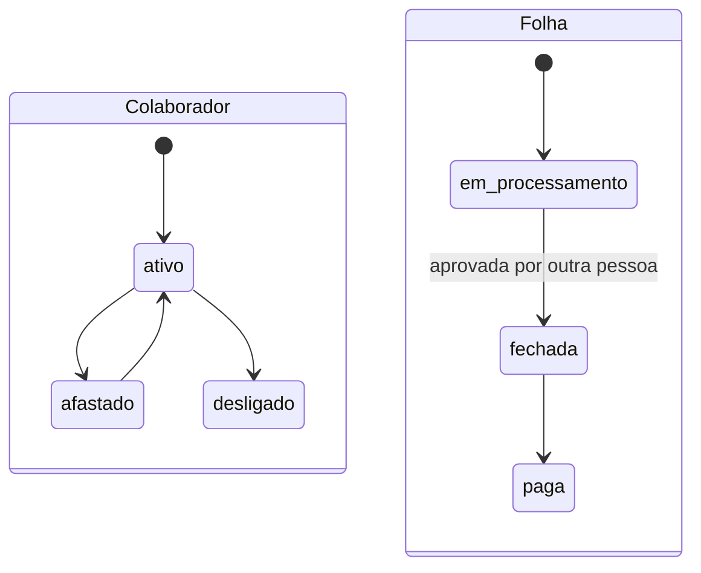

[Índice](README.md) · [Parte anterior](parte-10-financeiro-pagamentos-e-fiscal.md) · [Próxima parte](parte-12-suprimentos-patrimonio-frotas-contratos-e-terceiros.md)

<a id="parte-11"></a>

# Parte 11 — Pessoas, departamento pessoal e SST

## Visão geral da parte 11

O HCM tem três submódulos: departamento pessoal, recursos humanos e medicina e segurança do trabalho. O da plataforma e o da entidade são instâncias separadas ([39](#doc-39), HCM-01 e HCM-10).



**Regras principais**
- Folha fechada não é alterada; correção é folha complementar ([17](parte-07-regras-gerais-dos-modulos-de-gestao.md#doc-17), seção 3.3).
- Quem processa a folha não a aprova ([39](#doc-39), seção 7).
- ASO, CID e prontuário só pelo médico do trabalho; RH e gestão veem apto ou inapto ([39](#doc-39), [52](#doc-52)).

<a id="doc-39"></a>

## 39 — Departamento Pessoal, Recursos Humanos e Medicina do Trabalho, por Portal

> Parte do [SDD v2](parte-01-visao-e-escopo.md#doc-00). Regras atuais de RH e Pessoas em [17](parte-07-regras-gerais-dos-modulos-de-gestao.md#doc-17), seção 3, e [18](parte-07-regras-gerais-dos-modulos-de-gestao.md#doc-18), seção 3. Medicina e segurança em [17](parte-07-regras-gerais-dos-modulos-de-gestao.md#doc-17), seção 5. Integrações e eSocial em [16](parte-14-integracoes-e-importacao.md#doc-16), seção 6 (D-08) e em [14](parte-02-arquitetura-e-tenancy.md#doc-14). Dado de saúde em [07](parte-04-seguranca-privacidade-e-auditoria.md#doc-07), seção 2. Planejamento de desenvolvimento em [37](parte-08-academico.md#doc-37), seção 4. Prestadores em [38](parte-12-suprimentos-patrimonio-frotas-contratos-e-terceiros.md#doc-38).
> **Status:** análise e especificação proposta, criada em 03/11/2026 a partir de [`spec_gestao_pessoas_completo.md`](#v1-spec-gestao-pessoas-completo-md) (1.217 linhas), [`spec_gestao_rh_completo.md`](#v1-spec-gestao-rh-completo-md) e [`spec_gestao_seguranca_medicina_trabalho_completo.md`](#v1-spec-gestao-seguranca-medicina-trabalho-completo-md). Itens **(verificar)** dependem de conferência de norma trabalhista, previdenciária ou de saúde. Não é parecer.

---

### 1. Resposta direta

> **Leitura (04/11/2026):** esta tabela registra o que existia no SDD antes deste documento ser escrito. Os itens marcados como **Não** ou **Parcial** são especificados nas seções seguintes deste documento, exceto o que estiver listado na seção de pendências.

| Área | Completa? | Principal falha |
|---|---|---|
| Departamento pessoal (admissão, folha, férias, rescisão, benefícios, ponto) | **Não** | Sem regras de folha, rescisão e admissão. eSocial só cobre SST (S-2220, S-2230, S-2240), não cobre admissão, remuneração, pagamento e desligamento |
| Recursos humanos (recrutamento, onboarding, desempenho, clima, treinamento) | **Não** | Duplicidade com Pessoas (T-07) ainda sem decisão. Sem regra de recrutamento, onboarding, clima ou avaliação |
| Medicina e segurança do trabalho | **Parcial** | Regras de ASO, CAT, EPI, NR e afastamento existem ([17](parte-07-regras-gerais-dos-modulos-de-gestao.md#doc-17), seção 5). Faltam PCMSO, PGR/GHE, LTCAT, CIPA e ergonomia. **Falha de privacidade:** a v1 dá ao RH e à gestão a permissão "SST — Gerenciar" e mostra CID no cadastro de exame |
| Organização por portal | **Não** | Os três assuntos aparecem em portais diferentes na v1 sem regra clara de quem vê o quê |

---

### 2. Organização: um módulo, submódulos e donos

**Decisão proposta (já registrada como T-07 em [18](parte-07-regras-gerais-dos-modulos-de-gestao.md#doc-18)):** RH e Pessoas são **um único módulo HCM**, com estes submódulos:

| Submódulo | Dono | Banco |
|---|---|---|
| Cadastro e vínculo (colaborador, cargo, unidade, documentos) | HCM | Banco da unidade ([03](parte-02-arquitetura-e-tenancy.md#doc-03)) |
| Departamento pessoal (admissão, folha, férias, rescisão, benefícios, ponto) | HCM | Banco da unidade |
| Recursos humanos (recrutamento, onboarding, desempenho, clima, treinamento) | HCM | Banco da unidade |
| Medicina e segurança do trabalho | SST | Banco da unidade, com acesso restrito (seção 5) |

Dados civis do colaborador ficam no banco de identidade da entidade, como manda D-19 ([14](parte-02-arquitetura-e-tenancy.md#doc-14), seção 3). O HCM referencia `person_id`.

---

### 3. Departamento pessoal

#### 3.1 Admissão

| Etapa | Regra |
|---|---|
| Cadastro | Dados civis no banco de identidade. Dados contratuais no banco da unidade |
| Documentos | Obrigatórios por cargo. Admissão bloqueada se faltar documento ([18](parte-07-regras-gerais-dos-modulos-de-gestao.md#doc-18), seção 3) |
| Exame admissional | Agendado pelo SST. Admissão só com ASO apto ([17](parte-07-regras-gerais-dos-modulos-de-gestao.md#doc-17), seção 5) |
| Registro | Evento de admissão para o eSocial (S-2200) **(verificar)** |

#### 3.2 Folha

**Estados (v2, já definidos):** `em_processamento`, `fechada`, `paga`. Folha fechada não é alterada; a correção é folha complementar ([17](parte-07-regras-gerais-dos-modulos-de-gestao.md#doc-17), seção 2).

**Lacunas:**

| # | Falta | Origem |
|---|---|---|
| DP-01 | Catálogo de verbas (proventos, descontos, informativos), com natureza e incidência de INSS, FGTS e IRRF | v1, seção 9.3 |
| DP-02 | Fórmulas de cálculo versionadas, com vigência. Tabela de INSS e IRRF por competência | **(verificar)** |
| DP-03 | Processamento por competência e unidade, com pendências bloqueando o fechamento | v1, seção 9.1 |
| DP-04 | Holerite: geração, envio e registro de visualização. Holerite só para o próprio colaborador | v1, seção 9.2; [17](parte-07-regras-gerais-dos-modulos-de-gestao.md#doc-17), seção 2 |
| DP-05 | Eventos eSocial de remuneração (S-1200) e de pagamento (S-1210) **(verificar)** | Ausente |

#### 3.3 Férias e afastamentos

- Período aquisitivo e concessivo com cálculo de direito. **(verificar)** art. 130 da CLT e fracionamento. Pendência LAC-12 de [18](parte-07-regras-gerais-dos-modulos-de-gestao.md#doc-18).
- Programação pelo colaborador ou gestor, com aprovação do RH.
- Afastamento com data fim não anterior ao início e sem sobreposição ([17](parte-07-regras-gerais-dos-modulos-de-gestao.md#doc-17), seção 5.2).

#### 3.4 Ponto e jornada

- Registro de ponto por unidade. Regras da CLT, com a redação da Lei 13.874/2019 (planalto.gov.br, Conferido em 03/11/2026):
  - O horário de trabalho é anotado em registro de empregados (art. 74, caput).
  - **Estabelecimento com mais de 20 trabalhadores:** anotação obrigatória de entrada e saída, em registro manual, mecânico ou eletrônico, conforme instruções do Ministério, com pré-assinalação do repouso permitida (art. 74, § 2º). O sistema conta os trabalhadores **por estabelecimento** e exige o registro acima de 20. Abaixo disso, o registro fica opcional por unidade.
  - Trabalho fora do estabelecimento: registro em poder do empregado (art. 74, § 3º), por exemplo no aplicativo.
  - **Ponto por exceção:** permitido por acordo individual escrito, convenção ou acordo coletivo (art. 74, § 4º). O sistema só ativa o modo por exceção com o documento do acordo anexado.
  - **Intervalos:** mínimo de 11 horas entre duas jornadas (art. 66). Intervalo de 1 a 2 horas em trabalho contínuo acima de 6 horas, salvo acordo ou contrato coletivo (art. 71, caput), e de 15 minutos quando passar de 4 horas e não exceder 6 (art. 71, § 1º). O sistema alerta a violação, não bloqueia o registro.
  - Requisitos técnicos do registro eletrônico (REP) são da Portaria MTP nº 671/2021 **(verificar)**. Regra do servidor público vem do estatuto do ente **(verificar)** por ente.
  - **Professor de escola particular** (CLT, arts. 317 a 323, texto compilado lido em 03/11/2026 no Planalto):
    - Pode dar aula em mais de um turno no mesmo estabelecimento, sem passar da jornada semanal legal, com intervalo para refeição assegurado e não contado (art. 318, Lei 13.415/2017). O sistema soma as aulas de todos os turnos do professor na unidade e alerta acima da jornada semanal do contrato.
    - Não dá aula nem trabalha em exame aos domingos (art. 319). A grade ([60](parte-08-academico.md#doc-60)) recusa aula de professor no domingo.
    - **Remuneração por aulas semanais**, paga por mês de **quatro semanas e meia** (art. 320, § 1º). Falta desconta as aulas não dadas (§ 2º), salvo até 9 dias por casamento ou luto de cônjuge, pai, mãe ou filho (§ 3º). Aula acima do horário é paga no fim do mês (art. 321). A folha recebe do diário ([61](parte-08-academico.md#doc-61)) as aulas dadas e as excedentes de cada mês.
    - Em exames e férias escolares, recebe a mesma remuneração do período de aulas (art. 322). Em exames, no máximo 8 horas por dia, salvo pagamento de cada hora extra pelo valor de uma aula (§ 1º). Nas férias, só serviço de exame (§ 2º). Dispensa sem justa causa no fim do ano letivo ou nas férias garante essa remuneração (§ 3º).
- Ajuste manual só por RH, com motivo e evento de auditoria ([29](parte-04-seguranca-privacidade-e-auditoria.md#doc-29)).
- Ponto fechado não é alterado sem ajuste rastreado.
- Entrada e saída pela catraca, quando houver, é fonte auxiliar, não única ([35](parte-03-identidade-acesso-e-permissoes.md#doc-35), seção 3.4).

#### 3.5 Rescisão e desligamento

**Ausente na v2.** Proposta de estados: `solicitado` → `calculado` → `homologado` (se a regra exigir) → `pago` → `encerrado`.

- Cálculo com aviso prévio, férias proporcionais, 13.º e multa do FGTS **(verificar)**.
- Evento de desligamento para o eSocial (S-2299) **(verificar)**.
- Desligamento de quem tem afastamento ativo bloqueado até a regularização.

#### 3.6 Benefícios

Vale-transporte, vale-refeição e plano. Regra de desconto e de elegibilidade por cargo **(verificar)**. Benefício concedido gera evento de folha.

---

### 4. Recursos humanos

| Submódulo | Estado na v2 | Proposta mínima |
|---|---|---|
| Recrutamento | Ausente | Vaga → candidato → entrevista → aprovação → oferta. Estados por etapa. Candidato sem consentimento para guarda de currículo é descartado ao fim do prazo ([07](parte-04-seguranca-privacidade-e-auditoria.md#doc-07)) |
| Onboarding | Ausente | Checklist de admissão por cargo, com responsável por item. Convite de acesso ao sistema com validade de 72 h ([06](parte-03-identidade-acesso-e-permissoes.md#doc-06)) |
| Desempenho | Ausente | Ciclo, metas e avaliação. Avaliação não altera a nota de desempenho do aluno, nem a folha |
| Clima | Ausente | Pesquisa anônima. Resultado só com mínimo de respostas por grupo, para não identificar pessoa ([19](parte-07-regras-gerais-dos-modulos-de-gestao.md#doc-19), seção 11) |
| Treinamento e desenvolvimento | Parcial | Ver [37](parte-08-academico.md#doc-37), seção 4 |
| Movimentação interna | Ausente | Transferência de unidade e de cargo, com histórico. Não apaga o histórico anterior |

---

### 5. Medicina e segurança do trabalho

#### 5.1 Regra central de privacidade

**O RH e a gestão não veem diagnóstico, CID ou prontuário.** A v1 dá a eles a permissão "SST — Gerenciar" e mostra CID no cadastro de exame. Correção proposta:

| Papel | Vê | Não vê |
|---|---|---|
| Médico do trabalho | ASO completo, prontuário, CID, restrição detalhada | Nada de outros médicos sem vínculo |
| Técnico de segurança (SESMT) | Ocorrências, EPI, NR, PGR, CAT sem diagnóstico | CID, prontuário |
| RH e gestão | Apto, inapto ou apto com restrição; data de validade do ASO; restrição funcional **sem motivo clínico**; afastamento sem CID | CID, diagnóstico, prontuário |
| Colaborador | O próprio ASO e o próprio resultado | Dado de outro colaborador |
| Auditor | Acesso de leitura com motivo ([29](parte-04-seguranca-privacidade-e-auditoria.md#doc-29), seção 5) | Conteúdo de dado de saúde |

**Base:** LGPD, art. 11, e o princípio de necessidade ([07](parte-04-seguranca-privacidade-e-auditoria.md#doc-07), seção 1). A CAT exige CID para o INSS, e isso é emitido pelo médico, não pela gestão **(verificar)**.

**Correção necessária na v1:** a permissão "SST — Gerenciar" deixa de ser concedida por nome de cargo a RH e gestão. Cada portal ou papel que precisa gerir SST recebe a sua própria permissão, limitada ao que esse papel faz (ver seção 11).

#### 5.2 Exames ocupacionais (ASO)

- Tipos: admissional, periódico, retorno ao trabalho, mudança de função e demissional ([17](parte-07-regras-gerais-dos-modulos-de-gestao.md#doc-17), seção 5.2).
- Vencimento calculado pelo tipo e pela NR aplicável **(verificar)**. Alerta aos 30 dias.
- ASO só é emitido por médico com CRM válido.

#### 5.3 PCMSO, PGR e LTCAT

**Ausentes na v2.** Proposta:

- **PCMSO:** programa anual, com exames e calendário por grupo de risco. Responsável médico.
- **PGR:** inventário de riscos por setor (GHE). Plano de ação com prazo e responsável. Versão vigente única por unidade.
- **LTCAT:** laudo técnico de exposição, com validade. Base de cálculo de adicional de insalubridade e aposentadoria especial **(verificar)**.

Estados do plano de ação: `aberto`, `em_andamento`, `concluido`, `vencido` (calculado, [17](parte-07-regras-gerais-dos-modulos-de-gestao.md#doc-17), seção 5.3).

#### 5.4 CAT, acidente e afastamento

- CAT com data não futura, testemunhas por CPF válido e ocorrência registrada ([17](parte-07-regras-gerais-dos-modulos-de-gestao.md#doc-17), seção 5.2).
- CID do acidente vai só para a CAT e para o médico.
- Afastamento gerado pela CAT é do RH ([14](parte-02-arquitetura-e-tenancy.md#doc-14), seção 2).
- Envio da CAT ao INSS **(verificar)** o canal e o prazo.

#### 5.5 EPI

Entrega com assinatura. CA com validade. Estoque não negativo ([17](parte-07-regras-gerais-dos-modulos-de-gestao.md#doc-17), seção 5.2). A entrega é registrada no HCM, e o estoque fica no Suprimentos ([18](parte-07-regras-gerais-dos-modulos-de-gestao.md#doc-18), seção 6).

#### 5.6 CIPA e ergonomia

**Ausentes.** Proposta: eleição, composição e atas da CIPA **(verificar)** conforme NR-5. Laudo de ergonomia com versão e responsável técnico.

#### 5.7 Treinamento em NR

Validade por NR, com alerta. Treinamento vencido bloqueia a função que exige a NR **(verificar)**.

---

### 6. Por portal

| Portal | Departamento pessoal | Recursos humanos | Medicina e SST |
|---|---|---|---|
| Desenvolvedor | HCM da própria empresa desenvolvedora, se houver equipe própria. Banco master, separado de qualquer entidade | Idem | SST da própria empresa, se houver |
| Gestão | Completo, por permissão ([17](parte-07-regras-gerais-dos-modulos-de-gestao.md#doc-17), seção 3) | Completo, por permissão | Apto, inapto, restrição, EPI, NR, CAT, afastamento. **Sem CID nem prontuário** |
| Professor | Próprio holerite, férias, ponto e documentos | Próprio plano de desenvolvimento e treinamentos | Próprio ASO e resultado. Ciência de restrição funcional |
| Aluno | Nenhum | Nenhum | Nenhum |
| Responsáveis | Nenhum | Nenhum | Nenhum |
| Terceiros | Nenhum. Contabilidade recebe só totais ([38](parte-12-suprimentos-patrimonio-frotas-contratos-e-terceiros.md#doc-38), seção 3.2) | Nenhum | Clínica de ASO recebe agendamento e devolve resultado ([38](parte-12-suprimentos-patrimonio-frotas-contratos-e-terceiros.md#doc-38), seção 3.11) |

---

### 7. Permissões

A matriz da v1 (seção 20 de [`spec_gestao_pessoas_completo.md`](#v1-spec-gestao-pessoas-completo-md)) é aproveitada, com estas correções:

| Permissão | v1 | Proposta |
|---|---|---|
| SST — Gerenciar | Por papel e portal que precisa (seção 11). RH e gestão não recebem essa permissão | SESMT e médico do trabalho, cada um com escopo próprio. RH e gestão só veem o resultado sem CID |
| Folha — Processar e aprovar | GE, GP, SA | Mantido. Quem processa não aprova ([22](parte-06-plataforma-saas-clientes-dominios-licencas-e-crm.md#doc-22), seção 5) |
| Ponto — Ajuste manual | RH e GP | Mantido, com motivo obrigatório |
| Audit Log | SA, GE, GP, AUD | Mantido. Leitura do audit log gera evento ([29](parte-04-seguranca-privacidade-e-auditoria.md#doc-29), seção 5) |
| Holerite próprio | Todos | Mantido |

---

### 8. Integrações

| Evento | Origem | Destino | Estado |
|---|---|---|---|
| `hcm.employee.created` | HCM | SST (agenda admissional), Financeiro | Definido em [14](parte-02-arquitetura-e-tenancy.md#doc-14) |
| `smt.cat.created` | SST | HCM (afastamento) | Definido |
| eSocial S-2200, S-1200, S-1210, S-2299 | HCM | Transmissor | **Ausente.** Só S-2220, S-2230, S-2240 estão definidos |
| `hcm.leave.started` | HCM | Financeiro (folha) | Definido em [14](parte-02-arquitetura-e-tenancy.md#doc-14) |

Transmissão do eSocial segue D-08 ([16](parte-14-integracoes-e-importacao.md#doc-16), seção 6): certificado da entidade, com transmissor da plataforma.

---

### 9. Pendências

| # | Pendência | Tipo |
|---|---|---|
| HCM-01 | RH e Pessoas como módulos separados, com fronteira definida (seção 11) | **Decidido** em 03/11/2026 |
| HCM-02 | Catálogo de verbas e tabelas de INSS, IRRF e FGTS por competência | (verificar) e Documento |
| HCM-03 | Regra de férias, 13.º e rescisão (LAC-12) | (verificar) e (jurídico) |
| HCM-04 | Eventos eSocial S-2200, S-1200, S-1210, S-2299 | (verificar) e Documento |
| HCM-05 | Ponto e jornada: regra de registro e controle | **Conferido** em parte em 03/11/2026: CLT, arts. 66, 71 e 74 (seção 3.4). Professor conferido nos arts. 317 a 323. Faltam a Portaria MTP nº 671/2021 (REP) e o estatuto do servidor de cada ente **(verificar)** |
| HCM-06 | Permissão "SST — Gerenciar" por papel e portal que precisa, fora de RH e gestão (seção 11) | **Decidido** em 03/11/2026 |
| HCM-07 | PCMSO, PGR, LTCAT, CIPA e ergonomia: escrever as especificações | **Escrito** em [52](#doc-52). Revisão do owner pendente |
| HCM-08 | Guarda do prontuário médico e de ASO por prazo | **Conferido** em 03/11/2026: no mínimo 20 anos após o desligamento (NR-7, 7.6.1.1). Detalhe em [52](#doc-52), seção 2 |
| HCM-09 | Recrutamento: prazo de guarda de currículo de não contratado (seção 11) | **Incluído.** Valor a fixar pelo (jurídico) |
| HCM-10 | HCM da empresa desenvolvedora e das entidades clientes (seção 11) | **Decidido** em 03/11/2026 |

---

### 10. Critérios de aceite

- [ ] Perfil de RH e de gestão não recebe CID nem prontuário em nenhuma tela ou API (varredura de resposta).
- [ ] ASO com restrição mostra restrição funcional sem motivo clínico para RH e gestão (teste).
- [ ] Folha fechada não é alterada (teste).
- [ ] Ajuste de ponto sem motivo é recusado (teste).
- [ ] Desligamento com afastamento ativo fica bloqueado (teste).
- [ ] Eventos eSocial definidos e testados em homologação antes da produção.
- [ ] Itens **(verificar)** e **[Decisão do autor]** respondidos ou marcados como pendentes no [00](parte-01-visao-e-escopo.md#doc-00).

---

### 11. Decisões de 03/11/2026

**HCM-01 (RH e Pessoas): módulos separados.** Cada um tem suas telas, permissões e dados próprios. O vínculo entre eles é só por referência à pessoa, sem cópia de dado.

| Módulo | Dono de | Não é dono de |
|---|---|---|
| RH | Recrutamento, onboarding, avaliação de desempenho, clima, movimentação interna | Folha, admissão no eSocial, cadastro civil |
| Pessoas (DP) | Cadastro funcional, folha, férias, rescisão, eSocial, ponto | Processo seletivo, avaliação, clima |

Quando um candidato é contratado, o RH passa a pessoa para Pessoas por referência. O cadastro funcional nasce em Pessoas, não no RH.

**HCM-06 (permissão "SST — Gerenciar"): por papel e por portal, não por cargo.** Não há uma permissão geral de SST para RH ou gestão. Cada papel que precisa gerir SST recebe permissão própria, limitada ao que faz:

- Médico do trabalho: ASO, prontuário, CID.
- Técnico de SESMT: ocorrências, EPI, NR, PGR, CAT, sem diagnóstico.
- Gestor de RH ou de unidade: resultado apto, inapto ou restrição, validade e afastamento, sem CID nem motivo clínico.

A permissão de cada papel aparece na matriz de permissões do portal onde ela é usada, e não como um item genérico de RH.

**HCM-09 (currículo de candidato não contratado): incluído.** O currículo e os dados do candidato não contratado são guardados por prazo fixo e depois excluídos. **Valor do prazo: (jurídico).** O candidato é informado da guarda no ato de envio. Não há uso desses dados fora do processo seletivo em que se candidatou.

**HCM-10 (HCM da plataforma e dos clientes): dois usos do mesmo módulo, isolados.**

- **Empresa desenvolvedora:** HCM próprio, para os seus funcionários, no portal do desenvolvedor, com dados no banco master e acesso restrito à equipe da própria empresa.
- **Entidades clientes:** cada entidade tem o seu HCM no portal de gestão, com banco da entidade e unidade. Nenhuma entidade vê dado de outra, e a empresa desenvolvedora não acessa o HCM de cliente como funcionário.

<a id="doc-52"></a>

## 52 — Medicina e Segurança do Trabalho: PCMSO, PGR, LTCAT, CIPA e Ergonomia

> Parte do [SDD v2](parte-01-visao-e-escopo.md#doc-00). Regras já existentes de ASO, CAT, EPI e NR em [17](parte-07-regras-gerais-dos-modulos-de-gestao.md#doc-17), seção 5, e análise por portal em [39](#doc-39), seção 5. Dado de saúde e CID em [07](parte-04-seguranca-privacidade-e-auditoria.md#doc-07) e no padrão de [39](#doc-39), seção 5.1. Armazenamento de laudo em [21](parte-16-dados-validacoes-configuracoes-e-armazenamento.md#doc-21). Auditoria em [29](parte-04-seguranca-privacidade-e-auditoria.md#doc-29). Fecha HCM-07.
> **Status:** especificação proposta, criada em 03/11/2026. Os nomes e as exigências de cada programa (PCMSO, PGR, LTCAT, CIPA e ergonomia) vêm das normas regulamentadoras e da legislação previdenciária. Cada exigência marcada **(verificar)** precisa de conferência do responsável por norma antes da implementação ([50](parte-18-juridico-e-regulatorio.md#doc-50), seção 6).

---

### 1. Resposta direta

| Programa | Base | O que o sistema faz | Dono |
|---|---|---|---|
| PCMSO | NR-7 **(verificar)** | Planeja e registra exames médicos ocupacionais por função e risco | Médico do trabalho |
| PGR | NR-1 e NR-9 **(verificar)** | Registra riscos ocupacionais, medidas de controle e plano de ação | SESMT e gestão |
| LTCAT | Previdência social **(verificar)** | Laudo técnico de exposição a agentes nocivos, com validade | SESMT |
| CIPA | NR-5 **(verificar)** | Eleição, composição, mandato e atas | Gestão e empregados |
| Ergonomia | NR-17 **(verificar)** | Análise ergonômica do posto e recomendações | SESMT |

---

### 2. PCMSO

- **Programa anual**, com cronograma de exames por função e por exposição.
- Exames previstos: admissional, periódico, de retorno ao trabalho, de mudança de função e demissional (regras já em [17](parte-07-regras-gerais-dos-modulos-de-gestao.md#doc-17), seção 5.2).
- **Vencimento** de cada exame é calculado pela periodicidade da NR-7, item 7.5.8. Alerta aos 30 dias. Conferido em 03/11/2026 no texto oficial da NR-7 (gov.br, versão atualizada de 2022):

| Exame | Prazo |
|---|---|
| Admissional | Antes de o empregado assumir as atividades (7.5.8, I) |
| Periódico, exposto a risco do PGR ou com doença crônica que aumente a suscetibilidade | A cada ano ou em intervalo menor, a critério do médico responsável (7.5.8, II, a) |
| Periódico, demais empregados | A cada dois anos (7.5.8, II, b) |
| Retorno ao trabalho | Antes de reassumir, quando ausente por 30 dias ou mais por doença ou acidente, ocupacional ou não (7.5.9) |
| Mudança de risco | Antes da data da mudança (7.5.10) |
| Demissional | Até 10 dias após o término do contrato. Dispensado se o último exame clínico tiver menos de 135 dias (grau de risco 1 e 2) ou menos de 90 dias (grau de risco 3 e 4) (7.5.11) |
| Anexos da NR-7 | Periodicidade própria, por exemplo audiometria e espirometria, configurada por risco |

- **ASO:** emitido pelo médico que fez o exame e disponibilizado ao empregado, em papel quando ele pedir (7.5.19). Conteúdo mínimo: organização, nome, CPF e função do empregado, riscos do PGR, exames feitos, apto ou inapto, médico responsável pelo PCMSO e médico examinador (7.5.19.1). O ASO não traz diagnóstico. "Apto com restrição" é registro interno do sistema: no ASO, a aptidão para atividade específica é anotada quando a NR exigir (7.5.19.2).
- **Prontuário:** sob responsabilidade do médico responsável pelo PCMSO (7.6.1). A organização guarda por **no mínimo 20 anos após o desligamento**, salvo prazo diverso nos anexos (7.6.1.1). Na troca de médico, a organização transfere formalmente os prontuários ao sucessor (7.6.1.2). Prontuário eletrônico segue as exigências do Conselho Federal de Medicina (7.6.1.3).
- **Relatório analítico:** anual, pelo médico responsável pelo PCMSO, contado do último relatório (7.6.2).
- **Dispensa:** MEI, ME e EPP de grau de risco 1 e 2 que declararem as informações digitais e não tiverem exposição a agente físico, químico, biológico ou ergonômico ficam dispensadas do PCMSO, mas não dos exames nem do ASO (NR-1, 1.8.6 e 1.8.7.1).
- **Quem vê o quê:** o médico do trabalho acessa o prontuário e o CID. Gestão e RH veem só apto, inapto, apto com restrição e validade ([39](#doc-39), seção 5.1).
- Exame sem médico com CRM válido não é emitido.

Estados do exame: `agendado` → `realizado` → `apto`, `apto_com_restricao` ou `inapto`, e `vencido` calculado por data.

---

### 3. PGR

- **Inventário de riscos** por setor e função: físico, químico, biológico, ergonômico, de acidentes e **fatores de risco psicossociais relacionados ao trabalho**, incluídos no GRO pela Portaria MTE nº 1.419/2024, com o capítulo 1.5 da NR-1 em vigor desde 26/05/2026.
- Cada risco tem **medida de controle**, responsável e prazo.
- **Plano de ação** com estados `aberto`, `em_andamento`, `concluido` e `vencido` (calculado por prazo, como em [17](parte-07-regras-gerais-dos-modulos-de-gestao.md#doc-17), seção 5).
- Revisão do PGR com data e versão. Versão vigente não muda, e mudança gera nova versão.
- **Prazo de revisão:** a avaliação de riscos é contínua e revista a cada dois anos, ou até 3 anos se a organização tiver certificação em sistema de gestão de SST (NR-1, 1.5.4.4.6 e 1.5.4.4.6.1). Revisão antecipada quando: medida de prevenção implantada, mudança de tecnologia, ambiente, processo ou organização do trabalho, medida ineficaz, acidente ou doença do trabalho, mudança de requisito legal, ou pedido justificado dos trabalhadores ou da CIPA. O sistema calcula o vencimento e abre a revisão quando um desses fatos é registrado.
- **Histórico:** o inventário fica atualizado, e o histórico das atualizações é guardado por no mínimo 20 anos (NR-1, 1.5.7.3.3 e 1.5.7.3.3.1).
- **Dispensa:** o MEI não elabora PGR (1.8.1), mas a contratante o inclui no próprio PGR quando ele atua nas dependências dela (1.8.1.1). ME e EPP de grau de risco 1 e 2 sem exposição a agente físico, químico ou biológico, que declararem as informações digitais, ficam dispensadas do PGR (1.8.4).
- Ocorrência ligada a um risco do inventário. Acidente de trabalho gera CAT ([39](#doc-39), seção 5).

---

### 4. LTCAT

- Laudo por função e setor, com agentes nocivos, intensidade e tempo de exposição.
- **Validade:** a lei não fixa prazo de validade. A empresa mantém o laudo **atualizado**, sob pena da lei (Lei 8.213/1991, art. 58, § 3º). O sistema não calcula vencimento: abre revisão do laudo quando o PGR registra mudança de ambiente, processo ou agente, e lembra a revisão a cada ano como prática de controle. O laudo é expedido por médico do trabalho ou engenheiro de segurança do trabalho (art. 58, § 1º) e diz se há proteção coletiva ou individual que reduza o agente ao limite de tolerância (art. 58, § 2º).
- **PPP:** a empresa mantém o perfil profissiográfico atualizado e entrega cópia ao trabalhador na rescisão (art. 58, § 4º). A entrega por meio eletrônico pelo eSocial **(verificar)**.
- Base para adicional de insalubridade e para aposentadoria especial. Cálculo do adicional é do módulo de folha, a partir do laudo, não do laudo em si.
- O laudo guarda o responsável técnico e o registro profissional.

---

### 5. CIPA

- Nome atual: **Comissão Interna de Prevenção de Acidentes e de Assédio** (NR-5, Portaria MTP nº 4.219/2022).
- **Composição:** por estabelecimento, com representantes da organização e dos empregados, conforme o Quadro I da NR-5 (5.4.1). Os representantes da organização são designados por ela (5.4.3). Estabelecimento fora do Quadro I e sem SESMT nomeia um representante da NR-5 entre os empregados (5.4.13). O MEI está dispensado (5.4.13.2). O número de membros por faixa vem do Quadro I e fica como tabela configurável, carregada a partir do texto oficial.
- **Mandato:** um ano, com uma reeleição (5.4.6). O eleito para cargo de direção não pode ser dispensado sem justa causa desde o registro da candidatura até um ano após o fim do mandato (5.4.12). O sistema marca essa estabilidade no vínculo, para o módulo de pessoal avisar antes de uma rescisão.
- **Eleição:** convocada pelo empregador pelo menos 60 dias antes do fim do mandato (5.5.1), e realizada pelo menos 30 dias antes (5.5.3, f). Inscrição individual por pelo menos 15 dias corridos (5.5.3, b). A eleição vale com participação de pelo menos um terço dos empregados. Abaixo disso, a votação é prorrogada (5.5.4 e 5.5.4.1).
- **Reuniões:** ordinárias mensais, em calendário prévio (5.6.1). Em ME e EPP de grau de risco 1 e 2, podem ser bimestrais (5.6.1.1). Extraordinária em acidente grave ou fatal, ou a pedido de uma das representações (5.6.4).
- **Treinamento:** 8, 12, 16 ou 20 horas, para grau de risco 1, 2, 3 ou 4, com no máximo 8 horas por dia (5.7.4 e 5.7.4.1). Feito antes da posse (5.7.1). Na CIPA em primeiro mandato, em até 30 dias da posse (5.7.1.1).
- **Ata** de cada reunião, assinada pelos presentes e disponível a todos os membros (5.6.3 e 5.6.3.1). Deliberações divulgadas a todos os empregados (5.6.3.2).
- Os encaminhamentos viram plano de ação do PGR, quando houver risco envolvido.
- Eleitor e candidato são empregados do quadro, com vínculo ativo na data da eleição.

---

### 6. Ergonomia

- Análise do posto de trabalho com data, função, responsável técnico e recomendações.
- Recomendação vira ação do plano do PGR, com prazo.
- Afastamento por motivo ergonômico segue a regra de afastamento de [17](parte-07-regras-gerais-dos-modulos-de-gestao.md#doc-17), seção 5, sem CID para a gestão.

---

### 7. Por portal

| Portal | Pode | Não pode | Origem |
|---|---|---|---|
| **Desenvolvedor** | Nada sobre dado de entidade | Ver PCMSO, PGR, LTCAT, CIPA ou laudo | P |
| **Gestão** | Ver PGR e plano de ação, ver CIPA e atas, ver o resultado de ASO sem motivo clínico, aprovar plano de ação | Ver CID, prontuário ou diagnóstico | E |
| **Médico do trabalho** | Gerir PCMSO, ASO, prontuário e CID dos pacientes da entidade | Ver prontuário de outra entidade | E |
| **SESMT (técnico de segurança)** | Gerir PGR, LTCAT, ergonomia, CAT, EPI e ocorrências, sem diagnóstico | Ver CID ou prontuário | E |
| **RH** | Ver apto, inapto, restrição e validade. Receber afastamento | Ver CID, diagnóstico ou prontuário | E |
| **Colaborador** | Ver o próprio ASO e o resultado | Ver dado de outro colaborador | E |
| **Membro da CIPA** | Ver a própria ata e as atas da CIPA | Ver dado de saúde | E |
| **Terceiros** | Clínica de ASO recebe o agendamento e devolve o resultado ([38](parte-12-suprimentos-patrimonio-frotas-contratos-e-terceiros.md#doc-38)) | Ver PGR, CIPA ou outros colaboradores | E |

---

### 8. Eventos e integrações

| Evento | Produtor | Consumidor | Efeito |
|---|---|---|---|
| `smt.exame.vencendo` | Medicina | Gestão e RH | Alerta de renovação |
| `smt.cat.criada` | SESMT | RH | Abre afastamento, conforme [14](parte-02-arquitetura-e-tenancy.md#doc-14) |
| `smt.exame.resultado` | Medicina | RH | Só apto, inapto, restrição e validade. Sem motivo clínico |

Eventos de SST não levam CID no payload ([14](parte-02-arquitetura-e-tenancy.md#doc-14), seção 8).

---

### 9. DDL proposto

```sql
CREATE TABLE smt_pcmso_versoes (
  id              BIGINT UNSIGNED AUTO_INCREMENT PRIMARY KEY,
  uuid            CHAR(36) NOT NULL UNIQUE,
  unidade_uuid    CHAR(36) NOT NULL,
  ano             SMALLINT UNSIGNED NOT NULL,
  versao          INT UNSIGNED NOT NULL,
  medico_uuid     CHAR(36) NOT NULL,
  crm_registro    VARCHAR(30) NOT NULL,
  estado          ENUM('rascunho','vigente','substituido') NOT NULL,
  UNIQUE KEY ux_pcmso_ano_versao (unidade_uuid, ano, versao)
) ENGINE=InnoDB DEFAULT CHARSET=utf8mb4;

CREATE TABLE smt_pgr_riscos (
  id              BIGINT UNSIGNED AUTO_INCREMENT PRIMARY KEY,
  uuid            CHAR(36) NOT NULL UNIQUE,
  unidade_uuid    CHAR(36) NOT NULL,
  setor           VARCHAR(120) NOT NULL,
  funcao          VARCHAR(120) NULL,
  tipo_risco      ENUM('fisico','quimico','biologico','ergonomico','acidente') NOT NULL,
  descricao       VARCHAR(500) NOT NULL,
  medida_controle VARCHAR(500) NOT NULL,
  responsavel_uuid CHAR(36) NOT NULL,
  prazo_em        DATE NULL,
  estado          ENUM('aberto','em_andamento','concluido') NOT NULL,
  versao_pgr      INT UNSIGNED NOT NULL,
  INDEX ix_risco_setor (unidade_uuid, setor, estado)
) ENGINE=InnoDB DEFAULT CHARSET=utf8mb4;

CREATE TABLE smt_ltcat (
  id              BIGINT UNSIGNED AUTO_INCREMENT PRIMARY KEY,
  uuid            CHAR(36) NOT NULL UNIQUE,
  unidade_uuid    CHAR(36) NOT NULL,
  funcao          VARCHAR(120) NOT NULL,
  agente_nocivo   VARCHAR(120) NOT NULL,
  intensidade     VARCHAR(60) NOT NULL,
  tempo_exposicao VARCHAR(60) NOT NULL,
  responsavel_tecnico_uuid CHAR(36) NOT NULL,
  registro_profissional VARCHAR(30) NOT NULL,
  emitido_em      DATE NOT NULL,
  valido_ate      DATE NOT NULL
) ENGINE=InnoDB DEFAULT CHARSET=utf8mb4;

CREATE TABLE smt_cipa_mandatos (
  id              BIGINT UNSIGNED AUTO_INCREMENT PRIMARY KEY,
  uuid            CHAR(36) NOT NULL UNIQUE,
  unidade_uuid    CHAR(36) NOT NULL,
  inicio_em       DATE NOT NULL,
  fim_em          DATE NOT NULL,
  estado          ENUM('eleicao','vigente','encerrado') NOT NULL
) ENGINE=InnoDB DEFAULT CHARSET=utf8mb4;

CREATE TABLE smt_cipa_membros (
  id              BIGINT UNSIGNED AUTO_INCREMENT PRIMARY KEY,
  mandato_id      BIGINT UNSIGNED NOT NULL,
  pessoa_uuid     CHAR(36) NOT NULL,
  papel           ENUM('titular','suplente','presidente','vice','secretario') NOT NULL,
  representacao   ENUM('empregador','empregados') NOT NULL,
  UNIQUE KEY ux_cipa_membro (mandato_id, pessoa_uuid),
  CONSTRAINT fk_cipa_mandato FOREIGN KEY (mandato_id) REFERENCES smt_cipa_mandatos (id)
) ENGINE=InnoDB DEFAULT CHARSET=utf8mb4;

CREATE TABLE smt_cipa_atas (
  id              BIGINT UNSIGNED AUTO_INCREMENT PRIMARY KEY,
  uuid            CHAR(36) NOT NULL UNIQUE,
  mandato_id      BIGINT UNSIGNED NOT NULL,
  realizada_em    DATETIME(3) NOT NULL,
  pauta           TEXT NOT NULL,
  encaminhamentos TEXT NULL,
  arquivo_uuid    CHAR(36) NULL,
  CONSTRAINT fk_ata_mandato FOREIGN KEY (mandato_id) REFERENCES smt_cipa_mandatos (id)
) ENGINE=InnoDB DEFAULT CHARSET=utf8mb4;

CREATE TABLE smt_ergonomia_analises (
  id              BIGINT UNSIGNED AUTO_INCREMENT PRIMARY KEY,
  uuid            CHAR(36) NOT NULL UNIQUE,
  unidade_uuid    CHAR(36) NOT NULL,
  funcao          VARCHAR(120) NOT NULL,
  analisado_em    DATE NOT NULL,
  responsavel_tecnico_uuid CHAR(36) NOT NULL,
  recomendacoes   TEXT NOT NULL,
  plano_risco_uuid CHAR(36) NULL
) ENGINE=InnoDB DEFAULT CHARSET=utf8mb4;
```

---

### 10. Pendências

| # | Pendência | Tipo |
|---|---|---|
| SST-01 | Periodicidade de exames por função e risco (seção 2) | **Conferido** em 03/11/2026: NR-7, itens 7.5.8 a 7.5.11 |
| SST-02 | Validade do LTCAT e alerta (seção 4) | **Conferido** em 03/11/2026: sem prazo fixo, laudo mantido atualizado (Lei 8.213/1991, art. 58). PPP pelo eSocial **(verificar)** |
| SST-03 | Eleição e composição da CIPA por porte da entidade (seção 5) | **Conferido** em 03/11/2026: NR-5, itens 5.4 a 5.7. Os números do Quadro I entram como tabela configurável |
| SST-04 | Forma de atualização do PGR e prazo de revisão (seção 3) | **Conferido** em 03/11/2026: NR-1, itens 1.5.4.4.6 e 1.5.7.3.3 |
| SST-05 | Revisão de prazo de guarda de PCMSO e de prontuário (HCM-08) | Norma conferida em 03/11/2026: 20 anos após o desligamento (NR-7, 7.6.1.1). Parecer do (jurídico) sobre outros documentos de SST pendente |

---

### 11. Critérios de aceite

- [ ] Perfil de RH e de gestão não recebe CID nem prontuário (varredura de resposta, já em [39](#doc-39)).
- [ ] Exame sem médico com CRM válido não é emitido (teste).
- [ ] Laudo de LTCAT vencido gera alerta (teste).
- [ ] Versão vigente de PGR não é alterada, e revisão gera nova versão (teste).
- [ ] Ata da CIPA é visível só aos membros e à gestão (teste de isolamento).

## Especificações da v1 desta parte absorvidas no kit-starter ou sem destino

<a id="v1-spec-gestao-pessoas-completo-md"></a>

### v1 — `spec_gestao_pessoas_completo.md` (1257 linhas)

> Situação na v2: Absorvido integralmente no kit-starter. Destino: ficha do kit-starter: `kit-starter/desenvolvedor/pessoas-da-plataforma/departamento-pessoal.md`. Quando este texto diverge da v2, vale a v2.

#### O que a v2 muda nesta especificação

Estas regras prevalecem sobre o texto da v1 que vem a seguir.

- **Módulo separado do RH** (HCM-01 do [39](#doc-39), seção 11): Pessoas é dono de cadastro funcional, folha, férias, rescisão, eSocial e ponto; não é dono de processo seletivo, avaliação e clima. O cadastro funcional nasce aqui, quando o RH passa o candidato contratado por referência.
- **Dados civis** ficam no banco de identidade; o HCM referencia `person_id` (D-19; [14](parte-02-arquitetura-e-tenancy.md#doc-14), seção 3). Para a empresa, o banco é o master.
- **Regras do [39](#doc-39), seção 3** prevalecem sobre a v1: admissão, folha (folha fechada não é alterada), férias e afastamentos, ponto e jornada (ajuste manual só com motivo), rescisão (desligamento com afastamento ativo fica bloqueado) e benefícios.
- **Folha:** quem processa não aprova ([22](parte-06-plataforma-saas-clientes-dominios-licencas-e-crm.md#doc-22), seção 5; [39](#doc-39), seção 7).
- **Medicina do trabalho:** não aparece aqui com CID nem prontuário; Pessoas recebe só apto, inapto ou restrição sem motivo clínico, validade do ASO e afastamento sem CID ([39](#doc-39), seção 5.1).
- **Perfis da v1:** a matriz de permissões da v1 é aproveitada com as correções da seção 7 do [39](#doc-39); papéis na seção 6 desta ficha.
- **Instância da empresa:** sem filtro de unidade ou entidade; o portal do desenvolvedor não vê o HCM de nenhuma entidade.

#### Texto integral da v1

**Plataforma:** TotusTuusSoftCloud SaaS  
**Stack:** PHP 8 puro · JavaScript Vanilla · Fetch API · Tailwind CSS 4.2 · Supabase · amCharts 5  
**Arquitetura:** Multi-entidade · Multi-unidade · Multi-usuário · Banco segregado por unidade  
**Versão:** 1.0.0 · **Data:** 2026-06-07  
**Autor:** Jefferson Augusto · TotusTuusSoftCloud  

- Language Standard: Global English
---

#### Sumário

1. [Visão Geral](#visão-geral)
2. [Mapa de Páginas](#mapa-de-páginas)
3. [Dashboard Principal](#dashboard-principal)
4. [Colaboradores](#colaboradores)
5. [Recrutamento e Seleção](#recrutamento-e-seleção)
6. [Onboarding e Offboarding](#onboarding-e-offboarding)
7. [Cargos e Salários](#cargos-e-salários)
8. [Ponto e Jornada](#ponto-e-jornada)
9. [Folha de Pagamento](#folha-de-pagamento)
10. [Férias e Afastamentos](#férias-e-afastamentos)
11. [Treinamento e Desenvolvimento](#treinamento-e-desenvolvimento)
12. [Avaliação de Desempenho](#avaliação-de-desempenho)
13. [Benefícios](#benefícios)
14. [Saúde e Segurança do Trabalho](#saúde-e-segurança-do-trabalho)
15. [Documentos e Contratos RH](#documentos-e-contratos-rh)
16. [Relatórios e Analytics](#relatórios-e-analytics)
17. [Automações](#automações)
18. [API REST](#api-rest)
19. [Schema SQL](#schema-sql)
20. [RBAC — Perfis e Permissões](#rbac)
21. [LGPD / Compliance](#lgpd--compliance)
22. [Critérios de Aceite](#critérios-de-aceite)

---

#### 1. Visão Geral

##### Descrição
Módulo completo de Gestão de Capital Humano (HCM/RH) para gestão de colaboradores, recrutamento, folha de pagamento, ponto eletrônico, treinamentos, avaliações de desempenho, benefícios e saúde/segurança do trabalho (SST). Opera em contexto multi-entidade e multi-unidade.

##### Perfis de Acesso (RBAC)
| Código | Perfil               | Nível de Acesso                                  |
|--------|----------------------|--------------------------------------------------|
| SA     | Super Admin          | Acesso total a todas entidades e unidades        |
| GE     | Gestor de Entidade   | Acesso total à entidade                          |
| GP     | Gestor de Pessoas    | Acesso total ao módulo RH                        |
| GU     | Gestor de Unidade    | Acesso restrito à unidade                        |
| RH     | Analista RH          | Operações RH sem exclusão e sem folha            |
| FIN    | Financeiro           | Leitura folha, benefícios, provisões             |
| COL    | Colaborador          | Autoatendimento (próprios dados, holerite, férias)|
| AUD    | Auditor              | Leitura total + audit_log                        |

##### Rotas Base
```
/pessoas/dashboard
/pessoas/colaboradores
/pessoas/recrutamento
/pessoas/onboarding
/pessoas/cargos-salarios
/pessoas/ponto-jornada
/pessoas/folha
/pessoas/ferias-afastamentos
/pessoas/treinamentos
/pessoas/desempenho
/pessoas/beneficios
/pessoas/sst
/pessoas/documentos
/pessoas/relatorios
/pessoas/configuracoes
```

---

#### 2. Mapa de Páginas

```
/pessoas/
├── dashboard/
├── colaboradores/
│   ├── index.php              — Listagem DataTable
│   ├── perfil.php             — Perfil completo colaborador
│   └── organograma.php        — Organograma interativo
├── recrutamento/
│   ├── vagas/index.php        — DataTable vagas
│   ├── candidatos/index.php   — DataTable candidatos
│   └── pipeline/index.php     — Kanban pipeline seleção
├── onboarding/
│   ├── index.php              — Kanban onboarding/offboarding
│   └── checklists/index.php   — DataTable checklists
├── cargos-salarios/
│   ├── cargos/index.php       — DataTable cargos
│   ├── faixas/index.php       — DataTable faixas salariais
│   └── estrutura/index.php    — Organograma hierárquico
├── ponto-jornada/
│   ├── registros/index.php    — DataTable batidas
│   ├── espelho/index.php      — Espelho de ponto mensal
│   ├── escalas/index.php      — DataTable escalas/turnos
│   └── ocorrencias/index.php  — DataTable ocorrências
├── folha/
│   ├── processamento/index.php — Kanban processamento folha
│   ├── holerites/index.php    — DataTable holerites
│   ├── eventos/index.php      — DataTable eventos/verbas
│   └── encargos/index.php     — DataTable encargos/FGTS/INSS
├── ferias-afastamentos/
│   ├── ferias/index.php       — DataTable + calendário
│   ├── afastamentos/index.php — DataTable afastamentos
│   └── programacao/index.php  — Calendário anual férias
├── treinamentos/
│   ├── index.php              — DataTable treinamentos
│   ├── turmas/index.php       — DataTable turmas
│   └── presenca/index.php     — Controle presença
├── desempenho/
│   ├── ciclos/index.php       — DataTable ciclos avaliação
│   ├── avaliacoes/index.php   — DataTable avaliações
│   └── metas/index.php        — Kanban metas/OKRs
├── beneficios/
│   ├── planos/index.php       — DataTable planos benefícios
│   └── colaboradores/index.php — DataTable vínculos benefícios
├── sst/
│   ├── exames/index.php       — DataTable exames ocupacionais
│   ├── acidentes/index.php    — DataTable CAT/acidentes
│   └── epi/index.php          — DataTable EPIs
├── documentos/
│   └── index.php              — DataTable documentos RH
└── relatorios/
    └── index.php              — Relatórios e analytics
```

---

#### 3. Dashboard Principal

**Rota:** `/pessoas/dashboard/index.php`

##### Widgets KPI — Linha 1 (6 cards)
| Widget                  | Valor         | Ícone               | Cor      | Tendência |
|-------------------------|---------------|---------------------|----------|-----------|
| Total Colaboradores     | `#total`      | ki-people           | primary  | vs. mês anterior |
| Admissões no Mês        | `#admissoes`  | ki-user-tick        | success  | vs. mês anterior |
| Desligamentos no Mês    | `#demissoes`  | ki-user-minus       | danger   | vs. mês anterior |
| Turnover (%)            | `#turnover`   | ki-arrows-circle    | warning  | vs. trimestre    |
| Headcount Ativo         | `#headcount`  | ki-briefcase        | info     | vs. mês anterior |
| Custo Total RH (R$)     | `#custo_rh`   | ki-dollar           | primary  | vs. mês anterior |

##### Widgets KPI — Linha 2 (6 cards operacionais)
| Widget                     | Métrica           | Ação Rápida                  |
|----------------------------|-------------------|------------------------------|
| Vagas em Aberto            | count vagas        | → /recrutamento/vagas        |
| Onboardings Pendentes      | count onboarding   | → /onboarding                |
| Ponto Irregular Hoje       | count ocorrências  | → /ponto-jornada/ocorrencias |
| Folha em Processamento     | status folha mês   | → /folha/processamento       |
| Treinamentos Vencendo      | próximos 30 dias   | → /treinamentos              |
| Exames Médicos Vencidos    | count vencidos     | → /sst/exames                |

##### Charts amCharts 5
| # | Tipo           | Título                          | Dados                                         |
|---|----------------|---------------------------------|-----------------------------------------------|
| 1 | Line dual-axis | Admissões vs Desligamentos      | 12 meses, linha verde + linha vermelha        |
| 2 | Donut          | Distribuição por Departamento   | % colaboradores por depto                    |
| 3 | Bar Grouped    | Headcount por Unidade           | agrupado por unidade/entidade                 |
| 4 | Bar Horizontal | Top 10 Cargos por Headcount     | ranking cargos mais ocupados                  |
| 5 | Area Stacked   | Custo RH Mensal (Salário+Encargos+Benefícios) | 12 meses stacked |
| 6 | Gauge          | Índice de Turnover              | meta vs realizado, gauge colorido             |

##### DataTable — Admissões e Desligamentos Recentes
- Colunas: Colaborador · Cargo · Departamento · Unidade · Tipo (Admissão/Desligamento) · Data · Responsável · Status
- Filtros: Tipo · Departamento · Unidade · Período
- Ações: Ver perfil · Ver processo

##### Painel de Alertas
- Ponto não registrado (colaboradores sem batida hoje)
- Férias vencendo nos próximos 30 dias
- Exames ocupacionais vencidos ou próximos do vencimento
- Treinamentos obrigatórios pendentes
- Documentos com prazo de validade próximo
- Contratos de experiência vencendo nos próximos 15 dias

---

#### 4. Colaboradores

##### 4.1 Listagem — `/pessoas/colaboradores/index.php`

###### Toolbar
```
[+ Novo Colaborador] [Importar CSV] [Exportar ▾] [Colunas ▾] [Filtros ▾]
```

###### Filtros Avançados (drawer lateral)
- Empresa/Entidade (multi-select)
- Unidade (multi-select)
- Departamento (multi-select)
- Cargo (multi-select)
- Status: Ativo · Férias · Afastado · Desligado
- Tipo Vínculo: CLT · PJ · Estágio · Temporário · Aprendiz
- Período de Admissão (date range)
- Centro de Custo (multi-select)
- Gestor (select)

###### DataTable Colaboradores
| Coluna           | Tipo        | Ordenável | Visível Padrão |
|------------------|-------------|-----------|----------------|
| #ID              | number      | sim       | não            |
| Avatar + Nome    | text+image  | sim       | sim            |
| Matrícula        | text        | sim       | sim            |
| Cargo            | text        | sim       | sim            |
| Departamento     | text        | sim       | sim            |
| Unidade          | text        | sim       | sim            |
| Tipo Vínculo     | badge       | sim       | sim            |
| Data Admissão    | date        | sim       | sim            |
| Status           | badge color | sim       | sim            |
| Gestor Direto    | text        | sim       | não            |
| Salário Base     | currency    | sim       | não (restrito) |
| Ações            | buttons     | não       | sim            |

**Ações por linha:** Ver Perfil · Editar · Afastar · Desligar · Mais (▾ Transferir / Holerites / Documentos)

**Bulk Actions:** Exportar selecionados · Enviar notificação · Atualizar status · Gerar relatório

###### Drawer — Novo/Editar Colaborador
**Abas do drawer:**
1. **Dados Pessoais** — Nome completo · CPF · RG · Data nascimento · Gênero · Estado civil · Nacionalidade · Naturalidade · PIS/NIS · Foto
2. **Dados de Contato** — E-mail pessoal · E-mail corporativo · Telefone · Celular · Endereço completo (CEP, logradouro, número, complemento, bairro, cidade, estado)
3. **Dados Contratuais** — Matrícula · Data admissão · Tipo vínculo · Regime trabalho (CLT/PJ) · CBO · CTPS número/série/UF · Data contrato experiência · Data término experiência · Data efetivação
4. **Cargo e Salário** — Cargo · Departamento · Centro de custo · Unidade · Nível hierárquico · Salário base · Data última promoção · Gestor direto
5. **Dados Bancários** — Banco · Agência · Conta · Tipo conta · Chave PIX
6. **Benefícios** — Selecionar planos ativos (checkbox list)
7. **Documentos** — Upload documentos (RG, CPF, CTPS, comprovante residência, certidões, diplomas)
8. **Acesso ao Sistema** — Criar login · Perfil de acesso · E-mail corporativo · Notificar colaborador

**Validações:**
- CPF: formato + dígito verificador
- PIS: dígito verificador
- CTPS: obrigatório para CLT
- Salário: mínimo maior que piso salarial da categoria
- Data experiência: máximo 90 dias (prorrogável 1× até 90 dias)

##### 4.2 Perfil Completo — `/pessoas/colaboradores/perfil.php?id=:id`

**Layout tipo Supabase Profile Page:**
- Header: foto · nome · cargo · departamento · badges (status, vínculo) · botões ação (Editar · Afastar · Desligar · Holerites)
- Sidebar esquerda: informações pessoais · documentos · contatos de emergência
- Conteúdo principal (abas):
  - **Resumo** — KPIs do colaborador (tempo empresa, salário atual, férias disponíveis, treinamentos concluídos)
  - **Histórico** — Timeline de eventos (admissão, promoções, transferências, afastamentos, demissão)
  - **Documentos** — Lista de documentos com status validade
  - **Holerites** — Lista últimos 12 meses com download PDF
  - **Avaliações** — Histórico de avaliações de desempenho
  - **Treinamentos** — Treinamentos concluídos e pendentes
  - **Benefícios** — Benefícios ativos e histórico
  - **Ponto** — Espelho de ponto do mês atual

##### 4.3 Organograma — `/pessoas/colaboradores/organograma.php`
- Visualização hierárquica interativa (amCharts 5 ForceDirected ou OrgChart)
- Filtros: Entidade · Unidade · Departamento · Nível hierárquico
- Interação: clique no card → abre modal com resumo do colaborador
- Exportar como PNG/SVG/PDF
- Toggle: Visão por departamento / Visão por gestor

---

#### 5. Recrutamento e Seleção

##### 5.1 Vagas — `/pessoas/recrutamento/vagas/index.php`

###### Toolbar
```
[+ Nova Vaga] [Exportar ▾] [Filtros ▾]
```

###### DataTable Vagas
| Coluna            | Tipo        |
|-------------------|-------------|
| Código            | text        |
| Título da Vaga    | text        |
| Departamento      | text        |
| Unidade           | text        |
| Tipo              | badge (Efetivo/Substituição/Estágio/Temp) |
| Modalidade        | badge (Presencial/Híbrido/Remoto) |
| Data Abertura     | date        |
| Prazo Encerramento | date       |
| Candidatos        | number      |
| Status            | badge       |
| Responsável       | text        |
| Ações             | buttons     |

###### Drawer — Nova/Editar Vaga
- Título · Código interno · Departamento · Cargo destino · Unidade · Tipo vaga · Modalidade · Quantidade vagas
- Salário ofertado (ou "a combinar") · Benefícios ofertados
- Descrição da vaga (editor rico) · Requisitos mínimos · Requisitos desejáveis · Atividades
- Responsável pelo processo · Gestor solicitante · Data prevista encerramento
- Status (Rascunho · Publicada · Em Seleção · Encerrada · Cancelada)
- Publicar em portais (checkboxes: site institucional, LinkedIn, Indeed, Gupy)

##### 5.2 Candidatos — `/pessoas/recrutamento/candidatos/index.php`

###### DataTable Candidatos
| Coluna              | Tipo    |
|---------------------|---------|
| Nome                | text    |
| CPF / E-mail        | text    |
| Vaga Aplicada       | text    |
| Data Inscrição      | date    |
| Etapa Atual         | badge   |
| Fonte (Indicação/Portal/LinkedIn) | badge |
| Avaliação (score 0-10) | stars |
| Status              | badge   |
| Responsável         | text    |
| Ações               | buttons |

###### Drawer — Candidato
- Dados pessoais · Currículo (upload/visualização) · LinkedIn URL
- Vaga associada · Etapa atual · Score de triagem
- Histórico de etapas (timeline) · Anotações do recrutador
- Agendar entrevista (data/hora/local/responsável)

##### 5.3 Kanban — Pipeline de Seleção — `/pessoas/recrutamento/pipeline/index.php`

###### Colunas do Kanban
| Coluna              | Cor     | Descrição                                 |
|---------------------|---------|-------------------------------------------|
| Triagem             | gray    | Candidatos recebidos, aguardando triagem  |
| Triagem Aprovada    | blue    | Aprovados na triagem inicial              |
| Teste/Prova         | yellow  | Em processo de avaliação técnica          |
| Entrevista RH       | purple  | Agendados para entrevista com RH          |
| Entrevista Gestor   | indigo  | Entrevista com gestor da área             |
| Proposta Enviada    | cyan    | Proposta de emprego enviada               |
| Contratado          | green   | Aceito e em processo de admissão          |
| Reprovado           | red     | Reprovado em qualquer etapa               |
| Desistência         | orange  | Candidato desistiu do processo            |

**Card do Kanban:**
- Avatar + Nome · Vaga · Score · Data entrada etapa · Responsável · Badge fonte
- Ações rápidas: Ver perfil · Mover etapa · Agendar entrevista · Reprovar

**Controles do Kanban:**
- Filtrar por: Vaga · Responsável · Período · Fonte
- Toggle: Visualização Kanban / DataTable
- Drag & drop entre colunas (atualiza via Fetch PATCH)
- Contador de cards por coluna

---

#### 6. Onboarding e Offboarding

##### 6.1 Kanban — `/pessoas/onboarding/index.php`

###### Colunas Onboarding
| Coluna                   | Cor    |
|--------------------------|--------|
| Pré-Admissão             | gray   |
| Documentação Pendente    | yellow |
| Documentação Completa    | blue   |
| Integração TI            | purple |
| Treinamento Inicial      | indigo |
| Integração Concluída     | green  |

###### Colunas Offboarding
| Coluna                   | Cor    |
|--------------------------|--------|
| Aviso Prévio             | orange |
| Devoluções Pendentes     | yellow |
| Acesso Revogado          | red    |
| Documentação Rescisão    | blue   |
| Homologação Pendente     | purple |
| Desligado                | gray   |

**Card do Kanban:**
- Avatar + Nome · Cargo · Departamento · Data admissão/desligamento
- Checklist de tarefas (progress bar %) · Responsável · Prazo
- Alertas: itens vencidos (badge vermelho)

##### 6.2 Checklists — `/pessoas/onboarding/checklists/index.php`
- Templates de checklist configuráveis por tipo de vínculo
- Drawer CRUD: Nome da tarefa · Responsável · Prazo (dias após admissão) · Obrigatória · Departamento executor
- DataTable: Colaborador · Tipo · Progresso · Itens pendentes · Responsável · Prazo · Status

---

#### 7. Cargos e Salários

##### 7.1 Cargos — `/pessoas/cargos-salarios/cargos/index.php`

###### DataTable Cargos
| Coluna              | Tipo    |
|---------------------|---------|
| Código              | text    |
| Título do Cargo     | text    |
| CBO                 | text    |
| Departamento        | text    |
| Nível Hierárquico   | badge   |
| Colaboradores       | number  |
| Salário Mínimo      | currency|
| Salário Médio       | currency|
| Salário Máximo      | currency|
| Status              | badge   |
| Ações               | buttons |

###### Drawer — Cargo
- Título · Código · CBO · Descrição sumária · Atribuições e responsabilidades (editor)
- Departamento · Área · Nível hierárquico (Jr/Pl/Sr/Coordenador/Gerente/Diretor)
- Competências técnicas requeridas · Competências comportamentais
- Requisito de formação · Requisito de experiência (anos)
- Faixa salarial (mínimo, médio, máximo) · Gratificações e adicionais típicos

##### 7.2 Faixas Salariais — `/pessoas/cargos-salarios/faixas/index.php`
- DataTable: Cargo · Nível · Faixa A (início) · Faixa B · Faixa C (meio) · Faixa D · Faixa E (máximo) · Vigência · Revisão
- Drawer CRUD: definir faixas por cargo/nível com vigência
- Histórico de revisões salariais

##### 7.3 Estrutura Hierárquica — `/pessoas/cargos-salarios/estrutura/index.php`
- Organograma de cargos (visual interativo)
- Filtros por departamento/área
- Exportar PDF

---

#### 8. Ponto e Jornada

##### 8.1 Registros de Ponto — `/pessoas/ponto-jornada/registros/index.php`

###### Toolbar
```
[Importar Registros] [Processar Período ▾] [Exportar ▾] [Filtros ▾]
```

###### DataTable Registros
| Coluna              | Tipo        |
|---------------------|-------------|
| Colaborador         | text        |
| Matrícula           | text        |
| Data                | date        |
| Entrada             | time        |
| Saída Intervalo     | time        |
| Retorno Intervalo   | time        |
| Saída               | time        |
| Horas Trabalhadas   | duration    |
| Horas Previstas     | duration    |
| Diferença           | duration    |
| Ocorrência          | badge       |
| Status              | badge       |
| Ações               | buttons     |

**Filtros:** Colaborador · Departamento · Unidade · Período · Ocorrência · Status

###### Drawer — Ajuste Manual de Ponto
- Colaborador (somente leitura se acessado da linha)
- Data · Tipo batida (Entrada/Saída Intervalo/Retorno Intervalo/Saída)
- Hora original · Nova hora · Motivo do ajuste (select: Esquecimento/Viagem/Home Office/Falha Equipamento/Outro)
- Descrição complementar · Aprovador · Anexar documento justificativo
- Histórico de ajustes anteriores na data

##### 8.2 Espelho de Ponto — `/pessoas/ponto-jornada/espelho/index.php`
- Seletor colaborador + mês/ano
- Tabela mensal: dia · dia semana · jornada prevista · entrada/saídas registradas · horas trabalhadas · saldo · ocorrências · status
- Totalizadores: horas normais · horas extras 50% · horas extras 100% · DSR · faltas · atrasos · banco de horas
- Botão: Fechar Espelho · Enviar para Colaborador · Exportar PDF

##### 8.3 Escalas e Turnos — `/pessoas/ponto-jornada/escalas/index.php`
- DataTable: Nome da escala · Tipo (fixo/variável/turno/12x36/6x1) · Jornada semanal · Colaboradores · Vigência · Status
- Drawer CRUD: definir horários por dia da semana · tolerância · intervalo mínimo/máximo · DSR

##### 8.4 Ocorrências — `/pessoas/ponto-jornada/ocorrencias/index.php`
- DataTable: Colaborador · Data · Tipo ocorrência · Justificativa · Documento · Status (Pendente/Justificado/Injustificado/Aprovado)
- Drawer resolução: aceitar justificativa · reprovar · adicionar observação
- Bulk: aprovar selecionados

---

#### 9. Folha de Pagamento

##### 9.1 Kanban — Processamento — `/pessoas/folha/processamento/index.php`

###### Colunas Kanban Folha
| Coluna                    | Cor     |
|---------------------------|---------|
| Aguardando Fechamento Ponto | gray  |
| Ponto Fechado             | blue    |
| Processando Eventos       | yellow  |
| Aguardando Aprovação      | purple  |
| Aprovada                  | indigo  |
| Geração de Pagamento      | cyan    |
| Paga / Encerrada          | green   |
| Com Pendência             | red     |

**Card do Kanban (por competência/unidade):**
- Competência (mês/ano) · Unidade · Quantidade colaboradores · Valor total bruto
- Responsável · Data processamento · Prazo pagamento · Alertas de pendências

##### 9.2 Holerites — `/pessoas/folha/holerites/index.php`
- DataTable: Colaborador · Matrícula · Competência · Salário Bruto · Descontos · Salário Líquido · Status (Gerado/Enviado/Visualizado) · Ações (Ver · Download PDF · Reenviar)
- Filtros: Competência · Departamento · Unidade · Status
- Bulk: Enviar todos por e-mail/portal

##### 9.3 Eventos e Verbas — `/pessoas/folha/eventos/index.php`
- DataTable: Código · Descrição · Tipo (Provento/Desconto/Informativo) · Natureza · Incidência INSS/FGTS/IRRF · Status
- Drawer CRUD: Cadastro completo de verbas com fórmulas de cálculo

##### 9.4 Encargos — `/pessoas/folha/encargos/index.php`
- DataTable por competência: INSS Patronal · FGTS · RAT/SAT · Terceiros · Total encargos · Guia gerada · Status pagamento
- Resumo: visão consolidada por entidade/unidade
- Drawer: gerar guias DARF/GPS/GFIP

---

#### 10. Férias e Afastamentos

##### 10.1 Férias — `/pessoas/ferias-afastamentos/ferias/index.php`

###### DataTable Férias
| Coluna              | Tipo        |
|---------------------|-------------|
| Colaborador         | text        |
| Período Aquisitivo  | date range  |
| Dias Disponíveis    | number      |
| Dias Vendidos       | number      |
| Data Início Gozo    | date        |
| Data Fim Gozo       | date        |
| Data Pagamento      | date        |
| Status              | badge       |
| Ações               | buttons     |

**Status Férias:** Aquisitivo em Curso · Período Disponível · Programadas · Em Gozo · Concluídas · Vencidas

###### Drawer — Programar Férias
- Colaborador · Período aquisitivo (auto)
- Dias de gozo · Abono pecuniário (dias vendidos, máx 1/3)
- Data início · Data fim (calculada) · Data pagamento (obrigatório: 2 dias antes)
- Gestor aprovador · Observações

###### Alerta: Férias Vencidas
- Widget destacado quando colaborador atingir 24 meses sem férias
- Fila de férias urgentes no dashboard

##### 10.2 Afastamentos — `/pessoas/ferias-afastamentos/afastamentos/index.php`
- DataTable: Colaborador · Tipo (INSS/Acidente/Licença/Outro) · Data Início · Data Retorno Previsto · Data Retorno Real · CID (mascarado LGPD) · Status
- Drawer CRUD: Tipos configuráveis · upload atestado/laudo · protocolo INSS (B31/B91/B94) · impacto folha

##### 10.3 Calendário Férias — `/pessoas/ferias-afastamentos/programacao/index.php`
- Visualização anual em linha do tempo (amCharts 5 timeline/gantt)
- Filtros: Departamento · Unidade · Ano
- Identificação de conflitos (mesmo período, mesmo depto)
- Exportar PDF calendário anual

---

#### 11. Treinamento e Desenvolvimento

##### 11.1 Treinamentos — `/pessoas/treinamentos/index.php`

###### DataTable Treinamentos
| Coluna              | Tipo        |
|---------------------|-------------|
| Código              | text        |
| Nome do Treinamento | text        |
| Tipo (Interno/Externo/EAD) | badge |
| Categoria           | text        |
| Carga Horária       | number      |
| Obrigatório         | boolean     |
| Periodicidade (meses) | number   |
| Inscritos           | number      |
| Concluídos          | number      |
| Status              | badge       |
| Ações               | buttons     |

###### Drawer — Treinamento
- Nome · Código · Tipo · Categoria · Descrição · Objetivo
- Carga horária · Modalidade (Presencial/Online/Híbrido) · Fornecedor/Instrutor
- Obrigatório (sim/não) · Público alvo (cargos/departamentos) · Periodicidade de renovação
- Material de apoio (upload) · Certificado automático (sim/não)

##### 11.2 Turmas — `/pessoas/treinamentos/turmas/index.php`
- DataTable: Treinamento · Turma · Data Início · Data Fim · Local/Link · Vagas · Inscritos · Status
- Drawer: criar turma com calendário de aulas
- Inscrever colaboradores em massa (import CSV ou seleção na datatable)

##### 11.3 Controle de Presença — `/pessoas/treinamentos/presenca/index.php`
- Seletor turma/data
- Listagem colaboradores com toggle presente/ausente
- Observações por colaborador
- Emitir lista de presença PDF
- Emitir certificados em lote (PDF gerado server-side)

---

#### 12. Avaliação de Desempenho

##### 12.1 Ciclos de Avaliação — `/pessoas/desempenho/ciclos/index.php`

###### DataTable Ciclos
| Coluna              | Tipo        |
|---------------------|-------------|
| Nome do Ciclo       | text        |
| Tipo (360°/180°/90°/Autoavaliação) | badge |
| Período             | date range  |
| Colaboradores Avaliados | number  |
| Concluídos (%)      | progress    |
| Status              | badge       |
| Ações               | buttons     |

###### Drawer — Novo Ciclo
- Nome · Período (data início/fim) · Tipo de avaliação
- Formulário de avaliação (construtor de perguntas/critérios com peso)
- Incluir autoavaliação (sim/não) · Avaliação pelo gestor (sim/não) · 360° (sim/não)
- Público alvo (todos / por cargo / por departamento / por unidade)
- Notificações automáticas (e-mail/push)

##### 12.2 Avaliações — `/pessoas/desempenho/avaliacoes/index.php`
- DataTable: Avaliado · Avaliador · Ciclo · Tipo · Nota Final · Status (Pendente/Em Preenchimento/Concluída) · Data conclusão
- Ação: Preencher avaliação (abre formulário inline ou drawer)

##### 12.3 Kanban — Metas e OKRs — `/pessoas/desempenho/metas/index.php`

###### Colunas Kanban Metas
| Coluna         | Cor     |
|----------------|---------|
| Backlog        | gray    |
| Em Progresso   | blue    |
| Em Revisão     | yellow  |
| Concluída      | green   |
| Cancelada      | red     |

**Card de Meta:**
- Título da meta · Responsável · Período · Indicador KPI · Progresso (%) · Prazo

---

#### 13. Benefícios

##### 13.1 Planos de Benefícios — `/pessoas/beneficios/planos/index.php`

###### DataTable Planos
| Coluna              | Tipo    |
|---------------------|---------|
| Nome do Benefício   | text    |
| Tipo (Saúde/Odonto/VA/VR/Transporte/Seguro/Outro) | badge |
| Fornecedor          | text    |
| Custo Empresa (R$)  | currency|
| Desconto Colaborador (R$) | currency |
| Elegíveis           | number  |
| Ativos              | number  |
| Vigência            | date    |
| Status              | badge   |
| Ações               | buttons |

###### Drawer — Plano Benefício
- Nome · Tipo · Fornecedor/Operadora · CNPJ fornecedor
- Descricão · Regras de elegibilidade (tipo vínculo, tempo empresa, cargo)
- Custo empresa · Desconto colaborador · Forma desconto (fixo/percentual)
- Vigência (início/fim) · Cobertura (colaborador/dependentes)
- Upload apólice/contrato

##### 13.2 Benefícios Colaboradores — `/pessoas/beneficios/colaboradores/index.php`
- DataTable: Colaborador · Benefício · Fornecedor · Vigência · Custo Empresa · Desconto Col. · Status (Ativo/Suspenso/Cancelado)
- Filtros: Tipo benefício · Unidade · Status
- Bulk: suspender/reativar benefícios

---

#### 14. Saúde e Segurança do Trabalho (SST)

##### 14.1 Exames Ocupacionais — `/pessoas/sst/exames/index.php`

###### DataTable Exames
| Coluna              | Tipo        |
|---------------------|-------------|
| Colaborador         | text        |
| Tipo Exame (Adm/Periódico/Retorno/Demissional) | badge |
| Data Realização     | date        |
| Data Vencimento     | date        |
| Médico / Clínica    | text        |
| ASO Resultado (Apto/Inapto/Apto com Restr.) | badge |
| Status              | badge color |
| Ações               | buttons     |

**Alertas visuais:** vencido (vermelho) · vencendo em 30 dias (amarelo)

###### Drawer — Exame
- Colaborador · Tipo exame · Data realização · Próximo vencimento
- Médico/Clínica · CRM médico · Resultado ASO · Restrições
- Upload ASO (PDF) · CID se afastamento (mascarado LGPD)

##### 14.2 Acidentes e CAT — `/pessoas/sst/acidentes/index.php`
- DataTable: Colaborador · Data Acidente · Tipo (Típico/Trajeto/Doença Ocupacional) · CID · CAT Emitida · INSS Comunicado · Dias Afastado · Status
- Drawer CRUD: relatório de acidente completo com circunstâncias, testemunhas, CAT número
- Gerar CAT automático (e-CAT)

##### 14.3 EPIs — `/pessoas/sst/epi/index.php`
- DataTable: Colaborador · EPI · CA (Certificado Aprovação) · Data Entrega · Validade · Devolvido · Responsável
- Drawer CRUD: registrar entrega/devolução de EPI com assinatura digital (canvas)
- Alerta EPIs vencidos ou não entregues

---

#### 15. Documentos e Contratos RH

##### `/pessoas/documentos/index.php`

###### DataTable Documentos
| Coluna              | Tipo        |
|---------------------|-------------|
| Colaborador         | text        |
| Tipo Documento      | badge       |
| Nome Arquivo        | text        |
| Data Upload         | date        |
| Validade            | date        |
| Status Validação    | badge       |
| Responsável         | text        |
| Ações               | buttons     |

**Tipos de documentos:** RG · CPF · CTPS · CNH · Diploma · Certidão civil · ASO · Contrato trabalho · Aditivo · Termo rescisão · Certificados treinamento · Outros

###### Drawer — Documento
- Colaborador · Tipo · Descrição · Data emissão · Data validade
- Upload arquivo (PDF/JPEG/PNG, máx 10MB) · Validado (sim/não) · Observações

###### Controles extras
- Alerta documentos vencendo (30/15/7 dias)
- Exportar pasta ZIP com documentos do colaborador
- Histórico de versões de documentos

---

#### 16. Relatórios e Analytics

##### `/pessoas/relatorios/index.php`

###### Relatórios Disponíveis
| Relatório                          | Filtros Principais                    | Exportação       |
|------------------------------------|---------------------------------------|------------------|
| Headcount por Período              | Entidade, Unidade, Depto, Data        | Excel/CSV/PDF    |
| Admissões e Demissões              | Período, Tipo, Motivo                 | Excel/CSV/PDF    |
| Turnover Mensal/Anual              | Período, Departamento, Cargo          | Excel/PDF        |
| Custo de Pessoal Consolidado       | Competência, Unidade, CC             | Excel/PDF        |
| Folha Analítica                    | Competência, Colaborador, Verba       | Excel/PDF        |
| Banco de Horas                     | Colaborador, Período, Unidade         | Excel/PDF        |
| Absenteísmo                        | Período, Tipo ocorrência, Depto       | Excel/PDF        |
| Férias Pendentes / Vencidas        | Unidade, Departamento                 | Excel/PDF        |
| Exames Vencidos / Próximos         | Tipo, Unidade, Período                | Excel/PDF        |
| Treinamentos por Colaborador       | Treinamento, Período, Status          | Excel/PDF        |
| Avaliações de Desempenho           | Ciclo, Departamento, Nota             | Excel/PDF        |
| Declaração de Benefícios           | Colaborador, Competência              | PDF              |
| RAIS (layout oficial)              | Ano base, Entidade                    | TXT (RAIS)       |
| CAGED (layout oficial)             | Competência, Entidade                 | TXT (CAGED)      |
| eSocial — eventos pendentes        | Competência, Tipo evento              | XML/Visualização |
| DIRF                               | Ano base                              | TXT (DIRF)       |

---

#### 17. Automações

##### 17.1 Engine de Automações
- Trigger-based: evento → condição → ação
- Configurável por perfil GP/SA via interface

##### 17.2 Automações Disponíveis

| ID  | Trigger                                     | Condição                          | Ação                                                        |
|-----|---------------------------------------------|-----------------------------------|-------------------------------------------------------------|
| A01 | Admissão registrada                         | Tipo vínculo = CLT                | Criar checklist onboarding · Notificar TI · Agendar exame admissional |
| A02 | Data = 15 dias antes fim experiência        | Status = Ativo                    | Notificar gestor para decisão de efetivação/desligamento    |
| A03 | Desligamento registrado                     | Sempre                            | Criar checklist offboarding · Revogar acessos · Notificar TI/Financeiro |
| A04 | Período aquisitivo completado (12 meses)    | Status = Ativo                    | Notificar RH e gestor · Atualizar saldo férias              |
| A05 | Férias não programadas com 60+ dias aviso   | Saldo ≥ 30 dias                   | Alertar RH e gestor com urgência                            |
| A06 | Exame médico vencido                        | Data vencimento < hoje            | Notificar RH · Badge alerta no perfil do colaborador        |
| A07 | Treinamento obrigatório vencendo            | 30 dias antes vencimento          | Notificar colaborador e RH · Criar tarefa no onboarding     |
| A08 | Fechamento de ponto mensal                  | Dia = config empresa              | Iniciar processamento de folha · Notificar RH               |
| A09 | Avaliação de desempenho não concluída       | 3 dias antes do prazo             | Notificar avaliador por e-mail/push                         |
| A10 | Aniversário de empresa (N anos)             | Configurável por entidade         | Notificar RH · Gerar badge/certificado de tempo de casa     |
| A11 | Colaborador atingir piso faixa salarial     | Revisão anual programada          | Notificar GP para revisão salarial                          |
| A12 | CAT registrada (acidente)                   | Sempre                            | Notificar SESMT · Iniciar comunicação eSocial               |
| A13 | Documento vencendo em 30 dias               | Tipo = ASO/CNH/Certidão           | Notificar colaborador e RH para renovação                   |
| A14 | Folha aprovada                              | Status = Aprovada                 | Gerar arquivo de pagamento · Notificar financeiro           |

##### 17.3 Configuração de Automações
- Ativar/desativar por entidade/unidade
- Definir canal de notificação: e-mail · push interno · webhook · SMS (externo)
- Delay configurável (imediato / X horas / X dias)
- Log de execuções (sucesso/falha) auditável

---

#### 18. API REST

##### Padrão
```
Base URL: /api/v1/pessoas/
Auth: Bearer JWT (header Authorization)
Content-Type: application/json
Rate Limit: 1000 req/min por token
```

##### Endpoints Principais

| Método | Rota                                      | Descrição                          | Permissão |
|--------|-------------------------------------------|------------------------------------|-----------|
| GET    | /colaboradores                            | Listar colaboradores               | GP/GU/RH  |
| POST   | /colaboradores                            | Criar colaborador                  | GP        |
| GET    | /colaboradores/:id                        | Detalhes colaborador               | GP/GU/RH  |
| PUT    | /colaboradores/:id                        | Atualizar colaborador              | GP        |
| DELETE | /colaboradores/:id                        | Desativar colaborador              | SA/GE     |
| GET    | /colaboradores/:id/historico              | Timeline histórico                 | GP/RH     |
| GET    | /colaboradores/:id/documentos             | Documentos do colaborador          | GP/RH     |
| POST   | /colaboradores/:id/documentos             | Upload documento                   | GP/RH     |
| GET    | /colaboradores/:id/holerites              | Holerites do colaborador           | GP/FIN/COL|
| GET    | /recrutamento/vagas                       | Listar vagas                       | GP/RH     |
| POST   | /recrutamento/vagas                       | Criar vaga                         | GP        |
| PUT    | /recrutamento/vagas/:id                   | Atualizar vaga                     | GP        |
| GET    | /recrutamento/candidatos                  | Listar candidatos                  | GP/RH     |
| POST   | /recrutamento/candidatos                  | Criar candidato                    | GP/RH     |
| PATCH  | /recrutamento/candidatos/:id/etapa        | Mover etapa kanban                 | GP/RH     |
| GET    | /ponto/registros                          | Listar registros ponto             | GP/GU/RH  |
| POST   | /ponto/registros                          | Criar batida manual                | GP        |
| PUT    | /ponto/registros/:id                      | Ajustar batida                     | GP        |
| GET    | /ponto/espelho/:colaborador_id/:mes       | Espelho mensal                     | GP/RH/COL |
| GET    | /folha                                    | Listar folhas por competência      | GP/FIN    |
| POST   | /folha/processar                          | Iniciar processamento              | GP        |
| PATCH  | /folha/:id/aprovar                        | Aprovar folha                      | GE/GP     |
| GET    | /folha/:id/holerites                      | Holerites da competência           | GP/FIN    |
| GET    | /ferias                                   | Listar férias                      | GP/GU/RH  |
| POST   | /ferias                                   | Programar férias                   | GP        |
| PUT    | /ferias/:id                               | Atualizar programação              | GP        |
| GET    | /afastamentos                             | Listar afastamentos                | GP/GU/RH  |
| POST   | /afastamentos                             | Registrar afastamento              | GP/RH     |
| GET    | /treinamentos                             | Listar treinamentos                | GP/RH/COL |
| POST   | /treinamentos/turmas/:id/presenca         | Registrar presença                 | GP/RH     |
| GET    | /desempenho/ciclos                        | Listar ciclos                      | GP/RH     |
| POST   | /desempenho/avaliacoes                    | Salvar avaliação                   | GP/RH/COL |
| GET    | /beneficios/planos                        | Listar planos                      | GP/FIN    |
| POST   | /sst/exames                               | Registrar exame                    | GP/RH     |
| GET    | /sst/exames/vencidos                      | Exames vencidos                    | GP/RH     |
| GET    | /relatorios/:tipo                         | Gerar relatório                    | GP/FIN/AUD|
| GET    | /dashboard/kpis                           | KPIs do dashboard                  | GP/GU     |
| POST   | /automacoes/:id/executar                  | Executar automação manualmente     | SA/GP     |

---

#### 19. Schema SQL

```sql
-- Tabela principal de colaboradores
CREATE TABLE hcm_employees (
    id              BIGINT UNSIGNED AUTO_INCREMENT PRIMARY KEY,
    uuid            CHAR(36) NOT NULL UNIQUE DEFAULT (UUID()),
    entity_id       BIGINT UNSIGNED NOT NULL,
    unit_id         BIGINT UNSIGNED NOT NULL,
    user_id         BIGINT UNSIGNED NULL,        -- link para users (login sistema)
    registration    VARCHAR(20) NOT NULL,         -- matrícula
    full_name       VARCHAR(150) NOT NULL,
    cpf             VARCHAR(14) NOT NULL,         -- criptografado (LGPD)
    rg              VARCHAR(20) NULL,             -- criptografado (LGPD)
    birth_date      DATE NULL,                    -- criptografado (LGPD)
    gender          ENUM('M','F','NB','NI') DEFAULT 'NI',
    marital_status  ENUM('solteiro','casado','divorciado','viuvo','uniao_estavel','outro') NULL,
    nationality     VARCHAR(50) DEFAULT 'brasileiro',
    pis_nis         VARCHAR(11) NULL,             -- criptografado (LGPD)
    email_personal  VARCHAR(150) NULL,            -- criptografado (LGPD)
    email_corporate VARCHAR(150) NULL,
    phone           VARCHAR(20) NULL,
    mobile          VARCHAR(20) NULL,
    address_zip     VARCHAR(9) NULL,
    address_street  VARCHAR(200) NULL,
    address_number  VARCHAR(10) NULL,
    address_complement VARCHAR(50) NULL,
    address_neighborhood VARCHAR(100) NULL,
    address_city    VARCHAR(100) NULL,
    address_state   CHAR(2) NULL,
    photo_path      VARCHAR(255) NULL,
    -- Dados contratuais
    admission_date  DATE NOT NULL,
    contract_type   ENUM('clt','pj','estagio','temporario','aprendiz','autonomo') NOT NULL,
    work_regime     ENUM('presencial','hibrido','remoto') DEFAULT 'presencial',
    ctps_number     VARCHAR(20) NULL,
    ctps_series     VARCHAR(10) NULL,
    ctps_uf         CHAR(2) NULL,
    experience_end_date DATE NULL,
    effective_date  DATE NULL,
    termination_date DATE NULL,
    termination_reason VARCHAR(100) NULL,
    termination_type ENUM('voluntario','involuntario','acordo','aposentadoria','morte','outro') NULL,
    status          ENUM('ativo','ferias','afastado','desligado','suspenso') DEFAULT 'ativo',
    -- Cargo e depto
    job_id          BIGINT UNSIGNED NULL,
    department_id   BIGINT UNSIGNED NULL,
    cost_center_id  BIGINT UNSIGNED NULL,
    manager_id      BIGINT UNSIGNED NULL,
    -- Salário
    base_salary     DECIMAL(12,2) NULL,          -- criptografado (LGPD)
    salary_date     DATE NULL,
    -- LGPD
    consent_at      DATETIME NULL,
    consent_ip      VARCHAR(45) NULL,
    anonymized_at   DATETIME NULL,
    -- Controle
    created_by      BIGINT UNSIGNED NULL,
    updated_by      BIGINT UNSIGNED NULL,
    created_at      TIMESTAMP DEFAULT CURRENT_TIMESTAMP,
    updated_at      TIMESTAMP DEFAULT CURRENT_TIMESTAMP ON UPDATE CURRENT_TIMESTAMP,
    deleted_at      TIMESTAMP NULL,
    INDEX idx_entity_unit (entity_id, unit_id),
    INDEX idx_status (status),
    INDEX idx_admission (admission_date),
    INDEX idx_job (job_id)
) ENGINE=InnoDB DEFAULT CHARSET=utf8mb4 COLLATE=utf8mb4_unicode_ci;

-- Cargos
CREATE TABLE hcm_jobs (
    id              BIGINT UNSIGNED AUTO_INCREMENT PRIMARY KEY,
    uuid            CHAR(36) NOT NULL UNIQUE DEFAULT (UUID()),
    entity_id       BIGINT UNSIGNED NOT NULL,
    code            VARCHAR(20) NOT NULL,
    title           VARCHAR(150) NOT NULL,
    cbo             VARCHAR(10) NULL,
    department_id   BIGINT UNSIGNED NULL,
    hierarchy_level ENUM('assistente','analista_jr','analista_pl','analista_sr','especialista','coordenador','supervisor','gerente','diretor','vp','ceo') NOT NULL,
    description     TEXT NULL,
    min_salary      DECIMAL(12,2) NULL,
    mid_salary      DECIMAL(12,2) NULL,
    max_salary      DECIMAL(12,2) NULL,
    status          ENUM('ativo','inativo') DEFAULT 'ativo',
    created_at      TIMESTAMP DEFAULT CURRENT_TIMESTAMP,
    updated_at      TIMESTAMP DEFAULT CURRENT_TIMESTAMP ON UPDATE CURRENT_TIMESTAMP,
    INDEX idx_entity (entity_id)
) ENGINE=InnoDB DEFAULT CHARSET=utf8mb4 COLLATE=utf8mb4_unicode_ci;

-- Registro de ponto
CREATE TABLE hcm_time_records (
    id              BIGINT UNSIGNED AUTO_INCREMENT PRIMARY KEY,
    uuid            CHAR(36) NOT NULL UNIQUE DEFAULT (UUID()),
    employee_id     BIGINT UNSIGNED NOT NULL,
    entity_id       BIGINT UNSIGNED NOT NULL,
    unit_id         BIGINT UNSIGNED NOT NULL,
    record_date     DATE NOT NULL,
    entry           TIME NULL,
    break_start     TIME NULL,
    break_end       TIME NULL,
    exit            TIME NULL,
    worked_minutes  SMALLINT UNSIGNED NULL,
    expected_minutes SMALLINT UNSIGNED NULL,
    balance_minutes SMALLINT NULL,
    occurrence_type ENUM('normal','falta','atraso','hora_extra','abono','feriado','dsrao') DEFAULT 'normal',
    status          ENUM('aberto','ajustado','aprovado','fechado') DEFAULT 'aberto',
    adjustment_reason VARCHAR(200) NULL,
    adjusted_by     BIGINT UNSIGNED NULL,
    adjusted_at     DATETIME NULL,
    created_at      TIMESTAMP DEFAULT CURRENT_TIMESTAMP,
    updated_at      TIMESTAMP DEFAULT CURRENT_TIMESTAMP ON UPDATE CURRENT_TIMESTAMP,
    INDEX idx_employee_date (employee_id, record_date),
    INDEX idx_entity_unit (entity_id, unit_id)
) ENGINE=InnoDB DEFAULT CHARSET=utf8mb4 COLLATE=utf8mb4_unicode_ci;

-- Folha de pagamento
CREATE TABLE hcm_payroll (
    id              BIGINT UNSIGNED AUTO_INCREMENT PRIMARY KEY,
    uuid            CHAR(36) NOT NULL UNIQUE DEFAULT (UUID()),
    entity_id       BIGINT UNSIGNED NOT NULL,
    unit_id         BIGINT UNSIGNED NOT NULL,
    competence      CHAR(7) NOT NULL,            -- YYYY-MM
    payroll_type    ENUM('mensal','ferias','13_primeiro','13_segundo','rescisao','adiantamento') DEFAULT 'mensal',
    status          ENUM('aguardando_ponto','ponto_fechado','processando','aguardando_aprovacao','aprovada','paga','pendencia') DEFAULT 'aguardando_ponto',
    total_gross     DECIMAL(14,2) DEFAULT 0,
    total_discounts DECIMAL(14,2) DEFAULT 0,
    total_net       DECIMAL(14,2) DEFAULT 0,
    total_employees INT UNSIGNED DEFAULT 0,
    payment_date    DATE NULL,
    approved_by     BIGINT UNSIGNED NULL,
    approved_at     DATETIME NULL,
    processed_by    BIGINT UNSIGNED NULL,
    processed_at    DATETIME NULL,
    notes           TEXT NULL,
    created_at      TIMESTAMP DEFAULT CURRENT_TIMESTAMP,
    updated_at      TIMESTAMP DEFAULT CURRENT_TIMESTAMP ON UPDATE CURRENT_TIMESTAMP,
    INDEX idx_entity_competence (entity_id, competence)
) ENGINE=InnoDB DEFAULT CHARSET=utf8mb4 COLLATE=utf8mb4_unicode_ci;

-- Itens da folha (holerite)
CREATE TABLE hcm_payroll_items (
    id              BIGINT UNSIGNED AUTO_INCREMENT PRIMARY KEY,
    payroll_id      BIGINT UNSIGNED NOT NULL,
    employee_id     BIGINT UNSIGNED NOT NULL,
    event_code      VARCHAR(10) NOT NULL,
    event_name      VARCHAR(100) NOT NULL,
    event_type      ENUM('provento','desconto','informativo') NOT NULL,
    reference       DECIMAL(10,4) NULL,           -- horas/dias/percentual
    value           DECIMAL(12,2) NOT NULL,
    inss_incidence  TINYINT(1) DEFAULT 0,
    fgts_incidence  TINYINT(1) DEFAULT 0,
    irrf_incidence  TINYINT(1) DEFAULT 0,
    created_at      TIMESTAMP DEFAULT CURRENT_TIMESTAMP,
    INDEX idx_payroll_employee (payroll_id, employee_id)
) ENGINE=InnoDB DEFAULT CHARSET=utf8mb4 COLLATE=utf8mb4_unicode_ci;

-- Férias
CREATE TABLE hcm_vacations (
    id              BIGINT UNSIGNED AUTO_INCREMENT PRIMARY KEY,
    uuid            CHAR(36) NOT NULL UNIQUE DEFAULT (UUID()),
    employee_id     BIGINT UNSIGNED NOT NULL,
    acquisitive_start DATE NOT NULL,
    acquisitive_end   DATE NOT NULL,
    available_days  TINYINT UNSIGNED DEFAULT 30,
    sold_days       TINYINT UNSIGNED DEFAULT 0,
    start_date      DATE NULL,
    end_date        DATE NULL,
    payment_date    DATE NULL,
    status          ENUM('aquisitivo','disponivel','programadas','em_gozo','concluidas','vencidas') DEFAULT 'aquisitivo',
    approved_by     BIGINT UNSIGNED NULL,
    approved_at     DATETIME NULL,
    notes           TEXT NULL,
    created_at      TIMESTAMP DEFAULT CURRENT_TIMESTAMP,
    updated_at      TIMESTAMP DEFAULT CURRENT_TIMESTAMP ON UPDATE CURRENT_TIMESTAMP,
    INDEX idx_employee (employee_id),
    INDEX idx_status (status)
) ENGINE=InnoDB DEFAULT CHARSET=utf8mb4 COLLATE=utf8mb4_unicode_ci;

-- Afastamentos
CREATE TABLE hcm_absences (
    id              BIGINT UNSIGNED AUTO_INCREMENT PRIMARY KEY,
    uuid            CHAR(36) NOT NULL UNIQUE DEFAULT (UUID()),
    employee_id     BIGINT UNSIGNED NOT NULL,
    absence_type    ENUM('inss_doenca','inss_acidente','maternidade','paternidade','licenca_remunerada','licenca_nao_remunerada','suspensao','outro') NOT NULL,
    cid_code        VARCHAR(10) NULL,             -- criptografado (LGPD)
    start_date      DATE NOT NULL,
    expected_return DATE NULL,
    actual_return   DATE NULL,
    inss_protocol   VARCHAR(30) NULL,
    document_path   VARCHAR(255) NULL,
    status          ENUM('ativo','encerrado','cancelado') DEFAULT 'ativo',
    notes           TEXT NULL,
    created_by      BIGINT UNSIGNED NULL,
    created_at      TIMESTAMP DEFAULT CURRENT_TIMESTAMP,
    updated_at      TIMESTAMP DEFAULT CURRENT_TIMESTAMP ON UPDATE CURRENT_TIMESTAMP,
    INDEX idx_employee (employee_id)
) ENGINE=InnoDB DEFAULT CHARSET=utf8mb4 COLLATE=utf8mb4_unicode_ci;

-- Vagas de recrutamento
CREATE TABLE hcm_job_openings (
    id              BIGINT UNSIGNED AUTO_INCREMENT PRIMARY KEY,
    uuid            CHAR(36) NOT NULL UNIQUE DEFAULT (UUID()),
    entity_id       BIGINT UNSIGNED NOT NULL,
    unit_id         BIGINT UNSIGNED NOT NULL,
    code            VARCHAR(20) NOT NULL,
    title           VARCHAR(150) NOT NULL,
    job_id          BIGINT UNSIGNED NULL,
    department_id   BIGINT UNSIGNED NULL,
    opening_type    ENUM('efetivo','substituicao','estagio','temporario','aprendiz') NOT NULL,
    work_mode       ENUM('presencial','hibrido','remoto') DEFAULT 'presencial',
    quantity        TINYINT UNSIGNED DEFAULT 1,
    salary_from     DECIMAL(12,2) NULL,
    salary_to       DECIMAL(12,2) NULL,
    salary_hidden   TINYINT(1) DEFAULT 0,
    description     LONGTEXT NULL,
    requirements    TEXT NULL,
    desired         TEXT NULL,
    activities      TEXT NULL,
    owner_id        BIGINT UNSIGNED NULL,
    open_date       DATE NOT NULL,
    close_date      DATE NULL,
    status          ENUM('rascunho','publicada','em_selecao','encerrada','cancelada') DEFAULT 'rascunho',
    created_at      TIMESTAMP DEFAULT CURRENT_TIMESTAMP,
    updated_at      TIMESTAMP DEFAULT CURRENT_TIMESTAMP ON UPDATE CURRENT_TIMESTAMP,
    INDEX idx_entity_status (entity_id, status)
) ENGINE=InnoDB DEFAULT CHARSET=utf8mb4 COLLATE=utf8mb4_unicode_ci;

-- Candidatos
CREATE TABLE hcm_candidates (
    id              BIGINT UNSIGNED AUTO_INCREMENT PRIMARY KEY,
    uuid            CHAR(36) NOT NULL UNIQUE DEFAULT (UUID()),
    job_opening_id  BIGINT UNSIGNED NOT NULL,
    full_name       VARCHAR(150) NOT NULL,
    cpf             VARCHAR(14) NULL,             -- criptografado (LGPD)
    email           VARCHAR(150) NULL,            -- criptografado (LGPD)
    phone           VARCHAR(20) NULL,
    linkedin_url    VARCHAR(255) NULL,
    source          ENUM('indicacao','site','linkedin','indeed','gupy','outro') DEFAULT 'outro',
    cv_path         VARCHAR(255) NULL,
    pipeline_stage  ENUM('triagem','triagem_aprovada','teste','entrevista_rh','entrevista_gestor','proposta','contratado','reprovado','desistencia') DEFAULT 'triagem',
    score           TINYINT UNSIGNED NULL,
    notes           TEXT NULL,
    recruiter_id    BIGINT UNSIGNED NULL,
    hired_at        DATETIME NULL,
    status          ENUM('ativo','inativo') DEFAULT 'ativo',
    created_at      TIMESTAMP DEFAULT CURRENT_TIMESTAMP,
    updated_at      TIMESTAMP DEFAULT CURRENT_TIMESTAMP ON UPDATE CURRENT_TIMESTAMP,
    INDEX idx_opening_stage (job_opening_id, pipeline_stage)
) ENGINE=InnoDB DEFAULT CHARSET=utf8mb4 COLLATE=utf8mb4_unicode_ci;

-- Exames ocupacionais
CREATE TABLE hcm_medical_exams (
    id              BIGINT UNSIGNED AUTO_INCREMENT PRIMARY KEY,
    uuid            CHAR(36) NOT NULL UNIQUE DEFAULT (UUID()),
    employee_id     BIGINT UNSIGNED NOT NULL,
    exam_type       ENUM('admissional','periodico','retorno','mudanca_funcao','demissional') NOT NULL,
    exam_date       DATE NOT NULL,
    due_date        DATE NULL,
    doctor_name     VARCHAR(150) NULL,
    clinic          VARCHAR(150) NULL,
    crm             VARCHAR(20) NULL,
    result          ENUM('apto','inapto','apto_restricoes') NOT NULL,
    restrictions    TEXT NULL,
    aso_path        VARCHAR(255) NULL,
    created_by      BIGINT UNSIGNED NULL,
    created_at      TIMESTAMP DEFAULT CURRENT_TIMESTAMP,
    updated_at      TIMESTAMP DEFAULT CURRENT_TIMESTAMP ON UPDATE CURRENT_TIMESTAMP,
    INDEX idx_employee (employee_id),
    INDEX idx_due_date (due_date)
) ENGINE=InnoDB DEFAULT CHARSET=utf8mb4 COLLATE=utf8mb4_unicode_ci;

-- Treinamentos
CREATE TABLE hcm_trainings (
    id              BIGINT UNSIGNED AUTO_INCREMENT PRIMARY KEY,
    uuid            CHAR(36) NOT NULL UNIQUE DEFAULT (UUID()),
    entity_id       BIGINT UNSIGNED NOT NULL,
    code            VARCHAR(20) NOT NULL,
    name            VARCHAR(200) NOT NULL,
    training_type   ENUM('interno','externo','ead','outro') NOT NULL,
    category        VARCHAR(100) NULL,
    description     TEXT NULL,
    workload_hours  DECIMAL(6,2) NULL,
    modality        ENUM('presencial','online','hibrido') DEFAULT 'presencial',
    mandatory       TINYINT(1) DEFAULT 0,
    renewal_months  TINYINT UNSIGNED NULL,
    status          ENUM('ativo','inativo') DEFAULT 'ativo',
    created_at      TIMESTAMP DEFAULT CURRENT_TIMESTAMP,
    updated_at      TIMESTAMP DEFAULT CURRENT_TIMESTAMP ON UPDATE CURRENT_TIMESTAMP
) ENGINE=InnoDB DEFAULT CHARSET=utf8mb4 COLLATE=utf8mb4_unicode_ci;

-- Audit log RH
CREATE TABLE hcm_audit_logs (
    id              BIGINT UNSIGNED AUTO_INCREMENT PRIMARY KEY,
    entity_id       BIGINT UNSIGNED NOT NULL,
    unit_id         BIGINT UNSIGNED NULL,
    user_id         BIGINT UNSIGNED NULL,
    employee_id     BIGINT UNSIGNED NULL,
    action          VARCHAR(50) NOT NULL,
    resource        VARCHAR(50) NOT NULL,
    resource_id     BIGINT UNSIGNED NULL,
    old_data        JSON NULL,
    new_data        JSON NULL,
    ip_address      VARCHAR(45) NULL,
    user_agent      VARCHAR(255) NULL,
    created_at      TIMESTAMP DEFAULT CURRENT_TIMESTAMP,
    INDEX idx_entity (entity_id),
    INDEX idx_employee (employee_id),
    INDEX idx_action_resource (action, resource),
    INDEX idx_created (created_at)
) ENGINE=InnoDB DEFAULT CHARSET=utf8mb4 COLLATE=utf8mb4_unicode_ci;
```

---

#### 20. RBAC — Perfis e Permissões

| Funcionalidade                 | SA  | GE  | GP  | GU  | RH  | FIN | COL | AUD |
|-------------------------------|-----|-----|-----|-----|-----|-----|-----|-----|
| Dashboard                     | ✅  | ✅  | ✅  | ✅  | ✅  | 👁  | 👁  | 👁  |
| Colaboradores — Listar         | ✅  | ✅  | ✅  | ✅  | ✅  | ❌  | 👁  | 👁  |
| Colaboradores — CRUD           | ✅  | ✅  | ✅  | ❌  | 🖊  | ❌  | ❌  | ❌  |
| Desligar colaborador           | ✅  | ✅  | ✅  | ❌  | ❌  | ❌  | ❌  | ❌  |
| Recrutamento completo          | ✅  | ✅  | ✅  | ❌  | ✅  | ❌  | ❌  | 👁  |
| Ponto — Visualizar             | ✅  | ✅  | ✅  | ✅  | ✅  | ❌  | 👁  | 👁  |
| Ponto — Ajuste manual          | ✅  | ✅  | ✅  | ❌  | ✅  | ❌  | ❌  | ❌  |
| Folha — Visualizar             | ✅  | ✅  | ✅  | ❌  | ❌  | 👁  | ❌  | 👁  |
| Folha — Processar/Aprovar      | ✅  | ✅  | ✅  | ❌  | ❌  | ❌  | ❌  | ❌  |
| Holerite próprio               | ✅  | ✅  | ✅  | ✅  | ✅  | ✅  | ✅  | ❌  |
| Férias — Programar             | ✅  | ✅  | ✅  | ✅  | ✅  | ❌  | 🖊  | ❌  |
| Treinamentos — Gerenciar       | ✅  | ✅  | ✅  | ❌  | ✅  | ❌  | 👁  | 👁  |
| Avaliações — Criar ciclo       | ✅  | ✅  | ✅  | ❌  | ✅  | ❌  | ❌  | ❌  |
| Avaliações — Preencher         | ✅  | ✅  | ✅  | ✅  | ✅  | ❌  | ✅  | ❌  |
| Benefícios — Gerenciar         | ✅  | ✅  | ✅  | ❌  | ✅  | 👁  | ❌  | 👁  |
| SST — Gerenciar                | ✅  | ✅  | ✅  | ❌  | ✅  | ❌  | ❌  | 👁  |
| Documentos — Upload            | ✅  | ✅  | ✅  | ❌  | ✅  | ❌  | 🖊  | ❌  |
| Relatórios                     | ✅  | ✅  | ✅  | ✅  | ✅  | 👁  | ❌  | ✅  |
| Automações — Configurar        | ✅  | ✅  | ✅  | ❌  | ❌  | ❌  | ❌  | ❌  |
| Configurações do módulo        | ✅  | ✅  | ✅  | ❌  | ❌  | ❌  | ❌  | ❌  |
| Audit Log                      | ✅  | ✅  | ✅  | ❌  | ❌  | ❌  | ❌  | ✅  |

**Legenda:** ✅ Total · 👁 Somente leitura · 🖊 Próprios dados · ❌ Sem acesso

---

#### 21. LGPD / Compliance

##### Dados Sensíveis Criptografados (AES-256-GCM)
| Campo               | Tabela              | Categoria LGPD         |
|---------------------|---------------------|------------------------|
| cpf                 | hcm_employees       | Dado pessoal identificador |
| rg                  | hcm_employees       | Dado pessoal identificador |
| birth_date          | hcm_employees       | Dado pessoal            |
| pis_nis             | hcm_employees       | Dado pessoal identificador |
| email_personal      | hcm_employees       | Dado pessoal de contato |
| base_salary         | hcm_employees       | Dado financeiro pessoal |
| cid_code            | hcm_absences        | Dado sensível (saúde)   |
| cpf                 | hcm_candidates      | Dado pessoal identificador |
| email               | hcm_candidates      | Dado pessoal de contato |

##### Regras LGPD
- **Consentimento:** `consent_at` + `consent_ip` registrado na admissão e atualizado a cada revisão de política
- **Portabilidade:** Endpoint `GET /api/v1/pessoas/colaboradores/:id/dados-pessoais` exporta todos os dados em JSON estruturado
- **Eliminação:** `DELETE` (soft delete + anonimização) aplica `anonymized_at`; após 5 anos de desligamento, dados pessoais são substituídos por hash irreversível
- **Acesso restrito:** Salário e dados de saúde visíveis apenas para GP/SA/GE; CID mascarado na UI (exibe apenas categoria)
- **Auditoria:** 100% das operações em `hcm_audit_logs` com retenção de 10 anos
- **Candidatos:** Dados de candidatos não contratados apagados após 6 meses (automação A15, configurável)
- **Exames:** ASO e resultados médicos com acesso restrito + log de visualização

##### Campos Mascarados na UI
| Campo         | Exibição padrão   | Desmascarar por  |
|---------------|-------------------|------------------|
| CPF           | ***.***.***-**    | SA/GP/GE         |
| Salário       | oculto            | SA/GP/GE/FIN     |
| CID           | Categoria (ex: J) | SA/GP (com log)  |
| Dados bancários | ****...XXXX      | SA/GP            |

---

#### 22. Critérios de Aceite

##### Funcionais
- [ ] Dashboard carrega KPIs em ≤ 1,5s com dados em tempo real
- [ ] DataTable colaboradores suporta ≥ 10.000 registros com paginação server-side
- [ ] Drawer de admissão valida CPF, PIS e CTPS antes de salvar
- [ ] Kanban de recrutamento atualiza status via drag & drop sem reload
- [ ] Espelho de ponto calcula corretamente horas extras 50% e 100%
- [ ] Folha processa corretamente INSS, IRRF e FGTS conforme tabelas vigentes
- [ ] Férias calcula automaticamente período aquisitivo e saldo de dias
- [ ] Automações disparam notificações corretas por canal configurado
- [ ] Exportação CAGED/RAIS gera layout oficial aceito pelo eSocial
- [ ] Perfil do colaborador carrega todas as abas sem erros em contexto multi-entidade

##### Segurança
- [ ] Todos os endpoints validam JWT e perfil RBAC antes de retornar dados
- [ ] Dados criptografados não são expostos em logs ou respostas de erro
- [ ] CPF e dados sensíveis mascarados na UI para perfis não autorizados
- [ ] Audit log registra 100% das operações de escrita com user_id + IP
- [ ] Rate limiting ativo (1000 req/min por token) com resposta 429
- [ ] Upload de documentos validado: tipo MIME + tamanho + scan antivírus (ClamAV)

##### UX / Performance
- [ ] Todos os formulários possuem validação client-side imediata (Vanilla JS)
- [ ] Feedback visual (toast/spinner) em todas as operações assíncronas
- [ ] Kanban responsivo em tablets (min 768px)
- [ ] Drawers fecham ao pressionar ESC ou clicar fora
- [ ] Relatórios com > 5.000 linhas gerados em background com notificação de download
- [ ] Tema claro/escuro respeitado em todos os componentes do módulo

##### Compliance
- [ ] Consentimento LGPD registrado na criação de todo colaborador e candidato
- [ ] Dados de candidatos não contratados expiram em 6 meses (automação ativa)
- [ ] Endpoint de portabilidade retorna todos os dados pessoais em JSON estruturado
- [ ] CID nunca exposto em listagens — somente em visualização individual com log
- [ ] Anonimização automática ativa 5 anos após desligamento

---

*Documento gerado automaticamente — TotusTuusSoftCloud SaaS Platform*  
*Revisão: 1.0.0 · 2026-06-07 · Módulo: HCM/RH — Gestão de Pessoas*

<a id="v1-spec-gestao-rh-completo-md"></a>

### v1 — `spec_gestao_rh_completo.md` (1319 linhas)

> Situação na v2: Absorvido integralmente no kit-starter. Destino: ficha do kit-starter: `kit-starter/desenvolvedor/pessoas-da-plataforma/recursos-humanos.md`. Quando este texto diverge da v2, vale a v2.

#### O que a v2 muda nesta especificação

Estas regras prevalecem sobre o texto da v1 que vem a seguir.

- **Módulo separado de Pessoas** (HCM-01 do [39](#doc-39), seção 11): RH é dono de recrutamento, onboarding, avaliação, clima e movimentação interna; não é dono de folha, admissão no eSocial nem cadastro civil. Candidato contratado passa para Pessoas por referência, sem cópia de dado.
- **Currículo de candidato não contratado** (HCM-09): guardado por prazo fixo e depois excluído; o candidato é informado no envio; nenhum uso fora do processo em que se candidatou.
- **Sem acesso a dado de saúde:** o RH não vê CID, diagnóstico nem prontuário em nenhuma tela ou API ([39](#doc-39), seção 5.1).
- **Avaliação e clima:** formulários pelo motor de formulários e pesquisas ([41](parte-08-academico.md#doc-41)).
- **Perfis da v1:** substituídos pelos papéis da seção 6 desta ficha.
- **Instância da empresa:** sem filtro de unidade ou entidade.

#### Texto integral da v1

Versão: 1.0  
Status: Draft funcional completo  
Módulo: Human Resources / HR / Workforce Management  
Contexto: SaaS multi-entidade, multi-unidade e multi-usuário, com segregação por tenant, controle por RBAC, trilha de auditoria, APIs seguras e interface administrativa padrão enterprise. [cite:1][cite:2][cite:7][web:18][web:21]

- Language Standard: Global English
---

### 1. Visão Geral

#### 1.1 Objetivo
O módulo de Recursos Humanos será responsável por centralizar o ciclo de vida do colaborador dentro da plataforma, desde requisição de vaga, recrutamento, onboarding, cadastro funcional, alocações, documentos, jornada, férias, afastamentos, desempenho, treinamentos, movimentações internas, desligamento e indicadores gerenciais. [web:15][web:20][web:23]

O módulo deve operar de forma integrada com:
- IAM / perfis e permissões
- DP / folha / eventos trabalhistas
- Financeiro / centros de custo / provisões
- Patrimônio / ativos sob responsabilidade
- Compliance / LGPD / retenção documental
- Workflow / aprovações / notificações
- Assinatura eletrônica / aceite de documentos
- Auditoria / logs / trilhas de alteração [cite:2][web:15][web:18][web:21]

#### 1.2 Escopo funcional
O módulo RH deverá contemplar:
- Gestão de colaboradores
- Estrutura organizacional
- Recrutamento e seleção
- Onboarding e offboarding
- Jornada e frequência
- Férias e ausências
- Cargos, trilhas e carreira
- Avaliações e desempenho
- Treinamentos e capacitações
- Documentos e compliance trabalhista
- Solicitações internas de RH
- Indicadores e analytics
- Kanban operacional de admissões, movimentações e pendências [web:15][web:20][web:23]

#### 1.3 Princípios de arquitetura
- Multi-tenant por entidade e multi-unit por unidade
- Todos os registros com `id`, `uuid`, `code`
- APIs REST seguras e versionadas
- Frontend desacoplado consumindo via `fetch`
- Controle forte de escopo por entidade, unidade, departamento e vínculo
- Soft delete quando aplicável
- Auditoria full para operações sensíveis
- Campos internacionais em inglês no banco e endpoints
- UI padronizada conforme design system do sistema [cite:1][cite:2][cite:6][cite:7]

---

### 2. Objetivos de negócio

#### 2.1 Metas operacionais
- Reduzir tempo de admissão
- Diminuir retrabalho cadastral
- Centralizar documentos do colaborador
- Melhorar rastreabilidade de movimentações
- Padronizar solicitações e aprovações
- Aumentar visibilidade de headcount, absenteísmo, turnover e pendências [web:14][web:20][web:23]

#### 2.2 Metas técnicas
- Escalabilidade por tenant
- Segurança por escopo e perfil
- Baixo acoplamento entre páginas
- Componentização de drawers, tabelas, filtros e cards
- Estrutura pronta para internacionalização e integrações futuras [cite:1][cite:2][cite:6]

---

### 3. Perfis e permissões

#### 3.1 Perfis principais
- Super Admin
- Entity Admin
- Unit Admin
- HR Director
- HR Manager
- HR Analyst
- Recruiter
- Department Manager
- Payroll Analyst
- Occupational Health Analyst
- Employee Self-Service
- Auditor / Compliance / DPO
- Readonly Executive [web:15][web:18][web:21]

#### 3.2 Regras de visibilidade
Cada perfil deve possuir acesso por:
- entidade
- unidade
- departamento
- centro de custo
- vínculo funcional
- tipo de dado sensível
- tipo de documento
- ação: view, create, update, approve, export, delete, manage [web:18][web:21]

#### 3.3 Regras especiais
- Dados sensíveis exigem permissão explícita
- Salário, documentos pessoais, dados médicos e dados disciplinares devem ter acesso segregado
- Gestores visualizam apenas subordinados diretos ou indiretos conforme política
- Employee Self-Service visualiza apenas seus próprios dados
- Exportações devem ser registradas com motivo e usuário responsável [web:18][web:21]

#### 3.4 Matriz de permissão mínima
Permissões por recurso:
- `employees.view`
- `employees.create`
- `employees.update`
- `employees.archive`
- `employees.documents.manage`
- `employees.salary.view`
- `employees.sensitive.view`
- `positions.manage`
- `departments.manage`
- `recruitment.manage`
- `onboarding.manage`
- `attendance.view`
- `attendance.adjust`
- `leave.manage`
- `performance.manage`
- `training.manage`
- `movement.approve`
- `termination.manage`
- `reports.export`
- `audit.view` [web:15][web:18][web:21]

---

### 4. Navegação do módulo

#### 4.1 Menu lateral
- Dashboard RH
- Colaboradores
- Estrutura Organizacional
- Recrutamento
- Onboarding
- Jornada e Frequência
- Férias e Ausências
- Cargos e Carreiras
- Desempenho
- Treinamentos
- Documentos RH
- Movimentações
- Desligamentos
- Solicitações RH
- Analytics
- Configurações RH [web:13][web:15][web:20]

#### 4.2 Navegação interna por páginas
Cada página deve conter:
- breadcrumb
- header com título, subtítulo e ações
- toolbar com filtros
- widgets superiores
- área principal com datatable, tabs ou kanban
- drawers laterais para CRUD
- modais apenas para ações críticas
- rodapé técnico com paginação, totalizadores e status de carregamento [cite:6][web:12][web:16]

---

### 5. Dashboard RH

#### 5.1 Objetivo
Entregar visão executiva e operacional do RH com indicadores, alertas, tendências e pendências acionáveis. [web:14][web:20][web:23]

#### 5.2 Widgets obrigatórios
- Total de colaboradores ativos
- Headcount por unidade
- Admissões no mês
- Desligamentos no mês
- Turnover mensal
- Turnover acumulado
- Férias programadas próximas
- Colaboradores com documentos pendentes
- Absenteísmo do período
- Tempo médio de contratação
- Vagas abertas
- Onboardings pendentes
- Avaliações vencidas
- Treinamentos vencendo
- Colaboradores em experiência
- Distribuição por tipo de vínculo [web:14][web:20][web:23]

#### 5.3 Charts obrigatórios
- Linha: evolução de headcount por mês
- Barras: admissões x desligamentos por período
- Donut: distribuição por departamento
- Donut: distribuição por vínculo
- Barras horizontais: turnover por unidade
- Heatmap: ausências por dia/semana
- Barras: vagas por etapa do recrutamento
- Linha: SLA médio de contratação
- Barras empilhadas: status de onboarding
- Radar opcional: competências médias por área [web:14][web:20][web:23]

#### 5.4 Blocos operacionais
- Tarefas pendentes
- Aprovações pendentes
- Alertas críticos
- Aniversariantes
- Experiência vencendo
- Contratos próximos do fim
- Documentos vencidos ou a vencer
- Treinamentos obrigatórios não concluídos [web:20][web:23]

#### 5.5 Filtros do dashboard
- período
- entidade
- unidade
- departamento
- centro de custo
- gestor
- vínculo
- status
- tipo de contratação
- regime de trabalho [web:20][web:23]

---

### 6. Página Colaboradores

#### 6.1 Objetivo
Ser a página central de gestão de pessoas com visão cadastral, contratual, organizacional e operacional. [web:13][web:21]

#### 6.2 Datatable principal
Colunas:
- Foto/avatar
- Matrícula
- Nome completo
- Nome social
- CPF/passaporte mascarado
- Cargo atual
- Departamento
- Gestor imediato
- Unidade
- Tipo de vínculo
- Regime de trabalho
- Data de admissão
- Tempo de empresa
- Status funcional
- Status do onboarding
- Status documental
- Jornada
- Última avaliação
- Score de compliance documental
- Ações [web:13][web:21]

#### 6.3 Recursos da datatable
- busca global
- filtros avançados
- ordenação
- paginação server-side
- colunas fixas
- ocultar/exibir colunas
- salvar visão personalizada
- exportar CSV/XLSX/PDF conforme permissão
- seleção em massa
- bulk actions
- chips por status
- totalizadores no topo
- click row para perfil 360 do colaborador [web:12][web:13]

#### 6.4 Filtros avançados
- entidade
- unidade
- departamento
- centro de custo
- gestor
- cargo
- vínculo
- regime
- sexo
- PCD
- faixa etária
- faixa salarial
- situação contratual
- admissão entre datas
- experiência vencendo
- férias previstas
- documentação pendente
- com/sem avaliação
- com/sem treinamento pendente [web:20][web:23]

#### 6.5 Ações por linha
- visualizar perfil
- editar cadastro
- alterar lotação
- promover / transferir
- anexar documento
- registrar ocorrência
- iniciar férias
- lançar afastamento
- abrir solicitação
- gerar termo
- bloquear acesso
- iniciar desligamento
- arquivar [web:13][web:21]

---

### 7. Perfil 360 do colaborador

#### 7.1 Estrutura da página
Header com:
- foto
- nome
- matrícula
- cargo
- unidade
- gestor
- status
- badges de vínculo e regime
- ações rápidas [cite:4][web:13]

Tabs obrigatórias:
- Resumo
- Dados pessoais
- Dados contratuais
- Organização
- Jornada
- Férias e ausências
- Documentos
- Benefícios
- Treinamentos
- Avaliações
- Movimentações
- Equipamentos
- Solicitações
- Auditoria [cite:4][web:13][web:21]

#### 7.2 Cards da aba Resumo
- dados principais
- próximos eventos
- pendências documentais
- férias futuras
- avaliações pendentes
- treinamentos obrigatórios
- ativos vinculados
- últimas movimentações
- observações internas [cite:4][web:13]

#### 7.3 Controles necessários
- timeline de eventos
- upload de documentos
- aceite digital
- observações privadas por perfil
- histórico completo
- bloqueio de edição em campos sensíveis
- visualização condicional por permissão [cite:4][web:18][web:21]

---

### 8. Estrutura organizacional

#### 8.1 Páginas
- Departamentos
- Cargos
- Funções
- Níveis
- Centros de custo RH
- Organograma
- Gestores e subordinações
- Unidades e lotações [web:13][web:20]

#### 8.2 Datatables
##### Departamentos
- code
- nome
- sigla
- unidade
- gestor responsável
- total de colaboradores
- orçamento vinculado
- status
- ações

##### Cargos
- code
- título do cargo
- família
- nível
- CBO/ocupação
- faixa salarial
- regime aplicável
- requisitos
- status
- ações

##### Organograma
Visualização híbrida:
- árvore hierárquica
- modo grid
- modo lista
- filtros por unidade, área e gestor [web:12][web:13]

#### 8.3 Drawers de CRUD
Campos obrigatórios:
- identificação
- descrições
- vínculo hierárquico
- competências requeridas
- salários/faixas
- regime/jornada
- ativo/inativo
- motivos de inativação
- anexos e observações [web:13][web:21]

---

### 9. Recrutamento e seleção

#### 9.1 Páginas
- Dashboard de recrutamento
- Requisições de vaga
- Banco de vagas
- Pipeline de candidatos
- Banco de talentos
- Entrevistas
- Avaliações
- Propostas
- Aprovações de contratação [web:15][web:20]

#### 9.2 Datatable de vagas
- code
- título da vaga
- departamento
- unidade
- gestor requisitante
- quantidade
- prioridade
- SLA alvo
- status
- etapa atual
- data de abertura
- tempo em aberto
- ações [web:15][web:20]

#### 9.3 Kanban de recrutamento
Colunas:
- Nova candidatura
- Triagem
- Entrevista RH
- Entrevista técnica
- Teste
- Referências
- Proposta
- Aprovado
- Reprovado
- Banco de talentos [web:15][web:16]

Controles do Kanban:
- drag and drop
- limite por coluna opcional
- busca
- filtros rápidos
- comentários
- anexos
- checklist
- scorecard
- mudança em lote
- histórico de mudança
- ordenação por prioridade, SLA e data
- swimlanes por vaga ou recrutador [web:16]

#### 9.4 Drawers de recrutamento
- Nova vaga
- Editar vaga
- Novo candidato
- Agendar entrevista
- Registrar feedback
- Enviar proposta
- Converter para admissão [web:15]

---

### 10. Onboarding

#### 10.1 Objetivo
Controlar a entrada do colaborador com checklist, responsáveis, documentos, acessos, treinamentos e status por etapa. [web:15]

#### 10.2 Páginas
- Dashboard de onboarding
- Onboardings ativos
- Templates de onboarding
- Pendências por responsável
- Kits por cargo/unidade [web:15]

#### 10.3 Kanban de onboarding
Colunas:
- Pré-admissão
- Documentação
- Contrato
- Cadastro em sistemas
- Equipamentos
- Integração
- Treinamentos iniciais
- Concluído
- Bloqueado [web:15][web:16]

#### 10.4 Controles
- checklist por etapa
- responsável por tarefa
- data limite
- anexos
- assinatura/aceite
- dependências entre tarefas
- bloqueios por documento faltante
- gatilho para criação de usuário IAM
- gatilho para solicitação de equipamentos
- gatilho para treinamento obrigatório [web:15][web:16]

---

### 11. Jornada e frequência

#### 11.1 Páginas
- Espelho de ponto
- Ajustes e ocorrências
- Escalas
- Banco de horas
- Faltas e atrasos
- Aprovações de ponto [web:15][web:20]

#### 11.2 Datatable de frequência
- colaborador
- matrícula
- unidade
- escala
- período
- horas previstas
- horas trabalhadas
- extra
- atraso
- falta
- inconsistências
- status de aprovação
- ações [web:20]

#### 11.3 Controles
- filtros por período e gestor
- justificativas
- anexar comprovantes
- aprovação em lote
- recálculo
- travamento por competência
- alerta de extrapolação
- integração futura com relógio/REP [web:20]

---

### 12. Férias e ausências

#### 12.1 Páginas
- Calendário de férias
- Solicitações
- Aprovações
- Saldos
- Afastamentos
- Licenças
- Retornos [web:20][web:23]

#### 12.2 Datatable
- colaborador
- período aquisitivo
- saldo
- data solicitada
- data aprovada
- quantidade de dias
- tipo
- cobertura/substituto
- status
- ações [web:20]

#### 12.3 Controles
- calendário anual
- conflito entre equipes
- bloqueios por período crítico
- aprovação em cadeia
- anexos médicos ou jurídicos
- retorno previsto
- alertas de vencimento de férias [web:20][web:23]

---

### 13. Desempenho

#### 13.1 Páginas
- Ciclos de avaliação
- Avaliações 90/180/360
- PDI
- Competências
- Metas
- Feedbacks contínuos
- Ranking interno controlado [web:20][web:23]

#### 13.2 Datatable de avaliações
- ciclo
- colaborador
- avaliador
- tipo
- peso
- nota final
- competências críticas
- status
- prazo
- ações [web:20][web:23]

#### 13.3 Drawers
- criar ciclo
- configurar formulário
- lançar feedback
- aprovar PDI
- registrar evidências
- fechar avaliação [web:20][web:23]

#### 13.4 Charts
- distribuição de notas
- evolução por ciclo
- heatmap de competências
- notas por área
- PDIs concluídos x pendentes [web:20][web:23]

---

### 14. Treinamentos

#### 14.1 Páginas
- Catálogo de treinamentos
- Trilhas por cargo
- Turmas
- Certificações
- Treinamentos obrigatórios
- Treinamentos vencendo
- Presença e conclusão [web:20][web:23]

#### 14.2 Datatable
- code
- treinamento
- tipo
- modalidade
- carga horária
- obrigatório
- público-alvo
- validade
- instrutor
- status
- ações [web:20]

#### 14.3 Controles
- matricular em lote
- conclusão manual
- upload de certificado
- score
- validade e recertificação
- integração com onboarding
- bloqueio por obrigatoriedade não concluída [web:20][web:23]

---

### 15. Documentos RH

#### 15.1 Tipos documentais
- documentos pessoais
- contrato
- aditivos
- comprovantes
- certificados
- documentos admissionais
- documentos periódicos
- termos e políticas
- laudos e ASO com acesso segregado
- documentos de desligamento [web:21]

#### 15.2 Datatable
- code
- colaborador
- tipo documental
- nome do arquivo
- versão
- validade
- obrigatoriedade
- status
- confidencialidade
- enviado por
- data de envio
- ações [web:21]

#### 15.3 Controles
- upload múltiplo
- versionamento
- expiração
- assinatura eletrônica
- aceite
- retenção
- anonimização conforme política
- bloqueio por perfil
- trilha de acesso ao documento [cite:2][web:21]

---

### 16. Movimentações internas

#### 16.1 Tipos
- promoção
- transferência
- mudança salarial
- alteração de jornada
- alteração de gestor
- alteração de unidade
- alteração de departamento
- alteração de cargo
- alteração de regime [web:21]

#### 16.2 Página de movimentações
Widgets:
- promoções no período
- transferências
- mudanças salariais
- pendências de aprovação
- movimentações futuras [web:20][web:23]

Datatable:
- code
- colaborador
- tipo
- origem
- destino
- data efetiva
- solicitante
- aprovador
- status
- impacto financeiro
- ações [web:20]

#### 16.3 Fluxo
- solicitação
- validação RH
- validação gestor
- validação financeira quando necessário
- efetivação
- comunicação
- auditoria [web:18][web:20]

---

### 17. Desligamentos

#### 17.1 Páginas
- Desligamentos ativos
- Checklist de offboarding
- Entrevistas de saída
- Pendências de devolução
- Relatórios de turnover [web:20][web:23]

#### 17.2 Kanban de desligamento
Colunas:
- Solicitação aberta
- Validação RH
- Cálculo e documentos
- Revogação de acessos
- Devolução de ativos
- Entrevista de saída
- Concluído [web:16][web:20]

#### 17.3 Controles
- data efetiva
- tipo de desligamento
- motivo
- bloqueio de acessos
- devolução de ativos
- documentos obrigatórios
- homologação
- questionário de saída
- evidências anexas [web:20][web:23]

---

### 18. Solicitações RH

#### 18.1 Tipos de solicitação
- atualização cadastral
- segunda via de documento
- férias
- abono
- declaração
- alteração de conta
- alteração de endereço
- contestação de ponto
- mudança de benefício
- pedido de movimentação [web:20][web:23]

#### 18.2 Página
- fila de solicitações
- solicitações por status
- SLA médio
- responsáveis
- automações pendentes [web:20]

#### 18.3 Controles
- formulário dinâmico por tipo
- anexos
- workflow configurável
- aprovação por alçada
- histórico de comentários
- templates de resposta
- encerramento com motivo [web:16][web:20]

---

### 19. Analytics RH

#### 19.1 Indicadores estratégicos
- headcount
- turnover
- turnover voluntário
- turnover involuntário
- absenteísmo
- tempo médio de contratação
- custo por contratação
- taxa de conclusão de onboarding
- taxa de treinamento obrigatório
- distribuição por diversidade
- movimentações por período
- férias vencidas
- tempo médio no cargo
- taxa de promoções internas [web:14][web:20][web:23]

#### 19.2 Páginas analíticas
- People Analytics
- Recruitment Analytics
- Workforce Cost
- Attrition Analysis
- Leave & Absence Analysis
- Performance Analytics
- Training Analytics [web:14][web:20][web:23]

#### 19.3 Recursos
- filtros persistentes
- drill-down
- exportação controlada
- snapshots por período
- comparação entre unidades
- metas vs realizado [web:14][web:20][web:23]

---

### 20. CRUD Drawers padrão

#### 20.1 Estrutura padrão
Todo drawer deverá possuir:
- header com título e subtítulo
- body com tabs ou seções
- footer fixo com ações
- validação inline
- loading states
- bloqueio de submit duplo
- autosave opcional quando permitido
- confirmação em ações destrutivas [cite:6][web:12]

#### 20.2 Drawers obrigatórios do módulo
- Novo colaborador
- Editar colaborador
- Nova vaga
- Novo candidato
- Nova movimentação
- Novo afastamento
- Nova solicitação
- Novo treinamento
- Novo documento
- Novo ciclo de avaliação
- Novo desligamento
- Configurar estrutura organizacional [web:13][web:15]

#### 20.3 Campos comuns
- entity_id
- unit_id
- department_id
- status
- responsible_id
- tags
- notes
- attachments
- effective_date
- start_date
- end_date [cite:2][cite:7]

---

### 21. Kanban padrão

#### 21.1 Kanbans previstos
- Recrutamento
- Onboarding
- Solicitações RH
- Desligamentos
- Pendências documentais
- Avaliações em andamento [web:15][web:16]

#### 21.2 Controles globais do Kanban
- drag and drop
- filtros
- busca
- ordenação
- swimlanes
- comentários
- checklist
- anexos
- histórico
- undo/redo
- atalhos de teclado
- limite por coluna
- cards colapsáveis
- visualização por responsável [web:16]

---

### 22. Automações

#### 22.1 Gatilhos automáticos
- Ao aprovar candidato, criar pré-colaborador
- Ao concluir admissão, criar vínculo ativo
- Ao iniciar onboarding, gerar checklist padrão
- Ao admitir, criar usuário IAM se política permitir
- Ao admitir, solicitar kit de equipamentos conforme cargo
- Ao mover colaborador, atualizar gestor/lotação
- Ao marcar desligamento, abrir fluxo de offboarding
- Ao vencer documento, notificar responsável
- Ao avaliação vencer, abrir tarefa para gestor
- Ao treinamento obrigatório expirar, notificar e bloquear conformidades específicas [web:15][web:18][web:20]

#### 22.2 Automações por agenda
- lembrete de férias vencendo
- experiência vencendo
- contrato temporário vencendo
- documentos vencendo
- aniversários
- integrações pendentes
- avaliações vencendo
- recertificações [web:20][web:23]

#### 22.3 Automações por regra
- alçada de aprovação por tipo e impacto
- roteamento por unidade/departamento
- bloqueio por ausência de documentação
- criação automática de tasks
- abertura de incidentes para inconsistências críticas [web:18][web:20]

---

### 23. Controles e compliance

#### 23.1 Controles obrigatórios
- RBAC granular
- segregação de dados sensíveis
- mascaramento parcial de PII
- logs de acesso
- logs de exportação
- versionamento de alterações
- retenção documental configurável
- anonimização conforme política
- aceite de termos
- rastreabilidade por usuário, data e origem [cite:2][web:18][web:21]

#### 23.2 LGPD e privacidade
- base legal por processamento quando necessário
- minimização de dados
- consentimento apenas onde aplicável
- acesso restrito a dados sensíveis
- trilha de acesso a documentos sensíveis
- política de retenção por categoria documental [cite:2][web:18][web:21]

#### 23.3 Auditoria
Todo evento crítico deve registrar:
- entity_id
- unit_id
- actor_user_id
- resource_type
- resource_id
- action
- before_json
- after_json
- ip
- user_agent
- created_at [cite:2][web:18]

---

### 24. Gerenciamentos e configurações

#### 24.1 Cadastros mestres
- tipos de vínculo
- regimes de trabalho
- escalas
- motivos de afastamento
- motivos de desligamento
- tipos documentais
- templates de onboarding
- templates de avaliação
- trilhas de treinamento
- motivos de movimentação
- status customizados [web:15][web:20][web:21]

#### 24.2 Configurações do módulo
- parâmetros de SLA
- regras de aprovação
- notificações
- templates de e-mail
- templates de documentos
- regras de visibilidade
- retenção documental
- políticas de bloqueio
- numeração `code`
- cores e status padrão [web:18][web:21]

---

### 25. Estrutura de páginas

#### 25.1 Lista principal de páginas
1. `/hr/dashboard`
2. `/hr/employees`
3. `/hr/employees/{uuid}`
4. `/hr/org/departments`
5. `/hr/org/positions`
6. `/hr/org/structure`
7. `/hr/recruitment/dashboard`
8. `/hr/recruitment/jobs`
9. `/hr/recruitment/candidates`
10. `/hr/recruitment/kanban`
11. `/hr/onboarding`
12. `/hr/onboarding/kanban`
13. `/hr/attendance`
14. `/hr/attendance/adjustments`
15. `/hr/leave`
16. `/hr/leave/calendar`
17. `/hr/performance`
18. `/hr/training`
19. `/hr/documents`
20. `/hr/movements`
21. `/hr/terminations`
22. `/hr/requests`
23. `/hr/analytics`
24. `/hr/settings` [cite:6][web:13][web:15]

#### 25.2 Padrão visual de cada página
- topo com título e ações
- widgets contextuais
- bloco de filtros
- conteúdo principal
- drawer manager global
- toaster notifications
- estado vazio orientado
- skeleton loading
- paginação server-side [cite:6][web:12][web:13]

---

### 26. Padrão de datatables

#### 26.1 Comportamentos obrigatórios
- server-side processing
- filtros persistentes
- busca debounce
- ordenação múltipla quando aplicável
- paginação
- seleção em massa
- exportação com auditoria
- ações rápidas
- row details
- refresh manual
- atualização automática opcional [web:12]

#### 26.2 Toolbar padrão
- busca
- filtros
- salvar visualização
- exportar
- colunas
- atualizar
- criar novo
- ações em massa [web:12]

---

### 27. Padrão de widgets

#### 27.1 Tipos de widgets
- KPI simples
- KPI com variação percentual
- KPI com sparkline
- KPI com meta
- alerta crítico
- card de SLA
- card de pendência
- card de ranking
- card de timeline [web:14][web:20][web:23]

#### 27.2 Regras visuais
- no máximo 4 por linha em desktop
- cores semânticas padronizadas
- ícones consistentes
- tooltip explicativo
- clique opcional para drill-down [cite:6]

---

### 28. Padrão de charts

#### 28.1 Biblioteca
Usar amCharts 5 já padronizado no sistema. [cite:1]

#### 28.2 Regras
- todos os charts com loading state
- export opcional conforme permissão
- legenda clicável
- tooltip detalhado
- cores consistentes
- acessibilidade por contraste
- filtros sincronizados com página [cite:1][cite:6][web:20]

#### 28.3 Charts mínimos por área
- Dashboard RH: 8+
- Recrutamento: 5+
- Frequência: 4+
- Férias: 3+
- Desempenho: 5+
- Treinamentos: 4+
- Analytics: 8+ [web:20][web:23]

---

### 29. Endpoints esperados

#### 29.1 Exemplos principais
- `GET /api/v1/hr/dashboard`
- `GET /api/v1/hr/employees`
- `POST /api/v1/hr/employees`
- `GET /api/v1/hr/employees/{uuid}`
- `PUT /api/v1/hr/employees/{uuid}`
- `POST /api/v1/hr/employees/{uuid}/documents`
- `POST /api/v1/hr/recruitment/jobs`
- `GET /api/v1/hr/recruitment/kanban`
- `POST /api/v1/hr/onboarding`
- `POST /api/v1/hr/movements`
- `POST /api/v1/hr/terminations`
- `GET /api/v1/hr/analytics/turnover` [cite:1][cite:6]

#### 29.2 Regras de API
- autenticação forte
- escopo por tenant
- validação server-side
- paginação padrão
- filtros whitelisted
- auditoria de mutações
- responses consistentes
- errors padronizados [cite:1][cite:2][web:18]

---

### 30. Modelo de status

#### 30.1 Status de colaborador
- draft
- pre_onboarding
- active
- inactive
- on_leave
- suspended
- terminated
- archived

#### 30.2 Status de vaga
- draft
- open
- paused
- in_review
- closed
- canceled

#### 30.3 Status de solicitação
- open
- pending
- approved
- rejected
- canceled
- completed

#### 30.4 Status de documento
- pending
- submitted
- approved
- rejected
- expired
- archived [web:15][web:21]

---

### 31. Campos mínimos por cadastro principal

#### 31.1 Colaborador
- code
- first_name
- last_name
- social_name
- document_number
- birth_date
- gender
- marital_status
- nationality
- email
- phone
- address
- hire_date
- employee_type
- work_regime
- department_id
- position_id
- manager_id
- unit_id
- cost_center_id
- status
- notes [cite:4][web:13][web:21]

#### 31.2 Vaga
- code
- title
- department_id
- unit_id
- requester_id
- target_start_date
- openings
- seniority_level
- salary_range
- job_type
- work_model
- description
- requirements
- status [web:15]

#### 31.3 Movimentação
- code
- employee_id
- movement_type
- from_department_id
- to_department_id
- from_position_id
- to_position_id
- effective_date
- reason
- requested_by
- approved_by
- status [web:20]

---

### 32. Checklist de aceite

#### 32.1 Funcional
- Todas as páginas renderizam corretamente
- Todos os filtros funcionam server-side
- Drawers salvam com validação
- Kanbans persistem mudança de coluna
- Widgets refletem filtros
- Charts respeitam escopo
- Ações em massa funcionam
- Perfil 360 está completo [web:12][web:16][web:20]

#### 32.2 Segurança
- RBAC aplicado em rotas, botões e dados
- Dados sensíveis protegidos
- Exportações auditadas
- APIs com escopo por tenant
- Logs críticos habilitados [cite:2][web:18][web:21]

#### 32.3 UX/UI
- Responsivo
- Acessível
- Hierarquia visual consistente
- Estados vazios, loading e erro tratados
- Feedback visual em ações críticas [cite:6][web:13]

---

### 33. Roadmap de implementação

#### 33.1 Fase 1
- Dashboard RH
- Colaboradores
- Perfil 360
- Estrutura organizacional
- Documentos RH
- Solicitações RH [web:13][web:20]

#### 33.2 Fase 2
- Recrutamento
- Onboarding
- Jornada
- Férias e ausências [web:15][web:20]

#### 33.3 Fase 3
- Desempenho
- Treinamentos
- Movimentações
- Desligamentos
- Analytics avançado [web:20][web:23]

---

### 34. Observações finais de implementação
Toda página deve seguir o padrão visual consolidado do sistema, com layout PHP base, componentes reutilizáveis, Tailwind + Supabase, JS limpo, drawers padronizados, tabelas server-side e integração exclusiva por API com `fetch`. [cite:1][cite:6]

Todos os ícones devem usar Font Awesome 7.2.0 e todo CSS específico do módulo deve ser isolado em arquivo próprio do módulo ou integrado ao `ttsc.css` conforme padrão do projeto. [cite:6]

Todos os eventos críticos do módulo RH devem ser auditáveis, principalmente visualização de dados sensíveis, downloads, alterações de vínculo, movimentações, desligamentos e documentos. [cite:2][web:18][web:21]

<a id="v1-spec-gestao-seguranca-medicina-trabalho-completo-md"></a>

### v1 — `spec_gestao_seguranca_medicina_trabalho_completo.md` (1581 linhas)

> Situação na v2: Absorvido integralmente no kit-starter. Destino: ficha do kit-starter: `kit-starter/desenvolvedor/pessoas-da-plataforma/medicina-e-seguranca-do-trabalho-da-empresa.md`. Quando este texto diverge da v2, vale a v2.

#### O que a v2 muda nesta especificação

Estas regras prevalecem sobre o texto da v1 que vem a seguir.

- **Regra central de privacidade** ([39](#doc-39), seção 5.1, e HCM-06): RH e gestão **nunca** veem CID, diagnóstico ou prontuário; veem apenas apto, inapto ou apto com restrição, validade do ASO, restrição funcional sem motivo clínico e afastamento sem CID. A permissão "SST — Gerenciar" da v1 **não existe**: cada papel tem permissão própria.
- **PCMSO, PGR, LTCAT, CIPA e ergonomia:** seguem o [52](#doc-52), que prevalece sobre a v1, inclusive o DDL proposto da seção 9.
- **Guarda do prontuário e do ASO:** no mínimo 20 anos após o desligamento (HCM-08; NR-7, 7.6.1.1).
- **Regras do [17](parte-07-regras-gerais-dos-modulos-de-gestao.md#doc-17), seção 5** (ASO, CAT, EPI, NR, afastamento) prevalecem sobre a v1.
- **Resultado de exame:** registrado só pelo profissional responsável ([22](parte-06-plataforma-saas-clientes-dominios-licencas-e-crm.md#doc-22), seção 5).
- **Instância da empresa:** sem filtro de unidade; dados no banco master, com acesso restrito.

#### Texto integral da v1

> **Versão:** 1.0 | **Status:** Draft Funcional Completo
> **Plataforma:** TotusTuusSoftCloud — SaaS multi-entidade · multi-unidade · multi-usuário
> **Stack:** PHP 8 puro · MariaDB · Tailwind CSS 4.2 · Supabase · amCharts 5 · API REST (fetch)
> **Padrão de ID:** `id` (PK ordenação) · `uuid` (ID interno) · `code` (ID externo)
> **Conformidade:** LGPD · NR-01 a NR-38 · eSocial S-2220 · S-2240 · S-2210 · PCMSO · PPRA · PGR · LTCAT

- Language Standard: Global English
---

#### Sumário

1. [Visão Geral](#1-visao-geral)
2. [Perfis e Permissões (RBAC)](#2-perfis-e-permissoes-rbac)
3. [Dashboard — SMT](#3-dashboard--smt)
4. [Gestão de Funcionários e ASO](#4-gestao-de-funcionarios-e-aso)
5. [PCMSO — Programa de Controle Médico](#5-pcmso--programa-de-controle-medico)
6. [PGR / PPRA — Gestão de Riscos](#6-pgr--ppra--gestao-de-riscos)
7. [LTCAT — Laudo Técnico](#7-ltcat--laudo-tecnico)
8. [Acidentes de Trabalho (CAT)](#8-acidentes-de-trabalho-cat)
9. [EPI — Equipamentos de Proteção](#9-epi--equipamentos-de-protecao)
10. [Treinamentos e NR](#10-treinamentos-e-nr)
11. [Absenteísmo e Afastamentos](#11-absenteismo-e-afastamentos)
12. [CIPA — Comissão Interna](#12-cipa--comissao-interna)
13. [Ergonomia e Laudos](#13-ergonomia-e-laudos)
14. [eSocial — Integração](#14-esocial--integracao)
15. [Relatórios e Analytics](#15-relatorios-e-analytics)
16. [Kanban Operacional](#16-kanban-operacional)
17. [Automações e Alertas](#17-automacoes-e-alertas)
18. [Configurações e Gerenciamentos](#18-configuracoes-e-gerenciamentos)
19. [Schema SQL](#19-schema-sql)
20. [API REST — Endpoints](#20-api-rest--endpoints)
21. [Controles Globais](#21-controles-globais)
22. [LGPD e Segurança de Dados](#22-lgpd-e-seguranca-de-dados)
23. [Critérios de Aceite](#23-criterios-de-aceite)

---

#### 1. Visão Geral

O módulo **Segurança e Medicina do Trabalho (SMT)** gerencia toda a conformidade ocupacional da organização, incluindo exames médicos (ASO/PCMSO), gestão de riscos (PGR/PPRA), controle de EPI, acidentes de trabalho, laudos técnicos (LTCAT/Ergonomia), treinamentos de NR, CIPA e integração com eSocial.

##### 1.1 Objetivos Funcionais

- Controle completo do ciclo de vida dos exames ocupacionais (admissional, periódico, retorno, mudança de função, demissional)
- Gestão de riscos ocupacionais conforme PGR (NR-01) e PPRA (NR-09)
- Emissão e controle de CAT (Comunicação de Acidente de Trabalho)
- Rastreabilidade de entrega e devolução de EPIs por funcionário
- Controle de validade de treinamentos obrigatórios por NR
- Integração automática com eSocial (S-2210, S-2220, S-2240)
- Alertas e automações para vencimentos críticos

##### 1.2 Módulos de Tela

| Rota | Módulo | Descrição |
|------|--------|-----------|
| `/smt/dashboard` | Dashboard | KPIs, widgets e charts |
| `/smt/funcionarios` | Funcionários | Ficha de saúde e histórico |
| `/smt/exames` | Exames / ASO | Agendamento e controle de ASO |
| `/smt/pcmso` | PCMSO | Programa médico anual |
| `/smt/pgr` | PGR / PPRA | Gestão de riscos |
| `/smt/ltcat` | LTCAT | Laudos técnicos de condições ambientais |
| `/smt/cat` | Acidentes (CAT) | Comunicação e investigação |
| `/smt/epi` | EPI | Estoque, entrega e devolução |
| `/smt/treinamentos` | Treinamentos | NRs, validade e certificados |
| `/smt/afastamentos` | Afastamentos | INSS, B15, B31, B91 |
| `/smt/cipa` | CIPA | Eleição, atas e gestão |
| `/smt/ergonomia` | Ergonomia | Laudos e planos de ação |
| `/smt/esocial` | eSocial | Fila de envio e monitoramento |
| `/smt/relatorios` | Relatórios | Exportações e analytics |
| `/smt/configuracoes` | Configurações | CIDs, riscos, cargos, médicos |

---

#### 2. Perfis e Permissões (RBAC)

| Permissão | SA | GE | SESMT | MED | RH | AUD | VIS |
|-----------|----|----|-------|-----|----|-----|-----|
| Dashboard | ✅ | ✅ | ✅ | ✅ | ✅ | ✅ | ✅ |
| Exames — visualizar | ✅ | ✅ | ✅ | ✅ | ✅ | ✅ | ✅ |
| Exames — criar/editar | ✅ | ✅ | ✅ | ✅ | ❌ | ❌ | ❌ |
| Exames — excluir | ✅ | ✅ | ❌ | ❌ | ❌ | ❌ | ❌ |
| ASO — assinar digitalmente | ✅ | ❌ | ❌ | ✅ | ❌ | ❌ | ❌ |
| PGR — criar/editar | ✅ | ✅ | ✅ | ❌ | ❌ | ❌ | ❌ |
| CAT — emitir | ✅ | ✅ | ✅ | ✅ | ✅ | ❌ | ❌ |
| EPI — entregar/devolver | ✅ | ✅ | ✅ | ❌ | ❌ | ❌ | ❌ |
| EPI — estoque | ✅ | ✅ | ✅ | ❌ | ✅ | ❌ | ❌ |
| Treinamentos — criar | ✅ | ✅ | ✅ | ❌ | ✅ | ❌ | ❌ |
| Afastamentos — aprovar | ✅ | ✅ | ❌ | ✅ | ✅ | ❌ | ❌ |
| eSocial — enviar | ✅ | ✅ | ✅ | ❌ | ❌ | ❌ | ❌ |
| Configurações | ✅ | ✅ | ❌ | ❌ | ❌ | ❌ | ❌ |
| Relatórios | ✅ | ✅ | ✅ | ✅ | ✅ | ✅ | ✅ |
| LGPD — exportar dados | ✅ | ✅ | ❌ | ❌ | ✅ | ❌ | ❌ |
| Audit logs | ✅ | ✅ | ❌ | ❌ | ❌ | ✅ | ❌ |

> **Perfis:** SA = Super Admin · GE = Gestor de Entidade · SESMT = Técnico/Engenheiro de Segurança · MED = Médico do Trabalho · RH = Recursos Humanos · AUD = Auditor · VIS = Visitante

---

#### 3. Dashboard — SMT

##### 3.1 Widgets KPI (linha superior — 6 cards)

| Widget | Dado | Cor de alerta |
|--------|------|---------------|
| Exames vencendo em 30 dias | Contagem | Amarelo ≥10, Vermelho ≥20 |
| Exames vencidos | Contagem | Vermelho >0 |
| CATs no mês | Contagem total + graves | Vermelho se graves>0 |
| EPIs vencendo (CA) | Itens c/ CA expirando em 60 dias | Amarelo |
| Treinamentos vencidos | Funcionários c/ NR vencida | Vermelho >0 |
| Afastamentos ativos | INSS + empresa | Neutro azul |

##### 3.2 Widgets Operacionais (linha intermediária — 4 cards)

| Widget | Conteúdo |
|--------|----------|
| Agenda do dia | Exames agendados para hoje (lista compacta) |
| Riscos críticos | Top 5 GHE com risco alto/crítico |
| Ações vencidas (PGR) | Plano de ação com prazo expirado |
| CIPA — próxima reunião | Countdown + pauta |

##### 3.3 Charts amCharts 5

| Chart | Tipo | Dados | Filtros |
|-------|------|-------|---------|
| Exames por mês (12 meses) | Line dual-axis | Realizados vs Vencidos | Ano, Unidade |
| Distribuição por tipo de exame | Donut | Admissional, Periódico, Retorno, Mudança, Demissional | Período |
| Acidentes por mês | Bar grouped | Total, Típico, Doença, Trajeto | Ano |
| Riscos por GHE | Bar horizontal | Funcionários expostos por grau de risco | Setor |
| Taxa de absenteísmo | Line | % mensal | Ano, Tipo afastamento |
| EPIs mais entregues | Bar | Top 10 itens | Período |

##### 3.4 Controles do Dashboard

- **Filtro global:** `entity_id` · `unit_id` · Período (date-range picker)
- **Botão Atualizar** + timestamp da última atualização
- **Exportar Dashboard** → PDF com todos os widgets e charts
- **Alertas fixados:** banner vermelho se houver exames vencidos > 0 ou CAT grave aberta

---

#### 4. Gestão de Funcionários e ASO

##### 4.1 Página `/smt/funcionarios`

**Datatable — Funcionários SMT**

| Coluna | Tipo | Ordenável | Filtrável |
|--------|------|-----------|-----------|
| Código (code) | text | ✅ | ✅ |
| Nome | text | ✅ | ✅ |
| CPF (mascarado) | text | ❌ | ✅ |
| Cargo / Função | text | ✅ | ✅ |
| Setor / GHE | text | ✅ | ✅ |
| Data admissão | date | ✅ | ✅ |
| Último ASO | date | ✅ | ✅ |
| Próximo ASO | date | ✅ | ✅ |
| Status ASO | badge | ✅ | ✅ |
| Risco | badge | ✅ | ✅ |
| Ações | buttons | ❌ | ❌ |

**Badges de Status ASO:**
- 🟢 `Em dia` — vence em >60 dias
- 🟡 `Vencendo` — vence em 1–60 dias
- 🔴 `Vencido` — data passada
- 🔵 `Agendado` — possui agendamento futuro

**Filtros do Datatable:**
- Busca geral (nome, CPF, código)
- Setor / GHE (select)
- Status ASO (multiselect)
- Grau de risco (select)
- Tipo de contrato (CLT, PJ, Terceiro, Estagiário)
- Data de admissão (range)

**Ações por linha:**
- 👁 Visualizar ficha completa
- 📋 Novo exame / ASO
- 📦 Entregar EPI
- 📜 Histórico médico
- 📤 Exportar prontuário (PDF) — somente MED e SA

##### 4.2 Drawer — Ficha de Saúde do Funcionário

**Tamanho:** fullscreen drawer (lateral direita, 60% largura)

**Abas da Ficha:**
1. **Dados Gerais** — nome, CPF, cargo, admissão, data nascimento, tipo sanguíneo, alergias conhecidas (criptografado)
2. **Histórico de Exames** — datatable de todos os ASOs com link para PDF
3. **EPIs Entregues** — datatable de entregas e devoluções
4. **Afastamentos** — histórico de INSS e afastamentos internos
5. **Treinamentos** — NRs concluídas e vencidas
6. **CATs** — acidentes registrados
7. **Restrições Médicas** — lista de restrições ativas (acesso somente MED/SA)
8. **Audit Log** — todas as ações sobre este registro

##### 4.3 Drawer — Agendar / Registrar Exame (ASO)

**Campos:**

| Campo | Tipo | Obrigatório | Validação |
|-------|------|-------------|-----------|
| Funcionário | select-search | ✅ | Ativo no sistema |
| Tipo de exame | select | ✅ | Admissional, Periódico, Retorno, Mudança de Função, Demissional |
| Data agendada | datetime | ✅ | Não retroativa para agendamentos |
| Clínica / Local | select | ✅ | Cadastro de clínicas |
| Médico responsável | select | ✅ | CRM ativo |
| Exames solicitados | checkbox-list | ✅ | Hemograma, audiometria, espirometria, raio-x, etc. |
| Observações | textarea | ❌ | Max 1000 chars |
| Custo estimado | currency | ❌ | — |

**Após realização — campos adicionais:**

| Campo | Tipo | Obrigatório |
|-------|------|-------------|
| Data de realização | date | ✅ |
| Resultado (apto/inapto) | radio | ✅ |
| Apto com restrição | checkbox | ❌ |
| Descrição da restrição | textarea | Condicional |
| Próximo exame em (meses) | number | ✅ |
| CID relacionado | select | ❌ |
| Upload ASO (PDF) | file | ✅ |
| Assinar digitalmente | button | MED only |

---

#### 5. PCMSO — Programa de Controle Médico

##### 5.1 Página `/smt/pcmso`

**Datatable — Programas PCMSO**

| Coluna | Tipo |
|--------|------|
| Código | text |
| Ano de referência | number |
| Responsável técnico (médico) | text |
| CRM | text |
| Data elaboração | date |
| Vigência | date range |
| Status | badge (Ativo, Revisão, Arquivado) |
| Unidade | text |
| Ações | buttons |

**Ações:** Visualizar · Editar · Imprimir · Arquivar · Versionar

##### 5.2 Drawer — Cadastro de PCMSO

| Campo | Tipo | Obrigatório |
|-------|------|-------------|
| Ano de referência | number | ✅ |
| Médico coordenador | select | ✅ |
| CRM | text (auto-fill) | ✅ |
| Unidade | select | ✅ |
| Data elaboração | date | ✅ |
| Vigência início/fim | date-range | ✅ |
| Objetivo geral | textarea | ✅ |
| Riscos identificados (tags) | tag-input | ✅ |
| Exames previstos por cargo | table inline | ✅ |
| Cronograma anual | calendar-grid | ✅ |
| Observações legais | textarea | ❌ |
| Anexo (PDF assinado) | file | ❌ |
| Status | select | ✅ |

##### 5.3 Sub-tela: Cronograma PCMSO

- View **calendario mensal** com eventos de exames previstos
- View **lista** com datatable de exames previstos vs realizados
- Indicador de % de cumprimento do programa
- Exportar cronograma em Excel / PDF

---

#### 6. PGR / PPRA — Gestão de Riscos

##### 6.1 Página `/smt/pgr`

**Abas da Página:**
1. **GHE — Grupos Homogêneos de Exposição**
2. **Inventário de Riscos**
3. **Plano de Ação**
4. **Histórico de Programas**

##### 6.2 Datatable — GHE (Grupos Homogêneos de Exposição)

| Coluna | Tipo |
|--------|------|
| Código GHE | text |
| Descrição | text |
| Setor | text |
| Nº de Funcionários | number |
| Riscos identificados | badges |
| Nível de risco (maior) | badge colorido |
| Última avaliação | date |
| Próxima avaliação | date |
| Responsável | text |
| Ações | buttons |

##### 6.3 Drawer — Cadastro de GHE

| Campo | Tipo | Obrigatório |
|-------|------|-------------|
| Código GHE | text | ✅ |
| Descrição | text | ✅ |
| Setor / Área | select | ✅ |
| Atividades desenvolvidas | textarea | ✅ |
| Funcionários do grupo | multi-select | ✅ |
| Agentes de risco | checkbox-list | ✅ |

**Agentes de risco (NR-01 / GRO):**
- ☐ Físicos (ruído, calor, frio, vibração, radiação)
- ☐ Químicos (poeiras, fumos, névoas, gases, vapores)
- ☐ Biológicos (vírus, bactérias, fungos, parasitas)
- ☐ Ergonômicos (postura, esforço, jornada)
- ☐ Mecânicos/Acidente (máquinas, eletricidade, queda)

##### 6.4 Drawer — Inventário de Risco (por GHE)

| Campo | Tipo | Obrigatório |
|-------|------|-------------|
| GHE | select | ✅ |
| Agente de risco | select | ✅ |
| Fonte/processo gerador | text | ✅ |
| Trajetória de exposição | textarea | ✅ |
| Medidas de controle existentes | textarea | ✅ |
| Probabilidade (1-5) | slider | ✅ |
| Severidade (1-5) | slider | ✅ |
| Nível de risco calculado | read-only | — |
| Nível de ação exigido | read-only | — |
| Medições disponíveis | file-multi | ❌ |
| Responsável pela avaliação | select | ✅ |
| Data da avaliação | date | ✅ |

**Matriz de Risco (display visual):**
```
              Severidade
              1    2    3    4    5
Probabilidade
     1       [ 1][ 2][ 3][ 4][ 5]
     2       [ 2][ 4][ 6][ 8][10]
     3       [ 3][ 6][ 9][12][15]
     4       [ 4][ 8][12][16][20]
     5       [ 5][10][15][20][25]
```
- 1–4: 🟢 Baixo | 5–9: 🟡 Médio | 10–15: 🟠 Alto | 16–25: 🔴 Crítico

##### 6.5 Datatable — Plano de Ação

| Coluna | Tipo |
|--------|------|
| Nº da ação | text |
| GHE relacionado | text |
| Risco endereçado | text |
| Ação proposta | text |
| Responsável | text |
| Prazo | date |
| Status | badge (Pendente, Em andamento, Concluída, Vencida) |
| % Progresso | progress bar |
| Evidência | link |
| Ações | buttons |

##### 6.6 Drawer — Plano de Ação

| Campo | Tipo | Obrigatório |
|-------|------|-------------|
| GHE / Risco | select | ✅ |
| Tipo de controle | select | ✅ (Eliminação, Substituição, Controle engenharia, Controle adm., EPI) |
| Ação proposta | textarea | ✅ |
| Responsável | select | ✅ |
| Prazo | date | ✅ |
| Prioridade | radio (Alta/Média/Baixa) | ✅ |
| Recurso necessário | text | ❌ |
| Custo estimado | currency | ❌ |
| Upload evidência | file-multi | ❌ |
| Status | select | ✅ |
| Data de conclusão | date | Condicional |

---

#### 7. LTCAT — Laudo Técnico

##### 7.1 Página `/smt/ltcat`

**Datatable — Laudos LTCAT**

| Coluna | Tipo |
|--------|------|
| Código | text |
| Título / Descrição | text |
| Tipo | badge (LTCAT, PPP, Ergonômico, Ambiental) |
| Responsável técnico | text |
| CREA/CRM | text |
| Data elaboração | date |
| Vigência | date |
| Status | badge |
| Unidade | text |
| Ações | buttons |

##### 7.2 Drawer — Cadastro de Laudo

| Campo | Tipo | Obrigatório |
|-------|------|-------------|
| Tipo de laudo | select | ✅ |
| Unidade / Setor | select | ✅ |
| Responsável técnico | select | ✅ |
| Registro profissional (CREA/CRM) | text | ✅ |
| Data elaboração | date | ✅ |
| Validade | date | ✅ |
| Agentes nocivos avaliados | tag-input | ✅ |
| GHEs contemplados | multi-select | ✅ |
| Metodologia utilizada | textarea | ✅ |
| Resultados e conclusões | textarea | ✅ |
| Grau de insalubridade | select (10%, 20%, 40%, Nenhum) | ✅ |
| Grau de periculosidade | select (30%, Nenhum) | ✅ |
| Arquivo do laudo (PDF) | file | ✅ |
| Status | select | ✅ |

---

#### 8. Acidentes de Trabalho (CAT)

##### 8.1 Página `/smt/cat`

**Abas:**
1. **CATs** — Comunicações de Acidentes
2. **Investigação** — Análise de causa raiz
3. **Estatísticas** — Taxas e indicadores

**Datatable — CATs**

| Coluna | Tipo |
|--------|------|
| Nº CAT | text |
| Funcionário | text |
| Data do acidente | datetime |
| Tipo | badge (Típico, Doença, Trajeto, Óbito) |
| Parte do corpo atingida | text |
| CID | text |
| Dias perdidos | number |
| Status eSocial | badge |
| Status investigação | badge |
| Ações | buttons |

**Filtros:**
- Período (range)
- Tipo de acidente
- Setor / GHE
- Status eSocial
- Com/Sem afastamento

##### 8.2 Drawer — Emitir CAT

**Aba 1: Dados do Acidente**

| Campo | Tipo | Obrigatório |
|-------|------|-------------|
| Funcionário | select-search | ✅ |
| Data e hora do acidente | datetime | ✅ |
| Tipo de acidente | select | ✅ |
| Local do acidente | select (Dentro/Fora da empresa/Trajeto) | ✅ |
| Descrição do acidente | textarea | ✅ |
| Parte do corpo atingida | select | ✅ |
| Natureza da lesão | select | ✅ |
| Agente causador | select | ✅ |
| Houve afastamento | radio | ✅ |
| Dias de afastamento estimados | number | Condicional |
| Óbito | checkbox | ❌ |

**Aba 2: Atendimento Médico**

| Campo | Tipo | Obrigatório |
|-------|------|-------------|
| CID principal | select | ✅ |
| CID secundário | select | ❌ |
| Médico assistente | text | ✅ |
| CRM | text | ✅ |
| Local de atendimento | text | ✅ |
| Data do atendimento | date | ✅ |
| Internação | checkbox | ❌ |
| Período de internação | date-range | Condicional |

**Aba 3: Testemunhas**

| Campo | Tipo |
|-------|------|
| Nome testemunha 1 | text |
| CPF testemunha 1 | text |
| Nome testemunha 2 | text |
| CPF testemunha 2 | text |
| Declaração | textarea |

##### 8.3 Drawer — Investigação de Acidente

| Campo | Tipo | Obrigatório |
|-------|------|-------------|
| CAT relacionada | read-only | — |
| Equipe investigadora | multi-select | ✅ |
| Método de análise | select (Diagrama de Árvore, 5 Porquês, Ishikawa, FMEA) | ✅ |
| Causa imediata | textarea | ✅ |
| Causa básica | textarea | ✅ |
| Causa raiz | textarea | ✅ |
| Ações corretivas | repeat-group | ✅ |
| Ações preventivas | repeat-group | ✅ |
| Upload de fotos/evidências | file-multi | ❌ |
| Responsável pela investigação | select | ✅ |
| Data conclusão | date | ✅ |

---

#### 9. EPI — Equipamentos de Proteção

##### 9.1 Página `/smt/epi`

**Abas:**
1. **Estoque de EPIs** — cadastro e saldos
2. **Entregas** — controle de entrega por funcionário
3. **Devoluções** — registro de devoluções
4. **Certificados CA** — controle de validade dos CAs

**Datatable — Catálogo de EPIs**

| Coluna | Tipo |
|--------|------|
| Código | text |
| Descrição | text |
| Tipo / Categoria | text |
| Marca / Fabricante | text |
| Nº CA (Certificado de Aprovação) | text |
| Vencimento CA | date |
| Estoque atual | number |
| Estoque mínimo | number |
| Status estoque | badge |
| Ações | buttons |

**Datatable — Entregas de EPI**

| Coluna | Tipo |
|--------|------|
| Nº ficha | text |
| Funcionário | text |
| Data entrega | date |
| EPI entregue | text |
| Quantidade | number |
| Motivo | text |
| Assinatura digital | badge (Assinado/Pendente) |
| Devolução prevista | date |
| Status | badge |
| Ações | buttons |

##### 9.2 Drawer — Entrega de EPI (FIEPI)

**Aba 1: Identificação**

| Campo | Tipo | Obrigatório |
|-------|------|-------------|
| Funcionário | select-search | ✅ |
| Data da entrega | date | ✅ |
| Responsável pela entrega | select | ✅ |
| Motivo da entrega | select (Admissão, Reposição, Desgaste, Mudança de função, Periódico) | ✅ |

**Aba 2: Itens Entregues**

| Campo | Tipo | Obrigatório |
|-------|------|-------------|
| EPI | select-search (por CA) | ✅ |
| Quantidade | number | ✅ |
| Nº CA | read-only | — |
| Validade CA | read-only | — |
| Prazo de troca (dias) | number | ✅ |
| Observação | text | ❌ |
| + Adicionar item | button | — |

**Aba 3: Comprovante**

- Preview do FIEPI (Ficha de EPI) gerado automaticamente
- Botão **Coletar Assinatura Digital** (canvas touchscreen / upload de assinatura)
- Botão **Imprimir FIEPI**
- Botão **Salvar e Enviar por e-mail**

##### 9.3 Drawer — Entrada de Estoque EPI

| Campo | Tipo | Obrigatório |
|-------|------|-------------|
| EPI | select | ✅ |
| Quantidade recebida | number | ✅ |
| Nº da Nota Fiscal | text | ✅ |
| Fornecedor | select | ✅ |
| Data de recebimento | date | ✅ |
| Nº CA (lote) | text | ✅ |
| Validade CA | date | ✅ |
| Custo unitário | currency | ❌ |
| Upload NF | file | ❌ |

---

#### 10. Treinamentos e NR

##### 10.1 Página `/smt/treinamentos`

**Abas:**
1. **Catálogo de Treinamentos** — NRs e cursos disponíveis
2. **Turmas** — agendamento e execução
3. **Certificados** — emissão e validade
4. **Conformidade** — matriz de atendimento por cargo/NR

**Datatable — Catálogo de Treinamentos**

| Coluna | Tipo |
|--------|------|
| Código | text |
| Nome do treinamento | text |
| NR relacionada | badge |
| Carga horária (h) | number |
| Periodicidade (meses) | number |
| Modalidade | badge (Presencial, EAD, Híbrido) |
| Obrigatório para | text |
| Status | badge |
| Ações | buttons |

**Datatable — Turmas**

| Coluna | Tipo |
|--------|------|
| Código turma | text |
| Treinamento | text |
| Data início | date |
| Data fim | date |
| Instrutor | text |
| Vagas / Inscritos | fraction |
| Local | text |
| Status | badge |
| Ações | buttons |

**Datatable — Conformidade por Cargo (Matriz NR)**

| Coluna | Tipo |
|--------|------|
| Funcionário | text |
| Cargo | text |
| NR-05 CIPA | badge |
| NR-06 EPI | badge |
| NR-10 Elétrica | badge |
| NR-11 Transporte | badge |
| NR-12 Máquinas | badge |
| NR-17 Ergonomia | badge |
| NR-20 Inflamáveis | badge |
| NR-35 Altura | badge |
| NR-38 Trabalho Telhado | badge |
| Ações | buttons |

> Badges: ✅ Em dia · ⚠️ Vencendo (30 dias) · ❌ Vencido · ➖ Não aplicável

##### 10.2 Drawer — Cadastro de Treinamento

| Campo | Tipo | Obrigatório |
|-------|------|-------------|
| Nome | text | ✅ |
| NR relacionada | select-multi | ✅ |
| Código interno | text | ✅ |
| Carga horária | number | ✅ |
| Periodicidade (meses) | number | ✅ |
| Modalidade | select | ✅ |
| Conteúdo programático | textarea rich | ✅ |
| Cargos obrigatórios | multi-select | ✅ |
| Setores obrigatórios | multi-select | ❌ |
| Aprovação mínima (%) | number | ✅ |
| Emite certificado | toggle | ✅ |
| Validade do certificado (meses) | number | Condicional |
| Instrutor padrão | select | ❌ |

##### 10.3 Drawer — Turma de Treinamento

| Campo | Tipo | Obrigatório |
|-------|------|-------------|
| Treinamento | select | ✅ |
| Código da turma | text | ✅ |
| Data início | date | ✅ |
| Data fim | date | ✅ |
| Horário | time-range | ✅ |
| Local / Plataforma | text | ✅ |
| Instrutor | select | ✅ |
| Vagas | number | ✅ |
| Participantes | multi-select | ✅ |
| Upload lista de presença | file | ❌ |
| Upload avaliação (gabarito) | file | ❌ |
| Resultado (notas) | table inline | ❌ |

---

#### 11. Absenteísmo e Afastamentos

##### 11.1 Página `/smt/afastamentos`

**Abas:**
1. **Afastamentos Ativos**
2. **Histórico de Afastamentos**
3. **INSS / Perícias**
4. **Indicadores de Absenteísmo**

**Datatable — Afastamentos**

| Coluna | Tipo |
|--------|------|
| Código | text |
| Funcionário | text |
| Tipo | badge (B15, B31, B61, B91, B94, Empresa, Licença) |
| CID | text |
| Data início | date |
| Data fim prevista | date |
| Dias afastados | number (calculado) |
| Status | badge |
| eSocial enviado | badge |
| Ações | buttons |

##### 11.2 Drawer — Registrar Afastamento

| Campo | Tipo | Obrigatório |
|-------|------|-------------|
| Funcionário | select-search | ✅ |
| Tipo de afastamento | select | ✅ |
| CID principal | select | ✅ |
| CID secundário | select | ❌ |
| Data de início | date | ✅ |
| Data fim prevista | date | ✅ |
| Médico responsável | text | ✅ |
| CRM | text | ✅ |
| Relacionado a acidente de trabalho | toggle | ❌ |
| CAT relacionada | select | Condicional |
| Observações | textarea | ❌ |
| Atestado médico | file | ✅ |
| Enviar para eSocial (S-2230) | toggle | ✅ |

##### 11.3 Widget — Taxa de Absenteísmo

**Fórmula:**
```
Taxa (%) = (Horas perdidas / Horas esperadas) × 100
```

- Visualização por: mês, setor, CID, tipo de afastamento
- Benchmark: alerta se taxa > 3,5%

---

#### 12. CIPA — Comissão Interna

##### 12.1 Página `/smt/cipa`

**Abas:**
1. **Composição da CIPA** — membros eleitos e designados
2. **Reuniões** — atas e pautas
3. **Gestão de Eleições**
4. **Atividades e Campanhas**

**Datatable — Membros da CIPA**

| Coluna | Tipo |
|--------|------|
| Nome | text |
| Cargo empresa | text |
| Setor | text |
| Função CIPA | badge (Presidente, Vice, Secretário, Titular, Suplente) |
| Representação | badge (Empregador, Empregado) |
| Mandato início | date |
| Mandato fim | date |
| Status | badge |
| Ações | buttons |

**Datatable — Reuniões CIPA**

| Coluna | Tipo |
|--------|------|
| Nº reunião | text |
| Data | datetime |
| Tipo | badge (Ordinária, Extraordinária) |
| Quórum | fraction |
| Status | badge |
| Ata | link |
| Ações | buttons |

##### 12.2 Drawer — Registrar Reunião CIPA

| Campo | Tipo | Obrigatório |
|-------|------|-------------|
| Tipo de reunião | select | ✅ |
| Data e hora | datetime | ✅ |
| Local | text | ✅ |
| Pauta | repeat-group (tópicos) | ✅ |
| Presentes | multi-select | ✅ |
| Deliberações | textarea rich | ✅ |
| Ações definidas | repeat-group (ação, responsável, prazo) | ❌ |
| Upload ata assinada | file | ✅ |

---

#### 13. Ergonomia e Laudos

##### 13.1 Página `/smt/ergonomia`

**Datatable — Laudos Ergonômicos**

| Coluna | Tipo |
|--------|------|
| Código | text |
| Setor / GHE | text |
| Tipo de análise | badge (RULA, REBA, OWAS, NR-17) |
| Responsável | text |
| Data | date |
| Grau de risco | badge |
| Plano de ação | badge (Com plano / Sem plano) |
| Status | badge |
| Ações | buttons |

##### 13.2 Drawer — Análise Ergonômica

| Campo | Tipo | Obrigatório |
|-------|------|-------------|
| Setor / GHE | select | ✅ |
| Função analisada | text | ✅ |
| Tipo de análise | select | ✅ |
| Metodologia | select (RULA, REBA, OWAS, Checklist NR-17) | ✅ |
| Descrição da atividade | textarea | ✅ |
| Fatores de risco encontrados | checkbox-list | ✅ |
| Score de risco (1-7) | number | ✅ |
| Medidas recomendadas | textarea | ✅ |
| Plano de ação | repeat-group | ✅ |
| Fotos/vídeos | file-multi | ❌ |
| Laudo em PDF | file | ✅ |
| Próxima avaliação | date | ✅ |

---

#### 14. eSocial — Integração

##### 14.1 Página `/smt/esocial`

**Abas:**
1. **Fila de Envio** — eventos pendentes
2. **Histórico de Transmissões**
3. **Inconsistências**
4. **Configurações eSocial**

**Datatable — Fila de Envio**

| Coluna | Tipo |
|--------|------|
| Evento | badge (S-2210, S-2220, S-2230, S-2240) |
| Funcionário | text |
| Descrição | text |
| Data do fato gerador | date |
| Prazo de envio | date |
| Status | badge (Pendente, Em fila, Enviado, Rejeitado, Processado) |
| Protocolo | text |
| Mensagem retorno | text |
| Ações | buttons |

**Eventos eSocial SMT:**

| Evento | Descrição | Prazo |
|--------|-----------|-------|
| S-2210 | Comunicação de Acidente de Trabalho (CAT) | Até 1 dia útil |
| S-2220 | Monitoramento da Saúde do Trabalhador (ASO) | Até 15 dias após exame |
| S-2230 | Afastamento Temporário | 1º dia útil seguinte |
| S-2240 | Condições Ambientais do Trabalho | Antes do início da atividade |

**Controles da Fila:**
- **Enviar selecionados** (checkbox + batch action)
- **Reenviar rejeitado** (por linha)
- **Consultar protocolo** (por linha)
- **Download XML** (por linha)
- **Filtro por evento, status, prazo**
- **Alerta de prazo crítico** (< 24h destacado em vermelho)

---

#### 15. Relatórios e Analytics

##### 15.1 Página `/smt/relatorios`

**Relatórios disponíveis:**

| Relatório | Filtros | Formatos |
|-----------|---------|----------|
| Exames vencidos / a vencer | Setor, período, tipo | PDF · Excel |
| ASOs realizados no período | Tipo, setor, médico | PDF · Excel |
| CATs por período | Tipo, setor, gravidade | PDF · Excel |
| Taxa de frequência e gravidade | Período, setor | PDF |
| Inventário de EPIs | EPI, estoque, validade CA | PDF · Excel |
| Ficha individual de EPI (FIEPI) | Funcionário | PDF |
| Conformidade de treinamentos | Cargo, NR, setor | PDF · Excel |
| Absenteísmo por CID | Período, setor | PDF · Excel |
| CIPA — membros e reuniões | Ano, mandato | PDF |
| PGR — riscos e ações | GHE, status, risco | PDF · Excel |
| Prontuário individual | Funcionário | PDF (criptografado) |
| Relatório gerencial SMT | Período, unidade | PDF |

##### 15.2 Charts na Página de Relatórios

- **Pirâmide de Bird** — visualização de acidentes por gravidade
- **Curva ABC de absenteísmo** — CIDs mais frequentes
- **Radar de conformidade** — aderência às NRs por setor
- **Evolução de acidentes** — line chart 24 meses

---

#### 16. Kanban Operacional

##### 16.1 Kanban — Exames Agendados

**Colunas:**
| Status | Descrição |
|--------|-----------|
| 📅 Agendado | Exame com data definida |
| 🔔 Confirmado | Clínica confirmou presença |
| 🏥 Em andamento | Funcionário na clínica |
| ✅ Realizado | Exame realizado, aguardando resultado |
| 📄 Laudo recebido | ASO disponível |
| ❌ Não compareceu | Falta ao exame |

**Cards de Exame:**
- Nome do funcionário
- Tipo de exame
- Clínica / Médico
- Data/hora agendada
- Badge de urgência (vencimento próximo)
- Ações: Ver · Editar · Reagendar · Marcar como realizado

##### 16.2 Kanban — Plano de Ação (PGR)

**Colunas:**
| Status |
|--------|
| 📋 Pendente |
| 🚧 Em Execução |
| 🔍 Em Verificação |
| ✅ Concluída |
| ⏰ Vencida |

**Cards de Ação:**
- Nº da ação
- GHE relacionado
- Responsável (avatar)
- Prazo (countdown)
- Prioridade (badge colorido)
- % de progresso (mini progress bar)

##### 16.3 Kanban — CAT / Investigação

**Colunas:**
| Status |
|--------|
| 🚨 CAT Emitida |
| 🔍 Em Investigação |
| 📝 Ações Definidas |
| 🔄 Ações em Andamento |
| ✅ Encerrada |

##### 16.4 Kanban — eSocial

**Colunas:**
| Status |
|--------|
| 📋 Pendente |
| ⏳ Em Fila |
| 📤 Enviado |
| ✅ Processado |
| ❌ Rejeitado |

---

#### 17. Automações e Alertas

##### 17.1 Engine de Automação

Todas as automações rodam via **cron job** (`/cron/smt_worker.php`) com registro em `smt_automation_logs`.

##### 17.2 Gatilhos e Ações

| # | Gatilho | Condição | Ação Automática |
|---|---------|----------|-----------------|
| 1 | Diário 07:00 | Exames vencendo em 30 dias | Notificação push + e-mail para RH e SESMT |
| 2 | Diário 07:00 | Exames vencidos | Notificação crítica + widget vermelho no dashboard |
| 3 | Diário 07:00 | CA de EPI vencendo em 60 dias | Notificação para SESMT |
| 4 | Diário 07:00 | Treinamento NR vencido | Notificação para gestor e RH |
| 5 | Ao registrar acidente | Tipo = grave ou óbito | Alerta imediato por e-mail + SMS para GE e SA |
| 6 | Ao registrar CAT | Sempre | Criar evento na fila eSocial S-2210 automaticamente |
| 7 | Ao salvar ASO | Apto = true | Criar evento na fila eSocial S-2220 automaticamente |
| 8 | Ao registrar afastamento | Sempre | Criar evento na fila eSocial S-2230 automaticamente |
| 9 | Ao salvar GHE com risco | Sempre | Criar evento na fila eSocial S-2240 automaticamente |
| 10 | Diário 08:00 | eSocial com prazo < 24h | Alerta urgente para responsável eSocial |
| 11 | Ao criar agendamento | Sempre | Envio de e-mail de confirmação para funcionário |
| 12 | Diário 06:00 | Reunião CIPA em 3 dias | Lembrete por e-mail para todos os membros |
| 13 | Semanal domingo | Ações PGR vencidas | Relatório de ações vencidas para GE |
| 14 | Mensal dia 1 | — | Gerar relatório de absenteísmo do mês anterior |
| 15 | Ao atingir estoque mínimo EPI | Saldo ≤ mínimo | Notificação para SESMT + criar solicitação de compra no Suprimentos |

##### 17.3 Central de Automações

- **Listagem** de automações com toggle ativo/inativo
- **Logs de execução** (última execução, status, erros)
- **Configuração de destinatários** por automação
- **Histórico** de notificações enviadas

---

#### 18. Configurações e Gerenciamentos

##### 18.1 Página `/smt/configuracoes`

**Abas:**

1. **Médicos e Clínicas** — cadastro de parceiros
2. **CIDs Frequentes** — CIDs predefinidos mais usados
3. **Tipos de Exame** — configuração de exames por cargo
4. **NRs Aplicáveis** — quais NRs se aplicam à empresa
5. **GHE — Configuração** — setores e grupos
6. **Cargos e Periodicidade** — prazo de exame por cargo/risco
7. **Fornecedores de EPI** — cadastro
8. **Configurações eSocial** — CNPJ, certificado digital
9. **Templates de Documentos** — ASO, FIEPI, Ata CIPA
10. **Automações** — gerenciamento de gatilhos

##### 18.2 Drawer — Cadastro de Médico / Clínica

| Campo | Tipo | Obrigatório |
|-------|------|-------------|
| Tipo | select (Médico, Clínica, Laboratório) | ✅ |
| Nome | text | ✅ |
| CRM / CNPJ | text | ✅ |
| Especialidade | select | Médico |
| Endereço | fields completos | ✅ |
| Telefone | text | ✅ |
| E-mail | email | ✅ |
| Especialidades da clínica | checkbox-list | Clínica |
| Valor médio consulta | currency | ❌ |
| Contrato vigente | toggle | ❌ |
| Validade contrato | date | Condicional |
| Status | select | ✅ |

##### 18.3 Gerenciamento de Templates de Documentos

- Editor visual (rich text) para customizar:
  - ASO (Atestado de Saúde Ocupacional)
  - FIEPI (Ficha de Entrega de EPI)
  - Ata de Reunião CIPA
  - Termo de Responsabilidade EPI
  - Laudo de Inapto com Restrição
- Preview em tempo real
- Variáveis disponíveis: `{{funcionario.nome}}` · `{{empresa.razao_social}}` · `{{exame.tipo}}` · `{{data_atual}}`

---

#### 19. Schema SQL

```sql
-- ============================================================
-- Módulo: Segurança e Medicina do Trabalho (SMT)
-- Banco: por entidade/unidade (ex: dbcoldev01)
-- Padrão: id (PK) · uuid (ID interno) · code (ID externo)
-- ============================================================

-- Exames / ASO
CREATE TABLE smt_exams (
    id          BIGINT UNSIGNED AUTO_INCREMENT PRIMARY KEY,
    uuid        CHAR(36) NOT NULL UNIQUE DEFAULT (UUID()),
    code        VARCHAR(30) NOT NULL UNIQUE,
    entity_id   BIGINT UNSIGNED NOT NULL,
    unit_id     BIGINT UNSIGNED NOT NULL,
    employee_id BIGINT UNSIGNED NOT NULL,
    type        ENUM('admissional','periodico','retorno','mudanca_funcao','demissional') NOT NULL,
    scheduled_at DATETIME,
    performed_at DATETIME,
    clinic_id   BIGINT UNSIGNED,
    doctor_id   BIGINT UNSIGNED,
    result      ENUM('apto','apto_restricao','inapto') DEFAULT NULL,
    restriction TEXT DEFAULT NULL,
    next_exam_months TINYINT UNSIGNED,
    cid_code    VARCHAR(10),
    file_path   VARCHAR(500),
    signed_at   DATETIME,
    esocial_status ENUM('pending','queued','sent','processed','rejected') DEFAULT 'pending',
    esocial_protocol VARCHAR(100),
    status      ENUM('scheduled','confirmed','performed','cancelled') DEFAULT 'scheduled',
    notes       TEXT,
    created_by  BIGINT UNSIGNED NOT NULL,
    updated_by  BIGINT UNSIGNED,
    created_at  DATETIME DEFAULT CURRENT_TIMESTAMP,
    updated_at  DATETIME ON UPDATE CURRENT_TIMESTAMP,
    deleted_at  DATETIME DEFAULT NULL
) ENGINE=InnoDB DEFAULT CHARSET=utf8mb4;

-- GHE — Grupos Homogêneos de Exposição
CREATE TABLE smt_ghe (
    id          BIGINT UNSIGNED AUTO_INCREMENT PRIMARY KEY,
    uuid        CHAR(36) NOT NULL UNIQUE DEFAULT (UUID()),
    code        VARCHAR(30) NOT NULL UNIQUE,
    entity_id   BIGINT UNSIGNED NOT NULL,
    unit_id     BIGINT UNSIGNED NOT NULL,
    name        VARCHAR(200) NOT NULL,
    description TEXT,
    sector      VARCHAR(150),
    activities  TEXT,
    last_evaluated_at DATE,
    next_evaluation_at DATE,
    responsible_id BIGINT UNSIGNED,
    status      ENUM('active','inactive') DEFAULT 'active',
    created_by  BIGINT UNSIGNED NOT NULL,
    created_at  DATETIME DEFAULT CURRENT_TIMESTAMP,
    updated_at  DATETIME ON UPDATE CURRENT_TIMESTAMP,
    deleted_at  DATETIME DEFAULT NULL
) ENGINE=InnoDB DEFAULT CHARSET=utf8mb4;

-- Inventário de Riscos
CREATE TABLE smt_risk_inventory (
    id              BIGINT UNSIGNED AUTO_INCREMENT PRIMARY KEY,
    uuid            CHAR(36) NOT NULL UNIQUE DEFAULT (UUID()),
    code            VARCHAR(30) NOT NULL UNIQUE,
    ghe_id          BIGINT UNSIGNED NOT NULL,
    risk_type       ENUM('fisico','quimico','biologico','ergonomico','mecanico') NOT NULL,
    agent           VARCHAR(200) NOT NULL,
    source          TEXT,
    trajectory      TEXT,
    existing_controls TEXT,
    probability     TINYINT(1) NOT NULL COMMENT '1-5',
    severity        TINYINT(1) NOT NULL COMMENT '1-5',
    risk_level      TINYINT(2) AS (probability * severity) STORED,
    risk_grade      VARCHAR(20) AS (
        CASE
            WHEN (probability * severity) BETWEEN 1 AND 4 THEN 'baixo'
            WHEN (probability * severity) BETWEEN 5 AND 9 THEN 'medio'
            WHEN (probability * severity) BETWEEN 10 AND 15 THEN 'alto'
            ELSE 'critico'
        END
    ) STORED,
    measurement_files JSON,
    evaluated_by    BIGINT UNSIGNED,
    evaluated_at    DATE,
    created_at      DATETIME DEFAULT CURRENT_TIMESTAMP,
    updated_at      DATETIME ON UPDATE CURRENT_TIMESTAMP
) ENGINE=InnoDB DEFAULT CHARSET=utf8mb4;

-- Plano de Ação (PGR)
CREATE TABLE smt_action_plans (
    id              BIGINT UNSIGNED AUTO_INCREMENT PRIMARY KEY,
    uuid            CHAR(36) NOT NULL UNIQUE DEFAULT (UUID()),
    code            VARCHAR(30) NOT NULL UNIQUE,
    risk_inventory_id BIGINT UNSIGNED NOT NULL,
    ghe_id          BIGINT UNSIGNED NOT NULL,
    control_type    ENUM('eliminacao','substituicao','eng_controle','adm_controle','epi') NOT NULL,
    action          TEXT NOT NULL,
    responsible_id  BIGINT UNSIGNED NOT NULL,
    due_date        DATE NOT NULL,
    priority        ENUM('alta','media','baixa') NOT NULL,
    progress        TINYINT(3) DEFAULT 0 COMMENT '0-100%',
    evidence_files  JSON,
    status          ENUM('pendente','em_andamento','verificacao','concluida','vencida') DEFAULT 'pendente',
    completed_at    DATE,
    created_by      BIGINT UNSIGNED NOT NULL,
    created_at      DATETIME DEFAULT CURRENT_TIMESTAMP,
    updated_at      DATETIME ON UPDATE CURRENT_TIMESTAMP
) ENGINE=InnoDB DEFAULT CHARSET=utf8mb4;

-- CAT — Comunicação de Acidente de Trabalho
CREATE TABLE smt_cats (
    id              BIGINT UNSIGNED AUTO_INCREMENT PRIMARY KEY,
    uuid            CHAR(36) NOT NULL UNIQUE DEFAULT (UUID()),
    code            VARCHAR(30) NOT NULL UNIQUE,
    entity_id       BIGINT UNSIGNED NOT NULL,
    unit_id         BIGINT UNSIGNED NOT NULL,
    employee_id     BIGINT UNSIGNED NOT NULL,
    accident_type   ENUM('tipico','doenca','trajeto','obito') NOT NULL,
    occurred_at     DATETIME NOT NULL,
    location_type   ENUM('interno','externo','trajeto') NOT NULL,
    description     TEXT NOT NULL,
    body_part       VARCHAR(150),
    injury_nature   VARCHAR(150),
    causal_agent    VARCHAR(150),
    has_absence     TINYINT(1) DEFAULT 0,
    absence_days    INT DEFAULT 0,
    death           TINYINT(1) DEFAULT 0,
    cid_primary     VARCHAR(10),
    cid_secondary   VARCHAR(10),
    doctor_name     VARCHAR(150),
    doctor_crm      VARCHAR(30),
    treatment_place VARCHAR(200),
    treated_at      DATE,
    hospitalized    TINYINT(1) DEFAULT 0,
    hospitalization_start DATE,
    hospitalization_end   DATE,
    investigation_status ENUM('pending','in_progress','completed') DEFAULT 'pending',
    esocial_status  ENUM('pending','queued','sent','processed','rejected') DEFAULT 'pending',
    esocial_protocol VARCHAR(100),
    created_by      BIGINT UNSIGNED NOT NULL,
    created_at      DATETIME DEFAULT CURRENT_TIMESTAMP,
    updated_at      DATETIME ON UPDATE CURRENT_TIMESTAMP,
    deleted_at      DATETIME DEFAULT NULL
) ENGINE=InnoDB DEFAULT CHARSET=utf8mb4;

-- EPI — Catálogo
CREATE TABLE smt_epis (
    id              BIGINT UNSIGNED AUTO_INCREMENT PRIMARY KEY,
    uuid            CHAR(36) NOT NULL UNIQUE DEFAULT (UUID()),
    code            VARCHAR(30) NOT NULL UNIQUE,
    entity_id       BIGINT UNSIGNED NOT NULL,
    name            VARCHAR(200) NOT NULL,
    category        VARCHAR(100) NOT NULL,
    brand           VARCHAR(100),
    ca_number       VARCHAR(20) NOT NULL COMMENT 'Certificado de Aprovação',
    ca_expires_at   DATE NOT NULL,
    stock_current   INT DEFAULT 0,
    stock_minimum   INT DEFAULT 0,
    unit_cost       DECIMAL(10,2),
    status          ENUM('active','inactive') DEFAULT 'active',
    created_at      DATETIME DEFAULT CURRENT_TIMESTAMP,
    updated_at      DATETIME ON UPDATE CURRENT_TIMESTAMP
) ENGINE=InnoDB DEFAULT CHARSET=utf8mb4;

-- EPI — Entregas (FIEPI)
CREATE TABLE smt_epi_deliveries (
    id              BIGINT UNSIGNED AUTO_INCREMENT PRIMARY KEY,
    uuid            CHAR(36) NOT NULL UNIQUE DEFAULT (UUID()),
    code            VARCHAR(30) NOT NULL UNIQUE,
    employee_id     BIGINT UNSIGNED NOT NULL,
    epi_id          BIGINT UNSIGNED NOT NULL,
    delivered_by    BIGINT UNSIGNED NOT NULL,
    delivered_at    DATE NOT NULL,
    reason          ENUM('admissao','reposicao','desgaste','mudanca_funcao','periodico') NOT NULL,
    quantity        INT NOT NULL,
    replacement_days INT,
    expected_return DATE,
    signature_data  TEXT COMMENT 'base64 da assinatura',
    signed_at       DATETIME,
    returned_at     DATE,
    return_condition VARCHAR(100),
    notes           TEXT,
    created_at      DATETIME DEFAULT CURRENT_TIMESTAMP
) ENGINE=InnoDB DEFAULT CHARSET=utf8mb4;

-- Treinamentos
CREATE TABLE smt_trainings (
    id              BIGINT UNSIGNED AUTO_INCREMENT PRIMARY KEY,
    uuid            CHAR(36) NOT NULL UNIQUE DEFAULT (UUID()),
    code            VARCHAR(30) NOT NULL UNIQUE,
    entity_id       BIGINT UNSIGNED NOT NULL,
    name            VARCHAR(200) NOT NULL,
    nr_references   JSON COMMENT '["NR-10","NR-35"]',
    workload_hours  DECIMAL(5,1) NOT NULL,
    validity_months INT NOT NULL,
    modality        ENUM('presencial','ead','hibrido') NOT NULL,
    curriculum      TEXT,
    min_approval_pct TINYINT DEFAULT 70,
    issues_certificate TINYINT(1) DEFAULT 1,
    status          ENUM('active','inactive') DEFAULT 'active',
    created_at      DATETIME DEFAULT CURRENT_TIMESTAMP,
    updated_at      DATETIME ON UPDATE CURRENT_TIMESTAMP
) ENGINE=InnoDB DEFAULT CHARSET=utf8mb4;

-- Treinamentos — Participações
CREATE TABLE smt_training_participants (
    id              BIGINT UNSIGNED AUTO_INCREMENT PRIMARY KEY,
    uuid            CHAR(36) NOT NULL UNIQUE DEFAULT (UUID()),
    training_id     BIGINT UNSIGNED NOT NULL,
    session_id      BIGINT UNSIGNED NOT NULL,
    employee_id     BIGINT UNSIGNED NOT NULL,
    status          ENUM('enrolled','attended','passed','failed','absent') DEFAULT 'enrolled',
    score           DECIMAL(5,2),
    certificate_code VARCHAR(50),
    certificate_issued_at DATETIME,
    expires_at      DATE,
    created_at      DATETIME DEFAULT CURRENT_TIMESTAMP
) ENGINE=InnoDB DEFAULT CHARSET=utf8mb4;

-- Afastamentos
CREATE TABLE smt_absences (
    id              BIGINT UNSIGNED AUTO_INCREMENT PRIMARY KEY,
    uuid            CHAR(36) NOT NULL UNIQUE DEFAULT (UUID()),
    code            VARCHAR(30) NOT NULL UNIQUE,
    entity_id       BIGINT UNSIGNED NOT NULL,
    unit_id         BIGINT UNSIGNED NOT NULL,
    employee_id     BIGINT UNSIGNED NOT NULL,
    absence_type    ENUM('B15','B31','B61','B91','B94','empresa','licenca') NOT NULL,
    cid_primary     VARCHAR(10) NOT NULL,
    cid_secondary   VARCHAR(10),
    start_date      DATE NOT NULL,
    end_date_expected DATE NOT NULL,
    end_date_actual DATE,
    doctor_name     VARCHAR(150) NOT NULL,
    doctor_crm      VARCHAR(30) NOT NULL,
    work_accident   TINYINT(1) DEFAULT 0,
    cat_id          BIGINT UNSIGNED,
    certificate_file VARCHAR(500),
    esocial_status  ENUM('pending','queued','sent','processed','rejected') DEFAULT 'pending',
    esocial_protocol VARCHAR(100),
    created_by      BIGINT UNSIGNED NOT NULL,
    created_at      DATETIME DEFAULT CURRENT_TIMESTAMP,
    updated_at      DATETIME ON UPDATE CURRENT_TIMESTAMP
) ENGINE=InnoDB DEFAULT CHARSET=utf8mb4;

-- CIPA — Membros
CREATE TABLE smt_cipa_members (
    id              BIGINT UNSIGNED AUTO_INCREMENT PRIMARY KEY,
    uuid            CHAR(36) NOT NULL UNIQUE DEFAULT (UUID()),
    entity_id       BIGINT UNSIGNED NOT NULL,
    unit_id         BIGINT UNSIGNED NOT NULL,
    employee_id     BIGINT UNSIGNED NOT NULL,
    cipa_role       ENUM('presidente','vice','secretario','titular','suplente') NOT NULL,
    representation  ENUM('empregador','empregado') NOT NULL,
    mandate_start   DATE NOT NULL,
    mandate_end     DATE NOT NULL,
    status          ENUM('active','inactive') DEFAULT 'active',
    created_at      DATETIME DEFAULT CURRENT_TIMESTAMP
) ENGINE=InnoDB DEFAULT CHARSET=utf8mb4;

-- eSocial Fila
CREATE TABLE smt_esocial_queue (
    id              BIGINT UNSIGNED AUTO_INCREMENT PRIMARY KEY,
    uuid            CHAR(36) NOT NULL UNIQUE DEFAULT (UUID()),
    entity_id       BIGINT UNSIGNED NOT NULL,
    event_type      ENUM('S-2210','S-2220','S-2230','S-2240') NOT NULL,
    reference_table VARCHAR(100) NOT NULL,
    reference_id    BIGINT UNSIGNED NOT NULL,
    employee_id     BIGINT UNSIGNED NOT NULL,
    due_date        DATE NOT NULL,
    xml_payload     LONGTEXT,
    status          ENUM('pending','queued','sent','processed','rejected') DEFAULT 'pending',
    protocol        VARCHAR(100),
    return_message  TEXT,
    sent_at         DATETIME,
    processed_at    DATETIME,
    created_at      DATETIME DEFAULT CURRENT_TIMESTAMP,
    updated_at      DATETIME ON UPDATE CURRENT_TIMESTAMP
) ENGINE=InnoDB DEFAULT CHARSET=utf8mb4;

-- LTCAT / Laudos Técnicos
CREATE TABLE smt_technical_reports (
    id              BIGINT UNSIGNED AUTO_INCREMENT PRIMARY KEY,
    uuid            CHAR(36) NOT NULL UNIQUE DEFAULT (UUID()),
    code            VARCHAR(30) NOT NULL UNIQUE,
    entity_id       BIGINT UNSIGNED NOT NULL,
    unit_id         BIGINT UNSIGNED NOT NULL,
    report_type     ENUM('ltcat','ppp','ergonomico','ambiental') NOT NULL,
    title           VARCHAR(300) NOT NULL,
    responsible_id  BIGINT UNSIGNED NOT NULL,
    professional_reg VARCHAR(30) NOT NULL,
    elaborated_at   DATE NOT NULL,
    expires_at      DATE,
    insalubrity_degree ENUM('none','10','20','40') DEFAULT 'none',
    periculosity_degree ENUM('none','30') DEFAULT 'none',
    file_path       VARCHAR(500),
    status          ENUM('active','revision','archived') DEFAULT 'active',
    created_by      BIGINT UNSIGNED NOT NULL,
    created_at      DATETIME DEFAULT CURRENT_TIMESTAMP,
    updated_at      DATETIME ON UPDATE CURRENT_TIMESTAMP
) ENGINE=InnoDB DEFAULT CHARSET=utf8mb4;

-- Audit Log SMT
CREATE TABLE smt_audit_logs (
    id              BIGINT UNSIGNED AUTO_INCREMENT PRIMARY KEY,
    entity_id       BIGINT UNSIGNED NOT NULL,
    unit_id         BIGINT UNSIGNED NOT NULL,
    user_id         BIGINT UNSIGNED NOT NULL,
    action          VARCHAR(100) NOT NULL,
    table_name      VARCHAR(100) NOT NULL,
    record_id       BIGINT UNSIGNED NOT NULL,
    record_uuid     CHAR(36),
    old_data        JSON,
    new_data        JSON,
    ip_address      VARCHAR(45),
    user_agent      TEXT,
    created_at      DATETIME DEFAULT CURRENT_TIMESTAMP
) ENGINE=InnoDB DEFAULT CHARSET=utf8mb4;
```

---

#### 20. API REST — Endpoints

Base: `/api/v1/smt/`

##### Exames / ASO

| Método | Rota | Descrição | Permissão |
|--------|------|-----------|-----------|
| GET | `/exams` | Listar exames (paginado, filtros) | SESMT, MED, RH, GE, SA |
| POST | `/exams` | Criar agendamento de exame | SESMT, MED, RH, GE, SA |
| GET | `/exams/{uuid}` | Detalhe do exame | SESMT, MED, RH, GE, SA |
| PUT | `/exams/{uuid}` | Atualizar exame | SESMT, MED, GE, SA |
| DELETE | `/exams/{uuid}` | Soft delete | GE, SA |
| PATCH | `/exams/{uuid}/result` | Registrar resultado/ASO | MED, SA |
| PATCH | `/exams/{uuid}/sign` | Assinar digitalmente | MED, SA |
| GET | `/exams/{uuid}/download` | Download PDF do ASO | SESMT, MED, RH, GE, SA |

##### PGR / Riscos

| Método | Rota | Descrição | Permissão |
|--------|------|-----------|-----------|
| GET | `/ghe` | Listar GHEs | Todos |
| POST | `/ghe` | Criar GHE | SESMT, GE, SA |
| PUT | `/ghe/{uuid}` | Editar GHE | SESMT, GE, SA |
| GET | `/risk-inventory` | Listar inventário de riscos | Todos |
| POST | `/risk-inventory` | Criar item de risco | SESMT, GE, SA |
| PUT | `/risk-inventory/{uuid}` | Editar risco | SESMT, GE, SA |
| GET | `/action-plans` | Listar planos de ação | Todos |
| POST | `/action-plans` | Criar ação | SESMT, GE, SA |
| PUT | `/action-plans/{uuid}` | Atualizar ação | SESMT, GE, SA |
| PATCH | `/action-plans/{uuid}/progress` | Atualizar progresso | SESMT, GE, SA |

##### CAT

| Método | Rota | Descrição | Permissão |
|--------|------|-----------|-----------|
| GET | `/cats` | Listar CATs | SESMT, MED, RH, GE, SA |
| POST | `/cats` | Emitir CAT | SESMT, MED, RH, GE, SA |
| GET | `/cats/{uuid}` | Detalhe da CAT | SESMT, MED, RH, GE, SA |
| PUT | `/cats/{uuid}` | Editar CAT | SESMT, MED, GE, SA |
| POST | `/cats/{uuid}/investigation` | Registrar investigação | SESMT, GE, SA |

##### EPI

| Método | Rota | Descrição | Permissão |
|--------|------|-----------|-----------|
| GET | `/epis` | Listar catálogo EPIs | Todos |
| POST | `/epis` | Cadastrar EPI | SESMT, GE, SA |
| PUT | `/epis/{uuid}` | Editar EPI | SESMT, GE, SA |
| POST | `/epis/stock-in` | Entrada de estoque | SESMT, GE, SA, RH |
| GET | `/epi-deliveries` | Listar entregas | Todos |
| POST | `/epi-deliveries` | Registrar entrega | SESMT, GE, SA |
| PATCH | `/epi-deliveries/{uuid}/sign` | Assinar FIEPI | SESMT, GE, SA |
| GET | `/epi-deliveries/{uuid}/pdf` | Download FIEPI PDF | Todos |
| POST | `/epi-deliveries/{uuid}/return` | Registrar devolução | SESMT, GE, SA |

##### Treinamentos

| Método | Rota | Descrição | Permissão |
|--------|------|-----------|-----------|
| GET | `/trainings` | Listar treinamentos | Todos |
| POST | `/trainings` | Criar treinamento | SESMT, RH, GE, SA |
| POST | `/training-sessions` | Criar turma | SESMT, RH, GE, SA |
| POST | `/training-sessions/{uuid}/enroll` | Inscrever participantes | SESMT, RH, GE, SA |
| PATCH | `/training-sessions/{uuid}/results` | Lançar resultados | SESMT, RH, GE, SA |
| GET | `/training-compliance` | Matriz de conformidade | Todos |

##### Afastamentos

| Método | Rota | Descrição | Permissão |
|--------|------|-----------|-----------|
| GET | `/absences` | Listar afastamentos | MED, RH, GE, SA |
| POST | `/absences` | Registrar afastamento | MED, RH, GE, SA |
| PUT | `/absences/{uuid}` | Editar | MED, RH, GE, SA |
| PATCH | `/absences/{uuid}/close` | Encerrar afastamento | MED, RH, GE, SA |

##### eSocial

| Método | Rota | Descrição | Permissão |
|--------|------|-----------|-----------|
| GET | `/esocial/queue` | Fila de envio | SESMT, GE, SA |
| POST | `/esocial/send` | Transmitir selecionados | SESMT, GE, SA |
| POST | `/esocial/{uuid}/resend` | Reenviar rejeitado | SESMT, GE, SA |
| GET | `/esocial/{uuid}/xml` | Download XML | SESMT, GE, SA |
| GET | `/esocial/stats` | Estatísticas da fila | Todos |

##### Dashboard

| Método | Rota | Descrição |
|--------|------|-----------|
| GET | `/dashboard/kpis` | Todos os KPIs |
| GET | `/dashboard/exams-chart` | Dados gráfico exames/mês |
| GET | `/dashboard/accidents-chart` | Dados gráfico acidentes |
| GET | `/dashboard/risks-chart` | Dados gráfico riscos por GHE |
| GET | `/dashboard/absenteeism-chart` | Taxa de absenteísmo |

---

#### 21. Controles Globais

##### 21.1 Controles Presentes em Todas as Páginas

| Controle | Comportamento |
|----------|---------------|
| **Filtro de entidade/unidade** | Persiste na sessão; SA vê todas |
| **Date-range picker** | Padrão: mês corrente; persiste por página |
| **Busca global** | Debounce 400ms; busca em campos indexados |
| **Colunas configuráveis** | Drag para reordenar; visibilidade toggle; salvo em localStorage |
| **Paginação** | 10/25/50/100 registros; controles prev/next/first/last |
| **Exportar datatable** | CSV · Excel · PDF — considera filtros ativos |
| **Importar em lote** | Upload CSV/Excel com template; validação antes de importar |
| **Ordenação** | Clique no cabeçalho; multi-coluna com Shift+clique |
| **Ações em lote** | Checkbox + dropdown de ações (excluir, exportar, enviar eSocial) |
| **Breadcrumb** | Navegação contextual em todos os drawers |
| **Confirmação de exclusão** | Modal com nome do registro; input de confirmação para exclusão crítica |
| **Toast de feedback** | Sucesso, erro e aviso para todas as operações |
| **Loading states** | Skeleton loaders para datatables e charts |
| **Responsividade** | Breakpoints Tailwind; drawer fullscreen em mobile |

##### 21.2 Controles Específicos de SMT

| Controle | Página |
|----------|--------|
| **Semáforo de vencimento** | Exames, EPI, Treinamentos — cores dinâmicas por prazo |
| **Contador de dias restantes** | Tooltip em qualquer campo de data |
| **Print FIEPI / ASO** | Botão dedicado com preview |
| **Assinatura digital canvas** | Drawer de entrega EPI e ASO |
| **Botão "Enviar para eSocial"** | CAT, ASO, Afastamento — com confirmação |
| **Matriz de risco visual** | PGR — grid interativo clicável |
| **Progress tracker** | Plano de ação — barra + % editável inline |
| **Timeline de histórico** | Ficha do funcionário — visualização cronológica |

---

#### 22. LGPD e Segurança de Dados

##### 22.1 Dados Sensíveis (art. 11 LGPD — Dado de Saúde)

- CID codes · diagnósticos · restrições médicas
- Resultados de exames · ASO completo
- Histórico de afastamentos · laudos médicos

##### 22.2 Controles Implementados

| Controle | Implementação |
|----------|---------------|
| Criptografia em repouso | AES-256 para campos de diagnóstico e restrições |
| Acesso por papel | Restrições médicas visíveis apenas MED e SA |
| Mascaramento CPF | Exibido como `***.***.***-**` em telas não autorizadas |
| Audit log completo | Toda leitura/escrita em dados de saúde registrada |
| Consentimento | Registro de `consent_at` + `consent_ip` na admissão |
| Portabilidade | Endpoint `/api/v1/smt/employees/{uuid}/export` — ZIP com todos os dados |
| Anonimização | Cron mensal para funcionários desligados há 5 anos |
| Retenção | Dados de saúde retidos por 20 anos conforme CFM + CLT |
| Hash de senha | Argon2id para credenciais de acesso ao módulo |
| Rate limiting | 100 req/min por IP em endpoints de dados de saúde |

##### 22.3 Controles de Acesso

- **MFA obrigatório** para perfis MED e SA
- **JWT com expiração de 2h** para sessões no módulo
- **Log de acesso a prontuários** com IP, user-agent e timestamp
- **Alerta de acesso incomum** (IP diferente + horário atípico)

---

#### 23. Critérios de Aceite

##### 23.1 Funcionais

- [ ] Dashboard carrega em < 2s com todos os widgets e charts
- [ ] Datatable de funcionários suporta 10.000+ registros sem degradação
- [ ] Agendamento de exame cria evento automático no eSocial
- [ ] CAT de acidente grave dispara alerta por e-mail em < 1 minuto
- [ ] FIEPI gerado em PDF com assinatura digital válida
- [ ] Matriz de conformidade NR atualiza em tempo real após lançar treinamento
- [ ] Kanban de exames atualiza por drag-and-drop com persistência
- [ ] Exportação de prontuário individual gera PDF criptografado

##### 23.2 Não Funcionais

- [ ] LGPD: dados de saúde criptografados em repouso (AES-256)
- [ ] Performance: endpoints críticos < 300ms (P95)
- [ ] Disponibilidade: 99,5% mensal
- [ ] Auditoria: 100% das operações em dados de saúde logadas
- [ ] eSocial: integração testada com ambiente de homologação
- [ ] Responsivo: funcional em telas a partir de 320px
- [ ] Acessibilidade: WCAG 2.1 AA para cores e contraste
- [ ] Testes: cobertura mínima de 80% nas regras de negócio críticas

##### 23.3 Checklist de Entrega

- [ ] Todas as páginas implementadas com controles documentados neste spec
- [ ] Schema SQL aplicado e indexes criados
- [ ] Todos os endpoints REST funcionais e documentados
- [ ] Automações configuradas e testadas em staging
- [ ] Templates de ASO, FIEPI e Ata CIPA configurados
- [ ] Integração eSocial testada em homologação
- [ ] Testes de RBAC por perfil executados
- [ ] Audit logs validados para todas as operações
- [ ] LGPD: DPO revisou e aprovou o módulo

---

*Documento gerado por TotusTuusSoftCloud — Arquitetura SaaS*
*Versão 1.0 — Junho/2026*

---

---

[Índice](README.md) · [Parte anterior](parte-10-financeiro-pagamentos-e-fiscal.md) · [Próxima parte](parte-12-suprimentos-patrimonio-frotas-contratos-e-terceiros.md)
