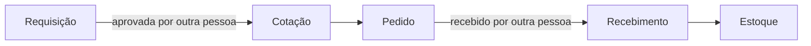
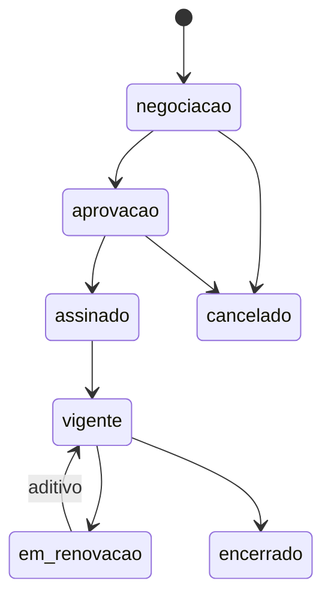

[Índice](README.md) · [Parte anterior](parte-11-pessoas-departamento-pessoal-e-sst.md) · [Próxima parte](parte-13-atendimento-e-notificacoes.md)

<a id="parte-12"></a>

# Parte 12 — Suprimentos, patrimônio, frotas, contratos e terceiros

## Visão geral da parte 12

Compras seguem requisição, cotação, pedido e recebimento, com separação de funções. Contratos têm ciclo de vida com alçadas, e os prestadores usam o portal de terceiros ([17](parte-07-regras-gerais-dos-modulos-de-gestao.md#doc-17), seção 6; [33](#doc-33); [38](#doc-38)).





**Regras principais**
- Quem pede não aprova a própria requisição e não recebe a própria compra ([22](parte-06-plataforma-saas-clientes-dominios-licencas-e-crm.md#doc-22), seção 5).
- Contrato assinado não é editado: mudança vira aditivo; quem cria a minuta não a aprova ([33](#doc-33), seção 3).
- Patrimônio com depreciação por categoria aprovada pelo contador; categoria sem regra não deprecia (DP-02, [80](parte-19-pendencias-decisoes-e-rastreabilidade.md#doc-80)).
- Pacote de documentos e contratos para o jurídico ([53](#doc-53)).

<a id="doc-33"></a>

## 33 — Gestão de Contratos, por Portal

> Parte do [SDD v2](parte-01-visao-e-escopo.md#doc-00). Regras atuais em [17](parte-07-regras-gerais-dos-modulos-de-gestao.md#doc-17), seção 7. Matriz de portais em [31](parte-05-portais-navegacao-e-interface.md#doc-31). Assinatura e base legal em [26](parte-18-juridico-e-regulatorio.md#doc-26), seção 6. Auditoria em [29](parte-04-seguranca-privacidade-e-auditoria.md#doc-29). Privacidade em [32](parte-04-seguranca-privacidade-e-auditoria.md#doc-32), seção 3.
> **Status:** aprovada pelo autor em 03/11/2026, com as propostas adotadas. Itens sem valor definido continuam pendentes, criada em 03/11/2026 a partir de [`spec_gestao_contratos_completo.md`](#v1-spec-gestao-contratos-completo-md) (v1, 1.376 linhas). Itens **[Decisão do autor]** dependem de resposta. Itens **(jurídico)** dependem de parecer. Este documento não é parecer contratual.
> **Atualização de 03/11/2026:** a assinatura passa a ser serviço comum, usado também por documentos administrativos e emitidos. Ver [54](parte-09-secretaria-matricula-e-documentos.md#doc-54), seção 5.

---

### 1. Estado atual na v2

[17](parte-07-regras-gerais-dos-modulos-de-gestao.md#doc-17), seção 7 tem 6 linhas de entidades, regras e estados. A v1 tem 17 seções, 16 páginas, perfis, abas de cadastro e fluxos. **A v2 não está completa.** Faltam:

- DDL (defeito T-02 em [17](parte-07-regras-gerais-dos-modulos-de-gestao.md#doc-17));
- mapa de contratos por tipo e por portal;
- regras por tipo de contrato;
- fluxo de aprovação com alçadas;
- integração com assinatura;
- monitoramento de obrigações e vigência;
- regra de contrato sensível (dado pessoal, saúde, menor).

---

### 2. Tipos de contrato e a quem pertencem

A v1 lista 13 tipos (seção 2.1). Eles não têm o mesmo dono. Cada um fica em um portal, com parte e papel definidos:

| Tipo | Parte A | Parte B | Dono | Portal de acesso |
|---|---|---|---|---|
| Contrato de cliente (SaaS) | Plataforma | Entidade | Plataforma | Desenvolvedor |
| Contrato de prestação de serviços educacionais (matrícula) | Entidade | Responsável legal e aluno | Entidade | Gestão; assinatura pelo Responsáveis |
| Contrato de trabalho e termos de pessoal | Entidade | Colaborador | Entidade (RH) | Gestão; ciência pelo Professor |
| Contrato de fornecedor e de serviço | Entidade | Fornecedor | Entidade (Compras) | Gestão; ciência pelo Terceiros |
| Contrato de manutenção, locação e parceria | Entidade | Fornecedor ou parceiro | Entidade | Gestão; ciência pelo Terceiros |
| Convênio e contrato institucional | Entidade | Órgão ou instituição | Entidade (Jurídico) | Gestão |
| Acordo de confidencialidade (NDA) | Plataforma ou entidade | Parte externa | Quem assina | Desenvolvedor ou Gestão |
| Acordo de processamento de dados (DPA) | Entidade ou plataforma | Operador | Jurídico | Gestão ou Desenvolvedor; ciência pelo Terceiros |
| Termo aditivo, distrato, renovação | Mesmas partes do contrato original | — | Dono do contrato original | Mesmo portal do original |
| Contrato guarda-chuva (master agreement) | Entidade | Fornecedor | Entidade (Compras) | Gestão |

**Regra:** o portal de origem é o do contrato original. Aditivo e distrato não mudam de portal.

**Pendência:** o contrato de matrícula (aluno ou responsável) e o contrato de cliente são contratos de consumo ou de prestação civil. A forma e as cláusulas dependem de **(jurídico)** ([26](parte-18-juridico-e-regulatorio.md#doc-26), seção 4). Não defino cláusula aqui.

---

### 3. Ciclo de vida

Etapas da v1 (seção 2.2), com donos:

| Etapa | Dono | Saída |
|---|---|---|
| Solicitação | Quem precisa do contrato | Solicitação contratual |
| Triagem | Gestor de contratos | Aceita, devolvida ou recusada |
| Minuta | Gestor de contratos, com modelo | Minuta versionada |
| Revisão interna | Jurídico | Parecer |
| Negociação externa | Gestor de contratos | Versão negociada |
| Aprovação jurídica | Jurídico | Aprovado ou devolvido |
| Aprovação financeira | Financeiro | Aprovado ou devolvido, conforme faixa |
| Aprovação gestora | Gestor | Aprovado |
| Assinatura | Responsável pelo contrato | Assinado |
| Vigência | Sistema | Alerta de vencimento |
| Monitoramento de obrigações | Responsável pela obrigação | Entregas e SLA |
| Reajuste e renovação | Gestor de contratos, com financeiro | Aditivo |
| Encerramento e arquivamento | Gestor de contratos | Estado final |

**Estados do contrato** (já em [17](parte-07-regras-gerais-dos-modulos-de-gestao.md#doc-17), seção 7.3): `negociacao`, `aprovacao`, `assinado`, `vigente`, `em_renovacao`, `encerrado`, `cancelado`.

**Regras de transição:**

- Contrato `assinado` não é editado. Mudança vira aditivo ([17](parte-07-regras-gerais-dos-modulos-de-gestao.md#doc-17)).
- Ausência de cláusula obrigatória bloqueia envio para assinatura ([17](parte-07-regras-gerais-dos-modulos-de-gestao.md#doc-17), seção 7.2).
- Aprovação jurídica é obrigatória por tipo ([17](parte-07-regras-gerais-dos-modulos-de-gestao.md#doc-17)).
- Quem cria a minuta não aprova a própria minuta (segregação, [22](parte-06-plataforma-saas-clientes-dominios-licencas-e-crm.md#doc-22), seção 5).

---

### 4. Alçadas

| Faixa | Aprovação | Valor |
|---|---|---|
| Abaixo da faixa 1 | Gestor da unidade | **Decidido** em 03/11/2026: até R$ 10.000 |
| Faixa 2 | Gestor + financeiro | **Decidido** em 03/11/2026: de R$ 10.000 a R$ 100.000 |
| Acima da faixa 2 | Gestor executivo + financeiro + jurídico | **Decidido** em 03/11/2026: acima de R$ 100.000 |

As faixas acima resolvem a lacuna LAC-01 de [17](parte-07-regras-gerais-dos-modulos-de-gestao.md#doc-17).

---

### 5. Assinatura

Estados (v1, seção 13.4): não iniciado, preparando envio, enviado, visualizado, parcialmente assinado, assinado, rejeitado, expirado, cancelado.

Regras:

- Assinatura eletrônica com validade jurídica depende do tipo de documento e do nível exigido **(jurídico)** ([26](parte-18-juridico-e-regulatorio.md#doc-26), seção 6, e Lei 14.063/2020).
- Assinatura de responsável em contrato de aluno: verificação de identidade do signatário antes do envio ([06](parte-03-identidade-acesso-e-permissoes.md#doc-06)).
- Envelope tem validade. Expirado não é reaberto; novo envelope é criado.
- Assinatura de terceiro: o portal de terceiros mostra só o próprio contrato.
- Documento assinado é guardado com hash e trilha ([21](parte-16-dados-validacoes-configuracoes-e-armazenamento.md#doc-21)).

---

### 6. Obrigações, vigência e renovação

- Obrigação tem responsável, prazo, evidência e SLA. Vencida sem evidência gera alerta.
- Alerta de vencimento: antecedência configurável por tipo de contrato. Antecedência padrão decidida em 03/11/2026: 60 e 30 dias.
- Renovação automática só se o tipo permitir. Renovação sem aprovação não entra em vigor.
- Reajuste aplica índice definido no contrato. Reajuste sem índice exige aditivo.

---

### 7. Compliance do contrato

A aba de compliance (v1, seção 8.8) guarda: tratamento de dado pessoal, base legal vinculada, DPA anexado, NDA assinado, política de retenção, criticidade do risco, due diligence concluída, documentos regulatórios e data da última revisão.

**Regra:** contrato com tratamento de dado pessoal não é assinado sem DPA anexado. Essa regra é do sistema, não só do processo ([26](parte-18-juridico-e-regulatorio.md#doc-26)).

**Contrato com dado de menor:** exige revisão de privacidade antes da assinatura ([32](parte-04-seguranca-privacidade-e-auditoria.md#doc-32), seção 3.2).

---

### 8. Perfis

A v1 define nove perfis (seção 4.1): SA, GE, GC, JU, FI, CO, OP, AU e VI. Eles valem **dentro do portal de gestão**. Para os outros portais valem os papéis de [22](parte-06-plataforma-saas-clientes-dominios-licencas-e-crm.md#doc-22), seção 5.

| Perfil v1 | Papel na v2 | Portal |
|---|---|---|
| SA — Super Admin | Administrador da entidade | Gestão |
| GE — Gestor Executivo | Gestor executivo | Gestão |
| GC — Gestor de Contratos | Gestor de contratos | Gestão |
| JU — Jurídico | Jurídico | Gestão |
| FI — Financeiro | Financeiro | Gestão |
| CO — Compras | Compras | Gestão |
| OP — Operacional | Operacional, somente execução | Gestão |
| AU — Auditor | Auditor | Gestão, somente leitura ([29](parte-04-seguranca-privacidade-e-auditoria.md#doc-29), seção 5) |
| VI — Visualizador | Consulta restrita conforme escopo | Gestão |

Contratos de cliente (SaaS) são geridos no portal do desenvolvedor pelo papel de comercial e jurídico da plataforma ([22](parte-06-plataforma-saas-clientes-dominios-licencas-e-crm.md#doc-22), seção 4.1).

---

### 9. Páginas e portal

A v1 tem 16 páginas (seção 5). Por portal:

| Página v1 | Portal |
|---|---|
| Dashboard de contratos | Gestão |
| Contratos | Gestão |
| Solicitações contratuais | Gestão |
| Minutas e modelos | Gestão (jurídico) |
| Aprovações | Gestão |
| Assinaturas | Gestão |
| Vigência e renovações | Gestão |
| Obrigações e SLAs | Gestão |
| Aditivos e reajustes | Gestão |
| Partes e contrapartes | Gestão |
| Documentos e anexos | Gestão |
| Calendário contratual | Gestão |
| Kanban operacional | Gestão |
| Compliance e riscos | Gestão (jurídico) e Desenvolvedor (contratos de cliente) |
| Auditoria | Gestão (AU) |
| Configurações do módulo | Gestão (SA) |

Portal do desenvolvedor: contratos de cliente, com as mesmas páginas de vigência, aprovação e assinatura.

Portal de terceiros: **somente** os contratos do próprio fornecedor, com estado e vigência. Sem aprovação interna, sem minuta, sem compliance.

Portal de responsáveis: contrato de matrícula do próprio aluno, para assinatura e consulta.

Portal do professor: contrato de trabalho próprio, para ciência. Sem outros contratos.

---

### 10. Pendências

| # | Pendência | Tipo |
|---|---|---|
| CTR-01 | DDL de contrato, parte, obrigação, aditivo, solicitação, assinatura (T-02) | **Escrito** em [51](parte-16-dados-validacoes-configuracoes-e-armazenamento.md#doc-51), seção 3. Revisão do owner pendente (DDL-01) |
| CTR-02 | Faixas de alçada (seção 4) | **Decidido** em 03/11/2026: até R$ 10.000, de R$ 10.000 a R$ 100.000, e acima, com jurídico |
| CTR-03 | Antecedência padrão de alerta (seção 6) | **Decidido** em 03/11/2026: 60 e 30 dias antes do vencimento |
| CTR-04 | Forma de assinatura por tipo de contrato | (jurídico) |
| CTR-05 | Cláusulas obrigatórias por tipo | (jurídico) |
| CTR-06 | Provedor de assinatura eletrônica | **Decidido** em 03/11/2026: aceitar todos os provedores de terceiros e criar assinatura digital própria, certificada e aprovada pelos órgãos competentes. A assinatura própria depende de credenciamento na ICP-Brasil **(verificar, jurídico)** |
| CTR-07 | Contrato de matrícula: forma, cláusulas e prazo de guarda | (jurídico) |

---

### 11. Critérios de aceite

- [ ] Cada tipo de contrato da seção 2 tem dono e portal de origem.
- [ ] Transições da seção 3 testadas; contrato assinado não é editado.
- [ ] Alçada aplicada pela aplicação, não só pelo processo.
- [ ] Contrato com dado pessoal não é enviado para assinatura sem DPA.
- [ ] Portal de terceiros e de responsáveis mostram só o próprio contrato.
- [ ] DDL escrito para todas as entidades (CTR-01).
- [ ] Itens **[Decisão do autor]** e **(jurídico)** respondidos ou marcados como pendentes no [00](parte-01-visao-e-escopo.md#doc-00).

### 12. Decisões de 03/11/2026

**CTR-02 (faixas de alçada): aprovado como padrão inicial, ajustável por entidade.**

| Faixa | Valor do contrato | Aprovação |
|---|---|---|
| 1 | Até R$ 10.000,00 | Gestor da unidade |
| 2 | Acima de R$ 10.000,00 até R$ 100.000,00 | Gestor executivo e financeiro |
| 3 | Acima de R$ 100.000,00 | Gestor executivo, financeiro e jurídico |

Prazo total ou valor mensal, o que for maior, define a faixa. Contrato que muda de faixa por aditivo é reaprovado na faixa nova.

**CTR-03 (antecedência de alerta de vencimento): aprovado.** Alerta aos 60 dias e novo alerta aos 30 dias antes do vencimento, para contratos de vigência determinada.

<a id="doc-53"></a>

## 53 — Pacote para Parecer Jurídico: Contratos, Declarações, Boletins e Demais Documentos

> Parte do [SDD v2](parte-01-visao-e-escopo.md#doc-00). Pacote de consulta, complementar ao [50](parte-18-juridico-e-regulatorio.md#doc-50). Os tipos de contrato estão em [33](#doc-33). Os tipos de documento emitido estão em [48](parte-09-secretaria-matricula-e-documentos.md#doc-48). Acervo escolar em [17](parte-07-regras-gerais-dos-modulos-de-gestao.md#doc-17).
> **Natureza deste documento:** pacote de consulta. Não é parecer. As "posições propostas" são o que o SDD adota para desenhar o sistema. O jurídico confirma, corrige ou recusa cada uma.
> **Citações legais:** todas marcadas **a confirmar**. Não foram verificadas contra o texto vigente.
> **Códigos:** DC-01 a DC-28, em 6 blocos. Responde-se com o campo de resposta da seção 9.

---

### 1. Escopo

O sistema produz e recebe documentos em quatro grupos:

| Grupo | Exemplos | Quem assina |
|---|---|---|
| Contratos | Matrícula, prestação de serviço a fornecedor, aditivo, parceria | Partes do contrato |
| Declarações e certidões | Declaração de matrícula, de frequência, de conclusão, de quitação, certidão de conclusão | Secretaria, com código de validação |
| Acervo escolar | Histórico, boletim, registro de classe, ata de resultados finais | Secretaria, com assinatura oficial |
| Outros | Termo de responsabilidade, requerimento, autorização, comunicado, certificado, ata de conselho | Conforme o tipo |

---

### 2. Bloco A: contratos

| Código | Pergunta | Contexto no sistema | Posição proposta | Alternativa | Onde |
|---|---|---|---|---|---|
| DC-01 | Contrato de matrícula: é contrato de adesão, e quais cláusulas são obrigatórias | Gerado no wizard de matrícula | Contrato de adesão, com cláusulas obrigatórias do sistema de ensino e destaque das cláusulas que limitam direitos | Contrato negociado por aluno | [33](#doc-33), CTR-05 |
| DC-02 | Contrato de matrícula com menor: quem assina e com que validade | Responsável assina por aluno menor | Responsável legal assina. Aluno maior assina o próprio contrato | Assinatura do aluno em qualquer idade | [46](parte-09-secretaria-matricula-e-documentos.md#doc-46), M-09 |
| DC-03 | Forma de assinatura por tipo de contrato | Matrícula, prestação e aditivo | Assinatura digital com certificado ICP-Brasil para matrícula e prestação. Assinatura simples para aditivo e termos internos **a confirmar** | ICP-Brasil para tudo | [33](#doc-33), CTR-04 |
| DC-04 | Contrato de prestação de serviço a fornecedor: cláusulas de proteção de dados | Fornecedor com acesso a dado pessoal | DPA (acordo de tratamento de dados) assinado antes do acesso. Exigência prevista em [33](#doc-33) | Contrato sem DPA | [33](#doc-33), seção 2 |
| DC-05 | Aditivo de contrato: quando exige nova assinatura | Mudança de valor, turma ou prazo | Aditivo assinado pelas mesmas partes. Mudança de valor exige aditivo, não edição | Edição direta com registro | [33](#doc-33), seção 3 |
| DC-06 | Renovação automática de contrato: aviso e direito de recusa | Contratos com renovação automática | Aviso de 60 dias antes. Direito de recusa expresso no contrato | Renovação sem aviso | [33](#doc-33), seção 6 |
| DC-07 | Contrato de matrícula e inadimplência: o contrato continua válido durante bloqueio parcial | Bloqueio parcial de portal | Contrato segue vigente. Bloqueio parcial não é rescisão | Rescisão automática | [26](parte-18-juridico-e-regulatorio.md#doc-26), seção 3 |
| DC-08 | Guarda de contratos assinados: prazo | Arquivo de contratos | Prazo de cinco anos após o fim do contrato, salvo norma específica **a confirmar** | Prazo do sistema de ensino | [33](#doc-33), seção 7 |

---

### 3. Bloco B: declarações e certidões

| Código | Pergunta | Contexto no sistema | Posição proposta | Alternativa | Onde |
|---|---|---|---|---|---|
| DC-09 | Declaração de matrícula: validade e uso | Emitida para órgãos e empresas | Validade de 90 dias, por padrão, indicada no documento. Pode ser validada pelo código | Sem validade | [48](parte-09-secretaria-matricula-e-documentos.md#doc-48), seção 3 |
| DC-10 | Declaração de frequência: base de dados | Frequência calculada de chamadas e de sala online | Frequência só com registro de chamada oficial. Presença online conta quando for a origem oficial | Presença online não conta para declaração | [17](parte-07-regras-gerais-dos-modulos-de-gestao.md#doc-17), seção 4 |
| DC-11 | Certidão de conclusão de curso: quando é emitida | Pós-EAD e cursos livres | Emitida após a conclusão registrada, com assinatura e registro | Emitida a pedido sem conclusão | [46](parte-09-secretaria-matricula-e-documentos.md#doc-46), seção 5 |
| DC-12 | Declaração de quitação: quais parcelas considera | Quitação de mensalidades | Considera as parcelas vencidas até a data de emissão. Declara o período citado | Quitação total do contrato | [34](parte-10-financeiro-pagamentos-e-fiscal.md#doc-34) |
| DC-13 | Validação pública de documento: quais dados aparecem | Código e QR no documento | Tipo, data, situação e entidade. Sem nome, CPF ou nota | Nome com data de nascimento | [48](parte-09-secretaria-matricula-e-documentos.md#doc-48), seção 6 |
| DC-14 | Segunda via de documento: pode ter data nova | Reemissão | Segunda via indica que é reemissão e mantém a data de origem | Nova data sem indicação | [48](parte-09-secretaria-matricula-e-documentos.md#doc-48) |

---

### 4. Bloco C: acervo escolar

| Código | Pergunta | Contexto no sistema | Posição proposta | Alternativa | Onde |
|---|---|---|---|---|---|
| DC-15 | Histórico escolar: layout e conteúdo obrigatórios | Emissão de histórico | Conforme a norma do sistema de ensino da entidade, incluindo a referência legal no documento **a confirmar** | Layout próprio | [48](parte-09-secretaria-matricula-e-documentos.md#doc-48), DOC-03 |
| DC-16 | Boletim: pode ser emitido antes do fechamento do período | Boletim parcial para família | Boletim parcial identificado como parcial. Não substitui o histórico | Boletim só após fechamento | [17](parte-07-regras-gerais-dos-modulos-de-gestao.md#doc-17) |
| DC-17 | Registro de classe e ata de resultados finais: guarda permanente ou por prazo | Acervo de turma | Prazo do sistema de ensino da entidade, com referência gravada **a confirmar** | Guarda permanente | [26](parte-18-juridico-e-regulatorio.md#doc-26), seção 3 |
| DC-18 | Ata de conselho de classe: quem assina | Reunião de conselho | Presidente e secretário da reunião. Registro com data e pauta | Assinatura de todos os presentes | [17](parte-07-regras-gerais-dos-modulos-de-gestao.md#doc-17) |
| DC-19 | Certificado de participação em evento pastoral ou escolar: quando tem validade de documento oficial | Certificados de evento | Certificado de evento não é documento oficial. Não substitui histórico | Certificado com força de documento oficial | [43](parte-08-academico.md#doc-43), seção 3.4 |

---

### 5. Bloco D: termos, autorizações e requerimentos

| Código | Pergunta | Contexto no sistema | Posição proposta | Alternativa | Onde |
|---|---|---|---|---|---|
| DC-20 | Termo de responsabilidade de equipamento: texto e assinatura | Retirada de notebook, projetor, kit | Termo aceito no portal, com dados do equipamento e da pessoa. Assinatura simples | Assinatura física | [44](parte-08-academico.md#doc-44), AMB-06 |
| DC-21 | Autorização de saída de aluno menor: validade e forma | Retirada na portaria | Autorização do responsável com data e validade. Forma digital, por vínculo verificado | Autorização permanente | [35](parte-03-identidade-acesso-e-permissoes.md#doc-35), seção 3.3 |
| DC-22 | Autorização de uso de imagem: quando é exigida | Fotos e vídeos em evento | Autorização específica, por escrito, com finalidade e prazo. Sem autorização não publica | Autorização geral na matrícula | [43](parte-08-academico.md#doc-43), seção 6 |
| DC-23 | Requerimento de segunda chamada, trancamento e transferência: prazo de resposta | Pedidos da secretaria | Prazo do serviço de atendimento ([32](parte-04-seguranca-privacidade-e-auditoria.md#doc-32)). Negativa com motivo | Sem prazo | [46](parte-09-secretaria-matricula-e-documentos.md#doc-46) |

---

### 6. Bloco E: documentos de terceiros e de cobrança

| Código | Pergunta | Contexto no sistema | Posição proposta | Alternativa | Onde |
|---|---|---|---|---|---|
| DC-24 | Nota fiscal recebida de fornecedor: a plataforma só recebe e valida, não emite | Portal de terceiros | Recebe e valida. Emissão fica com o fornecedor. Decidido pelo autor em 03/11/2026 **a confirmar** a parte fiscal | Emissão pela plataforma | [34](parte-10-financeiro-pagamentos-e-fiscal.md#doc-34), PAG-06 |
| DC-25 | Boleto com instruções: texto obrigatório | Cobrança | Texto com instruções de pagamento e canal de contestação | Texto livre | [34](parte-10-financeiro-pagamentos-e-fiscal.md#doc-34) |
| DC-26 | Comunicado institucional com dado pessoal: base e forma de envio | Comunicado a famílias | Comunicado com dado mínimo. Dado sensível nunca em comunicado em massa | Comunicado com dado completo | [07](parte-04-seguranca-privacidade-e-auditoria.md#doc-07) |

---

### 7. Bloco F: atas, relatórios e dossiês

| Código | Pergunta | Contexto no sistema | Posição proposta | Alternativa | Onde |
|---|---|---|---|---|---|
| DC-27 | Ata de reunião com participação de menor ou dado de saúde: guarda e acesso | Reunião com responsável e atendimento | Acesso restrito aos participantes e à direção. Dado sensível fora da ata | Ata aberta à comunidade | [40](parte-08-academico.md#doc-40), seção 5 |
| DC-28 | Dossiê do aluno: quais documentos entram e quem acessa | Pasta digital do aluno | Acesso pelo papel da secretaria e pelo próprio aluno ou responsável. Sem dado de saúde para a secretaria | Acesso amplo da escola | [48](parte-09-secretaria-matricula-e-documentos.md#doc-48), seção 3 |

---

### 8. Itens que não são de jurídico

| Item | Responsável | Onde |
|---|---|---|
| Layout visual dos modelos | Gestão de documentos | [48](parte-09-secretaria-matricula-e-documentos.md#doc-48), seção 5 |
| Teste de validação pública | Qualidade | [49](parte-17-operacao-qualidade-testes-e-ti.md#doc-49) |

---

### 9. Campo de resposta

| Código | Confirma | Corrige (posição correta e referência) | Recusa (motivo) | Responsável | Data |
|---|---|---|---|---|---|
| DC-01 a DC-28 | | | | | |

---

### 10. Referências a confirmar

- Código Civil e Código de Defesa do Consumidor, sobre contrato de adesão e cláusulas de prestação de serviço **a confirmar**.
- LGPD, sobre acordo de tratamento com fornecedor **a confirmar**.
- Lei de Diretrizes e Bases e normas do sistema de ensino, sobre histórico, acervo e guarda **a confirmar**.
- Estrutura de ICP-Brasil e assinatura simples, para os contratos **a confirmar**.
- Regras fiscais de nota de fornecedor **a confirmar**.

<a id="doc-38"></a>

## 38 — Portal de Terceiros: Prestadores de Serviço, por Tipo, com Acesso Restrito ao Próprio Escopo

> Parte do [SDD v2](parte-01-visao-e-escopo.md#doc-00). Portal em [23](parte-06-plataforma-saas-clientes-dominios-licencas-e-crm.md#doc-23), seção 1. Matriz em [31](parte-05-portais-navegacao-e-interface.md#doc-31), seção 2.6. Contratos em [33](#doc-33). Identidade e vínculo em [06](parte-03-identidade-acesso-e-permissoes.md#doc-06), seção 12. Nota fiscal em [34](parte-10-financeiro-pagamentos-e-fiscal.md#doc-34), seção 5.3. Acesso físico em [35](parte-03-identidade-acesso-e-permissoes.md#doc-35). Atendimento em [32](parte-04-seguranca-privacidade-e-auditoria.md#doc-32).
> **Status:** especificação proposta, criada em 03/11/2026. Itens **(verificar)** dependem de conferência de norma setorial. Itens **[Decisão do autor]** dependem de resposta.

---

### 1. Modelo

Um **prestador** é uma pessoa jurídica ou um MEI que a entidade contrata. O acesso não é dado à empresa como um todo. É dado a **pessoas** do prestador, e cada pessoa só enxerga o que o **contrato** dela cobre.

```
Prestador (CNPJ)
  └── Contrato (33), com vigência e status
        ├── Serviços habilitados (tipo de prestador, seção 3)
        ├── Unidades cobertas
        └── Pessoas do prestador (vínculo tipo "prestador")
              └── Papel dentro do serviço
```

O acesso de uma pessoa é a **interseção** de quatro filtros. Se algum falhar, a resposta é vazia:

| Filtro | Fonte |
|---|---|
| Contrato `vigente` | [33](#doc-33), seção 3 |
| Serviço habilitado | Tipo de prestador (seção 3) |
| Unidade coberta | Contrato, seção 4 |
| Papel da pessoa no prestador | Vínculo, seção 2 |

**Regra de default:** nenhum dado é retornado sem filtro de contrato. Consulta sem contrato vigente é recusada na aplicação ([02](parte-02-arquitetura-e-tenancy.md#doc-02), seção 2), não só na tela.

---

### 2. Pessoas e papéis do prestador

| Papel | Pode | Não pode |
|---|---|---|
| Responsável do prestador | Gerir as pessoas do próprio prestador, enviar documentos, acompanhar pedidos | Ver pessoas de outro prestador. Aprovar a própria nota |
| Operador | Executar as ações do serviço habilitado | Alterar contrato, ver faturamento |
| Financeiro do prestador | Ver pedidos e pagamentos do próprio contrato, enviar nota | Alterar dados bancários sem confirmação por MFA |
| Auditor do prestador | Ler o próprio histórico | Alterar qualquer registro |

Vínculo do prestador: conta global ([06](parte-03-identidade-acesso-e-permissoes.md#doc-06), seção 12) com vínculo do tipo `prestador`, que guarda o `contrato_uuid`. Quando o contrato termina, o vínculo é revogado em até 30 s ([30](parte-02-arquitetura-e-tenancy.md#doc-30), seção 4).

---

### 3. Tipos de prestador

Cada tipo tem um **pacote fixo** de ações e de dados. A entidade habilita o pacote no contrato. Nenhum tipo recebe dado de outro tipo.

#### 3.1 Jurídico (escritório de advocacia)

| Pode | Não pode |
|---|---|
| Ver contratos, pareceres e processos designados | Ver financeiro completo da entidade |
| Registrar parecer e minuta ([33](#doc-33), seção 8, perfil JU) | Aprovar contrato como gestor |
| Ver dado de aluno apenas em processo designado, com motivo | Ver lista geral de alunos |

Sigilo profissional. Todo acesso a processo gera evento de auditoria com motivo ([29](parte-04-seguranca-privacidade-e-auditoria.md#doc-29)).

#### 3.2 Contabilidade

| Pode | Não pode |
|---|---|
| Lançamentos, obrigações e tributos do escopo | Ver folha detalhada por colaborador. Recebe só totais |
| Propor fechamento, que o contador da entidade aprova | Fechar período sozinho |
| Exportar para o ERP do contador | Ver dado de saúde ou de aluno |

Lançamento proposto pelo prestador tem origem registrada. Aprovação é do contador da entidade ([22](parte-06-plataforma-saas-clientes-dominios-licencas-e-crm.md#doc-22), seção 5).

#### 3.3 Cartório (serviço notarial ou registral contratado)

| Pode | Não pode |
|---|---|
| Receber pedido de autenticação ou reconhecimento de documento indicado pela entidade | Ver outros documentos do titular |
| Devolver status e selo digital, quando o cartório emitir | Alterar o documento original |

Dado do titular aparece mascarado (CPF e e-mail, [29](parte-04-seguranca-privacidade-e-auditoria.md#doc-29), seção 6). Validade jurídica do selo **(verificar)** com o tipo de ato.

#### 3.4 Alimentação escolar (lanchonete ou fornecedor de merenda)

| Pode | Não pode |
|---|---|
| Ver cardápio aprovado por nutricionista e quantidade de refeições por unidade e dia | Ver lista nominal de alunos sem restrição |
| Registrar entrega, temperatura e validade, conforme a RDC ANVISA nº 216/2004 (ver regra abaixo) | Ver histórico de compra da entidade com outro prestador |
| Receber lista de restrição alimentar, sem diagnóstico | Ver diagnóstico ou CID |

Regra de dado da alimentação, conferida em 03/11/2026 no texto da RDC ANVISA nº 216/2004 (bvsms.saude.gov.br). A RDC vale para cantinas e cozinhas institucionais (item 1.2). Leitura nossa: inclui cantina escolar e cozinha de merenda. A vigilância sanitária local pode complementar (art. 2º).

| Registro | Limite que o sistema confere |
|---|---|
| Cocção | Pelo menos 70 ºC em todas as partes do alimento (4.8.8) |
| Conservação a quente | Acima de 60 ºC por no máximo 6 horas (4.8.15) |
| Resfriamento | De 60 ºC a 10 ºC em até 2 horas, depois abaixo de 5 ºC ou a -18 ºC ou menos (4.8.16) |
| Preparado refrigerado | Até 5 dias a 4 ºC ou menos. Entre 4 ºC e 5 ºC, prazo menor, configurado pelo prestador (4.8.17) |
| Identificação | Designação, data de preparo e validade no preparado e no aguardando transporte. Data de abertura e nova validade no ingrediente aberto (4.8.6, 4.8.18 e 4.9.1) |
| Transporte e exposição | Temperatura monitorada e registrada (4.9.2 e 4.10.3) |
| Guarda | Registros mantidos por no mínimo 30 dias da data de preparo (4.11.3). O sistema guarda pelo prazo do contrato, nunca menos de 30 dias |

Valor fora do limite gera ocorrência para o responsável da entidade. O registro não é apagado nem corrigido sem rastro.

**Restrição alimentar** é dado de saúde ([07](parte-04-seguranca-privacidade-e-auditoria.md#doc-07), seção 2). O prestador recebe apenas o aviso "restrição: sim" e o tipo de alimento a evitar, com consentimento do responsável **(jurídico)**. Não recebe a condição clínica.

#### 3.5 Transporte escolar

| Pode | Não pode |
|---|---|
| Ver rotas, horários e pontos do contrato | Ver endereço completo do aluno |
| Ver lista de embarque por ponto, com nome e turma | Ver CPF, saúde ou notas |
| Registrar embarque e desembarque | Ver histórico de localização passado |
| Rastrear o veículo durante a viagem, sem identificar o aluno no mapa | Ver localização de aluno fora da viagem |

**Dado de menor com localização** é o caso de maior risco desta seção. Regras:

- A localização do veículo só é transmitida durante a viagem. Não há histórico além do necessário para a viagem, com prazo de 30 dias, decidido em 03/11/2026.
- Embarque só com autorização do responsável registrada ([35](parte-03-identidade-acesso-e-permissoes.md#doc-35), seção 3.3).
- Alerta de desvio de rota vai para a coordenação e para o responsável, não para o prestador.
- Base legal e prazo de guarda **(jurídico)**.

#### 3.6 Transportadora (carga e entrega de materiais)

| Pode | Não pode |
|---|---|
| Ver pedidos de compra e ordens de entrega do contrato | Ver dado pessoal de qualquer pessoa |
| Registrar coleta, entrega e comprovante | Ver rota de veículo de outro prestador |
| Rastrear a carga | Ver frota da entidade além das próprias cargas |

Rastreio é de carga, não de pessoa.

#### 3.7 Tecnologia da informação (terceirizado de TI)

| Pode | Não pode |
|---|---|
| Atender chamados de TI do escopo ([36](parte-17-operacao-qualidade-testes-e-ti.md#doc-36)) | Ver banco de dados de pessoas |
| Ver a vista de ativos de TI do escopo | Alterar contrato ou configuração de segurança |
| Acesso remoto só com chamado aberto, passkey e sessão gravada | Acesso remoto permanente |

Acesso remoto de terceiro é o caminho de maior risco de TI. Exige chamado vinculado, janela de atendimento e registro da sessão ([36](parte-17-operacao-qualidade-testes-e-ti.md#doc-36), seção 6).

#### 3.8 Limpeza e manutenção predial

| Pode | Não pode |
|---|---|
| Ver ordens de serviço, cronograma e áreas do contrato | Ver dado de aluno ou de colaborador |
| Solicitar crachá temporário pela portaria ([35](parte-03-identidade-acesso-e-permissoes.md#doc-35)) | Ver registro de acesso de outras pessoas |
| Registrar execução e foto da área sem pessoa identificável | Ver câmera |

#### 3.9 Vigilância e segurança patrimonial

| Pode | Não pode |
|---|---|
| Ver plantão, rondas e ocorrências do contrato | Ver câmera ao vivo fora de ocorrência aberta |
| Registrar ocorrência | Exportar imagem |
| Ver lista de visitantes autorizados do dia | Ver histórico de visitantes |

Acesso a imagem, quando permitido por ocorrência, gera evento de auditoria com motivo e tempo limitado ([35](parte-03-identidade-acesso-e-permissoes.md#doc-35), seção 6).

#### 3.10 Uniformes, material didático e livraria

| Pode | Não pode |
|---|---|
| Ver pedidos, catálogo e entregas do contrato | Ver lista nominal de alunos |
| Ver quantidades por série, tamanho e unidade | Ver dado pessoal além do destinatário da entrega, quando necessário |
| Emitir nota da venda ([34](parte-10-financeiro-pagamentos-e-fiscal.md#doc-34), seção 5.3) | Ver pagamento de outro prestador |

#### 3.11 Saúde ocupacional terceirizada (clínica de ASO)

| Pode | Não pode |
|---|---|
| Receber agendamento de exame ocupacional: nome, função, tipo de exame | Ver histórico de exame de outro colaborador |
| Devolver resultado: apto, inapto ou apto com restrição, e o ASO | Ver CID, diagnóstico ou prontuário fora do ASO |
| Médico responsável com CRM válido | Acessar sistema da entidade além do agendamento |

Regra de dado: o prontuário fica sob responsabilidade do médico responsável pelo PCMSO, ou do médico que fez o exame quando a entidade é dispensada do PCMSO (NR-7, 7.6.1). A entidade é obrigada a manter o prontuário por no mínimo 20 anos após o desligamento (7.6.1.1). Por isso, o contrato com a clínica garante a guarda pelo prazo e a transferência formal dos prontuários quando o médico responsável ou a clínica mudar (7.6.1.2). A entidade recebe o resultado e o ASO, não o prontuário. Prontuário eletrônico segue o Conselho Federal de Medicina (7.6.1.3) **(verificar)**.

#### 3.12 Consultoria pedagógica e treinamento

| Pode | Não pode |
|---|---|
| Ver turmas e conteúdo de formação do contrato | Ver notas ou dado de aluno |
| Registrar presença de participantes | Ver dado pessoal além de nome e função, para certificado |

---

### 4. Contrato e unidades

- Contrato de prestador segue [33](#doc-33). Acesso só começa com contrato `vigente`.
- Unidade coberta é lista explícita. Contrato de uma unidade não dá acesso às outras, mesmo na mesma entidade ([03](parte-02-arquitetura-e-tenancy.md#doc-03)).
- Aditivo que inclui unidade ou serviço só passa a valer depois da aprovação, pela alçada de [33](#doc-33), seção 12.

---

### 5. Habilitação e ciclo de vida

| Etapa | Regra |
|---|---|
| Cadastro | CNPJ válido e situação ativa. Verificação na base pública **(verificar)** |
| Documentos | Os exigidos pelo tipo: alvará, seguro, certidões trabalhistas e previdenciárias **(verificar)** |
| Contrato | Assinado ([33](#doc-33), seção 5) |
| Convite | Cada pessoa é convidada pelo responsável do prestador. Convite com validade de 72 h ([06](parte-03-identidade-acesso-e-permissoes.md#doc-06)) |
| Ativo | Documentos em dia e contrato vigente |
| Suspenso | Certidão vencida, contrato vencido ou irregularidade. Sem novo pedido |
| Encerrado | Vínculos revogados. Dados devolvidos ou expurgados conforme o contrato ([23](parte-06-plataforma-saas-clientes-dominios-licencas-e-crm.md#doc-23), seção 5) |

**Alerta:** certidão vencendo em 30 dias.

---

### 6. Segregação e isolamento

1. Um prestador não vê outro prestador, nem o nome dele em lista de fornecedores, salvo cadastro público exigido por lei **(verificar)**.
2. Quem executa o serviço não aprova a própria nota ou o próprio pagamento.
3. Pessoa do prestador que sai do quadro do prestador perde o vínculo na mesma hora, pelo responsável do prestador.
4. Consulta que cruza dois prestadores é recusada e gera alerta.

---

### 7. Auditoria

Todo acesso de prestador grava evento com `portal = terceiros`, `prestador_uuid`, `contrato_uuid`, serviço e unidade ([29](parte-04-seguranca-privacidade-e-auditoria.md#doc-29), seção 2). Leitura de dado pessoal de titular é marcada como dado sensível.

---

### 8. Pendências

| # | Pendência | Tipo |
|---|---|---|
| TER-01 | Tipos personalizados: regra de criação (seção 11) | **Decidido** em 03/11/2026 |
| TER-02 | Prazo de guarda do rastro de localização do transporte escolar (seção 11) | **Decidido** em 03/11/2026: 30 dias depois da viagem. Parecer do (jurídico) pendente |
| TER-03 | Base legal do transporte escolar e de restrição alimentar | (jurídico) |
| TER-04 | Norma sanitária para registro de temperatura e validade na alimentação | **Conferido** em 03/11/2026: RDC ANVISA nº 216/2004, itens 4.8 a 4.11. Fica para conferir norma sanitária local e se há RDC posterior que a substitua |
| TER-05 | Guarda de prontuário pela clínica de ASO | **Conferido** em 03/11/2026: NR-7, 7.6.1 a 7.6.1.2. Contrato com a clínica garante 20 anos e transferência. Regra do CFM para prontuário eletrônico **(verificar)** |
| TER-06 | Validade do selo do cartório digital por tipo de ato | (verificar) |
| TER-07 | Documentos exigidos por tipo (alvará, seguro, certidões) | (verificar) |
| TER-08 | Acesso remoto de TI: janela e forma de gravação (seção 11) | **Incluído** em 03/11/2026 |

---

### 9. Critérios de aceite

- [ ] Pessoa de prestador A não obtém dado de prestador B (teste de isolamento por par).
- [ ] Pessoa com contrato encerrado perde acesso em até 30 s (teste).
- [ ] Prestador de tipo X não recebe campo fora do pacote do tipo (teste por tipo).
- [ ] Transporte escolar: nenhum endereço completo ou localização fora da viagem aparece para o prestador (teste).
- [ ] Restrição alimentar sem diagnóstico (teste de varredura de resposta).
- [ ] Acesso remoto de TI sem chamado aberto é recusado (teste).
- [ ] Itens **(verificar)** e **[Decisão do autor]** respondidos ou marcados como pendentes no [00](parte-01-visao-e-escopo.md#doc-00).

---

### 11. Decisões de 03/11/2026

**TER-01 (tipos personalizados): decidido.** Os doze tipos da seção 3 são modelos-base. A entidade cria um tipo próprio (por exemplo, "lanchonete com entrega própria") a partir de um modelo-base, com as regras:

- Escolhe serviços apenas do catálogo da plataforma. Não cria serviço fora dele.
- Pode retirar itens do pacote-base, mas não pode incluir campo bloqueado (dado de saúde, CID, diagnóstico, prontuário, gravação de câmera fora de finalidade).
- A criação e cada alteração de pacote exigem aprovação do responsável da entidade e ficam em auditoria ([29](parte-04-seguranca-privacidade-e-auditoria.md#doc-29)).
- Tipo personalizado só recebe os mesmos bloqueios dos tipos-base. Nenhum tipo personalizado ganha acesso que o modelo-base não tinha.

**TER-02 (guarda do rastro de localização do transporte escolar): incluído.** Regra: o rastro de localização do ônibus é guardado só durante a viagem e por um prazo fixo depois, para fins de segurança e de prestação de contas. Ao fim do prazo, o expurgo é automático. Nenhum prestador vê o rastro de um aluno fora da sua viagem. **Valor do prazo: (jurídico).** Até a definição, o sistema não grava o rastro por padrão.

**TER-08 (acesso remoto de TI): incluído.** Regra:

- Acesso remoto só dentro de um chamado aberto, com identificação do técnico e do ativo.
- Janela de acesso definida pela entidade. Padrão inicial: horário comercial da unidade. Fora da janela, o acesso é recusado.
- A sessão é gravada do início ao fim, com data, duração, técnico e ações. A gravação segue a retenção de auditoria ([29](parte-04-seguranca-privacidade-e-auditoria.md#doc-29)).
- Não há gravação de tela que capte dado pessoal sem aviso ao usuário da máquina.

## Especificações da v1 desta parte absorvidas no kit-starter ou sem destino

<a id="v1-spec-gestao-armazenamento-completo-md"></a>

### v1 — `spec_gestao_armazenamento_completo.md` (1380 linhas)

> Situação na v2: Absorvido integralmente no kit-starter. Destino: ficha do kit-starter: `kit-starter/gestao/suprimentos-e-compras/almoxarifado.md`. Quando este texto diverge da v2, vale a v2.

#### O que a v2 muda nesta especificação

Estas regras prevalecem sobre o texto da v1 que vem a seguir.

- Saldo nunca negativo; lote e validade para item controlado ([19](parte-07-regras-gerais-dos-modulos-de-gestao.md#doc-19), seção 5).

#### Texto integral da v1

**Versão:** 1.0  
**Status:** Draft Funcional Completo  
**Módulo:** Storage / Warehouse Management System (WMS)  
**Projeto:** TotusTuusSoftCloud (TTSC)  
**Stack:** PHP 8 puro · MariaDB · Tailwind CSS 4.2 · Supabase · amCharts 5 · Fetch API · FontAwesome 7.2.0  
**Contexto:** SaaS multi-entidade · multi-unidade · multi-usuário · banco segregado por entidade/unidade  
**Identidade padrão:** `id` (auto_increment ordenação) · `uuid` (público/API) · `code` (legível humano)

- Language Standard: Global English
---

#### ÍNDICE

1. [Visão Geral](#1-visão-geral)
2. [Arquitetura de Páginas](#2-arquitetura-de-páginas)
3. [Dashboard de Armazenamento](#3-dashboard-de-armazenamento)
4. [Localizações e Estrutura Física](#4-localizações-e-estrutura-física)
5. [Gestão de Itens / SKUs](#5-gestão-de-itens--skus)
6. [Movimentações (Entradas e Saídas)](#6-movimentações-entradas-e-saídas)
7. [Inventário e Contagem](#7-inventário-e-contagem)
8. [Kanban de Operações](#8-kanban-de-operações)
9. [Automações](#9-automações)
10. [Controles e Rastreabilidade](#10-controles-e-rastreabilidade)
11. [Gerenciamentos](#11-gerenciamentos)
12. [Schema SQL](#12-schema-sql)
13. [Endpoints da API](#13-endpoints-da-api)
14. [Permissões RBAC](#14-permissões-rbac)
15. [Requisitos Não Funcionais](#15-requisitos-não-funcionais)
16. [Checklist de Entrega](#16-checklist-de-entrega)

---

#### 1. VISÃO GERAL

##### 1.1 Objetivo
Gerenciar o ciclo completo de armazenamento físico e virtual de itens dentro das entidades/unidades do SaaS TTSC: recebimento, guarda, movimentação interna, separação, expedição, inventário e rastreabilidade por lote/série/validade.

##### 1.2 Perfis de Acesso

| Código | Perfil                | Descrição                                    |
|--------|-----------------------|----------------------------------------------|
| SA     | Super Admin           | Acesso total a todas as entidades/unidades   |
| GE     | Gestor de Entidade    | Acesso total à entidade vinculada            |
| GU     | Gestor de Unidade     | Acesso total à unidade vinculada             |
| ALM    | Almoxarife / Operador | Operação diária: entradas, saídas, contagens |
| AUD    | Auditor               | Leitura completa, sem escrita                |
| FIN    | Financeiro            | Leitura de custos e valorizações             |
| VIS    | Visitante             | Leitura limitada (sem custos/custos ocultos) |

##### 1.3 Regras de Negócio Globais

- Todo item deve ter `uuid` único e `code` alfanumérico imutável após criação.
- Saldo de estoque nunca pode ser negativo (bloqueio a nível de API).
- Toda movimentação gera registro imutável em `stg_movements` (soft-delete proibido).
- Validade (FEFO), FIFO e LIFO são estratégias configuráveis por depósito.
- Rastreabilidade obrigatória: lote, série ou validade (ao menos um) para itens controlados.
- Cada operação é auditada: `user_id`, `ip`, `timestamp`, `action`, `payload_before`, `payload_after`.

---

#### 2. ARQUITETURA DE PÁGINAS

| # | Rota PHP                                | Título da Página               | Tipo       |
|---|-----------------------------------------|-------------------------------|------------|
| 1 | `/storage/dashboard.php`                | Dashboard de Armazenamento    | Dashboard  |
| 2 | `/storage/locations.php`                | Localizações / Estrutura Física| Grid+CRUD  |
| 3 | `/storage/items.php`                    | Itens / SKUs                  | Datatable  |
| 4 | `/storage/movements/entries.php`        | Entradas                      | Datatable  |
| 5 | `/storage/movements/exits.php`          | Saídas                        | Datatable  |
| 6 | `/storage/movements/transfers.php`      | Transferências Internas       | Datatable  |
| 7 | `/storage/inventory.php`                | Inventário e Contagem         | Datatable  |
| 8 | `/storage/kanban.php`                   | Kanban de Operações           | Kanban     |
| 9 | `/storage/automations.php`              | Automações                    | Config     |
|10 | `/storage/controls/expiry.php`          | Controle de Validade          | Datatable  |
|11 | `/storage/controls/lots.php`            | Controle de Lotes             | Datatable  |
|12 | `/storage/controls/serial.php`          | Controle de Série             | Datatable  |
|13 | `/storage/controls/audit.php`           | Trilha de Auditoria           | Datatable  |
|14 | `/storage/management/warehouses.php`    | Gerenciar Depósitos           | CRUD       |
|15 | `/storage/management/categories.php`    | Gerenciar Categorias          | CRUD       |
|16 | `/storage/management/uom.php`           | Unidades de Medida            | CRUD       |
|17 | `/storage/management/suppliers.php`     | Fornecedores                  | CRUD       |
|18 | `/storage/management/rules.php`         | Regras de Estoque             | Config     |

---

#### 3. DASHBOARD DE ARMAZENAMENTO

**Arquivo:** `/storage/dashboard.php`

##### 3.1 Widgets KPI (Topo — Bento Grid 4 colunas)

| Widget                  | Ícone FA           | Cor       | Cálculo                                          |
|-------------------------|--------------------|-----------|--------------------------------------------------|
| Total de Itens Ativos   | fa-boxes-stacked   | azul      | COUNT(stg_items WHERE status = 'active')         |
| Valor Total em Estoque  | fa-dollar-sign     | verde     | SUM(qty * unit_cost) por unidade/entidade        |
| Movimentações Hoje      | fa-arrow-right-arrow-left | laranja | COUNT(stg_movements WHERE DATE = today)    |
| Itens Abaixo do Mínimo  | fa-triangle-exclamation | vermelho | COUNT(stg_stock WHERE qty < min_qty)        |
| Itens com Validade ≤30d | fa-calendar-xmark  | amarelo   | COUNT(stg_lots WHERE expiry_date ≤ today+30)    |
| Ocupação dos Depósitos  | fa-warehouse       | roxo      | SUM(used_positions) / SUM(total_positions) × 100|

> Layout: 3 widgets linha 1 (largura 1/3 cada) + 3 widgets linha 2 (largura 1/3 cada).

##### 3.2 Charts (amCharts 5)

###### Chart 1 — Evolução de Movimentações (Linha, 30 dias)
- Eixo X: data (últimos 30 dias)
- Eixo Y: quantidade de operações
- Séries: Entradas (verde), Saídas (vermelho), Transferências (azul)
- Tooltip: data · tipo · qtd operações · volume total

###### Chart 2 — Distribuição por Categoria (Donut)
- Fatias: categorias de itens
- Legenda lateral com % e valor R$
- Click em fatia → filtra datatable de itens

###### Chart 3 — Top 10 Itens mais Movimentados (Barra Horizontal)
- Eixo Y: nome do item
- Eixo X: total de movimentações no mês
- Cor: gradiente azul claro → azul escuro

###### Chart 4 — Ocupação por Depósito (Barra Empilhada)
- Eixo X: nome do depósito
- Barras: Ocupado (azul) / Livre (cinza claro)
- Linha secundária: % ocupação

###### Chart 5 — Validades Próximas (Timeline/Gantt mini)
- Eixo X: datas (hoje → +90 dias)
- Barras por item: banda colorida por urgência (verde >60d, amarelo 30–60d, vermelho <30d)

##### 3.3 Datatable Resumo — Alertas Críticos

| Coluna           | Tipo     | Notas                          |
|------------------|----------|-------------------------------|
| Código           | text     | link para item                 |
| Item             | text     | nome + SKU                    |
| Depósito         | badge    | nome do depósito               |
| Tipo de Alerta   | badge    | Estoque Mínimo / Validade / Bloqueado |
| Saldo Atual      | number   | qty com unidade de medida      |
| Mínimo Config.   | number   | qty mínima configurada         |
| Validade         | date     | data de validade mais próxima  |
| Ação             | button   | Repor / Ver / Ajustar          |

**Filtros rápidos:** Todos · Estoque mínimo · Validade · Bloqueados  
**Paginação:** 10 / 25 / 50  
**Export:** CSV · XLSX · PDF

---

#### 4. LOCALIZAÇÕES E ESTRUTURA FÍSICA

**Arquivo:** `/storage/locations.php`

##### 4.1 Visão Geral
Gerencia a árvore física: Entidade → Unidade → Depósito → Zona → Corredor → Prateleira → Posição.

##### 4.2 Controles de Página

- **Botão:** `+ Nova Localização` → abre drawer de criação
- **Seletor de Depósito:** dropdown filtra toda a visualização
- **Modo de visualização:** Toggle `Árvore | Grid | Mapa 2D`
- **Campo de busca:** por código ou nome de localização
- **Breadcrumb:** Entidade › Unidade › Depósito › Zona

##### 4.3 Visualização em Árvore (padrão)

```
📦 Depósito Central (CD-01)
  ├── 🔵 Zona A — Frios
  │   ├── Corredor A1
  │   │   ├── Prateleira A1-01 [12/20 posições ocupadas]
  │   │   └── Prateleira A1-02 [8/20 posições ocupadas]
  └── 🟡 Zona B — Seco
      └── Corredor B1
          └── Prateleira B1-01 [20/20 — LOTADA]
```

- Ícone de status por cor: verde (disponível), amarelo (>80%), vermelho (lotado), cinza (inativo)
- Click na posição → abre painel lateral com itens alocados na posição

##### 4.4 Visualização Grid 2D

- Grid CSS representando corredores × prateleiras
- Cada célula = uma posição física
- Cor por ocupação (heatmap)
- Hover → tooltip com conteúdo
- Click → drawer de detalhe da posição

##### 4.5 Datatable de Localizações

| Coluna           | Tipo    |
|------------------|---------|
| Código           | text    |
| Nome             | text    |
| Tipo             | badge   |
| Depósito / Zona  | text    |
| Capacidade       | number  |
| Ocupado          | progress|
| Status           | badge   |
| Ações            | icon    |

##### 4.6 CRUD Drawers — Localização

###### Drawer: Nova / Editar Localização
- **Campos:**
  - `code` — gerado automaticamente, editável, único
  - `name` — nome descritivo
  - `type` — select: Depósito / Zona / Corredor / Prateleira / Posição
  - `parent_id` — select hierárquico (pai desta localização)
  - `warehouse_id` — select do depósito raiz
  - `capacity` — número inteiro (0 = ilimitado)
  - `uom_id` — unidade de medida de capacidade (m², paletes, caixas)
  - `temperature_min/max` — campos numéricos para zonas climatizadas
  - `is_quarantine` — checkbox (itens em quarentena)
  - `is_picking` — checkbox (posição de picking ativo)
  - `status` — toggle ativo/inativo
  - `notes` — textarea
- **Botões:** Salvar · Cancelar · (editar) Desativar

---

#### 5. GESTÃO DE ITENS / SKUs

**Arquivo:** `/storage/items.php`

##### 5.1 Controles da Página

- **Botão:** `+ Novo Item`
- **Filtros:** Categoria · Status · Tipo de Controle · Depósito
- **Busca:** por código, nome, EAN/barcode
- **Ações em Lote:** Ativar · Inativar · Exportar · Realocar depósito
- **Toggle:** Ver apenas abaixo do mínimo

##### 5.2 Datatable Principal de Itens

| Coluna              | Tipo      | Notas                               |
|---------------------|-----------|-------------------------------------|
| #                   | checkbox  | seleção em lote                     |
| Código / SKU        | text      | link para detalhe                   |
| Nome                | text      | nome + descrição curta              |
| EAN/Barcode         | text      | código de barras                    |
| Categoria           | badge     |                                     |
| Unidade de Medida   | text      |                                     |
| Saldo Atual         | number    | qty + unidade                       |
| Saldo Reservado     | number    | qty reservada por pedidos/saídas    |
| Custo Unitário      | currency  | R$ valor                            |
| Valor Total         | currency  | saldo × custo unitário              |
| Controle            | icons     | 🔵 Lote · 🔴 Série · 🟡 Validade    |
| Mín / Máx           | text      | qty mínima / máxima configurada     |
| Status              | badge     | Ativo / Inativo / Bloqueado         |
| Ações               | icon-btn  | Ver · Editar · Movimentar · Excluir |

**Paginação:** 15 / 30 / 50 / 100  
**Export:** CSV · XLSX · PDF · Etiquetas (ZPL)  
**Ordenação:** por qualquer coluna

##### 5.3 CRUD Drawers — Item

###### Drawer: Novo / Editar Item — Aba "Dados Gerais"
- `code` (automático, editável, único)
- `name` (obrigatório)
- `description` (textarea)
- `ean` (barcode — scanner ou digitação)
- `category_id` (select com categorias)
- `subcategory_id` (select dependente)
- `uom_id` (unidade de medida principal)
- `secondary_uom_id` + `conversion_factor` (unidade secundária + fator)
- `item_type` (select: Produto / Insumo / Embalagem / Ferramenta / EPI)
- `status` (toggle)
- `image` (upload de foto — máx 2MB, WebP/JPG)

###### Drawer: Novo / Editar Item — Aba "Estoque"
- `warehouse_id` (depósito padrão)
- `location_id` (posição padrão)
- `min_qty` (estoque mínimo)
- `max_qty` (estoque máximo)
- `reorder_point` (ponto de reposição)
- `reorder_qty` (quantidade de reposição)
- `stock_strategy` (select: FEFO / FIFO / LIFO)
- `is_lot_controlled` (checkbox)
- `is_serial_controlled` (checkbox)
- `is_expiry_controlled` (checkbox)
- `expiry_alert_days` (dias de antecedência para alerta)

###### Drawer: Novo / Editar Item — Aba "Custos"
- `costing_method` (select: Média Ponderada / PEPS / Padrão Fixo)
- `standard_cost` (custo padrão R$)
- `last_purchase_cost` (custo última compra — leitura)
- `average_cost` (custo médio — calculado automaticamente, leitura)
- `currency` (select moeda)

###### Drawer: Detalhe / Visualização do Item
- Todas as informações em modo leitura
- Histórico de movimentações (datatable mini, últimas 10)
- Gráfico de evolução de saldo (linha, 90 dias) — amCharts 5
- Posições onde o item está alocado (lista com qtd por posição)
- Botões: Editar · Movimentar · Gerar Etiqueta · Bloquear

---

#### 6. MOVIMENTAÇÕES (ENTRADAS E SAÍDAS)

##### 6.1 Entradas — `/storage/movements/entries.php`

###### 6.1.1 Controles de Página
- **Botão:** `+ Nova Entrada`
- **Filtros:** Data · Depósito · Tipo de Entrada · Status · Fornecedor
- **Busca:** por número do documento, NF, pedido de compra
- **Ações em Lote:** Confirmar · Cancelar · Exportar

###### 6.1.2 Datatable de Entradas

| Coluna             | Tipo     | Notas                                    |
|--------------------|----------|------------------------------------------|
| Nº Documento       | text     | link para detalhe                        |
| Data               | date     |                                          |
| Tipo               | badge    | NF Entrada / Transferência / Ajuste / Devolução |
| Fornecedor         | text     |                                          |
| Depósito Destino   | text     |                                          |
| Qtd Itens          | number   | total de linhas                          |
| Volume Total       | number   | qtd total movimentada                    |
| Valor Total        | currency | R$                                       |
| Status             | badge    | Rascunho / Aguardando / Confirmada / Cancelada |
| Operador           | text     | usuário que lançou                       |
| Ações              | icon-btn | Ver · Confirmar · Cancelar · Imprimir    |

###### 6.1.3 Drawer: Nova Entrada

**Seção Cabeçalho:**
- `entry_type` (select: NF Entrada / Devolução de Saída / Ajuste Positivo / Transferência Recebida / Inventário)
- `warehouse_id` (depósito destino)
- `supplier_id` (select — visível para NF e Devolução)
- `document_number` (nº NF / nº pedido)
- `document_date` (data emissão)
- `entry_date` (data de entrada — default hoje)
- `notes` (observações)

**Seção Itens (tabela inline editável):**

| Campo            | Tipo      | Notas                             |
|------------------|-----------|-----------------------------------|
| Item             | autocomplete | busca por código/nome/EAN    |
| Qtd              | number    | obrigatório                       |
| Unidade          | text      | preenchido automaticamente        |
| Localização      | select    | posição de guarda no depósito     |
| Lote             | text      | obrigatório se is_lot_controlled  |
| Nº Série         | text      | obrigatório se is_serial_controlled|
| Validade         | date      | obrigatório se is_expiry_controlled|
| Custo Unit.      | currency  | R$                                |
| Subtotal         | currency  | calculado automaticamente         |
| Ação             | icon-btn  | remover linha                     |

- **Botão:** `+ Adicionar Item`
- **Botão:** `Importar da NF (XML)` — parse automático de XML NF-e
- **Rodapé:** Total Itens · Total Volume · Total R$
- **Botões:** Salvar Rascunho · Confirmar Entrada · Cancelar

---

##### 6.2 Saídas — `/storage/movements/exits.php`

###### 6.2.1 Controles de Página
- **Botão:** `+ Nova Saída`
- **Filtros:** Data · Depósito · Tipo de Saída · Status · Destino
- **Busca:** por número do documento, pedido, requisição

###### 6.2.2 Datatable de Saídas

| Coluna             | Tipo     | Notas                                              |
|--------------------|----------|----------------------------------------------------|
| Nº Documento       | text     | link para detalhe                                  |
| Data               | date     |                                                    |
| Tipo               | badge    | Requisição / Venda / Devolução a Fornecedor / Ajuste / Expedição |
| Destino / Solicitante | text  |                                                    |
| Depósito Origem    | text     |                                                    |
| Qtd Itens          | number   |                                                    |
| Valor Total        | currency |                                                    |
| Status             | badge    | Rascunho / Separação / Confirmada / Cancelada      |
| Operador           | text     |                                                    |
| Ações              | icon-btn | Ver · Separar · Confirmar · Cancelar               |

###### 6.2.3 Drawer: Nova Saída

**Seção Cabeçalho:**
- `exit_type` (Requisição Interna / Venda / Expedição / Devolução Fornecedor / Ajuste Negativo)
- `warehouse_id` (depósito origem)
- `requester_id` (usuário/setor solicitante — para requisições internas)
- `destination` (texto livre ou select de destino externo)
- `document_number` · `document_date` · `exit_date`
- `priority` (select: Normal / Urgente / Crítico)
- `notes`

**Seção Itens (tabela inline editável — mesma estrutura da Entrada):**
- Ao selecionar item: sistema sugere automaticamente lotes/posições seguindo estratégia FEFO/FIFO/LIFO do depósito
- Alerta visual se qtd solicitada > saldo disponível
- Bloqueio de confirmação se saldo insuficiente

**Botões:** Salvar Rascunho · Iniciar Separação · Confirmar Saída · Cancelar

---

##### 6.3 Transferências — `/storage/movements/transfers.php`

###### 6.3.1 Datatable de Transferências

| Coluna              | Tipo     | Notas                              |
|---------------------|----------|------------------------------------|
| Nº Transferência    | text     |                                    |
| Data                | date     |                                    |
| Tipo                | badge    | Interna (mesma unidade) / Externa (entre unidades) |
| Depósito Origem     | text     |                                    |
| Depósito Destino    | text     |                                    |
| Qtd Itens           | number   |                                    |
| Status              | badge    | Aguardando · Em Trânsito · Recebida · Cancelada |
| Ações               | icon-btn |                                    |

###### 6.3.2 Drawer: Nova Transferência

- `transfer_type` (Interna / Entre Unidades)
- `origin_warehouse_id` · `origin_location_id`
- `destination_warehouse_id` · `destination_location_id`
- `transfer_date` · `expected_arrival_date`
- `responsible_id` (responsável pelo transporte)
- Tabela de itens com: item · qtd · lote · série · posição origem → posição destino
- **Botões:** Salvar · Iniciar Transferência · Confirmar Recebimento · Cancelar

---

#### 7. INVENTÁRIO E CONTAGEM

**Arquivo:** `/storage/inventory.php`

##### 7.1 Controles da Página

- **Botão:** `+ Novo Inventário`
- **Filtros:** Depósito · Categoria · Status · Data
- **Busca:** por nº de inventário

##### 7.2 Datatable de Inventários

| Coluna           | Tipo     | Notas                                          |
|------------------|----------|------------------------------------------------|
| Nº Inventário    | text     | link para detalhe                              |
| Depósito         | text     |                                                |
| Tipo             | badge    | Geral / Parcial por Zona / Parcial por Categoria / Cíclico |
| Data Início      | date     |                                                |
| Data Fim         | date     |                                                |
| Itens Contados   | progress | x de y itens                                   |
| Divergências     | number   | qtd de itens com diferença                    |
| Valor Diferença  | currency | R$ impacto total das divergências              |
| Status           | badge    | Planejado / Em Andamento / Aguardando Aprovação / Concluído / Cancelado |
| Ações            | icon-btn | Iniciar · Contar · Revisar · Aprovar · Fechar  |

##### 7.3 Drawer: Novo Inventário

- `inventory_type` (Geral / Parcial Zona / Parcial Categoria / Cíclico)
- `warehouse_id` (depósito)
- `zone_id` (opcional — para parcial por zona)
- `category_id` (opcional — para parcial por categoria)
- `start_date` · `end_date`
- `freeze_movements` (checkbox — bloquear movimentações durante inventário)
- `count_method` (select: Simples / Dupla Contagem / Cega)
- `responsible_id` (responsável)
- `notes`
- **Botão:** Criar e Gerar Lista de Contagem

##### 7.4 Página de Contagem (modal full ou página dedicada)

- Lista de itens com: código · nome · localização · qtd sistema (oculta se contagem cega) · qtd contada (input) · diferença (calculada)
- Filtro: Todos · Não contados · Com divergência
- Botão: `Salvar Contagem` (parcial, pode retomar)
- Botão: `Finalizar Contagem`
- Importar contagem via planilha CSV

##### 7.5 Aprovação de Divergências

- Datatable com itens divergentes: qtd sistema · qtd contada · diferença · custo unit. · impacto R$
- Ações por item: Aprovar Ajuste · Recontar · Ignorar
- Aprovação em lote
- Ao aprovar: gera `stg_movements` de tipo `AJUSTE_INVENTARIO` automaticamente

---

#### 8. KANBAN DE OPERAÇÕES

**Arquivo:** `/storage/kanban.php`

##### 8.1 Configuração do Kanban

- **Filtros de topo:** Depósito · Tipo de Operação · Período · Responsável · Prioridade
- **Toggle:** Ver como Kanban / Ver como Lista
- **Botão:** `+ Nova Tarefa Operacional`

##### 8.2 Colunas do Kanban

| Coluna               | Descrição                                      | Cor      |
|----------------------|------------------------------------------------|----------|
| 📥 Aguardando        | Operações criadas, não iniciadas               | cinza    |
| 🔄 Em Separação      | Saídas em processo de picking                  | azul     |
| 🔍 Em Conferência    | Entradas recebidas aguardando conferência      | amarelo  |
| 🚚 Em Trânsito       | Transferências em andamento                    | laranja  |
| ⚠️ Com Pendência     | Divergência, bloqueio ou item faltante         | vermelho |
| ✅ Concluído         | Operações finalizadas hoje                     | verde    |

##### 8.3 Card de Operação (Kanban Card)

```
┌─────────────────────────────────────────┐
│ 🔴 URGENTE  [TRF-2024-0892]             │
│ Transferência: CD-01 → Filial SP        │
│ ─────────────────────────────────────── │
│ 📦 12 itens · 340 unidades              │
│ 👤 João Silva                            │
│ 🕐 Início: 08/06/2026 14:00             │
│ ─────────────────────────────────────── │
│ [Ver] [Mover] [Atribuir]               │
└─────────────────────────────────────────┘
```

**Campos do card:** badge de prioridade · nº documento · tipo operação · depósito origem/destino · qtd itens/volume · responsável · data prevista · botões de ação rápida.

##### 8.4 Drawer: Nova Tarefa / Editar Card

- `task_type` (Entrada / Saída / Transferência / Inventário / Ajuste / Manutenção de Localização)
- `linked_document_uuid` (vincular a documento existente)
- `warehouse_id`
- `priority` (Normal / Urgente / Crítico)
- `responsible_id`
- `due_date` · `due_time`
- `description`
- `checklist` (lista de subtarefas com checkbox)
- **Botões:** Salvar · Mover Para · Concluir · Cancelar

##### 8.5 Regras do Kanban

- Drag-and-drop entre colunas (atualiza status via API PATCH)
- Ao mover para "Concluído": exige confirmação e registro de `completed_at` + `completed_by`
- Cards com `due_date` vencido → highlight vermelho automático
- Contadores no cabeçalho de cada coluna

---

#### 9. AUTOMAÇÕES

**Arquivo:** `/storage/automations.php`

##### 9.1 Lista de Automações Disponíveis

| Automação                        | Gatilho                                  | Ação                                              |
|----------------------------------|------------------------------------------|---------------------------------------------------|
| Alerta de Estoque Mínimo         | Saldo ≤ min_qty após movimentação       | Notificação + Kanban card automático              |
| Alerta de Validade Próxima       | Diário (cron) · expiry_date ≤ hoje+N    | E-mail + notificação in-app + badge no item       |
| Bloqueio de Saldo Negativo       | Antes de confirmar saída                 | Bloqueia operação + mensagem de erro              |
| Reposição Automática             | Saldo ≤ reorder_point                   | Cria rascunho de Solicitação de Compra no módulo Suprimentos |
| Conferência Obrigatória em NF    | Nova entrada tipo NF                     | Bloqueia confirmação até conferência item a item  |
| Auditoria de Movimentação        | Toda movimentação confirmada             | Grava log imutável em stg_audit_log               |
| Inventário Cíclico               | Cron semanal/mensal por configuração     | Cria inventário automático para zonas definidas   |
| Notificação de Transferência     | Status muda para "Em Trânsito"           | Notifica destino com previsão de chegada          |
| Quarentena Automática            | Entrada com lote já existente divergente | Move item para localização de quarentena          |
| Relatório Diário de Estoque      | Cron 23:55 todo dia                      | Gera snapshot diário em stg_stock_snapshots       |

##### 9.2 Controles da Página de Automações

- Datatable com todas as automações: Nome · Tipo (Evento / Cron) · Status (toggle ativo/inativo) · Última execução · Próxima execução · Ações
- **Drawer: Configurar Automação**
  - `automation_name`
  - `trigger_type` (Evento de Movimentação / Cron / Webhook)
  - `cron_expression` (se cron — input com preview legível: "Todo dia às 23:55")
  - `conditions` (builder visual: IF campo OPERADOR valor AND/OR ...)
  - `actions` (checklist: Notificação In-App / E-mail / Criar Tarefa Kanban / Chamar Webhook / Criar Rascunho Suprimentos)
  - `recipients` (usuários / perfis que recebem notificação)
  - `is_active` (toggle)

---

#### 10. CONTROLES E RASTREABILIDADE

##### 10.1 Controle de Validade — `/storage/controls/expiry.php`

###### Datatable de Validades

| Coluna          | Tipo     | Notas                                           |
|-----------------|----------|-------------------------------------------------|
| Item / SKU      | text     |                                                 |
| Lote            | text     |                                                 |
| Depósito / Posição | text  |                                                 |
| Quantidade      | number   |                                                 |
| Validade        | date     | formatada DD/MM/YYYY                            |
| Dias Restantes  | number   | calculado: expiry_date − hoje                   |
| Status          | badge    | 🟢 OK (>60d) · 🟡 Alerta (30–60d) · 🔴 Crítico (<30d) · ⚫ Vencido |
| Valor em Risco  | currency | qty × unit_cost                                 |
| Ações           | icon-btn | Alocar p/ Picking · Quarentena · Baixar · Ver   |

**Filtros:** Depósito · Categoria · Status de Validade · Período  
**Widget Resumo topo:** Total itens vencendo 30d · Valor em risco · Itens já vencidos

---

##### 10.2 Controle de Lotes — `/storage/controls/lots.php`

###### Datatable de Lotes

| Coluna            | Tipo     | Notas                                 |
|-------------------|----------|---------------------------------------|
| Nº Lote           | text     | link → rastreabilidade completa       |
| Item              | text     |                                       |
| Fornecedor        | text     |                                       |
| Data de Entrada   | date     |                                       |
| Validade          | date     |                                       |
| Qtd Inicial       | number   |                                       |
| Qtd Atual         | number   |                                       |
| Qtd Saída         | number   |                                       |
| Posições          | text     | lista de posições onde está alocado   |
| Status            | badge    | Disponível / Quarentena / Esgotado / Bloqueado |
| Ações             | icon-btn | Rastrear · Bloquear · Quarentena · Histórico |

**Drawer: Histórico do Lote** — timeline de todas as movimentações que envolveram o lote: data · tipo · qtd · depósito · operador · documento.

---

##### 10.3 Controle de Série — `/storage/controls/serial.php`

###### Datatable de Números de Série

| Coluna            | Tipo     | Notas                              |
|-------------------|----------|------------------------------------|
| Nº Série          | text     |                                    |
| Item              | text     |                                    |
| Status            | badge    | Em Estoque / Alocado / Expedido / Baixado |
| Depósito / Posição| text     |                                    |
| Data Entrada      | date     |                                    |
| Documento Entrada | text     |                                    |
| Documento Saída   | text     |                                    |
| Destino           | text     |                                    |
| Ações             | icon-btn | Ver histórico · Bloquear           |

---

##### 10.4 Trilha de Auditoria — `/storage/controls/audit.php`

###### Datatable de Auditoria

| Coluna          | Tipo     | Notas                                     |
|-----------------|----------|-------------------------------------------|
| Data/Hora       | datetime | timestamp UTC, exibido no fuso local      |
| Usuário         | text     | nome + perfil                             |
| IP              | text     |                                           |
| Ação            | badge    | CREATE / UPDATE / DELETE / CONFIRM / CANCEL |
| Entidade        | text     | nome da tabela/objeto                     |
| UUID do Registro| text     | link para o registro                      |
| Resumo          | text     | descrição legível da ação                 |
| Payload Antes   | icon-btn | ver JSON                                  |
| Payload Depois  | icon-btn | ver JSON                                  |

**Filtros:** Usuário · Período · Ação · Entidade  
**Exportação:** CSV · XLSX (auditoria nunca exporta payloads completos sem permissão SA/AUD)

---

#### 11. GERENCIAMENTOS

##### 11.1 Depósitos — `/storage/management/warehouses.php`

###### Datatable de Depósitos

| Coluna          | Tipo     |
|-----------------|----------|
| Código          | text     |
| Nome            | text     |
| Unidade         | text     |
| Tipo            | badge    |
| Capacidade      | number   |
| Ocupação        | progress |
| Status          | badge    |
| Ações           | icon-btn |

###### Drawer: Novo / Editar Depósito

- `code` · `name` · `description`
- `unit_id` (unidade vinculada)
- `warehouse_type` (select: Almoxarifado / Centro de Distribuição / Câmara Fria / Farmácia / Arquivo / Externo)
- `address` (endereço físico — opcional)
- `manager_id` (responsável)
- `capacity` · `capacity_uom`
- `default_strategy` (select: FEFO / FIFO / LIFO)
- `is_picking_active` (checkbox)
- `allows_negative` (checkbox — apenas SA pode ativar)
- `status` (toggle)

---

##### 11.2 Categorias — `/storage/management/categories.php`

###### Datatable de Categorias

| Coluna         | Tipo     | Notas              |
|----------------|----------|--------------------|
| Código         | text     |                    |
| Nome           | text     |                    |
| Pai            | text     | categoria pai      |
| Itens          | number   | qtd de itens vinculados |
| Status         | badge    |                    |
| Ações          | icon-btn |                    |

###### Drawer: Nova / Editar Categoria

- `code` · `name` · `parent_id` (hierarquia até 3 níveis) · `description` · `is_active`

---

##### 11.3 Unidades de Medida — `/storage/management/uom.php`

###### Datatable de UOM

| Coluna             | Tipo     |
|--------------------|----------|
| Código             | text     |
| Nome               | text     |
| Tipo               | badge    |
| Fator de Conversão | number   |
| Base               | text     |
| Status             | badge    |
| Ações              | icon-btn |

###### Drawer: Nova / Editar UOM

- `code` · `name` · `uom_type` (Quantidade / Peso / Volume / Comprimento / Área)
- `is_base` (toggle — unidade base do tipo)
- `base_uom_id` · `conversion_factor`
- `decimal_places` (casas decimais permitidas)

---

##### 11.4 Fornecedores — `/storage/management/suppliers.php`

###### Datatable de Fornecedores

| Coluna          | Tipo     |
|-----------------|----------|
| Código          | text     |
| Razão Social    | text     |
| CNPJ / CPF      | text     |
| Contato         | text     |
| Categorias      | badges   |
| Status          | badge    |
| Ações           | icon-btn |

###### Drawer: Novo / Editar Fornecedor

- `code` · `company_name` · `trade_name` · `document` (CNPJ/CPF) · `state_registration`
- `contact_name` · `email` · `phone` · `website`
- `address` (campos separados: logradouro, número, complemento, bairro, cidade, estado, CEP, país)
- `category_ids` (multiselect — categorias de produtos fornecidos)
- `lead_time_days` (prazo médio de entrega)
- `payment_terms` (condições de pagamento)
- `is_preferred` (toggle — fornecedor preferencial)
- `status` (toggle)
- `notes`

---

##### 11.5 Regras de Estoque — `/storage/management/rules.php`

Página de configurações avançadas, sem datatable, estruturada em abas:

**Aba: Estratégias de Saída**
- Por depósito: definir FEFO / FIFO / LIFO individualmente
- Herança: unidade → depósito (checkbox herdar)

**Aba: Alertas**
- Threshold de alerta de mínimo: percentual ou valor absoluto
- Dias de antecedência para alerta de validade: input numérico
- Frequência de envio de alertas: Tempo Real / Resumo Diário / Semanal

**Aba: Bloqueios**
- Bloquear saída se saldo insuficiente: toggle (global por unidade)
- Exigir conferência em entradas: toggle por tipo de entrada
- Exigir dupla contagem em inventário: toggle
- Quarentena automática de lotes com divergência: toggle

**Aba: Integrações**
- Endpoint webhook de alerta externo: input URL + botão testar
- Integração com módulo Suprimentos (reposição automática): toggle + config de perfil aprovador

---

#### 12. SCHEMA SQL

```sql
-- ============================================================
-- MÓDULO: ARMAZENAMENTO (stg_*)
-- Banco: segregado por entidade/unidade
-- ============================================================

CREATE TABLE stg_warehouses (
    id              BIGINT UNSIGNED AUTO_INCREMENT PRIMARY KEY,
    uuid            CHAR(36) NOT NULL UNIQUE DEFAULT (UUID()),
    code            VARCHAR(20) NOT NULL UNIQUE,
    name            VARCHAR(120) NOT NULL,
    description     TEXT,
    unit_id         BIGINT UNSIGNED NOT NULL,
    warehouse_type  ENUM('almoxarifado','cd','camara_fria','farmacia','arquivo','externo') NOT NULL DEFAULT 'almoxarifado',
    address         JSON,
    manager_id      BIGINT UNSIGNED,
    capacity        DECIMAL(14,4) DEFAULT 0,
    capacity_uom_id BIGINT UNSIGNED,
    default_strategy ENUM('fefo','fifo','lifo') NOT NULL DEFAULT 'fefo',
    is_picking_active TINYINT(1) NOT NULL DEFAULT 1,
    allows_negative TINYINT(1) NOT NULL DEFAULT 0,
    status          ENUM('active','inactive') NOT NULL DEFAULT 'active',
    created_by      BIGINT UNSIGNED NOT NULL,
    updated_by      BIGINT UNSIGNED,
    created_at      DATETIME NOT NULL DEFAULT CURRENT_TIMESTAMP,
    updated_at      DATETIME ON UPDATE CURRENT_TIMESTAMP,
    INDEX idx_unit (unit_id),
    INDEX idx_status (status)
) ENGINE=InnoDB DEFAULT CHARSET=utf8mb4;

CREATE TABLE stg_locations (
    id              BIGINT UNSIGNED AUTO_INCREMENT PRIMARY KEY,
    uuid            CHAR(36) NOT NULL UNIQUE DEFAULT (UUID()),
    code            VARCHAR(30) NOT NULL,
    name            VARCHAR(120) NOT NULL,
    warehouse_id    BIGINT UNSIGNED NOT NULL,
    parent_id       BIGINT UNSIGNED,
    location_type   ENUM('warehouse','zone','aisle','shelf','position') NOT NULL,
    capacity        DECIMAL(14,4) DEFAULT 0,
    capacity_uom_id BIGINT UNSIGNED,
    temperature_min DECIMAL(6,2),
    temperature_max DECIMAL(6,2),
    is_quarantine   TINYINT(1) NOT NULL DEFAULT 0,
    is_picking      TINYINT(1) NOT NULL DEFAULT 0,
    status          ENUM('active','inactive','blocked') NOT NULL DEFAULT 'active',
    notes           TEXT,
    created_by      BIGINT UNSIGNED NOT NULL,
    created_at      DATETIME NOT NULL DEFAULT CURRENT_TIMESTAMP,
    updated_at      DATETIME ON UPDATE CURRENT_TIMESTAMP,
    UNIQUE KEY uq_code_wh (warehouse_id, code),
    INDEX idx_warehouse (warehouse_id),
    INDEX idx_parent (parent_id)
) ENGINE=InnoDB DEFAULT CHARSET=utf8mb4;

CREATE TABLE stg_item_categories (
    id          BIGINT UNSIGNED AUTO_INCREMENT PRIMARY KEY,
    uuid        CHAR(36) NOT NULL UNIQUE DEFAULT (UUID()),
    code        VARCHAR(20) NOT NULL UNIQUE,
    name        VARCHAR(100) NOT NULL,
    parent_id   BIGINT UNSIGNED,
    description TEXT,
    is_active   TINYINT(1) NOT NULL DEFAULT 1,
    created_at  DATETIME NOT NULL DEFAULT CURRENT_TIMESTAMP
) ENGINE=InnoDB DEFAULT CHARSET=utf8mb4;

CREATE TABLE stg_uom (
    id                BIGINT UNSIGNED AUTO_INCREMENT PRIMARY KEY,
    uuid              CHAR(36) NOT NULL UNIQUE DEFAULT (UUID()),
    code              VARCHAR(20) NOT NULL UNIQUE,
    name              VARCHAR(80) NOT NULL,
    uom_type          ENUM('quantity','weight','volume','length','area') NOT NULL,
    is_base           TINYINT(1) NOT NULL DEFAULT 0,
    base_uom_id       BIGINT UNSIGNED,
    conversion_factor DECIMAL(20,8) NOT NULL DEFAULT 1.00000000,
    decimal_places    TINYINT NOT NULL DEFAULT 2,
    status            ENUM('active','inactive') NOT NULL DEFAULT 'active',
    created_at        DATETIME NOT NULL DEFAULT CURRENT_TIMESTAMP
) ENGINE=InnoDB DEFAULT CHARSET=utf8mb4;

CREATE TABLE stg_items (
    id                    BIGINT UNSIGNED AUTO_INCREMENT PRIMARY KEY,
    uuid                  CHAR(36) NOT NULL UNIQUE DEFAULT (UUID()),
    code                  VARCHAR(30) NOT NULL UNIQUE,
    name                  VARCHAR(200) NOT NULL,
    description           TEXT,
    ean                   VARCHAR(30),
    category_id           BIGINT UNSIGNED,
    subcategory_id        BIGINT UNSIGNED,
    uom_id                BIGINT UNSIGNED NOT NULL,
    secondary_uom_id      BIGINT UNSIGNED,
    conversion_factor     DECIMAL(20,8) DEFAULT 1.00000000,
    item_type             ENUM('produto','insumo','embalagem','ferramenta','epi') NOT NULL DEFAULT 'produto',
    default_warehouse_id  BIGINT UNSIGNED,
    default_location_id   BIGINT UNSIGNED,
    min_qty               DECIMAL(14,4) NOT NULL DEFAULT 0,
    max_qty               DECIMAL(14,4) NOT NULL DEFAULT 0,
    reorder_point         DECIMAL(14,4) NOT NULL DEFAULT 0,
    reorder_qty           DECIMAL(14,4) NOT NULL DEFAULT 0,
    stock_strategy        ENUM('fefo','fifo','lifo','inherit') NOT NULL DEFAULT 'inherit',
    is_lot_controlled     TINYINT(1) NOT NULL DEFAULT 0,
    is_serial_controlled  TINYINT(1) NOT NULL DEFAULT 0,
    is_expiry_controlled  TINYINT(1) NOT NULL DEFAULT 0,
    expiry_alert_days     SMALLINT NOT NULL DEFAULT 30,
    costing_method        ENUM('average','peps','standard') NOT NULL DEFAULT 'average',
    standard_cost         DECIMAL(16,4) DEFAULT 0,
    average_cost          DECIMAL(16,4) DEFAULT 0,
    last_purchase_cost    DECIMAL(16,4) DEFAULT 0,
    currency              CHAR(3) NOT NULL DEFAULT 'BRL',
    image_path            VARCHAR(300),
    status                ENUM('active','inactive','blocked') NOT NULL DEFAULT 'active',
    created_by            BIGINT UNSIGNED NOT NULL,
    updated_by            BIGINT UNSIGNED,
    created_at            DATETIME NOT NULL DEFAULT CURRENT_TIMESTAMP,
    updated_at            DATETIME ON UPDATE CURRENT_TIMESTAMP,
    INDEX idx_category (category_id),
    INDEX idx_status (status),
    INDEX idx_ean (ean)
) ENGINE=InnoDB DEFAULT CHARSET=utf8mb4;

CREATE TABLE stg_stock (
    id            BIGINT UNSIGNED AUTO_INCREMENT PRIMARY KEY,
    uuid          CHAR(36) NOT NULL UNIQUE DEFAULT (UUID()),
    item_id       BIGINT UNSIGNED NOT NULL,
    warehouse_id  BIGINT UNSIGNED NOT NULL,
    location_id   BIGINT UNSIGNED,
    lot_id        BIGINT UNSIGNED,
    serial_id     BIGINT UNSIGNED,
    qty_available DECIMAL(14,4) NOT NULL DEFAULT 0,
    qty_reserved  DECIMAL(14,4) NOT NULL DEFAULT 0,
    qty_blocked   DECIMAL(14,4) NOT NULL DEFAULT 0,
    unit_cost     DECIMAL(16,4) NOT NULL DEFAULT 0,
    updated_at    DATETIME ON UPDATE CURRENT_TIMESTAMP,
    UNIQUE KEY uq_stock (item_id, warehouse_id, location_id, lot_id, serial_id),
    INDEX idx_item (item_id),
    INDEX idx_warehouse (warehouse_id),
    CONSTRAINT chk_qty_available CHECK (qty_available >= 0)
) ENGINE=InnoDB DEFAULT CHARSET=utf8mb4;

CREATE TABLE stg_lots (
    id            BIGINT UNSIGNED AUTO_INCREMENT PRIMARY KEY,
    uuid          CHAR(36) NOT NULL UNIQUE DEFAULT (UUID()),
    lot_number    VARCHAR(80) NOT NULL,
    item_id       BIGINT UNSIGNED NOT NULL,
    supplier_id   BIGINT UNSIGNED,
    entry_date    DATE NOT NULL,
    expiry_date   DATE,
    manufacture_date DATE,
    initial_qty   DECIMAL(14,4) NOT NULL DEFAULT 0,
    status        ENUM('available','quarantine','blocked','exhausted') NOT NULL DEFAULT 'available',
    notes         TEXT,
    created_by    BIGINT UNSIGNED NOT NULL,
    created_at    DATETIME NOT NULL DEFAULT CURRENT_TIMESTAMP,
    UNIQUE KEY uq_lot_item (item_id, lot_number),
    INDEX idx_item (item_id),
    INDEX idx_expiry (expiry_date),
    INDEX idx_status (status)
) ENGINE=InnoDB DEFAULT CHARSET=utf8mb4;

CREATE TABLE stg_serials (
    id            BIGINT UNSIGNED AUTO_INCREMENT PRIMARY KEY,
    uuid          CHAR(36) NOT NULL UNIQUE DEFAULT (UUID()),
    serial_number VARCHAR(100) NOT NULL,
    item_id       BIGINT UNSIGNED NOT NULL,
    lot_id        BIGINT UNSIGNED,
    warehouse_id  BIGINT UNSIGNED,
    location_id   BIGINT UNSIGNED,
    status        ENUM('in_stock','allocated','dispatched','written_off','blocked') NOT NULL DEFAULT 'in_stock',
    entry_document_uuid CHAR(36),
    exit_document_uuid  CHAR(36),
    created_by    BIGINT UNSIGNED NOT NULL,
    created_at    DATETIME NOT NULL DEFAULT CURRENT_TIMESTAMP,
    updated_at    DATETIME ON UPDATE CURRENT_TIMESTAMP,
    UNIQUE KEY uq_serial_item (item_id, serial_number),
    INDEX idx_item (item_id),
    INDEX idx_status (status)
) ENGINE=InnoDB DEFAULT CHARSET=utf8mb4;

CREATE TABLE stg_documents (
    id               BIGINT UNSIGNED AUTO_INCREMENT PRIMARY KEY,
    uuid             CHAR(36) NOT NULL UNIQUE DEFAULT (UUID()),
    code             VARCHAR(30) NOT NULL UNIQUE,
    document_type    ENUM('entry','exit','transfer','adjustment','inventory_adjustment') NOT NULL,
    entry_type       ENUM('nf_entrada','devolucao_saida','ajuste_positivo','transferencia_recebida','inventario') NULL,
    exit_type        ENUM('requisicao','venda','expedicao','devolucao_fornecedor','ajuste_negativo') NULL,
    origin_warehouse_id      BIGINT UNSIGNED,
    destination_warehouse_id BIGINT UNSIGNED,
    origin_location_id       BIGINT UNSIGNED,
    destination_location_id  BIGINT UNSIGNED,
    supplier_id      BIGINT UNSIGNED,
    requester_id     BIGINT UNSIGNED,
    document_number  VARCHAR(80),
    document_date    DATE,
    operation_date   DATE NOT NULL,
    priority         ENUM('normal','urgent','critical') NOT NULL DEFAULT 'normal',
    status           ENUM('draft','pending','in_picking','in_transit','confirmed','cancelled') NOT NULL DEFAULT 'draft',
    total_items      INT NOT NULL DEFAULT 0,
    total_qty        DECIMAL(14,4) NOT NULL DEFAULT 0,
    total_value      DECIMAL(16,4) NOT NULL DEFAULT 0,
    notes            TEXT,
    confirmed_by     BIGINT UNSIGNED,
    confirmed_at     DATETIME,
    cancelled_by     BIGINT UNSIGNED,
    cancelled_at     DATETIME,
    cancel_reason    TEXT,
    created_by       BIGINT UNSIGNED NOT NULL,
    updated_by       BIGINT UNSIGNED,
    created_at       DATETIME NOT NULL DEFAULT CURRENT_TIMESTAMP,
    updated_at       DATETIME ON UPDATE CURRENT_TIMESTAMP,
    INDEX idx_type (document_type),
    INDEX idx_status (status),
    INDEX idx_operation_date (operation_date)
) ENGINE=InnoDB DEFAULT CHARSET=utf8mb4;

CREATE TABLE stg_document_items (
    id              BIGINT UNSIGNED AUTO_INCREMENT PRIMARY KEY,
    uuid            CHAR(36) NOT NULL UNIQUE DEFAULT (UUID()),
    document_id     BIGINT UNSIGNED NOT NULL,
    item_id         BIGINT UNSIGNED NOT NULL,
    lot_id          BIGINT UNSIGNED,
    serial_id       BIGINT UNSIGNED,
    origin_location_id      BIGINT UNSIGNED,
    destination_location_id BIGINT UNSIGNED,
    qty             DECIMAL(14,4) NOT NULL,
    uom_id          BIGINT UNSIGNED NOT NULL,
    unit_cost       DECIMAL(16,4) NOT NULL DEFAULT 0,
    total_cost      DECIMAL(16,4) NOT NULL DEFAULT 0,
    status          ENUM('pending','picked','confirmed','cancelled') NOT NULL DEFAULT 'pending',
    notes           TEXT,
    created_at      DATETIME NOT NULL DEFAULT CURRENT_TIMESTAMP,
    INDEX idx_document (document_id),
    INDEX idx_item (item_id),
    FOREIGN KEY (document_id) REFERENCES stg_documents(id) ON DELETE CASCADE
) ENGINE=InnoDB DEFAULT CHARSET=utf8mb4;

CREATE TABLE stg_movements (
    id              BIGINT UNSIGNED AUTO_INCREMENT PRIMARY KEY,
    uuid            CHAR(36) NOT NULL UNIQUE DEFAULT (UUID()),
    document_item_id BIGINT UNSIGNED,
    document_id     BIGINT UNSIGNED NOT NULL,
    item_id         BIGINT UNSIGNED NOT NULL,
    warehouse_id    BIGINT UNSIGNED NOT NULL,
    location_id     BIGINT UNSIGNED,
    lot_id          BIGINT UNSIGNED,
    serial_id       BIGINT UNSIGNED,
    movement_type   ENUM('IN','OUT','TRANSFER_OUT','TRANSFER_IN','ADJUSTMENT','INVENTORY_ADJUSTMENT','RESERVATION','RESERVATION_CANCEL') NOT NULL,
    qty             DECIMAL(14,4) NOT NULL,
    unit_cost       DECIMAL(16,4) NOT NULL DEFAULT 0,
    total_cost      DECIMAL(16,4) NOT NULL DEFAULT 0,
    qty_before      DECIMAL(14,4) NOT NULL DEFAULT 0,
    qty_after       DECIMAL(14,4) NOT NULL DEFAULT 0,
    moved_by        BIGINT UNSIGNED NOT NULL,
    moved_at        DATETIME NOT NULL DEFAULT CURRENT_TIMESTAMP,
    notes           TEXT,
    INDEX idx_item (item_id),
    INDEX idx_warehouse (warehouse_id),
    INDEX idx_document (document_id),
    INDEX idx_moved_at (moved_at),
    INDEX idx_lot (lot_id),
    INDEX idx_serial (serial_id)
) ENGINE=InnoDB DEFAULT CHARSET=utf8mb4;

CREATE TABLE stg_inventories (
    id              BIGINT UNSIGNED AUTO_INCREMENT PRIMARY KEY,
    uuid            CHAR(36) NOT NULL UNIQUE DEFAULT (UUID()),
    code            VARCHAR(30) NOT NULL UNIQUE,
    inventory_type  ENUM('general','partial_zone','partial_category','cyclic') NOT NULL,
    warehouse_id    BIGINT UNSIGNED NOT NULL,
    zone_id         BIGINT UNSIGNED,
    category_id     BIGINT UNSIGNED,
    count_method    ENUM('single','double','blind') NOT NULL DEFAULT 'single',
    freeze_movements TINYINT(1) NOT NULL DEFAULT 0,
    start_date      DATE NOT NULL,
    end_date        DATE,
    status          ENUM('planned','in_progress','awaiting_approval','completed','cancelled') NOT NULL DEFAULT 'planned',
    responsible_id  BIGINT UNSIGNED NOT NULL,
    total_items     INT NOT NULL DEFAULT 0,
    counted_items   INT NOT NULL DEFAULT 0,
    divergent_items INT NOT NULL DEFAULT 0,
    total_diff_value DECIMAL(16,4) NOT NULL DEFAULT 0,
    approved_by     BIGINT UNSIGNED,
    approved_at     DATETIME,
    notes           TEXT,
    created_by      BIGINT UNSIGNED NOT NULL,
    created_at      DATETIME NOT NULL DEFAULT CURRENT_TIMESTAMP,
    updated_at      DATETIME ON UPDATE CURRENT_TIMESTAMP
) ENGINE=InnoDB DEFAULT CHARSET=utf8mb4;

CREATE TABLE stg_inventory_items (
    id              BIGINT UNSIGNED AUTO_INCREMENT PRIMARY KEY,
    inventory_id    BIGINT UNSIGNED NOT NULL,
    item_id         BIGINT UNSIGNED NOT NULL,
    location_id     BIGINT UNSIGNED,
    lot_id          BIGINT UNSIGNED,
    qty_system      DECIMAL(14,4) NOT NULL DEFAULT 0,
    qty_count_1     DECIMAL(14,4),
    qty_count_2     DECIMAL(14,4),
    qty_adjusted    DECIMAL(14,4),
    difference      DECIMAL(14,4) GENERATED ALWAYS AS (COALESCE(qty_adjusted, qty_count_1, 0) - qty_system) STORED,
    unit_cost       DECIMAL(16,4) NOT NULL DEFAULT 0,
    diff_value      DECIMAL(16,4) GENERATED ALWAYS AS (difference * unit_cost) STORED,
    status          ENUM('pending','counted','divergent','approved','ignored') NOT NULL DEFAULT 'pending',
    counted_by      BIGINT UNSIGNED,
    counted_at      DATETIME,
    approved_by     BIGINT UNSIGNED,
    notes           TEXT,
    INDEX idx_inventory (inventory_id),
    INDEX idx_item (item_id),
    FOREIGN KEY (inventory_id) REFERENCES stg_inventories(id) ON DELETE CASCADE
) ENGINE=InnoDB DEFAULT CHARSET=utf8mb4;

CREATE TABLE stg_kanban_tasks (
    id              BIGINT UNSIGNED AUTO_INCREMENT PRIMARY KEY,
    uuid            CHAR(36) NOT NULL UNIQUE DEFAULT (UUID()),
    task_type       ENUM('entry','exit','transfer','inventory','adjustment','location_maintenance') NOT NULL,
    linked_document_uuid CHAR(36),
    warehouse_id    BIGINT UNSIGNED NOT NULL,
    kanban_status   ENUM('waiting','in_picking','in_checking','in_transit','with_issue','done') NOT NULL DEFAULT 'waiting',
    priority        ENUM('normal','urgent','critical') NOT NULL DEFAULT 'normal',
    title           VARCHAR(200) NOT NULL,
    description     TEXT,
    responsible_id  BIGINT UNSIGNED,
    due_date        DATE,
    due_time        TIME,
    checklist       JSON,
    completed_by    BIGINT UNSIGNED,
    completed_at    DATETIME,
    created_by      BIGINT UNSIGNED NOT NULL,
    created_at      DATETIME NOT NULL DEFAULT CURRENT_TIMESTAMP,
    updated_at      DATETIME ON UPDATE CURRENT_TIMESTAMP,
    INDEX idx_status (kanban_status),
    INDEX idx_warehouse (warehouse_id),
    INDEX idx_priority (priority)
) ENGINE=InnoDB DEFAULT CHARSET=utf8mb4;

CREATE TABLE stg_audit_log (
    id              BIGINT UNSIGNED AUTO_INCREMENT PRIMARY KEY,
    uuid            CHAR(36) NOT NULL UNIQUE DEFAULT (UUID()),
    user_id         BIGINT UNSIGNED NOT NULL,
    user_profile    VARCHAR(10) NOT NULL,
    ip_address      VARCHAR(45) NOT NULL,
    action          ENUM('CREATE','UPDATE','DELETE','CONFIRM','CANCEL','LOGIN','EXPORT') NOT NULL,
    entity          VARCHAR(60) NOT NULL,
    entity_uuid     CHAR(36) NOT NULL,
    summary         VARCHAR(300) NOT NULL,
    payload_before  JSON,
    payload_after   JSON,
    created_at      DATETIME NOT NULL DEFAULT CURRENT_TIMESTAMP,
    INDEX idx_user (user_id),
    INDEX idx_entity (entity, entity_uuid),
    INDEX idx_action (action),
    INDEX idx_created_at (created_at)
) ENGINE=InnoDB DEFAULT CHARSET=utf8mb4;

CREATE TABLE stg_stock_snapshots (
    id              BIGINT UNSIGNED AUTO_INCREMENT PRIMARY KEY,
    snapshot_date   DATE NOT NULL,
    warehouse_id    BIGINT UNSIGNED NOT NULL,
    item_id         BIGINT UNSIGNED NOT NULL,
    qty_available   DECIMAL(14,4) NOT NULL DEFAULT 0,
    qty_reserved    DECIMAL(14,4) NOT NULL DEFAULT 0,
    unit_cost       DECIMAL(16,4) NOT NULL DEFAULT 0,
    total_value     DECIMAL(16,4) NOT NULL DEFAULT 0,
    created_at      DATETIME NOT NULL DEFAULT CURRENT_TIMESTAMP,
    UNIQUE KEY uq_snapshot (snapshot_date, warehouse_id, item_id),
    INDEX idx_date (snapshot_date)
) ENGINE=InnoDB DEFAULT CHARSET=utf8mb4;

CREATE TABLE stg_automations (
    id              BIGINT UNSIGNED AUTO_INCREMENT PRIMARY KEY,
    uuid            CHAR(36) NOT NULL UNIQUE DEFAULT (UUID()),
    automation_name VARCHAR(150) NOT NULL,
    trigger_type    ENUM('movement_event','cron','webhook') NOT NULL,
    cron_expression VARCHAR(100),
    conditions      JSON,
    actions         JSON NOT NULL,
    recipients      JSON,
    is_active       TINYINT(1) NOT NULL DEFAULT 1,
    last_run_at     DATETIME,
    next_run_at     DATETIME,
    run_count       INT NOT NULL DEFAULT 0,
    last_error      TEXT,
    created_by      BIGINT UNSIGNED NOT NULL,
    created_at      DATETIME NOT NULL DEFAULT CURRENT_TIMESTAMP,
    updated_at      DATETIME ON UPDATE CURRENT_TIMESTAMP
) ENGINE=InnoDB DEFAULT CHARSET=utf8mb4;
```

---

#### 13. ENDPOINTS DA API

##### 13.1 Depósitos

| Método | Rota                              | Descrição                     | Permissão     |
|--------|-----------------------------------|-------------------------------|---------------|
| GET    | /api/storage/warehouses           | Listar depósitos              | ALM+          |
| GET    | /api/storage/warehouses/{uuid}    | Detalhe do depósito           | ALM+          |
| POST   | /api/storage/warehouses           | Criar depósito                | GU+           |
| PUT    | /api/storage/warehouses/{uuid}    | Editar depósito               | GU+           |
| PATCH  | /api/storage/warehouses/{uuid}/status | Ativar/Inativar           | GE+           |
| DELETE | /api/storage/warehouses/{uuid}    | Excluir depósito vazio        | GE+           |

##### 13.2 Localizações

| Método | Rota                                       | Descrição                    | Permissão |
|--------|--------------------------------------------|------------------------------|-----------|
| GET    | /api/storage/locations                     | Listar localizações          | ALM+      |
| GET    | /api/storage/locations/{uuid}              | Detalhe                      | ALM+      |
| GET    | /api/storage/locations/{uuid}/contents     | Itens na localização         | ALM+      |
| POST   | /api/storage/locations                     | Criar localização            | GU+       |
| PUT    | /api/storage/locations/{uuid}              | Editar                       | GU+       |
| PATCH  | /api/storage/locations/{uuid}/status       | Ativar/Bloquear              | GU+       |

##### 13.3 Itens / SKUs

| Método | Rota                                    | Descrição                     | Permissão |
|--------|-----------------------------------------|-------------------------------|-----------|
| GET    | /api/storage/items                      | Listar itens (paginado)       | ALM+      |
| GET    | /api/storage/items/{uuid}               | Detalhe do item               | ALM+      |
| GET    | /api/storage/items/{uuid}/stock         | Saldo por depósito/posição    | ALM+      |
| GET    | /api/storage/items/{uuid}/movements     | Histórico de movimentações    | ALM+      |
| POST   | /api/storage/items                      | Criar item                    | GU+       |
| PUT    | /api/storage/items/{uuid}               | Editar item                   | GU+       |
| PATCH  | /api/storage/items/{uuid}/status        | Ativar/Bloquear               | GU+       |
| DELETE | /api/storage/items/{uuid}               | Excluir (se sem movimentação) | GE+       |

##### 13.4 Documentos de Movimentação

| Método | Rota                                         | Descrição                    | Permissão |
|--------|----------------------------------------------|------------------------------|-----------|
| GET    | /api/storage/documents                       | Listar documentos            | ALM+      |
| GET    | /api/storage/documents/{uuid}                | Detalhe + itens              | ALM+      |
| POST   | /api/storage/documents                       | Criar documento              | ALM+      |
| PUT    | /api/storage/documents/{uuid}                | Editar rascunho              | ALM+      |
| POST   | /api/storage/documents/{uuid}/confirm        | Confirmar documento          | ALM+      |
| POST   | /api/storage/documents/{uuid}/cancel         | Cancelar documento           | GU+       |
| POST   | /api/storage/documents/{uuid}/start-picking  | Iniciar separação            | ALM+      |
| POST   | /api/storage/documents/import-xml            | Importar NF-e XML            | ALM+      |

##### 13.5 Estoque

| Método | Rota                                             | Descrição                        | Permissão |
|--------|--------------------------------------------------|----------------------------------|-----------|
| GET    | /api/storage/stock                               | Posição de estoque atual         | ALM+      |
| GET    | /api/storage/stock/alerts                        | Alertas críticos                 | ALM+      |
| GET    | /api/storage/stock/valuation                     | Valoração de estoque             | FIN+      |
| GET    | /api/storage/stock/lots                          | Listar lotes                     | ALM+      |
| GET    | /api/storage/stock/lots/{uuid}                   | Detalhe + rastreabilidade do lote| ALM+      |
| PATCH  | /api/storage/stock/lots/{uuid}/status            | Bloquear/Quarentena/Liberar lote | GU+       |
| GET    | /api/storage/stock/serials                       | Listar séries                    | ALM+      |
| GET    | /api/storage/stock/expiry                        | Itens por vencimento             | ALM+      |

##### 13.6 Inventário

| Método | Rota                                              | Descrição                   | Permissão |
|--------|---------------------------------------------------|-----------------------------|-----------|
| GET    | /api/storage/inventories                          | Listar inventários          | GU+       |
| GET    | /api/storage/inventories/{uuid}                   | Detalhe                     | GU+       |
| POST   | /api/storage/inventories                          | Criar inventário            | GU+       |
| POST   | /api/storage/inventories/{uuid}/start             | Iniciar contagem            | ALM+      |
| POST   | /api/storage/inventories/{uuid}/count             | Salvar contagem parcial     | ALM+      |
| POST   | /api/storage/inventories/{uuid}/finish-count      | Finalizar contagem          | ALM+      |
| POST   | /api/storage/inventories/{uuid}/approve           | Aprovar ajustes             | GU+       |
| GET    | /api/storage/inventories/{uuid}/divergences       | Relatório de divergências   | GU+       |

##### 13.7 Kanban

| Método | Rota                                         | Descrição                   | Permissão |
|--------|----------------------------------------------|-----------------------------|-----------|
| GET    | /api/storage/kanban/tasks                    | Listar tarefas              | ALM+      |
| POST   | /api/storage/kanban/tasks                    | Criar tarefa                | ALM+      |
| PUT    | /api/storage/kanban/tasks/{uuid}             | Editar tarefa               | ALM+      |
| PATCH  | /api/storage/kanban/tasks/{uuid}/move        | Mover de coluna             | ALM+      |
| PATCH  | /api/storage/kanban/tasks/{uuid}/complete    | Concluir tarefa             | ALM+      |
| DELETE | /api/storage/kanban/tasks/{uuid}             | Excluir tarefa              | GU+       |

##### 13.8 Automações e Auditoria

| Método | Rota                                        | Descrição                   | Permissão |
|--------|---------------------------------------------|-----------------------------|-----------|
| GET    | /api/storage/automations                    | Listar automações           | GU+       |
| POST   | /api/storage/automations                    | Criar automação             | GE+       |
| PUT    | /api/storage/automations/{uuid}             | Editar automação            | GE+       |
| PATCH  | /api/storage/automations/{uuid}/toggle      | Ativar/Inativar             | GE+       |
| GET    | /api/storage/audit-log                      | Trilha de auditoria         | AUD+      |
| GET    | /api/storage/snapshots                      | Snapshots históricos        | FIN+      |

---

#### 14. PERMISSÕES RBAC

| Permissão                          | SA | GE | GU | ALM | AUD | FIN | VIS |
|------------------------------------|----|----|----|----|-----|-----|-----|
| Ver depósitos / localizações       | ✅ | ✅ | ✅ | ✅ | ✅  | ✅  | ✅  |
| Criar / editar depósitos           | ✅ | ✅ | ✅ | ❌ | ❌  | ❌  | ❌  |
| Excluir depósitos                  | ✅ | ✅ | ❌ | ❌ | ❌  | ❌  | ❌  |
| Ver itens / SKUs                   | ✅ | ✅ | ✅ | ✅ | ✅  | ✅  | ✅  |
| Criar / editar itens               | ✅ | ✅ | ✅ | ❌ | ❌  | ❌  | ❌  |
| Bloquear item                      | ✅ | ✅ | ✅ | ❌ | ❌  | ❌  | ❌  |
| Criar movimentação (rascunho)      | ✅ | ✅ | ✅ | ✅ | ❌  | ❌  | ❌  |
| Confirmar movimentação             | ✅ | ✅ | ✅ | ✅ | ❌  | ❌  | ❌  |
| Cancelar movimentação              | ✅ | ✅ | ✅ | ❌ | ❌  | ❌  | ❌  |
| Ver saldo de estoque               | ✅ | ✅ | ✅ | ✅ | ✅  | ✅  | ✅* |
| Ver custos / valoração             | ✅ | ✅ | ✅ | ❌ | ✅  | ✅  | ❌  |
| Criar / gerir inventário           | ✅ | ✅ | ✅ | ❌ | ❌  | ❌  | ❌  |
| Executar contagem de inventário    | ✅ | ✅ | ✅ | ✅ | ❌  | ❌  | ❌  |
| Aprovar ajustes de inventário      | ✅ | ✅ | ✅ | ❌ | ❌  | ❌  | ❌  |
| Bloquear / quarentena de lote      | ✅ | ✅ | ✅ | ❌ | ❌  | ❌  | ❌  |
| Ver trilha de auditoria            | ✅ | ✅ | ✅ | ❌ | ✅  | ❌  | ❌  |
| Ver payloads de auditoria (JSON)   | ✅ | ❌ | ❌ | ❌ | ✅  | ❌  | ❌  |
| Configurar automações              | ✅ | ✅ | ❌ | ❌ | ❌  | ❌  | ❌  |
| Exportar relatórios                | ✅ | ✅ | ✅ | ✅ | ✅  | ✅  | ❌  |
| Kanban — criar / mover tarefas     | ✅ | ✅ | ✅ | ✅ | ❌  | ❌  | ❌  |
| Ativar `allows_negative`           | ✅ | ❌ | ❌ | ❌ | ❌  | ❌  | ❌  |

> *VIS vê saldo sem ver custos unitários.

---

#### 15. REQUISITOS NÃO FUNCIONAIS

##### 15.1 Performance
- Listagens com paginação: máx 200ms p95 para até 10.000 registros.
- Atualização de saldo após confirmação de documento: máx 500ms.
- Dashboard com widgets e charts: cache de 5 minutos, invalidado em nova movimentação.
- Snapshots diários executados entre 00:00–01:00 (horário da unidade).

##### 15.2 Segurança
- Toda requisição autenticada via JWT (Bearer Token) com expiração de 30 min.
- Refresh Token com rotação a cada uso (HTTPOnly cookie).
- Rate limit: 120 req/min por usuário, 600 req/min por IP.
- Payload de auditoria criptografado em repouso (AES-256) para campos sensíveis.
- Upload de imagens: validação MIME real (não extensão), armazenado fora do webroot.
- SQL: apenas prepared statements / ORM com escape, sem concatenação direta.
- Headers de segurança obrigatórios: CSP · X-Frame-Options · HSTS · Referrer-Policy.

##### 15.3 LGPD / Compliance
- Dados de fornecedores (CNPJ/CPF): mascarados na exibição para VIS e ALM.
- Exportações com dados pessoais registradas em log de auditoria.
- Retenção de logs: 5 anos (configurável por entidade).
- Snapshots de estoque: 1 ano em linha, 5 anos em arquivo frio.

##### 15.4 Acessibilidade e UX
- ARIA labels em todos os botões icon-only.
- Navegação completa por teclado (Tab, Enter, Esc para drawers).
- Feedback de ação: toast de sucesso/erro após toda operação assíncrona.
- Skeleton loaders em datatables e widgets durante carregamento.
- Drawers: abertura com animação slide (300ms), foco automático no primeiro campo.
- Dark mode: variáveis CSS Tailwind configuradas globalmente em `ttsc.css`.

---

#### 16. CHECKLIST DE ENTREGA

##### Fase 1 — Estrutura Base
- [ ] Schema SQL completo aplicado (todas as tabelas stg_*)
- [ ] CRUD de Depósitos (API + PHP)
- [ ] CRUD de Localizações (API + PHP + visualização árvore)
- [ ] CRUD de Categorias e UOM
- [ ] CRUD de Itens / SKUs com abas

##### Fase 2 — Operações Core
- [ ] Entradas: drawer completo + importação XML NF-e
- [ ] Saídas: drawer completo + sugestão FEFO/FIFO/LIFO
- [ ] Transferências: drawer completo (interna + entre unidades)
- [ ] Atualização de saldo (`stg_stock`) após confirmação

##### Fase 3 — Controles e Rastreabilidade
- [ ] Controle de lotes (crud + histórico)
- [ ] Controle de série (crud + histórico)
- [ ] Controle de validade (datatable + alertas)
- [ ] Trilha de auditoria (datatable + payloads)

##### Fase 4 — Inventário
- [ ] Criação e gestão de inventários
- [ ] Tela de contagem (simples + cega + dupla)
- [ ] Aprovação de divergências + geração de ajustes
- [ ] Snapshots diários (cron)

##### Fase 5 — Dashboard, Kanban e Automações
- [ ] Dashboard com 6 widgets KPI
- [ ] 5 charts amCharts 5
- [ ] Datatable de alertas críticos
- [ ] Kanban de operações (drag-and-drop)
- [ ] Configuração de 10 automações

##### Fase 6 — Gerenciamentos e Config
- [ ] Gestão de fornecedores
- [ ] Regras de estoque por depósito/unidade
- [ ] Matriz RBAC completa por perfil
- [ ] Testes de segurança (JWT, rate limit, SQL injection, XSS)
- [ ] Relatórios exportáveis (CSV · XLSX · PDF)

<a id="v1-spec-gestao-contratos-completo-md"></a>

### v1 — `spec_gestao_contratos_completo.md` (1377 linhas)

> Situação na v2: Absorvido integralmente no kit-starter. Destino: ficha do kit-starter: `kit-starter/gestao/contratos/contratos-de-fornecedor.md`. Quando este texto diverge da v2, vale a v2.

#### O que a v2 muda nesta especificação

Estas regras prevalecem sobre o texto da v1 que vem a seguir.

- Contratos ([33](#doc-33)); validação de datas ([17](parte-07-regras-gerais-dos-modulos-de-gestao.md#doc-17), seção 7.4).

#### Texto integral da v1

Versão: 1.0  
Status: Draft funcional completo  
Módulo: Contracts / Contract Lifecycle Management (CLM)  
Contexto: SaaS multi-entidade, multi-unidade e multi-usuário, com banco segregado por entidade/unidade, padrão id + uuid + code, stack PHP 8 puro + MariaDB + JavaScript + Tailwind CSS 4.2 + Supabase + amCharts 5 [cite:1][cite:2].  

- Language Standard: Global English
Naming técnico: inglês, snake_case, rotas RESTful, payloads JSON [cite:2].

---

#### 1. Objetivo do módulo

O módulo **Contratos** deve centralizar todo o ciclo de vida contratual, desde solicitação, minuta, negociação, aprovação, assinatura, vigência, aditivos, reajustes, renovações, obrigações, SLAs, alertas, encerramento e arquivamento, com rastreabilidade completa [web:16].  
O sistema deve oferecer visibilidade operacional por meio de dashboard, datatables, charts, kanban, drawers CRUD, automações, controles e mecanismos de compliance/auditoria [web:15][web:16].  
O módulo deve suportar contratos de cliente, fornecedor, parceiro, locação, serviço, manutenção, educacional, saúde, tecnologia, convênio e instrumentos internos [web:16].

---

#### 2. Escopo funcional

##### 2.1 Tipos de contrato
- Contrato de cliente.
- Contrato de fornecedor.
- Contrato de prestação de serviços.
- Contrato de manutenção.
- Contrato de locação.
- Contrato de parceria.
- Contrato institucional.
- Convênio.
- Acordo de confidencialidade (NDA).
- Termo aditivo.
- Distrato.
- Termo de renovação.
- Contrato guarda-chuva / master agreement [web:16].

##### 2.2 Etapas do ciclo de vida
- Solicitação.
- Triagem.
- Elaboração da minuta.
- Revisão interna.
- Negociação externa.
- Aprovação jurídica.
- Aprovação financeira.
- Aprovação gestora.
- Assinatura.
- Vigência ativa.
- Monitoramento de obrigações.
- Reajuste.
- Renovação.
- Encerramento.
- Arquivamento [web:16].

##### 2.3 Pilares do módulo
- Repositório central de contratos e anexos [web:16].
- Controle de versões de minuta.
- Workflow configurável de aprovação.
- Dashboard com KPIs contratuais [web:15].
- Alertas de vencimento, renovação e obrigações [web:16].
- Auditoria completa de alterações [web:16].
- Compliance documental e regulatório [web:16].
- Permissões por perfil, unidade e carteira.
- Assinatura eletrônica preparada para integração.
- Automação de tarefas recorrentes.

---

#### 3. Requisitos arquiteturais

- Multi-tenant por entidade/unidade com isolamento lógico por database por tenant [cite:1].
- Todas as tabelas devem seguir o padrão:
  - `id` BIGINT UNSIGNED AUTO_INCREMENT para ordenação.
  - `uuid` CHAR(36) para identificador global.
  - `code` VARCHAR para identificador externo/negócio [cite:2].
- Campos padrão em todas as tabelas de domínio:
  - `entity_id`, `entity_uuid`
  - `unit_id`, `unit_uuid`
  - `is_active`
  - `created_by`, `updated_by`
  - `created_at`, `updated_at`
  - `deleted_at` (soft delete quando aplicável) [cite:1][cite:2].
- Todas as páginas devem respeitar RBAC, escopo por unidade, auditoria e logs de eventos sensíveis [web:16].
- Dados críticos como valor contratual, dados pessoais, anexos sensíveis e dados bancários devem respeitar políticas de proteção e mascaramento por perfil [cite:1].

---

#### 4. Personas e perfis

##### 4.1 Perfis padrão
- SA — Super Admin
- GE — Gestor Executivo
- GC — Gestor de Contratos
- JU — Jurídico
- FI — Financeiro
- CO — Compras
- OP — Operacional
- AU — Auditor
- VI — Visualizador

##### 4.2 Capacidades por perfil
- SA: acesso total multi-entidade/unidade.
- GE: visão executiva, aprovações estratégicas, indicadores globais.
- GC: operação completa de contratos.
- JU: minutas, cláusulas, pareceres, revisões, aprovação jurídica.
- FI: impacto financeiro, reajustes, medições, pagamentos vinculados.
- CO: contratos com fornecedores e suprimentos.
- OP: acompanhamento de execução e obrigações.
- AU: leitura ampla e trilhas.
- VI: consulta restrita conforme escopo.

---

#### 5. Mapa de páginas

1. Dashboard de Contratos  
2. Contratos  
3. Solicitações Contratuais  
4. Minutas e Modelos  
5. Aprovações  
6. Assinaturas  
7. Vigência e Renovações  
8. Obrigações e SLAs  
9. Aditivos e Reajustes  
10. Partes e Contrapartes  
11. Documentos e Anexos  
12. Calendário Contratual  
13. Kanban Operacional  
14. Compliance e Riscos  
15. Auditoria  
16. Configurações do Módulo  

---

#### 6. Dashboard de Contratos

##### 6.1 Objetivo
Fornecer visão executiva e operacional do pipeline contratual, contratos ativos, vencimentos, tempo de ciclo, exposição financeira e compliance, com capacidade de drill-down por tipo, unidade, gestor e status [web:15][web:16].

##### 6.2 Filtros globais
- Período.
- Entidade.
- Unidade.
- Tipo de contrato.
- Status.
- Contraparte.
- Responsável interno.
- Centro de custo.
- Faixa de valor.
- Vigência.
- Contrato com risco.
- Contrato com renovação automática.
- Contrato com LGPD/DPA.
- Contrato com assinatura pendente.

##### 6.3 Widgets KPI
- Total de contratos ativos.
- Contratos em elaboração.
- Contratos aguardando aprovação.
- Contratos aguardando assinatura.
- Contratos próximos do vencimento (30/60/90 dias) [web:15][web:16].
- Contratos vencidos ainda não encerrados.
- Tempo médio de ciclo contratual [web:15].
- Taxa de renovação.
- Valor total contratado ativo.
- Valor a vencer no período.
- Contratos com pendência documental.
- Contratos com SLA em risco.
- Contratos com aditivo em aberto.
- Contratos com reajuste pendente.
- Contratos com obrigações críticas em atraso.

##### 6.4 Charts
- Linha: contratos abertos x concluídos por mês [web:15].
- Linha: tempo médio de conclusão por tipo de contrato [web:15].
- Donut: contratos por tipo.
- Donut: contratos por status.
- Barra horizontal: contratos por faixa de vencimento [web:15].
- Barra agrupada: contratos por unidade x status.
- Heatmap: concentração de vencimentos por mês.
- Área: valor contratado por mês.
- Gauge: percentual de compliance documental.
- Treemap: exposição contratual por contraparte.

##### 6.5 Blocos operacionais
- Próximos vencimentos.
- Pendências de assinatura.
- Aprovações aguardando decisão.
- Obrigações próximas.
- Riscos críticos.
- Últimos contratos alterados.
- Atividade recente do módulo.
- Ranking de contrapartes por valor.
- Ranking de gestores por carteira.

##### 6.6 Ações rápidas
- Novo contrato.
- Nova solicitação.
- Novo aditivo.
- Solicitar renovação.
- Registrar assinatura.
- Subir anexo.
- Exportar dashboard.
- Salvar visão personalizada.

---

#### 7. Página Contratos

##### 7.1 Objetivo
Listar, consultar, segmentar, aprovar, acompanhar e operar todos os contratos do tenant.

##### 7.2 Datatable principal
Colunas padrão:
- ID
- Code
- Título do contrato
- Tipo
- Categoria
- Status
- Fase do ciclo
- Contraparte
- Unidade
- Responsável
- Início de vigência
- Fim de vigência
- Dias para vencer
- Valor total
- Reajuste previsto
- Renovação automática
- SLA crítico
- Compliance documental
- Última atualização

##### 7.3 Recursos da datatable
- Busca global.
- Filtros avançados persistidos.
- Ordenação multi-coluna.
- Paginação.
- Colunas configuráveis.
- Fixação de colunas.
- Exportação CSV/Excel/PDF.
- Visualização salva por usuário.
- Bulk actions.
- Chips de filtros ativos.
- Destaque visual por SLA/vencimento.
- Modo compacto / expandido.
- Refresh manual e automático.

##### 7.4 Filtros avançados
- Tipo de contrato.
- Categoria.
- Status.
- Fase.
- Contraparte.
- Responsável.
- Gestor.
- Unidade.
- Período de assinatura.
- Período de vigência.
- Vencendo em X dias.
- Renovação automática.
- Possui aditivo.
- Possui anexo obrigatório pendente.
- Faixa de valor.
- Possui cláusula LGPD.
- Possui garantia.
- Possui multa.
- Risco alto.
- Assinatura pendente.

##### 7.5 Ações por linha
- Visualizar.
- Editar.
- Duplicar.
- Enviar para aprovação.
- Aprovar / rejeitar.
- Solicitar revisão.
- Registrar assinatura.
- Criar aditivo.
- Criar reajuste.
- Criar obrigação.
- Encerrar.
- Arquivar.
- Download do PDF consolidado.
- Ver trilha de auditoria.

##### 7.6 Bulk actions
- Alterar responsável.
- Alterar categoria.
- Alterar status.
- Exportar seleção.
- Anexar documento padrão.
- Gerar lembretes.
- Encaminhar para aprovação.
- Encerrar em lote.
- Arquivar em lote.

---

#### 8. Drawer CRUD de Contrato

##### 8.1 Abas do drawer
- Geral
- Partes
- Valores
- Vigência
- Cláusulas e condições
- Obrigações
- Anexos
- Aprovação
- Assinatura
- Compliance
- Auditoria

##### 8.2 Campos — Aba Geral
- `contract_type_id`
- `category_id`
- `title`
- `short_description`
- `contract_number`
- `internal_reference`
- `status`
- `phase`
- `owner_user_id`
- `manager_user_id`
- `department_id`
- `cost_center_id`
- `business_area_id`
- `tags`
- `priority`

##### 8.3 Campos — Aba Partes
- Parte contratante.
- Contraparte principal.
- CNPJ/CPF.
- Nome jurídico.
- Nome fantasia.
- Contatos.
- Endereço.
- Representante legal.
- Testemunhas.
- Lista de partes adicionais.
- Papel da parte no contrato.

##### 8.4 Campos — Aba Valores
- `currency_code`
- `contract_value`
- `monthly_value`
- `estimated_value`
- `minimum_commitment_value`
- `maximum_commitment_value`
- `payment_terms`
- `billing_frequency`
- `readjustment_type`
- `readjustment_index`
- `readjustment_base_date`
- `penalty_amount`
- `late_fee_rule`
- `guarantee_required`
- `guarantee_type`
- `guarantee_value`

##### 8.5 Campos — Aba Vigência
- `signature_date`
- `effective_date`
- `start_date`
- `end_date`
- `renewal_type`
- `auto_renewal`
- `renewal_notice_days`
- `termination_notice_days`
- `sunset_date`
- `trial_period_days`

##### 8.6 Campos — Aba Cláusulas
- Objeto.
- Escopo.
- Entregáveis.
- SLA.
- Reajuste.
- Rescisão.
- Confidencialidade.
- Proteção de dados.
- Segurança da informação.
- Foro.
- Penalidades.
- Limitação de responsabilidade.
- Subcontratação.
- Anexo de cláusulas personalizadas.

##### 8.7 Campos — Aba Obrigações
- Obrigações da contratante.
- Obrigações da contraparte.
- Obrigações recorrentes.
- SLA de entrega.
- KPI contratual.
- Evidência obrigatória.
- Frequência de validação.
- Responsável pela cobrança.

##### 8.8 Campos — Aba Compliance
- Possui tratamento de dados pessoais.
- Base legal vinculada.
- DPA anexado.
- NDA assinado.
- Política de retenção.
- Criticidade do risco.
- Due diligence concluída.
- Documentos regulatórios exigidos.
- Data da última revisão de compliance.

##### 8.9 Campos — Aba Aprovação
- Fluxo de aprovação.
- Nível atual.
- Aprovadores obrigatórios.
- Aprovadores opcionais.
- Parecer jurídico.
- Parecer financeiro.
- Motivo de urgência.
- Justificativa de exceção.
- Motivo de rejeição.

##### 8.10 Campos — Aba Assinatura
- Tipo de assinatura.
- Plataforma de assinatura.
- Signatários internos.
- Signatários externos.
- Ordem da assinatura.
- Data de envio.
- Data de conclusão.
- Link/token externo.
- Status da assinatura.

##### 8.11 Regras do drawer
- Auto-save configurável.
- Validação por aba.
- Rascunho salvo automaticamente.
- Controle de versão antes da publicação.
- Bloqueio de edição após assinatura, exceto por aditivo.
- Mascaramento de campos financeiros por permissão.
- Histórico de alterações por campo.

---

#### 9. Página de detalhe do contrato

##### 9.1 Seções
- Cabeçalho com status e ações.
- Resumo executivo.
- Timeline do ciclo de vida.
- Painel financeiro.
- Vigência e alertas.
- Partes.
- Obrigações e SLAs.
- Aprovações.
- Assinaturas.
- Anexos.
- Aditivos.
- Reajustes.
- Riscos.
- Auditoria.

##### 9.2 Cards de resumo
- Status.
- Fase.
- Valor.
- Vigência.
- Dias para vencer.
- Gestor.
- Contraparte.
- Compliance score.
- Obrigações em atraso.
- Último aditivo.
- Próximo reajuste.
- Situação da assinatura.

##### 9.3 Timeline
Eventos:
- Solicitação criada.
- Minuta criada.
- Revisão jurídica.
- Rodada de negociação.
- Aprovação concluída.
- Assinatura enviada.
- Assinatura concluída.
- Início de vigência.
- Geração de obrigação.
- Aditivo publicado.
- Reajuste aplicado.
- Encerramento.

---

#### 10. Solicitações Contratuais

##### 10.1 Objetivo
Gerenciar demandas de novos contratos, renovações, rescisões, aditivos ou revisões antes da criação formal do instrumento [web:16].

##### 10.2 Datatable
- Número da solicitação
- Tipo de demanda
- Solicitante
- Área
- Contraparte
- Tipo de contrato
- Prioridade
- Status
- SLA
- Responsável
- Data de abertura
- Data limite
- Origem

##### 10.3 Drawer CRUD
Campos:
- tipo de demanda
- justificativa
- área solicitante
- contrato relacionado
- contraparte
- urgência
- impacto financeiro
- necessidade de assinatura
- documentos iniciais
- observações
- aprovador inicial

##### 10.4 Status
- Aberta
- Em triagem
- Em elaboração
- Em revisão
- Em aprovação
- Convertida em contrato
- Cancelada
- Concluída

---

#### 11. Minutas e Modelos

##### 11.1 Objetivo
Padronizar criação de contratos com templates, biblioteca de cláusulas e versionamento controlado [web:16].

##### 11.2 Recursos
- Cadastro de templates por tipo.
- Biblioteca de cláusulas.
- Variáveis dinâmicas.
- Geração automática de minuta.
- Versionamento.
- Workflow de homologação de template.
- Templates por unidade/segmento.
- Templates ativos/inativos.
- Comparação entre versões.

##### 11.3 Datatable
- Código
- Nome do template
- Tipo
- Versão
- Status
- Unidade aplicável
- Área dona
- Última revisão
- Publicado por

##### 11.4 Drawer CRUD
- nome
- tipo
- categoria
- corpo base
- cláusulas obrigatórias
- cláusulas opcionais
- placeholders
- versão
- status
- aplicabilidade
- observações legais

---

#### 12. Aprovações

##### 12.1 Objetivo
Controlar fluxo multinível de aprovação conforme valor, risco, tipo e exceção [web:16].

##### 12.2 Widgets
- Minhas aprovações pendentes.
- Aprovações vencidas.
- Aprovações concluídas hoje.
- Tempo médio por aprovador.
- Fluxos com gargalo.

##### 12.3 Datatable
- Protocolo
- Contrato
- Tipo
- Etapa
- Aprovador
- Status
- SLA
- Recebido em
- Decisão em
- Tempo consumido
- Motivo da pendência

##### 12.4 Ações
- Aprovar.
- Rejeitar.
- Solicitar ajuste.
- Delegar.
- Reencaminhar.
- Aprovar com ressalva.
- Adicionar comentário.
- Anexar parecer.

##### 12.5 Regras
- Aprovação por alçada de valor.
- Aprovação adicional por risco alto.
- Parecer jurídico obrigatório por tipo.
- Parecer financeiro obrigatório acima de faixa.
- Log completo de decisão.
- Assinatura só após aprovação final.

---

#### 13. Assinaturas

##### 13.1 Objetivo
Acompanhar o envio, pendência, conclusão, rejeição e expiração de assinaturas eletrônicas ou físicas [web:16].

##### 13.2 Datatable
- Contrato
- Documento
- Tipo de assinatura
- Plataforma
- Status
- Signatários pendentes
- Enviado em
- Concluído em
- Expira em

##### 13.3 Drawer
- método de assinatura
- ordem dos signatários
- mensagem de envio
- lembrete automático
- validade do envelope
- autenticação reforçada
- signatários internos
- signatários externos
- observações

##### 13.4 Status
- Não iniciado
- Preparando envio
- Enviado
- Visualizado
- Parcialmente assinado
- Assinado
- Rejeitado
- Expirado
- Cancelado

---

#### 14. Vigência e Renovações

##### 14.1 Objetivo
Monitorar contratos ativos, proximidade do vencimento, renovação, encerramento e janelas críticas [web:16].

##### 14.2 Widgets
- Vencendo em 30 dias.
- Vencendo em 60 dias.
- Vencendo em 90 dias.
- Renovações automáticas.
- Renovações em decisão.
- Encerramentos pendentes.

##### 14.3 Charts
- Contratos por mês de vencimento.
- Vencimentos por unidade.
- Taxa de renovação por tipo.
- Vencimentos por contraparte.

##### 14.4 Controles
- Abertura automática de tarefa de renovação.
- Congelamento de auto-renovação por decisão.
- Checklist pré-renovação.
- Registro de motivo da não renovação.
- Geração de termo de renovação.

---

#### 15. Obrigações e SLAs

##### 15.1 Objetivo
Garantir execução contratual por meio do controle de obrigações, entregas, evidências e níveis de serviço [web:16].

##### 15.2 Datatable
- Contrato
- Obrigação
- Tipo
- Frequência
- Responsável
- Data limite
- Status
- Evidência
- SLA
- Criticidade

##### 15.3 Kanban de Obrigações
Colunas:
- A iniciar
- Em andamento
- Aguardando evidência
- Em validação
- Concluída
- Em atraso
- Bloqueada

##### 15.4 Drawer CRUD
- título da obrigação
- contrato
- tipo
- descrição
- periodicidade
- data de início
- data limite
- tolerância
- responsável
- área
- evidência obrigatória
- indicador de SLA
- penalidade vinculada
- recorrente

##### 15.5 Ações
- concluir obrigação
- anexar evidência
- reprovar evidência
- reabrir
- escalar
- gerar ocorrência
- notificar responsável

---

#### 16. Aditivos e Reajustes

##### 16.1 Datatable
- Contrato base
- Tipo
- Número do aditivo
- Motivo
- Impacto financeiro
- Impacto de prazo
- Status
- Vigência
- Assinatura
- Publicação

##### 16.2 Tipos
- Prorrogação.
- Reajuste.
- Acréscimo.
- Supressão.
- Alteração de cláusula.
- Mudança de escopo.
- Troca de parte.
- Rescisão parcial.

##### 16.3 Controles
- Toda alteração estrutural após assinatura deve gerar aditivo.
- Reajuste com índice e memória de cálculo.
- Histórico consolidado do contrato + aditivos.
- Reflexo automático no valor vigente e datas.

---

#### 17. Partes e Contrapartes

##### 17.1 Objetivo
Manter cadastro centralizado das partes relacionadas aos contratos.

##### 17.2 Datatable
- Código
- Tipo de pessoa
- Nome jurídico
- Documento
- Categoria
- Risco
- Status cadastral
- Cidade
- UF
- Última due diligence

##### 17.3 Drawer
- tipo de pessoa
- razão social / nome
- nome fantasia
- CPF/CNPJ
- inscrição estadual
- contatos
- endereço
- representantes
- dados bancários
- documentos
- classificação de risco
- status de compliance
- observações

##### 17.4 Controles
- validação de duplicidade por documento.
- bloqueio de contratação com documentação vencida.
- checklist de cadastro.
- vínculo com due diligence.

---

#### 18. Documentos e Anexos

##### 18.1 Tipos
- minuta
- contrato assinado
- anexo técnico
- parecer jurídico
- parecer financeiro
- proposta comercial
- certidões
- DPA
- NDA
- apólice/garantia
- evidência operacional
- termo aditivo

##### 18.2 Funcionalidades
- upload múltiplo
- versionamento
- preview
- assinatura hash/checksum
- classificação documental
- OCR preparado
- retenção por política
- download controlado
- trilha de acesso

##### 18.3 Controles
- antivirus scan na fila.
- restrição por MIME/type.
- tamanho máximo configurável.
- marcação de documento obrigatório.
- bloqueio de avanço sem documento obrigatório.

---

#### 19. Kanban Operacional

##### 19.1 Objetivo
Exibir pipeline contratual por fase com operação drag-and-drop controlada.

##### 19.2 Colunas padrão
- Solicitação
- Em triagem
- Minuta
- Revisão interna
- Negociação
- Aprovação
- Assinatura
- Ativo
- Renovação
- Encerramento

##### 19.3 Cartão do kanban
- código
- título
- contraparte
- tipo
- valor
- prazo
- SLA
- responsável
- badges de risco/compliance
- pendências
- avatar do owner

##### 19.4 Regras
- mover coluna exige permissão.
- movimentos críticos exigem comentário.
- bloqueios por ausência documental.
- bloqueios por aprovação não concluída.
- log completo de transição.
- cores por prioridade e risco.

---

#### 20. Calendário Contratual

##### 20.1 Visões
- mensal
- semanal
- agenda
- timeline

##### 20.2 Eventos
- início de vigência
- fim de vigência
- data de reajuste
- renovação
- obrigação
- SLA
- assinatura
- aprovação
- entrega prevista

##### 20.3 Filtros
- tipo de evento
- unidade
- responsável
- contrato
- criticidade

---

#### 21. Compliance e Riscos

##### 21.1 Objetivo
Acompanhar aderência regulatória, risco contratual, proteção de dados, documentos obrigatórios e exceções [web:16].

##### 21.2 Widgets
- contratos sem DPA
- contratos sem NDA
- contratos com exceção jurídica
- contratos com risco alto
- contratos com documentação vencida
- contratos com cláusula crítica ausente

##### 21.3 Matriz de risco
Eixos:
- impacto financeiro
- impacto regulatório
- impacto operacional
- criticidade de dados
- dependência da contraparte

##### 21.4 Controles
- checklist por tipo de contrato
- score de compliance
- bloqueio por ausência documental crítica
- revisão periódica obrigatória
- revalidação por alteração de escopo

---

#### 22. Auditoria

##### 22.1 Eventos auditáveis
- criação
- edição
- exclusão lógica
- mudança de status
- mudança de fase
- aprovação
- rejeição
- assinatura
- download de arquivo sensível
- alteração de valor
- alteração de vigência
- alteração de cláusula crítica
- alteração de responsável
- exportação
- mudança de permissão

##### 22.2 Datatable de auditoria
- data/hora
- usuário
- ação
- entidade
- registro
- campo alterado
- valor anterior
- valor novo
- IP
- user agent
- origem
- hash do evento

---

#### 23. Configurações do módulo

##### 23.1 Cadastros auxiliares
- tipos de contrato
- categorias
- status
- fases
- motivos de aditivo
- índices de reajuste
- templates
- cláusulas padrão
- fluxos de aprovação
- papéis de assinatura
- tipos de obrigação
- SLAs
- motivos de encerramento
- classificação de risco

##### 23.2 Parâmetros
- dias de alerta de vencimento
- dias de antecedência de renovação
- obrigatoriedade de parecer jurídico
- obrigatoriedade de parecer financeiro
- obrigatoriedade de DPA por categoria
- regra de mascaramento financeiro
- política de retenção documental
- auto-numeração por unidade
- aprovação por alçada
- integração com assinatura

---

#### 24. Automações

##### 24.1 Eventos automáticos
- gerar code do contrato.
- criar timeline inicial.
- notificar aprovadores ao entrar em aprovação.
- abrir tarefa de assinatura após aprovação final.
- criar alertas de vencimento 90/60/30 dias [web:16].
- abrir fluxo de renovação automática antes do vencimento [web:16].
- gerar obrigação recorrente conforme periodicidade.
- alertar documentos vencidos.
- recalcular status de compliance.
- recalcular dias para vencimento diariamente.
- gerar task de reajuste na data-base.
- bloquear avanço quando checklist crítico incompleto.
- encerrar automaticamente contratos expirados conforme política.
- consolidar PDF final do contrato + anexos.

##### 24.2 Jobs agendados
- `contracts_due_alert_job`
- `contracts_renewal_window_job`
- `contracts_obligations_recurrence_job`
- `contracts_readjustment_job`
- `contracts_compliance_recheck_job`
- `contracts_sla_breach_job`
- `contracts_archive_policy_job`

---

#### 25. Controles globais de interface

Todas as páginas do módulo devem oferecer:
- busca global;
- filtros persistidos por usuário;
- exportação;
- colunas configuráveis;
- refresh;
- atalhos de ação;
- contador de registros;
- chips de filtros;
- estados vazios;
- loading states;
- empty/error/retry states;
- auditoria visível quando permitido;
- breadcrumb;
- favoritar página;
- salvar visão;
- compartilhar visão interna.

---

#### 26. Gerenciamentos necessários

- Gerenciamento de contratos.
- Gerenciamento de solicitações.
- Gerenciamento de minutas.
- Gerenciamento de cláusulas.
- Gerenciamento de aprovações.
- Gerenciamento de assinaturas.
- Gerenciamento de vigência.
- Gerenciamento de renovações.
- Gerenciamento de reajustes.
- Gerenciamento de obrigações.
- Gerenciamento de SLAs.
- Gerenciamento de partes.
- Gerenciamento de anexos.
- Gerenciamento de compliance.
- Gerenciamento de riscos.
- Gerenciamento de auditoria.
- Gerenciamento de permissões.
- Gerenciamento de configurações.

---

#### 27. Modelo de dados principal

##### 27.1 Tabelas principais
- `ctr_contracts`
- `ctr_contract_types`
- `ctr_contract_categories`
- `ctr_contract_parties`
- `ctr_contract_party_links`
- `ctr_contract_terms`
- `ctr_contract_versions`
- `ctr_contract_templates`
- `ctr_contract_template_versions`
- `ctr_contract_clauses`
- `ctr_contract_approvals`
- `ctr_contract_approval_steps`
- `ctr_contract_signatures`
- `ctr_contract_signatories`
- `ctr_contract_attachments`
- `ctr_contract_obligations`
- `ctr_contract_sla_rules`
- `ctr_contract_amendments`
- `ctr_contract_readjustments`
- `ctr_contract_renewals`
- `ctr_contract_requests`
- `ctr_contract_risks`
- `ctr_contract_compliance_checks`
- `ctr_contract_events`
- `ctr_contract_audit_logs`

##### 27.2 Exemplo — `ctr_contracts`
Campos mínimos:
- `id`
- `uuid`
- `code`
- `entity_id`
- `entity_uuid`
- `unit_id`
- `unit_uuid`
- `contract_type_id`
- `category_id`
- `request_id`
- `owner_user_id`
- `manager_user_id`
- `counterparty_id`
- `title`
- `short_description`
- `contract_number`
- `status`
- `phase`
- `currency_code`
- `contract_value`
- `estimated_value`
- `signature_date`
- `effective_date`
- `start_date`
- `end_date`
- `auto_renewal`
- `renewal_notice_days`
- `termination_notice_days`
- `has_personal_data`
- `has_dpa`
- `risk_level`
- `compliance_score`
- `is_active`
- `created_by`
- `updated_by`
- `created_at`
- `updated_at`
- `deleted_at`

##### 27.3 Exemplo — `ctr_contract_obligations`
- `id`
- `uuid`
- `code`
- `contract_id`
- `title`
- `description`
- `obligation_type`
- `owner_user_id`
- `frequency`
- `start_date`
- `due_date`
- `completed_at`
- `status`
- `sla_status`
- `criticality`
- `evidence_required`
- `penalty_rule`
- `created_at`
- `updated_at`

---

#### 28. Status e transições

##### 28.1 Status macro do contrato
- Draft
- In Review
- Pending Approval
- Approved
- Pending Signature
- Active
- Suspended
- Expired
- Terminated
- Archived

##### 28.2 Regras
- `Draft` → `In Review`
- `In Review` → `Pending Approval`
- `Pending Approval` → `Approved`
- `Approved` → `Pending Signature`
- `Pending Signature` → `Active`
- `Active` → `Expired` ou `Terminated`
- `Expired` → `Archived`
- `Terminated` → `Archived`

##### 28.3 Bloqueios
- Sem documento obrigatório não sai de draft.
- Sem aprovação final não vai para assinatura.
- Sem assinatura concluída não entra em active.
- Alteração estrutural em active exige aditivo.

---

#### 29. Permissões RBAC

##### 29.1 Permissões de módulo
- `contracts.view`
- `contracts.create`
- `contracts.update`
- `contracts.delete`
- `contracts.export`
- `contracts.approve`
- `contracts.sign.manage`
- `contracts.attachments.manage`
- `contracts.templates.manage`
- `contracts.clauses.manage`
- `contracts.obligations.manage`
- `contracts.renewals.manage`
- `contracts.readjustments.manage`
- `contracts.amendments.manage`
- `contracts.compliance.manage`
- `contracts.audit.view`
- `contracts.settings.manage`

##### 29.2 Escopos
- own
- team
- unit
- entity
- all

---

#### 30. Endpoints REST sugeridos

##### 30.1 Contratos
- `GET /api/v1/contracts`
- `POST /api/v1/contracts`
- `GET /api/v1/contracts/{uuid}`
- `PUT /api/v1/contracts/{uuid}`
- `PATCH /api/v1/contracts/{uuid}/status`
- `POST /api/v1/contracts/{uuid}/submit-approval`
- `POST /api/v1/contracts/{uuid}/approve`
- `POST /api/v1/contracts/{uuid}/reject`
- `POST /api/v1/contracts/{uuid}/send-signature`
- `POST /api/v1/contracts/{uuid}/archive`

##### 30.2 Solicitações
- `GET /api/v1/contract-requests`
- `POST /api/v1/contract-requests`
- `PUT /api/v1/contract-requests/{uuid}`
- `POST /api/v1/contract-requests/{uuid}/convert`

##### 30.3 Aditivos
- `GET /api/v1/contract-amendments`
- `POST /api/v1/contract-amendments`
- `GET /api/v1/contract-amendments/{uuid}`
- `PUT /api/v1/contract-amendments/{uuid}`

##### 30.4 Obrigações
- `GET /api/v1/contract-obligations`
- `POST /api/v1/contract-obligations`
- `PATCH /api/v1/contract-obligations/{uuid}/complete`
- `POST /api/v1/contract-obligations/{uuid}/evidence`

##### 30.5 Templates
- `GET /api/v1/contract-templates`
- `POST /api/v1/contract-templates`
- `PUT /api/v1/contract-templates/{uuid}`
- `POST /api/v1/contract-templates/{uuid}/publish`

---

#### 31. Validações críticas

- `end_date` deve ser maior ou igual a `start_date`.
- Contrato com valor acima da alçada exige aprovação financeira.
- Contrato com tratamento de dados pessoais exige validação de compliance.
- Contrato ativo deve possuir documento assinado.
- Aditivo não pode existir sem contrato base.
- Renovação não pode sobrepor vigência de forma inconsistente.
- Contraparte bloqueada não pode ser vinculada.
- Documento obrigatório pendente deve impedir avanço de fase crítica.

---

#### 32. Segurança e compliance

- RBAC por ação e escopo.
- Soft delete controlado.
- Logs imutáveis de auditoria.
- Mascaramento de dados sensíveis.
- Download auditado de anexos.
- Hash/assinatura lógica de arquivos.
- Proteção contra upload malicioso.
- Revisão de cláusulas críticas.
- Trilha de aprovação completa [web:16].
- Monitoramento de obrigações regulatórias [web:16].

---

#### 33. Relatórios

- Contratos por status.
- Contratos por tipo.
- Contratos por unidade.
- Contratos por contraparte.
- Contratos por gestor.
- Valor contratado por período.
- Contratos a vencer.
- Contratos renovados x encerrados.
- Tempo de ciclo por tipo [web:15].
- Gargalos de aprovação [web:15].
- Pendências de assinatura.
- Obrigações em atraso.
- Compliance documental.
- Contratos com risco alto.

---

#### 34. Checklist de entrega

##### Frontend
- Dashboard completo.
- Datatables com filtros avançados.
- Drawers CRUD.
- Kanban.
- Calendário.
- Página de detalhe.
- Timeline.
- Exportações.
- Estados visuais.
- Responsividade.

##### Backend
- CRUD completo.
- Regras de negócio.
- Jobs.
- Auditoria.
- Permissões.
- API REST.
- Upload de arquivos.
- Versionamento.
- Logs.

##### Governança
- RBAC.
- Compliance.
- Trilha de auditoria.
- Alertas.
- Parametrizações.
- Templates.
- Fluxos de aprovação.

---

#### 35. Resultado esperado

Ao final da implementação, o módulo deve permitir controlar ponta a ponta o ciclo contratual, com visibilidade gerencial, operação assistida, automações e forte governança, alinhado aos princípios de CLM modernos como centralização, workflow, compliance, repositório digital, alertas de marcos e dashboards de desempenho.

<a id="v1-spec-gestao-frotas-completo-md"></a>

### v1 — `spec_gestao_frotas_completo.md` (1558 linhas)

> Situação na v2: Absorvido integralmente no kit-starter. Destino: ficha do kit-starter: `kit-starter/desenvolvedor/operacoes-internas/frotas.md`. Quando este texto diverge da v2, vale a v2.

#### O que a v2 muda nesta especificação

Estas regras prevalecem sobre o texto da v1 que vem a seguir.

- **DP-01:** Frotas entra nesta versão ([80](parte-19-pendencias-decisoes-e-rastreabilidade.md#doc-80)).
- **T-01:** as 13 tabelas recebem `tenant_id` NOT NULL e índice composto ([19](parte-07-regras-gerais-dos-modulos-de-gestao.md#doc-19), seção 1).
- **Regras** ([19](parte-07-regras-gerais-dos-modulos-de-gestao.md#doc-19), seção 9): CNH vencida bloqueia a reserva e mostra alerta; conflito de horário bloqueia a reserva; veículo em manutenção bloqueia e sugere alternativo; validade do tacógrafo obrigatória quando aplicável; consumo é calculado (litros e quilometragem) e **nunca** campo de entrada, inclusive na tela que a v1 mostra como editável; abastecimento com litros maior que zero.
- **Instância da empresa:** sem filtro de unidade, entidade ou filial; dados no banco master; o portal do desenvolvedor não vê o módulo de nenhuma entidade.
- **Perfis da v1 (seção 2 da v1):** substituídos pelos papéis da seção 6 desta ficha.
- **Mapa (v1, "Painel de Mapa", opcional):** só com provedor de mapas aprovado como integração ([16](parte-14-integracoes-e-importacao.md#doc-16)); sem provedor, o painel não aparece.

#### Texto integral da v1

**Projeto:** TotusTuusSoftCloud SaaS Platform  
**Módulo:** Frotas / Fleet Management  
**Versão:** 1.0  
**Status:** Draft  
**Stack:** PHP 8 puro · Supabase · Tailwind CSS 4.2 · amCharts 5 · MariaDB/InnoDB · JWT · REST API  
**Arquitetura:** Multi-entity · Multi-unit · Multi-user · Banco segregado por unidade  
**Autor:** Jefferson Augusto — TotusTuusSoftCloud  
**Data:** 2026-06-07  

- Language Standard: Global English
---

#### Sumário

1. [Visão Geral](#1-visao-geral)
2. [Perfis e Permissões RBAC](#2-perfis-e-permissoes-rbac)
3. [Dashboard de Frotas](#3-dashboard-de-frotas)
4. [Gestão de Veículos](#4-gestao-de-veiculos)
5. [Motoristas e Habilitações](#5-motoristas-e-habilitacoes)
6. [Agendamentos e Reservas](#6-agendamentos-e-reservas)
7. [Manutenções e Revisões](#7-manutencoes-e-revisoes)
8. [Abastecimentos e Combustível](#8-abastecimentos-e-combustivel)
9. [Rotas e Viagens](#9-rotas-e-viagens)
10. [Multas e Ocorrências](#10-multas-e-ocorrencias)
11. [Documentos e Licenciamentos](#11-documentos-e-licenciamentos)
12. [Kanban Operacional](#12-kanban-operacional)
13. [Automações e Alertas](#13-automacoes-e-alertas)
14. [Relatórios e Exportações](#14-relatorios-e-exportacoes)
15. [Configurações do Módulo](#15-configuracoes-do-modulo)
16. [APIs REST](#16-apis-rest)
17. [Schema SQL](#17-schema-sql)
18. [LGPD e Auditoria](#18-lgpd-e-auditoria)
19. [Critérios de Aceite](#19-criterios-de-aceite)

---

#### 1. Visão Geral

##### 1.1 Objetivo
Gerenciar toda a frota de veículos da entidade: cadastro, documentação, motoristas, agendamentos, manutenções, abastecimentos, rotas, multas e custos — com rastreabilidade completa, alertas automáticos e relatórios gerenciais.

##### 1.2 Escopo Funcional
- Cadastro completo de veículos (próprios, locados, terceirizados)
- Gestão de motoristas e CNH com vencimentos
- Reserva e agendamento de veículos por setor/usuário
- Controle de manutenções preventivas e corretivas
- Controle de abastecimentos com custo por km
- Registro de rotas, viagens e quilometragem
- Gestão de multas, sinistros e ocorrências
- Controle de documentos: CRLV, seguro, IPVA, vistoria
- Kanban de status operacional da frota
- Automações de alertas por vencimento e quilometragem
- Relatórios de custo total de propriedade (TCO) por veículo

##### 1.3 Integrações
| Módulo | Tipo | Dados |
|---|---|---|
| Financeiro | Consumo | Custos de manutenção, abastecimento, multas |
| Patrimônio | Bidirecional | Veículo como ativo patrimonial |
| RH/HCM | Consulta | Dados do motorista/colaborador |
| Suprimentos | Consumo | Peças, pneus, insumos |
| Compliance | Publicação | Logs de auditoria, ocorrências |
| Notificações | Consumo | Alertas de vencimento, manutenção |

---

#### 2. Perfis e Permissões RBAC

| Funcionalidade | SA | GE | GF | MOT | MAN | AUD | VIS |
|---|:---:|:---:|:---:|:---:|:---:|:---:|:---:|
| Dashboard completo | ✓ | ✓ | ✓ | — | — | ✓ | ✓ |
| Cadastrar veículo | ✓ | ✓ | — | — | — | — | — |
| Editar veículo | ✓ | ✓ | — | — | — | — | — |
| Excluir veículo | ✓ | — | — | — | — | — | — |
| Ver veículos | ✓ | ✓ | ✓ | ✓ | ✓ | ✓ | ✓ |
| Cadastrar motorista | ✓ | ✓ | — | — | — | — | — |
| Ver motoristas | ✓ | ✓ | ✓ | — | — | ✓ | ✓ |
| Criar reserva | ✓ | ✓ | ✓ | ✓ | — | — | — |
| Aprovar reserva | ✓ | ✓ | — | — | — | — | — |
| Registrar manutenção | ✓ | ✓ | — | — | ✓ | — | — |
| Aprovar manutenção | ✓ | ✓ | ✓ | — | — | — | — |
| Registrar abastecimento | ✓ | ✓ | — | ✓ | — | — | — |
| Registrar rota/viagem | ✓ | ✓ | — | ✓ | — | — | — |
| Registrar multa | ✓ | ✓ | — | — | — | — | — |
| Gerenciar documentos | ✓ | ✓ | — | — | — | — | — |
| Ver relatórios | ✓ | ✓ | ✓ | — | — | ✓ | ✓ |
| Exportar dados | ✓ | ✓ | ✓ | — | — | ✓ | — |
| Configurações | ✓ | ✓ | — | — | — | — | — |
| Kanban operacional | ✓ | ✓ | ✓ | ✓ | ✓ | ✓ | ✓ |
| Automações | ✓ | ✓ | — | — | — | — | — |

**Legenda:** SA = Super Admin · GE = Gestor de Frotas · GF = Gestor Financeiro · MOT = Motorista · MAN = Manutenção · AUD = Auditor · VIS = Visualizador

---

#### 3. Dashboard de Frotas

**Rota:** `GET /frotas/dashboard`  
**Arquivo:** `modules/frotas/dashboard.php`

##### 3.1 Widgets KPI — Linha 1 (Cards grandes)

| # | Widget | Métrica | Cor | Ícone |
|---|---|---|---|---|
| 1 | Total de Veículos | Quantidade total ativa | Azul | `ki-car` |
| 2 | Veículos Disponíveis | Prontos para uso | Verde | `ki-check-circle` |
| 3 | Veículos em Uso | Em rota agora | Amarelo | `ki-geolocation` |
| 4 | Em Manutenção | Parados para manutenção | Laranja | `ki-wrench` |
| 5 | Km Rodados (mês) | Total km no período | Roxo | `ki-route` |
| 6 | Custo Total (mês) | R$ gastos no período | Vermelho | `ki-dollar` |

##### 3.2 Widgets KPI — Linha 2 (Cards médios)

| # | Widget | Métrica |
|---|---|---|
| 1 | Abastecimentos (mês) | Quantidade de abastecimentos |
| 2 | Litros Consumidos | Total litros no período |
| 3 | Custo/km Médio | R$ por km rodado |
| 4 | Manutenções Abertas | Ordens abertas |
| 5 | CNHs a Vencer (30d) | Motoristas com CNH próxima do vencimento |
| 6 | Documentos a Vencer (30d) | CRLV, IPVA, seguro próximos |

##### 3.3 Charts amCharts 5

| # | Chart | Tipo | Dados |
|---|---|---|---|
| 1 | Frota por Status | Donut | Disponível / Em uso / Manutenção / Inativo |
| 2 | Custo Mensal por Categoria | Bar Stacked | Manutenção / Combustível / Multas / Outros |
| 3 | Km Rodados por Veículo | Bar Horizontal | Top 10 veículos por km |
| 4 | Evolução de Custos | Line | Últimos 12 meses |
| 5 | Consumo de Combustível | Area | Litros por semana |
| 6 | Custo por km por Veículo | Scatter | Eficiência por veículo |

##### 3.4 Datatable — Alertas Críticos

**Colunas:** Veículo · Tipo de Alerta · Vencimento · Dias Restantes · Responsável · Ação  
**Filtros:** Tipo · Urgência · Veículo  
**Ações:** Ver Detalhe · Resolver · Atribuir  
**Badges:** CRÍTICO (vermelho < 7d) · URGENTE (amarelo < 30d) · ATENÇÃO (azul < 60d)

##### 3.5 Datatable — Reservas do Dia

**Colunas:** Horário · Veículo · Motorista · Origem → Destino · Status · Ações  
**Filtros:** Status · Veículo · Motorista  
**Ações:** Ver · Aprovar · Rejeitar · Check-in · Check-out

##### 3.6 Painel de Mapa (opcional)
- Integração Google Maps API ou OpenStreetMap
- Pins de veículos em rota (GPS tracker)
- Status por cor: verde/amarelo/vermelho

---

#### 4. Gestão de Veículos

**Rota:** `GET /frotas/veiculos`  
**Arquivo:** `modules/frotas/veiculos/index.php`

##### 4.1 Controles da Página

| Controle | Tipo | Ação |
|---|---|---|
| Novo Veículo | Button primary | Abre Drawer de cadastro |
| Importar CSV | Button secondary | Upload em lote |
| Exportar | Dropdown | Excel / CSV / PDF |
| Filtro de Status | Select múltiplo | Disponível/Em uso/Manutenção/Inativo |
| Filtro de Tipo | Select | Carro/Moto/Caminhão/Van/Ônibus/Outro |
| Filtro de Categoria | Select | Próprio/Locado/Terceirizado |
| Busca | Input text | Placa, modelo, chassis |
| Visualização | Toggle | Tabela / Cards / Mapa |

##### 4.2 Datatable — Veículos

| Coluna | Tipo | Observação |
|---|---|---|
| # | Checkbox | Seleção múltipla |
| Foto | Avatar | Thumbnail do veículo |
| Placa | Badge | Link para detalhe |
| Modelo / Marca | Text | Marca · Modelo · Ano |
| Tipo | Badge | Carro / Moto / etc. |
| Categoria | Badge | Próprio / Locado |
| Status | Badge colorido | Disponível / Em Uso / Manutenção / Inativo |
| Km Atual | Number | Odômetro atual |
| Próx. Manutenção | Date | Km ou data |
| Motorista Atual | Text | Nome do motorista vinculado |
| Ações | Dropdown | Ver · Editar · Manutenção · Desativar |

**Paginação:** 10/25/50/100 por página  
**Ordenação:** Todas as colunas  
**Bulk Actions:** Desativar · Exportar · Transferir unidade

##### 4.3 Drawer — Cadastrar / Editar Veículo

**Título:** Novo Veículo / Editar Veículo  
**Largura:** 700px  
**Abas:** Dados Gerais · Documentação · Fotos · Histórico

###### Aba: Dados Gerais
| Campo | Tipo | Validação |
|---|---|---|
| Foto do veículo | File upload | JPG/PNG max 5MB |
| Placa | Input mask | AAA-0000 ou AAA0A00 (Mercosul), required |
| Tipo | Select | Carro/Moto/Caminhão/Van/Ônibus/Outro, required |
| Categoria | Select | Próprio/Locado/Terceirizado, required |
| Marca | Input / Select | required |
| Modelo | Input | required |
| Ano de Fabricação | Input number | 1900–2030, required |
| Ano do Modelo | Input number | 1900–2030, required |
| Cor | Input + Color picker | required |
| Chassi | Input | 17 chars, único |
| RENAVAM | Input mask | 9–11 dígitos |
| Combustível | Select | Gasolina/Etanol/Flex/Diesel/GNV/Elétrico/Híbrido |
| Capacidade do Tanque (L) | Input number | Mín 1 |
| Km/L médio | Input decimal | Consumo esperado |
| Km Atual (odômetro) | Input number | required |
| Capacidade de passageiros | Input number | |
| Capacidade de carga (kg) | Input number | Se caminhão/van |
| Unidade | Select | Multi-unit, required |
| Responsável | Select | Usuário da unidade |
| Observações | Textarea | Max 1000 chars |
| Status | Toggle | Ativo / Inativo |

###### Aba: Documentação
| Campo | Tipo | Validação |
|---|---|---|
| IPVA — Valor | Input currency | |
| IPVA — Vencimento | Date | |
| IPVA — Status | Select | Pago/Pendente/Isento |
| CRLV — Vencimento | Date | required |
| CRLV — Arquivo | File upload | PDF |
| Seguro — Seguradora | Input | |
| Seguro — Apólice | Input | |
| Seguro — Vencimento | Date | |
| Seguro — Valor | Input currency | |
| Seguro — Arquivo | File upload | PDF |
| Vistoria — Data | Date | |
| Vistoria — Vencimento | Date | |
| Vistoria — Laudo | File upload | PDF |
| Tacógrafo — Validade | Date | Se obrigatório |
| Outros Documentos | Repeater | Nome + Vencimento + Arquivo |

###### Aba: Fotos
- Upload múltiplo (frente, lateral esq/dir, traseira, interior, painel)
- Drag and drop
- Preview grid 3 colunas
- Máximo 20 fotos, 5MB cada

###### Aba: Histórico (somente leitura)
- Timeline de eventos: manutenções, trocas de motorista, abastecimentos, multas
- Filtro por período e tipo de evento

##### 4.4 Drawer — Detalhe do Veículo

**Largura:** 900px  
**Layout:** Sidebar esquerda (foto + status + dados básicos) + Área direita com abas

**Abas da área direita:**
- **Resumo:** KPIs individuais (km total, custo total, custo/km, manutenções realizadas)
- **Manutenções:** Lista histórica + próximas agendadas
- **Abastecimentos:** Histórico com gráfico consumo
- **Rotas:** Viagens realizadas com mapa e km
- **Multas:** Ocorrências vinculadas
- **Documentos:** Todos os docs com status de validade
- **Auditoria:** Log de alterações

---

#### 5. Motoristas e Habilitações

**Rota:** `GET /frotas/motoristas`  
**Arquivo:** `modules/frotas/motoristas/index.php`

##### 5.1 Controles da Página

| Controle | Tipo | Ação |
|---|---|---|
| Novo Motorista | Button primary | Abre Drawer |
| Exportar | Dropdown | Excel / CSV / PDF |
| Filtro de Status CNH | Select | Válida / A vencer / Vencida |
| Filtro de Categoria CNH | Select | A/B/C/D/E |
| Busca | Input text | Nome, CPF, matrícula |

##### 5.2 Datatable — Motoristas

| Coluna | Tipo | Observação |
|---|---|---|
| # | Checkbox | |
| Foto | Avatar | |
| Nome | Text | Link para detalhe |
| CPF | Masked | ***.***.***-** |
| Matrícula | Text | Vínculo com RH |
| CNH Nº | Text | |
| Categoria CNH | Badge | A/B/C/D/E |
| Validade CNH | Date | |
| Status CNH | Badge | Válida (verde) / A Vencer (amarelo) / Vencida (vermelho) |
| Pontuação CNH | Number | Pontos na carteira |
| Veículo Atual | Text | Veículo vinculado |
| Status | Badge | Ativo / Inativo / Suspenso |
| Ações | Dropdown | Ver · Editar · Suspender |

##### 5.3 Drawer — Cadastrar / Editar Motorista

**Abas:** Dados Pessoais · CNH e Habilitação · Treinamentos · Histórico

###### Aba: Dados Pessoais
| Campo | Tipo | Validação |
|---|---|---|
| Foto | File upload | |
| Vínculo com colaborador | Select search | Busca em RH/HCM |
| Nome completo | Input | required |
| CPF | Input mask | Validação dígito, required |
| Data de nascimento | Date | required |
| Telefone | Input mask | |
| E-mail | Input email | |
| Endereço | Input | |
| Tipo de vínculo | Select | CLT / PJ / Autônomo / Terceirizado |
| Unidade | Select | Multi-unit |
| Status | Select | Ativo / Inativo / Suspenso |

###### Aba: CNH e Habilitação
| Campo | Tipo | Validação |
|---|---|---|
| Número da CNH | Input | required |
| Categoria | Select múltiplo | A/B/C/D/E, required |
| Data de emissão | Date | required |
| Data de validade | Date | required |
| Data 1ª habilitação | Date | |
| Órgão emissor (DETRAN UF) | Select | |
| Pontuação atual | Input number | 0–40 |
| Observações infrações | Textarea | |
| Scan da CNH (frente) | File upload | JPG/PDF |
| Scan da CNH (verso) | File upload | JPG/PDF |
| EAR (Exerce Atividade Remunerada) | Toggle | |
| Cursos adicionais | Repeater | MOPP, Transporte Escolar, etc. |

###### Aba: Treinamentos
| Campo | Tipo |
|---|---|
| Nome do treinamento | Input |
| Instituição | Input |
| Data de realização | Date |
| Validade | Date |
| Certificado | File upload |

###### Aba: Histórico (somente leitura)
- Veículos conduzidos
- Rotas realizadas
- Multas recebidas
- Manutenções solicitadas

---

#### 6. Agendamentos e Reservas

**Rota:** `GET /frotas/agendamentos`  
**Arquivo:** `modules/frotas/agendamentos/index.php`

##### 6.1 Controles da Página

| Controle | Tipo | Ação |
|---|---|---|
| Nova Reserva | Button primary | Abre Drawer |
| Exportar | Dropdown | Excel / PDF |
| Visualização | Toggle | Tabela / Calendário / Timeline |
| Filtro de Status | Select | Pendente/Aprovado/Em andamento/Concluído/Cancelado |
| Filtro de Veículo | Select search | |
| Filtro de Motorista | Select search | |
| Filtro de Período | Date range | |

##### 6.2 Datatable — Reservas

| Coluna | Tipo | Observação |
|---|---|---|
| # | Checkbox | |
| ID Reserva | Text | REV-000001 |
| Solicitante | Text | |
| Veículo | Text | Placa + Modelo |
| Motorista | Text | |
| Data/Hora Saída | DateTime | |
| Data/Hora Retorno | DateTime | |
| Destino | Text | |
| Finalidade | Badge | Serviço / Entrega / Institucional / Pessoal |
| KM Estimado | Number | |
| Status | Badge | Pendente/Aprovado/Em andamento/Concluído/Cancelado |
| Ações | Dropdown | Ver · Aprovar · Rejeitar · Check-in · Check-out · Cancelar |

##### 6.3 Visualização Calendário
- FullCalendar.js integrado
- View: Mensal / Semanal / Diário
- Cor por veículo ou por status
- Clique no evento abre Drawer de detalhe
- Drag & Drop para reagendar (GE/SA)

##### 6.4 Visualização Timeline (Gantt)
- Eixo Y: Veículos
- Eixo X: Tempo
- Barras coloridas por status
- Detecta conflito de agendamento

##### 6.5 Drawer — Nova Reserva / Editar

| Campo | Tipo | Validação |
|---|---|---|
| Solicitante | Select search / auto | Usuário logado ou selecionar, required |
| Setor / Departamento | Select | required |
| Veículo | Select search | Mostra disponíveis no período, required |
| Motorista | Select search | required |
| Finalidade | Select | required |
| Destino (endereço) | Input + mapa | |
| Data/Hora de Saída | DateTime | required |
| Data/Hora de Retorno | DateTime | required |
| KM estimado | Input number | |
| Passageiros | Input number | Máx = capacidade do veículo |
| Nomes dos passageiros | Repeater | |
| Aprovador responsável | Select | Auto por unidade |
| Observações | Textarea | |
| Documentos de suporte | File upload múltiplo | |

**Validações automáticas:**
- Conflito de horário do veículo → bloqueia + exibe alerta
- CNH vencida do motorista → bloqueia + exibe alerta
- Veículo em manutenção → bloqueia + sugere alternativo

##### 6.6 Drawer — Check-in / Check-out

**Check-in:**
| Campo | Tipo |
|---|---|
| KM saída (odômetro) | Input number, required |
| Nível de combustível | Select (1/4, 1/2, 3/4, Cheio) |
| Condições do veículo | Checklist (lataria, pneus, vidros, interior) |
| Fotos no momento da saída | Upload múltiplo |
| Assinatura digital | Canvas / Pad |

**Check-out:**
| Campo | Tipo |
|---|---|
| KM chegada (odômetro) | Input number, required |
| Nível de combustível | Select |
| Ocorrências durante viagem | Textarea |
| Fotos retorno | Upload múltiplo |
| Avaliação do motorista | Stars 1–5 |
| Assinatura digital | Canvas / Pad |

---

#### 7. Manutenções e Revisões

**Rota:** `GET /frotas/manutencoes`  
**Arquivo:** `modules/frotas/manutencoes/index.php`

##### 7.1 Controles da Página

| Controle | Tipo | Ação |
|---|---|---|
| Nova OS de Manutenção | Button primary | Abre Drawer |
| Exportar | Dropdown | Excel / PDF |
| Filtro de Tipo | Select | Preventiva / Corretiva / Emergencial |
| Filtro de Status | Select | Aberta / Em execução / Aguardando peça / Concluída / Cancelada |
| Filtro de Veículo | Select search | |
| Filtro de Período | Date range | |

##### 7.2 Datatable — Ordens de Manutenção

| Coluna | Tipo | Observação |
|---|---|---|
| # | Checkbox | |
| OS Nº | Text | OS-000001 |
| Veículo | Text | Placa + Modelo |
| Tipo | Badge | Preventiva / Corretiva / Emergencial |
| Descrição resumida | Text | |
| Fornecedor / Oficina | Text | |
| Abertura | Date | |
| Previsão conclusão | Date | |
| Conclusão real | Date | |
| Custo total (R$) | Currency | |
| Status | Badge colorido | |
| Ações | Dropdown | Ver · Editar · Concluir · Cancelar |

##### 7.3 Charts — Manutenções

| Chart | Tipo | Dados |
|---|---|---|
| Custo por tipo de manutenção | Donut | Preventiva vs Corretiva vs Emergencial |
| Top 10 veículos por custo | Bar horizontal | Custo acumulado |
| Tempo médio de parada | Bar | Por tipo de manutenção |
| Frequência mensal | Line | Qtd OS por mês |

##### 7.4 Drawer — Nova OS de Manutenção

**Abas:** Dados Gerais · Serviços e Peças · Financeiro · Histórico

###### Aba: Dados Gerais
| Campo | Tipo | Validação |
|---|---|---|
| Veículo | Select search | required |
| Tipo de manutenção | Select | Preventiva/Corretiva/Emergencial, required |
| Descrição do problema | Textarea | required |
| KM no momento da abertura | Input number | required |
| Próxima manutenção em KM | Input number | |
| Fornecedor / Oficina | Select search + criar | |
| Responsável interno | Select | |
| Data de abertura | Date | Auto: hoje |
| Previsão de conclusão | Date | |
| Prioridade | Select | Baixa / Normal / Alta / Crítica |
| Defeitos observados | Checklist | Motor / Freios / Suspensão / Elétrica / Outros |
| Fotos do defeito | Upload múltiplo | |
| Observações | Textarea | |

###### Aba: Serviços e Peças
- **Tabela de serviços:** Descrição · Tempo estimado (h) · Valor mão de obra
- **Tabela de peças/insumos:** Item · Quantidade · Valor unitário · Valor total
- **Totais automáticos:** Mão de obra + Peças = Total OS
- Integração com Suprimentos para baixa de estoque

###### Aba: Financeiro
| Campo | Tipo |
|---|---|
| Centro de custo | Select |
| Conta contábil | Select |
| Forma de pagamento | Select |
| Número NF | Input |
| Arquivo NF | File upload |
| Data de pagamento | Date |
| Valor pago | Input currency |

###### Aba: Histórico
- Últimas 10 manutenções do veículo
- Gráfico custo histórico por manutenção

##### 7.5 Drawer — Plano de Manutenção Preventiva

| Campo | Tipo | Validação |
|---|---|---|
| Veículo | Select | required |
| Tipo de serviço | Select | Troca óleo / Filtros / Pneus / Revisão geral / Outro |
| Periodicidade | Select | KM / Meses |
| Intervalo (KM ou meses) | Input number | |
| Próxima execução (KM) | Input number | |
| Próxima execução (data) | Date | |
| Alertar com antecedência (KM) | Input number | Ex: 500 km antes |
| Alertar com antecedência (dias) | Input number | Ex: 15 dias antes |
| Responsável | Select | |
| Observações | Textarea | |

---

#### 8. Abastecimentos e Combustível

**Rota:** `GET /frotas/abastecimentos`  
**Arquivo:** `modules/frotas/abastecimentos/index.php`

##### 8.1 Controles da Página

| Controle | Tipo | Ação |
|---|---|---|
| Registrar Abastecimento | Button primary | Abre Drawer |
| Exportar | Dropdown | Excel / CSV / PDF |
| Filtro de Veículo | Select search | |
| Filtro de Motorista | Select search | |
| Filtro de Combustível | Select | Gasolina/Etanol/Diesel/GNV/Elétrico |
| Filtro de Período | Date range | |
| Filtro de Posto | Select / input | |

##### 8.2 Datatable — Abastecimentos

| Coluna | Tipo | Observação |
|---|---|---|
| # | Checkbox | |
| Data/Hora | DateTime | |
| Veículo | Text | Placa + Modelo |
| Motorista | Text | |
| Combustível | Badge | |
| Litros | Number | |
| Valor/L (R$) | Currency | |
| Total (R$) | Currency | |
| KM no abastecimento | Number | |
| KM percorrido | Number | Calculado: KM atual - KM anterior |
| Consumo (KM/L) | Decimal | Calculado |
| Posto | Text | |
| Cupom fiscal | Link | Download |
| Ações | Dropdown | Ver · Editar · Excluir |

##### 8.3 Widgets — Combustível

| Widget | Dados |
|---|---|
| Gasto total (mês) | R$ total abastecimentos |
| Litros consumidos | Total litros no período |
| Média KM/L da frota | Consumo médio geral |
| Custo médio/L | Preço médio pago por litro |

##### 8.4 Charts — Combustível

| Chart | Tipo | Dados |
|---|---|---|
| Gasto por combustível | Donut | Gasolina / Etanol / Diesel |
| Consumo semanal | Bar | Litros por semana |
| Custo/L ao longo do tempo | Line | Evolução do preço |
| KM/L por veículo | Bar horizontal | Eficiência por veículo |

##### 8.5 Drawer — Registrar Abastecimento

| Campo | Tipo | Validação |
|---|---|---|
| Veículo | Select search | required |
| Motorista | Select search | Auto pelo veículo, editável |
| Data/Hora | DateTime | Auto: agora, required |
| KM atual (odômetro) | Input number | required |
| Tipo de combustível | Select | required |
| Litros abastecidos | Input decimal | required |
| Valor por litro (R$) | Input currency | required |
| Valor total (R$) | Input currency | Calculado automaticamente |
| Posto / Fornecedor | Input / Select | |
| Número do cupom fiscal | Input | |
| Foto do cupom | File upload | JPG/PNG |
| Tanque cheio? | Toggle | Sim/Não |
| Observações | Textarea | |

---

#### 9. Rotas e Viagens

**Rota:** `GET /frotas/rotas`  
**Arquivo:** `modules/frotas/rotas/index.php`

##### 9.1 Controles da Página

| Controle | Tipo | Ação |
|---|---|---|
| Nova Rota | Button primary | Abre Drawer (rota pré-definida) |
| Registrar Viagem | Button secondary | Abre Drawer de viagem avulsa |
| Exportar | Dropdown | Excel / PDF |
| Filtro de Status | Select | Planejada / Em andamento / Concluída / Cancelada |
| Filtro de Veículo | Select search | |
| Filtro de Motorista | Select search | |
| Filtro de Período | Date range | |

##### 9.2 Datatable — Viagens

| Coluna | Tipo | Observação |
|---|---|---|
| # | Checkbox | |
| Código | Text | VIA-000001 |
| Veículo | Text | |
| Motorista | Text | |
| Origem | Text | |
| Destino | Text | |
| Saída | DateTime | |
| Chegada | DateTime | |
| KM Percorrido | Number | |
| Custo estimado (R$) | Currency | Combustível estimado |
| Passageiros | Number | |
| Status | Badge | |
| Ações | Dropdown | Ver · Editar · Iniciar · Finalizar · Cancelar |

##### 9.3 Drawer — Registrar Viagem / Rota

| Campo | Tipo | Validação |
|---|---|---|
| Tipo | Select | Viagem avulsa / Rota recorrente |
| Vinculada à reserva | Select search | Opcional |
| Veículo | Select search | required |
| Motorista | Select search | required |
| Origem (endereço) | Input + autocomplete | required |
| Destino (endereço) | Input + autocomplete | required |
| Paradas intermediárias | Repeater | Endereço + Tempo estimado |
| KM saída | Input number | required |
| KM chegada | Input number | Preenchido no encerramento |
| Data/Hora saída | DateTime | required |
| Data/Hora chegada estimada | DateTime | |
| Data/Hora chegada real | DateTime | Preenchido no encerramento |
| Finalidade | Select | |
| Passageiros | Repeater | Nome + CPF |
| Pedágios (R$) | Input currency | |
| Estacionamento (R$) | Input currency | |
| Outras despesas | Repeater | Descrição + Valor |
| Observações | Textarea | |
| Comprovantes | File upload múltiplo | |

---

#### 10. Multas e Ocorrências

**Rota:** `GET /frotas/multas`  
**Arquivo:** `modules/frotas/multas/index.php`

##### 10.1 Controles da Página

| Controle | Tipo | Ação |
|---|---|---|
| Registrar Multa | Button primary | Abre Drawer |
| Registrar Sinistro | Button secondary | Abre Drawer |
| Exportar | Dropdown | Excel / PDF |
| Filtro de Tipo | Select | Multa / Sinistro / Avaria |
| Filtro de Status | Select | Aberta / Em recurso / Paga / Cancelada |
| Filtro de Veículo | Select search | |
| Filtro de Período | Date range | |

##### 10.2 Datatable — Multas e Ocorrências

| Coluna | Tipo | Observação |
|---|---|---|
| # | Checkbox | |
| Tipo | Badge | Multa / Sinistro / Avaria |
| Auto de Infração / Nº | Text | |
| Veículo | Text | |
| Motorista | Text | |
| Data da Ocorrência | Date | |
| Infração / Descrição | Text | |
| Órgão autuador | Text | DETRAN / PRF / etc. |
| Valor (R$) | Currency | |
| Vencimento | Date | |
| Status | Badge | |
| Ações | Dropdown | Ver · Editar · Recurso · Pagar · Cancelar |

##### 10.3 Drawer — Registrar Multa

| Campo | Tipo | Validação |
|---|---|---|
| Tipo | Select | Multa / Sinistro / Avaria, required |
| Veículo | Select search | required |
| Motorista na época | Select search | required |
| Auto de infração Nº | Input | |
| Data/Hora da ocorrência | DateTime | required |
| Órgão autuador | Input | |
| Código da infração | Input | |
| Descrição da infração | Textarea | required |
| Valor original (R$) | Input currency | |
| Valor com desconto (R$) | Input currency | |
| Vencimento para pagamento | Date | |
| Pontos na CNH | Input number | |
| Status | Select | Aberta / Em recurso / Paga / Cancelada |
| Responsável pelo pagamento | Select | Empresa / Motorista |
| Descontar do motorista? | Toggle | |
| Arquivo da notificação | File upload | PDF |
| Observações | Textarea | |

---

#### 11. Documentos e Licenciamentos

**Rota:** `GET /frotas/documentos`  
**Arquivo:** `modules/frotas/documentos/index.php`

##### 11.1 Controles da Página

| Controle | Tipo | Ação |
|---|---|---|
| Novo Documento | Button primary | Abre Drawer |
| Filtro de Tipo | Select | CRLV / IPVA / Seguro / Vistoria / Tacógrafo / Outro |
| Filtro de Status | Select | Válido / A vencer / Vencido |
| Filtro de Veículo | Select search | |
| Busca | Input text | |

##### 11.2 Datatable — Documentos

| Coluna | Tipo | Observação |
|---|---|---|
| # | Checkbox | |
| Tipo | Badge | |
| Veículo | Text | |
| Descrição | Text | |
| Emissão | Date | |
| Vencimento | Date | |
| Dias restantes | Number | Badge colorido |
| Valor (R$) | Currency | IPVA, seguro |
| Arquivo | Link | Download |
| Status | Badge | Válido / A vencer / Vencido |
| Ações | Dropdown | Ver · Editar · Renovar · Excluir |

##### 11.3 Drawer — Cadastrar Documento

| Campo | Tipo | Validação |
|---|---|---|
| Veículo | Select search | required |
| Tipo de documento | Select | required |
| Descrição | Input | |
| Número / Código | Input | |
| Data de emissão | Date | |
| Data de vencimento | Date | required |
| Órgão emissor | Input | |
| Valor (R$) | Input currency | |
| Arquivo | File upload | PDF, required |
| Alertar antes de vencer | Input number | Dias de antecedência |
| Renovação automática? | Toggle | |
| Observações | Textarea | |

---

#### 12. Kanban Operacional

**Rota:** `GET /frotas/kanban`  
**Arquivo:** `modules/frotas/kanban/index.php`

##### 12.1 Kanban — Status de Veículos

**Colunas:**

| Coluna | Cor | Descrição |
|---|---|---|
| 🟢 Disponível | Verde | Veículo pronto para uso |
| 🟡 Reservado | Amarelo | Reserva aprovada aguardando saída |
| 🔵 Em Rota | Azul | Veículo em viagem ativa |
| 🟠 Manutenção | Laranja | Em manutenção preventiva ou corretiva |
| 🔴 Indisponível | Vermelho | Avaria, sinistro ou suspensão |
| ⚫ Inativo | Cinza | Desativado temporária ou permanentemente |

**Cards contêm:**
- Foto miniatura do veículo
- Placa + Modelo
- Motorista atual (se aplicável)
- Km atual
- Próxima manutenção (alerta se < 500 km)
- Documentos a vencer (badge)
- Menu rápido: Ver · Mover · Agendar Manutenção

**Controles:**
- Drag & Drop para mover entre colunas (com confirmação + log)
- Filtro por tipo de veículo
- Filtro por responsável
- Busca por placa/modelo
- Toggle: Visualização Compacta / Expandida

##### 12.2 Kanban — Manutenções

**Colunas:**

| Coluna | Cor |
|---|---|
| 📋 Solicitada | Cinza |
| ✅ Aprovada | Azul |
| 🔧 Em execução | Amarelo |
| ⏳ Aguardando Peça | Laranja |
| ✔️ Concluída | Verde |
| ❌ Cancelada | Vermelho |

**Cards contêm:**
- Número da OS
- Veículo (Placa + Modelo)
- Tipo (Preventiva/Corretiva/Emergencial)
- Fornecedor / Oficina
- Custo estimado
- Data prevista conclusão
- SLA (badge: no prazo / atrasado)
- Responsável

##### 12.3 Kanban — Reservas

**Colunas:**

| Coluna | Cor |
|---|---|
| 📩 Solicitada | Cinza |
| ⏳ Aguardando Aprovação | Amarelo |
| ✅ Aprovada | Verde |
| 🚗 Em andamento | Azul |
| 🏁 Concluída | Verde escuro |
| ❌ Rejeitada / Cancelada | Vermelho |

---

#### 13. Automações e Alertas

**Rota:** `GET /frotas/automacoes`  
**Arquivo:** `modules/frotas/automacoes/index.php`

##### 13.1 Automações Disponíveis

| # | Gatilho | Ação Automática | Canal |
|---|---|---|---|
| 1 | CNH do motorista vence em X dias | Alerta para gestor + motorista | E-mail / Push / Sistema |
| 2 | CRLV vence em X dias | Alerta para gestor | E-mail / Push |
| 3 | Seguro vence em X dias | Alerta para gestor + financeiro | E-mail / Push |
| 4 | IPVA vence em X dias | Alerta + cria despesa no financeiro | E-mail / Sistema |
| 5 | KM de manutenção atingido | Abre OS preventiva automaticamente | Sistema |
| 6 | Manutenção vence em X dias | Alerta para responsável | E-mail / Push |
| 7 | Veículo em manutenção há > X dias | Escalada para gestor | E-mail |
| 8 | Reserva aprovada | Notifica solicitante + motorista | E-mail / Push / SMS |
| 9 | Reserva rejeitada | Notifica solicitante com motivo | E-mail / Push |
| 10 | Check-in realizado | Notifica gestor | Sistema |
| 11 | Check-out não realizado no prazo | Alerta para gestor + motorista | E-mail / Push |
| 12 | Multa registrada | Notifica gestor + motorista | E-mail / Sistema |
| 13 | Consumo anômalo detectado | Alerta (KM/L fora do padrão > 20%) | E-mail / Sistema |
| 14 | Vistoria vence em X dias | Alerta para gestor | E-mail |
| 15 | Custo mensal > limite definido | Alerta para gestor financeiro | E-mail / Push |

##### 13.2 Drawer — Configurar Automação

| Campo | Tipo |
|---|---|
| Gatilho | Select (lista acima) |
| Veículo(s) afetado(s) | Select múltiplo / Todos |
| Antecedência (dias/km) | Input number |
| Canal de notificação | Checkbox múltiplo: E-mail / Push / SMS / Sistema |
| Destinatários | Select múltiplo (perfis/usuários) |
| Mensagem personalizada | Textarea (com variáveis: {veiculo}, {data}, {motorista}) |
| Ativa? | Toggle |
| Frequência de repetição | Select: Única / Diária / Semanal |

##### 13.3 Log de Automações

**Datatable:**
| Coluna | Tipo |
|---|---|
| Data/Hora | DateTime |
| Automação | Text |
| Veículo | Text |
| Destinatários | Text |
| Status | Badge: Enviado / Falha / Ignorado |
| Canal | Badge |
| Ações | Ver detalhe |

---

#### 14. Relatórios e Exportações

**Rota:** `GET /frotas/relatorios`  
**Arquivo:** `modules/frotas/relatorios/index.php`

##### 14.1 Relatórios Disponíveis

| # | Relatório | Filtros | Exportação |
|---|---|---|---|
| 1 | Custo Total por Veículo (TCO) | Período / Veículo / Tipo | Excel / PDF |
| 2 | Custo por Categoria | Período / Tipo (combustível, manutenção, multa) | Excel / PDF |
| 3 | KM Rodados por Veículo | Período / Veículo | Excel / PDF |
| 4 | Consumo de Combustível | Período / Veículo / Motorista | Excel / PDF |
| 5 | Histórico de Manutenções | Período / Veículo / Tipo | Excel / PDF |
| 6 | Multas e Ocorrências | Período / Veículo / Motorista | Excel / PDF |
| 7 | Utilização da Frota | Período / Veículo | Excel / PDF |
| 8 | Vencimentos Futuros | Tipo / Antecedência | Excel / PDF |
| 9 | Desempenho por Motorista | Período / Motorista | Excel / PDF |
| 10 | Relatório de Viagens | Período / Veículo / Motorista | Excel / PDF |
| 11 | Dashboard Executivo (PDF) | Período | PDF |
| 12 | Planilha de Depreciação | Período / Veículo | Excel |

##### 14.2 Charts nos Relatórios

| Relatório | Charts inclusos |
|---|---|
| TCO | Bar empilhada mês a mês + Donut por categoria de custo |
| Combustível | Line consumo + Bar custo por veículo |
| Manutenções | Bar tipo + Line frequência mensal |
| Utilização | Heat map dias × veículos |
| Motorista | Radar: km / consumo / multas / avaliação |

---

#### 15. Configurações do Módulo

**Rota:** `GET /frotas/configuracoes`  
**Arquivo:** `modules/frotas/configuracoes/index.php`

##### 15.1 Abas de Configuração

| Aba | Conteúdo |
|---|---|
| Geral | Nome do módulo, unidade, moeda, fuso horário |
| Tipos de Veículo | CRUD: Carro, Moto, Caminhão, Van, Ônibus, Outro |
| Categorias de Custo | CRUD: Combustível, Manutenção, Multa, Seguro, IPVA, Outros |
| Fornecedores/Oficinas | CRUD: Nome, CNPJ, contato, especialidade, avaliação |
| Postos de Combustível | CRUD: Nome, endereço, combustíveis disponíveis |
| Tipos de Manutenção | CRUD: Preventiva, Corretiva, Emergencial + serviços padrão |
| Regras de Aprovação | Fluxo de aprovação de reservas por valor/perfil |
| Alertas | Antecedências padrão por tipo de vencimento |
| Integrações | Financeiro, Patrimônio, RH, GPS Tracker |
| Limites de Custo | Alertas por veículo / frota / período |

##### 15.2 Drawer — Regras de Aprovação de Reservas

| Campo | Tipo |
|---|---|
| Condição | Select: Sempre / KM > X / Fora do horário comercial / Fins de semana |
| Aprovador 1 | Select (usuário/perfil) |
| Aprovador 2 (opcional) | Select |
| Prazo para aprovação (h) | Input number |
| Ação se não aprovado no prazo | Select: Aprovação automática / Rejeição automática / Escalada |

---

#### 16. APIs REST

**Base URL:** `/api/v1/frotas`  
**Auth:** Bearer JWT  
**Headers:** `Content-Type: application/json · X-Entity-ID · X-Unit-ID`

##### 16.1 Veículos

| Método | Rota | Descrição | Permissão |
|---|---|---|---|
| GET | `/veiculos` | Listar veículos (paginated) | GE+ |
| GET | `/veiculos/{id}` | Detalhe do veículo | GE+ |
| POST | `/veiculos` | Cadastrar veículo | GE+ |
| PUT | `/veiculos/{id}` | Editar veículo | GE+ |
| DELETE | `/veiculos/{id}` | Desativar veículo | SA |
| GET | `/veiculos/{id}/historico` | Histórico completo | GE+ |
| GET | `/veiculos/{id}/documentos` | Documentos do veículo | GE+ |
| GET | `/veiculos/disponiveis` | Veículos disponíveis no período | GE+ |
| POST | `/veiculos/{id}/fotos` | Upload de fotos | GE+ |

##### 16.2 Motoristas

| Método | Rota | Descrição | Permissão |
|---|---|---|---|
| GET | `/motoristas` | Listar motoristas | GE+ |
| GET | `/motoristas/{id}` | Detalhe do motorista | GE+ |
| POST | `/motoristas` | Cadastrar motorista | GE+ |
| PUT | `/motoristas/{id}` | Editar motorista | GE+ |
| DELETE | `/motoristas/{id}` | Desativar motorista | SA |
| GET | `/motoristas/{id}/historico` | Viagens e multas | GE+ |

##### 16.3 Reservas e Agendamentos

| Método | Rota | Descrição | Permissão |
|---|---|---|---|
| GET | `/reservas` | Listar reservas | GE+ |
| GET | `/reservas/{id}` | Detalhe da reserva | GE+ |
| POST | `/reservas` | Criar reserva | MOT+ |
| PUT | `/reservas/{id}` | Editar reserva | MOT+ |
| POST | `/reservas/{id}/aprovar` | Aprovar reserva | GE+ |
| POST | `/reservas/{id}/rejeitar` | Rejeitar reserva | GE+ |
| POST | `/reservas/{id}/checkin` | Realizar check-in | MOT+ |
| POST | `/reservas/{id}/checkout` | Realizar check-out | MOT+ |
| DELETE | `/reservas/{id}` | Cancelar reserva | GE+ |

##### 16.4 Manutenções

| Método | Rota | Descrição | Permissão |
|---|---|---|---|
| GET | `/manutencoes` | Listar OS | GE+ |
| GET | `/manutencoes/{id}` | Detalhe OS | GE+ |
| POST | `/manutencoes` | Criar OS | MAN+ |
| PUT | `/manutencoes/{id}` | Editar OS | MAN+ |
| POST | `/manutencoes/{id}/concluir` | Concluir OS | MAN+ |
| DELETE | `/manutencoes/{id}` | Cancelar OS | GE+ |

##### 16.5 Abastecimentos

| Método | Rota | Descrição | Permissão |
|---|---|---|---|
| GET | `/abastecimentos` | Listar | GE+ |
| POST | `/abastecimentos` | Registrar | MOT+ |
| PUT | `/abastecimentos/{id}` | Editar | GE+ |
| DELETE | `/abastecimentos/{id}` | Excluir | GE+ |

##### 16.6 Rotas e Viagens

| Método | Rota | Descrição | Permissão |
|---|---|---|---|
| GET | `/viagens` | Listar viagens | GE+ |
| POST | `/viagens` | Registrar viagem | MOT+ |
| PUT | `/viagens/{id}` | Atualizar viagem | MOT+ |
| POST | `/viagens/{id}/finalizar` | Finalizar viagem | MOT+ |

##### 16.7 Multas

| Método | Rota | Descrição | Permissão |
|---|---|---|---|
| GET | `/multas` | Listar | GE+ |
| POST | `/multas` | Registrar | GE+ |
| PUT | `/multas/{id}` | Editar | GE+ |
| POST | `/multas/{id}/pagar` | Marcar como paga | GF+ |

##### 16.8 Dashboard e Relatórios

| Método | Rota | Descrição | Permissão |
|---|---|---|---|
| GET | `/dashboard` | KPIs e dados do dashboard | GE+ |
| GET | `/relatorios/tco` | Custo total de propriedade | GE+ |
| GET | `/relatorios/combustivel` | Relatório de combustível | GE+ |
| GET | `/relatorios/manutencoes` | Relatório de manutenções | GE+ |
| GET | `/relatorios/utilizacao` | Utilização da frota | GE+ |
| GET | `/relatorios/motoristas` | Desempenho motoristas | GE+ |

---

#### 17. Schema SQL
```sql
-- ============================================================
-- MÓDULO FROTAS — Schema MariaDB/InnoDB
-- Multi-entity · Multi-unit · UUID · Soft Delete
-- ============================================================

-- Veículos
CREATE TABLE flt_vehicles (
    id              BIGINT UNSIGNED AUTO_INCREMENT PRIMARY KEY,
    uuid            CHAR(36) NOT NULL UNIQUE DEFAULT (UUID()),
    entity_id       BIGINT UNSIGNED NOT NULL,
    unit_id         BIGINT UNSIGNED NOT NULL,
    plate           VARCHAR(8) NOT NULL,
    type            ENUM('car','motorcycle','truck','van','bus','other') NOT NULL,
    category        ENUM('own','leased','outsourced') NOT NULL DEFAULT 'own',
    brand           VARCHAR(100) NOT NULL,
    model           VARCHAR(100) NOT NULL,
    year_manufacture YEAR NOT NULL,
    year_model      YEAR NOT NULL,
    color           VARCHAR(50),
    chassis         VARCHAR(17) UNIQUE,
    renavam         VARCHAR(11) UNIQUE,
    fuel_type       ENUM('gasoline','ethanol','flex','diesel','gnv','electric','hybrid') NOT NULL,
    tank_capacity   DECIMAL(8,2),
    avg_consumption DECIMAL(8,2) COMMENT 'km/L esperado',
    odometer_current BIGINT UNSIGNED DEFAULT 0,
    passenger_capacity TINYINT UNSIGNED,
    cargo_capacity  DECIMAL(10,2),
    responsible_user_id BIGINT UNSIGNED,
    photo_main      VARCHAR(500),
    status          ENUM('available','in_use','maintenance','unavailable','inactive') DEFAULT 'available',
    notes           TEXT,
    deleted_at      DATETIME NULL,
    created_by      BIGINT UNSIGNED NOT NULL,
    created_at      DATETIME DEFAULT CURRENT_TIMESTAMP,
    updated_at      DATETIME DEFAULT CURRENT_TIMESTAMP ON UPDATE CURRENT_TIMESTAMP,
    INDEX idx_entity_unit (entity_id, unit_id),
    INDEX idx_plate (plate),
    INDEX idx_status (status)
) ENGINE=InnoDB DEFAULT CHARSET=utf8mb4 COLLATE=utf8mb4_unicode_ci;

-- Motoristas
CREATE TABLE flt_drivers (
    id              BIGINT UNSIGNED AUTO_INCREMENT PRIMARY KEY,
    uuid            CHAR(36) NOT NULL UNIQUE DEFAULT (UUID()),
    entity_id       BIGINT UNSIGNED NOT NULL,
    unit_id         BIGINT UNSIGNED NOT NULL,
    user_id         BIGINT UNSIGNED COMMENT 'Vínculo com users',
    name            VARCHAR(200) NOT NULL,
    cpf             CHAR(11) NOT NULL,
    birth_date      DATE,
    phone           VARCHAR(20),
    email           VARCHAR(200),
    address         TEXT,
    link_type       ENUM('clt','pj','autonomous','outsourced') DEFAULT 'clt',
    cnh_number      VARCHAR(20) NOT NULL,
    cnh_category    SET('A','B','C','D','E') NOT NULL,
    cnh_issued_at   DATE,
    cnh_expires_at  DATE NOT NULL,
    cnh_first_date  DATE,
    cnh_detran_uf   CHAR(2),
    cnh_points      TINYINT UNSIGNED DEFAULT 0,
    cnh_ear         TINYINT(1) DEFAULT 0,
    status          ENUM('active','inactive','suspended') DEFAULT 'active',
    notes           TEXT,
    deleted_at      DATETIME NULL,
    created_by      BIGINT UNSIGNED NOT NULL,
    created_at      DATETIME DEFAULT CURRENT_TIMESTAMP,
    updated_at      DATETIME DEFAULT CURRENT_TIMESTAMP ON UPDATE CURRENT_TIMESTAMP,
    UNIQUE KEY uq_cpf_entity (cpf, entity_id),
    INDEX idx_entity_unit (entity_id, unit_id),
    INDEX idx_cnh_expires (cnh_expires_at)
) ENGINE=InnoDB DEFAULT CHARSET=utf8mb4 COLLATE=utf8mb4_unicode_ci;

-- Reservas
CREATE TABLE flt_reservations (
    id              BIGINT UNSIGNED AUTO_INCREMENT PRIMARY KEY,
    uuid            CHAR(36) NOT NULL UNIQUE DEFAULT (UUID()),
    code            VARCHAR(20) NOT NULL UNIQUE,
    entity_id       BIGINT UNSIGNED NOT NULL,
    unit_id         BIGINT UNSIGNED NOT NULL,
    vehicle_id      BIGINT UNSIGNED NOT NULL,
    driver_id       BIGINT UNSIGNED NOT NULL,
    requester_id    BIGINT UNSIGNED NOT NULL,
    approver_id     BIGINT UNSIGNED,
    department      VARCHAR(100),
    purpose         ENUM('service','delivery','institutional','personal','other') NOT NULL,
    destination     TEXT,
    departure_at    DATETIME NOT NULL,
    return_at       DATETIME NOT NULL,
    km_estimated    INT UNSIGNED,
    passengers_count TINYINT UNSIGNED DEFAULT 0,
    passengers_list JSON,
    status          ENUM('pending','approved','in_progress','completed','rejected','cancelled') DEFAULT 'pending',
    rejection_reason TEXT,
    checkin_km      BIGINT UNSIGNED,
    checkin_fuel    ENUM('1/4','1/2','3/4','full'),
    checkin_at      DATETIME,
    checkout_km     BIGINT UNSIGNED,
    checkout_fuel   ENUM('1/4','1/2','3/4','full'),
    checkout_at     DATETIME,
    driver_rating   TINYINT UNSIGNED,
    notes           TEXT,
    created_by      BIGINT UNSIGNED NOT NULL,
    created_at      DATETIME DEFAULT CURRENT_TIMESTAMP,
    updated_at      DATETIME DEFAULT CURRENT_TIMESTAMP ON UPDATE CURRENT_TIMESTAMP,
    FOREIGN KEY (vehicle_id) REFERENCES flt_vehicles(id),
    FOREIGN KEY (driver_id) REFERENCES flt_drivers(id),
    INDEX idx_entity_unit (entity_id, unit_id),
    INDEX idx_status (status),
    INDEX idx_departure (departure_at)
) ENGINE=InnoDB DEFAULT CHARSET=utf8mb4 COLLATE=utf8mb4_unicode_ci;

-- Manutenções
CREATE TABLE flt_maintenances (
    id              BIGINT UNSIGNED AUTO_INCREMENT PRIMARY KEY,
    uuid            CHAR(36) NOT NULL UNIQUE DEFAULT (UUID()),
    code            VARCHAR(20) NOT NULL UNIQUE,
    entity_id       BIGINT UNSIGNED NOT NULL,
    unit_id         BIGINT UNSIGNED NOT NULL,
    vehicle_id      BIGINT UNSIGNED NOT NULL,
    type            ENUM('preventive','corrective','emergency') NOT NULL,
    description     TEXT NOT NULL,
    odometer_at_open BIGINT UNSIGNED,
    next_maintenance_km BIGINT UNSIGNED,
    supplier_id     BIGINT UNSIGNED,
    responsible_id  BIGINT UNSIGNED,
    priority        ENUM('low','normal','high','critical') DEFAULT 'normal',
    opened_at       DATETIME DEFAULT CURRENT_TIMESTAMP,
    estimated_close DATETIME,
    closed_at       DATETIME,
    labor_cost      DECIMAL(12,2) DEFAULT 0,
    parts_cost      DECIMAL(12,2) DEFAULT 0,
    total_cost      DECIMAL(12,2) GENERATED ALWAYS AS (labor_cost + parts_cost) STORED,
    cost_center     VARCHAR(50),
    invoice_number  VARCHAR(50),
    status          ENUM('open','in_progress','waiting_parts','completed','cancelled') DEFAULT 'open',
    notes           TEXT,
    deleted_at      DATETIME NULL,
    created_by      BIGINT UNSIGNED NOT NULL,
    created_at      DATETIME DEFAULT CURRENT_TIMESTAMP,
    updated_at      DATETIME DEFAULT CURRENT_TIMESTAMP ON UPDATE CURRENT_TIMESTAMP,
    FOREIGN KEY (vehicle_id) REFERENCES flt_vehicles(id),
    INDEX idx_entity_unit (entity_id, unit_id),
    INDEX idx_status (status)
) ENGINE=InnoDB DEFAULT CHARSET=utf8mb4 COLLATE=utf8mb4_unicode_ci;

-- Itens de Manutenção (serviços e peças)
CREATE TABLE flt_maintenance_items (
    id              BIGINT UNSIGNED AUTO_INCREMENT PRIMARY KEY,
    maintenance_id  BIGINT UNSIGNED NOT NULL,
    item_type       ENUM('service','part') NOT NULL,
    description     VARCHAR(300) NOT NULL,
    quantity        DECIMAL(10,3) DEFAULT 1,
    unit_price      DECIMAL(12,2) DEFAULT 0,
    total_price     DECIMAL(12,2) GENERATED ALWAYS AS (quantity * unit_price) STORED,
    created_at      DATETIME DEFAULT CURRENT_TIMESTAMP,
    FOREIGN KEY (maintenance_id) REFERENCES flt_maintenances(id) ON DELETE CASCADE
) ENGINE=InnoDB DEFAULT CHARSET=utf8mb4 COLLATE=utf8mb4_unicode_ci;

-- Abastecimentos
CREATE TABLE flt_refueling (
    id              BIGINT UNSIGNED AUTO_INCREMENT PRIMARY KEY,
    uuid            CHAR(36) NOT NULL UNIQUE DEFAULT (UUID()),
    entity_id       BIGINT UNSIGNED NOT NULL,
    unit_id         BIGINT UNSIGNED NOT NULL,
    vehicle_id      BIGINT UNSIGNED NOT NULL,
    driver_id       BIGINT UNSIGNED,
    fueled_at       DATETIME NOT NULL,
    odometer        BIGINT UNSIGNED NOT NULL,
    km_since_last   BIGINT UNSIGNED,
    fuel_type       ENUM('gasoline','ethanol','flex','diesel','gnv','electric') NOT NULL,
    liters          DECIMAL(10,3) NOT NULL,
    price_per_liter DECIMAL(8,3) NOT NULL,
    total_cost      DECIMAL(12,2) GENERATED ALWAYS AS (liters * price_per_liter) STORED,
    consumption     DECIMAL(8,2) COMMENT 'km/L calculado',
    full_tank       TINYINT(1) DEFAULT 1,
    supplier        VARCHAR(200),
    receipt_number  VARCHAR(100),
    notes           TEXT,
    created_by      BIGINT UNSIGNED NOT NULL,
    created_at      DATETIME DEFAULT CURRENT_TIMESTAMP,
    FOREIGN KEY (vehicle_id) REFERENCES flt_vehicles(id),
    INDEX idx_entity_unit (entity_id, unit_id),
    INDEX idx_fueled_at (fueled_at)
) ENGINE=InnoDB DEFAULT CHARSET=utf8mb4 COLLATE=utf8mb4_unicode_ci;

-- Viagens
CREATE TABLE flt_trips (
    id              BIGINT UNSIGNED AUTO_INCREMENT PRIMARY KEY,
    uuid            CHAR(36) NOT NULL UNIQUE DEFAULT (UUID()),
    code            VARCHAR(20) NOT NULL UNIQUE,
    entity_id       BIGINT UNSIGNED NOT NULL,
    unit_id         BIGINT UNSIGNED NOT NULL,
    vehicle_id      BIGINT UNSIGNED NOT NULL,
    driver_id       BIGINT UNSIGNED NOT NULL,
    reservation_id  BIGINT UNSIGNED,
    origin          TEXT NOT NULL,
    destination     TEXT NOT NULL,
    stops           JSON,
    departure_km    BIGINT UNSIGNED,
    arrival_km      BIGINT UNSIGNED,
    km_traveled     BIGINT UNSIGNED GENERATED ALWAYS AS (IF(arrival_km > departure_km, arrival_km - departure_km, NULL)) STORED,
    departed_at     DATETIME,
    estimated_arrival DATETIME,
    arrived_at      DATETIME,
    purpose         VARCHAR(200),
    passengers      JSON,
    tolls_cost      DECIMAL(10,2) DEFAULT 0,
    parking_cost    DECIMAL(10,2) DEFAULT 0,
    other_costs     DECIMAL(10,2) DEFAULT 0,
    status          ENUM('planned','in_progress','completed','cancelled') DEFAULT 'planned',
    notes           TEXT,
    created_by      BIGINT UNSIGNED NOT NULL,
    created_at      DATETIME DEFAULT CURRENT_TIMESTAMP,
    updated_at      DATETIME DEFAULT CURRENT_TIMESTAMP ON UPDATE CURRENT_TIMESTAMP,
    FOREIGN KEY (vehicle_id) REFERENCES flt_vehicles(id),
    FOREIGN KEY (driver_id) REFERENCES flt_drivers(id),
    INDEX idx_entity_unit (entity_id, unit_id),
    INDEX idx_status (status)
) ENGINE=InnoDB DEFAULT CHARSET=utf8mb4 COLLATE=utf8mb4_unicode_ci;

-- Multas e Ocorrências
CREATE TABLE flt_fines (
    id              BIGINT UNSIGNED AUTO_INCREMENT PRIMARY KEY,
    uuid            CHAR(36) NOT NULL UNIQUE DEFAULT (UUID()),
    entity_id       BIGINT UNSIGNED NOT NULL,
    unit_id         BIGINT UNSIGNED NOT NULL,
    vehicle_id      BIGINT UNSIGNED NOT NULL,
    driver_id       BIGINT UNSIGNED,
    type            ENUM('fine','accident','damage') NOT NULL,
    auto_number     VARCHAR(50),
    occurred_at     DATETIME NOT NULL,
    authority       VARCHAR(100),
    infraction_code VARCHAR(20),
    description     TEXT NOT NULL,
    original_amount DECIMAL(12,2),
    discount_amount DECIMAL(12,2),
    due_date        DATE,
    cnh_points      TINYINT UNSIGNED DEFAULT 0,
    responsible     ENUM('company','driver') DEFAULT 'company',
    deduct_driver   TINYINT(1) DEFAULT 0,
    status          ENUM('open','appealing','paid','cancelled') DEFAULT 'open',
    paid_at         DATE,
    paid_amount     DECIMAL(12,2),
    notes           TEXT,
    created_by      BIGINT UNSIGNED NOT NULL,
    created_at      DATETIME DEFAULT CURRENT_TIMESTAMP,
    updated_at      DATETIME DEFAULT CURRENT_TIMESTAMP ON UPDATE CURRENT_TIMESTAMP,
    FOREIGN KEY (vehicle_id) REFERENCES flt_vehicles(id),
    INDEX idx_entity_unit (entity_id, unit_id),
    INDEX idx_status (status)
) ENGINE=InnoDB DEFAULT CHARSET=utf8mb4 COLLATE=utf8mb4_unicode_ci;

-- Documentos
CREATE TABLE flt_documents (
    id              BIGINT UNSIGNED AUTO_INCREMENT PRIMARY KEY,
    uuid            CHAR(36) NOT NULL UNIQUE DEFAULT (UUID()),
    entity_id       BIGINT UNSIGNED NOT NULL,
    unit_id         BIGINT UNSIGNED NOT NULL,
    vehicle_id      BIGINT UNSIGNED NOT NULL,
    type            ENUM('crlv','ipva','insurance','inspection','tachograph','other') NOT NULL,
    description     VARCHAR(200),
    doc_number      VARCHAR(100),
    issuer          VARCHAR(200),
    issued_at       DATE,
    expires_at      DATE NOT NULL,
    amount          DECIMAL(12,2),
    file_path       VARCHAR(500),
    alert_days_before INT UNSIGNED DEFAULT 30,
    auto_renew      TINYINT(1) DEFAULT 0,
    status          ENUM('valid','expiring','expired','renewed') DEFAULT 'valid',
    notes           TEXT,
    created_by      BIGINT UNSIGNED NOT NULL,
    created_at      DATETIME DEFAULT CURRENT_TIMESTAMP,
    updated_at      DATETIME DEFAULT CURRENT_TIMESTAMP ON UPDATE CURRENT_TIMESTAMP,
    FOREIGN KEY (vehicle_id) REFERENCES flt_vehicles(id),
    INDEX idx_entity_unit (entity_id, unit_id),
    INDEX idx_expires (expires_at),
    INDEX idx_status (status)
) ENGINE=InnoDB DEFAULT CHARSET=utf8mb4 COLLATE=utf8mb4_unicode_ci;

-- Planos de Manutenção Preventiva
CREATE TABLE flt_maintenance_plans (
    id              BIGINT UNSIGNED AUTO_INCREMENT PRIMARY KEY,
    uuid            CHAR(36) NOT NULL UNIQUE DEFAULT (UUID()),
    entity_id       BIGINT UNSIGNED NOT NULL,
    vehicle_id      BIGINT UNSIGNED NOT NULL,
    service_type    VARCHAR(200) NOT NULL,
    periodicity     ENUM('km','months','both') NOT NULL,
    interval_km     BIGINT UNSIGNED,
    interval_months TINYINT UNSIGNED,
    next_km         BIGINT UNSIGNED,
    next_date       DATE,
    alert_km_before INT UNSIGNED DEFAULT 500,
    alert_days_before INT UNSIGNED DEFAULT 15,
    responsible_id  BIGINT UNSIGNED,
    active          TINYINT(1) DEFAULT 1,
    notes           TEXT,
    created_by      BIGINT UNSIGNED NOT NULL,
    created_at      DATETIME DEFAULT CURRENT_TIMESTAMP,
    updated_at      DATETIME DEFAULT CURRENT_TIMESTAMP ON UPDATE CURRENT_TIMESTAMP,
    INDEX idx_vehicle (vehicle_id),
    INDEX idx_next_km (next_km),
    INDEX idx_next_date (next_date)
) ENGINE=InnoDB DEFAULT CHARSET=utf8mb4 COLLATE=utf8mb4_unicode_ci;

-- Automações
CREATE TABLE flt_automations (
    id              BIGINT UNSIGNED AUTO_INCREMENT PRIMARY KEY,
    uuid            CHAR(36) NOT NULL UNIQUE DEFAULT (UUID()),
    entity_id       BIGINT UNSIGNED NOT NULL,
    unit_id         BIGINT UNSIGNED,
    trigger_type    VARCHAR(100) NOT NULL,
    vehicle_ids     JSON COMMENT 'NULL = todos',
    advance_value   INT UNSIGNED,
    channels        SET('email','push','sms','system') NOT NULL,
    recipients      JSON,
    custom_message  TEXT,
    frequency       ENUM('once','daily','weekly') DEFAULT 'once',
    active          TINYINT(1) DEFAULT 1,
    created_by      BIGINT UNSIGNED NOT NULL,
    created_at      DATETIME DEFAULT CURRENT_TIMESTAMP,
    updated_at      DATETIME DEFAULT CURRENT_TIMESTAMP ON UPDATE CURRENT_TIMESTAMP,
    INDEX idx_entity (entity_id),
    INDEX idx_trigger (trigger_type)
) ENGINE=InnoDB DEFAULT CHARSET=utf8mb4 COLLATE=utf8mb4_unicode_ci;

-- Log de Automações
CREATE TABLE flt_automation_logs (
    id              BIGINT UNSIGNED AUTO_INCREMENT PRIMARY KEY,
    automation_id   BIGINT UNSIGNED NOT NULL,
    vehicle_id      BIGINT UNSIGNED,
    recipients      JSON,
    channel         VARCHAR(20),
    status          ENUM('sent','failed','skipped') NOT NULL,
    message         TEXT,
    error_detail    TEXT,
    fired_at        DATETIME DEFAULT CURRENT_TIMESTAMP,
    FOREIGN KEY (automation_id) REFERENCES flt_automations(id)
) ENGINE=InnoDB DEFAULT CHARSET=utf8mb4 COLLATE=utf8mb4_unicode_ci;

-- Log de Auditoria
CREATE TABLE flt_audit_logs (
    id              BIGINT UNSIGNED AUTO_INCREMENT PRIMARY KEY,
    entity_id       BIGINT UNSIGNED NOT NULL,
    unit_id         BIGINT UNSIGNED NOT NULL,
    user_id         BIGINT UNSIGNED NOT NULL,
    action          VARCHAR(100) NOT NULL,
    table_name      VARCHAR(100) NOT NULL,
    record_id       BIGINT UNSIGNED,
    old_values      JSON,
    new_values      JSON,
    ip_address      VARCHAR(45),
    user_agent      TEXT,
    created_at      DATETIME DEFAULT CURRENT_TIMESTAMP,
    INDEX idx_entity_unit (entity_id, unit_id),
    INDEX idx_user (user_id),
    INDEX idx_table_record (table_name, record_id),
    INDEX idx_created (created_at)
) ENGINE=InnoDB DEFAULT CHARSET=utf8mb4 COLLATE=utf8mb4_unicode_ci;
```

---

#### 18. LGPD e Auditoria

##### 18.1 Dados Pessoais Tratados

| Campo | Tabela | Classificação LGPD | Retenção |
|---|---|---|---|
| CPF do motorista | flt_drivers | Dado pessoal identificável | 10 anos |
| Nome completo | flt_drivers | Dado pessoal | 10 anos |
| Data de nascimento | flt_drivers | Dado pessoal | 10 anos |
| Número CNH | flt_drivers | Dado pessoal identificável | 10 anos |
| E-mail / Telefone | flt_drivers | Dado pessoal | 10 anos |
| Localização (viagens) | flt_trips | Dado de localização | 5 anos |
| Assinatura digital | flt_reservations | Dado pessoal | 5 anos |
| Foto do motorista | flt_drivers | Biométrico/imagem | 5 anos |
| Infrações / pontos CNH | flt_fines, flt_drivers | Dado pessoal sensível | 10 anos |

##### 18.2 Eventos Auditados

| # | Evento | Tabela | Criticidade |
|---|---|---|---|
| 1 | Cadastro de veículo | flt_vehicles | Média |
| 2 | Alteração de dados do veículo | flt_vehicles | Média |
| 3 | Inativação de veículo | flt_vehicles | Alta |
| 4 | Cadastro de motorista | flt_drivers | Alta |
| 5 | Alteração de CNH | flt_drivers | Alta |
| 6 | Criação de reserva | flt_reservations | Média |
| 7 | Aprovação/Rejeição de reserva | flt_reservations | Alta |
| 8 | Check-in / Check-out | flt_reservations | Alta |
| 9 | Registro de manutenção | flt_maintenances | Média |
| 10 | Conclusão de OS | flt_maintenances | Média |
| 11 | Registro de multa | flt_fines | Alta |
| 12 | Pagamento de multa | flt_fines | Alta |
| 13 | Upload de documento | flt_documents | Alta |
| 14 | Exclusão de qualquer registro | Todas | Crítica |
| 15 | Exportação de dados | — | Alta |
| 16 | Alteração de automação | flt_automations | Média |

##### 18.3 Regras de Acesso e Mascaramento

- CPF exibido mascarado: `***.***.***.***-**` para perfis abaixo de GE
- Dados completos do motorista: apenas GE, SA e AUD
- Exportações de dados pessoais: requerem log de finalidade (LGPD Art. 7)
- Fotos de motoristas: acessíveis apenas dentro do contexto da entidade
- Logs de auditoria: imutáveis, apenas SA e AUD podem visualizar

##### 18.4 Direitos do Titular (LGPD)

| Direito | Endpoint | Observação |
|---|---|---|
| Acesso | `GET /lgpd/motorista/{id}/dados` | Exporta todos os dados |
| Retificação | Formulário de edição | Com log obrigatório |
| Eliminação | `DELETE /lgpd/motorista/{id}` | Anonimização + log |
| Portabilidade | `GET /lgpd/motorista/{id}/export` | JSON/CSV |
| Oposição | `POST /lgpd/motorista/{id}/opt-out` | Bloqueia notificações |

---

#### 19. Critérios de Aceite

##### 19.1 Funcionais

- [ ] CRUD completo de veículos com upload de fotos e documentos
- [ ] CRUD completo de motoristas com gestão de CNH
- [ ] Fluxo de reserva completo: solicitação → aprovação → check-in → check-out
- [ ] Conflito de agendamento detectado e bloqueado automaticamente
- [ ] OS de manutenção com itens de serviço e peças + custo calculado
- [ ] Registro de abastecimento com cálculo automático de km/L
- [ ] Registro de viagens com km percorrido calculado
- [ ] Registro e acompanhamento de multas e sinistros
- [ ] Gestão de documentos com alertas de vencimento
- [ ] Kanban operacional com drag & drop e log de movimentação
- [ ] 15 automações configuráveis com log de disparo
- [ ] 12 relatórios com exportação Excel/PDF
- [ ] Dashboard com 12 KPIs e 6 charts amCharts 5

##### 19.2 Segurança e Conformidade

- [ ] Autenticação JWT com expiração e refresh token
- [ ] RBAC com 7 perfis e 20 permissões granulares
- [ ] Todos os endpoints validam entity_id e unit_id do token
- [ ] CPF e dados sensíveis mascarados por perfil
- [ ] Todas as operações CUD registradas em flt_audit_logs
- [ ] Soft delete em todas as tabelas principais
- [ ] Upload de arquivos: validação de tipo, tamanho e antivírus
- [ ] Rate limiting: 100 req/min por usuário
- [ ] LGPD: anonimização disponível para motoristas desligados

##### 19.3 Performance e UX

- [ ] Dashboard carregado em < 2 segundos
- [ ] Datatables com paginação server-side
- [ ] Busca com debounce de 300ms
- [ ] Drawers abrem em < 500ms
- [ ] Responsivo: funcional em tablets (768px+)
- [ ] Kanban com drag & drop fluido
- [ ] Calendário de reservas com FullCalendar.js
- [ ] Exportações geradas assincronamente (queue) para > 1.000 registros
- [ ] Gráficos amCharts 5 com loading skeleton

##### 19.4 Checklist de Entrega

- [ ] Spec revisado e aprovado pelo PO
- [ ] Schema SQL executado e validado
- [ ] APIs documentadas e testadas (Postman/Insomnia)
- [ ] RBAC implementado e testado por perfil
- [ ] Automações configuradas e testadas
- [ ] Relatórios validados com dados reais
- [ ] Testes de segurança: SQL injection, XSS, IDOR
- [ ] Documentação de onboarding atualizada
- [ ] Integração com módulos: Financeiro, Patrimônio, RH validada

---

*Documento gerado por TotusTuusSoftCloud SaaS Platform — Módulo Frotas v1.0 — 2026-06-07*

<a id="v1-spec-gestao-suprimentos-v3-consolidado-md"></a>

### v1 — `spec_gestao_suprimentos_v3_consolidado.md` (1271 linhas)

> Situação na v2: Absorvido integralmente no kit-starter. Destino: ficha do kit-starter: `kit-starter/desenvolvedor/operacoes-internas/suprimentos-da-empresa.md`. Quando este texto diverge da v2, vale a v2.

#### O que a v2 muda nesta especificação

Estas regras prevalecem sobre o texto da v1 que vem a seguir.

- **Dono do estoque** ([19](parte-07-regras-gerais-dos-modulos-de-gestao.md#doc-19), seção 2, decidido em 03/11/2026): Suprimentos é dono de estoque e movimento. O antigo "Armazenamento" é sistema de arquivos, sem estoque.
- **Movimento de estoque** ([19](parte-07-regras-gerais-dos-modulos-de-gestao.md#doc-19), seção 5; [15](parte-16-dados-validacoes-configuracoes-e-armazenamento.md#doc-15)): saldo nunca negativo, salvo item marcado como consumo sob encomenda; quantidade maior que zero; lote, série ou validade obrigatório para item controlado; item bloqueado não movimenta, com motivo.
- **Contratos e atas:** consumo de saldo é movimento no módulo de Contratos, disparado pelo Suprimentos ([14](parte-02-arquitetura-e-tenancy.md#doc-14)).
- **Nota do fornecedor:** recebida e validada pelo portal de terceiros, não emitida aqui ([34](parte-10-financeiro-pagamentos-e-fiscal.md#doc-34), seção 5.3).
- **Instância da empresa:** sem filtro de unidade, entidade ou filial; dados no banco master; o portal do desenvolvedor não vê o módulo de nenhuma entidade.
- **Perfis da v1 (seção 5 da v1):** substituídos pelos papéis da seção 6 desta ficha.
- **Merenda:** é do portal de gestão das entidades, não da empresa.

#### Texto integral da v1

**Versão:** 3.0 — Consolidado
**Status:** Completo
**Módulo:** Suprimentos / Procurement / Purchasing / Receiving / Replenishment
**Sistema:** TotusTuusSoftCloud
- Language Standard: Global English
**Idioma técnico:** inglês | **Idioma documental:** pt-BR
**Arquitetura:** SaaS multi-entidade, multi-unidade e multi-usuário, banco segregado por entidade/unidade, padrão `id` + `uuid` + `code`
**Stack:** PHP 8 puro · Tailwind CSS 4.2 · Supabase · JavaScript fetch · amCharts 5

---

### 1. Visão Geral

O módulo de Suprimentos controla o ciclo completo de abastecimento institucional e corporativo, cobrindo:

- Solicitação interna, aprovação, cotação, negociação, emissão de pedido, contrato, entrega, recebimento, inspeção, entrada em estoque, devolução, reposição, análise de consumo, avaliação de fornecedor, compliance e auditoria.

Atende cenários de compras centralizadas, descentralizadas por unidade, emergenciais, sob contrato, de estoque, de serviço, de ativo e recorrentes.

**Integrações obrigatórias:**
- Financeiro · Estoque · Patrimônio · Fiscal · Auditoria · Notificações · IAM/RBAC · Documentos/Anexos

---

### 2. Objetivos

#### 2.1 Operacionais
- Padronizar o processo de compras.
- Reduzir compras fora de política.
- Evitar ruptura de estoque.
- Melhorar lead time de abastecimento.
- Formalizar aprovações.
- Registrar histórico completo do processo.
- Reduzir retrabalho entre solicitante, comprador e recebimento.
- Controlar divergências físicas e documentais.

#### 2.2 Gerenciais
- Medir gasto por unidade, categoria, fornecedor e centro de custo.
- Identificar fornecedores críticos.
- Medir economia em cotações.
- Medir SLA do processo.
- Medir atrasos de entrega.
- Medir conformidade contratual.
- Medir consumo e cobertura de estoque.
- Identificar compras emergenciais e desvios de orçamento.

#### 2.3 Controle
- Garantir segregação de função.
- Garantir alçada de aprovação.
- Impedir emissão de pedido sem política aprovada, quando aplicável.
- Garantir rastreabilidade ponta a ponta.
- Registrar trilha de auditoria imutável.
- Aplicar bloqueios automáticos para fornecedores e operações não conformes.

---

### 3. Escopo

#### 3.1 Dentro do escopo
Dashboard executivo e operacional · Requisições internas · Requisições automáticas por estoque mínimo · Aprovações multinível · Cotações e mapa comparativo · Seleção e adjudicação de fornecedor · Pedidos de compra · Contratos e atas de fornecimento · Agenda de entregas · Recebimento físico · Conferência quantitativa e qualitativa · Inspeção · Divergências · Devoluções ao fornecedor · Entrada em estoque · Reposição e ressuprimento · Avaliação de fornecedor · Ranking de fornecedores · Controle de SLA · Relatórios e exportações · Automações, filas e jobs · Parametrizações · Controles e compliance.

#### 3.2 Fora do escopo primário
MRP industrial avançado · Planejamento de produção · WMS de endereçamento caótico completo · Escrituração fiscal avançada · AP/contas a pagar completo · Transporte e roteirização logística.

---

### 4. Arquitetura

#### 4.1 Multi-tenant
- Cada entidade/unidade possui base transacional própria.
- Isolamento obrigatório por `entity_uuid` e `unit_uuid` em todas as queries.
- `uuid` → referência interna segura.
- `code` → exibição e referência externa.
- `id` → ordenação técnica, paginação e joins locais.

#### 4.2 Padrão de implementação
- Backend PHP 8 puro.
- Frontend Tailwind CSS 4.2 + Supabase.
- JavaScript com `fetch`.
- Charts com amCharts 5.
- Listagens com paginação server-side.
- Mutações via API REST.
- Ações sensíveis geram auditoria.

#### 4.3 Padrão visual e de layout
- Layout principal padrão do sistema (`layout('app::layouts/main')`).
- Cabeçalho com breadcrumbs + ações + filtros globais.
- KPIs no topo.
- Datatable ou cards no corpo principal.
- Drawers laterais para CRUD.
- Kanban onde o fluxo visual for relevante.
- Charts com drill-down quando aplicável.
- Desktop-first com responsividade para tablet e mobile.

---

### 5. Perfis e Papéis

#### 5.1 Perfis base
Super Admin · Admin Entidade · Admin Unidade · Solicitante · Comprador · Gestor Aprovador · Financeiro · Fiscal · Almoxarife · Recebedor · Qualidade · Gestor de Estoque · Gestor de Contrato · Auditor · Compliance.

#### 5.2 Escopo dos papéis

| Perfil | Escopo |
|---|---|
| Super Admin | Acesso total multi-tenant conforme política de suporte/implantação |
| Admin Entidade | Acesso total da entidade + parametrizações globais |
| Admin Unidade | Gestão operacional e parametrizações limitadas da unidade |
| Solicitante | Cria e acompanha requisições; não aprova a própria em faixas bloqueadas |
| Comprador | Conduz cotações, negocia, emite pedido, acompanha entrega |
| Gestor Aprovador | Aprova ou reprova por alçada |
| Almoxarife | Acompanha itens críticos, sugere reposição, recebe entrada em estoque |
| Recebedor | Registra recebimento e divergência |
| Qualidade | Valida inspeção de itens críticos |
| Financeiro | Valida orçamento, centro de custo e aderência financeira |
| Fiscal | Valida aspectos fiscais/documentais integráveis |
| Gestor de Contrato | Administra contratos, saldo e vigência |
| Auditor / Compliance | Consulta trilhas, exceções, exportações e políticas |

---

### 6. Matriz de Permissões

#### 6.1 Permissões por domínio

```
supplies.dashboard.view

supplies.requisition.view
supplies.requisition.create
supplies.requisition.update_draft
supplies.requisition.submit
supplies.requisition.cancel
supplies.requisition.approve
supplies.requisition.reject
supplies.requisition.return_adjustment
supplies.requisition.bulk_approve
supplies.requisition.export

supplies.quotation.view
supplies.quotation.create
supplies.quotation.update
supplies.quotation.invite_suppliers
supplies.quotation.register_proposal
supplies.quotation.compare
supplies.quotation.award
supplies.quotation.cancel
supplies.quotation.export

supplies.purchase_order.view
supplies.purchase_order.create
supplies.purchase_order.issue
supplies.purchase_order.confirm
supplies.purchase_order.cancel
supplies.purchase_order.resend
supplies.purchase_order.update_delivery_forecast
supplies.purchase_order.export

supplies.receipt.view
supplies.receipt.create
supplies.receipt.update
supplies.receipt.inspect
supplies.receipt.approve
supplies.receipt.reject
supplies.receipt.return_supplier
supplies.receipt.close_divergence
supplies.receipt.export

supplies.supplier.view
supplies.supplier.create
supplies.supplier.update
supplies.supplier.block
supplies.supplier.unblock
supplies.supplier.homologate
supplies.supplier.evaluate
supplies.supplier.export

supplies.contract.view
supplies.contract.create
supplies.contract.update
supplies.contract.renew
supplies.contract.suspend
supplies.contract.close
supplies.contract.export

supplies.stock_planning.view
supplies.stock_planning.generate_requisition
supplies.stock_planning.adjust_parameters
supplies.stock_planning.transfer

supplies.automation.view
supplies.automation.retry
supplies.automation.pause
supplies.automation.activate
supplies.automation.update_rules

supplies.controls.view
supplies.controls.update
supplies.audit.view
supplies.audit.export
supplies.settings.manage
```

#### 6.2 Restrições obrigatórias
- Bloqueio de autoaprovação acima da política.
- Bloqueio de solicitante = aprovador em cenários sensíveis.
- Bloqueio de emissão de pedido por usuário sem permissão.
- Bloqueio de recebimento por fornecedor bloqueado quando política exigir.
- Bloqueio de edição após encerramento.
- Sem exclusão física — usar cancelamento/soft delete.

---

### 7. Mapa de Navegação

```
Suprimentos
├── Dashboard
├── Requisições
├── Aprovações
├── Cotações
├── Pedidos de Compra
├── Agenda de Entregas
├── Recebimentos
├── Divergências
├── Almoxarifado & Ressuprimento
├── Itens Críticos
├── Fornecedores
├── Avaliações de Fornecedor
├── Contratos & Atas
├── Kanban Operacional
├── Relatórios
├── Automações
├── Controles & Compliance
└── Gerenciamentos
```

---

### 8. Dashboard de Suprimentos

#### 8.1 Objetivo
Consolidar em uma única view todas as métricas estratégicas e operacionais do ciclo de suprimentos, permitindo ao gestor identificar gargalos, priorizar ações, monitorar fornecedores, controlar orçamento e acompanhar automações ativas.

#### 8.2 Layout

```
┌─────────────────────────────────────────────────────────────────┐
│  Cabeçalho: Breadcrumb | Título | Ações | Período               │
├─────────────────────────────────────────────────────────────────┤
│  Filtros Globais: Entidade | Unidade | Categoria | Comprador    │
├──────────┬──────────┬──────────┬──────────┬────────────────────┤
│  KPI 1   │  KPI 2   │  KPI 3   │  KPI 4   │  KPI 5             │
├──────────┴──────────┴──────────┴──────────┴────────────────────┤
│  KPI 6   │  KPI 7   │  KPI 8   │  KPI 9   │  KPI 10            │
├──────────────────────────┬──────────────────────────────────────┤
│  Chart: Spend Evolution  │  Chart: Spend por Unidade/Categoria  │
├──────────────────────────┼──────────────────────────────────────┤
│  Chart: Top Fornecedores │  Chart: Funnel PR > Recebimento      │
├──────────────────────────┴──────────────────────────────────────┤
│  Widgets Operacionais: 4 cards lado a lado                      │
├──────────────────────────┬──────────────────────────────────────┤
│  Datatable: Pendências   │  Datatable: Pedidos em atraso        │
├──────────────────────────┼──────────────────────────────────────┤
│  Datatable: Itens        │  Datatable: Contratos a vencer       │
│  Críticos                │                                      │
├──────────────────────────┴──────────────────────────────────────┤
│  Chart: Heatmap Itens Críticos por Unidade                      │
├──────────────────────────┬──────────────────────────────────────┤
│  Chart: Radar Fornecedor │  Chart: Lead Time Médio              │
├──────────────────────────┴──────────────────────────────────────┤
│  Timeline de Eventos Recentes                                   │
├─────────────────────────────────────────────────────────────────┤
│  Painel de Automações: Jobs com erro | Alertas ativos           │
└─────────────────────────────────────────────────────────────────┘
```

**Regras de layout:**
- Título: `Suprimentos — Dashboard` | Breadcrumb: `Início > Suprimentos > Dashboard`
- Botões fixos no header: Exportar PDF, Exportar Excel, Salvar Visão, Compartilhar, Atualizar
- KPIs: 5 por linha desktop, 2 por linha mobile
- Charts: 2 colunas desktop, 1 coluna mobile
- Tabelas operacionais: 2 colunas desktop, 1 coluna mobile
- Filtros globais em barra colapsável fixada abaixo do header
- Auto refresh configurável: 1 min / 5 min / 15 min / desativado
- Chips de filtros ativos visíveis

#### 8.3 Controles do header
- Seletor de período: hoje / esta semana / este mês / trimestre / semestre / ano / personalizado
- Botões: Exportar PDF · Exportar Excel · Salvar visão · Compartilhar · Resetar filtros · Atualizar agora
- Toggle: Auto refresh
- Chip de última atualização com timestamp

#### 8.4 Filtros globais (persistidos por usuário)
Entidade (multi) · Unidade (multi, dependente da entidade) · Categoria de item · Grupo de item · Família · Centro de custo · Comprador responsável · Fornecedor · Contrato · Tipo (produto / serviço / ativo / consumo) · Urgência (normal / urgente / crítica) · Status geral · Período de referência.

Comportamento: todos os widgets, charts e datatables reagem aos filtros; chips de filtros ativos com botão X individual e "Limpar tudo".

#### 8.5 KPIs — Faixa 1: Estratégicos

| KPI | Label | Métrica | Cor |
|---|---|---|---|
| 1 | Gasto Total | Soma total do gasto no período com delta vs anterior | Primária |
| 2 | Sob Contrato | Gasto com fornecedores em contrato ativo | Verde ≥ meta, amarelo abaixo |
| 3 | Fora de Contrato (Maverick) | Gasto sem contrato | Vermelho acima do threshold |
| 4 | Saving | Economia obtida em cotações vs referência | Verde |
| 5 | Compliance Contratual | % compras realizadas conforme contratos | Gauge/barra com meta configurável |

#### 8.6 KPIs — Faixa 2: Operacionais

| KPI | Label | Métrica | Cor |
|---|---|---|---|
| 6 | Req. Abertas | Total requisições com status ativo; badge de pendentes de aprovação | Azul |
| 7 | Pedidos Atrasados | POs com expected_delivery < hoje sem recebimento total | Vermelho > 0 |
| 8 | PO Accuracy | % pedidos corretos (sem divergência); meta ≥ 95% | Semântica |
| 9 | Fill Rate | % itens entregues no prazo e completos | Semântica, meta configurável |
| 10 | Lead Time Médio | Dias médios PR → recebimento; sub-label PR>PO vs PO>Recebimento | Delta vs anterior |

#### 8.7 KPIs — Faixa 3: Estoque e Fornecedores

| KPI | Label | Métrica |
|---|---|---|
| 11 | Em Ruptura | Itens com estoque zero ou abaixo do mínimo crítico; ação rápida "gerar requisição" |
| 12 | Abaixo do Mínimo | Itens com cobertura abaixo do threshold |
| 13 | Taxa de Defeito | % itens recebidos com defeito; meta ≤ 2% |
| 14 | Entrega no Prazo | % pedidos entregues dentro do prazo; meta ≥ 90% |
| 15 | Contratos a Vencer | Contratos com end_date ≤ 30 dias; urgente ≤ 7 dias |

#### 8.8 Cards operacionais

**Card 1 — Pendências de aprovação:** Top 5 mais antigas · código, solicitante, valor, dias pendente, SLA status · ações Aprovar/Reprovar · link "Ver todas".

**Card 2 — Próximas entregas:** Entregas previstas hoje e amanhã · código, fornecedor, itens, hora · badge de atraso · link "Ver agenda".

**Card 3 — Divergências abertas:** Top 5 por severidade · tipo, fornecedor, dias em aberto, responsável · ações Atribuir/Ver detalhe.

**Card 4 — Automações com erro:** Jobs com erro · nome, último erro, retries, last_run_at · ação Reprocessar · link "Ver automações".

#### 8.9 Charts

| # | Tipo | Descrição | API |
|---|---|---|---|
| 1 | Line chart | Evolução do Spend: séries Gasto Total, Sob Contrato, Fora de Contrato; drill-down no mês | `/charts/spend-evolution` |
| 2 | Stacked column | Spend por Unidade × Categoria; drill-down por categoria | `/charts/spend-by-unit-category` |
| 3 | Donut | Distribuição de gasto; máx 8 fatias + "Outros"; centro mostra total | `/charts/spend-distribution` |
| 4 | Horizontal bar | Top 10 fornecedores por valor; cor por tier A/B/C | `/charts/top-suppliers` |
| 5 | Funnel | Pipeline: Requisição → Aprovação → Cotação → Pedido → Recebimento | `/charts/funnel` |
| 6 | Line | Lead Time médio por mês: PR>PO, PO>Receipt, Receipt>Stock | `/charts/lead-time` |
| 7 | Column | Pedidos atrasados por fornecedor; cor por nível de atraso | `/charts/late-orders-by-supplier` |
| 8 | Radar | Score de fornecedor: preço, prazo, qualidade, compliance, atendimento; top 3 | `/charts/supplier-radar` |
| 9 | Heatmap | Itens críticos por unidade × criticidade; gradiente vermelho→amarelo→verde | `/charts/items-heatmap` |
| 10 | Area | Cobertura de estoque por família; linha de threshold tracejada | `/charts/coverage` |

**Regras globais de charts:** tooltip enriquecido · drill-down · exportação (PNG/PDF/CSV) · clique filtra grids · comparação com período anterior · cores padronizadas por status.

#### 8.10 Datatables de apoio do dashboard

**Pendências de aprovação:** code, tipo, solicitante, unidade, valor, dias pendente, SLA status, aprovador atual, ações (aprovar/reprovar em lote).

**Pedidos em atraso:** code, fornecedor, unidade, valor, data prevista, atraso em dias, status, responsável, ações (contatar/escalar/cancelar).

**Itens críticos:** item_code, descrição, unidade, estoque atual, mínimo, cobertura em dias, risco, fornecedor preferencial, ações (gerar req./transferir).

**Contratos a vencer:** code, fornecedor, título, end_date, dias restantes, saldo, gestor, status, ações (renovar/encerrar).

#### 8.11 Timeline de eventos
Últimos eventos em ordem cronológica reversa: nova requisição · aprovação/reprovação · cotação aberta/encerrada · pedido emitido/atrasado · recebimento · divergência · fornecedor bloqueado · contrato renovado · automação com erro · item em ruptura.

Campos por evento: ícone, timestamp relativo, código do documento, usuário, entidade/unidade, link para detalhe.
Controles: filtrar por tipo/unidade · carregar mais · marcar como lido · exportar.

#### 8.12 Painel de automações
- Jobs com erro: nome, último erro, retries, botão reprocessar.
- Jobs pausados: nome, motivo, ativado/pausado por.
- Alertas ativos: gatilhos de estoque mínimo, SLA vencido, contrato a vencer.
- Próximas execuções: jobs agendados para 24h.

#### 8.13 APIs do dashboard

Prefixo: `GET /api/v1/supplies/dashboard`

```
/                         payload completo
/widgets                  todos os KPIs em batch
/widgets/spend-total
/widgets/spend-contract
/widgets/spend-maverick
/widgets/saving
/widgets/requisitions-open
/widgets/orders-late
/widgets/po-accuracy
/widgets/fill-rate
/widgets/lead-time
/widgets/items-rupture
/widgets/items-below-min
/widgets/defect-rate
/widgets/on-time-delivery
/widgets/contracts-expiring
/charts/spend-evolution
/charts/spend-by-unit-category
/charts/spend-distribution
/charts/top-suppliers
/charts/funnel
/charts/lead-time
/charts/late-orders-by-supplier
/charts/supplier-radar
/charts/items-heatmap
/charts/coverage
/tables/pending-approvals
/tables/late-orders
/tables/critical-items
/tables/expiring-contracts
/timeline
/automations/alerts
```

**Padrão de resposta:**
```json
{
  "data": {},
  "meta": {
    "period": "2026-01",
    "entity_uuid": "...",
    "unit_uuid": "...",
    "generated_at": "2026-06-06T20:00:00Z"
  }
}
```

#### 8.14 Performance e UX do dashboard
- Widgets carregados em batch único na abertura.
- Charts em paralelo via fetch.
- Skeleton loading em todos os blocos.
- Datatables com paginação server-side, máx 10 linhas no dashboard.
- Lazy load de charts abaixo da dobra.
- Cache de KPIs configurável (padrão 5 min).
- Estados de erro com retry automático.

#### 8.15 Responsividade do dashboard
- **Desktop ≥ 1280px:** 5 KPIs/linha · 2 charts/linha · 2 datatables/linha.
- **Tablet 768–1279px:** 3 KPIs/linha · 1 chart/linha · 2 datatables/linha.
- **Mobile < 768px:** 2 KPIs/linha · 1 chart simplificado · datatables → cards compactos · aprovações rápidas habilitadas.

#### 8.16 Segurança do dashboard
- Permissão mínima: `supplies.dashboard.view`.
- Filtros entity_uuid/unit_uuid obrigatórios nas queries.
- Dados sensíveis mascarados por RBAC.
- Exportações auditadas.
- Rate limit no batch de widgets.
- CSRF em ações POST (aprovações rápidas).
- Logs de acesso por usuário.

---

### 9. Páginas do Módulo

#### 9.1 Requisições

**Objetivo:** Criar, editar, aprovar, acompanhar e converter requisições internas.

**Blocos:** cabeçalho com ações · datatable principal · kanban opcional · drawer CRUD · painel lateral de histórico · painel de orçamento · painel de estoque atual · timeline de aprovação.

**Controles:** nova requisição · importar itens · duplicar · enviar para aprovação · cancelar · comentar · anexar · aprovar em lote · exportar · mudar visualização · salvar filtros.

**Estados:**
`draft` → `submitted` → `under_review` → `approved` / `partially_approved` / `rejected` / `returned_for_adjustment` → `sourcing` → `converted` / `cancelled` / `closed`

**Colunas do datatable:**
id · code · title · requester · department · unit · cost_center · request_type · category · priority · total_items · estimated_total_amount · budget_status · workflow_status · current_approver · sla_status · created_at · needed_at · updated_at

**Filtros:** período · solicitante · unidade · departamento · centro de custo · categoria · prioridade · status · workflow · orçamento · anexo · urgente · tipo (estoque/serviço/ativo).

**Ações em linha:** visualizar · editar · duplicar · comentar · anexar · enviar aprovação · aprovar · reprovar · solicitar ajuste · gerar cotação · cancelar · auditar.

**Ações em lote:** exportar · aprovar · reprovar · atribuir comprador · marcar prioridade · cancelar · etiquetar.

---

#### 9.2 Aprovações

**Objetivo:** Centralizar pendências de aprovação do usuário ou da fila do setor.

**Blocos:** cards de pendência · datatable · painel de regras aplicadas · timeline do fluxo · comparativo orçado × solicitado.

**Controles:** aprovar · reprovar · solicitar ajuste · delegar · reenviar notificação · aprovar em lote · visualizar detalhes da política.

**Colunas:** code · tipo · solicitante · unidade · valor · política aplicada · etapa atual · data limite SLA · dias pendente · urgência · risco · ações.

---

#### 9.3 Cotações

**Objetivo:** Controlar RFQs, propostas, comparação e adjudicação.

**Blocos:** datatable · cards de fornecedores convidados · comparativo lado a lado · score automático · drawer de proposta · painel de savings · anexos · timeline.

**Controles:** nova cotação · convidar fornecedor · reenviar convite · registrar proposta · encerrar · comparar · adjudicar · gerar pedido · exportar comparativo.

**Estados:**
`draft` → `open` → `waiting_proposals` → `under_analysis` → `awarded` / `not_awarded` / `expired` / `cancelled` / `closed`

**Colunas:** code · requisição vinculada · comprador · fornecedores convidados · propostas recebidas · menor preço · melhor score · saving estimado · deadline · status · created_at · updated_at.

**Quadro comparativo por item:** fornecedor · valor unitário · valor total · frete · prazo de entrega · condição de pagamento · validade · marca/modelo · aderência técnica · score qualidade/preço/prazo/compliance/total.

**Regras:** exigir número mínimo de cotações por faixa; single source somente com justificativa; registrar motivo da adjudicação; armazenar snapshot do comparativo no fechamento.

---

#### 9.4 Pedidos de Compra

**Objetivo:** Gerir emissão e acompanhamento do pedido até a entrega.

**Blocos:** datatable · status board · drawer · entregas vinculadas · documentos · saldo contratual · tracking · timeline.

**Controles:** emitir · reenviar para fornecedor · confirmar aceite · alterar previsão · cancelar · encerrar · exportar PDF/Excel.

**Estados:**
`draft` → `issued` → `supplier_confirmed` → `partially_received` / `fully_received` / `delayed` / `diverged` / `cancelled` / `closed`

**Colunas:** code · fornecedor · unidade · origem · contrato · comprador · valor total · moeda · expected_delivery_date · real_delivery_date · receipt_progress · divergence_flag · invoice_status · status · created_at · updated_at.

**Abas do drawer:** Resumo · Itens · Entrega · Financeiro · Documentos · Recebimentos · Divergências · Auditoria.

---

#### 9.5 Agenda de Entregas

**Objetivo:** Visualizar previsões e atrasos de entrega.

**Visualizações:** calendário · agenda · lista · kanban de entrega.

**Filtros:** período · fornecedor · unidade · status · atrasado/no prazo · tipo de item.

**Campos por linha/card:** pedido · fornecedor · data prevista · quantidade pendente · status · atraso em dias · contato do fornecedor · prioridade.

---

#### 9.6 Recebimentos

**Objetivo:** Registrar a entrada física e documental do pedido.

**Blocos:** datatable · agenda do dia · drawer · checklist · conferência por item · evidências · integração com estoque · painel de divergência.

**Controles:** iniciar recebimento · registrar parcial/total · aprovar inspeção · reprovar item · gerar devolução · encerrar · anexar evidência · imprimir comprovante · exportar.

**Estados:**
`pending` → `in_progress` → `received_partial` / `received_total` → `under_inspection` → `approved` / `rejected` / `returned` / `closed`

**Colunas:** code · pedido · fornecedor · data entrega · conferente · doc fiscal · qty_ordered · qty_received · qty_rejected · warehouse_status · inspection_status · divergence_status · closed_at.

---

#### 9.7 Divergências

**Objetivo:** Controlar problemas de quantidade, qualidade, documento e prazo.

**Tipos:** quantidade menor · quantidade maior · item incorreto · item avariado · validade inadequada · lote divergente · documento fiscal divergente · entrega parcial · atraso · embalagem inadequada · especificação divergente.

**Controles:** abrir ocorrência · classificar severidade · atribuir responsável · notificar fornecedor · anexar foto · registrar tratativa · encerrar · gerar devolução.

**Colunas:** code · origem · pedido · recebimento · fornecedor · tipo · severidade · status · responsável · opened_at · sla_due_at · closed_at.

---

#### 9.8 Almoxarifado & Ressuprimento

**Objetivo:** Monitorar estoque operacional e disparar reposição.

**Blocos:** itens críticos · estoque abaixo do mínimo · cobertura por família · curva ABC · consumo médio · sugestão de compra · sugestão de transferência · histórico de ressuprimento.

**Controles:** gerar requisição · aprovar sugestão · simular cobertura · ajustar mínimo/máximo · consolidar demanda · exportar plano.

**Colunas:** item_code · descrição · unidade · estoque atual · estoque mínimo · estoque máximo · ponto de pedido · consumo médio diário · cobertura em dias · última compra · último preço · fornecedor preferencial · risco.

---

#### 9.9 Itens Críticos

**Critérios:** ruptura · cobertura abaixo do limite · alta variação de consumo · fornecedor único · lead time alto · alta taxa de defeito · uso crítico assistencial/operacional · contrato próximo do fim.

**Controles:** gerar requisição · transferir entre unidades · marcar contingência · abrir fornecedor alternativo · acompanhar plano de ação.

---

#### 9.10 Fornecedores

**Objetivo:** Gerenciar cadastro, homologação, documentos, bloqueios e performance.

**Blocos:** datatable · drawer · documentação · categorias atendidas · contratos · score · ocorrências · histórico de pedidos · avaliações.

**Controles:** cadastrar · editar · homologar · bloquear · desbloquear · solicitar atualização documental · vincular categoria · registrar avaliação · exportar.

**Colunas:** code · legal_name · trade_name · tax_document · cidade · UF · categoria · homologation_status · risk_level · score_total · late_rate · defect_rate · active_contracts · blocked_flag · updated_at.

---

#### 9.11 Avaliações de Fornecedor

**Critérios base:** qualidade · prazo · preço · aderência documental · atendimento · taxa de divergência · flexibilidade · cumprimento contratual.

**Blocos:** datatable · histórico por período · radar comparativo · evolução de score · ranking.

---

#### 9.12 Contratos & Atas

**Objetivo:** Gerenciar contratos, atas, vigências, saldo e reajustes.

**Blocos:** datatable · drawer · saldos · vigências · cronograma de reajuste · documentos · pedidos vinculados · fornecedores vinculados.

**Controles:** criar · renovar · suspender · encerrar · reajustar · vincular pedido · anexar termo · exportar.

**Colunas:** code · supplier · tipo · título · start_date · end_date · amount_ceiling · consumed_amount · balance_amount · manager · status · documents_status.

---

#### 9.13 Kanban Operacional

**Visões disponíveis:** Requisições · Cotações · Pedidos · Ocorrências · Contratos.

**Regras:** cards com ações rápidas · drag-and-drop apenas quando a política permitir · mudança de coluna gera auditoria · colunas bloqueadas não aceitam drop · cards exibem SLA, prioridade e responsáveis.

**Kanban de requisições:** Rascunho → Enviada → Em aprovação → Aguardando ajuste → Aprovada → Em cotação → Convertida → Cancelada → Encerrada.

**Kanban de pedidos:** Emitido → Confirmado → Em preparação → Em trânsito → Recebido parcial → Em inspeção → Divergência → Recebido total → Encerrado.

**Kanban de divergências:** Aberta → Em análise → Aguardando fornecedor → Aguardando unidade → Em devolução → Resolvida → Encerrada.

**Cards exibem:** code · título · unidade · responsável · prioridade · valor · badge SLA · dias em aberto · fornecedor · progresso.

**Ações rápidas no card:** abrir drawer · comentar · anexar · aprovar · reprovar · atribuir · mover (se permitido) · marcar urgência.

---

#### 9.14 Relatórios

**Relatórios mínimos:**
- Gasto por período / unidade / categoria / fornecedor / centro de custo.
- Compras emergenciais · compras fora de contrato.
- Requisições por status · tempo médio por etapa.
- Cotações por comprador · savings por processo.
- Pedidos por fornecedor · atraso de entrega.
- Divergências por tipo · desempenho de fornecedores.
- Contratos a vencer · itens críticos · cobertura de estoque.
- Requisições automáticas geradas · auditoria de aprovações · log de exportações.

**Recursos:** filtros avançados · exportação CSV/Excel/PDF · agendamento · snapshot · compartilhamento por perfil.

---

#### 9.15 Automações

**Blocos:** jobs ativos · jobs com erro · logs · retries · cronogramas · filas por evento · webhooks · consumo de integração.

**Controles:** pausar job · ativar job · reprocessar · editar regra · baixar log · visualizar payload · reenviar webhook.

---

#### 9.16 Controles & Compliance

**Objetivo:** Centralizar políticas, alçadas, bloqueios, segregação e exceções.

**Blocos:** políticas de compras · alçadas · segregação de função · exceções · single source · compras emergenciais · exportações · trilhas de auditoria · bloqueios automáticos.

**Controles:** editar política · simular workflow · revisar/aprovar/rejeitar exceção · exportar evidência.

---

#### 9.17 Gerenciamentos

**Cadastros mestres:** categorias · subcategorias · famílias · unidades de medida · tipos de requisição · motivos de urgência/devolução/bloqueio · SLA por processo · alçadas · templates de email · tipos de contrato · critérios de score · tolerâncias de recebimento · políticas de cotação mínima · armazéns · locais de entrega · calendários de abastecimento · regras de automação · numeração `code`.

---

### 10. KPIs Completos

#### 10.1 Estratégicos
Spend Total · Spend sob Gestão · Spend fora de Contrato · Saving do Período · Procurement ROI · Contract Compliance · Compras Emergenciais · Maverick Spend.

#### 10.2 Operacionais
Requisições Abertas · Requisições Pendentes de Aprovação · Cotações em Aberto · Pedidos Aguardando Entrega · Pedidos Atrasados · Recebimentos com Divergência · Itens Abaixo do Mínimo · Itens em Ruptura.

#### 10.3 Fornecedor
Fornecedores Ativos · Fornecedores Bloqueados · Lead Time Médio · On-Time Delivery Rate · Supplier Defect Rate · Fill Rate · Score Médio de Fornecedor.

#### 10.4 Estoque e Reposição
Cobertura Média · Itens com Reposição Automática · Requisições Automáticas Geradas · Cobertura crítica < X dias.

---

### 11. Datatables — Regras Globais

Todos os datatables devem ter:
- Paginação server-side · ordenação · busca global · filtros avançados.
- Colunas configuráveis e persistidas por usuário.
- Exportação auditada.
- Ações em lote.
- Totalizadores quando aplicável.
- Drawer ao clicar na linha.

---

### 12. Drawers CRUD

#### 12.1 Padrão
- Lateral direita, largura lg/xl.
- Cabeçalho com `code`, status e ações.
- Abas.
- Botões fixos no rodapé.
- Validação inline.
- Confirmação em ações críticas.
- Histórico, comentários, anexos, auditoria.
- Loading states.
- Concorrência otimista.

#### 12.2 Drawer Requisição
**Abas:** Dados Gerais · Itens · Orçamento · Aprovação · Anexos · Comentários · Auditoria.

**Campos — Dados Gerais:** uuid · code · requester_user_uuid · requester_department_uuid · entity_uuid · unit_uuid · title · description · request_type · priority · urgency_reason · needed_at · cost_center_uuid · budget_account_uuid · project_uuid · contract_reference_uuid · justification · stock_related_flag · service_related_flag · asset_related_flag · status.

**Campos — Itens:** item_uuid · item_code · item_description · technical_specification · category_uuid · quantity · uom · estimated_unit_price · estimated_total_price · preferred_brand · preferred_supplier_uuid · delivery_unit_uuid · delivery_location · needed_at · stock_item_flag · asset_flag · service_flag · notes.

**Ações:** salvar rascunho · submeter · aprovar · reprovar · solicitar ajuste · duplicar · cancelar · gerar cotação.

#### 12.3 Drawer Cotação
**Abas:** Cabeçalho · Fornecedores · Propostas · Comparativo · Decisão · Anexos · Auditoria.

**Campos:** uuid · code · requisition_uuid · buyer_user_uuid · quotation_deadline · minimum_quotes_required · payment_terms_default · delivery_terms_default · evaluation_criteria_json · invited_suppliers_json · award_supplier_uuid · award_reason · single_source_justification · status.

#### 12.4 Drawer Proposta
**Campos:** supplier_uuid · quotation_uuid · valid_until · delivery_days · payment_terms · freight_terms · item_lines_json · total_amount · commercial_notes · compliance_notes · attachments.

#### 12.5 Drawer Pedido de Compra
**Abas:** Resumo · Itens · Entrega · Financeiro · Documentos · Recebimentos · Divergências · Auditoria.

**Campos:** uuid · code · supplier_uuid · quotation_uuid · contract_uuid · issue_date · expected_delivery_date · buyer_user_uuid · payment_terms · freight_type · currency · subtotal_amount · tax_amount · freight_amount · total_amount · billing_address_json · shipping_address_json · approval_snapshot_json · status.

#### 12.6 Drawer Recebimento
**Abas:** Dados · Quantidades · Qualidade · Fiscal · Estoque · Evidências · Divergências · Auditoria.

**Campos:** uuid · code · purchase_order_uuid · supplier_uuid · receiver_user_uuid · delivered_at · invoice_number · invoice_series · invoice_date · warehouse_uuid · line_received_qty · line_rejected_qty · batch_number · expiry_date · serial_number · inspection_result · divergence_reason · return_required · notes · status.

#### 12.7 Drawer Fornecedor
**Abas:** Cadastro · Fiscal/Jurídico · Bancário · Categorias · SLA/Performance · Documentos · Bloqueios · Auditoria.

**Campos:** uuid · code · legal_name · trade_name · tax_document · state_registration · municipal_registration · email · phone · website · address_json · bank_account_json · homologation_status · risk_level · blocked_flag · blocked_reason · status.

#### 12.8 Drawer Contrato
**Abas:** Dados Gerais · Vigência · Itens e Saldos · Reajustes · SLA · Documentos · Fornecedores · Auditoria.

**Campos:** uuid · code · supplier_uuid · contract_type · title · description · start_date · end_date · amount_ceiling · consumed_amount · balance_amount · reajust_rule · manager_user_uuid · status.

---

### 13. Fluxos de Negócio

#### 13.1 Fluxo da requisição
1. Usuário cria requisição.
2. Sistema valida campos obrigatórios.
3. Sistema consulta política de aprovação.
4. Sistema verifica orçamento, categoria, urgência e tipo.
5. Requisição entra em workflow.
6. Aprovadores recebem notificação.
7. Após aprovação, segue para cotação ou pedido direto.
8. Processo é convertido.
9. Requisição é encerrada.

#### 13.2 Fluxo de aprovação
1. Documento entra em fila.
2. Aprovador analisa.
3. Pode aprovar, reprovar ou solicitar ajuste.
4. Se multi-step, segue para a próxima etapa.
5. Se estourar SLA, sistema escala.
6. Se houver delegação ativa, encaminha ao delegado.

#### 13.3 Fluxo de cotação
1. Comprador cria RFQ.
2. Convida fornecedores.
3. Registra propostas.
4. Sistema calcula score.
5. Comprador compara.
6. Registra justificativa.
7. Adjudica fornecedor.
8. Gera pedido.

#### 13.4 Fluxo do pedido
1. Pedido é emitido.
2. Fornecedor confirma.
3. Sistema monitora previsão.
4. Se atrasar, gera alerta.
5. Segue para recebimento.

#### 13.5 Fluxo de recebimento
1. Recebedor inicia conferência.
2. Registra quantidade.
3. Qualidade inspeciona, se necessário.
4. Divergência abre ocorrência.
5. Itens aprovados entram em estoque.
6. Processo é encerrado.

#### 13.6 Fluxo de devolução
1. Divergência exige devolução.
2. Sistema gera registro de retorno.
3. Fornecedor é notificado.
4. Itens retornam ao status apropriado.
5. Caso encerrado após evidência.

#### 13.7 Fluxo de ressuprimento automático
1. Sistema monitora estoque mínimo e cobertura.
2. Identifica item crítico.
3. Gera sugestão ou requisição automática.
4. Gestor valida.
5. Processo segue fluxo normal.

---

### 14. Automações

#### 14.1 Gatilhos operacionais
- Estoque abaixo do mínimo · cobertura abaixo do limite.
- Pedido atrasado · contrato a vencer · documento de fornecedor vencendo.
- Aprovação em atraso · divergência aberta · fornecedor bloqueado.
- Variação de preço acima da tolerância · compra sem cotações mínimas.
- Compra fora de contrato · single source sem justificativa.

#### 14.2 Ações automáticas
- Gerar requisição automática · notificar aprovador · escalar SLA.
- Bloquear fornecedor · recalcular score de fornecedor.
- Recalcular curva ABC · recalcular cobertura.
- Sugerir consolidação de compra · sugerir fornecedor preferencial.
- Enviar e-mail/webhook · reprocessar integração.

#### 14.3 Jobs agendados
- Consolidar KPIs · recalcular rankings · fechar SLAs.
- Validar documentos · atualizar contratos · atualizar métricas de estoque.
- Reprocessar filas órfãs · gerar snapshots de auditoria.

---

### 15. Controles de Negócio

#### 15.1 Políticas
- Exigir orçamento por categoria.
- Exigir mínimo de cotações por faixa de valor.
- Permitir compra direta só com justificativa.
- Exigir contrato para categorias estratégicas.
- Exigir inspeção para itens críticos.
- Exigir lote/validade para itens controlados.
- Exigir segregação de função.
- Impedir recebimento acima da tolerância.
- Impedir pedido acima da alçada.
- Impedir fornecedor bloqueado.

#### 15.2 Tolerâncias
- Quantidade recebida a maior · quantidade recebida a menor.
- Preço · prazo · validade mínima.

#### 15.3 Exceções
- Compra emergencial · fornecedor único.
- Contrato expirando com renovação em andamento.
- Recebimento sem doc final em contingência.
- Override financeiro com justificativa.

---

### 16. Controles de Segurança

- Autenticação via IAM do sistema.
- Autorização RBAC + escopo.
- Validação server-side obrigatória.
- Proteção CSRF.
- Sanitização de entrada.
- Rate limit em endpoints críticos.
- Logs estruturados.
- Trilha de auditoria imutável.
- Hash de anexos.
- Mascaramento de dados sensíveis.
- Concorrência otimista em atualização.
- Segregação por entity_uuid e unit_uuid.
- Retenção configurável de logs.

---

### 17. Auditoria

#### 17.1 Eventos auditáveis
Criar/editar/submeter/aprovar/reprovar/solicitar ajuste/alterar item/alterar valor em requisição · Convidar fornecedor · Registrar proposta · Adjudicar · Emitir pedido · Alterar previsão · Registrar recebimento · Abrir/fechar divergência · Devolver ao fornecedor · Bloquear/desbloquear fornecedor · Alterar contrato · Exportar · Imprimir · Reprocessar job · Alterar política.

#### 17.2 Campos de auditoria
```
actor_user_uuid
actor_user_code
action
entity_type
entity_uuid
entity_code
before_json
after_json
reason
ip_address
user_agent
request_id
entity_uuid_scope
unit_uuid_scope
created_at_utc
```

---

### 18. Estrutura de Dados

#### 18.1 purchase_requisitions
id · uuid · code · entity_uuid · unit_uuid · requester_user_uuid · requester_department_uuid · title · description · request_type · priority · urgency_reason · cost_center_uuid · budget_account_uuid · project_uuid · estimated_total_amount · currency · needed_at · workflow_status · status · approval_policy_uuid · source_type · source_reference_uuid · created_at · updated_at · deleted_at.

#### 18.2 purchase_requisition_items
id · uuid · code · requisition_uuid · item_uuid · item_code · description · technical_specification · category_uuid · quantity · uom · estimated_unit_price · estimated_total_price · preferred_brand · preferred_supplier_uuid · stock_item_flag · service_flag · asset_flag · delivery_unit_uuid · delivery_location · needed_at · notes · status.

#### 18.3 approval_workflows
id · uuid · code · module · name · condition_json · active_flag · created_at · updated_at.

#### 18.4 approval_workflow_steps
id · uuid · code · workflow_uuid · step_order · approver_type · approver_reference_uuid · sla_hours · required_flag · created_at · updated_at.

#### 18.5 approval_instances
id · uuid · code · workflow_uuid · document_type · document_uuid · current_step · status · started_at · finished_at.

#### 18.6 supplier_quotations
id · uuid · code · requisition_uuid · buyer_user_uuid · quotation_deadline · minimum_quotes_required · single_source_justification · award_supplier_uuid · award_reason · status · created_at · updated_at.

#### 18.7 supplier_quotation_suppliers
id · uuid · code · quotation_uuid · supplier_uuid · invited_at · responded_at · response_status.

#### 18.8 supplier_quotation_proposals
id · uuid · code · quotation_uuid · supplier_uuid · proposed_total_amount · delivery_days · payment_terms · validity_until · freight_terms · score_price · score_delivery · score_quality · score_compliance · score_total · status · created_at · updated_at.

#### 18.9 purchase_orders
id · uuid · code · requisition_uuid · quotation_uuid · supplier_uuid · contract_uuid · buyer_user_uuid · issue_date · expected_delivery_date · supplier_confirmation_at · subtotal_amount · tax_amount · freight_amount · total_amount · currency · payment_terms · shipping_address_json · billing_address_json · approval_snapshot_json · status · created_at · updated_at.

#### 18.10 purchase_order_items
id · uuid · code · purchase_order_uuid · source_requisition_item_uuid · item_uuid · description · quantity_ordered · quantity_received · quantity_rejected · unit_price · total_price · uom · delivery_unit_uuid · status.

#### 18.11 goods_receipts
id · uuid · code · purchase_order_uuid · supplier_uuid · receiver_user_uuid · delivered_at · invoice_number · invoice_series · invoice_date · warehouse_uuid · inspection_status · divergence_status · status · notes · created_at · updated_at.

#### 18.12 goods_receipt_items
id · uuid · code · goods_receipt_uuid · purchase_order_item_uuid · quantity_ordered · quantity_received · quantity_rejected · batch_number · expiry_date · serial_number · inspection_result · divergence_reason · stock_entry_status.

#### 18.13 supplier_master
id · uuid · code · legal_name · trade_name · tax_document · state_registration · municipal_registration · email · phone · website · country · state · city · address_json · bank_account_json · homologation_status · risk_level · blocked_flag · blocked_reason · status · created_at · updated_at.

#### 18.14 supplier_documents
id · uuid · code · supplier_uuid · document_type · file_uuid · issued_at · expires_at · validation_status · notes.

#### 18.15 procurement_contracts
id · uuid · code · supplier_uuid · contract_type · title · description · start_date · end_date · amount_ceiling · consumed_amount · balance_amount · reajust_rule · manager_user_uuid · status · created_at · updated_at.

#### 18.16 supplier_evaluations
id · uuid · code · supplier_uuid · related_receipt_uuid · period_reference · score_quality · score_delivery · score_price · score_service · score_compliance · score_total · evaluator_user_uuid · notes · created_at.

#### 18.17 replenishment_rules
id · uuid · code · item_uuid · unit_uuid · min_stock · max_stock · reorder_point · safety_stock · avg_daily_consumption · lead_time_days · auto_requisition_flag · active_flag.

#### 18.18 supply_automation_jobs
id · uuid · code · job_name · trigger_event · scope_type · scope_reference_uuid · payload_json · status · retries · last_run_at · next_run_at · last_error · created_at · updated_at.

---

### 19. Campos Obrigatórios por Formulário

#### 19.1 Nova requisição
unit_uuid · title · request_type · priority · cost_center_uuid · needed_at · ao menos 1 item.

#### 19.2 Novo item da requisição
description ou item_uuid · category_uuid · quantity · uom · needed_at.

#### 19.3 Nova cotação
requisition_uuid · quotation_deadline · minimum_quotes_required (ou justificativa single source) · ao menos 1 fornecedor.

#### 19.4 Nova proposta
supplier_uuid · validity_until · delivery_days · total_amount · ao menos 1 item cotado.

#### 19.5 Novo pedido
supplier_uuid · issue_date · expected_delivery_date · payment_terms · ao menos 1 item.

#### 19.6 Novo recebimento
purchase_order_uuid · delivered_at · receiver_user_uuid · ao menos 1 item recebido.

#### 19.7 Novo fornecedor
legal_name · tax_document · email ou phone · status inicial.

#### 19.8 Novo contrato
supplier_uuid · contract_type · title · start_date · end_date · status inicial.

---

### 20. Regras de Validação

- Quantidade deve ser > 0.
- Valor monetário deve ser >= 0.
- Data necessária não pode ser inválida.
- Pedido não pode ser emitido sem itens.
- Recebimento não pode exceder tolerância configurada.
- Fornecedor bloqueado não pode ser selecionado, salvo exceção autorizada.
- Contrato vencido não pode ser vinculado, salvo contingência autorizada.
- Requisição cancelada não pode voltar para edição comum.
- Alteração de valor após aprovação deve reabrir workflow se política exigir.
- Proposta vencida não pode ser adjudicada.
- Item crítico pode exigir inspeção obrigatória.
- Documentos vencidos do fornecedor podem bloquear contratação.

---

### 21. APIs REST

Prefixo base: `/api/v1/supplies`

#### 21.1 Dashboard
```
GET  /dashboard
GET  /dashboard/widgets
GET  /dashboard/charts/spend-evolution
GET  /dashboard/charts/spend-by-unit-category
GET  /dashboard/charts/top-suppliers
GET  /dashboard/charts/funnel
GET  /dashboard/charts/lead-time
GET  /dashboard/charts/items-heatmap
```

#### 21.2 Requisições
```
GET    /requisitions
POST   /requisitions
GET    /requisitions/{uuid}
PUT    /requisitions/{uuid}
PATCH  /requisitions/{uuid}
POST   /requisitions/{uuid}/submit
POST   /requisitions/{uuid}/approve
POST   /requisitions/{uuid}/reject
POST   /requisitions/{uuid}/return-adjustment
POST   /requisitions/{uuid}/cancel
POST   /requisitions/{uuid}/duplicate
POST   /requisitions/{uuid}/generate-quotation
GET    /requisitions/{uuid}/timeline
GET    /requisitions/{uuid}/audit
```

#### 21.3 Aprovações
```
GET   /approvals/pending
GET   /approvals/history
POST  /approvals/{uuid}/approve
POST  /approvals/{uuid}/reject
POST  /approvals/{uuid}/delegate
POST  /approvals/{uuid}/request-adjustment
```

#### 21.4 Cotações
```
GET   /quotations
POST  /quotations
GET   /quotations/{uuid}
PUT   /quotations/{uuid}
POST  /quotations/{uuid}/invite-suppliers
POST  /quotations/{uuid}/register-proposal
GET   /quotations/{uuid}/comparison
POST  /quotations/{uuid}/award
POST  /quotations/{uuid}/cancel
POST  /quotations/{uuid}/generate-po
```

#### 21.5 Pedidos
```
GET   /purchase-orders
POST  /purchase-orders
GET   /purchase-orders/{uuid}
PUT   /purchase-orders/{uuid}
POST  /purchase-orders/{uuid}/issue
POST  /purchase-orders/{uuid}/confirm
POST  /purchase-orders/{uuid}/resend
POST  /purchase-orders/{uuid}/cancel
POST  /purchase-orders/{uuid}/update-forecast
GET   /purchase-orders/{uuid}/receipts
GET   /purchase-orders/{uuid}/audit
```

#### 21.6 Entregas
```
GET   /deliveries/calendar
GET   /deliveries/list
GET   /deliveries/late
POST  /deliveries/{uuid}/notify
```

#### 21.7 Recebimentos
```
GET   /receipts
POST  /receipts
GET   /receipts/{uuid}
PUT   /receipts/{uuid}
POST  /receipts/{uuid}/inspect
POST  /receipts/{uuid}/approve
POST  /receipts/{uuid}/reject
POST  /receipts/{uuid}/return-supplier
POST  /receipts/{uuid}/close
```

#### 21.8 Divergências
```
GET   /divergences
POST  /divergences
GET   /divergences/{uuid}
PUT   /divergences/{uuid}
POST  /divergences/{uuid}/assign
POST  /divergences/{uuid}/resolve
POST  /divergences/{uuid}/close
```

#### 21.9 Fornecedores
```
GET   /suppliers
POST  /suppliers
GET   /suppliers/{uuid}
PUT   /suppliers/{uuid}
POST  /suppliers/{uuid}/homologate
POST  /suppliers/{uuid}/block
POST  /suppliers/{uuid}/unblock
GET   /suppliers/{uuid}/evaluations
POST  /suppliers/{uuid}/evaluate
```

#### 21.10 Contratos
```
GET   /contracts
POST  /contracts
GET   /contracts/{uuid}
PUT   /contracts/{uuid}
POST  /contracts/{uuid}/renew
POST  /contracts/{uuid}/suspend
POST  /contracts/{uuid}/close
```

#### 21.11 Ressuprimento
```
GET   /replenishment/rules
POST  /replenishment/rules
PUT   /replenishment/rules/{uuid}
GET   /replenishment/items-critical
POST  /replenishment/generate-requisition
POST  /replenishment/simulate-coverage
```

#### 21.12 Automações e Auditoria
```
GET   /automations/jobs
POST  /automations/jobs/{uuid}/retry
POST  /automations/jobs/{uuid}/pause
POST  /automations/jobs/{uuid}/activate
GET   /audit-logs
GET   /exports/logs
```

---

### 22. Notificações

#### 22.1 Eventos
Requisição criada · requisição enviada · aprovação pendente · aprovação vencida · requisição reprovada · ajuste solicitado · cotação criada · proposta recebida · cotação encerrando · pedido emitido · pedido atrasado · entrega prevista hoje · recebimento com divergência · contrato a vencer · documento de fornecedor vencendo · fornecedor bloqueado · item em ruptura · job com erro.

#### 22.2 Canais
- In-app · e-mail · webhook · fila externa (opcional).

---

### 23. Indicadores e Fórmulas

| Indicador | Fórmula |
|---|---|
| PO Accuracy | pedidos corretos / total pedidos × 100 |
| PO Cycle Time | data emissão PO − data criação PR |
| Supplier Lead Time | data recebimento − data emissão PO |
| Supplier Defect Rate | unidades com defeito / unidades recebidas × 100 |
| Vendor Late Delivery Rate | pedidos com atraso / total pedidos × 100 |
| Fill Rate | itens entregues completos e no prazo / itens pedidos × 100 |
| Spend Under Management | gasto gerido / gasto total × 100 |
| Contract Compliance | compras em contrato / compras elegíveis × 100 |
| Maverick Spend | compras fora de política ou contrato / gasto total × 100 |
| Inventory Coverage Days | estoque atual / consumo médio diário |
| SLA Compliance | etapas dentro do SLA / total etapas × 100 |
| Saving | valor referência − valor adjudicado |

---

### 24. Requisitos Não Funcionais

- Isolamento multi-tenant obrigatório.
- Performance de grids com paginação server-side.
- Indexação adequada para filtros frequentes.
- Transações consistentes em emissão e recebimento.
- Jobs idempotentes.
- Logs estruturados.
- Observabilidade.
- Retenção de auditoria configurável.
- Suporte a anexos com hash de integridade.
- Timezone em UTC no banco.
- UI responsiva (desktop-first).
- Acessibilidade básica (WCAG AA mínimo).
- Segurança em todas as APIs.
- Exportações rastreáveis.

---

### 25. Critérios de Aceite

O módulo será aceito quando:
- Permitir rastrear o processo ponta a ponta.
- Suportar workflow multinível configurável.
- Fornecer dashboard com KPIs e charts relevantes.
- Possuir páginas completas com datatables, drawers e kanban.
- Controlar fornecedores, contratos, pedidos, recebimentos e divergências.
- Aplicar RBAC e segregação de função.
- Registrar auditoria completa.
- Suportar automações e monitoramento operacional.
- Disponibilizar relatórios e exportações consistentes.

---

### 26. Checklist de Implementação

#### Frontend
- [ ] Dashboard completo (15 KPIs, 10 charts, 4 datatables, timeline, painel de automações)
- [ ] Datatables de todos os domínios
- [ ] Drawers CRUD (requisição, cotação, pedido, recebimento, fornecedor, contrato)
- [ ] Kanbans (requisições, cotações, pedidos, divergências, contratos)
- [ ] Filtros globais com chips e persistência
- [ ] Exportações (CSV, Excel, PDF)
- [ ] Timeline
- [ ] Comentários e anexos
- [ ] Auditoria visual
- [ ] Skeleton loading em todos os blocos
- [ ] Responsividade desktop / tablet / mobile

#### Backend
- [ ] APIs REST completas (seção 21)
- [ ] RBAC + permissões (seção 6)
- [ ] Workflow engine (multi-step, SLA, delegação)
- [ ] Automações e jobs (seção 14)
- [ ] Notificações (seção 22)
- [ ] Auditoria (seção 17)
- [ ] Integrações (Financeiro, Estoque, Patrimônio, Fiscal)
- [ ] Validações server-side (seção 20)
- [ ] Rate limit e segurança

#### Banco de Dados
- [ ] Tabelas principais (seção 18)
- [ ] Índices em campos de filtro frequente
- [ ] Relacionamentos por uuid
- [ ] Tabelas de histórico/auditoria
- [ ] Tabelas de anexos e comentários
- [ ] Tabelas de workflows e automações
- [ ] Soft delete em todas as entidades

#### Governança
- [ ] Matriz de permissões implementada
- [ ] Políticas de compra configuráveis
- [ ] Alçadas de aprovação
- [ ] Tolerâncias de recebimento
- [ ] Retenção de auditoria
- [ ] Templates de e-mail
- [ ] Catálogo de motivos (urgência, bloqueio, devolução)

<a id="v1-spec-patrimonio-completo-md"></a>

### v1 — `spec_patrimonio_completo.md` (1309 linhas)

> Situação na v2: Absorvido integralmente no kit-starter. Destino: ficha do kit-starter: `kit-starter/desenvolvedor/operacoes-internas/patrimonio.md`. Quando este texto diverge da v2, vale a v2.

#### O que a v2 muda nesta especificação

Estas regras prevalecem sobre o texto da v1 que vem a seguir.

- **T-01:** todas as 12 tabelas recebem `tenant_id` NOT NULL e índice composto ([19](parte-07-regras-gerais-dos-modulos-de-gestao.md#doc-19), seção 1; [03](parte-02-arquitetura-e-tenancy.md#doc-03)).
- **T-04:** `current_value` é calculado, não editável. Guardar o último cálculo com data e método; recalcular, não sobrescrever.
- **Regras de campo** ([19](parte-07-regras-gerais-dos-modulos-de-gestao.md#doc-19), seção 8.2): `acquisition_value` maior que zero e só alterável por correção com motivo; `residual_value` não negativo e não maior que `acquisition_value`; `dep_method` em `linear`, `accelerated`, `degressive`, `unit`; `dep_rate` entre 0 e 100%; ativo baixado não recebe depreciação nem movimento.
- **Instância da empresa:** sem filtro de unidade, entidade ou filial; dados no banco master; o portal do desenvolvedor não vê o módulo de nenhuma entidade.
- **Perfis da v1 (seção 2 da v1):** substituídos pelos papéis da seção 6 desta ficha.
- **Contabilização automática de depreciação:** gera lançamento no razão da empresa (razao.md), não no contábil de entidade.

#### Texto integral da v1

**Versão:** 1.0.0  
**Status:** Draft Funcional Completo  
**Módulo:** Patrimônio / Asset Management  
**Plataforma:** TotusTuusSoftCloud — SaaS Multi-Entidade · Multi-Unidade · Multi-Usuário  
**Stack:** PHP 8 puro · MariaDB · REST/fetch · Tailwind CSS 4.2 · Supabase · amCharts 5  
**Padrão de Identidade:** `id` (PK auto-increment) · `uuid` (interno) · `code` (externo legível)  
**Compliance:** LGPD · ISO 55000 · NBR 16280  
**Data:** 2026-06-06  

- Language Standard: Global English
---

#### Índice

1. [Visão Geral](#1-visão-geral)
2. [Perfis e Permissões (RBAC)](#2-perfis-e-permissões-rbac)
3. [Schema do Banco de Dados](#3-schema-do-banco-de-dados)
4. [Páginas e Componentes](#4-páginas-e-componentes)
   - 4.1 [Dashboard — Patrimônio](#41-dashboard--patrimônio)
   - 4.2 [Cadastro de Ativos](#42-cadastro-de-ativos)
   - 4.3 [Depreciação](#43-depreciação)
   - 4.4 [Manutenção](#44-manutenção)
   - 4.5 [Transferências](#45-transferências)
   - 4.6 [Inventário](#46-inventário)
   - 4.7 [Descarte / Alienação](#47-descarte--alienação)
   - 4.8 [Seguros](#48-seguros)
   - 4.9 [Kanban — Manutenção](#49-kanban--manutenção)
   - 4.10 [Relatórios](#410-relatórios)
5. [Automações](#5-automações)
6. [Integrações](#6-integrações)
7. [API REST — Endpoints](#7-api-rest--endpoints)
8. [Audit Log & LGPD](#8-audit-log--lgpd)
9. [Checklist de Entrega](#9-checklist-de-entrega)

---

#### 1. Visão Geral

O módulo **Patrimônio** controla todo o ciclo de vida dos ativos fixos e móveis da entidade/unidade:
aquisição, cadastro, valoração, depreciação, manutenção, transferência, inventário e descarte.
Integra-se com os módulos Financeiro, Suprimentos, Contábil e RH.

##### Subdomínios

| Subdomínio | Descrição |
|---|---|
| Ativos | Cadastro completo de bens patrimoniais |
| Depreciação | Cálculo automático linear/acelerada/degressive |
| Manutenção | Preventiva, Corretiva, Preditiva |
| Transferência | Entre unidades/centros de custo/responsáveis |
| Inventário | Contagem física com QR-code / RFID |
| Descarte | Baixa, alienação, doação, sucata |
| Seguros | Apólices vinculadas a ativos |

---

#### 2. Perfis e Permissões (RBAC)

| Permissão | SA | GE | GP | TEC | AUD | FIN | VIS |
|---|:---:|:---:|:---:|:---:|:---:|:---:|:---:|
| assets.view | ✅ | ✅ | ✅ | ✅ | ✅ | ✅ | ✅ |
| assets.create | ✅ | ✅ | ✅ | ❌ | ❌ | ❌ | ❌ |
| assets.edit | ✅ | ✅ | ✅ | ❌ | ❌ | ❌ | ❌ |
| assets.delete | ✅ | ✅ | ❌ | ❌ | ❌ | ❌ | ❌ |
| depreciation.run | ✅ | ✅ | ✅ | ❌ | ❌ | ✅ | ❌ |
| depreciation.adjust | ✅ | ✅ | ❌ | ❌ | ❌ | ❌ | ❌ |
| maintenance.view | ✅ | ✅ | ✅ | ✅ | ✅ | ❌ | ✅ |
| maintenance.create | ✅ | ✅ | ✅ | ✅ | ❌ | ❌ | ❌ |
| maintenance.edit | ✅ | ✅ | ✅ | ✅ | ❌ | ❌ | ❌ |
| maintenance.approve | ✅ | ✅ | ✅ | ❌ | ❌ | ❌ | ❌ |
| transfer.create | ✅ | ✅ | ✅ | ❌ | ❌ | ❌ | ❌ |
| transfer.approve | ✅ | ✅ | ❌ | ❌ | ❌ | ❌ | ❌ |
| inventory.run | ✅ | ✅ | ✅ | ✅ | ❌ | ❌ | ❌ |
| inventory.close | ✅ | ✅ | ✅ | ❌ | ❌ | ❌ | ❌ |
| disposal.create | ✅ | ✅ | ❌ | ❌ | ❌ | ❌ | ❌ |
| disposal.approve | ✅ | ✅ | ❌ | ❌ | ❌ | ❌ | ❌ |
| insurance.view | ✅ | ✅ | ✅ | ❌ | ✅ | ✅ | ❌ |
| insurance.manage | ✅ | ✅ | ❌ | ❌ | ❌ | ❌ | ❌ |
| reports.view | ✅ | ✅ | ✅ | ❌ | ✅ | ✅ | ✅ |
| reports.export | ✅ | ✅ | ✅ | ❌ | ✅ | ✅ | ❌ |

> **SA** = Super Admin · **GE** = Gestor de Entidade · **GP** = Gestor de Patrimônio · **TEC** = Técnico de Manutenção · **AUD** = Auditor · **FIN** = Financeiro · **VIS** = Visualizador

---

#### 3. Schema do Banco de Dados

##### 3.1 Tabela `pat_asset_categories`
```sql
CREATE TABLE pat_asset_categories (
  id          INT UNSIGNED AUTO_INCREMENT PRIMARY KEY,
  uuid        CHAR(36)     NOT NULL UNIQUE DEFAULT (UUID()),
  code        VARCHAR(20)  NOT NULL UNIQUE,
  entity_id   INT UNSIGNED NOT NULL,
  name        VARCHAR(120) NOT NULL,
  description TEXT,
  parent_id   INT UNSIGNED NULL REFERENCES pat_asset_categories(id),
  dep_method  ENUM('linear','accelerated','degressive','unit') DEFAULT 'linear',
  dep_rate    DECIMAL(8,4) NOT NULL DEFAULT 0,
  useful_life INT          NOT NULL DEFAULT 60 COMMENT 'meses',
  is_active   TINYINT(1)   DEFAULT 1,
  created_at  DATETIME     DEFAULT CURRENT_TIMESTAMP,
  updated_at  DATETIME     ON UPDATE CURRENT_TIMESTAMP,
  deleted_at  DATETIME     NULL
);
```

##### 3.2 Tabela `pat_assets`
```sql
CREATE TABLE pat_assets (
  id                INT UNSIGNED AUTO_INCREMENT PRIMARY KEY,
  uuid              CHAR(36)      NOT NULL UNIQUE DEFAULT (UUID()),
  code              VARCHAR(30)   NOT NULL UNIQUE COMMENT 'Plaqueta patrimonial',
  entity_id         INT UNSIGNED  NOT NULL,
  unit_id           INT UNSIGNED  NOT NULL,
  category_id       INT UNSIGNED  NOT NULL REFERENCES pat_asset_categories(id),
  name              VARCHAR(200)  NOT NULL,
  description       TEXT,
  brand             VARCHAR(100),
  model             VARCHAR(100),
  serial_number     VARCHAR(100),
  supplier_id       INT UNSIGNED  NULL,
  purchase_order_id INT UNSIGNED  NULL,
  acquisition_date  DATE          NOT NULL,
  activation_date   DATE          NULL,
  acquisition_value DECIMAL(15,2) NOT NULL,
  current_value     DECIMAL(15,2) NOT NULL,
  residual_value    DECIMAL(15,2) NOT NULL DEFAULT 0,
  dep_start_date    DATE          NULL,
  dep_method        ENUM('linear','accelerated','degressive','unit') DEFAULT 'linear',
  dep_rate          DECIMAL(8,4)  NOT NULL DEFAULT 0,
  useful_life       INT           NOT NULL DEFAULT 60,
  accumulated_dep   DECIMAL(15,2) NOT NULL DEFAULT 0,
  location_id       INT UNSIGNED  NULL,
  cost_center_id    INT UNSIGNED  NULL,
  responsible_id    INT UNSIGNED  NULL COMMENT 'user_id do responsável',
  status            ENUM('active','maintenance','transferred','disposed','inactive') DEFAULT 'active',
  condition         ENUM('new','good','regular','poor','critical') DEFAULT 'new',
  warranty_expiry   DATE          NULL,
  invoice_number    VARCHAR(60)   NULL,
  invoice_date      DATE          NULL,
  nf_value          DECIMAL(15,2) NULL,
  qr_code           TEXT          NULL,
  rfid_tag          VARCHAR(80)   NULL,
  photo_main        VARCHAR(255)  NULL,
  photos_json       JSON          NULL,
  docs_json         JSON          NULL,
  notes             TEXT          NULL,
  is_active         TINYINT(1)    DEFAULT 1,
  created_by        INT UNSIGNED  NOT NULL,
  updated_by        INT UNSIGNED  NULL,
  created_at        DATETIME      DEFAULT CURRENT_TIMESTAMP,
  updated_at        DATETIME      ON UPDATE CURRENT_TIMESTAMP,
  deleted_at        DATETIME      NULL,
  INDEX idx_entity_unit (entity_id, unit_id),
  INDEX idx_status (status),
  INDEX idx_category (category_id),
  INDEX idx_responsible (responsible_id)
);
```

##### 3.3 Tabela `pat_depreciation_runs`
```sql
CREATE TABLE pat_depreciation_runs (
  id            INT UNSIGNED AUTO_INCREMENT PRIMARY KEY,
  uuid          CHAR(36)      NOT NULL UNIQUE DEFAULT (UUID()),
  entity_id     INT UNSIGNED  NOT NULL,
  unit_id       INT UNSIGNED  NOT NULL,
  reference     VARCHAR(7)    NOT NULL COMMENT 'YYYY-MM',
  run_date      DATETIME      NOT NULL,
  total_assets  INT           DEFAULT 0,
  total_dep     DECIMAL(15,2) DEFAULT 0,
  status        ENUM('pending','running','completed','reversed') DEFAULT 'pending',
  run_by        INT UNSIGNED  NOT NULL,
  reversed_by   INT UNSIGNED  NULL,
  reversed_at   DATETIME      NULL,
  notes         TEXT,
  created_at    DATETIME      DEFAULT CURRENT_TIMESTAMP
);
```

##### 3.4 Tabela `pat_depreciation_entries`
```sql
CREATE TABLE pat_depreciation_entries (
  id              INT UNSIGNED AUTO_INCREMENT PRIMARY KEY,
  uuid            CHAR(36)      NOT NULL UNIQUE DEFAULT (UUID()),
  run_id          INT UNSIGNED  NOT NULL REFERENCES pat_depreciation_runs(id),
  asset_id        INT UNSIGNED  NOT NULL REFERENCES pat_assets(id),
  reference       VARCHAR(7)    NOT NULL,
  opening_value   DECIMAL(15,2) NOT NULL,
  dep_amount      DECIMAL(15,2) NOT NULL,
  accumulated_dep DECIMAL(15,2) NOT NULL,
  closing_value   DECIMAL(15,2) NOT NULL,
  method          ENUM('linear','accelerated','degressive','unit'),
  rate            DECIMAL(8,4),
  is_reversed     TINYINT(1)    DEFAULT 0,
  created_at      DATETIME      DEFAULT CURRENT_TIMESTAMP
);
```

##### 3.5 Tabela `pat_maintenances`
```sql
CREATE TABLE pat_maintenances (
  id              INT UNSIGNED AUTO_INCREMENT PRIMARY KEY,
  uuid            CHAR(36)      NOT NULL UNIQUE DEFAULT (UUID()),
  code            VARCHAR(30)   NOT NULL UNIQUE,
  entity_id       INT UNSIGNED  NOT NULL,
  unit_id         INT UNSIGNED  NOT NULL,
  asset_id        INT UNSIGNED  NOT NULL REFERENCES pat_assets(id),
  type            ENUM('preventive','corrective','predictive','calibration','inspection') NOT NULL,
  priority        ENUM('low','medium','high','critical') DEFAULT 'medium',
  status          ENUM('requested','approved','scheduled','in_progress','completed','cancelled') DEFAULT 'requested',
  title           VARCHAR(200)  NOT NULL,
  description     TEXT,
  requested_by    INT UNSIGNED  NOT NULL,
  approved_by     INT UNSIGNED  NULL,
  assigned_to     INT UNSIGNED  NULL,
  supplier_id     INT UNSIGNED  NULL,
  scheduled_date  DATETIME      NULL,
  started_at      DATETIME      NULL,
  completed_at    DATETIME      NULL,
  estimated_cost  DECIMAL(12,2) NULL,
  actual_cost     DECIMAL(12,2) NULL,
  invoice_number  VARCHAR(60)   NULL,
  next_due_date   DATE          NULL,
  resolution_notes TEXT,
  photos_json     JSON          NULL,
  docs_json       JSON          NULL,
  is_recurring    TINYINT(1)    DEFAULT 0,
  recurrence_rule VARCHAR(200)  NULL COMMENT 'iCal RRULE',
  created_at      DATETIME      DEFAULT CURRENT_TIMESTAMP,
  updated_at      DATETIME      ON UPDATE CURRENT_TIMESTAMP,
  deleted_at      DATETIME      NULL
);
```

##### 3.6 Tabela `pat_transfers`
```sql
CREATE TABLE pat_transfers (
  id              INT UNSIGNED AUTO_INCREMENT PRIMARY KEY,
  uuid            CHAR(36)      NOT NULL UNIQUE DEFAULT (UUID()),
  code            VARCHAR(30)   NOT NULL UNIQUE,
  entity_id       INT UNSIGNED  NOT NULL,
  asset_id        INT UNSIGNED  NOT NULL REFERENCES pat_assets(id),
  from_unit_id    INT UNSIGNED  NOT NULL,
  to_unit_id      INT UNSIGNED  NOT NULL,
  from_location   VARCHAR(200)  NULL,
  to_location     VARCHAR(200)  NULL,
  from_responsible INT UNSIGNED NULL,
  to_responsible  INT UNSIGNED  NULL,
  from_cost_center INT UNSIGNED NULL,
  to_cost_center  INT UNSIGNED  NULL,
  transfer_date   DATE          NOT NULL,
  reason          TEXT,
  status          ENUM('pending','approved','rejected','completed') DEFAULT 'pending',
  requested_by    INT UNSIGNED  NOT NULL,
  approved_by     INT UNSIGNED  NULL,
  approved_at     DATETIME      NULL,
  completed_at    DATETIME      NULL,
  notes           TEXT,
  docs_json       JSON          NULL,
  created_at      DATETIME      DEFAULT CURRENT_TIMESTAMP,
  updated_at      DATETIME      ON UPDATE CURRENT_TIMESTAMP
);
```

##### 3.7 Tabela `pat_inventories`
```sql
CREATE TABLE pat_inventories (
  id              INT UNSIGNED AUTO_INCREMENT PRIMARY KEY,
  uuid            CHAR(36)      NOT NULL UNIQUE DEFAULT (UUID()),
  code            VARCHAR(30)   NOT NULL UNIQUE,
  entity_id       INT UNSIGNED  NOT NULL,
  unit_id         INT UNSIGNED  NOT NULL,
  title           VARCHAR(200)  NOT NULL,
  reference_date  DATE          NOT NULL,
  start_date      DATETIME      NULL,
  end_date        DATETIME      NULL,
  status          ENUM('draft','open','in_progress','closed','audited') DEFAULT 'draft',
  scope           ENUM('full','partial','category','location') DEFAULT 'full',
  category_id     INT UNSIGNED  NULL,
  location_id     INT UNSIGNED  NULL,
  total_expected  INT           DEFAULT 0,
  total_counted   INT           DEFAULT 0,
  total_found     INT           DEFAULT 0,
  total_missing   INT           DEFAULT 0,
  total_extra     INT           DEFAULT 0,
  created_by      INT UNSIGNED  NOT NULL,
  closed_by       INT UNSIGNED  NULL,
  notes           TEXT,
  created_at      DATETIME      DEFAULT CURRENT_TIMESTAMP,
  updated_at      DATETIME      ON UPDATE CURRENT_TIMESTAMP
);
```

##### 3.8 Tabela `pat_inventory_items`
```sql
CREATE TABLE pat_inventory_items (
  id              INT UNSIGNED AUTO_INCREMENT PRIMARY KEY,
  uuid            CHAR(36)      NOT NULL UNIQUE DEFAULT (UUID()),
  inventory_id    INT UNSIGNED  NOT NULL REFERENCES pat_inventories(id),
  asset_id        INT UNSIGNED  NOT NULL REFERENCES pat_assets(id),
  expected_location VARCHAR(200) NULL,
  found_location  VARCHAR(200)  NULL,
  status          ENUM('pending','found','not_found','extra','divergent') DEFAULT 'pending',
  condition       ENUM('new','good','regular','poor','critical') NULL,
  counted_by      INT UNSIGNED  NULL,
  counted_at      DATETIME      NULL,
  qr_scanned      TINYINT(1)    DEFAULT 0,
  notes           TEXT,
  photo_json      JSON          NULL,
  created_at      DATETIME      DEFAULT CURRENT_TIMESTAMP,
  updated_at      DATETIME      ON UPDATE CURRENT_TIMESTAMP
);
```

##### 3.9 Tabela `pat_disposals`
```sql
CREATE TABLE pat_disposals (
  id              INT UNSIGNED AUTO_INCREMENT PRIMARY KEY,
  uuid            CHAR(36)      NOT NULL UNIQUE DEFAULT (UUID()),
  code            VARCHAR(30)   NOT NULL UNIQUE,
  entity_id       INT UNSIGNED  NOT NULL,
  asset_id        INT UNSIGNED  NOT NULL REFERENCES pat_assets(id),
  type            ENUM('write_off','sale','donation','scrap','loss','theft') NOT NULL,
  status          ENUM('requested','approved','rejected','completed') DEFAULT 'requested',
  reason          TEXT          NOT NULL,
  disposal_date   DATE          NULL,
  sale_value      DECIMAL(12,2) NULL,
  book_value      DECIMAL(12,2) NOT NULL,
  gain_loss       DECIMAL(12,2) NULL COMMENT 'calculado: sale_value - book_value',
  buyer           VARCHAR(200)  NULL,
  buyer_doc       VARCHAR(20)   NULL,
  requested_by    INT UNSIGNED  NOT NULL,
  approved_by     INT UNSIGNED  NULL,
  approved_at     DATETIME      NULL,
  completed_at    DATETIME      NULL,
  docs_json       JSON          NULL,
  notes           TEXT,
  created_at      DATETIME      DEFAULT CURRENT_TIMESTAMP,
  updated_at      DATETIME      ON UPDATE CURRENT_TIMESTAMP
);
```

##### 3.10 Tabela `pat_insurances`
```sql
CREATE TABLE pat_insurances (
  id              INT UNSIGNED AUTO_INCREMENT PRIMARY KEY,
  uuid            CHAR(36)      NOT NULL UNIQUE DEFAULT (UUID()),
  code            VARCHAR(30)   NOT NULL UNIQUE,
  entity_id       INT UNSIGNED  NOT NULL,
  policy_number   VARCHAR(80)   NOT NULL,
  insurer         VARCHAR(200)  NOT NULL,
  type            ENUM('comprehensive','fire','theft','liability','equipment') NOT NULL,
  start_date      DATE          NOT NULL,
  end_date        DATE          NOT NULL,
  insured_value   DECIMAL(15,2) NOT NULL,
  premium         DECIMAL(12,2) NOT NULL,
  deductible      DECIMAL(12,2) DEFAULT 0,
  status          ENUM('active','expired','cancelled','renewing') DEFAULT 'active',
  contact_name    VARCHAR(200)  NULL,
  contact_phone   VARCHAR(20)   NULL,
  contact_email   VARCHAR(150)  NULL,
  docs_json       JSON          NULL,
  notes           TEXT,
  created_by      INT UNSIGNED  NOT NULL,
  created_at      DATETIME      DEFAULT CURRENT_TIMESTAMP,
  updated_at      DATETIME      ON UPDATE CURRENT_TIMESTAMP
);
```

##### 3.11 Tabela `pat_insurance_assets`
```sql
CREATE TABLE pat_insurance_assets (
  id            INT UNSIGNED AUTO_INCREMENT PRIMARY KEY,
  insurance_id  INT UNSIGNED NOT NULL REFERENCES pat_insurances(id),
  asset_id      INT UNSIGNED NOT NULL REFERENCES pat_assets(id),
  insured_value DECIMAL(15,2) NOT NULL,
  UNIQUE KEY uk_ins_asset (insurance_id, asset_id)
);
```

##### 3.12 Tabela `pat_locations`
```sql
CREATE TABLE pat_locations (
  id          INT UNSIGNED AUTO_INCREMENT PRIMARY KEY,
  uuid        CHAR(36)     NOT NULL UNIQUE DEFAULT (UUID()),
  code        VARCHAR(20)  NOT NULL UNIQUE,
  entity_id   INT UNSIGNED NOT NULL,
  unit_id     INT UNSIGNED NOT NULL,
  name        VARCHAR(120) NOT NULL,
  parent_id   INT UNSIGNED NULL REFERENCES pat_locations(id),
  floor       VARCHAR(20)  NULL,
  building    VARCHAR(80)  NULL,
  description TEXT,
  is_active   TINYINT(1)   DEFAULT 1,
  created_at  DATETIME     DEFAULT CURRENT_TIMESTAMP,
  updated_at  DATETIME     ON UPDATE CURRENT_TIMESTAMP
);
```

---

#### 4. Páginas e Componentes

---

##### 4.1 Dashboard — Patrimônio
**Rota:** `/patrimonio/dashboard`  
**Arquivo:** `pages/patrimonio/dashboard.php`  
**Permissão:** `assets.view`

###### Widgets KPI (linha superior — 6 cards)

| # | Widget | Valor | Variação | Ícone |
|---|---|---|---|---|
| 1 | Total de Ativos | COUNT(active) | vs. mês anterior | `ki-box` |
| 2 | Valor Patrimonial Total | SUM(current_value) | vs. mês anterior | `ki-dollar` |
| 3 | Depreciação Acumulada | SUM(accumulated_dep) | % do valor original | `ki-arrow-down` |
| 4 | Ativos em Manutenção | COUNT(status=maintenance) | vs. mês anterior | `ki-wrench` |
| 5 | Manutenções Abertas | COUNT pendentes+agendadas | vence em 7 dias | `ki-notification` |
| 6 | Seguros a Vencer (30d) | COUNT expiram em 30d | alerta vermelho se > 0 | `ki-shield` |

###### Widgets Operacionais (linha intermediária — 4 cards)

| # | Widget | Conteúdo |
|---|---|---|
| 7 | Ativos por Condição | Donut rápido: new/good/regular/poor/critical |
| 8 | Próximas Manutenções | Lista top-5 por data agendada com badge de prioridade |
| 9 | Últimas Transferências | Lista top-5 com origem → destino e status |
| 10 | Inventário em Aberto | Card com progresso (%contados/esperados) ou placeholder |

###### Charts amCharts 5 (seção inferior)

| # | Chart | Tipo | Dados |
|---|---|---|---|
| C1 | Evolução do Valor Patrimonial | Line + Area dual-axis | valor_bruto vs. valor_liquido por mês (12m) |
| C2 | Depreciação Mensal | Bar clustered | dep_amount por categoria (últimos 6 meses) |
| C3 | Ativos por Categoria | Donut / Pie | COUNT por categoria nível 1 |
| C4 | Distribuição por Localização | TreeMap | COUNT por location_id agrupado por prédio/andar |
| C5 | Manutenções por Tipo | Bar horizontal | COUNT por type + status (últimos 90 dias) |
| C6 | Custo de Manutenção | Line | actual_cost por mês (12m) |

###### Controles do Dashboard

```
[Entidade ▼] [Unidade ▼] [Período ▼: Este Mês / Trimestre / Ano]  [⟳ Atualizar]
```

---

##### 4.2 Cadastro de Ativos
**Rota:** `/patrimonio/ativos`  
**Arquivo:** `pages/patrimonio/ativos.php`  
**Permissão:** `assets.view`

###### Toolbar
```
[🔍 Busca global]  [Categoria ▼]  [Unidade ▼]  [Status ▼]  [Condição ▼]  [+ Novo Ativo]
[Exportar CSV/Excel/PDF]  [Importar]  [Imprimir Etiquetas QR]  [Colunas ⚙]
```

###### DataTable — Colunas

| Coluna | Campo | Tipo | Ordenável | Filtrável |
|---|---|---|:---:|:---:|
| ☐ | Seleção | checkbox | ❌ | ❌ |
| Plaqueta | code | text | ✅ | ✅ |
| Foto | photo_main | thumbnail | ❌ | ❌ |
| Nome | name | text | ✅ | ✅ |
| Categoria | category.name | text | ✅ | ✅ |
| Localização | location.name | text | ✅ | ✅ |
| Responsável | responsible.name | text | ✅ | ✅ |
| Valor Original | acquisition_value | currency | ✅ | range |
| Valor Atual | current_value | currency | ✅ | range |
| Dep. Acumulada | accumulated_dep | currency | ✅ | range |
| Status | status | badge | ✅ | ✅ |
| Condição | condition | badge-color | ✅ | ✅ |
| Garantia | warranty_expiry | date | ✅ | date-range |
| Ações | — | buttons | ❌ | ❌ |

**Ações por linha:** `[👁 Ver]` `[✏ Editar]` `[🔄 Transferir]` `[🔧 Manutenção]` `[⋮ Mais]`

**Ações em lote (seleção múltipla):**
- Transferir em lote
- Imprimir etiquetas QR selecionados
- Exportar selecionados
- Alterar responsável em lote
- Baixar (descarte) em lote

###### CRUD Drawer — Novo/Editar Ativo

**Drawer lateral direito — largura 720px — 6 abas**

**Aba 1: Identificação**

| Campo | Tipo | Obrigatório | Regras |
|---|---|:---:|---|
| Plaqueta (code) | text | ✅ | único, auto-gerado se vazio (PAT-YYYY-NNNNNN) |
| Nome do Bem | text | ✅ | max 200 |
| Descrição | textarea | ❌ | max 1000 |
| Categoria | select2 (árvore) | ✅ | carrega dep_method e dep_rate |
| Marca | text | ❌ | max 100 |
| Modelo | text | ❌ | max 100 |
| Número de Série | text | ❌ | max 100 |
| Tag RFID | text | ❌ | max 80 |
| Condição Inicial | radio | ✅ | new/good/regular/poor/critical |
| Fotos | dropzone multi | ❌ | max 10 · jpg/png/webp · 5MB |

**Aba 2: Aquisição**

| Campo | Tipo | Obrigatório | Regras |
|---|---|:---:|---|
| Data de Aquisição | date | ✅ | ≤ hoje |
| Data de Ativação | date | ❌ | ≥ aquisição |
| Fornecedor | select2 (Suprimentos) | ❌ | |
| Ordem de Compra | select2 (Suprimentos) | ❌ | |
| Valor de Aquisição | currency | ✅ | > 0 |
| Valor Residual | currency | ❌ | ≥ 0; < aquisição |
| Nº Nota Fiscal | text | ❌ | |
| Data NF | date | ❌ | |
| Valor NF | currency | ❌ | |
| Garantia até | date | ❌ | |
| Documentos NF | dropzone | ❌ | pdf/xml · 10MB |

**Aba 3: Localização**

| Campo | Tipo | Obrigatório | Regras |
|---|---|:---:|---|
| Unidade | select2 | ✅ | |
| Localização | select2 (árvore) | ❌ | |
| Prédio | text | ❌ | |
| Andar/Sala | text | ❌ | |
| Centro de Custo | select2 (Financeiro) | ❌ | |
| Responsável | select2 (RH/Usuários) | ❌ | |
| Observações de Local | textarea | ❌ | |

**Aba 4: Depreciação**

| Campo | Tipo | Obrigatório | Regras |
|---|---|:---:|---|
| Método de Depreciação | select | ✅ | linear/acelerada/degressive/unidade |
| Taxa Anual (%) | number | ✅ | 0–100 |
| Vida Útil (meses) | number | ✅ | > 0 |
| Início da Depreciação | date | ❌ | default = ativação |
| Depreciação Acumulada (leitura) | read-only | — | calculada |
| Valor Líquido Atual (leitura) | read-only | — | calculada |
| Histórico de Depreciação | mini-table | — | referência · valor · acumulado |

**Aba 5: Seguros e Vínculos**

| Campo | Tipo | Obrigatório |
|---|---|:---:|
| Apólice(s) vinculada(s) | multi-select | ❌ |
| Valor Segurado | currency (read-only) | — |
| Projetos vinculados | multi-select | ❌ |
| Contratos vinculados | multi-select | ❌ |
| Centro de custo contábil | select2 | ❌ |

**Aba 6: Histórico / Timeline**

- Timeline vertical com todos os eventos do ativo:
  - Aquisição → Ativação → Depreciações → Manutenções → Transferências → Inventários → Descarte
- Cada evento: data · tipo · usuário · descrição resumida · botão "Ver detalhe"

###### Drawer de Visualização Rápida (modo leitura)

- Modal 900px com layout 2 colunas
- Foto principal em destaque + galeria thumbnails
- QR-code gerado dinamicamente (plaqueta)
- Dados de identificação, localização e valores
- Tabs: Depreciação | Manutenções | Transferências | Histórico

---

##### 4.3 Depreciação
**Rota:** `/patrimonio/depreciacao`  
**Arquivo:** `pages/patrimonio/depreciacao.php`  
**Permissão:** `depreciation.run`

###### Toolbar
```
[Unidade ▼]  [Referência (mês/ano) ▼]  [Status ▼]
[▶ Rodar Depreciação]  [↩ Estornar]  [Exportar]
```

###### Painel de Execução — Card de Controle

```
┌─────────────────────────────────────────────────────────┐
│  Referência: [YYYY-MM ▼]   Unidade: [Unidade ▼]        │
│  Ativos elegíveis: 0       Já processado: Não           │
│  Estimativa de depreciação: R$ 0,00                     │
│  [Calcular Prévia]           [▶ Executar Depreciação]   │
└─────────────────────────────────────────────────────────┘
```

###### DataTable — Histórico de Runs

| Coluna | Campo |
|---|---|
| Referência | reference (YYYY-MM) |
| Unidade | unit.name |
| Ativos Processados | total_assets |
| Total Depreciado | total_dep |
| Status | status badge |
| Executado por | run_by.name |
| Data Execução | run_date |
| Ações | Ver Itens · Estornar |

###### DataTable — Itens da Depreciação (drill-down)

| Coluna | Campo |
|---|---|
| Plaqueta | asset.code |
| Nome do Ativo | asset.name |
| Categoria | category.name |
| Valor Abertura | opening_value |
| Depreciação | dep_amount |
| Dep. Acumulada | accumulated_dep |
| Valor Fechamento | closing_value |
| Método | method |
| Taxa | rate |

###### Charts

| # | Chart | Tipo |
|---|---|---|
| C1 | Depreciação por Categoria (referência atual) | Bar horizontal |
| C2 | Evolução da Depreciação Mensal | Line área 12 meses |
| C3 | Valor Bruto vs. Líquido por Categoria | Bar clustered |

---

##### 4.4 Manutenção
**Rota:** `/patrimonio/manutencao`  
**Arquivo:** `pages/patrimonio/manutencao.php`  
**Permissão:** `maintenance.view`

###### Toolbar
```
[🔍 Busca]  [Tipo ▼]  [Prioridade ▼]  [Status ▼]  [Período ▼]  [Técnico ▼]
[+ Nova Manutenção]  [Exportar]  [Ver Kanban]  [Calendário]
```

###### DataTable — Manutenções

| Coluna | Campo | Tipo |
|---|---|---|
| Código | code | text |
| Ativo | asset.name + code | link |
| Tipo | type | badge |
| Prioridade | priority | badge colorido |
| Status | status | badge |
| Título | title | text |
| Responsável | assigned_to.name | text |
| Data Agendada | scheduled_date | datetime |
| Custo Estimado | estimated_cost | currency |
| Custo Real | actual_cost | currency |
| Ações | — | buttons |

**Ações:** `[👁 Ver]` `[✏ Editar]` `[✅ Concluir]` `[❌ Cancelar]`

###### CRUD Drawer — Nova/Editar Manutenção

**Drawer 720px — 4 abas**

**Aba 1: Dados Gerais**

| Campo | Tipo | Obrigatório | Regras |
|---|---|:---:|---|
| Ativo | select2 (busca por código/nome) | ✅ | |
| Tipo | select | ✅ | preventive/corrective/predictive/calibration/inspection |
| Prioridade | radio/select | ✅ | low/medium/high/critical |
| Título | text | ✅ | max 200 |
| Descrição do Problema | textarea | ✅ | |
| Solicitante | read-only (usuário logado) | — | |
| Data de Solicitação | read-only | — | now() |
| Recorrente? | toggle | ❌ | se sim → exibe RRULE builder |
| Regra de Recorrência | RRULE select (semanal/mensal/...) | ❌ | |

**Aba 2: Agendamento**

| Campo | Tipo | Obrigatório |
|---|---|:---:|
| Data Agendada | datetime | ❌ |
| Técnico Responsável | select2 (usuários com perfil TEC) | ❌ |
| Fornecedor Externo | select2 (Suprimentos) | ❌ |
| Estimativa de Custo | currency | ❌ |
| Duração Estimada (horas) | number | ❌ |
| Observações de Agendamento | textarea | ❌ |

**Aba 3: Conclusão**

| Campo | Tipo | Obrigatório |
|---|---|:---:|
| Data de Início | datetime | ❌ |
| Data de Conclusão | datetime | ❌ |
| Custo Real | currency | ❌ |
| Nº Nota Fiscal | text | ❌ |
| Resolução / Laudo | textarea (rich) | ❌ |
| Próxima Manutenção Prevista | date | ❌ |
| Condição do Ativo pós-manutenção | select | ❌ |
| Fotos do serviço | dropzone | ❌ |
| Documentos/Laudos | dropzone | ❌ |

**Aba 4: Histórico do Ativo**

- Mini-timeline de todas as manutenções anteriores do ativo selecionado
- Custo total acumulado em manutenções
- Indicador de frequência de falhas

###### Drawer de Aprovação

- Card resumido com dados da manutenção
- Campo: Observações de aprovação/rejeição
- Botões: `[✅ Aprovar]` `[❌ Rejeitar]`

###### Calendário de Manutenções

- Visão mensal/semanal (FullCalendar ou Supabase Calendar)
- Cor por prioridade: verde=low · amarelo=medium · laranja=high · vermelho=critical
- Clique no evento abre drawer de detalhes

---

##### 4.5 Transferências
**Rota:** `/patrimonio/transferencias`  
**Arquivo:** `pages/patrimonio/transferencias.php`  
**Permissão:** `transfer.create`

###### Toolbar
```
[🔍 Busca]  [Unidade Origem ▼]  [Unidade Destino ▼]  [Status ▼]  [Período ▼]
[+ Nova Transferência]  [Transferência em Lote]  [Exportar]
```

###### DataTable — Transferências

| Coluna | Campo |
|---|---|
| Código | code |
| Ativo | asset.name + plaqueta |
| Unidade Origem | from_unit.name |
| Unidade Destino | to_unit.name |
| Responsável Origem | from_responsible.name |
| Responsável Destino | to_responsible.name |
| Data Transferência | transfer_date |
| Status | status badge |
| Solicitado por | requested_by.name |
| Aprovado por | approved_by.name |
| Ações | Ver · Aprovar · Rejeitar · Concluir |

###### CRUD Drawer — Nova Transferência

| Campo | Tipo | Obrigatório | Regras |
|---|---|:---:|---|
| Ativo(s) | select2 multi (busca) | ✅ | exibe valor atual e localização |
| Unidade Destino | select2 | ✅ | ≠ unidade atual |
| Localização Destino | text | ❌ | |
| Responsável Destino | select2 | ❌ | |
| Centro de Custo Destino | select2 | ❌ | |
| Data Prevista | date | ✅ | ≥ hoje |
| Motivo | textarea | ✅ | |
| Documentos | dropzone | ❌ | |

###### Drawer de Aprovação

- Resumo da transferência com dados do ativo
- Campo: observações
- Botões: `[✅ Aprovar e Concluir]` `[⏳ Aprovar e Aguardar]` `[❌ Rejeitar]`

---

##### 4.6 Inventário
**Rota:** `/patrimonio/inventario`  
**Arquivo:** `pages/patrimonio/inventario.php`  
**Permissão:** `inventory.run`

###### Toolbar
```
[🔍 Busca]  [Status ▼]  [Período ▼]
[+ Novo Inventário]  [Exportar]
```

###### DataTable — Inventários

| Coluna | Campo |
|---|---|
| Código | code |
| Título | title |
| Unidade | unit.name |
| Escopo | scope badge |
| Data Referência | reference_date |
| Início | start_date |
| Fim | end_date |
| Esperados | total_expected |
| Contados | total_counted |
| Encontrados | total_found |
| Faltantes | total_missing |
| % Conclusão | progress bar |
| Status | status badge |
| Ações | Abrir · Ver Itens · Fechar · Exportar |

###### CRUD Drawer — Novo Inventário

| Campo | Tipo | Obrigatório | Regras |
|---|---|:---:|---|
| Título | text | ✅ | |
| Unidade | select2 | ✅ | |
| Data Referência | date | ✅ | |
| Escopo | radio | ✅ | full/partial/category/location |
| Categoria (se parcial) | select2 | cond. | |
| Localização (se parcial) | select2 | cond. | |
| Observações | textarea | ❌ | |

###### Painel de Execução do Inventário

**Subpágina:** `/patrimonio/inventario/{uuid}/executar`

```
┌─────────────────────────────────────────────┐
│  Inventário: INV-2026-001                    │
│  Progresso: ████████░░ 78%  (390/500)        │
│  Encontrados: 385  Faltantes: 5  Extras: 10  │
└─────────────────────────────────────────────┘

[📷 Ler QR-Code]   [🔍 Buscar por Código]   [Filtros ▼]
```

**DataTable de Itens:**

| Coluna | Campo |
|---|---|
| Plaqueta | asset.code |
| Nome | asset.name |
| Localização Esperada | expected_location |
| Localização Encontrada | found_location |
| Condição | condition select |
| Status | status badge |
| Contado por | counted_by.name |
| Data Contagem | counted_at |
| Ações | Marcar Encontrado · Divergência · Foto |

---

##### 4.7 Descarte / Alienação
**Rota:** `/patrimonio/descarte`  
**Arquivo:** `pages/patrimonio/descarte.php`  
**Permissão:** `disposal.create`

###### Toolbar
```
[🔍 Busca]  [Tipo ▼]  [Status ▼]  [Período ▼]
[+ Novo Descarte]  [Exportar]
```

###### DataTable — Descartes

| Coluna | Campo |
|---|---|
| Código | code |
| Ativo | asset.name + plaqueta |
| Tipo Descarte | type badge |
| Valor Contábil | book_value |
| Valor Alienação | sale_value |
| Ganho/Perda | gain_loss (verde/vermelho) |
| Status | status badge |
| Data Descarte | disposal_date |
| Solicitado por | requested_by.name |
| Ações | Ver · Aprovar · Concluir |

###### CRUD Drawer — Novo Descarte

| Campo | Tipo | Obrigatório | Regras |
|---|---|:---:|---|
| Ativo | select2 | ✅ | exibe valor contábil atual |
| Tipo de Descarte | select | ✅ | write_off/sale/donation/scrap/loss/theft |
| Motivo | textarea | ✅ | |
| Data Prevista | date | ❌ | |
| Valor de Alienação | currency | cond. | obrigatório se type=sale |
| Comprador | text | cond. | obrigatório se type=sale |
| CPF/CNPJ Comprador | text | cond. | |
| Valor Contábil (read-only) | currency | — | calculado |
| Ganho/Perda Estimado | currency (read-only) | — | calculado |
| Documentos | dropzone | ❌ | |
| Observações | textarea | ❌ | |

---

##### 4.8 Seguros
**Rota:** `/patrimonio/seguros`  
**Arquivo:** `pages/patrimonio/seguros.php`  
**Permissão:** `insurance.view`

###### Toolbar
```
[🔍 Busca]  [Tipo ▼]  [Status ▼]
[+ Nova Apólice]  [Exportar]
```

###### DataTable — Apólices

| Coluna | Campo |
|---|---|
| Código | code |
| Nº Apólice | policy_number |
| Seguradora | insurer |
| Tipo | type badge |
| Vigência Início | start_date |
| Vigência Fim | end_date |
| Valor Segurado | insured_value |
| Prêmio | premium |
| Ativos Vinculados | COUNT assets |
| Status | status badge |
| Alerta Vencimento | badge (30/60/90 dias) |
| Ações | Ver · Editar · Renovar |

###### CRUD Drawer — Nova/Editar Apólice

**Aba 1: Dados da Apólice**

| Campo | Tipo | Obrigatório |
|---|---|:---:|
| Nº da Apólice | text | ✅ |
| Seguradora | text | ✅ |
| Tipo de Seguro | select | ✅ |
| Data de Início | date | ✅ |
| Data de Término | date | ✅ |
| Valor Segurado Total | currency | ✅ |
| Prêmio Anual | currency | ✅ |
| Franquia | currency | ❌ |
| Contato Nome | text | ❌ |
| Contato Telefone | tel | ❌ |
| Contato E-mail | email | ❌ |
| Documentos | dropzone | ❌ |
| Observações | textarea | ❌ |

**Aba 2: Ativos Vinculados**

- DataTable selecionável dos ativos da entidade
- Coluna extra: Valor Segurado individual
- Totalizador de valor segurado vinculado vs. total da apólice

---

##### 4.9 Kanban — Manutenção
**Rota:** `/patrimonio/manutencao/kanban`  
**Arquivo:** `pages/patrimonio/manutencao_kanban.php`  
**Permissão:** `maintenance.view`

###### Layout Kanban — 6 Colunas

```
┌──────────────┬──────────────┬──────────────┬──────────────┬──────────────┬──────────────┐
│  SOLICITADO  │   APROVADO   │  AGENDADO    │ EM PROGRESSO │  CONCLUÍDO   │  CANCELADO   │
│  (requested) │  (approved)  │ (scheduled)  │(in_progress) │ (completed)  │ (cancelled)  │
├──────────────┼──────────────┼──────────────┼──────────────┼──────────────┼──────────────┤
│ Card Maint.  │ Card Maint.  │ Card Maint.  │ Card Maint.  │ Card Maint.  │ Card Maint.  │
│ ...          │ ...          │ ...          │ ...          │ ...          │ ...          │
└──────────────┴──────────────┴──────────────┴──────────────┴──────────────┴──────────────┘
```

###### Card de Manutenção (Kanban)

```
┌─────────────────────────────────┐
│ 🔴 CRÍTICA   [MAT-2026-0042]    │
│ Título da Manutenção            │
│ 🏷 Ativo: PAT-2024-0012 · Nome  │
│ 🔧 Tipo: Corretiva              │
│ 📅 Agendado: 10/06/2026         │
│ 👤 Técnico: João Silva          │
│ 💰 Estimado: R$ 1.500,00        │
│ [✏ Editar] [➡ Mover] [👁 Ver]  │
└─────────────────────────────────┘
```

###### Controles do Kanban

```
[Unidade ▼]  [Técnico ▼]  [Tipo ▼]  [Prioridade ▼]  [+ Nova Manutenção]
[🔄 Atualizar]  [Lista ↔ Kanban]
```

- **Drag & drop** entre colunas → atualiza status via PATCH `/api/v1/maintenances/{uuid}/status`
- Ao arrastar para "Aprovado" → modal de confirmação de aprovação
- Ao arrastar para "Concluído" → drawer de conclusão (custo real, laudo, próxima manutenção)
- Contador de cards por coluna no header

---

##### 4.10 Relatórios
**Rota:** `/patrimonio/relatorios`  
**Arquivo:** `pages/patrimonio/relatorios.php`  
**Permissão:** `reports.view`

###### Relatórios Disponíveis

| # | Relatório | Filtros | Exportação |
|---|---|---|---|
| R01 | Extrato Completo de Ativos | Unidade · Categoria · Status · Período | CSV · Excel · PDF |
| R02 | Balancete Patrimonial | Período · Unidade · Centro de Custo | Excel · PDF |
| R03 | Depreciação Acumulada por Período | Referência · Método | Excel · PDF |
| R04 | Ativos por Responsável | Unidade · Responsável | CSV · PDF |
| R05 | Histórico de Manutenções | Ativo · Período · Tipo | CSV · PDF |
| R06 | Custo de Manutenção por Ativo/Categoria | Período | Excel · PDF |
| R07 | Transferências por Período | Unidade · Status | CSV · PDF |
| R08 | Relatório de Inventário | Inventário específico | Excel · PDF |
| R09 | Ativos em Garantia | Período de Vencimento | CSV · PDF |
| R10 | Seguros e Vencimentos | Período | CSV · PDF |
| R11 | Ativos em Manutenção | Status · Técnico | CSV · PDF |
| R12 | Ganhos/Perdas em Descartes | Período · Tipo | Excel · PDF |

---

#### 5. Automações

##### 5.1 Depreciação Automática Mensal

```yaml
Automação: auto_depreciation_monthly
Gatilho: Cron — todo dia 1 do mês às 02:00
Ação:
  - Para cada entidade/unidade com ativos ativos e dep_start_date definido
  - Verifica se referência já foi processada
  - Executa cálculo por método (linear/acelerada/degressive)
  - Insere pat_depreciation_entries
  - Atualiza pat_assets.current_value e accumulated_dep
  - Gera pat_depreciation_runs com status=completed
  - Envia notificação ao gestor financeiro
  - Registra em audit_log
```

##### 5.2 Alerta de Garantia a Vencer

```yaml
Automação: alert_warranty_expiry
Gatilho: Cron diário às 08:00
Condição: warranty_expiry BETWEEN NOW() AND DATE_ADD(NOW(), INTERVAL 30 DAY)
Ação:
  - Notificação in-app para GP e GE
  - E-mail consolidado com lista de ativos
  - Badge vermelho no widget do dashboard
  - Dias configuráveis: 30 · 60 · 90
```

##### 5.3 Alerta de Seguro a Vencer

```yaml
Automação: alert_insurance_expiry
Gatilho: Cron diário às 08:00
Condição: insurance.end_date BETWEEN NOW() AND DATE_ADD(NOW(), INTERVAL 60 DAY)
Ação:
  - Notificação in-app para GP, GE e FIN
  - E-mail com dados da apólice e valor em risco
  - Atualiza status para 'renewing' se < 30 dias
```

##### 5.4 Manutenção Preventiva Recorrente

```yaml
Automação: maintenance_recurrence
Gatilho: Cron diário às 06:00
Condição: pat_maintenances WHERE is_recurring=1 AND status=completed AND next_due_date <= NOW()+7 dias
Ação:
  - Cria nova manutenção com base na regra RRULE
  - Status: requested
  - Notifica o técnico/responsável designado
  - Vincula à manutenção pai via parent_id
```

##### 5.5 Alerta de Ativo em Estado Crítico

```yaml
Automação: alert_critical_condition
Gatilho: Após salvar pat_assets (hook CRUD)
Condição: condition = 'critical'
Ação:
  - Notificação imediata para GP e GE
  - Cria sugestão automática de manutenção corretiva
  - Badge de alerta no card do ativo no dashboard
```

##### 5.6 Inventário Periódico Automático

```yaml
Automação: auto_inventory_reminder
Gatilho: Cron semestral (1/1 e 1/7 às 09:00)
Ação:
  - Cria pat_inventory em status=draft para cada unidade
  - Notifica GP e GE para iniciar inventário
  - Exibe banner de alerta no dashboard
```

##### 5.7 Contabilização Automática de Depreciação

```yaml
Automação: depreciation_to_accounting
Gatilho: Após conclusão de pat_depreciation_runs
Condição: run.status = 'completed'
Ação:
  - Gera lançamento contábil no módulo Contábil
  - Débito: Conta de Depreciação (configurável por categoria)
  - Crédito: Depreciação Acumulada (configurável por categoria)
  - Histórico: "Depreciação patrimonial ref. YYYY-MM"
```

---

#### 6. Integrações

| Módulo | Tipo | Fluxo |
|---|---|---|
| **Suprimentos** | Bidirecional | Recebimento de compra → cria ativo automaticamente via PO |
| **Financeiro** | Saída | Custo de manutenção → lançamento de despesa |
| **Contábil/Fiscal** | Saída | Depreciação mensal → lançamento contábil automático |
| **RH** | Entrada | Lista de usuários/responsáveis · desligamento → transferência automática |
| **Compliance** | Saída | Descarte → geração de documento fiscal DANFE/laudo |
| **Notificações** | Saída | Webhooks para alertas de garantia, seguro, manutenção |

---

#### 7. API REST — Endpoints

**Base URL:** `/api/v1/`  
**Autenticação:** Bearer JWT  
**Headers obrigatórios:** `X-Entity-ID` · `X-Unit-ID`

##### Assets

| Método | Rota | Descrição | Permissão |
|---|---|---|---|
| GET | `/assets` | Listar ativos (paginado, filtros) | assets.view |
| POST | `/assets` | Criar ativo | assets.create |
| GET | `/assets/{uuid}` | Detalhes do ativo | assets.view |
| PUT | `/assets/{uuid}` | Atualizar ativo | assets.edit |
| DELETE | `/assets/{uuid}` | Soft delete | assets.delete |
| GET | `/assets/{uuid}/history` | Timeline de eventos | assets.view |
| GET | `/assets/{uuid}/depreciations` | Histórico de depreciação | assets.view |
| GET | `/assets/{uuid}/maintenances` | Manutenções do ativo | maintenance.view |
| POST | `/assets/{uuid}/qrcode` | Gerar QR-code | assets.view |
| POST | `/assets/bulk-transfer` | Transferência em lote | transfer.create |
| GET | `/assets/export` | Exportar (CSV/Excel/PDF) | reports.export |

##### Depreciação

| Método | Rota | Descrição | Permissão |
|---|---|---|---|
| GET | `/depreciation/runs` | Histórico de runs | depreciation.run |
| POST | `/depreciation/runs` | Executar depreciação | depreciation.run |
| GET | `/depreciation/runs/{uuid}` | Detalhes do run | depreciation.run |
| GET | `/depreciation/runs/{uuid}/items` | Itens do run | depreciation.run |
| POST | `/depreciation/runs/{uuid}/reverse` | Estornar run | depreciation.adjust |
| GET | `/depreciation/preview` | Prévia sem executar | depreciation.run |

##### Manutenção

| Método | Rota | Descrição | Permissão |
|---|---|---|---|
| GET | `/maintenances` | Listar | maintenance.view |
| POST | `/maintenances` | Criar | maintenance.create |
| GET | `/maintenances/{uuid}` | Detalhes | maintenance.view |
| PUT | `/maintenances/{uuid}` | Atualizar | maintenance.edit |
| PATCH | `/maintenances/{uuid}/status` | Alterar status | maintenance.edit |
| POST | `/maintenances/{uuid}/approve` | Aprovar | maintenance.approve |
| POST | `/maintenances/{uuid}/complete` | Concluir | maintenance.edit |
| POST | `/maintenances/{uuid}/cancel` | Cancelar | maintenance.edit |
| GET | `/maintenances/calendar` | Eventos para calendário | maintenance.view |

##### Transferências

| Método | Rota | Descrição | Permissão |
|---|---|---|---|
| GET | `/transfers` | Listar | transfer.create |
| POST | `/transfers` | Criar | transfer.create |
| GET | `/transfers/{uuid}` | Detalhes | transfer.create |
| POST | `/transfers/{uuid}/approve` | Aprovar | transfer.approve |
| POST | `/transfers/{uuid}/reject` | Rejeitar | transfer.approve |
| POST | `/transfers/{uuid}/complete` | Concluir | transfer.create |

##### Inventário

| Método | Rota | Descrição | Permissão |
|---|---|---|---|
| GET | `/inventories` | Listar | inventory.run |
| POST | `/inventories` | Criar | inventory.run |
| GET | `/inventories/{uuid}` | Detalhes | inventory.run |
| POST | `/inventories/{uuid}/open` | Abrir | inventory.run |
| GET | `/inventories/{uuid}/items` | Listar itens | inventory.run |
| PATCH | `/inventories/{uuid}/items/{item_uuid}` | Contar item | inventory.run |
| POST | `/inventories/{uuid}/close` | Fechar | inventory.close |
| GET | `/inventories/{uuid}/report` | Relatório PDF | reports.export |

##### Descarte

| Método | Rota | Descrição | Permissão |
|---|---|---|---|
| GET | `/disposals` | Listar | disposal.create |
| POST | `/disposals` | Criar | disposal.create |
| GET | `/disposals/{uuid}` | Detalhes | disposal.create |
| POST | `/disposals/{uuid}/approve` | Aprovar | disposal.approve |
| POST | `/disposals/{uuid}/reject` | Rejeitar | disposal.approve |
| POST | `/disposals/{uuid}/complete` | Concluir | disposal.approve |

##### Seguros

| Método | Rota | Descrição | Permissão |
|---|---|---|---|
| GET | `/insurances` | Listar apólices | insurance.view |
| POST | `/insurances` | Criar | insurance.manage |
| GET | `/insurances/{uuid}` | Detalhes | insurance.view |
| PUT | `/insurances/{uuid}` | Atualizar | insurance.manage |
| POST | `/insurances/{uuid}/renew` | Renovar | insurance.manage |
| GET | `/insurances/{uuid}/assets` | Ativos vinculados | insurance.view |
| POST | `/insurances/{uuid}/assets` | Vincular ativos | insurance.manage |

##### Relatórios

| Método | Rota | Descrição | Permissão |
|---|---|---|---|
| GET | `/reports/assets/balance` | Balancete patrimonial | reports.view |
| GET | `/reports/assets/depreciation` | Relatório de depreciação | reports.view |
| GET | `/reports/maintenance/costs` | Custos de manutenção | reports.view |
| GET | `/reports/inventory/{uuid}` | Relatório de inventário | reports.view |
| GET | `/reports/disposals/gains-losses` | Ganhos e perdas | reports.view |

---

#### 8. Audit Log & LGPD

##### 8.1 Eventos Auditados

| Tabela | Eventos |
|---|---|
| pat_assets | create · update · delete · view (dados sensíveis) |
| pat_depreciation_runs | create · reverse |
| pat_maintenances | create · update · approve · complete · cancel |
| pat_transfers | create · approve · reject · complete |
| pat_inventories | create · open · close · item_counted |
| pat_disposals | create · approve · reject · complete |
| pat_insurances | create · update · renew |

##### 8.2 Estrutura do Registro

```sql
INSERT INTO audit_logs (
  entity_id, unit_id, user_id, module, action,
  table_name, record_uuid, old_data, new_data,
  ip_address, user_agent, session_id, created_at
) VALUES (...);
```

##### 8.3 LGPD — Controles

| Controle | Implementação |
|---|---|
| Dados pessoais em `responsible_id` | Referência a user_uuid; sem duplicação de CPF/nome |
| Direito de portabilidade | Endpoint `/api/v1/assets/export?format=json` |
| Anonimização | `responsible_id = NULL` + `responsible_name_anon = SHA2(nome,256)` |
| Retenção de dados | Soft delete + purge após 10 anos (configurável) |
| Consentimento para fotos | Flag `consent_photos` em pat_assets |
| Acesso por perfil | RBAC estrito — nenhuma rota sem autenticação |

---

#### 9. Checklist de Entrega

##### Frontend

- [ ] Dashboard com 10 widgets + 6 charts amCharts 5
- [ ] Página Ativos — DataTable completa + CRUD drawer 6 abas
- [ ] Página Depreciação — painel de execução + histórico
- [ ] Página Manutenção — DataTable + CRUD drawer + Calendário
- [ ] Kanban Manutenção — 6 colunas + drag & drop
- [ ] Página Transferências — DataTable + drawer + aprovação
- [ ] Página Inventário — DataTable + execução com QR-code
- [ ] Página Descarte — DataTable + drawer + aprovação
- [ ] Página Seguros — DataTable + drawer + vinculação de ativos
- [ ] Página Relatórios — 12 relatórios com exportação
- [ ] Responsividade mobile para inventário de campo
- [ ] QR-code reader integrado (câmera ou arquivo)

##### Backend

- [ ] 12 tabelas SQL criadas e migradas
- [ ] 60+ endpoints REST documentados
- [ ] Cálculo de depreciação (4 métodos)
- [ ] Engine de automações (7 automações)
- [ ] Geração de QR-code por ativo
- [ ] Exportação PDF/Excel/CSV
- [ ] Integração Suprimentos (auto-criação de ativo por PO)
- [ ] Integração Contábil (lançamento automático de depreciação)
- [ ] Integração Financeiro (custo de manutenção)
- [ ] Sistema de notificações (in-app + e-mail)

##### Qualidade

- [ ] Audit log 100% cobertura em todas as tabelas
- [ ] RBAC validado em todos os endpoints
- [ ] LGPD: anonimização, portabilidade, soft delete
- [ ] Testes de carga em depreciação massiva (10k+ ativos)
- [ ] Validação de formulários client-side (JS) + server-side (PHP)
- [ ] Rate limiting nos endpoints de exportação

---

*Gerado em 2026-06-06 — TotusTuusSoftCloud — Módulo Patrimônio v1.0*

---

---

[Índice](README.md) · [Parte anterior](parte-11-pessoas-departamento-pessoal-e-sst.md) · [Próxima parte](parte-13-atendimento-e-notificacoes.md)
