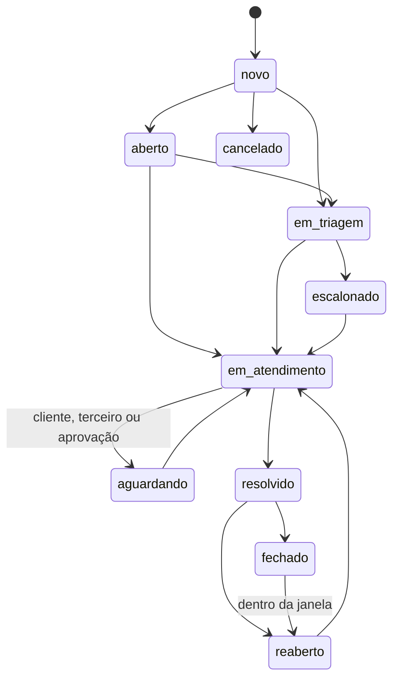

[Índice](README.md) · [Parte anterior](parte-12-suprimentos-patrimonio-frotas-contratos-e-terceiros.md) · [Próxima parte](parte-14-integracoes-e-importacao.md)

<a id="parte-13"></a>

# Parte 13 — Atendimento e notificações

## Visão geral da parte 13

Atendimento usa um modelo único de ticket para SAC, helpdesk, chat e chamados ([32](parte-04-seguranca-privacidade-e-auditoria.md#doc-32), seção 2). Notificações têm estados, preferências e horário de silêncio ([57](#doc-57)).



**Regras principais**
- Estado de espera pausa o contador de SLA ([32](parte-04-seguranca-privacidade-e-auditoria.md#doc-32), seção 2.3).
- Aviso obrigatório (verificação, recuperação de conta, MFA, saúde e segurança) não pode ser desligado ([57](#doc-57), seção 3.3).
- Horário de silêncio de 21h às 7h, exceto aviso obrigatório ([57](#doc-57)).
- `read` só é gravado quando o destinatário abre o aviso ([57](#doc-57), seção 3.2).

<a id="doc-57"></a>

## 57 — Notificações, por Portal

> Parte do [SDD v2](parte-01-visao-e-escopo.md#doc-00). Eventos que disparam notificação em [14](parte-02-arquitetura-e-tenancy.md#doc-14). Canais e provedores de plataforma em [16](parte-14-integracoes-e-importacao.md#doc-16). Verificação de contato e MFA em [06](parte-03-identidade-acesso-e-permissoes.md#doc-06). Consentimento por canal em [26](parte-18-juridico-e-regulatorio.md#doc-26) e [22](parte-06-plataforma-saas-clientes-dominios-licencas-e-crm.md#doc-22). Regras de envio, estados e dados sensíveis em [18](parte-07-regras-gerais-dos-modulos-de-gestao.md#doc-18), seção 3. Auditoria em [29](parte-04-seguranca-privacidade-e-auditoria.md#doc-29). Idioma em [09](parte-05-portais-navegacao-e-interface.md#doc-09). Referência de módulo: [`spec_gestao_notificacoes_revisada.md`](parte-03-identidade-acesso-e-permissoes.md#v1-spec-gestao-notificacoes-revisada-md) (v1, 642 linhas) unida a [`spec_gestao_notificacoes.md`](parte-03-identidade-acesso-e-permissoes.md#v1-spec-gestao-notificacoes-md) (v1, 378 linhas), por decisão NOT-01.
> **Veredito:** o módulo de notificações **não está completo como módulo**. Há regras soltas para estados, validação, canais de conta e dado sensível. Falta o módulo em si: templates, regras de envio, preferências do usuário, targeting por portal, fallback entre provedores e painel de operação.

---

### 1. Resposta direta

> **Leitura (04/11/2026):** esta tabela registra o que existia no SDD antes deste documento ser escrito. Os itens marcados como **Não** ou **Parcial** são especificados nas seções seguintes deste documento, exceto o que estiver listado na seção de pendências.

| Pergunta | Veredito |
|---|---|
| Existe especificação de notificações na v2? | **Não.** O catálogo marca "Revisar", com duas versões na v1 |
| Estados e transições estão definidos? | **Sim**, herdados da v1 revisada e validados em [18](parte-07-regras-gerais-dos-modulos-de-gestao.md#doc-18), seção 3.1 |
| Canais estão definidos? | **Parcial.** E-mail e SMS aparecem em [16](parte-14-integracoes-e-importacao.md#doc-16). WhatsApp, Telegram e chat, em [22](parte-06-plataforma-saas-clientes-dominios-licencas-e-crm.md#doc-22). Push e in-app não aparecem na v2 |
| Preferências do usuário? | **Não.** Só consentimento por finalidade em [32](parte-04-seguranca-privacidade-e-auditoria.md#doc-32), seção 3.2 |
| Targeting: quem envia a quem? | **Não.** A v1 lista avisos por portal, mas não diz quem pode enviar para quem |
| Templates e variáveis? | **Não** na v2. A v1 revisada tem o conceito, sem regra de idioma nem de conteúdo |
| Fallback e saúde de provedor? | **Não** na v2. A v1 revisada tem a regra |
| Dado sensível no corpo? | **Sim**, em [18](parte-07-regras-gerais-dos-modulos-de-gestao.md#doc-18), seção 3.3 |
| Painel de operação e métricas? | **Não** na v2. A v1 tem, em detalhe |

---

### 2. Lacunas

1. **Módulo sem documento próprio.** As regras estão em cinco docs diferentes. Não há ponto único de consulta.
2. **Canal push e in-app ausentes.** A v1 lista ambos. Sem eles, avisos de aplicativo não têm caminho.
3. **Preferências do usuário ausentes.** Sem tela de preferência, o responsável não escolhe canal, horário ou tipo de aviso.
4. **Horário de silêncio ausente.** Mensagem às 23h para responsável não tem regra.
5. **Targeting ausente.** Não há regra para "todas as famílias da turma X", "responsáveis com dependente com vínculo ativo", "professores da unidade". Sem isso, o envio em massa fica sem controle.
6. **Templates e i18n ausentes.** Texto de aviso precisa de versão por idioma ([09](parte-05-portais-navegacao-e-interface.md#doc-09)) e de variáveis validadas.
7. **Fallback entre provedores ausente.** [16](parte-14-integracoes-e-importacao.md#doc-16) define um provedor por tipo. A v1 prevê vários por canal e troca automática quando um cai.
8. **Painel de operação ausente.** Fila, falhas, reenvio e métricas de entrega não têm tela nem métrica definida. [24](parte-17-operacao-qualidade-testes-e-ti.md#doc-24) tem só uma meta ("99% em até 5 min"). **Escrito** nas seções 3.8 e 3.9 (NOT-08).
9. **Conflito de versões da v1.** Há [`spec_gestao_notificacoes.md`](parte-03-identidade-acesso-e-permissoes.md#v1-spec-gestao-notificacoes-md) (378 linhas) e a revisada (642 linhas). **Decidido** em 03/11/2026 (NOT-01): as duas são unidas. A revisada dá estados, eventos, reenvio e observabilidade. A original dá as telas e o painel (seções 3.8 e 3.9).
10. **Notificação de saúde.** [18](parte-07-regras-gerais-dos-modulos-de-gestao.md#doc-18), seção 3.3, proíbe diagnóstico no corpo. Não há regra de quem pode enviar aviso de saúde, nem para quem.

---

### 3. Modelo proposto

#### 3.1 Canais

| Canal | Uso | Dono do envio | Regra |
|---|---|---|---|
| In-app | Avisos internos e de portal | Plataforma | Padrão para aviso que não é urgente |
| E-mail | Verificação, recuperação, comunicado formal | Plataforma (verificação) e entidade (comunicado) | Endereço verificado ([06](parte-03-identidade-acesso-e-permissoes.md#doc-06), D-04). Link de descadastro em marketing ([26](parte-18-juridico-e-regulatorio.md#doc-26)) |
| Push | Aviso de aplicativo, Android e iOS | Plataforma | Depende do aplicativo e de token de dispositivo válido. Decidido pelo autor em 03/11/2026 |
| SMS | Aviso não crítico e opcional | Entidade | Não é fator de MFA ([16](parte-14-integracoes-e-importacao.md#doc-16)). Desligado por padrão |
| WhatsApp | Aviso com opt-in | Entidade | Opt-in registrado ([22](parte-06-plataforma-saas-clientes-dominios-licencas-e-crm.md#doc-22)). Template aprovado pelo provedor |
| Webhook | Integração com sistema da entidade | Entidade | Assinatura validada na recepção |

#### 3.2 Estados

Herdados da v1 revisada e validados em [18](parte-07-regras-gerais-dos-modulos-de-gestao.md#doc-18), seção 3.1: `draft`, `in_review`, `scheduled`, `queued`, `processing`, `sent`, `delivered`, `read`, `failed`, `archived`, `cancelled`.

Regra adicional: `read` nunca é gravado pelo envio. É gravado só quando o destinatário abre o aviso.

#### 3.3 Preferências do usuário

- Cada pessoa escolhe canal por tipo de aviso: acadêmico, financeiro, comunicado geral.
- Aviso obrigatório não pode ser desligado: verificação, recuperação de conta, MFA, aviso de saúde e comunicado de segurança.
- Horário de silêncio por pessoa, com exceção para aviso obrigatório. Decidido pelo autor em 03/11/2026: 21h às 7h.
- Opt-out de marketing vale em todos os canais ([22](parte-06-plataforma-saas-clientes-dominios-licencas-e-crm.md#doc-22), palavras `PARAR` e `SAIR`).

#### 3.4 Targeting

Envio só para um público definido por regra, nunca para lista aberta:

| Público | Regra | Quem pode definir |
|---|---|---|
| Turma | Alunos com matrícula ativa na turma | Professor da turma, coordenação |
| Responsáveis de uma turma | Responsáveis com vínculo ativo a alunos da turma | Coordenação, secretaria |
| Unidade | Todos com vínculo ativo na unidade | Gestão da unidade |
| Entidade | Todos com vínculo ativo na entidade | Direção da entidade. Não pode ser professor |
| Plataforma | Clientes ou equipe da empresa | Equipe da empresa desenvolvedora |

Público com mais de 500 destinatários exige aprovação de segunda pessoa, como em [48](parte-09-secretaria-matricula-e-documentos.md#doc-48), seção 12. Decidido pelo autor em 03/11/2026.

#### 3.5 Templates

- Template tem versão, idioma, variáveis validadas e categoria (acadêmico, financeiro, pastoral, segurança).
- Variável sem valor bloqueia o envio.
- Template de WhatsApp precisa ser aprovado pelo provedor antes de uso.
- Notificação de saúde ou de RH não tem diagnóstico nem salário no corpo ([18](parte-07-regras-gerais-dos-modulos-de-gestao.md#doc-18), seção 3.3). Mostra aviso e link autenticado.

#### 3.6 Provedores e fallback

- Cada canal pode ter mais de um provedor. Um é primário, e os outros são reserva.
- Health check por provedor. Falhas repetidas tiram o provedor do roteamento automático.
- Troca de provedor é registrada em auditoria.

#### 3.7 Retenção

- Corpo da mensagem: prazo configurável por entidade, com padrão a definir **(jurídico)**.
- Registro de entrega (quem, quando, canal, estado): mesmo prazo de log de integração, 90 dias ([49](parte-17-operacao-qualidade-testes-e-ti.md#doc-49), seção 2).
- Auditoria de envio: prazo de evento de plataforma ([29](parte-04-seguranca-privacidade-e-auditoria.md#doc-29)).

#### 3.8 Telas do módulo

Vêm da versão original da v1 ([`spec_gestao_notificacoes.md`](parte-03-identidade-acesso-e-permissoes.md#v1-spec-gestao-notificacoes-md), seção 6), unida à revisada por decisão NOT-01. A regra da v2 prevalece quando há conflito: estados de [18](parte-07-regras-gerais-dos-modulos-de-gestao.md#doc-18), seção 3.1, aprovação acima de 500 destinatários (NOT-03), silêncio (NOT-02) e permissão por papel.

| Tela | Conteúdo | Regra da v2 |
|---|---|---|
| Painel | Indicadores e gráficos da seção 3.9, com filtro por período, unidade, canal, prioridade e estado | Mostra só o escopo do papel: entidade, unidade ou turma |
| Lista | Tabela com título, tipo, canal, prioridade, unidade, estado, agendada para, enviada em, leitura, tentativas e responsável. Filtros salvos, paginação no servidor, seleção múltipla e exportação | Ação em lote respeita a transição permitida de cada item. Exportação segue a permissão e mascara dado pessoal |
| Criação e edição | Etapas: dados básicos, público, conteúdo, canal, agendamento, regras e revisão final. Prévia das variáveis do template | Sem público válido, não envia. Limite de caracteres por canal. Público acima de 500 vai para aprovação de segunda pessoa |
| Detalhe | Resumo, linha do tempo, entregas por destinatário, interações, log técnico e auditoria | Log técnico só para quem tem papel de operação. Conteúdo de aviso de saúde segue NOT-05 |
| Quadro (kanban) | Colunas por estado: rascunho, em revisão, agendada, processando, enviada, entregue, lida, falhou, arquivada | Arrastar o cartão só faz transição permitida. Estados de entrega (`delivered`, `read`, `failed`) vêm do provedor, não da mão do usuário |
| Automações | Criar, testar, simular, ativar e desativar regra, com versão. Gatilhos: cadastro, mudança de estado, atraso, falha, aniversário, expiração e tarefa pendente | Regra só dispara a partir de evento do catálogo de [14](parte-02-arquitetura-e-tenancy.md#doc-14), seção 4. Simulação não envia mensagem |
| Configuração | Canais, provedores, templates, limites de envio, silêncio, política de reenvio, retenção, identidade visual e permissões | Provedor e credencial seguem [16](parte-14-integracoes-e-importacao.md#doc-16). Retenção segue a seção 3.7 |

Ações por item: ver, editar rascunho, duplicar, reenviar, cancelar agendamento, arquivar e excluir (exclusão lógica). Reenvio de item já entregue pede motivo e fica na auditoria.

#### 3.9 Painel, métricas e alertas

União das métricas das duas versões da v1 (original, seção 7; revisada, seção 15). Fecha NOT-08.

| Métrica | Quem vê |
|---|---|
| Total por período, enviadas hoje, pendentes na fila | Gestão e secretaria, no escopo do papel |
| Taxa de entrega e de leitura, por canal | Gestão e secretaria, no escopo do papel |
| Falhas nas últimas 24 horas e reenvios em andamento | Gestão e operação da plataforma |
| Tempo médio até o envio e até a entrega | Operação da plataforma |
| Falhas por provedor e fila por prioridade | Operação da plataforma |
| Prazo cumprido e violado (meta de [24](parte-17-operacao-qualidade-testes-e-ti.md#doc-24): 99% em até 5 minutos) | Gestão e operação da plataforma |
| Avisos críticos pendentes | Gestão, no escopo do papel |

Gráficos: volume por dia, itens por estado, distribuição por canal, sucesso e falha por canal, e volume por hora e dia da semana.

**Portal do desenvolvedor:** vê só métricas agregadas de operação, sem título, corpo ou destinatário de mensagem de cliente ([31](parte-05-portais-navegacao-e-interface.md#doc-31)).

**Alertas para a operação:** falha elevada por provedor, crescimento anormal da fila, aumento de reenvio, prazo violado, worker sem sinal de vida e taxa de erro acima do limite por canal. Os limites são medidos em homologação.

**Rastreio:** o `correlation_id` acompanha evento, regra, fila, worker, provedor e resultado. Log estruturado com dado sensível redigido ([49](parte-17-operacao-qualidade-testes-e-ti.md#doc-49), seção 3).

---

### 4. Por portal

| Portal | Quem envia | Para quem | Canais | Exemplos de aviso (da v1) |
|---|---|---|---|---|
| **Desenvolvedor** | Equipe da empresa | Clientes e equipe | E-mail, in-app | Aviso de manutenção, cobrança da assinatura |
| **Gestão** | Direção, gestor de unidade | Público da entidade ou da unidade | In-app, e-mail, SMS, WhatsApp, push | Comunicado da direção, aviso geral |
| **Professor** | Professor e coordenação | Turma, responsáveis da turma | In-app, push, e-mail | Mensagem para turma, lembrete de prova, aviso de conteúdo |
| **Aluno** | Ninguém envia | Recebe | In-app, push | Aviso de professor e da coordenação, lembrete de prova |
| **Responsáveis** | Não envia comunicado geral | Recebe | In-app, push, SMS, WhatsApp, e-mail | Aviso da diretoria, aviso de saúde ou enfermaria, notificação de entrada e saída, lembrete de reunião |
| **Terceiros** | Não envia comunicado geral | Recebe aviso do próprio contrato | E-mail, in-app | Aviso de vencimento de contrato, de nota recebida, de ordem de compra |

**Regras de portal:**

- Aluno não envia notificação a colega. Professor não envia para público fora da própria turma.
- Responsável não envia para outros responsáveis.
- Notificação de entrada e saída (catraca) só vai ao responsável do dependente, com vínculo ativo ([35](parte-03-identidade-acesso-e-permissoes.md#doc-35)).
- Aviso de saúde ou enfermaria vai ao responsável. Remetentes padrão: secretaria, enfermagem, médico da escola e coordenação. A escola pode incluir ou remover remetentes. Decidido pelo autor em 03/11/2026. Não aparece no portal de terceiros.

---

### 5. Pendências

| # | Pendência | Tipo |
|---|---|---|
| NOT-01 | Versão de referência da v1: revisada ou original | **Decidido** em 03/11/2026: unir as duas. Telas e painel da original nas seções 3.8 e 3.9 |
| NOT-02 | Horário de silêncio padrão (seção 3.3) | **Decidido** em 03/11/2026: 21h às 7h |
| NOT-03 | Aprovação de segunda pessoa para público acima de 500 (seção 3.4) | **Decidido** em 03/11/2026: sim |
| NOT-04 | Prazo de retenção do corpo da mensagem (seção 3.7) | (jurídico) |
| NOT-05 | Remetentes de aviso de saúde ou enfermagem (seção 4) | **Decidido** em 03/11/2026: secretaria, enfermagem, médico da escola e coordenação por padrão. A escola pode incluir ou remover. Parecer do (jurídico) sobre o conteúdo do aviso continua pendente |
| NOT-06 | Canal push | **Decidido** em 03/11/2026: aplicativo próprio para Android e iOS. Canais: app, SMS, e-mail e WhatsApp |
| NOT-07 | DDL das tabelas do módulo: notificação, template, regra, entrega, fila, preferência e provedor | **Escrito** em [51](parte-16-dados-validacoes-configuracoes-e-armazenamento.md#doc-51), seção 15.1. Revisão do owner pendente (DDL-01) |
| NOT-08 | Métricas e painel de operação: quais e para quem | **Escrito** na seção 3.9 |
| NOT-09 | Aplicativo Android e iOS: escopo, arquitetura e publicação nas lojas. É um produto novo, fora dos módulos atuais | Documento. **Decidido** em 03/11/2026: entra depois do núcleo |

---

### 6. Critérios de aceite

- [ ] Aviso obrigatório não pode ser desligado pelo usuário (teste).
- [ ] Aviso fora do horário de silêncio é adiado, salvo obrigatório (teste).
- [ ] Professor não envia para público fora da própria turma (teste de isolamento).
- [ ] Responsável não recebe aviso de dependente sem vínculo ativo (teste).
- [ ] Template com variável sem valor não é enviado (teste).
- [ ] Corpo de aviso de saúde não contém diagnóstico (varredura).
- [ ] Provedor com falha repetida sai do roteamento e o aviso segue pelo reserva (teste).
- [ ] Itens **(jurídico)** e **[Decisão do autor]** respondidos ou marcados como pendentes no [00](parte-01-visao-e-escopo.md#doc-00).

## Especificações da v1 desta parte absorvidas no kit-starter ou sem destino

<a id="v1-spec-helpdesk-md"></a>

### v1 — `SPEC-HELPDESK.md` (929 linhas)

> Situação na v2: Absorvido integralmente no kit-starter. Destino: ficha do kit-starter: `kit-starter/desenvolvedor/suporte/chamados-dos-clientes.md`. Quando este texto diverge da v2, vale a v2.

#### O que a v2 muda nesta especificação

Estas regras prevalecem sobre o texto da v1 que vem a seguir.

- **Modelo único** ([32](parte-04-seguranca-privacidade-e-auditoria.md#doc-32), seção 2.1; [19](parte-07-regras-gerais-dos-modulos-de-gestao.md#doc-19), seção 7): Helpdesk é a base; SAC e chat rápido são canais ou tipos do mesmo registro. As três especificações da v1 da seção 13 descrevem partes desse mesmo módulo.
- **Protocolo** (ATD-01): todo pedido com responsável e prazo recebe número de protocolo; pergunta resolvida pelo bot ou pela base de conhecimento, sem fila, não recebe.
- **Estados e transições** ([32](parte-04-seguranca-privacidade-e-auditoria.md#doc-32), seção 2.2): `novo`, `aberto`, `em_triagem`, `em_atendimento`, `aguardando_cliente`, `aguardando_terceiro`, `aguardando_aprovacao`, `em_pausa`, `resolvido`, `fechado`, `reaberto`, `escalonado`, `cancelado`. Transição inválida é recusada pela aplicação. Cancelar, escalonar e reabrir gravam motivo.
- **Prioridade, categoria e fila** (seção 2.4): baixa, média, alta e urgente; urgente só em categoria que permita; atribuição automática por fila.
- **Canais** (seção 2.5; [22](parte-06-plataforma-saas-clientes-dominios-licencas-e-crm.md#doc-22), seções 2 e 3): opção "Abrir ticket" sem IA em todo ponto de atendimento (D-18); texto do solicitante guardado literal; campos obrigatórios por tipo e lista fixa de campos padrão.
- **Portal do cliente** (seção 2.6): nota interna nunca aparece para o solicitante; respostas públicas por padrão; avaliação do atendimento.
- **Visibilidade no portal do desenvolvedor** (seção 2.8): chamados das entidades; nenhum dado de aluno sem chamado vinculado ([29](parte-04-seguranca-privacidade-e-auditoria.md#doc-29), seção 8).
- **Bots** (seção 2.9): categoria sensível (saúde, denúncia, conflito) vai para humano (ATD-05).
- **Perfis da v1:** substituídos pelos papéis da seção 6.

#### Texto integral da v1

- Language Standard: Global English
#### 1. Visão Geral

Este documento especifica um sistema SaaS multi-tenant de SAC / Help Desk / Service Desk inspirado em plataformas como Movidesk/Zenvia, com foco em centralização de canais, padronização de tickets, automação operacional, SLA, base de conhecimento, portal do cliente, relatórios e integrações. O sistema deve permitir atendimento omnichannel com rastreabilidade total, auditoria completa e flexibilidade para múltiplas empresas, unidades, equipes e perfis de acesso [web:32][web:11][web:51].

O objetivo é servir como especificação funcional e técnica base para desenvolvimento incremental, começando por um MVP sólido e evoluindo para automação avançada, múltiplos canais e recursos inteligentes de atendimento [web:32][web:7][web:54].

#### 2. Objetivos do Produto

- Centralizar todos os canais de contato em uma única operação.
- Normalizar qualquer solicitação em um Ticket.
- Reduzir tempo de resposta e tempo de resolução.
- Garantir rastreabilidade e auditoria de ponta a ponta.
- Disponibilizar autoatendimento via portal e base de conhecimento.
- Automatizar triagem, roteamento, escalonamento e notificações.
- Suportar múltiplos tenants, unidades e equipes com segurança.
- Oferecer indicadores operacionais e gerenciais em tempo real.

#### 3. Escopo

##### 3.1 Incluído

- Gestão completa de tickets.
- Omnichannel de entrada e saída.
- Portal do cliente.
- Base de conhecimento.
- SLA e calendários de atendimento.
- Automação baseada em regras e eventos.
- Catálogo de serviços.
- Aprovações.
- Relatórios e dashboards.
- Administração e governança.
- Integrações e API.
- Auditoria e trilha de eventos.

##### 3.2 Excluído no MVP

- Telefonia nativa com discador avançado.
- Inteligência artificial generativa para respostas automáticas.
- RPA para processos externos.
- Marketplace de extensões.
- BI avançado com cubos multidimensionais.

#### 4. Definições

- **Tenant**: empresa cliente isolada logicamente dentro da plataforma.
- **Unidade**: subestrutura organizacional do tenant.
- **Fila**: agrupamento operacional de tickets.
- **Ticket**: unidade central de atendimento.
- **Solicitante**: pessoa que abre ou possui o ticket.
- **Contato**: pessoa relacionada ao ticket, podendo ser solicitante ou observador.
- **Agente**: usuário interno que atende tickets.
- **SLA**: compromisso de tempo de resposta e resolução.
- **Base de conhecimento**: artigos e conteúdos de autoatendimento.

#### 5. Requisitos Funcionais

##### 5.1 Multi-tenant

O sistema deve isolar dados por tenant em todos os níveis, incluindo tickets, usuários, canais, artigos, automações, relatórios e configurações. Um usuário autenticado só pode acessar dados autorizados pelo seu escopo de tenant, unidade, fila e permissão.

##### 5.2 Gestão de tickets

O sistema deve permitir criação, leitura, atualização, vinculação, merge, split, reabertura, cancelamento, encerramento e exclusão lógica de tickets. Cada ticket deve manter histórico completo de campos, mensagens, status, responsáveis e SLAs.

##### 5.3 Omnichannel

O sistema deve receber interações por múltiplos canais, normalizar a entrada e associá-la ao mesmo ticket ou criar um novo conforme regra de negócio. Todos os canais precisam preservar autoria, timestamp, anexos e origem.

##### 5.4 Portal do cliente

O portal deve permitir abertura e acompanhamento de tickets, respostas públicas, envio de anexos, consulta a artigos da base e avaliação do atendimento.

##### 5.5 Base de conhecimento

O sistema deve permitir criação, revisão, publicação, versionamento, busca e categorização de artigos. O conteúdo pode ser público, restrito ou interno.

##### 5.6 Automação

O sistema deve suportar regras automáticas acionadas por eventos ou agendamentos, com condições, ações, exceções e logs.

##### 5.7 SLA

O sistema deve calcular prazos de primeira resposta, próxima resposta e resolução, com base em regras por tenant, cliente, fila, prioridade, categoria e horário útil.

##### 5.8 Relatórios

O sistema deve oferecer dashboards operacionais e relatórios exportáveis com métricas de volume, tempo, backlog, produtividade, SLA e satisfação.

##### 5.9 Auditoria

Todas as ações críticas devem gerar eventos auditáveis com usuário, data, contexto, origem e alteração realizada.

#### 6. Canais de Entrada de Ticket

##### 6.1 Canais obrigatórios

- Portal do cliente.
- E-mail.
- Formulário web.
- WhatsApp Business API.
- Chat web.
- API REST.
- Webhook externo.
- Criação interna por agente.
- Importação em lote.
- Telefonia registrada manualmente.

##### 6.2 Regras de normalização

- Toda entrada deve gerar evento de origem.
- Toda mensagem deve ser associada a um ticket novo ou existente.
- O sistema deve identificar o solicitante por e-mail, telefone, ID externo ou autenticação.
- O canal de origem deve ser preservado em toda a vida do ticket.
- Anexos devem ser vinculados ao ticket e à mensagem de origem.

##### 6.3 Regras por canal

###### E-mail

- O sistema deve monitorar caixas de entrada configuradas.
- Assuntos e cabeçalhos devem ser preservados.
- Respostas devem manter thread.
- O sistema deve evitar duplicidade por heurística configurável.

###### WhatsApp

- Mensagens devem entrar como tickets ou mensagens vinculadas a tickets ativos.
- O sistema deve registrar número, nome exibido, mensagem e anexos.
- Respostas devem ser enviadas pela mesma sessão/canal.

###### Chat web

- O sistema deve abrir sessão de chat e, quando necessário, converter a conversa em ticket.
- O histórico do chat deve ser anexado ao ticket.

###### Formulário web

- O formulário deve ser configurável por tenant, categoria e fila.
- Campos obrigatórios devem variar por tipo de solicitação.

###### API

- A API deve aceitar payload autenticado e validado.
- O sistema deve suportar criação, atualização e consulta.

###### Webhook

- Integrações externas devem poder criar ou atualizar tickets por evento.

###### Criação interna

- Agentes devem poder abrir tickets para clientes, departamentos ou terceiros.

#### 7. Modelo de Ticket

##### 7.1 Identificação

- id.
- tenant_id.
- external_id.
- number.
- root_ticket_id.
- parent_ticket_id.
- merged_into_ticket_id.
- source_type.
- channel_id.

##### 7.2 Solicitante

- requester_id.
- requester_name.
- requester_email.
- requester_phone.
- requester_document.
- requester_company.
- requester_department.
- requester_role.
- requester_locale.

##### 7.3 Organização

- company_id.
- unit_id.
- department_id.
- queue_id.
- team_id.
- owner_user_id.
- owner_team_id.
- assigned_by.
- assigned_at.

##### 7.4 Classificação

- type_id.
- category_id.
- subcategory_id.
- topic_id.
- priority.
- severity.
- impact.
- urgency.
- reason_code.
- resolution_code.
- close_reason_id.
- tags.

##### 7.5 Conteúdo

- subject.
- description.
- public_description.
- internal_summary.
- resolution_summary.
- customer_expectation.
- initial_contact_channel.
- customer_language.

##### 7.6 Estado

- status.
- substatus.
- visibility.
- is_urgent.
- is_vip.
- is_blocked.
- is_on_hold.
- is_escalated.
- is_reopened.
- reopened_count.

##### 7.7 Datas e tempos

- created_at.
- updated_at.
- first_response_at.
- first_response_due_at.
- next_response_due_at.
- resolution_due_at.
- closed_at.
- resolved_at.
- reopened_at.
- last_activity_at.
- last_customer_message_at.
- last_agent_message_at.
- first_assignment_at.
- last_assignment_at.
- wait_started_at.
- wait_ended_at.
- sla_paused_at.
- sla_resumed_at.
- total_wait_minutes.
- total_work_minutes.
- total_pending_customer_minutes.
- total_pending_third_party_minutes.

##### 7.8 Satisfação

- satisfaction_score.
- satisfaction_comment.
- satisfaction_answered_at.
- csat_sent_at.
- csat_status.

##### 7.9 Metadados

- custom_fields.
- json_metadata.
- labels.
- attachments_count.
- messages_count.
- internal_notes_count.
- public_messages_count.
- views_count.
- source_reference.
- correlation_id.

#### 8. Campos do Ticket

##### 8.1 Campos padrão obrigatórios

- Assunto.
- Descrição.
- Solicitante.
- Canal.
- Categoria.
- Prioridade.
- Status.
- Fila.
- Responsável.
- SLA.
- Tipo.
- Tenant.

##### 8.2 Campos recomendados

- Unidade.
- Departamento.
- Severidade.
- Impacto.
- Urgência.
- Tags.
- Motivo.
- Solução.
- Tempo estimado.
- Tempo gasto.
- Data de vencimento.
- Data de fechamento.
- Canal secundário.
- Observador.
- Ticket relacionado.

##### 8.3 Campos customizáveis

- Texto curto.
- Texto longo.
- Número inteiro.
- Decimal.
- Moeda.
- Data.
- Data e hora.
- Booleano.
- Lista única.
- Lista múltipla.
- Upload.
- URL.
- E-mail.
- Telefone.
- CPF/CNPJ.
- Dependente.
- Calculado.
- Oculto.

##### 8.4 Regras para campos customizáveis

- Devem ser configuráveis por tenant.
- Devem ser condicionais por categoria, fila, tipo ou canal.
- Devem suportar obrigatoriedade dinâmica.
- Devem ter validação de formato.
- Devem ser auditáveis quando alterados.

#### 9. Estados do Ticket

- Novo.
- Aberto.
- Em triagem.
- Em atendimento.
- Aguardando cliente.
- Aguardando terceiro.
- Aguardando aprovação.
- Em pausa.
- Resolvido.
- Fechado.
- Cancelado.
- Reaberto.
- Escalonado.

##### 9.1 Regras de transição

- Novo só pode ir para aberto, triagem ou cancelado.
- Resolvido pode ir para fechado ou reaberto.
- Aguardando cliente pausa contagem de trabalho conforme regra de SLA.
- Ticket fechado pode ser reaberto por janela configurável.

#### 10. Prioridade, Impacto e Severidade

##### 10.1 Prioridade

- Baixa.
- Média.
- Alta.
- Crítica.
- Urgente.

##### 10.2 Impacto

- Individual.
- Setorial.
- Unidade.
- Empresa inteira.
- Múltiplos tenants em casos de fornecedor compartilhado.

##### 10.3 Severidade

- S1 - Crítica.
- S2 - Alta.
- S3 - Média.
- S4 - Baixa.

##### 10.4 Matriz de cálculo

A prioridade pode ser determinada por combinação de impacto e urgência, com overrides manuais permitidos por perfil autorizado.

#### 11. Ferramentas do Agente

##### 11.1 Operação

- Lista de tickets com filtros avançados.
- Visão Kanban.
- Busca global.
- Timeline completa.
- Thread de mensagens.
- Comentários internos.
- Respostas públicas.
- Respostas prontas.
- Macros.
- Templates.
- Encaminhamento.
- Reatribuição.
- Merge.
- Split.
- Link de tickets.
- Atribuição em lote.
- Edição em massa.
- Fechamento em massa.
- Reabertura.
- Cancelamento.
- Pausa de SLA.

##### 11.2 Produtividade

- Atalhos de teclado.
- Editor rico.
- Preenchimento automático.
- Assinatura por equipe.
- Checklist.
- Tarefas internas.
- Menções.
- Agendamento de follow-up.
- Visualização do histórico do cliente.
- Visualização de tickets relacionados.
- Sugestão de artigo da base.

##### 11.3 Supervisão

- Monitoramento de fila.
- Monitoramento de SLA.
- Visão de backlog.
- Reatribuição assistida.
- Escalonamento manual.
- Auditoria de operações.
- Dashboards por equipe e agente.

#### 12. Portal do Cliente

##### 12.1 Funcionalidades

- Criar ticket.
- Acompanhar ticket.
- Responder ticket.
- Anexar arquivo.
- Consultar histórico.
- Consultar base de conhecimento.
- Visualizar status.
- Receber notificações.
- Avaliar atendimento.
- Atualizar dados cadastrais.
- Consultar catálogo de serviços.

##### 12.2 Regras

- O cliente só pode acessar seus próprios tickets e os tickets compartilhados com ele.
- Respostas no portal devem ser públicas por padrão.
- Campos do formulário podem variar por tenant, serviço ou fila.
- Artigos relevantes podem ser sugeridos antes da abertura do ticket.

#### 13. Base de Conhecimento

##### 13.1 Estrutura

- Categoria.
- Subcategoria.
- Artigo.
- Versão.
- Autor.
- Revisor.
- Publicador.
- Tags.
- Anexos.
- Estado de publicação.

##### 13.2 Estados do artigo

- Rascunho.
- Em revisão.
- Agendado.
- Publicado.
- Arquivado.
- Restrito.

##### 13.3 Funcionalidades

- Busca textual.
- Filtros por categoria.
- Artigos relacionados.
- FAQ.
- Feedback de utilidade.
- Histórico de versão.
- Controle de permissão.
- Sugestão automática no portal e no atendimento.

#### 14. SLA

##### 14.1 Tipos de SLA

- Primeira resposta.
- Próxima resposta.
- Resolução.
- Fechamento.

##### 14.2 Regras de aplicação

- Por tenant.
- Por cliente.
- Por fila.
- Por tipo.
- Por categoria.
- Por prioridade.
- Por canal.
- Por contrato.
- Por horário de atendimento.
- Por feriado.

##### 14.3 Estados do SLA

- Ativo.
- Em risco.
- Violado.
- Pausado.
- Reiniciado.

##### 14.4 Ações automáticas

- Notificar agente.
- Notificar supervisor.
- Reatribuir ticket.
- Escalonar fila.
- Criar alerta.
- Marcar como violado.
- Registrar evento.

#### 15. Automação

##### 15.1 Tipos

- Gatilho por evento.
- Regra condicional.
- Workflow multi-etapa.
- Agendamento.
- Webhook.
- Ação manual.

##### 15.2 Eventos

- Ticket criado.
- Ticket atualizado.
- Ticket atribuído.
- Status alterado.
- Mensagem recebida.
- Mensagem enviada.
- SLA próximo.
- SLA violado.
- Aprovação concluída.
- Artigo publicado.

##### 15.3 Condições

- Canal.
- Categoria.
- Prioridade.
- Tenant.
- Unidade.
- Fila.
- Palavra-chave.
- Campo customizado.
- Horário.
- Usuário.
- Origem externa.

##### 15.4 Ações

- Alterar status.
- Alterar prioridade.
- Alterar fila.
- Alterar responsável.
- Alterar campo.
- Aplicar tag.
- Remover tag.
- Enviar e-mail.
- Enviar WhatsApp.
- Criar tarefa.
- Criar subticket.
- Criar alerta.
- Chamar webhook.
- Notificar supervisor.
- Pausar SLA.
- Retomar SLA.

#### 16. Aprovações

##### 16.1 Casos de uso

- Solicitação de acesso.
- Solicitação de mudança.
- Solicitação financeira.
- Solicitação administrativa.
- Solicitação de exceção.
- Compra e contratação.

##### 16.2 Campos de aprovação

- id.
- ticket_id.
- requested_by.
- requested_to.
- approver_id.
- status.
- requested_at.
- decided_at.
- decision_reason.
- approval_step.
- due_at.

#### 17. Notificações

##### 17.1 Canais

- E-mail.
- WhatsApp.
- In-app.
- Push.
- Webhook.

##### 17.2 Eventos notificados

- Ticket criado.
- Ticket atribuído.
- Resposta recebida.
- SLA em risco.
- SLA violado.
- Aprovação pendente.
- Aprovação concluída.
- Ticket resolvido.
- Ticket fechado.

#### 18. Relatórios e Indicadores

##### 18.1 Operacionais

- Tickets por canal.
- Tickets por fila.
- Tickets por status.
- Tickets por prioridade.
- Tempo médio de primeira resposta.
- Tempo médio de resolução.
- Backlog.
- Aging de tickets.
- Reaberturas.
- Violação de SLA.
- Tickets por agente.
- Tickets por equipe.

##### 18.2 Gerenciais

- CSAT.
- NPS.
- Volume por período.
- Tendência de atendimento.
- Produtividade individual.
- Produtividade da equipe.
- Motivos mais recorrentes.
- Causas de atraso.

##### 18.3 Exportação

- CSV.
- XLSX.
- PDF.
- JSON.

#### 19. API

##### 19.1 Princípios

- RESTful.
- Autenticada.
- Versionada.
- Documentada com OpenAPI.
- Rate limited.
- Auditável.

##### 19.2 Recursos principais

- /auth
- /tenants
- /users
- /customers
- /contacts
- /tickets
- /ticket-messages
- /ticket-attachments
- /sla-policies
- /queues
- /categories
- /custom-fields
- /knowledge-base/articles
- /workflows
- /approvals
- /reports
- /webhooks
- /audit-logs

##### 19.3 Operações mínimas em tickets

- Criar.
- Atualizar.
- Consultar.
- Listar.
- Encerrar.
- Reabrir.
- Atribuir.
- Alterar status.
- Adicionar mensagem.
- Anexar arquivo.
- Aplicar tag.
- Consultar histórico.

#### 20. Modelo de Banco de Dados

##### 20.1 Entidades principais

- tenants
- organizations
- units
- departments
- users
- roles
- permissions
- user_roles
- customers
- contacts
- channels
- queues
- categories
- subcategories
- ticket_types
- tickets
- ticket_messages
- ticket_attachments
- ticket_tags
- ticket_custom_values
- sla_policies
- sla_targets
- automation_rules
- automation_events
- knowledge_articles
- knowledge_categories
- knowledge_tags
- approvals
- notifications
- audit_logs
- holidays
- calendars
- service_catalog_items
- service_requests
- integrations
- webhooks
- templates

##### 20.2 Índices mínimos

- tenant_id em todas as tabelas multi-tenant.
- requester_id, owner_user_id, queue_id, status e priority em tickets.
- created_at e updated_at em tabelas transacionais.
- full-text em subject, description e article content.

#### 21. Segurança

- Autenticação com JWT e refresh token.
- Opção de SSO.
- RBAC com escopo por tenant.
- Criptografia de dados sensíveis.
- Logs de auditoria imutáveis.
- Rate limiting por rota e por token.
- Proteção contra abuso de API.
- Validação forte de entrada.
- Sessões seguras.
- Controle de anexos e tipos de arquivo.
- Política de retenção e expurgo.

#### 22. Observabilidade

- Logs estruturados.
- Métricas de sistema.
- Tracing de requisições.
- Alertas de fila e SLA.
- Monitoramento de integrações.
- Health checks.
- Métricas de erro por canal.

#### 23. Requisitos Não Funcionais

- Alta disponibilidade.
- Escalabilidade horizontal.
- Baixa latência no atendimento.
- Processamento assíncrono para integrações e notificações.
- Backup automatizado.
- Restore testado.
- Governança de retenção.
- Compatibilidade com LGPD.
- Suporte a múltiplos idiomas no futuro.

#### 24. Roadmap

##### Fase 1 - MVP

- Tickets.
- Portal.
- E-mail.
- Base de conhecimento.
- SLA básico.
- Automação simples.
- Relatórios básicos.

##### Fase 2

- WhatsApp.
- Chat.
- Aprovações.
- Catálogo de serviços.
- Relatórios avançados.
- Campos dinâmicos.

##### Fase 3

- Telefonia.
- Automações avançadas.
- Sugestão inteligente de respostas.
- Classificação automática.
- Previsão de SLA.
- BI avançado.

#### 25. Critérios de Aceite

- Todo canal válido deve gerar ou atualizar ticket.
- Todo ticket deve ter histórico completo.
- Todo SLA deve ser calculado automaticamente.
- Toda ação crítica deve ser auditada.
- Todo cliente deve conseguir acompanhar seus tickets no portal.
- Toda automação deve ser configurável sem alterar código.
- Todo relatório essencial deve ser exportável.

#### 26. Regras de Implementação

- O Ticket deve ser a entidade central do domínio.
- Campos customizados devem ser configuráveis por tenant.
- Automações devem ser desacopladas do core de ticket.
- O portal deve consumir a mesma API do backoffice com permissões adequadas.
- O sistema deve tratar canais como adaptadores de entrada e saída.
- Mensagens, anexos e histórico nunca devem ser perdidos em merge ou split.

#### 27. Convenções Técnicas

- Nomes de tabelas em inglês, minúsculas e plural.
- Campos de auditoria padrão em todas as tabelas relevantes.
- Soft delete preferencial.
- IDs preferencialmente UUID em camadas expostas.
- Eventos de domínio para integrações assíncronas.
- Separação entre domínio, aplicação e infraestrutura.

#### 28. Apêndice - Entidades Resumidas

##### 28.1 TicketMessage

- id.
- ticket_id.
- author_type.
- author_id.
- body.
- is_public.
- channel_id.
- created_at.

##### 28.2 TicketAttachment

- id.
- ticket_id.
- message_id.
- file_name.
- file_size.
- mime_type.
- storage_path.
- created_at.

##### 28.3 SLAPolicy

- id.
- tenant_id.
- name.
- first_response_minutes.
- next_response_minutes.
- resolution_minutes.
- schedule_id.
- priority_rules.

##### 28.4 AutomationRule

- id.
- tenant_id.
- name.
- event_type.
- conditions.
- actions.
- is_active.

##### 28.5 KnowledgeArticle

- id.
- tenant_id.
- title.
- slug.
- content.
- category_id.
- status.
- version.
- author_id.
- published_at.

<a id="v1-spec-layout-ticket-md"></a>

### v1 — `SPEC-LAYOUT-TICKET.md` (350 linhas)

> Situação na v2: Absorvido integralmente no kit-starter. Destino: ficha do kit-starter: `kit-starter/desenvolvedor/suporte/chamados-dos-clientes.md`. Quando este texto diverge da v2, vale a v2.

#### O que a v2 muda nesta especificação

Estas regras prevalecem sobre o texto da v1 que vem a seguir.

- **Modelo único** ([32](parte-04-seguranca-privacidade-e-auditoria.md#doc-32), seção 2.1; [19](parte-07-regras-gerais-dos-modulos-de-gestao.md#doc-19), seção 7): Helpdesk é a base; SAC e chat rápido são canais ou tipos do mesmo registro. As três especificações da v1 da seção 13 descrevem partes desse mesmo módulo.
- **Protocolo** (ATD-01): todo pedido com responsável e prazo recebe número de protocolo; pergunta resolvida pelo bot ou pela base de conhecimento, sem fila, não recebe.
- **Estados e transições** ([32](parte-04-seguranca-privacidade-e-auditoria.md#doc-32), seção 2.2): `novo`, `aberto`, `em_triagem`, `em_atendimento`, `aguardando_cliente`, `aguardando_terceiro`, `aguardando_aprovacao`, `em_pausa`, `resolvido`, `fechado`, `reaberto`, `escalonado`, `cancelado`. Transição inválida é recusada pela aplicação. Cancelar, escalonar e reabrir gravam motivo.
- **Prioridade, categoria e fila** (seção 2.4): baixa, média, alta e urgente; urgente só em categoria que permita; atribuição automática por fila.
- **Canais** (seção 2.5; [22](parte-06-plataforma-saas-clientes-dominios-licencas-e-crm.md#doc-22), seções 2 e 3): opção "Abrir ticket" sem IA em todo ponto de atendimento (D-18); texto do solicitante guardado literal; campos obrigatórios por tipo e lista fixa de campos padrão.
- **Portal do cliente** (seção 2.6): nota interna nunca aparece para o solicitante; respostas públicas por padrão; avaliação do atendimento.
- **Visibilidade no portal do desenvolvedor** (seção 2.8): chamados das entidades; nenhum dado de aluno sem chamado vinculado ([29](parte-04-seguranca-privacidade-e-auditoria.md#doc-29), seção 8).
- **Bots** (seção 2.9): categoria sensível (saúde, denúncia, conflito) vai para humano (ATD-05).
- **Perfis da v1:** substituídos pelos papéis da seção 6.

#### Texto integral da v1

#### 1. Objetivo

Este documento define a implementação da tela de detalhe de ticket inspirada no layout Movidesk da imagem de referência, usando Supabase como backend, autenticação, banco de dados, storage e controle de acesso. O objetivo é reproduzir a mesma densidade visual, organização dos campos e hierarquia de ações mostradas na interface [file:62].

#### 2. Diretrizes de Layout

- Interface desktop-first.
- Sidebar fixa à esquerda.
- Topbar fixa no topo.
- Área principal dividida em coluna lateral de formulário e painel central de atendimento.
- Visual administrativo limpo, com fundo branco, bordas cinza claras e acento azul.
- Espaçamento compacto, típico de sistema de help desk profissional.

#### 3. Estrutura Geral

##### 3.1 Região 1 - Sidebar

- Largura fixa: 64px.
- Fundo: azul-acinzentado escuro.
- Ícones centralizados verticalmente.
- Estado ativo com contraste visual sutil.
- Conteúdo: navegação principal do sistema.

##### 3.2 Região 2 - Topbar

- Altura fixa: 48px.
- Fundo branco.
- Linha inferior azul fina.
- À esquerda: identificação do ticket.
- À direita: ícones de busca, relógio, notificação, telefone, chat e avatar.
- Canto superior direito: menu de opções e status do ticket.

##### 3.3 Região 3 - Conteúdo Principal

- Coluna esquerda: 340px aproximadamente.
- Painel central: restante da largura.
- O conteúdo deve ter rolagem vertical independente.

#### 4. Coluna Esquerda

##### 4.1 Bloco superior

- Tabs: Público e Interno.
- Link rápido: Colocar-me como solicitante.
- Campo: Solicitante.
- Campo: Serviço.
- Campo: Categoria.
- Campo: Urgência.
- Seção Ativos com radio buttons: Solicitante, Organização, Todos.

##### 4.2 Bloco intermediário

- Campo: Previsão de solução.
- Campo: Responsável.
- Link rápido: Atribuir para mim.
- Campo: Tags.
- Campo: CC.

##### 4.3 Regras visuais

- Labels acima dos inputs.
- Inputs com altura compacta.
- Bordas finas cinza claras.
- Largura total da coluna.
- Espaçamento vertical consistente.

#### 5. Painel Central

##### 5.1 Cabeçalho do ticket

- Campo largo: Assunto.
- Deve ocupar praticamente toda a largura útil do painel central.
- Posicionado imediatamente abaixo da topbar.

##### 5.2 Editor de resposta

- Tabs: Ação pública e Ação interna.
- Ação pública ativa por padrão.
- Área de texto grande logo abaixo das tabs.
- Deve aceitar rich text futuramente.
- Deve suportar anexos, menções e macros.

##### 5.3 Linha de ações e metadados

Campos na mesma linha:

- Data.
- Início.
- Fim.
- Tempo.
- Tipo.
- Tempo contabilizado.
- Atividade.
- Valor.
- Opções.

##### 5.4 Botões

- Botão secundário: Aplicar macro.
- Botão de destaque: Nova ação.
- Botão final: Salvar.
- Menu Opções no canto direito da linha de status.

#### 6. Componentes da Interface

##### 6.1 Inputs

- Text input.
- Select com busca.
- Date picker.
- Time picker.
- Radio group.
- Textarea.
- Rich text editor.
- File uploader.

##### 6.2 Navegação

- Sidebar icons.
- Tabs da esquerda.
- Tabs do editor.
- Menu de opções.

##### 6.3 Feedback visual

- Badges de status.
- Hover sutil nos botões.
- Foco visível nos campos.
- Estado ativo em tabs e ícones.

#### 7. Mapeamento de Dados Supabase

##### 7.1 Tabelas principais

- tenants.
- users.
- user_profiles.
- customers.
- contacts.
- companies.
- units.
- departments.
- services.
- categories.
- queues.
- tickets.
- ticket_messages.
- ticket_activities.
- ticket_attachments.
- ticket_tags.
- sla_policies.
- macros.
- audit_logs.
- notifications.

##### 7.2 Relações principais

- tickets.requester_id -> contacts.id.
- tickets.owner_user_id -> users.id.
- tickets.queue_id -> queues.id.
- tickets.category_id -> categories.id.
- tickets.service_id -> services.id.
- ticket_messages.ticket_id -> tickets.id.
- ticket_attachments.ticket_id -> tickets.id.
- ticket_tags.ticket_id -> tickets.id.

#### 8. Regras de RLS

- Um usuário só acessa tickets do seu tenant.
- Cliente só acessa tickets próprios ou compartilhados.
- Agente só acessa filas autorizadas.
- Supervisores podem acessar tickets da unidade ou equipe sob responsabilidade.
- Todas as tabelas sensíveis devem ter RLS habilitado.

#### 9. Interações da Tela

##### 9.1 Abrir ticket

- Carregar ticket por id.
- Preencher colunas esquerda e central.
- Buscar mensagens, anexos e histórico.

##### 9.2 Alterar solicitante

- Atualizar requester_id.
- Recalcular contexto do ticket.
- Registrar no audit log.

##### 9.3 Alterar responsável

- Atualizar owner_user_id.
- Registrar timestamp da atribuição.
- Atualizar SLA se necessário.

##### 9.4 Enviar ação pública

- Inserir mensagem pública na timeline.
- Notificar solicitante.
- Registrar evento.

##### 9.5 Inserir ação interna

- Inserir nota interna apenas para agentes.
- Não notificar cliente.
- Registrar autor e data.

##### 9.6 Aplicar macro

- Mostrar modal de seleção.
- Aplicar texto, tags, status e ações associadas.

#### 10. Comportamento Responsivo

##### 10.1 Desktop

- Layout completo conforme referência.

##### 10.2 Tablet

- Sidebar colapsável.
- Coluna esquerda retrátil.
- Painel central priorizado.

##### 10.3 Mobile

- Sidebar em drawer.
- Coluna esquerda vira seção expansível.
- Editor e metadados empilhados verticalmente.

#### 11. Estados da Página

- Carregando.
- Ticket encontrado.
- Ticket não encontrado.
- Sem permissão.
- Erro de rede.
- Salvando.
- Salvo com sucesso.
- Alteração pendente.

#### 12. Validações

- Assunto obrigatório.
- Solicitante obrigatório em ticket novo.
- Serviço obrigatório quando a fila exigir.
- Responsável obrigatório em status de atendimento, quando configurado.
- Mensagem pública não pode ser enviada vazia.
- Arquivos devem respeitar limite de tamanho e tipo.

#### 13. Stack Sugerida

- Frontend: Next.js ou React.
- Estilo: Tailwind CSS.
- UI kit: componentes próprios ou shadcn/ui adaptado.
- Backend: Supabase.
- Auth: Supabase Auth.
- Banco: PostgreSQL do Supabase.
- Storage: Supabase Storage.
- Realtime: Supabase Realtime.

#### 14. Componentes React Sugeridos

- TicketLayout.
- SidebarNav.
- TopBar.
- TicketHeader.
- TicketField.
- TicketTabs.
- PublicActionEditor.
- InternalActionEditor.
- MetadataRow.
- TicketMacroPicker.
- TicketStatusBadge.
- TicketAssigneePicker.
- TicketServicePicker.
- TicketCategoryPicker.
- TicketAttachments.
- TicketTimeline.

#### 15. Estrutura de Pastas

```txt
app/
  tickets/
    [id]/
      page.tsx
components/
  ticket/
    SidebarNav.tsx
    TopBar.tsx
    TicketHeader.tsx
    TicketFields.tsx
    TicketEditor.tsx
    TicketMetaRow.tsx
    TicketActions.tsx
lib/
  supabase/
  auth/
  tickets/
  permissions/
  validations/
```

#### 16. Tokens Visuais

- primary: #2F6FED
- sidebar: #3C4A57
- background: #F6F7FA
- surface: #FFFFFF
- border: #D9DEE6
- text: #2C2C2C
- text-muted: #6B7280
- success: #22C55E
- warning: #F59E0B
- danger: #EF4444

#### 17. Regras de Auditoria

Registrar em audit_logs:

- criação do ticket.
- alteração de campo.
- troca de responsável.
- envio de mensagem.
- alteração de status.
- aplicação de macro.
- anexos adicionados.
- ações internas.
- fechamento.
- reabertura.

#### 18. Critérios de Aceite

- A tela deve reproduzir fielmente a composição visual da referência.
- A hierarquia visual deve permitir leitura rápida e operação eficiente.
- O layout deve funcionar em desktop sem quebra de alinhamento.
- O ticket deve carregar e salvar dados via Supabase.
- Os campos devem ser consistentes com o modelo de dados do help desk.
- Todas as ações relevantes devem ser auditadas.

#### 19. Próximos Entregáveis

- Wireframe detalhado por bloco.
- Schema SQL do Supabase.
- RLS policies.
- Componentes React base.
- Contrato de API para o ticket.
- Lista de validações front-end e back-end.

<a id="v1-spec-chat-rapido-sac-md"></a>

### v1 — `spec_chat_rapido_sac.md` (294 linhas)

> Situação na v2: Absorvido integralmente no kit-starter. Destino: ficha do kit-starter: `kit-starter/desenvolvedor/suporte/chamados-dos-clientes.md`. Quando este texto diverge da v2, vale a v2.

#### O que a v2 muda nesta especificação

Estas regras prevalecem sobre o texto da v1 que vem a seguir.

- **Modelo único** ([32](parte-04-seguranca-privacidade-e-auditoria.md#doc-32), seção 2.1; [19](parte-07-regras-gerais-dos-modulos-de-gestao.md#doc-19), seção 7): Helpdesk é a base; SAC e chat rápido são canais ou tipos do mesmo registro. As três especificações da v1 da seção 13 descrevem partes desse mesmo módulo.
- **Protocolo** (ATD-01): todo pedido com responsável e prazo recebe número de protocolo; pergunta resolvida pelo bot ou pela base de conhecimento, sem fila, não recebe.
- **Estados e transições** ([32](parte-04-seguranca-privacidade-e-auditoria.md#doc-32), seção 2.2): `novo`, `aberto`, `em_triagem`, `em_atendimento`, `aguardando_cliente`, `aguardando_terceiro`, `aguardando_aprovacao`, `em_pausa`, `resolvido`, `fechado`, `reaberto`, `escalonado`, `cancelado`. Transição inválida é recusada pela aplicação. Cancelar, escalonar e reabrir gravam motivo.
- **Prioridade, categoria e fila** (seção 2.4): baixa, média, alta e urgente; urgente só em categoria que permita; atribuição automática por fila.
- **Canais** (seção 2.5; [22](parte-06-plataforma-saas-clientes-dominios-licencas-e-crm.md#doc-22), seções 2 e 3): opção "Abrir ticket" sem IA em todo ponto de atendimento (D-18); texto do solicitante guardado literal; campos obrigatórios por tipo e lista fixa de campos padrão.
- **Portal do cliente** (seção 2.6): nota interna nunca aparece para o solicitante; respostas públicas por padrão; avaliação do atendimento.
- **Visibilidade no portal do desenvolvedor** (seção 2.8): chamados das entidades; nenhum dado de aluno sem chamado vinculado ([29](parte-04-seguranca-privacidade-e-auditoria.md#doc-29), seção 8).
- **Bots** (seção 2.9): categoria sensível (saúde, denúncia, conflito) vai para humano (ATD-05).
- **Perfis da v1:** substituídos pelos papéis da seção 6.

#### Texto integral da v1

- Language Standard: Global English
#### 1. Visão geral
Este documento descreve o módulo de chat rápido do SAC, pensado como um canal de entrada leve para o usuário abrir demandas com poucos cliques. O chat deve funcionar no mesmo ecossistema multitenant do help desk, com suporte a tenant raiz, tenants clientes e subtenants, mantendo isolamento, herança de configuração e trilha de auditoria.

#### 2. Objetivo
Permitir que qualquer usuário autorizado consiga:
- iniciar atendimento por um chat flutuante no sistema;
- abrir demanda por e-mail;
- abrir demanda por WhatsApp;
- acompanhar conversas e tickets;
- converter conversas em tickets sem perder histórico, anexos ou contexto.

#### 3. Princípios do produto
- O ticket continua sendo a entidade central.
- O chat é um canal rápido de captura de demanda.
- E-mail e WhatsApp são canais de entrada equivalentes ao chat.
- Cada tenant pode operar como prestador de suporte para seus próprios clientes.
- A mesma estrutura deve servir para a plataforma, seus clientes e os clientes dos clientes.

#### 4. Modelo hierárquico de tenant
##### 4.1 Estrutura
- Tenant raiz: empresa dona da plataforma.
- Tenant cliente: empresa contratante da plataforma.
- Subtenant: cliente do tenant cliente, quando aplicável.

##### 4.2 Regras
- Todo registro relevante deve carregar `tenant_id`.
- A hierarquia deve permitir `parent_tenant_id` para herança e segmentação.
- O tenant filho pode herdar marca, categorias, SLAs, filas, artigos e fluxos do tenant pai.
- O isolamento de dados deve ser mantido em todas as camadas.

#### 5. Canais de entrada
##### 5.1 Chat rápido
O sistema deve exibir um botão flutuante fixo no canto inferior direito, visível nas telas autorizadas. Ao clicar, o usuário abre o painel do chat com saudação, atalhos de ajuda, histórico de mensagens e ação para enviar nova mensagem.

##### 5.2 E-mail
O cliente deve poder abrir demanda por e-mail. Mensagens recebidas devem ser ingeridas automaticamente, vinculadas a uma sessão ou ticket e com resposta possível no mesmo thread. O sistema deve identificar remetente, assunto, corpo, anexos e mensagem original.

##### 5.3 WhatsApp
O cliente deve poder abrir demanda por WhatsApp. Conversas recebidas devem gerar sessão de atendimento e, quando necessário, converter-se em ticket com o histórico completo anexado. O canal precisa preservar número, autoria, tempo e anexos.

#### 6. Experiência do chat rápido
##### 6.1 Botão flutuante
- Ícone circular fixo no canto inferior direito.
- Abertura do widget com animação leve.
- Não pode bloquear ações críticas do sistema.
- Deve funcionar em desktop e mobile.

##### 6.2 Tela inicial do chat
- Saudação personalizada com o nome do usuário.
- Texto explicativo curto sobre como o sistema ajuda.
- Card de ação principal para “Envie uma mensagem”.
- Campo de busca de ajuda.
- Navegação inferior com Início, Mensagens e Ajuda.

##### 6.3 Aba Início
- Mostrar saudação e contexto do usuário.
- Exibir atalho para iniciar conversa.
- Exibir sugestões de temas mais comuns.
- Exibir tempo estimado de resposta, quando configurado.

##### 6.4 Aba Mensagens
- Listar conversas anteriores.
- Mostrar autor, prévia, data relativa e status.
- Permitir abrir conversa existente.
- Permitir iniciar nova conversa.

##### 6.5 Aba Ajuda
- Exibir busca de artigos.
- Exibir coleções e categorias.
- Permitir navegação por área funcional.
- Permitir sugerir artigo antes de abrir ticket.

#### 7. Fluxos funcionais
##### 7.1 Fluxo do chat
1. Usuário clica no botão flutuante.
2. Widget abre com saudação e atalhos.
3. Usuário envia mensagem.
4. O sistema cria ou reutiliza uma sessão de chat.
5. A conversa pode ser resolvida ali mesmo ou convertida em ticket.

##### 7.2 Fluxo de abertura por e-mail
1. Usuário envia e-mail para o endereço do SAC.
2. O sistema recebe e identifica o tenant correto.
3. Uma conversa ou ticket é criado automaticamente.
4. Respostas posteriores são associadas à mesma thread.
5. O usuário recebe retorno no e-mail original.

##### 7.3 Fluxo de abertura por WhatsApp
1. Usuário envia mensagem pelo número oficial.
2. O sistema cria sessão de atendimento.
3. O agente ou regra automática pode converter a conversa em ticket.
4. O histórico é preservado e vinculado ao ticket.
5. O usuário continua sendo atendido pelo mesmo canal.

##### 7.4 Fluxo de conversão em ticket
1. Atendimento inicia em chat, e-mail ou WhatsApp.
2. Se a demanda exigir acompanhamento formal, o sistema gera ticket.
3. O ticket herda histórico, anexos, categoria sugerida e canal de origem.
4. O ticket é encaminhado para fila, unidade ou departamento adequado.

#### 8. Regras de negócio
- Um usuário autenticado deve ser identificado automaticamente sempre que possível.
- Se o usuário não estiver autenticado, o sistema deve permitir abertura assistida com e-mail ou telefone.
- Não deve haver duplicidade de ticket aberto para a mesma demanda, salvo regra explícita.
- A categoria do ticket pode ser sugerida por artigo acessado, palavras-chave, fila, unidade ou seleção manual.
- O sistema deve permitir que tenant filho crie e administre sua própria operação de suporte.
- Um tenant filho deve conseguir atender os próprios clientes com a mesma estrutura de chat, e-mail e WhatsApp.

#### 9. Entidades principais
##### 9.1 chat_sessions
- id
- tenant_id
- parent_tenant_id
- user_id
- customer_id
- channel_id
- status
- subject
- last_message_at
- created_at
- updated_at

##### 9.2 chat_messages
- id
- session_id
- tenant_id
- sender_type
- sender_id
- body
- attachments
- is_internal
- created_at

##### 9.3 tickets
- id
- tenant_id
- parent_tenant_id
- requester_id
- requester_name
- requester_email
- requester_phone
- channel_id
- queue_id
- category_id
- priority_id
- status
- subject
- description
- created_at
- updated_at

##### 9.4 ticket_messages
- id
- ticket_id
- tenant_id
- sender_type
- sender_id
- body
- attachments
- is_public
- created_at

##### 9.5 help_articles
- id
- tenant_id
- visibility
- title
- content
- category_id
- tags
- created_at
- updated_at

##### 9.6 inbound_channel_configs
- id
- tenant_id
- type
- address_or_number
- status
- routing_rules
- created_at
- updated_at

#### 10. Regras por canal
##### 10.1 Chat web
- Deve existir widget embutido com abertura rápida.
- Deve permitir resposta em tempo real ou assíncrona.
- Deve converter para ticket quando houver necessidade de formalização ou quando o agente assumir.

##### 10.2 E-mail
- Deve suportar captura de mensagens recebidas.
- Deve manter thread por Message-ID, References ou regra equivalente.
- Deve anexar arquivos ao ticket e preservar mensagem original.

##### 10.3 WhatsApp
- Deve suportar ingestão de mensagens via integração oficial.
- Deve preservar número de origem, mensagens e anexos.
- Deve permitir escalonamento da conversa para ticket.

#### 11. Interface e UX
- O chat deve seguir a identidade visual do tenant.
- O cabeçalho deve exibir nome da marca e estado do atendimento.
- A área de mensagens deve ser rolável.
- O campo de composição deve ficar fixo na base do widget.
- A navegação inferior deve permanecer fixa dentro do componente.
- Os atalhos devem ser configuráveis por tenant.

#### 12. Operação e atendimento
- O chat pode iniciar com bot, triagem humana ou fila híbrida.
- A mensagem deve entrar na sessão adequada antes de virar ticket.
- O agente pode assumir a conversa e converter em ticket manualmente ou por regra.
- A conversa deve manter contexto ao trocar de canal.
- O ticket deve carregar histórico consolidado de todos os canais usados.

#### 13. SLA e priorização
- O ticket derivado do chat, e-mail ou WhatsApp deve herdar SLA aplicável.
- A prioridade pode ser inferida por palavras-chave, fila ou categoria.
- O sistema deve suportar primeira resposta, próxima resposta e resolução.
- O tempo em espera do cliente deve ser contabilizado conforme política do tenant.

#### 14. Segurança e privacidade
- O acesso deve respeitar RBAC por tenant, unidade, fila e departamento.
- O conteúdo das mensagens deve ser sanitizado.
- Anexos devem ter validação de tipo e tamanho.
- Logs de auditoria devem registrar abertura, leitura, resposta, conversão e fechamento.
- Dados sensíveis devem seguir a política de retenção e LGPD.

#### 15. Auditoria e rastreio
- Toda entrada por chat, e-mail ou WhatsApp deve gerar evento de auditoria.
- Toda conversão de conversa para ticket deve ser auditável.
- Toda troca de status, atribuição e encerramento deve ficar registrada.
- O histórico deve ser recuperável por ticket e por sessão.

#### 16. API sugerida
- `POST /chat/sessions`
- `GET /chat/sessions`
- `POST /chat/sessions/{id}/messages`
- `POST /tickets`
- `POST /tickets/from-session/{sessionId}`
- `GET /tickets/{id}`
- `POST /inbound/email/webhook`
- `POST /inbound/whatsapp/webhook`
- `GET /knowledge/articles`
- `GET /knowledge/articles/{id}`

#### 17. Eventos de domínio
- `chat.session_opened`
- `chat.message_received`
- `chat.message_sent`
- `chat.session_converted_to_ticket`
- `ticket.created`
- `ticket.assigned`
- `ticket.status_changed`
- `ticket.closed`
- `inbound.email_received`
- `inbound.whatsapp_received`

#### 18. Critérios de aceite
- O usuário consegue abrir o chat rápido pelo botão flutuante.
- O usuário consegue iniciar demanda pela interface do chat.
- O cliente consegue abrir ticket por e-mail.
- O cliente consegue abrir ticket por WhatsApp.
- O sistema preserva histórico, anexos e origem em todos os canais.
- O mesmo modelo funciona para tenant raiz, tenant cliente e subtenant.
- O ticket é criado ou associado sem perda de contexto.

#### 19. MVP
##### Inclui
- Botão flutuante de chat.
- Tela com Início, Mensagens e Ajuda.
- Envio de mensagem no chat.
- Conversão de chat em ticket.
- Ingestão de e-mail.
- Ingestão de WhatsApp.
- Base de conhecimento básica.
- Auditoria de eventos principais.

##### Não inclui no MVP
- IA generativa avançada.
- BI preditivo.
- RPA.
- Discador telefônico.
- Marketplace de extensões.
- Automação complexa multietapa.

#### 20. Observações finais
- O módulo deve ser pensado como um canal plugável dentro do SAC.
- A mesma estrutura deve ser reaproveitada em todos os níveis da hierarquia do SaaS.
- O chat rápido é apenas a interface; o domínio continua sendo ticket, sessão e auditoria.
- A implementação deve nascer preparada para expansão omnichannel.

<a id="v1-spec-gestao-sac-base-conhecimento-md"></a>

### v1 — `spec_gestao_sac_base_conhecimento.md` (443 linhas)

> Situação na v2: Absorvido integralmente no kit-starter. Destino: ficha do kit-starter: `kit-starter/desenvolvedor/suporte/base-de-conhecimento.md`. Quando este texto diverge da v2, vale a v2.

#### O que a v2 muda nesta especificação

Estas regras prevalecem sobre o texto da v1 que vem a seguir.

- **Artigo** ([32](parte-04-seguranca-privacidade-e-auditoria.md#doc-32), seção 2.7): autor, revisor, versão, data de revisão e público (interno, portal ou público). Artigo com dado pessoal não é publicado.
- **Sugestão por IA:** só a partir de fonte cadastrada ([27](parte-15-inteligencia-artificial.md#doc-27); D-18 do [22](parte-06-plataforma-saas-clientes-dominios-licencas-e-crm.md#doc-22)).
- **Bot:** responde só com artigos publicados para o público do canal; fora da base, encaminha para humano.
- **Perfis da v1:** substituídos pelos papéis da seção 6.

#### Texto integral da v1

- Language Standard: Global English
#### Objetivo
Criar um módulo completo de Gestão de SAC com base de conhecimento integrada, cobrindo atendimento omnichannel, triagem, categorização, SLA, automações, dashboards, relatórios, controle operacional e gestão de conteúdo.

#### Escopo funcional
O sistema deve permitir:
- Receber, classificar, priorizar e acompanhar tickets de atendimento.
- Gerenciar base de conhecimento pública e interna.
- Automatizar regras de distribuição, resposta, escalonamento e encerramento.
- Visualizar operações por datatables, widgets, charts, Kanban e drawers de CRUD.
- Controlar usuários, filas, permissões, categorias, macros, SLAs, tags, canais e auditoria.
- Operar com múltiplas unidades, departamentos e equipes.

#### Módulos principais

##### 1. Gestão de Tickets SAC
Função central para abertura, triagem, atendimento e encerramento de solicitações.

###### Funcionalidades
- Criar ticket manualmente, via portal, e-mail, API ou integração.
- Identificar cliente, unidade, canal, assunto e origem.
- Classificar por tipo, prioridade, categoria, subcategoria e motivo.
- Definir status, SLA, responsável, fila e equipe.
- Registrar mensagens, anexos, notas internas e histórico completo.
- Vincular ticket a pedido, contrato, aluno, paciente, colaborador ou ativo.
- Encaminhar, transferir, escalar, resolver, reabrir e encerrar.
- Gerenciar tempo de atendimento, primeira resposta e resolução.

###### Controles necessários
- Botão Novo Ticket.
- Botão Responder.
- Botão Encaminhar.
- Botão Escalar.
- Botão Resolver.
- Botão Reabrir.
- Botão Encerrar.
- Botão Adicionar nota interna.
- Botão Anexar arquivo.
- Botão Vincular entidade.
- Dropdown de fila.
- Dropdown de prioridade.
- Dropdown de canal.
- Dropdown de status.
- Dropdown de tags.
- Seletor de unidade.
- Seletor de responsável.
- Campo de busca global.

##### 2. Kanban de Atendimento
Visão operacional para acompanhamento dos tickets por etapa.

###### Colunas sugeridas
- Novo.
- Triagem.
- Em atendimento.
- Aguardando cliente.
- Aguardando interno.
- Escalado.
- Resolvido.
- Encerrado.

###### Controles necessários
- Arrastar e soltar tickets.
- Filtros por fila, agente, SLA, prioridade e unidade.
- Atalhos para abrir drawer do ticket.
- Indicadores de atraso por cartão.
- Seleção múltipla em lote.
- Ações rápidas por card.

##### 3. Datatables Operacionais
Listagens completas para gestão diária.

###### Listas obrigatórias
- Tickets.
- Clientes.
- Interações.
- Categorias.
- Subcategorias.
- Filas.
- Agentes.
- Equipes.
- SLA.
- Macros.
- Tags.
- Canal de atendimento.
- Base de conhecimento.
- Avaliações de atendimento.
- Logs e auditoria.

###### Controles necessários
- Paginação.
- Ordenação por coluna.
- Busca textual.
- Filtro avançado.
- Exportação CSV/XLSX/PDF.
- Seleção em lote.
- Ações em massa.
- Colunas ocultáveis.
- Ajuste de densidade.
- Fixação de colunas.
- Salvar visão.

##### 4. Widgets Executivos
Painéis resumidos para operação e gestão.

###### Widgets sugeridos
- Total de tickets abertos.
- Tickets novos hoje.
- Tickets vencidos.
- Tempo médio de primeira resposta.
- Tempo médio de resolução.
- Tickets por fila.
- Tickets por canal.
- Taxa de reabertura.
- Índice de satisfação.
- Base de conhecimento mais acessada.
- Agentes com maior backlog.
- Produtividade por equipe.
- SLA em risco.

###### Controles necessários
- Troca de período.
- Filtro por unidade.
- Filtro por fila.
- Filtro por canal.
- Drill-down para lista detalhada.
- Atualização automática.

##### 5. Charts Analíticos
Dashboards visuais para monitoramento e decisão.

###### Gráficos recomendados
- Linha de volume de tickets por dia.
- Barras de tickets por categoria.
- Pizza de distribuição por canal.
- Área de SLA cumprido vs vencido.
- Funil de status do atendimento.
- Heatmap por horário e dia da semana.
- Barras empilhadas por equipe e prioridade.
- Linha de tempo de atendimento por unidade.

###### Controles necessários
- Período personalizado.
- Comparação entre períodos.
- Filtro por unidade, canal, equipe e categoria.
- Exportar imagem e dados.
- Alternar tipo de visualização.

##### 6. CRUD Drawers
Edição rápida sem sair da tela principal.

###### Entidades com drawer
- Ticket.
- Cliente.
- Categoria.
- Subcategoria.
- Fila.
- SLA.
- Macro.
- Tag.
- Canal.
- Artigo da base de conhecimento.
- Usuário agente.
- Equipe.
- Regra de automação.

###### Controles necessários
- Abrir em modo criar, editar ou visualizar.
- Salvar e continuar.
- Salvar e fechar.
- Cancelar.
- Validadores inline.
- Upload de imagens e anexos.
- Editor rich text para artigos.
- Preview antes de publicar.

##### 7. Base de Conhecimento
Gestão de artigos internos e públicos para autoatendimento e padronização.

###### Funcionalidades
- Criar artigos com título, resumo, categoria, tags, conteúdo e anexos.
- Controlar versões e histórico de revisão.
- Publicar, agendar, arquivar e restaurar artigos.
- Definir visibilidade pública, interna ou restrita por unidade.
- Relacionar artigos a tickets e macros.
- Exibir sugestões automáticas durante atendimento.
- Avaliação de utilidade e feedback do usuário.

###### Controles necessários
- Editor WYSIWYG.
- Inserção de blocos.
- Upload de mídia.
- Busca por conteúdo.
- Filtro por status.
- Filtro por categoria.
- Botão publicar.
- Botão arquivar.
- Botão duplicar.
- Botão revisar.
- Botão versionar.

##### 8. Automação
Regras para redução de tempo operacional e padronização.

###### Automação obrigatória
- Distribuição automática por fila, categoria ou carga do agente.
- Resposta automática de recebimento.
- Escalonamento por tempo de inatividade.
- Fechamento automático por regra.
- Abertura de tarefa derivada.
- Notificação para cliente e equipe.
- Sugestão de artigo da base.
- Macro por palavra-chave ou evento.
- Regras por prioridade, unidade, canal e horário.

###### Controles necessários
- Criar regra.
- Ativar/desativar regra.
- Ordenar prioridade da regra.
- Simular execução.
- Auditar execuções.
- Testar condição.
- Definir gatilho, condição e ação.

##### 9. Controles Operacionais
Recursos de governança, segurança e conformidade.

###### Itens obrigatórios
- Perfis e permissões por papel.
- Escopo por unidade e departamento.
- Auditoria de alterações.
- Trilhas de conversa completas.
- Controle de anexos.
- LGPD com anonimização e retenção.
- Histórico de acesso.
- Logs de ação do agente.
- Bloqueio de exclusão sem permissão.
- Controle de visibilidade de notas internas.

##### 10. Gerenciamentos
Cadastros administrativos do módulo.

###### Cadastros essenciais
- Categorias e subcategorias.
- Fila e grupos de atendimento.
- Equipes e agentes.
- Status e prioridades.
- SLAs e escalonamentos.
- Macros e respostas prontas.
- Tags e motivos de contato.
- Canais de atendimento.
- Templates de mensagens.
- Tipos de interação.
- Regras de automação.
- Base de conhecimento.

#### Páginas completas

##### 1. Dashboard SAC
Conteúdo:
- Widgets principais.
- Charts analíticos.
- Lista de tickets críticos.
- SLA em risco.
- Últimos artigos acessados.
- Atalhos de criação.

Controles:
- Filtro global.
- Filtro por período.
- Filtro por unidade.
- Filtro por canal.
- Atualização automática.

##### 2. Lista de Tickets
Conteúdo:
- Datatable principal.
- Filtros avançados.
- Ações em massa.
- Exportação.
- Painel lateral com resumo.

Controles:
- Busca.
- Ordenação.
- Paginação.
- Filtro por status.
- Filtro por SLA.
- Filtro por responsável.
- Filtro por categoria.

##### 3. Detalhe do Ticket
Conteúdo:
- Cabeçalho com status e SLA.
- Linha do tempo.
- Mensagens.
- Notas internas.
- Anexos.
- Dados do cliente.
- Relações com outros registros.
- Sugestões da base de conhecimento.

Controles:
- Responder.
- Encaminhar.
- Escalar.
- Reabrir.
- Encerrar.
- Adicionar nota.
- Vincular artigo.
- Adicionar tag.
- Alterar prioridade.
- Alterar responsável.

##### 4. Kanban de Tickets
Conteúdo:
- Board por status.
- Cards com SLA e prioridade.
- Indicadores visuais de atraso.

Controles:
- Drag and drop.
- Filtros.
- Ações rápidas.
- Seleção múltipla.

##### 5. Base de Conhecimento
Conteúdo:
- Lista de artigos.
- Status de publicação.
- Métricas de acesso.
- Categorias e tags.

Controles:
- Criar artigo.
- Editar.
- Publicar.
- Arquivar.
- Revisar.
- Versionar.
- Buscar conteúdo.

##### 6. Automações
Conteúdo:
- Lista de regras.
- Histórico de execuções.
- Status de ativação.

Controles:
- Criar regra.
- Testar regra.
- Ativar/desativar.
- Duplicar.
- Excluir com confirmação.

##### 7. Relatórios e BI
Conteúdo:
- Charts.
- Tabelas analíticas.
- Exportações.
- Filtros por unidade, período e equipe.

Controles:
- Drill-down.
- Salvar relatório.
- Agendar envio.
- Exportar PDF/XLSX/CSV.

##### 8. Administração
Conteúdo:
- Cadastros mestres.
- Usuários.
- Perfis.
- Permissões.
- SLAs.
- Canais.
- Tags.
- Macros.
- Auditoria.

Controles:
- CRUD completo.
- Busca.
- Filtros.
- Importação e exportação.
- Histórico de alterações.

#### Modelo de dados sugerido
- tickets
- ticket_messages
- ticket_notes
- ticket_attachments
- ticket_tags
- ticket_history
- customers
- agents
- teams
- queues
- categories
- subcategories
- sla_policies
- automations
- knowledge_articles
- knowledge_versions
- knowledge_feedback
- channels
- macros
- permissions
- audit_logs

#### Requisitos não funcionais
- Performance com paginação e lazy loading.
- Permissões granulares por módulo, ação e unidade.
- LGPD com consentimento, retenção e anonimização.
- Auditoria completa de eventos críticos.
- Escalabilidade para múltiplas filas e canais.
- UI responsiva para desktop e tablet.
- Suporte a multilíngua, se necessário.

#### Critérios de aceite
- O usuário consegue abrir, responder, encaminhar e encerrar tickets sem sair do fluxo principal.
- O gestor consegue acompanhar fila, SLA, volume e produtividade em tempo real.
- A equipe consegue consultar e publicar artigos com controle de versão.
- As automações executam ações por regra com rastreabilidade.
- Todas as páginas possuem datatable, widgets ou charts quando aplicável, além de drawers e controles de gestão.

#### Entregáveis de UI
- Página dashboard.
- Página lista de tickets.
- Página detalhe do ticket.
- Página kanban.
- Página base de conhecimento.
- Página automações.
- Página relatórios.
- Página administração.
- Drawers de cadastro rápido.
- Modais de confirmação e exclusão.
- Estados vazios, loading, erro e sucesso.

#### Observações finais
O módulo deve seguir padrão enterprise, com foco em operação intensiva, rastreabilidade, segurança e extensibilidade. A experiência precisa permitir atendimento rápido, gestão centralizada e autoatendimento eficiente.

---

---

[Índice](README.md) · [Parte anterior](parte-12-suprimentos-patrimonio-frotas-contratos-e-terceiros.md) · [Próxima parte](parte-14-integracoes-e-importacao.md)
