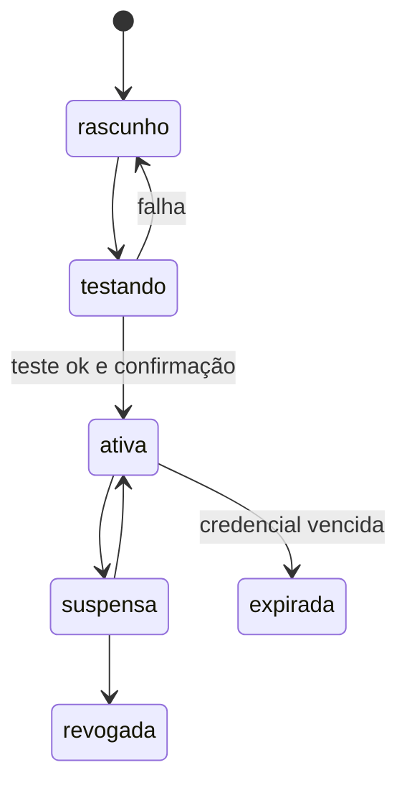

[Índice](README.md) · [Parte anterior](parte-13-atendimento-e-notificacoes.md) · [Próxima parte](parte-15-inteligencia-artificial.md)

<a id="parte-14"></a>

# Parte 14 — Integrações e importação

## Visão geral da parte 14

Integrações existem em dois níveis, plataforma e tenant, com credenciais no cofre e um ciclo de vida próprio ([16](#doc-16)). Integrações educacionais oficiais estão no [74](#doc-74) e a importação de dados de sistema anterior, no [70](#doc-70).



**Regras principais**
- Credencial gravada no cofre antes de qualquer teste; teste só com operação de leitura ([16](#doc-16), seção 5.1).
- Ativar conexão de produção exige permissão própria e step-up; conexão de plataforma exige dupla aprovação ([16](#doc-16), seção 5.2).
- SMS não é fator de MFA ([16](#doc-16), seção 2).

<a id="doc-16"></a>

## 16 — Integrações Externas: Plataforma (master) e Tenant

> Parte do [SDD v2](parte-01-visao-e-escopo.md#doc-00). Credenciais e cofre em [05](parte-04-seguranca-privacidade-e-auditoria.md#doc-05) e [10](parte-17-operacao-qualidade-testes-e-ti.md#doc-10). Validação de entrada e de saída em [15](parte-16-dados-validacoes-configuracoes-e-armazenamento.md#doc-15). Eventos internos em [14](parte-02-arquitetura-e-tenancy.md#doc-14).
> **Status:** proposta. Itens **[Decisão pendente]** precisam de aprovação do autor.

---

### 1. Dois níveis

| Nível | Quem contrata e paga | Quem configura | Credencial fica em | Quem usa |
|---|---|---|---|---|
| **Plataforma (master)** | TotusTuus SoftCloud | Equipe da plataforma, com permissão `plataforma.integracao.*` | Cofre da plataforma | Todos os tenants, de forma transparente |
| **Tenant** | A entidade (cliente) | Administrador da entidade, com permissão `integracao.conexao.*` | Cofre, com chave de cifragem por tenant | Só o próprio tenant |

Regras:

1. Credencial de um tenant nunca é visível para outro tenant, nem para a equipe da plataforma em texto claro.
2. A equipe da plataforma vê status, erros resumidos e metadados de uma conexão de tenant. Para ver o segredo, é preciso step-up, motivo registrado e alerta ao canal de segurança (ver [06](parte-03-identidade-acesso-e-permissoes.md#doc-06), seção 10).
3. Uma integração de plataforma pode ser usada por um tenant só quando o plano contratado inclui o recurso. O controle é feito pela configuração do tenant, não pelo código.
4. Integração de tenant não pode substituir integração de plataforma em funções de segurança, como e-mail de verificação e MFA.

### 2. Catálogo de integrações de plataforma

| Provedor (tipo) | Finalidade | Dado enviado | Regra |
|---|---|---|---|
| E-mail transacional | Verificação de cadastro, recuperação de conta, notificações | E-mail e conteúdo do aviso | Obrigatório. Única via de recuperação (D-04). |
| SMS | Notificação não crítica, opcional | Número e texto curto | **Não é fator de MFA** ([06](parte-03-identidade-acesso-e-permissoes.md#doc-06), seção 5). Desligado por padrão. |
| Armazenamento de objetos | Uploads e exportações | Arquivo cifrado no envio | Região declarada; URL assinada com validade curta |
| Antivírus de upload | Verificação de arquivo enviado | Arquivo | Arquivo recusado se o serviço não responder |
| Captcha | Proteção de login e cadastro após tentativas (ver [06](parte-03-identidade-acesso-e-permissoes.md#doc-06), seção 6) | Token do navegador | Escolha do provedor em ADR próprio |
| Cobrança da assinatura do SaaS | Cobrança dos tenants pela plataforma | Dados do cliente da plataforma | Dados bancários nunca passam pelo sistema; tokenização no provedor |
| Backup externo | Cópia de segurança fora da região principal | Backup cifrado | Chave de backup fora do provedor |
| Monitoramento e erros | Métricas e rastreamento de erro | Metadados; sem PII | Filtro de PII antes do envio |
| Verificação de documento (opcional) | Conferência de identidade, para suporte | Documento enviado pelo titular | Só com consentimento específico; sem armazenamento no provedor |

### 3. Catálogo de integrações de tenant

| Integração | Finalidade | Credencial típica | Regra |
|---|---|---|---|
| Gateway de pagamento | Cobrança de mensalidades, Pix, cartão | Chave da conta do tenant | Um gateway primário por unidade, dentro da entidade. Decidido em 03/11/2026 (SRC-05). Adapters: Asaas, Mercado Pago, Gerencianet / EFÍ, PagSeguro e Stripe (lista da v1, [`spec_gestao_billing_cobranca_mensalidades.md`](parte-10-financeiro-pagamentos-e-fiscal.md#v1-spec-gestao-billing-cobranca-mensalidades-md), seção 17.1). Contingência em [34](parte-10-financeiro-pagamentos-e-fiscal.md#doc-34), seção 2.3. |
| ERP ou contabilidade | Exportação de lançamentos | Chave ou usuário do ERP | Envio por lote diário; idempotência por número de lançamento |
| Emissão de nota fiscal (NFS-e, por município) | Nota de serviço educacional | Certificado digital e credencial da prefeitura | Certificado do tenant; sem certificado, a emissão não é habilitada |
| eSocial (transmissão) | Eventos S-2220, S-2230, S-2240 e demais do RH e SMT | Certificado digital A1 ou A3 da entidade | Ver decisão D-08 (seção 6) |
| SSO institucional (SAML ou OIDC) | Login com o provedor de identidade da escola | Metadados e certificado do provedor | Fora desta versão, salvo decisão D-09 |
| Webhook de saída | Enviar eventos para o sistema da unidade. Um endpoint por unidade. Decidido em 03/11/2026 (SRC-06) | Segredo HMAC do endpoint | Ver [04](parte-02-arquitetura-e-tenancy.md#doc-04), seção 7 |
| Importação de sistema legado | Carga inicial de dados | Arquivo ou acesso de leitura ao banco legado | Carga por arquivo; acesso direto ao banco de terceiros não é permitido |

### 4. Modelo de conexão

Cada conexão é um registro, em tabela com `tenant_id` quando o nível é tenant.

| Campo | Tipo | Regra |
|---|---|---|
| `id` | UUID | Público |
| `level` | enum | `platform` ou `tenant` |
| `tenant_id` | UUID | Obrigatório se `level = tenant`; nulo se `platform` |
| `provider` | enum | Lista fechada da seção 2 ou 3 |
| `environment` | enum | `sandbox` ou `production` |
| `status` | enum | `rascunho`, `testando`, `ativa`, `suspensa`, `revogada`, `expirada` |
| `config` | JSON | Só dado não secreto (ex.: identificador da conta, região) |
| `secret_ref` | string | Referência ao segredo no cofre; nunca o segredo |
| `scopes` | lista | Permissões que a conexão pede ao provedor |
| `expires_at` | data | Data de vencimento da credencial, quando o provedor informa |
| `last_tested_at`, `last_test_result` | data, enum | Resultado do último teste |
| `created_by`, `rotated_at`, `revoked_at` | identificador, data | Auditoria |

Regras do modelo:

- `production` e `sandbox` não compartilham credencial. Conexão de produção não pode ser usada em ambiente de homologação.
- Credencial de tenant é cifrada com a chave de dados do tenant, que por sua vez é protegida pela chave-mestra do cofre (ADR-05 em [02](parte-02-arquitetura-e-tenancy.md#doc-02)).
- Um tenant tem no máximo uma conexão `ativa` por provedor e ambiente, salvo gateway com múltiplas contas (regra do provedor).

### 5. Ciclo de vida

```
rascunho → testando → ativa ⇄ suspensa
                  ↘ (falha)    ↓
                  rascunho   revogada
                              expirada (automática, se a credencial vencer)
```

#### 5.1 Criação e teste

1. Administrador informa os dados não secretos e envia a credencial. A credencial é gravada no cofre antes de qualquer teste.
2. Sistema faz uma chamada de teste ao provedor (sandbox ou produção, conforme `environment`). Teste usa operação somente leitura.
3. Resultado do teste é gravado. Sucesso leva a `testando → ativa` só depois da confirmação do administrador.
4. Falha mantém o status `rascunho` e mostra a mensagem do provedor, sem o segredo.

#### 5.2 Ativação

- Ativar conexão de produção exige permissão específica e step-up de MFA.
- Ativar conexão de plataforma exige dupla aprovação de dois responsáveis da equipe da plataforma.

#### 5.3 Rotação

- Credencial tem data de rotação. Padrão: 180 dias, ou o prazo do provedor, se for menor.
- Rotação cria o novo segredo, testa, troca a referência e só depois revoga o antigo. Se o teste falhar, o antigo continua ativo.
- Janela de sobreposição máxima de 24 h.

#### 5.4 Revogação e exclusão

- Revogar desativa a conexão e tenta revogar a credencial no provedor, quando a API permitir.
- O segredo é apagado do cofre após 30 dias de carência. Durante a carência, a restauração é possível pelo administrador da plataforma com motivo registrado.
- Registro da conexão permanece para auditoria.

### 6. Decisões aprovadas (02/11/2026, com a proposta indicada)

| # | Decisão | Proposta | Alternativa e condição de falha |
|---|---|---|---|
| D-07 | Tenant pode trazer as próprias credenciais de gateway e ERP? | Sim, para cobrança e ERP. Comunicação e infraestrutura ficam na plataforma. | Centralizar tudo na plataforma: menos trabalho para o tenant, mas a plataforma passa a ser cobradora e responsável por todas as contas bancárias. |
| D-08 | Quem transmite o eSocial? | Certificado A1 ou A3 do tenant, com transmissor da plataforma. Montagem do XML no SMT ou RH. | Transmissão feita pela própria entidade: menos carga para a plataforma, mas exige equipe técnica no cliente. |
| D-09 | SSO institucional entra nesta versão? | Não. Fica para a versão seguinte, com [06](parte-03-identidade-acesso-e-permissoes.md#doc-06) já preparada para OIDC. | Entrar agora: aumenta o escopo de identidade e de testes. |

### 7. Segurança das chamadas externas

- **Lista de destinos permitidos** por provedor. Chamada para domínio fora da lista é bloqueada.
- **Proteção contra SSRF** (ver [04](parte-02-arquitetura-e-tenancy.md#doc-04), seção 7): sem redirecionamento, IP resolvido uma vez, bloqueio de redes privadas.
- **TLS verificado.** Certificado inválido é erro, sem opção de desligar verificação.
- **Segredo nunca em log**, em mensagem de erro, em URL ou em corpo de resposta gravado.
- **Chamada de saída com `timeout`:** conexão 3 s e total 15 s. Falha segue a regra da seção 6 de [15](parte-16-dados-validacoes-configuracoes-e-armazenamento.md#doc-15).
- **Circuit breaker por conexão:** após 5 falhas em 60 s, a conexão fica `suspensa` por 5 min e o administrador é avisado.

### 8. Operações financeiras

- Chave de idempotência por cobrança: o identificador da cobrança no sistema. Repetir a chamada não gera segunda cobrança.
- Conciliação diária entre o registro interno e o extrato do gateway. Diferença gera tarefa para o financeiro.
- Webhook de pagamento tem assinatura específica do provedor, validada antes de qualquer efeito.
- Estorno passa pelo gateway, nunca só no sistema.

### 9. Auditoria e observabilidade

- Registro de cada mudança de configuração, rotação, ativação, suspensão e revogação: ator, antes, depois, motivo.
- Registro de cada chamada de saída: provedor, operação, código de resposta, latência, identificador de correlação. Sem payload com dado pessoal.
- Painel de status por conexão. O painel da plataforma mostra só conexões de plataforma e contagem de erros por tenant, sem nome de cliente, salvo permissão.
- Alerta quando uma credencial vence em 30 dias ou quando uma conexão de produção fica `suspensa`.

### 10. Testes obrigatórios

- Conexão de tenant A não é usada por requisição do tenant B.
- Credencial de produção recusada em ambiente de sandbox.
- Rotação falha não derruba a credencial antiga.
- Segredo não aparece em log nem em resposta de API, mesmo em erro.
- Chamada a domínio fora da lista é bloqueada.
- Webhook com assinatura inválida é recusado antes de qualquer efeito.
- Cobrança repetida com a mesma chave de idempotência gera uma cobrança.

### 11. Critérios de aceite

- [ ] Todo provedor de plataforma e de tenant tem linha no catálogo com finalidade, dado enviado e regra.
- [ ] Nenhuma credencial em texto claro em banco, log ou resposta.
- [ ] Todo ciclo de vida (criação, teste, ativação, rotação, revogação) tem registro de auditoria.
- [ ] Decisões D-07, D-08 e D-09 tomadas pelo autor e registradas aqui.

<a id="doc-74"></a>

## 74 — Integrações Educacionais Oficiais, por Portal

> Parte do [SDD v2](parte-01-visao-e-escopo.md#doc-00). Trata as integrações com órgãos e programas da educação: Educacenso (INEP), SIGEP (transporte escolar), SGP / MEC Gestão Presente, sistema municipal próprio e programas federais, como o Pé-de-Meia. Integrações externas em geral em [16](#doc-16). Censo escolar e conferência em [69](parte-08-academico.md#doc-69), seção 4. Carga por arquivo, sem acesso direto ao banco de terceiro, em [70](#doc-70). Transporte e rastro de localização em [38](parte-12-suprimentos-patrimonio-frotas-contratos-e-terceiros.md#doc-38), seções 3.5 e 11. Frequência em [61](parte-08-academico.md#doc-61). Matrícula em [46](parte-09-secretaria-matricula-e-documentos.md#doc-46). Logs de integração em [49](parte-17-operacao-qualidade-testes-e-ti.md#doc-49), seção 2. Auditoria em [29](parte-04-seguranca-privacidade-e-auditoria.md#doc-29).
> **Status:** especificação proposta, criada em 03/11/2026. Layouts, prazos e regras de programa mudam por ano e são marcados **(verificar)**. O conflito de integração com o sistema municipal foi decidido (INT-01, seção 3.4).

---

### 1. Princípios

1. **Canal oficial, nunca banco de terceiro.** Nenhuma integração acessa o banco do órgão ou de outro sistema ([16](#doc-16)).
2. **Quem envia é a entidade, pela secretaria.** O sistema gera, confere e registra. Não envia nada a órgão sem ação da secretaria, salvo integração por API autorizada (seção 3.3).
3. **Envio é versionado.** Cada envio grava o layout, a versão, o hash, a data e quem enviou. Reenvio gera nova versão ([69](parte-08-academico.md#doc-69), seção 4).
4. **Dado mínimo.** Só vai o que o layout exige. Dado de localização e de saúde só vai se o layout exigir e se a base legal permitir ([50](parte-18-juridico-e-regulatorio.md#doc-50)).
5. **Erro não é corrigido em silêncio.** Rejeição do órgão volta como lista de erros, para correção no módulo de origem.

---

### 2. Visão geral

| Integração | Função | Canal | Quem executa | Situação |
|---|---|---|---|---|
| Educacenso (INEP) | Declarar escolas, turmas, matrículas, docentes e infraestrutura | Arquivo no layout oficial, importado no sistema do INEP | Secretaria | Seção 3.1 |
| SIGEP | Controle de transporte escolar | Exportação e importação de arquivo | Secretaria, com o transportador | Seção 3.2 |
| SGP / MEC Gestão Presente | Sincronizar gestão e estudantes com a plataforma federal | API | Sistema, com credencial da entidade | Seção 3.3 |
| Sistema municipal próprio | Matrícula, enturmação, diário, frequência e histórico | A definir (INT-01) | Sistema, conforme contrato | Seção 3.4 |
| Pé-de-Meia e programas federais | Elegibilidade e frequência de estudantes | Pela plataforma de dados do SGP | Sistema, com aprovação da secretaria | Seção 3.5 |

---

### 3. Integrações

#### 3.1 Educacenso (INEP)

- **Conteúdo:** escolas, turmas, matrículas, docentes e infraestrutura. Fontes em [69](parte-08-academico.md#doc-69), seção 4.2.
- **Mecanismo:** o sistema gera o arquivo no layout oficial do ano. A secretaria confere (seção 4.3 de [69](parte-08-academico.md#doc-69)), baixa o arquivo e importa no sistema do INEP. A plataforma não acessa o sistema do INEP por conta própria.
- **Registro:** cada arquivo gerado fica em `rel_envios_regulatorios`, com layout, versão, hash e quem gerou, conferiu e enviou ([51](parte-16-dados-validacoes-configuracoes-e-armazenamento.md#doc-51), seção 15.14).
- **Obrigação:** todo estabelecimento público e privado de educação básica e toda instituição de educação superior presta as informações ao INEP (Decreto 6.425/2008, arts. 4º e 5º). No público, a autoridade do Executivo de cada ente responde pela exatidão; no privado, o representante legal (art. 2º, §§ 1º e 2º, e art. 3º, parágrafo único). Dados pessoais do censo têm sigilo e não servem a outro fim (art. 6º). Conferido em 03/11/2026 no Planalto.
- **Prazo e layout:** o decreto não fixa data de referência, prazo nem layout. Ficam para ato do Ministro da Educação e do INEP, publicado a cada ano (art. 7º, § 1º). Por isso o sistema guarda layout e calendário como **versão por ano**, carregada pela equipe de produto a partir do ato do ano, e não fixa datas no código. Conferir o ato vigente a cada ciclo **(verificar)**.

#### 3.2 SIGEP (transporte escolar)

- **Conteúdo:** alunos usuários do transporte, rotas, veículos, monitores e dados de deslocamento. A troca é por arquivo de exportação e importação, no layout do SIGEP **(verificar)**.
- **Quem executa:** a secretaria gera e importa. O transportador recebe só o que é da sua rota ([38](parte-12-suprimentos-patrimonio-frotas-contratos-e-terceiros.md#doc-38), seção 3.5).
- **Localização:** o rastro de localização não entra no arquivo a menos que o layout exija. Se exigir, vale a regra de guarda do TER-02 ([38](parte-12-suprimentos-patrimonio-frotas-contratos-e-terceiros.md#doc-38), seção 11). **(jurídico)**, INT-05.
- **Monitor:** dado pessoal de terceiro. Só o necessário ao layout.

#### 3.3 SGP / MEC Gestão Presente

- **Mecanismo:** API, com credencial da entidade, guardada no cofre ([05](parte-04-seguranca-privacidade-e-auditoria.md#doc-05)). Recomendada para redes com sistema próprio, por isso a entidade decide se usa.
- **Ciclo:** envio incremental, por registro alterado. Resposta de rejeição fica na fila de integração ([49](parte-17-operacao-qualidade-testes-e-ti.md#doc-49), LOG-01). Falha de envio é reenviada com a mesma chave de idempotência.
- **Reconciliação:** diária, entre o registro interno e o que o SGP retornou. Diferença vira item para a secretaria, sem correção automática.
- **Termo:** adesão à plataforma federal exige termo da entidade **(jurídico)**, INT-04.

#### 3.4 Sistema municipal próprio

- **Função:** matrícula, enturmação, diário, frequência e histórico, conforme o contrato com a prefeitura.
- **Conflito:** a lista de integrações admite API REST, arquivos CSV ou XML, ou integração por banco. O [16](#doc-16) proíbe acesso direto ao banco de terceiro. Não dá para usar as duas coisas.
- **Decidido** em 03/11/2026 (INT-01): API REST. Arquivo CSV/XML fica como alternativa se a prefeitura não tiver API. Banco não.

#### 3.5 Pé-de-Meia e programas federais

- **Conteúdo:** elegibilidade de estudantes e frequência, quando o programa exigir.
- **Mecanismo:** pela plataforma de dados do SGP (seção 3.3). Não há canal próprio.
- **Regra de envio:** só aluno com matrícula ativa ([46](parte-09-secretaria-matricula-e-documentos.md#doc-46)), e frequência do diário ([61](parte-08-academico.md#doc-61)) fechada no período. Aprovação da secretaria antes do envio.
- **Regra do programa:** Conferido em 03/11/2026 na Lei 14.818/2024 (planalto.gov.br, com as Leis 14.945/2024 e 15.265/2025). A lei não usa o nome Pé-de-Meia: trata do incentivo financeiro-educacional na modalidade de poupança.
  - **Elegível:** estudante do ensino médio público, em todas as modalidades, de família no CadÚnico, com prioridade pela renda (art. 1º, § 1º). Na EJA, de 19 a 24 anos (art. 1º, § 2º).
  - **Requisitos** (art. 3º): matrícula no início do ano, **frequência mínima de 80%** das horas letivas, conclusão do ano com aprovação, participação no Saeb e em avaliação externa do ente, Enem no último ano, Encceja na EJA.
  - **Periodicidade:** aportes de matrícula e frequência pelo menos 9 vezes por ano (art. 5º, § 4º). O sistema prepara a frequência por mês fechado.
  - **Quem verifica:** a autoridade federal da educação (art. 3º, § 1º). As redes prestam as informações, nos termos do regulamento (art. 4º).
  - O sistema não decide elegibilidade: envia matrícula e frequência e mostra o aluno abaixo de 80% como alerta à secretaria. O 80% é do programa e não muda o mínimo de aprovação de 75% ([59](parte-08-academico.md#doc-59), seção 4).
  - **Regulamento** (Decreto 11.901/2024, conferido em 03/11/2026): idade de 14 a 24 anos e família no CadÚnico (art. 3º). Matrícula registrada até dois meses após o início do ano letivo e CPF do aluno (art. 4º, § 1º). Frequência de 80% medida pela média do período transcorrido ou pela frequência mensal, conforme ato do MEC (art. 4º, § 2º). Valores anuais: R$ 200 de matrícula, R$ 1.800 de frequência, R$ 1.000 de conclusão e R$ 200 do Enem (art. 4º).
  - **Dever da rede:** termo de compromisso assinado pelo chefe do Executivo do ente (art. 7º). A rede presta as informações e responde **sozinha pela veracidade** (art. 7º, §§ 1º e 3º). Informação fora do prazo do termo pode levar ao não pagamento do período (art. 7º, § 2º). Por isso o sistema mostra o prazo do termo, cadastrado pela secretaria, e alerta antes do vencimento. O envio exige aprovação da secretaria, que fica registrada.
  - **Desligamento:** evasão, abandono, ou reprovação por duas vezes seguidas ou por dois anos, entre outros casos (art. 5º). O sistema mostra esses alunos como alerta, sem decidir.
  - Ficam com o ato do MEC: forma exata da medição da frequência, canal e calendário de envio **(verificar)**.

---

### 4. Por portal

| Portal | Pode | Não pode | Origem |
|---|---|---|---|
| **Desenvolvedor** | Manter os layouts publicados, sem dado de entidade | Enviar ou ver envio de entidade | P |
| **Gestão** | Aprovar envio ao órgão. Ver o histórico de envios e rejeições | Gerar arquivo sem a secretaria | E |
| **Coordenação** | Conferir frequência e turmas antes do envio | Enviar | E |
| **Secretaria** | Gerar, conferir, baixar e importar arquivos. Enviar por API, quando autorizada | Enviar sem conferência da gestão | E |
| **Professor** | Nada. A frequência do diário alimenta o envio | Ver envio ou arquivo | E |
| **Aluno** e **Responsáveis** | Nada | Ver arquivo ou envio | E |
| **Transportador** (terceiro) | Ver a própria rota e os alunos da rota | Ver outras rotas ou arquivo completo | Terceiros, [38](parte-12-suprimentos-patrimonio-frotas-contratos-e-terceiros.md#doc-38) |
| **Terceiros** (demais) | Nada | Qualquer item de integração | E |

---

### 5. Pendências

| # | Pendência | Tipo |
|---|---|---|
| INT-01 | Sistema municipal: API REST, arquivo CSV/XML, ou banco (seção 3.4) | **Decidido** em 03/11/2026: API REST. Banco não |
| INT-02 | Layout e prazo do Educacenso, por ano e por esfera (seção 3.1) | **Conferido** em parte em 03/11/2026: obrigação e responsáveis no Decreto 6.425/2008. Layout e prazo vêm do ato anual do MEC e do INEP, guardados como versão por ano **(verificar)** a cada ciclo |
| INT-03 | Critérios e periodicidade do Pé-de-Meia (seção 3.5) | **Conferido** em 03/11/2026: Lei 14.818/2024, arts. 1º, 3º, 4º e 5º. Decreto 11.901/2024, arts. 3º a 7º, conferido. Canal e calendário de envio no ato do MEC **(verificar)** |
| INT-04 | Termo de adesão à plataforma federal (SGP), e quem assina (seção 3.3) | (jurídico) |
| INT-05 | Dado de localização no arquivo do SIGEP (seção 3.2). Mesmo ponto de TER-02 | (jurídico) |
| INT-06 | Layout do SIGEP e se o monitor é pessoa do terceiro (seção 3.2) | (verificar) |
| INT-07 | DDL: integração, envio, lote, resposta e rejeição. Reutiliza `rel_envios_regulatorios` onde couber | **Escrito** em [51](parte-16-dados-validacoes-configuracoes-e-armazenamento.md#doc-51), seção 15.20. Revisão do owner pendente (DDL-01) |

---

### 6. Critérios de aceite

- [ ] Nenhuma integração acessa banco de terceiro (teste de configuração).
- [ ] Envio ao Educacenso não ocorre sem conferência da gestão (teste).
- [ ] Transportador vê só a própria rota (teste de isolamento).
- [ ] Reenvio com a mesma chave não duplica registro (teste de idempotência).
- [ ] Rejeição do órgão aparece como lista de erros, sem correção automática (teste).
- [ ] Pé-de-Meia só inclui aluno com matrícula ativa (teste).
- [ ] Itens **(verificar)**, **(jurídico)** e **[Decisão do autor]** respondidos ou marcados como pendentes no [00](parte-01-visao-e-escopo.md#doc-00).

<a id="doc-70"></a>

## 70 — Importação de Dados e Carga Inicial, por Portal

> Parte do [SDD v2](parte-01-visao-e-escopo.md#doc-00). Décima terceira e última lacuna da ordem de [55](parte-08-academico.md#doc-55), seção 3. Regra geral de importação (simulação, erro por linha, limite e idempotência) em [15](parte-16-dados-validacoes-configuracoes-e-armazenamento.md#doc-15), seção 5. Carga de sistema legado por arquivo, sem acesso direto ao banco de terceiros, em [16](#doc-16). Cada tipo de dado segue o módulo de origem: estrutura ([59](parte-08-academico.md#doc-59)), turmas ([60](parte-08-academico.md#doc-60)), matrícula ([46](parte-09-secretaria-matricula-e-documentos.md#doc-46)), diário e boletim ([61](parte-08-academico.md#doc-61), [62](parte-08-academico.md#doc-62)), prontuário ([66](parte-08-academico.md#doc-66)), biblioteca ([68](parte-08-academico.md#doc-68)) e financeiro ([18](parte-07-regras-gerais-dos-modulos-de-gestao.md#doc-18)). Notificação em massa em [57](parte-13-atendimento-e-notificacoes.md#doc-57). Auditoria em [29](parte-04-seguranca-privacidade-e-auditoria.md#doc-29).
> **Status:** especificação proposta, criada em 03/11/2026. Fecha a lacuna 13 do acadêmico. A v1 tem importação em lote por CSV com validação e relatório de erros ([`spec_gestao_academica_completo.md`](parte-08-academico.md#v1-spec-gestao-academica-completo-md), seção 15). Esta versão define a ordem, as regras de domínio e o que a importação não pode fazer.

---

### 1. Resposta direta

> **Leitura (04/11/2026):** esta tabela registra o que existia no SDD antes deste documento ser escrito. Os itens marcados como **Não** ou **Parcial** são especificados nas seções seguintes deste documento, exceto o que estiver listado na seção de pendências.

| Pergunta | Veredito |
|---|---|
| Importação tem regra? | **Parcial.** A regra geral de [15](parte-16-dados-validacoes-configuracoes-e-armazenamento.md#doc-15) existe. Falta ordem por tipo, regra de domínio e tratamento do histórico |
| Carga de sistema anterior? | **Parcial.** [16](#doc-16) proíbe acesso direto ao banco de terceiro. Falta o processo |
| Importação pode contornar regra? | **Não, por regra desta especificação.** Ver seção 3 |

---

### 2. Tipos e ordem

A ordem segue a dependência. Nenhum tipo entra antes do que ele referencia.

| Ordem | Tipo | Depende de | Módulo |
|---|---|---|---|
| 1 | Pessoas: alunos, responsáveis, professores, servidores | Nada | [14](parte-02-arquitetura-e-tenancy.md#doc-14), seção 3 e [46](parte-09-secretaria-matricula-e-documentos.md#doc-46) |
| 2 | Estrutura: tipos de curso, cursos, disciplinas, grades, sistema avaliativo, períodos | 1 | [59](parte-08-academico.md#doc-59) |
| 3 | Calendário e salas | 2 | [58](parte-08-academico.md#doc-58), [44](parte-08-academico.md#doc-44) |
| 4 | Turmas e enturmação | 2 e 3 | [60](parte-08-academico.md#doc-60) |
| 5 | Matrículas ativas | 1, 2 e 4 | [46](parte-09-secretaria-matricula-e-documentos.md#doc-46) |
| 6 | Histórico: notas, faltas, situação final de períodos fechados | 4 e 5 | [61](parte-08-academico.md#doc-61), [62](parte-08-academico.md#doc-62) |
| 7 | Documentos e prontuário | 1 | [54](parte-09-secretaria-matricula-e-documentos.md#doc-54), [66](parte-08-academico.md#doc-66) |
| 8 | Acervo da biblioteca | 2 | [68](parte-08-academico.md#doc-68) |
| 9 | Saldos e parcelas em aberto | 5 | [18](parte-07-regras-gerais-dos-modulos-de-gestao.md#doc-18) |

---

### 3. O que a importação não faz

A importação entra pelos mesmos caminhos de regra que a tela. Por isso:

- **Nota fora da escala** é recusada, como na tela ([59](parte-08-academico.md#doc-59), seção 4).
- **Matrícula acima da capacidade** vai para a lista de espera ou é recusada com motivo ([60](parte-08-academico.md#doc-60), seção 2.4).
- **Aluno sem vínculo válido** de responsável não é importado como ativo ([07](parte-04-seguranca-privacidade-e-auditoria.md#doc-07)).
- **Histórico não recalcula regra de período fechado.** A situação final vem do arquivo, com a versão do sistema avaliativo que o arquivo declara. Se a versão não existe no sistema, a linha é rejeitada.
- **Não gera cobrança retroativa.** Parcela já paga na origem entra como paga. Parcela em aberto entra com a data da origem, sem nova multa.
- **Não dispara aviso em massa.** Carga histórica entra com flag de histórico, e nenhuma notificação é enviada por ela ([57](parte-13-atendimento-e-notificacoes.md#doc-57)).

---

### 4. Processo

1. **Modelo.** A plataforma publica um modelo de arquivo por tipo, com cabeçalho, tipos de campo e chave externa de origem. Ver seção 4.1.
2. **Envio.** O arquivo é enviado com tamanho e tipo validados ([15](parte-16-dados-validacoes-configuracoes-e-armazenamento.md#doc-15), seção 5).
3. **Simulação.** O sistema valida tudo e mostra o relatório, sem gravar. Mostra quantas linhas entram, quantas são rejeitadas e por quê.
4. **Confirmação.** A pessoa que importa confirma o lote. A confirmação fica em auditoria.
5. **Gravação.** O lote grava em transação por lote. Linha rejeitada não bloqueia as outras, mas o lote fica marcado como parcial.
6. **Desfazer.** O lote pode ser desfeito enquanto não houver registro posterior dependente dele. Depois disso, só correção por novo lote.
7. **Rejeitados.** Relatório de rejeitados, com linha e motivo, para correção e novo envio.
8. **Descarte do arquivo.** O arquivo de origem é apagado após a gravação, e fica só o hash e o relatório. Prazo em IMP-04.

**Idempotência:** a chave externa de origem evita duplicar o mesmo registro em reenvio. Reenvio do mesmo lote não cria registro novo.

#### 4.1 Modelos de arquivo (IMP-05)

**Formato comum a todos os modelos:**

| Item | Regra |
|---|---|
| Arquivos | Planilha (`.xlsx`, uma aba por modelo) e CSV. Os dois têm as mesmas colunas, na mesma ordem |
| CSV | UTF-8, separador ponto e vírgula, primeira linha com o nome das colunas |
| Data | `AAAA-MM-DD`. Data em outro formato é recusada, para não confundir dia e mês |
| Número | Vírgula como separador decimal, sem separador de milhar |
| Valor em dinheiro | Reais com duas casas. O sistema converte para centavos ([71](parte-10-financeiro-pagamentos-e-fiscal.md#doc-71)) |
| CPF | Só dígitos, com dígito verificador conferido ([15](parte-16-dados-validacoes-configuracoes-e-armazenamento.md#doc-15)) |
| Chave externa | Coluna `chave_origem` obrigatória em todo modelo. É o identificador no sistema anterior e garante a idempotência |
| Versão | Cada modelo tem versão no nome do arquivo e numa linha de comentário da planilha. Arquivo de versão que já saiu do prazo de aceitação (ver Publicação, abaixo) é recusado com aviso da versão atual |
| Coluna a mais | Recusada, para não esconder dado que não tem destino. Campo personalizado entra pela coluna com a chave do campo ([72](parte-16-dados-validacoes-configuracoes-e-armazenamento.md#doc-72)) |

**Colunas obrigatórias por modelo**, na ordem da seção 2:

| Modelo | Colunas obrigatórias | Observação |
|---|---|---|
| 1. Pessoas | `chave_origem`, `tipo_pessoa`, `nome`, `cpf` ou `documento_estrangeiro`, `nascimento`, `email` ou `telefone` | Responsável tem `chave_origem_dependente` e `tipo_vinculo`. Aluno menor sem responsável não fica ativo (seção 3) |
| 2. Estrutura | `chave_origem`, `tipo_registro` (curso, disciplina, grade, período), `codigo`, `nome`, `carga_horaria` | Sistema avaliativo é configurado na tela, não importado |
| 3. Calendário e salas | `chave_origem`, `tipo_registro` (dia, período, sala), `data_ou_codigo`, `descricao` | Sala tem `capacidade` |
| 4. Turmas e enturmação | `chave_origem`, `codigo_turma`, `curso`, `periodo`, `turno`, `capacidade`, `chave_origem_aluno` | Enturmação usa uma linha por aluno |
| 5. Matrículas | `chave_origem`, `chave_origem_aluno`, `codigo_turma`, `data_matricula`, `situacao` | Só matrícula ativa. Capacidade segue a seção 3 |
| 6. Histórico | `chave_origem`, `chave_origem_aluno`, `periodo`, `disciplina`, `nota_final`, `faltas`, `situacao_final`, `versao_sistema_avaliativo` | Só período fechado. Aprovação da coordenação (seção 6) |
| 7. Documentos | `chave_origem`, `chave_origem_pessoa`, `tipo_documento`, `nome_arquivo` | O arquivo vai num pacote compactado junto, com o mesmo nome. Dado de saúde segue IMP-03 |
| 8. Acervo | `chave_origem`, `titulo`, `autor`, `isbn` ou `codigo_interno`, `exemplares` | Item sem ISBN usa código interno |
| 9. Saldos e parcelas | `chave_origem`, `chave_origem_matricula`, `vencimento`, `valor`, `situacao` (paga, em aberto), `data_pagamento` | Sem multa nova (seção 3). Aprovação do financeiro |

**Publicação:** o portal do desenvolvedor publica os modelos, sem dado. A empresa aprova cada versão antes da publicação. Mudança de coluna gera nova versão, e a anterior continua aceita por 90 dias.

---

### 5. Dado sensível e dado de terceiros

- Laudos, diagnósticos e dados de saúde só são importados se a regra de [66](parte-08-academico.md#doc-66), seção 2.3, permitir. Ver IMP-03.
- Arquivo de origem tem dado pessoal. Fica em armazenamento restrito, cifrado, pelo tempo do processo.
- Nenhum acesso direto ao banco do sistema anterior ([16](#doc-16)).

---

### 6. Por portal

| Portal | Pode | Não pode | Origem |
|---|---|---|---|
| **Desenvolvedor** | Publicar modelos de arquivo, sem dado. Orientar a importação | Importar ou ver dado de entidade, nem o conteúdo de lote | P |
| **Gestão** | Autorizar a importação inicial. Ver o relatório de lote | Importar sem a secretaria. Ver dado sensível do arquivo | E |
| **Secretaria** | Importar pessoas, estrutura, turmas, matrículas, documentos e acervo. Desfazer lote | Importar histórico sem a coordenação. Importar saldo sem o financeiro | E |
| **Coordenação** | Importar histórico de período fechado, com aprovação | Importar pessoa ou matrícula | E |
| **Financeiro** (perfil da unidade) | Importar saldos e parcelas em aberto | Importar notas ou documentos | E |
| **Professor** | Nada | Qualquer item de importação | E |
| **Aluno** | Nada | Qualquer item de importação | E |
| **Responsáveis** | Nada | Qualquer item de importação | E |
| **Terceiros** | Nada | Qualquer item de importação | E |

---

### 7. Pendências

| # | Pendência | Tipo |
|---|---|---|
| IMP-01 | Quem executa a importação inicial (seção 6) | **Decidido** em 03/11/2026: a entidade, pela secretaria. A equipe da empresa só orienta |
| IMP-02 | Histórico importado gera notificação (seção 3) | **Decidido** em 03/11/2026: não |
| IMP-03 | Laudos e dados de saúde na importação: aceitar, ou bloquear e tratar na seção de saúde | (jurídico) |
| IMP-04 | Prazo de retenção do arquivo de origem depois da gravação (seção 4, passo 8) | (jurídico) |
| IMP-05 | Modelos de arquivo por tipo: publicar em planilha e em CSV | **Escrito** na seção 4.1. Revisão do owner pendente: a empresa aprova cada versão |
| IMP-06 | DDL: lote, linha, erro, chave externa, mapeamento de campo e histórico de desfazer | **Escrito** em [51](parte-16-dados-validacoes-configuracoes-e-armazenamento.md#doc-51), seção 15.15. Revisão do owner pendente (DDL-01) |

---

### 8. Critérios de aceite

- [ ] Simulação não grava nenhuma linha (teste).
- [ ] Reenvio do mesmo lote não duplica registro (teste de idempotência).
- [ ] Nota fora da escala é rejeitada na importação (teste de integração com [59](parte-08-academico.md#doc-59)).
- [ ] Matrícula acima da capacidade não entra como ativa (teste).
- [ ] Histórico com versão de sistema avaliativo inexistente é rejeitado (teste).
- [ ] Importação de histórico não dispara notificação (teste de integração com [57](parte-13-atendimento-e-notificacoes.md#doc-57)).
- [ ] Arquivo de origem é apagado depois da gravação e fica só o hash (teste).
- [ ] Itens **(verificar)**, **(jurídico)** e **[Decisão do autor]** respondidos ou marcados como pendentes no [00](parte-01-visao-e-escopo.md#doc-00).

## Especificações da v1 desta parte absorvidas no kit-starter ou sem destino

<a id="v1-spec-complementar-integracoes-governanca-md"></a>

### v1 — `spec_complementar_integracoes_governanca.md` (307 linhas)

> Situação na v2: Absorvido integralmente no kit-starter. Destino: ficha do kit-starter: `kit-starter/desenvolvedor/seguranca-e-operacao/integracoes-globais.md`. Quando este texto diverge da v2, vale a v2.

#### O que a v2 muda nesta especificação

Estas regras prevalecem sobre o texto da v1 que vem a seguir.

- **Dois níveis** ([16](#doc-16), seção 1): plataforma (credencial no cofre da plataforma, permissão `plataforma.integracao.*`) e tenant (cofre com chave por tenant).
- **Credencial de tenant** nunca visível em texto claro para a equipe da plataforma; ver o segredo exige step-up, motivo e alerta ao canal de segurança.
- **Catálogo da plataforma** ([16](#doc-16), seção 2): e-mail transacional (obrigatório), SMS (não é MFA, desligado por padrão), armazenamento de objetos, antivírus de upload, captcha, cobrança da assinatura do SaaS, backup externo, monitoramento sem PII, verificação de documento opcional.
- **Ciclo de vida, segurança das chamadas, auditoria e testes** ([16](#doc-16), seções 5, 7, 9 e 10); governança da v1 ligada ao [04](parte-02-arquitetura-e-tenancy.md#doc-04), seção 7.

#### Texto integral da v1

- Language Standard: Global English
#### 1. Objetivo
Este documento complementa os specs existentes de RH/HCMRH, SMT e Suprimentos, fechando lacunas de integração, governança, automações, observabilidade, segurança e padronização operacional.

#### 2. Escopo
Este spec cobre funcionalidades transversais e itens ainda não formalizados nos anexos, com foco em:
- Integração entre RH, SMT e Suprimentos.
- Padronização de eventos, filas, notificações e auditoria.
- Regras de retenção, anonimização, exportação e mascaramento LGPD.
- Monitoramento operacional, retries, idempotência e trilha de execução.
- Checklist de implementação para fechamento de backlog.

#### 3. Lacunas Prioritárias
##### 3.1 Integração RH ↔ SMT
- Criação automática de exames ocupacionais a partir de admissão, movimentação e retorno.
- Criação automática de eventos de eSocial S-2220, S-2230 e S-2240 a partir de gatilhos do RH e SMT.
- Sincronização de status de afastamento, restrições médicas e aptidão do colaborador.
- Exposição de status consolidado de saúde ocupacional no perfil do colaborador.

##### 3.2 Integração SMT ↔ Suprimentos
- Geração automática de solicitação de compra ao atingir estoque mínimo de EPI.
- Bloqueio e liberação de fornecedores por conformidade documental e CA vencido.
- Consumo de contratos e atas em compras de EPI, insumos e serviços de segurança.
- Registro de evidência de reposição, devolução e auditoria da cadeia de suprimentos.

##### 3.3 Integração RH ↔ Suprimentos
- Solicitação automática de itens de onboarding e offboarding.
- Integração de centro de custo, cargo e unidade nas requisições.
- Controle de ativos e itens entregues ao colaborador com histórico unificado.

##### 3.4 Padronização global
- Todos os módulos devem usar id, uuid e code em entidades principais.
- Todos os listados devem suportar paginação server-side, filtros, ordenação, busca global e exportação auditada.
- Todos os drawers críticos devem possuir abas, histórico, comentários, anexos e auditoria.
- Todas as ações críticas devem gerar audit log com before/after, IP e user-agent.

#### 4. Módulos Transversais
##### 4.1 Event Bus Interno
Um barramento interno deve centralizar eventos de domínio para permitir automações desacopladas. Eventos mínimos:
- employee.created.
- employee.terminated.
- employee.department-changed.
- exam.scheduled.
- exam.performed.
- cat.created.
- absence.created.
- epi.stock-minimum-reached.
- training.expired.
- supplier.blocked.
- request.approved.

###### Requisitos
- Persistência de eventos em fila.
- Status pending, queued, sent, processed, rejected.
- Reprocessamento manual e automático.
- Idempotência por chave de evento.
- Retenção de logs de processamento.

##### 4.2 Central de Notificações
- Canal e-mail.
- Canal in-app.
- Canal webhook.
- Canal push interno.
- Canal SMS opcional.
- Preferências por perfil, unidade e evento.
- Templates com variáveis e preview.

##### 4.3 Auditoria Unificada
- Registrar toda criação, atualização, exclusão lógica, exportação, aprovação, reprovação e alteração de status.
- Auditoria com entityid, unitid, userid, action, resource, resourceid, beforejson, afterjson, ip, useragent, createdat.
- Tela de consulta com filtros por período, usuário, módulo, ação e recurso.
- Exportação de auditoria somente para perfis autorizados.

##### 4.4 LGPD e Segurança
- Dados sensíveis criptografados em repouso.
- CPF, CID, salário e dados bancários mascarados em listagens para perfis sem permissão.
- Portabilidade de dados por colaborador em arquivo estruturado.
- Anonimização automática conforme política de retenção.
- Bloqueio de exportação sem motivo e sem trilha de auditoria.

#### 5. Telas Complementares
##### 5.1 Hub de Integrações
Página central para visualizar integrações ativas, filas, falhas, retentativas, jobs e webhooks.

###### Blocos
- KPIs de integrações.
- Lista de eventos em fila.
- Lista de webhooks.
- Jobs com erro.
- Histórico de transmissões.
- Alertas de falha.

###### Colunas da fila
- Código.
- Evento.
- Origem.
- Referência.
- Status.
- Tentativas.
- Próxima tentativa.
- Protocolo.
- Mensagem.
- Ações.

##### 5.2 Central de Governança
Tela para parametrizar políticas globais de integração, retenção, mascaramento, notificações e automações.

###### Seções
- Políticas de retenção.
- Regras de máscara de dados.
- Templates de eventos.
- Destinatários padrão.
- Regras de retry.
- Rate limits.
- Configurações por entidade e unidade.

##### 5.3 Timeline Operacional
Linha do tempo unificada exibindo eventos de RH, SMT e Suprimentos em ordem cronológica.

###### Filtros
- Módulo.
- Evento.
- Usuário.
- Unidade.
- Período.
- Status.

#### 6. Fluxos Obrigatórios
##### 6.1 Admissão
Ao criar um colaborador ativo, o sistema deve:
- Criar evento de onboarding.
- Agendar exame admissional.
- Gerar checklist de documentos.
- Criar solicitações de EPI e treinamentos obrigatórios.
- Registrar auditoria completa.

##### 6.2 Afastamento
Ao registrar afastamento:
- Atualizar status do colaborador.
- Gerar eSocial S-2230.
- Notificar gestor, RH e ocupacional.
- Recalcular pendências de ponto e folha se necessário.

##### 6.3 CAT
Ao registrar CAT:
- Criar evento eSocial S-2210.
- Abrir investigação de acidente.
- Disponibilizar anexos e testemunhas.
- Notificar SESMT e perfis autorizados.

##### 6.4 EPI
Ao atingir estoque mínimo ou CA vencendo:
- Abrir alerta automático.
- Gerar solicitação de compra no módulo Suprimentos.
- Notificar SESMT.
- Registrar trilha de decisão.

##### 6.5 Treinamentos
Ao vencer treinamento obrigatório:
- Notificar colaborador, gestor e RH.
- Bloquear conformidade do cargo, quando aplicável.
- Abrir tarefa de renovação.

#### 7. APIs REST Complementares
##### 7.1 Integrações
- GET /api/v1/integrations/dashboard
- GET /api/v1/integrations/queue
- POST /api/v1/integrations/queue/{uuid}/retry
- POST /api/v1/integrations/queue/{uuid}/cancel
- GET /api/v1/integrations/webhooks
- POST /api/v1/integrations/webhooks/test
- GET /api/v1/integrations/audit

##### 7.2 Governança
- GET /api/v1/governance/policies
- PUT /api/v1/governance/policies/{uuid}
- GET /api/v1/governance/templates
- PUT /api/v1/governance/templates/{uuid}
- GET /api/v1/governance/retention
- PUT /api/v1/governance/retention/{uuid}

##### 7.3 Timeline
- GET /api/v1/timeline/events
- GET /api/v1/timeline/events/{uuid}
- POST /api/v1/timeline/events/export

#### 8. Schema SQL Complementar
##### 8.1 Event Queue
```sql
CREATE TABLE sys_event_queue (
  id BIGINT UNSIGNED AUTO_INCREMENT PRIMARY KEY,
  uuid CHAR(36) NOT NULL UNIQUE DEFAULT UUID(),
  entityid BIGINT UNSIGNED NOT NULL,
  unitid BIGINT UNSIGNED NULL,
  eventkey VARCHAR(120) NOT NULL,
  eventtype VARCHAR(80) NOT NULL,
  payload JSON NOT NULL,
  status ENUM('pending','queued','sent','processed','rejected','cancelled') NOT NULL DEFAULT 'pending',
  attempts TINYINT UNSIGNED NOT NULL DEFAULT 0,
  maxattempts TINYINT UNSIGNED NOT NULL DEFAULT 5,
  nextattemptat DATETIME NULL,
  lastattemptat DATETIME NULL,
  lastresponse TEXT NULL,
  idempotencykey VARCHAR(120) NOT NULL,
  createdby BIGINT UNSIGNED NULL,
  createdat DATETIME NOT NULL DEFAULT CURRENT_TIMESTAMP,
  updatedat DATETIME NOT NULL DEFAULT CURRENT_TIMESTAMP ON UPDATE CURRENT_TIMESTAMP,
  INDEX idx_entity_status (entityid, status),
  INDEX idx_eventkey (eventkey),
  UNIQUE KEY uk_idempotency (idempotencykey)
) ENGINE=InnoDB DEFAULT CHARSET=utf8mb4;
```

##### 8.2 Notification Log
```sql
CREATE TABLE sys_notification_log (
  id BIGINT UNSIGNED AUTO_INCREMENT PRIMARY KEY,
  uuid CHAR(36) NOT NULL UNIQUE DEFAULT UUID(),
  entityid BIGINT UNSIGNED NOT NULL,
  unitid BIGINT UNSIGNED NULL,
  eventkey VARCHAR(120) NOT NULL,
  channel ENUM('email','inapp','push','webhook','sms') NOT NULL,
  recipient VARCHAR(200) NOT NULL,
  subject VARCHAR(200) NULL,
  message TEXT NULL,
  status ENUM('queued','sent','failed','cancelled') NOT NULL DEFAULT 'queued',
  sentat DATETIME NULL,
  errortext TEXT NULL,
  createdat DATETIME NOT NULL DEFAULT CURRENT_TIMESTAMP,
  INDEX idx_event_channel (eventkey, channel)
) ENGINE=InnoDB DEFAULT CHARSET=utf8mb4;
```

##### 8.3 Governance Policy
```sql
CREATE TABLE sys_governance_policies (
  id BIGINT UNSIGNED AUTO_INCREMENT PRIMARY KEY,
  uuid CHAR(36) NOT NULL UNIQUE DEFAULT UUID(),
  entityid BIGINT UNSIGNED NOT NULL,
  policycode VARCHAR(60) NOT NULL,
  policyname VARCHAR(150) NOT NULL,
  policytype ENUM('retention','masking','notification','retry','rate_limit','export') NOT NULL,
  rulesjson JSON NOT NULL,
  status ENUM('active','inactive') NOT NULL DEFAULT 'active',
  createdat DATETIME NOT NULL DEFAULT CURRENT_TIMESTAMP,
  updatedat DATETIME NOT NULL DEFAULT CURRENT_TIMESTAMP ON UPDATE CURRENT_TIMESTAMP,
  UNIQUE KEY uk_entity_policy (entityid, policycode)
) ENGINE=InnoDB DEFAULT CHARSET=utf8mb4;
```

#### 9. Regras de Negócio
- Não permitir integração sem entityid válido.
- Não permitir evento duplicado com mesma chave de idempotência.
- Não permitir exportação de dados sensíveis sem permissão explícita e justificativa.
- Não permitir mudança de status final sem auditoria.
- Não permitir reprocessamento de evento já confirmado sem permissão especial.
- Não permitir notificação de dados sensíveis em canal não autorizado.

#### 10. RBAC Complementar
##### Perfis de acesso
- SA Super Admin.
- GE Gestor de Entidade.
- GP Gestor de Pessoas.
- GPRH Gestor de Processos RH.
- SESMT Saúde e Segurança.
- MED Médico do Trabalho.
- RH Recursos Humanos.
- SUP Suprimentos.
- AUD Auditor.
- DPO Encarregado LGPD.

##### Permissões novas
- integrations.view.
- integrations.retry.
- integrations.cancel.
- notifications.manage.
- governance.manage.
- timeline.view.
- timeline.export.
- retention.manage.
- masking.manage.

#### 11. Critérios de Aceite
- Todas as integrações críticas devem ter fila, retry e auditoria.
- Todos os eventos de RH, SMT e Suprimentos devem ser rastreáveis.
- Toda exportação deve gerar log com motivo e usuário.
- Todo dado sensível deve respeitar mascaramento por perfil.
- Toda tela complementar deve seguir o padrão enterprise do sistema.
- Todo fluxo crítico deve possuir tratamento de erro e estado de reprocessamento.
- Toda política de retenção deve ser configurável por entidade.

#### 12. Checklist de Entrega
- Hub de integrações implementado.
- Central de governança implementada.
- Timeline operacional implementada.
- Event bus persistente com retries.
- Logs de notificação e auditoria unificados.
- Regras LGPD consolidadas.
- APIs e rotas documentadas.
- Schemas SQL aplicados e indexados.
- RBAC ajustado para perfis novos.
- Testes de integração e regressão executados.

#### 13. Conclusão
Este spec complementar fecha as lacunas transversais mais importantes entre RH, SMT e Suprimentos, consolidando uma base única de eventos, auditoria, governança e conformidade para a plataforma.

---

---

[Índice](README.md) · [Parte anterior](parte-13-atendimento-e-notificacoes.md) · [Próxima parte](parte-15-inteligencia-artificial.md)
