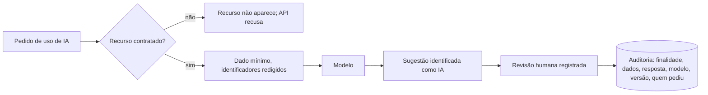

[Índice](README.md) · [Parte anterior](parte-14-integracoes-e-importacao.md) · [Próxima parte](parte-16-dados-validacoes-configuracoes-e-armazenamento.md)

# Parte 15 — Inteligência artificial

## Visão geral da parte 15

A IA sugere e a pessoa decide. Nenhuma decisão sobre direito, nota, matrícula, crédito, emprego ou saúde é tomada só pela IA ([27](#doc-27), princípio 2).

**Regras principais**
- Dado de cliente não treina modelo de terceiros sem consentimento e contrato ([27](#doc-27), princípio 4).
- Cobertura de IA módulo a módulo, com os módulos que ficam sem IA por decisão ([28](#doc-28)).

## 27 — Inteligência Artificial por Módulo e por Portal

> Parte do [SDD v2](parte-01-visao-e-escopo.md#doc-00). Chatbots e uso de IA em atendimento em [22](parte-06-plataforma-saas-clientes-dominios-licencas-e-crm.md#doc-22), decisão D-18. Dados e busca em [21](parte-16-dados-validacoes-configuracoes-e-armazenamento.md#doc-21). Decisões automatizadas e direitos do titular em [07](parte-04-seguranca-privacidade-e-auditoria.md#doc-07). Regras jurídicas em [26](parte-18-juridico-e-regulatorio.md#doc-26). Módulos em [12](parte-01-visao-e-escopo.md#doc-12).
> **Status:** especificação proposta. Os recursos de IA são opcionais e contratados. Nenhum deles está ativo sem contratação e sem decisão de governança registrada na entidade.

---

### 1. Princípios

1. **Contratação define o acesso.** Cada recurso de IA existe no sistema só para quem contratou. Não contratado, o recurso não aparece na interface e a API responde com erro próprio (seção 3).
2. **IA sugere, a pessoa decide.** Nenhuma decisão que afete direito, nota, matrícula, crédito, emprego ou saúde é tomada só pela IA. Há ponto de revisão humana registrado.
3. **Dado mínimo para o modelo.** A IA recebe só o dado necessário para a tarefa, com redação de identificadores (seção 4).
4. **Sem treinamento com dado de cliente por padrão.** Dado de tenant não é usado para treinar modelo de terceiros. Qualquer uso para melhoria exige consentimento e contrato específico.
5. **Transparência.** Conteúdo gerado por IA é identificado como tal. O titular sabe quando a decisão teve participação de IA.
6. **Auditoria completa.** Toda chamada a modelo gera registro com finalidade, dados enviados, resposta, modelo, versão e quem solicitou.

---

### 2. Quem usa IA

| Portal | Quem | Exemplo de uso |
|---|---|---|
| **Portal do desenvolvedor** (plataforma) | Equipe da plataforma | Suporte com IA, análise de logs, geração de páginas no Editor de portais, triagem de vulnerabilidades |
| **Portal do tenant** (entidade e unidades) | Equipe da entidade, professor, aluno, responsável | Resumo de documentos, geração de plano de aula, atendimento no chat, simulados |

Os dois portais têm recursos e limites diferentes. Não há dado de tenant no portal do desenvolvedor, salvo o que o suporte acessa com vínculo e registro ([06](parte-03-identidade-acesso-e-permissoes.md#doc-06), seção 10).

---

### 3. Contratação e habilitação

#### 3.1 Modelo de contratação

| Item | Descrição |
|---|---|
| Chave de capacidade | `ai.core` (base) e `ai.<modulo>` (por módulo). Exemplos: `ai.core`, `ai.academico`, `ai.financeiro`, `ai.chat`. |
| Portal do desenvolvedor | `ai.platform.core` e `ai.platform.<capacidade>` |
| Quota | Número de chamadas e volume de tokens por mês. Excedente bloqueia ou cobra, conforme contrato. |
| Plano | Recursos de IA fazem parte do plano, com a quota de IA-06. O excedente é cobrado à parte, conforme o contrato. Decidido em 03/11/2026 (IA-01). O valor em reais é decisão comercial, fora deste SDD. |
| Ativação | Feita pelo administrador da entidade ou pelo responsável da plataforma, com registro. |
| Governança | Antes de ativar, a entidade registra o responsável pela IA, aceita os termos de uso de IA e confirma a base de cada recurso (seção 6). |

#### 3.2 Comportamento sem contratação

- Interface: o recurso não aparece no menu, nem em botões, nem em atalhos.
- API: resposta `403` com código `feature_not_contracted`. Não revela se o recurso existe em outra entidade.
- Dado: nenhuma chamada a modelo é feita. Não há envio de dado para o provedor.
- Histórico: resultados gerados antes do cancelamento continuam visíveis somente para quem tinha acesso ao registro original.

#### 3.3 Cancelamento

- Para de gerar, em até 1 hora.
- Dado enviado ao provedor é tratado conforme o contrato de tratamento de dados do provedor.
- Os resultados gerados ficam no módulo de origem, marcados como gerados por IA. A exportação de histórico segue a política de retenção ([07](parte-04-seguranca-privacidade-e-auditoria.md#doc-07), seção 5).

---

### 4. Arquitetura e dados

#### 4.1 Componentes

| Componente | Função |
|---|---|
| Gateway de IA | Ponto único de chamada. Aplica autorização, quota, redação, registro e escolha de modelo. Módulos não chamam provedor diretamente. |
| Provedores | Um ou mais provedores de modelo, por contrato da plataforma ou do tenant ([16](parte-14-integracoes-e-importacao.md#doc-16), seção 6). |
| Redator de dados | Remove ou troca identificadores antes do envio (CPF, telefone, e-mail, nome completo quando desnecessário, dado de saúde). |
| Recuperador de fontes (RAG) | Busca somente em fontes do tenant ou da plataforma, com a permissão do usuário ([21](parte-16-dados-validacoes-configuracoes-e-armazenamento.md#doc-21), seção 6.3). |
| Verificador de saída | Checa formato, presença de dado pessoal indevido e conteúdo proibido antes de exibir. |
| Registro | Grava cada chamada. Nunca grava o dado completo se ele for sensível; grava identificador e hash. |

#### 4.2 Regras de dados

- Dado enviado ao modelo é o mínimo para a tarefa. Identificador é substituído por apelido de sessão.
- Dado de saúde, dado de criança ou adolescente e dado de pagamento **não são enviados** a provedor de modelo, salvo finalidade específica aprovada pelo DPO e contrato adequado ([26](parte-18-juridico-e-regulatorio.md#doc-26), seção 5).
- Provedor precisa de contrato de tratamento de dados, sem retenção para treino, com retenção mínima de logs no próprio provedor. Confirmar com o jurídico ([25](parte-18-juridico-e-regulatorio.md#doc-25)).
- Resposta do modelo não é gravada como fato. É gravada como sugestão, com a versão do modelo.
- Região de processamento declarada. Transferência internacional segue a [LGPD](parte-04-seguranca-privacidade-e-auditoria.md#doc-07), seção 7.

#### 4.3 Defesas

| Ameaça | Controle |
|---|---|
| Injeção de instrução em documento ou mensagem | Conteúdo externo é tratado como dado, nunca como instrução. Ações de escrita exigem confirmação humana. |
| Vazamento de dado de outro tenant pela IA | Recuperação filtrada pela permissão do usuário e pelo tenant. Teste de isolamento para cada recurso. |
| Saída com dado pessoal indevido | Verificador de saída bloqueia e registra. |
| Abuso de custo | Quota por usuário, por módulo e por entidade. |
| Dependência de provedor | Gateway troca de provedor sem mudança nos módulos. |

---

### 5. Recursos por módulo do tenant

Para cada módulo: o que a IA faz, o que ela não faz, onde a decisão humana acontece e a capacidade contratada.

#### 5.1 Acadêmico (`ai.academico`)

| Recurso | Faz | Não faz | Revisão humana |
|---|---|---|---|
| Plano de aula e plano de ensino | Gera rascunho a partir da ementa e do material | Não publica sem o professor | Professor aprova |
| Resumo de conselho de classe | Resume registros da turma | Não decide aprovação ou reprovação | Coordenação decide |
| Resposta a dúvidas do aluno sobre calendário e regulamento | Responde a partir de fonte cadastrada ([22](parte-06-plataforma-saas-clientes-dominios-licencas-e-crm.md#doc-22), D-18) | Não informa nota, situação financeira ou decisão disciplinar | Encaminha para humano fora da fonte |
| Simulado e questões | Gera questões a partir de banco aprovado | Não gera questão sem revisão | Professor revisa antes de publicar |
| Triagem de documentos da secretaria | Sugere classificação de documento enviado | Não aceita nem recusa documento | Atendente decide |

#### 5.2 Financeiro e Cobrança (`ai.financeiro`)

| Recurso | Faz | Não faz | Revisão humana |
|---|---|---|---|
| Explicação de cobrança ao responsável | Explica valores de fatura a partir de dados calculados pelo sistema | Não recalcula valor nem promete desconto | Não há decisão |
| Previsão de inadimplência | Estima risco por padrão histórico agregado | Não nega matrícula nem aplica bloqueio | Financeiro decide a ação |
| Renegociação | Sugere plano dentro das regras do tenant (Lei 14.181/2021, [26](parte-18-juridico-e-regulatorio.md#doc-26), seção 4.5) | Não aceita renegociação sem o consumidor | Consumidor aceita e registro é feito |
| Conciliação | Sugere pares de lançamento bancário e registro | Não concilia sem confirmação | Financeiro confirma |

Proibição: IA não decide cobrança, negativação ou bloqueio. Essas ações são do sistema, com regra e com registro ([18](parte-07-regras-gerais-dos-modulos-de-gestao.md#doc-18)).

#### 5.3 Pessoas e RH (`ai.rh`)

| Recurso | Faz | Não faz | Revisão humana |
|---|---|---|---|
| Triagem de currículo | Resume candidatura e destaca requisitos atendidos | Não classifica nem rejeita candidato | Recrutador decide |
| Resumo de avaliação de desempenho | Consolida registros | Não atribui nota | Gestor decide |
| Perguntas sobre benefícios e política | Responde a partir de política cadastrada | Não informa dado salarial individual a terceiro | Encaminha para RH fora da fonte |

Proibição: triagem automatizada que elimine candidato sem revisão humana é vedada pelo sistema. O art. 20 da LGPD dá ao titular o direito de pedir revisão de decisão automatizada que afete seus interesses ([07](parte-04-seguranca-privacidade-e-auditoria.md#doc-07), seção 4).

#### 5.4 Segurança e medicina do trabalho (`ai.smt`)

| Recurso | Faz | Não faz | Revisão humana |
|---|---|---|---|
| Resumo de CAT e investigação | Organiza a narrativa do acidente | Não conclui causa | Responsável técnico conclui |
| Lembrete de exame e de treinamento NR | Gera aviso a partir do calendário | Não dispensa exame | Responsável confirma |
| Consulta de normas | Responde com referência à NR cadastrada | Não interpreta laudo | Profissional decide |

Proibição: IA não faz diagnóstico, não interpreta exame clínico e não emite parecer de aptidão.

#### 5.5 Suprimentos, Compras e Contratos (`ai.suprimentos`, `ai.contratos`)

| Recurso | Faz | Não faz | Revisão humana |
|---|---|---|---|
| Comparativo de cotações | Organiza a planilha de preço, prazo e condição | Não adjudica fornecedor | Comprador e aprovador decidem |
| Análise de cláusulas de contrato | Destaca cláusulas fora do padrão e prazos de vencimento | Não emite parecer jurídico | Jurídico decide |
| Sugestão de pedido por ruptura de estoque | Propõe quantidade a partir de consumo | Não emite pedido | Comprador confirma |

#### 5.6 CRM e atendimento (`ai.chat`, `ai.crm`)

| Recurso | Faz | Não faz | Revisão humana |
|---|---|---|---|
| Chatbot de captação | Responde com fonte cadastrada e oferece ticket sem IA (D-18) | Não negocia preço nem bolsa sem fonte | Atendente assume quando fora da fonte |
| Resumo de conversa para o vendedor | Resume o histórico do lead | Não envia mensagem sem aprovação | Vendedor envia |
| Sugestão de próxima ação | Propõe passo no funil | Não muda etapa do funil sozinho | Vendedor decide |

#### 5.7 Atendimento e helpdesk (`ai.helpdesk`)

| Recurso | Faz | Não faz | Revisão humana |
|---|---|---|---|
| Classificação de chamado | Sugere categoria e prioridade | Não fecha chamado | Atendente confirma |
| Rascunho de resposta | Gera texto a partir da base de conhecimento | Não envia sem revisão | Atendente envia |

#### 5.8 Documentos e busca (`ai.documentos`)

| Recurso | Faz | Não faz | Revisão humana |
|---|---|---|---|
| Resumo de documento longo | Resume com referência à página | Não resume documento restrito sem permissão | Usuário lê o original |
| Perguntas sobre documento | Responde com citação da página | Não responde sobre documento de outro titular | Não há decisão |
| Busca semântica | Complementa a busca por texto ([21](parte-16-dados-validacoes-configuracoes-e-armazenamento.md#doc-21), seção 6) | Não expõe texto de bucket sensível fora do escopo | Não há decisão |

#### 5.9 Marketing (`ai.marketing`)

| Recurso | Faz | Não faz | Revisão humana |
|---|---|---|---|
| Rascunho de post e campanha | Gera texto e variações | Não publica | Responsável aprova |
| Análise de desempenho | Resume métricas agregadas | Não identifica pessoa | Gestor decide |

Proibição: IA não envia mensagem de marketing a lead sem consentimento ([22](parte-06-plataforma-saas-clientes-dominios-licencas-e-crm.md#doc-22), seção 3).

#### 5.10 Patrimônio, Frotas e Biblioteca (`ai.operacao`)

| Recurso | Faz | Não faz | Revisão humana |
|---|---|---|---|
| Sugestão de manutenção preventiva | Propõe calendário a partir de uso e histórico | Não reprova veículo | Responsável decide |
| Recomendação de leitura | Sugere títulos a partir do acervo | Não recomenda por dado pessoal sensível | Não há decisão |

#### 5.11 Simulados com IA (`ai.simulados`)

Módulo com risco de avaliação automatizada. Regras:

- Questão gerada por IA entra com status `rascunho` até revisão de professor.
- Correção automática de resposta discursiva é sugestão. A nota final é do professor.
- Aluno não recebe nota de resposta discursiva corrigida só por IA.

#### 5.12 Auditoria, Privacidade e Logs (`ai.auditoria`)

| Recurso | Faz | Não faz | Revisão humana |
|---|---|---|---|
| Resumo de incidentes de segurança | Organiza linha do tempo | Não encerra incidente | Responsável encerra |
| Consulta de auditoria em linguagem natural | Traduz pergunta em filtro auditado | Não retorna dado fora do escopo do auditor | Auditor usa o resultado |
| Resposta a pedido de titular | Rascunha o relatório | Não envia ao titular | DPO envia |

---

### 6. Recursos do portal do desenvolvedor

| Módulo | Capacidade (`ai.platform.*`) | Faz | Não faz | Revisão humana |
|---|---|---|---|---|
| Editor de portais ([23](parte-06-plataforma-saas-clientes-dominios-licencas-e-crm.md#doc-23), seção 3) | `ai.platform.builder` | Propõe layout e bloco a partir de descrição | Não publica; não escreve código livre | Revisor aprova a publicação |
| Suporte | `ai.platform.suporte` | Resume histórico de chamados e sugere resposta | Não acessa dado de aluno sem vínculo e registro | Atendente envia |
| Logs e observabilidade | `ai.platform.ops` | Agrupa erros e sugere causa provável | Não altera configuração em produção | Operação decide |
| Segurança | `ai.platform.seguranca` | Triagem de relatório de vulnerabilidade | Não divulga achado | Responsável de segurança decide |
| CRM da plataforma ([22](parte-06-plataforma-saas-clientes-dominios-licencas-e-crm.md#doc-22)) | `ai.platform.crm` | Resume conversa e sugere próxima ação | Não envia proposta comercial | Vendedor decide |
| Faturamento da plataforma | `ai.platform.faturamento` | Explica fatura do cliente | Não altera cobrança | Financeiro decide |

Regras do portal do desenvolvedor:

- Dado de tenant só entra no contexto de IA quando o chamado está vinculado ao tenant e à pessoa que atende.
- Ação de escrita da IA no portal exige confirmação de um segundo papel.

---

### 7. Governança e aceite

| Etapa | Responsável | Registro |
|---|---|---|
| Aceite dos termos de uso de IA | Administrador da entidade ou da plataforma | Versão do termo, data, nome |
| Designação do responsável pela IA | Entidade | Nome e papel |
| Relatório de impacto por recurso de risco alto (saúde, avaliação, RH, crédito) | DPO | Versão e data |
| Avaliação de qualidade antes de ativar | Responsável do módulo | Métricas de acerto e de erro |
| Revisão periódica | Responsável do módulo | Trimestral |
| Incidente de IA (resposta indevida, vazamento, injeção) | Segurança | Runbook de [07](parte-04-seguranca-privacidade-e-auditoria.md#doc-07), seção 8 |

Critérios de qualidade antes da ativação:

- Taxa de resposta fora da fonte, ao menos 95% recusada ou encaminhada.
- Teste de injeção de instrução aprovado.
- Teste de isolamento de tenant aprovado.
- Revisão de amostra de saídas por responsável do módulo.

---

### 8. Direitos do titular em decisões com IA

- Informação: o titular é informado quando a IA participou de decisão que o afeta.
- Revisão: o titular pode pedir revisão por pessoa (LGPD, art. 20) [A para o direito; V para o alcance no caso concreto].
- Explicação: o sistema registra o critério usado pela regra ou pela sugestão, para responder ao pedido.
- Contestação: o pedido entra no fluxo de direitos ([07](parte-04-seguranca-privacidade-e-auditoria.md#doc-07), seção 4).

---

### 9. Testes obrigatórios

- Recurso não contratado: não aparece e a API responde `feature_not_contracted`.
- Dado de saúde não sai do sistema em nenhuma chamada de IA (varredura).
- Injeção de instrução em documento anexado não altera a ação.
- Resposta de chatbot fora da fonte vai para humano, e a opção de ticket sem IA funciona com IA desligada.
- Resultado de simulado discursivo não recebe nota final só da IA.
- Triagem de candidato não elimina sem revisão.
- Consulta de IA no portal do desenvolvedor não acessa tenant sem vínculo.

---

### 10. Decisões e lacunas

| # | Item | Dono | Situação |
|---|---|---|---|
| IA-01 | Preço e plano dos recursos de IA | Autor e comercial | **Decidido** em 03/11/2026: IA dentro do plano, com a quota de IA-06, e excedente cobrado conforme o contrato. Valor em reais com o comercial |
| IA-02 | Provedores de modelo permitidos e região de processamento | Autor e jurídico | Aberto |
| IA-03 | Contrato de tratamento com provedor de modelo | Jurídico | Aberto ([26](parte-18-juridico-e-regulatorio.md#doc-26)) |
| IA-04 | Termo de uso de IA para entidade | Jurídico | Aberto |
| IA-05 | Relatório de impacto dos recursos de risco alto | DPO | Aberto |
| IA-06 | Quotas padrão por plano | Autor | **Decidido** em 03/11/2026: básico 1.000 chamadas por mês, PRO 10.000. Entidade ajusta pelo contrato |
| IA-07 | Uso de dado de tenant para melhoria de produto | Autor e jurídico | **Decidido** em 03/11/2026: não usar sem consentimento específico da entidade. Métrica de uso anônima e agregada é permitida. Parecer do (jurídico) pendente |

---

### 11. Critérios de aceite

- [ ] Todo recurso de IA tem chave de capacidade, quota e revisão humana definida.
- [ ] Nenhum recurso de IA ativo sem aceite de termo e responsável registrado.
- [ ] Gateway de IA é o único ponto de chamada a provedor.
- [ ] Testes da seção 9 passando em CI.
- [ ] IA-02, IA-03 e IA-05 resolvidos antes de ativar qualquer recurso de risco alto.

## 28 — Cobertura de IA em Todos os Módulos

> Parte do [SDD v2](parte-01-visao-e-escopo.md#doc-00). Regras gerais, contratação e governança de IA em [27](#doc-27). Catálogo de módulos em [12](parte-01-visao-e-escopo.md#doc-12). Regras de validação em [17](parte-07-regras-gerais-dos-modulos-de-gestao.md#doc-17), [18](parte-07-regras-gerais-dos-modulos-de-gestao.md#doc-18) e [19](parte-07-regras-gerais-dos-modulos-de-gestao.md#doc-19).
> **Objetivo:** todo módulo do catálogo tem uma posição de IA, mesmo quando a posição é "não". A [27](#doc-27), seções 5 e 6, detalha os módulos de maior uso. Esta seção fecha a cobertura.

---

### 1. Legenda

| Posição | Significado |
|---|---|
| **Sim** | Recurso completo, com revisão humana onde há decisão |
| **Restrita** | Recurso parcial. A IA apenas sugere. Nenhuma ação é executada por ela. |
| **Não** | A IA não entra no módulo, pelo motivo indicado |

Regras comuns:

1. IA não executa ação destrutiva, de pagamento, de publicação ou de bloqueio sem confirmação humana.
2. IA não decide sobre direito, nota, matrícula, crédito, emprego ou saúde. Quando sugere, o registro mostra quem decidiu.
3. Módulos marcados como **Não** não recebem chamada ao gateway de IA. Essa regra é testada.
4. Todo recurso `ai.*` segue a contratação e os testes da [27](#doc-27), seções 3 e 9.

---

### 2. Cobertura por módulo

| Módulo do catálogo | Posição | Recurso (capacidade) | Limite e decisão humana |
|---|---|---|---|
| Acadêmico | Sim | `ai.academico`: planos, resumos, dúvidas, questões | Nota, aprovação e decisão disciplinar são humanas ([27](#doc-27), seção 5.1) |
| Armazenamento (arquivos e busca) | Sim | `ai.documentos`: busca semântica, OCR assistido | Não expõe texto de bucket sensível fora do escopo ([21](parte-16-dados-validacoes-configuracoes-e-armazenamento.md#doc-21)) |
| Auditoria | Sim | `ai.auditoria`: linha do tempo, consulta em linguagem natural | Não encerra incidente. Não retorna dado fora do escopo do auditor. |
| Autenticação | Restrita | Sinal de risco de login, sem bloqueio | Bloqueio é regra determinística ([06](parte-03-identidade-acesso-e-permissoes.md#doc-06)). IA apenas registra sinal para análise. |
| Bancos (extratos) | Restrita | Classificação de lançamento de extrato | Não movimenta conta. Conciliação exige confirmação humana. |
| Biblioteca acadêmica | Sim | `ai.operacao`: recomendação de leitura | Não usa dado pessoal sensível. Não aplica multa. |
| Billing e cobrança | Sim | `ai.financeiro`: explicação de fatura, renegociação | Não decide cobrança, negativação nem bloqueio ([27](#doc-27), seção 5.2) |
| Chat rápido e SAC | Sim | `ai.chat`: captação e atendimento com fonte | Fora da fonte, vai para humano (D-18, [22](parte-06-plataforma-saas-clientes-dominios-licencas-e-crm.md#doc-22)) |
| Client migration | Restrita | `ai.plataforma.migracao`: sugestão de mapeamento de colunas | Não grava dado. Mapeamento é validado por pessoa. Credencial de origem não é enviada ao modelo. |
| Contábil e fiscal | Restrita | `ai.financeiro`: sugestão de classificação contábil e de inconsistência | Não apura tributo, não fecha período e não emite nota. Contador decide. |
| Contratos | Sim | `ai.contratos`: análise de cláusulas e prazos | Não emite parecer jurídico ([27](#doc-27), seção 5.5) |
| Cookies e sessões | Não | — | Controle de sessão e de cookie é determinístico e de segurança. IA não participa. |
| CRM | Sim | `ai.crm` e `ai.chat` | Não envia mensagem sem aprovação ([27](#doc-27), seção 5.6) |
| Documentos | Sim | `ai.documentos` | Não responde sobre documento de outro titular |
| Financeiro | Sim | `ai.financeiro` | Ver [27](#doc-27), seção 5.2 |
| Frotas | Restrita | `ai.operacao`: previsão de manutenção, sugestão de rota | Regra de CNH vencida e de conflito de horário é determinística. IA não bloqueia motorista. |
| Governança de integrações | Sim | `ai.platform.ops`: diagnóstico de falha de integração | Não altera credencial nem reenvia evento sem ação humana ([16](parte-14-integracoes-e-importacao.md#doc-16)) |
| Interface de biblioteca (UI) | Não | — | Componente visual. Não há decisão a apoiar. |
| Layout de tickets | Restrita | Sugestão de campos a partir do tipo de chamado | Campos obrigatórios seguem a regra cadastrada |
| Logger | Restrita | `ai.platform.ops`: agrupamento de erros, causa provável | Não altera configuração nem reinicia serviço |
| Marketing e redes sociais | Sim | `ai.marketing` | Não publica. Não envia a lead sem consentimento ([27](#doc-27), seção 5.9) |
| Notificações | Restrita | Redação de mensagem | Não decide envio. Regra de consentimento e de horário é determinística. |
| Pessoas (HCM) | Sim | `ai.rh`, com apoio a ponto e folha | Não altera folha. Inconsistência de ponto é sugestão ao RH ([27](#doc-27), seção 5.3) |
| Privacidade global | Restrita | `ai.auditoria`: classificação de dado pessoal em texto, rascunho de resposta ao titular | DPO decide e envia. Não confirma exclusão de dado. |
| Recursos humanos | Sim | `ai.rh` | Ver [27](#doc-27), seção 5.3 |
| Segurança e medicina do trabalho | Sim | `ai.smt` | Não faz diagnóstico nem parecer de aptidão ([27](#doc-27), seção 5.4) |
| Simulados com IA | Sim | `ai.simulados` | Questão exige revisão de professor. Nota final é humana. |
| Soft delete | Não | — | Exclusão e expurgo são ações destrutivas. IA não executa nem sugere exclusão automática. |
| Suprimentos | Sim | `ai.suprimentos` | Não adjudica fornecedor nem emite pedido ([27](#doc-27), seção 5.5) |
| TI e ITSM | Sim | `ai.helpdesk` e `ai.platform.ops` | Não fecha chamado nem altera ambiente |
| Build e SLSA | Restrita | Explicação de falha de build | Não aprova release |
| Penetration test | Restrita | `ai.platform.seguranca`: triagem de achados | Severidade final e divulgação são do responsável de segurança |
| Ensino (arquitetura SaaS) | Não | — | Documento de arquitetura. Não é módulo de uso. |
| Idiomas e seletor de locale | Sim | `ai.platform.traducao`: tradução assistida de chaves | Tradução entra como pendente e só é publicada após revisão nativa ([09](parte-05-portais-navegacao-e-interface.md#doc-09)) |
| Chart builder | Sim | Sugestão de gráfico a partir da pergunta | Usuário escolhe e salva |
| Reunião global | Sim | Ata e resumo de reunião | Não registra decisão como fato sem confirmação |
| Tarefas | Sim | Sugestão de prioridade e de responsável | Gestor confirma |
| Sidebar e navegação | Restrita | Assistente de navegação: encontra a tela pelo nome | Só leva a telas que o usuário tem permissão de abrir |
| Patrimônio | Sim | `ai.operacao` | Depreciação é cálculo do sistema, não da IA ([19](parte-07-regras-gerais-dos-modulos-de-gestao.md#doc-19), seção 8) |
| Preceptoria e autoavaliação | Restrita | Resumo agregado de autoavaliação | Não avalia pessoa. Resumo só com número mínimo de respondentes. |
| Helpdesk | Sim | `ai.helpdesk` | Ver [27](#doc-27), seção 5.7 |
| Jurídico (apoio) | Restrita | Pesquisa de norma e revisão de contrato | Não emite parecer. Qualquer uso exige advogado habilitado ([26](parte-18-juridico-e-regulatorio.md#doc-26)) |
| Portal do aluno, professor, pais e terceiros | Sim | Assistente de consulta e de tarefa, dentro da permissão do portal | Não mostra dado de outro titular. Não decide nota, cobrança ou acesso. |

---

### 3. Resumo da cobertura

| Posição | Quantidade de módulos |
|---|---|
| Sim | 25 |
| Restrita | 14 |
| Não | 4 |

Os quatro módulos sem IA são cookies e sessões, interface de biblioteca, soft delete e arquitetura de ensino. Não são lacunas: a ausência é uma decisão de segurança ou de escopo.

---

### 4. Critérios de aceite

- [ ] Todo módulo do catálogo ([12](parte-01-visao-e-escopo.md#doc-12)) aparece nesta tabela com posição definida.
- [ ] Módulos marcados como **Não** não chamam o gateway de IA (teste automatizado).
- [ ] Cada recurso `ai.*` tem chave de capacidade, quota e limite registrados.
- [ ] Cada recurso **Restrito** tem registro de que nenhuma ação é executada pela IA.

---

### 5. Cobertura de IA dos módulos adicionados em 03/11/2026

| Módulo | Uso de IA | Regra |
|---|---|---|
| Aulas online ([40](parte-08-academico.md#doc-40)) | Transcrição de aula, **decidido: sim**, pelo gateway | Só com gravação permitida e consentimento. Desligada por padrão |
| Formulários ([41](parte-08-academico.md#doc-41)) | Não usa IA | Nenhum conteúdo de formulário é enviado a modelo |
| Preceptoria ([42](parte-08-academico.md#doc-42)) | Não usa IA | Avaliação e tutoria não são enviadas a modelo |
| Gestão pastoral ([43](parte-08-academico.md#doc-43)) | Não usa IA | Anotação de acompanhamento e intenção não são enviadas a modelo |
| Agendamento ([44](parte-08-academico.md#doc-44)) | Não usa IA | Sem uso |
| Matrícula ([46](parte-09-secretaria-matricula-e-documentos.md#doc-46)) | Não usa IA | Sem uso |
| Simulados ([47](parte-08-academico.md#doc-47)) | **Sim**: correção de redação e nota sugerida | Nota só vale depois de confirmada pelo professor (MOD-06). Texto sem nome do aluno |
| Gerador de documentos ([48](parte-09-secretaria-matricula-e-documentos.md#doc-48)) | Não usa IA | Sem uso |
| Logs e testes ([49](parte-17-operacao-qualidade-testes-e-ti.md#doc-49)) | Não usa IA | Logs não levam conteúdo a modelo |
| Medicina do trabalho ([52](parte-11-pessoas-departamento-pessoal-e-sst.md#doc-52)) | Não usa IA | Dado de saúde não sai do sistema ([27](#doc-27)) |

Regra de [28](#doc-28), item 3: módulos marcados como "Não" não recebem chamada ao gateway de IA. Essa regra é testada.

---

---

[Índice](README.md) · [Parte anterior](parte-14-integracoes-e-importacao.md) · [Próxima parte](parte-16-dados-validacoes-configuracoes-e-armazenamento.md)
