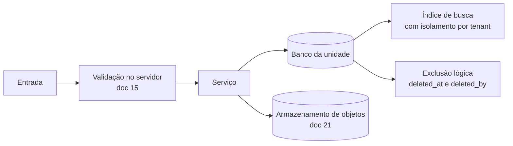

[Índice](README.md) · [Parte anterior](parte-15-inteligencia-artificial.md) · [Próxima parte](parte-17-operacao-qualidade-testes-e-ti.md)

<a id="parte-16"></a>

# Parte 16 — Dados, validações, configurações e armazenamento

## Visão geral da parte 16

Os modelos de dados (DDL) dos módulos novos estão no [51](#doc-51); validações comuns no [15](#doc-15); configurações e relatórios no [56](#doc-56); campos personalizados no [72](#doc-72); arquivos e busca no [21](#doc-21).



**Regras principais**
- Exclusão é lógica por padrão; bloqueada se houver dependente ativo; auditoria nunca é expurgada ([03](parte-02-arquitetura-e-tenancy.md#doc-03), seção 6; [15](#doc-15); [19](parte-07-regras-gerais-dos-modulos-de-gestao.md#doc-19), seção 14).
- Arquivos com versão, hash, antivírus, retenção e bloqueio legal ([21](#doc-21), seção 3).
- Busca por CPF exige motivo e gera auditoria ([21](#doc-21), seção 6.8).

<a id="doc-51"></a>

## 51 — DDL dos Módulos Novos e Pendentes

> Parte do [SDD v2](parte-01-visao-e-escopo.md#doc-00). Fecha os DDL pendentes listados no [45](parte-19-pendencias-decisoes-e-rastreabilidade.md#doc-45), seção 4. Convenções: MySQL 8 ou MariaDB 10.6, `utf8mb4`, horários em UTC (`DATETIME(3)`), chave interna `BIGINT UNSIGNED AUTO_INCREMENT` e `uuid CHAR(36)` para referência externa. Toda tabela de unidade tem `unidade_uuid` (regra de [03](parte-02-arquitetura-e-tenancy.md#doc-03), seção 1.1). Soft delete com `deleted_at` e `deleted_by` ([19](parte-07-regras-gerais-dos-modulos-de-gestao.md#doc-19), seção 14). Tabelas de entidade ficam no banco da unidade. Tabelas de plataforma ficam no master.
> **Status:** DDL proposto, criado em 03/11/2026. Não foi executado. Antes de implementar, cada DDL passa por revisão do owner do módulo e por teste de migração ([10](parte-17-operacao-qualidade-testes-e-ti.md#doc-10), seção 5). Valores de domínio marcados com (jurídico) dependem do parecer ([50](parte-18-juridico-e-regulatorio.md#doc-50)).
> **Coluna gerada (04/11/2026):** coluna gerada não lê coluna `CHAR`, porque no MariaDB o resultado depende do modo `PAD_CHAR_TO_FULL_LENGTH` (erro 1901). Para chave única de "registro ativo", use um indicador `TINYINT` gerado (1 ou NULL) num índice único composto; quando a expressão precisa ler o UUID, declare a coluna como `VARCHAR(36)`. Todo o DDL do SDD foi executado sem erro em MariaDB 10.11 com `utf8mb4`.
> **Exclusão (04/11/2026, DP-09):** tabela sem `deleted_at` não aceita exclusão pela aplicação; o registro é encerrado pelo estado. Tabela que precisar de exclusão pelo usuário ganha `deleted_at` e `deleted_by` na revisão do owner ([80](parte-19-pendencias-decisoes-e-rastreabilidade.md#doc-80)).

---

### 1. Atendimento (ATD-04)

```sql
CREATE TABLE atendimento_protocolos (
  id              BIGINT UNSIGNED AUTO_INCREMENT PRIMARY KEY,
  uuid            CHAR(36) NOT NULL UNIQUE,
  unidade_uuid    CHAR(36) NOT NULL,
  numero          VARCHAR(20) NOT NULL,
  tipo            ENUM('ticket','requerimento','reclamacao','sugestao','denuncia','pedido_titular') NOT NULL,
  canal           ENUM('site','formulario','whatsapp','telegram','instagram','messenger','telefone','presencial','portal') NOT NULL,
  prioridade      ENUM('baixa','media','alta','critica') NOT NULL,
  categoria_sensivel TINYINT(1) NOT NULL DEFAULT 0,
  estado          ENUM('novo','aberto','em_triagem','em_atendimento','aguardando_solicitante','aguardando_terceiro','resolvido','fechado','cancelado','reaberto','escalonado') NOT NULL,
  responsavel_uuid CHAR(36) NULL,
  solicitante_uuid CHAR(36) NULL,
  prazo_em        DATETIME(3) NULL,
  resolvido_em    DATETIME(3) NULL,
  created_at      DATETIME(3) NOT NULL DEFAULT CURRENT_TIMESTAMP(3),
  deleted_at      DATETIME(3) NULL,
  deleted_by      CHAR(36) NULL,
  UNIQUE KEY ux_protocolo_numero (unidade_uuid, numero),
  INDEX ix_protocolo_fila (unidade_uuid, estado, prioridade, prazo_em)
) ENGINE=InnoDB DEFAULT CHARSET=utf8mb4;

CREATE TABLE atendimento_eventos (
  id              BIGINT UNSIGNED AUTO_INCREMENT PRIMARY KEY,
  protocolo_id    BIGINT UNSIGNED NOT NULL,
  estado_anterior VARCHAR(30) NULL,
  estado_novo     VARCHAR(30) NOT NULL,
  ator_uuid       CHAR(36) NOT NULL,
  motivo          VARCHAR(500) NULL,
  criado_em       DATETIME(3) NOT NULL DEFAULT CURRENT_TIMESTAMP(3),
  CONSTRAINT fk_evento_protocolo FOREIGN KEY (protocolo_id) REFERENCES atendimento_protocolos (id)
) ENGINE=InnoDB DEFAULT CHARSET=utf8mb4;

CREATE TABLE atendimento_sla (
  id              BIGINT UNSIGNED AUTO_INCREMENT PRIMARY KEY,
  unidade_uuid    CHAR(36) NOT NULL,
  prioridade      ENUM('baixa','media','alta','critica') NOT NULL,
  prazo_horas     INT UNSIGNED NOT NULL,
  UNIQUE KEY ux_sla_prioridade (unidade_uuid, prioridade)
) ENGINE=InnoDB DEFAULT CHARSET=utf8mb4;
```

Valores de SLA: 1 hora a 10 dias úteis por prioridade, ajustável por entidade ([32](parte-04-seguranca-privacidade-e-auditoria.md#doc-32), seção 7). Transcrição de chat fica em tabela própria com prazo de retenção **(jurídico)** ([50](parte-18-juridico-e-regulatorio.md#doc-50), J-29).

---

### 2. Privacidade: ROPA (LGPD-01) e pedido de titular (LGPD-02)

```sql
-- Plataforma (master) e entidade (unidade): registro de atividades de tratamento
CREATE TABLE ropa_atividades (
  id              BIGINT UNSIGNED AUTO_INCREMENT PRIMARY KEY,
  uuid            CHAR(36) NOT NULL UNIQUE,
  dominio         ENUM('plataforma','entidade') NOT NULL,
  unidade_uuid    CHAR(36) NULL,
  finalidade      VARCHAR(300) NOT NULL,
  base_legal      VARCHAR(60) NOT NULL,              -- código da matriz de [07](parte-04-seguranca-privacidade-e-auditoria.md#doc-07), seção 3
  categorias_titular VARCHAR(200) NOT NULL,
  dados_tabela    VARCHAR(120) NULL,                 -- tabela de origem, quando houver
  sensivel        TINYINT(1) NOT NULL DEFAULT 0,
  retencao_codigo VARCHAR(60) NOT NULL,
  revisado_por    CHAR(36) NULL,
  revisado_em     DATETIME(3) NULL,
  deleted_at      DATETIME(3) NULL,
  INDEX ix_ropa_dominio (dominio, unidade_uuid)
) ENGINE=InnoDB DEFAULT CHARSET=utf8mb4;

-- Pedido de titular (acesso, correção, eliminação, portabilidade, revogação)
CREATE TABLE titular_pedidos (
  id              BIGINT UNSIGNED AUTO_INCREMENT PRIMARY KEY,
  uuid            CHAR(36) NOT NULL UNIQUE,
  unidade_uuid    CHAR(36) NOT NULL,
  tipo            ENUM('acesso','correcao','eliminacao','portabilidade','revogacao','informacao') NOT NULL,
  solicitante_uuid CHAR(36) NOT NULL,                -- titular ou responsável legal com vínculo verificado
  verificacao     ENUM('pendente','verificado','recusado') NOT NULL,
  estado          ENUM('recebido','em_analise','atendido','parcial','recusado_com_motivo') NOT NULL,
  prazo_em        DATETIME(3) NOT NULL,
  motivo_recusa   VARCHAR(500) NULL,
  dpo_uuid        CHAR(36) NULL,
  created_at      DATETIME(3) NOT NULL DEFAULT CURRENT_TIMESTAMP(3),
  INDEX ix_titular_prazo (unidade_uuid, estado, prazo_em)
) ENGINE=InnoDB DEFAULT CHARSET=utf8mb4;
```

Prazo de resposta ao titular segue a LGPD (art. 19 e 18) **(verificar)**. Recusa sempre com motivo.

---

### 3. Contrato (CTR-01)

```sql
CREATE TABLE contratos (
  id              BIGINT UNSIGNED AUTO_INCREMENT PRIMARY KEY,
  uuid            CHAR(36) NOT NULL UNIQUE,
  unidade_uuid    CHAR(36) NOT NULL,
  tipo            VARCHAR(40) NOT NULL,              -- tipos da [33](parte-12-suprimentos-patrimonio-frotas-contratos-e-terceiros.md#doc-33), seção 2
  portal_origem   ENUM('desenvolvedor','gestao','terceiros','aluno','responsaveis') NOT NULL,
  estado          ENUM('rascunho','em_negociacao','aguardando_assinatura','vigente','suspenso','vencido','encerrado','rescindido') NOT NULL,
  valor_centavos  BIGINT NULL,
  inicio_em       DATE NOT NULL,
  fim_em          DATE NULL,
  renovacao_auto  TINYINT(1) NOT NULL DEFAULT 0,
  aviso_renovacao_dias INT UNSIGNED NOT NULL DEFAULT 60,
  dpa_assinado    TINYINT(1) NOT NULL DEFAULT 0,      -- contrato com dado pessoal exige DPA antes da assinatura
  created_by      CHAR(36) NOT NULL,
  created_at      DATETIME(3) NOT NULL DEFAULT CURRENT_TIMESTAMP(3),
  deleted_at      DATETIME(3) NULL,
  deleted_by      CHAR(36) NULL,
  INDEX ix_contrato_vencimento (unidade_uuid, estado, fim_em)
) ENGINE=InnoDB DEFAULT CHARSET=utf8mb4;

CREATE TABLE contrato_partes (
  id              BIGINT UNSIGNED AUTO_INCREMENT PRIMARY KEY,
  contrato_id     BIGINT UNSIGNED NOT NULL,
  papel           ENUM('contratante','contratado','testemunha','interveniente') NOT NULL,
  documento_hash  CHAR(64) NOT NULL,                  -- CPF ou CNPJ em hash; o número fica no cadastro da parte
  CONSTRAINT fk_parte_contrato FOREIGN KEY (contrato_id) REFERENCES contratos (id)
) ENGINE=InnoDB DEFAULT CHARSET=utf8mb4;

CREATE TABLE contrato_assinaturas (
  id              BIGINT UNSIGNED AUTO_INCREMENT PRIMARY KEY,
  contrato_id     BIGINT UNSIGNED NOT NULL,
  parte_id        BIGINT UNSIGNED NOT NULL,
  provedor        VARCHAR(40) NOT NULL,              -- provedor de terceiros ou assinatura própria (CTR-06)
  tipo            ENUM('simples','avancada','qualificada_icp_brasil') NOT NULL,
  estado          ENUM('pendente','assinada','recusada','expirada') NOT NULL,
  evidencia_hash  CHAR(64) NULL,
  assinada_em     DATETIME(3) NULL,
  CONSTRAINT fk_assinatura_contrato FOREIGN KEY (contrato_id) REFERENCES contratos (id)
) ENGINE=InnoDB DEFAULT CHARSET=utf8mb4;
```

Faixas de alçada e antecedência de alerta (60 e 30 dias) são regras de aplicação, não de tabela. Tipo de assinatura por contrato depende de J-19 ([50](parte-18-juridico-e-regulatorio.md#doc-50)).

---

### 4. Acesso físico (ACC-06) e acesso aos dispositivos (ACC-08)

```sql
CREATE TABLE acesso_dispositivos (
  id              BIGINT UNSIGNED AUTO_INCREMENT PRIMARY KEY,
  uuid            CHAR(36) NOT NULL UNIQUE,
  unidade_uuid    CHAR(36) NOT NULL,
  tipo            ENUM('catraca','porta','leitor_cracha','leitor_biometrico','camera') NOT NULL,
  conector        VARCHAR(40) NOT NULL,              -- protocolo aberto ou fabricante (decisão ACC-07)
  localizacao     VARCHAR(120) NOT NULL,
  modo_falha      ENUM('abre','fecha','mantem_estado') NOT NULL,
  lista_local_expira_em DATETIME(3) NULL,            -- lista de credenciais local no modo de falha (ACC-08)
  estado          ENUM('ativo','manutencao','inativo') NOT NULL,
  deleted_at      DATETIME(3) NULL
) ENGINE=InnoDB DEFAULT CHARSET=utf8mb4;

CREATE TABLE acesso_registros (
  id              BIGINT UNSIGNED AUTO_INCREMENT PRIMARY KEY,
  unidade_uuid    CHAR(36) NOT NULL,
  dispositivo_id  BIGINT UNSIGNED NOT NULL,
  pessoa_uuid     CHAR(36) NULL,                     -- NULL para visitante sem cadastro
  visitante_id    BIGINT UNSIGNED NULL,
  direcao         ENUM('entrada','saida') NOT NULL,
  metodo          ENUM('cracha','biometria','facial','manual') NOT NULL,
  resultado       ENUM('permitido','negado','manual') NOT NULL,
  ocorrido_em     DATETIME(3) NOT NULL,
  INDEX ix_acesso_unidade (unidade_uuid, ocorrido_em),
  CONSTRAINT fk_acesso_dispositivo FOREIGN KEY (dispositivo_id) REFERENCES acesso_dispositivos (id)
) ENGINE=InnoDB DEFAULT CHARSET=utf8mb4;

CREATE TABLE acesso_autorizacoes_saida (
  id              BIGINT UNSIGNED AUTO_INCREMENT PRIMARY KEY,
  unidade_uuid    CHAR(36) NOT NULL,
  aluno_uuid      CHAR(36) NOT NULL,
  responsavel_uuid CHAR(36) NOT NULL,                -- vínculo ativo verificado
  retirante_documento_hash CHAR(64) NOT NULL,
  valida_de       DATETIME(3) NOT NULL,
  valida_ate      DATETIME(3) NOT NULL,
  estado          ENUM('ativa','usada','expirada','revogada') NOT NULL,
  INDEX ix_autorizacao_aluno (unidade_uuid, aluno_uuid, valida_ate)
) ENGINE=InnoDB DEFAULT CHARSET=utf8mb4;

CREATE TABLE acesso_visitantes (
  id              BIGINT UNSIGNED AUTO_INCREMENT PRIMARY KEY,
  unidade_uuid    CHAR(36) NOT NULL,
  nome            VARCHAR(150) NOT NULL,
  documento_mascarado VARCHAR(20) NOT NULL,          -- sem número completo, sem imagem do documento
  motivo          VARCHAR(200) NOT NULL,
  autorizado_por_uuid CHAR(36) NOT NULL,
  valido_de       DATETIME(3) NOT NULL,
  valido_ate      DATETIME(3) NOT NULL,
  INDEX ix_visitante_unidade (unidade_uuid, valido_ate)
) ENGINE=InnoDB DEFAULT CHARSET=utf8mb4;
```

A lista local de credenciais de porta expira (campo `lista_local_expira_em`). Liberação de emergência (incêndio) não depende da rede e gera registro depois ([35](parte-03-identidade-acesso-e-permissoes.md#doc-35), seção 7).

---

### 5. Formulários (FRM-05)

```sql
ALTER TABLE formulario_respostas
  ADD COLUMN substituida_por BIGINT UNSIGNED NULL,
  ADD COLUMN substituida_em DATETIME(3) NULL,
  ADD COLUMN motivo_substituicao VARCHAR(500) NULL,
  ADD CONSTRAINT fk_resposta_substituida FOREIGN KEY (substituida_por) REFERENCES formulario_respostas (id);
```

Resposta substituída não é apagada. Sai dos relatórios e fica no histórico ([41](parte-08-academico.md#doc-41), seção 7).

---

### 6. Preceptoria (PRE-08)

```sql
CREATE TABLE preceptoria_instrumentos (
  id              BIGINT UNSIGNED AUTO_INCREMENT PRIMARY KEY,
  uuid            CHAR(36) NOT NULL UNIQUE,
  unidade_uuid    CHAR(36) NOT NULL,
  titulo          VARCHAR(200) NOT NULL,
  tipo            ENUM('autoavaliacao','avaliacao_preceptor','hibrido') NOT NULL,
  versao          INT UNSIGNED NOT NULL DEFAULT 1,
  estado          ENUM('rascunho','publicado','encerrado','arquivado') NOT NULL,
  formulario_id   BIGINT UNSIGNED NULL,              -- motor de [41](parte-08-academico.md#doc-41)
  peso_autoavaliacao DECIMAL(5,2) NULL,              -- definido ao criar a autoavaliação
  peso_preceptor  DECIMAL(5,2) NULL,
  CHECK (peso_autoavaliacao IS NULL OR peso_preceptor IS NULL OR peso_autoavaliacao + peso_preceptor = 100),
  deleted_at      DATETIME(3) NULL
) ENGINE=InnoDB DEFAULT CHARSET=utf8mb4;

CREATE TABLE preceptoria_ciclos (
  id              BIGINT UNSIGNED AUTO_INCREMENT PRIMARY KEY,
  uuid            CHAR(36) NOT NULL UNIQUE,
  unidade_uuid    CHAR(36) NOT NULL,
  programa_uuid   CHAR(36) NOT NULL,
  inicio_em       DATE NOT NULL,
  fim_em          DATE NOT NULL,
  estado          ENUM('planejado','aberto','em_revisao','encerrado') NOT NULL
) ENGINE=InnoDB DEFAULT CHARSET=utf8mb4;

CREATE TABLE preceptoria_avaliacoes (
  id              BIGINT UNSIGNED AUTO_INCREMENT PRIMARY KEY,
  uuid            CHAR(36) NOT NULL UNIQUE,
  ciclo_id        BIGINT UNSIGNED NOT NULL,
  instrumento_id  BIGINT UNSIGNED NOT NULL,
  residente_uuid  CHAR(36) NOT NULL,
  preceptor_uuid  CHAR(36) NOT NULL,
  estado          ENUM('rascunho','enviada_pelo_residente','em_avaliacao_preceptor','em_revisao','devolvida','concluida') NOT NULL,
  nota_final      DECIMAL(6,2) NULL,
  concluida_em    DATETIME(3) NULL,
  CONSTRAINT fk_avaliacao_ciclo FOREIGN KEY (ciclo_id) REFERENCES preceptoria_ciclos (id),
  CONSTRAINT fk_avaliacao_instrumento FOREIGN KEY (instrumento_id) REFERENCES preceptoria_instrumentos (id)
) ENGINE=InnoDB DEFAULT CHARSET=utf8mb4;

CREATE TABLE preceptoria_tutoria (
  id              BIGINT UNSIGNED AUTO_INCREMENT PRIMARY KEY,
  uuid            CHAR(36) NOT NULL UNIQUE,
  unidade_uuid    CHAR(36) NOT NULL,
  tutorado_uuid   CHAR(36) NOT NULL,
  tutor_uuid      CHAR(36) NOT NULL,
  realizado_em    DATETIME(3) NOT NULL,
  duracao_min     SMALLINT UNSIGNED NOT NULL,
  anotacao_sensivel TINYINT(1) NOT NULL DEFAULT 0,
  anotacao_cifrada VARBINARY(4000) NULL,             -- cifrada na aplicação; chave do cofre
  INDEX ix_tutoria_tutorado (unidade_uuid, tutorado_uuid, realizado_em)
) ENGINE=InnoDB DEFAULT CHARSET=utf8mb4;

CREATE TABLE preceptoria_metas (
  id              BIGINT UNSIGNED AUTO_INCREMENT PRIMARY KEY,
  uuid            CHAR(36) NOT NULL UNIQUE,
  pdi_id          BIGINT UNSIGNED NULL,
  tutorado_uuid   CHAR(36) NOT NULL,
  descricao       VARCHAR(500) NOT NULL,
  prazo_em        DATE NULL,
  estado          ENUM('planejada','em_andamento','atingida','nao_atingida','cancelada') NOT NULL,
  competencia_codigo VARCHAR(40) NULL
) ENGINE=InnoDB DEFAULT CHARSET=utf8mb4;

CREATE TABLE preceptoria_evidencias (
  id              BIGINT UNSIGNED AUTO_INCREMENT PRIMARY KEY,
  uuid            CHAR(36) NOT NULL UNIQUE,
  avaliacao_id    BIGINT UNSIGNED NULL,
  meta_id         BIGINT UNSIGNED NULL,
  arquivo_uuid    CHAR(36) NULL,                     -- armazenamento de [21](#doc-21)
  estado          ENUM('enviada','validada','recusada') NOT NULL,
  validada_por_uuid CHAR(36) NULL
) ENGINE=InnoDB DEFAULT CHARSET=utf8mb4;
```

Regra de anonimato da avaliação de preceptor não está no DDL: ela é aplicada na consulta, com o mínimo de 2 respostas por grupo ([41](parte-08-academico.md#doc-41), seção 3).

---

### 7. Pastoral (PAS-10)

```sql
CREATE TABLE pastoral_agenda (
  id              BIGINT UNSIGNED AUTO_INCREMENT PRIMARY KEY,
  uuid            CHAR(36) NOT NULL UNIQUE,
  unidade_uuid    CHAR(36) NOT NULL,
  tipo            ENUM('missa','celebracao','evento','atividade_capelania','confissao_horario') NOT NULL,
  tradicao        VARCHAR(30) NULL,                  -- NULL no modo ecumênico
  inicio_em       DATETIME(3) NOT NULL,
  fim_em          DATETIME(3) NOT NULL,
  local_reserva_uuid CHAR(36) NULL,                  -- ambiente de [44](parte-08-academico.md#doc-44)
  estado          ENUM('agendada','realizada','cancelada') NOT NULL,
  INDEX ix_pastoral_agenda (unidade_uuid, inicio_em)
) ENGINE=InnoDB DEFAULT CHARSET=utf8mb4;

CREATE TABLE pastoral_escala (
  id              BIGINT UNSIGNED AUTO_INCREMENT PRIMARY KEY,
  agenda_id       BIGINT UNSIGNED NOT NULL,
  funcao          VARCHAR(40) NOT NULL,              -- celebrante, leitor, ministro, músico, coroinha
  pessoa_uuid     CHAR(36) NOT NULL,
  confirmada_em   DATETIME(3) NULL,
  substituto_uuid CHAR(36) NULL,
  motivo_troca   VARCHAR(200) NULL,
  CONSTRAINT fk_escala_agenda FOREIGN KEY (agenda_id) REFERENCES pastoral_agenda (id)
) ENGINE=InnoDB DEFAULT CHARSET=utf8mb4;

CREATE TABLE pastoral_intencao (
  id              BIGINT UNSIGNED AUTO_INCREMENT PRIMARY KEY,
  uuid            CHAR(36) NOT NULL UNIQUE,
  agenda_id       BIGINT UNSIGNED NOT NULL,
  nome_citado    VARCHAR(120) NOT NULL,
  frase           VARCHAR(200) NOT NULL,              -- sem dado de saúde
  excluir_apos_em DATETIME(3) NOT NULL,
  CONSTRAINT fk_intencao_agenda FOREIGN KEY (agenda_id) REFERENCES pastoral_agenda (id)
) ENGINE=InnoDB DEFAULT CHARSET=utf8mb4;

CREATE TABLE pastoral_acompanhamento (
  id              BIGINT UNSIGNED AUTO_INCREMENT PRIMARY KEY,
  uuid            CHAR(36) NOT NULL UNIQUE,
  unidade_uuid    CHAR(36) NOT NULL,
  acompanhado_uuid CHAR(36) NOT NULL,
  acompanhante_uuid CHAR(36) NOT NULL,
  adesao_em       DATETIME(3) NOT NULL,               -- adesão voluntária registrada
  anotacao_cifrada VARBINARY(4000) NULL,             -- só o acompanhante lê
  estado          ENUM('ativo','encerrado','excluido') NOT NULL
) ENGINE=InnoDB DEFAULT CHARSET=utf8mb4;

CREATE TABLE pastoral_beneficiario (
  id              BIGINT UNSIGNED AUTO_INCREMENT PRIMARY KEY,
  uuid            CHAR(36) NOT NULL UNIQUE,
  unidade_uuid    CHAR(36) NOT NULL,
  nome_cifrado    VARBINARY(500) NOT NULL,
  contato_cifrado VARBINARY(500) NULL,
  pessoas_no_nucleo SMALLINT UNSIGNED NOT NULL,
  ultimo_atendimento_em DATE NULL,
  revisao_em      DATE NULL
) ENGINE=InnoDB DEFAULT CHARSET=utf8mb4;

CREATE TABLE pastoral_campanha (
  id                    BIGINT UNSIGNED AUTO_INCREMENT PRIMARY KEY,
  uuid                  CHAR(36) NOT NULL UNIQUE,
  unidade_uuid          CHAR(36) NOT NULL,
  nome                  VARCHAR(120) NOT NULL,
  meta_valor_centavos   BIGINT UNSIGNED NULL,
  meta_itens            INT UNSIGNED NULL,
  inicio                DATE NOT NULL,
  fim                   DATE NOT NULL,
  responsavel_uuid      CHAR(36) NOT NULL,
  estado                ENUM('planejada','ativa','encerrada') NOT NULL DEFAULT 'planejada',
  CONSTRAINT ck_campanha_datas CHECK (fim >= inicio)
) ENGINE=InnoDB DEFAULT CHARSET=utf8mb4;

CREATE TABLE pastoral_entrega (
  id                BIGINT UNSIGNED AUTO_INCREMENT PRIMARY KEY,
  uuid              CHAR(36) NOT NULL UNIQUE,
  unidade_uuid      CHAR(36) NOT NULL,
  campanha_id       BIGINT UNSIGNED NULL,
  beneficiario_id   BIGINT UNSIGNED NOT NULL,
  item              VARCHAR(120) NOT NULL,
  quantidade        INT UNSIGNED NOT NULL,
  data_entrega      DATE NOT NULL,
  registrada_por    CHAR(36) NOT NULL,
  CONSTRAINT fk_entrega_campanha FOREIGN KEY (campanha_id) REFERENCES pastoral_campanha (id),
  CONSTRAINT fk_entrega_beneficiario FOREIGN KEY (beneficiario_id) REFERENCES pastoral_beneficiario (id)
) ENGINE=InnoDB DEFAULT CHARSET=utf8mb4;

CREATE TABLE pastoral_doacao (
  id                        BIGINT UNSIGNED AUTO_INCREMENT PRIMARY KEY,
  uuid                      CHAR(36) NOT NULL UNIQUE,
  unidade_uuid              CHAR(36) NOT NULL,
  campanha_id               BIGINT UNSIGNED NULL,
  doador_pessoa_uuid        CHAR(36) NULL,
  anonima                   TINYINT(1) NOT NULL DEFAULT 0,
  valor_centavos            BIGINT UNSIGNED NOT NULL,
  data_doacao               DATE NOT NULL,
  lancamento_financeiro_uuid CHAR(36) NULL,
  CONSTRAINT fk_doacao_campanha FOREIGN KEY (campanha_id) REFERENCES pastoral_campanha (id),
  CONSTRAINT ck_doacao_anonima CHECK (anonima = 0 OR doador_pessoa_uuid IS NULL)
) ENGINE=InnoDB DEFAULT CHARSET=utf8mb4;
```

Confissão não tem tabela. O tipo `confissao_horario` em `pastoral_agenda` guarda só o horário público do local ([43](parte-08-academico.md#doc-43), seção 2.1).

---

### 8. Agendamento de ambientes (AMB-08)

```sql
CREATE TABLE recursos (
  id              BIGINT UNSIGNED AUTO_INCREMENT PRIMARY KEY,
  uuid            CHAR(36) NOT NULL UNIQUE,
  unidade_uuid    CHAR(36) NOT NULL,
  tipo            ENUM('ambiente','equipamento','kit') NOT NULL,
  nome            VARCHAR(150) NOT NULL,
  capacidade      INT UNSIGNED NULL,
  reservavel      TINYINT(1) NOT NULL DEFAULT 1,
  patrimonio_uuid CHAR(36) NULL,                     -- bem do patrimônio ([19](parte-07-regras-gerais-dos-modulos-de-gestao.md#doc-19), seção 8)
  estado          ENUM('ativo','manutencao','inativo') NOT NULL,
  deleted_at      DATETIME(3) NULL,
  INDEX ix_recursos_unidade (unidade_uuid, tipo, estado)
) ENGINE=InnoDB DEFAULT CHARSET=utf8mb4;

CREATE TABLE recurso_composicao (
  kit_id          BIGINT UNSIGNED NOT NULL,
  item_id         BIGINT UNSIGNED NOT NULL,
  quantidade      INT UNSIGNED NOT NULL,
  PRIMARY KEY (kit_id, item_id),
  CONSTRAINT fk_kit FOREIGN KEY (kit_id) REFERENCES recursos (id),
  CONSTRAINT fk_item FOREIGN KEY (item_id) REFERENCES recursos (id)
) ENGINE=InnoDB DEFAULT CHARSET=utf8mb4;

CREATE TABLE reservas (
  id              BIGINT UNSIGNED AUTO_INCREMENT PRIMARY KEY,
  uuid            CHAR(36) NOT NULL UNIQUE,
  unidade_uuid    CHAR(36) NOT NULL,
  recurso_id      BIGINT UNSIGNED NOT NULL,
  origem_tipo     ENUM('grade','prova','evento','pastoral','preceptoria','reuniao','avulsa') NOT NULL,
  origem_uuid     CHAR(36) NULL,
  solicitante_uuid CHAR(36) NOT NULL,
  inicio_utc      DATETIME(3) NOT NULL,
  fim_utc         DATETIME(3) NOT NULL,
  prioridade      TINYINT UNSIGNED NOT NULL,          -- 1 grade, 2 prova, 3 evento e pastoral, 4 preceptoria e reunião, 5 avulsa
  estado          ENUM('solicitada','aprovada','recusada','em_uso','concluida','cancelada','nao_utilizada') NOT NULL,
  checkin_em      DATETIME(3) NULL,
  motivo_cancelamento VARCHAR(300) NULL,
  INDEX ix_reserva_recurso (recurso_id, estado, inicio_utc),
  CONSTRAINT fk_reserva_recurso FOREIGN KEY (recurso_id) REFERENCES recursos (id)
) ENGINE=InnoDB DEFAULT CHARSET=utf8mb4;

CREATE TABLE reserva_recursos (
  reserva_id      BIGINT UNSIGNED NOT NULL,
  recurso_id      BIGINT UNSIGNED NOT NULL,
  quantidade      INT UNSIGNED NOT NULL DEFAULT 1,
  retirada_em     DATETIME(3) NULL,
  devolucao_em    DATETIME(3) NULL,
  estado_devolucao ENUM('ok','faltando_peca','danificado') NULL,
  PRIMARY KEY (reserva_id, recurso_id)
) ENGINE=InnoDB DEFAULT CHARSET=utf8mb4;

CREATE TABLE recurso_bloqueios (
  id              BIGINT UNSIGNED AUTO_INCREMENT PRIMARY KEY,
  recurso_id      BIGINT UNSIGNED NOT NULL,
  inicio_utc      DATETIME(3) NOT NULL,
  fim_utc         DATETIME(3) NOT NULL,
  motivo          ENUM('manutencao','feriado','uso_institucional','clima') NOT NULL,
  INDEX ix_bloqueio_recurso (recurso_id, inicio_utc, fim_utc)
) ENGINE=InnoDB DEFAULT CHARSET=utf8mb4;
```

Regra de conflito: checagem de `reservas` aprovadas e `recurso_bloqueios` sobrepostos, dentro de transação com `SELECT ... FOR UPDATE` no registro de `recursos`. Antecedência de 50 minutos e não-utilização de 15 minutos são regras de aplicação ([44](parte-08-academico.md#doc-44), seção 3).

---

### 9. Sala de aula online (LIV-10)

O modelo de sala não usa tabelas `tenants` nem `users` no banco da unidade. A identidade fica no master ([03](parte-02-arquitetura-e-tenancy.md#doc-03), seção 1.1). A unidade guarda só referências.

```sql
CREATE TABLE sessoes_aula (
  id              BIGINT UNSIGNED AUTO_INCREMENT PRIMARY KEY,
  uuid            CHAR(36) NOT NULL UNIQUE,
  unidade_uuid    CHAR(36) NOT NULL,
  turma_uuid      CHAR(36) NULL,
  tipo            ENUM('aula_turma','reuniao_responsavel','reuniao_equipe','convidado_externo') NOT NULL,
  agendada_inicio_utc DATETIME(3) NOT NULL,
  agendada_fim_utc   DATETIME(3) NOT NULL,
  estado          ENUM('agendada','aberta','em_andamento','encerrada','cancelada') NOT NULL,
  gravacao_permitida TINYINT(1) NOT NULL DEFAULT 0,
  transcricao_permitida TINYINT(1) NOT NULL DEFAULT 0,
  criada_por_uuid CHAR(36) NOT NULL,
  INDEX ix_sessao_unidade (unidade_uuid, agendada_inicio_utc)
) ENGINE=InnoDB DEFAULT CHARSET=utf8mb4;

CREATE TABLE sessao_participacoes (
  id              BIGINT UNSIGNED AUTO_INCREMENT PRIMARY KEY,
  sessao_id       BIGINT UNSIGNED NOT NULL,
  pessoa_uuid     CHAR(36) NULL,                    -- NULL para convidado externo
  papel           ENUM('professor','aluno','responsavel','diretor','coordenador','convidado','moderador') NOT NULL,
  entrada_em      DATETIME(3) NULL,
  saida_em        DATETIME(3) NULL,
  tempo_conectado_s INT UNSIGNED NOT NULL DEFAULT 0,
  presenca_origem ENUM('automatica','confirmada_pelo_aluno','corrigida_pelo_professor') NULL,
  CONSTRAINT fk_participacao_sessao FOREIGN KEY (sessao_id) REFERENCES sessoes_aula (id)
) ENGINE=InnoDB DEFAULT CHARSET=utf8mb4;
```

Presença conta com 40 minutos de conexão, configurável por entidade ([40](parte-08-academico.md#doc-40), seção 6). A conta de cada pessoa está no master, e a participação guarda só o `pessoa_uuid`.

---

### 10. Matrícula (MAT-07)

```sql
CREATE TABLE matriculas (
  id              BIGINT UNSIGNED AUTO_INCREMENT PRIMARY KEY,
  uuid            CHAR(36) NOT NULL UNIQUE,
  unidade_uuid    CHAR(36) NOT NULL,
  aluno_uuid      CHAR(36) NOT NULL,
  turma_uuid      CHAR(36) NULL,
  periodo_letivo  VARCHAR(10) NOT NULL,
  tipo            ENUM('regular','especial','transferencia','condicional','ead') NOT NULL,
  estado          ENUM('lista_espera','solicitada','em_analise','condicional','ativa','trancada','transferida','concluida','cancelada','nao_rematriculada') NOT NULL,
  prazo_regularizacao_em DATETIME(3) NULL,
  solicitada_em   DATETIME(3) NULL,
  motivo_estado   VARCHAR(500) NULL,
  created_by      CHAR(36) NOT NULL,
  created_at      DATETIME(3) NOT NULL DEFAULT CURRENT_TIMESTAMP(3),
  deleted_at      DATETIME(3) NULL,
  vinculo_ativo    TINYINT AS (CASE WHEN estado IN ('solicitada','em_analise','condicional','ativa','trancada') THEN 1 ELSE NULL END) STORED,
  UNIQUE KEY ux_matricula_ativa (aluno_uuid, unidade_uuid, periodo_letivo, vinculo_ativo)
) ENGINE=InnoDB DEFAULT CHARSET=utf8mb4;

CREATE TABLE vagas_reserva (
  id              BIGINT UNSIGNED AUTO_INCREMENT PRIMARY KEY,
  turma_uuid      CHAR(36) NOT NULL,
  matricula_uuid  CHAR(36) NOT NULL,
  reservada_em    DATETIME(3) NOT NULL,
  expira_em       DATETIME(3) NOT NULL,
  UNIQUE KEY ux_vaga_turma_matricula (turma_uuid, matricula_uuid)
) ENGINE=InnoDB DEFAULT CHARSET=utf8mb4;

CREATE TABLE matricula_pendencias (
  id              BIGINT UNSIGNED AUTO_INCREMENT PRIMARY KEY,
  uuid            CHAR(36) NOT NULL UNIQUE,
  unidade_uuid    CHAR(36) NOT NULL,
  matricula_uuid  CHAR(36) NOT NULL,
  tipo            ENUM('financeira','documental') NOT NULL,
  documento_tipo  VARCHAR(60) NULL,
  prazo_em        DATETIME(3) NULL,
  resolvida_em    DATETIME(3) NULL,
  INDEX ix_pendencia_matricula (unidade_uuid, matricula_uuid)
) ENGINE=InnoDB DEFAULT CHARSET=utf8mb4;

CREATE TABLE janelas_rematricula (
  id                      BIGINT UNSIGNED AUTO_INCREMENT PRIMARY KEY,
  uuid                    CHAR(36) NOT NULL UNIQUE,
  unidade_uuid            CHAR(36) NOT NULL,
  serie                   VARCHAR(60) NULL,
  curso_uuid              CHAR(36) NULL,
  abre_em                 DATETIME(3) NOT NULL,
  fecha_em                DATETIME(3) NOT NULL,
  prazo_confirmacao_dias  TINYINT UNSIGNED NOT NULL,
  CONSTRAINT ck_janela_datas CHECK (fecha_em > abre_em)
) ENGINE=InnoDB DEFAULT CHARSET=utf8mb4;

CREATE TABLE trancamentos (
  id                    BIGINT UNSIGNED AUTO_INCREMENT PRIMARY KEY,
  uuid                  CHAR(36) NOT NULL UNIQUE,
  unidade_uuid          CHAR(36) NOT NULL,
  matricula_uuid        CHAR(36) NOT NULL,
  motivo                ENUM('pessoal','financeiro','saude','militar','outro') NOT NULL,
  descricao             VARCHAR(1000) NULL,
  solicitado_em         DATETIME(3) NOT NULL,
  retorno_previsto_em   DATE NULL,
  estado                ENUM('solicitado','aprovado','recusado','ativo','encerrado') NOT NULL,
  protocolo_uuid        CHAR(36) NULL,
  CONSTRAINT ck_trancamento_descricao CHECK (motivo <> 'outro' OR descricao IS NOT NULL)
) ENGINE=InnoDB DEFAULT CHARSET=utf8mb4;

CREATE TABLE transferencias (
  id                    BIGINT UNSIGNED AUTO_INCREMENT PRIMARY KEY,
  uuid                  CHAR(36) NOT NULL UNIQUE,
  unidade_uuid          CHAR(36) NOT NULL,
  matricula_origem_uuid CHAR(36) NOT NULL,
  matricula_destino_uuid CHAR(36) NULL,
  tipo                  ENUM('turma','curso','unidade') NOT NULL,
  solicitado_por        CHAR(36) NOT NULL,
  aprovado_por          CHAR(36) NULL,
  aprovado_em           DATETIME(3) NULL,
  CONSTRAINT ck_transf_aprovacao CHECK (aprovado_por IS NULL OR aprovado_por <> solicitado_por)
) ENGINE=InnoDB DEFAULT CHARSET=utf8mb4;
-- Transferência entre unidades usa pedido e aprovação da origem, sem consulta ao banco da outra unidade.

CREATE TABLE lista_espera (
  id              BIGINT UNSIGNED AUTO_INCREMENT PRIMARY KEY,
  uuid            CHAR(36) NOT NULL UNIQUE,
  unidade_uuid    CHAR(36) NOT NULL,
  processo_uuid   CHAR(36) NOT NULL,
  candidato_uuid  CHAR(36) NOT NULL,
  prioridade      SMALLINT UNSIGNED NOT NULL DEFAULT 0,
  estado          ENUM('aguardando','notificado','convertido','expirado','desistiu') NOT NULL,
  notificado_em   DATETIME(3) NULL,
  expira_em       DATETIME(3) NULL,
  UNIQUE KEY ux_espera (processo_uuid, candidato_uuid)
) ENGINE=InnoDB DEFAULT CHARSET=utf8mb4;
```

A coluna gerada `vinculo_ativo` só vale 1 para matrícula em andamento ou ativa; fora disso é NULL, e o índice único aceita vários NULL. A constraint `ux_matricula_ativa` impede dois vínculos desses no mesmo aluno, unidade e período. Matrículas canceladas ou concluídas não entram na chave. Concorrência de vaga é tratada na transação de confirmação, com bloqueio da turma ([46](parte-09-secretaria-matricula-e-documentos.md#doc-46), seção 7).

---

### 11. TI (TI-04)

```sql
CREATE TABLE ti_ativos (
  patrimonio_uuid CHAR(36) NOT NULL PRIMARY KEY,     -- dono do dado é o patrimônio ([36](parte-17-operacao-qualidade-testes-e-ti.md#doc-36), seção 5)
  categoria_ti    VARCHAR(40) NOT NULL
) ENGINE=InnoDB DEFAULT CHARSET=utf8mb4;

CREATE TABLE ti_licencas (
  id              BIGINT UNSIGNED AUTO_INCREMENT PRIMARY KEY,
  uuid            CHAR(36) NOT NULL UNIQUE,
  unidade_uuid    CHAR(36) NOT NULL,
  software        VARCHAR(150) NOT NULL,
  quantidade      INT UNSIGNED NOT NULL,
  vencimento_em   DATE NULL,
  responsavel_uuid CHAR(36) NOT NULL
) ENGINE=InnoDB DEFAULT CHARSET=utf8mb4;

CREATE TABLE ti_incidentes (
  id              BIGINT UNSIGNED AUTO_INCREMENT PRIMARY KEY,
  uuid            CHAR(36) NOT NULL UNIQUE,
  unidade_uuid    CHAR(36) NOT NULL,
  atendimento_protocolo_uuid CHAR(36) NULL,          -- chamado é atendimento de categoria TI
  estado          ENUM('aberto','em_atendimento','resolvido','fechado') NOT NULL,
  problema_id     BIGINT UNSIGNED NULL,
  criado_em       DATETIME(3) NOT NULL DEFAULT CURRENT_TIMESTAMP(3)
) ENGINE=InnoDB DEFAULT CHARSET=utf8mb4;

CREATE TABLE ti_problemas (
  id              BIGINT UNSIGNED AUTO_INCREMENT PRIMARY KEY,
  uuid            CHAR(36) NOT NULL UNIQUE,
  unidade_uuid    CHAR(36) NOT NULL,
  causa_raiz      VARCHAR(500) NULL,
  estado          ENUM('aberto','investigando','conhecido','resolvido') NOT NULL
) ENGINE=InnoDB DEFAULT CHARSET=utf8mb4;

CREATE TABLE ti_mudancas (
  id              BIGINT UNSIGNED AUTO_INCREMENT PRIMARY KEY,
  uuid            CHAR(36) NOT NULL UNIQUE,
  unidade_uuid    CHAR(36) NOT NULL,
  tipo            ENUM('padrao','normal','emergencial') NOT NULL,
  estado          ENUM('solicitada','aprovada','em_execucao','concluida','revertida','recusada') NOT NULL,
  aprovacao_limite_em DATETIME(3) NULL,              -- emergencial: 48 horas para aprovação posterior
  comite_votos_favoraveis TINYINT UNSIGNED NULL,     -- quórum de 2 de 3 (TI-07)
  criada_por_uuid CHAR(36) NOT NULL
) ENGINE=InnoDB DEFAULT CHARSET=utf8mb4;
```

---

### 12. Documentos emitidos (DOC-06)

```sql
CREATE TABLE doc_tipos (
  id              BIGINT UNSIGNED AUTO_INCREMENT PRIMARY KEY,
  uuid            CHAR(36) NOT NULL UNIQUE,
  unidade_uuid    CHAR(36) NOT NULL,
  codigo          VARCHAR(40) NOT NULL,
  nome            VARCHAR(150) NOT NULL,
  categoria       ENUM('contrato','declaracao','certidao','acervo','termo','ata','comunicado','outro') NOT NULL,
  validade_dias   INT UNSIGNED NULL,                 -- padrão de 90 quando nulo (DOC-04)
  exige_assinatura TINYINT(1) NOT NULL DEFAULT 0,
  deleted_at      DATETIME(3) NULL,
  UNIQUE KEY ux_doc_tipo_codigo (unidade_uuid, codigo)
) ENGINE=InnoDB DEFAULT CHARSET=utf8mb4;

CREATE TABLE doc_modelos (
  id              BIGINT UNSIGNED AUTO_INCREMENT PRIMARY KEY,
  uuid            CHAR(36) NOT NULL UNIQUE,
  tipo_id         BIGINT UNSIGNED NOT NULL,
  nome            VARCHAR(150) NOT NULL,
  estado          ENUM('rascunho','em_revisao','publicado','arquivado') NOT NULL,
  versao_publicada INT UNSIGNED NULL,
  criado_por_uuid CHAR(36) NOT NULL,
  aprovado_por_uuid CHAR(36) NULL,
  CHECK (aprovado_por_uuid IS NULL OR aprovado_por_uuid <> criado_por_uuid),
  deleted_at      DATETIME(3) NULL,
  CONSTRAINT fk_modelo_tipo FOREIGN KEY (tipo_id) REFERENCES doc_tipos (id)
) ENGINE=InnoDB DEFAULT CHARSET=utf8mb4;

CREATE TABLE doc_modelo_versoes (
  id              BIGINT UNSIGNED AUTO_INCREMENT PRIMARY KEY,
  modelo_id       BIGINT UNSIGNED NOT NULL,
  versao          INT UNSIGNED NOT NULL,
  layout_json     JSON NOT NULL,                     -- papel, margens, blocos, variáveis, condicionais
  componentes_json JSON NULL,                        -- versões de componentes usadas (seção 16 de [48](parte-09-secretaria-matricula-e-documentos.md#doc-48))
  publicada_em    DATETIME(3) NULL,
  UNIQUE KEY ux_modelo_versao (modelo_id, versao),
  CONSTRAINT fk_versao_modelo FOREIGN KEY (modelo_id) REFERENCES doc_modelos (id)
) ENGINE=InnoDB DEFAULT CHARSET=utf8mb4;

CREATE TABLE doc_emissoes (
  id              BIGINT UNSIGNED AUTO_INCREMENT PRIMARY KEY,
  uuid            CHAR(36) NOT NULL UNIQUE,
  unidade_uuid    CHAR(36) NOT NULL,
  modelo_versao_id BIGINT UNSIGNED NOT NULL,
  pessoa_uuid     CHAR(36) NOT NULL,
  protocolo       VARCHAR(30) NOT NULL,
  estado          ENUM('solicitado','em_emissao','emitido','aguardando_assinatura','assinado','expirado','cancelado','revogado') NOT NULL,
  emitido_em      DATETIME(3) NULL,
  valido_ate      DATE NULL,
  arquivo_uuid    CHAR(36) NULL,                     -- armazenamento de [21](#doc-21)
  arquivo_sha256  CHAR(64) NULL,
  motivo_estado   VARCHAR(500) NULL,
  emitido_por_uuid CHAR(36) NOT NULL,
  UNIQUE KEY ux_emissao_protocolo (unidade_uuid, protocolo),
  INDEX ix_emissao_pessoa (unidade_uuid, pessoa_uuid),
  CONSTRAINT fk_emissao_versao FOREIGN KEY (modelo_versao_id) REFERENCES doc_modelo_versoes (id)
) ENGINE=InnoDB DEFAULT CHARSET=utf8mb4;

CREATE TABLE doc_validacao (
  id              BIGINT UNSIGNED AUTO_INCREMENT PRIMARY KEY,
  emissao_id      BIGINT UNSIGNED NOT NULL,
  codigo_hash     CHAR(64) NOT NULL UNIQUE,          -- hash do código de validação, nunca o código em texto
  criado_em       DATETIME(3) NOT NULL DEFAULT CURRENT_TIMESTAMP(3),
  CONSTRAINT fk_validacao_emissao FOREIGN KEY (emissao_id) REFERENCES doc_emissoes (id)
) ENGINE=InnoDB DEFAULT CHARSET=utf8mb4;

CREATE TABLE doc_revogacoes (
  id              BIGINT UNSIGNED AUTO_INCREMENT PRIMARY KEY,
  emissao_id      BIGINT UNSIGNED NOT NULL,
  motivo          VARCHAR(500) NOT NULL,
  revogado_por_uuid CHAR(36) NOT NULL,
  revogado_em     DATETIME(3) NOT NULL DEFAULT CURRENT_TIMESTAMP(3),
  CONSTRAINT fk_revogacao_emissao FOREIGN KEY (emissao_id) REFERENCES doc_emissoes (id)
) ENGINE=InnoDB DEFAULT CHARSET=utf8mb4;

CREATE TABLE doc_componentes (
  id              BIGINT UNSIGNED AUTO_INCREMENT PRIMARY KEY,
  uuid            CHAR(36) NOT NULL UNIQUE,
  unidade_uuid    CHAR(36) NOT NULL,
  nome            VARCHAR(150) NOT NULL,
  categoria       VARCHAR(60) NOT NULL,
  versao          INT UNSIGNED NOT NULL,
  estrutura_json  JSON NOT NULL,
  escopo          ENUM('entidade','unidade') NOT NULL,
  UNIQUE KEY ux_componente_versao (uuid, versao)
) ENGINE=InnoDB DEFAULT CHARSET=utf8mb4;
```

`doc_validacao` guarda só o hash do código, para que um vazamento do banco não revele códigos válidos. A validação pública compara o hash da entrada.

---

### 13. Pendências deste documento

| # | Pendência | Tipo |
|---|---|---|
| DDL-01 | Revisão de cada DDL pelo owner do módulo antes da migração | Owner |
| DDL-02 | Teste de migração em ambiente de homologação por banco de unidade ([10](parte-17-operacao-qualidade-testes-e-ti.md#doc-10), seção 5) | Operação |
| DDL-03 | Valores de domínio marcados (jurídico) no [50](parte-18-juridico-e-regulatorio.md#doc-50) | (jurídico) |

---

### 14. Critérios de aceite

- [ ] Toda tabela de unidade tem `unidade_uuid` (verificação de DDL).
- [ ] Tabela de pastoral não tem coluna de confissão (varredura de DDL).
- [ ] Coluna de anotação sensível é `VARBINARY`, cifrada na aplicação (verificação de DDL).
- [ ] `ux_matricula_ativa` impede duplicidade de vínculo (teste de constraint).
- [ ] Pesos de preceptoria somam 100 quando preenchidos (teste de CHECK).

---

### 15. DDL dos módulos 55 a 72 (primeira parte)

> Esta seção cobre notificações (NOT-07), calendário (CAL-05), estrutura acadêmica (EST-07), turmas e grade (TUR-05), diário (DIA-08) e boletim e conselho (BOL-10). Os demais módulos novos têm DDL nas seções 15.8 a 15.20. A tabela da seção 15.7 é o índice. Mesmas convenções da seção de abertura. Regras que o SQL não expressa, como pesos que somam 100 por período e a aprovação em duas pessoas, são validadas na aplicação e têm teste de aceite.

#### 15.1 Notificações (NOT-07)

```sql
CREATE TABLE notif_templates (
  id              BIGINT UNSIGNED AUTO_INCREMENT PRIMARY KEY,
  uuid            CHAR(36) NOT NULL UNIQUE,
  unidade_uuid    CHAR(36) NOT NULL,
  codigo          VARCHAR(60) NOT NULL,
  versao          INT UNSIGNED NOT NULL,
  idioma          CHAR(5) NOT NULL DEFAULT 'pt-BR',
  categoria       ENUM('academico','financeiro','pastoral','seguranca','saude') NOT NULL,
  corpo           TEXT NOT NULL,
  variaveis       JSON NOT NULL,
  aprovado_em     DATETIME(3) NULL,
  created_at      DATETIME(3) NOT NULL DEFAULT CURRENT_TIMESTAMP(3),
  deleted_at      DATETIME(3) NULL,
  deleted_by      CHAR(36) NULL,
  UNIQUE KEY ux_template_versao (unidade_uuid, codigo, idioma, versao)
) ENGINE=InnoDB DEFAULT CHARSET=utf8mb4;

CREATE TABLE notif_notificacoes (
  id                  BIGINT UNSIGNED AUTO_INCREMENT PRIMARY KEY,
  uuid                CHAR(36) NOT NULL UNIQUE,
  unidade_uuid        CHAR(36) NOT NULL,
  template_id         BIGINT UNSIGNED NOT NULL,
  publico_tipo        ENUM('turma','responsaveis_turma','unidade','entidade','plataforma') NOT NULL,
  publico_ref         CHAR(36) NULL,
  total_destinatarios INT UNSIGNED NOT NULL,
  criado_por          CHAR(36) NOT NULL,
  aprovado_por        CHAR(36) NULL,
  estado              ENUM('draft','in_review','scheduled','queued','processing','sent','cancelled','archived') NOT NULL,
  agendado_para       DATETIME(3) NULL,
  created_at          DATETIME(3) NOT NULL DEFAULT CURRENT_TIMESTAMP(3),
  deleted_at          DATETIME(3) NULL,
  deleted_by          CHAR(36) NULL,
  CONSTRAINT fk_notif_template FOREIGN KEY (template_id) REFERENCES notif_templates (id),
  CONSTRAINT ck_notif_aprovacao CHECK (aprovado_por IS NULL OR aprovado_por <> criado_por),
  INDEX ix_notif_fila (unidade_uuid, estado, agendado_para)
) ENGINE=InnoDB DEFAULT CHARSET=utf8mb4;

CREATE TABLE notif_entregas (
  id                BIGINT UNSIGNED AUTO_INCREMENT PRIMARY KEY,
  notificacao_id    BIGINT UNSIGNED NOT NULL,
  destinatario_uuid CHAR(36) NOT NULL,
  canal             ENUM('app','email','sms','whatsapp') NOT NULL,
  provedor          VARCHAR(40) NULL,
  estado            ENUM('queued','processing','sent','delivered','read','failed') NOT NULL,
  tentativas        TINYINT UNSIGNED NOT NULL DEFAULT 0,
  enviado_em        DATETIME(3) NULL,
  lido_em           DATETIME(3) NULL,
  CONSTRAINT fk_entrega_notif FOREIGN KEY (notificacao_id) REFERENCES notif_notificacoes (id),
  UNIQUE KEY ux_entrega (notificacao_id, destinatario_uuid, canal),
  INDEX ix_entrega_estado (estado, enviado_em)
) ENGINE=InnoDB DEFAULT CHARSET=utf8mb4;

CREATE TABLE notif_preferencias (
  id              BIGINT UNSIGNED AUTO_INCREMENT PRIMARY KEY,
  pessoa_uuid     CHAR(36) NOT NULL,
  tipo_aviso      ENUM('academico','financeiro','comunicado') NOT NULL,
  canal           ENUM('app','email','sms','whatsapp') NOT NULL,
  ativo           TINYINT(1) NOT NULL DEFAULT 1,
  silencio_inicio TIME NOT NULL DEFAULT '21:00:00',
  silencio_fim    TIME NOT NULL DEFAULT '07:00:00',
  UNIQUE KEY ux_preferencia (pessoa_uuid, tipo_aviso, canal)
) ENGINE=InnoDB DEFAULT CHARSET=utf8mb4;

CREATE TABLE notif_provedores (
  id              BIGINT UNSIGNED AUTO_INCREMENT PRIMARY KEY,
  escopo          ENUM('plataforma','unidade') NOT NULL,   -- plataforma: no banco master (e-mail transacional, D-04); unidade: no banco da unidade
  unidade_uuid    CHAR(36) NULL,                           -- obrigatório quando escopo = unidade
  canal           ENUM('app','email','sms','whatsapp') NOT NULL,
  nome            VARCHAR(40) NOT NULL,
  conexao_uuid    CHAR(36) NOT NULL,                       -- conexão de integração; credencial no cofre (doc 16)
  primario        TINYINT(1) NOT NULL DEFAULT 0,
  saude           ENUM('ok','degradado','fora') NOT NULL DEFAULT 'ok',
  falhas_seguidas INT UNSIGNED NOT NULL DEFAULT 0,
  CONSTRAINT ck_provedor_escopo CHECK ((escopo = 'plataforma' AND unidade_uuid IS NULL) OR (escopo = 'unidade' AND unidade_uuid IS NOT NULL)),
  UNIQUE KEY ux_provedor (escopo, unidade_uuid, canal, nome)
) ENGINE=InnoDB DEFAULT CHARSET=utf8mb4;
```

Obrigatório: `notif_preferencias` não permite desligar aviso obrigatório (verificação, recuperação, MFA, saúde e segurança). A regra é checada na aplicação antes de gravar. Ver [57](parte-13-atendimento-e-notificacoes.md#doc-57), seção 3.3.

#### 15.2 Calendário (CAL-05)

```sql
CREATE TABLE cal_calendarios (
  id            BIGINT UNSIGNED AUTO_INCREMENT PRIMARY KEY,
  uuid          CHAR(36) NOT NULL UNIQUE,
  unidade_uuid  CHAR(36) NOT NULL,
  ano           SMALLINT UNSIGNED NOT NULL,
  estado        ENUM('rascunho','publicado','alterado') NOT NULL DEFAULT 'rascunho',
  created_at    DATETIME(3) NOT NULL DEFAULT CURRENT_TIMESTAMP(3),
  deleted_at    DATETIME(3) NULL,
  deleted_by    CHAR(36) NULL,
  UNIQUE KEY ux_calendario_ano (unidade_uuid, ano)
) ENGINE=InnoDB DEFAULT CHARSET=utf8mb4;

CREATE TABLE cal_periodos (
  id            BIGINT UNSIGNED AUTO_INCREMENT PRIMARY KEY,
  uuid          CHAR(36) NOT NULL UNIQUE,
  unidade_uuid  CHAR(36) NOT NULL,
  calendario_id BIGINT UNSIGNED NOT NULL,
  tipo          ENUM('bimestre','trimestre','semestre','modulo') NOT NULL,
  numero        TINYINT UNSIGNED NOT NULL,
  inicio        DATE NOT NULL,
  fim           DATE NOT NULL,
  estado        ENUM('planejado','aberto','em_fechamento','fechado','reaberto') NOT NULL DEFAULT 'planejado',
  CONSTRAINT fk_periodo_cal FOREIGN KEY (calendario_id) REFERENCES cal_calendarios (id),
  CONSTRAINT ck_periodo_datas CHECK (fim >= inicio),
  UNIQUE KEY ux_periodo_numero (calendario_id, tipo, numero)
) ENGINE=InnoDB DEFAULT CHARSET=utf8mb4;

CREATE TABLE cal_dias_nao_letivos (
  id              BIGINT UNSIGNED AUTO_INCREMENT PRIMARY KEY,
  uuid            CHAR(36) NOT NULL UNIQUE,
  unidade_uuid    CHAR(36) NOT NULL,
  calendario_id   BIGINT UNSIGNED NOT NULL,
  data            DATE NOT NULL,
  tipo            ENUM('feriado_nacional','feriado_estadual','feriado_municipal','recesso','ponto_facultativo','planejamento') NOT NULL,
  fonte           ENUM('secretaria','site_oficial','ia_confirmada') NOT NULL,
  fonte_ref       VARCHAR(500) NULL,
  confirmado_por  CHAR(36) NOT NULL,
  aplica_unidade  TINYINT(1) NOT NULL DEFAULT 1,
  CONSTRAINT fk_naoletivo_cal FOREIGN KEY (calendario_id) REFERENCES cal_calendarios (id),
  UNIQUE KEY ux_naoletivo (unidade_uuid, data, tipo)
) ENGINE=InnoDB DEFAULT CHARSET=utf8mb4;

CREATE TABLE cal_alteracoes (
  id              BIGINT UNSIGNED AUTO_INCREMENT PRIMARY KEY,
  uuid            CHAR(36) NOT NULL UNIQUE,
  unidade_uuid    CHAR(36) NOT NULL,
  calendario_id   BIGINT UNSIGNED NOT NULL,
  motivo          VARCHAR(500) NOT NULL,
  solicitado_por  CHAR(36) NOT NULL,
  aprovado_por    CHAR(36) NULL,
  estado          ENUM('pendente','aprovada','recusada') NOT NULL DEFAULT 'pendente',
  CONSTRAINT fk_alteracao_cal FOREIGN KEY (calendario_id) REFERENCES cal_calendarios (id),
  CONSTRAINT ck_alteracao_aprovacao CHECK (aprovado_por IS NULL OR aprovado_por <> solicitado_por)
) ENGINE=InnoDB DEFAULT CHARSET=utf8mb4;

CREATE TABLE cal_eventos (
  id              BIGINT UNSIGNED AUTO_INCREMENT PRIMARY KEY,
  uuid            CHAR(36) NOT NULL UNIQUE,
  unidade_uuid    CHAR(36) NOT NULL,
  tipo            ENUM('festividade','feira','reuniao_coletiva','esportivo','formatura','pastoral') NOT NULL,
  titulo          VARCHAR(200) NOT NULL,
  inicio          DATETIME(3) NOT NULL,
  fim             DATETIME(3) NOT NULL,
  recurso_uuid    CHAR(36) NULL,
  publico_regra   JSON NOT NULL,
  capacidade      INT UNSIGNED NULL,
  custo_centavos  BIGINT UNSIGNED NULL,
  responsavel_uuid CHAR(36) NOT NULL,
  aprovado_por    CHAR(36) NULL,
  estado          ENUM('rascunho','publicado','em_andamento','encerrado','cancelado') NOT NULL DEFAULT 'rascunho',
  created_at      DATETIME(3) NOT NULL DEFAULT CURRENT_TIMESTAMP(3),
  deleted_at      DATETIME(3) NULL,
  deleted_by      CHAR(36) NULL,
  CONSTRAINT ck_evento_datas CHECK (fim > inicio),
  INDEX ix_evento_data (unidade_uuid, inicio)
) ENGINE=InnoDB DEFAULT CHARSET=utf8mb4;

CREATE TABLE cal_inscricoes (
  id            BIGINT UNSIGNED AUTO_INCREMENT PRIMARY KEY,
  uuid          CHAR(36) NOT NULL UNIQUE,
  unidade_uuid  CHAR(36) NOT NULL,
  evento_id     BIGINT UNSIGNED NOT NULL,
  pessoa_uuid   CHAR(36) NOT NULL,
  estado        ENUM('inscrito','lista_espera','cancelado','presente','ausente') NOT NULL,
  criado_em     DATETIME(3) NOT NULL DEFAULT CURRENT_TIMESTAMP(3),
  CONSTRAINT fk_inscricao_evento FOREIGN KEY (evento_id) REFERENCES cal_eventos (id),
  UNIQUE KEY ux_inscricao (evento_id, pessoa_uuid)
) ENGINE=InnoDB DEFAULT CHARSET=utf8mb4;

CREATE TABLE cal_certificados (
  id            BIGINT UNSIGNED AUTO_INCREMENT PRIMARY KEY,
  uuid          CHAR(36) NOT NULL UNIQUE,
  unidade_uuid  CHAR(36) NOT NULL,
  evento_id     BIGINT UNSIGNED NOT NULL,
  pessoa_uuid   CHAR(36) NOT NULL,
  codigo_hash   CHAR(64) NOT NULL,
  emitido_em    DATETIME(3) NOT NULL DEFAULT CURRENT_TIMESTAMP(3),
  CONSTRAINT fk_cert_evento FOREIGN KEY (evento_id) REFERENCES cal_eventos (id),
  UNIQUE KEY ux_certificado (evento_id, pessoa_uuid)
) ENGINE=InnoDB DEFAULT CHARSET=utf8mb4;
```

Certificado só existe com presença registrada ([58](parte-08-academico.md#doc-58), seção 9). O código de validação guarda só o hash ([54](parte-09-secretaria-matricula-e-documentos.md#doc-54)).

#### 15.3 Estrutura acadêmica (EST-07)

```sql
CREATE TABLE est_cursos (
  id                  BIGINT UNSIGNED AUTO_INCREMENT PRIMARY KEY,
  uuid                CHAR(36) NOT NULL UNIQUE,
  unidade_uuid        CHAR(36) NOT NULL,
  tipo                ENUM('infantil','fundamental','medio','tecnico','graduacao','pos_lato','livre') NOT NULL,
  codigo              VARCHAR(30) NOT NULL,
  nome                VARCHAR(200) NOT NULL,
  carga_horaria_total INT UNSIGNED NULL,
  situacao            ENUM('rascunho','ativo','suspenso','extinto') NOT NULL DEFAULT 'rascunho',
  created_at          DATETIME(3) NOT NULL DEFAULT CURRENT_TIMESTAMP(3),
  deleted_at          DATETIME(3) NULL,
  deleted_by          CHAR(36) NULL,
  UNIQUE KEY ux_curso_codigo (unidade_uuid, codigo)
) ENGINE=InnoDB DEFAULT CHARSET=utf8mb4;

CREATE TABLE est_disciplinas (
  id              BIGINT UNSIGNED AUTO_INCREMENT PRIMARY KEY,
  uuid            CHAR(36) NOT NULL UNIQUE,
  unidade_uuid    CHAR(36) NOT NULL,
  codigo          VARCHAR(30) NOT NULL,
  nome            VARCHAR(200) NOT NULL,
  ementa          TEXT NULL,
  carga_horaria   INT UNSIGNED NOT NULL,
  tipo            ENUM('obrigatoria','optativa','eletiva','estagio','tcc','atividade_complementar') NOT NULL,
  situacao        ENUM('ativa','inativa') NOT NULL DEFAULT 'ativa',
  deleted_at      DATETIME(3) NULL,
  deleted_by      CHAR(36) NULL,
  UNIQUE KEY ux_disciplina_codigo (unidade_uuid, codigo)
) ENGINE=InnoDB DEFAULT CHARSET=utf8mb4;

CREATE TABLE est_grades (
  id                BIGINT UNSIGNED AUTO_INCREMENT PRIMARY KEY,
  uuid              CHAR(36) NOT NULL UNIQUE,
  unidade_uuid      CHAR(36) NOT NULL,
  curso_id          BIGINT UNSIGNED NOT NULL,
  versao            INT UNSIGNED NOT NULL,
  vigencia_inicio   DATE NOT NULL,
  vigencia_fim      DATE NULL,
  estado            ENUM('rascunho','vigente','substituida') NOT NULL DEFAULT 'rascunho',
  CONSTRAINT fk_grade_curso FOREIGN KEY (curso_id) REFERENCES est_cursos (id),
  CONSTRAINT ck_grade_vigencia CHECK (vigencia_fim IS NULL OR vigencia_fim >= vigencia_inicio),
  UNIQUE KEY ux_grade_versao (curso_id, versao)
) ENGINE=InnoDB DEFAULT CHARSET=utf8mb4;

CREATE TABLE est_grade_itens (
  id              BIGINT UNSIGNED AUTO_INCREMENT PRIMARY KEY,
  uuid            CHAR(36) NOT NULL UNIQUE,
  unidade_uuid    CHAR(36) NOT NULL,
  grade_id        BIGINT UNSIGNED NOT NULL,
  disciplina_id   BIGINT UNSIGNED NOT NULL,
  periodo_serie   TINYINT UNSIGNED NOT NULL,
  carga_horaria   INT UNSIGNED NOT NULL,
  obrigatoria     TINYINT(1) NOT NULL DEFAULT 1,
  CONSTRAINT fk_item_grade FOREIGN KEY (grade_id) REFERENCES est_grades (id),
  CONSTRAINT fk_item_disciplina FOREIGN KEY (disciplina_id) REFERENCES est_disciplinas (id),
  UNIQUE KEY ux_item_grade (grade_id, disciplina_id)
) ENGINE=InnoDB DEFAULT CHARSET=utf8mb4;

CREATE TABLE est_pre_requisitos (
  grade_item_id          BIGINT UNSIGNED NOT NULL,
  requisito_disciplina_id BIGINT UNSIGNED NOT NULL,
  PRIMARY KEY (grade_item_id, requisito_disciplina_id),
  CONSTRAINT fk_prereq_item FOREIGN KEY (grade_item_id) REFERENCES est_grade_itens (id),
  CONSTRAINT fk_prereq_disc FOREIGN KEY (requisito_disciplina_id) REFERENCES est_disciplinas (id)
) ENGINE=InnoDB DEFAULT CHARSET=utf8mb4;

CREATE TABLE est_ppc (
  id                BIGINT UNSIGNED AUTO_INCREMENT PRIMARY KEY,
  uuid              CHAR(36) NOT NULL UNIQUE,
  unidade_uuid      CHAR(36) NOT NULL,
  curso_id          BIGINT UNSIGNED NOT NULL,
  versao            INT UNSIGNED NOT NULL,
  vigencia_inicio   DATE NOT NULL,
  vigencia_fim      DATE NULL,
  ata_colegiado_uuid CHAR(36) NULL,
  estado            ENUM('rascunho','aprovado','substituido') NOT NULL DEFAULT 'rascunho',
  CONSTRAINT fk_ppc_curso FOREIGN KEY (curso_id) REFERENCES est_cursos (id),
  UNIQUE KEY ux_ppc_versao (curso_id, versao)
) ENGINE=InnoDB DEFAULT CHARSET=utf8mb4;

CREATE TABLE est_equivalencias (
  id                      BIGINT UNSIGNED AUTO_INCREMENT PRIMARY KEY,
  uuid                    CHAR(36) NOT NULL UNIQUE,
  unidade_uuid            CHAR(36) NOT NULL,
  disciplina_origem_id    BIGINT UNSIGNED NOT NULL,
  disciplina_destino_id   BIGINT UNSIGNED NOT NULL,
  tipo                    ENUM('total','parcial','sem_equivalencia') NOT NULL,
  responsavel_uuid        CHAR(36) NOT NULL,
  aprovado_em             DATE NOT NULL,
  CONSTRAINT fk_equiv_origem FOREIGN KEY (disciplina_origem_id) REFERENCES est_disciplinas (id),
  CONSTRAINT fk_equiv_destino FOREIGN KEY (disciplina_destino_id) REFERENCES est_disciplinas (id),
  UNIQUE KEY ux_equivalencia (disciplina_origem_id, disciplina_destino_id)
) ENGINE=InnoDB DEFAULT CHARSET=utf8mb4;

CREATE TABLE est_sistemas_avaliativos (
  id                    BIGINT UNSIGNED AUTO_INCREMENT PRIMARY KEY,
  uuid                  CHAR(36) NOT NULL UNIQUE,
  unidade_uuid          CHAR(36) NOT NULL,
  curso_id              BIGINT UNSIGNED NOT NULL,
  versao                INT UNSIGNED NOT NULL,
  escala                ENUM('numerica','conceitual','percentual') NOT NULL,
  nota_minima           DECIMAL(6,2) NOT NULL,
  piso_recuperacao      DECIMAL(6,2) NULL,
  metodo                ENUM('aritmetica','ponderada') NOT NULL,
  recuperacao           ENUM('paralela','final','ambas') NOT NULL,
  recuperacao_efeito    ENUM('substitui','compoe') NOT NULL,
  frequencia_minima_pct DECIMAL(5,2) NULL,
  casas_decimais        TINYINT UNSIGNED NOT NULL DEFAULT 1,
  vigencia_inicio       DATE NOT NULL,
  CONSTRAINT fk_sistema_curso FOREIGN KEY (curso_id) REFERENCES est_cursos (id),
  CONSTRAINT ck_sistema_freq CHECK (frequencia_minima_pct IS NULL OR frequencia_minima_pct BETWEEN 0 AND 100),
  UNIQUE KEY ux_sistema_versao (curso_id, versao)
) ENGINE=InnoDB DEFAULT CHARSET=utf8mb4;

CREATE TABLE est_sistema_pesos (
  id              BIGINT UNSIGNED AUTO_INCREMENT PRIMARY KEY,
  sistema_id      BIGINT UNSIGNED NOT NULL,
  tipo_avaliacao  ENUM('prova','trabalho','seminario','pratica','autoavaliacao','recuperacao') NOT NULL,
  peso_pct        DECIMAL(5,2) NOT NULL,
  CONSTRAINT fk_peso_sistema FOREIGN KEY (sistema_id) REFERENCES est_sistemas_avaliativos (id),
  CONSTRAINT ck_peso_faixa CHECK (peso_pct BETWEEN 0 AND 100)
) ENGINE=InnoDB DEFAULT CHARSET=utf8mb4;
```

Soma dos pesos de um período igual a 100 é regra de aplicação (EST-04 e [59](parte-08-academico.md#doc-59), seção 4).

#### 15.4 Turmas e grade de horários (TUR-05)

```sql
CREATE TABLE tur_turmas (
  id                    BIGINT UNSIGNED AUTO_INCREMENT PRIMARY KEY,
  uuid                  CHAR(36) NOT NULL UNIQUE,
  unidade_uuid          CHAR(36) NOT NULL,
  codigo                VARCHAR(30) NOT NULL,
  curso_id              BIGINT UNSIGNED NOT NULL,
  grade_id              BIGINT UNSIGNED NOT NULL,
  periodo_id            BIGINT UNSIGNED NOT NULL,
  turno                 ENUM('manha','tarde','noite','integral','ead') NOT NULL,
  capacidade            INT UNSIGNED NOT NULL,
  recurso_referencia_uuid CHAR(36) NULL,
  professor_regente_uuid CHAR(36) NULL,
  estado                ENUM('planejada','aberta','em_andamento','encerrada','cancelada') NOT NULL DEFAULT 'planejada',
  deleted_at            DATETIME(3) NULL,
  deleted_by            CHAR(36) NULL,
  CONSTRAINT fk_turma_curso FOREIGN KEY (curso_id) REFERENCES est_cursos (id),
  CONSTRAINT fk_turma_grade FOREIGN KEY (grade_id) REFERENCES est_grades (id),
  UNIQUE KEY ux_turma_codigo (unidade_uuid, periodo_id, codigo)
) ENGINE=InnoDB DEFAULT CHARSET=utf8mb4;

CREATE TABLE tur_enturmacoes (
  id                BIGINT UNSIGNED AUTO_INCREMENT PRIMARY KEY,
  uuid              CHAR(36) NOT NULL UNIQUE,
  unidade_uuid      CHAR(36) NOT NULL,
  turma_id          BIGINT UNSIGNED NOT NULL,
  matricula_uuid    CHAR(36) NOT NULL,
  estado            ENUM('ativa','transferida','cancelada') NOT NULL,
  vinculo_ativo     TINYINT AS (CASE WHEN estado = 'ativa' THEN 1 END) STORED,
  criado_em         DATETIME(3) NOT NULL DEFAULT CURRENT_TIMESTAMP(3),
  CONSTRAINT fk_enturma_turma FOREIGN KEY (turma_id) REFERENCES tur_turmas (id),
  UNIQUE KEY ux_enturmacao_ativa (matricula_uuid, turma_id, vinculo_ativo)
) ENGINE=InnoDB DEFAULT CHARSET=utf8mb4;

CREATE TABLE tur_grupos_horario (
  id              BIGINT UNSIGNED AUTO_INCREMENT PRIMARY KEY,
  uuid            CHAR(36) NOT NULL UNIQUE,
  unidade_uuid    CHAR(36) NOT NULL,
  nome            VARCHAR(100) NOT NULL,
  turno           ENUM('manha','tarde','noite','integral','ead') NOT NULL,
  deleted_at      DATETIME(3) NULL,
  deleted_by      CHAR(36) NULL
) ENGINE=InnoDB DEFAULT CHARSET=utf8mb4;

CREATE TABLE tur_grupo_blocos (
  id              BIGINT UNSIGNED AUTO_INCREMENT PRIMARY KEY,
  grupo_id        BIGINT UNSIGNED NOT NULL,
  numero          TINYINT UNSIGNED NOT NULL,
  inicio          TIME NOT NULL,
  fim             TIME NOT NULL,
  intervalo_min   SMALLINT UNSIGNED NOT NULL DEFAULT 0,
  CONSTRAINT fk_bloco_grupo FOREIGN KEY (grupo_id) REFERENCES tur_grupos_horario (id),
  CONSTRAINT ck_bloco_horas CHECK (fim > inicio),
  UNIQUE KEY ux_bloco_numero (grupo_id, numero)
) ENGINE=InnoDB DEFAULT CHARSET=utf8mb4;

CREATE TABLE tur_grades_horario (
  id              BIGINT UNSIGNED AUTO_INCREMENT PRIMARY KEY,
  uuid            CHAR(36) NOT NULL UNIQUE,
  unidade_uuid    CHAR(36) NOT NULL,
  periodo_id      BIGINT UNSIGNED NOT NULL,
  versao          INT UNSIGNED NOT NULL,
  estado          ENUM('rascunho','vigente','substituida') NOT NULL DEFAULT 'rascunho',
  publicado_por   CHAR(36) NULL,
  publicado_em    DATETIME(3) NULL,
  UNIQUE KEY ux_grade_horario_versao (unidade_uuid, periodo_id, versao)
) ENGINE=InnoDB DEFAULT CHARSET=utf8mb4;

CREATE TABLE tur_aulas (
  id                BIGINT UNSIGNED AUTO_INCREMENT PRIMARY KEY,
  uuid              CHAR(36) NOT NULL UNIQUE,
  unidade_uuid      CHAR(36) NOT NULL,
  grade_horario_id  BIGINT UNSIGNED NOT NULL,
  turma_id          BIGINT UNSIGNED NOT NULL,
  disciplina_id     BIGINT UNSIGNED NOT NULL,
  professor_uuid    CHAR(36) NOT NULL,
  bloco_id          BIGINT UNSIGNED NOT NULL,
  dia_semana        TINYINT UNSIGNED NOT NULL,
  recurso_uuid      CHAR(36) NULL,
  tipo              ENUM('presencial','online','hibrida','ead') NOT NULL,
  CONSTRAINT fk_aula_grade FOREIGN KEY (grade_horario_id) REFERENCES tur_grades_horario (id),
  CONSTRAINT fk_aula_turma FOREIGN KEY (turma_id) REFERENCES tur_turmas (id),
  CONSTRAINT fk_aula_bloco FOREIGN KEY (bloco_id) REFERENCES tur_grupo_blocos (id),
  CONSTRAINT ck_aula_dia CHECK (dia_semana BETWEEN 1 AND 7),
  UNIQUE KEY ux_aula_turma (grade_horario_id, turma_id, bloco_id, dia_semana),
  UNIQUE KEY ux_aula_professor (grade_horario_id, professor_uuid, bloco_id, dia_semana),
  UNIQUE KEY ux_aula_recurso (grade_horario_id, recurso_uuid, bloco_id, dia_semana)
) ENGINE=InnoDB DEFAULT CHARSET=utf8mb4;

CREATE TABLE tur_substituicoes (
  id                        BIGINT UNSIGNED AUTO_INCREMENT PRIMARY KEY,
  uuid                      CHAR(36) NOT NULL UNIQUE,
  unidade_uuid              CHAR(36) NOT NULL,
  aula_id                   BIGINT UNSIGNED NOT NULL,
  professor_original_uuid   CHAR(36) NOT NULL,
  professor_substituto_uuid CHAR(36) NOT NULL,
  data                      DATE NOT NULL,
  motivo                    VARCHAR(500) NOT NULL,
  registrado_por            CHAR(36) NOT NULL,
  CONSTRAINT fk_subst_aula FOREIGN KEY (aula_id) REFERENCES tur_aulas (id)
) ENGINE=InnoDB DEFAULT CHARSET=utf8mb4;
```

Conflito de sala, professor e turma é impedido pelas chaves `ux_aula_*` com a grade de uma mesma versão ([60](parte-08-academico.md#doc-60), seção 4.2). Sala `NULL` não conflita, por regra do MySQL: aula online sem sala ([60](parte-08-academico.md#doc-60), seção 4.2).

#### 15.5 Diário (DIA-08)

```sql
CREATE TABLE dia_aulas (
  id                BIGINT UNSIGNED AUTO_INCREMENT PRIMARY KEY,
  uuid              CHAR(36) NOT NULL UNIQUE,
  unidade_uuid      CHAR(36) NOT NULL,
  aula_grade_id     BIGINT UNSIGNED NULL,
  turma_id          BIGINT UNSIGNED NOT NULL,
  disciplina_id     BIGINT UNSIGNED NOT NULL,
  professor_uuid    CHAR(36) NOT NULL,
  data              DATE NOT NULL,
  bloco_id          BIGINT UNSIGNED NOT NULL,
  estado            ENUM('planejada','realizada','cancelada','reposicao') NOT NULL,
  conteudo          TEXT NULL,
  motivo_cancelamento VARCHAR(500) NULL,
  plano_aula_id     BIGINT UNSIGNED NULL,
  CONSTRAINT fk_dia_aula_grade FOREIGN KEY (aula_grade_id) REFERENCES tur_aulas (id),
  CONSTRAINT ck_dia_aula_cancelada CHECK (estado <> 'cancelada' OR motivo_cancelamento IS NOT NULL),
  UNIQUE KEY ux_dia_aula (turma_id, disciplina_id, data, bloco_id)
) ENGINE=InnoDB DEFAULT CHARSET=utf8mb4;

CREATE TABLE dia_chamadas (
  id              BIGINT UNSIGNED AUTO_INCREMENT PRIMARY KEY,
  uuid            CHAR(36) NOT NULL UNIQUE,
  unidade_uuid    CHAR(36) NOT NULL,
  aula_id         BIGINT UNSIGNED NOT NULL,
  forma           ENUM('manual','qrcode','sala_online') NOT NULL,
  iniciada_em     DATETIME(3) NOT NULL,
  encerrada_em    DATETIME(3) NULL,
  prazo_correcao  DATETIME(3) NOT NULL,
  criada_por      CHAR(36) NOT NULL,
  CONSTRAINT fk_chamada_aula FOREIGN KEY (aula_id) REFERENCES dia_aulas (id)
) ENGINE=InnoDB DEFAULT CHARSET=utf8mb4;

CREATE TABLE dia_presencas (
  id              BIGINT UNSIGNED AUTO_INCREMENT PRIMARY KEY,
  chamada_id      BIGINT UNSIGNED NOT NULL,
  matricula_uuid  CHAR(36) NOT NULL,
  situacao        ENUM('presente','falta','justificada','pendente_qr') NOT NULL,
  CONSTRAINT fk_presenca_chamada FOREIGN KEY (chamada_id) REFERENCES dia_chamadas (id),
  UNIQUE KEY ux_presenca (chamada_id, matricula_uuid)
) ENGINE=InnoDB DEFAULT CHARSET=utf8mb4;

CREATE TABLE dia_justificativas (
  id                BIGINT UNSIGNED AUTO_INCREMENT PRIMARY KEY,
  uuid              CHAR(36) NOT NULL UNIQUE,
  unidade_uuid      CHAR(36) NOT NULL,
  presenca_id       BIGINT UNSIGNED NOT NULL,
  tipo_codigo       VARCHAR(40) NOT NULL,
  prazo_ate         DATE NOT NULL,
  anexo_hash        CHAR(64) NULL,
  enviado_por       CHAR(36) NOT NULL,
  estado            ENUM('enviada','aprovada','recusada') NOT NULL,
  decidido_por      CHAR(36) NULL,
  decidido_em       DATETIME(3) NULL,
  motivo_recusa     VARCHAR(500) NULL,
  CONSTRAINT fk_just_presenca FOREIGN KEY (presenca_id) REFERENCES dia_presencas (id),
  CONSTRAINT ck_just_aprovacao CHECK (decidido_por IS NULL OR decidido_por <> enviado_por),
  CONSTRAINT ck_just_recusa CHECK (estado <> 'recusada' OR motivo_recusa IS NOT NULL)
) ENGINE=InnoDB DEFAULT CHARSET=utf8mb4;

CREATE TABLE dia_avaliacoes (
  id              BIGINT UNSIGNED AUTO_INCREMENT PRIMARY KEY,
  uuid            CHAR(36) NOT NULL UNIQUE,
  unidade_uuid    CHAR(36) NOT NULL,
  turma_id        BIGINT UNSIGNED NOT NULL,
  disciplina_id   BIGINT UNSIGNED NOT NULL,
  periodo_id      BIGINT UNSIGNED NOT NULL,
  tipo            ENUM('prova','trabalho','seminario','pratica','autoavaliacao','recuperacao') NOT NULL,
  nome            VARCHAR(200) NOT NULL,
  peso_pct        DECIMAL(5,2) NOT NULL,
  data            DATE NULL,
  CONSTRAINT ck_avaliacao_peso CHECK (peso_pct BETWEEN 0 AND 100)
) ENGINE=InnoDB DEFAULT CHARSET=utf8mb4;

CREATE TABLE dia_notas_versoes (
  id                  BIGINT UNSIGNED AUTO_INCREMENT PRIMARY KEY,
  uuid                CHAR(36) NOT NULL UNIQUE,
  unidade_uuid        CHAR(36) NOT NULL,
  avaliacao_id        BIGINT UNSIGNED NOT NULL,
  matricula_uuid      CHAR(36) NOT NULL,
  versao              INT UNSIGNED NOT NULL,
  valor               DECIMAL(6,2) NULL,
  lancado_por         CHAR(36) NOT NULL,
  lancado_em          DATETIME(3) NOT NULL DEFAULT CURRENT_TIMESTAMP(3),
  motivo_retificacao  VARCHAR(500) NULL,
  CONSTRAINT fk_nota_avaliacao FOREIGN KEY (avaliacao_id) REFERENCES dia_avaliacoes (id),
  CONSTRAINT ck_nota_retificacao CHECK (versao = 1 OR motivo_retificacao IS NOT NULL),
  UNIQUE KEY ux_nota_versao (avaliacao_id, matricula_uuid, versao)
) ENGINE=InnoDB DEFAULT CHARSET=utf8mb4;

CREATE TABLE dia_fechamentos (
  id                      BIGINT UNSIGNED AUTO_INCREMENT PRIMARY KEY,
  uuid                    CHAR(36) NOT NULL UNIQUE,
  unidade_uuid            CHAR(36) NOT NULL,
  turma_id                BIGINT UNSIGNED NOT NULL,
  disciplina_id           BIGINT UNSIGNED NOT NULL,
  periodo_id              BIGINT UNSIGNED NOT NULL,
  estado                  ENUM('aberto','fechado','reaberto') NOT NULL DEFAULT 'aberto',
  pendencias              INT UNSIGNED NOT NULL DEFAULT 0,
  fechado_por             CHAR(36) NULL,
  fechado_em              DATETIME(3) NULL,
  justificativa_reabertura VARCHAR(500) NULL,
  autorizado_por          CHAR(36) NULL,
  CONSTRAINT ck_fechamento_reabertura CHECK (estado <> 'reaberto' OR (justificativa_reabertura IS NOT NULL AND autorizado_por IS NOT NULL)),
  UNIQUE KEY ux_fechamento (turma_id, disciplina_id, periodo_id)
) ENGINE=InnoDB DEFAULT CHARSET=utf8mb4;
```

Nota corrigida é nova linha em `dia_notas_versoes`. A nota atual é a de maior `versao`. Período fechado não aceita linha nova em aula, chamada ou nota: regra de aplicação, com verificação de `dia_fechamentos` ([61](parte-08-academico.md#doc-61), seções 5 e 6).

#### 15.6 Boletim, recuperação e conselho (BOL-10)

```sql
CREATE TABLE bol_resultados (
  id                BIGINT UNSIGNED AUTO_INCREMENT PRIMARY KEY,
  uuid              CHAR(36) NOT NULL UNIQUE,
  unidade_uuid      CHAR(36) NOT NULL,
  matricula_uuid    CHAR(36) NOT NULL,
  periodo_id        BIGINT UNSIGNED NOT NULL,
  disciplina_id     BIGINT UNSIGNED NULL,
  sistema_id        BIGINT UNSIGNED NOT NULL,
  media             DECIMAL(6,2) NULL,
  frequencia_pct    DECIMAL(5,2) NULL,
  situacao          ENUM('aprovado','recuperacao','reprovado_nota','reprovado_frequencia','aprovado_conselho','em_andamento','transferido','trancado') NOT NULL,
  versao            INT UNSIGNED NOT NULL,
  decidido_por      CHAR(36) NULL,
  justificativa     VARCHAR(1000) NULL,
  CONSTRAINT fk_resultado_sistema FOREIGN KEY (sistema_id) REFERENCES est_sistemas_avaliativos (id),
  CONSTRAINT ck_resultado_conselho CHECK (situacao <> 'aprovado_conselho' OR justificativa IS NOT NULL),
  UNIQUE KEY ux_resultado_versao (matricula_uuid, periodo_id, disciplina_id, versao)
) ENGINE=InnoDB DEFAULT CHARSET=utf8mb4;

CREATE TABLE bol_recuperacoes (
  id              BIGINT UNSIGNED AUTO_INCREMENT PRIMARY KEY,
  uuid            CHAR(36) NOT NULL UNIQUE,
  unidade_uuid    CHAR(36) NOT NULL,
  resultado_id    BIGINT UNSIGNED NOT NULL,
  nota            DECIMAL(6,2) NOT NULL,
  data            DATE NOT NULL,
  efeito          ENUM('substitui','compoe') NOT NULL,
  registrada_por  CHAR(36) NOT NULL,
  CONSTRAINT fk_recuperacao_resultado FOREIGN KEY (resultado_id) REFERENCES bol_resultados (id)
) ENGINE=InnoDB DEFAULT CHARSET=utf8mb4;

CREATE TABLE bol_conselhos (
  id              BIGINT UNSIGNED AUTO_INCREMENT PRIMARY KEY,
  uuid            CHAR(36) NOT NULL UNIQUE,
  unidade_uuid    CHAR(36) NOT NULL,
  turma_id        BIGINT UNSIGNED NOT NULL,
  periodo_id      BIGINT UNSIGNED NOT NULL,
  data_reuniao    DATETIME(3) NOT NULL,
  convocado_por   CHAR(36) NOT NULL,
  presidente_uuid CHAR(36) NOT NULL,
  secretario_uuid CHAR(36) NOT NULL,
  quorum_ok       TINYINT(1) NOT NULL DEFAULT 0,
  estado          ENUM('convocado','realizado','ata_assinada') NOT NULL DEFAULT 'convocado',
  UNIQUE KEY ux_conselho (turma_id, periodo_id, data_reuniao)
) ENGINE=InnoDB DEFAULT CHARSET=utf8mb4;

CREATE TABLE bol_conselho_pauta (
  id                BIGINT UNSIGNED AUTO_INCREMENT PRIMARY KEY,
  conselho_id       BIGINT UNSIGNED NOT NULL,
  matricula_uuid    CHAR(36) NOT NULL,
  motivo            ENUM('media','frequencia','recuperacao','ocorrencia','outro') NOT NULL,
  incluido_por      CHAR(36) NOT NULL,
  retirado_motivo   VARCHAR(500) NULL,
  CONSTRAINT fk_pauta_conselho FOREIGN KEY (conselho_id) REFERENCES bol_conselhos (id),
  UNIQUE KEY ux_pauta (conselho_id, matricula_uuid, motivo)
) ENGINE=InnoDB DEFAULT CHARSET=utf8mb4;

CREATE TABLE bol_conselho_decisoes (
  id                BIGINT UNSIGNED AUTO_INCREMENT PRIMARY KEY,
  uuid              CHAR(36) NOT NULL UNIQUE,
  unidade_uuid      CHAR(36) NOT NULL,
  conselho_id       BIGINT UNSIGNED NOT NULL,
  matricula_uuid    CHAR(36) NOT NULL,
  disciplina_id     BIGINT UNSIGNED NULL,
  situacao          ENUM('aprovado','recuperacao','reprovado_nota','reprovado_frequencia','aprovado_conselho') NOT NULL,
  justificativa     VARCHAR(1000) NULL,
  decidido_por      CHAR(36) NOT NULL,
  decidido_em       DATETIME(3) NOT NULL DEFAULT CURRENT_TIMESTAMP(3),
  CONSTRAINT fk_decisao_conselho FOREIGN KEY (conselho_id) REFERENCES bol_conselhos (id),
  CONSTRAINT ck_decisao_justificativa CHECK (situacao <> 'aprovado_conselho' OR justificativa IS NOT NULL)
) ENGINE=InnoDB DEFAULT CHARSET=utf8mb4;

CREATE TABLE bol_atas (
  id              BIGINT UNSIGNED AUTO_INCREMENT PRIMARY KEY,
  uuid            CHAR(36) NOT NULL UNIQUE,
  unidade_uuid    CHAR(36) NOT NULL,
  conselho_id     BIGINT UNSIGNED NOT NULL UNIQUE,
  numero          VARCHAR(30) NULL,
  texto_hash      CHAR(64) NOT NULL,
  estado          ENUM('rascunho','em_assinatura','assinada') NOT NULL DEFAULT 'rascunho',
  assinada_em     DATETIME(3) NULL,
  storage_path    VARCHAR(500) NULL,
  CONSTRAINT fk_ata_conselho FOREIGN KEY (conselho_id) REFERENCES bol_conselhos (id)
) ENGINE=InnoDB DEFAULT CHARSET=utf8mb4;
```

Ata sem assinatura não gera resultado final ([62](parte-08-academico.md#doc-62), seção 5.4). O texto da ata fica no armazenamento, e a tabela guarda só o hash. Dado sensível não entra na ata ([63](parte-08-academico.md#doc-63), seção 6).

#### 15.7 Índice dos módulos restantes

| Módulo | Código | Tabelas previstas | Situação |
|---|---|---|---|
| Ocorrências | OCO-09 | oco_ocorrencias, oco_versoes_relato, oco_envolvidos, oco_movimentacoes, oco_medidas, oco_comunicacoes, oco_contestacoes, oco_acessos_relato | Escrito, seções 15.8 a 15.17 |
| Planos | PLA-07 | pla_planos_ensino, pla_unidades, pla_avaliacoes_previstas, pla_planos_aula, pla_revisoes, pla_pendencias_planejamento | Escrito, seções 15.8 a 15.17 |
| Estágio e TCC | ETC-09 | etc_estagios, etc_termos, etc_estagio_horas, etc_estagio_relatorios, etc_estagio_avaliacoes, etc_tcc, etc_tcc_versoes, etc_repositorio, etc_bancas, etc_banca_membros, etc_banca_avaliacoes | Escrito, seções 15.8 a 15.17 |
| Prontuário e portfólio | PRT-06 | prt_secoes_saude, prt_acessos_saude, prt_documentos_vinculo, prt_portfolios, prt_evidencias, prt_avaliacoes, prt_exportacoes | Escrito, seções 15.8 a 15.17 |
| Arquivo e livros | ARQ-07 | arq_livros, arq_sequencias, arq_registros, arq_retificacoes, arq_atas, arq_ata_assinaturas, arq_itens_fisicos, arq_digitalizacoes, arq_emprestimos_fisicos, arq_eliminacoes | Escrito, seções 15.8 a 15.17 |
| Biblioteca | BIB-08 | lib_itens, lib_exemplares, lib_emprestimos, lib_reservas, lib_multas, lib_digital_licencas | Escrito, seção 15.13. Substitui os `lib_*` da v1 |
| Relatórios | REL-07 | rel_modelos, rel_pedidos, rel_arquivos, rel_agendamentos, rel_envios_regulatorios | Escrito, seções 15.8 a 15.17 |
| Importação | IMP-06 | imp_lotes, imp_linhas, imp_erros, imp_mapeamentos | Escrito, seções 15.8 a 15.17 |
| Financeiro | FIN-08 | fin_contas, fin_linhas_dre, fin_categorias, fin_centros_custo, fin_movimentacoes, fin_despesas, fin_rateios, fin_pagamentos, fin_cheques, fin_caixas, fin_fechamentos_caixa, fin_orcamentos, fin_orcamento_linhas | Escrito, seções 15.8 a 15.17 |
| Campos personalizados | CPF-04 | cpf_definicoes, cpf_opcoes, cpf_valores | Escrito, seções 15.8 a 15.17 |
| Meu perfil | PER-07 | per_pedidos_alteracao, per_historico | Escrito, seção 15.18 ([76](parte-05-portais-navegacao-e-interface.md#doc-76)). Revisão do owner pendente |
| Simulados e redação | SIM-07 | sim_perfis, sim_rubrica_itens, sim_questoes, sim_alternativas, sim_simulados, sim_simulado_questoes, sim_respostas_objetivas, sim_redacoes, sim_redacao_paginas, sim_correcoes, sim_correcao_competencias, sim_redacao_eventos, sim_trilhas_reforco | Escrito, seção 15.19 ([47](parte-08-academico.md#doc-47)). Revisão do owner pendente |
| Integrações educacionais | INT-07 | int_conexoes, int_lotes, int_itens, int_rejeicoes, int_reconciliacoes | Escrito, seção 15.20 ([74](parte-14-integracoes-e-importacao.md#doc-74)). Revisão do owner pendente |

#### 15.8 Ocorrências (OCO-09)

> Ocorrência não é excluída: sai de cena por `arquivada`, com motivo em `oco_movimentacoes`. O relato é cifrado na aplicação ([63](parte-08-academico.md#doc-63), seção 6.4).

```sql
CREATE TABLE oco_ocorrencias (
  id                  BIGINT UNSIGNED AUTO_INCREMENT PRIMARY KEY,
  uuid                CHAR(36) NOT NULL UNIQUE,
  unidade_uuid       CHAR(36) NOT NULL,
  tipo                ENUM('convivencia','conduta_aula','seguranca','integridade_academica','meio_digital','outro') NOT NULL,
  gravidade           ENUM('leve','media','grave','gravissima') NOT NULL,
  data_fato           DATETIME(3) NOT NULL,
  local_recurso_uuid  CHAR(36) NULL,
  registrada_por      CHAR(36) NOT NULL,
  estado              ENUM('registrada','em_analise','comunicada','com_medida','encerrada','arquivada') NOT NULL,
  violencia_protocolo TINYINT(1) NOT NULL DEFAULT 0,
  created_at          DATETIME(3) NOT NULL DEFAULT CURRENT_TIMESTAMP(3),
  CONSTRAINT ck_oco_violencia CHECK (violencia_protocolo = 0 OR tipo = 'outro'),
  INDEX ix_oco_unidade (unidade_uuid, estado, data_fato)
) ENGINE=InnoDB DEFAULT CHARSET=utf8mb4;

CREATE TABLE oco_versoes_relato (
  id              BIGINT UNSIGNED AUTO_INCREMENT PRIMARY KEY,
  ocorrencia_id   BIGINT UNSIGNED NOT NULL,
  versao          INT UNSIGNED NOT NULL,
  relato_cifrado  VARBINARY(8000) NOT NULL,
  alterado_por    CHAR(36) NOT NULL,
  alterado_em     DATETIME(3) NOT NULL DEFAULT CURRENT_TIMESTAMP(3),
  motivo          VARCHAR(500) NULL,
  CONSTRAINT fk_relato_oco FOREIGN KEY (ocorrencia_id) REFERENCES oco_ocorrencias (id),
  CONSTRAINT ck_relato_motivo CHECK (versao = 1 OR motivo IS NOT NULL),
  UNIQUE KEY ux_relato_versao (ocorrencia_id, versao)
) ENGINE=InnoDB DEFAULT CHARSET=utf8mb4;

CREATE TABLE oco_envolvidos (
  id              BIGINT UNSIGNED AUTO_INCREMENT PRIMARY KEY,
  ocorrencia_id   BIGINT UNSIGNED NOT NULL,
  matricula_uuid  CHAR(36) NULL,
  pessoa_uuid     CHAR(36) NULL,
  papel           ENUM('autor','vitima','testemunha','outro') NOT NULL,
  CONSTRAINT fk_envolvido_oco FOREIGN KEY (ocorrencia_id) REFERENCES oco_ocorrencias (id),
  CONSTRAINT ck_envolvido_pessoa CHECK (matricula_uuid IS NOT NULL OR pessoa_uuid IS NOT NULL)
) ENGINE=InnoDB DEFAULT CHARSET=utf8mb4;

CREATE TABLE oco_movimentacoes (
  id              BIGINT UNSIGNED AUTO_INCREMENT PRIMARY KEY,
  ocorrencia_id   BIGINT UNSIGNED NOT NULL,
  estado_anterior VARCHAR(30) NULL,
  estado_novo     VARCHAR(30) NOT NULL,
  ator_uuid       CHAR(36) NOT NULL,
  motivo          VARCHAR(500) NULL,
  criado_em       DATETIME(3) NOT NULL DEFAULT CURRENT_TIMESTAMP(3),
  CONSTRAINT fk_mov_oco FOREIGN KEY (ocorrencia_id) REFERENCES oco_ocorrencias (id),
  CONSTRAINT ck_mov_arquivada CHECK (estado_novo <> 'arquivada' OR motivo IS NOT NULL)
) ENGINE=InnoDB DEFAULT CHARSET=utf8mb4;

CREATE TABLE oco_medidas (
  id              BIGINT UNSIGNED AUTO_INCREMENT PRIMARY KEY,
  uuid            CHAR(36) NOT NULL UNIQUE,
  unidade_uuid    CHAR(36) NOT NULL,
  ocorrencia_id   BIGINT UNSIGNED NOT NULL,
  tipo            ENUM('orientacao','conversa_responsavel','plano_convivencia','reparacao','acompanhamento','afastamento') NOT NULL,
  responsavel_uuid CHAR(36) NOT NULL,
  decidido_por    CHAR(36) NOT NULL,
  prazo           DATE NULL,
  resultado       VARCHAR(500) NULL,
  CONSTRAINT fk_medida_oco FOREIGN KEY (ocorrencia_id) REFERENCES oco_ocorrencias (id)
) ENGINE=InnoDB DEFAULT CHARSET=utf8mb4;

CREATE TABLE oco_comunicacoes (
  id                  BIGINT UNSIGNED AUTO_INCREMENT PRIMARY KEY,
  ocorrencia_id       BIGINT UNSIGNED NOT NULL,
  destinatario_uuid   CHAR(36) NOT NULL,
  canal               ENUM('app','email','sms','whatsapp') NOT NULL,
  enviada_em          DATETIME(3) NOT NULL,
  notificacao_uuid    CHAR(36) NULL,
  CONSTRAINT fk_com_oco FOREIGN KEY (ocorrencia_id) REFERENCES oco_ocorrencias (id)
) ENGINE=InnoDB DEFAULT CHARSET=utf8mb4;

CREATE TABLE oco_contestacoes (
  id              BIGINT UNSIGNED AUTO_INCREMENT PRIMARY KEY,
  uuid            CHAR(36) NOT NULL UNIQUE,
  unidade_uuid    CHAR(36) NOT NULL,
  ocorrencia_id   BIGINT UNSIGNED NOT NULL,
  protocolo_uuid  CHAR(36) NOT NULL,
  prazo_ate       DATE NOT NULL,
  recebida_em     DATETIME(3) NOT NULL,
  decisao         ENUM('pendente','acolhida','mantida') NOT NULL DEFAULT 'pendente',
  resposta        VARCHAR(1000) NULL,
  respondida_por  CHAR(36) NULL,
  CONSTRAINT fk_contest_oco FOREIGN KEY (ocorrencia_id) REFERENCES oco_ocorrencias (id),
  CONSTRAINT ck_contest_resposta CHECK (decisao = 'pendente' OR respondida_por IS NOT NULL)
) ENGINE=InnoDB DEFAULT CHARSET=utf8mb4;

CREATE TABLE oco_acessos_relato (
  id              BIGINT UNSIGNED AUTO_INCREMENT PRIMARY KEY,
  ocorrencia_id   BIGINT UNSIGNED NOT NULL,
  acessado_por    CHAR(36) NOT NULL,
  motivo          VARCHAR(500) NOT NULL,
  acessado_em     DATETIME(3) NOT NULL DEFAULT CURRENT_TIMESTAMP(3),
  CONSTRAINT fk_acesso_oco FOREIGN KEY (ocorrencia_id) REFERENCES oco_ocorrencias (id)
) ENGINE=InnoDB DEFAULT CHARSET=utf8mb4;
```

#### 15.9 Planos de ensino e de aula (PLA-07)

```sql
CREATE TABLE pla_planos_ensino (
  id                        BIGINT UNSIGNED AUTO_INCREMENT PRIMARY KEY,
  uuid                      CHAR(36) NOT NULL UNIQUE,
  unidade_uuid              CHAR(36) NOT NULL,
  disciplina_id             BIGINT UNSIGNED NOT NULL,
  turma_id                  BIGINT UNSIGNED NOT NULL,
  periodo_id                BIGINT UNSIGNED NOT NULL,
  professor_uuid            CHAR(36) NOT NULL,
  versao                    INT UNSIGNED NOT NULL,
  estado                    ENUM('rascunho','enviado','aprovado','devolvido') NOT NULL DEFAULT 'rascunho',
  objetivos                 TEXT NULL,
  metodologia               TEXT NULL,
  bibliografia_basica       TEXT NULL,
  bibliografia_complementar TEXT NULL,
  aprovado_por              CHAR(36) NULL,
  aprovado_em               DATETIME(3) NULL,
  CONSTRAINT fk_plano_disc FOREIGN KEY (disciplina_id) REFERENCES est_disciplinas (id),
  CONSTRAINT fk_plano_turma FOREIGN KEY (turma_id) REFERENCES tur_turmas (id),
  CONSTRAINT fk_plano_periodo FOREIGN KEY (periodo_id) REFERENCES cal_periodos (id),
  CONSTRAINT ck_plano_aprovacao CHECK (aprovado_por IS NULL OR aprovado_por <> professor_uuid),
  UNIQUE KEY ux_plano_versao (turma_id, disciplina_id, periodo_id, versao)
) ENGINE=InnoDB DEFAULT CHARSET=utf8mb4;

CREATE TABLE pla_unidades (
  id                BIGINT UNSIGNED AUTO_INCREMENT PRIMARY KEY,
  uuid              CHAR(36) NOT NULL UNIQUE,
  unidade_uuid      CHAR(36) NOT NULL,
  plano_id          BIGINT UNSIGNED NOT NULL,
  numero            TINYINT UNSIGNED NOT NULL,
  titulo            VARCHAR(200) NOT NULL,
  carga_prevista_h  DECIMAL(6,2) NOT NULL,
  aulas_previstas   SMALLINT UNSIGNED NOT NULL,
  CONSTRAINT fk_unid_plano FOREIGN KEY (plano_id) REFERENCES pla_planos_ensino (id),
  UNIQUE KEY ux_unidade_numero (plano_id, numero)
) ENGINE=InnoDB DEFAULT CHARSET=utf8mb4;

CREATE TABLE pla_avaliacoes_previstas (
  id              BIGINT UNSIGNED AUTO_INCREMENT PRIMARY KEY,
  plano_id        BIGINT UNSIGNED NOT NULL,
  tipo            ENUM('prova','trabalho','seminario','pratica','autoavaliacao','recuperacao') NOT NULL,
  peso_pct        DECIMAL(5,2) NOT NULL,
  data_prevista   DATE NULL,
  CONSTRAINT fk_avaliacao_plano FOREIGN KEY (plano_id) REFERENCES pla_planos_ensino (id),
  CONSTRAINT ck_avaliacao_peso CHECK (peso_pct BETWEEN 0 AND 100)
) ENGINE=InnoDB DEFAULT CHARSET=utf8mb4;

CREATE TABLE pla_planos_aula (
  id                      BIGINT UNSIGNED AUTO_INCREMENT PRIMARY KEY,
  uuid                    CHAR(36) NOT NULL UNIQUE,
  unidade_uuid            CHAR(36) NOT NULL,
  plano_ensino_id         BIGINT UNSIGNED NOT NULL,
  unidade_plano_id        BIGINT UNSIGNED NULL,
  dia_aula_id             BIGINT UNSIGNED NULL,
  data_prevista           DATE NOT NULL,
  objetivos               TEXT NULL,
  conteudo                TEXT NULL,
  metodologia             TEXT NULL,
  recursos                JSON NULL,
  estado                  ENUM('rascunho','enviado','aprovado','devolvido') NOT NULL DEFAULT 'rascunho',
  gerado_por_ia           TINYINT(1) NOT NULL DEFAULT 0,
  revisado_pelo_professor TINYINT(1) NOT NULL DEFAULT 0,
  enviado_em              DATETIME(3) NULL,
  aprovado_por            CHAR(36) NULL,
  CONSTRAINT fk_plano_aula_ensino FOREIGN KEY (plano_ensino_id) REFERENCES pla_planos_ensino (id),
  CONSTRAINT fk_plano_aula_unidade FOREIGN KEY (unidade_plano_id) REFERENCES pla_unidades (id),
  CONSTRAINT fk_plano_aula_dia FOREIGN KEY (dia_aula_id) REFERENCES dia_aulas (id),
  CONSTRAINT ck_plano_aula_ia CHECK (gerado_por_ia = 0 OR revisado_pelo_professor = 1 OR estado = 'rascunho'),
  INDEX ix_plano_aula_fila (unidade_uuid, estado, data_prevista)
) ENGINE=InnoDB DEFAULT CHARSET=utf8mb4;

CREATE TABLE pla_revisoes (
  id              BIGINT UNSIGNED AUTO_INCREMENT PRIMARY KEY,
  plano_aula_id   BIGINT UNSIGNED NOT NULL,
  estado_anterior VARCHAR(20) NULL,
  estado_novo     VARCHAR(20) NOT NULL,
  ator_uuid       CHAR(36) NOT NULL,
  comentario      VARCHAR(1000) NULL,
  criado_em       DATETIME(3) NOT NULL DEFAULT CURRENT_TIMESTAMP(3),
  CONSTRAINT fk_revisao_aula FOREIGN KEY (plano_aula_id) REFERENCES pla_planos_aula (id),
  CONSTRAINT ck_revisao_devolucao CHECK (estado_novo <> 'devolvido' OR comentario IS NOT NULL)
) ENGINE=InnoDB DEFAULT CHARSET=utf8mb4;

CREATE TABLE pla_pendencias_planejamento (
  id              BIGINT UNSIGNED AUTO_INCREMENT PRIMARY KEY,
  unidade_uuid    CHAR(36) NOT NULL,
  turma_id        BIGINT UNSIGNED NOT NULL,
  disciplina_id   BIGINT UNSIGNED NOT NULL,
  data_aula       DATE NOT NULL,
  motivo          ENUM('sem_plano_aprovado','conteudo_nao_ministrado') NOT NULL,
  criado_em       DATETIME(3) NOT NULL DEFAULT CURRENT_TIMESTAMP(3),
  resolvido_em    DATETIME(3) NULL,
  INDEX ix_pendencia_turma (unidade_uuid, turma_id, resolvido_em)
) ENGINE=InnoDB DEFAULT CHARSET=utf8mb4;
```

Aula sem plano aprovado não é bloqueada: gera linha em `pla_pendencias_planejamento` ([64](parte-08-academico.md#doc-64), seção 4.2). Conteúdo não ministrado vira pendência, sem reagendamento automático (PLA-06).

#### 15.10 Estágio e TCC (ETC-09)

```sql
CREATE TABLE etc_estagios (
  id                    BIGINT UNSIGNED AUTO_INCREMENT PRIMARY KEY,
  uuid                  CHAR(36) NOT NULL UNIQUE,
  unidade_uuid          CHAR(36) NOT NULL,
  matricula_uuid        CHAR(36) NOT NULL,
  curso_id              BIGINT UNSIGNED NOT NULL,
  disciplina_id         BIGINT UNSIGNED NULL,
  tipo                  ENUM('obrigatorio','nao_obrigatorio') NOT NULL,
  concedente_cnpj       CHAR(14) NOT NULL,
  concedente_nome       VARCHAR(200) NOT NULL,
  convenio_contrato_uuid CHAR(36) NULL,
  orientador_uuid       CHAR(36) NOT NULL,
  supervisor_pessoa_uuid CHAR(36) NULL,
  inicio                DATE NOT NULL,
  fim_previsto          DATE NOT NULL,
  fim_real              DATE NULL,
  carga_semanal_h       TINYINT UNSIGNED NOT NULL,
  carga_total_h         INT UNSIGNED NOT NULL,
  apolice_hash          CHAR(64) NULL,
  apolice_validade      DATE NULL,
  estado                ENUM('solicitado','ativo','concluido','interrompido','cancelado') NOT NULL,
  resultado             ENUM('aprovado','reprovado') NULL,
  motivo_interrupcao    VARCHAR(500) NULL,
  CONSTRAINT fk_estagio_curso FOREIGN KEY (curso_id) REFERENCES est_cursos (id),
  CONSTRAINT ck_estagio_datas CHECK (fim_previsto >= inicio),
  CONSTRAINT ck_estagio_interrupcao CHECK (estado <> 'interrompido' OR motivo_interrupcao IS NOT NULL),
  CONSTRAINT ck_estagio_resultado CHECK (estado <> 'concluido' OR resultado IS NOT NULL),
  CONSTRAINT ck_estagio_orientador CHECK (supervisor_pessoa_uuid IS NULL OR supervisor_pessoa_uuid <> orientador_uuid)
) ENGINE=InnoDB DEFAULT CHARSET=utf8mb4;

CREATE TABLE etc_termos (
  id              BIGINT UNSIGNED AUTO_INCREMENT PRIMARY KEY,
  estagio_id      BIGINT UNSIGNED NOT NULL,
  versao          INT UNSIGNED NOT NULL,
  arquivo_hash    CHAR(64) NOT NULL,
  partes_assinadas TINYINT UNSIGNED NOT NULL DEFAULT 0,
  CONSTRAINT fk_termo_estagio FOREIGN KEY (estagio_id) REFERENCES etc_estagios (id),
  CONSTRAINT ck_termo_partes CHECK (partes_assinadas BETWEEN 0 AND 3),
  UNIQUE KEY ux_termo_versao (estagio_id, versao)
) ENGINE=InnoDB DEFAULT CHARSET=utf8mb4;

CREATE TABLE etc_estagio_horas (
  id                      BIGINT UNSIGNED AUTO_INCREMENT PRIMARY KEY,
  estagio_id              BIGINT UNSIGNED NOT NULL,
  mes                     CHAR(7) NOT NULL,
  horas_previstas         DECIMAL(6,2) NOT NULL,
  horas_cumpridas         DECIMAL(6,2) NOT NULL DEFAULT 0,
  confirmada_supervisor   TINYINT(1) NOT NULL DEFAULT 0,
  CONSTRAINT fk_horas_estagio FOREIGN KEY (estagio_id) REFERENCES etc_estagios (id),
  CONSTRAINT ck_horas_nao_negativas CHECK (horas_cumpridas >= 0),
  UNIQUE KEY ux_horas_mes (estagio_id, mes)
) ENGINE=InnoDB DEFAULT CHARSET=utf8mb4;

CREATE TABLE etc_estagio_relatorios (
  id              BIGINT UNSIGNED AUTO_INCREMENT PRIMARY KEY,
  uuid            CHAR(36) NOT NULL UNIQUE,
  unidade_uuid    CHAR(36) NOT NULL,
  estagio_id      BIGINT UNSIGNED NOT NULL,
  periodo_ref     CHAR(7) NOT NULL,
  arquivo_hash    CHAR(64) NOT NULL,
  descricao       TEXT NULL,
  enviado_em      DATETIME(3) NOT NULL DEFAULT CURRENT_TIMESTAMP(3),
  avaliado_por    CHAR(36) NULL,
  CONSTRAINT fk_relatorio_estagio FOREIGN KEY (estagio_id) REFERENCES etc_estagios (id)
) ENGINE=InnoDB DEFAULT CHARSET=utf8mb4;

CREATE TABLE etc_estagio_avaliacoes (
  id                      BIGINT UNSIGNED AUTO_INCREMENT PRIMARY KEY,
  estagio_id              BIGINT UNSIGNED NOT NULL,
  avaliador_tipo          ENUM('supervisor_empresa','orientador') NOT NULL,
  avaliador_uuid          CHAR(36) NOT NULL,
  nota                    DECIMAL(6,2) NOT NULL,
  formulario_resposta_uuid CHAR(36) NULL,
  CONSTRAINT fk_avaliacao_estagio FOREIGN KEY (estagio_id) REFERENCES etc_estagios (id),
  UNIQUE KEY ux_avaliacao_tipo (estagio_id, avaliador_tipo)
) ENGINE=InnoDB DEFAULT CHARSET=utf8mb4;

CREATE TABLE etc_tcc (
  id                  BIGINT UNSIGNED AUTO_INCREMENT PRIMARY KEY,
  uuid                CHAR(36) NOT NULL UNIQUE,
  unidade_uuid        CHAR(36) NOT NULL,
  matricula_uuid      CHAR(36) NOT NULL,
  curso_id            BIGINT UNSIGNED NOT NULL,
  tipo                ENUM('tcc','monografia','projeto_final','artigo') NOT NULL,
  titulo              VARCHAR(300) NOT NULL,
  linha_pesquisa      VARCHAR(120) NULL,
  orientador_uuid     CHAR(36) NOT NULL,
  coorientador_uuid   CHAR(36) NULL,
  inicio              DATE NOT NULL,
  entrega_prevista    DATE NOT NULL,
  estado              ENUM('em_orientacao','submetido','em_banca','reformulacao','aprovado','aprovado_com_ressalvas','reprovado') NOT NULL,
  prorrogacao_ate     DATE NULL,
  prorrogacao_motivo  VARCHAR(500) NULL,
  termo_hash          CHAR(64) NULL,
  CONSTRAINT fk_tcc_curso FOREIGN KEY (curso_id) REFERENCES est_cursos (id),
  CONSTRAINT ck_tcc_coorientador CHECK (coorientador_uuid IS NULL OR coorientador_uuid <> orientador_uuid),
  CONSTRAINT ck_tcc_prorrogacao CHECK (prorrogacao_ate IS NULL OR prorrogacao_motivo IS NOT NULL)
) ENGINE=InnoDB DEFAULT CHARSET=utf8mb4;

CREATE TABLE etc_tcc_versoes (
  id              BIGINT UNSIGNED AUTO_INCREMENT PRIMARY KEY,
  tcc_id          BIGINT UNSIGNED NOT NULL,
  versao          INT UNSIGNED NOT NULL,
  arquivo_hash    CHAR(64) NOT NULL,
  enviado_em      DATETIME(3) NOT NULL DEFAULT CURRENT_TIMESTAMP(3),
  CONSTRAINT fk_tcc_versao FOREIGN KEY (tcc_id) REFERENCES etc_tcc (id),
  UNIQUE KEY ux_tcc_versao (tcc_id, versao)
) ENGINE=InnoDB DEFAULT CHARSET=utf8mb4;

CREATE TABLE etc_repositorio (
  tcc_id              BIGINT UNSIGNED PRIMARY KEY,
  autorizacao_aluno   TINYINT(1) NOT NULL DEFAULT 0,
  acesso_publico      TINYINT(1) NOT NULL DEFAULT 0,
  CONSTRAINT fk_repo_tcc FOREIGN KEY (tcc_id) REFERENCES etc_tcc (id),
  CONSTRAINT ck_repo_publico CHECK (acesso_publico = 0 OR autorizacao_aluno = 1)
) ENGINE=InnoDB DEFAULT CHARSET=utf8mb4;

CREATE TABLE etc_bancas (
  id              BIGINT UNSIGNED AUTO_INCREMENT PRIMARY KEY,
  uuid            CHAR(36) NOT NULL UNIQUE,
  unidade_uuid    CHAR(36) NOT NULL,
  tcc_id          BIGINT UNSIGNED NOT NULL UNIQUE,
  data_defesa     DATETIME(3) NOT NULL,
  local_recurso_uuid CHAR(36) NULL,
  link_sala       VARCHAR(500) NULL,
  peso_orientador DECIMAL(5,2) NOT NULL,
  peso_membros    DECIMAL(5,2) NOT NULL,
  nota_final      DECIMAL(6,2) NULL,
  resultado       ENUM('aprovado','aprovado_com_ressalvas','reprovado') NULL,
  ata_hash        CHAR(64) NULL,
  CONSTRAINT fk_banca_tcc FOREIGN KEY (tcc_id) REFERENCES etc_tcc (id),
  CONSTRAINT ck_banca_pesos CHECK (peso_orientador >= 0 AND peso_membros >= 0)
) ENGINE=InnoDB DEFAULT CHARSET=utf8mb4;

CREATE TABLE etc_banca_membros (
  id              BIGINT UNSIGNED AUTO_INCREMENT PRIMARY KEY,
  banca_id        BIGINT UNSIGNED NOT NULL,
  pessoa_uuid     CHAR(36) NOT NULL,
  papel           ENUM('orientador','membro_interno','membro_externo') NOT NULL,
  instituicao     VARCHAR(200) NULL,
  titulacao       VARCHAR(100) NULL,
  CONSTRAINT fk_membro_banca FOREIGN KEY (banca_id) REFERENCES etc_bancas (id),
  CONSTRAINT ck_membro_externo CHECK (papel <> 'membro_externo' OR instituicao IS NOT NULL),
  UNIQUE KEY ux_membro (banca_id, pessoa_uuid)
) ENGINE=InnoDB DEFAULT CHARSET=utf8mb4;

CREATE TABLE etc_banca_avaliacoes (
  id              BIGINT UNSIGNED AUTO_INCREMENT PRIMARY KEY,
  banca_id        BIGINT UNSIGNED NOT NULL,
  membro_id       BIGINT UNSIGNED NOT NULL,
  nota            DECIMAL(6,2) NOT NULL,
  parecer         VARCHAR(2000) NULL,
  lancado_em      DATETIME(3) NOT NULL DEFAULT CURRENT_TIMESTAMP(3),
  CONSTRAINT fk_avaliacao_banca FOREIGN KEY (banca_id) REFERENCES etc_bancas (id),
  CONSTRAINT fk_avaliacao_membro FOREIGN KEY (membro_id) REFERENCES etc_banca_membros (id),
  UNIQUE KEY ux_avaliacao_membro (banca_id, membro_id)
) ENGINE=InnoDB DEFAULT CHARSET=utf8mb4;
```

Estágio `ativo` só com `etc_termos.partes_assinadas = 3` e apólice válida, checado na aplicação ([65](parte-08-academico.md#doc-65), seção 2.3). Nota da banca só aparece quando todos os membros lançaram: regra de leitura, na aplicação.

#### 15.11 Prontuário e portfólio (PRT-06)

```sql
CREATE TABLE prt_secoes_saude (
  id              BIGINT UNSIGNED AUTO_INCREMENT PRIMARY KEY,
  uuid            CHAR(36) NOT NULL UNIQUE,
  unidade_uuid    CHAR(36) NOT NULL,
  matricula_uuid  CHAR(36) NOT NULL,
  tipo            ENUM('laudo_necessidade','plano_apoio','restricao_alimentar','medicamento','atendimento_enfermaria') NOT NULL,
  cid_cifrado     VARBINARY(255) NULL,
  descricao_cifrada VARBINARY(8000) NOT NULL,
  documento_uuid  CHAR(36) NULL,
  validade        DATE NULL,
  registrado_por  CHAR(36) NOT NULL,
  created_at      DATETIME(3) NOT NULL DEFAULT CURRENT_TIMESTAMP(3),
  deleted_at      DATETIME(3) NULL,
  deleted_by      CHAR(36) NULL,
  CONSTRAINT ck_saude_medicamento CHECK (tipo <> 'medicamento' OR documento_uuid IS NOT NULL),
  INDEX ix_saude_aluno (unidade_uuid, matricula_uuid)
) ENGINE=InnoDB DEFAULT CHARSET=utf8mb4;

CREATE TABLE prt_acessos_saude (
  id              BIGINT UNSIGNED AUTO_INCREMENT PRIMARY KEY,
  secao_id        BIGINT UNSIGNED NOT NULL,
  acessado_por    CHAR(36) NOT NULL,
  motivo          VARCHAR(500) NOT NULL,
  acessado_em     DATETIME(3) NOT NULL DEFAULT CURRENT_TIMESTAMP(3),
  CONSTRAINT fk_acesso_saude FOREIGN KEY (secao_id) REFERENCES prt_secoes_saude (id)
) ENGINE=InnoDB DEFAULT CHARSET=utf8mb4;

CREATE TABLE prt_documentos_vinculo (
  id              BIGINT UNSIGNED AUTO_INCREMENT PRIMARY KEY,
  unidade_uuid    CHAR(36) NOT NULL,
  matricula_uuid  CHAR(36) NOT NULL,
  documento_uuid  CHAR(36) NOT NULL UNIQUE,
  contexto        ENUM('A','B','C') NOT NULL,
  tipo_codigo     VARCHAR(60) NOT NULL,
  validade        DATE NULL,
  INDEX ix_vinculo_aluno (unidade_uuid, matricula_uuid)
) ENGINE=InnoDB DEFAULT CHARSET=utf8mb4;

CREATE TABLE prt_portfolios (
  id                      BIGINT UNSIGNED AUTO_INCREMENT PRIMARY KEY,
  uuid                    CHAR(36) NOT NULL UNIQUE,
  unidade_uuid            CHAR(36) NOT NULL,
  matricula_uuid          CHAR(36) NOT NULL,
  disciplina_id           BIGINT UNSIGNED NOT NULL,
  periodo_id              BIGINT UNSIGNED NOT NULL,
  estado                  ENUM('rascunho','publicado','avaliado') NOT NULL DEFAULT 'rascunho',
  compartilhado_responsavel TINYINT(1) NOT NULL DEFAULT 0,
  CONSTRAINT fk_portfolio_disc FOREIGN KEY (disciplina_id) REFERENCES est_disciplinas (id),
  CONSTRAINT fk_portfolio_periodo FOREIGN KEY (periodo_id) REFERENCES cal_periodos (id),
  UNIQUE KEY ux_portfolio (matricula_uuid, disciplina_id, periodo_id)
) ENGINE=InnoDB DEFAULT CHARSET=utf8mb4;

CREATE TABLE prt_evidencias (
  id                      BIGINT UNSIGNED AUTO_INCREMENT PRIMARY KEY,
  uuid                    CHAR(36) NOT NULL UNIQUE,
  unidade_uuid            CHAR(36) NOT NULL,
  portfolio_id            BIGINT UNSIGNED NOT NULL,
  tipo                    ENUM('texto','imagem','arquivo','link','video') NOT NULL,
  conteudo_ref            VARCHAR(500) NULL,
  hash                    CHAR(64) NULL,
  dado_terceiro_verificado TINYINT(1) NOT NULL DEFAULT 0,
  publicado_em            DATETIME(3) NULL,
  CONSTRAINT fk_evidencia_portfolio FOREIGN KEY (portfolio_id) REFERENCES prt_portfolios (id),
  CONSTRAINT ck_evidencia_publicada CHECK (publicado_em IS NULL OR tipo <> 'imagem' OR dado_terceiro_verificado = 1)
) ENGINE=InnoDB DEFAULT CHARSET=utf8mb4;

CREATE TABLE prt_avaliacoes (
  id                  BIGINT UNSIGNED AUTO_INCREMENT PRIMARY KEY,
  portfolio_id        BIGINT UNSIGNED NOT NULL UNIQUE,
  professor_uuid      CHAR(36) NOT NULL,
  comentario          TEXT NULL,
  nota_qualitativa    ENUM('insuficiente','regular','bom','excelente') NOT NULL,
  publicado_em        DATETIME(3) NOT NULL DEFAULT CURRENT_TIMESTAMP(3),
  CONSTRAINT fk_avaliacao_portfolio FOREIGN KEY (portfolio_id) REFERENCES prt_portfolios (id)
) ENGINE=InnoDB DEFAULT CHARSET=utf8mb4;

CREATE TABLE prt_exportacoes (
  id              BIGINT UNSIGNED AUTO_INCREMENT PRIMARY KEY,
  portfolio_id    BIGINT UNSIGNED NOT NULL,
  exportado_por   CHAR(36) NOT NULL,
  exportado_em    DATETIME(3) NOT NULL DEFAULT CURRENT_TIMESTAMP(3),
  arquivo_hash    CHAR(64) NOT NULL,
  CONSTRAINT fk_export_portfolio FOREIGN KEY (portfolio_id) REFERENCES prt_portfolios (id)
) ENGINE=InnoDB DEFAULT CHARSET=utf8mb4;
```

`prt_documentos_vinculo` aponta o documento de [54](parte-09-secretaria-matricula-e-documentos.md#doc-54) pelo `uuid`, sem copiar o arquivo. Um documento tem uma origem só, por causa do `UNIQUE` em `documento_uuid` ([66](parte-08-academico.md#doc-66), seção 2.1). Imagem de terceiro só é publicada depois de verificada: regra de checagem na aplicação e constraint acima.

#### 15.12 Arquivo e livros (ARQ-07)

```sql
CREATE TABLE arq_livros (
  id              BIGINT UNSIGNED AUTO_INCREMENT PRIMARY KEY,
  uuid            CHAR(36) NOT NULL UNIQUE,
  unidade_uuid    CHAR(36) NOT NULL,
  tipo            ENUM('registro','atas') NOT NULL,
  ano             SMALLINT UNSIGNED NOT NULL,
  estado          ENUM('aberto','publicado') NOT NULL DEFAULT 'aberto',
  publicado_por   CHAR(36) NULL,
  publicado_em    DATETIME(3) NULL,
  UNIQUE KEY ux_livro (unidade_uuid, tipo, ano),
  CONSTRAINT ck_livro_publicacao CHECK (estado <> 'publicado' OR publicado_por IS NOT NULL)
) ENGINE=InnoDB DEFAULT CHARSET=utf8mb4;

CREATE TABLE arq_sequencias (
  unidade_uuid    CHAR(36) NOT NULL,
  tipo            ENUM('registro','atas') NOT NULL,
  ano             SMALLINT UNSIGNED NOT NULL,
  ultimo_numero   INT UNSIGNED NOT NULL DEFAULT 0,
  PRIMARY KEY (unidade_uuid, tipo, ano)
) ENGINE=InnoDB DEFAULT CHARSET=utf8mb4;

CREATE TABLE arq_registros (
  id              BIGINT UNSIGNED AUTO_INCREMENT PRIMARY KEY,
  uuid            CHAR(36) NOT NULL UNIQUE,
  unidade_uuid    CHAR(36) NOT NULL,
  livro_id        BIGINT UNSIGNED NOT NULL,
  numero_ordem    INT UNSIGNED NOT NULL,
  matricula_uuid  CHAR(36) NOT NULL,
  nome_aluno      VARCHAR(200) NOT NULL,
  cpf_cifrado     VARBINARY(255) NULL,
  curso           VARCHAR(200) NOT NULL,
  serie           VARCHAR(60) NULL,
  data_matricula  DATE NOT NULL,
  situacao        VARCHAR(40) NOT NULL,
  hash            CHAR(64) NOT NULL,
  hash_anterior   CHAR(64) NULL,
  CONSTRAINT fk_registro_livro FOREIGN KEY (livro_id) REFERENCES arq_livros (id),
  UNIQUE KEY ux_registro_ordem (livro_id, numero_ordem)
) ENGINE=InnoDB DEFAULT CHARSET=utf8mb4;

CREATE TABLE arq_retificacoes (
  id                BIGINT UNSIGNED AUTO_INCREMENT PRIMARY KEY,
  registro_id       BIGINT UNSIGNED NOT NULL,
  motivo            VARCHAR(500) NOT NULL,
  autor_uuid        CHAR(36) NOT NULL,
  criado_em         DATETIME(3) NOT NULL DEFAULT CURRENT_TIMESTAMP(3),
  hash_anterior     CHAR(64) NOT NULL,
  hash_novo         CHAR(64) NOT NULL,
  CONSTRAINT fk_retificacao_registro FOREIGN KEY (registro_id) REFERENCES arq_registros (id)
) ENGINE=InnoDB DEFAULT CHARSET=utf8mb4;

CREATE TABLE arq_atas (
  id              BIGINT UNSIGNED AUTO_INCREMENT PRIMARY KEY,
  uuid            CHAR(36) NOT NULL UNIQUE,
  unidade_uuid    CHAR(36) NOT NULL,
  tipo_ata        ENUM('conselho','reuniao','assembleia') NOT NULL,
  conselho_id     BIGINT UNSIGNED NULL,
  numero          INT UNSIGNED NULL,
  data_criacao    DATETIME(3) NOT NULL DEFAULT CURRENT_TIMESTAMP(3),
  estado          ENUM('rascunho','em_assinatura','assinado','publicado') NOT NULL DEFAULT 'rascunho',
  texto_hash      CHAR(64) NOT NULL,
  retifica_ata_id BIGINT UNSIGNED NULL,
  CONSTRAINT fk_ata_retifica FOREIGN KEY (retifica_ata_id) REFERENCES arq_atas (id),
  CONSTRAINT ck_ata_numero CHECK (estado <> 'publicado' OR numero IS NOT NULL),
  UNIQUE KEY ux_ata_numero (unidade_uuid, tipo_ata, numero)
) ENGINE=InnoDB DEFAULT CHARSET=utf8mb4;

CREATE TABLE arq_ata_assinaturas (
  id                BIGINT UNSIGNED AUTO_INCREMENT PRIMARY KEY,
  ata_id            BIGINT UNSIGNED NOT NULL,
  pessoa_uuid       CHAR(36) NOT NULL,
  tipo_assinatura   ENUM('simples','icp_brasil') NOT NULL,
  assinado_em       DATETIME(3) NOT NULL,
  hash_assinatura   CHAR(64) NOT NULL,
  CONSTRAINT fk_assinatura_ata FOREIGN KEY (ata_id) REFERENCES arq_atas (id),
  UNIQUE KEY ux_assinatura (ata_id, pessoa_uuid)
) ENGINE=InnoDB DEFAULT CHARSET=utf8mb4;

CREATE TABLE arq_itens_fisicos (
  id                  BIGINT UNSIGNED AUTO_INCREMENT PRIMARY KEY,
  uuid                CHAR(36) NOT NULL UNIQUE,
  unidade_uuid        CHAR(36) NOT NULL,
  codigo_localizacao  VARCHAR(60) NOT NULL,
  caixa               VARCHAR(30) NULL,
  pasta               VARCHAR(30) NULL,
  prateleira          VARCHAR(30) NULL,
  tipo_documento      VARCHAR(60) NOT NULL,
  matricula_uuid      CHAR(36) NULL,
  ano_letivo          SMALLINT UNSIGNED NULL,
  situacao            ENUM('apenas_fisico','digitalizado','digitalizado_verificado') NOT NULL DEFAULT 'apenas_fisico',
  UNIQUE KEY ux_localizacao (unidade_uuid, codigo_localizacao)
) ENGINE=InnoDB DEFAULT CHARSET=utf8mb4;

CREATE TABLE arq_digitalizacoes (
  id                BIGINT UNSIGNED AUTO_INCREMENT PRIMARY KEY,
  item_id           BIGINT UNSIGNED NOT NULL,
  arquivo_hash      CHAR(64) NOT NULL,
  digitalizado_por  CHAR(36) NOT NULL,
  digitalizado_em   DATETIME(3) NOT NULL DEFAULT CURRENT_TIMESTAMP(3),
  verificado_por    CHAR(36) NULL,
  verificado_em     DATETIME(3) NULL,
  CONSTRAINT fk_digit_item FOREIGN KEY (item_id) REFERENCES arq_itens_fisicos (id),
  CONSTRAINT ck_digit_verificador CHECK (verificado_por IS NULL OR verificado_por <> digitalizado_por)
) ENGINE=InnoDB DEFAULT CHARSET=utf8mb4;

CREATE TABLE arq_emprestimos_fisicos (
  id              BIGINT UNSIGNED AUTO_INCREMENT PRIMARY KEY,
  item_id         BIGINT UNSIGNED NOT NULL,
  retirado_por    CHAR(36) NOT NULL,
  retirado_em     DATETIME(3) NOT NULL,
  prazo           DATE NOT NULL,
  devolvido_em    DATETIME(3) NULL,
  CONSTRAINT fk_emprest_item FOREIGN KEY (item_id) REFERENCES arq_itens_fisicos (id),
  CONSTRAINT ck_emprest_datas CHECK (devolvido_em IS NULL OR devolvido_em >= retirado_em)
) ENGINE=InnoDB DEFAULT CHARSET=utf8mb4;

CREATE TABLE arq_eliminacoes (
  id                  BIGINT UNSIGNED AUTO_INCREMENT PRIMARY KEY,
  uuid                CHAR(36) NOT NULL UNIQUE,
  unidade_uuid        CHAR(36) NOT NULL,
  data_eliminacao     DATE NOT NULL,
  responsavel_uuid    CHAR(36) NOT NULL,
  lista_hash          CHAR(64) NOT NULL,
  prazo_guarda_ok     TINYINT(1) NOT NULL,
  CONSTRAINT ck_eliminacao_prazo CHECK (prazo_guarda_ok = 1)
) ENGINE=InnoDB DEFAULT CHARSET=utf8mb4;
```

Número de ordem vem de `arq_sequencias` e nunca é reaproveitado ([67](parte-08-academico.md#doc-67), seção 2.2). CPF no livro é cifrado (ARQ-01). Termo de eliminação guarda só o hash da lista, nunca o conteúdo (seção 4.4).

#### 15.13 Biblioteca (BIB-08)

> Substitui as tabelas `lib_*` da v1, que usam `entity_id` e `unit_id`. Corrige T-01 ([68](parte-08-academico.md#doc-68), seção 13).

```sql
CREATE TABLE lib_itens (
  id                  BIGINT UNSIGNED AUTO_INCREMENT PRIMARY KEY,
  uuid                CHAR(36) NOT NULL UNIQUE,
  unidade_uuid        CHAR(36) NOT NULL,
  titulo              VARCHAR(300) NOT NULL,
  autores             JSON NOT NULL,
  isbn                VARCHAR(20) NULL,
  issn                VARCHAR(20) NULL,
  editora             VARCHAR(150) NULL,
  edicao              VARCHAR(50) NULL,
  ano                 SMALLINT UNSIGNED NULL,
  idioma              CHAR(5) NOT NULL DEFAULT 'pt-BR',
  categoria           VARCHAR(80) NULL,
  sinopse             TEXT NULL,
  digital             TINYINT(1) NOT NULL DEFAULT 0,
  licencas_simultaneas INT UNSIGNED NULL,
  created_at          DATETIME(3) NOT NULL DEFAULT CURRENT_TIMESTAMP(3),
  deleted_at          DATETIME(3) NULL,
  deleted_by          CHAR(36) NULL,
  INDEX ix_lib_titulo (unidade_uuid, titulo(100))
) ENGINE=InnoDB DEFAULT CHARSET=utf8mb4;

CREATE TABLE lib_exemplares (
  id                      BIGINT UNSIGNED AUTO_INCREMENT PRIMARY KEY,
  uuid                    CHAR(36) NOT NULL UNIQUE,
  unidade_uuid            CHAR(36) NOT NULL,
  item_id                 BIGINT UNSIGNED NOT NULL,
  codigo_tombamento       VARCHAR(40) NOT NULL,
  codigo_barras           VARCHAR(50) NOT NULL,
  localizacao             VARCHAR(100) NULL,
  conservacao             ENUM('otimo','bom','danificado','perdido') NOT NULL DEFAULT 'bom',
  situacao                ENUM('disponivel','emprestado','reservado','em_manutencao','baixado') NOT NULL DEFAULT 'disponivel',
  valor_aquisicao_centavos BIGINT UNSIGNED NULL,
  pedido_compra_uuid      CHAR(36) NULL,
  CONSTRAINT fk_exemplar_item FOREIGN KEY (item_id) REFERENCES lib_itens (id),
  UNIQUE KEY ux_tombamento (unidade_uuid, codigo_tombamento),
  UNIQUE KEY ux_codigo_barras (unidade_uuid, codigo_barras)
) ENGINE=InnoDB DEFAULT CHARSET=utf8mb4;

CREATE TABLE lib_emprestimos (
  id              BIGINT UNSIGNED AUTO_INCREMENT PRIMARY KEY,
  uuid            CHAR(36) NOT NULL UNIQUE,
  unidade_uuid    CHAR(36) NOT NULL,
  exemplar_id     BIGINT UNSIGNED NOT NULL,
  pessoa_uuid     CHAR(36) NOT NULL,
  perfil          ENUM('aluno','professor','servidor') NOT NULL,
  retirado_em     DATETIME(3) NOT NULL,
  prazo           DATE NOT NULL,
  devolvido_em    DATETIME(3) NULL,
  renovacoes      TINYINT UNSIGNED NOT NULL DEFAULT 0,
  estado          ENUM('ativo','atrasado','devolvido','perdido') NOT NULL DEFAULT 'ativo',
  ativo_chave     BIGINT UNSIGNED AS (CASE WHEN devolvido_em IS NULL THEN exemplar_id END) STORED,
  CONSTRAINT fk_emprestimo_exemplar FOREIGN KEY (exemplar_id) REFERENCES lib_exemplares (id),
  UNIQUE KEY ux_emprestimo_ativo (ativo_chave)
) ENGINE=InnoDB DEFAULT CHARSET=utf8mb4;

CREATE TABLE lib_reservas (
  id              BIGINT UNSIGNED AUTO_INCREMENT PRIMARY KEY,
  uuid            CHAR(36) NOT NULL UNIQUE,
  unidade_uuid    CHAR(36) NOT NULL,
  item_id         BIGINT UNSIGNED NOT NULL,
  pessoa_uuid     CHAR(36) NOT NULL,
  posicao         SMALLINT UNSIGNED NOT NULL,
  estado          ENUM('aguardando','pronta','expirada','atendida','cancelada') NOT NULL DEFAULT 'aguardando',
  disponivel_ate  DATETIME(3) NULL,
  CONSTRAINT fk_reserva_item FOREIGN KEY (item_id) REFERENCES lib_itens (id),
  UNIQUE KEY ux_reserva_posicao (item_id, posicao)
) ENGINE=InnoDB DEFAULT CHARSET=utf8mb4;

CREATE TABLE lib_multas (
  id                    BIGINT UNSIGNED AUTO_INCREMENT PRIMARY KEY,
  uuid                  CHAR(36) NOT NULL UNIQUE,
  unidade_uuid          CHAR(36) NOT NULL,
  emprestimo_id         BIGINT UNSIGNED NOT NULL,
  pessoa_uuid           CHAR(36) NOT NULL,
  dias_atraso           INT UNSIGNED NOT NULL,
  valor_centavos        BIGINT UNSIGNED NOT NULL,
  estado                ENUM('pendente','paga','isenta') NOT NULL DEFAULT 'pendente',
  isenta_por            CHAR(36) NULL,
  justificativa_isencao VARCHAR(500) NULL,
  fatura_uuid           CHAR(36) NULL,
  CONSTRAINT fk_multa_emprestimo FOREIGN KEY (emprestimo_id) REFERENCES lib_emprestimos (id),
  CONSTRAINT ck_multa_isencao CHECK (estado <> 'isenta' OR (isenta_por IS NOT NULL AND justificativa_isencao IS NOT NULL)),
  CONSTRAINT ck_multa_auto_isencao CHECK (isenta_por IS NULL OR isenta_por <> pessoa_uuid)
) ENGINE=InnoDB DEFAULT CHARSET=utf8mb4;

CREATE TABLE lib_digital_licencas (
  id              BIGINT UNSIGNED AUTO_INCREMENT PRIMARY KEY,
  item_id         BIGINT UNSIGNED NOT NULL,
  pessoa_uuid     CHAR(36) NOT NULL,
  inicio          DATETIME(3) NOT NULL,
  expira_em       DATETIME(3) NOT NULL,
  CONSTRAINT fk_licenca_item FOREIGN KEY (item_id) REFERENCES lib_itens (id),
  CONSTRAINT ck_licenca_prazo CHECK (expira_em > inicio)
) ENGINE=InnoDB DEFAULT CHARSET=utf8mb4;
```

Empréstimo ativo é único por exemplar pela coluna gerada `ativo_chave`. Sala de leitura não tem tabela aqui: usa `recursos` de [44](parte-08-academico.md#doc-44).

#### 15.14 Relatórios (REL-07)

```sql
CREATE TABLE rel_modelos (
  id                BIGINT UNSIGNED AUTO_INCREMENT PRIMARY KEY,
  uuid              CHAR(36) NOT NULL UNIQUE,
  unidade_uuid      CHAR(36) NULL,
  codigo            VARCHAR(60) NOT NULL,
  versao            INT UNSIGNED NOT NULL,
  tipo              ENUM('operacional','gerencial','regulatorio') NOT NULL,
  modulo            VARCHAR(40) NOT NULL,
  layout_regulatorio ENUM('censo','see','sinaes','recadastramento') NULL,
  ativo             TINYINT(1) NOT NULL DEFAULT 1,
  UNIQUE KEY ux_modelo_versao (codigo, versao),
  CONSTRAINT ck_modelo_regulatorio CHECK (tipo <> 'regulatorio' OR layout_regulatorio IS NOT NULL)
) ENGINE=InnoDB DEFAULT CHARSET=utf8mb4;

CREATE TABLE rel_pedidos (
  id              BIGINT UNSIGNED AUTO_INCREMENT PRIMARY KEY,
  uuid            CHAR(36) NOT NULL UNIQUE,
  unidade_uuid    CHAR(36) NOT NULL,
  modelo_id       BIGINT UNSIGNED NOT NULL,
  solicitado_por  CHAR(36) NOT NULL,
  portal          ENUM('desenvolvedor','gestao','coordenacao','secretaria','financeiro','professor','aluno','responsaveis','terceiros') NOT NULL,
  filtro          JSON NOT NULL,
  formato         ENUM('tela','pdf','csv','xlsx','layout_oficial') NOT NULL,
  linhas          INT UNSIGNED NULL,
  estado          ENUM('na_fila','processando','pronto','expirado','erro') NOT NULL DEFAULT 'na_fila',
  criado_em       DATETIME(3) NOT NULL DEFAULT CURRENT_TIMESTAMP(3),
  CONSTRAINT fk_pedido_modelo FOREIGN KEY (modelo_id) REFERENCES rel_modelos (id),
  INDEX ix_pedido_fila (unidade_uuid, estado, criado_em)
) ENGINE=InnoDB DEFAULT CHARSET=utf8mb4;

CREATE TABLE rel_arquivos (
  id              BIGINT UNSIGNED AUTO_INCREMENT PRIMARY KEY,
  uuid            CHAR(36) NOT NULL UNIQUE,
  unidade_uuid    CHAR(36) NOT NULL,
  pedido_id       BIGINT UNSIGNED NOT NULL UNIQUE,
  storage_path    VARCHAR(500) NOT NULL,
  arquivo_hash    CHAR(64) NOT NULL,
  layout_versao   VARCHAR(20) NULL,
  expira_em       DATETIME(3) NOT NULL,
  CONSTRAINT fk_arquivo_pedido FOREIGN KEY (pedido_id) REFERENCES rel_pedidos (id)
) ENGINE=InnoDB DEFAULT CHARSET=utf8mb4;

CREATE TABLE rel_agendamentos (
  id              BIGINT UNSIGNED AUTO_INCREMENT PRIMARY KEY,
  uuid            CHAR(36) NOT NULL UNIQUE,
  unidade_uuid    CHAR(36) NOT NULL,
  modelo_id       BIGINT UNSIGNED NOT NULL,
  criado_por      CHAR(36) NOT NULL,
  frequencia      ENUM('diaria','semanal','mensal') NOT NULL,
  destinatarios   JSON NOT NULL,
  ativo           TINYINT(1) NOT NULL DEFAULT 1,
  CONSTRAINT fk_agendamento_modelo FOREIGN KEY (modelo_id) REFERENCES rel_modelos (id)
) ENGINE=InnoDB DEFAULT CHARSET=utf8mb4;

CREATE TABLE rel_envios_regulatorios (
  id                BIGINT UNSIGNED AUTO_INCREMENT PRIMARY KEY,
  uuid              CHAR(36) NOT NULL UNIQUE,
  unidade_uuid      CHAR(36) NOT NULL,
  tipo              ENUM('censo','see','sinaes','recadastramento') NOT NULL,
  ano               SMALLINT UNSIGNED NOT NULL,
  versao_layout     VARCHAR(20) NOT NULL,
  arquivo_hash      CHAR(64) NOT NULL,
  gerado_por        CHAR(36) NOT NULL,
  conferido_por     CHAR(36) NULL,
  enviado_por       CHAR(36) NULL,
  enviado_em        DATETIME(3) NULL,
  protocolo_orgao   VARCHAR(100) NULL,
  CONSTRAINT ck_envio_conferencia CHECK (enviado_por IS NULL OR conferido_por IS NOT NULL),
  CONSTRAINT ck_envio_gerador CHECK (conferido_por IS NULL OR conferido_por <> gerado_por),
  UNIQUE KEY ux_envio_versao (unidade_uuid, tipo, ano, versao_layout)
) ENGINE=InnoDB DEFAULT CHARSET=utf8mb4;
```

Envio ao órgão só com conferência da gestão e ação da secretaria, pelo layout da versão ([69](parte-08-academico.md#doc-69), seção 4). Relatório programado só para pessoas com vínculo, na aplicação ([69](parte-08-academico.md#doc-69), seção 2.4).

#### 15.15 Importação (IMP-06)

```sql
CREATE TABLE imp_lotes (
  id                BIGINT UNSIGNED AUTO_INCREMENT PRIMARY KEY,
  uuid              CHAR(36) NOT NULL UNIQUE,
  unidade_uuid      CHAR(36) NOT NULL,
  tipo              ENUM('pessoas','estrutura','calendario_salas','turmas','matriculas','historico','documentos','acervo','saldos') NOT NULL,
  arquivo_hash      CHAR(64) NOT NULL,
  origem_sistema    VARCHAR(100) NULL,
  estado            ENUM('simulado','gravando','gravado','parcial','desfeito','rejeitado') NOT NULL DEFAULT 'simulado',
  importado_por     CHAR(36) NOT NULL,
  confirmado_por    CHAR(36) NULL,
  linhas_total      INT UNSIGNED NOT NULL DEFAULT 0,
  linhas_ok         INT UNSIGNED NOT NULL DEFAULT 0,
  linhas_rejeitadas INT UNSIGNED NOT NULL DEFAULT 0,
  criado_em         DATETIME(3) NOT NULL DEFAULT CURRENT_TIMESTAMP(3),
  desfeito_em       DATETIME(3) NULL,
  CONSTRAINT ck_lote_confirmacao CHECK (confirmado_por IS NULL OR confirmado_por <> importado_por),
  CONSTRAINT ck_lote_contagem CHECK (linhas_ok + linhas_rejeitadas <= linhas_total)
) ENGINE=InnoDB DEFAULT CHARSET=utf8mb4;

CREATE TABLE imp_linhas (
  id              BIGINT UNSIGNED AUTO_INCREMENT PRIMARY KEY,
  lote_id         BIGINT UNSIGNED NOT NULL,
  unidade_uuid    CHAR(36) NOT NULL,
  numero_linha    INT UNSIGNED NOT NULL,
  chave_externa   VARCHAR(120) NOT NULL,
  registro_tipo   VARCHAR(60) NOT NULL,
  registro_uuid   CHAR(36) NULL,
  estado          ENUM('ok','rejeitada','duplicada') NOT NULL,
  payload_cifrado VARBINARY(8000) NULL,
  CONSTRAINT fk_linha_lote FOREIGN KEY (lote_id) REFERENCES imp_lotes (id),
  UNIQUE KEY ux_linha_lote (lote_id, numero_linha),
  UNIQUE KEY ux_chave_externa (unidade_uuid, registro_tipo, chave_externa)
) ENGINE=InnoDB DEFAULT CHARSET=utf8mb4;

CREATE TABLE imp_erros (
  id              BIGINT UNSIGNED AUTO_INCREMENT PRIMARY KEY,
  linha_id        BIGINT UNSIGNED NOT NULL,
  codigo          VARCHAR(60) NOT NULL,
  campo           VARCHAR(60) NULL,
  mensagem        VARCHAR(500) NOT NULL,
  CONSTRAINT fk_erro_linha FOREIGN KEY (linha_id) REFERENCES imp_linhas (id)
) ENGINE=InnoDB DEFAULT CHARSET=utf8mb4;

CREATE TABLE imp_mapeamentos (
  id              BIGINT UNSIGNED AUTO_INCREMENT PRIMARY KEY,
  unidade_uuid    CHAR(36) NOT NULL,
  origem          VARCHAR(100) NOT NULL,
  campo_origem    VARCHAR(100) NOT NULL,
  campo_destino   VARCHAR(100) NOT NULL,
  UNIQUE KEY ux_mapeamento (unidade_uuid, origem, campo_origem)
) ENGINE=InnoDB DEFAULT CHARSET=utf8mb4;
```

`ux_chave_externa` faz a idempotência do reenvio ([70](parte-14-integracoes-e-importacao.md#doc-70), seção 4). `payload_cifrado` é apagado depois da gravação (IMP-04).

#### 15.16 Financeiro (FIN-08)

> Valores em centavos, em `BIGINT`. Convenção de [18](parte-07-regras-gerais-dos-modulos-de-gestao.md#doc-18), seção 3.

```sql
CREATE TABLE fin_contas (
  id                      BIGINT UNSIGNED AUTO_INCREMENT PRIMARY KEY,
  uuid                    CHAR(36) NOT NULL UNIQUE,
  unidade_uuid            CHAR(36) NOT NULL,
  nome                    VARCHAR(120) NOT NULL,
  tipo                    ENUM('corrente','poupanca','caixa','gateway','carteira') NOT NULL,
  banco_codigo            VARCHAR(10) NULL,
  saldo_inicial_centavos  BIGINT NOT NULL DEFAULT 0,
  ativa                   TINYINT(1) NOT NULL DEFAULT 1,
  deleted_at              DATETIME(3) NULL,
  UNIQUE KEY ux_conta_nome (unidade_uuid, nome)
) ENGINE=InnoDB DEFAULT CHARSET=utf8mb4;

CREATE TABLE fin_linhas_dre (
  id              BIGINT UNSIGNED AUTO_INCREMENT PRIMARY KEY,
  uuid            CHAR(36) NOT NULL UNIQUE,
  unidade_uuid    CHAR(36) NOT NULL,
  codigo          VARCHAR(20) NOT NULL,
  nome            VARCHAR(150) NOT NULL,
  ordem           SMALLINT UNSIGNED NOT NULL,
  pai_id          BIGINT UNSIGNED NULL,
  tipo            ENUM('receita','deducao','custo','despesa','resultado') NOT NULL,
  CONSTRAINT fk_dre_pai FOREIGN KEY (pai_id) REFERENCES fin_linhas_dre (id),
  UNIQUE KEY ux_dre_codigo (unidade_uuid, codigo)
) ENGINE=InnoDB DEFAULT CHARSET=utf8mb4;

CREATE TABLE fin_categorias (
  id              BIGINT UNSIGNED AUTO_INCREMENT PRIMARY KEY,
  uuid            CHAR(36) NOT NULL UNIQUE,
  unidade_uuid    CHAR(36) NOT NULL,
  nome            VARCHAR(120) NOT NULL,
  natureza        ENUM('receita','despesa') NOT NULL,
  linha_dre_id    BIGINT UNSIGNED NULL,
  CONSTRAINT fk_categoria_dre FOREIGN KEY (linha_dre_id) REFERENCES fin_linhas_dre (id),
  UNIQUE KEY ux_categoria_nome (unidade_uuid, nome)
) ENGINE=InnoDB DEFAULT CHARSET=utf8mb4;

CREATE TABLE fin_centros_custo (
  id              BIGINT UNSIGNED AUTO_INCREMENT PRIMARY KEY,
  uuid            CHAR(36) NOT NULL UNIQUE,
  unidade_uuid    CHAR(36) NOT NULL,
  codigo          VARCHAR(30) NOT NULL,
  nome            VARCHAR(150) NOT NULL,
  UNIQUE KEY ux_centro_codigo (unidade_uuid, codigo)
) ENGINE=InnoDB DEFAULT CHARSET=utf8mb4;

CREATE TABLE fin_movimentacoes (
  id                  BIGINT UNSIGNED AUTO_INCREMENT PRIMARY KEY,
  uuid                CHAR(36) NOT NULL UNIQUE,
  unidade_uuid        CHAR(36) NOT NULL,
  conta_id            BIGINT UNSIGNED NOT NULL,
  data                DATE NOT NULL,
  competencia_mes     CHAR(7) NOT NULL,
  valor_centavos      BIGINT NOT NULL,
  categoria_id        BIGINT UNSIGNED NOT NULL,
  origem_tipo         ENUM('titulo','despesa','cheque','caixa','ajuste','estorno','tarifa') NOT NULL,
  origem_uuid         CHAR(36) NULL,
  estado              ENUM('previsto','lancado','conciliado','estornado') NOT NULL DEFAULT 'lancado',
  estorno_de_id       BIGINT UNSIGNED NULL,
  idempotencia_chave  VARCHAR(100) NULL UNIQUE,
  CONSTRAINT fk_mov_conta FOREIGN KEY (conta_id) REFERENCES fin_contas (id),
  CONSTRAINT fk_mov_categoria FOREIGN KEY (categoria_id) REFERENCES fin_categorias (id),
  CONSTRAINT fk_mov_estorno FOREIGN KEY (estorno_de_id) REFERENCES fin_movimentacoes (id),
  CONSTRAINT ck_mov_valor CHECK (valor_centavos <> 0),
  INDEX ix_mov_competencia (unidade_uuid, competencia_mes)
) ENGINE=InnoDB DEFAULT CHARSET=utf8mb4;

CREATE TABLE fin_despesas (
  id                  BIGINT UNSIGNED AUTO_INCREMENT PRIMARY KEY,
  uuid                CHAR(36) NOT NULL UNIQUE,
  unidade_uuid        CHAR(36) NOT NULL,
  fornecedor_uuid     CHAR(36) NOT NULL,
  categoria_id        BIGINT UNSIGNED NOT NULL,
  vencimento          DATE NOT NULL,
  valor_centavos      BIGINT UNSIGNED NOT NULL,
  solicitado_por      CHAR(36) NOT NULL,
  aprovado_por        CHAR(36) NULL,
  estado              ENUM('pendente_aprovacao','aprovada','paga','cancelada') NOT NULL DEFAULT 'pendente_aprovacao',
  nota_recebida_uuid  CHAR(36) NULL,
  CONSTRAINT fk_despesa_categoria FOREIGN KEY (categoria_id) REFERENCES fin_categorias (id),
  CONSTRAINT ck_despesa_aprovacao CHECK (aprovado_por IS NULL OR aprovado_por <> solicitado_por)
) ENGINE=InnoDB DEFAULT CHARSET=utf8mb4;

CREATE TABLE fin_rateios (
  id              BIGINT UNSIGNED AUTO_INCREMENT PRIMARY KEY,
  unidade_uuid    CHAR(36) NOT NULL,
  despesa_id      BIGINT UNSIGNED NOT NULL,
  centro_custo_id BIGINT UNSIGNED NOT NULL,
  percentual      DECIMAL(7,4) NOT NULL,
  CONSTRAINT fk_rateio_despesa FOREIGN KEY (despesa_id) REFERENCES fin_despesas (id),
  CONSTRAINT fk_rateio_centro FOREIGN KEY (centro_custo_id) REFERENCES fin_centros_custo (id),
  CONSTRAINT ck_rateio_faixa CHECK (percentual > 0 AND percentual <= 100),
  UNIQUE KEY ux_rateio (despesa_id, centro_custo_id)
) ENGINE=InnoDB DEFAULT CHARSET=utf8mb4;

CREATE TABLE fin_pagamentos (
  id                  BIGINT UNSIGNED AUTO_INCREMENT PRIMARY KEY,
  uuid                CHAR(36) NOT NULL UNIQUE,
  unidade_uuid        CHAR(36) NOT NULL,
  despesa_id          BIGINT UNSIGNED NOT NULL,
  conta_id            BIGINT UNSIGNED NOT NULL,
  valor_centavos      BIGINT UNSIGNED NOT NULL,
  pago_em             DATETIME(3) NOT NULL,
  idempotencia_chave  VARCHAR(100) NOT NULL UNIQUE,
  CONSTRAINT fk_pagamento_despesa FOREIGN KEY (despesa_id) REFERENCES fin_despesas (id),
  CONSTRAINT fk_pagamento_conta FOREIGN KEY (conta_id) REFERENCES fin_contas (id)
) ENGINE=InnoDB DEFAULT CHARSET=utf8mb4;

CREATE TABLE fin_cheques (
  id                  BIGINT UNSIGNED AUTO_INCREMENT PRIMARY KEY,
  uuid                CHAR(36) NOT NULL UNIQUE,
  unidade_uuid        CHAR(36) NOT NULL,
  direcao             ENUM('recebido','emitido') NOT NULL,
  numero              VARCHAR(20) NOT NULL,
  banco_codigo        VARCHAR(10) NOT NULL,
  agencia             VARCHAR(10) NOT NULL,
  conta_cifrada       VARBINARY(64) NULL,
  valor_centavos      BIGINT UNSIGNED NOT NULL,
  emitente_pessoa_uuid CHAR(36) NULL,
  data_emissao        DATE NOT NULL,
  data_bom_para       DATE NULL,
  conta_id            BIGINT UNSIGNED NULL,
  estado              ENUM('recebido','custodiado','depositado','compensado','devolvido','substituido','emitido','entregue','cancelado') NOT NULL,
  CONSTRAINT fk_cheque_conta FOREIGN KEY (conta_id) REFERENCES fin_contas (id),
  UNIQUE KEY ux_cheque (unidade_uuid, direcao, banco_codigo, agencia, numero)
) ENGINE=InnoDB DEFAULT CHARSET=utf8mb4;

CREATE TABLE fin_caixas (
  id                      BIGINT UNSIGNED AUTO_INCREMENT PRIMARY KEY,
  uuid                    CHAR(36) NOT NULL UNIQUE,
  unidade_uuid            CHAR(36) NOT NULL,
  conta_id                BIGINT UNSIGNED NOT NULL,
  operador_uuid           CHAR(36) NULL,
  estado                  ENUM('aberto','fechado') NOT NULL DEFAULT 'aberto',
  saldo_abertura_centavos BIGINT NOT NULL,
  aberto_em               DATETIME(3) NOT NULL DEFAULT CURRENT_TIMESTAMP(3),
  ativo_chave             BIGINT UNSIGNED AS (CASE WHEN estado = 'aberto' THEN conta_id END) STORED,
  CONSTRAINT fk_caixa_conta FOREIGN KEY (conta_id) REFERENCES fin_contas (id),
  UNIQUE KEY ux_caixa_aberto (ativo_chave)
) ENGINE=InnoDB DEFAULT CHARSET=utf8mb4;

CREATE TABLE fin_fechamentos_caixa (
  id                    BIGINT UNSIGNED AUTO_INCREMENT PRIMARY KEY,
  uuid                  CHAR(36) NOT NULL UNIQUE,
  unidade_uuid          CHAR(36) NOT NULL,
  caixa_id              BIGINT UNSIGNED NOT NULL,
  contado_centavos      BIGINT NOT NULL,
  calculado_centavos    BIGINT NOT NULL,
  diferenca_centavos    BIGINT AS (contado_centavos - calculado_centavos) STORED,
  motivo_diferenca      VARCHAR(500) NULL,
  fechado_por           CHAR(36) NOT NULL,
  fechado_em            DATETIME(3) NOT NULL DEFAULT CURRENT_TIMESTAMP(3),
  aprovado_por          CHAR(36) NULL,
  CONSTRAINT fk_fechamento_caixa FOREIGN KEY (caixa_id) REFERENCES fin_caixas (id),
  CONSTRAINT ck_fechamento_diferenca CHECK (diferenca_centavos = 0 OR motivo_diferenca IS NOT NULL),
  CONSTRAINT ck_fechamento_aprovacao CHECK (aprovado_por IS NULL OR aprovado_por <> fechado_por)
) ENGINE=InnoDB DEFAULT CHARSET=utf8mb4;

CREATE TABLE fin_orcamentos (
  id              BIGINT UNSIGNED AUTO_INCREMENT PRIMARY KEY,
  uuid            CHAR(36) NOT NULL UNIQUE,
  unidade_uuid    CHAR(36) NOT NULL,
  exercicio       SMALLINT UNSIGNED NOT NULL,
  versao          INT UNSIGNED NOT NULL,
  estado          ENUM('rascunho','aprovado','encerrado') NOT NULL DEFAULT 'rascunho',
  aprovado_por    CHAR(36) NULL,
  UNIQUE KEY ux_orcamento_versao (unidade_uuid, exercicio, versao)
) ENGINE=InnoDB DEFAULT CHARSET=utf8mb4;

CREATE TABLE fin_orcamento_linhas (
  id                BIGINT UNSIGNED AUTO_INCREMENT PRIMARY KEY,
  orcamento_id      BIGINT UNSIGNED NOT NULL,
  centro_custo_id   BIGINT UNSIGNED NOT NULL,
  categoria_id      BIGINT UNSIGNED NOT NULL,
  mes               CHAR(7) NOT NULL,
  valor_centavos    BIGINT UNSIGNED NOT NULL,
  CONSTRAINT fk_orc_linha_orc FOREIGN KEY (orcamento_id) REFERENCES fin_orcamentos (id),
  CONSTRAINT fk_orc_linha_centro FOREIGN KEY (centro_custo_id) REFERENCES fin_centros_custo (id),
  CONSTRAINT fk_orc_linha_categoria FOREIGN KEY (categoria_id) REFERENCES fin_categorias (id),
  UNIQUE KEY ux_orc_linha (orcamento_id, centro_custo_id, categoria_id, mes)
) ENGINE=InnoDB DEFAULT CHARSET=utf8mb4;
```

Soma de rateio igual a 100 e teto de caixa aberto por conta são regras de aplicação e de chave única, conforme o caso ([71](parte-10-financeiro-pagamentos-e-fiscal.md#doc-71), seções 4 e 6). Cheque cancelado continua na chave única, então o número não volta a ser usado ([71](parte-10-financeiro-pagamentos-e-fiscal.md#doc-71), seção 5.3).

#### 15.17 Campos personalizados (CPF-04)

```sql
CREATE TABLE cpf_definicoes (
  id                    BIGINT UNSIGNED AUTO_INCREMENT PRIMARY KEY,
  uuid                  CHAR(36) NOT NULL UNIQUE,
  unidade_uuid          VARCHAR(36) NULL,         -- VARCHAR: lido pela coluna gerada (no MariaDB, coluna gerada não lê CHAR)
  unidade_chave         VARCHAR(36) AS (IFNULL(unidade_uuid, 'ENTIDADE')) STORED,
  escopo                ENUM('entidade','unidade') NOT NULL,
  objeto                ENUM('aluno','responsavel','turma','disciplina','recurso','fornecedor','contrato') NOT NULL,
  chave                 VARCHAR(60) NOT NULL,
  nome                  VARCHAR(120) NOT NULL,
  tipo                  ENUM('texto_curto','texto_longo','numero','data','lista','sim_nao') NOT NULL,
  obrigatorio_criacao   TINYINT(1) NOT NULL DEFAULT 0,
  regra_validacao       JSON NULL,
  classificacao         ENUM('comum','pessoal','sensivel') NOT NULL,
  estado                ENUM('ativo','inativo') NOT NULL DEFAULT 'ativo',
  criado_por            CHAR(36) NOT NULL,
  CONSTRAINT ck_definicao_escopo CHECK ((escopo = 'entidade' AND unidade_uuid IS NULL) OR (escopo = 'unidade' AND unidade_uuid IS NOT NULL)),
  UNIQUE KEY ux_definicao_chave (unidade_chave, objeto, chave)
) ENGINE=InnoDB DEFAULT CHARSET=utf8mb4;

CREATE TABLE cpf_opcoes (
  id              BIGINT UNSIGNED AUTO_INCREMENT PRIMARY KEY,
  definicao_id    BIGINT UNSIGNED NOT NULL,
  valor           VARCHAR(120) NOT NULL,
  ordem           SMALLINT UNSIGNED NOT NULL DEFAULT 0,
  CONSTRAINT fk_opcao_definicao FOREIGN KEY (definicao_id) REFERENCES cpf_definicoes (id),
  UNIQUE KEY ux_opcao (definicao_id, valor)
) ENGINE=InnoDB DEFAULT CHARSET=utf8mb4;

CREATE TABLE cpf_valores (
  id              BIGINT UNSIGNED AUTO_INCREMENT PRIMARY KEY,
  uuid            CHAR(36) NOT NULL UNIQUE,
  unidade_uuid    CHAR(36) NOT NULL,
  definicao_id    BIGINT UNSIGNED NOT NULL,
  registro_uuid   CHAR(36) NOT NULL,
  valor_texto     VARCHAR(2000) NULL,
  valor_numero    DECIMAL(18,4) NULL,
  valor_data      DATE NULL,
  valor_bool      TINYINT(1) NULL,
  atualizado_por  CHAR(36) NOT NULL,
  atualizado_em   DATETIME(3) NOT NULL DEFAULT CURRENT_TIMESTAMP(3),
  CONSTRAINT fk_valor_definicao FOREIGN KEY (definicao_id) REFERENCES cpf_definicoes (id),
  UNIQUE KEY ux_valor_registro (definicao_id, registro_uuid)
) ENGINE=InnoDB DEFAULT CHARSET=utf8mb4;
```

O `ENUM` de `objeto` não tem saúde, prontuário nem ocorrência: a regra de CPF-01 vale no próprio banco ([72](#doc-72), seção 3). Remover definição não apaga valor: a definição só muda de `estado` ([72](#doc-72), seção 4).

#### 15.18 Meu perfil (PER-07)

> Os dados civis continuam no cadastro de identidade ([06](parte-03-identidade-acesso-e-permissoes.md#doc-06), seção 12). Aqui ficam só o pedido de alteração civil e o histórico que o usuário vê ([76](parte-05-portais-navegacao-e-interface.md#doc-76)).

```sql
CREATE TABLE per_pedidos_alteracao (
  id                BIGINT UNSIGNED AUTO_INCREMENT PRIMARY KEY,
  uuid              CHAR(36) NOT NULL UNIQUE,
  unidade_uuid      CHAR(36) NOT NULL,
  pessoa_uuid       CHAR(36) NOT NULL,
  campo             ENUM('nome','cpf','vinculo','nascimento','documento') NOT NULL,
  valor_atual_hash  CHAR(64) NOT NULL,
  valor_novo_cifrado VARBINARY(1000) NOT NULL,
  motivo            VARCHAR(500) NULL,
  estado            ENUM('pendente','aprovado','recusado') NOT NULL DEFAULT 'pendente',
  solicitado_em     DATETIME(3) NOT NULL DEFAULT CURRENT_TIMESTAMP(3),
  prazo_ate         DATE NOT NULL,
  decidido_por      CHAR(36) NULL,
  decidido_em       DATETIME(3) NULL,
  motivo_recusa     VARCHAR(500) NULL,
  CONSTRAINT ck_pedido_aprovacao CHECK (decidido_por IS NULL OR decidido_por <> pessoa_uuid),
  CONSTRAINT ck_pedido_recusa CHECK (estado <> 'recusado' OR motivo_recusa IS NOT NULL),
  INDEX ix_pedido_fila (unidade_uuid, estado, prazo_ate)
) ENGINE=InnoDB DEFAULT CHARSET=utf8mb4;

CREATE TABLE per_historico (
  id                    BIGINT UNSIGNED AUTO_INCREMENT PRIMARY KEY,
  uuid                  CHAR(36) NOT NULL UNIQUE,
  unidade_uuid          CHAR(36) NULL,
  pessoa_uuid           CHAR(36) NOT NULL,
  campo                 VARCHAR(60) NOT NULL,
  valor_anterior_mascarado VARCHAR(200) NULL,
  valor_novo_mascarado  VARCHAR(200) NULL,
  origem                ENUM('proprio_usuario','secretaria','sistema') NOT NULL,
  alterado_por          CHAR(36) NOT NULL,
  alterado_em           DATETIME(3) NOT NULL DEFAULT CURRENT_TIMESTAMP(3),
  INDEX ix_historico_pessoa (pessoa_uuid, alterado_em)
) ENGINE=InnoDB DEFAULT CHARSET=utf8mb4;
```

Valor de dado sensível não entra em `per_historico` em claro: o campo fica `NULL` e a aplicação grava a máscara ([76](parte-05-portais-navegacao-e-interface.md#doc-76), seção 3). O novo valor de pedido é cifrado até a decisão.

#### 15.19 Simulados e redação (SIM-07)

> Estados, perfis e regras de nota em [47](parte-08-academico.md#doc-47). A IA só grava **nota sugerida**. A nota que o aluno vê é a confirmada por pessoa (MOD-06). Perfil publicado não muda: mudança cria nova versão. Ranking é calculado na consulta, não gravado.

```sql
CREATE TABLE sim_perfis (
  id                BIGINT UNSIGNED AUTO_INCREMENT PRIMARY KEY,
  uuid              CHAR(36) NOT NULL UNIQUE,
  unidade_uuid      VARCHAR(36) NULL,  -- VARCHAR: lido pela coluna gerada (no MariaDB, coluna gerada não lê CHAR)
  origem            ENUM('modelo_plataforma','entidade') NOT NULL,
  codigo            VARCHAR(40) NOT NULL,
  nome              VARCHAR(120) NOT NULL,
  tipo              ENUM('enem','mec','harvard','custom') NOT NULL,
  versao            SMALLINT UNSIGNED NOT NULL,
  estado            ENUM('rascunho','publicado','arquivado') NOT NULL DEFAULT 'rascunho',
  publicado_por     CHAR(36) NULL,
  publicado_em      DATETIME(3) NULL,
  unidade_chave     VARCHAR(36) AS (IFNULL(unidade_uuid, 'MODELO')) STORED,
  CONSTRAINT ck_perfil_origem CHECK ((origem = 'modelo_plataforma' AND unidade_uuid IS NULL) OR (origem = 'entidade' AND unidade_uuid IS NOT NULL)),
  CONSTRAINT ck_perfil_publicado CHECK (estado <> 'publicado' OR publicado_em IS NOT NULL),
  UNIQUE KEY ux_perfil_versao (unidade_chave, codigo, versao)
) ENGINE=InnoDB DEFAULT CHARSET=utf8mb4;

CREATE TABLE sim_rubrica_itens (
  id                BIGINT UNSIGNED AUTO_INCREMENT PRIMARY KEY,
  perfil_id         BIGINT UNSIGNED NOT NULL,
  codigo            VARCHAR(20) NOT NULL,
  competencia       VARCHAR(200) NOT NULL,
  nota_maxima       DECIMAL(6,2) NOT NULL,
  peso              DECIMAL(5,2) NOT NULL DEFAULT 1.00,
  ordem             SMALLINT UNSIGNED NOT NULL,
  CONSTRAINT fk_rubrica_perfil FOREIGN KEY (perfil_id) REFERENCES sim_perfis (id),
  CONSTRAINT ck_rubrica_nota CHECK (nota_maxima > 0 AND peso > 0),
  UNIQUE KEY ux_rubrica_codigo (perfil_id, codigo)
) ENGINE=InnoDB DEFAULT CHARSET=utf8mb4;

CREATE TABLE sim_questoes (
  id                BIGINT UNSIGNED AUTO_INCREMENT PRIMARY KEY,
  uuid              CHAR(36) NOT NULL UNIQUE,
  unidade_uuid      CHAR(36) NOT NULL,
  disciplina_uuid   CHAR(36) NULL,
  tipo              ENUM('objetiva','discursiva','redacao') NOT NULL,
  enunciado         TEXT NOT NULL,
  dificuldade       ENUM('facil','media','dificil') NULL,
  origem            ENUM('autoria_propria','banco_licenciado','gerada_ia_aprovada') NOT NULL,
  autor_uuid        CHAR(36) NOT NULL,
  aprovada_por      CHAR(36) NULL,
  estado            ENUM('rascunho','ativa','inativa') NOT NULL DEFAULT 'rascunho',
  CONSTRAINT ck_questao_ia CHECK (origem <> 'gerada_ia_aprovada' OR aprovada_por IS NOT NULL),
  INDEX ix_questao_banco (unidade_uuid, disciplina_uuid, estado)
) ENGINE=InnoDB DEFAULT CHARSET=utf8mb4;

CREATE TABLE sim_alternativas (
  id                BIGINT UNSIGNED AUTO_INCREMENT PRIMARY KEY,
  questao_id        BIGINT UNSIGNED NOT NULL,
  letra             CHAR(1) NOT NULL,
  texto             TEXT NOT NULL,
  correta           TINYINT(1) NOT NULL DEFAULT 0,
  CONSTRAINT fk_alternativa_questao FOREIGN KEY (questao_id) REFERENCES sim_questoes (id),
  UNIQUE KEY ux_alternativa (questao_id, letra)
) ENGINE=InnoDB DEFAULT CHARSET=utf8mb4;

CREATE TABLE sim_simulados (
  id                BIGINT UNSIGNED AUTO_INCREMENT PRIMARY KEY,
  uuid              CHAR(36) NOT NULL UNIQUE,
  unidade_uuid      CHAR(36) NOT NULL,
  turma_uuid        CHAR(36) NOT NULL,
  titulo            VARCHAR(200) NOT NULL,
  perfil_id         BIGINT UNSIGNED NULL,
  modo_resposta     ENUM('online','gabarito_proprio','gabarito_terceiro') NOT NULL,
  estado            ENUM('rascunho','publicado','em_aplicacao','encerrado','arquivado') NOT NULL DEFAULT 'rascunho',
  abre_em           DATETIME(3) NOT NULL,
  fecha_em          DATETIME(3) NOT NULL,
  criado_por        CHAR(36) NOT NULL,
  publicado_por     CHAR(36) NULL,
  publicado_em      DATETIME(3) NULL,
  CONSTRAINT fk_simulado_perfil FOREIGN KEY (perfil_id) REFERENCES sim_perfis (id),
  CONSTRAINT ck_simulado_janela CHECK (fecha_em > abre_em),
  CONSTRAINT ck_simulado_publicacao CHECK (estado = 'rascunho' OR publicado_em IS NOT NULL),
  INDEX ix_simulado_turma (unidade_uuid, turma_uuid, estado)
) ENGINE=InnoDB DEFAULT CHARSET=utf8mb4;

CREATE TABLE sim_simulado_questoes (
  id                BIGINT UNSIGNED AUTO_INCREMENT PRIMARY KEY,
  simulado_id       BIGINT UNSIGNED NOT NULL,
  questao_id        BIGINT UNSIGNED NOT NULL,
  ordem             SMALLINT UNSIGNED NOT NULL,
  peso              DECIMAL(5,2) NOT NULL DEFAULT 1.00,
  CONSTRAINT fk_sq_simulado FOREIGN KEY (simulado_id) REFERENCES sim_simulados (id),
  CONSTRAINT fk_sq_questao FOREIGN KEY (questao_id) REFERENCES sim_questoes (id),
  UNIQUE KEY ux_sq_questao (simulado_id, questao_id),
  UNIQUE KEY ux_sq_ordem (simulado_id, ordem)
) ENGINE=InnoDB DEFAULT CHARSET=utf8mb4;

CREATE TABLE sim_respostas_objetivas (
  id                BIGINT UNSIGNED AUTO_INCREMENT PRIMARY KEY,
  simulado_id       BIGINT UNSIGNED NOT NULL,
  aluno_uuid        CHAR(36) NOT NULL,
  questao_id        BIGINT UNSIGNED NOT NULL,
  alternativa_id    BIGINT UNSIGNED NULL,
  origem            ENUM('online','leitura_gabarito_proprio','importacao_gabarito_terceiro') NOT NULL,
  lote_leitura_uuid CHAR(36) NULL,
  respondida_em     DATETIME(3) NOT NULL DEFAULT CURRENT_TIMESTAMP(3),
  CONSTRAINT fk_ro_simulado FOREIGN KEY (simulado_id) REFERENCES sim_simulados (id),
  CONSTRAINT fk_ro_questao FOREIGN KEY (questao_id) REFERENCES sim_questoes (id),
  CONSTRAINT fk_ro_alternativa FOREIGN KEY (alternativa_id) REFERENCES sim_alternativas (id),
  UNIQUE KEY ux_ro_resposta (simulado_id, aluno_uuid, questao_id)
) ENGINE=InnoDB DEFAULT CHARSET=utf8mb4;

CREATE TABLE sim_redacoes (
  id                    BIGINT UNSIGNED AUTO_INCREMENT PRIMARY KEY,
  uuid                  CHAR(36) NOT NULL UNIQUE,
  unidade_uuid          CHAR(36) NOT NULL,
  simulado_id           BIGINT UNSIGNED NOT NULL,
  aluno_uuid            CHAR(36) NOT NULL,
  tentativa             SMALLINT UNSIGNED NOT NULL DEFAULT 1,
  forma_envio           ENUM('imagem','pdf_digitalizado','pdf_texto','texto_digitado') NOT NULL,
  estado                ENUM('enviada','ocr_em_andamento','ocr_concluido','revisao_ocr','em_correcao_ia','sugerida_pela_ia','em_revisao_professor','confirmada','devolvida') NOT NULL DEFAULT 'enviada',
  texto_transcrito      MEDIUMTEXT NULL,
  enviada_em            DATETIME(3) NOT NULL DEFAULT CURRENT_TIMESTAMP(3),
  nota_confirmada       DECIMAL(6,2) NULL,
  correcao_confirmada_id BIGINT UNSIGNED NULL,
  confirmada_por        CHAR(36) NULL,
  confirmada_em         DATETIME(3) NULL,
  CONSTRAINT fk_redacao_simulado FOREIGN KEY (simulado_id) REFERENCES sim_simulados (id),
  CONSTRAINT ck_redacao_confirmada CHECK (estado <> 'confirmada' OR (nota_confirmada IS NOT NULL AND confirmada_por IS NOT NULL AND confirmada_em IS NOT NULL)),
  CONSTRAINT ck_redacao_autor CHECK (confirmada_por IS NULL OR confirmada_por <> aluno_uuid),
  UNIQUE KEY ux_redacao_tentativa (simulado_id, aluno_uuid, tentativa),
  INDEX ix_redacao_fila (unidade_uuid, estado)
) ENGINE=InnoDB DEFAULT CHARSET=utf8mb4;

CREATE TABLE sim_redacao_paginas (
  id                BIGINT UNSIGNED AUTO_INCREMENT PRIMARY KEY,
  redacao_id        BIGINT UNSIGNED NOT NULL,
  ordem             SMALLINT UNSIGNED NOT NULL,
  objeto_uuid       CHAR(36) NOT NULL,
  cabecalho_recortado TINYINT(1) NOT NULL DEFAULT 0,
  confianca_ocr     DECIMAL(5,2) NULL,
  versao_motor_ocr  VARCHAR(40) NULL,
  CONSTRAINT fk_pagina_redacao FOREIGN KEY (redacao_id) REFERENCES sim_redacoes (id),
  CONSTRAINT ck_pagina_confianca CHECK (confianca_ocr IS NULL OR (confianca_ocr >= 0 AND confianca_ocr <= 100)),
  UNIQUE KEY ux_pagina_ordem (redacao_id, ordem)
) ENGINE=InnoDB DEFAULT CHARSET=utf8mb4;

CREATE TABLE sim_correcoes (
  id                BIGINT UNSIGNED AUTO_INCREMENT PRIMARY KEY,
  uuid              CHAR(36) NOT NULL UNIQUE,
  redacao_id        BIGINT UNSIGNED NOT NULL,
  versao            SMALLINT UNSIGNED NOT NULL,
  autoria           ENUM('ia','professor','coordenacao') NOT NULL,
  autor_uuid        CHAR(36) NULL,
  modelo            VARCHAR(80) NULL,
  versao_prompt     VARCHAR(40) NULL,
  hash_entrada      CHAR(64) NULL,
  nota_total        DECIMAL(6,2) NOT NULL,
  alerta_fuga_tema  TINYINT(1) NOT NULL DEFAULT 0,
  alerta_incoerencia TINYINT(1) NOT NULL DEFAULT 0,
  criada_em         DATETIME(3) NOT NULL DEFAULT CURRENT_TIMESTAMP(3),
  CONSTRAINT fk_correcao_redacao FOREIGN KEY (redacao_id) REFERENCES sim_redacoes (id),
  CONSTRAINT ck_correcao_ia CHECK (autoria <> 'ia' OR (modelo IS NOT NULL AND versao_prompt IS NOT NULL AND hash_entrada IS NOT NULL AND autor_uuid IS NULL)),
  CONSTRAINT ck_correcao_pessoa CHECK (autoria = 'ia' OR autor_uuid IS NOT NULL),
  UNIQUE KEY ux_correcao_versao (redacao_id, versao)
) ENGINE=InnoDB DEFAULT CHARSET=utf8mb4;

CREATE TABLE sim_correcao_competencias (
  id                BIGINT UNSIGNED AUTO_INCREMENT PRIMARY KEY,
  correcao_id       BIGINT UNSIGNED NOT NULL,
  rubrica_item_id   BIGINT UNSIGNED NOT NULL,
  nota              DECIMAL(6,2) NOT NULL,
  feedback          TEXT NULL,
  CONSTRAINT fk_cc_correcao FOREIGN KEY (correcao_id) REFERENCES sim_correcoes (id),
  CONSTRAINT fk_cc_rubrica FOREIGN KEY (rubrica_item_id) REFERENCES sim_rubrica_itens (id),
  UNIQUE KEY ux_cc_item (correcao_id, rubrica_item_id)
) ENGINE=InnoDB DEFAULT CHARSET=utf8mb4;

CREATE TABLE sim_redacao_eventos (
  id                BIGINT UNSIGNED AUTO_INCREMENT PRIMARY KEY,
  redacao_id        BIGINT UNSIGNED NOT NULL,
  estado_de         VARCHAR(30) NOT NULL,
  estado_para       VARCHAR(30) NOT NULL,
  motivo            VARCHAR(500) NULL,
  ator_uuid         CHAR(36) NULL,
  ocorrido_em       DATETIME(3) NOT NULL DEFAULT CURRENT_TIMESTAMP(3),
  CONSTRAINT fk_evento_redacao FOREIGN KEY (redacao_id) REFERENCES sim_redacoes (id),
  CONSTRAINT ck_evento_devolucao CHECK (estado_para <> 'devolvida' OR motivo IS NOT NULL),
  INDEX ix_evento_redacao (redacao_id, ocorrido_em)
) ENGINE=InnoDB DEFAULT CHARSET=utf8mb4;

CREATE TABLE sim_trilhas_reforco (
  id                BIGINT UNSIGNED AUTO_INCREMENT PRIMARY KEY,
  uuid              CHAR(36) NOT NULL UNIQUE,
  redacao_id        BIGINT UNSIGNED NOT NULL,
  atividade         VARCHAR(500) NOT NULL,
  sugerida_por_ia   TINYINT(1) NOT NULL DEFAULT 0,
  estado            ENUM('sugerida','aprovada','recusada','concluida','vencida') NOT NULL DEFAULT 'sugerida',
  aprovada_por      CHAR(36) NULL,
  prazo_ate         DATE NULL,
  CONSTRAINT fk_trilha_redacao FOREIGN KEY (redacao_id) REFERENCES sim_redacoes (id),
  CONSTRAINT ck_trilha_aprovacao CHECK (estado IN ('sugerida','recusada') OR (aprovada_por IS NOT NULL AND prazo_ate IS NOT NULL))
) ENGINE=InnoDB DEFAULT CHARSET=utf8mb4;
```

O texto enviado ao gateway de IA sai de `texto_transcrito` depois do recorte do cabeçalho, sem nome nem identificador do aluno ([47](parte-08-academico.md#doc-47), seção 6). `hash_entrada` guarda só o hash desse texto. A IA nunca preenche `nota_confirmada` nem `confirmada_por`: a coluna exige pessoa, e a confirmação é ação de professor ou de coordenação (MOD-06). Questão de simulado publicado não muda: a aplicação recusa alteração em `sim_simulado_questoes` quando o simulado sai de `rascunho`. O prazo de 15 dias da trilha (SIM-05) é o valor inicial, ajustável pela escola. `vencida` é calculado na consulta e gravado só no fechamento do ciclo.

#### 15.20 Integrações educacionais oficiais (INT-07)

> Regras em [74](parte-14-integracoes-e-importacao.md#doc-74). O arquivo do Educacenso continua registrado em `rel_envios_regulatorios` (seção 15.14). As tabelas abaixo guardam a conexão, o lote, o item enviado, a rejeição do órgão e a reconciliação. Credencial fica no cofre ([05](parte-04-seguranca-privacidade-e-auditoria.md#doc-05)): aqui só a referência.

```sql
CREATE TABLE int_conexoes (
  id                BIGINT UNSIGNED AUTO_INCREMENT PRIMARY KEY,
  uuid              CHAR(36) NOT NULL UNIQUE,
  unidade_uuid      CHAR(36) NOT NULL,
  sistema           ENUM('educacenso','sigep','sgp','municipal','pe_de_meia') NOT NULL,
  canal             ENUM('arquivo','api') NOT NULL,
  versao_layout     VARCHAR(20) NULL,
  credencial_ref    VARCHAR(120) NULL,
  termo_adesao_uuid CHAR(36) NULL,
  estado            ENUM('em_configuracao','ativa','suspensa','encerrada') NOT NULL DEFAULT 'em_configuracao',
  ativada_por       CHAR(36) NULL,
  ativada_em        DATETIME(3) NULL,
  CONSTRAINT ck_conexao_api CHECK (canal <> 'api' OR estado <> 'ativa' OR credencial_ref IS NOT NULL),
  CONSTRAINT ck_conexao_canal CHECK (sistema NOT IN ('educacenso','sigep') OR canal = 'arquivo'),
  CONSTRAINT ck_conexao_sgp CHECK (sistema NOT IN ('sgp','pe_de_meia') OR canal = 'api'),
  UNIQUE KEY ux_conexao_sistema (unidade_uuid, sistema)
) ENGINE=InnoDB DEFAULT CHARSET=utf8mb4;

CREATE TABLE int_lotes (
  id                BIGINT UNSIGNED AUTO_INCREMENT PRIMARY KEY,
  uuid              CHAR(36) NOT NULL UNIQUE,
  conexao_id        BIGINT UNSIGNED NOT NULL,
  direcao           ENUM('saida','entrada') NOT NULL,
  tipo              ENUM('arquivo','api_incremental','reconciliacao') NOT NULL,
  periodo_ref       VARCHAR(20) NULL,
  estado            ENUM('gerado','conferido','aprovado','enviado','aceito','aceito_parcial','rejeitado','cancelado') NOT NULL DEFAULT 'gerado',
  arquivo_hash      CHAR(64) NULL,
  envio_regulatorio_id BIGINT UNSIGNED NULL,
  gerado_por        CHAR(36) NULL,
  conferido_por     CHAR(36) NULL,
  aprovado_por      CHAR(36) NULL,
  enviado_por       CHAR(36) NULL,
  enviado_em        DATETIME(3) NULL,
  protocolo_orgao   VARCHAR(100) NULL,
  motivo_cancelamento VARCHAR(500) NULL,
  CONSTRAINT fk_lote_conexao FOREIGN KEY (conexao_id) REFERENCES int_conexoes (id),
  CONSTRAINT fk_lote_envio FOREIGN KEY (envio_regulatorio_id) REFERENCES rel_envios_regulatorios (id),
  CONSTRAINT ck_lote_arquivo CHECK (tipo <> 'arquivo' OR arquivo_hash IS NOT NULL),
  CONSTRAINT ck_lote_conferencia CHECK (conferido_por IS NULL OR conferido_por <> gerado_por),
  CONSTRAINT ck_lote_envio CHECK (tipo = 'api_incremental' OR direcao = 'entrada' OR enviado_em IS NULL OR aprovado_por IS NOT NULL),
  CONSTRAINT ck_lote_cancelado CHECK (estado <> 'cancelado' OR motivo_cancelamento IS NOT NULL),
  INDEX ix_lote_conexao (conexao_id, estado)
) ENGINE=InnoDB DEFAULT CHARSET=utf8mb4;

CREATE TABLE int_itens (
  id                  BIGINT UNSIGNED AUTO_INCREMENT PRIMARY KEY,
  lote_id             BIGINT UNSIGNED NOT NULL,
  conexao_id          BIGINT UNSIGNED NOT NULL,
  registro_tipo       VARCHAR(40) NOT NULL,
  registro_uuid       CHAR(36) NOT NULL,
  chave_idempotencia  CHAR(64) NOT NULL,
  estado              ENUM('pendente','enviado','aceito','rejeitado') NOT NULL DEFAULT 'pendente',
  tentativas          SMALLINT UNSIGNED NOT NULL DEFAULT 0,
  ultimo_envio_em     DATETIME(3) NULL,
  CONSTRAINT fk_item_lote FOREIGN KEY (lote_id) REFERENCES int_lotes (id),
  CONSTRAINT fk_item_conexao FOREIGN KEY (conexao_id) REFERENCES int_conexoes (id),
  UNIQUE KEY ux_item_idempotencia (conexao_id, chave_idempotencia),
  INDEX ix_item_registro (registro_tipo, registro_uuid)
) ENGINE=InnoDB DEFAULT CHARSET=utf8mb4;

CREATE TABLE int_rejeicoes (
  id                BIGINT UNSIGNED AUTO_INCREMENT PRIMARY KEY,
  uuid              CHAR(36) NOT NULL UNIQUE,
  lote_id           BIGINT UNSIGNED NOT NULL,
  item_id           BIGINT UNSIGNED NULL,
  codigo_orgao      VARCHAR(40) NOT NULL,
  mensagem          VARCHAR(1000) NOT NULL,
  campo             VARCHAR(80) NULL,
  modulo_origem     VARCHAR(40) NOT NULL,
  estado            ENUM('aberta','corrigida','descartada') NOT NULL DEFAULT 'aberta',
  tratada_por       CHAR(36) NULL,
  motivo_descarte   VARCHAR(500) NULL,
  CONSTRAINT fk_rejeicao_lote FOREIGN KEY (lote_id) REFERENCES int_lotes (id),
  CONSTRAINT fk_rejeicao_item FOREIGN KEY (item_id) REFERENCES int_itens (id),
  CONSTRAINT ck_rejeicao_descarte CHECK (estado <> 'descartada' OR (motivo_descarte IS NOT NULL AND tratada_por IS NOT NULL)),
  INDEX ix_rejeicao_fila (modulo_origem, estado)
) ENGINE=InnoDB DEFAULT CHARSET=utf8mb4;

CREATE TABLE int_reconciliacoes (
  id                BIGINT UNSIGNED AUTO_INCREMENT PRIMARY KEY,
  conexao_id        BIGINT UNSIGNED NOT NULL,
  data_ref          DATE NOT NULL,
  total_interno     INT UNSIGNED NOT NULL,
  total_externo     INT UNSIGNED NOT NULL,
  total_diferencas  INT UNSIGNED NOT NULL,
  estado            VARCHAR(15) AS (IF(total_diferencas = 0, 'ok', 'com_diferenca')) STORED,
  executada_em      DATETIME(3) NOT NULL DEFAULT CURRENT_TIMESTAMP(3),
  CONSTRAINT fk_reconciliacao_conexao FOREIGN KEY (conexao_id) REFERENCES int_conexoes (id),
  UNIQUE KEY ux_reconciliacao_dia (conexao_id, data_ref)
) ENGINE=InnoDB DEFAULT CHARSET=utf8mb4;
```

Os `CHECK` de `int_conexoes` gravam no banco os canais de [74](parte-14-integracoes-e-importacao.md#doc-74): Educacenso e SIGEP só por arquivo; SGP e Pé-de-Meia só por API. O sistema municipal aceita os dois (INT-01). Nenhuma coluna guarda endereço de banco de terceiro. Lote de arquivo enviado ao órgão exige aprovação da gestão e conferência por pessoa diferente de quem gerou. Envio incremental por API é aprovado uma vez, na ativação da conexão. Rejeição não é corrigida no lote: volta ao módulo de origem e só fecha como `corrigida` ou `descartada` com motivo (princípio 5 de [74](parte-14-integracoes-e-importacao.md#doc-74)). Diferença de reconciliação vira item para a secretaria, sem correção automática.

---

### 16. Suprimentos (LAC-05)

Escrito em 04/11/2026 a partir dos campos da v1 (especificação de suprimentos, seção 18), com as regras da v2: estados de [17](parte-07-regras-gerais-dos-modulos-de-gestao.md#doc-17), seção 6.3; suprimentos como dono do estoque ([19](parte-07-regras-gerais-dos-modulos-de-gestao.md#doc-19), seção 2); separação de funções ([22](parte-06-plataforma-saas-clientes-dominios-licencas-e-crm.md#doc-22), seção 5); valores em centavos inteiros. Aguarda revisão do owner e teste de migração (DDL-01 e DDL-02).

Correções em relação à v1:

- `procurement_contracts` não vira tabela de suprimentos. Contrato é do módulo de contratos ([51](#doc-51), seção 3, CTR-01); o pedido referencia `contrato_uuid`.
- `approval_workflows` e `approval_instances` ficam no escopo de suprimentos. Outro módulo que precisar de fluxo de aprovação usa o próprio.
- Estados da cotação e do recebimento não estavam na v1 nem na v2. Os desta seção são **proposta**, para revisão do owner.
- Separação de funções é verificada pelo serviço e por teste, não só pela tela: quem pede não aprova a própria requisição; quem comprou não registra o recebimento da própria compra.

```sql
CREATE TABLE sup_fornecedores (
  id                BIGINT UNSIGNED AUTO_INCREMENT PRIMARY KEY,
  uuid              CHAR(36) NOT NULL UNIQUE,
  unidade_uuid      CHAR(36) NOT NULL,
  codigo            VARCHAR(30) NOT NULL,
  razao_social      VARCHAR(200) NOT NULL,
  nome_fantasia     VARCHAR(200) NULL,
  documento         VARCHAR(18) NOT NULL,          -- CNPJ ou CPF, validado (doc 15)
  inscricao_estadual   VARCHAR(30) NULL,
  inscricao_municipal  VARCHAR(30) NULL,
  email             VARCHAR(254) NULL,
  telefone          VARCHAR(30) NULL,
  site              VARCHAR(255) NULL,
  pais              CHAR(2) NOT NULL DEFAULT 'BR',
  uf                CHAR(2) NULL,
  cidade            VARCHAR(120) NULL,
  endereco_json     JSON NULL,
  conta_bancaria_ref VARCHAR(120) NULL,            -- referência ao cofre; nunca o dado bancário em claro
  homologacao       ENUM('pendente','homologado','reprovado') NOT NULL DEFAULT 'pendente',
  nivel_risco       ENUM('baixo','medio','alto') NOT NULL DEFAULT 'medio',
  estado            ENUM('ativo','bloqueado','inativo') NOT NULL DEFAULT 'ativo',
  bloqueio_motivo   VARCHAR(255) NULL,
  created_at        DATETIME(3) NOT NULL DEFAULT CURRENT_TIMESTAMP(3),
  updated_at        DATETIME(3) NULL,
  deleted_at        DATETIME(3) NULL,
  deleted_by        CHAR(36) NULL,
  UNIQUE KEY ux_fornecedor_doc (unidade_uuid, documento),
  UNIQUE KEY ux_fornecedor_cod (unidade_uuid, codigo)
) ENGINE=InnoDB DEFAULT CHARSET=utf8mb4;

CREATE TABLE sup_fornecedor_documentos (
  id                BIGINT UNSIGNED AUTO_INCREMENT PRIMARY KEY,
  uuid              CHAR(36) NOT NULL UNIQUE,
  fornecedor_uuid   CHAR(36) NOT NULL,
  tipo              VARCHAR(60) NOT NULL,           -- certidão, contrato social, alvará, seguro
  arquivo_uuid      CHAR(36) NOT NULL,              -- storage_files.uuid
  emitido_em        DATE NULL,
  vence_em          DATE NULL,
  validacao         ENUM('pendente','valido','recusado','vencido') NOT NULL DEFAULT 'pendente',
  observacao        VARCHAR(500) NULL,
  created_at        DATETIME(3) NOT NULL DEFAULT CURRENT_TIMESTAMP(3),
  INDEX ix_fdoc_venc (fornecedor_uuid, vence_em)
) ENGINE=InnoDB DEFAULT CHARSET=utf8mb4;

CREATE TABLE sup_requisicoes (
  id                BIGINT UNSIGNED AUTO_INCREMENT PRIMARY KEY,
  uuid              CHAR(36) NOT NULL UNIQUE,
  unidade_uuid      CHAR(36) NOT NULL,
  codigo            VARCHAR(30) NOT NULL,
  solicitante_uuid  CHAR(36) NOT NULL,
  setor_uuid        CHAR(36) NULL,
  titulo            VARCHAR(200) NOT NULL,
  descricao         TEXT NULL,
  tipo              ENUM('material','servico','ativo') NOT NULL,
  prioridade        ENUM('baixa','media','alta','urgente') NOT NULL DEFAULT 'media',
  motivo_urgencia   VARCHAR(255) NULL,
  centro_custo_uuid CHAR(36) NULL,
  conta_orcamento_uuid CHAR(36) NULL,
  projeto_uuid      CHAR(36) NULL,
  valor_estimado_centavos BIGINT UNSIGNED NOT NULL DEFAULT 0,
  moeda             CHAR(3) NOT NULL DEFAULT 'BRL',
  necessario_em     DATE NULL,
  fluxo_uuid        CHAR(36) NULL,
  origem            ENUM('manual','reposicao_automatica','merenda') NOT NULL DEFAULT 'manual',
  origem_ref_uuid   CHAR(36) NULL,
  estado            ENUM('rascunho','em_aprovacao','aprovada','reprovada','cancelada') NOT NULL DEFAULT 'rascunho',
  created_at        DATETIME(3) NOT NULL DEFAULT CURRENT_TIMESTAMP(3),
  updated_at        DATETIME(3) NULL,
  deleted_at        DATETIME(3) NULL,
  deleted_by        CHAR(36) NULL,
  UNIQUE KEY ux_req_codigo (unidade_uuid, codigo),
  INDEX ix_req_fila (unidade_uuid, estado, prioridade, necessario_em)
) ENGINE=InnoDB DEFAULT CHARSET=utf8mb4;

CREATE TABLE sup_requisicao_itens (
  id                BIGINT UNSIGNED AUTO_INCREMENT PRIMARY KEY,
  uuid              CHAR(36) NOT NULL UNIQUE,
  requisicao_uuid   CHAR(36) NOT NULL,
  item_uuid         CHAR(36) NULL,
  descricao         VARCHAR(255) NOT NULL,
  especificacao     TEXT NULL,
  categoria_uuid    CHAR(36) NULL,
  quantidade        DECIMAL(14,3) NOT NULL,
  unidade_medida    VARCHAR(10) NOT NULL,
  preco_estimado_centavos BIGINT UNSIGNED NOT NULL DEFAULT 0,
  marca_preferida   VARCHAR(120) NULL,
  fornecedor_preferido_uuid CHAR(36) NULL,
  e_estoque         TINYINT(1) NOT NULL DEFAULT 0,
  e_servico         TINYINT(1) NOT NULL DEFAULT 0,
  e_ativo           TINYINT(1) NOT NULL DEFAULT 0,  -- gera bem no patrimônio ao receber (doc 19, seção 8)
  local_entrega     VARCHAR(200) NULL,
  necessario_em     DATE NULL,
  observacao        VARCHAR(500) NULL,
  CONSTRAINT ck_req_qtd CHECK (quantidade > 0),
  INDEX ix_reqitem (requisicao_uuid)
) ENGINE=InnoDB DEFAULT CHARSET=utf8mb4;

CREATE TABLE sup_fluxos_aprovacao (
  id                BIGINT UNSIGNED AUTO_INCREMENT PRIMARY KEY,
  uuid              CHAR(36) NOT NULL UNIQUE,
  unidade_uuid      CHAR(36) NOT NULL,
  nome              VARCHAR(120) NOT NULL,
  condicao_json     JSON NOT NULL,                  -- faixa de valor, tipo, centro de custo
  ativo             TINYINT(1) NOT NULL DEFAULT 1,
  created_at        DATETIME(3) NOT NULL DEFAULT CURRENT_TIMESTAMP(3)
) ENGINE=InnoDB DEFAULT CHARSET=utf8mb4;

CREATE TABLE sup_fluxo_etapas (
  id                BIGINT UNSIGNED AUTO_INCREMENT PRIMARY KEY,
  uuid              CHAR(36) NOT NULL UNIQUE,
  fluxo_uuid        CHAR(36) NOT NULL,
  ordem             SMALLINT UNSIGNED NOT NULL,
  tipo_aprovador    ENUM('papel','pessoa','gestor_do_setor') NOT NULL,
  aprovador_ref     VARCHAR(120) NOT NULL,          -- código do papel ou uuid da pessoa
  prazo_horas       SMALLINT UNSIGNED NULL,
  obrigatoria       TINYINT(1) NOT NULL DEFAULT 1,
  UNIQUE KEY ux_etapa (fluxo_uuid, ordem)
) ENGINE=InnoDB DEFAULT CHARSET=utf8mb4;

CREATE TABLE sup_aprovacoes (
  id                BIGINT UNSIGNED AUTO_INCREMENT PRIMARY KEY,
  uuid              CHAR(36) NOT NULL UNIQUE,
  fluxo_uuid        CHAR(36) NOT NULL,
  documento_tipo    ENUM('requisicao','pedido') NOT NULL,
  documento_uuid    CHAR(36) NOT NULL,
  etapa_atual       SMALLINT UNSIGNED NOT NULL DEFAULT 1,
  aprovador_uuid    CHAR(36) NULL,
  decisao           ENUM('pendente','aprovada','reprovada') NOT NULL DEFAULT 'pendente',
  motivo            VARCHAR(500) NULL,
  iniciada_em       DATETIME(3) NOT NULL DEFAULT CURRENT_TIMESTAMP(3),
  decidida_em       DATETIME(3) NULL,
  INDEX ix_aprov_doc (documento_tipo, documento_uuid)
) ENGINE=InnoDB DEFAULT CHARSET=utf8mb4;

CREATE TABLE sup_cotacoes (
  id                BIGINT UNSIGNED AUTO_INCREMENT PRIMARY KEY,
  uuid              CHAR(36) NOT NULL UNIQUE,
  unidade_uuid      CHAR(36) NOT NULL,
  codigo            VARCHAR(30) NOT NULL,
  requisicao_uuid   CHAR(36) NOT NULL,
  comprador_uuid    CHAR(36) NOT NULL,
  prazo_resposta    DATETIME(3) NOT NULL,
  minimo_propostas  TINYINT UNSIGNED NOT NULL DEFAULT 3,
  justificativa_fonte_unica VARCHAR(500) NULL,      -- obrigatória quando houver uma só proposta
  vencedor_uuid     CHAR(36) NULL,
  motivo_escolha    VARCHAR(500) NULL,
  estado            ENUM('aberta','encerrada','adjudicada','cancelada') NOT NULL DEFAULT 'aberta',  -- proposta
  created_at        DATETIME(3) NOT NULL DEFAULT CURRENT_TIMESTAMP(3),
  updated_at        DATETIME(3) NULL,
  UNIQUE KEY ux_cot_codigo (unidade_uuid, codigo)
) ENGINE=InnoDB DEFAULT CHARSET=utf8mb4;

CREATE TABLE sup_cotacao_fornecedores (
  cotacao_uuid      CHAR(36) NOT NULL,
  fornecedor_uuid   CHAR(36) NOT NULL,
  convidado_em      DATETIME(3) NOT NULL DEFAULT CURRENT_TIMESTAMP(3),
  respondeu_em      DATETIME(3) NULL,
  resposta          ENUM('aguardando','respondeu','declinou','sem_resposta') NOT NULL DEFAULT 'aguardando',
  PRIMARY KEY (cotacao_uuid, fornecedor_uuid)
) ENGINE=InnoDB DEFAULT CHARSET=utf8mb4;

CREATE TABLE sup_cotacao_propostas (
  id                BIGINT UNSIGNED AUTO_INCREMENT PRIMARY KEY,
  uuid              CHAR(36) NOT NULL UNIQUE,
  cotacao_uuid      CHAR(36) NOT NULL,
  fornecedor_uuid   CHAR(36) NOT NULL,
  valor_total_centavos BIGINT UNSIGNED NOT NULL,
  prazo_entrega_dias SMALLINT UNSIGNED NULL,
  condicao_pagamento VARCHAR(120) NULL,
  valida_ate        DATE NULL,
  frete             VARCHAR(60) NULL,
  nota_preco        DECIMAL(5,2) NULL,
  nota_prazo        DECIMAL(5,2) NULL,
  nota_qualidade    DECIMAL(5,2) NULL,
  nota_conformidade DECIMAL(5,2) NULL,
  nota_total        DECIMAL(5,2) NULL,
  estado            ENUM('recebida','desclassificada','vencedora','perdedora') NOT NULL DEFAULT 'recebida',
  created_at        DATETIME(3) NOT NULL DEFAULT CURRENT_TIMESTAMP(3),
  UNIQUE KEY ux_proposta (cotacao_uuid, fornecedor_uuid)
) ENGINE=InnoDB DEFAULT CHARSET=utf8mb4;

CREATE TABLE sup_pedidos (
  id                BIGINT UNSIGNED AUTO_INCREMENT PRIMARY KEY,
  uuid              CHAR(36) NOT NULL UNIQUE,
  unidade_uuid      CHAR(36) NOT NULL,
  codigo            VARCHAR(30) NOT NULL,
  requisicao_uuid   CHAR(36) NULL,
  cotacao_uuid      CHAR(36) NULL,
  fornecedor_uuid   CHAR(36) NOT NULL,
  contrato_uuid     CHAR(36) NULL,                  -- contrato do módulo de contratos (seção 3)
  comprador_uuid    CHAR(36) NOT NULL,
  emitido_em        DATE NOT NULL,
  entrega_prevista  DATE NULL,
  confirmado_fornecedor_em DATETIME(3) NULL,
  subtotal_centavos BIGINT UNSIGNED NOT NULL,
  impostos_centavos BIGINT UNSIGNED NOT NULL DEFAULT 0,
  frete_centavos    BIGINT UNSIGNED NOT NULL DEFAULT 0,
  total_centavos    BIGINT UNSIGNED NOT NULL,
  moeda             CHAR(3) NOT NULL DEFAULT 'BRL',
  condicao_pagamento VARCHAR(120) NULL,
  endereco_entrega_json JSON NULL,
  endereco_cobranca_json JSON NULL,
  aprovacao_snapshot_json JSON NULL,                -- quem aprovou e em que alçada, no momento da emissão
  estado            ENUM('emitido','em_transito','recebido_parcial','recebido','cancelado') NOT NULL DEFAULT 'emitido',
  created_at        DATETIME(3) NOT NULL DEFAULT CURRENT_TIMESTAMP(3),
  updated_at        DATETIME(3) NULL,
  deleted_at        DATETIME(3) NULL,
  deleted_by        CHAR(36) NULL,
  CONSTRAINT ck_ped_total CHECK (total_centavos = subtotal_centavos + impostos_centavos + frete_centavos),
  UNIQUE KEY ux_ped_codigo (unidade_uuid, codigo),
  INDEX ix_ped_estado (unidade_uuid, estado, entrega_prevista)
) ENGINE=InnoDB DEFAULT CHARSET=utf8mb4;

CREATE TABLE sup_pedido_itens (
  id                BIGINT UNSIGNED AUTO_INCREMENT PRIMARY KEY,
  uuid              CHAR(36) NOT NULL UNIQUE,
  pedido_uuid       CHAR(36) NOT NULL,
  requisicao_item_uuid CHAR(36) NULL,
  item_uuid         CHAR(36) NULL,
  descricao         VARCHAR(255) NOT NULL,
  qtd_pedida        DECIMAL(14,3) NOT NULL,
  qtd_recebida      DECIMAL(14,3) NOT NULL DEFAULT 0,
  qtd_recusada      DECIMAL(14,3) NOT NULL DEFAULT 0,
  preco_unitario_centavos BIGINT UNSIGNED NOT NULL,
  total_centavos    BIGINT UNSIGNED NOT NULL,
  unidade_medida    VARCHAR(10) NOT NULL,
  CONSTRAINT ck_pi_qtd CHECK (qtd_recebida + qtd_recusada <= qtd_pedida),
  INDEX ix_pi_pedido (pedido_uuid)
) ENGINE=InnoDB DEFAULT CHARSET=utf8mb4;

CREATE TABLE sup_recebimentos (
  id                BIGINT UNSIGNED AUTO_INCREMENT PRIMARY KEY,
  uuid              CHAR(36) NOT NULL UNIQUE,
  unidade_uuid      CHAR(36) NOT NULL,
  codigo            VARCHAR(30) NOT NULL,
  pedido_uuid       CHAR(36) NOT NULL,
  fornecedor_uuid   CHAR(36) NOT NULL,
  recebedor_uuid    CHAR(36) NOT NULL,              -- diferente do comprador do pedido (verificado no serviço)
  entregue_em       DATETIME(3) NOT NULL,
  nota_numero       VARCHAR(20) NULL,
  nota_serie        VARCHAR(5) NULL,
  nota_data         DATE NULL,
  almoxarifado_uuid CHAR(36) NULL,
  inspecao          ENUM('pendente','aprovada','reprovada','parcial') NOT NULL DEFAULT 'pendente',   -- proposta
  divergencia       ENUM('sem_divergencia','com_divergencia','resolvida') NOT NULL DEFAULT 'sem_divergencia',
  estado            ENUM('rascunho','conferido','lancado_no_estoque','cancelado') NOT NULL DEFAULT 'rascunho', -- proposta
  observacao        VARCHAR(500) NULL,
  created_at        DATETIME(3) NOT NULL DEFAULT CURRENT_TIMESTAMP(3),
  UNIQUE KEY ux_rec_codigo (unidade_uuid, codigo),
  INDEX ix_rec_pedido (pedido_uuid)
) ENGINE=InnoDB DEFAULT CHARSET=utf8mb4;

CREATE TABLE sup_recebimento_itens (
  id                BIGINT UNSIGNED AUTO_INCREMENT PRIMARY KEY,
  uuid              CHAR(36) NOT NULL UNIQUE,
  recebimento_uuid  CHAR(36) NOT NULL,
  pedido_item_uuid  CHAR(36) NOT NULL,
  qtd_recebida      DECIMAL(14,3) NOT NULL,
  qtd_recusada      DECIMAL(14,3) NOT NULL DEFAULT 0,
  lote              VARCHAR(60) NULL,                -- obrigatório para item controlado (doc 19, seção 5)
  validade          DATE NULL,
  numero_serie      VARCHAR(80) NULL,
  resultado_inspecao ENUM('aprovado','reprovado') NULL,
  motivo_divergencia VARCHAR(255) NULL,
  lancado_no_estoque TINYINT(1) NOT NULL DEFAULT 0,
  INDEX ix_ri_rec (recebimento_uuid)
) ENGINE=InnoDB DEFAULT CHARSET=utf8mb4;

CREATE TABLE sup_avaliacoes_fornecedor (
  id                BIGINT UNSIGNED AUTO_INCREMENT PRIMARY KEY,
  uuid              CHAR(36) NOT NULL UNIQUE,
  fornecedor_uuid   CHAR(36) NOT NULL,
  recebimento_uuid  CHAR(36) NULL,
  periodo           CHAR(7) NOT NULL,                -- AAAA-MM
  nota_qualidade    DECIMAL(5,2) NOT NULL,
  nota_prazo        DECIMAL(5,2) NOT NULL,
  nota_preco        DECIMAL(5,2) NOT NULL,
  nota_atendimento  DECIMAL(5,2) NOT NULL,
  nota_conformidade DECIMAL(5,2) NOT NULL,
  nota_total        DECIMAL(5,2) NOT NULL,
  avaliador_uuid    CHAR(36) NOT NULL,
  observacao        VARCHAR(500) NULL,
  created_at        DATETIME(3) NOT NULL DEFAULT CURRENT_TIMESTAMP(3),
  INDEX ix_aval_forn (fornecedor_uuid, periodo)
) ENGINE=InnoDB DEFAULT CHARSET=utf8mb4;

CREATE TABLE sup_regras_reposicao (
  id                BIGINT UNSIGNED AUTO_INCREMENT PRIMARY KEY,
  uuid              CHAR(36) NOT NULL UNIQUE,
  unidade_uuid      CHAR(36) NOT NULL,
  item_uuid         CHAR(36) NOT NULL,
  estoque_minimo    DECIMAL(14,3) NOT NULL,
  estoque_maximo    DECIMAL(14,3) NOT NULL,
  ponto_pedido      DECIMAL(14,3) NOT NULL,
  estoque_seguranca DECIMAL(14,3) NOT NULL DEFAULT 0,
  consumo_medio_dia DECIMAL(14,3) NULL,
  prazo_reposicao_dias SMALLINT UNSIGNED NULL,
  gera_requisicao   TINYINT(1) NOT NULL DEFAULT 0,  -- cria requisição em rascunho, nunca aprovada
  ativo             TINYINT(1) NOT NULL DEFAULT 1,
  CONSTRAINT ck_repos CHECK (estoque_minimo <= ponto_pedido AND ponto_pedido <= estoque_maximo),
  UNIQUE KEY ux_repos (unidade_uuid, item_uuid)
) ENGINE=InnoDB DEFAULT CHARSET=utf8mb4;
```

`supply_automation_jobs` da v1 não vira tabela própria: as automações de suprimentos usam a fila de jobs da plataforma ([10](parte-17-operacao-qualidade-testes-e-ti.md#doc-10), seção 8), com idempotência por chave de evento.

---

### 17. Pessoas: departamento pessoal e recursos humanos (LAC-13)

Escrito em 04/11/2026 com as regras de [17](parte-07-regras-gerais-dos-modulos-de-gestao.md#doc-17), seção 3, [39](parte-11-pessoas-departamento-pessoal-e-sst.md#doc-39), seções 3 e 4, e [22](parte-06-plataforma-saas-clientes-dominios-licencas-e-crm.md#doc-22), seção 5. Medicina e segurança do trabalho já tem DDL em [52](parte-11-pessoas-departamento-pessoal-e-sst.md#doc-52). Aguarda revisão do owner e teste de migração.

Correções em relação ao DDL da v1 (especificação de pessoas, `hcm_*`):

- Dado civil (CPF, RG, data de nascimento, endereço pessoal) não fica no banco da unidade. Fica no banco de identidade da entidade (D-19, [14](parte-02-arquitetura-e-tenancy.md#doc-14), seção 3). O colaborador aponta para `pessoa_uuid`.
- Identificação por `unidade_uuid`, não por `entity_id` e `unit_id` numéricos.
- Salário fica em tabela própria, lida só com a permissão `pessoas.remuneracao.ler` ([22](parte-06-plataforma-saas-clientes-dominios-licencas-e-crm.md#doc-22), seção 5: campos salariais só com permissão própria).
- CID e resultado de exame não ficam aqui: só no módulo de medicina do trabalho ([52](parte-11-pessoas-departamento-pessoal-e-sst.md#doc-52)).
- O DDL da v1 tinha erro de sintaxe e não executava.
- Regras de férias, 13.º e rescisão dependem do jurídico (LAC-12, HCM-03). O DDL guarda os dados; o cálculo fica na regra parametrizada.

```sql
CREATE TABLE hcm_cargos (
  id                BIGINT UNSIGNED AUTO_INCREMENT PRIMARY KEY,
  uuid              CHAR(36) NOT NULL UNIQUE,
  unidade_uuid      CHAR(36) NOT NULL,
  codigo            VARCHAR(30) NOT NULL,
  nome              VARCHAR(120) NOT NULL,
  cbo               CHAR(6) NULL,
  nivel             VARCHAR(30) NULL,
  descricao         TEXT NULL,
  ativo             TINYINT(1) NOT NULL DEFAULT 1,
  created_at        DATETIME(3) NOT NULL DEFAULT CURRENT_TIMESTAMP(3),
  deleted_at        DATETIME(3) NULL,
  deleted_by        CHAR(36) NULL,
  UNIQUE KEY ux_cargo (unidade_uuid, codigo)
) ENGINE=InnoDB DEFAULT CHARSET=utf8mb4;

CREATE TABLE hcm_colaboradores (
  id                BIGINT UNSIGNED AUTO_INCREMENT PRIMARY KEY,
  uuid              CHAR(36) NOT NULL UNIQUE,
  unidade_uuid      CHAR(36) NOT NULL,
  pessoa_uuid       CHAR(36) NOT NULL,               -- cadastro civil no banco de identidade (D-19)
  matricula         VARCHAR(20) NOT NULL,
  cargo_uuid        CHAR(36) NOT NULL,
  setor_uuid        CHAR(36) NULL,
  gestor_uuid       CHAR(36) NULL,
  vinculo           ENUM('clt','estagio','aprendiz','temporario','autonomo') NOT NULL,
  jornada_semanal_min SMALLINT UNSIGNED NOT NULL,
  admissao          DATE NOT NULL,
  desligamento      DATE NULL,
  estado            ENUM('ativo','afastado','desligado') NOT NULL DEFAULT 'ativo',
  created_at        DATETIME(3) NOT NULL DEFAULT CURRENT_TIMESTAMP(3),
  updated_at        DATETIME(3) NULL,
  deleted_at        DATETIME(3) NULL,
  deleted_by        CHAR(36) NULL,
  CONSTRAINT ck_colab_deslig CHECK (desligamento IS NULL OR desligamento >= admissao),
  UNIQUE KEY ux_colab_matricula (unidade_uuid, matricula),
  INDEX ix_colab_estado (unidade_uuid, estado)
) ENGINE=InnoDB DEFAULT CHARSET=utf8mb4;

CREATE TABLE hcm_remuneracoes (
  id                BIGINT UNSIGNED AUTO_INCREMENT PRIMARY KEY,
  uuid              CHAR(36) NOT NULL UNIQUE,
  colaborador_uuid  CHAR(36) NOT NULL,
  vigencia_inicio   DATE NOT NULL,
  salario_base_centavos BIGINT UNSIGNED NOT NULL,
  motivo            ENUM('admissao','reajuste','promocao','acordo','correcao') NOT NULL,
  registrado_por    CHAR(36) NOT NULL,
  aprovado_por      CHAR(36) NULL,                  -- diferente de quem registrou (verificado no serviço)
  created_at        DATETIME(3) NOT NULL DEFAULT CURRENT_TIMESTAMP(3),
  UNIQUE KEY ux_remun (colaborador_uuid, vigencia_inicio)
) ENGINE=InnoDB DEFAULT CHARSET=utf8mb4;

CREATE TABLE hcm_movimentacoes (
  id                BIGINT UNSIGNED AUTO_INCREMENT PRIMARY KEY,
  uuid              CHAR(36) NOT NULL UNIQUE,
  colaborador_uuid  CHAR(36) NOT NULL,
  tipo              ENUM('transferencia_unidade','mudanca_cargo','mudanca_setor','mudanca_jornada') NOT NULL,
  de_ref            VARCHAR(60) NULL,
  para_ref          VARCHAR(60) NOT NULL,
  vigencia          DATE NOT NULL,
  motivo            VARCHAR(255) NOT NULL,
  registrado_por    CHAR(36) NOT NULL,
  created_at        DATETIME(3) NOT NULL DEFAULT CURRENT_TIMESTAMP(3),
  INDEX ix_mov_colab (colaborador_uuid, vigencia)
) ENGINE=InnoDB DEFAULT CHARSET=utf8mb4;

CREATE TABLE hcm_ponto_marcacoes (
  id                BIGINT UNSIGNED AUTO_INCREMENT PRIMARY KEY,
  uuid              CHAR(36) NOT NULL UNIQUE,
  colaborador_uuid  CHAR(36) NOT NULL,
  marcado_em        DATETIME(3) NOT NULL,
  tipo              ENUM('entrada','saida','intervalo_inicio','intervalo_fim') NOT NULL,
  origem            ENUM('relogio','aplicativo','web','manual') NOT NULL,
  ajuste_motivo     VARCHAR(255) NULL,               -- obrigatório quando origem = manual
  ajustado_por      CHAR(36) NULL,
  created_at        DATETIME(3) NOT NULL DEFAULT CURRENT_TIMESTAMP(3),
  CONSTRAINT ck_ponto_manual CHECK (origem <> 'manual' OR (ajuste_motivo IS NOT NULL AND ajustado_por IS NOT NULL)),
  INDEX ix_ponto (colaborador_uuid, marcado_em)
) ENGINE=InnoDB DEFAULT CHARSET=utf8mb4;

CREATE TABLE hcm_ferias (
  id                BIGINT UNSIGNED AUTO_INCREMENT PRIMARY KEY,
  uuid              CHAR(36) NOT NULL UNIQUE,
  colaborador_uuid  CHAR(36) NOT NULL,
  aquisitivo_inicio DATE NOT NULL,
  aquisitivo_fim    DATE NOT NULL,
  gozo_inicio       DATE NULL,
  gozo_fim          DATE NULL,
  dias              TINYINT UNSIGNED NULL,
  abono_dias        TINYINT UNSIGNED NOT NULL DEFAULT 0,
  estado            ENUM('programada','aprovada','em_gozo','concluida','cancelada') NOT NULL DEFAULT 'programada',
  aprovado_por      CHAR(36) NULL,
  created_at        DATETIME(3) NOT NULL DEFAULT CURRENT_TIMESTAMP(3),
  CONSTRAINT ck_ferias_periodo CHECK (aquisitivo_fim > aquisitivo_inicio AND (gozo_fim IS NULL OR gozo_fim >= gozo_inicio)),
  INDEX ix_ferias (colaborador_uuid, aquisitivo_inicio)
) ENGINE=InnoDB DEFAULT CHARSET=utf8mb4;

CREATE TABLE hcm_afastamentos (
  id                BIGINT UNSIGNED AUTO_INCREMENT PRIMARY KEY,
  uuid              CHAR(36) NOT NULL UNIQUE,
  colaborador_uuid  CHAR(36) NOT NULL,
  tipo              ENUM('doenca','acidente_trabalho','maternidade','paternidade','licenca','outro') NOT NULL,
  inicio            DATE NOT NULL,
  fim               DATE NULL,
  documento_uuid    CHAR(36) NULL,                   -- atestado no armazenamento, acesso restrito; sem CID aqui
  registrado_por    CHAR(36) NOT NULL,
  created_at        DATETIME(3) NOT NULL DEFAULT CURRENT_TIMESTAMP(3),
  CONSTRAINT ck_afast CHECK (fim IS NULL OR fim >= inicio),
  INDEX ix_afast (colaborador_uuid, inicio)
) ENGINE=InnoDB DEFAULT CHARSET=utf8mb4;

CREATE TABLE hcm_folhas (
  id                BIGINT UNSIGNED AUTO_INCREMENT PRIMARY KEY,
  uuid              CHAR(36) NOT NULL UNIQUE,
  unidade_uuid      CHAR(36) NOT NULL,
  competencia       CHAR(7) NOT NULL,                -- AAAA-MM
  tipo              ENUM('mensal','complementar','ferias','decimo_terceiro_1','decimo_terceiro_2','rescisao') NOT NULL,
  folha_origem_uuid CHAR(36) NULL,                   -- obrigatória na complementar: folha fechada não muda
  estado            ENUM('em_processamento','fechada','paga') NOT NULL DEFAULT 'em_processamento',
  processada_por    CHAR(36) NOT NULL,
  aprovada_por      CHAR(36) NULL,                   -- diferente de quem processou (doc 39, seção 7)
  fechada_em        DATETIME(3) NULL,
  paga_em           DATETIME(3) NULL,
  created_at        DATETIME(3) NOT NULL DEFAULT CURRENT_TIMESTAMP(3),
  CONSTRAINT ck_folha_aprov CHECK (aprovada_por IS NULL OR aprovada_por <> processada_por),
  CONSTRAINT ck_folha_compl CHECK (tipo <> 'complementar' OR folha_origem_uuid IS NOT NULL),
  INDEX ix_folha (unidade_uuid, competencia, tipo)
) ENGINE=InnoDB DEFAULT CHARSET=utf8mb4;

CREATE TABLE hcm_folha_itens (
  id                BIGINT UNSIGNED AUTO_INCREMENT PRIMARY KEY,
  folha_uuid        CHAR(36) NOT NULL,
  colaborador_uuid  CHAR(36) NOT NULL,
  rubrica_codigo    VARCHAR(20) NOT NULL,
  rubrica_tipo      ENUM('provento','desconto','informativo') NOT NULL,
  referencia        DECIMAL(10,4) NULL,              -- horas, dias ou percentual da rubrica
  valor_centavos    BIGINT UNSIGNED NOT NULL,
  INDEX ix_fitem (folha_uuid, colaborador_uuid)
) ENGINE=InnoDB DEFAULT CHARSET=utf8mb4;

CREATE TABLE rh_vagas (
  id                BIGINT UNSIGNED AUTO_INCREMENT PRIMARY KEY,
  uuid              CHAR(36) NOT NULL UNIQUE,
  unidade_uuid      CHAR(36) NOT NULL,
  cargo_uuid        CHAR(36) NOT NULL,
  setor_uuid        CHAR(36) NULL,
  quantidade        SMALLINT UNSIGNED NOT NULL DEFAULT 1,
  descricao         TEXT NULL,
  estado            ENUM('aberta','pausada','preenchida','cancelada') NOT NULL DEFAULT 'aberta',
  aberta_por        CHAR(36) NOT NULL,
  created_at        DATETIME(3) NOT NULL DEFAULT CURRENT_TIMESTAMP(3),
  INDEX ix_vaga (unidade_uuid, estado)
) ENGINE=InnoDB DEFAULT CHARSET=utf8mb4;

CREATE TABLE rh_candidatos (
  id                BIGINT UNSIGNED AUTO_INCREMENT PRIMARY KEY,
  uuid              CHAR(36) NOT NULL UNIQUE,
  vaga_uuid         CHAR(36) NOT NULL,
  nome              VARCHAR(150) NOT NULL,
  email             VARCHAR(254) NOT NULL,
  telefone          VARCHAR(30) NULL,
  curriculo_uuid    CHAR(36) NULL,                   -- arquivo no armazenamento
  consentimento_guarda_ate DATE NULL,                -- sem consentimento, descarte ao fim do processo (doc 39, seção 4)
  etapa             ENUM('triagem','entrevista','aprovado','oferta','contratado','reprovado','desistente') NOT NULL DEFAULT 'triagem',
  descartar_em      DATE NULL,
  created_at        DATETIME(3) NOT NULL DEFAULT CURRENT_TIMESTAMP(3),
  deleted_at        DATETIME(3) NULL,
  deleted_by        CHAR(36) NULL,
  INDEX ix_cand (vaga_uuid, etapa),
  INDEX ix_cand_descarte (descartar_em)
) ENGINE=InnoDB DEFAULT CHARSET=utf8mb4;

CREATE TABLE rh_entrevistas (
  id                BIGINT UNSIGNED AUTO_INCREMENT PRIMARY KEY,
  uuid              CHAR(36) NOT NULL UNIQUE,
  candidato_uuid    CHAR(36) NOT NULL,
  entrevistador_uuid CHAR(36) NOT NULL,
  agendada_em       DATETIME(3) NOT NULL,
  resultado         ENUM('pendente','favoravel','desfavoravel','ausente') NOT NULL DEFAULT 'pendente',
  anotacoes         TEXT NULL,
  created_at        DATETIME(3) NOT NULL DEFAULT CURRENT_TIMESTAMP(3),
  INDEX ix_entrev (candidato_uuid)
) ENGINE=InnoDB DEFAULT CHARSET=utf8mb4;

CREATE TABLE rh_onboarding_itens (
  id                BIGINT UNSIGNED AUTO_INCREMENT PRIMARY KEY,
  uuid              CHAR(36) NOT NULL UNIQUE,
  colaborador_uuid  CHAR(36) NOT NULL,
  item              VARCHAR(160) NOT NULL,
  responsavel_uuid  CHAR(36) NOT NULL,
  prazo             DATE NULL,
  concluido_em      DATETIME(3) NULL,
  INDEX ix_onb (colaborador_uuid)
) ENGINE=InnoDB DEFAULT CHARSET=utf8mb4;

CREATE TABLE rh_ciclos_desempenho (
  id                BIGINT UNSIGNED AUTO_INCREMENT PRIMARY KEY,
  uuid              CHAR(36) NOT NULL UNIQUE,
  unidade_uuid      CHAR(36) NOT NULL,
  nome              VARCHAR(120) NOT NULL,
  inicio            DATE NOT NULL,
  fim               DATE NOT NULL,
  estado            ENUM('planejado','em_andamento','encerrado') NOT NULL DEFAULT 'planejado',
  CONSTRAINT ck_ciclo CHECK (fim > inicio)
) ENGINE=InnoDB DEFAULT CHARSET=utf8mb4;

CREATE TABLE rh_metas (
  id                BIGINT UNSIGNED AUTO_INCREMENT PRIMARY KEY,
  uuid              CHAR(36) NOT NULL UNIQUE,
  ciclo_uuid        CHAR(36) NOT NULL,
  colaborador_uuid  CHAR(36) NOT NULL,
  descricao         VARCHAR(500) NOT NULL,
  peso_pct          TINYINT UNSIGNED NOT NULL,
  resultado_pct     TINYINT UNSIGNED NULL,
  CONSTRAINT ck_meta_peso CHECK (peso_pct BETWEEN 1 AND 100),
  INDEX ix_meta (ciclo_uuid, colaborador_uuid)
) ENGINE=InnoDB DEFAULT CHARSET=utf8mb4;

CREATE TABLE rh_avaliacoes (
  id                BIGINT UNSIGNED AUTO_INCREMENT PRIMARY KEY,
  uuid              CHAR(36) NOT NULL UNIQUE,
  ciclo_uuid        CHAR(36) NOT NULL,
  colaborador_uuid  CHAR(36) NOT NULL,
  avaliador_uuid    CHAR(36) NOT NULL,
  tipo              ENUM('gestor','autoavaliacao','pares') NOT NULL,
  nota              DECIMAL(5,2) NULL,
  comentario        TEXT NULL,
  estado            ENUM('pendente','enviada','validada') NOT NULL DEFAULT 'pendente',
  enviada_em        DATETIME(3) NULL,
  UNIQUE KEY ux_aval (ciclo_uuid, colaborador_uuid, avaliador_uuid, tipo)
) ENGINE=InnoDB DEFAULT CHARSET=utf8mb4;

CREATE TABLE rh_treinamentos (
  id                BIGINT UNSIGNED AUTO_INCREMENT PRIMARY KEY,
  uuid              CHAR(36) NOT NULL UNIQUE,
  unidade_uuid      CHAR(36) NOT NULL,
  titulo            VARCHAR(160) NOT NULL,
  carga_horaria_min SMALLINT UNSIGNED NOT NULL,
  obrigatorio_nr    VARCHAR(10) NULL,                -- quando é treinamento de norma, o registro de SST fica em doc 52
  inicio            DATE NULL,
  fim               DATE NULL,
  created_at        DATETIME(3) NOT NULL DEFAULT CURRENT_TIMESTAMP(3)
) ENGINE=InnoDB DEFAULT CHARSET=utf8mb4;

CREATE TABLE rh_treinamento_participantes (
  treinamento_uuid  CHAR(36) NOT NULL,
  colaborador_uuid  CHAR(36) NOT NULL,
  presenca_pct      TINYINT UNSIGNED NULL,
  concluido         TINYINT(1) NOT NULL DEFAULT 0,
  certificado_uuid  CHAR(36) NULL,
  PRIMARY KEY (treinamento_uuid, colaborador_uuid)
) ENGINE=InnoDB DEFAULT CHARSET=utf8mb4;
```

A pesquisa de clima usa o motor de formulários com anonimato ([41](parte-08-academico.md#doc-41)), sem tabela própria. O plano de desenvolvimento individual (PDI) está no [37](parte-08-academico.md#doc-37), seção 4.

---

### 18. Contábil e fiscal da entidade (LAC-13)

Escrito em 04/11/2026 com as regras de [18](parte-07-regras-gerais-dos-modulos-de-gestao.md#doc-18), seção 6 (controles de período e estados), seção 2.7 (NFS-e), e [22](parte-06-plataforma-saas-clientes-dominios-licencas-e-crm.md#doc-22), seção 5 (papéis contábil e fiscal). A v1 não tinha DDL (T-02). Aguarda revisão do owner e teste de migração.

Regras que o DDL sustenta:

- Lançamento em período fechado não é editado: correção é lançamento de ajuste no período aberto, com motivo.
- Débito igual a crédito em cada lançamento: verificado no serviço antes de aprovar e em teste; o banco guarda as partidas.
- Quem cria o lançamento não fecha o período com ele sem revisão; cancelamento de NFS-e exige aprovação do contábil.
- Alíquota e regra tributária são **parâmetros obrigatórios** com fonte e vigência. Sem parâmetro vigente, a apuração fica bloqueada ([80](parte-19-pendencias-decisoes-e-rastreabilidade.md#doc-80), critério 3).

```sql
CREATE TABLE ctb_contas (
  id                BIGINT UNSIGNED AUTO_INCREMENT PRIMARY KEY,
  uuid              CHAR(36) NOT NULL UNIQUE,
  unidade_uuid      CHAR(36) NOT NULL,
  codigo            VARCHAR(30) NOT NULL,            -- 1.1.01.001
  nome              VARCHAR(160) NOT NULL,
  natureza          ENUM('ativo','passivo','patrimonio_liquido','receita','despesa','compensacao') NOT NULL,
  tipo              ENUM('sintetica','analitica') NOT NULL,
  conta_pai_uuid    CHAR(36) NULL,
  ativa             TINYINT(1) NOT NULL DEFAULT 1,
  created_at        DATETIME(3) NOT NULL DEFAULT CURRENT_TIMESTAMP(3),
  UNIQUE KEY ux_conta (unidade_uuid, codigo)
) ENGINE=InnoDB DEFAULT CHARSET=utf8mb4;

CREATE TABLE ctb_periodos (
  id                BIGINT UNSIGNED AUTO_INCREMENT PRIMARY KEY,
  uuid              CHAR(36) NOT NULL UNIQUE,
  unidade_uuid      CHAR(36) NOT NULL,
  competencia       CHAR(7) NOT NULL,                -- AAAA-MM
  estado            ENUM('aberto','em_fechamento','fechado','reaberto') NOT NULL DEFAULT 'aberto',
  fechado_por       CHAR(36) NULL,
  fechado_em        DATETIME(3) NULL,
  reaberto_por      CHAR(36) NULL,
  reabertura_motivo VARCHAR(500) NULL,               -- obrigatório ao reabrir
  CONSTRAINT ck_reabre CHECK (estado <> 'reaberto' OR (reabertura_motivo IS NOT NULL AND reaberto_por IS NOT NULL)),
  UNIQUE KEY ux_periodo (unidade_uuid, competencia)
) ENGINE=InnoDB DEFAULT CHARSET=utf8mb4;

CREATE TABLE ctb_lancamentos (
  id                BIGINT UNSIGNED AUTO_INCREMENT PRIMARY KEY,
  uuid              CHAR(36) NOT NULL UNIQUE,
  unidade_uuid      CHAR(36) NOT NULL,
  numero            BIGINT UNSIGNED NOT NULL,
  data_lancamento   DATE NOT NULL,
  competencia       CHAR(7) NOT NULL,
  historico         VARCHAR(500) NOT NULL,
  origem            ENUM('manual','financeiro','folha','patrimonio','suprimentos','fiscal') NOT NULL,
  origem_uuid       CHAR(36) NULL,                   -- documento de origem, quando automático
  estado            ENUM('rascunho','em_validacao','aprovado','estornado') NOT NULL DEFAULT 'rascunho',
  criado_por        CHAR(36) NOT NULL,
  aprovado_por      CHAR(36) NULL,
  estorno_de_uuid   CHAR(36) NULL,                   -- lançamento de ajuste ou estorno aponta para o original
  ajuste_motivo     VARCHAR(500) NULL,
  created_at        DATETIME(3) NOT NULL DEFAULT CURRENT_TIMESTAMP(3),
  CONSTRAINT ck_lanc_aprov CHECK (aprovado_por IS NULL OR aprovado_por <> criado_por),
  CONSTRAINT ck_lanc_estorno CHECK (estorno_de_uuid IS NULL OR ajuste_motivo IS NOT NULL),
  UNIQUE KEY ux_lanc_numero (unidade_uuid, numero),
  INDEX ix_lanc_comp (unidade_uuid, competencia, estado)
) ENGINE=InnoDB DEFAULT CHARSET=utf8mb4;

CREATE TABLE ctb_partidas (
  id                BIGINT UNSIGNED AUTO_INCREMENT PRIMARY KEY,
  lancamento_uuid   CHAR(36) NOT NULL,
  conta_uuid        CHAR(36) NOT NULL,               -- só conta analítica (verificado no serviço)
  tipo              ENUM('debito','credito') NOT NULL,
  valor_centavos    BIGINT UNSIGNED NOT NULL,
  centro_custo_uuid CHAR(36) NULL,
  CONSTRAINT ck_partida_valor CHECK (valor_centavos > 0),
  INDEX ix_partida_lanc (lancamento_uuid),
  INDEX ix_partida_conta (conta_uuid)
) ENGINE=InnoDB DEFAULT CHARSET=utf8mb4;

CREATE TABLE fis_parametros (
  id                BIGINT UNSIGNED AUTO_INCREMENT PRIMARY KEY,
  uuid              CHAR(36) NOT NULL UNIQUE,
  unidade_uuid      CHAR(36) NOT NULL,
  tributo           VARCHAR(20) NOT NULL,            -- ISS, IRRF, PIS, COFINS, CSLL, INSS
  municipio_ibge    CHAR(7) NULL,                    -- para ISS
  aliquota_bp       INT UNSIGNED NOT NULL,           -- pontos-base: 500 = 5,00%
  vigencia_inicio   DATE NOT NULL,
  vigencia_fim      DATE NULL,
  fonte             VARCHAR(500) NOT NULL,           -- norma ou parecer que fundamenta o valor
  confirmado_por    CHAR(36) NOT NULL,
  confirmado_em     DATETIME(3) NOT NULL,
  CONSTRAINT ck_param_vig CHECK (vigencia_fim IS NULL OR vigencia_fim > vigencia_inicio),
  INDEX ix_param (unidade_uuid, tributo, vigencia_inicio)
) ENGINE=InnoDB DEFAULT CHARSET=utf8mb4;

CREATE TABLE fis_apuracoes (
  id                BIGINT UNSIGNED AUTO_INCREMENT PRIMARY KEY,
  uuid              CHAR(36) NOT NULL UNIQUE,
  unidade_uuid      CHAR(36) NOT NULL,
  tributo           VARCHAR(20) NOT NULL,
  competencia       CHAR(7) NOT NULL,
  parametro_uuid    CHAR(36) NOT NULL,               -- parâmetro vigente usado no cálculo
  base_centavos     BIGINT UNSIGNED NOT NULL,
  valor_centavos    BIGINT UNSIGNED NOT NULL,
  estado            ENUM('rascunho','apurada','paga','cancelada') NOT NULL DEFAULT 'rascunho',
  apurada_por       CHAR(36) NOT NULL,
  created_at        DATETIME(3) NOT NULL DEFAULT CURRENT_TIMESTAMP(3),
  UNIQUE KEY ux_apur (unidade_uuid, tributo, competencia)
) ENGINE=InnoDB DEFAULT CHARSET=utf8mb4;

CREATE TABLE fis_retencoes (
  id                BIGINT UNSIGNED AUTO_INCREMENT PRIMARY KEY,
  uuid              CHAR(36) NOT NULL UNIQUE,
  unidade_uuid      CHAR(36) NOT NULL,
  documento_tipo    ENUM('pagamento','nota_recebida') NOT NULL,
  documento_uuid    CHAR(36) NOT NULL,
  tributo           VARCHAR(20) NOT NULL,
  parametro_uuid    CHAR(36) NOT NULL,
  base_centavos     BIGINT UNSIGNED NOT NULL,
  valor_centavos    BIGINT UNSIGNED NOT NULL,
  created_at        DATETIME(3) NOT NULL DEFAULT CURRENT_TIMESTAMP(3),
  INDEX ix_ret_doc (documento_tipo, documento_uuid)
) ENGINE=InnoDB DEFAULT CHARSET=utf8mb4;

CREATE TABLE fis_obrigacoes (
  id                BIGINT UNSIGNED AUTO_INCREMENT PRIMARY KEY,
  uuid              CHAR(36) NOT NULL UNIQUE,
  unidade_uuid      CHAR(36) NOT NULL,
  tipo              VARCHAR(60) NOT NULL,            -- obrigação acessória (doc 26, seção 1)
  competencia       CHAR(7) NOT NULL,
  vence_em          DATE NOT NULL,
  estado            ENUM('pendente','transmitida','paga') NOT NULL DEFAULT 'pendente',  -- em_atraso é calculado por data
  responsavel_uuid  CHAR(36) NOT NULL,
  transmitida_em    DATETIME(3) NULL,
  recibo_uuid       CHAR(36) NULL,
  UNIQUE KEY ux_obrig (unidade_uuid, tipo, competencia),
  INDEX ix_obrig_venc (unidade_uuid, estado, vence_em)
) ENGINE=InnoDB DEFAULT CHARSET=utf8mb4;

CREATE TABLE fis_nfse (
  id                BIGINT UNSIGNED AUTO_INCREMENT PRIMARY KEY,
  uuid              CHAR(36) NOT NULL UNIQUE,
  unidade_uuid      CHAR(36) NOT NULL,
  fatura_uuid       CHAR(36) NOT NULL,               -- só fatura paga ou parcial (doc 18, seção 2.7)
  numero            VARCHAR(20) NULL,
  serie             VARCHAR(5) NULL,
  municipio_ibge    CHAR(7) NOT NULL,
  valor_servico_centavos BIGINT UNSIGNED NOT NULL,
  iss_centavos      BIGINT UNSIGNED NOT NULL DEFAULT 0,
  estado            ENUM('pending','processing','issued','rejected','cancelled') NOT NULL DEFAULT 'pending',
  motivo_rejeicao   VARCHAR(500) NULL,
  xml_uuid          CHAR(36) NULL,
  pdf_uuid          CHAR(36) NULL,
  emitida_por       CHAR(36) NOT NULL,
  cancelamento_pedido_por   CHAR(36) NULL,
  cancelamento_aprovado_por CHAR(36) NULL,           -- contábil, diferente de quem pediu
  created_at        DATETIME(3) NOT NULL DEFAULT CURRENT_TIMESTAMP(3),
  CONSTRAINT ck_nfse_cancel CHECK (cancelamento_aprovado_por IS NULL OR cancelamento_aprovado_por <> cancelamento_pedido_por),
  INDEX ix_nfse (unidade_uuid, estado, created_at)
) ENGINE=InnoDB DEFAULT CHARSET=utf8mb4;
```

---

### 19. Marketing e redes sociais (LAC-20)

Escrito em 04/11/2026 com as regras de [19](parte-07-regras-gerais-dos-modulos-de-gestao.md#doc-19), seção 15, e os campos da v1 (especificação de marketing e redes sociais). Aguarda revisão do owner e teste de migração.

Correções em relação à v1:

- A caixa de entrada unificada não é tabela de marketing: mensagens e comentários viram atendimento no modelo único de ticket ([51](#doc-51), seção 1, canais `instagram` e `messenger`; [32](parte-04-seguranca-privacidade-e-auditoria.md#doc-32), seção 2).
- Leads e conversão ficam no CRM do tenant ([22](parte-06-plataforma-saas-clientes-dominios-licencas-e-crm.md#doc-22), seção 8); a campanha só é referenciada pela origem do lead.
- Token de rede social não fica na tabela: fica no cofre, como conexão de integração do tenant ([16](parte-14-integracoes-e-importacao.md#doc-16)).
- Estados da publicação não estavam na v1; os desta seção são **proposta**.

```sql
CREATE TABLE mkt_campanhas (
  id                BIGINT UNSIGNED AUTO_INCREMENT PRIMARY KEY,
  uuid              CHAR(36) NOT NULL UNIQUE,
  unidade_uuid      CHAR(36) NOT NULL,
  nome              VARCHAR(160) NOT NULL,
  descricao         TEXT NULL,
  tipo              VARCHAR(40) NOT NULL,            -- captação, rematrícula, evento, institucional
  objetivo          VARCHAR(255) NULL,
  canal             VARCHAR(40) NULL,
  publico           VARCHAR(255) NULL,
  orcamento_centavos BIGINT UNSIGNED NULL,
  gasto_centavos    BIGINT UNSIGNED NOT NULL DEFAULT 0,
  inicio            DATE NULL,
  fim               DATE NULL,
  utm_campaign      VARCHAR(100) NULL,
  responsavel_uuid  CHAR(36) NOT NULL,
  estado            ENUM('rascunho','em_revisao','aprovada','ativa','pausada','encerrada','arquivada') NOT NULL DEFAULT 'rascunho',
  aprovada_por      CHAR(36) NULL,
  created_at        DATETIME(3) NOT NULL DEFAULT CURRENT_TIMESTAMP(3),
  updated_at        DATETIME(3) NULL,
  deleted_at        DATETIME(3) NULL,
  deleted_by        CHAR(36) NULL,
  CONSTRAINT ck_camp_aprov CHECK (aprovada_por IS NULL OR aprovada_por <> responsavel_uuid),
  INDEX ix_camp (unidade_uuid, estado, inicio)
) ENGINE=InnoDB DEFAULT CHARSET=utf8mb4;

CREATE TABLE mkt_contas_sociais (
  id                BIGINT UNSIGNED AUTO_INCREMENT PRIMARY KEY,
  uuid              CHAR(36) NOT NULL UNIQUE,
  unidade_uuid      CHAR(36) NOT NULL,
  rede              ENUM('instagram','facebook','linkedin','youtube','tiktok','x','whatsapp') NOT NULL,
  nome_conta        VARCHAR(120) NOT NULL,
  url               VARCHAR(255) NULL,
  conexao_uuid      CHAR(36) NOT NULL,               -- conexão de integração do tenant; token no cofre
  ultima_sincronizacao DATETIME(3) NULL,
  estado            ENUM('conectada','expirada','revogada','erro') NOT NULL DEFAULT 'conectada',
  created_at        DATETIME(3) NOT NULL DEFAULT CURRENT_TIMESTAMP(3),
  UNIQUE KEY ux_conta_social (unidade_uuid, rede, nome_conta)
) ENGINE=InnoDB DEFAULT CHARSET=utf8mb4;

CREATE TABLE mkt_publicacoes (
  id                BIGINT UNSIGNED AUTO_INCREMENT PRIMARY KEY,
  uuid              CHAR(36) NOT NULL UNIQUE,
  unidade_uuid      CHAR(36) NOT NULL,
  campanha_uuid     CHAR(36) NULL,
  conta_social_uuid CHAR(36) NOT NULL,
  titulo            VARCHAR(160) NOT NULL,
  texto             TEXT NOT NULL,
  link              VARCHAR(2048) NULL,
  hashtags          VARCHAR(500) NULL,
  agendada_para     DATETIME(3) NULL,
  autor_uuid        CHAR(36) NOT NULL,
  aprovada_por      CHAR(36) NULL,                   -- publicação só depois da aprovação (doc 19, seção 15)
  estado            ENUM('rascunho','em_aprovacao','aprovada','agendada','publicada','falhou','cancelada') NOT NULL DEFAULT 'rascunho',
  publicada_em      DATETIME(3) NULL,
  id_externo        VARCHAR(120) NULL,
  erro              VARCHAR(500) NULL,
  created_at        DATETIME(3) NOT NULL DEFAULT CURRENT_TIMESTAMP(3),
  CONSTRAINT ck_pub_aprov CHECK (aprovada_por IS NULL OR aprovada_por <> autor_uuid),
  CONSTRAINT ck_pub_estado CHECK (estado NOT IN ('aprovada','agendada','publicada') OR aprovada_por IS NOT NULL),
  INDEX ix_pub (unidade_uuid, estado, agendada_para)
) ENGINE=InnoDB DEFAULT CHARSET=utf8mb4;

CREATE TABLE mkt_publicacao_midias (
  publicacao_uuid   CHAR(36) NOT NULL,
  arquivo_uuid      CHAR(36) NOT NULL,               -- imagem com aluno exige termo de imagem (doc 32, seção 3.2)
  ordem             TINYINT UNSIGNED NOT NULL,
  legenda           VARCHAR(500) NULL,
  PRIMARY KEY (publicacao_uuid, ordem)
) ENGINE=InnoDB DEFAULT CHARSET=utf8mb4;

CREATE TABLE mkt_datas_criticas (
  id                BIGINT UNSIGNED AUTO_INCREMENT PRIMARY KEY,
  uuid              CHAR(36) NOT NULL UNIQUE,
  unidade_uuid      CHAR(36) NOT NULL,
  inicio            DATETIME(3) NOT NULL,
  fim               DATETIME(3) NOT NULL,
  motivo            VARCHAR(255) NOT NULL,           -- período em que publicação fica bloqueada
  CONSTRAINT ck_data_critica CHECK (fim > inicio),
  INDEX ix_dc (unidade_uuid, inicio)
) ENGINE=InnoDB DEFAULT CHARSET=utf8mb4;

CREATE TABLE mkt_palavras_bloqueadas (
  id                BIGINT UNSIGNED AUTO_INCREMENT PRIMARY KEY,
  unidade_uuid      CHAR(36) NOT NULL,
  termo             VARCHAR(120) NOT NULL,
  UNIQUE KEY ux_palavra (unidade_uuid, termo)
) ENGINE=InnoDB DEFAULT CHARSET=utf8mb4;
```

<a id="doc-15"></a>

## 15 — Validações de Dados, Transações e Integrações

> Parte do [SDD v2](parte-01-visao-e-escopo.md#doc-00). Autorização e tenant em [04](parte-02-arquitetura-e-tenancy.md#doc-04) e [06](parte-03-identidade-acesso-e-permissoes.md#doc-06). Modelo de integração entre módulos em [14](parte-02-arquitetura-e-tenancy.md#doc-14). Integrações externas em [16](parte-14-integracoes-e-importacao.md#doc-16).
> **Status:** padrão e catálogo de plataforma **definidos**. Regras de campo e de negócio dos módulos funcionais **pendentes** (seção 9).

---

### 1. Ordem de validação

Toda requisição que altera dados passa pelas camadas abaixo, nesta ordem. Falha em uma camada interrompe as seguintes.

| # | Camada | O que verifica | Erro |
|---|---|---|---|
| 0 | Identidade e tenant | Usuário autenticado; tenant e unidade do contexto; permissão do recurso | `401`, `403` ou `404` |
| 1 | Formato | JSON válido, tamanho dentro do limite, tipos de campo | `400` |
| 2 | Campo | Obrigatoriedade, tamanho, formato, faixa, enumeração, unicidade dentro do tenant | `422` com `details` |
| 3 | Regra de negócio | Relação entre campos e entre entidades (ex.: data fim ≥ data início) | `422` |
| 4 | Estado | A transição pedida é permitida a partir do estado atual | `409` |
| 5 | Concorrência | `version` enviada bate com a versão atual do registro | `409` |
| 6 | Idempotência | Chave de idempotência já usada com o mesmo corpo retorna o resultado anterior; com corpo diferente, `409` | `409` |
| 7 | Persistência | Restrições do banco (chaves únicas, `NOT NULL`, chaves estrangeiras) como última barreira | `409` ou `500` |

Regras:

- A validação de campo roda no servidor. Validação no navegador é conveniência, nunca a única barreira.
- Mensagens de erro mostram o campo e a regra violada, sem valor sensível e sem nome de tabela.
- Erro de validação não cria registro, não gera evento e não consome chave de idempotência.

### 2. Tipos de campo padrão

Cada tipo tem regra única, reutilizada por todos os módulos.

| Tipo | Regra | Armazenamento |
|---|---|---|
| Texto curto | Unicode NFC; sem espaço no início e no fim; sem caractere de controle; tamanho máximo declarado | `VARCHAR` com o tamanho declarado |
| Texto longo | Mesmas regras; sem HTML; quebra de linha permitida | `TEXT` |
| Nome de pessoa | Texto curto, 2 a 150 caracteres, letras e separadores; sem números | `VARCHAR(150)` |
| CPF | 11 dígitos com dígitos verificadores válidos. Aceita máscara na entrada e grava só dígitos. Rejeita sequência repetida (000…0). | Cifrado; hash HMAC com pepper para busca e unicidade |
| CNPJ | 14 dígitos com dígitos verificadores válidos | Cifrado; hash para busca |
| E-mail | RFC 5321 simplificado, até 254 caracteres; minúsculas; verificado por link (D-04) | `VARCHAR(254)`; hash para unicidade |
| Telefone | E.164 (`+55…`); validado pelo número de dígitos do país | `VARCHAR(20)` |
| CEP | 8 dígitos; consulta de logradouro é opcional | `CHAR(8)` |
| Data | ISO 8601 (`AAAA-MM-DD`); faixa declarada por campo | `DATE` |
| Data e hora | ISO 8601 com fuso; armazenada em UTC | `DATETIME(6)` |
| Valor monetário | Decimal com 2 casas, positivo ou zero salvo quando o campo permite negativo; moeda do tenant ou ISO 4217 declarada | `DECIMAL(14,2)` e coluna de moeda |
| Percentual | Decimal entre 0 e 100, com 2 casas | `DECIMAL(5,2)` |
| Quantidade | Inteiro não negativo ou decimal com unidade declarada | `INT` ou `DECIMAL(12,3)` |
| Enumeração | Lista fechada no código; valor fora da lista é `422` | `VARCHAR` com `CHECK` ou tabela de domínio |
| Identificador | UUID no formato canônico; existência verificada no tenant | `CHAR(36)` |
| URL | `https://` apenas; domínio em lista de permitidos quando for destino de envio | `VARCHAR(2048)` |
| Arquivo | Ver seção 4.3 | Fora do webroot |
| Booleano | `true` ou `false`; outros valores são `422` | `TINYINT(1)` |

### 3. Regras transversais de CRUD

| Regra | Descrição |
|---|---|
| Tenant obrigatório | `tenant_id` vem do contexto. Campo `tenant_id` no corpo é ignorado e, se diferente, rejeitado. |
| Sem atribuição em massa | Só campos declarados no contrato são aceitos. Campo desconhecido é `422`. |
| Campo por permissão | Campo sensível (salário, laudo, dado bancário) só é gravado por quem tem permissão do campo. |
| Versão | Atualização exige `version`. Diferença é `409` (controle otimista). |
| Exclusão lógica | `deleted_at` preenchido. Exclusão bloqueada se houver dependente ativo; a resposta lista os tipos de dependentes, sem dados. |
| Unicidade | Restrição de unicidade é sempre composta com `tenant_id`. |
| Auditoria | Criação, alteração e exclusão gravam antes e depois, ator, IP, user-agent e correlação. |
| Edição parcial | `PATCH` aceita só os campos enviados. `PUT` exige o contrato completo. |

### 4. Matriz por tipo de operação

| Operação | Validações específicas | Controles adicionais |
|---|---|---|
| **Criar** | Campos obrigatórios; unicidade no tenant; referências existentes no tenant | Idempotência obrigatória quando o recurso gera cobrança, convite, envio ou evento |
| **Ler** | Identificador válido; recurso do tenant e da unidade | Campo filtrado pela permissão. Recurso de outro tenant responde `404`. |
| **Listar** | `page` e `per_page` (máx. 100); filtros e ordenação em lista branca | Contagem total opcional; busca com limite de caracteres |
| **Alterar** | `version`; campos permitidos para o estado atual | Auditoria antes e depois |
| **Excluir** | Dependentes ativos; estado permite exclusão | Exclusão lógica; motivo obrigatório para registros financeiros e de saúde |
| **Exportar** | Permissão de exportação; formato da lista; limite de linhas por exportação | Step-up de autenticação (ver [06](parte-03-identidade-acesso-e-permissoes.md#doc-06), seção 5); CSV neutralizado (ver [08](parte-05-portais-navegacao-e-interface.md#doc-08), seção 3); assíncrona acima de 5.000 linhas |
| **Importar** | Tipo e tamanho do arquivo; cabeçalho esperado; validação linha a linha | Modo simulação antes de gravar; relatório de erros por linha; limite de linhas; idempotência por lote |
| **Transação financeira** | Valor e moeda; estado de origem; vínculo com o recurso de origem | Chave de idempotência obrigatória; sem gravação parcial (transação de banco); reconciliação diária |
| **Entrada de integração** | Assinatura do remetente; schema da mensagem; deduplicação por ID | Resposta rápida, processamento assíncrono; ver seção 6 |
| **Saída de integração** | Resposta do terceiro validada contra schema esperado | Timeout, retentativa só em operação idempotente; ver [16](parte-14-integracoes-e-importacao.md#doc-16) |

#### 4.1 Transição de estado

Toda entidade com estado declara a tabela de transições. Transição fora da tabela é `409`. A tabela é a única fonte: não há exceção por perfil de usuário sem registro de auditoria justificado.

Modelo de declaração:

| Estado atual | Transições permitidas | Quem pode | Efeito |
|---|---|---|---|
| `rascunho` | `aberto`, `cancelado` | permissão do módulo | nenhum |
| `aberto` | `fechado`, `cancelado` | permissão do módulo e MFA recente | gera evento |
| `fechado` | `reaberto` (com justificativa) | perfil administrativo e step-up | auditoria reforçada |
| `cancelado` | nenhuma | — | bloqueia alteração |

#### 4.2 Transação financeira

- Valor sempre positivo na requisição; sinal é definido pelo tipo de movimento.
- Arredondamento de moeda com regra única por tenant, declarada na configuração. Valor final é recalculado pelo servidor e comparado com o enviado; diferença é `422`.
- Pagamento só baixa título com estado `emitido` ou `vencido`.
- Estorno gera movimento novo, nunca altera o original.
- Dois pagamentos com a mesma chave de idempotência geram um único movimento.

#### 4.3 Upload

- Tamanho máximo por tipo de arquivo, declarado no contrato do campo.
- Tipo validado pela assinatura do arquivo (bytes iniciais), não pela extensão.
- Lista branca por campo (ex.: foto aceita JPEG e PNG; documento aceita PDF).
- Imagem reprocessada no servidor para remover metadados e validar a estrutura.
- PDF com JavaScript ou com estrutura inválida é recusado.
- Nome do arquivo guardado só como metadado; o nome de armazenamento é um UUID.
- Download sempre por controller, com permissão e `Content-Disposition: attachment` quando o tipo não é imagem de exibição.

### 5. Catálogo de entidades de plataforma

Regras de campo das entidades da plataforma. Módulos funcionais seguem o mesmo formato (seção 9).

| Entidade | Campo | Regra | Unicidade | Observação |
|---|---|---|---|---|
| Cliente (mantenedora) | `name` | texto curto, 3 a 200 | — | |
| | `document` | CNPJ válido | por plataforma | cifrado |
| | `status` | `ativo`, `suspenso`, `encerrado` | — | transição na tabela da seção 4.1 |
| Entidade | `name` | texto curto, 3 a 200 | por cliente | |
| | `legal_name` | texto curto, 3 a 200 | por cliente | |
| | `document` | CNPJ válido | por plataforma | cifrado |
| | `locale_default` | código de locale suportado ([09](parte-05-portais-navegacao-e-interface.md#doc-09)) | — | |
| | `currency` | ISO 4217 suportada pela plataforma | — | |
| Unidade | `name` | texto curto, 3 a 150 | por entidade | |
| | `code` | `[A-Z0-9-]`, 2 a 20 | por entidade | código legível |
| | `address` | CEP válido; número; complemento opcional | — | |
| Usuário | `email` | e-mail verificado (D-04) | por plataforma | canal de recuperação obrigatório |
| | `name` | nome de pessoa | — | pode vir de `person_id` |
| | `password` | regra de senha de [06](parte-03-identidade-acesso-e-permissoes.md#doc-06), seção 3 | — | nunca em log |
| | `mfa_methods` | TOTP, passkey ou certificado; SMS e e-mail não são fator | — | |
| Vínculo (`UserMembership`) | `role_id` | papel do tenant; papel de plataforma só em conta de plataforma | — | |
| | `unit_ids` | unidades da mesma entidade | — | escopo `full` cobre todas |
| Convite | `email` | e-mail válido | por tenant, em aberto | expira em 72 h |
| | `role_id` | papel permitido para quem convida | — | |
| Consentimento | `purpose` | finalidade de lista fechada ([07](parte-04-seguranca-privacidade-e-auditoria.md#doc-07), seção 3) | — | registro imutável |
| | `granted_at`, `revoked_at` | data e hora em UTC | — | revogação não apaga o histórico |
| Credencial de integração | `provider` | lista de provedores de [16](parte-14-integracoes-e-importacao.md#doc-16) | — | |
| | `secret` | nunca gravado em texto; só referência ao cofre | — | |
| | `environment` | `sandbox` ou `production` | — | não pode usar credencial de produção em sandbox |
| Upload | `file` | ver seção 4.3 | — | |

### 6. Validação de integração

#### 6.1 Entrada (webhook e API de parceiro)

1. Assinatura HMAC válida ([04](parte-02-arquitetura-e-tenancy.md#doc-04), seção 7).
2. Timestamp dentro de 300 s e nonce não visto.
3. Schema da mensagem; campo desconhecido é ignorado e registrado, não causa erro, salvo em campo de identidade.
4. Deduplicação pelo identificador do evento.
5. Resposta `202` após gravar na fila; processamento depois.

#### 6.2 Saída (chamada a terceiro)

1. Resposta validada contra o schema esperado. Campo ausente obrigatório é erro de integração, não de dado.
2. Código HTTP mapeado para estado interno: `2xx` sucesso; `4xx` falha definitiva, sem retentativa; `5xx` e timeout são falha transitória.
3. Retentativa só em operação idempotente ou com chave de idempotência do provedor.
4. Resposta bruta não é salva com dado pessoal; salva-se o código, o identificador do provedor e um resumo.

### 7. Transações críticas por domínio

Regras que exigem confirmação do módulo dono antes de virarem definitivas.

| Domínio | Transação | Regra mínima | Confirmação |
|---|---|---|---|
| Acadêmico | Matrícula | Vaga disponível com bloqueio de concorrência; um vínculo ativo por aluno e turma; período aberto | Owner do módulo |
| Acadêmico | Lançamento de nota | Nota dentro da faixa do método de avaliação; período de lançamento aberto; professor vinculado à turma | Owner do módulo |
| Financeiro | Emissão de cobrança | Valor positivo; vencimento não anterior à data de emissão; chave de idempotência | Owner do módulo e DPO (dados bancários) |
| Financeiro | Baixa de pagamento | Título em estado emitido ou vencido; valor não excede saldo; reconciliação | Owner do módulo |
| Suprimentos | Movimento de estoque | Saldo não pode ficar negativo, salvo item marcado como consumo sob encomenda | Owner do módulo |
| Suprimentos | Pedido a fornecedor bloqueado | Não pode ser emitido; regra de bloqueio do módulo | Owner do módulo |
| RH | Afastamento | Data fim não anterior à data início; sobreposição com afastamento ativo é recusada | Owner do módulo |
| SMT | Exame ocupacional | Tipo de exame válido para a função; resultado só com profissional responsável | Owner do módulo |
| Contratos | Consumo de saldo | Saldo do contrato ou ata suficiente; contrato vigente | Owner do módulo |

### 8. Padrão de regra por módulo

Cada módulo funcional deve publicar, antes da implementação, uma tabela com este formato. Ela é a fonte da validação daquele módulo.

| Recurso | Campo | Tipo (seção 2) | Obrigatório | Limites | Regra de negócio | Estado | Permissão |
|---|---|---|---|---|---|---|---|

E uma tabela de transições (seção 4.1) para cada entidade com estado.

### 9. Situação dos módulos

| Estado | Módulos |
|---|---|
| Padrão de validação definido (este documento) | Todos |
| Entidades de plataforma definidas (seção 5) | Identidade, tenant, consentimento, credencial, upload |
| Regras por módulo | **Pendentes** para os 40+ módulos do [catálogo](parte-01-visao-e-escopo.md#doc-12) |

Prioridade proposta para o preenchimento: Financeiro, Pessoas (HCM), Acadêmico, SMT, Suprimentos, Contratos, Billing. A ordem é decisão do autor.

### 10. Testes obrigatórios

- Para cada campo do catálogo: teste de aceitação e de rejeição com valores de limite.
- Para CPF e CNPJ: vetores de teste com dígitos verificadores válidos e inválidos.
- Para cada transição de estado: teste de permitida e de bloqueada.
- Para transação financeira: teste de idempotência com chave repetida e corpo diferente.
- Para upload: arquivo com extensão falsa, arquivo com JavaScript embutido e arquivo acima do limite.
- Para exportação: campo com `=` no início e valor negativo.

### 11. Critérios de aceite

- [ ] Toda operação de escrita passa pela ordem da seção 1.
- [ ] Todo campo de entrada tem tipo da seção 2 ou regra declarada no módulo.
- [ ] Nenhum campo de plataforma aceito sem estar no catálogo da seção 5.
- [ ] Toda transição de estado está em tabela.
- [ ] Todo módulo listado no catálogo tem tabela de validação antes de entrar em implementação.

<a id="doc-56"></a>

## 56 — Configurações e Relatórios: Cobertura e Lacunas

> Parte do [SDD v2](parte-01-visao-e-escopo.md#doc-00). Referência: menus de Configurações, Relatórios da Secretaria, Relatórios do Diário escolar, Relatórios do Financeiro e Relatórios da Biblioteca, colados pelo autor em 03/11/2026 a partir do sistema iScholar. Acadêmico em [55](parte-08-academico.md#doc-55). Auditoria em [29](parte-04-seguranca-privacidade-e-auditoria.md#doc-29). Minimização de dado em [07](parte-04-seguranca-privacidade-e-auditoria.md#doc-07).
> **Veredito:** o SDD **não tem especificação de relatórios**. Muitos itens dependem de módulos que ainda estão em lacuna ([55](parte-08-academico.md#doc-55)). Nenhum relatório do menu está especificado como relatório.

---

### 1. Resposta direta

Atualizado em 04/11/2026: feriados ([58](parte-08-academico.md#doc-58)), campos personalizados ([72](#doc-72)) e tipos de justificativa de falta ([61](parte-08-academico.md#doc-61)) passaram a coberto. A regra geral de relatórios e o catálogo por módulo estão no [69](parte-08-academico.md#doc-69), seções 2 e 3. As contagens abaixo são as da verificação original e ficam como histórico.

| Área | Itens no menu | Cobertos | Parciais | Lacunas | Fora do escopo |
|---|---|---|---|---|---|
| Configurações | 19 | 5 | 6 | 6 | 2 (rejeitado, incluindo "Outras") |
| Relatórios da Secretaria | 35 linhas (com repetições) | 6 | 8 | 19 | 2 (senhas) |
| Relatórios do Diário escolar | 33 | 0 | 3 | 30 | 0 |
| Relatórios do Financeiro | 27 | 0 | parcial em 5 grupos | lacuna em 3 grupos | 0 |
| Relatórios da Biblioteca | 4 | 0 | 0 | 4 | 0 |

Contagem feita a partir das tabelas das seções 2 a 7. Financeiro é contado por grupo, porque alguns grupos misturam itens cobertos e lacunas. "Coberto" significa que o documento de origem define regra, estado e portal. "Parcial" significa que o item aparece, mas falta regra. "Lacuna" significa que não aparece.

---

### 2. Configurações

| Item | Situação | Onde |
|---|---|---|
| Painel do aluno e do professor | Parcial | [31](parte-05-portais-navegacao-e-interface.md#doc-31), seção 2. Sem tela de configuração |
| Agenda iScholar | Lacuna | Não está claro o que é. **Definir** |
| Número de matrícula | Lacuna | Regra de numeração não especificada. Ver [46](parte-09-secretaria-matricula-e-documentos.md#doc-46) |
| Financeiro (configurações gerais) | Parcial | [18](parte-07-regras-gerais-dos-modulos-de-gestao.md#doc-18), [34](parte-10-financeiro-pagamentos-e-fiscal.md#doc-34) |
| Mensagens de carnê | Lacuna | Modelo de carnê não especificado. Ver [53](parte-12-suprimentos-patrimonio-frotas-contratos-e-terceiros.md#doc-53), DC-25 |
| Mensagens de NFS-e | Parcial | [34](parte-10-financeiro-pagamentos-e-fiscal.md#doc-34), seção 5 |
| Gerenciar feriados | Coberto | [58](parte-08-academico.md#doc-58), seções 3 e 4: dia não letivo (feriado, recesso, ponto facultativo) no calendário da unidade |
| Campos personalizados | Coberto | [72](#doc-72) (CFG-06) |
| Matrícula online | Coberto | [46](parte-09-secretaria-matricula-e-documentos.md#doc-46), seção 3 |
| Gerenciar tokens | Coberto | [06](parte-03-identidade-acesso-e-permissoes.md#doc-06) e [04](parte-02-arquitetura-e-tenancy.md#doc-04) |
| Fuso horário | Parcial | Horários em UTC, com exibição no fuso da unidade ([44](parte-08-academico.md#doc-44)). Configuração por unidade não especificada |
| Webhooks | Coberto | [16](parte-14-integracoes-e-importacao.md#doc-16), [04](parte-02-arquitetura-e-tenancy.md#doc-04) |
| Gerenciar IES | Parcial | [03](parte-02-arquitetura-e-tenancy.md#doc-03) cobre entidade e unidade. Cadastro de IES (credenciamento) não especificado |
| Preferências de comunicação | Parcial | Consentimento por finalidade em [32](parte-04-seguranca-privacidade-e-auditoria.md#doc-32), seção 3.2. Sem tela de canal preferido |
| Tipos de descontos | Parcial | [18](parte-07-regras-gerais-dos-modulos-de-gestao.md#doc-18), seção 2.6 (acumulação decidida). Tipos não listados |
| Catraca | Coberto | [35](parte-03-identidade-acesso-e-permissoes.md#doc-35) |
| Tipos de justificativa de falta | Coberto | [61](parte-08-academico.md#doc-61), seção 4.2 |
| Integração de parceiros | Coberto | [16](parte-14-integracoes-e-importacao.md#doc-16) |
| Outras configurações | Não aplicável | Genérico |

---

### 3. Relatórios: regra geral que falta

Atualizado em 04/11/2026: a regra geral foi escrita no [69](parte-08-academico.md#doc-69), seção 2 (tipos, ciclo, formatos e regras), com o catálogo por módulo na seção 3. O texto abaixo é a análise original.

Nenhum documento define como um relatório é gerado. Proposta, para ser validada:

1. **Relatório pertence ao módulo que tem o dado.** Não existe "relatório central". Cada módulo expõe os seus relatórios, com a mesma regra de acesso.
2. **Três tipos:** operacional (lista do dia), gerencial (totais e indicadores) e regulatório (formato exigido por órgão, como o censo e a ficha SEE).
3. **Permissão por escopo.** O relatório respeita o mesmo filtro de portal, unidade e turma que a tela. Relatório não é atalho para dado que a tela não mostra.
4. **Minimização.** Relatório com dado pessoal sai só com os campos necessários. Aniversariantes usa mês e dia, não a data completa de nascimento.
5. **Exportação é evento de auditoria** ([29](parte-04-seguranca-privacidade-e-auditoria.md#doc-29)), com o campo `portal` e o filtro usado.
6. **Agregado com mínimo de grupo**, como em [41](parte-08-academico.md#doc-41), seção 3, quando o relatório for sobre grupo pequeno.
7. **Senha e segredo nunca aparecem em relatório.** Exceção decidida pelo autor em 03/11/2026: a secretaria gera relatório com os dados de acesso do responsável (usuário e link de acesso). O relatório só pode ser enviado ao próprio responsável, nunca a aluno nem a terceiro, e segue a LGPD. **Decidido pelo autor em 03/11/2026:** a senha não aparece em texto. O relatório traz o usuário e um link de primeiro acesso, de uso único e com validade curta. O responsável cria a própria senha ao acessar.
8. **Foto em relatório** (carômetro) só com consentimento específico ([35](parte-03-identidade-acesso-e-permissoes.md#doc-35), seção 6).

---

### 4. Relatórios da Secretaria

| Item | Situação | Dependência |
|---|---|---|
| Alunos com mais de uma matrícula | Lacuna | Regra de vínculo ativo, [46](parte-09-secretaria-matricula-e-documentos.md#doc-46) |
| Alunos por transporte escolar | Parcial | [38](parte-12-suprimentos-patrimonio-frotas-contratos-e-terceiros.md#doc-38). Dado de localização, não entra no relatório |
| Aniversariantes | Lacuna | Minimização, regra 4 da seção 3 |
| Assinatura eletrônica | Parcial | [33](parte-12-suprimentos-patrimonio-frotas-contratos-e-terceiros.md#doc-33), [54](parte-09-secretaria-matricula-e-documentos.md#doc-54) |
| Calendário por turma | Lacuna | Calendário escolar ([55](parte-08-academico.md#doc-55), item 1) |
| Capa de pasta por turma | Lacuna | Turma ([55](parte-08-academico.md#doc-55), item 3) |
| Carômetro | Lacuna | Foto, regra 8 da seção 3 |
| Compara matrículas entre períodos letivos | Lacuna | Período letivo |
| Declaração de transferência | Parcial | [48](parte-09-secretaria-matricula-e-documentos.md#doc-48) (tipo a incluir) |
| Declarações | Coberto | [48](parte-09-secretaria-matricula-e-documentos.md#doc-48), [53](parte-12-suprimentos-patrimonio-frotas-contratos-e-terceiros.md#doc-53) |
| Documentos pendentes (Bilhete) | Parcial | [46](parte-09-secretaria-matricula-e-documentos.md#doc-46), M-08; [54](parte-09-secretaria-matricula-e-documentos.md#doc-54) |
| Ficha de matrícula SEE | Lacuna | Formato da Secretaria de Educação **a confirmar** |
| Ficha de recadastramento | Lacuna | Não especificado |
| Grade curricular | Lacuna | [55](parte-08-academico.md#doc-55), item 1 |
| Histórico escolar e alunos | Parcial | [48](parte-09-secretaria-matricula-e-documentos.md#doc-48), DOC-03 |
| Horário do professor por período | Lacuna | Grade de horários ([55](parte-08-academico.md#doc-55), item 3) |
| Horários da semana | Lacuna | Grade de horários |
| Horários da turma e dos professores | Lacuna | Grade de horários |
| Irmãos | Lacuna | Vínculo de família, [07](parte-04-seguranca-privacidade-e-auditoria.md#doc-07) |
| Lista de presença por disciplina e por turma | Lacuna | Diário ([55](parte-08-academico.md#doc-55), item 4) |
| Lista de professores | Parcial | [37](parte-08-academico.md#doc-37), carga docente |
| Lista geral de alunos | Parcial | [17](parte-07-regras-gerais-dos-modulos-de-gestao.md#doc-17), seção 4.2 |
| Matrículas | Coberto | [46](parte-09-secretaria-matricula-e-documentos.md#doc-46) |
| Matrículas ativas | Coberto | [46](parte-09-secretaria-matricula-e-documentos.md#doc-46), seção 2 |
| Matrículas e rematrículas | Coberto | [46](parte-09-secretaria-matricula-e-documentos.md#doc-46) |
| Ocorrências | Lacuna | [55](parte-08-academico.md#doc-55), item 6 |
| Ocupação de sala | Coberto | [44](parte-08-academico.md#doc-44) |
| Reunião de pais | Parcial | [40](parte-08-academico.md#doc-40), seção 4.1 (reunião 1:1). Reunião coletiva não especificada |
| Responsável por dois ou mais alunos | Lacuna | Vínculo de família |
| Senhas de acesso ao Painel | Parcial | Decidido: relatório de dados de acesso do responsável, só para o próprio responsável. Senha em texto não deve aparecer (regra 7 da seção 3) |
| Senhas do Painel do Professor | Parcial | Mesma regra do painel do responsável, para o professor, sem envio a aluno ou terceiro |
| Sistema avaliativo, detalhamento por disciplina | Lacuna | [55](parte-08-academico.md#doc-55), item 2 |
| Telefones por tipo | Lacuna | Contato do titular, minimização |
| Total de alunos por turma e por unidade | Lacuna | Turma |
| Atividades complementares e de extensão | Coberto | [46](parte-09-secretaria-matricula-e-documentos.md#doc-46), seção 5 |
| Ficha de matrícula e outros formatos oficiais | Lacuna | Formato oficial **a confirmar** |

Observação: a contagem por linha dá mais itens do que a tabela da seção 1, porque alguns itens do menu se repetem em grupos diferentes. A seção 1 usa a contagem do menu colado.

---

### 5. Relatórios do Diário escolar

| Grupo | Itens | Situação | Dependência |
|---|---|---|---|
| Diário eletrônico, capa e composição da turma | 3 | Lacuna | Diário, turma ([55](parte-08-academico.md#doc-55), itens 3 e 4) |
| Conteúdos curriculares não lançados e registro de conteúdos | 2 | Lacuna | Plano de aula ([55](parte-08-academico.md#doc-55), item 7) |
| Apuração de frequência, faltas consecutivas, fora do período, justificadas, por divisão, sintético | 7 | Lacuna | Frequência e justificativa ([55](parte-08-academico.md#doc-55), item 4) |
| Notas: abaixo da média, reprovados, ata de resultados finais, boletim | 4 | Lacuna | Boletim e aprovação ([55](parte-08-academico.md#doc-55), item 5) |
| Notas: recuperação, consulta por turma e professor, controle de lançamento, detalhamento, ficha individual, notas médias, notas por divisão, notas finais por curso | 11 | Lacuna | Sistema avaliativo ([55](parte-08-academico.md#doc-55), item 2) |
| Gráficos de desempenho, ranking, gráfico entre turmas | 3 | Parcial | Ranking tem regra em [47](parte-08-academico.md#doc-47), seção 8, só para simulado |
| Planejamento de aulas: total planejado e ministrado, total de dias | 3 | Lacuna | Planos de aula ([55](parte-08-academico.md#doc-55), item 7) |

---

### 6. Relatórios do Financeiro

> **Decidido em 03/11/2026: escopo financeiro completo** (CFG-04). Cheques, caixa, DRE e fluxo de caixa precisam de especificação própria, que ainda não existe. Abaixo, o estado atual.

| Grupo | Itens | Situação | Dependência |
|---|---|---|---|
| Recebimentos: alunos com e sem parcelas válidas, boletos, cheques recebidos, contas a receber, expectativa, ficha por turma, boletos por turma, montante negociado, valor mensal por aluno, visão por competência | 10 | Parcial para boletos e contas a receber ([18](parte-07-regras-gerais-dos-modulos-de-gestao.md#doc-18), [34](parte-10-financeiro-pagamentos-e-fiscal.md#doc-34)). Demais, lacuna | Cheques e caixa não têm especificação |
| Pagamentos: cheques emitidos, contas a pagar, custos e despesas | 3 | Lacuna | [17](parte-07-regras-gerais-dos-modulos-de-gestao.md#doc-17), seção 2 (financeiro sem detalhe) |
| Fluxo de caixa: demonstrativo, DRE, fluxo diário | 3 | Lacuna | DRE citado em [15](#doc-15) e [21](#doc-21), sem especificação |
| Inadimplência: carta de cobrança, cobrança e inadimplentes, histórico de cobrança, inadimplência | 4 | Parcial | [18](parte-07-regras-gerais-dos-modulos-de-gestao.md#doc-18), [26](parte-18-juridico-e-regulatorio.md#doc-26). Carta de cobrança depende de DC-13 |
| Conciliação bancária e caixas: extrato por usuário, extrato de conta, fechamento de caixa | 4 | Parcial | Conciliação em [17](parte-07-regras-gerais-dos-modulos-de-gestao.md#doc-17), seção 2.5. Caixa não especificado |
| Outras: comprovante de IRPF, histórico de movimentações, parcelas de serviços financeiros | 3 | Lacuna | Comprovante de IRPF depende de regra fiscal **a confirmar** |

---

### 7. Relatórios da Biblioteca

| Item | Situação | Dependência |
|---|---|---|
| Busca geral de bibliografia e exemplares | Lacuna | Biblioteca sem especificação ([55](parte-08-academico.md#doc-55), item 11) |
| Código de barras | Lacuna | Idem |
| Empréstimos de exemplares | Lacuna | Idem |
| Etiquetas | Lacuna | Idem |

---

### 8. Decisões necessárias

| # | Decisão | Opções |
|---|---|---|
| CFG-01 | "Agenda iScholar" | **Decidido** em 03/11/2026: não entra. Eventos ficam no calendário e no módulo de eventos, especificados em [58](parte-08-academico.md#doc-58) |
| CFG-02 | Carômetro e ficha com foto | **Decidido** em 03/11/2026: entram, só com consentimento específico por aluno |
| CFG-03 | Relatório de dados de acesso do responsável | **Decidido** em 03/11/2026: a secretaria gera, só para o responsável, com LGPD. Senha não aparece: vai link de primeiro acesso de uso único, com validade curta |
| CFG-04 | Financeiro: escopo | **Decidido** em 03/11/2026: escopo financeiro completo, com cheques, caixa, DRE e fluxo de caixa. Especificado em [71](parte-10-financeiro-pagamentos-e-fiscal.md#doc-71) |
| CFG-05 | Relatórios regulatórios: quais formatos oficiais | **Decidido** em 03/11/2026: censo, ficha SEE e SINAES. Ficha de recadastramento fica para configuração da unidade. Ver [69](parte-08-academico.md#doc-69), seção 5 |
| CFG-06 | Campos personalizados: entram no escopo? | **Decidido** em 03/11/2026: sim, definidos por entidade ou por unidade, com valores no banco da unidade. Ver [72](#doc-72) |

---

### 9. Ordem de fechamento

Os relatórios dependem dos módulos. Por isso, a ordem é a mesma de [55](parte-08-academico.md#doc-55), seção 3, e depois os relatórios de cada módulo. Os relatórios de financeiro e de biblioteca dependem de especificações ainda não escritas.

---

### 10. Critérios de aceite

- [ ] Cada item do menu de referência tem um documento de origem, ou uma decisão de "fora do escopo".
- [ ] Nenhum relatório mostra senha, token ou segredo (varredura).
- [ ] Relatório com dado pessoal exporta só os campos necessários (teste de minimização).
- [ ] Exportação gera evento de auditoria com o filtro usado (teste).
- [ ] Relatório respeita o mesmo escopo da tela de origem (teste de isolamento).

<a id="doc-72"></a>

## 72 — Campos Personalizados, por Portal

> Parte do [SDD v2](parte-01-visao-e-escopo.md#doc-00). Decisão CFG-06 em [56](#doc-56), seção 8: campos personalizados entram no escopo, definidos por entidade ou por unidade. Cada unidade tem seu próprio banco de dados ([03](parte-02-arquitetura-e-tenancy.md#doc-03), seção 1.1), por isso os valores ficam no banco da unidade. Minimização de dado em [07](parte-04-seguranca-privacidade-e-auditoria.md#doc-07). Dado sensível e campos bloqueados em [18](parte-07-regras-gerais-dos-modulos-de-gestao.md#doc-18), seção 3.3, e [38](parte-12-suprimentos-patrimonio-frotas-contratos-e-terceiros.md#doc-38). Campos usados em relatórios em [69](parte-08-academico.md#doc-69). Auditoria em [29](parte-04-seguranca-privacidade-e-auditoria.md#doc-29).
> **Status:** especificação proposta, criada em 03/11/2026. Não há especificação anterior. Itens **[Decisão do autor]** indicam o que ainda depende de resposta.

---

### 1. Resposta direta

> **Leitura (04/11/2026):** esta tabela registra o que existia no SDD antes deste documento ser escrito. Os itens marcados como **Não** ou **Parcial** são especificados nas seções seguintes deste documento, exceto o que estiver listado na seção de pendências.

| Pergunta | Veredito |
|---|---|
| Campos personalizados entram? | **Sim**, por decisão de CFG-06 |
| Quem define? | Entidade, para todas as unidades. Ou unidade, para si mesma |
| Onde ficam os valores? | No banco da unidade. A definição da entidade é copiada para cada unidade |
| Podem mudar campo fixo? | **Não.** Só acrescentam informação |

---

### 2. Definição

Um campo personalizado tem:

| Atributo | Regra |
|---|---|
| Nome e chave | Nome visível e chave interna estável, que não muda |
| Objeto | A que cadastro pertence (seção 3) |
| Tipo | Texto curto, texto longo, número, data, lista de valores, sim ou não |
| Obrigatório | Sim ou não. Obrigatório só em criação, para não travar cadastro antigo |
| Validação | Tamanho, faixa, formato ou lista. Regra da própria definição |
| Escopo | `entidade` (vale para todas as unidades) ou `unidade` (vale só para a unidade) |
| Visibilidade | Quais portais veem e quais editam (seção 6) |
| Classificação | Comum, pessoal, sensível. Define regras de acesso e de relatório |
| Estado | `ativo`, `inativo`. Inativo não aparece em tela nova, mas o valor fica |

---

### 3. Onde cabe

Campo personalizado só vale para objetos listados aqui. Os objetos são:

| Objeto | Pode ter campo personalizado |
|---|---|
| Aluno | Sim, com classificação |
| Responsável | Sim, com classificação |
| Turma | Sim |
| Disciplina | Sim |
| Recurso (sala, equipamento) | Sim |
| Fornecedor | Sim |
| Contrato | Sim |
| Documento modelo | Não. Modelo tem campo próprio de [48](parte-09-secretaria-matricula-e-documentos.md#doc-48) |
| Dado de saúde, prontuário e ocorrência | **Não.** Esses têm estrutura fixa, com regra de [63](parte-08-academico.md#doc-63) e [66](parte-08-academico.md#doc-66) |

Lista de objetos que podem ter campo: decidido em 03/11/2026 (CPF-01), como na tabela acima.

---

### 4. Regras

- **Só acrescenta.** Campo personalizado não substitui campo fixo, não muda chave, não altera regra de cálculo.
- **Dado pessoal exige classificação.** Campo `pessoal` ou `sensivel` não aparece em relatório comum nem em busca por texto ([21](#doc-21)).
- **Campo sensível não é de texto livre.** Dado de saúde, religião e orientação só entra por campo com tipo e regra próprios, e com consentimento quando houver ([41](parte-08-academico.md#doc-41), seção 3).
- **Valor fica no banco da unidade.** O cadastro da entidade guarda só a definição. A unidade grava o valor junto ao registro.
- **Mudança de definição é auditada.** Criar, alterar, inativar e remover valor geram evento ([29](parte-04-seguranca-privacidade-e-auditoria.md#doc-29)).
- **Remoção de definição não apaga valor.** Só inativa. Apagar o valor exige o mesmo prazo de guarda do dado (seção 7).

---

### 5. Relatórios e busca

- Campo personalizado entra em relatório só se o relatório o declarar, e só se a classificação permitir ([69](parte-08-academico.md#doc-69), seção 2.4).
- Busca só indexa campo `comum`. Pessoal e sensível ficam fora do índice ([21](#doc-21)).
- Campo não entra no censo, nas declarações oficiais nem nos formatos regulatórios. Esses têm campos fixos.

---

### 6. Por portal

| Portal | Pode | Não pode | Origem |
|---|---|---|---|
| **Desenvolvedor** | Publicar modelo de campos padrão, sem dado | Criar campo de entidade. Ver valor | P |
| **Gestão** | Criar e inativar campos de entidade e de unidade. Definir visibilidade | Ver campo sensível de aluno sem o papel próprio | E |
| **Coordenação** | Editar valor de aluno da unidade, nos campos que permitir | Criar campo de unidade ou de entidade. Ver campo sensível | E |
| **Secretaria** | Preencher valor de campo comum e pessoal da unidade | Criar ou inativar campo. Ver campo sensível | E |
| **Professor** | Preencher campo de turma e disciplina, quando a gestão permitir | Ver campo pessoal ou sensível de aluno | E |
| **Aluno** | Preencher campo próprio, quando o campo permitir | Ver campo de colega | E |
| **Responsáveis** | Preencher e ver campo do dependente, quando o campo permitir | Ver campo sensível que não lhe caiba | E, só dependentes com vínculo ativo |
| **Terceiros** | Nada | Qualquer campo | E |

---

### 7. Pendências

| # | Pendência | Tipo |
|---|---|---|
| CPF-01 | Objetos que podem ter campo personalizado (seção 3) | **Decidido** em 03/11/2026: os da proposta. Saúde, prontuário e ocorrência ficam de fora |
| CPF-02 | Quem pode criar campo de unidade (seção 6) | **Decidido** em 03/11/2026: só a gestão |
| CPF-03 | Prazo de guarda de valor de campo removido (seção 4) | (jurídico) |
| CPF-04 | DDL: definição, opção de lista, valor por registro e evento de mudança | **Escrito** em [51](#doc-51), seção 15.17. Revisão do owner pendente (DDL-01) |

---

### 8. Critérios de aceite

- [ ] Campo personalizado não substitui campo fixo (teste).
- [ ] Campo pessoal ou sensível não aparece em relatório comum nem na busca (teste de integração com [69](parte-08-academico.md#doc-69) e [21](#doc-21)).
- [ ] Remover definição não apaga valor (teste).
- [ ] Valor de campo de unidade não sai do banco da unidade (teste de isolamento).
- [ ] Professor não vê campo pessoal ou sensível de aluno (teste de isolamento).
- [ ] Mudança de definição gera evento de auditoria (teste).
- [ ] Itens **[Decisão do autor]** e **(jurídico)** respondidos ou marcados como pendentes no [00](parte-01-visao-e-escopo.md#doc-00).

<a id="doc-21"></a>

## 21 — Busca Full-Text e Armazenamento de Arquivos (Storage + Metadados)

> Parte do [SDD v2](parte-01-visao-e-escopo.md#doc-00). Validação de upload em [15](#doc-15), seção 4.3. Eventos de indexação em [14](parte-02-arquitetura-e-tenancy.md#doc-14). Isolamento de tenant em [03](parte-02-arquitetura-e-tenancy.md#doc-03). Criptografia em [05](parte-04-seguranca-privacidade-e-auditoria.md#doc-05). Retenção e expurgo em [07](parte-04-seguranca-privacidade-e-auditoria.md#doc-07). Modelo de dados da v1 em [`spec_object_storage_digital_assets.md`](#v1-spec-object-storage-digital-assets-md), seção 13.
> **Status:** D-13, D-14 e D-15 decididas pelo autor em 02/11/2026 (seção 9). OCR entra nesta versão. Os valores numéricos são padrões iniciais para medir, não garantias.
> **Atualização de 03/11/2026:** o armazenamento atende três contextos de documento, cada um com prefixo e prazo próprios. Ver [54](parte-09-secretaria-matricula-e-documentos.md#doc-54), seções 1 e 5.

---

### 1. Escopo

Este documento cobre duas capacidades compartilhadas por todos os módulos:

1. **Armazenamento de arquivos:** upload, validação, guarda, versionamento, download, retenção e expurgo de documentos, anexos, comprovantes, imagens e exportações.
2. **Busca:** localizar registros e documentos por nome, código e texto, respeitando permissão, tenant e unidade.

Fora de escopo: edição colaborativa de documento e assinatura digital com ICP-Brasil (ficam em Documentos, [12](parte-01-visao-e-escopo.md#doc-12)).

### 2. Princípios

1. **Módulos não acessam o armazenamento físico.** Acessam um bucket lógico por API. Ver a v1, seção 7.
2. **O nome do arquivo nunca é a chave de armazenamento.** A chave é gerada no servidor a partir de UUID.
3. **Arquivo é imutável por versão.** Nova versão gera nova chave. Nada é sobrescrito.
4. **Nada é baixável antes de validado.** Arquivo em `pendente_verificacao` ou `quarentena` não tem URL de download.
5. **Permissão é checada no momento do download e da busca,** não só no momento do upload.
6. **Exclusão é lógica, com expurgo controlado e com bloqueio por retenção legal.**

---

### 3. Arquitetura de armazenamento

#### 3.1 Componentes

| Componente | Função |
|---|---|
| Armazenamento de objetos compatível com S3 | Guarda bytes. Bucket privado, sem acesso público. |
| Serviço de arquivos (backend) | Autoriza, valida metadados, emite URLs assinadas, registra eventos. |
| Metadados (banco relacional) | Bucket, arquivo, versão, estado, permissão e auditoria. Ver seção 4. |
| Verificador (worker) | Confere tipo real, tamanho, checksum e antivírus. Atualiza estado. |
| Gerador de derivados (worker) | Miniaturas, texto extraído por OCR (seção 3.10) e versão sem metadados. Roda em processo isolado. |
| Serviço de retenção (job) | Aplica política, expurgo e bloqueio legal. |

#### 3.2 Layout no provedor

**[Decidida D-14]** Um bucket privado por ambiente, com prefixo por unidade (`unidade_uuid`, a unidade dona do banco de metadados, ver [03](parte-02-arquitetura-e-tenancy.md#doc-03), seção 1.1):

```
{unidade_uuid}/{bucket_code}/{file_uuid}/v{version}/original
{unidade_uuid}/{bucket_code}/{file_uuid}/v{version}/derivado-{tipo}
```

Alternativa: um bucket por tenant. Mais isolamento, mais custo e mais limites de provedor. Condição de falha da proposta: um erro de política no bucket único afeta todos os tenants. Mitigação: política de bucket com negação explícita por prefixo e revisão de política em CI.

#### 3.3 Upload

1. Cliente pede `POST /api/v1/storage/buckets/{code}/uploads` com nome, tamanho declarado, checksum SHA-256 e tipo declarado. Serviço valida permissão, cota e tipo declarado contra a lista do bucket ([15](#doc-15), seção 4.3).
2. Serviço cria registro com estado `pendente_upload` e devolve URL assinada de PUT, com validade de 15 min, `content-length` fixo e checksum esperado no cabeçalho.
3. Cliente envia direto ao provedor. Arquivos acima de 5 MB vão direto; arquivos menores podem passar pelo backend, com a mesma validação.
4. Provedor confirma o checksum. Se não bater, recusa o envio.
5. Evento `storage.file.uploaded` vai para a fila ([14](parte-02-arquitetura-e-tenancy.md#doc-14), seção 5).
6. Verificador confere magic bytes, tipo real, tamanho e antivírus. Estado vai para `disponivel` ou `quarentena`.
7. Derivados são gerados só depois de `disponivel`.

Regras:

- Executável, script, macro ativa em Office e PDF com JavaScript são recusados e vão para quarentena.
- Nome original é guardado como metadado, sanitizado (sem caminho, sem caractere de controle, máximo 255).
- Limite de cota por bucket, reservado no início do upload e liberado se falhar.

#### 3.4 Download

1. Usuário pede `GET /api/v1/storage/files/{uuid}/url`.
2. Serviço valida tenant, unidade, permissão do arquivo e estado `disponivel`.
3. Serviço emite URL assinada de GET com validade de 60 a 900 s (padrão 300 s), com `Content-Disposition: attachment` quando não for imagem de exibição.
4. Evento `storage.file.accessed` é gravado.

Documento confidencial (contracheque, laudo, contrato) recebe **marca d'água dinâmica** no derivado de visualização, com nome e CPF mascarado de quem visualiza ([05](parte-04-seguranca-privacidade-e-auditoria.md#doc-05), seção 2).

#### 3.5 Versões

- Nova versão cria novo `version_number` e nova chave.
- Versão anterior fica acessível por permissão de histórico.
- Restaurar versão antiga cria nova versão cujo conteúdo é a versão restaurada. Não reaponta a chave antiga.

#### 3.6 Exclusão, retenção e bloqueio legal

| Etapa | Ação | Reversível |
|---|---|---|
| Exclusão pelo usuário | Estado `lixeira` com `purge_at` | Sim, até `purge_at` |
| Expurgo | Job remove versões e derivados do provedor, mantém metadado mínimo (uuid, data, motivo) | Não |
| Bloqueio legal | Impede expurgo independente da política | Sim, por ato registrado |
| Backup | Retenção de backup seguida pela política; expurgo se propaga em até 35 dias **[Pendente: prazo de backup]** | Não |

Regras:

- Expurgo depende de política de retenção do bucket ([07](parte-04-seguranca-privacidade-e-auditoria.md#doc-07), seção 5).
- Bloqueio legal exige permissão `storage.bloqueio.aplicar` e motivo.
- Titular pode pedir eliminação; arquivo sob obrigação legal permanece até o prazo legal, e o registro informa a exceção.

#### 3.7 Criptografia

| Camada | Controle |
|---|---|
| Trânsito | TLS 1.2 mínimo, certificado validado. |
| Repouso (provedor) | Criptografia do lado do servidor, habilitada por padrão. |
| Repouso (aplicação) | Para buckets sensíveis (RH, SMT, Financeiro, Documentos restritos): envelope com chave de dados do tenant, protegida pela chave-mestra da biblioteca de cofre (ADR-05 em [02](parte-02-arquitetura-e-tenancy.md#doc-02)). |
| Chave | Rotação anual da chave de dados, com reencriptação em lote e registro. |

#### 3.8 Cota e custo

- Uso por bucket mantido em contador atualizado na mesma transação do metadado, com trava na linha do bucket.
- Alerta a 80% e bloqueio de novo upload a 100%.
- Arquivo expurgado libera a cota após confirmação do provedor.

#### 3.9 Limites padrão

| Item | Valor inicial |
|---|---|
| Tamanho máximo por arquivo | 50 MB (documento), 10 MB (imagem), ajustável por bucket |
| Arquivos por lote de upload | 20 |
| Validade da URL de upload | 15 min |
| Validade da URL de download | 300 s padrão, 900 s máximo |
| Tempo máximo de estado `pendente_upload` | 24 h, depois descartado |

---

#### 3.10 OCR de documentos digitalizados (D-15, decidida)

**Quando roda:** após `disponivel`, para imagem e para PDF sem camada de texto em alguma página. Arquivo em `quarentena` nunca passa por OCR.

**Execução:**

- Worker isolado: sem rede de saída, sem credenciais de produção, sem acesso ao banco. Só lê o original por URL interna de leitura de curta validade e grava o derivado.
- Motor de OCR de código aberto com versão fixada, em ADR próprio ([02](parte-02-arquitetura-e-tenancy.md#doc-02), seção 6). Idiomas: português, inglês e espanhol.
- Limites: 120 s por página, 200 páginas por arquivo, 3 tentativas. Esgotado, o estado vai para `ocr_falhou` e gera alerta à equipe do bucket.
- Imagem é reprocessada antes do OCR para remover metadados (ver seção 3.3).

**Saída:**

- Derivado `derivado-ocr` com texto por página e confiança por página, em JSON. Gravado em `storage_derivatives` (seção 4.3.1).
- Página com confiança abaixo de 60% é marcada `baixa_confianca`. A busca mostra o aviso no resultado, sem ocultar o texto.
- Derivado registra a versão do motor e a data. Mudança de versão não sobrescreve: um job reprocessa por tenant e cria novo derivado.

**Dado pessoal no texto extraído:**

- Em bucket de sensibilidade `pessoal` ou `sensivel` (RH, SMT, Financeiro, Documentos restritos), o texto OCR **não entra no índice de busca**. A busca encontra o arquivo pelo nome e pelos metadados, e o texto é lido só na visualização autorizada.
- Em bucket `comum`, o texto entra no índice com as mesmas regras de escopo da seção 6.3.
- Padrões de CPF, RG e número de cartão são removidos do texto antes da indexação, mesmo em bucket comum. Cartão reconhecido gera alerta ([20](parte-10-financeiro-pagamentos-e-fiscal.md#doc-20), seção 3).

**Expurgo:** ao expurgar o arquivo, o derivado de OCR é removido do provedor e do índice, no mesmo prazo da seção 6.4.

**Testes específicos:**

- PDF digitalizado com CPF em bucket de RH: CPF ausente do índice.
- Imagem com cartão de crédito legível: número removido do texto e alerta gerado.
- Página acima de 120 s: `ocr_falhou` após 3 tentativas, sem derrubar a fila.
- Worker sem rede: tentativa de conexão externa falha, e o teste verifica esse bloqueio.

### 4. Banco de metadados

#### 4.1 Correções ao modelo da v1

A v1 ([`spec_object_storage_digital_assets.md`](#v1-spec-object-storage-digital-assets-md), seção 13) define seis tabelas. Problemas:

| ID | Problema | Correção |
|---|---|---|
| S-01 | Nenhuma tabela tem `tenant_id`. Só `entity_id` e `unit_id` em buckets. | `tenant_id CHAR(36) NOT NULL` em todas ([03](parte-02-arquitetura-e-tenancy.md#doc-03), seção 3). |
| S-02 | `DEFAULT (UUID())` gera UUIDv1, que não atende a regra de UUIDv4 ([03](parte-02-arquitetura-e-tenancy.md#doc-03), seção 2). | UUID gerado pela aplicação com `random_bytes(16)`. |
| S-03 | `checksum_sha256 NOT NULL` impede registrar upload pendente. | Nulo até a confirmação do provedor. |
| S-04 | `visibility ENUM('public','private')`. Público em bucket de dado pessoal é risco. | Só `private`. Visibilidade pública fica em bucket separado, aprovado por política. |
| S-05 | `antivirus_status` e `status` não modelam a quarentena e o pendente de upload em conjunto. | Estado único com estados da seção 4.2. |
| S-06 | `storage_access_logs` sem `tenant_id`, com `user_agent TEXT` completo. | `tenant_id` e `user_agent` truncado em 200. Retenção de 180 dias. |
| S-07 | `uploaded_by BIGINT` e `origin_entity_uuid` misturam chaves. | Usar `uuid` do usuário e do agregado de origem. |
| S-08 | `storage_key VARCHAR(500)` sem unicidade. | `UNIQUE (tenant_id, storage_key)`. |
| S-09 | `current_version` sem garantia de coerência com a tabela de versões. | Restrição por transação; `current_version` é a última linha de versão. |
| S-10 | Sem índice para deduplicação nem para busca por origem. | Índice `(tenant_id, checksum_sha256)` e `(tenant_id, origin_entity_type, origin_entity_uuid)`. |

#### 4.2 Estados do arquivo

| Estado | Significado | Download |
|---|---|---|
| `pendente_upload` | URL emitida; bytes não confirmados | Não |
| `verificando` | Bytes recebidos; checagens em andamento | Não |
| `disponivel` | Validado | Sim, com permissão |
| `quarentena` | Falhou em validação ou antivírus | Não. Só equipe de segurança. |
| `lixeira` | Excluído logicamente | Não |
| `expurgado` | Bytes removidos; metadado mínimo mantido | Não |

Transições fora da tabela são `409`.

#### 4.3 DDL proposto

```sql
CREATE TABLE storage_buckets (
  id                 BIGINT UNSIGNED AUTO_INCREMENT PRIMARY KEY,
  uuid               CHAR(36)     NOT NULL,
  tenant_id          CHAR(36)     NOT NULL,
  entity_id          CHAR(36)     NOT NULL,
  unit_id            CHAR(36)     NULL,
  code               VARCHAR(60)  NOT NULL,
  source_module      VARCHAR(60)  NOT NULL,
  sensitivity        ENUM('comum','pessoal','sensivel') NOT NULL DEFAULT 'pessoal',
  quota_bytes        BIGINT UNSIGNED NOT NULL,
  used_bytes         BIGINT UNSIGNED NOT NULL DEFAULT 0,
  max_file_bytes     BIGINT UNSIGNED NOT NULL,
  allowed_mime       JSON         NOT NULL,
  retention_policy_id BIGINT UNSIGNED NULL,
  requires_scan      TINYINT(1)   NOT NULL DEFAULT 1,
  requires_envelope  TINYINT(1)   NOT NULL DEFAULT 0,
  status             ENUM('ativo','suspenso') NOT NULL DEFAULT 'ativo',
  created_at         DATETIME(6)  NOT NULL DEFAULT CURRENT_TIMESTAMP(6),
  UNIQUE KEY uk_bucket_uuid (uuid),
  UNIQUE KEY uk_bucket_code (tenant_id, code),
  CHECK (used_bytes <= quota_bytes)
) ENGINE=InnoDB DEFAULT CHARSET=utf8mb4;

CREATE TABLE storage_files (
  id                 BIGINT UNSIGNED AUTO_INCREMENT PRIMARY KEY,
  uuid               CHAR(36)     NOT NULL,
  tenant_id          CHAR(36)     NOT NULL,
  bucket_id          BIGINT UNSIGNED NOT NULL,
  display_name       VARCHAR(255) NOT NULL,
  declared_mime      VARCHAR(100) NOT NULL,
  detected_mime      VARCHAR(100) NULL,
  size_bytes         BIGINT UNSIGNED NOT NULL,
  checksum_sha256    CHAR(64)     NULL,
  current_version    INT UNSIGNED NOT NULL DEFAULT 1,
  origin_type        VARCHAR(60)  NULL,
  origin_uuid        CHAR(36)     NULL,
  status             ENUM('pendente_upload','verificando','disponivel','quarentena','lixeira','expurgado') NOT NULL,
  scan_status        ENUM('pendente','limpo','infectado','ignorado') NOT NULL DEFAULT 'pendente',
  legal_hold         TINYINT(1)   NOT NULL DEFAULT 0,
  uploaded_by        CHAR(36)     NOT NULL,
  trashed_at         DATETIME(6)  NULL,
  purge_at           DATETIME(6)  NULL,
  created_at         DATETIME(6)  NOT NULL DEFAULT CURRENT_TIMESTAMP(6),
  UNIQUE KEY uk_file_uuid (uuid),
  INDEX idx_tenant_bucket (tenant_id, bucket_id, status),
  INDEX idx_tenant_origin (tenant_id, origin_type, origin_uuid),
  INDEX idx_tenant_checksum (tenant_id, checksum_sha256),
  INDEX idx_purge (status, purge_at),
  FOREIGN KEY (bucket_id) REFERENCES storage_buckets(id)
) ENGINE=InnoDB DEFAULT CHARSET=utf8mb4;

CREATE TABLE storage_object_versions (
  id                 BIGINT UNSIGNED AUTO_INCREMENT PRIMARY KEY,
  tenant_id          CHAR(36)     NOT NULL,
  file_id            BIGINT UNSIGNED NOT NULL,
  version_number     INT UNSIGNED NOT NULL,
  storage_key        VARCHAR(500) NOT NULL,
  size_bytes         BIGINT UNSIGNED NOT NULL,
  checksum_sha256    CHAR(64)     NOT NULL,
  created_by         CHAR(36)     NOT NULL,
  created_at         DATETIME(6)  NOT NULL DEFAULT CURRENT_TIMESTAMP(6),
  UNIQUE KEY uk_version (file_id, version_number),
  UNIQUE KEY uk_storage_key (tenant_id, storage_key),
  FOREIGN KEY (file_id) REFERENCES storage_files(id)
) ENGINE=InnoDB DEFAULT CHARSET=utf8mb4;

CREATE TABLE storage_scan_results (
  id                 BIGINT UNSIGNED AUTO_INCREMENT PRIMARY KEY,
  tenant_id          CHAR(36)     NOT NULL,
  file_id            BIGINT UNSIGNED NOT NULL,
  version_number     INT UNSIGNED NOT NULL,
  engine             VARCHAR(60)  NOT NULL,
  engine_version     VARCHAR(40)  NOT NULL,
  result             ENUM('limpo','infectado','erro') NOT NULL,
  detail             VARCHAR(255) NULL,
  scanned_at         DATETIME(6)  NOT NULL DEFAULT CURRENT_TIMESTAMP(6),
  INDEX idx_file (tenant_id, file_id),
  FOREIGN KEY (file_id) REFERENCES storage_files(id)
) ENGINE=InnoDB DEFAULT CHARSET=utf8mb4;

CREATE TABLE storage_access_events (
  id                 BIGINT UNSIGNED AUTO_INCREMENT,
  tenant_id          CHAR(36)     NOT NULL,
  file_id            BIGINT UNSIGNED NOT NULL,
  actor_uuid         CHAR(36)     NULL,
  action             ENUM('visualizar','baixar','enviar','excluir','restaurar','expurgar','versionar') NOT NULL,
  ip_address         VARCHAR(45)  NULL,
  user_agent         VARCHAR(200) NULL,
  occurred_at        DATETIME(6)  NOT NULL DEFAULT CURRENT_TIMESTAMP(6),
  PRIMARY KEY (id, occurred_at),
  INDEX idx_tenant_file (tenant_id, file_id, occurred_at)
) ENGINE=InnoDB DEFAULT CHARSET=utf8mb4
PARTITION BY RANGE COLUMNS(occurred_at) (
  PARTITION p_init VALUES LESS THAN ('2027-01-01')
);

CREATE TABLE storage_retention_policies (
  id                 BIGINT UNSIGNED AUTO_INCREMENT PRIMARY KEY,
  uuid               CHAR(36)     NOT NULL,
  tenant_id          CHAR(36)     NOT NULL,
  name               VARCHAR(120) NOT NULL,
  retention_days     INT UNSIGNED NOT NULL,
  action_on_expiry   ENUM('expurgar','anonimizar','arquivar') NOT NULL,
  legal_basis        VARCHAR(255) NULL,
  UNIQUE KEY uk_policy_uuid (uuid),
  UNIQUE KEY uk_policy_name (tenant_id, name)
) ENGINE=InnoDB DEFAULT CHARSET=utf8mb4;
```

Notas:

- `storage_access_events` é particionada por data. Partições antigas são removidas conforme a retenção de 180 dias. Partição nova é criada por job mensal.
- `storage_files.checksum_sha256` é nulo até a confirmação. Restrição de unicidade por checksum não é imposta, porque o mesmo arquivo pode existir em dois tenants ou dois registros legítimos.
- `CHECK` em `used_bytes` é verificado pelo banco em versões que suportam; a aplicação mantém a mesma regra.
- Os campos `origin_type` e `origin_uuid` ligam o arquivo ao agregado de origem ([14](parte-02-arquitetura-e-tenancy.md#doc-14)), sem chave estrangeira entre módulos.

#### 4.3.1 Derivados

```sql
CREATE TABLE storage_derivatives (
  id                 BIGINT UNSIGNED AUTO_INCREMENT PRIMARY KEY,
  uuid               CHAR(36)     NOT NULL,
  tenant_id          CHAR(36)     NOT NULL,
  file_id            BIGINT UNSIGNED NOT NULL,
  version_number     INT UNSIGNED NOT NULL,
  kind               ENUM('miniatura','ocr','visualizacao') NOT NULL,
  engine             VARCHAR(60)  NULL,
  engine_version     VARCHAR(40)  NULL,
  storage_key        VARCHAR(500) NOT NULL,
  status             ENUM('gerado','ocr_falhou','baixa_confianca','expurgado') NOT NULL,
  created_at         DATETIME(6)  NOT NULL DEFAULT CURRENT_TIMESTAMP(6),
  UNIQUE KEY uk_derivative_uuid (uuid),
  UNIQUE KEY uk_derivative_key (tenant_id, storage_key),
  INDEX idx_file_kind (tenant_id, file_id, kind),
  FOREIGN KEY (file_id) REFERENCES storage_files(id)
) ENGINE=InnoDB DEFAULT CHARSET=utf8mb4;
```

#### 4.4 Eventos de armazenamento

| Evento | Quando |
|---|---|
| `storage.file.uploaded` | Bytes confirmados |
| `storage.file.scanned` | Verificação concluída (limpo ou quarentena) |
| `storage.file.accessed` | Download ou visualização |
| `storage.file.trashed` | Exclusão lógica |
| `storage.file.purged` | Expurgo concluído |
| `storage.legal-hold.applied` | Bloqueio legal aplicado |

Consumidores: busca (seção 6), auditoria ([18](parte-07-regras-gerais-dos-modulos-de-gestao.md#doc-18), seção 4.2), cota e notificações.

---

### 5. Métricas e alertas de armazenamento

| Alerta | Condição |
|---|---|
| Quarentena | Qualquer arquivo de dado sensível em quarentena |
| Verificação lenta | Arquivo em `verificando` por mais de 15 min |
| Cota | Uso acima de 80% |
| Upload órfão | `pendente_upload` acima de 24 h |
| Expurgo falho | Falha de remoção no provedor, com tentativa seguinte |
| Acesso anômalo | Volume de download de um usuário acima do padrão do tenant |

---

### 6. Busca full-text

#### 6.1 O que é indexado

| Fonte | Campos | Permissão de leitura da fonte |
|---|---|---|
| Registros dos módulos | Nome, código, título, descrição | Herda a permissão do registro |
| Arquivos | Nome de exibição, tipo e texto extraído por OCR (seção 3.10), exceto em bucket sensível | Herda a permissão do arquivo |
| Documentos e anexos | Texto de PDF com camada de texto ou, na falta dela, texto de OCR | Herda a permissão do documento |

Não são indexados: CPF, RG, dado de saúde, valor salarial, número de cartão, token, senha, segredo. CPF é pesquisável só pelo fluxo controlado da seção 6.8, com configuração LGPD, permissão específica e auditoria. Os demais dados desta lista não aparecem em busca. Texto livre nunca é pesquisado por CPF.

#### 6.2 Motor

**[Decidida D-13]** MySQL FULLTEXT inicialmente, com interface isolada para migrar depois.

| Opção | Mecanismo | Vantagem | Condição de falha |
|---|---|---|---|
| (a) Índice FULLTEXT no MySQL (**proposta inicial**) | Índice por tabela de busca, com stemming limitado | Sem novo componente. Tenant e permissão filtram na mesma consulta. | Relevância pobre para português com acentuação e flexão. Escala limitada para texto extraído de muitos documentos. |
| (b) Motor de busca dedicado (OpenSearch ou equivalente) | Índice por tenant ou com filtro obrigatório de tenant | Relevância, sinônimos, stemming de português, realce | Mais um componente para operar, backup e atualizar. Vazamento de índice expõe texto. |

Proposta: começar com (a) para nomes e códigos, e migrar para (b) quando o volume de texto extraído passar do limite que a medição indicar. A camada de busca é isolada atrás de uma interface, para que a troca não altere os módulos.

#### 6.3 Isolamento e permissão

- **Índice por tenant** se o motor for (b). Quando o índice é compartilhado, filtro por `tenant_id` é obrigatório e verificado em teste de regressão.
- Cada documento indexado guarda `acl_scope`: módulo, unidade e papel mínimo que pode ler. A consulta filtra por esse escopo.
- O resultado é checado de novo na leitura do registro. Se a permissão mudou depois da indexação, o item não é exibido.
- Contagem de resultados por escopo não revela existência de registro sem permissão. Resultado vazio e resultado negado têm a mesma resposta.

#### 6.4 Pipeline de indexação

1. Evento de mudança chega pela fila ([14](parte-02-arquitetura-e-tenancy.md#doc-14), seção 5), com `event_id` usado como chave de idempotência.
2. Indexador atualiza o documento de busca. Versão do registro evita sobrescrever mudança mais nova.
3. Arquivo só é indexado depois de `disponivel`. Quarentena e infectado nunca são indexados.
4. Exclusão ou expurgo remove o documento do índice em até 24 h. Expurgo por obrigação legal remove o texto e mantém só o identificador.
5. Reindexação completa por tenant é possível e registrada, sem derrubar a busca.

#### 6.5 Consulta

| Regra | Valor |
|---|---|
| Tamanho máximo do termo | 200 caracteres |
| Caracteres | Termo é escapado. Sintaxe de operador do motor é desativada para usuário comum. |
| Resultados por página | 20; máximo 100 |
| Realce | Trecho escapado antes de ser exibido. Nenhum HTML do documento é renderizado. |
| Autocompletar | Só sobre nomes e códigos já autorizados. Limite de 10 sugestões. |
| Limite de taxa | 30 buscas por minuto por usuário; 300 por tenant. |
| Acentos | Busca ignora acentos e maiúsculas. |

#### 6.6 Privacidade e logs de busca

- O termo buscado pode conter dado pessoal. O log guarda `tenant_id`, `user_uuid`, hash do termo, quantidade de resultados e tempo. O termo em texto não é gravado.
- Retenção do log de busca: 30 dias.
- Quando um titular pede eliminação ([07](parte-04-seguranca-privacidade-e-auditoria.md#doc-07)), o documento sai do índice no mesmo prazo da seção 6.4.

#### 6.7 Desempenho

| Medida | Meta inicial |
|---|---|
| Busca por nome e código, p95 | até 300 ms |
| Busca em texto extraído, p95 | até 800 ms |
| Atraso de indexação, p95 | até 60 s |
| Reindexação de 100 mil documentos | medida e registrada em homologação |

---

#### 6.8 Busca por CPF: LGPD e auditoria

**Status: aprovada pelo autor em 02/11/2026.** Retenção da auditoria: 24 horas (conflito com o relatório ao titular, a confirmar). Base legal por finalidade: matriz em [07](parte-04-seguranca-privacidade-e-auditoria.md#doc-07), seção 3, pendente de parecer jurídico.

A busca por CPF é um recurso de alto risco: permite localizar uma pessoa a partir de um dado pessoal. Por isso, só existe com configuração explícita, controle de finalidade, permissão própria e registro de cada consulta.

**Ativação por tenant (desligada por padrão):**

| Requisito | Detalhe |
|---|---|
| Finalidade | Cada tenant escolhe, em lista fechada, a finalidade da busca: atendimento, matrícula, cobrança, RH ou segurança do trabalho. Sem finalidade, o recurso não liga. |
| Base legal | Registrada por finalidade ([07](parte-04-seguranca-privacidade-e-auditoria.md#doc-07), seção 3). **(jurídico)** confirmar a base por finalidade. |
| Relatório de impacto | Obrigatório antes de ativar. Aprovação do encarregado (DPO) registrada. |
| Módulos habilitados | Cada módulo que usa a busca deve estar na lista. Por padrão, nenhum. |
| Aceite do administrador | Registrado com nome, data e versão do texto de finalidade. |

**Permissão e MFA:**

- Permissão `busca.cpf.consultar`, separada de `busca.geral`.
- MFA recente (até 5 min) antes da primeira consulta de CPF em cada sessão. Canais de mensagem (seção 5 de [06](parte-03-identidade-acesso-e-permissoes.md#doc-06)) não bastam para ativar a permissão.
- Revogar a permissão encerra as consultas em andamento daquele usuário.

**Como a consulta funciona:**

- Entrada: CPF completo com 11 dígitos e dígito verificador válido ([15](#doc-15), seção 2). Busca parcial, por prefixo ou por sufixo é recusada. Autocompletar não existe para CPF.
- Comparação feita por hash HMAC com pepper, sobre o CPF normalizado. Nenhum texto de CPF é gravado no índice.
- Resposta mínima: nome, unidade, situação e CPF mascarado (`***.456.789-**`). Não retorna dado de saúde, salário, endereço ou documento.
- CPF completo só aparece em tela de detalhe autorizada, com motivo registrado, e não aparece em lista, exportação, notificação ou log.
- Resultado vazio e CPF inexistente têm a mesma resposta, sem diferença de tempo perceptível, para não revelar cadastro.

**Limites contra enumeração:**

| Controle | Valor inicial |
|---|---|
| Consultas de CPF por usuário | 20 por hora |
| CPFs distintos por usuário | 50 por dia; acima disso, bloqueio temporário e alerta |
| Consultas de CPF por tenant | 500 por hora; acima disso, alerta ao DPO |
| Consultas sem resultado seguidas | 10 seguidas: bloqueio temporário e alerta |

**Auditoria obrigatória de cada consulta:**

| Campo | Conteúdo |
|---|---|
| Ator | UUID do usuário, papel e unidade |
| Quando | Data e hora em UTC |
| Finalidade | Finalidade declarada no momento da consulta |
| Módulo | Módulo de origem |
| CPF | Apenas o hash HMAC, nunca o CPF em texto |
| Resultado | Quantidade de resultados: 0 ou 1 |
| Motivo | Texto obrigatório quando a consulta leva ao detalhe completo |
| Origem | IP, user-agent truncado, identificador de sessão |

Regras da auditoria:

- O registro é gravado antes da resposta. Falha na gravação recusa a consulta.
- A auditoria é imutável ([18](parte-07-regras-gerais-dos-modulos-de-gestao.md#doc-18), seção 4.2).
- O titular pode solicitar relatório de quem consultou o CPF dele. O relatório lista ator, finalidade, data e módulo. Não lista motivo livre nem dado de outro titular.
- Prazo de retenção da auditoria de consulta por CPF: **24 horas**, decisão do autor em 02/11/2026. Após o prazo, o registro é expurgado por job, com registro do próprio expurgo.
- **Conflito a confirmar pelo autor:** com 24 horas, o relatório ao titular (acima) cobre só consultas recentes, e a investigação de incidente também fica limitada a esse prazo. O jurídico deve confirmar se o prazo atende às obrigações de registro de tratamento (LGPD, art. 37) e de resposta ao titular. Se não atender, o prazo precisa ser ampliado para o mínimo exigido.

**Alertas:**

- Consulta fora do horário de trabalho do usuário, conforme padrão do tenant.
- Consulta de CPF por usuário sem vínculo com o módulo de origem.
- Padrão de varredura (muitos CPFs distintos em pouco tempo).
- Consulta de CPF de pessoa com cadastro sensível (menor de idade, ou dado de saúde ocupacional) fora da finalidade.

**Testes específicos:**

- Tenant sem finalidade declarada: a busca de CPF não aparece e a rota responde como inexistente.
- Usuário sem `busca.cpf.consultar`: recusado, sem vazar a existência do CPF.
- Consulta com CPF parcial: recusada.
- Consulta sem MFA recente: recusada.
- Vigésima primeira consulta em uma hora: bloqueada.
- Log de busca e log de aplicação não contêm CPF em texto (varredura).
- Falha na gravação de auditoria: consulta recusada.
- Relatório ao titular não inclui motivo livre de outro registro.

### 7. Segurança específica

| Ameaça | Controle |
|---|---|
| Upload de arquivo malicioso | Verificação de tipo real, antivírus, quarentena, nenhuma execução de conteúdo. |
| Download não autorizado por URL vazada | URL de curta validade, amarrada ao usuário, sem acesso público. |
| Enumeração de arquivos por ID | UUID aleatório; permissão checada em toda leitura. |
| Path traversal no nome | Nome é só metadado; chave é gerada no servidor. |
| XSS via texto indexado | Realce escapado; resposta JSON sem HTML. |
| Injeção na busca | Termo escapado; operadores desativados. |
| Vazamento de texto por índice | Acesso ao índice só pelo serviço de busca; dado sensível excluído (seção 6.1). |
| Documento indexado após exclusão | Remoção do índice pelo evento de expurgo, com verificação em job diário. |

---

### 8. Testes obrigatórios

- Upload com extensão `.pdf` e conteúdo `.exe`: quarentena, sem URL de download.
- Upload com checksum divergente: recusado pelo provedor.
- URL de download emitida para um tenant e usada com token de outro: recusada.
- Arquivo de tenant A não aparece na busca de tenant B, com termo exato do arquivo.
- Permissão retirada depois da indexação: item não é exibido.
- Termo com `*`, `"`, `OR`, `<script>`: tratado como texto, sem erro nem execução.
- Expurgo remove o arquivo do provedor e do índice dentro do prazo.
- Bloqueio legal impede expurgo na data prevista.
- CPF não aparece no índice de texto livre.
- Versão antiga restaurada cria nova versão, sem reapontar a chave antiga.

---

### 9. Decisões pendentes

| # | Decisão | Proposta | Alternativa e condição de falha |
|---|---|---|---|
| D-13 | Motor de busca | **Decidida:** MySQL FULLTEXT inicialmente, interface isolada para migrar depois | — |
| D-14 | Layout de buckets | **Decidida:** um bucket por ambiente, com prefixo por unidade | — |
| D-15 | OCR de documentos digitalizados | **Decidida:** OCR entra nesta versão, com as regras da seção 3.10 | — |

---

### 10. Critérios de aceite

- [ ] Todas as tabelas de metadados têm `tenant_id NOT NULL` e UUID gerado pela aplicação.
- [ ] Nenhum arquivo em `quarentena` ou `pendente_upload` é baixável.
- [ ] Nenhum arquivo sensível é indexado por texto sem permissão de escopo.
- [ ] Expurgo e bloqueio legal testados.
- [ ] Testes da seção 8 passando em CI.
- [ ] D-13 a D-15 decididas e registradas.

## Especificações da v1 desta parte absorvidas no kit-starter ou sem destino

<a id="v1-06-i18n-l10n-md"></a>

### v1 — `06-i18n-l10n.md` (223 linhas)

> Situação na v2: Absorvido integralmente no kit-starter. Destino: ficha do kit-starter: `kit-starter/desenvolvedor/seguranca-e-operacao/configuracoes-do-sistema.md`. Quando este texto diverge da v2, vale a v2.

#### O que a v2 muda nesta especificação

Estas regras prevalecem sobre o texto da v1 que vem a seguir.

- **Idiomas e locale:** o [09](parte-05-portais-navegacao-e-interface.md#doc-09) prevalece; as especificações da v1 de idioma e seletor de locale estão consolidadas nele ([12](parte-01-visao-e-escopo.md#doc-12)).
- **Grupos de configuração** (DP-04): idiomas e formatos ([09](parte-05-portais-navegacao-e-interface.md#doc-09)); senha, sessão e MFA ([06](parte-03-identidade-acesso-e-permissoes.md#doc-06)); limites de API ([04](parte-02-arquitetura-e-tenancy.md#doc-04)); e-mail e integrações ([16](parte-14-integracoes-e-importacao.md#doc-16)); cache ([30](parte-02-arquitetura-e-tenancy.md#doc-30)); manutenção ([24](parte-17-operacao-qualidade-testes-e-ti.md#doc-24)); tokens e webhooks ([04](parte-02-arquitetura-e-tenancy.md#doc-04), [16](parte-14-integracoes-e-importacao.md#doc-16)).
- **Valor fora do limite** do documento de origem é recusado (por exemplo, sessão mais longa que o máximo do 06).
- Configurações de entidade (feriados, fuso, campos personalizados) ficam no portal de gestão ([56](#doc-56), seção 2).

#### Texto integral da v1

> **Derived from:** `sdd-mestre-php8-mvc-saas.md` (Section: Artefatos derivados obrigatórios)
> **Spec reference:** `docs/language_locale_selector_spec.md`
> **Date:** 2026-08-28
> **Status:** Implementation gaps identified — plan below

---

#### 1. Executive Summary

The TotusTuus SoftCloud platform supports 10 locales (en, pt-BR, es, fr, de, it, zh, ja, ru, ar) with a database-driven translation system. The `language_locale_selector_spec.md` defines the ideal UX/architecture for language selection, but the current implementation has significant gaps that must be addressed.

##### Current State vs Spec

| Aspect | Spec Requirement | Current State | Gap |
|--------|-----------------|---------------|-----|
| Component class | `LanguageLocaleSelector` JS class | Not implemented | 🔴 Full |
| Data model | `bcp47_tag`, `native_name`, `english_name`, `direction`, `flag_icon`, `currency_code`, `date_format`, `number_format`, `is_default`, `status` | `LOCALES` constant with `name`, `flag`, `dir` only | 🔴 Partial |
| Flag usage | Decorative only (`aria-hidden`) | Primary identifier in UI | 🔴 Inverted |
| API: GET locales | `GET /api/v1/system/locales` | Not implemented | 🔴 Full |
| API: PATCH user locale | `PATCH /api/v1/users/me/locale` | Not implemented | 🔴 Full |
| API: GET translation bundle | `GET /api/v1/i18n/bundles/{locale}` | Not implemented (DB-driven) | 🟡 Architecture different |
| Persistence | Profile > localStorage > session | Session + DB only | 🟡 Partial |
| RTL support | Full checklist (mirror nav, icons, forms) | Basic `dir` attribute | 🟡 Partial |
| Accessibility | Keyboard nav, ARIA, screen reader | Basic dropdown | 🟡 Partial |
| Separation of concerns | Language, currency, timezone, date format independent | Language only | 🔴 Missing |
| Search input | For 10+ locales | Not implemented | 🔴 Missing |
| Translation governance | CI check, missing key fallback, versioning | CI check exists, no versioning | 🟡 Partial |

---

#### 2. Architecture

##### 2.1 Current Architecture

```
TranslationService (Singleton)
  ├── LOCALES constant (10 locales)
  ├── DB-driven translations (translations table)
  ├── __() helper function
  ├── Cache in-memory per request
  └── language_selector.php partial (flag-based dropdown)
```

##### 2.2 Target Architecture (per spec)

```
LanguageLocaleSelector (JS Class)
  ├── Locale Catalog (enhanced data model)
  ├── Dropdown Component (search, keyboard, ARIA)
  ├── Persistence Layer (profile → localStorage → session)
  ├── API Layer (GET /locales, PATCH /me/locale)
  ├── Event System (locale:changed custom event)
  └── html lang/dir attribute sync

TranslationService (PHP Singleton)
  ├── DB-driven translations (existing)
  ├── __() helper (existing)
  ├── Bundle API endpoint (new)
  └── Locale resolution order (new)
```

---

#### 3. Data Model Gaps

##### 3.1 Current `TranslationService::LOCALES`

```php
public const LOCALES = [
    'en' => ['name' => 'English', 'flag' => 'united-states', 'dir' => 'ltr'],
    'pt-br' => ['name' => 'Português', 'flag' => 'brazil', 'dir' => 'ltr'],
    // ...
];
```

##### 3.2 Required Data Model (per spec)

```php
public const LOCALES = [
    'pt-BR' => [
        'code' => 'pt',
        'region_code' => 'BR',
        'bcp47_tag' => 'pt-BR',
        'native_name' => 'Português (Brasil)',
        'english_name' => 'Portuguese (Brazil)',
        'direction' => 'ltr',
        'flag_icon' => 'br',           // decorative only
        'currency_code' => 'BRL',
        'date_format' => 'd/m/Y',
        'number_format' => '#.##0,00',
        'is_default' => false,
        'status' => 'active',
    ],
    // ...
];
```

##### 3.3 Migration Required

Add columns to `translations` table or create new `locales` table:
- `bcp47_tag` (primary key)
- `native_name`
- `english_name`
- `currency_code`
- `date_format`
- `number_format`
- `is_default`
- `status`

---

#### 4. API Endpoints Missing

##### 4.1 `GET /api/v1/system/locales`

Returns active locales for the public catalog.

```json
{
  "data": [
    { "bcp47_tag": "en-US", "native_name": "English (US)", "status": "active" },
    { "bcp47_tag": "pt-BR", "native_name": "Português (Brasil)", "status": "active" }
  ]
}
```

##### 4.2 `PATCH /api/v1/users/me/locale`

Updates authenticated user's locale preference.

```json
{ "locale": "pt-BR" }
```

##### 4.3 `GET /api/v1/i18n/bundles/{locale}`

Returns translation bundle for client-side use (optional, for SPA-like behavior).

```json
{
  "locale": "pt-BR",
  "version": "2026.08.28",
  "strings": {
    "nav.dashboard": "Painel",
    "action.save": "Salvar"
  }
}
```

---

#### 5. RTL Support Gaps

Current implementation sets `dir="rtl"` on `<html>` for Arabic. Per spec, the following are missing:

- [ ] Mirror navigation and dropdowns
- [ ] Mirror directional icons
- [ ] Text alignment right
- [ ] Number/date formatting preserved LTR within RTL context
- [ ] Form field alignment mirrored
- [ ] Tested with Arabic and Hebrew content

---

#### 6. Accessibility Gaps

Current `language_selector.php` is a basic dropdown. Per spec:

- [ ] `role="listbox"` and `role="option"` pattern
- [ ] `aria-label="Select language"` on trigger
- [ ] `aria-selected` on active item
- [ ] Keyboard: arrow up/down, enter to select, escape to close
- [ ] Flag icons with `alt=""` and `aria-hidden="true"`
- [ ] `lang` attribute per option
- [ ] Contrast ratio minimum 4.5:1

---

#### 7. Separation of Concerns

The spec requires independent configuration of:

| Setting | Current | Required |
|---------|---------|----------|
| Interface language | ✅ Via profile | ✅ |
| Document language (invoices) | ❌ Not separate | Must be configurable |
| Currency | ❌ Tied to locale | Must be independent |
| Timezone | ❌ Not configurable | Must be independent |
| Date format | ❌ Tied to locale | Must be configurable |
| Number format | ❌ Tied to locale | Must be configurable |

---

#### 8. Translation Governance Gaps

| Requirement | Current | Gap |
|-------------|---------|-----|
| Source of truth: en | ✅ | — |
| Missing key fallback to en | ✅ | — |
| Missing key logging | ❌ | Add warning log |
| Versioning per bundle | ❌ | Add timestamp version |
| Automated key extraction | ✅ (tools exist) | — |
| CI check: fail on missing keys | ✅ (ci-i18n-check.php) | — |

---

#### 9. Implementation Plan

See `docs/i18n-LANGUAGE_SELECTOR_IMPLEMENTATION.md` for the complete to-do list.

##### Priority Order

1. **Phase 1: Data Model** — Enhance LOCALES constant, add missing fields
2. **Phase 2: API Endpoints** — Create `/locales`, `/me/locale`, `/bundles/{locale}`
3. **Phase 3: Component Rewrite** — Rewrite `language_selector.php` per spec
4. **Phase 4: JS Class** — Implement `LanguageLocaleSelector` class
5. **Phase 5: Persistence** — Profile → localStorage → session cascade
6. **Phase 6: RTL** — Full RTL support checklist
7. **Phase 7: Accessibility** — WCAG 2.2 compliance
8. **Phase 8: Separation** — Independent currency/timezone/date settings
9. **Phase 9: Testing** — Cross-locale regression tests

<a id="v1-chart-builder-spec-complete-md"></a>

### v1 — `chart-builder-spec-complete.md` (1499 linhas)

> Situação na v2: Absorvido integralmente no kit-starter. Destino: ficha do kit-starter: `kit-starter/gestao/relatorios-e-graficos/graficos-salvos.md`. Quando este texto diverge da v2, vale a v2.

#### O que a v2 muda nesta especificação

Estas regras prevalecem sobre o texto da v1 que vem a seguir.

- [31](parte-05-portais-navegacao-e-interface.md#doc-31), seção 3.8.

#### Texto integral da v1

#### TotusTuusSoftCloud — Módulo de Visualização de Dados

> **Versão:** 1.0.0  
> **Data:** 2026-07-04  
> **Autor:** Jefferson Augusto  
> **Stack:** PHP 8 / Node.js / MySQL-MariaDB / JavaScript  
> **Status:** Draft para Implementação
- Language Standard: Global English

---

#### 1. Visão Geral

##### 1.1 Objetivo

O **Chart Builder** é um módulo integrado ao TotusTuusSoftCloud que permite criar gráficos complexos e interativos a partir de qualquer tabela do banco de dados, incluindo JOINs entre múltiplas tabelas. O sistema unifica as melhores características do **Power BI** (drill-down, filtros cruzados, tooltips ricos, KPIs), **Google Analytics** (explorações customizadas, segmentos, coortes, geo maps), e das bibliotecas **Chart.js**, **ApexCharts**, **ECharts** e **amCharts 5** (renderização flexível, animações, tipos exóticos de gráfico).

##### 1.2 Princípios de Design

- **Data-Driven:** Toda configuração é serializada em JSON; gráficos são re-renderizados a partir de config, não de código imperativo [web:16][web:19]
- **Multi-Tenant First:** Isolamento obrigatório por `tenant_id` em todas as queries geradas [web:40]
- **Biblioteca-Agnóstica:** Abstração sobre 4 engines de renderização, trocáveis sem reescrever config
- **Segurança por Design:** Query builder com prepared statements, allowlist de tabelas/colunas, nenhum SQL raw do frontend [web:39][web:40]
- **Performance-First:** Cache de resultados, lazy loading, virtualização de datasets grandes, server-side aggregation
- **Extensível:** Plugin architecture para novos tipos de gráfico e fontes de dados externas

##### 1.3 Escopo Funcional

| Capacidade | Descrição |
|---|---|
| Tipos de gráfico | 40+ tipos cobrindo line, bar, column, area, pie, donut, scatter, bubble, radar, heatmap, treemap, sunburst, sankey, funnel, gauge, candlestick, waterfall, boxplot, polar, geo map, timeline, Gantt, wordcloud, chord, force-directed, etc. [web:2][web:37] |
| Fontes de dados | Qualquer tabela do schema do tenant; JOINs INNER/LEFT/RIGHT/FULL entre múltiplas tabelas [web:24] |
| Agregações | SUM, COUNT, AVG, MIN, MAX, COUNT DISTINCT, MEDIAN, STDDEV, PERCENTILE, custom expressions |
| Agrupamento | GROUP BY por 1-N dimensões; drill-down hierárquico |
| Filtros | Dinâmicos (range, lista, busca, data), cross-chart filtering (Power BI style) |
| Dashboards | Composição de múltiplos gráficos em dashboards com layout drag-and-drop |
| Exportação | PNG, JPG, SVG, PDF, CSV, JSON, XLSX [web:37] |
| Tempo real | Atualização via polling ou WebSocket/SSE para dados streaming [web:16][web:29] |
| Multi-idioma | i18n em títulos, legendas, tooltips, formatação numérica/date |

---

#### 2. Arquitetura Geral

```
┌─────────────────────────────────────────────────────────────────────┐
│                        FRONTEND (Browser)                           │
│                                                                     │
│  ┌──────────────┐  ┌──────────────┐  ┌───────────────────────────┐  │
│  │  Chart Builder│  │  Dashboard   │  │  Query Designer Visual    │  │
│  │  Config Editor│  │  Layout Mgr  │  │  (Table/Join/Filter UI)   │  │
│  └──────┬───────┘  └──────┬───────┘  └───────────┬───────────────┘  │
│         │                 │                      │                  │
│  ┌──────▼─────────────────▼──────────────────────▼───────────────┐  │
│  │              Chart Renderer Abstraction Layer                  │  │
│  │  ┌─────────┐ ┌──────────┐ ┌─────────┐ ┌──────────────────┐   │  │
│  │  │ Chart.js│ │ApexCharts│ │ ECharts │ │  amCharts 5      │   │  │
│  │  │ Adapter  │ │ Adapter  │ │ Adapter │ │  Adapter         │   │  │
│  │  └─────────┘ └──────────┘ └─────────┘ └──────────────────┘   │  │
│  └───────────────────────────────────────────────────────────────┘  │
│                              │ REST/GraphQL                         │
└──────────────────────────────┼──────────────────────────────────────┘
                               │
┌──────────────────────────────▼──────────────────────────────────────┐
│                     BACKEND (PHP 8 / Node.js)                        │
│                                                                      │
│  ┌──────────────┐  ┌──────────────────┐  ┌────────────────────────┐ │
│  │ Chart Config │  │  Query Builder    │  │  Data Aggregation      │ │
│  │ Service      │  │  Engine           │  │  Engine                │ │
│  │ (CRUD/Validate│ │  (SQL Generator)  │  │  (Post-DB transforms)  │ │
│  └──────┬───────┘  └────────┬─────────┘  └──────────┬─────────────┘ │
│         │                   │                       │               │
│  ┌──────▼───────────────────▼───────────────────────▼─────────────┐ │
│  │              Tenant Security & Query Guard                       │ │
│  │  (tenant_id injection, allowlist validation, param binding)     │ │
│  └──────────────────────────────┬──────────────────────────────────┘ │
│                                 │                                    │
│  ┌──────────────┐  ┌───────────▼──────────┐  ┌────────────────────┐ │
│  │ Cache Layer  │  │  MySQL / MariaDB      │  │  Audit Log Service │ │
│  │ (Redis/File) │  │  (Multi-tenant schema)│  │  (LGPD compliance)  │ │
│  └──────────────┘  └───────────────────────┘  └────────────────────┘ │
└──────────────────────────────────────────────────────────────────────┘
```

---

#### 3. Camada de Dados — Query Builder Engine

##### 3.1 Visão Geral

O Query Builder é o coração do sistema. Ele recebe uma **configuração declarativa** (JSON) do frontend e gera SQL seguro com JOINs, filtros, agregações e agrupamentos — sempre injetando `tenant_id` automaticamente.

##### 3.2 Data Source Configuration Schema

```json
{
  "dataSource": {
    "type": "sql",
    "tenantId": "auto",
    "tables": [
      {
        "id": "t1",
        "name": "vendas",
        "alias": "v",
        "schema": "tenant_123"
      },
      {
        "id": "t2",
        "name": "produtos",
        "alias": "p",
        "schema": "tenant_123"
      },
      {
        "id": "t3",
        "name": "clientes",
        "alias": "c",
        "schema": "tenant_123"
      }
    ],
    "joins": [
      {
        "type": "INNER",
        "left": { "table": "t1", "column": "produto_id" },
        "right": { "table": "t2", "column": "id" }
      },
      {
        "type": "LEFT",
        "left": { "table": "t1", "column": "cliente_id" },
        "right": { "table": "t3", "column": "id" }
      }
    ],
    "dimensions": [
      {
        "id": "d1",
        "table": "t2",
        "column": "categoria",
        "alias": "categoria_produto",
        "dataType": "string"
      },
      {
        "id": "d2",
        "table": "t1",
        "column": "data_venda",
        "alias": "mes_venda",
        "dataType": "date",
        "transform": {
          "type": "dateTrunc",
          "interval": "month"
        }
      }
    ],
    "measures": [
      {
        "id": "m1",
        "table": "t1",
        "column": "valor_total",
        "alias": "receita_total",
        "aggregation": "SUM",
        "dataType": "decimal"
      },
      {
        "id": "m2",
        "table": "t1",
        "column": "id",
        "alias": "qtd_vendas",
        "aggregation": "COUNT",
        "dataType": "integer"
      },
      {
        "id": "m3",
        "expression": "SUM(t1.valor_total) / NULLIF(COUNT(DISTINCT t1.cliente_id), 0)",
        "alias": "ticket_medio",
        "aggregation": null,
        "dataType": "decimal",
        "isCustomExpression": true
      }
    ],
    "filters": [
      {
        "id": "f1",
        "table": "t1",
        "column": "data_venda",
        "operator": "between",
        "value": ["2026-01-01", "2026-12-31"],
        "dataType": "date"
      },
      {
        "id": "f2",
        "table": "t2",
        "column": "categoria",
        "operator": "in",
        "value": ["Eletrônicos", "Móveis"],
        "dataType": "string"
      }
    ],
    "having": [
      {
        "measure": "m1",
        "operator": ">",
        "value": 1000
      }
    ],
    "sortBy": [
      { "field": "d2", "direction": "ASC" },
      { "field": "m1", "direction": "DESC" }
    ],
    "limit": 1000,
    "offset": 0
  }
}
```

##### 3.3 SQL Generation (Pseudo-algoritmo)

```
FUNCTION generateQuery(config, tenantId):

  1. VALIDAR todas as tabelas contra allowlist de schema do tenant
  2. VALIDAR todas as colunas contra INFORMATION_SCHEMA do tenant
  3. INICIAR query com SELECT

  4. PARA cada measure:
       SE isCustomExpression:
         ADICIONAR expression (validada por parser SQL custom)
       SENÃO:
         ADICIONAR {aggregation}({table_alias}.{column}) AS {alias}

  5. PARA cada dimension:
       SE transform existe:
         ADICIONAR DATE_TRUNC('{interval}', {table_alias}.{column}) AS {alias}
       SENÃO:
         ADICIONAR {table_alias}.{column} AS {alias}

  6. ADICIONAR FROM {schema}.{first_table} AS {alias}

  7. PARA cada join:
     ADICIONAR {join_type} JOIN {schema}.{table} AS {alias}
     ON {left_table}.{left_col} = {right_table}.{right_col}

  8. ADICIONAR WHERE {tenant_table}.tenant_id = ? (prepared param)
  9. PARA cada filter:
     ADICIONAR AND {table_alias}.{column} {operator} ? (prepared param)

  10. SE dimensions existem:
      ADICIONAR GROUP BY {dim_columns}

  11. SE having existe:
      ADICIONAR HAVING {measure_expr} {operator} ? (prepared param)

  12. ADICIONAR ORDER BY {sort_fields}

  13. ADICIONAR LIMIT ? OFFSET ? (prepared params)

  14. RETORNAR { sql: string, params: array }
```

##### 3.4 Segurança do Query Builder

| Camada | Mecanismo | Descrição |
|---|---|---|
| **Allowlist de Tabelas** | Metadata Service | Antes de gerar SQL, valida que cada tabela existe no schema do tenant e está marcada como `chartable = true` na metadata |
| **Allowlist de Colunas** | INFORMATION_SCHEMA | Valida que cada coluna referenciada existe fisicamente na tabela |
| **Tenant Isolation** | Auto-injection | `tenant_id = ?` é sempre injetado na cláusula WHERE, nunca confiando no frontend [web:40] |
| **Prepared Statements** | PDO / mysqli | Todos os valores de filtro são bindings parametrizados, nunca concatenação de string [web:39] |
| **Expression Parser** | SQL Parser Library | Expressões customas passam por parser que bloqueia DDL, DML, subqueries não-autorizadas, funções perigosas |
| **Query Timeout** | SET STATEMENT_TIMEOUT | Limite de execução por query (ex: 30s) para prevenir queries pesadas |
| **Audit Log** | Log Service | Toda query gerada é logada com user_id, tenant_id, timestamp, SQL resultante, tempo de execução [web:40] |
| **Row Limit** | Hard Cap | Máximo de rows retornadas por query (configurável por tenant, default 50000) |

##### 3.5 Cache Strategy

```json
{
  "cache": {
    "enabled": true,
    "ttl": 300,
    "strategy": "query_hash",
    "invalidation": {
      "onDataChange": true,
      "onConfigChange": true,
      "onTenantSchemaChange": true
    },
    "layers": {
      "memory": { "maxEntries": 100, "ttl": 60 },
      "redis": { "maxEntries": 10000, "ttl": 300 },
      "disk": { "maxSizeMB": 500, "ttl": 3600 }
    }
  }
}
```

- **Query Hash:** Hash SHA-256 de (tenant_id + SQL + params) usado como chave de cache
- **Invalidação:** Triggers de banco (`data_change_events`) ou TTL expiração
- **Warm Cache:** Agendamento de pré-execução de queries populares em horários de baixa carga

---

#### 4. Engine de Renderização — Abstração Multi-Biblioteca

##### 4.1 Arquitetura de Adapters

Cada biblioteca é encapsulada em um **Adapter** que implementa uma interface comum:

```typescript
interface ChartAdapter {
  name: string;
  supportedTypes: ChartType[];
  render(container: HTMLElement, config: UnifiedChartConfig, data: QueryResult): ChartInstance;
  update(instance: ChartInstance, config: UnifiedChartConfig, data: QueryResult): void;
  destroy(instance: ChartInstance): void;
  exportChart(instance: ChartInstance, format: ExportFormat): Promise<Blob>;
  getCapabilities(): AdapterCapabilities;
}
```

##### 4.2 Unified Chart Configuration

```json
{
  "chart": {
    "id": "uuid",
    "title": "Receita por Categoria — 2026",
    "subtitle": "Comparativo mensal",
    "type": "bar",
    "library": "echarts",
    "description": "Gráfico de barras mostrando receita total por categoria de produto ao longo de 2026"
  },
  "rendering": {
    "theme": "dark",
    "palette": "corporate_blue",
    "width": "100%",
    "height": 400,
    "responsive": true,
    "animations": {
      "enabled": true,
      "duration": 750,
      "easing": "cubicOut"
    },
    "locale": "pt-BR"
  },
  "axes": {
    "xAxis": {
      "dimension": "d1",
      "label": "Categoria",
      "type": "category",
      "rotate": 0,
      "gridLines": true
    },
    "yAxis": {
      "measure": "m1",
      "label": "Receita (R$)",
      "type": "value",
      "format": {
        "type": "currency",
        "currency": "BRL",
        "decimals": 2
      }
    },
    "secondaryAxis": null
  },
  "series": [
    {
      "id": "s1",
      "name": "Receita",
      "measure": "m1",
      "dimension": "d1",
      "type": "bar",
      "color": null,
      "stack": null,
      "visible": true
    },
    {
      "id": "s2",
      "name": "Qtd Vendas",
      "measure": "m2",
      "dimension": "d1",
      "type": "line",
      "color": null,
      "yAxisIndex": 1,
      "visible": true
    }
  ],
  "interaction": {
    "tooltip": {
      "enabled": true,
      "shared": true,
      "trigger": "axis",
      "formatCallback": null
    },
    "legend": {
      "enabled": true,
      "position": "bottom",
      "orientation": "horizontal"
    },
    "zoom": {
      "enabled": true,
      "type": "scroll"
    },
    "drilldown": {
      "enabled": true,
      "levels": ["categoria", "subcategoria", "produto"]
    },
    "crossFilter": {
      "enabled": true,
      "targetCharts": ["chart_uuid_2", "chart_uuid_3"]
    },
    "brush": {
      "enabled": true,
      "type": "rect"
    },
    "export": {
      "enabled": true,
      "formats": ["png", "svg", "csv", "json"]
    },
    "dataLabel": {
      "enabled": false,
      "position": "top",
      "format": "currency"
    },
    "annotations": {
      "enabled": true,
      "items": [
        {
          "type": "line",
          "axis": "y",
          "value": 50000,
          "label": "Meta"
        }
      ]
    }
  },
  "dataSource": { "...": "ver seção 3.2" }
}
```

##### 4.3 Catálogo de Tipos de Gráfico

###### 4.3.1 Tipos Básicos (todas as bibliotecas)

| Tipo | Chart.js | ApexCharts | ECharts | amCharts 5 |
|---|---|---|---|---|
| Line | ✅ | ✅ | ✅ | ✅ |
| Bar (horizontal) | ✅ | ✅ | ✅ | ✅ |
| Column (vertical) | ✅ | ✅ | ✅ | ✅ |
| Area | ✅ | ✅ | ✅ | ✅ |
| Pie | ✅ | ✅ | ✅ | ✅ |
| Donut | ✅ | ✅ | ✅ | ✅ |
| Scatter | ✅ | ✅ | ✅ | ✅ |
| Bubble | ✅ | ✅ | ✅ | ✅ |
| Radar / Polar | ✅ | ✅ | ✅ | ✅ |
| Combo (bar+line) | ✅ | ✅ | ✅ | ✅ |

###### 4.3.2 Tipos Avançados (biblioteca específica)

| Tipo | Biblioteca Recomendada | Descrição |
|---|---|---|
| Heatmap | ECharts | Matriz de intensidade de valores |
| Treemap | ECharts / amCharts | Hierarquia em retângulos aninhados |
| Sunburst | ECharts / amCharts | Hierarquia radial |
| Sankey | ECharts / amCharts | Fluxo de dados entre nós |
| Funnel | ApexCharts / ECharts | Funil de conversão |
| Gauge | ApexCharts / ECharts | Medidor semi-circular |
| Candlestick / OHLC | ECharts / amCharts | Gráfico financeiro de velas |
| Waterfall | ECharts / amCharts | Barras cumulativas com deltas |
| Boxplot | ECharts | Distribuição estatística |
| Chord | ECharts | Relações circulares |
| Force-Directed Graph | ECharts / amCharts | Rede de nós e arestas |
| Geo Map (Choropleth) | ECharts / amCharts | Mapa geográfico com intensidade de cor [web:5] |
| Timeline | amCharts | Linha do tempo de eventos |
| Gantt | amCharts | Cronograma de projeto |
| Word Cloud | amCharts | Nuvem de palavras por frequência |
| Venn Diagram | amCharts | Relações de conjuntos |
| Stream Graph | ECharts | Áreas empilhadas em fluxo |
| Theme River | ECharts | Rio de temas temporais |
| Graph Network | ECharts | Grafo de relacionamentos |
| Pictorial Bar | ECharts | Barras com imagens/ícones |
| Calendar Heatmap | ECharts | Calendário com heatmap |
| Parallel Coordinates | ECharts | Múltiplas dimensões paralelas |
| Candlestick + Volume | ECharts / amCharts | Gráfico financeiro com volume [web:36] |

###### 4.3.3 Recursos Especiais (inspirados em Power BI / GA)

| Recurso | Origem | Descrição |
|---|---|---|
| Drill-down hierárquico | Power BI [web:3] | Navegação por níveis: ano → trimestre → mês → dia |
| Cross-chart filtering | Power BI [web:3] | Seleção em um gráfico filtra os demais do dashboard |
| KPI Cards | Power BI [web:13] | Cards com valor, variação, sparkline e meta |
| Matrix / Pivot Table | Power BI [web:13] | Tabela dinâmica com drill e subtotais |
| Forecasting | Power BI [web:13] | Projeção estatística com intervalo de confiança |
| Play Axis | Power BI [web:13] | Animação temporal para ver evolução de dados |
| Cohort Analysis | Google Analytics [web:5] | Análise de coortes por período de aquisição |
| Geo Map | GA / Power BI [web:5][web:2] | Mapa com intensidade de cor por região |
| Segments / Funnels | GA [web:12] | Filtros sequenciais de jornada |
| Sparklines | Power BI [web:2] | Mini-gráficos inline em tabelas |
| Data Bars | Power BI [web:2] | Barras inline em células de tabela |
| What-If Parameters | Power BI | Sliders que recalculam gráficos dinamicamente |

---

#### 5. Sistema de Dashboards

##### 5.1 Dashboard Configuration

```json
{
  "dashboard": {
    "id": "uuid",
    "name": "Dashboard de Vendas 2026",
    "description": "Visão executiva de vendas, produtos e clientes",
    "tenantId": "auto",
    "layout": {
      "type": "grid",
      "columns": 12,
      "rowHeight": 80,
      "gap": 12,
      "items": [
        {
          "chartId": "chart_uuid_1",
          "x": 0, "y": 0, "w": 6, "h": 5,
          "minW": 3, "minH": 3
        },
        {
          "chartId": "chart_uuid_2",
          "x": 6, "y": 0, "w": 6, "h": 5,
          "minW": 3, "minH": 3
        },
        {
          "chartId": "chart_uuid_3",
          "x": 0, "y": 5, "w": 12, "h": 6,
          "minW": 4, "minH": 4
        }
      ]
    },
    "filters": {
      "globalFilters": [
        {
          "id": "gf1",
          "type": "dateRange",
          "label": "Período",
          "target": {
            "charts": "all",
            "column": "data_venda"
          },
          "defaultValue": {
            "start": "2026-01-01",
            "end": "2026-12-31"
          }
        },
        {
          "id": "gf2",
          "type": "multiSelect",
          "label": "Categoria",
          "target": {
            "charts": ["chart_uuid_1", "chart_uuid_3"],
            "column": "categoria"
          },
          "options": {
            "source": "query",
            "query": "SELECT DISTINCT categoria FROM produtos WHERE tenant_id = ? ORDER BY categoria"
          }
        }
      ]
    },
    "interactions": {
      "crossFiltering": true,
      "crossFilterMode": "highlight"
    },
    "refresh": {
      "autoRefresh": false,
      "interval": 0
    },
    "permissions": {
      "owner": "user_uuid",
      "sharedWith": [],
      "publicReadOnly": false
    }
  }
}
```

##### 5.2 Dashboard Builder UI

- **Drag-and-drop grid** com redimensionamento (estilo Power BI / Grafana)
- **Painel lateral** com lista de gráficos criados para arrastar ao dashboard
- **Filtros globais** configuráveis que afetam múltiplos gráficos simultaneamente
- **Modo preview** para testar interações antes de publicar
- **Auto-refresh** configurável (intervalo em segundos, ou manual)
- **Responsive breakpoints:** desktop (12 col), tablet (8 col), mobile (4 col)

---

#### 6. API Design

##### 6.1 Endpoints REST

```
POST   /api/v1/chart-builder/charts                    # Criar config de gráfico
GET    /api/v1/chart-builder/charts                    # Listar gráficos do tenant
GET    /api/v1/chart-builder/charts/{id}               # Obter config de gráfico
PUT    /api/v1/chart-builder/charts/{id}               # Atualizar config
DELETE /api/v1/chart-builder/charts/{id}               # Deletar gráfico
POST   /api/v1/chart-builder/charts/{id}/clone         # Duplicar gráfico
POST   /api/v1/chart-builder/charts/{id}/data           # Executar query e retornar dados
POST   /api/v1/chart-builder/charts/{id}/render          # Retornar config + dados prontos p/ render
POST   /api/v1/chart-builder/charts/{id}/export         # Exportar (png/svg/pdf/csv/xlsx)
POST   /api/v1/chart-builder/charts/{id}/preview        # Preview com config temporária (sem salvar)

POST   /api/v1/chart-builder/dashboards                # Criar dashboard
GET    /api/v1/chart-builder/dashboards                # Listar dashboards
GET    /api/v1/chart-builder/dashboards/{id}            # Obter dashboard completo
PUT    /api/v1/chart-builder/dashboards/{id}            # Atualizar dashboard
DELETE /api/v1/chart-builder/dashboards/{id}            # Deletar dashboard
POST   /api/v1/chart-builder/dashboards/{id}/share      # Compartilhar (link público/token)

GET    /api/v1/chart-builder/metadata/tables            # Listar tabelas disponíveis (chartable)
GET    /api/v1/chart-builder/metadata/tables/{name}/columns  # Listar colunas + tipos
GET    /api/v1/chart-builder/metadata/relationships       # Listar FKs para sugerir JOINs
GET    /api/v1/chart-builder/metadata/data-types           # Mapeamento de tipos SQL → tipos de gráfico

POST   /api/v1/chart-builder/query/validate              # Validar config de query sem executar
POST   /api/v1/chart-builder/query/explain               # EXPLAIN da query gerada
POST   /api/v1/chart-builder/query/preview                # Executar com LIMIT 10

GET    /api/v1/chart-builder/themes                      # Listar temas/paletas
POST   /api/v1/chart-builder/themes                       # Criar tema customizado
GET    /api/v1/chart-builder/templates                    # Templates de gráficos prontos

POST   /api/v1/chart-builder/realtime/subscribe           # SSE/WS subscription p/ updates
```

##### 6.2 Response Pattern

```json
{
  "success": true,
  "data": { },
  "meta": {
    "requestId": "uuid",
    "tenantId": "tenant_123",
    "executionTime": 245,
    "fromCache": true,
    "rowCount": 1245
  },
  "error": null
}
```

##### 6.3 Query Execution Response

```json
{
  "success": true,
  "data": {
    "columns": [
      { "name": "categoria_produto", "type": "string", "label": "Categoria" },
      { "name": "mes_venda", "type": "date", "label": "Mês" },
      { "name": "receita_total", "type": "decimal", "label": "Receita Total" },
      { "name": "qtd_vendas", "type": "integer", "label": "Qtd Vendas" }
    ],
    "rows": [
      { "categoria_produto": "Eletrônicos", "mes_venda": "2026-01-01", "receita_total": 45000.00, "qtd_vendas": 120 },
      { "categoria_produto": "Eletrônicos", "mes_venda": "2026-02-01", "receita_total": 52000.00, "qtd_vendas": 145 }
    ],
    "totals": {
      "receita_total": 97000.00,
      "qtd_vendas": 265
    },
    "chartConfig": { "...": "config unificada pronta para render" }
  },
  "meta": {
    "requestId": "uuid",
    "executionTime": 189,
    "fromCache": false,
    "rowCount": 2,
    "sqlExecuted": "SELECT p.categoria AS categoria_produto, ...",
    "queryPlan": "rows_estimated: 1200, index_used: idx_tenant_data"
  }
}
```

---

#### 7. Backend — PHP 8 Service Layer

##### 7.1 Estrutura de Classes

```
src/
├── ChartBuilder/
│   ├── Controller/
│   │   ├── ChartController.php
│   │   ├── DashboardController.php
│   │   ├── MetadataController.php
│   │   └── QueryController.php
│   ├── Service/
│   │   ├── ChartConfigService.php       # CRUD + validação de config
│   │   ├── QueryBuilderService.php      # Geração de SQL a partir de config
│   │   ├── QueryExecutorService.php     # Execução com prepared statements
│   │   ├── DataAggregationService.php   # Transformações pós-query
│   │   ├── CacheService.php             # Cache multi-camada
│   │   ├── ExportService.php            # PNG/SVG/PDF/CSV/XLSX
│   │   ├── ThemeService.php             # Gestão de temas/paletas
│   │   ├── MetadataService.php          # Introspecção de schema
│   │   ├── AuditLogService.php          # Logging de queries e ações
│   │   └── RealtimeService.php         # SSE/WebSocket push
│   ├── Security/
│   │   ├── TenantGuard.php              # Injeção de tenant_id
│   │   ├── TableAllowlist.php           # Validação de tabelas
│   │   ├── ColumnAllowlist.php          # Validação de colunas
│   │   ├── ExpressionParser.php         # Parser/validator de expressões SQL
│   │   └── QuerySanitizer.php           # Sanitização final
│   ├── Validator/
│   │   ├── ChartConfigValidator.php     # JSON Schema validation
│   │   ├── DataSourceValidator.php     # Validação de data source config
│   │   └── DashboardConfigValidator.php
│   ├── Repository/
│   │   ├── ChartRepository.php          # Persistência de configs
│   │   ├── DashboardRepository.php
│   │   └── ThemeRepository.php
│   └── DTO/
│       ├── ChartConfigDTO.php
│       ├── DataSourceDTO.php
│       ├── QueryResultDTO.php
│       └── DashboardConfigDTO.php
```

##### 7.2 QueryBuilderService — Exemplo PHP

```php
<?php
declare(strict_types=1);

namespace ChartBuilder\Service;

use ChartBuilder\Security\TenantGuard;
use ChartBuilder\Security\TableAllowlist;
use ChartBuilder\Security\ColumnAllowlist;
use ChartBuilder\Security\ExpressionParser;

class QueryBuilderService
{
    public function __construct(
        private TenantGuard $tenantGuard,
        private TableAllowlist $tableAllowlist,
        private ColumnAllowlist $columnAllowlist,
        private ExpressionParser $expressionParser
    ) {}

    public function buildQuery(array $dataSourceConfig, string $tenantId): array
    {
        $this->validateTables($dataSourceConfig['tables'], $tenantId);
        $this->validateColumns($dataSourceConfig, $tenantId);

        $sql = $this->buildSelectClause($dataSourceConfig);
        $sql .= $this->buildFromClause($dataSourceConfig['tables']);
        $sql .= $this->buildJoinClauses($dataSourceConfig['joins'] ?? []);
        $sql .= $this->buildWhereClause($dataSourceConfig['filters'] ?? [], $tenantId);
        $sql .= $this->buildGroupByClause($dataSourceConfig['dimensions'] ?? []);
        $sql .= $this->buildHavingClause($dataSourceConfig['having'] ?? []);
        $sql .= $this->buildOrderByClause($dataSourceConfig['sortBy'] ?? []);
        $sql .= $this->buildLimitClause(
            $dataSourceConfig['limit'] ?? 1000,
            $dataSourceConfig['offset'] ?? 0
        );

        $params = $this->extractParams($dataSourceConfig, $tenantId);

        return ['sql' => $sql, 'params' => $params];
    }

    private function buildWhereClause(array $filters, string $tenantId): string
    {
        $conditions = ["{$this->tenantTable}.tenant_id = ?"];
        $this->params[] = $tenantId;

        foreach ($filters as $filter) {
            $column = "{$filter['tableAlias']}.{$filter['column']}";
            $conditions[] = $this->buildFilterCondition($column, $filter);
        }

        return ' WHERE ' . implode(' AND ', $conditions);
    }

    private function buildFilterCondition(string $column, array $filter): string
    {
        return match ($filter['operator']) {
            'eq' => "{$column} = ?",
            'neq' => "{$column} != ?",
            'gt' => "{$column} > ?",
            'gte' => "{$column} >= ?",
            'lt' => "{$column} < ?",
            'lte' => "{$column} <= ?",
            'like' => "{$column} LIKE ?",
            'in' => "{$column} IN (" . implode(',', array_fill(0, count($filter['value']), '?')) . ")",
            'not_in' => "{$column} NOT IN (" . implode(',', array_fill(0, count($filter['value']), '?')) . ")",
            'between' => "{$column} BETWEEN ? AND ?",
            'is_null' => "{$column} IS NULL",
            'is_not_null' => "{$column} IS NOT NULL",
            default => throw new \InvalidArgumentException("Unknown operator: {$filter['operator']}")
        };
    }
}
```

##### 7.3 ExpressionParser — Validação de Expressões Custom SQL

```php
<?php
declare(strict_types=1);

namespace ChartBuilder\Security;

class ExpressionParser
{
    private const BLOCKED_KEYWORDS = [
        'INSERT', 'UPDATE', 'DELETE', 'DROP', 'CREATE', 'ALTER', 'TRUNCATE',
        'GRANT', 'REVOKE', 'EXEC', 'EXECUTE', 'INTO OUTFILE', 'INTO DUMPFILE',
        'LOAD_FILE', 'SLEEP', 'BENCHMARK', 'INFORMATION_SCHEMA'
    ];

    private const ALLOWED_FUNCTIONS = [
        'SUM', 'COUNT', 'AVG', 'MIN', 'MAX', 'MEDIAN', 'STDDEV',
        'VARIANCE', 'PERCENTILE_CONT', 'PERCENTILE_DISC',
        'DATE_TRUNC', 'DATE_FORMAT', 'YEAR', 'MONTH', 'DAY', 'WEEK',
        'QUARTER', 'HOUR', 'MINUTE', 'SECOND',
        'COALESCE', 'NULLIF', 'IFNULL', 'GREATEST', 'LEAST',
        'ROUND', 'CEIL', 'FLOOR', 'ABS', 'POWER', 'SQRT',
        'CONCAT', 'SUBSTRING', 'UPPER', 'LOWER', 'TRIM',
        'CAST', 'CONVERT'
    ];

    public function validate(string $expression): bool
    {
        $upper = strtoupper($expression);

        foreach (self::BLOCKED_KEYWORDS as $keyword) {
            if (str_contains($upper, $keyword)) {
                throw new \SecurityException(
                    "Blocked keyword '{$keyword}' found in expression"
                );
            }
        }

        $tokens = $this->tokenize($expression);
        $this->validateFunctionCalls($tokens);

        return true;
    }

    private function validateFunctionCalls(array $tokens): void
    {
        foreach ($tokens as $token) {
            if ($token['type'] === 'function' && !in_array($token['value'], self::ALLOWED_FUNCTIONS)) {
                throw new \SecurityException(
                    "Function '{$token['value']}' is not allowed in custom expressions"
                );
            }
        }
    }
}
```

---

#### 8. Frontend — Arquitetura JavaScript

##### 8.1 Estrutura de Módulos

```
assets/js/chart-builder/
├── core/
│   ├── ChartBuilder.js              # Orquestrador principal
│   ├── ConfigManager.js             # Gerencia estado da config (JSON)
│   ├── EventManager.js              # Pub/sub para interações
│   └── StateStore.js                # Estado global (filters, selections)
├── adapters/
│   ├── ChartJsAdapter.js
│   ├── ApexChartsAdapter.js
│   ├── EChartsAdapter.js
│   └── AmChartsAdapter.js
├── components/
│   ├── QueryDesigner/
│   │   ├── TableSelector.js         # Seleção de tabelas
│   │   ├── JoinBuilder.js           # Construtor visual de JOINs
│   │   ├── DimensionPicker.js       # Seleção de dimensões
│   │   ├── MeasurePicker.js         # Seleção de medidas + agregação
│   │   └── FilterBuilder.js         # Construtor de filtros
│   ├── ChartConfigurator/
│   │   ├── ChartTypeSelector.js     # Grid de tipos de gráfico
│   │   ├── LibrarySelector.js       # Troca de biblioteca
│   │   ├── AxesConfigurator.js      # Configuração de eixos
│   │   ├── SeriesConfigurator.js    # Configuração de séries
│   │   ├── StyleCustomizer.js      # Cores, fontes, temas
│   │   └── InteractionConfigurator.js  # Tooltip, zoom, drilldown
│   ├── DashboardBuilder/
│   │   ├── DashboardGrid.js         # Grid drag-and-drop
│   │   ├── DashboardItem.js         # Wrapper de gráfico no grid
│   │   ├── GlobalFilterBar.js       # Barra de filtros globais
│   │   └── DashboardPreview.js      # Modo preview
│   └── Common/
│       ├── DataPreviewTable.js      # Preview dos dados retornados
│       ├── ExportMenu.js            # Menu de exportação
│       └── ThemePicker.js           # Seletor de temas
├── services/
│   ├── ApiClient.js                 # Wrapper de chamadas REST
│   ├── MetadataService.js           # Cache de metadata do schema
│   └── RealtimeClient.js            # SSE/WebSocket client
└── utils/
    ├── ColorPalette.js              # Geração de paletas
    ├── DataFormatter.js             # Formatação de números/datas/moedas
    └── ChartTypeMapper.js           # Mapeia tipo de dado → tipo de gráfico sugerido
```

##### 8.2 ECharts Adapter — Exemplo

```javascript
class EChartsAdapter {
  constructor() {
    this.name = 'echarts';
    this.supportedTypes = [
      'line', 'bar', 'column', 'area', 'pie', 'donut',
      'scatter', 'bubble', 'radar', 'heatmap', 'treemap',
      'sunburst', 'sankey', 'funnel', 'gauge', 'candlestick',
      'waterfall', 'boxplot', 'chord', 'graph', 'parallel',
      'themeRiver', 'pictorialBar', 'calendar'
    ];
  }

  render(container, config, data) {
    const option = this.translateConfig(config, data);
    const chart = echarts.init(container, config.rendering.theme);
    chart.setOption(option);

    if (config.interaction.zoom?.enabled) {
      chart.setOption({ dataZoom: [{ type: config.interaction.zoom.type }] });
    }

    if (config.interaction.drilldown?.enabled) {
      chart.on('click', (params) => {
        this.handleDrilldown(config, params);
      });
    }

    return chart;
  }

  update(instance, config, data) {
    const option = this.translateConfig(config, data);
    instance.setOption(option, { notMerge: false });
  }

  translateConfig(config, data) {
    return {
      title: {
        text: config.chart.title,
        subtext: config.chart.subtitle
      },
      tooltip: {
        trigger: config.interaction.tooltip.trigger,
        shared: config.interaction.tooltip.shared,
        formatter: this.buildTooltipFormatter(config)
      },
      legend: {
        show: config.interaction.legend.enabled,
        bottom: config.interaction.legend.position === 'bottom' ? 0 : null
      },
      xAxis: this.translateXAxis(config.axes.xAxis, data),
      yAxis: this.translateYAxis(config.axes.yAxis, data),
      series: config.series.map(s => this.translateSeries(s, data))
    };
  }

  translateSeries(series, data) {
    const typeMap = {
      'bar': 'bar',
      'column': 'bar',
      'line': 'line',
      'area': 'line',
      'pie': 'pie',
      'scatter': 'scatter'
    };

    return {
      name: series.name,
      type: typeMap[series.type] || series.type,
      data: this.extractSeriesData(series, data),
      areaStyle: series.type === 'area' ? {} : null,
      yAxisIndex: series.yAxisIndex || 0
    };
  }

  extractSeriesData(series, data) {
    return data.rows.map(row => {
      const dimValue = row[series.dimension];
      const measureValue = row[series.measure];
      return [dimValue, measureValue];
    });
  }

  async exportChart(instance, format) {
    const url = instance.getDataURL({
      type: format === 'jpg' ? 'jpg' : 'png',
      pixelRatio: 2,
      backgroundColor: '#fff'
    });
    return await (await fetch(url)).blob();
  }

  destroy(instance) {
    instance.dispose();
  }

  getCapabilities() {
    return {
      drilldown: true,
      brush: true,
      dataZoom: true,
      export: ['png', 'jpg', 'svg', 'csv'],
      realtime: true,
      animation: true
    };
  }
}
```

---

#### 9. Sistema de Metadados (Schema Introspection)

##### 9.1 MetadataService

Responsável por introspectar o schema do tenant e fornecer dados para o Query Designer visual:

```php
<?php
// Retorna tabelas marcadas como disponíveis para charts
public function getChartableTables(string $tenantSchema): array
{
    // 1. Lista tabelas físicas do schema do tenant
    // 2. Filtra por allowlist configurada (tabelas sensíveis excluídas)
    // 3. Adiciona metadata: label, description, row_count_estimate
    // 4. Identifica colunas: name, type, label, is_nullable, is_foreign_key
    // 5. Identifica relacionamentos (FKs) para sugerir JOINs automáticos
}
```

##### 9.2 Metadata Response Example

```json
{
  "tables": [
    {
      "name": "vendas",
      "label": "Vendas",
      "description": "Registro de todas as vendas realizadas",
      "chartable": true,
      "rowEstimate": 45000,
      "columns": [
        {
          "name": "id",
          "type": "bigint",
          "label": "ID",
          "nullable": false,
          "isPrimaryKey": true
        },
        {
          "name": "data_venda",
          "type": "datetime",
          "label": "Data da Venda",
          "nullable": false,
          "suggestedChartTypes": ["line", "area", "column"],
          "suggestedAggregation": "dateTrunc"
        },
        {
          "name": "valor_total",
          "type": "decimal(12,2)",
          "label": "Valor Total",
          "nullable": false,
          "suggestedChartTypes": ["bar", "line", "area"],
          "suggestedAggregation": "SUM"
        },
        {
          "name": "produto_id",
          "type": "bigint",
          "label": "Produto",
          "nullable": false,
          "isForeignKey": true,
          "references": { "table": "produtos", "column": "id" }
        }
      ],
      "relationships": [
        {
          "targetTable": "produtos",
          "joinType": "INNER",
          "localColumn": "produto_id",
          "foreignColumn": "id",
          "autoSuggest": true
        },
        {
          "targetTable": "clientes",
          "joinType": "LEFT",
          "localColumn": "cliente_id",
          "foreignColumn": "id",
          "autoSuggest": true
        }
      ]
    }
  ]
}
```

##### 9.3 Smart Chart Type Suggestion

O sistema sugere automaticamente tipos de gráfico baseado no tipo de dado:

| Tipo de Coluna (SQL) | Tipo de Gráfico Sugerido |
|---|---|
| DATE / DATETIME / TIMESTAMP | Line, Area, Column (timeline) |
| INT / BIGINT (medida) | Bar, Column, Pie |
| DECIMAL / FLOAT (medida) | Bar, Line, Area |
| VARCHAR / TEXT (dimensão) | Pie, Donut, Bar |
| BOOLEAN | Pie, Donut |
| FK (foreign key) | Bar (COUNT por categoria) |
| Múltiplas dimensões temporais | Heatmap (calendar), Stacked Area |
| 2 medidas + 1 dimensão | Scatter, Bubble |
| Dados geográficos (CEP, estado) | Geo Map (choropleth) [web:5] |

---

#### 10. Segurança e Compliance

##### 10.1 Multi-Tenant Isolation

| Estratégia | Implementação |
|---|---|
| **Schema-level** | Cada tenant tem schema próprio: `tenant_{id}` [web:40] |
| **Tenant Guard** | `tenant_id = ?` injetado em TODA query gerada, sem exceção [web:40] |
| **Allowlist** | Tabelas e colunas validadas contra metadata antes de gerar SQL |
| **RBAC** | Roles: `chart_viewer`, `chart_editor`, `chart_admin`, `dashboard_admin` [web:40] |
| **Audit Log** | Toda execução de query logada: user, tenant, SQL, params, timestamp, duração, rowCount [web:40] |

##### 10.2 SQL Injection Prevention

| Camada | Mecanismo |
|---|---|
| **Zero Raw SQL** | Frontend nunca envia SQL; envia apenas config JSON declarativa [web:39] |
| **Prepared Statements** | PDO com bindings parametrizados para TODOS os valores [web:39] |
| **Allowlist Validation** | Tabelas/colunas validadas contra INFORMATION_SCHEMA antes de inserir na query [web:40] |
| **Expression Sandbox** | Expressões customas validadas por parser (allowlist de funções, blocklist de keywords) |
| **Query Timeout** | `MAX_EXECUTION_TIME` ou `SET SESSION max_execution_time` |
| **Result Cap** | Hard limit de rows por query (configurável por tenant) |

##### 10.3 LGPD Compliance

| Requisito | Implementação |
|---|---|
| **Minimização de dados** | Colunas PII podem ser marcadas como `excluded_from_charts` na metadata |
| **Anonimização** | Opção de aplicar funções de hash/mascaramento em colunas sensíveis |
| **Audit Trail** | Log completo de quem acessou quais dados via charts, quando e como [web:40] |
| **Direito ao esquecimento** | Charts não persistem dados brutos, apenas configs; dados vem do DB em tempo real |
| **Consentimento** | Charts com dados PII podem exigir flag de consentimento no tenant |

---

#### 11. Performance e Escalabilidade

##### 11.1 Estratégias

| Estratégia | Descrição |
|---|---|
| **Server-side aggregation** | Agregação (GROUP BY, SUM, etc.) feita no MySQL, não no frontend |
| **Cache multi-camada** | Memory → Redis → Disk, com TTL e invalidação por eventos [web:16] |
| **Lazy loading** | Gráficos do dashboard carregam sob demanda (viewport visibility) |
| **Query optimization** | EXPLAIN automático; sugestão de índices; alertas de slow query |
| **Data sampling** | Para datasets muito grandes, opção de sampling estatístico |
| **Pagination** | Server-side pagination para tabelas de dados no preview |
| **Debounced filters** | Filtros no UI debounce de 300ms antes de re-executar query |
| **WebSocket push** | Para real-time, apenas delta de dados é enviado, não re-fetch completo [web:16] |
| **Bundle splitting** | Adapters carregados dinamicamente (lazy import) conforme biblioteca selecionada |

##### 11.2 Índices Recomendados

```sql
-- Índice composto para tenant + data (pattern mais comum)
CREATE INDEX idx_{table}_tenant_date ON {table} (tenant_id, data_venda);

-- Índice para tenant + FK (para JOINs)
CREATE INDEX idx_{table}_tenant_fk ON {table} (tenant_id, produto_id);

-- Índice para tenant + dimensão comum
CREATE INDEX idx_{table}_tenant_categoria ON {table} (tenant_id, categoria);
```

---

#### 12. Theming e Customização

##### 12.1 Theme System

```json
{
  "theme": {
    "id": "corporate_dark",
    "name": "Corporate Dark",
    "colors": {
      "background": "#1a1a2e",
      "surface": "#16213e",
      "primary": "#0f3460",
      "accent": "#e94560",
      "text": "#eaeaea",
      "textSecondary": "#a0a0a0",
      "grid": "#2a2a4a",
      "palette": ["#e94560", "#0f3460", "#16c79a", "#f4a261", "#e76f51", "#533483"]
    },
    "typography": {
      "fontFamily": "Inter, sans-serif",
      "fontSize": 12,
      "titleFontSize": 16,
      "fontWeight": 600
    },
    "chartDefaults": {
      "backgroundColor": "transparent",
      "animation": { "duration": 750, "easing": "cubicOut" },
      "borderRadius": 6
    }
  }
}
```

##### 12.2 Paletas Predefinidas

| Nome | Cores | Uso |
|---|---|---|
| Corporate Blue | Azuis e cinzas | Relatórios executivos |
| Vibrant | Cores saturadas diversas | Dashboards de vendas |
| Pastel | Tons suaves | Apresentações educacionais |
| Monochrome | Escalas de cinza | Impressão / acessibilidade |
| Traffic Light | Verde/Amarelo/Vermelho | KPIs e status |
| Heat | Azul → Vermelho | Heatmaps e geo maps |
| Colorblind Safe | Paleta Okabe-Ito | Acessibilidade |

---

#### 13. Exportação e Compartilhamento

##### 13.1 Formatos de Exportação

| Formato | Conteúdo | Biblioteca/Engine |
|---|---|---|
| PNG | Imagem raster do gráfico | Nativo de cada library (getDataURL) |
| JPG | Imagem comprimida | Nativo de cada library |
| SVG | Imagem vetorial escalável | ECharts / amCharts (native SVG export) |
| PDF | Documento com gráfico + metadados | jsPDF + canvas |
| CSV | Dados brutos da query | Backend (PHP) |
| JSON | Config + dados completos | Backend (PHP) |
| XLSX | Planilha com dados + gráfico embutido | PhpSpreadsheet |

##### 13.2 Compartilhamento de Dashboards

- **Link público com token:** Dashboard renderizado em modo read-only via URL com token único
- **Embed iframe:** Widget embedável para portais externos
- **Export dashboard completo:** ZIP com HTML standalone (CSS + JS + dados inline)
- **Agendamento:** Envio de dashboard via e-mail em formato PDF/HTML (cron job)

---

#### 14. Real-Time Updates

##### 14.1 Arquitetura

```
┌──────────────┐         ┌──────────────────┐         ┌──────────────┐
│  MySQL/Maria │───TRIGGER──▶│  Event Bus       │───SSE───▶│  Browser     │
│  (data write)│         │  (Redis Pub/Sub) │         │  (Chart      │
└──────────────┘         └──────────────────┘         │  update)     │
                                                          └──────────────┘
```

##### 14.2 Configuração

```json
{
  "realtime": {
    "enabled": true,
    "transport": "sse",
    "refreshStrategy": "delta",
    "interval": 5000,
    "maxConnections": 50,
    "throttle": {
      "minInterval": 2000,
      "maxBatchSize": 10
    }
  }
}
```

- **Delta strategy:** Apenas dados novos/alterados são enviados ao frontend [web:16]
- **setOption merge:** ECharts faz merge inteligente da nova config com a existente, animando apenas as mudanças [web:19]
- **Throttle:** Evita flood de updates; agrupa mudanças em batches

---

#### 15. Banco de Dados — Schema de Persistência

##### 15.1 Tabelas do Chart Builder

```sql
-- Configs de gráficos
CREATE TABLE cb_charts (
    id              VARCHAR(36) PRIMARY KEY,
    tenant_id       VARCHAR(36) NOT NULL,
    name            VARCHAR(255) NOT NULL,
    description    TEXT,
    chart_type      VARCHAR(50) NOT NULL,
    library         VARCHAR(20) DEFAULT 'echarts',
    config_json     LONGTEXT NOT NULL,
    datasource_json LONGTEXT NOT NULL,
    thumbnail       TEXT,
    is_template     BOOLEAN DEFAULT FALSE,
    created_by      VARCHAR(36) NOT NULL,
    created_at      DATETIME DEFAULT CURRENT_TIMESTAMP,
    updated_at      DATETIME DEFAULT CURRENT_TIMESTAMP ON UPDATE CURRENT_TIMESTAMP,
    deleted_at      DATETIME DEFAULT NULL,
    INDEX idx_tenant (tenant_id),
    INDEX idx_tenant_type (tenant_id, chart_type)
);

-- Dashboards
CREATE TABLE cb_dashboards (
    id            VARCHAR(36) PRIMARY KEY,
    tenant_id     VARCHAR(36) NOT NULL,
    name          VARCHAR(255) NOT NULL,
    description   TEXT,
    layout_json   LONGTEXT NOT NULL,
    filters_json  LONGTEXT,
    is_published  BOOLEAN DEFAULT FALSE,
    share_token   VARCHAR(64) UNIQUE,
    created_by    VARCHAR(36) NOT NULL,
    created_at    DATETIME DEFAULT CURRENT_TIMESTAMP,
    updated_at    DATETIME DEFAULT CURRENT_TIMESTAMP ON UPDATE CURRENT_TIMESTAMP,
    deleted_at    DATETIME DEFAULT NULL,
    INDEX idx_tenant (tenant_id),
    INDEX idx_share_token (share_token)
);

-- Templates de gráficos
CREATE TABLE cb_chart_templates (
    id           VARCHAR(36) PRIMARY KEY,
    name         VARCHAR(255) NOT NULL,
    category     VARCHAR(50),
    chart_type   VARCHAR(50) NOT NULL,
    library      VARCHAR(20),
    config_json  LONGTEXT NOT NULL,
    icon         VARCHAR(255),
    is_system    BOOLEAN DEFAULT FALSE,
    created_at   DATETIME DEFAULT CURRENT_TIMESTAMP
);

-- Temas/paletas
CREATE TABLE cb_themes (
    id          VARCHAR(36) PRIMARY KEY,
    tenant_id   VARCHAR(36),
    name        VARCHAR(100) NOT NULL,
    config_json LONGTEXT NOT NULL,
    is_system   BOOLEAN DEFAULT FALSE,
    created_at  DATETIME DEFAULT CURRENT_TIMESTAMP,
    INDEX idx_tenant (tenant_id)
);

-- Metadata: tabelas disponíveis para charts
CREATE TABLE cb_table_metadata (
    id              VARCHAR(36) PRIMARY KEY,
    tenant_id       VARCHAR(36) NOT NULL,
    table_name      VARCHAR(100) NOT NULL,
    label           VARCHAR(100),
    description     TEXT,
    chartable       BOOLEAN DEFAULT TRUE,
    config_json     LONGTEXT,
    UNIQUE KEY uk_tenant_table (tenant_id, table_name)
);

-- Audit log
CREATE TABLE cb_audit_log (
    id          BIGINT AUTO_INCREMENT PRIMARY KEY,
    tenant_id   VARCHAR(36) NOT NULL,
    user_id     VARCHAR(36) NOT NULL,
    action      VARCHAR(50) NOT NULL,
    entity_type VARCHAR(30) NOT NULL,
    entity_id   VARCHAR(36),
    sql_executed TEXT,
    params_json TEXT,
    execution_ms INT,
    row_count   INT,
    ip_address  VARCHAR(45),
    created_at  DATETIME DEFAULT CURRENT_TIMESTAMP,
    INDEX idx_tenant_date (tenant_id, created_at),
    INDEX idx_user (user_id)
);

-- Cache de query results
CREATE TABLE cb_query_cache (
    cache_key   VARCHAR(64) PRIMARY KEY,
    tenant_id   VARCHAR(36) NOT NULL,
    result_json LONGTEXT,
    expires_at  DATETIME NOT NULL,
    created_at  DATETIME DEFAULT CURRENT_TIMESTAMP,
    INDEX idx_tenant_expires (tenant_id, expires_at)
);
```

---

#### 16. Roadmap de Implementação

##### Fase 1 — Fundação (Semanas 1-3)

- [ ] Schema de banco (cb_charts, cb_dashboards, cb_audit_log, etc.)
- [ ] MetadataService (introspecção de schema do tenant)
- [ ] QueryBuilderService (geração de SQL com JOINs, filtros, agregações)
- [ ] Security layer (TenantGuard, TableAllowlist, ColumnAllowlist)
- [ ] API REST básica (CRUD de charts + execução de query)
- [ ] ECharts Adapter (primeiro adapter, tipos básicos: line, bar, pie, area)

##### Fase 2 — Builder UI (Semanas 4-6)

- [ ] Query Designer visual (seleção de tabelas, JOINs, dimensões, medidas, filtros)
- [ ] Chart Configurator UI (tipo de gráfico, eixos, séries, estilo)
- [ ] Data Preview Table
- [ ] Theme system (temas predefinidos + custom)
- [ ] Export (PNG, CSV, JSON)

##### Fase 3 — Dashboards (Semanas 7-9)

- [ ] Dashboard Builder (grid drag-and-drop)
- [ ] Global filters
- [ ] Cross-chart filtering (Power BI style)
- [ ] Dashboard sharing (link com token)
- [ ] Dashboard export (PDF, standalone HTML)

##### Fase 4 — Bibliotecas Adicionais (Semanas 10-12)

- [ ] ApexCharts Adapter (gauge, funnel, patterns) [web:25][web:28]
- [ ] Chart.js Adapter (tipos básicos, leveza)
- [ ] amCharts 5 Adapter (geo maps, Gantt, timeline, stock charts) [web:37]
- [ ] Auto-seleção de biblioteca baseada no tipo de gráfico

##### Fase 5 — Avançado (Semanas 13-16)

- [ ] Drill-down hierárquico
- [ ] Real-time updates (SSE/WebSocket) [web:16]
- [ ] Forecasting (regressão linear, médias móveis)
- [ ] KPI Cards e Matrix/Pivot table
- [ ] Templates de gráficos prontos
- [ ] Cache multi-camada (Redis)
- [ ] Audit log completo com dashboard de monitoramento

---

#### 17. Bibliotecas e Dependências

##### 17.1 Frontend

| Biblioteca | Versão | Propósito |
|---|---|---|
| echarts | ^5.5 | Engine principal (mais tipos de gráfico) [web:23] |
| apexcharts | ^4.0 | Gauges, funnels, patterns [web:25] |
| chart.js | ^4.4 | Gráficos leves e rápidos |
| @amcharts/amcharts5 | ^5.9 | Geo maps, Gantt, timeline, stock [web:37] |
| gridstack.js | ^10.0 | Dashboard drag-and-drop grid |
| showdown.js | ^2.1 | Markdown rendering em descrições |

##### 17.2 Backend (PHP)

| Biblioteca | Propósito |
|---|---|
| PHP PDO | Prepared statements e query execution |
| phpoffice/phpspreadsheet | Export XLSX |
| predis/predis | Cache Redis |
| ramsey/uuid | UUID generation |
| vlucas/phpdotenv | Environment config |

---

#### 18. Considerações Finais

Este Chart Builder foi projetado para ser **a ferramenta definitiva de visualização** dentro do TotusTuusSoftCloud, combinando:

- **Flexibilidade do Power BI:** drill-down, cross-filtering, KPIs, dashboards interativos [web:3][web:13]
- **Exploração do Google Analytics:** free-form explorations, segmentos, coortes, geo maps [web:1][web:5][web:12]
- **Poder das 4 bibliotecas:** cobertura de 40+ tipos de gráfico com abstração unificada [web:23][web:25][web:37]
- **Segurança enterprise:** multi-tenant isolation, SQL injection prevention, audit trail LGPD-compliant [web:39][web:40]
- **Multi-tabela nativa:** JOINs visuais entre qualquer combinação de tabelas do schema [web:24]

A arquitetura adapter-based permite que novas bibliotecas sejam adicionadas no futuro sem reescrever configs existentes, e o query builder declarativo garante que usuários nunca precisem escrever SQL — apenas selecionar tabelas, arrastar colunas e configurar visualmente.

---

*Fim da Especificação — v1.0.0*

<a id="v1-language-locale-selector-spec-md"></a>

### v1 — `language_locale_selector_spec.md` (387 linhas)

> Situação na v2: Absorvido integralmente no kit-starter. Destino: ficha do kit-starter: `kit-starter/desenvolvedor/seguranca-e-operacao/configuracoes-do-sistema.md`. Quando este texto diverge da v2, vale a v2.

#### O que a v2 muda nesta especificação

Estas regras prevalecem sobre o texto da v1 que vem a seguir.

- **Idiomas e locale:** o [09](parte-05-portais-navegacao-e-interface.md#doc-09) prevalece; as especificações da v1 de idioma e seletor de locale estão consolidadas nele ([12](parte-01-visao-e-escopo.md#doc-12)).
- **Grupos de configuração** (DP-04): idiomas e formatos ([09](parte-05-portais-navegacao-e-interface.md#doc-09)); senha, sessão e MFA ([06](parte-03-identidade-acesso-e-permissoes.md#doc-06)); limites de API ([04](parte-02-arquitetura-e-tenancy.md#doc-04)); e-mail e integrações ([16](parte-14-integracoes-e-importacao.md#doc-16)); cache ([30](parte-02-arquitetura-e-tenancy.md#doc-30)); manutenção ([24](parte-17-operacao-qualidade-testes-e-ti.md#doc-24)); tokens e webhooks ([04](parte-02-arquitetura-e-tenancy.md#doc-04), [16](parte-14-integracoes-e-importacao.md#doc-16)).
- **Valor fora do limite** do documento de origem é recusado (por exemplo, sessão mais longa que o máximo do 06).
- Configurações de entidade (feriados, fuso, campos personalizados) ficam no portal de gestão ([56](#doc-56), seção 2).

#### Texto integral da v1

#### 1. Overview

```yaml
component_name: LanguageLocaleSelector
type: ui_component
category: internationalization
scope: global_navbar
reusable: true
base_language: en
```

Componente global de seleção de idioma e localidade, usado no cabeçalho de todos os painéis do SaaS (Developer Panel, Client SaaS Panel, Third-Party Portal). Segue boas práticas de UX que separam **idioma** de **país/bandeira**, evitando o erro comum de mapear bandeira 1:1 com idioma.

---

#### 2. Problem Statement

- Bandeiras representam países, não idiomas.
- Espanhol é falado em mais de 20 países; árabe em dezenas — uma única bandeira apaga essa diversidade.
- Usuários podem preferir um idioma diferente do associado à bandeira do seu país (ex: imigrante, expatriado, preferência pessoal).
- Guias oficiais de design (USWDS) recomendam não usar bandeira nem código de país como indicador principal de idioma.

---

#### 3. Design Principles

```yaml
principles:
  - label_in_native_language
  - flag_as_secondary_visual_only
  - disambiguate_regional_variants
  - persist_user_choice
  - correct_lang_and_hreflang_attributes
  - decouple_locale_from_country_and_currency
  - accessible_keyboard_and_screen_reader_support
```

---

#### 4. Data Model

```yaml
Locale:
  code: string            # ISO 639-1 (ex: pt, en, es)
  region_code: string|null # ISO 3166-1 alpha-2 (ex: BR, US, PT)
  bcp47_tag: string        # ex: pt-BR, en-US, es-ES
  native_name: string      # ex: "Português", "English", "Español"
  english_name: string     # ex: "Portuguese", "English", "Spanish"
  direction: ltr|rtl
  flag_icon: string|null   # opcional, uso apenas decorativo
  currency_code: string|null   # ISO 4217, independente do locale
  date_format: string
  number_format: string
  is_default: boolean
  status: active|beta|deprecated
```

##### Exemplo de catálogo

```json
[
  { "code": "pt", "region_code": "BR", "bcp47_tag": "pt-BR", "native_name": "Português (Brasil)", "direction": "ltr" },
  { "code": "en", "region_code": "US", "bcp47_tag": "en-US", "native_name": "English (US)", "direction": "ltr" },
  { "code": "es", "region_code": "ES", "bcp47_tag": "es-ES", "native_name": "Español (España)", "direction": "ltr" },
  { "code": "fr", "region_code": "FR", "bcp47_tag": "fr-FR", "native_name": "Français (France)", "direction": "ltr" },
  { "code": "de", "region_code": "DE", "bcp47_tag": "de-DE", "native_name": "Deutsch (Deutschland)", "direction": "ltr" },
  { "code": "it", "region_code": "IT", "bcp47_tag": "it-IT", "native_name": "Italiano (Italia)", "direction": "ltr" },
  { "code": "zh", "region_code": "CN", "bcp47_tag": "zh-CN", "native_name": "中文（简体）", "direction": "ltr" },
  { "code": "ja", "region_code": "JP", "bcp47_tag": "ja-JP", "native_name": "日本語", "direction": "ltr" },
  { "code": "ru", "region_code": "RU", "bcp47_tag": "ru-RU", "native_name": "Русский", "direction": "ltr" },
  { "code": "ar", "region_code": "SA", "bcp47_tag": "ar-SA", "native_name": "العربية", "direction": "rtl" }
]
```

---

#### 5. Component Structure

```yaml
component_tree:
  - LanguageSelectorTrigger
      - current_locale_badge
      - dropdown_icon
  - LanguageSelectorDropdown
      - search_input (optional, for 10+ locales)
      - locale_list
          - locale_item
              - flag_icon (decorative, aria-hidden)
              - native_name_label
              - checkmark_if_selected
      - footer_link_to_full_settings (optional)
```

##### Anatomia do item de lista

```html
<button role="option" lang="pt-BR" aria-selected="true">
  
  <span class="locale-code">PT</span>
  <span class="locale-native-name">Português (Brasil)</span>
</button>
```

---

#### 6. Behavior Rules

```yaml
behavior:
  default_locale_resolution_order:
    - user_saved_preference
    - browser_accept_language_header
    - tenant_default_locale
    - system_default_locale (en)

  on_change:
    - update_html_lang_attribute
    - update_html_dir_attribute_if_rtl
    - persist_to_user_profile
    - persist_to_local_storage
    - reload_translated_strings
    - do_not_reload_full_page_when_possible
    - emit_locale_changed_event

  persistence:
    priority_1: authenticated_user_profile
    priority_2: cookie_or_local_storage
    priority_3: session_default

  fallback:
    missing_translation_key: fallback_to_english
    missing_locale_asset: fallback_to_base_language
```

---

#### 7. Accessibility Requirements

```yaml
accessibility:
  - role: listbox_and_option_pattern
  - aria-label: "Select language"
  - aria-selected_on_active_item
  - keyboard_navigation:
      - arrow_up_down_to_navigate
      - enter_to_select
      - escape_to_close
      - tab_to_focus_trigger
  - flag_icons_must_have_empty_alt_or_aria-hidden
  - text_labels_are_the_primary_accessible_name
  - lang_attribute_per_option
  - contrast_ratio_minimum: 4.5:1
```

---

#### 8. Visual Design Guidelines

```yaml
visual_guidelines:
  flag_role: decorative_secondary_only
  primary_label: native_language_name
  secondary_label: iso_code (optional, small caps)
  selected_state: checkmark_or_highlighted_background
  hover_state: subtle_background_change
  rtl_support: mirror_layout_for_ar_he_fa
  max_visible_items_before_scroll: 8
  search_enabled_threshold: locales_count > 8
```

##### Antes vs Depois

| Aspecto | Padrão atual (bandeira + código país) | Padrão recomendado |
|---|---|---|
| Rótulo principal | Código de país (BR, US, ES) | Nome nativo do idioma |
| Papel da bandeira | Indicador primário | Apenas decorativo |
| Ambiguidade | Alta (país ≠ idioma) | Baixa (nome nativo é claro) |
| Acessibilidade | Depende da bandeira | Baseada em texto e `lang` |
| Variantes regionais | Não diferenciadas | Diferenciadas (pt-BR vs pt-PT) |

---

#### 9. Separation of Concerns

```yaml
independent_settings:
  interface_language: locale.bcp47_tag
  document_language: invoice_or_content_locale
  currency: currency_code
  timezone: iana_timezone
  date_format: locale.date_format
  number_format: locale.number_format
```

O idioma da interface, o idioma de documentos gerados (ex: invoices), a moeda e o fuso horário devem ser configuráveis de forma independente, permitindo, por exemplo, interface em inglês com documento fiscal em português e moeda em reais.

---

#### 10. Frontend Implementation (Vanilla JS + PHP)

```javascript
class LanguageLocaleSelector {
  constructor(config) {
    this.locales = config.locales;
    this.current = this.resolveInitialLocale(config);
    this.onChangeCallback = config.onChange;
  }

  resolveInitialLocale(config) {
    return config.userPreference
      || this.parseAcceptLanguage(navigator.language)
      || config.tenantDefault
      || 'en';
  }

  parseAcceptLanguage(navigatorLang) {
    const match = this.locales.find(l => l.bcp47_tag === navigatorLang);
    return match ? match.bcp47_tag : null;
  }

  select(bcp47Tag) {
    const locale = this.locales.find(l => l.bcp47_tag === bcp47Tag);
    if (!locale) return;

    this.current = locale.bcp47_tag;
    document.documentElement.lang = locale.code;
    document.documentElement.dir = locale.direction;

    localStorage.setItem('preferred_locale', locale.bcp47_tag);
    this.persistToProfile(locale.bcp47_tag);

    document.dispatchEvent(new CustomEvent('locale:changed', {
      detail: { locale: locale.bcp47_tag }
    }));

    if (this.onChangeCallback) {
      this.onChangeCallback(locale);
    }
  }

  async persistToProfile(bcp47Tag) {
    await fetch('/api/v1/users/me/locale', {
      method: 'PATCH',
      headers: { 'Content-Type': 'application/json' },
      body: JSON.stringify({ locale: bcp47Tag })
    });
  }
}
```

---

#### 11. API Specification

##### Get available locales

```http
GET /api/v1/system/locales
```

```json
{
  "data": [
    { "bcp47_tag": "en-US", "native_name": "English (US)", "status": "active" },
    { "bcp47_tag": "pt-BR", "native_name": "Português (Brasil)", "status": "active" }
  ]
}
```

##### Update user locale preference

```http
PATCH /api/v1/users/me/locale
```

```json
{ "locale": "pt-BR" }
```

##### Get translation bundle

```http
GET /api/v1/i18n/bundles/{locale}
```

```json
{
  "locale": "pt-BR",
  "version": "2026.08.28",
  "strings": {
    "nav.dashboard": "Painel",
    "action.save": "Salvar",
    "invoicing.status.authorized": "Autorizada"
  }
}
```

---

#### 12. Translation File Structure

```text
/lang
  /en
    common.json
    navigation.json
    invoicing.json
    validation.json
  /pt-BR
    common.json
    navigation.json
    invoicing.json
    validation.json
  /es
    common.json
    ...
  /ar
    common.json
    ...
```

```yaml
translation_governance:
  source_of_truth: en
  translation_workflow: professional_or_reviewed_machine_translation
  missing_key_behavior: fallback_to_en_and_log_warning
  versioning: per_bundle_timestamp
  automated_key_extraction: true
  ci_check: fail_build_on_missing_keys
```

---

#### 13. RTL Support Checklist

```yaml
rtl_checklist:
  - html_dir_attribute_set_to_rtl
  - mirrored_navigation_and_dropdown
  - mirrored_icons_where_directional
  - text_alignment_right
  - number_and_date_formatting_preserved_ltr_within_rtl_context
  - form_field_alignment_mirrored
  - tested_with_arabic_and_hebrew_content
```

---

#### 14. Acceptance Criteria

- O rótulo principal de cada opção exibe o nome do idioma em sua própria língua, não o código do país.
- A bandeira aparece apenas como elemento visual decorativo (`aria-hidden`), nunca como único identificador.
- Variantes regionais do mesmo idioma (pt-BR, pt-PT / en-US, en-GB) são exibidas de forma distinta.
- A escolha do usuário é persistida no perfil e recuperada em qualquer dispositivo após login.
- A troca de idioma não recarrega a página inteira quando technicamente viável.
- O atributo `lang` do HTML é atualizado corretamente a cada troca.
- Idiomas RTL (árabe) espelham corretamente o layout.
- Chaves de tradução ausentes fazem fallback para inglês sem quebrar a interface.
- O componente é navegável inteiramente via teclado e compatível com leitores de tela.
- Moeda, fuso horário e idioma podem ser configurados de forma independente pelo usuário ou pela entidade.

---

#### 15. Rollout Plan

```yaml
phase_1:
  - implement_component_with_en_pt_BR_es
  - persist_preference_in_profile_and_local_storage
  - basic_keyboard_accessibility

phase_2:
  - add_fr_de_it
  - add_search_input_for_dropdown
  - add_ci_check_for_missing_translation_keys

phase_3:
  - add_zh_ja_ru
  - performance_audit_for_bundle_loading

phase_4:
  - add_ar_with_full_rtl_support
  - accessibility_audit_wcag_2_2
  - full_regression_test_across_all_locales
```

<a id="v1-spec-soft-delete-totustuus-md"></a>

### v1 — `spec-soft-delete-totustuus.md` (248 linhas)

> Situação na v2: Absorvido integralmente no kit-starter. Destino: ficha do kit-starter: `kit-starter/transversal/exclusao-logica.md`. Quando este texto diverge da v2, vale a v2.

#### O que a v2 muda nesta especificação

Estas regras prevalecem sobre o texto da v1 que vem a seguir.

- **Exclusão é lógica por padrão** (`deleted_at`); física só pelo processo de retenção ou pedido do titular ([03](parte-02-arquitetura-e-tenancy.md#doc-03), seção 6).
- **Colunas** `deleted_at` e `deleted_by` em toda tabela que aceita exclusão ([19](parte-07-regras-gerais-dos-modulos-de-gestao.md#doc-19), seção 14).
- **Exclusão bloqueada se houver dependente ativo**; a resposta lista só os tipos de dependentes, sem dados ([15](#doc-15), seções 4 e 5). Motivo obrigatório para registros financeiros e de saúde.
- **Auditoria nunca é expurgada por soft delete** ([19](parte-07-regras-gerais-dos-modulos-de-gestao.md#doc-19), seção 14; [29](parte-04-seguranca-privacidade-e-auditoria.md#doc-29)).
- **IA não executa nem sugere exclusão** ([28](parte-15-inteligencia-artificial.md#doc-28)).

#### Texto integral da v1

- Language Standard: Global English
#### 1. Objetivo
Implementar exclusão lógica (soft delete) em todas as entidades multi-tenant
do sistema, garantindo que nenhum registro seja removido fisicamente do
banco, preservando histórico, auditoria e possibilidade de restauração
(undo), em conformidade com LGPD (retenção controlada) e requisitos de
auditoria corporativa.

#### 2. Conceito
- Soft Delete = marcar o registro como "excluído" via flag/coluna,
  sem executar DELETE físico no SQL.
- Registro permanece na tabela, mas fica invisível nas consultas padrão.
- Pode ser restaurado (undo delete) ou purgado definitivamente após
  período de retenção (hard delete programado / GC job).

#### 3. Estrutura de Banco de Dados

##### 3.1 Colunas obrigatórias em toda tabela "soft-deletable"
| Coluna          | Tipo         | Descrição                                    |
|-----------------|--------------|-----------------------------------------------|
| deleted_at      | DATETIME NULL| Timestamp da exclusão lógica (NULL = ativo)   |
| deleted_by      | BIGINT NULL  | FK para usuário que executou a exclusão       |
| deleted_reason  | VARCHAR(255) | Motivo/observação da exclusão (opcional)      |
| is_deleted      | TINYINT(1)   | Flag redundante indexada para performance     |

##### 3.2 Índices
- Índice composto: (entity_id, unit_id, is_deleted) — para queries
  multi-tenant filtrando ativos rapidamente.
- Índice em deleted_at para jobs de purga automática.

##### 3.3 Migration exemplo (MySQL/MariaDB)
```sql
ALTER TABLE alunos
  ADD COLUMN deleted_at DATETIME NULL DEFAULT NULL,
  ADD COLUMN deleted_by BIGINT NULL,
  ADD COLUMN deleted_reason VARCHAR(255) NULL,
  ADD COLUMN is_deleted TINYINT(1) NOT NULL DEFAULT 0,
  ADD INDEX idx_soft_delete (entity_id, unit_id, is_deleted),
  ADD INDEX idx_deleted_at (deleted_at);
```

#### 4. Regras de Negócio
1. Nenhum endpoint de API deve executar `DELETE FROM` diretamente em
   tabelas marcadas como soft-deletable.
2. Todo `SELECT` padrão via Repository/DAO deve incluir automaticamente
   `WHERE is_deleted = 0` (ou `deleted_at IS NULL`).
3. Deve existir um scope/flag explícito `withTrashed()` / `onlyTrashed()`
   para consultas administrativas e auditoria.
4. Exclusão lógica deve registrar: quem excluiu, quando, motivo, e
   IP/sessão (via módulo de auditoria já existente no sistema).
5. Restauração (`restore()`) deve limpar deleted_at/deleted_by e logar
   a ação de restauração no módulo de auditoria.
6. Hard delete (purga física) só deve ocorrer via job administrativo,
   após N dias de retenção configuráveis por entidade (LGPD compliance),
   e requer aprovação de superadmin.
7. Relacionamentos (FKs) devem usar soft delete em cascata lógica
   (aplicação, não banco), nunca `ON DELETE CASCADE` físico.

#### 4.1 Validação Pré-Delete (Obrigatória)

Antes de qualquer soft delete ou hard delete, o sistema DEVE executar
uma cadeia de validações. Se qualquer validação falhar, a operação é
abortada e retorna erro 409 (Conflict) com mensagem explicativa.

##### Checklist de validação (ordem de execução)
1. **Existência**: registro existe e pertence à entity_id/unit_id do
   usuário autenticado (evita IDOR / cross-tenant delete).
2. **Permissão**: usuário possui role/permissão RBAC para deletar este
   recurso específico (não apenas a rota).
3. **Integridade referencial (uso em outras tabelas)**: verificar se o
   ID está referenciado em tabelas dependentes antes de excluir.
4. **Regras de negócio específicas**: ex. não permitir excluir aluno
   com matrícula ativa, não permitir excluir fatura já paga, não
   permitir excluir usuário com sessão ativa.
5. **Janela de tempo/estado**: ex. não excluir registro com menos de
   X minutos para um evento agendado (trigger de validação temporal).
6. **Confirmação explícita do usuário**: front-end exige modal de
   confirmação (ex. SweetAlert2) antes de enviar o DELETE; back-end
   pode exigir header/flag `X-Confirm-Delete: true` como segunda
   camada de proteção contra chamadas automatizadas acidentais.

##### Exemplo de validação de integridade referencial (PHP)
```php
public function validarPodeDeletar(int $id): void {
    $emUso = $this->pdo->prepare(
        "SELECT COUNT(*) FROM matriculas WHERE aluno_id = :id AND is_deleted = 0"
    );
    $emUso->execute(['id' => $id]);
    if ($emUso->fetchColumn() > 0) {
        throw new BusinessRuleException(
            "Não é possível excluir: aluno possui matrícula(s) ativa(s)."
        );
    }
}

public function softDelete(int $id, int $userId, ?string $reason = null): bool {
    $this->validarPodeDeletar($id);   // <-- validação obrigatória antes
    // ... segue lógica de soft delete já definida na seção 5.2
}
```

##### Exemplo Node.js/Sequelize (com hook)
```js
Aluno.beforeDestroy(async (aluno) => {
  const emUso = await Matricula.count({
    where: { alunoId: aluno.id, isDeleted: false }
  });
  if (emUso > 0) {
    throw new Error('Aluno possui matrícula ativa. Exclusão bloqueada.');
  }
});
```

#### 4.2 Testes adicionais obrigatórios (validação)
- [ ] Delete é bloqueado quando registro está em uso em tabela relacionada.
- [ ] Delete é bloqueado quando usuário não tem permissão RBAC específica.
- [ ] Delete é bloqueado quando registro pertence a outra entity_id (cross-tenant).
- [ ] Front-end exige confirmação explícita antes de disparar o DELETE.
- [ ] Mensagem de erro de validação é clara e específica (não genérica).

#### 4.3 Tratamento de Unique Constraints com Soft Delete

##### Problema
UNIQUE constraints tradicionais falham quando um registro soft-deleted
mantém o mesmo valor único (email, CPF, matrícula) que um novo registro
tenta usar.

##### Solução (MySQL/MariaDB) — Virtual Column
```sql
ALTER TABLE <tabela>
  ADD COLUMN unarchived BOOLEAN
    GENERATED ALWAYS AS (IF(deleted_at IS NULL, 1, NULL)) VIRTUAL,
  ADD UNIQUE KEY uk_<campo>_unarchived (<campo_unico>, unarchived);
```

##### Solução (PostgreSQL) — Índice Parcial
```sql
CREATE UNIQUE INDEX uk_<campo>_ativo
  ON <tabela>(<campo_unico>)
  WHERE deleted_at IS NULL;
```

##### Regra de negócio complementar
- Ao tentar criar um registro com valor único já existente em um
  registro soft-deleted, o sistema deve oferecer opção de "restaurar"
  o registro antigo em vez de criar um novo (evita duplicação de
  histórico).

#### 4.4 Cascata Lógica em Relacionamentos
- Ao soft-deletar uma entidade "pai", disparar soft delete em cascata
  (via transação/hook, nunca via FK física) em todas as entidades
  "filhas" diretamente dependentes.
- Registrar essa cascata como uma única operação de auditoria (batch)
  para rastreabilidade.

#### 4.5 Critério de Aplicação (Evitar Anti-Pattern)
- Soft delete deve ser aplicado apenas a entidades que exigem
  histórico/auditoria/restauração (alunos, matrículas, faturas,
  usuários).
- Tabelas de log, cache, ou dados puramente transacionais sem valor
  de auditoria devem usar hard delete direto, evitando inchar o
  banco sem necessidade.

#### 4.6 Testes adicionais (unique constraint / cascata)
- [ ] Criar novo registro com valor igual a um soft-deleted não gera erro de UNIQUE.
- [ ] Restaurar registro com valor único já reservado por outro ativo é bloqueado.
- [ ] Soft delete do pai propaga corretamente para todos os filhos.
- [ ] Cascata gera um único evento de auditoria (não N eventos fragmentados).

#### 5. Camada de Aplicação (PHP/Node.js)

##### 5.1 Interface padrão do Repository
```php
interface SoftDeletableRepository {
    public function softDelete(int $id, int $userId, ?string $reason = null): bool;
    public function restore(int $id, int $userId): bool;
    public function findAllActive(array $filters = []): array;
    public function findAllTrashed(array $filters = []): array;
    public function purge(int $id): bool; // hard delete real, restrito
}
```

##### 5.2 Exemplo de implementação (PHP puro/PDO)
```php
public function softDelete(int $id, int $userId, ?string $reason = null): bool {
    $sql = "UPDATE alunos
            SET is_deleted = 1, deleted_at = NOW(),
                deleted_by = :userId, deleted_reason = :reason
            WHERE id = :id AND entity_id = :entityId";
    $stmt = $this->pdo->prepare($sql);
    $result = $stmt->execute([
        'userId' => $userId, 'reason' => $reason,
        'id' => $id, 'entityId' => $this->currentEntityId
    ]);
    $this->auditLogger->log('soft_delete', 'alunos', $id, $userId);
    return $result;
}

public function restore(int $id, int $userId): bool {
    $sql = "UPDATE alunos
            SET is_deleted = 0, deleted_at = NULL, deleted_by = NULL
            WHERE id = :id";
    $stmt = $this->pdo->prepare($sql);
    $result = $stmt->execute(['id' => $id]);
    $this->auditLogger->log('restore', 'alunos', $id, $userId);
    return $result;
}
```

##### 5.3 Node.js (Sequelize) — nativo
```js
Aluno.init({...}, {
  sequelize,
  paranoid: true,        // ativa soft delete automático
  deletedAt: 'deleted_at'
});

// Uso:
await aluno.destroy();               // soft delete
await aluno.restore();               // restaura
await Aluno.findAll({ paranoid: false }); // inclui excluídos
```

#### 6. API REST — Endpoints
| Método | Rota                          | Ação                              |
|--------|-------------------------------|-------------------------------------|
| DELETE | /api/alunos/{id}              | Soft delete (marca deleted_at)      |
| PATCH  | /api/alunos/{id}/restore      | Restaura registro                   |
| GET    | /api/alunos?trashed=true      | Lista registros excluídos           |
| DELETE | /api/alunos/{id}/purge        | Hard delete real (superadmin only)  |

#### 7. Segurança e Compliance (LGPD)
- Registros soft-deleted contendo dados pessoais devem ter acesso
  restrito por RBAC (apenas admin/auditor).
- Definir política de retenção (ex: 90 dias) após a qual dados podem
  ser anonimizados ou purgados via job agendado.
- Toda operação de soft delete/restore deve gerar log de auditoria
  imutável (append-only), com hash de integridade.

#### 8. Testes obrigatórios (gerais)
- [ ] Soft delete não remove linha física da tabela.
- [ ] Consulta padrão não retorna registros com is_deleted = 1.
- [ ] Restore reativa corretamente o registro.
- [ ] Multi-tenant: soft delete em uma entidade não afeta outras.
- [ ] Job de purga respeita período de retenção configurado.
- [ ] Auditoria registra usuário, timestamp e motivo corretamente.

<a id="v1-spec-object-storage-digital-assets-md"></a>

### v1 — `spec_object_storage_digital_assets.md` (237 linhas)

> Situação na v2: Absorvido integralmente no kit-starter. Destino: ficha do kit-starter: `kit-starter/gestao/arquivos/armazenamento-de-arquivos.md`. Quando este texto diverge da v2, vale a v2.

#### O que a v2 muda nesta especificação

Estas regras prevalecem sobre o texto da v1 que vem a seguir.

- Busca e armazenamento ([21](#doc-21)).

#### Texto integral da v1

**Projeto:** TotusTuusSoftCloud — SaaS Multi-Entidade · Multi-Unidade · Multi-Usuário
**Módulo:** File Storage Infrastructure / Digital Asset Management
**Stack:** PHP 8 puro · MariaDB (metadados) · S3-compatible object storage (dados binários) · Supabase Storage adapter · amCharts 5
**Padrão de ID:** `id` (ordenação) · `uuid` (interno) · `code` (externo)
**Status:** Draft — gap identificado (NÃO confundir com `spec_gestao_armazenamento_completo.md`, que é WMS de estoque físico)

- Language Standard: Global English

---

#### 1. Objetivo

Fornecer a infraestrutura central de armazenamento de arquivos digitais (documentos, imagens, PDFs, anexos, e-books, comprovantes, backups de export) consumida por praticamente todos os outros módulos (Documentos, Contratos, RH, SMT, Patrimônio, Biblioteca, Billing, etc.), com governança de bucket, política de retenção, controle de acesso por escopo, CDN e antivírus — em vez de cada módulo implementar upload de forma isolada.

#### 2. Problema que resolve

Hoje dezenas de specs (Documentos, Contratos, RH, SMT, Frotas, Patrimônio, Suprimentos, Billing, Biblioteca) descrevem campos como `file_path VARCHAR(500)` ou `docs_json` sem nenhuma camada comum de: validação de upload, quota por tenant, CDN, versionamento, expiração, criptografia em repouso e trilha de acesso. Este módulo centraliza essa responsabilidade.

#### 3. Escopo funcional

- Buckets lógicos por entidade/unidade/módulo com isolamento multi-tenant.
- Upload direto (presigned URL) e upload via backend (proxy).
- Validação de tipo MIME real, tamanho máximo e antivírus (ClamAV ou equivalente).
- Versionamento de arquivos com histórico e rollback.
- Política de retenção e expiração automática por categoria.
- Controle de acesso: público, privado, assinado por token temporário.
- CDN/cache para arquivos públicos (capas, avatares, imagens de marketing).
- Watermark dinâmico opcional (documentos sensíveis).
- Geração de thumbnails para imagens/PDFs.
- Quota de armazenamento por entidade com alertas de consumo.
- Painel de auditoria de acesso a arquivos sensíveis.
- Lixeira (soft delete) com purge programado.

#### 4. Perfis de acesso

| Perfil | Permissões |
|---|---|
| Super Admin | Gestão global de buckets, quotas, políticas |
| Admin de Entidade | Gestão de buckets da própria entidade |
| Módulo consumidor (via API interna) | Upload/download escopado ao seu contexto |
| Auditor | Consulta de logs de acesso, sem download |
| Usuário final | Upload/download conforme permissão do módulo de origem |

#### 5. Páginas do módulo

```
/storage-platform/dashboard
/storage-platform/buckets             — Gestão de buckets por entidade/módulo
/storage-platform/files                — Explorador de arquivos (datatable)
/storage-platform/files/:uuid          — Detalhe do arquivo + versões
/storage-platform/quotas               — Quotas por entidade
/storage-platform/retention-policies   — Políticas de retenção
/storage-platform/access-logs          — Trilha de acesso a arquivos
/storage-platform/trash                — Lixeira / itens excluídos
/storage-platform/settings             — Provedores, CDN, antivírus
```

#### 6. Dashboard

##### Widgets
- Armazenamento total consumido (GB) vs. quota.
- Uploads no dia/mês.
- Arquivos com falha de antivírus.
- Arquivos aguardando purge (retenção expirada).
- Top 5 módulos por consumo de storage.
- Downloads/acessos no período.

##### Charts
- Área: crescimento de armazenamento por mês (12 meses).
- Donut: consumo por módulo de origem (Documentos, Contratos, RH, SMT...).
- Barras: quota utilizada por entidade (top 10).
- Linha: uploads vs. downloads por dia.

#### 7. Buckets — Gestão

Cada módulo consumidor deve operar sobre um bucket lógico próprio, nunca acessar diretamente o storage físico.

##### Datatable de Buckets
Colunas: nome · módulo de origem · entidade · visibilidade (público/privado) · quota (GB) · consumo atual · política de retenção vinculada · status · ações.

##### Drawer CRUD — Bucket
- Nome técnico (`documents`, `contracts`, `hr-payroll`, `library-ebooks`, `billing-receipts`).
- Entidade/unidade dona.
- Visibilidade padrão dos arquivos.
- Quota máxima (GB) com alerta em 80%/95%.
- Política de retenção padrão.
- Exigir antivírus (toggle).
- Exigir criptografia em repouso (toggle — obrigatório para dados sensíveis/LGPD).

#### 8. Arquivos — Explorador

##### Datatable
Colunas: nome do arquivo · bucket · módulo/entidade de origem · tipo MIME · tamanho · uploader · data upload · versão atual · status (ativo/quarentena/expirado/excluído) · ações.

##### Ações
Visualizar · Baixar · Ver versões · Ver trilha de acesso · Gerar link temporário · Mover para lixeira · Restaurar.

##### Drawer — Detalhe do Arquivo
- Metadados completos (checksum SHA-256, MIME real detectado, dimensões se imagem).
- Histórico de versões com diff de tamanho/data.
- Resultado do antivírus (limpo/infectado/não escaneado).
- Trilha de acesso (quem visualizou/baixou, quando, IP).
- Vínculo com entidade de negócio (ex.: `contract_uuid`, `employee_uuid`).

#### 9. Políticas de Retenção

- Retenção por categoria (ex.: comprovantes fiscais 5 anos, exames ocupacionais 20 anos, avatares indefinido).
- Ação ao expirar: arquivar (cold storage) / anonimizar / excluir definitivamente.
- Bloqueio de exclusão quando há hold legal (litígio) vinculado — integração com módulo de Contratos/Privacy.

#### 10. Controle de Acesso e Segurança

- Links assinados com expiração configurável (padrão 15 min para downloads sensíveis).
- Upload validado por: extensão declarada + MIME real (magic bytes) + tamanho + antivírus.
- Rejeitar automaticamente: executáveis, scripts, macros ativas em documentos Office, arquivos com payload suspeito.
- Criptografia em repouso (AES-256) obrigatória para buckets marcados como sensíveis (RH, SMT, Financeiro).
- Watermark dinâmico com nome/CPF mascarado do usuário que visualiza, para documentos confidenciais (ex.: contracheque, laudo médico).

#### 11. Automações

- Escanear antivírus imediatamente após upload; mover para quarentena se infectado e notificar administrador.
- Gerar thumbnail automaticamente para imagens e primeira página de PDFs.
- Executar purge diário de itens na lixeira com mais de 30 dias.
- Alertar entidade ao atingir 80% e 95% da quota.
- Expirar automaticamente arquivos conforme política de retenção vencida.
- Sincronizar exclusão lógica quando o registro de negócio de origem é excluído (ex.: contrato cancelado → anexos seguem política própria, não exclusão em cascata automática sem aprovação).

#### 12. Integrações

- **Todos os módulos com upload** (Documentos, Contratos, RH, SMT, Frotas, Patrimônio, Suprimentos, Biblioteca, Billing/NFSe) consomem este módulo via SDK/API interna em vez de implementar storage próprio.
- **Auditoria**: todo upload, download e exclusão gera evento auditável.
- **Privacy/LGPD**: exportação e anonimização de arquivos vinculados a um titular de dados.
- **Notificações**: alertas de quota e de arquivo em quarentena.

#### 13. Modelo de dados mínimo

```sql
CREATE TABLE storage_buckets (
  id BIGINT UNSIGNED AUTO_INCREMENT PRIMARY KEY,
  uuid CHAR(36) NOT NULL UNIQUE DEFAULT (UUID()),
  code VARCHAR(60) NOT NULL UNIQUE,
  entity_id BIGINT UNSIGNED NOT NULL,
  unit_id BIGINT UNSIGNED,
  source_module VARCHAR(60) NOT NULL,
  visibility ENUM('public','private') DEFAULT 'private',
  quota_gb INT UNSIGNED DEFAULT 10,
  used_bytes BIGINT UNSIGNED DEFAULT 0,
  retention_policy_id BIGINT UNSIGNED NULL,
  require_antivirus TINYINT(1) DEFAULT 1,
  require_encryption TINYINT(1) DEFAULT 0,
  status ENUM('active','suspended') DEFAULT 'active',
  created_at DATETIME DEFAULT CURRENT_TIMESTAMP
) ENGINE=InnoDB DEFAULT CHARSET=utf8mb4;

CREATE TABLE storage_files (
  id BIGINT UNSIGNED AUTO_INCREMENT PRIMARY KEY,
  uuid CHAR(36) NOT NULL UNIQUE DEFAULT (UUID()),
  bucket_id BIGINT UNSIGNED NOT NULL,
  file_name VARCHAR(255) NOT NULL,
  mime_type VARCHAR(100) NOT NULL,
  detected_mime VARCHAR(100),
  size_bytes BIGINT UNSIGNED NOT NULL,
  checksum_sha256 CHAR(64) NOT NULL,
  storage_key VARCHAR(500) NOT NULL COMMENT 'path no provider S3-compatible',
  origin_entity_type VARCHAR(80),
  origin_entity_uuid CHAR(36),
  antivirus_status ENUM('pending','clean','infected','skipped') DEFAULT 'pending',
  current_version INT UNSIGNED DEFAULT 1,
  uploaded_by BIGINT UNSIGNED NOT NULL,
  status ENUM('active','quarantined','expired','trashed') DEFAULT 'active',
  trashed_at DATETIME NULL,
  purge_at DATETIME NULL,
  created_at DATETIME DEFAULT CURRENT_TIMESTAMP,
  FOREIGN KEY (bucket_id) REFERENCES storage_buckets(id)
) ENGINE=InnoDB DEFAULT CHARSET=utf8mb4;

CREATE TABLE storage_file_versions (
  id BIGINT UNSIGNED AUTO_INCREMENT PRIMARY KEY,
  file_id BIGINT UNSIGNED NOT NULL,
  version_number INT UNSIGNED NOT NULL,
  storage_key VARCHAR(500) NOT NULL,
  size_bytes BIGINT UNSIGNED,
  checksum_sha256 CHAR(64),
  created_by BIGINT UNSIGNED,
  created_at DATETIME DEFAULT CURRENT_TIMESTAMP,
  FOREIGN KEY (file_id) REFERENCES storage_files(id)
) ENGINE=InnoDB DEFAULT CHARSET=utf8mb4;

CREATE TABLE storage_access_logs (
  id BIGINT UNSIGNED AUTO_INCREMENT PRIMARY KEY,
  file_id BIGINT UNSIGNED NOT NULL,
  user_id BIGINT UNSIGNED,
  action ENUM('view','download','upload','delete','restore') NOT NULL,
  ip_address VARCHAR(45),
  user_agent TEXT,
  created_at DATETIME DEFAULT CURRENT_TIMESTAMP,
  INDEX idx_file (file_id),
  INDEX idx_created (created_at)
) ENGINE=InnoDB DEFAULT CHARSET=utf8mb4;

CREATE TABLE storage_retention_policies (
  id BIGINT UNSIGNED AUTO_INCREMENT PRIMARY KEY,
  uuid CHAR(36) NOT NULL UNIQUE DEFAULT (UUID()),
  name VARCHAR(120) NOT NULL,
  retention_days INT UNSIGNED NOT NULL,
  action_on_expiry ENUM('archive','anonymize','delete') DEFAULT 'archive',
  created_at DATETIME DEFAULT CURRENT_TIMESTAMP
) ENGINE=InnoDB DEFAULT CHARSET=utf8mb4;
```

#### 14. API REST (principais)

- `POST /api/v1/storage/buckets/{code}/presign-upload` — retorna URL assinada para upload direto.
- `POST /api/v1/storage/files` — registrar metadados após upload (ou proxy upload).
- `GET /api/v1/storage/files/{uuid}` · `GET /api/v1/storage/files/{uuid}/download-url`
- `GET /api/v1/storage/files/{uuid}/versions` · `POST /api/v1/storage/files/{uuid}/restore-version`
- `DELETE /api/v1/storage/files/{uuid}` (soft) · `POST /api/v1/storage/files/{uuid}/purge` (SA only)
- `GET /api/v1/storage/quota/{entity_uuid}`
- `GET /api/v1/storage/access-logs`

#### 15. Requisitos não funcionais

- Upload direto ao provider via presigned URL (sem passar payload binário pelo backend PHP) para arquivos > 5MB.
- Antivírus assíncrono via fila, com bloqueio de disponibilização até resultado "clean".
- Multi-tenant: toda query de metadados filtrada por `entity_id`/`unit_id`.
- SLA de geração de thumbnail: até 10s após upload.
- Retenção mínima de logs de acesso: 5 anos (compliance).

#### 16. Critérios de aceite

- Nenhum módulo grava arquivo binário fora deste serviço.
- Upload valida MIME real, tamanho e antivírus antes de disponibilizar o arquivo.
- Quota por entidade é respeitada e alerta antes de estourar.
- Versionamento permite restaurar versão anterior.
- Retenção expira e executa ação configurada automaticamente.
- Todo acesso a arquivo sensível é auditável com IP e usuário.

---

---

[Índice](README.md) · [Parte anterior](parte-15-inteligencia-artificial.md) · [Próxima parte](parte-17-operacao-qualidade-testes-e-ti.md)
