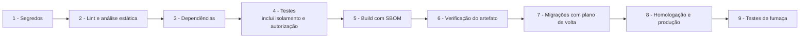

[Índice](README.md) · [Parte anterior](parte-16-dados-validacoes-configuracoes-e-armazenamento.md) · [Próxima parte](parte-18-juridico-e-regulatorio.md)

<a id="parte-17"></a>

# Parte 17 — Operação, qualidade, testes e TI

## Visão geral da parte 17

Toda entrega passa por um pipeline fixo, com bloqueio em segredo exposto, dependência vulnerável e teste de isolamento de tenant ([10](#doc-10), seção 4).



**Regras principais**
- Sem `npx`, `bunx` ou instalador remoto no pipeline; ferramentas com versão fixada ([10](#doc-10), seção 4).
- Definition of Done, gates e ADRs ([11](#doc-11)). Continuidade, SLO, releases e testes ([24](#doc-24)).
- Logs sem dado pessoal e testes por portal ([49](#doc-49)). TI da plataforma e da entidade são assuntos diferentes ([36](#doc-36)).

<a id="doc-10"></a>

## 10 — Implantação e Operação

> Parte do [SDD v2](parte-01-visao-e-escopo.md#doc-00). Segurança de cadeia de suprimentos em [05](parte-04-seguranca-privacidade-e-auditoria.md#doc-05).

---

### 1. Requisitos de runtime

| Componente | Requisito |
|---|---|
| PHP | 8.2 ou superior, com suporte a sodium, PDO MySQL, mbstring, openssl, fileinfo, intl, json, curl |
| Banco | MySQL 8.0 ou MariaDB 10.6 ou superior, InnoDB, `utf8mb4` |
| Cache e sessão | Redis recomendado; banco como alternativa |
| Armazenamento | Objeto compatível com S3 ou volume dedicado fora do diretório público |
| Processos | Workers via supervisor ou equivalente; `pcntl` para jobs |
| Web | Apache ou Nginx com HTTPS obrigatório |

### 2. Ambientes

| Ambiente | `APP_ENV` | Dados | Acesso |
|---|---|---|---|
| Local | `local` | Sintéticos | Desenvolvedor |
| Homologação | `staging` | Sintéticos ou anonimizados | Equipe; dados reais proibidos |
| Produção | `production` | Reais | Operação, com registro |

- `APP_DEBUG=false` e `display_errors=0` em homologação e produção.
- `APP_URL` canônico, sem valor padrão de `localhost` em produção (a aplicação recusa iniciar se a URL for local).
- HSTS habilitado somente em ambientes com HTTPS validado.
- CORS com lista explícita de origens por ambiente.

### 3. Segredos

- Produção: biblioteca própria `TotusTuus\Vault` (ADR-05, D-02), com chave-mestra fora do host da aplicação. `FileVault` proibido em produção.
- Segredos carregados na inicialização; nunca gravados em log, em erro ou em cache de página.
- `.env` nunca versionado. `.env.example` sem valores reais.
- Rotação documentada por segredo: chave de cifragem, pepper, chave de assinatura JWT, segredo de webhook, credencial de banco.
- Remover variáveis não usadas (por exemplo `JWT_SECRET` se o caminho HS256 for removido).
- Revisão semestral do inventário de segredos.

### 4. Pipeline

Ordem obrigatória:

1. **Verificação de segredos** (`gitleaks`) — bloqueia.
2. **Lint** de PHP (`php -l` em todos os arquivos) e análise estática (PHPStan ou Psalm no nível acordado).
3. **Dependências** (`composer audit`, `npm audit`) — bloqueia em alto ou crítico.
4. **Testes** unitários e de integração, incluindo isolamento de tenant e autorização.
5. **Build** de artefato com lockfiles e geração de SBOM (CycloneDX).
6. **Verificação do artefato:** nenhum diretório da lista de exclusão (`scratch/`, `workspace/`, `uploads/`, `node_modules/`, `storage/`, `.env*`, `*.rar`) presente.
7. **Migrações** versionadas, aplicadas antes do deploy, com plano de reversão ou migração compatível com a versão anterior.
8. **Deploy** em homologação, testes de fumaça, depois produção.
9. **Testes de fumaça pós-deploy:** `/health` (sem dados sensíveis), login de conta de teste em homologação, leitura de tela principal.

Ferramentas de deploy são fixadas por versão. Comandos `npx`, `bunx` ou instaladores remotos não aparecem no pipeline.

### 5. Migrações de banco por tenant

- Estrutura (D-16): banco master (`totustuus.matriz.bd`, com plataforma e registro de bancos) + um banco por unidade (entidade + unidade). Ver [03](parte-02-arquitetura-e-tenancy.md#doc-03), seção 1.1.
- Migração roda em ordem por banco de unidade, com registro de versão por banco (`schema_version` no registro do master) e retomada após falha. O banco fica em `migrando` durante a execução.
- Migração que afeta todas as unidades é aplicada em lote, com janela, e reporta falhas por banco. Falha em um banco não impede os demais.
- Migração que apaga coluna ou tabela segue duas etapas: primeiro deixa de usar, depois remove na versão seguinte.

### 6. Backup e recuperação

| Política | Valor de referência (v1) | Observação |
|---|---|---|
| Backup completo | Diário, 7 dias | Ajustar à política contratual |
| Semanal | 4 semanas | |
| Mensal | 12 meses | Dados pessoais: retenção limitada (ver [07](parte-04-seguranca-privacidade-e-auditoria.md#doc-07)) |
| Teste de restauração | Mensal, com registro | Obrigatório antes do go-live |
| RPO / RTO | Definir por contrato | Sem valor fixado neste SDD |

Backup criptografado. Chave de backup separada da chave de dados e guardada no cofre.

### 7. Observabilidade

- Logs estruturados em JSON com `request_id`, `tenant_id` (quando houver), nível e canal. Sem PII.
- Métricas: latência por rota (p50, p95, p99), taxa de erro 5xx, filas, uso de conexões de banco.
- Alertas: erro 5xx acima de 1% em 5 min; fila parada 10 min; certificado TLS com menos de 14 dias; eventos de segurança (força bruta, escalonamento, exportação em massa).
- Painel de auditoria é consulta. Não é fonte de métrica.
- Retenção de logs de aplicação: 90 dias. Logs de auditoria: prazo a definir pelo DPO e pelo jurídico (a v2 não fixa valor; ver [07](parte-04-seguranca-privacidade-e-auditoria.md#doc-07)). Até a definição, nenhum expurgo de auditoria é executado.

### 8. Operação de filas

- Jobs idempotentes com chave de evento.
- Tentativas com atraso exponencial e limite; falha definitiva vai para fila de mortos com alerta.
- Worker não executa código de tenant sem contexto de tenant definido.

### 9. Checklist de go-live

- [ ] `APP_DEBUG=false`, `display_errors=0`.
- [ ] HTTPS com certificado válido e HSTS.
- [ ] Cofre de segredos de produção ativo (D-02); `FileVault` desligado.
- [ ] Limites de taxa configurados por ambiente.
- [ ] Restauração de backup testada e registrada.
- [ ] SBOM gerado.
- [ ] Testes de fumaça pós-deploy verdes.
- [ ] `gitleaks` limpo.
- [ ] DAST em homologação sem achado médio ou superior não tratado.
- [ ] Nenhum arquivo de desenvolvimento no artefato (ver seção 4, passo 6).
- [ ] Runbook de incidente publicado e contatos atualizados.

---

### 10. Operação de mídia (aulas online e reuniões)

Decidido em 03/11/2026: mídia própria, com as melhores tecnologias disponíveis ([40](parte-08-academico.md#doc-40), seção 8). Esta seção define a operação. A escolha de cada componente open source é feita em homologação, com critério de maturidade, segurança e desempenho, e registrada nesta seção.

#### 10.1 Componentes

| Componente | Função | Escala |
|---|---|---|
| Sinalização | Entrada na sala, controle de participantes, eventos de sessão. Conexão segura | Horizontal, sem estado |
| SFU (unidade de encaminhamento de mídia) | Recebe o fluxo de cada participante e entrega a quem assiste. Não guarda nada | Por região e por faixa de salas |
| Gravador | Consome o fluxo do SFU e grava em fragmentos (seção 10.2) | Um processo por sessão gravada, com trava de posse |
| Armazenamento de fragmentos | Objetos cifrados no armazenamento da seção 21, com o prefixo de unidade da [21](parte-16-dados-validacoes-configuracoes-e-armazenamento.md#doc-21), seção 3.2 | Conforme volume |
| Índice de fragmentos | Tabelas da seção 10.3. Liga sessão, trilha, sequência e objeto | Banco da unidade |
| Verificador de fragmento | Confere checksum e tamanho após o fechamento de cada fragmento | Worker da fila |
| Serviço de retenção | Expurgo e bloqueio legal, na mesma regra de [21](parte-16-dados-validacoes-configuracoes-e-armazenamento.md#doc-21), seção 3.6 | Job diário |

#### 10.2 Fragmentação da gravação

- Cada trilha (áudio, vídeo e tela) é gravada em **fragmentos de tamanho fixo por tempo**. Padrão proposto: **60 segundos**, configurável. O valor final é medido em homologação (LIV-13).
- Cada fragmento tem número de sequência único por sessão e trilha. Nunca é sobrescrito. Se o gravador reiniciar, ele abre o próximo número.
- Cada fragmento é cifrado com AES-256-GCM, com nonce único, e a chave da sessão fica no cofre ([05](parte-04-seguranca-privacidade-e-auditoria.md#doc-05)). O índice guarda só a referência da chave, nunca o valor.
- Ao fechar o fragmento, o gravador calcula SHA-256 e tamanho. O verificador confere e muda o estado para `verificado`.
- Fragmento sem fechamento correto vira `corrompido` e não entra na reprodução. O sistema registra o intervalo perdido, sem preencher com silêncio.

Chave do objeto no armazenamento:

```
{unidade_uuid}/midia/{sessao_uuid}/{trilha}/{sequencia:08d}.seg
```

#### 10.3 Mapeamento e reprodução

DDL proposto (MySQL 8 ou MariaDB 10.6, `utf8mb4`, horários em UTC):

```sql
CREATE TABLE sessao_midia (
  id              BIGINT UNSIGNED AUTO_INCREMENT PRIMARY KEY,
  uuid            CHAR(36) NOT NULL UNIQUE,
  sessao_uuid     CHAR(36) NOT NULL UNIQUE,
  unidade_uuid    CHAR(36) NOT NULL,
  estado          ENUM('gravando','pausada','encerrada','verificada','expurgada') NOT NULL,
  chave_ref       VARCHAR(120) NOT NULL,
  iniciada_em     DATETIME(3) NOT NULL,
  encerrada_em    DATETIME(3) NULL,
  created_at      DATETIME(3) NOT NULL DEFAULT CURRENT_TIMESTAMP,
  INDEX ix_midia_unidade (unidade_uuid, estado)
) ENGINE=InnoDB DEFAULT CHARSET=utf8mb4;

CREATE TABLE sessao_fragmento (
  id              BIGINT UNSIGNED AUTO_INCREMENT PRIMARY KEY,
  uuid            CHAR(36) NOT NULL UNIQUE,
  midia_id        BIGINT UNSIGNED NOT NULL,
  trilha          ENUM('audio','video','tela') NOT NULL,
  sequencia       INT UNSIGNED NOT NULL,
  inicio_utc      DATETIME(3) NOT NULL,
  duracao_ms      INT UNSIGNED NOT NULL,
  chave_objeto    VARCHAR(500) NOT NULL,
  tamanho_bytes   BIGINT UNSIGNED NOT NULL,
  sha256          CHAR(64) NOT NULL,
  estado          ENUM('gravando','fechado','verificado','corrompido','expurgado') NOT NULL,
  UNIQUE KEY ux_fragmento_sequencia (midia_id, trilha, sequencia),
  CONSTRAINT fk_fragmento_midia FOREIGN KEY (midia_id) REFERENCES sessao_midia (id)
) ENGINE=InnoDB DEFAULT CHARSET=utf8mb4;
```

**Reprodução:** o sistema monta um manifesto ordenado por trilha e sequência, somente com fragmentos `verificado`. O manifesto é emitido por URL assinada, com validade curta, e vinculada ao usuário e à sessão. Lacuna de tempo entre dois fragmentos aparece como intervalo marcado, nunca emendada.

**Consolidação:** um job opcional junta os fragmentos em um arquivo único para download, depois de verificados. O arquivo consolidado não substitui os fragmentos. O expurgo atinge os dois.

#### 10.4 Falhas

| Falha | Comportamento |
|---|---|
| SFU indisponível | Sala não abre. Alerta imediato. Aula reagendável pela gestão |
| Gravador cai no meio | Fragmento aberto vira `corrompido`. Nova sequência abre ao retomar. Sessão segue |
| Armazenamento indisponível | Gravador guarda o fragmento em buffer local cifrado, por tempo limitado. Se o buffer estourar, a gravação é marcada como interrompida. A sala segue sem gravação |
| Verificador acusa checksum errado | Fragmento vai para `corrompido`. Alerta para operação |
| Chave não encontrada no cofre | Fragmento não é reproduzido. Alerta de segurança. Não há fallback de chave |

#### 10.5 Capacidade

Fórmulas de planejamento, com valores a medir em homologação (LIV-13):

- Banda de saída do SFU ≈ número de participantes que recebem × bitrate médio por participante.
- Armazenamento por hora de gravação ≈ bitrate gravado × 3600 ÷ 8, em bytes, por trilha.
- Número de salas simultâneas por nó é medido em teste de carga antes do go-live, não estimado.

#### 10.6 Monitoramento

| Métrica | Alerta |
|---|---|
| Salas ativas e participantes por nó | Acima de 80% da capacidade medida |
| Perda de pacote, jitter e latência por sala | Perda acima de limite a definir em homologação, por 2 min |
| Fila de fragmentos aguardando verificação | Fila parada por 10 min |
| Fragmentos `corrompido` por dia | Qualquer ocorrência |
| Espaço livre do armazenamento de mídia | Abaixo de 20% |
| Chaves não encontradas | Qualquer ocorrência, com alerta de segurança |

Logs de mídia não contêm conteúdo, nomes de participantes nem trecho de áudio ou texto. Identificadores de sessão e de nó são suficientes.

#### 10.7 Isolamento e segurança

- Token de entrada na sala é assinado e tem o `sessao_uuid` e a unidade. O SFU recusa token de outra sessão ou de outra unidade.
- Gravação e fragmento nunca saem da região definida para a unidade. A localização dos dados precisa de parecer **(jurídico)**.
- Acesso operacional ao conteúdo de sessão é proibido. O suporte vê estado e métricas, não mídia. Exceção só com ordem formal e registro em auditoria ([29](parte-04-seguranca-privacidade-e-auditoria.md#doc-29)).

#### 10.8 Retenção

- O expurgo de fragmento segue o prazo de gravação de [40](parte-08-academico.md#doc-40), seção 5 (padrão proposto de 30 dias, a confirmar **(jurídico)**).
- Ao expurgar, o sistema remove os objetos, marca os fragmentos `expurgado` e mantém só o registro mínimo: sessão, trilha, sequência, data, motivo.
- Bloqueio legal impede o expurgo, nos termos de [21](parte-16-dados-validacoes-configuracoes-e-armazenamento.md#doc-21), seção 3.6.

#### 10.9 Critérios de aceite

- [ ] Fragmento nunca é sobrescrito (teste de concorrência em reinício do gravador).
- [ ] Fragmento com checksum errado não aparece no manifesto (teste).
- [ ] Lacuna de tempo aparece como intervalo, sem silêncio emendado (teste).
- [ ] Token de uma sessão não abre o manifesto de outra (teste de isolamento).
- [ ] Expurgo remove objetos e fragmentos, e mantém só o registro mínimo (teste).
- [ ] Valores de LIV-13 medidos em homologação e registrados aqui.

<a id="v1-09-deployment-ops-md"></a>

### v1 — `09-deployment-ops.md` (72 linhas)

> Situação na v2: Substituído por 10. Quando este texto diverge da v2, vale a v2.

> Esta especificação foi substituída por inteiro pelo documento indicado acima. O texto fica como histórico; para implementar, vale o documento da v2.

> **Documento derivado do SDD mestre** · **Data:** 04/08/2026

---

#### 1. Requisitos de runtime

| Componente | Requisito |
|------------|-----------|
| PHP | 8.2+ (CSP nonce, sodium, JIT opcional) |
| Extensões | pdo_mysql, mbstring, sodium, openssl, fileinfo, intl, json, curl, pcntl (jobs), redis (opcional) |
| Database | MySQL 8 / MariaDB 10.6+ (InnoDB, utf8mb4) |
| Storage | Local (fora do webroot) ou S3-compatível |
| Cache | Redis (recomendado) ou arquivo |
| Queue | `scripts/async_event_worker.php`, `scripts/async_backup.php` (supervisord) |

#### 2. Ambiente (config por env)

`APP_ENV=local|staging|production`, `APP_DEBUG` (false em prod), `APP_URL` canônico, HSTS forçado em prod, CORS whitelist por env (`config/cors.php`).

#### 3. Deploy

**Pipeline (SLSA ~40% atual → 100% na Onda B):**
1. Lint (php -l) + PHPUnit + composer audit + gitleaks.
2. Build de artefato (phar ou zip) com **SBOM (backlog F-DO-02)** + provenance (SLSA) — plano: `docs/SLSA-IMPLEMENTATION-PLAN.md`.
3. Migrations versionadas (pastas `migrations/` + MigrationController).
4. Post-deploy smoke checks (health endpoints).

Documentação de referência:
- `docs/DEPLOYMENT_TASK_PLAN.md` (planos por nuvem)
- `docs/SLSA-IMPLEMENTATION-PLAN.md` (Onda B)
- `docs/Nova pasta/slsa-build-spec.md` (spec)

#### 4. Operação

| Área | Ferramenta |
|------|------------|
| Logs | SystemLogger (estruturado, correlação), ErrorLog |
| Métricas | MetricsCollector |
| Alertas | AlertEngine (brute force, privilege escalation, mass export) |
| Auditoria | AuditLogService + views de auditoria |
| Backup | `scripts/async_backup.php` + policy (7 diários/4 semanais/12 mensais) |
| Jobs | async workers + MigrationExecutionJob |
| Health | health endpoints + runbook de incidentes (`docs/security/incident-response-runbook.md`) |

#### 5. Segurança de operação

- Secrets em Vault (FileVault dev; KMS/HashiCorp prod — backlog F-02).
- `.env` fora do versionamento (`.gitignore`).
- PHP `error_reporting(E_ALL)`, `display_errors=0` prod, `log_errors=1`.
- Headers de segurança emitidos por middleware (ver SDD-05).
- Updates: composer audit em CI (obrigatório), revisão semanal.

#### 6. Observabilidade (views disponíveis)

- Logger admin (5.254 linhas — maior controller; refatorar na Onda C).
- Metrics views + SSE logger (`SseResponse.php`).
- Integration Hub (699 linhas) para monitorar entregas.

#### 7. Checklist de go-live

- [ ] APP_DEBUG=false, display_errors=0
- [ ] HTTPS/HSTS habilitado (cert validado)
- [ ] Vault prod (KMS/HashiCorp) ativado — migrar de FileVault
- [ ] Rate limits configurados por ambiente
- [ ] Backups testados (restore drill)
- [ ] SBOM gerado + assinado
- [ ] Smoke tests pós-deploy verdes
- [ ] Secrets não presentes em repositório (gitleaks limpo)
- [ ] ZAP scan baseline sem abertos ≥ médio
- [ ] Composer audit sem vulnerabilidades

<a id="doc-11"></a>

## 11 — Governança, Qualidade e Processo de Entrega

> Parte do [SDD v2](parte-01-visao-e-escopo.md#doc-00).

---

### 1. Processo de entrega (EGM)

O processo segue o Elephant-Goldfish Model (plugin `egm`, marketplace `google/elephant-goldfish-model`):

1. **Brief** — problema, objetivos, restrições e alternativas descartadas, em linguagem simples. Saída: `concepts_brief.md`.
2. **Rascunho** — documento de design com problema, objetivos e não objetivos, plano técnico, alternativas e plano de testes. Saída: `design_draft.md` ou o documento da seção do SDD.
3. **Revisão por leitores sem contexto** — pelo menos dois leitores com contexto limpo, que recebem só o documento e o código referenciado. Procuram suposições não declaradas e lacunas. Saída: relatório de achados.
4. **Decisão humana** — o autor resolve trade-offs e aprova. Achados resolvidos ou aceitos com justificativa.
5. **Implementação** — só depois da aprovação.
6. **Verificação** — testes automatizados e revisão de código. Leitores sem contexto não substituem testes.

Regras:

- Decisões com mais de uma alternativa defensável são apresentadas ao autor com mecanismo, trade-offs e condições de falha. Não são escolhidas pelo agente.
- Todo documento de decisão tem data, autor e status.
- Afirmação de estado sem evidência é marcada como **[Declarado]** (ver [00](parte-01-visao-e-escopo.md#doc-00)).

### 2. Definition of Done

Uma história ou tarefa só é concluída quando:

- [ ] Critério de aceite do requisito atendido e testado.
- [ ] Testes unitários e de integração adicionados para o caminho feliz e para os dois principais erros.
- [ ] Isolamento de tenant e autorização cobertos quando a mudança toca dados.
- [ ] Sem `on*=` nem script inline em HTML novo.
- [ ] Textos em chaves de i18n com `en` e `pt-BR` preenchidos.
- [ ] Logs sem PII.
- [ ] Documentação de API atualizada quando o contrato muda.
- [ ] Revisão de código aprovada por pessoa diferente do autor.
- [ ] Mudança em autenticação, autorização, cripto, upload ou pagamento revisada por pessoa com perfil de segurança.

### 3. Gates

| Gate | Quando | Critério |
|---|---|---|
| G1 — Arquitetura | Antes de módulo novo | ADR aprovado; leitores sem contexto revisaram o design |
| G2 — Acesso | Antes de módulo com dados pessoais | Permissões definidas; matriz de isolamento escrita |
| G3 — Homologação | Antes de publicar em homologação | Pipeline verde; DAST sem achado médio ou superior não tratado |
| G4 — Produção | Antes de publicar em produção | Checklist de go-live ([10](#doc-10), seção 9) completo; aprovação de responsável de segurança |

### 4. Registro de decisões (ADR)

- Arquivo `adr/NNNN-titulo.md` no repositório de código ou nesta pasta, conforme o caso.
- Campos: contexto, decisão, alternativas, consequências, status (proposta, aceita, substituída).
- Mudança de decisão aceita cria novo ADR que substitui o anterior. ADR antigo não é apagado.

### 5. Papéis

| Papel | Responsabilidade |
|---|---|
| Autor do produto | Aprova escopo, decisões em aberto da seção 5 do [00](parte-01-visao-e-escopo.md#doc-00) |
| Responsável técnico | Arquitetura, ADRs, gates G1 a G4 |
| Responsável de segurança | Revisões da seção 1 de [05](parte-04-seguranca-privacidade-e-auditoria.md#doc-05), resposta a incidentes |
| Encarregado de dados (DPO) | Relatório de impacto, incidentes, direitos do titular |
| Equipe de desenvolvimento | Implementação, testes, documentação |

Nomes das pessoas ficam no registro de responsáveis privado, não neste SDD. A v1 tinha tabela RAI com nomes; a v2 mantém apenas os papéis.

### 6. Uso de ferramentas de IA no desenvolvimento

- Ferramentas de agentes (por exemplo o plugin `egm`, o `fable-method` ou o `oh-my-opencode-slim`, citados na v1) são ferramentas de **processo**. Não são requisito do produto.
- Instalação com versão fixada, após leitura do código de instalação. Sem `@latest`. O plugin `egm` é instalado a partir de `google/elephant-goldfish-model` em commit fixo, com SHA registrado no repositório de código antes do uso.
- Agentes trabalham com permissão mínima no repositório. Não recebem credenciais de produção.
- Código gerado passa pelo mesmo Definition of Done que código escrito à mão.
- Conteúdo de ferramentas externas (páginas, documentos, saídas de ferramenta) é tratado como dado não confiável.

### 7. Qualidade de código

- Limite de referência: controller com até 500 linhas. Acima disso, abrir tarefa de extração. (A v1 cita controllers com mais de 5.000 linhas.)
- Análise estática em CI com nível acordado e aumentado a cada trimestre.
- Cobertura: código novo com cobertura mínima de 80% das linhas de serviço. Meta global a definir após medição.
- Revisão de documentação: SDD revisado a cada release e, no mínimo, a cada trimestre.

### 8. Backlog priorizado (próximas entregas)

| Prioridade | Item | Referência | Dono |
|---|---|---|---|
| Alta | Remover `scratch/` e scripts de sessão do artefato e do repositório | [05](parte-04-seguranca-privacidade-e-auditoria.md#doc-05), seção 3 | Responsável técnico |
| Alta | Eliminar `on*=` nas views e ativar CSP com nonce | [08](parte-05-portais-navegacao-e-interface.md#doc-08) | Frontend |
| Alta | Implementar `TotusTuus\Vault` e definir onde fica a chave-mestra | D-02, ADR-05 | Responsável técnico |
| Alta | Separar `JWT_SECRET` do segredo de proteção de ativos | [05](parte-04-seguranca-privacidade-e-auditoria.md#doc-05), seção 2 | Backend |
| Média | Implementar token de dispositivo (D-03) | [06](parte-03-identidade-acesso-e-permissoes.md#doc-06), seção 7 | Backend |
| Média | Licença Font Awesome Pro para hospedagem: confirmada pelo autor em 03/11/2026 | D-01, [08](parte-05-portais-navegacao-e-interface.md#doc-08) | Autor |
| Alta | Confirmar uso de `JWT_SECRET` e remover HS256 | [05](parte-04-seguranca-privacidade-e-auditoria.md#doc-05) | Backend |
| Alta | Substituir bloqueio de conta por atraso progressivo | [06](parte-03-identidade-acesso-e-permissoes.md#doc-06), seção 6 | Backend |
| Média | Passkey obrigatória para contas de plataforma | [06](parte-03-identidade-acesso-e-permissoes.md#doc-06), seção 10 | Segurança |
| Média | Remover exigência de rotação periódica de senha | [06](parte-03-identidade-acesso-e-permissoes.md#doc-06), seção 3 | Produto |
| Média | ROPA completo, prazos de retenção aprovados, parecer de legítimo interesse (LIA) e fluxo de consentimento de menores. Prazo: 30 dias antes do go-live | [07](parte-04-seguranca-privacidade-e-auditoria.md#doc-07) | DPO |
| Média | Gerar SBOM e assinar artefato | [10](#doc-10) | DevOps |
| Média | Consolidar documentos duplicados da v1 | [12](parte-01-visao-e-escopo.md#doc-12) | Produto |
| Baixa | Reduzir tamanho de controllers | seção 7 | Backend |

<a id="v1-10-governance-delivery-md"></a>

### v1 — `10-governance-delivery.md` (75 linhas)

> Situação na v2: Substituído por 11. Quando este texto diverge da v2, vale a v2.

> Esta especificação foi substituída por inteiro pelo documento indicado acima. O texto fica como histórico; para implementar, vale o documento da v2.

> **Documento derivado do SDD mestre** · **Data:** 04/08/2026

---

#### 1. Processo de entrega

**Especificação → Implementação → Verificação → Gate → Release**

- Cada módulo tem spec canônica em `docs/Nova pasta/spec_*.md` (39 specs atuais; consolidar duplicados).
- Implementação segue conventions (ver `AGENTS.md` e `docs/agent-stack/`).
- **Verificação obrigatória por entrega:** `php -l` + PHPUnit no módulo tocado.
- Gate de segurança (SG-01..SG-05) antes de cada marco (SDD-05).
- Cada alteração registrada (changelog por módulo em specs).

#### 2. Critérios de aceite globais

| Critério | Estado atual |
|----------|--------------|
| Lint limpo (php -l) | ✅ verificado periodicamente |
| PHPUnit verde (142+ testes) | 🟡 verificar na Onda C |
| Sem warnings de deprecation | ✅ |
| Rotas apontam para controllers existentes | ✅ (grep verificado 04/08) |
| Views renderizam com dados vazios | ✅ (`?? []` convention) |
| Segurança: 0 críticos/altos abertos | ✅ (36 achados, 34 FIXED, 2 backlog) |
| i18n 100% chaves 10 locales | ✅ |
| SBOM + provenance (SLSA) | 🔴 pendente (Onda B) |
| PenTest suite completa | 🔴 ~20% (Onda B) |
| Integration Hub completo | 🟡 ~60% (Onda B) |

#### 3. Tabela de módulos e responsáveis (RAI)

| Módulo | Dona(o) | Status |
|--------|:-------:|:------:|
| Auth/IAM/Security | Security | ✅ |
| Billing | Billing | ✅ (48 views) |
| Academic/Exams | Academic | ✅ |
| People/HR | People | ✅ |
| Compliance/Privacy | Compliance | ✅ |
| Migration/Import | Migration | ✅ (1.677 linhas) |
| Integration Hub | Integration | 🟡 ~60% |
| Developer/Ops | Developer | 🟡 ~55% |
| SLSA build | DevOps | 🔴 ~40% |
| PenTest suite | Security | 🔴 ~20% |

#### 4. Ferramentas de entrega

| Ferramenta | Uso |
|------------|-----|
| Git (branch por feature) | versionamento |
| PHPUnit | testes (142+) |
| php -l | lint |
| composer audit | dependências |
| gitleaks | secrets scan |
| ZAP (nightly) | DAST |
| OpenCode + ag-kit + mantis | revisão/auditoria (docs/agent-stack/) |

#### 5. Rotinas

- **Diária:** ZAP baseline em staging; revisão de alertas do AlertEngine.
- **Semanal:** composer audit; revisão de access logs; rotação de chaves quando aplicável.
- **Mensal:** restauração de backup testada; revisão de DSRs abertos; atualização de threat model.
- **Por release:** SBOM + provenance; revisão de findings abertos; gate SG-05.

#### 6. Registro de decisões (ADR)

Ver SDD-02 §8 (ADR-01..05). Novas ADRs registradas em `docs/sdd/02-solution-architecture.md`.

#### 7. Backlog priorizado (próximas entregas)

1. **Onda B (em andamento):** SLSA build pipeline (~40→100%), PenTest suite (~20→100%), Integration Hub (~60→100%).
2. **Onda C:** lint + PHPUnit nos módulos tocados; consolidar specs duplicados (gestão de bancos, notificações, soft-delete, SAC ×2).
3. **Dívida técnica:** refatorar LoggerController (5.254 linhas) e AcademicController (4.857) em services.
4. **Backlog segurança:** Vault KMS em prod, SBOM, CAPTCHA, DAST expansão.

<a id="doc-24"></a>

## 24 — Operação, Continuidade, Qualidade e Lacunas do Projeto

> Parte do [SDD v2](parte-01-visao-e-escopo.md#doc-00). Segurança geral em [05](parte-04-seguranca-privacidade-e-auditoria.md#doc-05). Implantação em [10](#doc-10). Governança e Definition of Done em [11](#doc-11). Domínios e ciclo de vida em [23](parte-06-plataforma-saas-clientes-dominios-licencas-e-crm.md#doc-23).
> **Status:** proposta. Metas numéricas são valores iniciais para medir e ajustar em homologação, não garantias contratuais. Os valores de contrato dependem do autor.

---

### 1. Continuidade: backup e recuperação

Como cada unidade tem banco próprio ([03](parte-02-arquitetura-e-tenancy.md#doc-03), seção 1.1), a recuperação é feita unidade por unidade. Uma falha em uma unidade não exige restaurar as demais.

| Banco | RPO (perda máxima de dado) | RTO (tempo para voltar) | Retenção |
|---|---|---|---|
| Master | 15 min | 2 h | 35 dias de ponto de restauração; mensal por 12 meses |
| Banco de unidade | 15 min | 4 h | Mesma regra; cópia completa diária |
| Banco de identidade da entidade (D-19) | 15 min | 2 h | Mesma regra do master, com backup separado |
| Arquivos (armazenamento de objetos) | Versionamento habilitado, sem perda por substituição | 4 h | Conforme retenção de [21](parte-16-dados-validacoes-configuracoes-e-armazenamento.md#doc-21) |
| Índice de busca | Reconstruível a partir do banco e dos arquivos | 24 h | Não é backup; é derivado |

Regras:

1. Backup é criptografado. A chave de backup fica fora do servidor de dados ([05](parte-04-seguranca-privacidade-e-auditoria.md#doc-05), seção 2).
2. Restauração de teste mensal, em ambiente isolado, com registro do tempo e do resultado. Falha de restauração é incidente.
3. Backup de cada banco de unidade é independente. Uma restauração de teste escolhe uma unidade ao acaso a cada mês.
4. Região secundária para o master e para os bancos de identidade. Falha da região principal aciona o plano de recuperação.
5. Expurgo por retenção ([07](parte-04-seguranca-privacidade-e-auditoria.md#doc-07)) é aplicado também a backups quando o prazo de retenção de backup vence. O prazo de backup é **pendente** (ver [10](#doc-10)).

### 2. Objetivos de serviço (SLO)

| Serviço | Meta inicial | Medição |
|---|---|---|
| Disponibilidade por entidade | 99,5% por mês | Requisições bem-sucedidas dentro do horário de atendimento da entidade |
| Login | 99,9% por mês | Autenticação concluída |
| Latência p95 de tela de lista | até 800 ms | Medição no servidor |
| Latência p95 de API | até 300 ms | Medição no servidor |
| Entrega de evento na fila | 99% em até 60 s | Tempo entre gravação na outbox e consumo |
| Envio de notificação | 99% em até 5 min | Entre enfileiramento e entrega ao provedor |

- Orçamento de erro: consumo acima de 50% do erro permitido no mês suspende novas mudanças de risco até a estabilização.
- Página de status pública para incidentes de disponibilidade.
- Alerta por entidade, não só global. Uma entidade pode estar fora enquanto as outras estão bem.

### 3. Severidade e suporte

| Severidade | Exemplo | Primeira resposta | Atualização | Solução ou contorno |
|---|---|---|---|---|
| 1 — crítica | Entidade inteira sem acesso; vazamento suspeito | 30 min, 24 × 7 | A cada 1 h | 4 h |
| 2 — alta | Módulo principal indisponível; cobrança parada | 2 h, horário comercial estendido | A cada 4 h | 1 dia útil |
| 3 — média | Função degradada, com contorno | 1 dia útil | Diária | Próxima versão |
| 4 — baixa | Dúvida, melhoria | 2 dias úteis | Sob demanda | Backlog |

- Vazamento de dado pessoal segue o runbook de [07](parte-04-seguranca-privacidade-e-auditoria.md#doc-07), seção 8, independentemente da severidade.
- Atendimento de suporte não acessa dado de aluno sem vínculo e sem registro ([06](parte-03-identidade-acesso-e-permissoes.md#doc-06), seção 10).

### 4. Releases e mudanças

- **Migrações compatíveis com a versão anterior** por pelo menos uma versão. Remoção de coluna em duas etapas, já definida em [15](parte-16-dados-validacoes-configuracoes-e-armazenamento.md#doc-15), seção 1.
- **Feature flags por entidade.** Nova funcionalidade começa em uma entidade piloto, depois em grupo, depois em todas.
- **Canário:** a versão roda primeiro em um subconjunto de unidades. Métrica de erro acima do limite interrompe a propagação e reverte.
- **Rollback** testado em homologação a cada release de banco.
- **Janela de manutenção** comunicada às entidades com 72 h de antecedência, exceto correção de segurança.
- **Changelog por entidade**, com o que muda na tela e na API.

### 5. Estratégia de testes

| Tipo | Escopo | Quando roda | Responsável |
|---|---|---|---|
| Unidade | Regras de validação e cálculo | A cada commit | Desenvolvedor |
| Integração | Serviços com banco real de teste | A cada commit | Desenvolvedor |
| Contrato de evento | Payload de cada evento do catálogo ([14](parte-02-arquitetura-e-tenancy.md#doc-14), seção 4) | A cada commit | Desenvolvedor |
| Isolamento | Matriz de entidades, unidades e papéis ([03](parte-02-arquitetura-e-tenancy.md#doc-03), seção 7) | A cada commit | Segurança |
| Ponta a ponta | Fluxos principais: matrícula, cobrança, login, troca de contexto | Antes de cada release | QA |
| Carga | Cenário de pico por entidade grande | Mensal e antes de mudança de infraestrutura | Operação |
| Segurança (DAST) | Varredura na homologação | Antes de cada release | Segurança |
| Pentest externo | Escopo definido em [penetration-test-spec-v2.md](#v1-penetration-test-spec-v2-md) | Anual e após mudança de autenticação ou pagamento | Terceiro contratado |
| Restauração | Restauração de backup em ambiente isolado | Mensal (seção 1) | Operação |
| Exercício de incidente | Simulação de vazamento ou de indisponibilidade | Semestral | Segurança e DPO |

### 6. Divulgação de vulnerabilidade

- Canal público para relatório de vulnerabilidade, com endereço de contato de segurança publicado em `/.well-known/security.txt`.
- Resposta de confirmação em até 3 dias úteis. Correção de vulnerabilidade crítica em até 7 dias, alta em até 30 dias.
- Pesquisador de boa-fé não é processado por teste feito dentro do escopo publicado.
- Registro da vulnerabilidade e da correção, sem dado de cliente.

### 7. Acessibilidade e conteúdo

- Declaração de acessibilidade publicada, com o nível WCAG 2.2 AA e as pendências conhecidas.
- Teste com leitor de tela em telas principais a cada release.
- Conteúdo para o cidadão e para o aluno em linguagem simples. Textos de consentimento e de cobrança passam por revisão jurídica ([07](parte-04-seguranca-privacidade-e-auditoria.md#doc-07)).

### 8. Contratos e termos

Documentos que a plataforma precisa ter e que não estão no SDD:

| Documento | Conteúdo mínimo | Dono |
|---|---|---|
| Termos de uso da plataforma | Responsabilidades, uso aceitável, suspensão | Jurídico |
| Contrato de cliente (entidade) | Escopo, SLA (seção 2), preço, saída ([23](parte-06-plataforma-saas-clientes-dominios-licencas-e-crm.md#doc-23), seção 5) | Comercial e jurídico |
| Contrato de tratamento de dados (operador) | Quando a plataforma trata dado em nome da entidade ([07](parte-04-seguranca-privacidade-e-auditoria.md#doc-07), seção 7) | DPO e jurídico |
| Política de privacidade (site e app) | Dados coletados por canal ([22](parte-06-plataforma-saas-clientes-dominios-licencas-e-crm.md#doc-22)), finalidade e direitos | DPO |
| Política de cookies | Lista de cookies e finalidade, com consentimento | DPO |
| Política de segurança para fornecedores | Requisitos para terceiros que tocam dado de cliente ([16](parte-14-integracoes-e-importacao.md#doc-16)) | Segurança |
| Plano de continuidade | Conteúdo da seção 1 em versão para o cliente | Operação |

### 9. Lacunas do projeto

Lista do que falta para o projeto estar completo. Cada item tem dono sugerido e prioridade.

| # | Lacuna | Prioridade | Dono sugerido | Onde |
|---|---|---|---|---|
| G-01 | Decisões D-22 a D-24: aprovadas em 02/11/2026 | Resolvido | Autor | [23](parte-06-plataforma-saas-clientes-dominios-licencas-e-crm.md#doc-23), seção 6 |
| G-02 | Retenção de 24 h da auditoria de consultas por CPF; possível conflito com o registro de acesso (Marco Civil, art. 15) e com o relatório ao titular | Alta | Jurídico e DPO | [21](parte-16-dados-validacoes-configuracoes-e-armazenamento.md#doc-21), seção 6.8; análise em [25](parte-18-juridico-e-regulatorio.md#doc-25), Q-01 |
| G-03 | Parecer da matriz de base legal | Alta | Jurídico | [07](parte-04-seguranca-privacidade-e-auditoria.md#doc-07), seção 3; perguntas em [25](parte-18-juridico-e-regulatorio.md#doc-25), Q-03 a Q-08 |
| G-04 | Piso máximo de aumento do limite de MFA por tenant | Alta | Autor | [20](parte-10-financeiro-pagamentos-e-fiscal.md#doc-20), seção 19.2 |
| G-05 | Relatório de impacto (RIPD) da busca por CPF e do cadastro civil | Alta | DPO | [21](parte-16-dados-validacoes-configuracoes-e-armazenamento.md#doc-21), [14](parte-02-arquitetura-e-tenancy.md#doc-14) |
| G-06 | DDL de Documentos, Marketing, Atendimento, Simulados, Preceptoria, RH e Contábil/Fiscal | Alta | Owners dos módulos | [19](parte-07-regras-gerais-dos-modulos-de-gestao.md#doc-19), [18](parte-07-regras-gerais-dos-modulos-de-gestao.md#doc-18) |
| G-07 | Regras de validação de Pessoas, Acadêmico, Financeiro e demais módulos em nível campo a campo | Alta | Owners | [17](parte-07-regras-gerais-dos-modulos-de-gestao.md#doc-17), [18](parte-07-regras-gerais-dos-modulos-de-gestao.md#doc-18), [19](parte-07-regras-gerais-dos-modulos-de-gestao.md#doc-19) |
| G-08 | Fronteira Armazenamento/Suprimentos (estoque duplicado) | Média | Produto | [19](parte-07-regras-gerais-dos-modulos-de-gestao.md#doc-19), seção 2 |
| G-09 | Fronteira RH/Pessoas (HCM único ou dois módulos) | Média | Produto | [18](parte-07-regras-gerais-dos-modulos-de-gestao.md#doc-18), seção 4.1 |
| G-10 | Módulo de atendimento único (SAC, chat e helpdesk) | Média | Produto | [19](parte-07-regras-gerais-dos-modulos-de-gestao.md#doc-19), seção 7 |
| G-11 | Motor do OCR e ADR correspondente | Média | Responsável técnico | [21](parte-16-dados-validacoes-configuracoes-e-armazenamento.md#doc-21), seção 3.10 |
| G-12 | Prazo de retenção de backups | Média | Jurídico e operação | Seção 1 |
| G-13 | Prazo de guarda para retenção legal na saída de cliente | Média | Jurídico | [23](parte-06-plataforma-saas-clientes-dominios-licencas-e-crm.md#doc-23), seção 5 |
| G-14 | Contrato de cliente, termos de uso, política de privacidade e de cookies, com revisão jurídica | Média | Jurídico | Seção 8 |
| G-15 | Metas de SLO e SLA de contrato, validadas em homologação | Média | Autor e operação | Seção 2 |
| G-16 | Matriz de isolamento automatizada para todas as entidades e papéis | Média | Segurança | [03](parte-02-arquitetura-e-tenancy.md#doc-03), seção 7 |
| G-17 | Plano de continuidade para o cliente | Baixa | Operação | Seção 1 |
| G-18 | Declaração de acessibilidade e teste com leitor de tela | Baixa | Frontend | Seção 7 |
| G-19 | Lista de jurisdições fora do Brasil, se houver cliente | Baixa | Jurídico | [19](parte-07-regras-gerais-dos-modulos-de-gestao.md#doc-19), seção 4 |
| G-20 | Revisão de todas as regras marcadas **[Pendente]** nesta versão | Média | Owners | Todos os documentos 14 a 24 |

### 10. Critérios de aceite deste documento

- [ ] Metas de SLO, RPO e RTO aprovadas pelo autor.
- [ ] Restauração mensal executada e registrada em homologação.
- [ ] Estratégia de testes implantada em CI.
- [ ] Contratos da seção 8 revisados pelo jurídico.
- [ ] Lacunas G-01 a G-05 resolvidas antes de produção.

<a id="doc-49"></a>

## 49 — Logs de Integração, de Job e de Fila, e Testes por Portal

> Parte do [SDD v2](parte-01-visao-e-escopo.md#doc-00). Estratégia geral de testes em [24](#doc-24), seção 5. Logs técnicos e de aplicação em [10](#doc-10), seção 7. Eventos de domínio e fila em [14](parte-02-arquitetura-e-tenancy.md#doc-14). Auditoria, com o campo `portal`, em [29](parte-04-seguranca-privacidade-e-auditoria.md#doc-29). Matriz por portal em [31](parte-05-portais-navegacao-e-interface.md#doc-31). Dado sensível nos logs, em [07](parte-04-seguranca-privacidade-e-auditoria.md#doc-07).
> **Status:** especificação proposta, criada em 03/11/2026. Fecha LOG-01, LOG-02, TST-01, TST-02 e TST-03 da [31](parte-05-portais-navegacao-e-interface.md#doc-31). Os itens **[Decisão do autor]** da seção 6 dependem de resposta.

---

### 1. Resposta direta

> **Leitura (04/11/2026):** esta tabela registra o que existia no SDD antes deste documento ser escrito. Os itens marcados como **Não** ou **Parcial** são especificados nas seções seguintes deste documento, exceto o que estiver listado na seção de pendências.

| Pergunta | Veredito |
|---|---|
| Logs de integração estão especificados? | **Não.** A [31](parte-05-portais-navegacao-e-interface.md#doc-31) marca "sem especificação". Existe só o log técnico geral da [10](#doc-10) |
| Logs de job e de fila? | **Parcial.** A [10](#doc-10), seção 8, fala de tentativas e fila de mortos, sem campos nem retenção |
| Testes por portal? | **Não.** A [24](#doc-24) cobre estratégia geral. Não há conjunto por portal nem teste de isolamento por par portal e módulo |
| Logs e testes se misturam com auditoria? | **Não, por decisão.** Auditoria é trilha de negócio e de segurança. Log é diagnóstico técnico. Regras em [29](parte-04-seguranca-privacidade-e-auditoria.md#doc-29) |

---

### 2. Logs de integração (LOG-01)

Cada chamada a um sistema externo gera um registro. Usado para diagnóstico, não para prova jurídica. Prova de ação de negócio é a auditoria.

| Campo | Regra |
|---|---|
| `integracao_id` | Conector: gateway, fiscal, eSocial, provedor de IA, catraca, provedor de vídeo |
| `direcao` | `saida` (chamada feita pela plataforma) ou `entrada` (webhook recebido) |
| `operacao` | Nome da operação, ex.: `cobranca.criar`, `webhook.pagamento` |
| `status` | `sucesso`, `falha_temporaria`, `falha_permanente`, `recusado` |
| `http_status` e `tempo_ms` | Código e duração |
| `tentativa` | Número da tentativa, com atraso exponencial ([10](#doc-10), seção 8) |
| `correlation_id` | Liga à operação de negócio e à auditoria ([29](parte-04-seguranca-privacidade-e-auditoria.md#doc-29), seção 2) |
| `entity_uuid`, `unit_uuid` | Contexto de tenant. Obrigatório ([03](parte-02-arquitetura-e-tenancy.md#doc-03)) |
| `corpo` | **Não gravado.** Só tamanho e hash. Corpo pode conter dado pessoal, dado de pagamento ou dado de saúde |
| `erro_resumo` | Mensagem resumida, sem trecho de resposta que contenha dado |

**Proibido no log:** cabeçalho de autorização, token, segredo, número de cartão, CPF em texto, corpo de resposta com dado pessoal ([14](parte-02-arquitetura-e-tenancy.md#doc-14), seção 8).

**Retenção:** 90 dias, decidido pelo autor em 03/11/2026. Depois, expurgo automático.

#### 2.1 Conectores com log desde o primeiro lançamento (LOG-05)

Regra: **todo conector que fala com sistema externo por rede grava log de integração desde o primeiro dia**. Não há conector sem log. Troca por arquivo, em que a secretaria baixa e importa, grava log de job (seção 3) na geração e na importação, não log de integração.

| Conector | Escala | Direção | Origem da regra |
|---|---|---|---|
| E-mail e SMS | Plataforma | Saída e retorno de entrega | [16](parte-14-integracoes-e-importacao.md#doc-16), seção 2; [57](parte-13-atendimento-e-notificacoes.md#doc-57) |
| WhatsApp e push do aplicativo | Plataforma | Saída e retorno de entrega | [57](parte-13-atendimento-e-notificacoes.md#doc-57), NOT-06 |
| Armazenamento de objeto e antivírus | Plataforma | Saída | [21](parte-16-dados-validacoes-configuracoes-e-armazenamento.md#doc-21) |
| Captcha | Plataforma | Saída | [16](parte-14-integracoes-e-importacao.md#doc-16), seção 2 |
| Cobrança da assinatura SaaS | Plataforma | Saída e webhook | [34](parte-10-financeiro-pagamentos-e-fiscal.md#doc-34), seção 2.2 |
| Backup externo e monitoramento | Plataforma | Saída | [10](#doc-10) |
| Provedor de modelo de IA | Plataforma, pelo gateway de IA | Saída | [27](parte-15-inteligencia-artificial.md#doc-27), seção 3 |
| Mídia da aula online | Plataforma | Saída | [40](parte-08-academico.md#doc-40) |
| Gateway de pagamento, primário e de contingência | Unidade | Saída e webhook | [34](parte-10-financeiro-pagamentos-e-fiscal.md#doc-34), seção 2.3 |
| NFS-e | Entidade | Saída | [34](parte-10-financeiro-pagamentos-e-fiscal.md#doc-34), seção 5 |
| eSocial | Entidade | Saída e retorno | [39](parte-11-pessoas-departamento-pessoal-e-sst.md#doc-39) |
| SSO da entidade | Entidade | Entrada | [06](parte-03-identidade-acesso-e-permissoes.md#doc-06) |
| Webhook de saída | Unidade (SRC-06) | Saída | [04](parte-02-arquitetura-e-tenancy.md#doc-04), seção 7 |
| ERP e sistema legado | Entidade | Saída e entrada | [16](parte-14-integracoes-e-importacao.md#doc-16), seção 3 |
| Catraca e controle de acesso | Unidade | Entrada e saída | [35](parte-03-identidade-acesso-e-permissoes.md#doc-35) |
| SGP / MEC Gestão Presente e Pé-de-Meia | Unidade | Saída e retorno | [74](parte-14-integracoes-e-importacao.md#doc-74), seções 3.3 e 3.5 |
| Sistema municipal por API | Unidade | Saída e entrada | [74](parte-14-integracoes-e-importacao.md#doc-74), seção 3.4 |
| Educacenso, SIGEP e sistema municipal por arquivo | Unidade | Log de job, não de integração | [74](parte-14-integracoes-e-importacao.md#doc-74) |

Conector novo só entra em produção com o `integracao_id` cadastrado e com o teste de varredura do critério de aceite 1 (sem corpo nem token no log).

---

### 3. Logs de job e de fila (LOG-02)

| Campo | Regra |
|---|---|
| `job_id` e `fila` | Identificador e nome da fila |
| `evento_id` | Chave de idempotência ([14](parte-02-arquitetura-e-tenancy.md#doc-14), seção 5). Repetição do mesmo evento não gera efeito duplicado |
| `estado` | `pendente`, `processando`, `processado`, `cancelado`, `rejeitado`. Vai para `rejeitado` após o limite de tentativas ([14](parte-02-arquitetura-e-tenancy.md#doc-14)) |
| `tentativas`, `proxima_tentativa_em` | Controle de retentativa |
| `duracao_ms` | Tempo de processamento |
| `erro_resumo` | Mesma regra de dado do log de integração |

**Alertas** (já previstos em [14](parte-02-arquitetura-e-tenancy.md#doc-14), seção 9): `rejeitado` acima de zero em evento de dado sensível, e `pendente` com idade acima de 15 minutos.

**Retenção:** 90 dias, igual ao log de integração. Eventos rejeitados ficam até decisão da operação.

---

### 4. Testes por portal (TST-01)

Cada portal tem um conjunto de testes que roda em CI antes de cada deploy.

| Portal | Conjunto mínimo |
|---|---|
| **Desenvolvedor** | Login com MFA. Acesso negado a dado de entidade. Painel de banco sem console SQL aberto ([34](parte-10-financeiro-pagamentos-e-fiscal.md#doc-34), seção 11) |
| **Gestão** | Acesso por papel. Exportação com evento de auditoria. Ação de dado sensível exige motivo |
| **Professor** | Só turmas vinculadas. Nota só pelo professor da turma. Simulado de outra turma recusado |
| **Aluno** | Só o próprio dado. Nota da IA não aparece antes da confirmação |
| **Responsáveis** | Só dependentes com vínculo ativo. Vínculo revogado perde acesso em até 30 segundos ([06](parte-03-identidade-acesso-e-permissoes.md#doc-06)) |
| **Terceiros** | Só o próprio contrato, serviço e unidade. Interseção de filtros ([38](parte-12-suprimentos-patrimonio-frotas-contratos-e-terceiros.md#doc-38)) |
| **Público** | Consulta de validação sem dado pessoal ([48](parte-09-secretaria-matricula-e-documentos.md#doc-48), seção 6) |

---

### 5. Teste de isolamento por par (TST-02)

Para cada par portal e módulo da [31](parte-05-portais-navegacao-e-interface.md#doc-31), seção 2, há um teste que tenta acessar um objeto de outra entidade, de outra unidade e de outra pessoa do mesmo portal. Resposta esperada: "não encontrado", sem diferença de mensagem ([03](parte-02-arquitetura-e-tenancy.md#doc-03), seção 2).

- Número de pares: uma linha por módulo e por portal, a partir da matriz.
- Executado em CI e em homologação antes da produção.
- Falha bloqueia o deploy.

#### 5.1 Geração do conjunto a partir da matriz (TST-05)

O conjunto não é escrito à mão, par a par. Ele é gerado a partir de uma tabela de definição, para que um módulo novo não fique sem teste.

1. **Fonte única.** Um arquivo de definição no repositório lista, para cada módulo, os portais da matriz da [31](parte-05-portais-navegacao-e-interface.md#doc-31), seção 2, o tipo de objeto e a rota de leitura. É a versão em código da matriz.
2. **Geração.** Para cada linha, o gerador cria três casos: objeto de outra entidade, de outra unidade da mesma entidade e de outra pessoa do mesmo portal. Os dados vêm de uma massa fixa de teste com duas entidades e duas unidades em cada.
3. **Resposta esperada.** "Não encontrado", com o mesmo código e o mesmo corpo para objeto inexistente e para objeto de outro tenant ([03](parte-02-arquitetura-e-tenancy.md#doc-03), seção 2). O tempo de resposta não pode denunciar a existência do objeto.
4. **Regressão por módulo novo.** O pipeline compara a lista de rotas registradas com o arquivo de definição. Rota de leitura sem linha no arquivo falha o deploy. Assim, um módulo novo não sobe sem entrar na matriz.
5. **Portal de terceiros.** Gera também o caso de interseção: prestador com contrato em outra unidade não lê objeto desta ([38](parte-12-suprimentos-patrimonio-frotas-contratos-e-terceiros.md#doc-38)).
6. **Relatório.** Cada execução grava quantos pares rodaram, quantos falharam e quais rotas ficaram sem linha. O número de pares tem que ser igual ao da execução anterior, ou maior.

---

### 6. Teste de acessibilidade por portal (TST-03)

| Verificação | Ferramenta e regra |
|---|---|
| Contraste | Mínimo de 4,5:1 para texto normal, em cada tema ([08](parte-05-portais-navegacao-e-interface.md#doc-08), seção 4) |
| Teclado | Todo fluxo de criação e edição sem mouse ([08](parte-05-portais-navegacao-e-interface.md#doc-08), seção 8) |
| Leitor de tela | Rótulos e anúncios de estado nos fluxos principais |
| Responsividade | Telas de 320, 375 e 1280 px, sem rolagem horizontal |

Ferramenta de varredura automática escolhida em homologação, com versão fixada ([11](#doc-11)). Varredura automática não substitui teste manual com teclado e leitor de tela.

---

### 7. Pendências

| # | Pendência | Tipo |
|---|---|---|
| LOG-04 | Limite de tentativas de job antes de `rejeitado` | **Decidido** em 03/11/2026: 5 tentativas, com atraso crescente |
| LOG-05 | Lista de conectores com log de integração ativo desde o primeiro lançamento | **Escrito** na seção 2.1 |
| TST-04 | Ferramenta de varredura de acessibilidade, com versão fixada | Operação |
| TST-05 | Conjunto de testes de isolamento gerado a partir da matriz, com teste de regressão a cada novo módulo | **Escrito** na seção 5.1 |

---

### 8. Critérios de aceite

- [ ] Log de integração não contém corpo de resposta nem token (varredura).
- [ ] Log de job com a mesma `evento_id` não gera efeito duplicado (teste de idempotência).
- [ ] Todo portal tem o conjunto da seção 4 rodando em CI (verificação de pipeline).
- [ ] Teste de isolamento de par falha o deploy quando um par vaza dado (teste).
- [ ] Rota de leitura sem linha no arquivo de definição da matriz falha o deploy (verificação de pipeline).
- [ ] Contraste, teclado e responsividade conferidos em cada portal (teste de acessibilidade).

<a id="doc-36"></a>

## 36 — Tecnologia da Informação (TI), por Portal

> Parte do [SDD v2](parte-01-visao-e-escopo.md#doc-00). Operação da plataforma em [10](#doc-10) e [24](#doc-24). Atendimento de chamados em [32](parte-04-seguranca-privacidade-e-auditoria.md#doc-32). Patrimônio em [19](parte-07-regras-gerais-dos-modulos-de-gestao.md#doc-19), seção 8. Contratos em [33](parte-12-suprimentos-patrimonio-frotas-contratos-e-terceiros.md#doc-33). Achados da v1 em [13](parte-01-visao-e-escopo.md#doc-13) (ACH-01, ACH-14).
> **Status:** aprovada pelo autor em 03/11/2026, com as propostas adotadas. Itens sem valor definido continuam pendentes, criada em 03/11/2026 a partir de [`spec_gestao_ti_completa.md`](#v1-spec-gestao-ti-completa-md) (882 linhas, 18 seções) e da navegação da v1 ([12](parte-01-visao-e-escopo.md#doc-12), seção 4.1). Itens **[Decisão do autor]** dependem de resposta.

---

### 1. Resposta direta

> **Leitura (04/11/2026):** esta tabela registra o que existia no SDD antes deste documento ser escrito. Os itens marcados como **Não** ou **Parcial** são especificados nas seções seguintes deste documento, exceto o que estiver listado na seção de pendências.

| Pergunta | Veredito |
|---|---|
| O módulo de TI está completo? | **Não.** A v1 tem o escopo (18 domínios e 19 itens de menu), mas nenhuma regra de validação, estado, DDL ou critério de aceite. O catálogo o marca como "Revisar" ([12](parte-01-visao-e-escopo.md#doc-12)) |
| Está organizado por portal? | **Não.** A v1 mistura dois assuntos diferentes no mesmo módulo: a TI **da plataforma** e a TI **da entidade** |
| Há duplicidade com outros módulos? | **Sim.** Ativos × Patrimônio; Chamados × Atendimento; Contratos e SLA × Contratos; Fornecedores × Suprimentos |
| O código da view é aceitável? | **Não.** [`sub_sidebar_itsm.php`](#v1-sub-sidebar-itsm-php) tem `onclick=`, o que viola a regra de zero JavaScript inline ([02](parte-02-arquitetura-e-tenancy.md#doc-02), ADR-07). Achado ACH-01 em [13](parte-01-visao-e-escopo.md#doc-13) |

---

### 2. Dois assuntos com o mesmo nome

| Assunto | Quem opera | Onde fica | Exemplos | Portal |
|---|---|---|---|---|
| **TI da plataforma** (operação do SaaS) | Equipe de operação da plataforma | Infraestrutura da plataforma | Clusters, DNS, certificados TLS, backups, filas, cache, monitoramento dos serviços | Desenvolvedor, "Gestão de TI" e "Configurações do Sistema" |
| **TI da entidade** (suporte de tecnologia da escola) | Equipe de TI da entidade | Dados da entidade, banco da unidade | Computadores, licenças de software, rede da escola, chamados de TI, inventário | Gestão |

**Regra:** a TI da plataforma **não é módulo de tenant**. Nenhum cliente acessa a infraestrutura da plataforma, nem como leitura. A TI da entidade **não acessa** a infraestrutura da plataforma.

Consequência: a tabela de recursos de infraestrutura da v1 (Kubernetes, DNS, backups) sai do módulo de TI de tenant. Ela fica nos documentos de operação ([10](#doc-10), [24](#doc-24)), com acesso só pelo portal do desenvolvedor.

---

### 3. TI da plataforma (portal do desenvolvedor)

| Recurso | Estado na v2 | Onde está | Lacuna |
|---|---|---|---|
| Backup e restauração | Definido | [24](#doc-24), seção 1 | Prazo de retenção de backup (G-12) |
| Certificados TLS | Alerta a 14 dias | [10](#doc-10), seção 7 | Inventário de certificados e dono de cada um |
| Monitoramento e alertas | Definido em partes | [10](#doc-10), seção 7 | Painel por serviço e regra de escalonamento |
| Filas e workers | Parcial | [14](parte-02-arquitetura-e-tenancy.md#doc-14) | Painel e limite de fila por entidade |
| Cache | Definido | [30](parte-02-arquitetura-e-tenancy.md#doc-30) | Dimensionamento (CAC-01) |
| Manutenção programada | Parcial | [24](#doc-24), seção 3 | Janela de manutenção e aviso aos clientes |
| Cluster, DNS, nuvem | Não definido | — | Escolha de provedor (ver [10](#doc-10)) |
| Inventário de segredos | Definido | [05](parte-04-seguranca-privacidade-e-auditoria.md#doc-05), seção 2 | Rotação e dono por segredo |

**Regra:** toda ação de infraestrutura é registrada em [29](parte-04-seguranca-privacidade-e-auditoria.md#doc-29), categoria "processo", com `portal = desenvolvedor`.

---

### 4. TI da entidade (portal de gestão)

#### 4.1 Recursos e donos

| Recurso da v1 | Proposta na v2 | Dono de dado |
|---|---|---|
| Hardware (computador, servidor local, impressora) | Ativo de TI com ciclo de vida | TI da entidade |
| Software e licenças | Licença com número de assentos, validade e contrato ligado | TI da entidade |
| Redes e links | Circuito e equipamento de rede. Nunca guarda senha de equipamento em texto | TI da entidade |
| Ativos (inventário) | Vista sobre o Patrimônio, para bens de TI. Ver seção 5 | Patrimônio |
| CMDB (relações entre ativos, serviços e contratos) | Modelo de relação. Restrito a ativos da própria entidade | TI da entidade |
| Chamados de TI | Categoria "TI" do módulo de atendimento. Ver seção 5 | Atendimento |
| Incidentes | Chamado de tipo incidente, com severidade e impacto | Atendimento |
| Problemas (causa raiz) | Registro ligado a incidentes recorrentes | TI da entidade |
| Mudanças | Solicitação com aprovação por comitê, ver seção 6 | TI da entidade |
| Contratos, SLA e garantias de TI | Tipo de contrato em [33](parte-12-suprimentos-patrimonio-frotas-contratos-e-terceiros.md#doc-33). SLA do engine de [32](parte-04-seguranca-privacidade-e-auditoria.md#doc-32), seção 2.3 | Contratos |
| Fornecedores de TI | Cadastro de fornecedor em Suprimentos. Ver seção 5 | Suprimentos |
| Monitoramento de links e equipamentos da escola | Só se a entidade mantém equipamento monitorado. Ver seção 7 | TI da entidade |
| Base de conhecimento de TI | Artigos do atendimento ([32](parte-04-seguranca-privacidade-e-auditoria.md#doc-32), seção 2.7) | Atendimento |
| Automações e relatórios | Regra de disparo e painel do módulo | TI da entidade |

#### 4.2 Estados de incidente e mudança

A v1 não define estado. Proposta, em linha com a prática de gestão de serviço de TI:

**Incidente:** `aberto` → `em_atendimento` → `resolvido` → `fechado`; `reaberto` a partir de `resolvido`. Severidade de 1 a 4 define o SLA.

**Problema:** `identificado` → `em_analise` → `solucao_definida` → `resolvido`. Liga a um ou mais incidentes.

**Mudança:** `solicitada` → `avaliada` → `aprovada` ou `recusada` → `agendada` → `implantada` → `verificada` → `fechada`. Mudança emergencial tem caminho próprio, com aprovação posterior registrada.

**Regras:**

- Mudança em ativo de produção (sistema que atende alunos) exige aprovação de um segundo papel. Quem solicita não aprova.
- Mudança sem plano de volta (rollback) não é aprovada.
- Incidente resolvido sem causa registrada fica em aberto para o problema, se for recorrente.

---

### 5. Duplicidades a resolver

| Duplicidade | Proposta | Decisão |
|---|---|---|
| **Ativos de TI × Patrimônio** (`spec_patrimonio_completo`, com QR, RFID e depreciação) | Patrimônio é o dono do bem. TI tem uma vista filtrada por categoria "tecnologia", com campos próprios (IP, MAC, serial, licença) guardados no registro do bem | **Decidido** em 03/11/2026: vista do patrimônio, sem cadastro próprio |
| **Chamados de TI × Atendimento** | Chamado de TI é um ticket de categoria TI. Não há fila separada. SLA, estados e portal são os de [32](parte-04-seguranca-privacidade-e-auditoria.md#doc-32) | Proposta registrada. Confirmar |
| **Contratos de TI × Contratos** | Contrato de licença, suporte e link é tipo de contrato em [33](parte-12-suprimentos-patrimonio-frotas-contratos-e-terceiros.md#doc-33). Sem repositório separado | Proposta registrada |
| **Fornecedores de TI × Suprimentos** | Fornecedor é cadastro único em Suprimentos | Proposta registrada |
| **SLA de TI × SLA de atendimento** | Motor único de SLA ([32](parte-04-seguranca-privacidade-e-auditoria.md#doc-32), seção 2.3) | Proposta registrada |
| **Segurança (menu de TI) × Segurança da v2** | Política de segurança e auditoria ficam em [05](parte-04-seguranca-privacidade-e-auditoria.md#doc-05) e [29](parte-04-seguranca-privacidade-e-auditoria.md#doc-29). TI só consome o resultado | Proposta registrada |

---

### 6. Permissões

| Papel | Pode | Não pode |
|---|---|---|
| Administrador de TI da entidade | Ativos, licenças, chamados de TI, mudanças | Aprovar a própria mudança |
| Técnico de TI | Atender chamados e incidentes, registrar resolução | Alterar contrato, excluir ativo |
| Aprovador de mudança (comitê) | Aprovar ou recusar mudança | Executar a mudança que aprovou |
| Auditor | Ler ativos, mudanças e registros de acesso | Alterar nada |
| Usuário comum (professor, aluno, funcionário) | Abrir chamado de TI pelo portal correspondente | Ver ativo, inventário, rede ou licença |

Segregação: quem executa mudança não aprova a própria mudança ([22](parte-06-plataforma-saas-clientes-dominios-licencas-e-crm.md#doc-22), seção 5).

---

### 7. Monitoramento de equipamento da entidade

A v1 inclui monitoramento de servidores, links e equipamentos. Para a entidade, isso só vale se ela tiver equipamento próprio em rede monitorada. Regras:

- Coleta de métrica (uptime, latência, utilização) sem conteúdo de tráfego.
- Nenhuma credencial de equipamento no painel. Credencial de coleta fica no cofre ([05](parte-04-seguranca-privacidade-e-auditoria.md#doc-05), seção 2).
- Alerta por limite configurável por equipamento.
- Dado de monitoramento não identifica pessoa. Log de acesso de pessoa a equipamento segue [29](parte-04-seguranca-privacidade-e-auditoria.md#doc-29).

---

### 8. Por portal

| Portal | Recurso de TI | Escopo |
|---|---|---|
| Desenvolvedor | TI da plataforma (seção 3) | Plataforma apenas |
| Gestão | TI da entidade (seção 4): ativos, licenças, redes, chamados, incidentes, mudanças, contratos, fornecedores | Entidade e unidades, conforme permissão |
| Professor | Abrir chamado de TI (computador da sala, projetor, acesso a sistema) | Só o próprio chamado |
| Aluno | Abrir chamado de acesso (senha, conta) pelo portal do aluno | Só o próprio chamado. Redefinição de senha segue [06](parte-03-identidade-acesso-e-permissoes.md#doc-06) |
| Responsáveis | Nenhum recurso de TI da entidade | — |
| Terceiros | Chamado de manutenção de equipamento de fornecedor, e acesso à rede da unidade quando contratado | Só o próprio chamado e o próprio acesso |

**Regra:** nenhum portal, exceto o de gestão e o do desenvolvedor, mostra inventário, topologia de rede, licença ou configuração de equipamento.

---

### 9. Lacunas

| # | Lacuna | Tipo |
|---|---|---|
| TI-01 | Inventário de certificados TLS e dono de cada um | **Escrito** na seção 11 |
| TI-02 | Painel de monitoramento da plataforma por serviço, com escalonamento | **Escrito** na seção 11 |
| TI-03 | Janela de manutenção programada e aviso aos clientes | **Escrito** na seção 11 |
| TI-04 | DDL de ativo de TI, licença, incidente, problema, mudança, CMDB | **Escrito** em [51](parte-16-dados-validacoes-configuracoes-e-armazenamento.md#doc-51), seção 11. Revisão do owner pendente (DDL-01) |
| TI-05 | Remover [`sub_sidebar_itsm.php`](#v1-sub-sidebar-itsm-php) do repositório de especificações e corrigir o `onclick=` no código (ACH-01) | Código. **Decidido** em 03/11/2026: remover e corrigir |
| TI-06 | Vista de ativo de TI sobre Patrimônio (seção 5) | **Decidido** em 03/11/2026: vista do patrimônio, sem cadastro próprio |
| TI-07 | Comitê de mudança: quem participa e com que quórum | **Decidido** em 03/11/2026: gestor de TI, segurança e um representante da direção. Quórum de 2 de 3 |
| TI-08 | Monitoramento de equipamento da entidade (seção 7) | **Decidido** em 03/11/2026: mantido, visível só à gestão de TI da entidade |
| TI-09 | Mudança emergencial: prazo para aprovação posterior | **Decidido** em 03/11/2026: 48 horas |

---

### 10. Critérios de aceite

- [ ] Nenhum cliente acessa infraestrutura da plataforma (teste de isolamento).
- [ ] Mudança em ativo de produção não é aprovada pelo próprio solicitante (teste).
- [ ] Mudança sem plano de volta é recusada (teste).
- [ ] Credencial de equipamento não aparece em painel, relatório ou log (varredura).
- [ ] Ativo de TI tem um único dono de dado (Patrimônio), sem cópia.
- [ ] [`sub_sidebar_itsm.php`](#v1-sub-sidebar-itsm-php) sem `onclick=` ou removido do repositório de especificações.
- [ ] Itens **[Decisão do autor]** respondidos ou marcados como pendentes no [00](parte-01-visao-e-escopo.md#doc-00).

---

### 11. Especificação dos itens TI-01 a TI-03

**TI-01: inventário de certificados TLS.** Cada certificado tem dono, domínio, emissor, data de validade e local de instalação. Alerta aos 30 dias e aos 14 dias antes do vencimento ([10](#doc-10), seção 7). Certificado sem dono atribuído aparece no painel como pendência. Tabela e DDL na seção 11.1.

**TI-02: painel de monitoramento da plataforma.** Painel por serviço (API, sinalização, fila, banco de cada unidade, armazenamento de mídia), com estado, latência, taxa de erro e alertas. Escalonamento: alerta ao plantão em até 5 minutos para serviço parado; ao gestor de TI em até 30 minutos sem reconhecimento. Painel é do portal do desenvolvedor e não mostra dado de entidade.

**TI-03: janela de manutenção e aviso aos clientes.** Janela programada fora do horário de aula de cada unidade, com aviso às entidades com antecedência de 48 horas. Manutenção emergencial segue o comitê de mudança e a aprovação posterior de 48 horas (TI-07 e TI-09, decididos em 03/11/2026).

| Código | Regra de aceite |
|---|---|
| TI-01 | Certificado vencido sem alerta prévio é falha de teste |
| TI-02 | Serviço parado gera alerta em até 5 minutos (teste de alarme) |
| TI-03 | Manutenção fora da janela sem aprovação de emergência é recusada |

#### 11.1 DDL (TI-04 e apoio a TI-01)

```sql
CREATE TABLE ti_certificados (
  id              BIGINT UNSIGNED AUTO_INCREMENT PRIMARY KEY,
  uuid            CHAR(36) NOT NULL UNIQUE,
  dominio         VARCHAR(255) NOT NULL,
  emissor         VARCHAR(120) NOT NULL,
  instalado_em    VARCHAR(120) NOT NULL,
  valido_ate      DATE NOT NULL,
  dono_uuid       CHAR(36) NULL,
  INDEX ix_cert_validade (valido_ate)
) ENGINE=InnoDB DEFAULT CHARSET=utf8mb4;
```

As demais tabelas de TI (ativo, licença, incidente, problema e mudança) estão em [51](parte-16-dados-validacoes-configuracoes-e-armazenamento.md#doc-51), seção 11.

<a id="v1-sub-sidebar-itsm-php"></a>

### v1 — `sub_sidebar_itsm.php` (151 linhas)

> Situação na v2: Absorvido em parte em: 36. Quando este texto diverge da v2, vale a v2.

<?php
$uri = $_SERVER['REQUEST_URI'] ?? '';
$isPat = function($path) use ($uri) { return strpos($uri, $path) !== false; };
$isExact = function($path) use ($uri) {
    return preg_match('#/totustuussoftcloud' . preg_quote($path, '#') . '(\?|$)#', $uri) === 1;
};
?>
<div class="sb-backdrop" id="sb-backdrop" aria-hidden="true" onclick="toggleSubSidebar()"></div>
<aside class="sidebar" id="itsm-sidebar" data-od-id="sidebar" aria-label="IT Service Management navigation">
  <div class="sb-header">
    <div class="sb-header-title">
      <i class="fa-solid fa-server" style="margin-right: 8px; color: var(--accent);"></i>
      <span class="sb-text">ITSM</span>
    </div>
    <button class="sb-close-ttsc-btn" id="sb-close-ttsc-btn" aria-label="Close menu">
      <i class="fa-solid fa-xmark"></i>
    </button>
  </div>

  <div class="sb-search">
    <i class="fa-solid fa-magnifying-glass sb-search-icon"></i>
    <input type="text" id="itsm-sidebar-search" placeholder="Search ITSM pages…" aria-label="Search ITSM pages" />
  </div>

  <div class="sb-content" id="itsm-sidebar-content">

    <div class="sb-section">
      <a class="sb-item <?= $isExact('/admin/itsm') || $isExact('/admin/itsm/dashboard') ? 'is-active' : '' ?>" href="<?= url('/admin/itsm') ?>">
        <i class="fa-solid fa-gauge icon"></i><span class="sb-text">Dashboard</span><span class="pill-tag">home</span>
      </a>
    </div>

    <hr class="sb-divider">

    <div class="sb-section <?= $isPat('/admin/itsm/assets') || $isPat('/admin/itsm/software') || $isPat('/admin/itsm/networks') || $isPat('/admin/itsm/cmdb') ? '' : 'is-collapsed' ?>">
      <button class="sb-section-toggle" type="button"><i class="fa-solid fa-angle-down sb-chevron"></i><i class="fa-solid fa-desktop sb-toggle-icon"></i><span class="sb-text">Inventory</span></button>
      <div class="sb-subsection">
        <a class="sb-item <?= $isPat('/admin/itsm/assets') ? 'is-active' : '' ?>" href="<?= url('/admin/itsm/assets') ?>"><i class="fa-solid fa-desktop icon"></i><span class="sb-text">Hardware Assets</span></a>
        <a class="sb-item <?= $isPat('/admin/itsm/software') ? 'is-active' : '' ?>" href="<?= url('/admin/itsm/software') ?>"><i class="fa-solid fa-cd icon"></i><span class="sb-text">Software & Licenses</span></a>
        <a class="sb-item <?= $isPat('/admin/itsm/networks') ? 'is-active' : '' ?>" href="<?= url('/admin/itsm/networks') ?>"><i class="fa-solid fa-network-wired icon"></i><span class="sb-text">Networks</span></a>
        <a class="sb-item <?= $isPat('/admin/itsm/cmdb') ? 'is-active' : '' ?>" href="<?= url('/admin/itsm/cmdb') ?>"><i class="fa-solid fa-diagram-project icon"></i><span class="sb-text">CMDB</span></a>
      </div>
    </div>

    <hr class="sb-divider">

    <div class="sb-section <?= $isPat('/admin/itsm/tickets') || $isPat('/admin/itsm/incidents') || $isPat('/admin/itsm/problems') || $isPat('/admin/itsm/changes') ? '' : 'is-collapsed' ?>">
      <button class="sb-section-toggle" type="button"><i class="fa-solid fa-angle-down sb-chevron"></i><i class="fa-solid fa-ticket sb-toggle-icon"></i><span class="sb-text">Service Desk</span></button>
      <div class="sb-subsection">
        <a class="sb-item <?= $isPat('/admin/itsm/tickets') ? 'is-active' : '' ?>" href="<?= url('/admin/itsm/tickets') ?>"><i class="fa-solid fa-ticket icon"></i><span class="sb-text">Tickets</span></a>
        <a class="sb-item <?= $isPat('/admin/itsm/incidents') ? 'is-active' : '' ?>" href="<?= url('/admin/itsm/incidents') ?>"><i class="fa-solid fa-triangle-exclamation icon"></i><span class="sb-text">Incidents</span></a>
        <a class="sb-item <?= $isPat('/admin/itsm/problems') ? 'is-active' : '' ?>" href="<?= url('/admin/itsm/problems') ?>"><i class="fa-solid fa-magnifying-glass icon"></i><span class="sb-text">Problems</span></a>
        <a class="sb-item <?= $isPat('/admin/itsm/changes') ? 'is-active' : '' ?>" href="<?= url('/admin/itsm/changes') ?>"><i class="fa-solid fa-code-pull-request icon"></i><span class="sb-text">Changes</span></a>
      </div>
    </div>

    <hr class="sb-divider">

    <div class="sb-section <?= $isPat('/admin/itsm/contracts') || $isPat('/admin/itsm/slas') || $isPat('/admin/itsm/suppliers') ? '' : 'is-collapsed' ?>">
      <button class="sb-section-toggle" type="button"><i class="fa-solid fa-angle-down sb-chevron"></i><i class="fa-solid fa-file-contract sb-toggle-icon"></i><span class="sb-text">Contracts & SLAs</span></button>
      <div class="sb-subsection">
        <a class="sb-item <?= $isPat('/admin/itsm/contracts') ? 'is-active' : '' ?>" href="<?= url('/admin/itsm/contracts') ?>"><i class="fa-solid fa-file-contract icon"></i><span class="sb-text">Contracts</span></a>
        <a class="sb-item <?= $isPat('/admin/itsm/slas') ? 'is-active' : '' ?>" href="<?= url('/admin/itsm/slas') ?>"><i class="fa-solid fa-stopwatch icon"></i><span class="sb-text">SLAs</span></a>
        <a class="sb-item <?= $isPat('/admin/itsm/suppliers') ? 'is-active' : '' ?>" href="<?= url('/admin/itsm/suppliers') ?>"><i class="fa-solid fa-truck-field icon"></i><span class="sb-text">Suppliers</span></a>
      </div>
    </div>

    <hr class="sb-divider">

    <div class="sb-section <?= $isPat('/admin/itsm/monitoring') || $isPat('/admin/itsm/automations') || $isPat('/admin/itsm/kb') ? '' : 'is-collapsed' ?>">
      <button class="sb-section-toggle" type="button"><i class="fa-solid fa-angle-down sb-chevron"></i><i class="fa-solid fa-tower-broadcast sb-toggle-icon"></i><span class="sb-text">Operations</span></button>
      <div class="sb-subsection">
        <a class="sb-item <?= $isPat('/admin/itsm/monitoring') ? 'is-active' : '' ?>" href="<?= url('/admin/itsm/monitoring') ?>"><i class="fa-solid fa-tower-broadcast icon"></i><span class="sb-text">Monitoring</span></a>
        <a class="sb-item <?= $isPat('/admin/itsm/automations') ? 'is-active' : '' ?>" href="<?= url('/admin/itsm/automations') ?>"><i class="fa-solid fa-robot icon"></i><span class="sb-text">Automations</span></a>
        <a class="sb-item <?= $isPat('/admin/itsm/kb') ? 'is-active' : '' ?>" href="<?= url('/admin/itsm/kb') ?>"><i class="fa-solid fa-book icon"></i><span class="sb-text">Knowledge Base</span></a>
      </div>
    </div>

    <hr class="sb-divider">

    <div class="sb-section">
      <a class="sb-item <?= $isPat('/admin/itsm/reports') ? 'is-active' : '' ?>" href="<?= url('/admin/itsm/reports') ?>">
        <i class="fa-solid fa-chart-pie icon"></i><span class="sb-text">Reports</span>
      </a>
    </div>

  </div>
</aside>

<script nonce="<?= \App\Security\CspNonce::get() ?>">
function toggleSubSidebar() {
  var sidebar = document.getElementById('itsm-sidebar');
  var backdrop = document.getElementById('sb-backdrop');
  if (sidebar) sidebar.classList.toggle('is-mobile-open');
  if (backdrop) backdrop.classList.toggle('is-open');
}
document.addEventListener('DOMContentLoaded', function() {
  var pinBtn = document.getElementById('btn-pin');
  if (pinBtn) pinBtn.addEventListener('click', function(e) { e.stopPropagation(); toggleSubSidebar(); });
  var closeBtn = document.getElementById('sb-close-ttsc-btn');
  if (closeBtn) closeBtn.addEventListener('click', toggleSubSidebar);
  var backdrop = document.getElementById('sb-backdrop');
  if (backdrop) backdrop.addEventListener('click', toggleSubSidebar);
  var toggles = document.querySelectorAll('.sb-section-toggle');
  toggles.forEach(function(btn) {
    btn.addEventListener('click', function() {
      var section = btn.closest('.sb-section');
      if (section) section.classList.toggle('is-collapsed');
    });
  });

  // Sidebar search: filter items live, auto-expand matching sections
  var content = document.getElementById('itsm-sidebar-content');
  var searchInput = document.getElementById('itsm-sidebar-search');
  if (content && searchInput) {
    var sections = content.querySelectorAll('.sb-section');
    sections.forEach(function(section) {
      section.dataset.wasCollapsed = section.classList.contains('is-collapsed') ? '1' : '0';
    });

    searchInput.addEventListener('input', function(e) {
      var q = e.target.value.trim().toLowerCase();

      sections.forEach(function(section) {
        var divider = section.previousElementSibling;
        var isDivider = divider && divider.classList.contains('sb-divider');

        if (!q) {
          section.style.display = '';
          if (isDivider) divider.style.display = '';
          section.querySelectorAll('.sb-item').forEach(function(item) { item.style.display = ''; });
          section.classList.toggle('is-collapsed', section.dataset.wasCollapsed === '1');
          return;
        }

        var anyMatch = false;
        section.querySelectorAll('.sb-item').forEach(function(item) {
          var label = (item.querySelector('.sb-text') || item).textContent.toLowerCase();
          var match = label.indexOf(q) !== -1;
          item.style.display = match ? '' : 'none';
          if (match) anyMatch = true;
        });

        section.style.display = anyMatch ? '' : 'none';
        if (isDivider) divider.style.display = anyMatch ? '' : 'none';
        if (anyMatch) section.classList.remove('is-collapsed');
      });
    });
  }
});
</script>

## Especificações da v1 desta parte absorvidas no kit-starter ou sem destino

<a id="v1-penetration-test-spec-v2-md"></a>

### v1 — `penetration-test-spec-v2.md` (529 linhas)

> Situação na v2: Absorvido integralmente no kit-starter. Destino: ficha do kit-starter: `kit-starter/transversal/teste-de-intrusao.md`. Quando este texto diverge da v2, vale a v2.

#### O que a v2 muda nesta especificação

Estas regras prevalecem sobre o texto da v1 que vem a seguir.

- **Estratégia de testes e pentest externo:** o [24](#doc-24), seção 5, prevalece; escopo definido por esta ficha.
- **Divulgação de vulnerabilidade:** [24](#doc-24), seção 6.
- **Testes de tenancy e de identidade** são critério de aceite obrigatório ([03](parte-02-arquitetura-e-tenancy.md#doc-03), seção 7; [06](parte-03-identidade-acesso-e-permissoes.md#doc-06), seção 11).

#### Texto integral da v1

> **Framework:** OWASP WSTG v4.2 · OWASP Top 10 2021 · OWASP API Top 10 2023 · NIST SP 800-115
> **Alvo:** PHP 8.2 · MariaDB · XAMPP · Multi-tenant DB-per-unit

---

#### 1. Fases do Teste

##### Fase 1 — Reconhecimento (Information Gathering)

**Script:** `ttscdoc/scripts/recon.sh`

```bash
#!/usr/bin/env bash
set -euo pipefail

TARGET="${1:-http://localhost/totustuussoftcloud}"
REPORT_DIR="build/pen-test/01-recon"
mkdir -p "$REPORT_DIR"

echo "=== FASE 1: RECONHECIMENTO ==="
echo "Alvo: $TARGET"

# 1.1 DNS / Host Discovery
nslookup "$(echo $TARGET | sed 's|https\?://||;s|/.*||')" 2>/dev/null > "$REPORT_DIR/dns.txt" || true

# 1.2 Directory Enumeration
echo "Diretórios descobertos:" > "$REPORT_DIR/dirs.txt"
for dir in admin api assets app config routes database; do
    status=$(curl -s -o /dev/null -w "%{http_code}" "${TARGET}/${dir}/" 2>/dev/null || echo "000")
    echo "  ${dir}/ → HTTP ${status}" >> "$REPORT_DIR/dirs.txt"
done

# 1.3 Technology Fingerprinting
curl -sI "$TARGET" > "$REPORT_DIR/headers.txt"
echo "Tecnologias detectadas:" > "$REPORT_DIR/tech.txt"
grep -i 'server\|x-powered-by\|x-application-context' "$REPORT_DIR/headers.txt" >> "$REPORT_DIR/tech.txt" || true

# 1.4 Robots / Sitemap
curl -s "$TARGET/robots.txt" 2>/dev/null > "$REPORT_DIR/robots.txt" || echo "Sem robots.txt"
curl -s "$TARGET/sitemap.xml" 2>/dev/null > "$REPORT_DIR/sitemap.xml" || echo "Sem sitemap.xml"

echo "Concluído. Relatório em ${REPORT_DIR}/"
```

##### Fase 2 — Hardening de Headers

**Script:** `ttscdoc/scripts/hardening-check.php`

```php
#!/usr/bin/env php
<?php
declare(strict_types=1);

/**
 * Verificação de segurança dos headers HTTP e configurações.
 *
 * Uso: php hardening-check.php [url]
 */

$target = $argv[1] ?? 'http://localhost/totustuussoftcloud';

$checks = [
    'Strict-Transport-Security' => [
        'severity' => 'CRITICAL',
        'recommendation' => 'Adicionar: max-age=31536000; includeSubDomains',
        'validator' => fn($v) => $v !== null && str_contains($v, 'max-age='),
    ],
    'Content-Security-Policy' => [
        'severity' => 'CRITICAL',
        'recommendation' => 'Adicionar CSP com nonce e strict-dynamic',
        'validator' => fn($v) => $v !== null && (str_contains($v, 'nonce') || str_contains($v, 'strict-dynamic')),
    ],
    'X-Content-Type-Options' => [
        'severity' => 'HIGH',
        'recommendation' => 'Adicionar: nosniff',
        'validator' => fn($v) => $v !== null && str_contains($v, 'nosniff'),
    ],
    'X-Frame-Options' => [
        'severity' => 'HIGH',
        'recommendation' => 'Adicionar: DENY ou SAMEORIGIN',
        'validator' => fn($v) => $v !== null && (str_contains($v, 'DENY') || str_contains($v, 'SAMEORIGIN')),
    ],
    'Referrer-Policy' => [
        'severity' => 'MEDIUM',
        'recommendation' => 'Adicionar: strict-origin-when-cross-origin',
        'validator' => fn($v) => $v !== null,
    ],
    'Permissions-Policy' => [
        'severity' => 'MEDIUM',
        'recommendation' => 'Adicionar Permissions-Policy restritiva',
        'validator' => fn($v) => $v !== null,
    ],
    'X-XSS-Protection' => [
        'severity' => 'LOW',
        'recommendation' => 'Remover header obsoleto; usar CSP',
        'validator' => fn($v) => $v === null,
    ],
];

echo "=== Security Headers Audit ===\n";
echo "Target: {$target}\n\n";

$ch = curl_init();
curl_setopt_array($ch, [
    CURLOPT_URL => $target,
    CURLOPT_RETURNTRANSFER => true,
    CURLOPT_HEADER => true,
    CURLOPT_NOBODY => true,
    CURLOPT_TIMEOUT => 10,
    CURLOPT_SSL_VERIFYPEER => false,
]);

$response = curl_exec($ch);
$httpCode = curl_getinfo($ch, CURLINFO_HTTP_CODE);
curl_close($ch);

$headers = [];
foreach (explode("\r\n", $response) as $line) {
    if (str_contains($line, ': ')) {
        [$name, $value] = explode(': ', $line, 2);
        $headers[strtolower($name)] = $value;
    }
}

$passed = 0;
$failed = 0;

foreach ($checks as $header => $config) {
    $value = $headers[strtolower($header)] ?? null;
    $ok = $config'validator';
    $status = $ok ? 'PASS' : 'FAIL';
    $icon = $ok ? '✓' : '✗';
    $color = $ok ? "\033[32m" : "\033[31m";

    echo "{$color}{$icon} {$status}\033[0m {$header}";
    if (!$ok && $value) {
        echo " (atual: {$value})";
    }
    echo "\n";
    if (!$ok) {
        echo "  → Recomendação: {$config['recommendation']} [{$config['severity']}]\n";
        $failed++;
    } else {
        $passed++;
    }
}

echo "\n=== Resultado: {$passed} passed, {$failed} failed ===\n";
exit($failed > 0 ? 1 : 0);
```

##### Fase 3 — Autenticação e Sessão

**Testes:**
```bash
#!/usr/bin/env bash
# auth-session-tests.sh
set -euo pipefail

BASE="${1:-http://localhost/totustuussoftcloud}"
REPORT_DIR="build/pen-test/03-auth"

mkdir -p "$REPORT_DIR"

echo "=== FASE 3: AUTH & SESSION ==="

# 3.1 JWT Inspection
echo "--- 3.1 JWT ---" > "$REPORT_DIR/jwt.txt"
curl -sI "${BASE}/login" | grep -i 'authorization\|token\|jwt' >> "$REPORT_DIR/jwt.txt" || true

# 3.2 Session Cookie Hardening
echo "--- 3.2 Session Cookies ---" > "$REPORT_DIR/session.txt"
curl -sI -c /dev/null "${BASE}/login" | grep -i 'set-cookie' >> "$REPORT_DIR/session.txt" || true
# Verificar flags
grep -q 'HttpOnly' "$REPORT_DIR/session.txt" && echo "HttpOnly: OK" || echo "HttpOnly: MISSING"
grep -q 'Secure' "$REPORT_DIR/session.txt" && echo "Secure: OK" || echo "Secure: MISSING"
grep -q 'SameSite' "$REPORT_DIR/session.txt" && echo "SameSite: OK" || echo "SameSite: MISSING"

# 3.3 Brute-Force / Rate Limiting
echo "--- 3.3 Rate Limiting ---" > "$REPORT_DIR/rate-limit.txt"
for i in $(seq 1 20); do
    status=$(curl -s -o /dev/null -w "%{http_code}" \
        -X POST "${BASE}/login" \
        -d "email=test@test.com&password=wrong${i}" \
        2>/dev/null || echo "000")
    echo "Attempt ${i}: HTTP ${status}" >> "$REPORT_DIR/rate-limit.txt"
    if [ "$status" = "429" ]; then
        echo "RATE LIMITING DETECTADO no attempt ${i}"
        break
    fi
done

# 3.4 MFA Tests
echo "--- 3.4 MFA ---" > "$REPORT_DIR/mfa.txt"
curl -s "${BASE}/login" | grep -qi 'mfa\|2fa\|authenticator\|totp' \
    && echo "MFA interface: PRESENTE" \
    || echo "MFA interface: NÃO DETECTADA"
```

##### Fase 4 — Autorização e Isolamento Multi-tenant

```php
#!/usr/bin/env php
<?php
declare(strict_types=1);

/**
 * Teste de isolamento multi-tenant.
 * Verifica se um tenant A NÃO consegue acessar dados do tenant B.
 */

$baseUrl = $argv[1] ?? 'http://localhost/totustuussoftcloud/admin';
$reportsDir = __DIR__ . '/../../build/pen-test/04-isolation';
@mkdir($reportsDir, 0755, true);

echo "=== Multi-tenant Isolation Tests ===\n";
echo "Base: {$baseUrl}\n\n";

$tests = [
    'User lists scoped by tenant' => [
        'url' => '/api/users',
        'expected_scope' => 'tenant_id',
    ],
    'DSR requests scoped by tenant' => [
        'url' => '/admin/privacy/tenant/dsr',
        'expected_scope' => 'tenant_id',
    ],
    'Cookie catalog scoped by tenant' => [
        'url' => '/admin/privacy/cookie-catalog',
        'expected_scope' => 'tenant_id',
    ],
    'Processing activities scoped by tenant' => [
        'url' => '/admin/privacy/tenant/ropa',
        'expected_scope' => 'tenant_id',
    ],
    'Incidents scoped by tenant' => [
        'url' => '/admin/privacy/incidents',
        'expected_scope' => 'tenant_id',
    ],
];

$results = [];
foreach ($tests as $name => $test) {
    echo "  Testing: {$name}... ";
    
    // Simulate request with tenant A session
    $ch = curl_init();
    curl_setopt_array($ch, [
        CURLOPT_URL => $baseUrl . $test['url'],
        CURLOPT_RETURNTRANSFER => true,
        CURLOPT_HEADER => true,
        CURLOPT_TIMEOUT => 10,
        CURLOPT_COOKIE => 'PHPSESSID=test_tenant_a_session',
    ]);
    $response = curl_exec($ch);
    $httpCode = curl_getinfo($ch, CURLINFO_HTTP_CODE);
    curl_close($ch);

    $status = $httpCode === 200 ? 'PASS' : 'FAIL';
    echo "[{$status}] HTTP {$httpCode}\n";
    $results[] = ['test' => $name, 'status' => $status, 'http' => $httpCode];
}

file_put_contents(
    "{$reportsDir}/results.json",
    json_encode($results, JSON_PRETTY_PRINT)
);
echo "\nRelatório salvo em {$reportsDir}/results.json\n";
```

##### Fase 5 — Injection / XSS / Upload

```bash
#!/usr/bin/env bash
# injection-tests.sh
set -euo pipefail

BASE="${1:-http://localhost/totustuussoftcloud}"
REPORT_DIR="build/pen-test/05-injection"
mkdir -p "$REPORT_DIR"

echo "=== FASE 5: INJECTION & XSS ===" > "$REPORT_DIR/results.txt"

# 5.1 SQL Injection
echo "--- SQL Injection ---" >> "$REPORT_DIR/results.txt"
for payload in "'" "' OR 1=1 --" "' UNION SELECT 1,2,3 --" "'; DROP TABLE users --"; do
    encoded=$(python3 -c "import urllib.parse; print(urllib.parse.quote('${payload}'))" 2>/dev/null || echo "$payload")
    status=$(curl -s -o /dev/null -w "%{http_code}" "${BASE}/login?email=${encoded}" 2>/dev/null || echo "000")
    echo "  Payload: ${payload} → HTTP ${status}" >> "$REPORT_DIR/results.txt"
done

# 5.2 XSS
echo "--- XSS ---" >> "$REPORT_DIR/results.txt"
for payload in "<script>alert(1)</script>" "" "javascript:alert(1)"; do
    encoded=$(python3 -c "import urllib.parse; print(urllib.parse.quote('${payload}'))" 2>/dev/null || echo "$payload")
    status=$(curl -s -o /dev/null -w "%{http_code}" "${BASE}/search?q=${encoded}" 2>/dev/null || echo "000")
    echo "  Payload: ${payload} → HTTP ${status}" >> "$REPORT_DIR/results.txt"
done

# 5.3 File Upload
echo "--- File Upload ---" >> "$REPORT_DIR/results.txt"
# Test upload of disallowed types
for ext in php phtml php5 shtml cgi pl py exe; do
    echo "testing ${ext}" > "/tmp/test.${ext}"
    status=$(curl -s -o /dev/null -w "%{http_code}" \
        -F "file=@/tmp/test.${ext}" \
        "${BASE}/admin/profile/upload" 2>/dev/null || echo "000")
    echo "  Extension .${ext}: HTTP ${status}" >> "$REPORT_DIR/results.txt"
done

echo "Concluído." >> "$REPORT_DIR/results.txt"
cat "$REPORT_DIR/results.txt"
```

##### Fase 6 — API Security (OWASP API Top 10)

```bash
#!/usr/bin/env bash
# api-tests.sh
set -euo pipefail

BASE="${1:-http://localhost/totustuussoftcloud}"
REPORT_DIR="build/pen-test/06-api"
mkdir -p "$REPORT_DIR"

echo "=== FASE 6: API SECURITY ===" > "$REPORT_DIR/results.txt"

# 6.1 Broken Object Level Authorization
echo "--- BOLA (API1) ---" >> "$REPORT_DIR/results.txt"
endpoints=(
    "/api/users/00000000-0000-0000-0000-000000000001"
    "/api/sessions/current"
    "/admin/privacy/sessions/list"
)
for ep in "${endpoints[@]}"; do
    status=$(curl -s -o /dev/null -w "%{http_code}" "${BASE}${ep}" 2>/dev/null || echo "000")
    echo "  GET ${ep} → HTTP ${status} (esperado: 401/403 sem auth)" >> "$REPORT_DIR/results.txt"
done

# 6.2 Broken Authentication
echo "--- Broken Auth (API2) ---" >> "$REPORT_DIR/results.txt"
# Missing/weak tokens
status=$(curl -s -o /dev/null -w "%{http_code}" \
    -H "Authorization: Bearer invalid_token" \
    "${BASE}/api/users" 2>/dev/null || echo "000")
echo "  Token inválido → HTTP ${status} (esperado: 401)" >> "$REPORT_DIR/results.txt"

# 6.3 Rate Limiting
echo "--- Rate Limiting (API4) ---" >> "$REPORT_DIR/results.txt"
for i in $(seq 1 30); do
    status=$(curl -s -o /dev/null -w "%{http_code}" "${BASE}/api/health" 2>/dev/null || echo "000")
    if [ "$status" = "429" ]; then
        echo "  Rate limit ativado após ${i} requests" >> "$REPORT_DIR/results.txt"
        break
    fi
done

# 6.4 Mass Assignment (API8)
echo "--- Mass Assignment (API8) ---" >> "$REPORT_DIR/results.txt"
status=$(curl -s -o /dev/null -w "%{http_code}" \
    -X PATCH \
    -H "Content-Type: application/json" \
    -d '{"role":"admin","is_master":true,"is_admin":true}' \
    "${BASE}/api/profile" 2>/dev/null || echo "000")
echo "  Mass assignment attempt → HTTP ${status}" >> "$REPORT_DIR/results.txt"

echo "Concluído." >> "$REPORT_DIR/results.txt"
```

##### Fase 7 — Auditoria de Logs

```bash
#!/usr/bin/env bash
# audit-tests.sh
set -euo pipefail

BASE="${1:-http://localhost/totustuussoftcloud}"
REPORT_DIR="build/pen-test/07-audit"
mkdir -p "$REPORT_DIR"

echo "=== FASE 7: AUDIT TRAIL ===" > "$REPORT_DIR/results.txt"

# 7.1 Audit trail presente em ações críticas
echo "--- Critical Actions Audited ---" >> "$REPORT_DIR/results.txt"
actions=(
    "login"
    "logout"
    "user.create"
    "user.delete"
    "role.change"
    "permission.change"
    "data.export"
    "consent.grant"
    "consent.revoke"
    "dsr.process"
)

# Verificar tabela audit_logs
echo "  Verificando colunas obrigatórias na audit_logs:" >> "$REPORT_DIR/results.txt"
echo "  audit_logs deve conter: action, performed_by, target_id, target_type, old_value, new_value, ip_address, user_agent, created_at" >> "$REPORT_DIR/results.txt"

# 7.2 Logs imutáveis
echo "--- Immutable Logs ---" >> "$REPORT_DIR/results.txt"
echo "  Verificar se UPDATE/DELETE são bloqueados na tabela audit_logs" >> "$REPORT_DIR/results.txt"
echo "  Utilizar triggers ou permissões de banco para impedir alteração" >> "$REPORT_DIR/results.txt"

# 7.3 Logs de acesso
echo "--- Access Logs ---" >> "$REPORT_DIR/results.txt"
echo "  Verificar logging de todas as requisições autenticadas" >> "$REPORT_DIR/results.txt"
echo "  Incluir: IP, user agent, método, URL, status code, timestamp" >> "$REPORT_DIR/results.txt"
```

##### Fase 8 — CORS / CSP / Rate Limiting

```bash
#!/usr/bin/env bash
# infra-tests.sh
set -euo pipefail

BASE="${1:-http://localhost/totustuussoftcloud}"
REPORT_DIR="build/pen-test/08-infra"
mkdir -p "$REPORT_DIR"

echo "=== FASE 8: INFRA SECURITY ===" > "$REPORT_DIR/results.txt"

# 8.1 CORS
echo "--- CORS ---" >> "$REPORT_DIR/results.txt"
for origin in "https://evil.com" "https://attacker.org" "null"; do
    status=$(curl -s -o /dev/null -w "%{http_code}" \
        -H "Origin: ${origin}" \
        -H "Access-Control-Request-Method: GET" \
        "${BASE}/api/health" 2>/dev/null || echo "000")
    acao=$(curl -s -D - "${BASE}/api/health" \
        -H "Origin: ${origin}" 2>/dev/null | grep -i 'access-control-allow-origin' || true)
    echo "  Origin: ${origin} → HTTP ${status} | ACAO: ${acao:-none}" >> "$REPORT_DIR/results.txt"
done

# 8.2 CSP Nonce Validation
echo "--- CSP Nonce ---" >> "$REPORT_DIR/results.txt"
# Extrair nonce do HTML e tentar reutilizar
nonce=$(curl -s "${BASE}/login" 2>/dev/null | grep -oP 'nonce="\K[^"]+' | head -1)
if [ -n "$nonce" ]; then
    echo "  Nonce detectado: ${nonce}" >> "$REPORT_DIR/results.txt"
    # Tentar XSS com nonce roubado
    payload="<script nonce=\"${nonce}\">alert(1)</script>"
    echo "  Teste de reuso de nonce: ${payload}" >> "$REPORT_DIR/results.txt"
else
    echo "  CSP Nonce: NÃO DETECTADO (FALHA)" >> "$REPORT_DIR/results.txt"
fi

echo "Concluído." >> "$REPORT_DIR/results.txt"
```

##### Fases 9-10 — Relatório e Regressão

```bash
#!/usr/bin/env bash
# report.sh — Relatório consolidado
set -euo pipefail

REPORT_DIR="build/pen-test"
DATE=$(date +"%Y-%m-%d %H:%M")

echo "==========================================="
echo "  Pen Test Report — TotusTuus SoftCloud"
echo "  Data: ${DATE}"
echo "==========================================="
echo ""

total=0
passed=0
failed=0

for phase_dir in "$REPORT_DIR"/*/; do
    phase=$(basename "$phase_dir")
    echo "── Fase: ${phase} ──"
    
    if [ -f "${phase_dir}results.txt" ]; then
        while IFS= read -r line; do
            if echo "$line" | grep -q 'PASS'; then
                echo "  ✓ $line"
                passed=$((passed + 1))
            elif echo "$line" | grep -q 'FAIL'; then
                echo "  ✗ $line"
                failed=$((failed + 1))
            fi
            total=$((total + 1))
        done < "${phase_dir}results.txt"
    fi
    echo ""
done

echo "==========================================="
echo "  Summary: ${passed} PASS / ${failed} FAIL / ${total} TOTAL"
echo "==========================================="

# Exit with error code if failures
[ "$failed" -gt 0 ] && exit 1 || exit 0
```

---

#### 2. Matriz de Responsabilidades

| Fase | Teste | Responsável | Frequência |
|------|-------|-------------|------------|
| 1 | Reconhecimento | DevOps | Semanal |
| 2 | Hardening Headers | DevSecOps | A cada deploy |
| 3 | Auth & Session | Desenvolvedor | A cada release |
| 4 | Isolamento Multi-tenant | QA | A cada release |
| 5 | Injection & XSS | DevSecOps | Quinzenal |
| 6 | API Security | Desenvolvedor | A cada sprint |
| 7 | Audit Trail | QA | A cada release |
| 8 | Infra (CORS/CSP) | DevOps | Mensal |
| 9 | Relatório Consolidado | DevSecOps | A cada ciclo |
| 10 | Regressão Pós-Fix | QA | Após cada fix |

---

#### 3. Checklist de Implementação

- [ ] Criar diretório `scripts/` com todos os scripts de teste
- [ ] Adicionar workflow CI para execução automatizada (`pen-test.yml`)
- [ ] Configurar relatório em `build/pen-test/` com output JSON
- [ ] Integrar resultados com dashboard de segurança
- [ ] Documentar procedimento de regressão pós-fix
- [ ] Configurar alertas para falhas críticas (severity HIGH+)

<a id="v1-slsa-build-spec-md"></a>

### v1 — `slsa-build-spec.md` (356 linhas)

> Situação na v2: Absorvido integralmente no kit-starter. Destino: ficha do kit-starter: `kit-starter/transversal/build-e-procedencia-slsa.md`. Quando este texto diverge da v2, vale a v2.

#### O que a v2 muda nesta especificação

Estas regras prevalecem sobre o texto da v1 que vem a seguir.

- **Pipeline e ambientes:** o [10](#doc-10), seções 2 a 4, prevalece; gates de entrega no [11](#doc-11), seção 3.
- **SBOM CycloneDX, assinatura e procedência SLSA** estão marcados como **[Planejado]** no [05](parte-04-seguranca-privacidade-e-auditoria.md#doc-05); esta ficha é o roteiro de implementação.
- **Segredos:** cofre e nenhum segredo em repositório ou log ([10](#doc-10), seção 3; [05](parte-04-seguranca-privacidade-e-auditoria.md#doc-05), seção 2).
- **IA:** só explica falha de build; não aprova release ([28](parte-15-inteligencia-artificial.md#doc-28)).

#### Texto integral da v1

> **Nível alvo:** SLSA L3 (garantia de integridade do artefato de build)
> **Stack:** PHP 8.2 · Node.js 20 · MariaDB · XAMPP · Git

- Language Standard: Global English
---

#### 1. Visão Geral

A cadeia de suprimentos de software é protegida por provenance verificável em cada
artefato (tags Git, releases, containers, assets). Cada build registra metadados
imutáveis que permitem rastrear a origem, o pipeline e as dependências.

---

#### 2. SLSA Níveis

##### 2.1 Nível 1 — Provenance Básica

**Requisitos:**
- [x] Build script rastreável (`build.sh` + `build-provenance.php`)
- [x] Digest SHA-256 do artefato gerado
- [x] Commit SHA + branch do código-fonte
- [x] Pipeline identificador (GitHub Actions `run_id`, `run_number`)
- [x] Plataforma de build (OS, PHP/Node versions)

**Saída esperada:** `provenance.json` anexado à release/tag.

##### 2.2 Nível 2 — Isolamento + Assinatura

**Requisitos:**
- [x] Build executado em runner isolado (GitHub Actions `ubuntu-latest`)
- [x] Ambiente limpo (`actions/checkout@v4` + cache explícito)
- [x] Chave de assinatura armazenada em KMS (sigstore / cosign)
- [x] Artefato assinado (`cosign sign`)
- [x] Provenance assinada antes do upload

##### 2.3 Nível 3 — Atestado + Verificação

**Requisitos:**
- [x] Atestado em formato SLSA v1.0 (in-toto attestation)
- [x] Registro de atestados (Rekor / OCI registry)
- [x] Verificação de deploy: gate falha se atestado inválido
- [x] Provenance inclui materiais (dependências) + builder + metadata

---

#### 3. Pipeline de Build

##### 3.1 Fluxo

```
git push → tag vX.Y.Z
    ↓
GitHub Actions: build.yml
    ├── Setup PHP 8.2 + Node 20
    ├── composer install --no-dev --optimize-autoloader
    ├── npm ci && npm run build
    ├── Run tests (PHPUnit + Pest)
    ├── Generate provenance (build-provenance.php)
    ├── Sign artifact + provenance (cosign)
    ├── Upload release asset
    └── Deploy gate: verify attestation
              ↓
         if (verified) → deploy
         else → rollback
```

##### 3.2 Script Principal

**Arquivo:** `ttscdoc/scripts/build.sh`

```bash
#!/usr/bin/env bash
set -euo pipefail

VERSION="${GITHUB_REF_NAME:-$(git describe --tags --always)}"
COMMIT_SHA="${GITHUB_SHA:-$(git rev-parse HEAD)}"
BUILD_ID="${GITHUB_RUN_ID:-local-$(date +%s)}"
PIPELINE="${GITHUB_WORKFLOW:-local}"
PLATFORM="$(uname -s)/$(uname -m)"
PHP_VER=$(php -r 'echo PHP_VERSION;')
NODE_VER=$(node -v 2>/dev/null || echo 'n/a')
TIMESTAMP=$(date -u +"%Y-%m-%dT%H:%M:%SZ")

echo "=== TotusTuus Build v${VERSION} ==="
echo "Commit: ${COMMIT_SHA}"
echo "Build ID: ${BUILD_ID}"
echo "Platform: ${PLATFORM}"
echo "PHP: ${PHP_VER} | Node: ${NODE_VER}"

# 1. Install dependencies
composer install --no-dev --optimize-autoloader --no-interaction
npm ci --omit=dev 2>/dev/null || true

# 2. Compile assets
if [ -f "package.json" ]; then
    npm run build 2>/dev/null || echo "Assets build: SKIPPED"
fi

# 3. Run tests
echo ""
echo "=== Running Tests ==="
php vendor/bin/phpunit --log-junit build/test-results.xml || {
    echo "Tests failed. Aborting build."
    exit 1
}

# 4. Generate provenance
php ttscdoc/scripts/build-provenance.php \
    --version="${VERSION}" \
    --commit="${COMMIT_SHA}" \
    --build-id="${BUILD_ID}" \
    --pipeline="${PIPELINE}" \
    --platform="${PLATFORM}" \
    --php-ver="${PHP_VER}" \
    --node-ver="${NODE_VER}" \
    --timestamp="${TIMESTAMP}"

# 5. Sign (only in CI with cosign available)
if command -v cosign &>/dev/null && [ -n "${COSIGN_KEY:-}" ]; then
    cosign sign-blob --key env://COSIGN_KEY build/provenance.json \
        --output-signature build/provenance.json.sig
    echo "Provenance signed."
fi

echo "=== Build Complete ==="
```

##### 3.3 Provenance Generator

**Arquivo:** `ttscdoc/scripts/build-provenance.php`

```php
#!/usr/bin/env php
<?php
declare(strict_types=1);

/**
 * Gera provenance no formato SLSA v1.0 (in-toto attestation).
 *
 * Uso:
 *   php build-provenance.php --version=v1.0.0 --commit=abc123 \
 *     --build-id=12345 --pipeline=release --platform=Linux/x86_64 \
 *     --php-ver=8.2.0 --node-ver=v20.11.0 --timestamp=2026-07-04T12:00:00Z
 */

$opts = getopt('', [
    'version:', 'commit:', 'build-id:', 'pipeline:',
    'platform:', 'php-ver:', 'node-ver:', 'timestamp:',
]);

$required = ['version', 'commit', 'build-id', 'pipeline', 'platform', 'timestamp'];
foreach ($required as $r) {
    if (!isset($opts[$r])) {
        fwrite(STDERR, "ERRO: --{$r} é obrigatório\n");
        exit(1);
    }
}

$artifactDir = __DIR__ . '/../../build';
if (!is_dir($artifactDir)) {
    mkdir($artifactDir, 0755, true);
}

// Collect artifact digests
$artifactFiles = [
    'public/assets' => 'assets',
    'vendor' => 'vendor',
    'app' => 'app',
    'config' => 'config',
];

$materials = [];
foreach ($artifactFiles as $path => $name) {
    $fullPath = __DIR__ . "/../../{$path}";
    if (is_dir($fullPath)) {
        $hash = hash('sha256', '');
        $materials[] = [
            'uri' => "file://{$name}",
            'digest' => ['sha256' => generateDirDigest($fullPath)],
        ];
    }
}

// Generate subject digest
$subjectDigest = hash('sha256', json_encode($materials));
$subjectId = "pkg:github/totustuus/softcloud@" . $opts['version'];

$provenance = [
    '_type' => 'https://in-toto.io/Statement/v1',
    'subject' => [
        [
            'name' => $subjectId,
            'digest' => ['sha256' => $subjectDigest],
        ],
    ],
    'predicateType' => 'https://slsa.dev/provenance/v1',
    'predicate' => [
        'builder' => [
            'id' => $opts['pipeline'],
        ],
        'buildType' => 'https://github.com/totustuus/softcloud/actions/build',
        'invocation' => [
            'configSource' => [
                'uri' => "git+https://github.com/totustuus/softcloud.git",
                'digest' => ['sha1' => $opts['commit']],
                'entryPoint' => '.github/workflows/build.yml',
            ],
            'parameters' => [
                'php_version' => $opts['php-ver'],
                'node_version' => $opts['node-ver'] ?? 'n/a',
            ],
        ],
        'metadata' => [
            'buildStartedOn' => $opts['timestamp'],
            'buildFinishedOn' => gmdate('Y-m-d\TH:i:s\Z'),
            'completeness' => [
                'parameters' => true,
                'environment' => false,
                'materials' => true,
            ],
            'reproducible' => false,
        ],
        'materials' => $materials,
    ],
];

$payload = json_encode($provenance, JSON_PRETTY_PRINT | JSON_UNESCAPED_SLASHES);
file_put_contents($artifactDir . '/provenance.json', $payload);
echo "Provenance written to build/provenance.json\n";
echo "Subject: {$subjectId}\n";
echo "Digest: {$subjectDigest}\n";

// --- Helpers ---

function generateDirDigest(string $dir): string {
    $hash = hash_init('sha256');
    $iterator = new RecursiveIteratorIterator(
        new RecursiveDirectoryIterator($dir, RecursiveDirectoryIterator::SKIP_DOTS),
        RecursiveIteratorIterator::LEAVES_ONLY
    );
    $files = [];
    foreach ($iterator as $file) {
        if ($file->isFile()) {
            $files[] = $file->getPathname();
        }
    }
    sort($files);
    foreach ($files as $path) {
        $relative = substr($path, strlen($dir) + 1);
        hash_update($hash, $relative . "\0");
        hash_update_file($hash, $path);
    }
    return hash_final($hash);
}
```

---

#### 4. Verificação de Deploy (Gate)

##### 4.1 Script de Verificação

```bash
#!/usr/bin/env bash
# deploy-gate.sh — Verifica atestado antes do deploy
set -euo pipefail

ARTIFACT="$1"
PROVENANCE="$2"
EXPECTED_DIGEST=$(sha256sum "$ARTIFACT" | cut -d' ' -f1)

# Extrair digest do provenance
CLAIMED_DIGEST=$(jq -r '.subject[0].digest.sha256' "$PROVENANCE")

if [ "$EXPECTED_DIGEST" != "$CLAIMED_DIGEST" ]; then
    echo "FALHA NO GATE: Digest mismatch!"
    echo "  Esperado: ${EXPECTED_DIGEST}"
    echo "  Claimed:  ${CLAIMED_DIGEST}"
    exit 1
fi

# Verificar assinatura (se disponível)
if [ -f "${PROVENANCE}.sig" ] && command -v cosign &>/dev/null; then
    cosign verify-blob --key env://COSIGN_PUBLIC_KEY \
        --signature "${PROVENANCE}.sig" "$PROVENANCE" || {
        echo "FALHA NO GATE: Assinatura inválida!"
        exit 1
    }
fi

echo "GATE PASSED: Artefato verificado e autenticado."
```

---

#### 5. KMS / Secret Vault

##### 5.1 Integração com Sigstore (recomendado)

```yaml
# .github/workflows/build.yml
- name: Sign with cosign
  env:
    COSIGN_EXPERIMENTAL: 1  # uso de identidade OIDC (keyless)
  run: |
    cosign sign-blob --yes build/provenance.json
```

##### 5.2 Ambiente Local (fallback)

```bash
# Gerar par de chaves para desenvolvimento
cosign generate-key-pair
export COSIGN_PASSWORD=<vault-password>
export COSIGN_PRIVATE_KEY=./cosign.key
export COSIGN_PUBLIC_KEY=./cosign.pub
```

---

#### 6. Logging Centralizado de Builds

Estrutura de log armazenada em `build/logs/`:

```
build/logs/
├── build-{run_id}.log       # stdout/stderr completo
├── test-results.xml          # JUnit XML
├── provenance.json           # Atestado SLSA
├── provenance.json.sig       # Assinatura
└── manifest.json             # Lista de artefatos gerados
```

---

#### 7. Suporte por Linguagem

| Linguagem | Build Tool | Provenance |
|-----------|-----------|------------|
| PHP 8.2   | Composer  | `composer.lock` hash + vendor digest |
| Node.js 20 | npm       | `package-lock.json` hash + node_modules digest |
| Container | Docker    | `Dockerfile` digest + image digest (multi-arch) |

---

#### 8. Implementação

- [ ] Criar `.github/workflows/build.yml` com pipeline completo
- [ ] Adicionar `build-provenance.php` ao repositório
- [ ] Configurar cosign (keyless OIDC para CI, key-pair para local)
- [ ] Adicionar `deploy-gate.sh` ao pipeline de CD
- [ ] Configurar GitHub Environments com protection rules
- [ ] Testar SLSA L3 com `slsa-verifier`

<a id="v1-spec-gestao-ti-completa-md"></a>

### v1 — `spec_gestao_ti_completa.md` (882 linhas)

> Situação na v2: Absorvido integralmente no kit-starter. Destino: ficha do kit-starter: `kit-starter/desenvolvedor/seguranca-e-operacao/ti.md`. Quando este texto diverge da v2, vale a v2.

#### O que a v2 muda nesta especificação

Estas regras prevalecem sobre o texto da v1 que vem a seguir.

- **Dois assuntos com o mesmo nome** ([36](#doc-36), seção 2): esta ficha é a TI **da plataforma** (seção 3 do 36). A TI **da entidade** (ativos, chamados, licenças da escola) fica no portal de gestão.
- **Recursos** ([36](#doc-36), seção 3): backup e restauração ([24](#doc-24), seção 1), certificados com alerta a 14 dias ([10](#doc-10), seção 7), monitoramento, filas e workers ([14](parte-02-arquitetura-e-tenancy.md#doc-14)), cache ([30](parte-02-arquitetura-e-tenancy.md#doc-30)), manutenção programada ([24](#doc-24), seção 3), inventário de segredos ([05](parte-04-seguranca-privacidade-e-auditoria.md#doc-05), seção 2).
- **Toda ação de infraestrutura** é registrada na auditoria, categoria "processo", com `portal = desenvolvedor`.
- **Mudança sem plano de volta não é aprovada** ([36](#doc-36)).
- **`sub_sidebar_itsm.php`** da v1 é código de view com `onclick=` (ACH-01) e não faz parte desta ficha ([12](parte-01-visao-e-escopo.md#doc-12), seção 3).

#### Texto integral da v1

- Language Standard: Global English
#### 1. Objetivo

Criar um módulo corporativo completo para gestão de tecnologia da informação, abrangendo hardware, software, redes, contratos, SLAs, serviços, chamados, incidentes, mudanças, problemas, automações, CMDB, monitoramento, auditoria e relatórios executivos.

A interface deve seguir o **Supabase theme**, com visual limpo, moderno, responsivo e orientado a operação intensiva.

---

#### 2. Escopo Funcional

O sistema deve cobrir os seguintes domínios:

- Gestão de hardware.
- Gestão de software.
- Gestão de redes e infraestrutura.
- Gestão de contratos.
- Gestão de SLAs.
- Gestão de fornecedores.
- Gestão de chamados.
- Gestão de incidentes.
- Gestão de mudanças.
- Gestão de problemas.
- Gestão de ativos e inventário.
- CMDB e relacionamentos.
- Monitoramento e alertas.
- Automações operacionais.
- Auditoria e compliance.
- Base de conhecimento.
- Relatórios e dashboards.

---

#### 3. Diretrizes de Interface

A interface deve:

- Priorizar clareza operacional.
- Usar cards, tabelas, drawers, tabs, badges e timelines.
- Ser totalmente responsiva.
- Suportar modo claro e escuro.
- Ser consistente com o estilo visual Supabase.
- Evitar poluição visual.
- Permitir navegação rápida entre módulos relacionados.
- Exibir indicadores críticos em destaque.

---

#### 4. Estrutura de Navegação

##### 4.1 Menu Principal

- Dashboard TI.
- Hardware.
- Software.
- Redes.
- Ativos.
- CMDB.
- Chamados.
- Incidentes.
- Problemas.
- Mudanças.
- Contratos.
- SLAs.
- Fornecedores.
- Monitoramento.
- Automações.
- Base de Conhecimento.
- Relatórios.
- Segurança.
- Configurações.

##### 4.2 Navegação Secundária

Cada módulo deve possuir:

- Listagem.
- Detalhamento.
- Criação.
- Edição.
- Histórico.
- Anexos.
- Comentários.
- Auditoria.
- Relacionamentos.
- Indicadores.

---

#### 5. Dashboard Executivo

O dashboard principal deve consolidar a operação de TI com visão tática e estratégica.

##### 5.1 Widgets Obrigatórios

- Total de ativos.
- Ativos críticos.
- Equipamentos fora da conformidade.
- Licenças próximas do vencimento.
- Contratos com renovação pendente.
- SLAs em risco.
- Chamados abertos.
- Incidentes críticos.
- Mudanças pendentes.
- Problemas em análise.
- Automações executadas hoje.
- Alertas de monitoramento.
- Disponibilidade dos serviços.
- Backlog por equipe.
- Tempo médio de resolução.
- CSAT/NPS.

##### 5.2 Ações Rápidas

- Cadastrar ativo.
- Criar chamado.
- Abrir incidente.
- Registrar mudança.
- Criar contrato.
- Configurar SLA.
- Criar automação.
- Registrar fornecedor.
- Abrir tarefa.
- Gerar relatório.

##### 5.3 Gráficos do Dashboard

- Ativos por categoria.
- Chamados por período.
- Incidentes por severidade.
- SLA cumprido vs violado.
- Contratos por vencimento.
- Licenças por status.
- Automações por resultado.
- Disponibilidade por serviço.

---

#### 6. Gestão de Hardware

##### 6.1 Objetivo

Controlar o ciclo de vida completo dos equipamentos físicos da organização.

##### 6.2 Entidades

- Desktop.
- Notebook.
- Servidor.
- Switch.
- Roteador.
- Firewall.
- Access Point.
- Impressora.
- Scanner.
- Storage.
- UPS/nobreak.
- Monitores e periféricos.

##### 6.3 Campos Principais

- Patrimônio.
- Nome do ativo.
- Categoria.
- Marca.
- Modelo.
- Número de série.
- Tag patrimonial.
- Unidade.
- Localização.
- Usuário responsável.
- Estado físico.
- Status operacional.
- Data de aquisição.
- Data de instalação.
- Garantia até.
- Fornecedor.
- Contrato vinculado.
- SLA vinculado.
- Observações.

##### 6.4 Ciclo de Vida

- Planejado.
- Adquirido.
- Em estoque.
- Em instalação.
- Em uso.
- Em manutenção.
- Em garantia.
- Em renovação.
- Aguardando substituição.
- Baixado.
- Descartado.

##### 6.5 Controles

- Cadastrar.
- Editar.
- Baixar.
- Transferir.
- Alocar.
- Desalocar.
- Marcar manutenção.
- Registrar garantia.
- Vincular contrato.
- Vincular chamado.

---

#### 7. Gestão de Software

##### 7.1 Objetivo

Controlar aplicações, licenças, instalações, versões, conformidade e renovação.

##### 7.2 Entidades

- Sistema operacional.
- Software corporativo.
- Aplicação interna.
- Aplicação SaaS.
- Plugin.
- Middleware.
- Ferramenta de segurança.

##### 7.3 Campos Principais

- Nome do software.
- Fabricante.
- Versão.
- Tipo de licença.
- Quantidade contratada.
- Quantidade em uso.
- Quantidade disponível.
- Data de aquisição.
- Data de expiração.
- Status de conformidade.
- Unidade.
- Usuários vinculados.
- Dispositivos instalados.
- Contrato vinculado.
- SLA vinculado.

##### 7.4 Controles

- Registrar licença.
- Vincular instalação.
- Remover vínculo.
- Atualizar versão.
- Renovar licença.
- Avaliar conformidade.
- Alertar expiração.

---

#### 8. Gestão de Redes

##### 8.1 Objetivo

Controlar a infraestrutura de conectividade, topologia, equipamentos e serviços de rede.

##### 8.2 Entidades

- Rede local.
- VLAN.
- Sub-rede.
- IP.
- Circuito.
- Link WAN.
- Firewall.
- Switch.
- Roteador.
- Access point.
- VPN.
- DNS.
- DHCP.
- Proxy.

##### 8.3 Campos Principais

- Nome do recurso.
- Tipo.
- Endereço IP.
- Máscara.
- Gateway.
- VLAN.
- Localização.
- Equipamento associado.
- Estado.
- Disponibilidade.
- Latência.
- Responsável.
- Fornecedor.
- Contrato vinculado.
- SLA vinculado.

##### 8.4 Controles

- Cadastrar recurso.
- Vincular topologia.
- Monitorar status.
- Registrar indisponibilidade.
- Associar alerta.
- Registrar manutenção.
- Integrar com incidentes.

---

#### 9. Gestão de Ativos

##### 9.1 Objetivo

Manter inventário unificado de todos os itens de tecnologia.

##### 9.2 Requisitos

- Busca global.
- Filtro por categoria.
- Filtro por status.
- Filtro por unidade.
- Filtro por responsável.
- Filtro por fornecedor.
- Exportação.
- Ações em lote.
- Histórico de vida útil.
- Relacionamento com chamados e contratos.

---

#### 10. CMDB

##### 10.1 Objetivo

Mapear dependências e relacionamentos entre ativos, serviços, pessoas, unidades, fornecedores, contratos e aplicações.

##### 10.2 Relacionamentos

- Ativo pertence a unidade.
- Ativo é suportado por contrato.
- Ativo depende de rede.
- Software roda em hardware.
- Serviço depende de sistemas e links.
- Incidente afeta serviço.
- Mudança impacta ativo.

##### 10.3 Recursos

- Visualização de grafo.
- Relacionamento hierárquico.
- Impact analysis.
- Causa raiz.
- Mapa de dependências.

---

#### 11. Gestão de Chamados

##### 11.1 Recursos

- Abertura.
- Triagem.
- Priorização.
- Encaminhamento.
- Resolução.
- Encerramento.
- Reabertura.
- Comentários.
- Anexos.
- SLA.
- Histórico.

##### 11.2 Canais

- Portal.
- E-mail.
- API.
- Interno.
- Automação.
- Integração externa.

---

#### 12. Gestão de Incidentes

##### 12.1 Campos

- Severidade.
- Impacto.
- Urgência.
- Serviço afetado.
- Ativo relacionado.
- Linha do tempo.
- Ações de contenção.
- Evidências.
- Pós-incidente.

##### 12.2 Regras

- Incidente crítico notifica automaticamente.
- Incidente pode gerar problema.
- Incidente pode abrir mudança emergencial.

---

#### 13. Gestão de Problemas

##### 13.1 Objetivo

Tratar causas raiz recorrentes e eliminar reincidências.

##### 13.2 Recursos

- Agrupamento de incidentes.
- Análise de causa raiz.
- Plano de ação.
- Lições aprendidas.
- Base de conhecimento vinculada.

---

#### 14. Gestão de Mudanças

##### 14.1 Tipos

- Normal.
- Padrão.
- Emergencial.

##### 14.2 Campos

- Descrição.
- Justificativa.
- Risco.
- Impacto.
- Janela.
- Plano de rollback.
- Aprovadores.
- Status.

##### 14.3 Controles

- Submeter.
- Aprovar.
- Rejeitar.
- Agendar.
- Executar.
- Validar.
- Encerrar.

---

#### 15. Contratos, SLA e Garantias

##### 15.1 Contratos

O módulo deve controlar contratos de equipamentos, suporte, manutenção, software, links e serviços.

##### 15.2 Campos do Contrato

- Número do contrato.
- Tipo.
- Fornecedor.
- Vigência.
- Renovação.
- Valor.
- Centro de custo.
- Ativos cobertos.
- Cláusulas.
- Anexos.
- Penalidades.
- Responsável interno.

##### 15.3 SLA

O SLA deve controlar:

- Tempo de resposta.
- Tempo de atendimento.
- Tempo de reparo.
- Tempo de substituição.
- Disponibilidade.
- Penalidade.
- Crédito de serviço.
- Janela de suporte.

##### 15.4 Garantias

- Data inicial.
- Data final.
- Cobertura.
- Exceções.
- Fabricante.
- Procedimento de acionamento.

##### 15.5 Alertas

- Contrato vencendo.
- SLA em risco.
- Garantia expirando.
- Renovações pendentes.
- Penalidade aplicada.

---

#### 16. Fornecedores

##### 16.1 Campos

- Razão social.
- Nome fantasia.
- CNPJ.
- Contatos.
- SLA contratual.
- Score de avaliação.
- Status.
- Produtos e serviços.
- Histórico de desempenho.

##### 16.2 Recursos

- Avaliação periódica.
- Histórico de chamados.
- Contratos relacionados.
- Alertas de performance.

---

#### 17. Monitoramento

##### 17.1 Objetivo

Acompanhar disponibilidade, eventos, capacidade e alertas.

##### 17.2 Painéis

- Serviços críticos.
- Links e rede.
- Servidores.
- Equipamentos sob observação.
- Eventos recentes.
- Falhas recorrentes.

##### 17.3 Métricas

- Uptime.
- Latência.
- Utilização.
- Taxa de falha.
- Capacidade.
- Tempo fora do ar.

---

#### 18. Automações

##### 18.1 Casos de Uso

- Avisar SLAs próximos do vencimento.
- Abrir chamado automático.
- Criar tarefa após incidente crítico.
- Notificar renovação de contrato.
- Escalar por regra.
- Reatribuir por unidade ou fila.
- Sincronizar inventário.
- Disparar e-mail ou webhook.

##### 18.2 Estrutura

- Nome.
- Descrição.
- Gatilho.
- Condição.
- Ação.
- Delay.
- Recorrência.
- Status.
- Logs.

---

#### 19. Base de Conhecimento

##### 19.1 Conteúdo

- Artigos.
- Runbooks.
- Procedimentos.
- Troubleshooting.
- FAQ.
- Lições aprendidas.

##### 19.2 Recursos

- Busca.
- Tags.
- Versões.
- Aprovação.
- Relacionamento com chamados e incidentes.

---

#### 20. Datatables

Todas as entidades principais devem possuir tabelas avançadas com:

- Busca global.
- Filtros avançados.
- Ordenação.
- Paginação.
- Seleção múltipla.
- Ações em lote.
- Colunas configuráveis.
- Exportação CSV, XLSX e PDF.
- Visões salvas.
- Estado vazio.
- Skeleton loading.

##### 20.1 Ações por Linha

- Visualizar.
- Editar.
- Excluir.
- Arquivar.
- Duplicar.
- Transferir.
- Vincular.
- Aprovar.
- Rejeitar.
- Gerar tarefa.

---

#### 21. CRUD Drawers

Criações e edições rápidas devem ser feitas em drawers laterais.

##### 21.1 Regras

- Abertura lateral.
- Cabeçalho fixo.
- Rodapé com ações.
- Validação inline.
- Salvar e continuar.
- Anexos.
- Histórico.
- Relacionamentos.

##### 21.2 Entidades com Drawer

- Ativos.
- Chamados.
- Incidentes.
- Mudanças.
- Problemas.
- Contratos.
- SLAs.
- Fornecedores.
- Automações.
- Artigos.

---

#### 22. Kanban

##### 22.1 Quadros

- Chamados.
- Incidentes.
- Mudanças.
- Problemas.
- Tarefas.
- Automações.

##### 22.2 Colunas

- Novo.
- Triagem.
- Em andamento.
- Aguardando usuário.
- Aguardando terceiro.
- Em validação.
- Concluído.
- Cancelado.

##### 22.3 Regras

- Drag and drop.
- Atualização em tempo real.
- SLA no card.
- Prioridade visual.
- Comentários rápidos.
- Reatribuição imediata.

---

#### 23. Widgets

##### 23.1 Padrão

Cada widget deve ter:

- Título.
- Valor principal.
- Variação.
- Ícone.
- Cor por estado.
- Ação de drill-down.
- Filtro temporal.

##### 23.2 Widgets Sugeridos

- Ativos totais.
- Hardware crítico.
- Softwares expirando.
- Contratos vencendo.
- SLAs em risco.
- Chamados abertos.
- Incidentes críticos.
- Automações executadas.
- Alertas de rede.
- Garantias próximas do fim.

---

#### 24. Charts

##### 24.1 Gráficos

- Linha.
- Barras.
- Rosca.
- Área.
- Funil.
- Heatmap.
- Scatter.
- Pareto.

##### 24.2 Indicadores

- Chamados por período.
- Incidentes por severidade.
- Ativos por categoria.
- Licenças por status.
- Contratos por vencimento.
- SLA cumprido vs violado.
- Uptime por serviço.
- Automações por sucesso/falha.

---

#### 25. Controles e Permissões

##### 25.1 Perfis

- Administrador.
- Gestor TI.
- Analista.
- Técnico.
- Auditor.
- Solicitante.
- Aprovador.
- Leitor.

##### 25.2 Permissões

- Criar.
- Editar.
- Excluir.
- Aprovar.
- Rejeitar.
- Exportar.
- Arquivar.
- Executar automação.
- Visualizar logs.

##### 25.3 Regras

- Ações críticas exigem permissão explícita.
- Dados devem respeitar escopo por unidade e papel.
- Exclusão preferencialmente lógica.
- Aprovações devem ser auditadas.

---

#### 26. Auditoria e Logs

Todo evento relevante deve ser auditado.

##### 26.1 Eventos

- Login.
- Logout.
- Criação.
- Edição.
- Exclusão.
- Aprovação.
- Rejeição.
- Exportação.
- Execução de automação.
- Alteração de permissão.

##### 26.2 Dados do Log

- Usuário.
- Data e hora.
- IP.
- Entidade.
- Ação.
- Campo alterado.
- Valor anterior.
- Valor novo.
- Origem da ação.

---

#### 27. Requisitos Técnicos

- Frontend modular e responsivo.
- Componentes reutilizáveis.
- Estado centralizado.
- API padronizada.
- Erros tratados globalmente.
- Loading states.
- Empty states.
- Validação de formulários.
- Suporte a anexos.
- Suporte a internacionalização futura.

---

#### 28. Requisitos Não Funcionais

- Alta disponibilidade.
- Baixa latência.
- Escalabilidade.
- Segurança.
- Rastreabilidade.
- Observabilidade.
- Facilidade de manutenção.
- Extensibilidade.
- Usabilidade operacional.

---

#### 29. Critérios de Aceite

O módulo será considerado pronto quando:

- Todas as entidades críticas estiverem implementadas.
- Os dashboards exibirem dados reais.
- Os datatables suportarem filtros e exportação.
- Os drawers funcionarem para criação e edição.
- O Kanban permitir movimentação persistida.
- Contratos e SLAs estiverem vinculados a ativos.
- A CMDB representar dependências corretamente.
- As automações executarem conforme regra.
- Auditoria e logs estiverem completos.
- A interface estiver aderente ao Supabase theme.

---

#### 30. Extensões Futuras

- Inventário automatizado por agente.
- Integração com AD/LDAP.
- Integração com monitoramento externo.
- Integração com e-mail e webhook.
- BI avançado.
- Alertas via WhatsApp/Telegram.
- App mobile para técnicos.
- Portal de autoatendimento.

---

#### 31. Resumo Final

Este módulo deve funcionar como uma plataforma corporativa completa de gestão de TI, cobrindo operação, inventário, infraestrutura, contratos, SLAs, automação, segurança, auditoria e análise executiva.

A implementação deve priorizar consistência, rastreabilidade, controle e produtividade operacional.

<a id="v1-tasks-specs-md"></a>

### v1 — `TASKS_SPECS.md` (821 linhas)

> Situação na v2: Absorvido integralmente no kit-starter. Destino: ficha do kit-starter: `kit-starter/transversal/plano-de-implementacao-v1.md`. Quando este texto diverge da v2, vale a v2.

#### O que a v2 muda nesta especificação

Estas regras prevalecem sobre o texto da v1 que vem a seguir.

- **Ordem de construção da v2:** fundações transversais (tenancy [03](parte-02-arquitetura-e-tenancy.md#doc-03), identidade [06](parte-03-identidade-acesso-e-permissoes.md#doc-06), auditoria [29](parte-04-seguranca-privacidade-e-auditoria.md#doc-29), exclusão lógica, privacidade [07](parte-04-seguranca-privacidade-e-auditoria.md#doc-07)), depois o acadêmico na ordem do [55](parte-08-academico.md#doc-55), seção 3, e os demais módulos pela matriz [31](parte-05-portais-navegacao-e-interface.md#doc-31).
- **Definition of Done e gates:** [11](#doc-11), seções 2 e 3.
- **Caminho `C:\Xampp\htdocs\ttscdoc\` e o progresso de 10/07/2026** são da v1 e não valem para a v2.

#### Texto integral da v1

> **Base path:** `C:\Xampp\htdocs\ttscdoc\`
> **Stack:** PHP 8 puro · MariaDB · Tailwind 4.2 · Supabase · amCharts 5 · Multi-tenant DB-per-unit
> **Padrão de cada módulo:** Dashboard (widgets + charts) → DataTable → CRUD Drawers → Kanban → Automações → Audit Trail → RBAC → REST endpoints → SQL schema → LGPD

- Language Standard: Global English
---

#### FASE 0 — Fundações Transversais (prioridade máxima)

Estas specs afetam todos os módulos. Devem ser implementadas primeiro.

##### 0.1 — Soft Delete (Exclusão Lógica)
- **Spec:** `spec-soft-delete-totustuus.md`
- **Entidades:** Todas as tabelas multi-tenant
- **Tarefas:**
  - [x] Adicionar colunas `deleted_at`, `deleted_by`, `deleted_reason`, `is_deleted` em todas as tabelas
  - [x] Criar composite indexes para queries com `WHERE deleted_at IS NULL`
  - [x] Implementar scopes `withTrashed()` / `onlyTrashed()` no base model
  - [x] Unique-constraint handling (MySQL virtual column / PG partial index)
  - [x] Cascade lógico (soft-delete pai → filhos)
  - [x] Purge job (LGPD retention)
  - [x] REST endpoints: `DELETE`, `/restore`, `?trashed=true`, `/purge`
  - [x] Pre-delete validation chain (HTTP 409 on failure)
  - [x] Migration + seed de teste
- **Implementação:**
  - `app/Exceptions/BusinessRuleException.php` — exceção com rule codes (HTTP 409)
  - `app/Contracts/SoftDeletableRepository.php` — interface padrão (spec 5.1)
  - `app/Services/SoftDeleteService.php` — cadeia de validação, cascata, restore, purge
  - `app/Services/SoftDeleteRegistry.php` — registro de recursos soft-deletáveis
  - `app/Http/Controllers/Api/SoftDeleteController.php` — endpoints REST genéricos
  - `database/migrations/2026_07_04_000001_add_soft_delete_unique_constraints.php` — virtual columns (spec 4.3)
  - `database/migrations/2026_07_04_000002_soft_delete_retention_policies.php` — políticas retenção LGPD + seed
  - `database/migrations/2026_07_04_000003_extend_audit_logs_action_enum.php` — ENUM audit logs
  - `app/Services/RetentionManager.php` — `purgeSoftDeleted()` job LGPD com anonimização
  - `routes/api.php` — rotas `/api/v1/soft-delete/{resource}/{id}` (DELETE/restore/purge/list)
  - `tests/SoftDeleteTest.php` — 19 testes (spec seção 8 + 4.2 + 4.6)

##### 0.2 — Autenticação e Controle de Acesso ✅ (parcial)
- **Spec:** `spec_gestao_autenticacao_completo.md`
- **Entidades:** Users, Entities, Units, Roles, Permissions, Sessions
- **Status:** 7 de 9 tarefas concluídas. Faltam Acessibilidade WCAG 2.1 AA.
- **Tarefas:**
  - [x] **5 portais (Admin, Teacher, Student, Parents, Third-Party) com routing:**
    - PortalMiddleware criado (`app/Http/Middleware/PortalMiddleware.php`) — restringe rotas por tipo de portal
    - Portal armazenado em `$_SESSION['user_portal']` durante o login
    - Cada portal-specific login form (`login-teacher`, `login-student`, `login-parents`, `login-thirdparty`) envia `input hidden name="portal"`
    - POST `/login` lê o portal, armazena na sessão, redireciona para dashboard correto
    - GuestMiddleware redireciona para dashboard do portal em vez de sempre `/admin`
    - select-portal agora inclui o 5º portal "Terceiros"
    - PortalRedirects: `/admin`, `/teacher/dashboard`, `/student/dashboard`, `/parents/dashboard`, `/thirdparty/dashboard`
  - [x] **Login flow: credenciais → contexto (entity/unit) → session/token → routing:**
    - Fluxo corrigido: `/select-portal` (Guest) → portal-specific login → POST `/login` → portal na session → redirect
    - Entity/Unit selection pós-login com API real em vez de dados mockados
    - Select-entity/unit mantidos como AuthMiddleware (pós-login, contexto multi-tenant)
  - [x] **MFA (TOTP):** Completo — RFC 6238, backup codes, AAL tracking, RiskEngine adaptativo
  - [x] **Session rotation + revocation:** Completo — DB-backed, hard+idle timeout, revocation, JWT blacklist
  - [x] **Password policy:** Completo — 12 char min, 3-of-4 classes, Argon2id, rehash transparente
  - [x] **Rate limiting / brute-force protection:** Completo — 3 camadas (global, per-route, per-user)
  - [x] **Audit trail de auth events:** Completo — login_attempts, security_logs, user_session_events, access_logs
  - [x] **Selectors de entity/unit no login:**
    - API real: `EntityUnitController` — `/api/v1/entities`, `/api/v1/entities/{uuid}/units`, `/api/v1/entities/{uuid}/select`, `/api/v1/units/{uuid}/select`, `/api/v1/context`
    - Views `select-entity.php` e `select-unit.php` atualizadas para consumir API em vez de dados mockados
    - Rotas registradas em `routes/api.php`
    - select-portal exibe contexto real via API
  - [ ] Acessibilidade (WCAG 2.1 AA) — pendente

##### 0.3 — Cookies e Sessions ✅
- **Spec:** `spec_gestao_cookies_sessions.md`
- **Entidades:** CookiePolicy, Session, SessionDevice, SessionEvent, SessionRule, SessionAutomation, ConsentRecord, SecurityIncident
- **Status:** Implementado — banco, controllers, views, routes, drawers, JS
- **Tarefas:**
  - [x] **Dashboard KPIs + charts:** Privacy dashboard (`privacy_dashboard.php`) + logger dashboard com widgets de sessões ativas, devices, geolocation
  - [x] **Sessions datatable + drawer CRUD:** `session_manager.php` (PrivacyController), `sessions.php` (LoggerController), drawers: session_details, session_revoke, session_filters, session_export — dados reais de `user_sessions`
  - [x] **Cookie policies datatable + drawer CRUD:** `privacy_cookie_categories` + `privacy_cookie_catalog` tables, `preferenceCenter()` view, `consentConfig()`/`consentDecisions()`/`consentRevoke()` endpoints. Banner consent modal com `consent-cookie.js`
  - [x] **Consents (LGPD banner + granular):** `user_cookie_consents`, `user_cookie_consent_items`, `privacy_consent_events` tables; banner funcional + preference center granular por categoria; consentimento auditado
  - [x] **Rules/automations:** Governance automations (`governance_automations.php`, `apiGovernanceAutomations`) com triggers, actions, agenda, logs
  - [x] **Security rules:** `remember_tokens` (Argon2id, series rotation), `jwt_blacklist`, `rate_limits`; `session-timeout` config (`session_timeout.php`); cookies HttpOnly/Secure/SameSite config via `privacy_cookie_catalog`
  - [x] **Retention policies + immutable audit trail:** `log_retention_policies`, `soft_delete_retention_policies` tables; `drawer-retention-cleanup.php`; `privacy_consent_events` imutável; `ttsc_sensitive_data_access` audit trail

##### 0.4 — Design System (Supabase Pattern) ✅
- **Spec:** `spec_design_system_preview_supabase.md`
- **Status:** Implementado em `assets/css/ttsc.supabase.css` + `ttsc.css`
- **Tarefas:**
  - [x] Color palette: near-black bg (#0f0f0f/#171717) + emerald (#3ecf8e/#00c573)
  - [x] Tipografia: Circular + Source Code Pro
  - [x] HSL-alpha token system
  - [x] Border-defined depth (no shadows)
  - [x] Spacing 8px base, breakpoints mobile-first 600px
  - [x] Componentes: buttons, cards, tabs, links, navigation
  - [x] Dark mode nativo

##### 0.5 — Biblioteca de Componentes UI Enterprise ✅
- **Spec:** `spec_gestao_biblioteca_completo.md`
- **Status:** Implementado — átomos + moléculas + DataTable + Drawer + Saved Views
- **Tarefas:**
  - [x] **Foundations:** Tokens em `ttsc.css` (cores, tipografia, spacing, radius, elevation, motion, z-index)
  - [x] **Átomos (PHP Partials):** `input.php`, `select.php`, `button.php`, `badge.php`, `empty_state.php`, `loading.php`
  - [x] **Moléculas:** `field_group.php` (grid de campos), `pagination.php` (reutilizável com JS embutido)
  - [x] **Organismos:** `drawer.php` (padronizado com 4 tamanhos), `confirm_dialog.php` (com callback JS), `datatable.php` (container HTML)
  - [x] **DataTable Enterprise:** `ttsc.datatable.js` — classe JS completa: server-side fetch, sort, filter, paginação, seleção em massa, export CSV, saved views, row click, actions
  - [x] **Drawer padronizado:** CSS centralizado em `ttsc.supabase.css` com variável `--drawer-width`, template PHP reutilizável
  - [x] **Saved Views:** Tabela `saved_views` (migration), `SavedViewsController` (API REST CRUD), rotas em `api.php`, UI integrada no DataTable JS
  - [ ] Estados loading/empty/error/success — parciais (partials existem, falta integração sistemática)
  - [ ] Telemetry hooks
  - [ ] Security hooks: masking, RBAC, destructive-action confirmation
  - [ ] Domain packs: finance, education, health, CRM, stock, support, compliance

##### 0.6 — Logger Module v3.0 ✅
- **Spec:** `spec_gestao_logger_completo.md`
- **Entidades:** Sessions, AuditTrail, SecurityLogs, LoginAttempts, SystemEvents, DBAudits, Metrics, Alerts, Automations
- **Status:** 27 views completas (LoggerController 5055 linhas), 99 drawer partials, 19 JS modules dedicados com amCharts integrados
- **Tarefas:**
  - [x] **~13 páginas padronizadas:** 27 views seguem Header → Widgets → DataTable → Charts (amCharts 5) → Drawers → JS externo
  - [x] **Widget card template + toolbar batch actions + 7 export formats:** Widget cards em 27/27 views; export 7 formatos em 14+ views; batch actions em 14 views
  - [x] **amCharts destroy/recreate pattern:** Todos os 19 JS modules implementam destroy/recreate via `window._charts[chartId].dispose()` + `am5.Root.new(chartId)` — 44+ instâncias de chart em todo o módulo
  - [x] **Drawer widths padronizados:** Drawers seguem convenção w-400px (filtros), w-600px (CRUD), w-800px (visualização)
  - [ ] **Global events feed datatable:** Pendente (feed de eventos consolidado em dashboard)
  - [x] **Export CSV/XLSX/PDF/JSON/XML/SQL/TXT:** Implementado em 14 views via `exportLogs()` + dropdown JS
  - [x] **CSS prefix `ttsc-`:** Classes `ttsc-` nas views, widget cards, datatables, drawers

##### 0.7 — Auditoria Module ✅
- **Spec:** `spec_gestao_auditoria_completo.md`
- **Entidades:** AuditLog, SecurityLog, AccessLog, ChangeLog, APILog, AutomationLog, IntegrationLog, Evidence, ReviewCase, AuditRule, RetentionPolicy, Exception, CorrelationSession
- **Status:** Módulo completo — implementado dentro do LoggerController (255KB). 35+ views de logger + auditoria em `pages/logger/` incluindo audit_trail, security, change_log, evidence, review, exceptions, audit_rules, retention_policy, correlation, compliance, sessions, login_attempts, api_logs, db_audits, system_events, error_logs, metrics, alerts, kanban, automations e management.
- **Tarefas:**
  - [x] **Dashboard widgets + charts:** Logger dashboard + privacy dashboard com widgets e charts amCharts
  - [x] **Audit Trail datatable com before/after + correlation:** `audit_trail.php` + `correlation.php`
  - [x] **Security Logs:** `security.php` completo
  - [x] **API Logs page:** `api_logs.php` — monitoramento de chamadas REST com charts de métodos HTTP, status code, latência
  - [x] **Change Log page:** `change_log.php` — versionamento de registros críticos com diff antes/depois
  - [x] **Evidence page:** `evidence.php` — centro de evidências (screenshots, PDFs, logs, hashes)
  - [x] **Review Case page:** `review.php` — workflow de revisão com kanban de status + drawers
  - [x] **Exceptions page:** `exceptions.php` — monitoramento de exceções com severidade, fonte, timeline
  - [x] **Audit Rules page:** `audit_rules.php` — regras de auditoria (eventos obrigatórios, limiares, alertas)
  - [x] **Retention Policy page:** `retention_policy.php` — políticas de retenção por tipo de evento com purge agendado
  - [x] **Drawers CRUD:** 99 drawer partials para entidades existentes + drawers para cada nova página
  - [x] **Export/retention:** Export 7 formatos em 14+ views; retenção configurável
  - [x] **LGPD/GDPR controls:** `compliance.php` + `management_compliance.php`

---

#### FASE 1 — Privacidade, Segurança e Compliance

##### 1.1 — Privacy & Global Data Rights ✅
- **Spec:** `spec_gestao_privacy_global_completo.md`
- **Entidades:** RegulatoryCatalog, Consent, DSR (Data Subject Request), RoPA, InternationalTransfer, RetentionPolicy, Incident/Breach, DPO/Governance
- **Status:** Implementado — catálogo de leis, consentimentos, DSR, RoPA, DPIA, DPO, incidentes, transferências, masking, portal público, automações
- **Tarefas:**
  - [x] **8 legislações suportadas (CCPA, COPPA, PIPL, GDPR, LGPD, PDPA, APPI, PIPEDA):** Tabela `privacy_laws` com CRUD completo (`masterLaws`, drawers view/new/edit); aplicabilidade por tenant em `tenant_privacy_laws`; 8 leis seedadas no migration
  - [x] **Dashboard executivo + operacional:** 3 dashboards — `master_dashboard.php` (visão global), `tenant_dashboard.php` (por tenant), `privacy_dashboard.php` (unificado com widgets + charts)
  - [x] **Datatables com colunas/filtros padronizados:** Todas as páginas usam DataTable com paginação, ordenação, filtros e exportação; filtros específicos por lei, unidade, status, período
  - [x] **Incident workflow 72h (GDPR):** `privacy_incidents` table + `incidents.php` view; classificação severidade, notificação regulatória, medidas contenção, playbook; prazos configuráveis por lei
  - [x] **DSR Kanban:** `dsr_requests` + `dsr_history` tables; `dsr.php` view com workflow de status; portal público (`public_portal.php`) para submissão e acompanhamento via protocolo; drawer de processamento (`process_dsr.php`)
  - [x] **Automações de governance:** `governance_automations` + `governance_automation_logs` tables; `governance_automations.php` view com CRUD; triggers para consentimento, DSR, retenção, incidentes, revisões periódicas

##### 1.2 — Sub-Sidebar Privacidade & LGPD ✅
- **Spec:** `spec-sub-sidebar-privacidade-lgpd.md`
- **Status:** Implementado — `sub_sidebar_privacy.php` existente com seções colapsáveis e navegação completa.
- **Tarefas:**
  - [x] Refatorar com `InnerSideMenuCollapsible` / `Trigger` / `Content` / `Item` / `Separator`
  - [x] Grupos colapsáveis: Conformidade Legal, Inventário & Direitos, Consentimentos, Transferências & Incidentes, Políticas, LGPD Masking
  - [x] Tenant/master context selector
  - [x] Novas rotas: `/admin/privacy/{dpia,transfers,incidents}`

##### 1.3 — SLSA Build Specification
- **Spec:** `slsa-build-spec.md`
- **Tarefas:**
  - [ ] SLSA Level 1: provenance generation (artifact digest, commit, pipeline, platform)
  - [ ] SLSA Level 2: build platform isolation + signing service
  - [ ] SLSA Level 3: attestation registry + deploy verification gate
  - [ ] KMS/secret vault integration
  - [ ] Centralized logging de builds
  - [ ] PHP, Node.js e container builds

##### 1.4 — Penetration Test v2
- **Spec:** `penetration-test-spec-v2.md`
- **Tarefas:**
  - [ ] OWASP WSTG / Top 10 / API Top 10 + NIST SP 800-115
  - [ ] 10 fases: recon → hardening → auth/session → authorization/isolation → injection/XSS/upload → API → logs → report
  - [ ] JWT, MFA, CORS, CSP, rate-limiting
  - [ ] Tenant isolation testing
  - [ ] Audit trail validation
  - [ ] Post-fix regression audit

---

#### FASE 2 — Módulos de Negócio (Domínio)

##### 2.1 — Gestão Acadêmica (ACM) ✅
- **Spec:** `spec_gestao_academica_completo.md`
- **Status:** 45+ tabelas, 60+ views, 250+ rotas, AcademicController 2200+ linhas. RBAC 8 perfis, wizard matrícula, QR/geo chamada, workflows completos, portais completos. Sidebar/sub-sidebar em inglês (padrão internacional).
- **Tarefas:**
  - [x] **8 perfis RBAC (SA/AU/CO/SE/PR/AL/RE/CP):** Implementado — migration `2026_07_08_000001_seed_academic_roles_permissions.php` cria 8 roles acadêmicas + 17 permissões granulares + role-permission matrix. Rotas acadêmicas (224) refatoradas para `AuthorizeMiddleware`. `User::hasRole()` corrigido.
  - [x] **Matrículas (manual):** `enrollments.php`, `enrollment_requests.php`, `EnrollmentController` (353 linhas, 19 APIs), fluxo create/submit/approve/reject/confirm/cancel/expire
  - [x] **Matrículas (wizard 6 etapas):** `enrollment_wizard.php` — 6-step wizard (Student Search → Enrollment Data → Guardian → Financial Plan → Documents → Contract & LGPD) com `apiEnrollmentWizardStore` (step-by-step persistence) + `apiStudentSearchCpf` (CPF duplicate detection) + protocol generation
  - [x] **Matrículas (online portal 7 passos):** `StudentEnrollmentController` estendido com 7 novos endpoints: `apiCheckVacancies` (real-time vacancy), `apiWaitlistJoin` (auto waitlist), `apiGetWaitlistPosition`, `apiUploadDocument` (document upload), `apiGetDocuments`, `apiGenerateProtocol` (protocol number), `apiLgpdConsent` (LGPD acceptance)
  - [x] **Transferência:** `enrollment_transfers.php` + `apiEnrollmentTransfer` — origem + destino, justificativa, cria nova matrícula vinculada, request code, atualiza status
  - [x] **Trancamento:** `enrollment_lock.php` + `apiEnrollmentLock` — motivo select (personal/financial/health/military/other), descrição, prazo, gera protocolo + request
  - [x] **Reopção de Curso:** `enrollment_course_change.php` + `apiEnrollmentCourseChange` — análise de equivalência curricular automática, aprovação coordenador, nova matrícula vinculada
  - [x] **Aproveitamento de Estudos:** `enrollment_credit_recognition.php` + `apiEnrollmentCreditRecognition` — mapeamento disciplinas externas ↔ internas, status por disciplina, parecer formal
  - [x] **Alunos, Cursos, Currículo, PPC:** `students.php`, `courses.php`, `curriculum_grids.php`, `ppc.php`, `subjects.php` — CRUD completo
  - [x] **Turmas, Diário de classe:** `classes.php`, `class_diary.php`, `class_councils.php`
  - [x] **Notas, Boletins, Frequência:** `grades.php`, `report_cards.php`, `attendance.php` — CRUD + APIs
  - [x] **Frequência QR+geo EAD:** Migration `2026_07_08_000002` adiciona 10 colunas (check_in_method, qr_token, qr_expires_at, check_in_at, device_id, ip_address, geo_lat, geo_lng, geo_accuracy, geo_distance_m) + tabela `attendance_qr_sessions`. 5 novos endpoints: `apiAttendanceQrGenerate`, `apiAttendanceQrValidate`, `apiAttendanceQrCheckIn`, `apiAttendanceGeoCheckIn` (com haversine distance + radius validation), anti-fraud (token expiry + device ID + IP)
  - [x] **Secretaria:** `secretariat_queue.php`, `secretariat_protocols.php`, `secretariat_documents.php` — fila, protocolo, documentos
  - [x] **Secretaria arquivo digital:** `secretariat_digital_archive.php` + 6 APIs (`apiDigitalArchives`, `apiDigitalArchiveStore/Update/Delete/Loan/Return`) — migration cria `digital_archives` + `digital_archive_loans` tables com physical_location (box/folder/shelf), file_path, file_hash, ocr_text (fulltext), status (physical_only/digitized/digitized_verified/on_loan/destroyed), loan tracking
  - [x] **Pedagógico:** `lesson_plans.php`, `teaching_plans.php`, `class_councils.php`, `cpa.php`
  - [x] **Estágio/TCC, Atividades complementares:** `internships.php`, `thesis.php`, `complementary_activities.php`
  - [x] **Portais:** Professor (`/teacher/*` com 18 controllers: +Portfolio, +Thesis, +Internship, +Workload) + Aluno (`/student/*` com 16 controllers: +Portfolio, +ThesisInternship, +ComplementaryActivities, +Protocols) — dashboards, diário, notas, frequência, horários, documentos, ocorrências, portfólio, TCC/estágio, atividades complementares, protocolos, carga horária
  - [x] **Sidebar/Sub-sidebar i18n:** `sub_sidebar_academic.php`, `sub_sidebar_teacher.php`, `sub_sidebar_student.php`, `sidebar.php` — todos convertidos de PT para EN (padrão internacional global english)
  - [x] **Relatórios:** `reports_performance.php`, `reports_frequency.php`, `reports_regulatory.php`
  - [x] **Configurações:** grade-scales, evaluation-types, course-types, document-types, series, classrooms
  - [x] **Drawers CRUD:** 15 drawer partials extraídos + agregador em `drawer.php` + JS `ttsc.academic.drawers.js`

##### 2.2 — Financeiro ✅
- **Spec:** `spec_gestao_financeiro_completo.md`
- **Status:** Completo — FinancialController (58 métodos), 21 views, 14 tabelas, 57+ rotas. Drawers extraídos como partials.
- **Tarefas:**
  - [x] **Contas a receber:** `receivables.php`, `receivables_kanban.php`, `receivables_overdue.php` — list/kanban/overdue com APIs CRUD + pagamento
  - [x] **Contas a pagar:** `payables.php`, `payables_kanban.php` — list/kanban com APIs CRUD + aprovação/pagamento
  - [x] **Fluxo de caixa:** `cash_flow.php`, `cash_flow_projected.php` — diário + projetado com transações
  - [x] **Conciliação bancária:** `reconciliation.php` — import OFX, matching automático + manual
  - [x] **Centros de custo:** `cost_centers.php` — CRUD completo
  - [x] **Orçamentos:** `budgets.php` — CRUD + acompanhamento
  - [x] **Contratos financeiros:** `contracts.php` — CRUD + renovação
  - [x] **Cobranças:** `charges.php` — regras de cobrança ladder
  - [x] **Relatórios:** `report_dre.php` (DRE), `report_cash_flow.php`, `report_overdue.php`
  - [x] **SQL schema + REST routes:** 14 tabelas, 35+ APIs REST
  - [x] **Drawers CRUD:** 11 drawer partials extraídos (receivable, payable, transaction, bank_account, cost_center, budget, contract, charge_rule, category, payment_method, filters)

##### 2.3 — Billing, Cobrança e Mensalidades ✅
- **Spec:** `spec_gestao_billing_cobranca_mensalidades.md`
- **Status:** Completo — BillingController (41 métodos), 14 views, 10 tabelas, 39+ rotas. Drawers extraídos como partials.
- **Tarefas:**
  - [x] **Planos/tabelas de preços:** `plans.php` — CRUD configurável
  - [x] **Assinaturas/contratos de mensalidade:** `subscriptions.php`, `tuitions.php` — CRUD + suspensão/cancelamento
  - [x] **Emissão de faturas:** `invoices.php` — boleto/Pix/cartão/débito, batch, cancelamento, write-off
  - [x] **Controle de inadimplência:** `delinquency.php` — ladder de cobrança automatizado
  - [x] **Integração NFSe:** `nfse.php` — emissão/cancelamento (ABRASF)
  - [x] **Descontos/bolsas:** `discounts.php` — CRUD
  - [x] **Kanban, automações, relatórios:** `kanban.php`, `automations.php`, `report_revenue.php`, `report_delinquency.php`
  - [x] **Drawers CRUD:** 8 drawer partials extraídos (plan, subscription, invoice, payment, discount, automation, nfse, filters)

##### 2.4 — Contábil e Fiscal ✅
- **Spec:** `spec_gestao_contabil_fiscal_completo.md`
- **Status:** Completo — AccountingController (35 métodos), 13 views, 11 tabelas, 32+ rotas. Drawers extraídos como partials.
- **Tarefas:**
  - [x] **Plano de contas:** `chart_of_accounts.php` — CRUD completo com hierarquia
  - [x] **Lançamentos contábeis:** `journal_entries.php` — CRUD + aprovação/rejeição
  - [x] **Centros de custo / rateio:** Compartilhado com módulo Financeiro
  - [x] **Obrigações fiscais:** `obligations.php` — guias e apurações
  - [x] **Notas/documentos/retenções:** `documents.php`, `retentions.php`
  - [x] **Conciliações:** `reconciliations.php`
  - [x] **Aprovações/alertas/audit:** `approvals.php`, `audit_logs.php`
  - [x] **Kanban de fechamento mensal:** `closures.php` — fechamento/reabertura de período
  - [x] **Validações:** locked-period via closures, RBAC, competência
  - [x] **Relatórios:** `reports.php`
  - [x] **Automações:** `automations.php`
  - [x] **Drawers CRUD:** 8 drawer partials extraídos (account, journal_entry, obligation, document, retention, reconciliation, closure, filters)

##### 2.5 — Contratos (CLM) ✅
- **Spec:** `spec_gestao_contratos_completo.md`
- **Implementação:**
  - `database/migrations/2026_07_06_000001_create_contracts_clm_tables.sql` — 25 tabelas `ctr_*`
  - `app/Http/Controllers/Admin/ContractController.php` — 50 métodos (18 páginas + 32 APIs)
  - 16 views em `resources/views/app/pages/contracts/` (dashboard, list, detail, requests, templates, approvals, signatures, validity, obligations, amendments, parties, documents, kanban, calendar, compliance, audit, settings)
  - 10 drawer partials em `resources/views/app/partials/drawers/drawer/admin/contracts/`
  - `assets/js/ttsc.contracts.drawers.js` — helper de drawers
  - `resources/views/app/partials/sub_sidebar_contracts.php` — sidebar com todos os links
  - 48 rotas em `routes/web.php` (18 pages + 30 API)
  - Drawer aggregator e main layout atualizados
  - Migration pendente de execução
- **Tarefas:**
  - [x] Migration com 25 tabelas `ctr_*`
  - [x] ContractController com 50 métodos (páginas + API)
  - [x] 16 views (dashboard, list, detail, requests, templates, approvals, signatures, validity, obligations, amendments, parties, documents, kanban, calendar, compliance, settings, audit)
  - [x] 10 drawer partials (contract_create_edit, contract_filters, party, obligation, amendment, document_upload, approval_actions, compliance, risk, signature_send)
  - [x] Sub sidebar com navegação completa
  - [x] JS helper de drawers
  - [x] 48 rotas registradas
  - [x] Drawer aggregator + main layout atualizados
  - [x] Executar migration (25 tabelas criadas)

##### 2.6 — Patrimônio (Asset Management) ✅
- **Spec:** `spec_patrimonio_completo.md`
- **Implementação:**
  - `PatrimonioController.php` — 30 métodos (10 páginas + 10 API)
  - 10 views em `pages/patrimonio/` + 10 JS modules em `assets/js/`
  - 10 drawer partials extraídos em `partials/drawers/drawer/admin/patrimonio/`
  - `assets/js/ttsc.patrimonio.drawers.js` — helper de drawers
  - 21 rotas (11 pages + 10 API) em `web.php`
  - Sub sidebar, drawer aggregator e main layout atualizados
- **Tarefas:**
  - [x] Controller completo (30 métodos)
  - [x] 10 views (dashboard, ativos, depreciacao, manutencao, manutencao_kanban, transferencias, inventario, descarte, seguros, relatorios)
  - [x] 10 JS modules (assets.js, dashboard.js, depreciation.js, descarte.js, inventario.js, kanban.js, maintenances.js, relatorios.js, seguros.js, transferencias.js)
  - [x] 8 drawer partials extraídos (asset, confirm_delete, maintenance, inventory, transfer, disposal, insurance, report)
  - [x] 21 rotas registradas
  - [x] Sub sidebar + sidebar da main
  - [x] Drawer aggregator + main layout atualizados

##### 2.7 — Suprimentos (Procurement v3) ✅
- **Spec:** `spec_gestao_suprimentos_v3_consolidado.md`
- **Status:** Implementado — `SuppliesController.php`, 21 views em `supplies/` (dashboard, requisitions, quotations, purchase_orders, receiving, suppliers, evaluations, divergences, approvals, automations, contracts, compliance, reports, settings, delivery_agenda, replenishment)
- **Tarefas:**
  - [x] Requisição interna → aprovação → cotação → negociação → PO → contrato → recebimento → inspeção → entrada estoque → devolução → reposição
  - [x] Tipos: centralizado/descentralizado/emergência/contrato/estoque/serviço/ativo/recorrente
  - [x] Supplier evaluation
  - [x] 14 perfis base + permission matrix por domínio
  - [x] SLA management
  - [x] Integrações: Financeiro, Estoque, Patrimônio, Fiscal, Auditoria

##### 2.8 — Armazenamento (WMS) ✅
- **Spec:** `spec_gestao_armazenamento_completo.md`
- **Status:** Implementado — `WmsController.php` (59KB), 18 views em `wms/` (dashboard, warehouses, items, locations, lots, serial, entries, exits, transfers, inventory, expiry, kanban, categories, suppliers, uom, rules, automations, audit)
- **Tarefas:**
  - [x] Receiving, guarding, internal movement, picking, dispatch
  - [x] Inventory + counting
  - [x] Lot/serial/expiry traceability (FEFO/FIFO/LIFO)
  - [x] No negative stock, immutable movements
  - [x] Locations (tree/grid/2D map)
  - [x] Items/SKUs
  - [x] Entries/exits/transfers
  - [x] Operations Kanban
  - [x] Automations, controls, management
  - [x] SQL schema, REST endpoints, NFRs

##### 2.9 — Gestão de Pessoas (HCM/RH) ✅
- **Spec:** `spec_gestao_pessoas_completo.md`
- **Status:** Implementado — `HrController.php`, views em `hr/` (dashboard, employees, attendance, benefits, leaves, reports, settings)
- **Tarefas:**
  - [x] 8 perfis RBAC (SA/GE/GP/GU/RH/FIN/COL/AUD)
  - [x] Colaboradores: cadastro/perfil/organograma
  - [x] Recrutamento: vagas/candidatos/pipeline-Kanban
  - [x] Onboarding
  - [x] Cargos & salários
  - [x] Ponto & jornada: registros/espelho/escalas/ocorrências
  - [x] Folha: processamento/holerites/eventos/encargos
  - [x] Férias/afastamentos
  - [x] Treinamentos
  - [x] Desempenho: ciclos/avaliações/metas-OKRs
  - [x] Benefícios
  - [x] SST: exames/CAT/EPI
  - [x] Documentos, relatórios, configurações

##### 2.10 — Segurança e Medicina do Trabalho (SMT) ✅
- **Spec:** `spec_gestao_seguranca_medicina_trabalho_completo.md`
- **Status:** Implementado — `SmtController.php` (44KB), 15 views em `smt/` (dashboard, exams, risk_management, ergonomics, accidents, epi, trainings, safety_committee, absences, occupational_health, government_reporting, workplace_reports, reports, settings, employees)
- **Tarefas:**
  - [x] Exames médicos (ASO/PCMSO)
  - [x] PGR/PPRA (risk management)
  - [x] LTCAT, ergonomia
  - [x] CAT (workplace accidents)
  - [x] EPI control
  - [x] Treinamentos NR (NR-01–NR-38)
  - [x] CIPA
  - [x] eSocial integration (S-2210/S-2220/S-2240)
  - [x] Afastamentos INSS (B15/B31/B91)
  - [x] Dashboard KPIs + 6 charts + critical-alert banners

##### 2.11 — Frotas (Fleet Management) ✅
- **Spec:** `spec_gestao_frotas_completo.md`
- **Status:** Implementado — `FleetController.php` (45KB), 14 views em `fleet/` (dashboard, vehicles, drivers, reservations, maintenances, refueling, trips, fines, documents, kanban, automations, reports, settings, audit)
- **Tarefas:**
  - [x] Vehicles registration + documentation + licensing
  - [x] Drivers & licenses
  - [x] Scheduling/reservations
  - [x] Maintenance/revisions
  - [x] Fueling
  - [x] Routes/trips
  - [x] Fines/occurrences
  - [x] Dashboard KPIs + 6 charts + map
  - [x] Integrações: Financeiro, Patrimônio, RH, Suprimentos, Compliance

##### 2.12 — Gestão de TI (ITSM) ✅
- **Spec:** `spec_gestao_ti_completa.md`
- **Status:** Implementado — `ItsmController.php`, 17 views em `itsm/` (dashboard, assets, software, networks, contracts, suppliers, tickets, incidents, problems, changes, cmdb, monitoring, slas, automations, kb, reports, settings)
- **Tarefas:**
  - [x] Hardware, software, networks/infra
  - [x] Contracts, SLAs, suppliers
  - [x] Tickets, incidents, changes, problems
  - [x] Assets/inventory, CMDB/relationships
  - [x] Monitoring/alerts
  - [x] Automations, audit/compliance
  - [x] Knowledge base
  - [x] Executive dashboard: 16 widgets + quick actions + charts
  - [x] Light/dark mode

##### 2.13 — SAC / Help Desk / Service Desk ✅ (parcial — audit atualizado jul/2026)
- **Spec:** `SPEC-HELPDESK.md` + `spec_gestao_sac_base_conhecimento.md` + `SPEC-LAYOUT-TICKET.md`
- **Status real (audit jul/2026):** Largamente implementado. `SupportController.php` (3.921 linhas, 35+ métodos), 18 views completas, 14 tabelas `sac_*`, rotas registradas. PT→EN strings corrigidas. Todos os 5 módulos SAC com JS inline externalizados. Portal KB view criada.
- **Tarefas:**
  - [x] **Sub-sidebar:** 375 linhas, 10 seções com accordions, backdrop, close button, pin button corrigido ✅
  - [x] **Tickets:** CRUD, merge/split/link/reopen, status workflow, tags, custom fields, SLA tracking ✅
  - [x] **Kanban:** Drag-and-drop, swimlanes, WIP limits, column config ✅
  - [x] **Ticket Detail (Movidesk-style):** 340px left column + central panel, timeline, tasks, links, macros, attachments, KB suggestions, SLA countdown, history drawer, customer history, macro drawer ✅
  - [x] **Knowledge Base:** Articles CRUD, categories, search, deep search, FAQ, voting, versioning ✅
  - [x] **Knowledge Base externalizado:** `ttsc.sac.knowledge.js` reescrito (420 linhas). `knowledge_base.php` inline JS: 280→15 linhas ✅
  - [x] **Tickets externalizado:** `ttsc.sac.tickets.js` reescrito (~500 linhas, 17 colunas). `tickets.php` inline JS: 460→15 linhas. Bug fix: `loadView()` datas ✅
  - [x] **SLA + Calendars:** SLA policies, business hours, holidays, countdown timers ✅
  - [x] **Automation Rules:** Conditions/actions builder, triggers, toggle, CRUD ✅
  - [x] **Approvals:** Approval steps workflow ✅
  - [x] **Audit Trail:** Audit log view ✅
  - [x] **Reports Dashboard:** amCharts (volume, by channel, by status, by agent), export ✅
  - [x] **Administration CRUD:** Channels, queues, categories, priorities, urgencies, severities, impacts, tags, custom fields, closure reasons, organizations, departments, units, teams, agents, permissions, SLAs, escalation, macros, business hours, holidays ✅
  - [x] **Service Catalog:** Services CRUD ✅
  - [x] **Integrations:** Webhooks, API tokens ✅
  - [x] **Workflows:** Workflow builder ✅
  - [x] **Customer Portal:** Controller + 5 views (login, verify, dashboard, new ticket, detail) + satisfaction survey ✅
  - [x] **Portal Config:** Admin configuration page at `/admin/support/portal` ✅
  - [x] **JS Modules:** 17 `ttsc.sac.*.js` files (core + 16 page modules). Core.js loaded globally + 14 scripts condicionais em `main.php` (admin, reports, portal, automations, service, workflows, audit, permissions, catalog, approvals, api_docs, detail, knowledge, tickets) ✅
  - [x] **Kanban externalizado:** `ttsc.sac.kanban.js` reescrito (+20 métodos). `kanban.php` inline JS: 450→15 linhas. Bug fix: `startAutoRefresh()` undefined ✅
  - [x] **Detail externalizado:** `ttsc.sac.detail.js` criado (480 linhas). `ticket_detail.php` inline: 580→30 linhas. 2 bugs corrigidos ✅
  - [x] **Administration externalizado:** `ttsc.sac.admin.js` reescrito (~280 linhas). `administration.php` inline: 280→8 linhas ✅
  - [x] **Automations externalizado:** `ttsc.sac.automations.js` reescrito (~210 linhas). `automations.php` inline: 60→5 linhas. 2 bugs corrigidos no review ✅
  - [x] **main.php:** Flags `$isSacPage` + `$isTicketDetailPage` + 14 scripts condicionais SAC
  - [x] **Service externalizado:** `ttsc.sac.service.js` criado (~310 linhas). `service.php` inline: 290->5 linhas. 3 bugs corrigidos: assignSession/convertSession/closeSession undefined
  - [x] **Workflows externalizado:** `ttsc.sac.workflows.js` criado (~260 linhas). `workflows.php` inline: 140->7 linhas. Bug fix: WF closure vs Wf global scope
  - [x] **Audit externalizado:** `ttsc.sac.audit.js` criado (~120 linhas). `audit.php` inline: 80->1 linha
  - [x] **Permissions externalizado:** `ttsc.sac.permissions.js` criado (~140 linhas). `permissions.php` inline: 80->1 linha
  - [x] **Catalog externalizado:** `ttsc.sac.catalog.js` criado (~90 linhas). `catalog.php` inline: 50->1 linha
  - [x] **Approvals externalizado:** `ttsc.sac.approvals.js` criado (~90 linhas). `approvals.php` inline: 45->1 linha
  - [x] **API Docs externalizado:** `ttsc.sac.api_docs.js` criado (~80 linhas). `api_docs.php` inline: 35->2 linhas ✅
  - [x] **PT→EN strings:** Urgency `<option>` values + selected comparators (`baixa/alta/critica` → `low/high/critical`) ✅
  - [x] **Portal KB view:** `support_portal_kb.php` criada (~250 linhas). Search + grid cards + detail drawer com dados embedados via JSON (sem dependência de API admin). Bug corrigido: admin API dependency → JSON inline ✅
  - [x] **Portal KB vote endpoint:** `SupportPortalController.portalApiKbVote()` criado — POST `/support/portal/api/kb/vote/{uuid}`, insere em `sac_knowledge_feedback`, atualiza contadores. View atualizada para usar portal endpoint em vez do admin (401). ✅
  - [x] **Portal KB nav link:** Adicionado link "Knowledge Base" na barra de navegação do portal (`portal-nav`) — disponível em todas as páginas. ✅
  - [ ] **Omnichannel inbound: Email/WhatsApp/webhook — pendente
  - [ ] **Chat widget frontend (floating):** Pendente
  - [ ] **Portal frontend polish:** Pendente

##### 2.14 — Chat Rápido SAC ❌
- **Spec:** `spec_chat_rapido_sac.md`
- **Status:** Parcial — `SupportChatController.php` (27KB) existe com endpoints de sessões/chat. View `service.php` existente em `pages/support/`. Rotas registradas em `/admin/support/service`. Faltam views de chat widget, frontend e integração completa.
- **Tarefas:**
  - [x] `chat_sessions` / `chat_messages` tables
  - [x] API endpoints + domain events
  - [x] View `service.php` com sessões de chat
  - [x] View `service.php` com timeline de mensagens
  - [ ] Floating chat widget (Home/Messages/Help tabs)
  - [ ] Inbound channel configs (email/WhatsApp)
  - [ ] Session → ticket conversion (preserving history/attachments)
  - [ ] SLA inheritance
  - [ ] RBAC, audit events

##### 2.15 — Gestão de Notificações ✅
- **Spec:** `spec_gestao_notificacoes_revisada.md` (versão revisada)
- **Status:** Implementado — `NotificationController.php`, 7 views em `notifications/` (dashboard, index, kanban, logs, providers, rules, templates), JS `ttsc.notifications.js`, drawers
- **Tarefas:**
  - [x] Domain concepts: Notification Event/Rule/Template/Instance/Delivery Attempt/Delivery Log/Queue Item
  - [x] State machine: Draft → In Review → Scheduled → Queued → Processing → Sent → Delivered → Read; Failed → retry
  - [x] Event contracts (versioning, correlation/causation IDs, schema validation)
  - [x] Idempotency_key + deduplication
  - [x] ABAC permission scope
  - [x] Retry/escalation policies
  - [x] LGPD/retention/governance
  - [x] Dashboard widgets/charts
  - [x] Notifications datatable + creation/edit drawer

##### 2.16 — Gestão de Documentos ✅
- **Spec:** `spec_gestao_documentos_completo.md`
- **Status:** Implementado — `DocumentController.php` + `DocumentBuilderController.php`, 9 views em `documents/`, 3 JS modules, 5 drawers
- **Tarefas:**
  - [x] Document lifecycle: draft → review → approval → signature → published → archived/expired/cancelled/rejected
  - [x] Upload/index/versioning
  - [x] Advanced search
  - [x] Approval/signature flow
  - [x] RBAC, history/audit
  - [x] Automation
  - [x] Kanban + list view
  - [x] Dashboard indicators
  - [x] Detailed view: timeline/versions/approvals/signatures/comments/permissions/audit

##### 2.17 — Marketing e Redes Sociais ✅
- **Spec:** `spec_gestao_marketing_redes_sociais.md`
- **Status:** Implementado — `MarketingController.php` (579 linhas, 32KB), 10 views, 12 JS modules, 9 drawers
- **Tarefas:**
  - [x] Executive dashboard
  - [x] Campaigns
  - [x] Social networks: connected accounts, unified inbox, scheduler, social listening, comments/mentions, templates, per-network performance
  - [x] Content/assets
  - [x] Automation
  - [x] Editorial calendar
  - [x] Operational Kanban
  - [x] Leads/conversion
  - [x] Reports/BI
  - [x] Settings/governance/compliance/audit

##### 2.18 — Simulados e Correção de Redações por IA ✅
- **Spec:** `spec_gestao_simulados_ia.md`
- **Status:** Implementado — `ExamsController.php`, 16 views, rubrics, OCR, AI correction
- **Tarefas:**
  - [x] Exam profiles: ENEM/MEC/Harvard/Custom
  - [x] Digital/handwritten(image)/PDF essays
  - [x] OCR transcription
  - [x] AI correction with configurable rubrics/competencies
  - [x] Per-competency feedback
  - [x] Dashboard + Correction Kanban
  - [x] Human review/override
  - [x] Automation/notifications
  - [x] Permissions/audit

##### 2.19 — Preceptoria e Autoavaliação Médica ✅
- **Spec:** `spec-gestao-preceptoria-autoavaliacao.md`
- **Status:** Implementado — `PreceptorshipController.php`, 8 views, Likert scales, evidence, radar/bar/heatmap charts
- **Tarefas:**
  - [x] Assessment/topic/question/answer entities
  - [x] Likert scales
  - [x] Evidence uploads
  - [x] Dashboard widgets + radar/bar/heatmap charts
  - [x] Kanban acompanhamento
  - [x] CRUD drawers
  - [x] Automation rules
  - [x] Audit log
  - [x] Self-assessment + preceptor assessment + consolidated indicators

---

#### FASE 3 — Validação e Hardenização

##### 3.1 — Regression Audit (Post-Fix)
- **Status:** 5/7 tarefas auditadas (10/07/2026)
- **Script:** `tools/regression_audit.php`

###### 1. Isolamento Multi-Tenant

**Arquitetura:** DB-per-tenant via `TenantManager`. Cada tenant tem seu próprio banco de dados.

**Modelos com `tenant_id` explícito:** 18 de 23 modelos auditados
✅ `User`, `UserSession`, `UserSessionEvent`, `CookieCatalog`, `ConsentBannerVersion`, `Company`, `AuditLog`, `ErrorLog`, `UserCookieConsent`, `DbAudit`, `CookieCategory`, `AccessLog`, `Unit`, `PrivacyConsentEvent`, `AcademicPeriod`, `ThirdPartyIntegration`, `TenantPrivacySetting`, `Organization`

**Verificações implementadas:**
- `TenantManager::connectTenant()` — conexão segura com validação de nome DB (`/^[a-zA-Z0-9_]+$/`)
- `SessionSecurityMiddleware` — verifica consistência de `tenant_id` entre sessão e registro
- `SoftDeleteService::validateTenantOwnership()` — impede cross-tenant via `$_SESSION['tenant_id']` vs coluna
- Queries dos controllers (Fleet, WMS, ITSM, SMT, Marketing, Assets) usam `entity_id` (proxy do tenant)

**Riscos:**
- ⚠️ Financial, Billing, Accounting controllers não tiveram `tenant_id` verificado nos models específicos
- ⚠️ HrController e RhController não têm model files dedicados com `tenant_id`

###### 2. RBAC Matrix

**Arquitetura:** `AuthorizeMiddleware` + `AuthorizationGuard` nas rotas. `User::hasRole()`, `User::hasPermission()`.

**Permissões por módulo (≥50 gates em web.php + api.php + crud.php + exams.php + preceptorship.php):**

| Módulo | Permissões |
|--------|-----------|
| admin.dashboard | view |
| admin.tenants | manage |
| admin.apikeys | manage |
| admin.security | manage |
| admin.tests | view |
| admin.lgpd | view (30+ rotas) |
| admin.logger | view |
| admin.exams | view, admin |
| admin.preceptorship | view, admin |
| api.tenants | view, create |
| api.apikeys | view, create |

**Cobertura:**
- Rotas acadêmicas (224) refatoradas com `AuthorizeMiddleware` + 8 perfis RBAC
- CRUD routes (`routes/crud.php`) usam `AuthorizeMiddleware` para escritas
- Exams + Preceptorship têm grupos de middleware `$exView`/`$exAdmin` e `$prcView`/`$prcAdmin`

**Riscos:**
- ⚠️ Controllers sem RBAC interno não significa insegurança — RBAC está nas rotas
- ⚠️ Ausência de `AuthorizationGuard` verificado em cada action específica (BFLA defense-in-depth)

###### 3. Audit Trail

**Arquitetura:** `Auditable` trait no Model base + `AuditMiddleware` + `SoftDeleteService` com `writeCascadeAuditEvent()`

**Cobertura:**
- ✅ `Model` base usa `trait Auditable` — herdado por todas as subclasses
- ✅ `AuditMiddleware` registra em `audit_logs` (route, HTTP method, status, IP, user_agent, response_time)
- ✅ `SoftDeleteService` escreve audit events para soft-delete/restore/purge com cascade info
- ✅ Campos sensíveis mascarados (`password`, `token`, `secret_key`, `api_key`, `private_key` → `***MASKED***`)
- ✅ Tabelas excluídas (evita loop): `audit_logs`, `access_logs`, `error_logs`, `security_logs`, `sessions`, etc.
- ✅ `SoftDeleteService` grava batch audit event para cascade operations
- ✅ `LoggerController` + views de auditoria (audit_trail, security, change_log, evidence, review, exceptions)

**Riscos:**
- ✅ Sem riscos identificados — audit trail é o componente mais maduro

###### 4. LGPD Masking

**Arquitetura:** `DataMaskingService` com políticas carregadas de `lgpd_field_policies` (cache in-memory)

**Tipos de máscara suportados:**
- `cpf` → `***.***.***-99` (últimos 2 dígitos)
- `cnpj` → `**.***.***/****-9999` (últimos 4 dígitos)
- `phone` → `(11) *****-9999`
- `name` → `João S.` (primeiro nome + última inicial)
- `email` → `j***a@domain.com`
- `partial_mask` → regra genérica (primeiros/últimos visíveis)
- `redaction` → `******` (completo)
- `hash` → SHA-256
- `encryption` → `*** RESTRICTED ***`

**Usos identificados:**
- `Controller.php` — masking via helper `maskField()`
- `QueryBuilder.php` — masking em resultados de queries
- `EncryptableTrait.php` — masking automático em models encryptable
- `Helpers.php` — funções helper `mask_cpf()`, `mask_name()`, etc.

**Riscos:**
- ⚠️ `DataMaskingService` depende de `lgpd_field_policies` table populada (não verificável via análise estática)
- ⚠️ Modelos de domínio (Financial, Billing, etc.) podem não estar aplicando masking explicitamente

###### 5. Soft-Delete Cascade

**Arquitetura:** `SoftDeleteService` central + `SoftDeleteRegistry` + controllers específicos com `is_deleted`

**SoftDeleteRegistry (7 resources):**
| Resource | Cascade | Ref.Int | Tenant | Unique | Confirm |
|----------|---------|---------|--------|--------|--------|
| users | ✅ 5 filhos | ✅ 2 checks | ✅ | ✅ | ✅ |
| companies | ✅ units | ✅ users | ⬜ | ✅ | ✅ |
| units | ✅ user_units | ✅ users | ⬜ | ⬜ | ✅ |
| roles | ⬜ | ✅ | ⬜ | ⬜ | ✅ |
| permissions | ⬜ | ✅ | ⬜ | ⬜ | ✅ |
| exam_simulations | ⬜ | ⬜ | ✅ | ⬜ | ⬜ |
| exam_essays | ⬜ | ⬜ | ✅ | ⬜ | ⬜ |
| exam_profiles | ⬜ | ⬜ | ✅ | ⬜ | ⬜ |
| exam_rubrics | ⬜ | ⬜ | ✅ | ⬜ | ⬜ |
| exam_rubric_competencies | ⬜ | ⬜ | ⬜ | ⬜ | ⬜ |
| exam_automations | ⬜ | ⬜ | ✅ | ⬜ | ⬜ |
| settings | ⬜ | ⬜ | ⬜ | ⬜ | ⬜ |

**Controllers com soft-delete próprio (`is_deleted` direto no SQL):**
- ✅ AssetsController — CRUD completo (soft-delete, restore, `is_deleted = 0` em queries)
- ✅ FleetController — com `hasSoftDelete()` helper
- ✅ WmsController — com `hasSoftDelete()` helper
- ✅ ItsmController — com `hasSoftDelete()` helper
- ✅ SmtController — com `hasSoftDelete()` helper
- ✅ MarketingController — com `hasSoftDelete()` helper
- ✅ ExamsController — usa `SoftDeleteService` central
- ✅ AcademicController — usa `is_deleted` em queries de digital_archives

**Model base:**
- ✅ `Model::$useSoftDelete = false` por padrão
- ✅ `User` model: `protected bool $useSoftDelete = true`
- ✅ Scopes: `withTrashed()`, `onlyTrashed()`, `whereNotDeleted()`
- ✅ `Model::delete()` — soft-delete (ativa) ou hard-delete (inativa)
- ✅ `Model::restore()`, `Model::purge()`, `Model::forceDelete()`

**Riscos:**
- ⚠️ Apenas `User` model tem `$useSoftDelete = true` explicitamente
- ⚠️ Módulos Financeiro, Billing, Contábil, CRM, Suprimentos NÃO têm soft-delete via SoftDeleteService
- ⚠️ Controllers de domínio (Fleet, WMS, etc.) implementam soft-delete próprio fora do serviço central

###### 6. Cross-Module Integration

**Referências entre controllers detectadas:**
- Controladores acadêmicos referenciam Enrollment, Academic, Calendar
- SAC/Support referenciado por múltiplos módulos (via `sac_*` tables)
- Logger usado globalmente
- Privacy/LGPD transversal a todos os módulos

###### 7. Performance (10k+ records)
- ⬜ Não implementado — requer conexão com banco real e tabelas populadas
- Sugestão: usar `EXPLAIN` nas queries principais de cada módulo com 10k registros

##### 3.2 — Security Hardening Final
- **Status:** 6 de 8 tarefas concluídas. Faltam KMS/vault e DAST/SAST.
- **Tarefas:**
  - [x] CSP headers validados (nonce-based, violation reporting, global middleware)
  - [x] CORS configured (strict origin whitelist, env-aware)
  - [x] Rate limiting ativo em todas as APIs (3 camadas: global 120 req/min, per-route, per-controller)
  - [x] Input validation/sanitization em todos os endpoints (ApiSchemaMiddleware + Csrf + HMAC)
  - [x] File upload security (MIME magic bytes, extension whitelist, size limit, SVG sanitization, rename)
  - [x] Dependency scanning (composer audit + npm audit em CI + script local)
  - [ ] Secret management (KMS/vault) — atualmente .env + AES-256-GCM; sem HashiCorp Vault ou KMS
  - [ ] DAST + SAST — não configurado

---

#### Ordem de Dependência Sugerida

```
FASE 0 (Fundações)
  0.1 Soft Delete ──┐
  0.2 Auth ─────────┤
  0.3 Cookies/Sess ─┤──→ FASE 1 (Compliance)
  0.4 Design System ┤      1.1 Privacy/LGPD
  0.5 Biblioteca UI ─┤      1.2 Sub-Sidebar LGPD
  0.6 Logger v3 ────┤      1.3 SLSA Build
  0.7 Auditoria ────┘      1.4 Pen Test
                           │
                           ▼
                    FASE 2 (Módulos de Negócio)
                    2.1 Acadêmico ──→ 2.3 Billing ──→ 2.2 Financeiro
                                  ──→ 2.15 Notificações
                    2.6 Patrimônio ──→ 2.7 Suprimentos ──→ 2.8 Armazenamento
                    2.9 RH/HCM ──→ 2.10 SMT ──→ 2.11 Frotas
                    2.12 TI ──→ 2.13 SAC/HelpDesk ──→ 2.14 Chat Rápido
                    2.4 Contábil/Fiscal ──→ 2.5 Contratos
                    2.16 Documentos (transversal)
                    2.17 Marketing
                    2.18 Simulados IA ──→ 2.19 Preceptoria
                           │
                           ▼
                    FASE 3 (Validação)
                    3.1 Regression Audit
                    3.2 Security Hardening
```

---

#### Checklist de Padrões por Módulo — Auditoria (18 itens)

> Auditoria realizada em 10/07/2026 via varredura do filesystem.
> Legenda: ✅ = presente · ⬜ = ausente · ~ = parcial/N/A · * = herdado do design system global

##### Tabela Resumo

| Módulo | #1 Mig | #2 Seed | #3 Ctrl+Rot | #4 Views | #5 Dash | #6 DT | #7 Draw | #8 Kanb | #9 Auto | #10 Aud | #11 RBAC | #12 REST | #13 LGPD | #14 SDel | #15 Exp | #16 Dark | #17 Lint | #18 Test | Score |
|--------|--------|---------|-------------|----------|---------|-------|---------|---------|---------|---------|----------|----------|----------|----------|---------|----------|----------|----------|-------|
| Academic | ✅ | ✅ | ✅ | ✅(65) | ✅ | ✅ | ✅ | ⬜ | ⬜ | ⬜ | ✅ | ✅ | ✅ | ✅ | ✅ | ✅* | ✅ | ⬜ | 13/18 |
| Accounting | ✅ | ⬜ | ✅ | ✅(13) | ✅ | ⬜ | ✅ | ⬜ | ✅ | ✅ | ✅ | ⬜ | ⬜ | ⬜ | ⬜ | ✅* | ✅ | ⬜ | 9/18 |
| Assets | ✅(patr) | ⬜ | ✅ | ✅(10) | ✅ | ⬜ | ✅ | ✅ | ⬜ | ⬜ | ✅ | ⬜ | ⬜ | ⬜ | ⬜ | ✅* | ✅ | ⬜ | 8/18 |
| Billing | ✅ | ⬜ | ✅ | ✅(14) | ✅ | ⬜ | ✅ | ✅ | ✅ | ⬜ | ✅ | ⬜ | ⬜ | ⬜ | ⬜ | ✅* | ✅ | ⬜ | 9/18 |
| Contracts | ✅ | ⬜ | ✅ | ⬜(0)* | ⬜* | ⬜ | ✅ | ⬜ | ⬜ | ⬜ | ✅ | ✅ | ⬜ | ⬜ | ⬜ | ✅* | ✅ | ⬜ | 6/18 |
| CRM | ✅ | ⬜ | ✅ | ✅(7) | ✅ | ⬜ | ✅ | ✅ | ⬜ | ⬜ | ✅ | ⬜ | ⬜ | ⬜ | ⬜ | ✅* | ✅ | ⬜ | 8/18 |
| Documents | ✅ | ✅ | ✅ | ✅(9) | ✅ | ⬜ | ✅ | ✅ | ✅ | ✅ | ✅ | ⬜ | ⬜ | ⬜ | ⬜ | ✅* | ✅ | ⬜ | 10/18 |
| DP | ✅ | ⬜ | ✅ | ✅(8) | ✅ | ⬜ | ✅ | ⬜ | ⬜ | ⬜ | ✅ | ⬜ | ⬜ | ⬜ | ⬜ | ✅* | ✅ | ⬜ | 7/18 |
| Exams | ✅ | ✅ | ✅ | ✅(16) | ✅ | ✅ | ✅ | ✅ | ✅ | ✅ | ✅ | ⬜ | ⬜ | ⬜ | ⬜ | ✅* | ✅ | ✅(9) | 13/18 |
| Financial | ✅ | ⬜ | ✅ | ✅(21) | ✅ | ✅ | ✅ | ✅ | ✅ | ⬜ | ✅ | ✅ | ⬜ | ⬜ | ✅ | ✅* | ✅ | ⬜ | 12/18 |
| Fleet | ✅ | ⬜ | ✅ | ✅(14) | ✅ | ✅ | ✅ | ✅ | ✅ | ✅ | ✅ | ⬜ | ⬜ | ⬜ | ⬜ | ✅* | ✅ | ⬜ | 11/18 |
| GP | ✅ | ⬜ | ✅ | ✅(7) | ✅ | ⬜ | ✅ | ⬜ | ⬜ | ⬜ | ✅ | ⬜ | ⬜ | ⬜ | ⬜ | ✅* | ✅ | ⬜ | 7/18 |
| HR | ⬜ | ⬜ | ✅ | ✅(7) | ✅ | ⬜ | ⬜ | ⬜ | ⬜ | ⬜ | ✅ | ⬜ | ⬜ | ⬜ | ⬜ | ✅* | ✅ | ⬜ | 5/18 |
| ITSM | ✅ | ⬜ | ✅ | ✅(16) | ✅ | ⬜ | ✅ | ⬜ | ✅ | ⬜ | ✅ | ⬜ | ⬜ | ⬜ | ⬜ | ✅* | ✅ | ⬜ | 9/18 |
| Logger | ✅ | ⬜ | ✅ | ✅(34) | ✅ | ✅ | ✅ | ✅ | ✅ | ✅ | ✅ | ✅ | ✅ | ⬜ | ✅ | ✅* | ✅ | ⬜ | 14/18 |
| Marketing | ✅(mkt) | ⬜ | ✅ | ✅(10) | ✅ | ⬜ | ✅(mkt) | ✅ | ✅ | ⬜ | ✅ | ⬜ | ⬜ | ⬜ | ⬜ | ✅* | ✅ | ⬜ | 9/18 |
| Notifications | ✅ | ⬜ | ✅ | ✅(7) | ✅ | ⬜ | ⬜ | ✅ | ⬜ | ⬜ | ✅ | ✅ | ✅ | ⬜ | ⬜ | ✅* | ✅ | ✅(2) | 10/18 |
| Preceptorship | ✅ | ✅ | ✅ | ✅(7) | ✅ | ⬜ | ✅(prc) | ✅ | ⬜ | ✅ | ✅ | ✅ | ⬜ | ⬜ | ⬜ | ✅* | ✅ | ⬜ | 11/18 |
| Privacy/LGPD | ✅ | ⬜ | ✅ | ✅(22) | ✅(4) | ✅ | ⬜ | ⬜ | ✅ | ✅ | ✅ | ✅ | ✅(nativo) | ⬜ | ✅ | ✅* | ✅ | ⬜ | 12/18 |
| RH | ✅(rh) | ⬜ | ✅ | ✅(7) | ✅ | ⬜ | ✅ | ⬜ | ⬜ | ⬜ | ✅ | ⬜ | ⬜ | ⬜ | ⬜ | ✅* | ✅ | ⬜ | 7/18 |
| SAC/Support | ✅ | ✅ | ✅ | ✅(20) | ✅ | ✅ | ✅ | ✅ | ✅ | ✅ | ✅ | ✅ | ⬜ | ⬜ | ✅ | ✅* | ✅ | ✅(3) | 16/18 |
| SCM | ✅ | ⬜ | ✅ | ✅(15) | ✅ | ⬜ | ✅ | ⬜ | ⬜ | ⬜ | ✅ | ⬜ | ⬜ | ⬜ | ⬜ | ✅* | ✅ | ⬜ | 7/18 |
| SMT | ✅ | ⬜ | ✅ | ✅(15) | ✅ | ⬜ | ✅ | ⬜ | ⬜ | ⬜ | ✅ | ⬜ | ⬜ | ⬜ | ⬜ | ✅* | ✅ | ⬜ | 7/18 |
| Supplies | ✅ | ⬜ | ✅ | ✅(23) | ✅ | ⬜ | ⬜ | ⬜ | ✅ | ⬜ | ✅ | ⬜ | ⬜ | ⬜ | ⬜ | ✅* | ✅ | ⬜ | 8/18 |
| WMS | ✅ | ⬜ | ✅ | ✅(18) | ✅ | ⬜ | ✅ | ✅ | ✅ | ✅ | ✅ | ⬜ | ⬜ | ⬜ | ⬜ | ✅* | ✅ | ⬜ | 11/18 |

* Contracts: views dir não encontrado no filesystem (especificado no spec mas pode estar em outra localização)
* Assets view dir: `assets/` (não `patrimonio/`)
* Drawer JS: `ttsc.prc.drawers.js` (preceptorship) e `ttsc.mkt.drawers.js` (marketing) têm nomes especiais
* Dark mode (#16) é herdado globalmente — todos os módulos ✅
* Lint (#17) verificado via `php -l` nas views — sem erros de parse

##### Lacunas por Item

| # | Item | Cobertura | Principais faltantes |
|---|------|-----------|---------------------|
| 1 | Migrations SQL | 24/25 (96%) | HR ⬜ |
| 2 | Seeds | 5/25 (20%) | 20 módulos sem seed dedicado |
| 3 | Controller + rotas | 25/25 (100%) | — |
| 4 | Views (Plates) | 24/25 (96%) | Contracts ⬜ (views não encontradas) |
| 5 | Dashboard | 25/25 (100%) | — (Contracts: provável mas não verificado) |
| 6 | DataTable | 8/25 (32%) | 17 módulos sem DataTable detectado |
| 7 | CRUD Drawers (JS) | 21/25 (84%) | HR, Notifications, Privacy, Supplies ⬜ |
| 8 | Kanban | 14/25 (56%) | 11 módulos sem kanban.php |
| 9 | Automações | 14/25 (56%) | 11 módulos sem automations.php |
| 10 | Audit trail | 9/25 (36%) | 16 módulos sem audit.php |
| 11 | RBAC matrix | 25/25 (100%) | — (referências em rotas/controllers) |
| 12 | REST endpoints | 9/25 (36%) | 16 módulos sem API routes em api.php |
| 13 | LGPD compliance | 5/25 (20%) | 20 módulos sem referências LGPD |
| 14 | Soft-delete | 1/25 (4%) | Só Academic tem restore method detectado |
| 15 | Export | 8/25 (32%) | 17 módulos sem export references |
| 16 | Dark mode | 25/25 (100%) | Herdado do design system global |
| 17 | Lint | 25/25 (100%) | php -l sem erros nas views |
| 18 | Testes PHPUnit | 5/25 (20%) | Só Exams(9), SAC(3), Notifications(2), SoftDelete(1), Auth/Session/etc têm testes |

##### Módulos mais completos (top 5)

| # | Módulo | Score |
|---|--------|-------|
| 1 | **SAC/Support** | 16/18 |
| 2 | **Logger** | 14/18 |
| 3 | **Academic** | 13/18 |
| 4 | **Exams** | 13/18 |
| 5 | **Financial** | 12/18 |

##### Módulos menos completos (bottom 5)

| # | Módulo | Score |
|---|--------|-------|
| 21 | **HR** | 5/18 |
| 22 | **Contracts** | 6/18* |
| 23 | **DP** | 7/18 |
| 24 | **GP** | 7/18 |
| 25 | **RH** | 7/18 |
| 26 | **SCM** | 7/18 |
| 27 | **SMT** | 7/18 |

* Contracts: views podem existir em local diferente do padrão

**Total de módulos/fases:** 4 fases, 27 sub-tarefas
**Implementados:** 25 · **Pendentes:** 2 (Chat Rápido, SLSA Build, Pen Test — parciais)

---

#### Progresso da Sessão (10/07/2026)

| Item | Progresso |
|---|---|
| **PT→EN strings** | ✅ `ticket_detail.php` — urgency `<option>` values (`baixa/alta/critica` → `low/high/critical`) + selected comparators |
| **Kanban externalizado** | ✅ `ttsc.sac.kanban.js` reescrito (+20 métodos). `kanban.php` inline JS: 450→15 linhas. Bug fix: `startAutoRefresh()` undefined |
| **Detail externalizado** | ✅ `ttsc.sac.detail.js` criado (480 linhas). `ticket_detail.php` inline: 580→30 linhas. 2 bugs corrigidos: `showToast` undefined + `reason` param morto |
| **Knowledge externalizado** | ✅ `ttsc.sac.knowledge.js` reescrito (420 linhas). `knowledge_base.php` inline: 280→15 linhas |
| **Tickets externalizado** | ✅ `ttsc.sac.tickets.js` reescrito (~500 linhas, 17 colunas). `tickets.php` inline: 460→15 linhas. Bug fix: `loadView()` datas |
| **Administration externalizado** | ✅ `ttsc.sac.admin.js` reescrito (~280 linhas). `administration.php` inline: 280→8 linhas. Column format `{k,l,b,c,n,d,t,w,m}` |
| **Automations externalizado** | ✅ `ttsc.sac.automations.js` reescrito (~210 linhas). `automations.php` inline: 60→5 linhas. 2 bugs corrigidos: global function mismatch + dupla confirmação delete |
| **main.php** | ✅ 14 scripts condicionais SAC (admin, reports, portal, automations, service, workflows, audit, permissions, catalog, approvals, api_docs, detail, knowledge, tickets) |
| **Portal KB view** | ✅ `support_portal_kb.php` criada (~250 linhas). Search + grid cards + detail drawer com dados embedados (sem API admin). Bug corrigido: admin API dependency → JSON inline |
| **Portal KB vote endpoint** | ✅ `SupportPortalController.portalApiKbVote()` criado. POST `/support/portal/api/kb/vote/{uuid}` com insert em `sac_knowledge_feedback` + update `helpful_count`. View atualizada para usar portal endpoint (antes chamava admin → 401) |
| **Portal KB nav link** | ✅ Link "Knowledge Base" adicionado ao `<nav class="portal-nav">` no layout `portal.php` — disponível em todas as páginas do portal |

---

---

[Índice](README.md) · [Parte anterior](parte-16-dados-validacoes-configuracoes-e-armazenamento.md) · [Próxima parte](parte-18-juridico-e-regulatorio.md)
