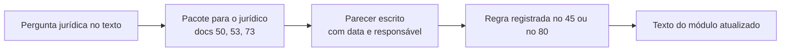

[Índice](README.md) · [Parte anterior](parte-17-operacao-qualidade-testes-e-ti.md) · [Próxima parte](parte-19-pendencias-decisoes-e-rastreabilidade.md)

# Parte 18 — Jurídico e regulatório

## Visão geral da parte 18

As obrigações legais e as perguntas para o jurídico estão agrupadas por tema. Nenhuma regra jurídica é inventada: o que depende de parecer fica marcado como pendência ([25](#doc-25), [26](#doc-26), [50](#doc-50), [73](#doc-73)).

**Regras principais**
- Matriz de retenção, relação de consumo, cobrança, negativação e bloqueio de serviço ([26](#doc-26)).
- Inadimplente mantém acesso à rematrícula, à documentação e à comunicação com a família ([26](#doc-26), seção 3).

## 25 — Dossiê Jurídico e Análise das Lacunas

> Parte do [SDD v2](parte-01-visao-e-escopo.md#doc-00). Lacunas G-01 a G-20 em [24](parte-17-operacao-qualidade-testes-e-ti.md#doc-24), seção 9.
> **Aviso:** este documento não é parecer jurídico. Ele organiza as perguntas que precisam de parecer, apresenta a posição atual do SDD, lista as normas a verificar e aponta os riscos de cada resposta. Quem responde juridicamente é advogado habilitado. Os números de artigo e de resolução citados devem ser conferidos no texto vigente antes de qualquer uso.

---

### 1. Como usar este dossiê

1. Enviar ao jurídico as perguntas da seção 3, na ordem de prioridade.
2. Para cada pergunta, o jurídico responde com uma das saídas: confirma a posição atual, aponta outra posição ou pede informação adicional.
3. A resposta vira decisão registrada no SDD, com data e nome do responsável técnico do parecer.

---

### 2. Análise das lacunas

| Lacuna | Situação atual | Diagnóstico | Ação |
|---|---|---|---|
| G-01 | Resolvida | D-22 a D-24 aprovadas em 02/11/2026 | Nenhuma |
| G-02 | Aberta | A retenção de 24 h da auditoria de consultas por CPF conflita com o relatório ao titular e pode conflitar com regra de guarda de registros de acesso (seção 3, Q-01) | **Prioridade máxima** |
| G-03 | Aberta | A matriz de base legal tem linhas com base proposta e sem análise de necessidade. Algumas bases dependem de teste formal (legítimo interesse) | Q-03 a Q-06 |
| G-04 | Resolvida | Limite de MFA: a entidade reduz livremente; aumenta até R$ 5.000, com aprovação da plataforma; acima disso não é permitido. Decidido pelo autor em 03/11/2026 | Nenhuma |
| G-05 | Aberta | RIPD da busca por CPF e do cadastro civil. Obrigatório quando o tratamento é de alto risco ou quando a ANPD pedir | Elaborar com o DPO (seção 4) |
| G-06 | Aberta | DDL de módulos ausentes. Não é jurídica | Owners dos módulos |
| G-07 | Aberta | Regras campo a campo. Não é jurídica | Owners dos módulos |
| G-08 | Aberta | Duplicidade de estoque. Não é jurídica | Produto |
| G-09 | Aberta | Fronteira RH/Pessoas. Não é jurídica | Produto |
| G-10 | Aberta | Módulo de atendimento. Não é jurídica | Produto |
| G-11 | Aberta | Motor de OCR e ADR. Não é jurídica | Responsável técnico |
| G-12 | Aberta | Prazo de retenção de backups. Tem reflexo jurídico | Q-10 |
| G-13 | Aberta | Guarda para retenção legal na saída de cliente. Depende de norma setorial | Q-09 |
| G-14 | Aberta | Termos, contrato, política de privacidade e de cookies. Precisam de revisão jurídica | Q-11 |
| G-15 | Aberta | SLA contratual. Depende de decisão comercial | Autor |
| G-16 | Aberta | Matriz de isolamento automatizada. Não é jurídica | Segurança |
| G-17 | Aberta | Plano de continuidade para o cliente. Não é jurídica | Operação |
| G-18 | Aberta | Declaração de acessibilidade. Verificar exigência legal aplicável | Q-12 |
| G-19 | Aberta | Jurisdições fora do Brasil. Só relevante se houver cliente fora | Q-13 |
| G-20 | Aberta | Revisão de regras pendentes. Não é jurídica | Owners |

Dos 20 itens, cinco dependem de parecer. Os outros são decisões técnicas, comerciais ou de produto.

---

### 3. Perguntas para o jurídico

Cada pergunta traz a posição atual, as normas a verificar e o risco da resposta errada.

#### Q-01 — Retenção dos registros de acesso e da auditoria de consultas por CPF (G-02)

**Posição atual:** 24 horas para a auditoria de consulta por CPF ([21](parte-16-dados-validacoes-configuracoes-e-armazenamento.md#doc-21), seção 6.8), decidida pelo autor.

**Pontos de atenção:**

- **Marco Civil da Internet, art. 15:** provedor de aplicação que exerce atividade organizada e com fins econômicos deve manter os registros de acesso a aplicações pelo prazo que a lei fixa, em regra seis meses. O jurídico deve confirmar se os registros de login e de acesso ao sistema da plataforma se enquadram.
- **LGPD, art. 37:** o controlador e o operador devem manter registro das operações de tratamento. A lei não fixa prazo, mas o registro precisa existir durante o período de necessidade.
- **LGPD, art. 18 e art. 19:** o titular pode pedir confirmação e acesso. O relatório de quem consultou o CPF dele só cobre o que existir no banco.

**Risco da resposta errada:** se o registro de acesso for guardado por menos do que a lei exige, há infração e perda da prova em incidente. Se for guardado por mais do que o necessário, há excesso de tratamento.

**Proposta de trabalho para o jurídico:** separar dois registros.

| Registro | Conteúdo | Prazo a confirmar |
|---|---|---|
| Registro de acesso (login, IP, sessão) | Quem acessou o sistema e quando | Provavelmente seis meses (Marco Civil, art. 15); confirmar |
| Auditoria de consulta por CPF | Quem consultou qual CPF, com finalidade e motivo | Definir com base na finalidade e no direito do titular |

A decisão de 24 horas, se mantida para a auditoria de consulta por CPF, não pode ser estendida ao registro de acesso sem parecer.

#### Q-02 — Relatório ao titular sobre consultas (G-02)

**Pergunta:** o relatório de quem consultou o CPF do titular precisa cobrir todo o período de tratamento, ou pode cobrir só o período de guarda?

**Risco:** se o período de guarda for menor que o período que o titular pode pedir, o direito fica sem efeito.

#### Q-03 — Base legal da matriz (G-03)

**Posição atual:** matriz em [07](parte-04-seguranca-privacidade-e-auditoria.md#doc-07), seção 3, com bases propostas por finalidade. Cada linha precisa de confirmação.

**Pontos a confirmar:**

- Matrícula e vínculo acadêmico (art. 7º, II e V).
- Cobrança de mensalidades (art. 7º, V e VI). Confirmar também o Código de Defesa do Consumidor.
- Folha e RH (art. 7º, II). Confirmar as normas trabalhistas e do eSocial.
- Segurança e medicina do trabalho (art. 11, II). Confirmar as NRs aplicáveis.
- Marketing (art. 7º, I, consentimento). Confirmar a forma de registro.
- Logs e segurança (art. 7º, IX, legítimo interesse). Exige teste de balanceamento (Q-04).

#### Q-04 — Legítimo interesse (G-03)

**Pergunta:** a base de segurança e logs pode ser legítimo interesse? A ANPD publicou guia sobre legítimo interesse, que deve ser consultado.

**O que é preciso:** registro do teste de finalidade, necessidade e balanceamento com os direitos do titular. Sem esse teste, a base não se sustenta.

#### Q-05 — Cobrança e canais de mensagem

**Posição atual:** a régua de cobrança ([18](parte-07-regras-gerais-dos-modulos-de-gestao.md#doc-18), seção 2.6) prevê negativação aos 30 dias e mensagens por SMS, WhatsApp e ligação.

**Pontos de atenção:**

- **Código de Defesa do Consumidor, art. 43, §2º:** a abertura de cadastro de inadimplente deve ser comunicada por escrito ao consumidor antes da inclusão. Confirmar o texto vigente e o prazo de comunicação.
- **Superendividamento:** Lei 14.181/2021 altera o CDC e trata de prevenção e de tratamento do superendividamento. Confirmar a aplicação à régua.
- **Bloqueio do portal aos 90 dias:** a régua prevê bloqueio do acesso ao portal. O jurídico deve avaliar se o bloqueio afeta serviço essencial, se atinge menor de idade e se atinge documentos obrigatórios. A proposta do SDD é bloqueio parcial ([18](parte-07-regras-gerais-dos-modulos-de-gestao.md#doc-18), seção 2.6).
- **Consentimento para mensagens:** confirmar a base para SMS, WhatsApp e Telegram em cobrança e em marketing.

#### Q-06 — Dados de crianças e adolescentes

**Posição atual:** tratamento de dados de menores com consentimento de responsável e minimização ([07](parte-04-seguranca-privacidade-e-auditoria.md#doc-07), seção 1).

**Norma:** LGPD, art. 14, que exige consentimento específico e em destaque de pelo menos um dos pais ou responsável legal.

**Pergunta:** qual a base para o tratamento de dados de aluno menor nas finalidades de matrícula, de cobrança e de comunicação com a família? Quais dados exigem consentimento e quais dispensam?

#### Q-07 — Pagamentos e arranjo de pagamento (D-10)

**Posição atual:** conta do tenant no gateway, sem custódia pela plataforma. Gateway da plataforma só com parecer.

**Norma a verificar:** Lei 12.865/2013, sobre arranjos e instituições de pagamento. Verificar também as resoluções do Banco Central aplicáveis.

**Pergunta:** a plataforma que recebe o pagamento e repassa ao tenant precisa de autorização do Banco Central? O modelo de split, em que o provedor divide o valor, muda a análise?

**Risco:** operar arranjo sem autorização. Esta é a pergunta de maior risco regulatório do projeto.

#### Q-08 — Retenção de documentos escolares e de RH

**Pergunta:** qual o prazo de guarda, por tipo de documento, para:

- Histórico escolar e registros de vida escolar. Normas de ensino aplicáveis.
- Documentos trabalhistas. CLT, prazo prescricional, e FGTS, Súmula 362 do TST (confirmar).
- Registros de SST, como ASO e PCMSO. NRs aplicáveis.

**Risco:** guardar menos do que a lei exige, ou guardar indefinidamente sem base.

#### Q-09 — Retenção legal na saída de cliente (G-13)

**Pergunta:** quais dados de uma entidade que sai da plataforma precisam ser mantidos por obrigação legal, e por quanto tempo? Quem é o responsável por essa guarda, a entidade ou a plataforma?

**Posição atual:** a plataforma guarda em banco de retenção, com acesso restrito ([23](parte-06-plataforma-saas-clientes-dominios-licencas-e-crm.md#doc-23), seção 5). O contrato precisa dizer quem é o responsável.

#### Q-10 — Backups e direito de eliminação (G-12)

**Pergunta:** quando um titular pede eliminação, qual o prazo aceitável para que o dado saia dos backups? Há exigência legal para o prazo de backup?

**Posição atual:** backups expiram conforme a política, com prazo a definir. Ver [24](parte-17-operacao-qualidade-testes-e-ti.md#doc-24), seção 1.

#### Q-11 — Documentos contratuais e de privacidade (G-14)

**Documentos a revisar:**

- Termos de uso da plataforma.
- Contrato de cliente, com SLA e saída.
- Contrato de tratamento de dados, entre plataforma e entidade, quando a plataforma age como operadora.
- Política de privacidade do site e dos canais.
- Política de cookies.
- Política de segurança para fornecedores.

**Pergunta:** a estrutura de responsabilidades (controlador e operador) está correta para o modelo de canais de [22](parte-06-plataforma-saas-clientes-dominios-licencas-e-crm.md#doc-22)?

#### Q-12 — Acessibilidade (G-18)

**Pergunta:** há exigência legal de acessibilidade para plataforma educacional e para serviços públicos contratados? Confirmar a norma aplicável e o nível exigido. A proposta é WCAG 2.2 AA.

#### Q-13 — Jurisdições fora do Brasil (G-19)

**Pergunta:** há cliente fora do Brasil? Se houver, quais normas de proteção de dados se aplicam? Sem cliente fora do Brasil, este item fica fechado.

---

### 4. Decisões que não são jurídicas

Estes itens dependem do autor ou do DPO, não do jurídico.

| Item | Pergunta | Recomendação |
|---|---|---|
| G-04 — piso do limite de MFA | Qual o valor máximo que um tenant pode configurar? | Sugestão: tenant reduz livremente; aumento até R$ 5.000,00, com aprovação da plataforma. Acima disso, não permitido. |
| G-05 — RIPD | Quem elabora e quando? | DPO elabora antes da produção, para busca por CPF e para cadastro civil. Revisão anual. |
| G-15 — SLA | Qual SLA entra no contrato? | Usar as metas de [24](parte-17-operacao-qualidade-testes-e-ti.md#doc-24), seção 2, como ponto de partida, ajustadas ao preço. |

---

### 5. Pontos de melhoria no SDD que dependem desta análise

| Documento | Melhoria | Motivo |
|---|---|---|
| [21](parte-16-dados-validacoes-configuracoes-e-armazenamento.md#doc-21), seção 6.8 | Separar registro de acesso e auditoria de consulta por CPF | Q-01 |
| [07](parte-04-seguranca-privacidade-e-auditoria.md#doc-07), seção 3 | Marcar legítimo interesse como exigindo teste formal | Q-04 |
| [18](parte-07-regras-gerais-dos-modulos-de-gestao.md#doc-18), seção 2.6 | Incluir comunicação prévia do CDC e a análise de superendividamento | Q-05 |
| [20](parte-10-financeiro-pagamentos-e-fiscal.md#doc-20), seção 2 | Vincular gateway da plataforma à resposta de Q-07 | Q-07 |
| [23](parte-06-plataforma-saas-clientes-dominios-licencas-e-crm.md#doc-23), seção 5 | Definir responsável pela guarda legal na saída | Q-09 |

---

### 6. Critérios de encerramento

- [ ] Q-01 a Q-08 respondidas por escrito pelo jurídico, com data e nome do responsável.
- [ ] Matriz de base legal atualizada com a resposta.
- [ ] Registro de acesso e auditoria de CPF com prazos definidos.
- [ ] Gateway da plataforma: decisão sobre arranjo registrada (D-10).
- [ ] RIPD aprovado pelo DPO para busca por CPF e para cadastro civil.
- [ ] Contratos da seção 8 de [24](parte-17-operacao-qualidade-testes-e-ti.md#doc-24) revisados.

## 26 — SDD Jurídico-Regulatório

> Parte do [SDD v2](parte-01-visao-e-escopo.md#doc-00). Complementa [07](parte-04-seguranca-privacidade-e-auditoria.md#doc-07) (privacidade), [18](parte-07-regras-gerais-dos-modulos-de-gestao.md#doc-18) (cobrança), [20](parte-10-financeiro-pagamentos-e-fiscal.md#doc-20) (pagamentos), [21](parte-16-dados-validacoes-configuracoes-e-armazenamento.md#doc-21) (busca por CPF) e [25](#doc-25) (perguntas ao jurídico).

> ## Aviso importante
> Este documento foi elaborado como especificação de requisitos regulatórios para o sistema. **Não é parecer jurídico e não substitui advogado habilitado.** Ele organiza as obrigações que o sistema precisa atender, indica onde cada obrigação é tratada no SDD e marca o grau de confiança de cada referência.
>
> **Legenda de confiança:**
> - **[A]** referência consolidada, que o sistema pode implementar. O jurídico confirma a redação vigente.
> - **[V]** referência a verificar antes do uso. Sei da existência da norma, mas o prazo, o alcance ou a redação precisam de conferência.
> - **[P]** ponto que depende de parecer, sem resposta definitiva neste documento.

---

### 1. Mapa de obrigações

| Área | Norma principal | Confiança | Controle no SDD | Documento |
|---|---|---|---|---|
| Proteção de dados pessoais | LGPD (Lei 13.709/2018) | [A] | Bases legais, direitos, incidentes, RIPD | [07](parte-04-seguranca-privacidade-e-auditoria.md#doc-07), [21](parte-16-dados-validacoes-configuracoes-e-armazenamento.md#doc-21), [25](#doc-25) |
| Dados de crianças e adolescentes | LGPD, art. 14; ECA | [A] para art. 14; [V] demais | Consentimento de responsável, minimização | [07](parte-04-seguranca-privacidade-e-auditoria.md#doc-07), seção 1 |
| Registro de acesso a aplicações | Marco Civil da Internet (Lei 12.965/2014), art. 15 | [A] para existência; [V] para o prazo | Registro de acesso separado | [21](parte-16-dados-validacoes-configuracoes-e-armazenamento.md#doc-21), seção 6.8 |
| Relação de consumo (mensalidade, serviços) | CDC (Lei 8.078/1990) | [A] | Contrato, cobrança, multa, arrependimento | Este documento, seções 4 e 5 |
| Superendividamento | Lei 14.181/2021 | [A] para existência; [V] para aplicação à régua | Régua com análise de renegociação | [18](parte-07-regras-gerais-dos-modulos-de-gestao.md#doc-18), seção 2.6 |
| Anuidades e mensalidades escolares | Lei 9.870/1999 | [V] | Limites de reajuste, multa e juros | Este documento, seção 4 |
| Educação (matrícula, documentos) | LDB (Lei 9.394/1996) e normas do sistema de ensino | [V] | Guarda de registros escolares | Este documento, seção 6 |
| Trabalho e saúde ocupacional | CLT; NRs (NR-1, NR-7 e outras); eSocial | [V] | PCMSO, ASO, CAT, EPI | [17](parte-07-regras-gerais-dos-modulos-de-gestao.md#doc-17), seção 5 |
| Fiscal | LC 116/2003 (ISS); normas municipais; CTN | [A] para ISS; [V] para prazos | NFSe, retenção fiscal | [18](parte-07-regras-gerais-dos-modulos-de-gestao.md#doc-18), seção 2.7 |
| Pagamentos | Lei 12.865/2013; normas do Banco Central | [A] para a lei; [V] para as resoluções | Modelo de recebimento | [20](parte-10-financeiro-pagamentos-e-fiscal.md#doc-20), seção 2 |
| Assinatura e contratos eletrônicos | MP 2.200-2/2001; Lei 14.063/2020 | [A] | Assinatura por nível | Este documento, seção 7 |
| Incidentes de segurança | LGPD, art. 48; Resolução CD/ANPD 15/2024 | [A] para o art. 48; [V] para o prazo | Runbook e comunicação | [07](parte-04-seguranca-privacidade-e-auditoria.md#doc-07), seção 8 |
| Acessibilidade | Lei 13.146/2015 (Estatuto da Pessoa com Deficiência) | [A] para existência; [V] para o alcance em sites privados | WCAG 2.2 AA | [08](parte-05-portais-navegacao-e-interface.md#doc-08), [24](parte-17-operacao-qualidade-testes-e-ti.md#doc-24), seção 7 |
| Comunicação por canais | LGPD; regras de uso das plataformas de mensagem | [A] para LGPD; [V] para regras de plataforma | Consentimento por canal | [22](parte-06-plataforma-saas-clientes-dominios-licencas-e-crm.md#doc-22), seção 3 |

---

### 2. Princípios que o sistema adota

1. **Finalidade e necessidade** (LGPD, art. 6º): cada dado tem finalidade declarada. Dado sem finalidade não é coletado.
2. **Registro de tratamento** (LGPD, art. 37): toda operação relevante fica registrada.
3. **Prova de consentimento:** quando o consentimento é a base, o sistema guarda quem consentiu, quando, em que texto (versão), por qual canal e com qual evidência ([22](parte-06-plataforma-saas-clientes-dominios-licencas-e-crm.md#doc-22), `crm_consents`).
4. **Responsabilidade clara:** a entidade é controladora dos dados de seus alunos e colaboradores. A plataforma é operadora quando trata esses dados em nome da entidade. Contrato de tratamento regula essa relação.

---

### 3. Matriz de retenção

Esta matriz define os prazos que o sistema aplica. Cada prazo tem base e grau de confiança. **Nenhum prazo [V] entra em produção sem confirmação.**

| Dado ou registro | Prazo proposto | Base | Confiança | Ação ao fim do prazo |
|---|---|---|---|---|
| Registro de acesso a aplicação (login, IP, sessão) | 6 meses | Marco Civil, art. 15 | [V] | Expurgo |
| Auditoria de consulta por CPF | **24 h (decisão do autor), conflito a resolver** | LGPD, art. 37; [P] | [P] | Expurgo com registro. Ver [25](#doc-25), Q-01. |
| Registro de tratamento de dados (LGPD, art. 37) | Durante o tratamento e o prazo de prescrição aplicável | LGPD, art. 37 | [V] | Expurgo |
| Prova de consentimento | Enquanto houver tratamento que o consentimento fundamenta, mais o prazo de prescrição | LGPD, art. 8º, §2º | [V] | Expurgo |
| Contrato e cobrança de consumo | 5 anos após o fim do contrato | Prescrição de pretensão de consumo, CDC, art. 27 | [V] | Expurgo ou arquivo |
| Documentos fiscais e de nota | 5 anos | CTN, art. 195 | [V] | Expurgo |
| Documentos trabalhistas | Durante o contrato e 2 anos após o fim (prescrição); FGTS, 30 anos | CF, art. 7º, XXIX; Súmula 362 do TST | [A] para prescrição; [V] para o FGTS | Expurgo ou arquivo |
| ASO, prontuário de saúde ocupacional | 20 anos após o desligamento | NR-7 | [V] | Arquivo com acesso restrito |
| Histórico e registro de vida escolar | Permanente, conforme norma do sistema de ensino | LDB e normas estaduais ou municipais | [V] | Arquivo com acesso restrito |
| Dados de matrícula sem vínculo ativo | Conforme a norma de ensino; depois, expurgo ou anonimização | LGPD, art. 16 | [V] | Anonimização |
| Lead sem consentimento de contato | Até a revogação ou 1 ano sem interação | LGPD, art. 16 | [P] | Expurgo |
| Backup | Conforme [24](parte-17-operacao-qualidade-testes-e-ti.md#doc-24), seção 1 | Proporcionalidade | [P] | Expurgo com prazo de expiração |

Regras gerais:

- Expurgo e arquivamento são registrados, sem guardar o dado expurgado.
- Dado sob bloqueio legal não é expurgado, mesmo vencido o prazo.
- Dado retido por obrigação legal fica com acesso restrito e finalidade única.

---

### 4. Relação de consumo e cobrança

#### 4.1 Contrato e cláusulas

- Contrato de adesão deve ter redação clara e destaque para cláusulas que limitem direitos (CDC, art. 54, §4º) [A].
- Cláusula de rescisão, multa e reajuste devem estar no contrato e na área do cliente, com histórico [A].
- Prática abusiva é vedada (CDC, art. 39) [A]. Exemplo: exigir vantagem sem causa ou condicionar serviço a aceite de cobrança indevida.

#### 4.2 Direito de arrependimento em venda online

Quando a matrícula ou a assinatura é contratada fora do estabelecimento, o consumidor tem sete dias para desistir, sem custo (CDC, art. 49) [A]. O sistema:

- Mostra o prazo no fluxo de contratação.
- Registra a data da contratação e a data da desistência.
- Gera estorno integral dentro do prazo do meio de pagamento ([20](parte-10-financeiro-pagamentos-e-fiscal.md#doc-20), seção 11).

#### 4.3 Multa, juros e reajuste de mensalidade

- Multa moratória em relação de consumo tem limite de 2% (CDC, art. 52, §1º) [A].
- Anuidades e mensalidades escolares têm regras próprias de reajuste e de cobrança de encargos (Lei 9.870/1999) [V]. O sistema aplica os limites da norma como padrão, e o tenant não pode ultrapassá-los.
- Juros de mora e correção seguem a regra do contrato, dentro dos limites legais [V].

#### 4.4 Negativação e comunicação prévia

- A abertura de cadastro de inadimplente exige comunicação por escrito ao consumidor antes da inclusão (CDC, art. 43, §2º) [A].
- O sistema envia a comunicação e registra a data e o canal. A inclusão só ocorre depois do prazo de comunicação, que o jurídico confirma [V].
- Consulta a cadastro de inadimplentes sem finalidade legítima é vedada. Ver [21](parte-16-dados-validacoes-configuracoes-e-armazenamento.md#doc-21), seção 6.8, para a regra de finalidade.

#### 4.5 Superendividamento e renegociação

- Antes de bloqueios e negativação, o sistema oferece renegociação com plano de pagamento (Lei 14.181/2021) [A para a existência; V para a aplicação à régua].
- Renegociação registra as condições, o consentimento do consumidor e o histórico.

#### 4.6 Bloqueio de serviço

- Bloqueio total do portal por inadimplência é vedado para serviço educacional essencial e para menor de idade. O sistema aplica bloqueio parcial: documentos obrigatórios, matrícula de rematrícula e comunicação com a família continuam acessíveis [P].
- Documentos escolares não são retidos como forma de cobrança sem previsão legal [V].

---

### 5. Consentimento e comunicação por canal

| Canal | Base para contato comercial | Base para cobrança | Prova exigida | Observação |
|---|---|---|---|---|
| E-mail | Consentimento [A] | Execução de contrato [V] | Registro do aceite e da versão | Link de descadastro obrigatório em marketing |
| SMS | Consentimento [A] | Execução de contrato [V] | Registro do aceite | Número verificado |
| WhatsApp | Consentimento e regras da plataforma [V] | Execução de contrato [V] | Registro do opt-in | Não enviar mensagem proativa sem opt-in ([22](parte-06-plataforma-saas-clientes-dominios-licencas-e-crm.md#doc-22), seção 3) |
| Telegram | Consentimento e regras da plataforma [V] | Execução de contrato [V] | Registro do opt-in | Mesmo tratamento do WhatsApp |
| Instagram e Messenger | Consentimento e regras da plataforma [V] | Não usado para cobrança | Registro do opt-in | Só conversa iniciada pelo usuário |
| Telefone | Consentimento [A] | Execução de contrato [V] | Aviso de gravação e registro | Gravação só com aviso |

Regras:

- Revogação é tão fácil quanto a concessão. Efeito imediato.
- Menor de idade: consentimento do responsável, específico e em destaque (LGPD, art. 14) [A].
- Mensagem de cobrança segue o horário permitido pelo tenant e o limite de frequência ([18](parte-07-regras-gerais-dos-modulos-de-gestao.md#doc-18), seção 2.6).

---

### 6. Educação e documentos escolares

- Matrícula de menor exige a documentação do responsável, com validação do vínculo ([17](parte-07-regras-gerais-dos-modulos-de-gestao.md#doc-17), seção 4) [V para exigências específicas].
- Registros escolares são guardados pelo prazo da norma do sistema de ensino da entidade. Cada entidade informa a norma aplicável e o sistema grava a referência [V].
- Entidade que atende sistemas de ensino diferentes (federal, estadual, municipal) configura a norma por unidade, porque a unidade é a unidade de ensino.
- Documento escolar não é retido como garantia de pagamento [V].

---

### 7. Assinatura e contratos eletrônicos

- Assinatura eletrônica tem três níveis, pela Lei 14.063/2020 [A]:
  - **Simples:** para atos sem exigência de identificação forte. Usada para termos internos e aceites de baixo risco.
  - **Avançada:** identifica o signatário com vínculo, com registro de dados do ato. Usada para contratos de adesão e para matrícula.
  - **Qualificada:** usa certificado ICP-Brasil (MP 2.200-2/2001). Usada para documentos que exigem essa forma, e para os que o contrato exigir [A].
- Cada assinatura guarda o documento, o hash, o momento, o identificador do signatário e a trilha de autenticação.
- Documento assinado não é alterado. Mudança gera aditivo ([17](parte-07-regras-gerais-dos-modulos-de-gestao.md#doc-17), seção 7).

---

### 8. Incidentes de segurança

- Comunicação à ANPD e ao titular quando houver risco ou dano relevante (LGPD, art. 48) [A].
- Prazo de comunicação à ANPD: a Resolução CD/ANPD 15/2024 fixa o prazo em três dias úteis [V]. O runbook usa esse prazo como referência até confirmação.
- A comunicação segue o formulário da ANPD e registra as medidas adotadas.
- Incidente que envolve dado de pagamento aciona também o provedor e a equipe de conformidade ([20](parte-10-financeiro-pagamentos-e-fiscal.md#doc-20), seção 17).

---

### 9. Acessibilidade

- Estatuto da Pessoa com Deficiência (Lei 13.146/2015) estabelece a acessibilidade digital como obrigação em sites e serviços [A para existência; V para o alcance nas relações privadas].
- O sistema adota WCAG 2.2 nível AA ([24](parte-17-operacao-qualidade-testes-e-ti.md#doc-24), seção 7), o que cobre a referência técnica usual.
- Entidade que contrata a plataforma pode exigir nível superior, sem que o sistema reduza o mínimo.

---

### 10. Pagamentos e arranjo

- Operar arranjo de pagamento, em que a plataforma recebe e repassa valores, depende de autorização conforme a Lei 12.865/2013 e as normas do Banco Central [A para a lei; V para o enquadramento].
- O modelo padrão do SDD não recebe valores por conta própria: o tenant tem conta no gateway ([20](parte-10-financeiro-pagamentos-e-fiscal.md#doc-20), seção 2). Essa escolha é a principal proteção regulatória do projeto.
- Qualquer mudança para recebimento pela plataforma exige parecer prévio ([25](#doc-25), Q-07).
- O SDD não trata de tributação de pagamento além da NFSe. Qualquer retenção de tributo na fonte deve ser validada por contador [V].

---

### 11. Fiscal

- Nota fiscal de serviço segue o ISS do município (LC 116/2003) [A]. Cada município tem integração própria ([16](parte-14-integracoes-e-importacao.md#doc-16), seção 3).
- Guarda de documentos fiscais: 5 anos (CTN, art. 195) [V].
- Cancelamento de nota segue as regras do município e registra o motivo.

---

### 12. Trabalho e saúde ocupacional

- Programas de SST: PCMSO (NR-7) e gerenciamento de riscos (NR-1) [V para o alcance e as datas de vigência].
- Registros de eSocial de saúde e segurança (S-2220, S-2230, S-2240) seguem o leiaute vigente [V].
- Dado de saúde ocupacional é sensível (LGPD, art. 11). Acesso restrito a profissional responsável ([17](parte-07-regras-gerais-dos-modulos-de-gestao.md#doc-17), seção 5).
- Colaborador tem acesso ao próprio ASO e aos seus registros de SST.

---

### 13. Contratos da plataforma

| Contrato | Conteúdo mínimo | Confiança |
|---|---|---|
| Termos de uso | Responsabilidades, uso aceitável, suspensão, foro | [A] |
| Contrato de cliente (entidade) | Escopo, SLA, preço, saída, responsabilidades | [A] |
| Contrato de tratamento (operador) | Finalidade, instruções, subcontratados, incidentes, eliminação | [A] |
| Política de privacidade | Dados por canal, finalidades, bases, direitos | [A] |
| Política de cookies | Lista de cookies, finalidade, consentimento | [A] |
| Licença de componentes | Termos de uso do ícone e de bibliotecas, incluindo Font Awesome Pro | [A] para existência; [V] para o alcance da hospedagem |

---

### 14. Perguntas em aberto para o jurídico

Estas perguntas completam as de [25](#doc-25). Quando a resposta vier, este documento é atualizado.

| # | Pergunta | Referência no SDD |
|---|---|---|
| J-01 | Confirmar o prazo de 6 meses dos registros de acesso e a aplicação ao sistema | Seção 3 |
| J-02 | Confirmar o prazo de comunicação prévia de negativação e a forma | Seção 4.4 |
| J-03 | Confirmar limites de reajuste e de encargos em anuidades (Lei 9.870/1999) | Seção 4.3 |
| J-04 | Confirmar a norma de guarda do histórico escolar por tipo de entidade | Seção 6 |
| J-05 | Confirmar o alcance da acessibilidade digital em relação privada | Seção 9 |
| J-06 | Confirmar a necessidade de autorização para arranjo de pagamento no modelo com split | Seção 10 |
| J-07 | Confirmar o prazo de comunicação à ANPD vigente | Seção 8 |
| J-08 | Confirmar o alcance da licença de componentes de interface em aplicação hospedada | Seção 13 |

---

### 15. Critérios de aceite

- [ ] Cada linha da seção 1 tem controle implementado e referência no SDD.
- [ ] Nenhum prazo [V] ou [P] da seção 3 é usado em produção sem confirmação.
- [ ] Contratos da seção 13 revisados pelo jurídico.
- [ ] Respostas J-01 a J-08 registradas com data e responsável.

## 50 — Pacote para Parecer Jurídico e Conferência de Norma

> Parte do [SDD v2](parte-01-visao-e-escopo.md#doc-00). Lista de trabalho em [45](parte-19-pendencias-decisoes-e-rastreabilidade.md#doc-45). Base legal geral em [26](#doc-26) e [25](#doc-25). Política de privacidade em [07](parte-04-seguranca-privacidade-e-auditoria.md#doc-07).
> **Natureza deste documento:** pacote de consulta. Não é parecer, não é opinião jurídica e não substitui a análise de advogado habilitado. As "posições propostas" são o que o SDD adota hoje para que o sistema seja desenhado. O jurídico confirma, corrige ou recusa cada uma.
> **Citações legais:** as referências a leis, decretos, resoluções e normas regulamentadoras estão indicadas como **a confirmar**. Não foram verificadas contra o texto vigente na elaboração deste pacote.
> **Status:** versão 2, redigida em 03/11/2026. São 61 perguntas em 9 blocos.

---

### 1. Como responder

Cada pergunta tem um campo de resposta, na seção 11. O responsável marca uma das três opções:

- **Confirma:** a posição proposta pode ser adotada como está.
- **Corrige:** informar a posição correta e a referência legal que a sustenta.
- **Recusa:** a regra não pode ser adotada. Informar o motivo.

Resposta escrita, com data e nome do responsável, é o que fecha o item. A resposta vai para o documento de origem, e a linha sai da [45](parte-19-pendencias-decisoes-e-rastreabilidade.md#doc-45).

---

### 2. Contexto para quem responde

**O que é a plataforma.** Sistema de gestão para instituições de ensino e outros serviços educacionais, com multi-tenancy: a empresa desenvolvedora opera a plataforma, e cada entidade cliente tem seu banco e suas unidades ([03](parte-02-arquitetura-e-tenancy.md#doc-03)).

**Quem são os titulares.** Alunos (muitos menores de idade), responsáveis legais, professores, funcionários, candidatos, residentes, prestadores de serviço, visitantes e doadores.

**Dados de risco no sistema.** Dados de saúde (ASO, atestados, CID), convicção religiosa (pastoral), dados de menor, imagem (câmeras e aulas gravadas), biometria opcional, localização de transporte escolar e dados de cobrança.

**Papéis.** A entidade é, em regra, a controladora dos dados dos seus alunos e funcionários. A empresa desenvolvedora atua como operadora, salvo onde o contrato diga outra coisa. Essa separação precisa de confirmação **(a confirmar)**, e alguns itens dependem dela.

---

### 3. Bloco A: dados de menores de idade e consentimento

| Código | Pergunta | Contexto no sistema | Posição proposta | Alternativa | Onde |
|---|---|---|---|---|---|
| J-01 | Consentimento do responsável para gravar aula com menor: forma, validade e revogação | Aula online pode ser gravada, com aviso visível | Consentimento específico e por escrito, pedido por cláusula do contrato com a instituição. Revogável | Consentimento por ato, a cada aula | [40](parte-08-academico.md#doc-40), seção 5 |
| J-02 | Menor de 13 anos: método de consentimento parental | Cadastro de aluno de educação infantil e fundamental | Consentimento do responsável, com verificação do vínculo, para qualquer tratamento que não seja essencial ao serviço (LGPD, art. 14 **a confirmar**) | Consentimento para todo tratamento | [32](parte-04-seguranca-privacidade-e-auditoria.md#doc-32) |
| J-03 | Tutoria de aluno menor com dado sensível: base legal | Registro de tutoria pode mencionar dificuldade pessoal | Consentimento do responsável para o registro com dado sensível. Sem consentimento, só dado de acompanhamento acadêmico | Vedar o registro sensível para menor | [42](parte-08-academico.md#doc-42), seção 5 |
| J-04 | Evento e escala pastoral com menor: autorização e imagem | Encontro de jovens, coroinha, festa escolar | Autorização do responsável, com validade. Imagem de menor só com autorização específica | Autorização geral na matrícula | [43](parte-08-academico.md#doc-43), seção 6 |
| J-05 | Documentos obrigatórios por nível de ensino, e se algum pode bloquear a matrícula | Wizard de matrícula exige identidade, histórico anterior e outros | Identidade e histórico anterior condicionam a matrícula. Bloqueio só para o que a norma do sistema de ensino exige | Bloquear todo documento pendente | [46](parte-09-secretaria-matricula-e-documentos.md#doc-46), M-08 |

---

### 4. Bloco B: dados sensíveis, biometria e imagem

| Código | Pergunta | Contexto no sistema | Posição proposta | Alternativa | Onde |
|---|---|---|---|---|---|
| J-06 | Biometria e reconhecimento facial de aluno: escopo, base legal e exigências para menor | Catraca com biometria opcional | Opcional, com alternativa sem biometria. Template cifrado, guardado na unidade. RIPD antes de ativar | Não usar biometria | [35](parte-03-identidade-acesso-e-permissoes.md#doc-35), seção 5 |
| J-07 | Retenção de imagem de câmera | Câmeras de áreas comuns e de acesso | 30 dias, com expurgo automático. Aviso visível no local | Prazo maior, para investigação | [35](parte-03-identidade-acesso-e-permissoes.md#doc-35), seção 6 |
| J-08 | Dado sensível em formulário: base legal | Pesquisa que pode perguntar saúde ou religião | Consentimento específico, declarado antes da publicação | Vedar dado sensível em formulário | [41](parte-08-academico.md#doc-41), seção 4 |
| J-09 | Intenção de missa e cadastro de beneficiário: prazos de guarda | Pedido de oração e cadastro de família atendida | Intenção excluída após a celebração e prazo curto fixo. Beneficiário revisado periodicamente, sem expurgo automático até definição | Prazo único para os dois | [43](parte-08-academico.md#doc-43), seções 3.3 e 4 |
| J-10 | Campanhas que coletam renda: base legal | Campanha de ação social pode pedir renda | Só quando a campanha precisar, com base escrita por campanha | Não coletar renda | [43](parte-08-academico.md#doc-43), seção 4 |

---

### 5. Bloco C: cobrança, crédito e meios de pagamento

| Código | Pergunta | Contexto no sistema | Posição proposta | Alternativa | Onde |
|---|---|---|---|---|---|
| J-11 | Consulta por CPF: retenção da auditoria de 24 horas conflita com o relatório ao titular e com a guarda de acesso | Consulta de CPF é registrada para investigação | Prioridade máxima. Separar o registro de acesso (prazo legal) da auditoria de consulta. Parecer sobre o prazo da auditoria | Manter 24 horas e aceitar a limitação do relatório | [25](#doc-25), Q-01 |
| J-12 | Registro de acesso a aplicação: prazo de seis meses | Login, IP e sessão | Confirma seis meses, se a lei aplicável for o Marco Civil da Internet, art. 15 **a confirmar** | Outro prazo, se a norma for outra | [25](#doc-25) |
| J-13 | Negativação e comunicação prévia ao consumidor (CDC, art. 43, §2º **a confirmar**) | Régua de cobrança pode negativar | Comunicação por escrito antes da inclusão | Sem negativação automática | [25](#doc-25) |
| J-14 | Superendividamento na régua de cobrança (Lei 14.181/2021 **a confirmar**) | Renegociação de mensalidades | Aplicar à régua, com proposta de renegociação antes de cobrança judicial | Régua sem tratamento específico | [25](#doc-25) |
| J-15 | Mensagens por SMS, WhatsApp e Telegram em cobrança e marketing: base | Canais de comunicação de cobrança | Cobrança por execução de contrato. Marketing só com consentimento | Consentimento também para cobrança | [18](parte-07-regras-gerais-dos-modulos-de-gestao.md#doc-18), seção 2.6 |
| J-16 | Open Finance e débito automático: base e autorização | Débito automático e leitura de extrato | Autorização específica, por escrito, revogável | Autorização junto ao contrato | [34](parte-10-financeiro-pagamentos-e-fiscal.md#doc-34), PAG-07 |
| J-17 | Bloqueio parcial por inadimplência: quais serviços continuam para menor | Bloqueio de portal por atraso | Documentos obrigatórios, rematrícula e comunicação com a família continuam | Bloqueio total após prazo | [26](#doc-26), seção 3 |
| J-18 | Chargeback: prazo de resposta | Contestação de cobrança no cartão | Resposta no prazo definido pela bandeira **a confirmar** | Prazo interno | [20](parte-10-financeiro-pagamentos-e-fiscal.md#doc-20) |

---

### 6. Bloco D: contratos e assinatura

| Código | Pergunta | Contexto no sistema | Posição proposta | Alternativa | Onde |
|---|---|---|---|---|---|
| J-19 | Forma de assinatura por tipo de contrato | Contrato de matrícula, de prestação e de fornecedor | Assinatura digital com certificado ICP-Brasil para contrato de matrícula e de prestação. Assinatura simples para os demais, com validade conforme parecer | ICP-Brasil para todos | [33](parte-12-suprimentos-patrimonio-frotas-contratos-e-terceiros.md#doc-33), CTR-04 |
| J-20 | Assinatura digital própria: exigências para ser aceita | Decisão CTR-06: aceitar provedores de terceiros e ter assinatura própria | Credenciamento como autoridade certificadora, se a plataforma emitir certificado. Caso contrário, usar provedor credenciado | Só provedor de terceiros | [33](parte-12-suprimentos-patrimonio-frotas-contratos-e-terceiros.md#doc-33), CTR-06 |
| J-21 | Cláusulas obrigatórias por tipo de contrato | Modelos de contrato do sistema | Lista por tipo, a ser entregue pelo jurídico | Modelo padrão único | [33](parte-12-suprimentos-patrimonio-frotas-contratos-e-terceiros.md#doc-33), CTR-05 |
| J-22 | Contrato de matrícula: forma, cláusulas e prazo de guarda | Gerado no wizard de matrícula | Forma escrita e assinada. Guarda pelo prazo do sistema de ensino | Guarda por prazo fixo | [33](parte-12-suprimentos-patrimonio-frotas-contratos-e-terceiros.md#doc-33), CTR-07 |
| J-23 | Contrato de experiência de trabalho: texto da v1 é contraditório | Admissão no módulo de RH | Regra da CLT **a confirmar**. Não usar o texto da v1 | Sem contrato de experiência no sistema | [17](parte-07-regras-gerais-dos-modulos-de-gestao.md#doc-17), seção 3 |

---

### 7. Bloco E: trabalhista, previdenciário e saúde

| Código | Pergunta | Contexto no sistema | Posição proposta | Alternativa | Onde |
|---|---|---|---|---|---|
| N-01 | Férias: período aquisitivo, fracionamento e cálculo de direito (CLT, art. 130 **a confirmar**) | Módulo de férias | Regra da CLT, com fracionamento conforme a lei | Regra interna mais simples | [39](parte-11-pessoas-departamento-pessoal-e-sst.md#doc-39), seção 3 |
| N-02 | Rescisão: aviso prévio, férias proporcionais, 13.º e multa do FGTS | Cálculo de desligamento | Cálculo conforme a CLT, com tabela por competência | Cálculo manual pela contabilidade | [39](parte-11-pessoas-departamento-pessoal-e-sst.md#doc-39), seção 4 |
| N-03 | Eventos eSocial de admissão, remuneração, pagamento e desligamento (S-2200, S-1200, S-1210, S-2299 **a confirmar** com o layout vigente) | Transmissão ao eSocial | Os quatro eventos, com layout vigente | Só os eventos de SST | [39](parte-11-pessoas-departamento-pessoal-e-sst.md#doc-39), seção 8 |
| N-04 | Tabelas de INSS, IRRF e FGTS por competência | Cálculo de folha | Tabela oficial da competência, versionada | Tabela fixa do ano | [39](parte-11-pessoas-departamento-pessoal-e-sst.md#doc-39), DP-02 |
| N-05 | Controle de jornada e registro de ponto | Ponto eletrônico | Conforme a CLT e a portaria aplicável **a confirmar** | Espelho de ponto simples | [39](parte-11-pessoas-departamento-pessoal-e-sst.md#doc-39), seção 3 |
| N-06 | Prontuário de medicina do trabalho e ASO: prazo de guarda | Guarda de ASO e prontuário | Prazo previsto nas normas de saúde ocupacional e no regulamento do conselho **a confirmar** | Prazo único de 20 anos | [39](parte-11-pessoas-departamento-pessoal-e-sst.md#doc-39), HCM-08 |
| N-07 | CAT ao INSS: canal e prazo | Registro de acidente de trabalho | Canal e prazo vigentes **a confirmar** | Envio manual | [39](parte-11-pessoas-departamento-pessoal-e-sst.md#doc-39), seção 5 |
| N-08 | NRs aplicáveis, validade de treinamento e CIPA | PCMSO, PGR, CIPA e treinamentos | NR-1 (gestão de riscos), NR-5 (CIPA), NR-7 (PCMSO), NR-17 (ergonomia) e NRs específicas, **a confirmar** | Lista reduzida | [52](parte-11-pessoas-departamento-pessoal-e-sst.md#doc-52) |
| N-09 | Quem emite CID e quem pode vê-lo | Atestado e afastamento | Médico emite e vê. Gestão e RH não recebem CID | Gestão vê o motivo resumido | [39](parte-11-pessoas-departamento-pessoal-e-sst.md#doc-39), seção 5.1 |

---

### 8. Bloco F: educação, documentos e estágio

| Código | Pergunta | Contexto no sistema | Posição proposta | Alternativa | Onde |
|---|---|---|---|---|---|
| N-10 | Prazo de guarda de documentos escolares: histórico, declaração e registro de classe | Acervo escolar | Prazo do sistema de ensino da entidade, com a referência gravada no sistema | Prazo único do sistema | [26](#doc-26), seção 3 |
| N-11 | Layout do histórico escolar | Emissão de histórico | Conforme a norma do sistema de ensino **a confirmar** | Layout próprio | [48](parte-09-secretaria-matricula-e-documentos.md#doc-48), DOC-03 |
| N-12 | Assinatura de documento oficial: exigência de ICP-Brasil por tipo | Emissão de documento com assinatura | Lista por tipo, entregue pelo jurídico | Assinatura simples para todos | [48](parte-09-secretaria-matricula-e-documentos.md#doc-48), DOC-01 |
| N-13 | Plano institucional e órgão colegiado aprovador, por tipo de entidade | Planejamento institucional | Aprovação pelo órgão colegiado, com ata registrada | Aprovação pela direção | [37](parte-08-academico.md#doc-37), PLN-01 |
| N-14 | Lei 4.320/1964 e as fases da despesa pública (empenho, liquidação e pagamento) | Módulo de empenho, só para entidade pública | Modalidades ordinária, estimativa e global, com as fases da lei **a confirmar** | Empenho sem fases | [37](parte-08-academico.md#doc-37), PLN-02 |
| N-15 | Tempo de guarda de currículo de candidato não contratado | Banco de candidatos | Prazo fixo, com aviso no envio | Guarda indefinida | [39](parte-11-pessoas-departamento-pessoal-e-sst.md#doc-39), HCM-09 |
| N-16 | Residência médica: regulamento e avaliação por programa | Preceptoria de residentes | Conforme o regulamento da Comissão Nacional de Residência Médica e do programa **a confirmar** | Regra única | [42](parte-08-academico.md#doc-42), PRE-04 |

---

### 9. Bloco G: prestadores de serviço

| Código | Pergunta | Contexto no sistema | Posição proposta | Alternativa | Onde |
|---|---|---|---|---|---|
| N-17 | Transporte escolar: base legal de trajeto e de restrição alimentar | Motorista e restrição alimentar do aluno | Trajeto só durante a viagem. Restrição alimentar sem diagnóstico | Restrição com diagnóstico | [38](parte-12-suprimentos-patrimonio-frotas-contratos-e-terceiros.md#doc-38), TER-03 |
| N-18 | Rastro de localização do ônibus: prazo de guarda | Localização durante a viagem | 30 dias depois da viagem, decidido pelo autor em 03/11/2026. Confirmar | Sem guarda | [38](parte-12-suprimentos-patrimonio-frotas-contratos-e-terceiros.md#doc-38), TER-02 |
| N-19 | Norma sanitária: registro de temperatura e validade na alimentação | Fornecedor de merenda | Registro por lote, conforme a norma da vigilância sanitária **a confirmar** | Sem registro | [38](parte-12-suprimentos-patrimonio-frotas-contratos-e-terceiros.md#doc-38), TER-04 |
| N-20 | Prontuário pela clínica de ASO: guarda | Clínica contratada para exames | Quem faz o exame guarda o prontuário | Empresa guarda | [38](parte-12-suprimentos-patrimonio-frotas-contratos-e-terceiros.md#doc-38), TER-05 |
| N-21 | Cartório digital: validade do selo por tipo de ato | Fornecedor de cartório | Validade conforme a lei do tipo de ato **a confirmar** | Validade única | [38](parte-12-suprimentos-patrimonio-frotas-contratos-e-terceiros.md#doc-38), TER-06 |
| N-22 | Documentos exigidos por tipo de prestador | Cadastro de fornecedor | Lista por tipo, entregue pelo jurídico | Lista única | [38](parte-12-suprimentos-patrimonio-frotas-contratos-e-terceiros.md#doc-38), TER-07 |
| N-23 | Nome do fornecedor visível a outros fornecedores | Lista de prestadores | Não visível, salvo cadastro público exigido por lei **a confirmar** | Visível a todos | [38](parte-12-suprimentos-patrimonio-frotas-contratos-e-terceiros.md#doc-38), seção 9 |

---

### 10. Bloco H: privacidade, incidente e governança

| Código | Pergunta | Contexto no sistema | Posição proposta | Alternativa | Onde |
|---|---|---|---|---|---|
| J-24 | Prazo de comunicação de incidente à ANPD (Resolução CD/ANPD 15/2024 **a confirmar**) | Plano de resposta a incidente | Três dias úteis, após confirmar a vigência | Outro prazo | [07](parte-04-seguranca-privacidade-e-auditoria.md#doc-07), seção 8 |
| J-25 | Bases legais por finalidade de tratamento escolar | Matriz de finalidades | Matriz de [07](parte-04-seguranca-privacidade-e-auditoria.md#doc-07), seção 3, revisada | Matriz nova | [07](parte-04-seguranca-privacidade-e-auditoria.md#doc-07) |
| J-26 | Transferência internacional de dado, se houver cliente fora do Brasil | Hospedagem e fornecedores | Só com cliente fora do Brasil. Sem cliente, não se aplica | Verificar caso a caso | [19](parte-07-regras-gerais-dos-modulos-de-gestao.md#doc-19), seção 4 |
| J-27 | Vínculo de responsabilidade legal: quem pode solicitar em nome de outra pessoa | Acesso de responsável a dados do aluno | Verificação por documento e vínculo cadastrado pela escola. Decidido pelo autor em 03/11/2026. Confirmar | Autodeclaração com código | [31](parte-05-portais-navegacao-e-interface.md#doc-31), SEG-01 |
| J-28 | Revisão humana de comentário livre em relatório anônimo | Formulário anônimo com comentário | Sempre revisado por pessoa, decidido pelo autor. Confirmar se a revisão basta | Mascaramento automático | [41](parte-08-academico.md#doc-41), FRM-02 |
| J-29 | Retenção de tickets de atendimento e de transcrição de chat | Atendimento e chat | Prazo fixo, definido pelo jurídico | Prazo por tipo | [32](parte-04-seguranca-privacidade-e-auditoria.md#doc-32), ATD-03 |
| J-30 | Prazo de guarda de cada tipo de documento emitido | Emissão de documentos | Prazo por tipo, conforme norma | Prazo único | [48](parte-09-secretaria-matricula-e-documentos.md#doc-48), DOC-02 |
| J-31 | Uso de nome de exame oficial em perfil de simulado | Perfis ENEM e outros | Permitido só com autorização do titular do nome | Uso livre como referência | [47](parte-08-academico.md#doc-47), SIM-02 |
| J-32 | Retenção de redação original e de transcrição de simulado | Redações digitalizadas | Prazo do sistema de ensino | Prazo fixo | [47](parte-08-academico.md#doc-47), SIM-01 |
| J-33 | Prazos de retenção de avaliação, tutoria e PDI | Preceptoria | Prazo do programa e do sistema de ensino | Prazo único | [42](parte-08-academico.md#doc-42), PRE-05 |
| J-34 | Retenção de gravação e transcrição de aula | Aula online gravada | 30 dias, padrão proposto | Prazo menor | [40](parte-08-academico.md#doc-40), LIV-02 |
| J-35 | Retenção de respostas de formulário, por tipo | Pesquisas e avaliações | Prazo por tipo, a definir | Prazo único | [41](parte-08-academico.md#doc-41), FRM-06 |
| J-36 | Gateway de IA e transcrição de aula com menor: base e contrato com o provedor | Transcrição de aula por IA, decidido pelo autor | Permitido pelo gateway, com contrato de tratamento com o provedor | Vedar transcrição de menor | [27](parte-15-inteligencia-artificial.md#doc-27), IA-02 a IA-04 |
| J-37 | Relatório de impacto (RIPD) de biometria, câmera e busca por CPF | Tratamentos de alto risco | Elaborar antes de ativar, com o DPO | Sem RIPD | [35](parte-03-identidade-acesso-e-permissoes.md#doc-35), ACC-04 |
| J-38 | Termo de responsabilidade de equipamento e uso de espaço por menor | Empréstimo de equipamento e uso de quadra | Termo aceito no portal, com guarda pelo prazo da entidade | Sem termo | [44](parte-08-academico.md#doc-44), AMB-06 e AMB-07 |

---

### 11. Campo de resposta

Use uma linha por código. O responsável preenche as colunas e devolve o pacote assinado.

| Código | Confirma | Corrige (posição correta e referência) | Recusa (motivo) | Responsável | Data |
|---|---|---|---|---|---|
| J-01 a J-38 | | | | | |
| N-01 a N-23 | | | | | |

---

### 12. Itens que não são de jurídico nem de norma

| Item | Responsável | Onde |
|---|---|---|
| Medição de capacidade de mídia, validade de cache e dimensionamento de Redis | Operação, em homologação | [10](parte-17-operacao-qualidade-testes-e-ti.md#doc-10), [30](parte-02-arquitetura-e-tenancy.md#doc-30) |
| Escolha do produto de armazenamento de longo prazo de auditoria | Operação | [29](parte-04-seguranca-privacidade-e-auditoria.md#doc-29), AUD-02 |
| Escolha de CDN | Operação | [30](parte-02-arquitetura-e-tenancy.md#doc-30), CAC-03 |
| Revisão dos DDL de todos os módulos novos | Owner de cada módulo | [51](parte-16-dados-validacoes-configuracoes-e-armazenamento.md#doc-51) |

---

### 13. Referências a confirmar

Todas as citações marcadas **a confirmar** neste pacote precisam ser conferidas contra o texto vigente pelo jurídico. A lista está aqui para facilitar a conferência:

- LGPD (Lei 13.709/2018): arts. 11, 14, 18 e 19 **a confirmar**.
- Resolução CD/ANPD 15/2024, prazo de incidente **a confirmar**.
- Marco Civil da Internet (Lei 12.965/2014), art. 15 **a confirmar**.
- CDC, art. 43, §2º, e Lei 14.181/2021 **a confirmar**.
- CLT, art. 130 e demais regras de férias, rescisão e experiência **a confirmar**.
- Normas regulamentadoras NR-1, NR-5, NR-7 e NR-17 **a confirmar**.
- Lei 4.320/1964, empenho e fases da despesa **a confirmar**.
- Estrutura de ICP-Brasil para assinatura **a confirmar**.

## 73 — Resumo para o Jurídico: Perguntas dos Módulos Acadêmicos e Administrativos (docs 55 a 72)

> Parte do [SDD v2](parte-01-visao-e-escopo.md#doc-00). Reúne em uma lista só as perguntas marcadas **(jurídico)** nos documentos 55 a 72. As perguntas gerais de LGPD, contratos, pagamentos e pessoal estão no [50](#doc-50) (61 perguntas) e no [53](parte-12-suprimentos-patrimonio-frotas-contratos-e-terceiros.md#doc-53) (28 perguntas). Este documento não substitui esses dois pacotes.
> **Status:** resumo para envio, criado em 03/11/2026. Cada item tem a posição que o SDD já adota, para o jurídico confirmar, corrigir ou recusar. Nenhuma posição é parecer.

---

### Como responder

Para cada item, o jurídico responde:

- **Confirma:** a posição proposta vale.
- **Corrige:** a posição proposta muda, com o texto da norma.
- **Recusa:** não há base, e a posição precisa de outra solução.

Respostas vão para o documento de origem, na tabela de pendências, com data e nome do responsável.

---

### 1. Guarda e prazos

| Código | Pergunta | Posição proposta | Documento |
|---|---|---|---|
| NOT-04 | Por quanto tempo o corpo da mensagem enviada fica guardado? | Prazo configurável por entidade, com padrão a definir pelo jurídico | [57](parte-13-atendimento-e-notificacoes.md#doc-57), seção 3.7 |
| CAL-04 | Prazo de guarda do certificado de evento | Mesmo critério de documento escolar, a confirmar | [58](parte-08-academico.md#doc-58) |
| BOL-08 | Guarda de boletim e de ata de conselho | Prazo da norma do sistema de ensino da entidade, com referência gravada (mesma posição de N-10) | [62](parte-08-academico.md#doc-62) |
| OCO-07 | Guarda de ocorrência disciplinar e de medida | Prazo a definir, com acesso restrito após o encerramento | [63](parte-08-academico.md#doc-63) |
| PRT-03 | Guarda do prontuário do aluno depois que ele sai da escola | Acervo escolar, com acesso restrito à secretaria e à coordenação | [66](parte-08-academico.md#doc-66), seção 2.4 |
| ARQ-02 | Prazo de guarda por tipo de documento e de livro | Prazo do sistema de ensino, por tipo. Mesmo ponto de N-10 | [67](parte-08-academico.md#doc-67), seção 4.4 |
| ARQ-03 | O original em papel pode ser eliminado depois de digitalizado e verificado? | Não, até o jurídico confirmar. A cópia digital é oficial só depois da verificação | [67](parte-08-academico.md#doc-67), seção 4.3 |
| BIB-07 | Guarda do histórico de leitura e de empréstimo da biblioteca | Prazo curto, sem uso após a saída do aluno | [68](parte-08-academico.md#doc-68), seção 8 |
| REL-02 | Guarda do arquivo de relatório regulatório (censo e outros) | Prazo do órgão, com hash e versão do layout gravados | [69](parte-08-academico.md#doc-69), seção 2.2 |
| IMP-04 | Retenção do arquivo de origem depois da gravação da importação | Apagado após a gravação. Fica só o hash e o relatório | [70](parte-14-integracoes-e-importacao.md#doc-70), seção 4 |
| FIN-06 | Guarda física de cheque recebido | Custódia até o depósito. Prazo a confirmar | [71](parte-10-financeiro-pagamentos-e-fiscal.md#doc-71), seção 5.3 |
| CPF-03 | Guarda do valor de campo personalizado removido | Só inativa a definição. O valor segue o prazo do dado | [72](parte-16-dados-validacoes-configuracoes-e-armazenamento.md#doc-72), seção 4 |

### 2. Base legal e consentimento

| Código | Pergunta | Posição proposta | Documento |
|---|---|---|---|
| PRT-04 | Imagem de menor em portfólio: autorização do responsável e prazo | Publicação só com autorização registrada, com prazo | [66](parte-08-academico.md#doc-66), seção 3.1 |
| PRT-07 | Acesso da secretaria e da coordenação ao CID do aluno | A direção decidiu que secretaria e coordenação veem CID. O jurídico revisa à luz da minimização de dado | [66](parte-08-academico.md#doc-66), seção 2.3 |
| BIB-05 | Marca d'água de leitura digital com identificação do leitor | Só com base legal e com a licença do editor | [68](parte-08-academico.md#doc-68), seção 8 |
| IMP-03 | Laudos e dados de saúde na importação de dados de outro sistema | Só se a seção de saúde permitir. Senão, tratamento manual | [70](parte-14-integracoes-e-importacao.md#doc-70), seção 5 |

### 3. Denúncia e encaminhamento

| Código | Pergunta | Posição proposta | Documento |
|---|---|---|---|
| OCO-06 | Relato de violência contra aluno: canal e prazo de encaminhamento (ex.: conselho tutelar) | Protocolo próprio, fora da ocorrência disciplinar, com acesso restrito à direção | [63](parte-08-academico.md#doc-63), seção 6.3 |

### 4. Estágio, TCC e documentos

| Código | Pergunta | Posição proposta | Documento |
|---|---|---|---|
| ETC-02 | Bolsa e benefício no estágio não obrigatório: regra e forma | Conforme a norma de estágio. Sem posição própria no SDD | [65](parte-08-academico.md#doc-65), seção 2.1 |
| ETC-05 | Publicação de TCC em repositório: autorização do aluno e prazo de acesso | Publicação só com autorização do aluno. Sem autorização, acervo restrito | [65](parte-08-academico.md#doc-65), seção 3.6 |
| ARQ-06 | Assinatura de ata: simples ou ICP-Brasil, por tipo de ata | Lista por tipo, entregue pelo jurídico. Mesmo ponto de N-12 | [67](parte-08-academico.md#doc-67), seção 3.3 |

---

### 5. Itens que pedem norma e jurídico juntos

Estes itens têm parte de norma (que a equipe confere) e parte de texto legal (que o jurídico confirma). Ficam aqui para o jurídico responder a parte dele:

- **EST-06:** formato e validade do ato de autorização e de reconhecimento do curso ([59](parte-08-academico.md#doc-59), seção 3.1).

---

### 6. O que não entra aqui

- Itens só de norma, sem texto legal a confirmar. Ficam com a conferência de norma, no [45](parte-19-pendencias-decisoes-e-rastreabilidade.md#doc-45), seção 0.1.
- Itens de DDL e de homologação. Ficam com a revisão técnica e a operação.
- Perguntas de LGPD, contratos, pagamentos e pessoal. Estão no [50](#doc-50) e no [53](parte-12-suprimentos-patrimonio-frotas-contratos-e-terceiros.md#doc-53).

---

### 7. Critérios de aceite deste resumo

- [ ] Cada item tem código, pergunta, posição proposta e documento de origem.
- [ ] Cada resposta do jurídico vai para o documento de origem, com data e nome do responsável.
- [ ] Nenhuma posição proposta vira regra sem resposta do jurídico.

---

---

[Índice](README.md) · [Parte anterior](parte-17-operacao-qualidade-testes-e-ti.md) · [Próxima parte](parte-19-pendencias-decisoes-e-rastreabilidade.md)
