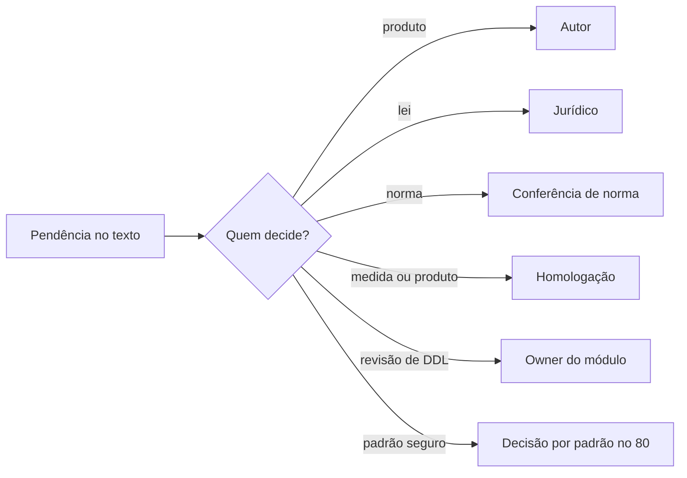

[Índice](README.md) · [Parte anterior](parte-18-juridico-e-regulatorio.md) · [Próxima parte](parte-20-plano-de-implementacao.md)

# Parte 19 — Pendências, decisões e rastreabilidade

## Visão geral da parte 19

Toda pendência do SDD tem um responsável: autor, jurídico, conferência de norma, homologação ou owner do módulo ([45](#doc-45)). As decisões tomadas por padrão estão no [80](#doc-80), e a situação de cada arquivo da v1 está no [79](#doc-79).

**Situação em aberto** ([45](#doc-45), seção 1): 59 itens jurídicos sem decisão, 14 jurídicos já decididos pelo autor, 25 de conferência de norma, 12 de homologação e 44 de revisão do owner. Nenhum item de decisão de produto está em aberto. As lacunas LAC-01 a LAC-25 têm a situação de cada uma nos documentos 17, 18, 19 e 22.

## 45 — Pendências Consolidadas, por Responsável

> Parte do [SDD v2](parte-01-visao-e-escopo.md#doc-00). Reúne em um lugar o que ainda não foi respondido, a partir das tabelas de pendências de cada documento. Decisões já tomadas ficam nas próprias tabelas, marcadas como **Decidido**.
> **Status:** lista de trabalho, refeita por auditoria completa em 03/11/2026. Cada item tem o código e o documento de origem. Quando um item é respondido, a resposta vai para o documento de origem, e a linha sai desta lista.

---

### 0. Como esta lista foi montada

Auditoria de 03/11/2026 nos documentos 00 a 76:

1. Leitura de toda linha de tabela com código (por exemplo `BOL-08`) nas seções de pendências, lacunas e decisões. Foram 337 linhas.
2. Linha com **Decidido**, **Feito**, **Escrito**, **Mantido** ou **Aceita**, sem parte pendente, conta como fechada: 168 linhas.
3. As demais foram separadas pelo responsável que precisa agir: autor, jurídico, norma, documento, homologação ou owner.
4. Pendência que outro documento já resolveu teve o status corrigido no documento de origem. A lista das correções está na seção 9.

A versão anterior desta lista tinha seções separadas para os docs 00 a 54 e 55 a 72. Agora há uma lista só.

---

### 1. Resumo

| Responsável | Itens | O que se espera |
|---|---|---|
| Autor | 0 | Decisão de produto ou confirmação de proposta (seção 2) |
| Jurídico, sem decisão | 59 | Parecer escrito, com data e nome do responsável (seção 3.1) |
| Jurídico, decidido pelo autor | 14 | Parecer sobre a regra já adotada (seção 3.2) |
| Conferência de norma | 25 | Confirmar o texto da norma antes da implementação (seção 4) |
| Documento a escrever | 0 | Especificação ou modelo de dados (seção 5) |
| Homologação e operação | 12 | Medir, dimensionar ou escolher produto antes da produção (seção 6) |
| Revisão do owner | 44 | Revisar o que já foi escrito e testar a migração (seção 7) |

Os pacotes para o jurídico ([50](parte-18-juridico-e-regulatorio.md#doc-50), [53](parte-12-suprimentos-patrimonio-frotas-contratos-e-terceiros.md#doc-53) e [73](parte-18-juridico-e-regulatorio.md#doc-73)) agrupam as mesmas perguntas por tema. Não são itens a mais.

---

### 2. Autor (decisão de produto)

Nenhum item de tabela aberto. OCO-01, BIB-04, IA-01, IA-07 e NOT-01, e o prazo de 2 dias úteis da [63](parte-08-academico.md#doc-63), seção 4.1, foram decididos em 03/11/2026 (seção 9.1).

**PLA-04** também foi decidido em 03/11/2026: BNCC obrigatória no plano de ensino e opcional no plano de aula ([64](parte-08-academico.md#doc-64), seção 4.1).

Continua com o autor, no texto corrido: lista de jurisdições (seção 8.2). Frotas nesta versão foi decidida por padrão (DP-01 em [80](#doc-80)).

**Delegação (04/11/2026):** o autor delegou as decisões em aberto, com o critério "melhor prática, mais segura, completa". Decisões tomadas assim ficam em [80](#doc-80).

**Licenciamento e permissões:** todas as propostas dos documentos [77](parte-06-plataforma-saas-clientes-dominios-licencas-e-crm.md#doc-77) e [78](parte-03-identidade-acesso-e-permissoes.md#doc-78) foram aprovadas em 04/11/2026 (seção 9.1).

---

#### 2.1 Especificações da v1 ainda não absorvidas na v2

**Nenhuma** (situação em 04/11/2026). Todas as especificações da v1 foram substituídas pela v2, ficaram fora do escopo, ou foram absorvidas integralmente nas fichas do kit-starter, com as regras da v2 prevalecendo. A única exceção é `sub_sidebar_itsm.php`, que é código de view e não especificação. A contagem viva está no [79](#doc-79); ao mudar a v1 ou o kit, regerar o 79.

---

### 3. Jurídico (parecer)

#### 3.1 Sem decisão

| Código | Pendência | Documento |
|---|---|---|
| CLA-01 | Prazos de retenção de avisos, materiais e entregas da Classe (proposta na seção 8) | [81](parte-08-academico.md#doc-81) |
| IA-02 | Provedores de modelo permitidos e região de processamento | [27](parte-15-inteligencia-artificial.md#doc-27) |
| IA-03 | Contrato de tratamento com provedor de modelo | [27](parte-15-inteligencia-artificial.md#doc-27) |
| IA-04 | Termo de uso de IA para entidade | [27](parte-15-inteligencia-artificial.md#doc-27) |
| IA-05 | Relatório de impacto dos recursos de risco alto | [27](parte-15-inteligencia-artificial.md#doc-27) |
| ATD-03 | Retenção de tickets e de transcrição | [32](parte-04-seguranca-privacidade-e-auditoria.md#doc-32) |
| LGPD-03 | Método de consentimento parental para menor de 13 anos | [32](parte-04-seguranca-privacidade-e-auditoria.md#doc-32) |
| LGPD-04 | Bases legais por tipo de dado escolar, incluindo menores | [32](parte-04-seguranca-privacidade-e-auditoria.md#doc-32) |
| LGPD-05 | Transferência internacional, se houver cliente fora do Brasil | [32](parte-04-seguranca-privacidade-e-auditoria.md#doc-32) |
| LGPD-06 | Painel do DPO e RIPD (G-05) | [32](parte-04-seguranca-privacidade-e-auditoria.md#doc-32) |
| LGPD-08 | Prazo de comunicação de incidente (três dias úteis, Resolução 15/2024) | [32](parte-04-seguranca-privacidade-e-auditoria.md#doc-32) |
| CTR-04 | Forma de assinatura por tipo de contrato | [33](parte-12-suprimentos-patrimonio-frotas-contratos-e-terceiros.md#doc-33) |
| CTR-05 | Cláusulas obrigatórias por tipo | [33](parte-12-suprimentos-patrimonio-frotas-contratos-e-terceiros.md#doc-33) |
| CTR-07 | Contrato de matrícula: forma, cláusulas e prazo de guarda | [33](parte-12-suprimentos-patrimonio-frotas-contratos-e-terceiros.md#doc-33) |
| PAG-04 | NFS-e Nacional, cancelamento, guarda de XML (seção 5.2) | [34](parte-10-financeiro-pagamentos-e-fiscal.md#doc-34) |
| PAG-05 | NFS-e da assinatura SaaS (plataforma) | [34](parte-10-financeiro-pagamentos-e-fiscal.md#doc-34) |
| PAG-07 | Open Finance e débito automático | [34](parte-10-financeiro-pagamentos-e-fiscal.md#doc-34) |
| ACC-04 | RIPD de biometria e de câmera | [35](parte-03-identidade-acesso-e-permissoes.md#doc-35) |
| TER-03 | Base legal do transporte escolar e de restrição alimentar | [38](parte-12-suprimentos-patrimonio-frotas-contratos-e-terceiros.md#doc-38) |
| LIV-01 | Consentimento de responsável para gravação e para entrada de aluno menor sem gravação (seção 5). Pedido por cláusula do contrato com a instituição | [40](parte-08-academico.md#doc-40) |
| LIV-02 | Prazo de retenção de gravação e transcrição, padrão 30 dias (seção 5) | [40](parte-08-academico.md#doc-40) |
| FRM-03 | Base legal para coleta de dado sensível em formulário (seção 4) | [41](parte-08-academico.md#doc-41) |
| FRM-06 | Prazo de guarda de resposta de formulário, por tipo | [41](parte-08-academico.md#doc-41) |
| PRE-05 | Prazo de guarda de avaliação, tutoria e PDI | [42](parte-08-academico.md#doc-42) |
| PRE-06 | Consentimento para tutoria de aluno menor com dado sensível (seção 5) | [42](parte-08-academico.md#doc-42) |
| PAS-03 | Retenção de intenção de missa (seção 3.3) | [43](parte-08-academico.md#doc-43) |
| PAS-04 | Retenção de cadastro de beneficiário (seção 4) | [43](parte-08-academico.md#doc-43) |
| PAS-05 | Consentimento de menor para evento, escala e imagem (seção 6) | [43](parte-08-academico.md#doc-43) |
| PAS-06 | Campanhas com renda: base legal de coleta (seção 4) | [43](parte-08-academico.md#doc-43) |
| AMB-06 | Termo de responsabilidade de equipamento: texto e guarda | [44](parte-08-academico.md#doc-44) |
| AMB-07 | Regra de uso de espaço esportivo por menor fora do horário escolar | [44](parte-08-academico.md#doc-44) |
| MAT-01 | Lista de documentos obrigatórios por nível e se algum pode bloquear, não só condicionar (M-08) | [46](parte-09-secretaria-matricula-e-documentos.md#doc-46) |
| SIM-01 | Prazo de guarda de redação original e de transcrição (seção 10) | [47](parte-08-academico.md#doc-47) |
| SIM-02 | Uso de nome de exame oficial (ENEM e outros) no perfil, e a permissão de uso | [47](parte-08-academico.md#doc-47) |
| DOC-02 | Prazo de guarda de cada tipo emitido (histórico, declaração, certidão) | [48](parte-09-secretaria-matricula-e-documentos.md#doc-48) |
| DDL-03 | Valores de domínio marcados (jurídico) no [50](parte-18-juridico-e-regulatorio.md#doc-50) | [51](parte-16-dados-validacoes-configuracoes-e-armazenamento.md#doc-51) |
| GD-02 | Prazo de guarda de documento recebido, por tipo (matrícula, fornecedor, candidato) | [54](parte-09-secretaria-matricula-e-documentos.md#doc-54) |
| NOT-04 | Prazo de retenção do corpo da mensagem (seção 3.7) | [57](parte-13-atendimento-e-notificacoes.md#doc-57) |
| CAL-04 | Certificado de evento: prazo de guarda | [58](parte-08-academico.md#doc-58) |
| EST-06 | Ato de autorização e reconhecimento do curso: formato e validade (seção 3.1) | [59](parte-08-academico.md#doc-59) |
| BOL-08 | Prazo de guarda de boletim e de ata | [62](parte-08-academico.md#doc-62) |
| OCO-06 | Protocolo de violência: canal e prazo de encaminhamento (seção 6.3) | [63](parte-08-academico.md#doc-63) |
| OCO-07 | Prazo de guarda de ocorrência e de medida | [63](parte-08-academico.md#doc-63) |
| ETC-05 | Publicação de TCC em repositório: autorização do aluno e prazo de acesso (seção 3.6) | [65](parte-08-academico.md#doc-65) |
| PRT-07 | Revisão jurídica do acesso da secretaria e da coordenação ao CID (PRT-01), à luz da minimização de dado | [66](parte-08-academico.md#doc-66) |
| PRT-03 | Guarda do prontuário após saída do aluno (seção 2.4). Mesmo ponto de N-10 | [66](parte-08-academico.md#doc-66) |
| PRT-04 | Imagem de menor em portfólio: autorização e prazo (seção 3.1). Mesmo ponto de LIV-13 de [40](parte-08-academico.md#doc-40) | [66](parte-08-academico.md#doc-66) |
| ARQ-02 | Prazo de guarda por tipo de documento e de livro (seção 4.4). Mesmo ponto de N-10 e J-04 | [67](parte-08-academico.md#doc-67) |
| ARQ-03 | O original em papel pode ser eliminado depois de digitalizado e verificado (seção 4.3) | [67](parte-08-academico.md#doc-67) |
| ARQ-06 | Assinatura de ata: simples ou ICP-Brasil, por tipo de ata. Mesmo ponto de N-12 | [67](parte-08-academico.md#doc-67) |
| BIB-05 | Marca d'água de leitura digital com identificação do leitor: base legal e licença do editor (seção 8) | [68](parte-08-academico.md#doc-68) |
| BIB-07 | Guarda de histórico de leitura e de empréstimo, e prazo de eliminação | [68](parte-08-academico.md#doc-68) |
| REL-02 | Prazo de guarda do arquivo gerado de relatório regulatório | [69](parte-08-academico.md#doc-69) |
| IMP-03 | Laudos e dados de saúde na importação: aceitar, ou bloquear e tratar na seção de saúde | [70](parte-14-integracoes-e-importacao.md#doc-70) |
| IMP-04 | Prazo de retenção do arquivo de origem depois da gravação (seção 4, passo 8) | [70](parte-14-integracoes-e-importacao.md#doc-70) |
| FIN-06 | Guarda física de cheque recebido e prazo (seção 5.3) | [71](parte-10-financeiro-pagamentos-e-fiscal.md#doc-71) |
| CPF-03 | Prazo de guarda de valor de campo removido (seção 4) | [72](parte-16-dados-validacoes-configuracoes-e-armazenamento.md#doc-72) |
| INT-04 | Termo de adesão à plataforma federal (SGP), e quem assina (seção 3.3) | [74](parte-14-integracoes-e-importacao.md#doc-74) |
| INT-05 | Dado de localização no arquivo do SIGEP (seção 3.2). Mesmo ponto de TER-02 | [74](parte-14-integracoes-e-importacao.md#doc-74) |

Itens do dossiê jurídico ([25](parte-18-juridico-e-regulatorio.md#doc-25)) que continuam abertos: **Q-01 (G-02)**, retenção de consulta por CPF, com **prioridade máxima**; e **G-03**, base legal de legítimo interesse (Q-03 a Q-06).

#### 3.2 Decidido pelo autor, falta o parecer

A regra já vale no SDD. O parecer confirma ou pede ajuste.

| Código | Pendência | Documento |
|---|---|---|
| SEG-01 | Regra de verificação do vínculo de responsabilidade legal | [31](parte-05-portais-navegacao-e-interface.md#doc-31) |
| ACC-02 | Biometria e reconhecimento facial: escopo (seção 5) | [35](parte-03-identidade-acesso-e-permissoes.md#doc-35) |
| ACC-03 | Retenção de imagem de câmera (seção 6) | [35](parte-03-identidade-acesso-e-permissoes.md#doc-35) |
| TER-02 | Prazo de guarda do rastro de localização do transporte escolar (seção 11) | [38](parte-12-suprimentos-patrimonio-frotas-contratos-e-terceiros.md#doc-38) |
| FRM-02 | Revisão humana de comentário livre antes de exibir (seção 3, item 5) | [41](parte-08-academico.md#doc-41) |
| PAS-02 | Acompanhamento espiritual: adesão voluntária e visibilidade só do acompanhante (seção 2.2) | [43](parte-08-academico.md#doc-43) |
| NOT-05 | Remetentes de aviso de saúde ou enfermagem (seção 4) | [57](parte-13-atendimento-e-notificacoes.md#doc-57) |
| CTR-06 | Provedor de assinatura eletrônica | [33](parte-12-suprimentos-patrimonio-frotas-contratos-e-terceiros.md#doc-33) |
| HCM-09 | Recrutamento: prazo de guarda de currículo de não contratado (seção 11) | [39](parte-11-pessoas-departamento-pessoal-e-sst.md#doc-39) |
| OCO-02 | Quem aplica afastamento (seção 5.3) | [63](parte-08-academico.md#doc-63) |
| AUD-01 | Prazo de retenção de eventos de plataforma: **5 anos, aprovado pelo autor em 03/11/2026.** Registrar parecer jurídico quando houver ([25](parte-18-juridico-e-regulatorio.md#doc-25), Q-01). | [29](parte-04-seguranca-privacidade-e-auditoria.md#doc-29) |
| IA-07 | Uso de dado de tenant para melhoria de produto: não usar sem consentimento específico | [27](parte-15-inteligencia-artificial.md#doc-27) |
| ETC-02 | Bolsa, auxílio e seguro no estágio: texto da Lei 11.788/2008 conferido e registrado | [65](parte-08-academico.md#doc-65) |
| SST-05 | Guarda de documentos de SST: prontuário conferido (20 anos, NR-7, 7.6.1.1). Falta o parecer sobre os demais documentos | [52](parte-11-pessoas-departamento-pessoal-e-sst.md#doc-52) |

---

### 4. Conferência de norma (verificar)

Itens que tratam do mesmo ponto: REL-01 e INT-02 (censo). Uma resposta vale para todos.

| Código | Pendência | Documento |
|---|---|---|
| PLN-01 | Obrigação de plano institucional e órgão colegiado aprovador, por tipo de entidade | [37](parte-08-academico.md#doc-37) |
| PLN-02 | Lei 4.320/1964 e normas do órgão de controle para o empenho (conferido em parte: Lei 4.320, arts. 36 e 58 a 65. Faltam as normas do tribunal de contas) | [37](parte-08-academico.md#doc-37) |
| TER-06 | Validade do selo do cartório digital por tipo de ato | [38](parte-12-suprimentos-patrimonio-frotas-contratos-e-terceiros.md#doc-38) |
| TER-07 | Documentos exigidos por tipo (alvará, seguro, certidões) | [38](parte-12-suprimentos-patrimonio-frotas-contratos-e-terceiros.md#doc-38) |
| HCM-02 | Catálogo de verbas e tabelas de INSS, IRRF e FGTS por competência | [39](parte-11-pessoas-departamento-pessoal-e-sst.md#doc-39) |
| HCM-03 | Regra de férias, 13.º e rescisão (LAC-12) | [39](parte-11-pessoas-departamento-pessoal-e-sst.md#doc-39) |
| HCM-04 | Eventos eSocial S-2200, S-1200, S-1210, S-2299 | [39](parte-11-pessoas-departamento-pessoal-e-sst.md#doc-39) |
| HCM-05 | Ponto e jornada: regra de registro e controle (conferido em parte: CLT, arts. 66, 71 e 74. Professor conferido. Faltam a Portaria MTP 671/2021 e o estatuto do servidor) | [39](parte-11-pessoas-departamento-pessoal-e-sst.md#doc-39) |
| PRE-04 | Regra de regulamento de residência e avaliação por programa | [42](parte-08-academico.md#doc-42) |
| DOC-01 | Quais tipos exigem assinatura com certificado ICP-Brasil (seção 8) (conferido em parte: Lei 14.063/2020. Faltam as normas do MEC para diploma e histórico) | [48](parte-09-secretaria-matricula-e-documentos.md#doc-48) |
| DOC-03 | Layout oficial do histórico escolar, conforme norma do sistema de ensino (Res. CNE/CEB, citada na v1) | [48](parte-09-secretaria-matricula-e-documentos.md#doc-48) |
| GD-06 | Documento administrativo de entidade pública: regra de processo administrativo (conferido em parte: Lei 9.784/1999 no federal. Falta a lei de cada ente) | [54](parte-09-secretaria-matricula-e-documentos.md#doc-54) |
| EST-02 | Carga horária mínima por nível, e regra de créditos no superior (seção 2) (conferido em parte: educação básica na LDB. Falta o superior, por curso) | [59](parte-08-academico.md#doc-59) |
| TUR-04 | Carga horária mínima de aula e de intervalo, por nível de ensino (conferido em parte: aula mínima na LDB. Falta o intervalo) | [60](parte-08-academico.md#doc-60) |
| DIA-03 | Falta justificada conta ou não na frequência, por nível de ensino (seção 4.2) (conferido em parte: a LDB não abona. Faltam os regimes especiais) | [61](parte-08-academico.md#doc-61) |
| DIA-09 | Lista de alunos para o Conselho Tutelar (LDB, art. 12, VIII): cálculo e periodicidade | [61](parte-08-academico.md#doc-61) |
| BOL-02 | Regra de combinação do resultado do período (seção 3.1, último parágrafo) | [62](parte-08-academico.md#doc-62) |
| OCO-08 | Efeito de afastamento na frequência (seção 5.3) | [63](parte-08-academico.md#doc-63) |
| ETC-08 | Nova tentativa de TCC reprovado (seção 3.3) | [65](parte-08-academico.md#doc-65) |
| PRT-05 | Restrição alimentar e medicamento de uso escolar: documento e validade exigidos (seção 2.3) | [66](parte-08-academico.md#doc-66) |
| ARQ-04 | Formato e órgão de envio do livro de registro por tipo de sistema de ensino (seção 2.3) | [67](parte-08-academico.md#doc-67) |
| REL-01 | Layout e prazo do censo, por esfera e por ano (seção 4.1) | [69](parte-08-academico.md#doc-69) |
| FIN-03 | Comprovante de IRPF do pagador: obrigação, formato e prazo (seção 10) | [71](parte-10-financeiro-pagamentos-e-fiscal.md#doc-71) |
| INT-02 | Layout e prazo do Educacenso, por ano e por esfera (seção 3.1) (conferido em parte: obrigação no Decreto 6.425/2008. Layout e prazo vêm do ato anual, conferir a cada ciclo) | [74](parte-14-integracoes-e-importacao.md#doc-74) |
| INT-06 | Layout do SIGEP e se o monitor é pessoa do terceiro (seção 3.2) | [74](parte-14-integracoes-e-importacao.md#doc-74) |

---

### 5. Documento a escrever

Os oito itens anteriores desta seção foram escritos em 03/11/2026 (seção 9.2). Em 04/11/2026, a revisão das lacunas encontrou três DDL que não existiam na v2. Os três foram escritos no mesmo dia e foram para a revisão do owner (seção 7): suprimentos (LAC-05, [51](parte-16-dados-validacoes-configuracoes-e-armazenamento.md#doc-51), seção 16), pessoas e RH e contábil e fiscal (LAC-13, seções 17 e 18) e marketing (LAC-20, seção 19). Nenhum item aberto nesta seção.

---

### 6. Homologação e operação

| Código | Pendência | Documento |
|---|---|---|
| AUD-02 | Armazenamento de longo prazo e ancoragem: **decidido pelo autor em 03/11/2026**, com a exportação diária assinada da seção 3. Escolha do produto concreto e teste de restauração ficam para homologação. | [29](parte-04-seguranca-privacidade-e-auditoria.md#doc-29) |
| CAC-01 | Dimensionamento do Redis por ambiente e entidade. **Decisão do autor (03/11/2026):** dimensionar em homologação antes de produção. | [30](parte-02-arquitetura-e-tenancy.md#doc-30) |
| CAC-02 | Validades medidas em homologação. **Decisão do autor (03/11/2026):** medir em homologação; os valores da seção 4 são o ponto de partida. | [30](parte-02-arquitetura-e-tenancy.md#doc-30) |
| CAC-03 | Escolha do provedor de CDN | [30](parte-02-arquitetura-e-tenancy.md#doc-30) |
| LIV-13 | Valores de capacidade: fragmento de 60 segundos (**decidido** em 03/11/2026), bitrate, salas por nó e limite de perda de pacote | [40](parte-08-academico.md#doc-40) |
| DOC-07 | Prazos de lembrete de assinatura e de revisão (seção 19) | [48](parte-09-secretaria-matricula-e-documentos.md#doc-48) |
| DOC-08 | Limite de tamanho do lote (seção 14) | [48](parte-09-secretaria-matricula-e-documentos.md#doc-48) |
| GD-04 | Formato e tamanho máximo de arquivo recebido, por contexto | [54](parte-09-secretaria-matricula-e-documentos.md#doc-54) |
| TST-04 | Ferramenta de varredura de acessibilidade, com versão fixada | [49](parte-17-operacao-qualidade-testes-e-ti.md#doc-49) |
| REL-04 | Limite de linhas para geração imediata (seção 2.2) | [69](parte-08-academico.md#doc-69) |
| AUD-03 | Central de segurança: escolha do produto e teste de envio (regra na seção 8.1) | [29](parte-04-seguranca-privacidade-e-auditoria.md#doc-29) |
| DDL-02 | Teste de migração em ambiente de homologação por banco de unidade ([10](parte-17-operacao-qualidade-testes-e-ti.md#doc-10), seção 5) | [51](parte-16-dados-validacoes-configuracoes-e-armazenamento.md#doc-51) |

---

### 7. Revisão do owner

O texto ou o DDL já existe. Falta a revisão do owner do módulo e, no caso de DDL, o teste de migração (DDL-02).

| Código | Pendência | Documento |
|---|---|---|
| DDL-01 | Revisão de cada DDL pelo owner do módulo antes da migração | [51](parte-16-dados-validacoes-configuracoes-e-armazenamento.md#doc-51) |
| GD-08 | Revisão do DDL pelo owner de cada contexto e teste de migração | [54](parte-09-secretaria-matricula-e-documentos.md#doc-54) |

Itens escritos que aguardam essa revisão: LAC-05, LAC-13 e LAC-20 ([51](parte-16-dados-validacoes-configuracoes-e-armazenamento.md#doc-51), seções 16 a 19), CLA-02 ([81](parte-08-academico.md#doc-81)), MOD-07, MOD-08, MOD-09, ATD-04, LGPD-01, LGPD-02, CTR-01, ACC-06, ACC-08, TI-04, HCM-07, LIV-10, FRM-05, PRE-08, PAS-10, AMB-08, MAT-07, DOC-06, NOT-07, CAL-05, EST-07, TUR-05, DIA-08, BOL-10, OCO-09, PLA-07, ETC-09, PRT-06, ARQ-07, BIB-08, REL-07, IMP-06, FIN-08, CPF-04, PER-07, SIM-07, INT-07, IMP-05.

---

### 8. Itens no texto corrido (regras com [Pendente] e marcadores de conferência)

Esta seção foi montada por varredura dos marcadores `[Pendente`, `Pendente:`, `(verificar)`, `a confirmar` e `[Decisão pendente]` nos docs 00 a 39. Os itens abaixo não estão nas tabelas de pendências, e cada um tem um dono sugerido. A seção 9 da [24](parte-17-operacao-qualidade-testes-e-ti.md#doc-24) (G-20) já prevê a revisão dessas regras.

#### 8.1 Valores que faltam (autor ou owner do módulo)

| Documento | Item | Dono sugerido |
|---|---|---|
| [17](parte-07-regras-gerais-dos-modulos-de-gestao.md#doc-17) | Prazo máximo de trancamento, por regimento de cada curso | Acadêmico |
| [21](parte-16-dados-validacoes-configuracoes-e-armazenamento.md#doc-21) | Prazo de backup que propaga o expurgo (35 dias proposto) | Operação |
| [06](parte-03-identidade-acesso-e-permissoes.md#doc-06) | Versão vigente da NIST SP 800-63B-4, a confirmar antes do go-live | Segurança |

#### 8.2 Regras que dependem de município, UF ou tipo de vínculo

| Documento | Item | Dono sugerido |
|---|---|---|
| [17](parte-07-regras-gerais-dos-modulos-de-gestao.md#doc-17) | Formato de RG por UF | Pessoas (RH) |
| [18](parte-07-regras-gerais-dos-modulos-de-gestao.md#doc-18) | Emissão de nota fiscal conforme política do município | Fiscal (verificar) |
| [19](parte-07-regras-gerais-dos-modulos-de-gestao.md#doc-19) | Lista de jurisdições, só se houver cliente fora do Brasil | Autor |
| [19](parte-07-regras-gerais-dos-modulos-de-gestao.md#doc-19) | Quem revisa o conteúdo gerado por IA antes de publicar (parcialmente resolvido por MOD-06 para simulado) | Acadêmico |

#### 8.3 Itens de norma (verificar)

| Documento | Item | Dono sugerido |
|---|---|---|
| [17](parte-07-regras-gerais-dos-modulos-de-gestao.md#doc-17) | Idade mínima para vínculo, por tipo | Jurídico |
| [17](parte-07-regras-gerais-dos-modulos-de-gestao.md#doc-17) | Contrato de experiência: texto contraditório da v1 (LAC-03) | Jurídico |
| [18](parte-07-regras-gerais-dos-modulos-de-gestao.md#doc-18) | Férias: período e fracionamento, CLT art. 130 | Jurídico e norma |
| [20](parte-10-financeiro-pagamentos-e-fiscal.md#doc-20) | Prazo de resposta a chargeback, em 3 dias | Norma da bandeira (verificar) |
| [37](parte-08-academico.md#doc-37) | Plano institucional, colegiado e Lei 4.320 art. 61 e seguintes (também em PLN-01 e PLN-02) | Norma |
| [38](parte-12-suprimentos-patrimonio-frotas-contratos-e-terceiros.md#doc-38) | Validade jurídica do selo do cartório, por tipo de ato | Norma |
| [38](parte-12-suprimentos-patrimonio-frotas-contratos-e-terceiros.md#doc-38) | Verificação de CNPJ em base pública, e exigência de cadastro público de fornecedor | Norma |
| [39](parte-11-pessoas-departamento-pessoal-e-sst.md#doc-39) | Evento S-2200 de admissão, eSocial (também em HCM-04) | Norma |
| [39](parte-11-pessoas-departamento-pessoal-e-sst.md#doc-39) | Controle de jornada conforme legislação (também em HCM-05) | Norma |
| [39](parte-11-pessoas-departamento-pessoal-e-sst.md#doc-39) | Cálculo de aviso prévio, férias proporcionais, 13.º e multa do FGTS | Norma |
| [39](parte-11-pessoas-departamento-pessoal-e-sst.md#doc-39) | Regra de benefício e de elegibilidade por cargo | Norma e RH |
| [39](parte-11-pessoas-departamento-pessoal-e-sst.md#doc-39) | LTCAT, CAT ao INSS (canal e prazo), NR aplicáveis e validade de treinamento por NR | Norma e medicina do trabalho |

#### 8.4 Jurídico (texto de lei e de contrato)

| Documento | Item | Dono sugerido |
|---|---|---|
| [07](parte-04-seguranca-privacidade-e-auditoria.md#doc-07) | Base legal de cada finalidade, com setorial a confirmar | Jurídico |
| [07](parte-04-seguranca-privacidade-e-auditoria.md#doc-07) | Prazo de guarda de documentos escolares | Jurídico |
| [21](parte-16-dados-validacoes-configuracoes-e-armazenamento.md#doc-21) | Base legal por finalidade da busca por CPF | Jurídico |
| [25](parte-18-juridico-e-regulatorio.md#doc-25) | Prazo de registro de acesso (seis meses, Marco Civil art. 15) | Jurídico |
| [25](parte-18-juridico-e-regulatorio.md#doc-25) | Comunicação de inclusão de inadimplente (CDC art. 43, §2º) | Jurídico |
| [25](parte-18-juridico-e-regulatorio.md#doc-25) | Superendividamento na régua de cobrança (Lei 14.181/2021) | Jurídico |
| [25](parte-18-juridico-e-regulatorio.md#doc-25) | Base para SMS, WhatsApp e Telegram em cobrança e marketing | Jurídico |
| [25](parte-18-juridico-e-regulatorio.md#doc-25) | Súmula 362 do TST para FGTS e documentos trabalhistas | Jurídico |
| [25](parte-18-juridico-e-regulatorio.md#doc-25) | Forma de registro do consentimento de marketing | Jurídico |
| [32](parte-04-seguranca-privacidade-e-auditoria.md#doc-32) | DPO designado pela entidade, com contrato com a empresa desenvolvedora | Jurídico |

#### 8.5 Pendências de produto e de licença

| Documento | Item | Dono sugerido |
|---|---|---|
| [05](parte-04-seguranca-privacidade-e-auditoria.md#doc-05) e [11](parte-17-operacao-qualidade-testes-e-ti.md#doc-11) | Confirmar uso de `JWT_SECRET` no código e remover HS256 (ACH-05) | Backend |
| [12](parte-01-visao-e-escopo.md#doc-12) | Frotas: confirmar se entra nesta versão, pois é de escopo diferente do educacional | **Decidido por padrão** em 04/11/2026: entra (DP-01, [80](#doc-80)) |
| [31](parte-05-portais-navegacao-e-interface.md#doc-31) | Atendimento consolidado: DDL pendente (T-02) | Documento |

---

### 9. Correções feitas nesta auditoria

Status atualizado no documento de origem, porque a pendência já tinha sido resolvida em outro documento:

| Itens | O que mudou |
|---|---|
| ATD-04, LGPD-01, LGPD-02, CTR-01, ACC-06, ACC-08, FRM-05, PRE-08, PAS-10, AMB-08, LIV-10, MAT-07, TI-04, DOC-06 | DDL escrito em [51](parte-16-dados-validacoes-configuracoes-e-armazenamento.md#doc-51), seções 1 a 12 |
| NOT-07, CAL-05, EST-07, TUR-05, DIA-08, BOL-10, OCO-09, PLA-07, ETC-09, PRT-06, ARQ-07, BIB-08, REL-07, IMP-06, FIN-08, CPF-04 | DDL escrito em [51](parte-16-dados-validacoes-configuracoes-e-armazenamento.md#doc-51), seção 15 |
| MOD-07, MOD-08, MOD-09 | Especificados em [48](parte-09-secretaria-matricula-e-documentos.md#doc-48), [47](parte-08-academico.md#doc-47) e [46](parte-09-secretaria-matricula-e-documentos.md#doc-46) |
| MOD-10, MOD-11 | Escritos em [68](parte-08-academico.md#doc-68) e [32](parte-04-seguranca-privacidade-e-auditoria.md#doc-32) |
| LOG-01, LOG-02, TST-01, TST-02, TST-03 | Escritos em [49](parte-17-operacao-qualidade-testes-e-ti.md#doc-49). Na matriz de logs de [31](parte-05-portais-navegacao-e-interface.md#doc-31), integração e job deixam de aparecer como "sem especificação" |
| AUD-04 | Campo `portal` em [29](parte-04-seguranca-privacidade-e-auditoria.md#doc-29), seção 2 |
| TI-01, TI-02, TI-03 | Escritos em [36](parte-17-operacao-qualidade-testes-e-ti.md#doc-36), seção 11 |
| HCM-07 | Escrito em [52](parte-11-pessoas-departamento-pessoal-e-sst.md#doc-52) |
| LIV-09 | Fechado por ACC-05 de [35](parte-03-identidade-acesso-e-permissoes.md#doc-35) |
| PER-02, PER-03 | Fechados por PER-06 e PER-05 de [76](parte-05-portais-navegacao-e-interface.md#doc-76) |
| SRC-01 a SRC-05, PER-04, PER-05 | Marca **[Decisão do autor]** retirada do texto de [75](parte-05-portais-navegacao-e-interface.md#doc-75). A decisão já estava na tabela |
| Formulários | Em [41](parte-08-academico.md#doc-41), seção 3, item 4, saiu "valor padrão proposto: 5", que contradizia a decisão de mínimo de 2 respostas |
| CFG-01 | Em [56](parte-16-dados-validacoes-configuracoes-e-armazenamento.md#doc-56), eventos deixam de ser lacuna, porque estão em [58](parte-08-academico.md#doc-58) |
| MOD-12 | Continua aberto. "Gerador de documentos" já é o nome usado. Falta "Editor de portais" em [23](parte-06-plataforma-saas-clientes-dominios-licencas-e-crm.md#doc-23) |

#### 9.1 Decisões do autor depois da auditoria

| Item | Decisão de 03/11/2026 |
|---|---|
| OCO-01 | Tipos de ocorrência: lista padrão da plataforma, que a escola ajusta ([63](parte-08-academico.md#doc-63)) |
| Prazo de registro | Ocorrência com data anterior: motivo obrigatório depois de 2 dias úteis ([63](parte-08-academico.md#doc-63), seção 4.1) |
| BIB-04 | Valor inicial da plataforma, que a escola ajusta: aluno 3 itens por 7 dias, professor e servidor 5 itens por 30 dias, até 2 renovações ([68](parte-08-academico.md#doc-68), seção 4) |
| IA-01 | IA dentro do plano, com a quota de IA-06. Excedente cobrado conforme o contrato ([27](parte-15-inteligencia-artificial.md#doc-27)) |
| IA-07 | Não usar dado de cliente sem consentimento específico. Falta o parecer do jurídico (seção 3.2) |
| NOT-01 | As duas versões da v1 são unidas. Telas e painel da original em [57](parte-13-atendimento-e-notificacoes.md#doc-57), seções 3.8 e 3.9, que também fecham NOT-08 |
| L-01 | Cada plano tem limite de alunos, definido pelo desenvolvedor da plataforma. **Aprovada em 04/11/2026** ([77](parte-06-plataforma-saas-clientes-dominios-licencas-e-crm.md#doc-77), seção 1) |
| L-02 | Criar entidade e criar unidade é exclusivo do papel `platform.developer`. **Aprovada em 04/11/2026** ([78](parte-03-identidade-acesso-e-permissoes.md#doc-78), seção 1) |
| P-01 | Sistema de permissões completo, com níveis de papel, para todos os portais. **Aprovada em 04/11/2026** ([78](parte-03-identidade-acesso-e-permissoes.md#doc-78)) |
| D-33 | Quem aprova a publicação no Editor de portais é `platform.developer`, diferente de quem edita (`platform.builder`). **Aprovada em 04/11/2026** ([78](parte-03-identidade-acesso-e-permissoes.md#doc-78), seção 6) |
| D-27 | Ao exceder o limite de alunos, bloquear novas matrículas ativas, sem alterar dados existentes. **Aprovada em 04/11/2026** ([77](parte-06-plataforma-saas-clientes-dominios-licencas-e-crm.md#doc-77), seção 4) |
| D-28 | Carência de 15 dias na inadimplência, ajustável por plano. **Aprovada em 04/11/2026** ([77](parte-06-plataforma-saas-clientes-dominios-licencas-e-crm.md#doc-77), seção 3.1) |
| D-29 | Preço e ciclo definidos pelo desenvolvedor, por plano. **Aprovada em 04/11/2026** ([77](parte-06-plataforma-saas-clientes-dominios-licencas-e-crm.md#doc-77), seção 2) |
| D-30 | Códigos dos papéis de gestão como na seção 4 do [78](parte-03-identidade-acesso-e-permissoes.md#doc-78). **Aprovada em 04/11/2026** |
| D-31 | Professor que também coordena: dois papéis, um por portal. **Aprovada em 04/11/2026** ([78](parte-03-identidade-acesso-e-permissoes.md#doc-78)) |
| D-32 | Responsável com mais de um aluno: escopo `proprio` com dependentes vinculados. **Aprovada em 04/11/2026** ([78](parte-03-identidade-acesso-e-permissoes.md#doc-78)) |
| D-34 | Nome e código do plano únicos na plataforma. **Aprovada em 04/11/2026** ([77](parte-06-plataforma-saas-clientes-dominios-licencas-e-crm.md#doc-77), seção 2) |
| D-35 | Cada plano tem uma lista de módulos; a entidade só vê no portal os módulos do plano. **Aprovada em 04/11/2026** ([77](parte-06-plataforma-saas-clientes-dominios-licencas-e-crm.md#doc-77), seção 2) |
| D-36 | Plano ativo ou descontinuado; descontinuado não aceita novas assinaturas. **Aprovada em 04/11/2026** ([77](parte-06-plataforma-saas-clientes-dominios-licencas-e-crm.md#doc-77), seção 2) |
| D-37 | Assinatura ativa, inadimplente, suspensa ou cancelada, com os efeitos da seção 3.1. **Aprovada em 04/11/2026** ([77](parte-06-plataforma-saas-clientes-dominios-licencas-e-crm.md#doc-77)) |
| D-38 | Oito níveis de papel, de 0 (próprio) a 7 (desenvolvedor). **Aprovada em 04/11/2026** ([78](parte-03-identidade-acesso-e-permissoes.md#doc-78), seção 2.1) |
| D-39 | Separação de funções nas ações da seção 2.2. **Aprovada em 04/11/2026** ([78](parte-03-identidade-acesso-e-permissoes.md#doc-78)) |
| D-40 | Seis regras transversais de permissão. **Aprovada em 04/11/2026** ([78](parte-03-identidade-acesso-e-permissoes.md#doc-78), seção 5) |
| D-41 | Códigos dos papéis comerciais da plataforma: `platform.sales.sdr`, `platform.sales.ae`, `platform.sales.manager`, `platform.chatbot.operator` e `platform.customer_success`. **Aprovada em 04/11/2026** ([78](parte-03-identidade-acesso-e-permissoes.md#doc-78), seção 4.1) |
| D-42 | Cheques e caixa físico não se aplicam ao financeiro da empresa desenvolvedora, até haver necessidade. **Aprovada em 04/11/2026** ([78](parte-03-identidade-acesso-e-permissoes.md#doc-78), seção 6) |
| D-43 | Financeiro da plataforma: `platform.finance` opera e `platform.finance.manager` aprova. **Aprovada em 04/11/2026** ([78](parte-03-identidade-acesso-e-permissoes.md#doc-78), seção 4.1) |
| D-44 | Tributos e obrigações fiscais da empresa: já definido na [31](parte-05-portais-navegacao-e-interface.md#doc-31), seção 3.3; confirmado em 04/11/2026 e incluído na área Contábil da plataforma |
| D-45 | Papéis do contábil e do fiscal da plataforma: já definidos no [22](parte-06-plataforma-saas-clientes-dominios-licencas-e-crm.md#doc-22), seção 5. Códigos `platform.accounting` e `platform.fiscal` |

#### 9.2 Documentos escritos depois da auditoria

| Item | Onde |
|---|---|
| SIM-07 | DDL de simulados e redação em [51](parte-16-dados-validacoes-configuracoes-e-armazenamento.md#doc-51), seção 15.19 |
| INT-07 | DDL de integrações educacionais em [51](parte-16-dados-validacoes-configuracoes-e-armazenamento.md#doc-51), seção 15.20 |
| PAG-01 | EFÍ e contingência de gateway por unidade em [34](parte-10-financeiro-pagamentos-e-fiscal.md#doc-34), seções 2.1 e 2.3. Lista de adapters corrigida em [16](parte-14-integracoes-e-importacao.md#doc-16) |
| LOG-05 | Conectores com log em [49](parte-17-operacao-qualidade-testes-e-ti.md#doc-49), seção 2.1 |
| TST-05 | Geração do teste de isolamento a partir da matriz em [49](parte-17-operacao-qualidade-testes-e-ti.md#doc-49), seção 5.1 |
| IMP-05 | Modelos de arquivo de importação em [70](parte-14-integracoes-e-importacao.md#doc-70), seção 4.1 |
| AUD-03 | Envio para central de segurança em [29](parte-04-seguranca-privacidade-e-auditoria.md#doc-29), seção 8.1. Produto fica para homologação |
| MOD-12 | "Editor de portais" em [23](parte-06-plataforma-saas-clientes-dominios-licencas-e-crm.md#doc-23), [27](parte-15-inteligencia-artificial.md#doc-27), [29](parte-04-seguranca-privacidade-e-auditoria.md#doc-29) e [31](parte-05-portais-navegacao-e-interface.md#doc-31). "Editor de modelos" em [48](parte-09-secretaria-matricula-e-documentos.md#doc-48). O código do papel `platform.builder` foi mantido |

#### 9.3 Conferência de norma feita em 03/11/2026

Texto lido em planalto.gov.br: LDB (Lei 9.394/1996, com a redação da Lei 14.945/2024) e Lei do Estágio (Lei 11.788/2008, com a redação da Lei 14.913/2024). A conferência registra o que a lei diz. Não é parecer jurídico. O art. 47 da LDB (superior), lido antes em resumo, foi conferido no texto literal na seção 9.7.

| Item | Resultado |
|---|---|
| CAL-01 | Fechado. A LDB não fixa recesso. O calendário se adapta ao local, sem reduzir horas (art. 23, § 2º) |
| EST-01 e BOL-01 | 75% no fundamental e no médio (art. 24, VI). 60% na pré-escola (art. 31, IV). Falta o superior |
| EST-02 | 800 h no fundamental e 1.000 h no médio, em 200 dias (art. 24, I). Formação geral básica de 2.400 h (art. 35-C). Falta o superior |
| TUR-04 | 4 h diárias de aula no fundamental (art. 34). 4 h e 7 h na educação infantil (art. 31, III). Falta o intervalo |
| DIA-03 | A LDB não abona falta justificada. A exceção é o motivo religioso (art. 7º-A). Faltam os regimes especiais de lei própria |
| DIA-09 | Item novo: a escola notifica ao Conselho Tutelar os alunos acima de 30% do percentual de faltas permitido (art. 12, VIII) |
| PLA-04 | Fechado. Base nacional comum obrigatória no currículo (art. 26). Decidido: BNCC obrigatória no plano de ensino e opcional no plano de aula |
| ETC-01 | Fechado. 4 h e 20 h, ou 6 h e 30 h, por tipo de aluno. Até 40 h com alternância. Até 2 anos no mesmo concedente (arts. 10 e 11) |
| ETC-03 | Fechado. A lei remete ao projeto do curso (art. 2º, § 1º) |
| ETC-02 | Texto conferido: bolsa e auxílio-transporte obrigatórios no não obrigatório, seguro em todo estágio, recesso de 30 dias (arts. 9º, 12 e 13). Fica o parecer |

#### 9.4 Conferência de norma de saúde e segurança do trabalho, em 03/11/2026

Texto lido nos PDFs oficiais do Ministério do Trabalho e Emprego (gov.br): NR-1 (atualizada em 2025, capítulo 1.5 em vigor desde 26/05/2026), NR-5 (Portaria MTP nº 4.219/2022) e NR-7 (atualizada em 2022). Lei 8.213/1991, art. 58, lida no Planalto. Registro do que a norma diz, não parecer.

| Item | Resultado |
|---|---|
| SST-01 | Fechado. Periódico anual para exposto a risco ou doente crônico, a cada dois anos para os demais. Retorno após 30 dias de ausência. Demissional em até 10 dias, dispensado se o último exame tiver menos de 135 ou 90 dias, por grau de risco (NR-7, 7.5.8 a 7.5.11) |
| SST-02 | Fechado. LTCAT sem prazo fixo, mantido atualizado. PPP atualizado e entregue na rescisão (Lei 8.213, art. 58). Fica para conferir a entrega do PPP pelo eSocial |
| SST-03 | Fechado. CIPA por estabelecimento, pelo Quadro I. Mandato de um ano com uma reeleição. Estabilidade até um ano após o mandato. Eleição convocada 60 dias antes. Reunião mensal. Treinamento de 8 a 20 horas (NR-5) |
| SST-04 | Fechado. Revisão do PGR a cada dois anos, ou três com certificação, e antes nos casos do item 1.5.4.4.6. Histórico do inventário por 20 anos (NR-1) |
| HCM-08 e SST-05 | Prontuário guardado por no mínimo 20 anos após o desligamento (NR-7, 7.6.1.1). SST-05 fica com o jurídico para os demais documentos |
| TER-05 | Fechado. O contrato com a clínica garante a guarda por 20 anos e a transferência do prontuário (NR-7, 7.6.1.2). Fica para conferir a regra do CFM para prontuário eletrônico |
| Novo no PGR | Riscos psicossociais relacionados ao trabalho entram no inventário (NR-1, Portaria MTE nº 1.419/2024) |
| Novo na CIPA | Nome atual: Comissão Interna de Prevenção de Acidentes e de Assédio |

#### 9.5 Conferência de ponto, alimentação, censo e Pé-de-Meia, em 03/11/2026

Textos lidos: CLT (Decreto-Lei 5.452/1943, com a Lei 13.874/2019), Decreto 6.425/2008 e Lei 14.818/2024 no Planalto; RDC ANVISA nº 216/2004 na Biblioteca Virtual em Saúde. Registro do que a norma diz, não parecer.

| Item | Resultado |
|---|---|
| HCM-05 | Em parte. Registro de entrada e saída obrigatório acima de 20 trabalhadores por estabelecimento, ponto por exceção só com acordo, intervalos de 11 horas, de 1 a 2 horas e de 15 minutos (CLT, arts. 66, 71 e 74). Faltam a Portaria MTP nº 671/2021 e as regras do professor e do servidor |
| TER-04 | Fechado. Limites de temperatura, identificação e guarda de 30 dias pela RDC 216/2004, itens 4.8 a 4.11. Fica para conferir norma sanitária local e se há RDC posterior |
| INT-02 | Em parte. Obrigação de todo estabelecimento e responsáveis (Decreto 6.425/2008, arts. 2º a 6º). O decreto não fixa data, prazo nem layout: vêm do ato anual, guardado como versão por ano |
| INT-03 | Fechado. Ensino médio público e CadÚnico, frequência mínima de 80%, aportes pelo menos 9 vezes por ano, verificação federal (Lei 14.818/2024, arts. 1º, 3º, 4º e 5º). Decreto 11.901/2024 conferido na seção 9.7 |

#### 9.6 Conferência de empenho, assinatura e processo administrativo, em 03/11/2026

Textos lidos no Planalto: Lei 4.320/1964, Lei 14.063/2020 e Lei 9.784/1999. Registro do que a lei diz, não parecer. Os três ficam em parte, porque dependem de norma de cada ente ou do MEC.

| Item | Resultado |
|---|---|
| PLN-02 | Modalidades por estimativa e global (art. 60), nota de empenho com campos fixos (art. 61), liquidação antes do pagamento (arts. 62 a 64), restos a pagar processados e não processados (art. 36), limite do duodécimo no último mês do mandato do prefeito (art. 59). Corrigido no [37](parte-08-academico.md#doc-37): restos a pagar incluem o empenho liquidado e não pago |
| DOC-01 | Três níveis de assinatura (art. 4º). A lei vale para interação com ente público, não entre particulares (art. 2º). Qualificada obrigatória nos casos do art. 5º, § 2º, e no atestado médico eletrônico (art. 13). Diploma e histórico não estão na lei |
| GD-06 | Lei federal: forma do ato, prazos de 5, 10 e 30 dias, intimação com 3 dias úteis, motivação obrigatória (arts. 22, 24, 26, 49, 50, 56 a 59 e 66). Estado e município seguem lei própria |

#### 9.7 Conferência de curso, superior, Pé-de-Meia e assinatura entre particulares, em 03/11/2026

Textos lidos no Planalto: LDB (arts. 36 a 47, texto literal), Decreto 11.901/2024 e MP 2.200-2/2001. A CLT, arts. 317 a 324 (professor), foi lida depois no navegador, no texto compilado do Planalto.

| Item | Resultado |
|---|---|
| EST-01 | Fechado. No superior, a LDB só torna a frequência obrigatória, salvo EAD (art. 47, § 3º). O percentual é do regimento da instituição, configurado por curso |
| EST-03 | Fechado. Técnico integrado, concomitante e subsequente (arts. 36-B e 36-C), formação inicial e continuada, graduação tecnológica (art. 39), sequencial, graduação, pós e extensão (art. 44). Catálogos CNCT e CNCST como tabela de referência |
| Novo no [59](parte-08-academico.md#doc-59) | Página "Grade e Corpo Docente" do superior, publicada até um mês antes das aulas (art. 47, § 1º) |
| INT-03 | Regulamento conferido: 14 a 24 anos, matrícula em até dois meses, frequência por média ou mensal, valores anuais, termo de compromisso e responsabilidade da rede pela veracidade (Decreto 11.901/2024, arts. 3º a 7º). Fica o ato do MEC para canal e calendário |
| DOC-01 | Entre particulares, certificado ICP-Brasil presume veracidade e outro meio vale se aceito pelas partes (MP 2.200-2/2001, art. 10). Fica a norma do MEC para diploma e histórico |
| HCM-05 | Lei 15.371/2026 lida: trata de licença-paternidade e não altera os arts. 66, 71 e 74 da CLT. Professor: aula por mais de um turno sem passar da jornada semanal, sem aula no domingo, remuneração por aulas semanais em mês de 4,5 semanas, falta de casamento ou luto não descontada por 9 dias, exames com no máximo 8 horas por dia e férias escolares pagas (CLT, arts. 318 a 322). Registrado no [39](parte-11-pessoas-departamento-pessoal-e-sst.md#doc-39), seção 3.4 |

---

### 10. Critérios de aceite desta lista

- [ ] Cada item tem um documento de origem e um responsável.
- [ ] Cada item respondido sai desta lista e é marcado como **Decidido** ou **Escrito** no documento de origem.
- [ ] O parecer do jurídico (Q-01 e demais) fica registrado com data e nome do responsável.
- [ ] A próxima auditoria repete o método da seção 0 e compara as contagens.

## 80 — Decisões tomadas por padrão (delegadas pelo autor)

> Parte do [SDD v2](parte-01-visao-e-escopo.md#doc-00). Em 04/11/2026 o autor delegou as decisões em aberto: "sempre a melhor prática, mais segura, completa", sem bloquear o trabalho para perguntar.
> **Regra:** antes de decidir, o assunto é buscado em todo o SDD (v2 e anexo-v1/). Só entra aqui o que não está decidido em nenhum documento. Cada decisão tem motivo, alternativa descartada e onde se aplica. O autor pode revisar qualquer item; revisão vira nova linha, sem apagar a anterior.

### 1. Critérios usados

1. **Segurança e conformidade primeiro:** na dúvida, a opção que expõe menos dado, exige aprovação ou bloqueia o erro.
2. **Completude:** na dúvida entre incluir e excluir um recurso previsto na v1, incluir.
3. **Não inventar valor legal ou contábil:** prazo, alíquota, taxa e texto jurídico não são inventados. Ficam como parâmetro obrigatório, configurado pelo responsável, e o sistema bloqueia o uso enquanto não forem configurados.
4. **Separação de funções:** quem opera não aprova a própria operação ([78](parte-03-identidade-acesso-e-permissoes.md#doc-78), seção 2.2).

### 2. Decisões

| # | Assunto | Decisão | Motivo | Alternativa descartada | Onde se aplica |
|---|---|---|---|---|---|
| DP-01 | Frotas nesta versão (pendência do autor em [45](#doc-45), seção 2) | **Entra nesta versão**, para a empresa e para as entidades | Completude; a especificação da v1 é completa e o transporte escolar é uso real | Deixar para versão futura | Portal do desenvolvedor (operações internas) e portal de gestão |
| DP-02 | Regra de depreciação por categoria (lacuna LAC-18 do [19](parte-07-regras-gerais-dos-modulos-de-gestao.md#doc-19)) | Cada categoria de ativo tem método e taxa **aprovados pelo contábil**. Categoria sem regra aprovada **não deprecia** e aparece como pendência no painel | Critério 3: não inventar taxa contábil; não deixar ativo sem controle | Taxa padrão do sistema para todas as categorias | Patrimônio (empresa e entidade) |
| DP-03 | Papéis de patrimônio e frotas (não definidos no [22](parte-06-plataforma-saas-clientes-dominios-licencas-e-crm.md#doc-22), seção 5) | Operador (nível 1) e aprovador (nível 2) separados, para patrimônio e para frotas. Compras, almoxarifado e aprovador de compras seguem o [22](parte-06-plataforma-saas-clientes-dominios-licencas-e-crm.md#doc-22), seção 5 | Critério 4; mesmo padrão dos papéis departamentais já aprovados | Um único papel por módulo | [78](parte-03-identidade-acesso-e-permissoes.md#doc-78), seção 4.1 (plataforma) |
| DP-04 | Conteúdo das configurações do sistema da plataforma (não definido em nenhum documento) | Configurações agrupadas pelo documento do SDD que define cada regra (idiomas [09](parte-05-portais-navegacao-e-interface.md#doc-09); senha, sessão e MFA [06](parte-03-identidade-acesso-e-permissoes.md#doc-06); limites de API [04](parte-02-arquitetura-e-tenancy.md#doc-04); e-mail e integrações [16](parte-14-integracoes-e-importacao.md#doc-16); cache [30](parte-02-arquitetura-e-tenancy.md#doc-30); manutenção [24](parte-17-operacao-qualidade-testes-e-ti.md#doc-24)). Toda mudança exige step-up, motivo, auditoria e gera versão com rollback. Valor fora do limite do documento de origem é recusado | Critérios 1 e 4; o sistema não aceita configuração que contrarie o SDD | Tela livre de chave e valor | Portal do desenvolvedor (segurança e operação) |
| DP-05 | Códigos dos papéis da entidade no portal de gestão (o [22](parte-06-plataforma-saas-clientes-dominios-licencas-e-crm.md#doc-22), seção 5, e os documentos por portal nomeiam os papéis, mas o [78](parte-03-identidade-acesso-e-permissoes.md#doc-78), seção 4.2, só listava nove) | Um código `unit.*` ou `entity.*` para cada papel já nomeado no SDD (contábil, fiscal, comercial, compras, almoxarifado, aprovador de compras, folha, aprovador da folha, médico do trabalho, SESMT, jurídico, encarregado, segurança, TI, preceptoria, pastoral, portaria). Patrimônio e frotas da entidade seguem o DP-03 (operador e aprovador separados). Aprovador financeiro da unidade separado de quem lança ([17](parte-07-regras-gerais-dos-modulos-de-gestao.md#doc-17), seção 2.4) | Critério 4; nenhum papel novo de negócio, só o código do que já existe | Reaproveitar os nove papéis genéricos | [78](parte-03-identidade-acesso-e-permissoes.md#doc-78), seção 4.2 |
| DP-06 | Mural, materiais e tarefas da classe (portal do professor, do aluno e dos responsáveis): a v1 só os cita na navegação ([12-portals-navigation-sidebar-pages-spec.md](parte-01-visao-e-escopo.md#doc-12)) e a v2 não tem regra | **Mural:** aviso por turma, publicado pelo professor da turma ou pela coordenação; comentários desligados por padrão (o professor liga por aviso); sem foto de aluno sem termo de imagem ([32](parte-04-seguranca-privacidade-e-auditoria.md#doc-32), seção 3.2). **Materiais:** arquivos pelo armazenamento ([21](parte-16-dados-validacoes-configuracoes-e-armazenamento.md#doc-21)), com antivírus e limite de tamanho; visíveis só à turma; download registrado. **Tarefas:** título, instruções, prazo, anexos, forma de entrega; entrega do aluno com data e hora, atraso marcado; nota da tarefa só pelo professor da turma e só entra no diário se a tarefa for uma avaliação do sistema avaliativo ([59](parte-08-academico.md#doc-59), seção 4); IA só sugere correção ([27](parte-15-inteligencia-artificial.md#doc-27)). **Responsáveis:** veem tarefas, prazos e entregas dos dependentes com vínculo ativo, sem poder entregar. Retenção: até o fim do período letivo mais o prazo da matriz de retenção ([26](parte-18-juridico-e-regulatorio.md#doc-26), seção 3) | Critérios 1 e 2; mesmo escopo "só turmas vinculadas" da [31](parte-05-portais-navegacao-e-interface.md#doc-31), seção 2.3 | Mural aberto com comentários livres | Portais do professor, do aluno e dos responsáveis. Especificado em [81](parte-08-academico.md#doc-81) |
| DP-07 | Alçada de desconto: no CRM da plataforma (LAC-23, [22](parte-06-plataforma-saas-clientes-dominios-licencas-e-crm.md#doc-22)) e na entidade (parte em aberto da LAC-08, [18](parte-07-regras-gerais-dos-modulos-de-gestao.md#doc-18)). A v2 cita alçada, mas não define valores | A alçada é **parâmetro** com faixas configuradas: pelo desenvolvedor na plataforma e pelo administrador da entidade na entidade. Até haver faixa configurada, **todo desconto fora da regra do plano passa por aprovação**: do gerente comercial (`platform.sales.manager`) na plataforma e do aprovador financeiro (`unit.finance.approver`) na entidade. Quem propõe não aprova o próprio desconto. Toda aprovação tem motivo e auditoria. | Critérios 1, 3 e 4: nenhum valor inventado; sem configuração, o caminho é o mais restrito | Fixar percentuais padrão (por exemplo, 10% e 20%) sem dado do negócio | CRM da plataforma; financeiro da entidade |
| DP-08 | Mensagem proativa por canal (LAC-22, [22](parte-06-plataforma-saas-clientes-dominios-licencas-e-crm.md#doc-22)): limite não definido; o jurídico ainda precisa opinar | Até o parecer: mensagem proativa só para quem deu consentimento para aquele canal e finalidade ([32](parte-04-seguranca-privacidade-e-auditoria.md#doc-32), seção 3.2); respeita o horário de silêncio de 21h às 7h ([57](parte-13-atendimento-e-notificacoes.md#doc-57), seção 3.3); o limite de envios por pessoa e canal é **parâmetro** sem valor padrão, e sem parâmetro configurado o envio proativo em lote fica bloqueado. Mensagem de resposta a contato iniciado pela pessoa não é proativa | Critérios 1 e 3: o mais seguro até o parecer, sem inventar número | Liberar envio sem limite até o parecer | CRM da plataforma e do tenant |
| DP-09 | Exclusão em tabela sem `deleted_at`: a regra é "exclusão lógica por padrão" ([03](parte-02-arquitetura-e-tenancy.md#doc-03), seção 6; [19](parte-07-regras-gerais-dos-modulos-de-gestao.md#doc-19), seção 14), mas 138 tabelas principais do DDL não têm a coluna (verificação de 04/11/2026, `inventario/lint_ddl.py`) | Tabela sem `deleted_at` **não aceita exclusão** pela aplicação: o repositório recusa `DELETE` e o registro é encerrado pelo estado da própria tabela (cancelado, encerrado, arquivado, revogado). Tabela que precisar de exclusão pelo usuário ganha `deleted_at` e `deleted_by` na revisão do owner. Expurgo físico só pelo job de retenção ou por pedido do titular, como já diz o [03](parte-02-arquitetura-e-tenancy.md#doc-03) | Critérios 1 e 2: nenhum dado some sem rastro, e a regra vale sem mudar 138 tabelas sem revisão | Acrescentar `deleted_at` a todas as tabelas sem revisão | Todo o DDL |
| DP-10 | Sessão no navegador (ADR-03, [02](parte-02-arquitetura-e-tenancy.md#doc-02), seção 6): estava como proposta | **Aceita a ADR-03:** o navegador usa sessão opaca no servidor, em cookie `HttpOnly`, `Secure` e `SameSite`; JWT só para clientes de API. Cada portal cria a própria sessão depois da troca do código OIDC (D-22, [23](parte-06-plataforma-saas-clientes-dominios-licencas-e-crm.md#doc-23), seção 2). Revogação de vínculo e de sessão vale na próxima requisição ([06](parte-03-identidade-acesso-e-permissoes.md#doc-06), seção 12.4) | Critério 1: revogação imediata e nenhum token de longa duração exposto ao JavaScript | JWT no navegador com refresh rotativo, como na v1 | Identidade e acesso |
| DP-11 | Onde fica a chave-mestra do cofre (ADR-05, D-02): estava em aberto | Em produção e homologação, a chave-mestra fica num serviço gerenciado de chaves (KMS) ou HSM do provedor de nuvem, fora do host da aplicação, com acesso só pela identidade de serviço da aplicação, rotação anual e registro de uso. A aplicação nunca lê a chave-mestra em claro: pede ao KMS para cifrar e decifrar a chave de dados (envelope). `FileVault` só em desenvolvimento ([10](parte-17-operacao-qualidade-testes-e-ti.md#doc-10), seção 3). O produto concreto é escolhido junto com o provedor de nuvem | Critério 1: mesmo com acesso ao host, a chave não sai; é a forma recomendada para envelope de chaves | Arquivo de chave no servidor da aplicação, ou num segundo servidor próprio | Segurança e operação |

## 79 — Rastreabilidade v1 → v2

> Parte do [SDD v2](parte-01-visao-e-escopo.md#doc-00). Gerado por `inventario/gera_rastreabilidade.py`. Não editar à mão: regere depois de mudar o catálogo ou um documento.
> **Objetivo:** mostrar, para cada arquivo da v1 (em anexo-v1/), para onde foi o conteúdo na v2 e o que ainda não foi absorvido. Nada da v1 fica sem destino declarado.

### 1. Como ler

- **Substituído:** o documento da v2 indicado cobre o assunto. A v1 fica só como histórico.
- **Absorvido em parte:** documentos da v2 citam e usam a especificação, mas não a reescreveram inteira. Ao implementar o módulo, ler a v1 no anexo e a v2 juntas; vale a v2 em caso de conflito.
- **Só catalogado:** o catálogo registra o arquivo, mas nenhum documento da v2 usa o conteúdo. **Ler no anexo antes de implementar** e trazer as regras para a v2.
- **Não é especificação:** arquivo de código ou de tarefas, com destino indicado.
- **Fora do escopo:** removido do produto por decisão registrada.
- **Absorvido integralmente no kit-starter:** o texto completo está dentro da ficha indicada, com as correções da v2 por cima.
- **Arquivo vazio:** placeholder sem conteúdo.
- **LACUNA:** não citado em lugar nenhum da v2. Precisa de decisão.

### 2. Resumo

| Situação | Arquivos |
|---|---|
| Absorvido integralmente no kit-starter | 46 |
| Substituído | 12 |
| Fora do escopo do produto | 2 |
| Absorvido em parte em | 1 |
| Arquivo vazio (placeholder), sem conteúdo a absorver | 1 |

### 3. Arquivo por arquivo

| Arquivo da v1 | Linhas | Status no catálogo | Situação na v2 |
|---|---|---|---|
| [`01-vision-scope.md`](parte-01-visao-e-escopo.md#doc-01) | 62 | Substituído | Substituído por 01 |
| [`02-solution-architecture.md`](parte-02-arquitetura-e-tenancy.md#doc-02) | 92 | Substituído | Substituído por 02 |
| [`03-domain-model.md`](parte-02-arquitetura-e-tenancy.md#doc-03) | 55 | Substituído | Substituído por 03 |
| [`04-api-standards.md`](parte-02-arquitetura-e-tenancy.md#doc-04) | 78 | Substituído | Substituído por 04 |
| [`05-security-architecture.md`](parte-04-seguranca-privacidade-e-auditoria.md#doc-05) | 69 | Substituído | Substituído por 05 |
| [`06-i18n-l10n.md`](parte-03-identidade-acesso-e-permissoes.md#doc-06) | 223 | Revisar | Absorvido integralmente no kit-starter: kit-starter/desenvolvedor/seguranca-e-operacao/configuracoes-do-sistema.md |
| [`06-tenancy.md`](parte-03-identidade-acesso-e-permissoes.md#doc-06) | 95 | Substituído | Substituído por 03 |
| [`07-identity-auth.md`](parte-04-seguranca-privacidade-e-auditoria.md#doc-07) | 75 | Substituído | Substituído por 06 |
| [`08-privacy-lgpd.md`](parte-05-portais-navegacao-e-interface.md#doc-08) | 66 | Substituído | Substituído por 07 |
| [`09-deployment-ops.md`](parte-05-portais-navegacao-e-interface.md#doc-09) | 72 | Substituído | Substituído por 10 |
| [`10-governance-delivery.md`](parte-17-operacao-qualidade-testes-e-ti.md#doc-10) | 75 | Substituído | Substituído por 11 |
| [`11-frontend-design-system-master-model.md`](parte-17-operacao-qualidade-testes-e-ti.md#doc-11) | 260 | Substituído | Substituído por 08 |
| [`12-portals-navigation-sidebar-pages-spec.md`](parte-01-visao-e-escopo.md#doc-12) | 279 | Revisar | Absorvido integralmente no kit-starter: kit-starter/transversal/navegacao-dos-portais.md |
| [`chart-builder-spec-complete.md`](parte-16-dados-validacoes-configuracoes-e-armazenamento.md#v1-chart-builder-spec-complete-md) | 1499 | Especificado | Absorvido integralmente no kit-starter: kit-starter/gestao/relatorios-e-graficos/graficos-salvos.md |
| [`client-migration-module-spec-completo.md`](parte-03-identidade-acesso-e-permissoes.md#v1-client-migration-module-spec-completo-md) | 1207 | Especificado | Absorvido integralmente no kit-starter: kit-starter/gestao/configuracao-e-acesso/importacao-de-dados.md |
| [`global_meeting_spec_v2_complete.md`](parte-08-academico.md#v1-global-meeting-spec-v2-complete-md) | 620 | Especificado em v2 | Absorvido integralmente no kit-starter: kit-starter/gestao/academico/aulas-online.md |
| [`language_locale_selector_spec.md`](parte-16-dados-validacoes-configuracoes-e-armazenamento.md#v1-language-locale-selector-spec-md) | 387 | Revisar | Absorvido integralmente no kit-starter: kit-starter/desenvolvedor/seguranca-e-operacao/configuracoes-do-sistema.md |
| [`penetration-test-spec-v2.md`](parte-17-operacao-qualidade-testes-e-ti.md#v1-penetration-test-spec-v2-md) | 529 | Especificado | Absorvido integralmente no kit-starter: kit-starter/transversal/teste-de-intrusao.md |
| [`sdd-mestre-php8-mvc-saas.md`](parte-01-visao-e-escopo.md#v1-sdd-mestre-php8-mvc-saas-md) | 535 | Substituído | Substituído por 00 e 02 |
| [`slsa-build-spec.md`](parte-17-operacao-qualidade-testes-e-ti.md#v1-slsa-build-spec-md) | 356 | Especificado | Absorvido integralmente no kit-starter: kit-starter/transversal/build-e-procedencia-slsa.md |
| [`spec-builder-documentos-academicos.md`](parte-09-secretaria-matricula-e-documentos.md#v1-spec-builder-documentos-academicos-md) | 896 | Revisar | Absorvido integralmente no kit-starter: kit-starter/gestao/secretaria/emissao-de-documentos.md |
| [`spec-gestao-preceptoria-autoavaliacao.md`](parte-08-academico.md#v1-spec-gestao-preceptoria-autoavaliacao-md) | 409 | Especificação parcial, reclassificada | Absorvido integralmente no kit-starter: kit-starter/gestao/academico/preceptoria.md |
| [`SPEC-HELPDESK.md`](parte-13-atendimento-e-notificacoes.md#v1-spec-helpdesk-md) | 929 | Revisar | Absorvido integralmente no kit-starter: kit-starter/desenvolvedor/suporte/chamados-dos-clientes.md |
| [`SPEC-LAYOUT-TICKET.md`](parte-13-atendimento-e-notificacoes.md#v1-spec-layout-ticket-md) | 350 | Especificado | Absorvido integralmente no kit-starter: kit-starter/desenvolvedor/suporte/chamados-dos-clientes.md |
| [`spec-soft-delete-totustuus.md`](parte-16-dados-validacoes-configuracoes-e-armazenamento.md#v1-spec-soft-delete-totustuus-md) | 248 | Especificado | Absorvido integralmente no kit-starter: kit-starter/transversal/exclusao-logica.md |
| [`spec-sub-sidebar-privacidade-lgpd.md`](parte-04-seguranca-privacidade-e-auditoria.md#v1-spec-sub-sidebar-privacidade-lgpd-md) | 321 | Revisar | Absorvido integralmente no kit-starter: kit-starter/desenvolvedor/seguranca-e-operacao/privacidade-dpo.md |
| [`spec_chat_rapido_sac.md`](parte-13-atendimento-e-notificacoes.md#v1-spec-chat-rapido-sac-md) | 294 | Revisar | Absorvido integralmente no kit-starter: kit-starter/desenvolvedor/suporte/chamados-dos-clientes.md |
| [`spec_complementar_integracoes_governanca.md`](parte-14-integracoes-e-importacao.md#v1-spec-complementar-integracoes-governanca-md) | 307 | Especificado | Absorvido integralmente no kit-starter: kit-starter/desenvolvedor/seguranca-e-operacao/integracoes-globais.md |
| [`spec_crm_funil_comercial.md`](parte-06-plataforma-saas-clientes-dominios-licencas-e-crm.md#v1-spec-crm-funil-comercial-md) | 244 | Especificado | Absorvido integralmente no kit-starter: kit-starter/gestao/comercial-e-admissoes/crm-do-tenant-captacao-pre-cadastro-inscricao.md |
| [`spec_education_saas_architecture.md`](parte-02-arquitetura-e-tenancy.md#v1-spec-education-saas-architecture-md) | 729 | Revisar | Absorvido integralmente no kit-starter: kit-starter/transversal/arquitetura-da-plataforma.md |
| [`spec_gestao_academica_completo.md`](parte-08-academico.md#v1-spec-gestao-academica-completo-md) | 1382 | Especificado | Absorvido integralmente no kit-starter: kit-starter/gestao/academico/administracao-escolar-estrutura-academica.md |
| [`spec_gestao_armazenamento_completo.md`](parte-12-suprimentos-patrimonio-frotas-contratos-e-terceiros.md#v1-spec-gestao-armazenamento-completo-md) | 1380 | Revisar | Absorvido integralmente no kit-starter: kit-starter/gestao/suprimentos-e-compras/almoxarifado.md |
| [`spec_gestao_auditoria_completo.md`](parte-04-seguranca-privacidade-e-auditoria.md#v1-spec-gestao-auditoria-completo-md) | 731 | Especificado | Absorvido integralmente no kit-starter: kit-starter/desenvolvedor/seguranca-e-operacao/auditoria.md |
| [`spec_gestao_autenticacao_completo.md`](parte-03-identidade-acesso-e-permissoes.md#v1-spec-gestao-autenticacao-completo-md) | 1001 | Revisar | Absorvido integralmente no kit-starter: kit-starter/desenvolvedor/seguranca-e-operacao/acesso.md |
| [`spec_gestao_bancos.md`](#v1-spec-gestao-bancos-md) | 305 | Removido do escopo | Fora do escopo do produto |
| [`spec_gestao_bancos_completo.md`](#v1-spec-gestao-bancos-completo-md) | 305 | Removido do escopo | Fora do escopo do produto |
| [`spec_gestao_biblioteca_academica.md`](parte-08-academico.md#v1-spec-gestao-biblioteca-academica-md) | 275 | Revisar | Absorvido integralmente no kit-starter: kit-starter/gestao/biblioteca/acervo.md |
| [`spec_gestao_biblioteca_completo.md`](parte-08-academico.md#v1-spec-gestao-biblioteca-completo-md) | 1182 | Revisar | Absorvido integralmente no kit-starter: kit-starter/gestao/biblioteca/acervo.md |
| [`spec_gestao_billing_cobranca_mensalidades.md`](parte-10-financeiro-pagamentos-e-fiscal.md#v1-spec-gestao-billing-cobranca-mensalidades-md) | 1433 | Especificado | Absorvido integralmente no kit-starter: kit-starter/gestao/financeiro-da-entidade/mensalidades.md |
| [`spec_gestao_contabil_fiscal_completo.md`](parte-10-financeiro-pagamentos-e-fiscal.md#v1-spec-gestao-contabil-fiscal-completo-md) | 294 | Especificado | Absorvido integralmente no kit-starter: kit-starter/gestao/contabil-e-fiscal-da-entidade/plano-de-contas-da-entidade.md |
| [`spec_gestao_contratos_completo.md`](parte-12-suprimentos-patrimonio-frotas-contratos-e-terceiros.md#v1-spec-gestao-contratos-completo-md) | 1377 | Especificado | Absorvido integralmente no kit-starter: kit-starter/gestao/contratos/contratos-de-fornecedor.md |
| [`spec_gestao_cookies_sessions.md`](parte-03-identidade-acesso-e-permissoes.md#v1-spec-gestao-cookies-sessions-md) | 474 | Revisar | Absorvido integralmente no kit-starter: kit-starter/desenvolvedor/seguranca-e-operacao/acesso.md |
| [`spec_gestao_documentos_completo.md`](parte-09-secretaria-matricula-e-documentos.md#v1-spec-gestao-documentos-completo-md) | 546 | Revisar | Absorvido integralmente no kit-starter: kit-starter/gestao/gestao-de-documentos/servicos-comuns-assinatura-protocolo-e-armazenamento.md |
| [`spec_gestao_financeiro_completo.md`](parte-10-financeiro-pagamentos-e-fiscal.md#v1-spec-gestao-financeiro-completo-md) | 1532 | Especificado | Absorvido integralmente no kit-starter: kit-starter/gestao/financeiro-da-entidade/titulos.md |
| [`spec_gestao_frotas_completo.md`](parte-12-suprimentos-patrimonio-frotas-contratos-e-terceiros.md#v1-spec-gestao-frotas-completo-md) | 1558 | Especificado | Absorvido integralmente no kit-starter: kit-starter/desenvolvedor/operacoes-internas/frotas.md |
| [`spec_gestao_logger_completo.md`](parte-04-seguranca-privacidade-e-auditoria.md#v1-spec-gestao-logger-completo-md) | 1038 | Revisar | Absorvido integralmente no kit-starter: kit-starter/desenvolvedor/seguranca-e-operacao/auditoria.md |
| [`spec_gestao_marketing_redes_sociais.md`](parte-06-plataforma-saas-clientes-dominios-licencas-e-crm.md#v1-spec-gestao-marketing-redes-sociais-md) | 350 | Especificado | Absorvido integralmente no kit-starter: kit-starter/gestao/comercial-e-admissoes/crm-do-tenant-captacao-pre-cadastro-inscricao.md |
| [`spec_gestao_notificacoes.md`](parte-03-identidade-acesso-e-permissoes.md#v1-spec-gestao-notificacoes-md) | 378 | Revisar | Absorvido integralmente no kit-starter: kit-starter/gestao/configuracao-e-acesso/notificacoes.md |
| [`spec_gestao_notificacoes_revisada.md`](parte-03-identidade-acesso-e-permissoes.md#v1-spec-gestao-notificacoes-revisada-md) | 642 | Revisar | Absorvido integralmente no kit-starter: kit-starter/gestao/configuracao-e-acesso/notificacoes.md |
| [`spec_gestao_pessoas_completo.md`](parte-11-pessoas-departamento-pessoal-e-sst.md#v1-spec-gestao-pessoas-completo-md) | 1257 | Especificado | Absorvido integralmente no kit-starter: kit-starter/desenvolvedor/pessoas-da-plataforma/departamento-pessoal.md |
| [`spec_gestao_privacy_global_completo.md`](parte-04-seguranca-privacidade-e-auditoria.md#v1-spec-gestao-privacy-global-completo-md) | 345 | Revisar | Absorvido integralmente no kit-starter: kit-starter/desenvolvedor/seguranca-e-operacao/privacidade-dpo.md |
| [`spec_gestao_rh_completo.md`](parte-11-pessoas-departamento-pessoal-e-sst.md#v1-spec-gestao-rh-completo-md) | 1319 | Revisar | Absorvido integralmente no kit-starter: kit-starter/desenvolvedor/pessoas-da-plataforma/recursos-humanos.md |
| [`spec_gestao_sac_base_conhecimento.md`](parte-13-atendimento-e-notificacoes.md#v1-spec-gestao-sac-base-conhecimento-md) | 443 | Revisar | Absorvido integralmente no kit-starter: kit-starter/desenvolvedor/suporte/base-de-conhecimento.md |
| [`spec_gestao_seguranca_medicina_trabalho_completo.md`](parte-11-pessoas-departamento-pessoal-e-sst.md#v1-spec-gestao-seguranca-medicina-trabalho-completo-md) | 1581 | Especificado | Absorvido integralmente no kit-starter: kit-starter/desenvolvedor/pessoas-da-plataforma/medicina-e-seguranca-do-trabalho-da-empresa.md |
| [`spec_gestao_simulados_ia.md`](parte-08-academico.md#v1-spec-gestao-simulados-ia-md) | 683 | Especificado em v2 | Absorvido integralmente no kit-starter: kit-starter/gestao/simulados/banco-de-questoes.md |
| [`spec_gestao_suprimentos_v3_consolidado.md`](parte-12-suprimentos-patrimonio-frotas-contratos-e-terceiros.md#v1-spec-gestao-suprimentos-v3-consolidado-md) | 1271 | Especificado | Absorvido integralmente no kit-starter: kit-starter/desenvolvedor/operacoes-internas/suprimentos-da-empresa.md |
| [`spec_gestao_ti_completa.md`](parte-17-operacao-qualidade-testes-e-ti.md#v1-spec-gestao-ti-completa-md) | 882 | Revisar | Absorvido integralmente no kit-starter: kit-starter/desenvolvedor/seguranca-e-operacao/ti.md |
| [`spec_object_storage_digital_assets.md`](parte-16-dados-validacoes-configuracoes-e-armazenamento.md#v1-spec-object-storage-digital-assets-md) | 237 | Revisar | Absorvido integralmente no kit-starter: kit-starter/gestao/arquivos/armazenamento-de-arquivos.md |
| [`spec_patrimonio_completo.md`](parte-12-suprimentos-patrimonio-frotas-contratos-e-terceiros.md#v1-spec-patrimonio-completo-md) | 1309 | Especificado | Absorvido integralmente no kit-starter: kit-starter/desenvolvedor/operacoes-internas/patrimonio.md |
| [`sub_sidebar_itsm.php`](parte-17-operacao-qualidade-testes-e-ti.md#v1-sub-sidebar-itsm-php) | 151 | Revisar | Absorvido em parte em: 36 |
| [`TASKS_SPECS.md`](parte-17-operacao-qualidade-testes-e-ti.md#v1-tasks-specs-md) | 821 | Revisar | Absorvido integralmente no kit-starter: kit-starter/transversal/plano-de-implementacao-v1.md |
| [`teste`](#v1-teste) | 1 | Vazio | Arquivo vazio (placeholder), sem conteúdo a absorver |

## Especificações da v1 desta parte absorvidas no kit-starter ou sem destino

### v1 — `spec_gestao_bancos.md` (305 linhas)

> Situação na v2: Fora do escopo do produto. Quando este texto diverge da v2, vale a v2.

- Language Standard: Global English
#### 1. Objetivo
Construir um módulo enterprise para gestão completa de bancos de dados, cobrindo inventário, conexão, modelagem, visualização, operações, segurança, auditoria, backup, restore, migração, replicação, observabilidade e automação, com suporte a múltiplos engines.

#### 2. Visão do Produto
A plataforma deve oferecer uma experiência unificada para administração de bancos relacionais e não relacionais, com um núcleo comum de funcionalidades e adaptadores específicos por engine. O foco é permitir operação segura em produção, com governança e rastreabilidade completas.

#### 3. Escopo Funcional
##### 3.1 Inventário e Descoberta
- Cadastro de instâncias, bancos, schemas, collections, tabelas, views, índices, triggers, functions, procedures, policies, jobs e extensões.
- Descoberta automática por introspecção do engine.
- Atualização incremental do catálogo.
- Detecção de drift entre estrutura real e estrutura esperada.

##### 3.2 Conectividade
- Teste de conexão.
- Armazenamento seguro de credenciais.
- Rotação de segredos.
- Classificação por ambiente, tenant e criticidade.
- Pool de conexões e health-check.

##### 3.3 SQL Console e Operação de Dados
- Execução de SQL com histórico, snippets e favoritos.
- Query runner com explain plan quando suportado.
- Browse de dados com paginação e filtros.
- Edição controlada com trilha de auditoria.
- Importação e exportação em CSV, SQL, JSON e formatos suportados pelo engine.

##### 3.4 Migrações
- Criação, revisão, versionamento e execução de migrations.
- Diff entre versões de schema.
- Aprovação de mudanças.
- Rollback com checksum e rastreabilidade.
- Bloqueio de alterações manuais fora do pipeline aprovado.

##### 3.5 Backups e Restore
- Backup manual e agendado.
- Políticas de retenção.
- Restore total e parcial.
- Validação periódica de restaurabilidade.
- Suporte a point-in-time recovery quando o engine oferecer.

##### 3.6 Replicação e Alta Disponibilidade
- Visão de primário, réplicas e lag.
- Roteamento de leitura e escrita.
- Monitoramento de failover.
- Status de sincronização.

##### 3.7 Segurança e Governança
- RBAC por papel e por tenant.
- RLS para bancos e schemas compatíveis.
- Máscara de dados sensíveis.
- Aprovação para ações críticas.
- Logs imutáveis e trilha de auditoria.

##### 3.8 Monitoramento e Alertas
- Tamanho por banco, schema e tabela.
- Queries lentas.
- Locks e deadlocks.
- Uso de CPU, RAM e IO quando exposto pelo provider.
- Alertas por limiar e por evento.

#### 4. Suporte a Tipos de Banco
##### 4.1 Relacionais
- PostgreSQL
- MySQL
- MariaDB
- SQL Server
- Oracle
- SQLite

##### 4.2 Não Relacionais
- MongoDB
- Redis
- Outros via adapter

##### 4.3 Estratégia de Adapters
Cada engine deve expor capabilities, como:
- suporta schema;
- suporta triggers;
- suporta functions;
- suporta constraints;
- suporta backups nativos;
- suporta RLS;
- suporta replicação;
- suporta visualização ER.

#### 5. Flow do Visualizador de Esquemas
##### 5.1 Objetivo
Permitir compreensão visual do banco, destacando relações, dependências, impacto de alterações e áreas críticas.

##### 5.2 Entradas
- Instância selecionada.
- Schema ou domínio.
- Modo de visualização.
- Filtros por tipo de objeto.

##### 5.3 Nós do Grafo
- Tabelas
- Views
- Materialized views
- Collections
- Índices
- Triggers
- Functions
- Procedures
- Policies
- Extensions
- Jobs

##### 5.4 Arestas do Grafo
- Foreign keys
- Dependências lógicas
- Uso por views
- Uso por triggers
- Dependências de migration
- Relações de segurança

##### 5.5 Interações
- Zoom, pan e auto-layout.
- Busca de objetos.
- Filtros por schema, tenant, tipo e status.
- Seleção de subgrafo.
- Highlight de caminho crítico.
- Exportação em PNG, SVG e PDF.
- Diff visual entre snapshots.

##### 5.6 Modo de Navegação
1. Selecionar instância.
2. Selecionar schema.
3. Carregar grafo.
4. Aplicar filtros.
5. Explorar relações.
6. Abrir painel lateral.
7. Exportar ou comparar.

#### 6. Entidades Principais
##### 6.1 DatabaseInstance
- id
- name
- engine
- version
- environment
- host
- port
- status
- tags
- created_at
- updated_at

##### 6.2 DatabaseObject
- id
- instance_id
- schema_name
- object_type
- object_name
- definition_hash
- owner
- status
- metadata

##### 6.3 SchemaSnapshot
- id
- instance_id
- version
- checksum
- source
- created_at
- created_by

##### 6.4 Migration
- id
- version
- name
- checksum
- status
- applied_at
- reverted_at
- approved_by

##### 6.5 BackupJob
- id
- instance_id
- type
- status
- started_at
- finished_at
- storage_location
- retention_days

##### 6.6 AuditLog
- id
- actor
- action
- resource_type
- resource_id
- before
- after
- ip
- user_agent
- created_at

#### 7. Regras de Negócio
- Toda alteração estrutural deve ser versionada.
- Toda mudança em produção deve passar por aprovação.
- Toda ação sensível deve ser auditada.
- Todo backup deve ter política de retenção.
- Toda restauração deve ser validada.
- Todo acesso cross-tenant deve ser explicitamente autorizado.
- Toda policy de segurança deve ser documentada.

#### 8. APIs Sugeridas
- GET /databases
- POST /databases
- GET /databases/:id
- POST /databases/:id/test-connection
- GET /catalog
- GET /schema-graph
- POST /schema-graph/diff
- POST /migrations
- POST /migrations/:id/approve
- POST /backups
- POST /restores
- GET /audit
- GET /monitoring/overview
- GET /monitoring/slow-queries
- GET /monitoring/locks

#### 9. Segurança
- TLS obrigatório quando suportado.
- Credenciais armazenadas em cofre seguro.
- Logs com redaction para dados sensíveis.
- Permissões mínimas por papel.
- Confirmação dupla em ações destrutivas.
- Separação entre leitura e administração.

#### 10. Observabilidade
- Métricas de tamanho, crescimento e fragmentação.
- Queries lentas e planos de execução.
- Locks, wait events e deadlocks.
- Erros por conexão e por engine.
- Status de backup e restore.
- Lag de replicação.

#### 11. Critérios de Aceite
- Suporte a múltiplos engines sem duplicar a UX.
- Visualizador de esquema funcional com filtros e exportação.
- Migração com diff, aprovação e rollback.
- Backup e restore com validação.
- Auditoria completa das ações críticas.
- RBAC e isolamento por tenant funcionando.

#### 12. Checklist de Implementação
- [ ] Camada de adapters por engine.
- [ ] Catálogo unificado de objetos.
- [ ] SQL console.
- [ ] Browse e edição de dados.
- [ ] Migrações com versionamento.
- [ ] Backup e restore.
- [ ] Visualizador de esquemas.
- [ ] RBAC e RLS.
- [ ] Auditoria e logs.
- [ ] Monitoramento e alertas.
- [ ] Exportação e importação.
- [ ] Documentação técnica.

#### 13. Acompanhamentos
##### 13.1 Acompanhamento de Schema
- Snapshot por ambiente.
- Comparação de drift.
- Histórico de alterações.
- Aprovação de mudanças críticas.

##### 13.2 Acompanhamento de Backup
- Último backup válido.
- Percentual de sucesso.
- Tempo médio de execução.
- Retenção e expiração.
- Teste de restore periódico.

##### 13.3 Acompanhamento de Performance
- Queries mais lentas.
- Índices ausentes.
- Tabelas mais acessadas.
- Crescimento anormal.
- Uso de recursos por instância.

##### 13.4 Acompanhamento de Segurança
- Tentativas de acesso negadas.
- Mudanças de permissão.
- Ações administrativas.
- Eventos críticos por tenant.
- Integridade das políticas.

##### 13.5 Acompanhamento de Operação
- Status das instâncias.
- Filas de jobs.
- Erros de conexão.
- Reprocessamentos.
- Incidentes e SLA.

#### 14. Observação Final
O módulo deve ser pensado como um sistema de governança e operação, não apenas como um editor de tabelas. O visualizador de esquemas e os acompanhamentos operacionais são parte central da experiência, porque transformam o banco em um ativo monitorado, compreensível e controlado.

### v1 — `spec_gestao_bancos_completo.md` (305 linhas)

> Situação na v2: Fora do escopo do produto. Quando este texto diverge da v2, vale a v2.

#### 1. Objetivo
Construir um módulo enterprise para gestão completa de bancos de dados, cobrindo inventário, conexão, modelagem, visualização, operações, segurança, auditoria, backup, restore, migração, replicação, observabilidade e automação, com suporte a múltiplos engines.
- Language Standard: Global English

#### 2. Visão do Produto
A plataforma deve oferecer uma experiência unificada para administração de bancos relacionais e não relacionais, com um núcleo comum de funcionalidades e adaptadores específicos por engine.

#### 3. Escopo Funcional
##### 3.1 Inventário e Descoberta
- Cadastro de instâncias, bancos, schemas, collections, tabelas, views, índices, triggers, functions, procedures, policies, jobs e extensões.
- Descoberta automática por introspecção do engine.
- Atualização incremental do catálogo.
- Detecção de drift entre estrutura real e estrutura esperada.

##### 3.2 Conectividade
- Teste de conexão.
- Armazenamento seguro de credenciais.
- Rotação de segredos.
- Classificação por ambiente, tenant e criticidade.
- Pool de conexões e health-check.

##### 3.3 SQL Console e Operação de Dados
- Execução de SQL com histórico, snippets e favoritos.
- Query runner com explain plan quando suportado.
- Browse de dados com paginação e filtros.
- Edição controlada com trilha de auditoria.
- Importação e exportação em CSV, SQL, JSON e formatos suportados pelo engine.

##### 3.4 Migrações
- Criação, revisão, versionamento e execução de migrations.
- Diff entre versões de schema.
- Aprovação de mudanças.
- Rollback com checksum e rastreabilidade.
- Bloqueio de alterações manuais fora do pipeline aprovado.
- Geração, preview e aplicação controlada de DDL.
- Rastreamento de CREATE, ALTER e DROP.
- Associação de cada mudança estrutural a uma migration versionada.

##### 3.5 Backups e Restore
- Backup manual e agendado.
- Políticas de retenção.
- Restore total e parcial.
- Validação periódica de restaurabilidade.
- Suporte a point-in-time recovery quando o engine oferecer.

##### 3.6 Replicação e Alta Disponibilidade
- Visão de primário, réplicas e lag.
- Roteamento de leitura e escrita.
- Monitoramento de failover.
- Status de sincronização.

##### 3.7 Segurança e Governança
- RBAC por papel e por tenant.
- RLS para bancos e schemas compatíveis.
- Máscara de dados sensíveis.
- Aprovação para ações críticas.
- Logs imutáveis e trilha de auditoria.

##### 3.8 Monitoramento e Alertas
- Tamanho por banco, schema e tabela.
- Queries lentas.
- Locks e deadlocks.
- Uso de CPU, RAM e IO quando exposto pelo provider.
- Alertas por limiar e por evento.

#### 4. Suporte a Tipos de Banco
##### 4.1 Relacionais
- PostgreSQL.
- MySQL.
- MariaDB.
- SQL Server.
- Oracle.
- SQLite.

##### 4.2 Não Relacionais
- MongoDB.
- Redis.
- Outros via adapter.

##### 4.3 Estratégia de Adapters
Cada engine deve expor capabilities como suporte a schema, triggers, functions, constraints, backups nativos, RLS, replicação e visualização ER.

#### 5. Flow do Visualizador de Esquemas
##### 5.1 Objetivo
Permitir compreensão visual do banco, destacando relações, dependências, impacto de alterações e áreas críticas.

##### 5.2 Entradas
- Tabelas.
- Views.
- Materialized views.
- Collections.
- Índices.
- Triggers.
- Functions.
- Procedures.
- Policies.
- Extensions.
- Jobs.

##### 5.3 Nós do Grafo
- Foreign keys.
- Dependências lógicas.
- Uso por views.
- Uso por triggers.
- Dependências de migration.
- Relações de segurança.

##### 5.4 Arestas do Grafo
- Zoom, pan e auto-layout.
- Busca de objetos.
- Filtros por schema, tenant, tipo e status.
- Seleção de subgrafo.
- Highlight de caminho crítico.
- Exportação em PNG, SVG e PDF.
- Diff visual entre snapshots.

##### 5.5 Interações
1. Selecionar instância.
2. Selecionar schema.
3. Carregar grafo.
4. Aplicar filtros.
5. Explorar relações.
6. Abrir painel lateral.
7. Exportar ou comparar.

##### 5.6 Modo de Navegação
- id.
- name.
- engine.
- version.
- environment.
- host.
- port.
- status.
- tags.
- created_at.
- updated_at.

#### 6. Entidades Principais
##### 6.1 DatabaseInstance
- id.
- instance_id.
- schema_name.
- object_type.
- object_name.
- definition_hash.
- owner.
- status.
- metadata.

##### 6.2 DatabaseObject
- id.
- instance_id.
- version.
- checksum.
- source.
- created_at.
- created_by.

##### 6.3 SchemaSnapshot
- id.
- version.
- name.
- checksum.
- status.
- applied_at.
- reverted_at.
- approved_by.

##### 6.4 Migration
- id.
- instance_id.
- type.
- status.
- started_at.
- finished_at.
- storage_location.
- retention_days.

##### 6.5 BackupJob
- id.
- actor.
- action.
- resource_type.
- resource_id.
- before.
- after.
- ip.
- user_agent.
- created_at.

##### 6.6 AuditLog
- id.
- actor.
- action.
- resource_type.
- resource_id.
- before.
- after.
- ip.
- user_agent.
- created_at.

#### 7. Regras de Negócio
- Toda alteração estrutural deve ser versionada.
- Toda mudança em produção deve passar por aprovação.
- Toda ação sensível deve ser auditada.
- Todo backup deve ter política de retenção.
- Toda restauração deve ser validada.
- Todo acesso cross-tenant deve ser explicitamente autorizado.
- Toda policy de segurança deve ser documentada.
- Todo DDL deve passar por preview, diff e aprovação antes da aplicação.
- Todo CREATE, ALTER e DROP deve ficar associado a uma mudança versionada e auditável.

#### 8. APIs Sugeridas
- GET /databases
- POST /databases
- GET /databases/{id}
- POST /databases/{id}/test-connection
- GET /catalog
- GET /schema-graph
- POST /schema-graph/diff
- POST /migrations
- POST /migrations/{id}/approve
- POST /backups
- POST /restores
- GET /audit
- GET /monitoring/overview
- GET /monitoring/slow-queries
- GET /monitoring/locks

#### 9. Segurança
- TLS obrigatório quando suportado.
- Credenciais armazenadas em cofre seguro.
- Logs com redaction para dados sensíveis.
- Permissões mínimas por papel.
- Confirmação dupla em ações destrutivas.
- Separação entre leitura e administração.

#### 10. Observabilidade
- Métricas de tamanho, crescimento e fragmentação.
- Queries lentas e planos de execução.
- Locks, wait events e deadlocks.
- Erros por conexão e por engine.
- Status de backup e restore.
- Lag de replicação.

#### 11. Critérios de Aceite
- Camada de adapters por engine.
- Catálogo unificado de objetos.
- SQL console.
- Browse e edição de dados.
- Migrações com versionamento.
- Backup e restore.
- Visualizador de esquemas.
- RBAC e RLS.
- Auditoria e logs.
- Monitoramento e alertas.
- Exportação e importação.
- Documentação técnica.

#### 12. Checklist de Implementação
- Snapshot por ambiente.
- Comparação de drift.
- Histórico de alterações.
- Aprovação de mudanças críticas.
- Preview de DDL.
- Rollback associado ao checksum da migration.

#### 13. Acompanhamentos
##### 13.1 Acompanhamento de Schema
- Último backup válido.
- Percentual de sucesso.
- Tempo médio de execução.
- Retenção e expiração.
- Teste de restore periódico.

##### 13.2 Acompanhamento de Backup
- Queries mais lentas.
- Índices ausentes.
- Tabelas mais acessadas.
- Crescimento anormal.
- Uso de recursos por instância.

##### 13.3 Acompanhamento de Performance
- Tentativas de acesso negadas.
- Mudanças de permissão.
- Ações administrativas.
- Eventos críticos por tenant.
- Integridade das policies.

##### 13.4 Acompanhamento de Segurança
- Status das instâncias.
- Filas de jobs.
- Erros de conexão.
- Reprocessamentos.
- Incidentes e SLA.

##### 13.5 Acompanhamento de Operação
O módulo deve ser pensado como um sistema de governança e operação, não apenas como um editor de tabelas. O visualizador de esquemas e os acompanhamentos operacionais são parte central da experiência, porque transformam o banco em um ativo monitorado, compreensível e controlado.

#### 14. Observação Final
Este spec já contempla o conceito de DDL como parte explícita do pipeline de migrações e gestão de schema.

### v1 — `teste` (1 linhas)

> Situação na v2: Arquivo vazio (placeholder), sem conteúdo a absorver. Quando este texto diverge da v2, vale a v2.

---

---

[Índice](README.md) · [Parte anterior](parte-18-juridico-e-regulatorio.md) · [Próxima parte](parte-20-plano-de-implementacao.md)
