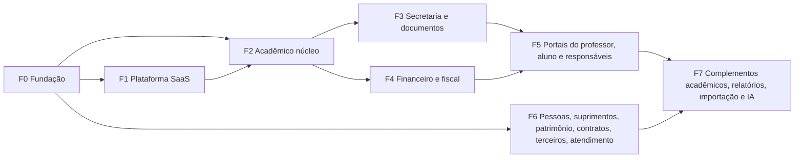

[Índice](README.md) · [Parte anterior](parte-19-pendencias-decisoes-e-rastreabilidade.md)

# Parte 20 — Plano de implementação

## Visão geral da parte 20

O sistema é construído em oito fases. Cada fase só começa quando as fases de que ela depende passaram pelo critério de passagem. As fases seguem a ordem de dependência do acadêmico ([55](parte-08-academico.md#doc-55), seção 3) e o pipeline de entrega ([10](parte-17-operacao-qualidade-testes-e-ti.md#doc-10), seção 4).

| Fase | O que entra | Documentos |
|---|---|---|
| F0 Fundação | Tenancy e bancos, identidade e login único, permissões e papéis, auditoria, exclusão lógica, privacidade base, internacionalização, design system, pipeline e observabilidade | [03](parte-02-arquitetura-e-tenancy.md#doc-03), [06](parte-03-identidade-acesso-e-permissoes.md#doc-06), [78](parte-03-identidade-acesso-e-permissoes.md#doc-78), [29](parte-04-seguranca-privacidade-e-auditoria.md#doc-29), [15](parte-16-dados-validacoes-configuracoes-e-armazenamento.md#doc-15), [07](parte-04-seguranca-privacidade-e-auditoria.md#doc-07), [09](parte-05-portais-navegacao-e-interface.md#doc-09), [08](parte-05-portais-navegacao-e-interface.md#doc-08), [10](parte-17-operacao-qualidade-testes-e-ti.md#doc-10) |
| F1 Plataforma SaaS | Provisionamento, domínios e OIDC, licenciamento e limites, Editor de portais, CRM da plataforma, cobrança do SaaS, suporte | [23](parte-06-plataforma-saas-clientes-dominios-licencas-e-crm.md#doc-23), [77](parte-06-plataforma-saas-clientes-dominios-licencas-e-crm.md#doc-77), [22](parte-06-plataforma-saas-clientes-dominios-licencas-e-crm.md#doc-22), [34](parte-10-financeiro-pagamentos-e-fiscal.md#doc-34), [32](parte-04-seguranca-privacidade-e-auditoria.md#doc-32) |
| F2 Acadêmico núcleo | Estrutura acadêmica, calendário, turmas e grade, matrícula e rematrícula, diário, boletim e conselho | [59](parte-08-academico.md#doc-59), [58](parte-08-academico.md#doc-58), [60](parte-08-academico.md#doc-60), [46](parte-09-secretaria-matricula-e-documentos.md#doc-46), [61](parte-08-academico.md#doc-61), [62](parte-08-academico.md#doc-62) |
| F3 Secretaria e documentos | Protocolo, gerador de documentos, gestão de documentos, livros e arquivo morto | [31](parte-05-portais-navegacao-e-interface.md#doc-31), seção 3.2; [48](parte-09-secretaria-matricula-e-documentos.md#doc-48), [54](parte-09-secretaria-matricula-e-documentos.md#doc-54), [67](parte-08-academico.md#doc-67) |
| F4 Financeiro e fiscal | Títulos, cobrança, régua, gateways e split, financeiro completo, contábil e fiscal da entidade | [17](parte-07-regras-gerais-dos-modulos-de-gestao.md#doc-17), [18](parte-07-regras-gerais-dos-modulos-de-gestao.md#doc-18), [20](parte-10-financeiro-pagamentos-e-fiscal.md#doc-20), [34](parte-10-financeiro-pagamentos-e-fiscal.md#doc-34), [71](parte-10-financeiro-pagamentos-e-fiscal.md#doc-71) |
| F5 Portais pessoais | Professor (classe, diário, planos), aluno, responsáveis, notificações | [81](parte-08-academico.md#doc-81), [64](parte-08-academico.md#doc-64), [57](parte-13-atendimento-e-notificacoes.md#doc-57), [76](parte-05-portais-navegacao-e-interface.md#doc-76) |
| F6 Gestão de apoio | Pessoas e SST, suprimentos, patrimônio e frotas, contratos, terceiros, biblioteca, simulados, atendimento | [39](parte-11-pessoas-departamento-pessoal-e-sst.md#doc-39), [52](parte-11-pessoas-departamento-pessoal-e-sst.md#doc-52), [19](parte-07-regras-gerais-dos-modulos-de-gestao.md#doc-19), [33](parte-12-suprimentos-patrimonio-frotas-contratos-e-terceiros.md#doc-33), [38](parte-12-suprimentos-patrimonio-frotas-contratos-e-terceiros.md#doc-38), [68](parte-08-academico.md#doc-68), [47](parte-08-academico.md#doc-47) |
| F7 Complementos | Aulas online, formulários, preceptoria, pastoral, agendamento, ocorrências, estágio e TCC, prontuário, relatórios e censo, importação, campos personalizados, integrações oficiais, IA, planejamento e empenho | [40](parte-08-academico.md#doc-40) a [44](parte-08-academico.md#doc-44), [63](parte-08-academico.md#doc-63), [65](parte-08-academico.md#doc-65), [66](parte-08-academico.md#doc-66), [69](parte-08-academico.md#doc-69), [70](parte-14-integracoes-e-importacao.md#doc-70), [72](parte-16-dados-validacoes-configuracoes-e-armazenamento.md#doc-72), [74](parte-14-integracoes-e-importacao.md#doc-74), [27](parte-15-inteligencia-artificial.md#doc-27), [28](parte-15-inteligencia-artificial.md#doc-28), [37](parte-08-academico.md#doc-37) |

**Critério de passagem de cada fase**
1. Critérios de aceite dos documentos da fase atendidos e marcados.
2. Testes de isolamento de tenant e de autorização passando em CI ([03](parte-02-arquitetura-e-tenancy.md#doc-03), seção 7; [06](parte-03-identidade-acesso-e-permissoes.md#doc-06), seção 11).
3. Definition of Done do [11](parte-17-operacao-qualidade-testes-e-ti.md#doc-11), seção 2, em cada módulo.
4. DDL revisado pelo owner e migração testada em homologação ([45](parte-19-pendencias-decisoes-e-rastreabilidade.md#doc-45), seção 7).

**Antes de produção, por módulo**
- As pendências jurídicas e de norma do módulo ([45](parte-19-pendencias-decisoes-e-rastreabilidade.md#doc-45), seções 3 e 4) estão respondidas. Um prazo marcado **[V]** ou **[P]** não entra em produção sem confirmação ([26](parte-18-juridico-e-regulatorio.md#doc-26), seção 3).
- Os itens de homologação do módulo ([45](parte-19-pendencias-decisoes-e-rastreabilidade.md#doc-45), seção 6) foram medidos.

---

[Índice](README.md) · [Parte anterior](parte-19-pendencias-decisoes-e-rastreabilidade.md)
