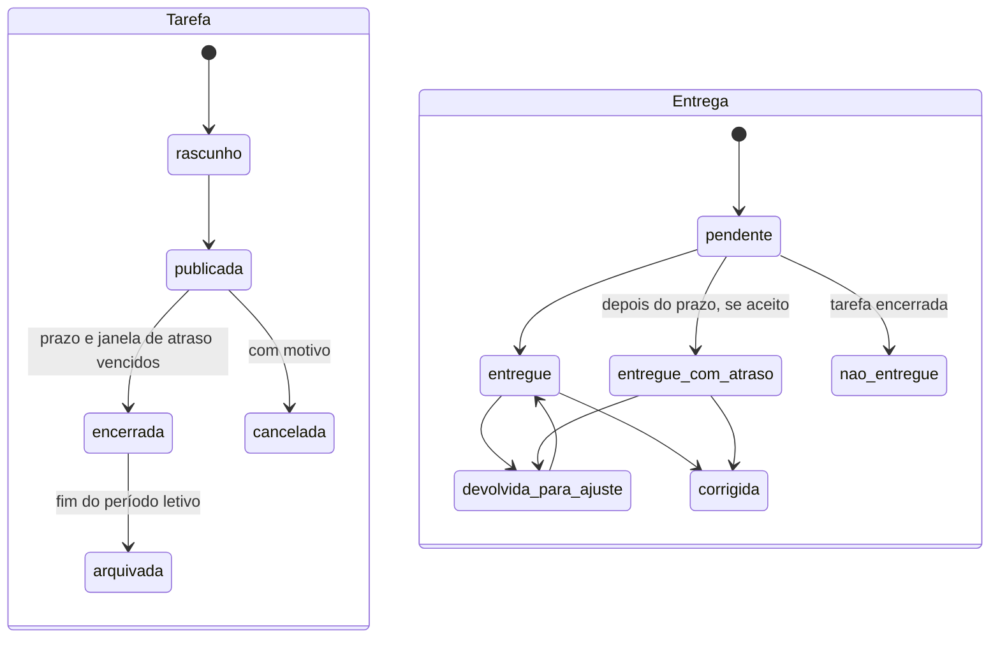

# Classe e diário

- Portal: Aluno (`portal-do-aluno.`)
- Área: Classe e diário
- Domínio: entidade: banco da unidade; o aluno vê **só os próprios dados** (escopo `proprio`, [78](../../docs/v2/78-permissoes-e-papeis.md), seção 4.4). Aluno menor: o responsável com vínculo ativo atua por ele ([07](../../docs/v2/07-privacidade-lgpd.md))
- Status: detalhado; regras da v2 copiadas integralmente (seção 13)
- Fonte da v2: [62](../../docs/v2/62-boletim-e-conselho-de-classe-por-portal.md), seção 2; [62](../../docs/v2/62-boletim-e-conselho-de-classe-por-portal.md), seção 7; [61](../../docs/v2/61-diario-escolar-por-portal.md), seção 4; [61](../../docs/v2/61-diario-escolar-por-portal.md), seção 7; [81](../../docs/v2/81-classe-mural-materiais-tarefas.md) (integral)
- Fonte da v1: sem especificação própria; valem as regras do SDD v2 (seção 13)

## 1. Regra de leitura

As seções 1 a 12 resumem e organizam a implementação. A seção 13 é o texto integral do SDD v2 que rege o módulo e prevalece em caso de dúvida. Decisões tomadas por padrão estão no [80](../../docs/v2/80-decisoes-por-padrao.md).

## 2. Objetivo e escopo

Disciplinas, materiais, entregas de tarefas, boletim e presença do próprio aluno.

## 3. Telas

- **Início do aluno** (dashboard: horário do dia, próximas entregas, últimas notas, avisos).
- **Minhas disciplinas** (cards).
- **Disciplina** (abas: mural, materiais, tarefas, notas, faltas).
- **Entregar tarefa** (upload ou texto; confirmação com data e hora; atraso marcado, DP-06).
- **Boletim** (por período, com média e situação).
- **Presença** (faltas por disciplina; pedido de justificativa).

## 4. Permissões por portal (extraídas do SDD)

Do [62](../../docs/v2/62-boletim-e-conselho-de-classe-por-portal.md):

| Portal | Pode | Não pode | Origem |
|---|---|---|---|
| **Aluno** | Ver o próprio boletim, parcial e oficial, e a situação. Baixar boletim oficial | Ver ata. Ver boletim de colega | E |

Do [61](../../docs/v2/61-diario-escolar-por-portal.md):

| Portal | Pode | Não pode | Origem |
|---|---|---|---|
| **Aluno** | Ver as próprias notas, faltas e justificativas. Enviar justificativa com anexo | Ver nota ou falta de colega | E |

Do [81](../../docs/v2/81-classe-mural-materiais-tarefas.md):

| Portal | Pode | Não pode | Origem |
|---|---|---|---|
| **Aluno** | Ver aviso e material da turma; entregar tarefa; ver a própria correção; comentar quando ligado | Ver entrega de colega | E |

## 5. Papéis

- `student` (nível 0, escopo próprio) ([78](../../docs/v2/78-permissoes-e-papeis.md), seção 4.4).
- Regras transversais: default-deny, separação de funções, step-up para ação sensível e revisão de acesso ([78](../../docs/v2/78-permissoes-e-papeis.md), seções 2 e 5).

## 6. Regras de negócio essenciais

- DP-06 ([80](../../docs/v2/80-decisoes-por-padrao.md)); boletim conforme [62](../../docs/v2/62-boletim-e-conselho-de-classe-por-portal.md), seção 2.

## 7. Dados

- Tabelas e campos conforme a seção 13 e o DDL do [51](../../docs/v2/51-ddl-modulos-novos.md), quando o módulo estiver lá. Toda tabela tem `entidade_id`, `unidade_id`, `created_at`, `updated_at`, `created_by` e exclusão lógica com `deleted_at` e `deleted_by` ([03](../../docs/v2/03-dominio-tenancy.md), seção 6; [15](../../docs/v2/15-validacoes.md); [19](../../docs/v2/19-regras-modulos-3.md), seção 14).

## 8. Integrações

- Ver a seção de integrações do documento de origem, na seção 13.

## 9. Exportação, auditoria e privacidade

- Exportação de listas: CSV, XLSX, PDF e JSON, com permissão de exportação e step-up; CSV com células neutralizadas ([08](../../docs/v2/08-frontend-design-system.md), seção 3).
- Toda criação, alteração, aprovação, exclusão lógica, exportação e leitura de dado sensível gera evento de auditoria no banco da unidade ([29](../../docs/v2/29-auditoria.md)).
- Dados pessoais conforme [07](../../docs/v2/07-privacidade-lgpd.md): mínimo necessário, mascaramento em listas, base legal registrada.

## 10. Estados de interface

- Carregando (skeleton), vazio com chamada para ação, sem resultado de filtro, erro com nova tentativa, acesso negado, registro bloqueado, fechado ou baixado (somente leitura), conflito de edição (versão).

## 11. Requisitos de frontend

- Sem JavaScript inline nem atributos `on*=`; textos por chave de i18n; tema claro e escuro; WCAG 2.2 AA; 320 px sem rolagem horizontal ([08](../../docs/v2/08-frontend-design-system.md)).
- Componentes do design system (índice em `docs/design-system/template/components/` no projeto e skill `agente-frontend`): página de lista com DataTable, KPIs, drawer de detalhe, formulário em página ou modal, kanban quando houver fluxo de estados.
- Seletor de unidade no topo quando o usuário tiver mais de uma; a troca reemite o token com o novo contexto ([06](../../docs/v2/06-identidade-acesso.md), seção 12).

## 12. Critérios de aceite e pendências

- Critérios de aceite: os do documento de origem (seção 13) e os de [31](../../docs/v2/31-matriz-portais-modulos.md), seção 6.
- Testes de isolamento: usuário de outra unidade ou entidade recebe 404 em toda rota do módulo ([03](../../docs/v2/03-dominio-tenancy.md)).
- As pendências do documento de origem estão na seção 13 e consolidadas no [45](../../docs/v2/45-pendencias-consolidadas.md).

## 13. Regras da v2 (texto integral das fontes, sem corte)

### 13.1 [62](../../docs/v2/62-boletim-e-conselho-de-classe-por-portal.md), seção 2

#### 2. Boletim

##### 2.1 Conteúdo

O boletim reúne, por aluno e por período:

- Identificação do aluno, da turma, do curso, da versão da grade e do período letivo.
- Por disciplina: avaliações com nota, peso e data, média do período, total de aulas, faltas e percentual de frequência.
- Situação da disciplina: `aprovado`, `recuperacao`, `reprovado_nota`, `reprovado_frequencia`, `aprovado_conselho`, `em_andamento`.
- Versão do sistema avaliativo aplicada. Mudança posterior do sistema não altera o boletim já emitido.
- Resultado final do período, quando o período estiver fechado.

##### 2.2 Tipos de emissão

| Tipo | Quando | Valor |
|---|---|---|
| Parcial | Durante o período, a qualquer momento | Informativo. Traz a marca "parcial, sem valor oficial". Não é documento de [48](../../docs/v2/48-gerador-de-documentos-por-portal.md) |
| Oficial | Depois do fechamento do período e da ata do conselho, se houver | Documento oficial, com código de validação e QR. Vai para o contexto C de [54](../../docs/v2/54-gestao-de-documentos-tres-contextos.md) |
| Segunda via | A pedido, depois da emissão oficial | Indica que é reemissão e mantém a data de origem, como em DC-14 ([53](../../docs/v2/53-pacote-documentos-e-contratos.md)) |

**Regras:**

- Boletim oficial só é emitido com período `fechado` ([59](../../docs/v2/59-estrutura-academica-por-portal.md), seção 3.6).
- Boletim oficial traz código de validação pública. Pela regra DC-13, a validação mostra tipo, data, situação e entidade. Não mostra nota.
- Alteração de nota depois do boletim oficial gera nova versão do boletim, com aviso ao aluno e ao responsável ([57](../../docs/v2/57-notificacoes-por-portal.md)). A versão anterior fica no histórico.

### 13.2 [62](../../docs/v2/62-boletim-e-conselho-de-classe-por-portal.md), seção 7

#### 7. Por portal

| Portal | Pode | Não pode | Origem |
|---|---|---|---|
| **Desenvolvedor** | Publicar modelo de ata e de boletim, sem dado | Ver boletim, resultado ou ata de entidade | P |
| **Gestão** | Ver indicadores de aprovação e reprovação, ver atas da unidade | Alterar resultado. Decidir conselho de aluno | E |
| **Coordenação** | Convocar conselho, montar pauta, presidir, decidir resultado fora da regra, autorizar reabertura | Lançar nota pelo professor | E |
| **Secretaria** | Emitir boletim oficial, registrar ata, executar reabertura autorizada, emitir segunda via | Decidir resultado de aluno | E |
| **Professor** | Ver boletim parcial das próprias turmas. Opinar no conselho. Lançar recuperação | Decidir resultado. Ver boletim de turma de que não é professor | E |
| **Aluno** | Ver o próprio boletim, parcial e oficial, e a situação. Baixar boletim oficial | Ver ata. Ver boletim de colega | E |
| **Responsáveis** | Ver boletim do dependente, parcial e oficial. Ver a situação | Ver ata ou parecer. Ver boletim de outro aluno | E, só dependentes com vínculo ativo |
| **Terceiros** | Nada | Qualquer item do boletim ou do conselho | E |

### 13.3 [61](../../docs/v2/61-diario-escolar-por-portal.md), seção 4

#### 4. Faltas e justificativas

##### 4.1 Falta

- Falta é registrada por aluno, por aula. Não por dia.
- Falta é contada por disciplina, e por período no total de frequência.

##### 4.2 Justificativa

| Regra | Detalhe |
|---|---|
| Tipos | Lista padrão da plataforma, ajustável pela escola. Decidido em 03/11/2026 |
| Prazo | 5 dias úteis após a falta, ajustável pela escola. Decidido em 03/11/2026 |
| Documento | Anexo quando o tipo exigir. Armazenado como documento recebido ([54](../../docs/v2/54-gestao-de-documentos-tres-contextos.md), contexto A) |
| Quem aprova | Coordenação. Professor não aprova justificativa de própria aula |
| Efeito | A LDB não prevê abono geral de falta: a falta justificada continua contando para o mínimo de 75% (art. 24, VI). A exceção da LDB é a falta por motivo religioso com atividade alternativa, que regulariza a frequência (art. 7º-A, § 2º). Regimes especiais de lei própria, como exercícios domiciliares, entram como exceção configurada **(verificar)** |
| Negativa | Sempre com motivo. Aluno ou responsável recebe o aviso ([57](../../docs/v2/57-notificacoes-por-portal.md)) |

##### 4.3 Aviso de falta

- Falta acima do limite de alerta da escola gera aviso ao responsável ([57](../../docs/v2/57-notificacoes-por-portal.md)).
- O aviso informa a disciplina e a quantidade de faltas. Não informa motivo clínico.
- Falta de saúde justificada por atestado não aparece com diagnóstico no aviso ([57](../../docs/v2/57-notificacoes-por-portal.md), seção 3.5).
- **Conselho Tutelar:** a escola notifica ao Conselho Tutelar do município a relação dos alunos com faltas acima de 30% do percentual permitido em lei (LDB, art. 12, VIII). O sistema gera a lista por período para a secretaria enviar. A forma de cálculo e a periodicidade ficam em DIA-09 **(verificar)**.

### 13.4 [61](../../docs/v2/61-diario-escolar-por-portal.md), seção 7

#### 7. Por portal

| Portal | Pode | Não pode | Origem |
|---|---|---|---|
| **Desenvolvedor** | Nada sobre diário de entidade | Ver diário, nota, falta ou conteúdo | P |
| **Gestão** | Ver relatórios do diário e indicadores de frequência | Lançar nota ou chamada. Autorizar reabertura, que é da coordenação | E |
| **Coordenação** | Aprovar justificativa. Autorizar lançamento fora do prazo e reabertura. Ver diário de todas as turmas da unidade | Lançar nota pelo professor | E |
| **Secretaria** | Consultar diário. Emitir relatórios. Cadastrar tipos de justificativa | Lançar nota ou aprovar justificativa | E |
| **Professor** | Fazer chamada, lançar nota e conteúdo das próprias turmas. Ver o diário das próprias turmas | Lançar em turma em que não leciona. Aprovar justificativa da própria aula | E |
| **Aluno** | Ver as próprias notas, faltas e justificativas. Enviar justificativa com anexo | Ver nota ou falta de colega | E |
| **Responsáveis** | Ver as notas e faltas do dependente. Enviar justificativa | Ver diário de outra turma | E, só dependentes com vínculo ativo |
| **Terceiros** | Nada | Qualquer item do diário | E |

### 13.5 [81 — Classe: Mural, Materiais e Tarefas, por Portal](../../docs/v2/81-classe-mural-materiais-tarefas.md) (documento integral)

> Parte do [SDD v2](../../docs/v2/00-README.md). Especifica o que o [80](../../docs/v2/80-decisoes-por-padrao.md), DP-06, decidiu por padrão. A matriz ([31](../../docs/v2/31-matriz-portais-modulos.md), seções 2.3 a 2.5) põe a Classe nos portais do professor, do aluno e dos responsáveis.
> **Status:** especificação criada em 04/11/2026. Não há especificação na v1 além da citação na navegação ([12-portals-navigation-sidebar-pages-spec.md](../../docs/v2/anexo-v1/12-portals-navigation-sidebar-pages-spec.md)).

---

#### 1. Resposta direta

| Pergunta | Veredito |
|---|---|
| O que é a Classe? | O espaço de cada turma e disciplina com três recursos: mural de avisos, materiais de apoio e tarefas com entrega |
| Quem publica? | O professor da turma e a coordenação da unidade |
| Quem vê? | Os alunos da turma e os responsáveis com vínculo ativo, cada um no próprio portal |
| A nota da tarefa entra no diário? | Só quando a tarefa é uma avaliação do sistema avaliativo da turma ([59](../../docs/v2/59-estrutura-academica-por-portal.md), seção 4) |
| A IA corrige a tarefa? | Não. A IA pode sugerir; o professor decide ([27](../../docs/v2/27-inteligencia-artificial-e-portais.md), princípio 2) |

---

#### 2. Escopo

Dentro: aviso no mural, comentário em aviso, material de apoio, tarefa, entrega do aluno, correção e devolução.

Fora, porque têm documento próprio:

- Chamada, conteúdo da aula e notas do período: [61](../../docs/v2/61-diario-escolar-por-portal.md).
- Boletim, aprovação e conselho: [62](../../docs/v2/62-boletim-e-conselho-de-classe-por-portal.md).
- Plano de aula e de ensino: [64](../../docs/v2/64-planos-de-aula-e-de-ensino-por-portal.md).
- Aula ao vivo e gravação: [40](../../docs/v2/40-aulas-online-por-portal.md).
- Prova e simulado: [47](../../docs/v2/47-simulados-por-portal.md).

---

#### 3. Entidades e campos

##### 3.1 Aviso do mural

| Campo | Regra |
|---|---|
| Turma e disciplina | Obrigatórias. O aviso pertence a uma turma; aviso para várias turmas gera um aviso por turma |
| Título | Obrigatório, até 160 caracteres |
| Texto | Obrigatório, até 5.000 caracteres, com o escape do sistema ([08](../../docs/v2/08-frontend-design-system.md)) |
| Anexos | Até 5 arquivos, pelo armazenamento ([21](../../docs/v2/21-busca-e-armazenamento.md), seção 3) |
| Comentários | Desligados por padrão. O autor liga por aviso |
| Fixado | Opcional. No máximo 3 avisos fixados por turma |
| Publicação | Imediata ou agendada |

##### 3.2 Material de apoio

| Campo | Regra |
|---|---|
| Turma e disciplina | Obrigatórias |
| Título e descrição | Título obrigatório, até 160 caracteres |
| Tipo | Arquivo, link externo ou referência à biblioteca ([68](../../docs/v2/68-biblioteca-por-portal.md)) |
| Arquivo | Pelo armazenamento, com antivírus antes de ficar disponível e limite de tamanho de [21](../../docs/v2/21-busca-e-armazenamento.md), seção 3.9 |
| Link externo | Só `https`. Abre em nova aba, sem envio de dado do aluno |
| Aula vinculada | Opcional, para ligar o material à aula do diário |

##### 3.3 Tarefa

| Campo | Regra |
|---|---|
| Turma e disciplina | Obrigatórias |
| Título e instruções | Obrigatórios |
| Anexos | Até 10 arquivos |
| Abertura e prazo | Prazo obrigatório e posterior à abertura |
| Forma de entrega | Texto, arquivo ou os dois; tipos de arquivo aceitos pela tarefa, dentro dos permitidos em [21](../../docs/v2/21-busca-e-armazenamento.md) |
| Aceita atraso | Sim ou não. Se sim, até quando |
| É avaliação | Sim ou não. Se sim, aponta para a avaliação do período no sistema avaliativo ([59](../../docs/v2/59-estrutura-academica-por-portal.md), seção 4) e a escala de nota vem dele |
| Público | A turma inteira, ou alunos escolhidos (atividade de recuperação, adaptação) |

##### 3.4 Entrega

| Campo | Regra |
|---|---|
| Aluno e tarefa | Obrigatórios; uma entrega por aluno e tarefa, com versões |
| Conteúdo | Texto e arquivos, conforme a forma de entrega |
| Data e hora | Gravadas pelo servidor, em UTC, exibidas no fuso da unidade |
| Atraso | Calculado: entregue depois do prazo. Não é digitado |
| Correção | Nota (quando é avaliação), comentário e arquivo de devolução |

---

#### 4. Estados



| Entidade | Estados |
|---|---|
| Aviso | `rascunho`, `agendado`, `publicado`, `arquivado` |
| Material | `processando` (antivírus), `disponivel`, `bloqueado` (falha no antivírus), `arquivado` |
| Tarefa | `rascunho`, `publicada`, `encerrada`, `cancelada`, `arquivada` |
| Entrega | `pendente`, `entregue`, `entregue_com_atraso`, `devolvida_para_ajuste`, `corrigida`, `nao_entregue` |

`nao_entregue` e `entregue_com_atraso` são calculados pelo prazo e gravados pelo job de encerramento da tarefa, com registro ([18](../../docs/v2/18-regras-modulos-2.md), T-04).

---

#### 5. Regras

##### 5.1 Mural

1. Só o professor da turma ou a coordenação da unidade publica na turma.
2. Comentários ficam desligados por padrão. Quando ligados, só alunos da turma e o autor comentam; o autor pode ocultar comentário, com registro.
3. Foto ou vídeo em que apareça aluno só com termo de imagem ativo daquele aluno para a finalidade "mural" ([32](../../docs/v2/32-atendimento-privacidade-por-portal.md), seção 3.2). Sem termo, o envio é recusado com aviso ao autor.
4. Aviso publicado não é editado sem deixar versão: a edição gera nova versão e mostra "editado".

##### 5.2 Materiais

1. Arquivo só fica disponível depois do antivírus. Falha bloqueia o material e avisa o autor.
2. Material é visível só para a turma e para os responsáveis dos alunos dela.
3. Download e abertura são registrados, sem guardar o conteúdo.

##### 5.3 Tarefas e entregas

1. Entrega depois do prazo só é aceita se a tarefa aceitar atraso, até o limite definido. Depois disso, o envio é recusado.
2. O professor pode prorrogar o prazo para um aluno, com motivo. A prorrogação fica no histórico da entrega.
3. A nota da tarefa só é lançada pelo professor da turma ([22](../../docs/v2/22-crm-canais-e-papeis.md), seção 5).
4. Tarefa marcada como avaliação lança a nota na avaliação do diário ([61](../../docs/v2/61-diario-escolar-por-portal.md), seção 5) só quando o professor confirma a correção. Diário fechado bloqueia a alteração ([61](../../docs/v2/61-diario-escolar-por-portal.md), seção 6).
5. Tarefa que não é avaliação não entra no diário nem no boletim.
6. Sugestão de correção por IA é recurso contratado. A sugestão aparece como sugestão e precisa de confirmação do professor ([27](../../docs/v2/27-inteligencia-artificial-e-portais.md)).
7. Aluno menor não vê entrega de colega. Responsável não envia entrega pelo dependente.

---

#### 6. Por portal

| Portal | Pode | Não pode | Origem |
|---|---|---|---|
| **Desenvolvedor** | Publicar modelos de tarefa e de aviso, sem dado | Ver aviso, material, tarefa ou entrega de entidade | P |
| **Gestão** | Ver painel agregado da unidade: tarefas publicadas, entregas no prazo, atrasos por turma | Ver o conteúdo das entregas sem papel de coordenação | E |
| **Coordenação** | Publicar aviso para turmas da unidade; ver tarefas e entregas da unidade; ocultar conteúdo impróprio, com registro | Lançar nota de tarefa | E |
| **Secretaria** | Nada nesta área | Ver ou publicar | E |
| **Professor** | Publicar aviso, material e tarefa nas próprias turmas; corrigir, devolver e prorrogar | Ver turma em que não leciona | E |
| **Aluno** | Ver aviso e material da turma; entregar tarefa; ver a própria correção; comentar quando ligado | Ver entrega de colega | E |
| **Responsáveis** | Ver aviso, material, tarefas, prazos e situação da entrega dos dependentes | Entregar pelo dependente; ver entrega de outro aluno | E, só dependentes com vínculo ativo |
| **Terceiros** | Nada | Qualquer item da Classe | E |

Permissões: `classe.aviso.publicar`, `classe.aviso.moderar`, `classe.material.publicar`, `classe.tarefa.publicar`, `classe.tarefa.corrigir`, `classe.tarefa.prorrogar`, `classe.entrega.enviar`, `classe.painel.ver`. Papéis em [78](../../docs/v2/78-permissoes-e-papeis.md), seções 4.2 a 4.5.

---

#### 7. Notificações

Pelo módulo de notificações ([57](../../docs/v2/57-notificacoes-por-portal.md)), respeitando preferência e horário de silêncio:

| Evento | Quem recebe |
|---|---|
| Aviso publicado | Alunos da turma; responsáveis, se a preferência deles incluir comunicados |
| Tarefa publicada | Alunos do público da tarefa |
| Prazo em 24 horas, sem entrega | Aluno; responsável do menor |
| Entrega devolvida para ajuste | Aluno |
| Correção publicada | Aluno; responsável do menor |
| Material bloqueado pelo antivírus | Autor |

---

#### 8. Privacidade, auditoria e retenção

- Entrega é dado do aluno: acesso pelo professor da turma, pela coordenação e pelo próprio aluno; responsável vê a situação e a correção do dependente.
- Publicação, edição, ocultação, correção, prorrogação e lançamento no diário geram evento de auditoria ([29](../../docs/v2/29-auditoria.md)).
- **Retenção (proposta, [Pendente: jurídico]):** avisos e materiais até o fim do período letivo e mais 1 ano, depois arquivamento; entregas de tarefas avaliativas até o fim do período letivo e mais 2 anos, porque a nota resultante é registro de vida escolar ([26](../../docs/v2/26-sdd-juridico-regulatorio.md), seção 3), mas o arquivo da entrega não é. Nenhum prazo entra em produção sem a confirmação do jurídico.

---

#### 9. Integrações

| Módulo | Relação |
|---|---|
| Turmas ([60](../../docs/v2/60-turmas-e-grade-de-horarios-por-portal.md)) | A Classe existe por turma e disciplina; aluno da turma é o público |
| Diário ([61](../../docs/v2/61-diario-escolar-por-portal.md)) | Nota de tarefa avaliativa; material ligado à aula |
| Sistema avaliativo ([59](../../docs/v2/59-estrutura-academica-por-portal.md)) | Escala e avaliação do período |
| Armazenamento ([21](../../docs/v2/21-busca-e-armazenamento.md)) | Arquivos, antivírus, versões |
| Notificações ([57](../../docs/v2/57-notificacoes-por-portal.md)) | Avisos e lembretes |
| IA ([27](../../docs/v2/27-inteligencia-artificial-e-portais.md)) | Sugestão de correção, quando contratada |

---

#### 10. DDL

Convenções do [51](../../docs/v2/51-ddl-modulos-novos.md): MySQL 8 ou MariaDB 10.6, `utf8mb4`, horários em UTC, banco da unidade, exclusão lógica.

```sql
CREATE TABLE classe_avisos (
  id              BIGINT UNSIGNED AUTO_INCREMENT PRIMARY KEY,
  uuid            CHAR(36) NOT NULL UNIQUE,
  unidade_uuid    CHAR(36) NOT NULL,
  turma_uuid      CHAR(36) NOT NULL,
  disciplina_uuid CHAR(36) NOT NULL,
  autor_uuid      CHAR(36) NOT NULL,
  titulo          VARCHAR(160) NOT NULL,
  texto           TEXT NOT NULL,
  comentarios_ligados TINYINT(1) NOT NULL DEFAULT 0,
  fixado          TINYINT(1) NOT NULL DEFAULT 0,
  estado          ENUM('rascunho','agendado','publicado','arquivado') NOT NULL DEFAULT 'rascunho',
  publicar_em     DATETIME(3) NULL,
  versao          INT UNSIGNED NOT NULL DEFAULT 1,
  created_at      DATETIME(3) NOT NULL DEFAULT CURRENT_TIMESTAMP(3),
  updated_at      DATETIME(3) NULL,
  deleted_at      DATETIME(3) NULL,
  deleted_by      CHAR(36) NULL,
  INDEX ix_aviso_turma (unidade_uuid, turma_uuid, estado, publicar_em)
) ENGINE=InnoDB DEFAULT CHARSET=utf8mb4;

CREATE TABLE classe_aviso_comentarios (
  id              BIGINT UNSIGNED AUTO_INCREMENT PRIMARY KEY,
  uuid            CHAR(36) NOT NULL UNIQUE,
  aviso_uuid      CHAR(36) NOT NULL,
  autor_uuid      CHAR(36) NOT NULL,
  texto           VARCHAR(2000) NOT NULL,
  oculto          TINYINT(1) NOT NULL DEFAULT 0,
  oculto_por      CHAR(36) NULL,
  oculto_motivo   VARCHAR(255) NULL,
  created_at      DATETIME(3) NOT NULL DEFAULT CURRENT_TIMESTAMP(3),
  deleted_at      DATETIME(3) NULL,
  deleted_by      CHAR(36) NULL,
  INDEX ix_coment_aviso (aviso_uuid, created_at)
) ENGINE=InnoDB DEFAULT CHARSET=utf8mb4;

CREATE TABLE classe_materiais (
  id              BIGINT UNSIGNED AUTO_INCREMENT PRIMARY KEY,
  uuid            CHAR(36) NOT NULL UNIQUE,
  unidade_uuid    CHAR(36) NOT NULL,
  turma_uuid      CHAR(36) NOT NULL,
  disciplina_uuid CHAR(36) NOT NULL,
  autor_uuid      CHAR(36) NOT NULL,
  titulo          VARCHAR(160) NOT NULL,
  descricao       TEXT NULL,
  tipo            ENUM('arquivo','link','biblioteca') NOT NULL,
  arquivo_uuid    CHAR(36) NULL,          -- storage_files.uuid (doc 21, seção 4.3)
  url_externa     VARCHAR(2048) NULL,     -- só https
  aula_uuid       CHAR(36) NULL,
  estado          ENUM('processando','disponivel','bloqueado','arquivado') NOT NULL DEFAULT 'processando',
  created_at      DATETIME(3) NOT NULL DEFAULT CURRENT_TIMESTAMP(3),
  deleted_at      DATETIME(3) NULL,
  deleted_by      CHAR(36) NULL,
  INDEX ix_material_turma (unidade_uuid, turma_uuid, estado)
) ENGINE=InnoDB DEFAULT CHARSET=utf8mb4;

CREATE TABLE classe_tarefas (
  id              BIGINT UNSIGNED AUTO_INCREMENT PRIMARY KEY,
  uuid            CHAR(36) NOT NULL UNIQUE,
  unidade_uuid    CHAR(36) NOT NULL,
  turma_uuid      CHAR(36) NOT NULL,
  disciplina_uuid CHAR(36) NOT NULL,
  autor_uuid      CHAR(36) NOT NULL,
  titulo          VARCHAR(160) NOT NULL,
  instrucoes      TEXT NOT NULL,
  abre_em         DATETIME(3) NOT NULL,
  prazo_em        DATETIME(3) NOT NULL,
  aceita_atraso_ate DATETIME(3) NULL,
  forma_entrega   ENUM('texto','arquivo','texto_e_arquivo') NOT NULL,
  e_avaliacao     TINYINT(1) NOT NULL DEFAULT 0,
  avaliacao_uuid  CHAR(36) NULL,          -- avaliação do período no diário
  publico         ENUM('turma','alunos_escolhidos') NOT NULL DEFAULT 'turma',
  estado          ENUM('rascunho','publicada','encerrada','cancelada','arquivada') NOT NULL DEFAULT 'rascunho',
  cancelada_motivo VARCHAR(255) NULL,
  created_at      DATETIME(3) NOT NULL DEFAULT CURRENT_TIMESTAMP(3),
  deleted_at      DATETIME(3) NULL,
  deleted_by      CHAR(36) NULL,
  CONSTRAINT ck_tarefa_prazo CHECK (prazo_em > abre_em),
  INDEX ix_tarefa_turma (unidade_uuid, turma_uuid, estado, prazo_em)
) ENGINE=InnoDB DEFAULT CHARSET=utf8mb4;

CREATE TABLE classe_tarefa_publico (
  tarefa_uuid     CHAR(36) NOT NULL,
  aluno_uuid      CHAR(36) NOT NULL,
  prazo_prorrogado_em DATETIME(3) NULL,
  prorrogacao_motivo  VARCHAR(255) NULL,
  PRIMARY KEY (tarefa_uuid, aluno_uuid)
) ENGINE=InnoDB DEFAULT CHARSET=utf8mb4;

CREATE TABLE classe_entregas (
  id              BIGINT UNSIGNED AUTO_INCREMENT PRIMARY KEY,
  uuid            CHAR(36) NOT NULL UNIQUE,
  unidade_uuid    CHAR(36) NOT NULL,
  tarefa_uuid     CHAR(36) NOT NULL,
  aluno_uuid      CHAR(36) NOT NULL,
  versao          INT UNSIGNED NOT NULL DEFAULT 1,
  texto           TEXT NULL,
  entregue_em     DATETIME(3) NULL,
  estado          ENUM('pendente','entregue','entregue_com_atraso','devolvida_para_ajuste','corrigida','nao_entregue') NOT NULL DEFAULT 'pendente',
  nota            DECIMAL(6,2) NULL,      -- só quando a tarefa é avaliação
  comentario_correcao TEXT NULL,
  corrigida_por   CHAR(36) NULL,
  corrigida_em    DATETIME(3) NULL,
  lancada_no_diario_em DATETIME(3) NULL,
  created_at      DATETIME(3) NOT NULL DEFAULT CURRENT_TIMESTAMP(3),
  deleted_at      DATETIME(3) NULL,
  deleted_by      CHAR(36) NULL,
  UNIQUE KEY ux_entrega (tarefa_uuid, aluno_uuid),
  INDEX ix_entrega_estado (unidade_uuid, tarefa_uuid, estado)
) ENGINE=InnoDB DEFAULT CHARSET=utf8mb4;

CREATE TABLE classe_entrega_arquivos (
  entrega_uuid    CHAR(36) NOT NULL,
  versao          INT UNSIGNED NOT NULL,
  arquivo_uuid    CHAR(36) NOT NULL,      -- storage_files.uuid
  PRIMARY KEY (entrega_uuid, versao, arquivo_uuid)
) ENGINE=InnoDB DEFAULT CHARSET=utf8mb4;
```

Antes da migração, este DDL passa pela revisão do owner do módulo e pelo teste de migração (DDL-01 e DDL-02, [45](../../docs/v2/45-pendencias-consolidadas.md), seção 7).

---

#### 11. Pendências

| Código | Pendência | Responsável |
|---|---|---|
| CLA-01 | Prazos de retenção de avisos, materiais e entregas (seção 8) | Jurídico |
| CLA-02 | Revisão do DDL pelo owner do acadêmico e teste de migração | Owner do módulo |

---

#### 12. Critérios de aceite

- [ ] Professor só publica e corrige nas turmas em que leciona; tentativa em outra turma responde 404.
- [ ] Aviso com imagem de aluno sem termo de imagem ativo é recusado.
- [ ] Material só fica disponível depois do antivírus; falha deixa o material `bloqueado`.
- [ ] Entrega depois do prazo e fora da janela de atraso é recusada pelo servidor.
- [ ] Nota de tarefa não avaliativa nunca aparece no diário nem no boletim.
- [ ] Nota de tarefa avaliativa só entra no diário depois da confirmação do professor, e nunca com o diário fechado.
- [ ] Responsável vê só os dependentes com vínculo ativo e não envia entrega.
- [ ] Todas as ações da seção 8 geram evento de auditoria.
